# Page: Overview

# Overview

<details>
<summary>Relevant source files</summary>

The following files were used as context for generating this wiki page:

- [README.md](README.md)
- [README_EN.md](README_EN.md)
- [docs/Preface.md](docs/Preface.md)
- [docs/README.md](docs/README.md)
- [docs/README_EN.md](docs/README_EN.md)
- [docs/_sidebar.md](docs/_sidebar.md)
- [docs/_sidebar_en.md](docs/_sidebar_en.md)
- [docs/images/hello-agents.png](docs/images/hello-agents.png)
- [docs/images/star-history-2026324.png](docs/images/star-history-2026324.png)

</details>


## Purpose and Scope

This document provides a comprehensive introduction to the Hello-Agents repository, an open-source educational project by Datawhale for building AI agent systems from scratch. It covers the repository structure, learning curriculum, development approaches, and core frameworks. This overview is intended for developers, students, and AI practitioners who want to understand agent system architecture and implementation.

For detailed installation instructions, see [Getting Started](#2). For specific curriculum details, see [Learning Path and Curriculum](#3). For framework implementation, see [HelloAgents Framework](#7).

---

## What is Hello-Agents

Hello-Agents is a **systematic agent learning tutorial** that emphasizes hands-on practice and progressive learning [README.md:28](). The project distinguishes between two agent development paradigms:

1. **Software Engineering Agents** (e.g., Dify, Coze, n8n): Process-driven workflow systems where LLMs serve as data processing backends [README.md:28]().
2. **AI-Native Agents**: True AI-driven agents where the LLM is the core intelligence [README.md:28]().

This tutorial focuses on building **AI-Native Agents** by teaching both "using wheels" (existing frameworks and platforms) and "building wheels" (custom framework implementation) [README.md:28]().

**Key Repository Statistics** (from [README.md:15-19]()):
- Open source under Creative Commons BY-NC-SA 4.0 [README.md:116]()
- 16 chapters organized into 5 parts [README.md:51-74]()
- Bilingual documentation (Chinese and English) [README.md:1-3]()
- Online reading: `https://datawhalechina.github.io/hello-agents/` [README.md:19]()

Sources: [README.md:24-28](), [README_EN.md:24-28]()

---

## Repository Structure

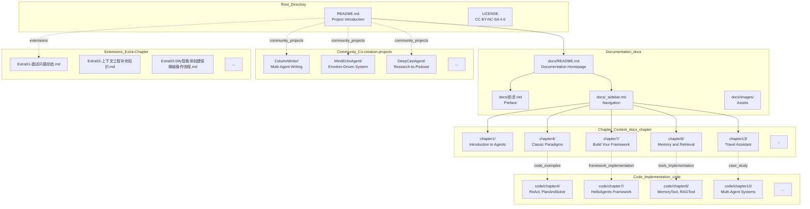

**Directory Mapping to Code Entities**

| Directory | Purpose | Key Files/Classes |
|-----------|---------|-------------------|
| `docs/chapter1-16/` | Tutorial chapters (theory) | Markdown documentation [README.md:51-74]() |
| `code/chapter4/` | Classic paradigm implementations | `react_agent.py`, `plan_and_solve.py` [README.md:59]() |
| `code/chapter7/` | HelloAgents framework | `helloagents/`, `examples/` [README.md:62]() |
| `code/chapter8/` | Memory and RAG systems | `memory_tool.py`, `rag_tool.py` [README.md:64]() |
| `code/chapter13/` | Travel assistant case study | Multi-agent MCP integration [README.md:70]() |
| `Co-creation-projects/` | Community applications | `ColumnWriter/`, `MindEchoAgent/`, `DeepCastAgent/` [README.md:82-88]() |
| `Extra-Chapter/` | Community contributions | Interview questions, tutorials [README.md:83-91]() |

Sources: [README.md:51-91](), [docs/_sidebar.md:1-29]()

---

## Five-Part Curriculum Structure

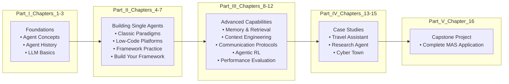

**Curriculum Progression**

The curriculum follows a sequential progression from foundations to capstone [docs/Preface.md:27-37]():

| Part | Chapters | Focus | Code Directories |
|------|----------|-------|------------------|
| I: Foundations | 1-3 | Agent concepts, history, LLM architecture | None (theory) |
| II: Building Single Agents | 4-7 | ReAct, Plan-and-Solve, frameworks, HelloAgents | `code/chapter4/`, `code/chapter7/` |
| III: Advanced Capabilities | 8-12 | Memory, RAG, context, protocols, RL, evaluation | `code/chapter8/`, `code/chapter9/` |
| IV: Case Studies | 13-15 | Multi-agent collaboration, MCP integration | `code/chapter13/`, `code/chapter14/` |
| V: Capstone | 16 | Complete application development | `code/chapter16/` |

**Part I (Chapters 1-3)** establishes theoretical grounding [docs/Preface.md:29]():
- Chapter 1: Agent definition, types, paradigms, and applications [README.md:55]().
- Chapter 2: Historical evolution from symbolism to LLM-driven agents [README.md:56]().
- Chapter 3: Transformer architecture, prompt engineering, and LLM limitations [README.md:57]().

**Part II (Chapters 4-7)** focuses on implementation skills with four progressive approaches [docs/Preface.md:31]():
- Chapter 4: Hand-coded implementations of `ReAct`, `Plan-and-Solve`, and `Reflection` paradigms [README.md:59]().
- Chapter 5: Low-code platforms (Coze, Dify, n8n) for rapid prototyping [README.md:60]().
- Chapter 6: Existing frameworks (AutoGen, LangGraph, AgentScope) for leveraging mature tooling [README.md:61]().
- Chapter 7: Building the custom `HelloAgents` framework from scratch [README.md:62]().

**Part III (Chapters 8-12)** introduces orthogonal enhancements [docs/Preface.md:33]():
- Chapter 8: Memory systems, RAG, and storage [README.md:64]().
- Chapter 9: Context engineering for continuous interaction [README.md:65]().
- Chapter 10: Communication protocols (MCP, A2A, ANP) [README.md:66]().
- Chapter 11: Agentic RL training pipeline (SFT → GRPO) [README.md:67]().
- Chapter 12: Evaluation benchmarks (BFCL, GAIA) [README.md:68]().

**Part IV (Chapters 13-15)** synthesizes all previous knowledge [docs/Preface.md:35]():
- Chapter 13: Multi-agent travel assistant using MCP protocol [README.md:70]().
- Chapter 14: Autonomous research agent (DeepResearch replication) [README.md:71]().
- Chapter 15: Cyber Town social simulation with A2A communication [README.md:72]().

**Part V (Chapter 16)** challenges learners to apply all acquired skills independently in a capstone project [README.md:74]().

Sources: [README.md:51-74](), [docs/Preface.md:27-37](), [docs/_sidebar.md:1-29]()

---

## Dual Development Philosophy

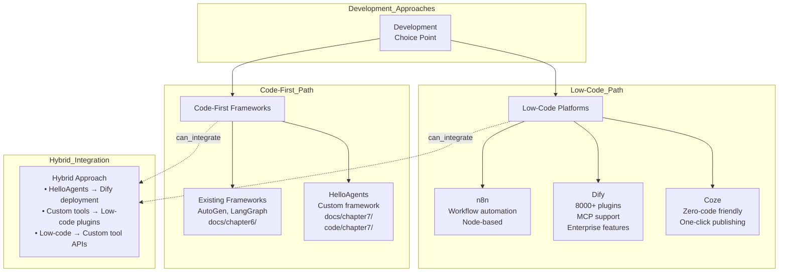

**Low-Code Path Characteristics**:
- **Rapid prototyping**: Visual configuration without code [README.md:28]().
- **Platform examples**:
  - **Coze**: Zero-code friendly, one-click multi-channel publishing [README.md:60]().
  - **Dify**: 8000+ plugins, MCP protocol support, enterprise-grade [README.md:86]().
  - **n8n**: Workflow automation with visual nodes [README.md:60]().
- **Philosophy**: "Knowing how but not knowing why" - fast results, less control [docs/Preface.md:9]().

**Code-First Path Characteristics**:
- **Deep understanding**: Full control over agent architecture [README.md:28]().
- **Framework options**:
  - **HelloAgents**: Custom implementation from scratch (Chapter 7) [README.md:62]().
  - **AutoGen, LangGraph, AgentScope**: Mature ecosystem tools (Chapter 6) [README.md:61]().
- **Philosophy**: "Building from scratch" - steep learning curve, maximum flexibility [README.md:28]().

Sources: [README.md:28](), [README.md:60-64](), [docs/Preface.md:9]()

---

## HelloAgents Framework Core Architecture

This diagram bridges natural language concepts to actual code entities in the HelloAgents framework:

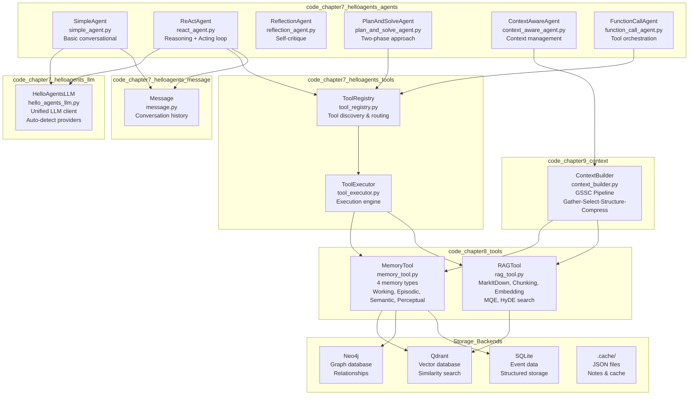

**Core Framework Components**

| Component | Purpose |
|-----------|---------|
| `SimpleAgent` | Basic conversational agent with message history [README.md:43]() |
| `ReActAgent` | Implements Reasoning-Acting loop with tool calls [README.md:59]() |
| `ReflectionAgent` | Self-critique and iterative improvement [README.md:59]() |
| `PlanAndSolveAgent` | Strategic planning then execution [README.md:59]() |
| `HelloAgentsLLM` | Unified client with auto-detection (OpenAI, ModelScope, Ollama) [README.md:43]() |
| `ToolRegistry` | Service locator for tool discovery [README.md:44]() |
| `MemoryTool` | 4 memory types with consolidation mechanisms [README.md:64]() |
| `RAGTool` | Document processing with advanced search (MQE, HyDE) [README.md:64]() |
| `ContextBuilder` | GSSC pipeline for context optimization [README.md:65]() |

Sources: [README.md:43-74](), [docs/_sidebar.md:1-29]()

---

## Target Audience and Prerequisites

**Intended Audience** [docs/Preface.md:17]():
- AI developers and software engineers with programming experience.
- University students studying AI/CS.
- Self-learners with strong interest in cutting-edge AI technology.

**Prerequisites** [docs/Preface.md:19-25]():
- **Required**: Basic Python programming skills.
- **Required**: Basic conceptual understanding of LLMs (e.g., obtaining LLM APIs).
- **Not Required**: Deep background in algorithms or model training.

**Project Focus**: Application and construction rather than algorithm development or model training [docs/Preface.md:25]().

Sources: [docs/Preface.md:15-26]()

---

## Practice Philosophy and Community

**Practice Philosophy** [docs/Preface.md:39]():
The repository emphasizes hands-on practice with complete working code. All supporting code is provided in the `code/` folder. Learners are encouraged to personally run, debug, and modify every piece of code provided.

**Community Engagement** [README.md:76-78]():
The project is a co-created effort. Community contributions include:
- **Co-creation Projects**: Featured multi-agent applications like `ColumnWriter`, `MindEchoAgent`, and `DeepCastAgent` [README.md:82-88]().
- **Extra Chapters**: Supplementary content covering interview questions, context engineering, and platform tutorials [README.md:83-91]().

Sources: [README.md:76-91](), [docs/Preface.md:39-43]()

---

# Page: Getting Started

# Getting Started

<details>
<summary>Relevant source files</summary>

The following files were used as context for generating this wiki page:

- [Extra-Chapter/images/Extra07-figures/image1.png](Extra-Chapter/images/Extra07-figures/image1.png)
- [Extra-Chapter/images/Extra07-figures/image2.png](Extra-Chapter/images/Extra07-figures/image2.png)
- [Extra-Chapter/images/Extra07-figures/image3.png](Extra-Chapter/images/Extra07-figures/image3.png)
- [Extra-Chapter/images/Extra07-figures/image4.png](Extra-Chapter/images/Extra07-figures/image4.png)
- [Extra-Chapter/images/Extra07-figures/image5.png](Extra-Chapter/images/Extra07-figures/image5.png)
- [Extra-Chapter/images/Extra07-figures/image6.png](Extra-Chapter/images/Extra07-figures/image6.png)
- [Extra-Chapter/images/Extra07-figures/image7.png](Extra-Chapter/images/Extra07-figures/image7.png)
- [Extra-Chapter/images/Extra07-figures/image8.png](Extra-Chapter/images/Extra07-figures/image8.png)
- [README.md](README.md)
- [README_EN.md](README_EN.md)
- [docs/Preface.md](docs/Preface.md)
- [docs/README.md](docs/README.md)
- [docs/README_EN.md](docs/README_EN.md)
- [docs/_sidebar.md](docs/_sidebar.md)
- [docs/_sidebar_en.md](docs/_sidebar_en.md)
- [docs/images/star-history-2026324.png](docs/images/star-history-2026324.png)

</details>


This document provides instructions for accessing the Hello-Agents tutorial content and explains the prerequisites and target audience. It covers multiple access methods including online documentation, local installation, and PDF downloads. For an overview of the repository's mission and structure, see [Overview](#1). For detailed information about the curriculum structure, see [Learning Path and Curriculum](#3).

---

## Purpose and Target Audience

The Hello-Agents tutorial is designed to transform learners from LLM consumers (使用者) to agent system builders (构建者). The content balances theoretical foundations with hands-on implementation, progressively building skills from basic concepts to production-ready multi-agent systems. For a deep dive into these requirements, see [Prerequisites and Target Audience](#2.1).

### Required Prerequisites

| Prerequisite | Description | Level Required |
|-------------|-------------|----------------|
| **Python Programming** | Basic Python syntax, functions, classes, and package management | Intermediate |
| **LLM Concepts** | Understanding of API-based LLM interactions (e.g., calling OpenAI API) | Basic |
| **Algorithm/ML Background** | Deep learning theory, model training | NOT required |

The tutorial focuses on application and construction rather than algorithm development. Learners do not need expertise in deep learning or model training to benefit from the content.

**Sources:** [README.md:85-89](), [docs/README.md:85-89](), [docs/Preface.md:19-25]()

### Target Learners

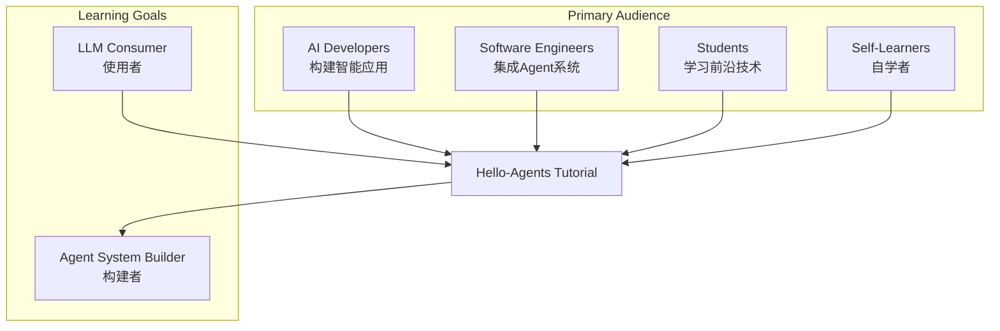

**Target Learner Profiles:**

- **AI Developers:** Building intelligent applications, integrating agent systems into products.
- **Software Engineers:** Adding AI-native agent capabilities to existing systems.
- **Students:** Learning cutting-edge AI agent architectures and paradigms.
- **Self-Learners:** Exploring frontier AI technologies with strong motivation.

**Sources:** [README.md:28](), [docs/README.md:28](), [docs/Preface.md:13-15]()

---

## Access Methods Overview

The Hello-Agents tutorial provides multiple access channels to accommodate different learning preferences and environments. For detailed setup steps, see [Installation and Quick Start](#2.2).

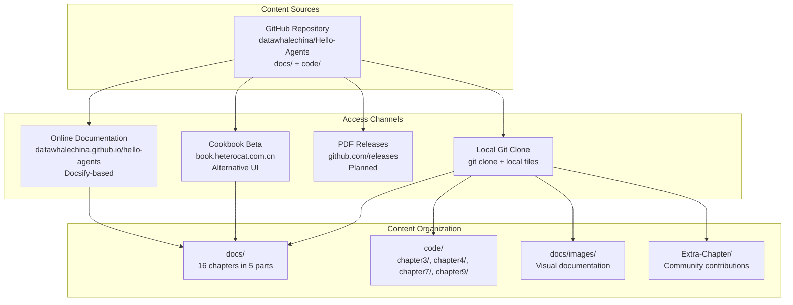

**Sources:** [README.md:32-36](), [docs/README.md:30-33]()

---

## Local Installation and Setup

### Repository Cloning

To access the full tutorial content and code examples locally:

```bash
# Clone the repository
git clone https://github.com/datawhalechina/Hello-Agents.git

# Navigate to the directory
cd Hello-Agents
```

### Local Repository Structure

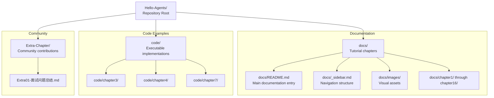

**Sources:** [docs/_sidebar.md:1-29](), [README.md:80-92]()

---

## Running Your First Agent: Travel Assistant

The tutorial includes a complete working agent example in Chapter 1: the **Intelligent Travel Assistant**. This demonstrates the core agent loop pattern.

**File Location:** [code/chapter1/FirstAgentTest.py:1-199](), [code/chapter1/FirstAgentTest.ipynb:1-624]()

### System Architecture

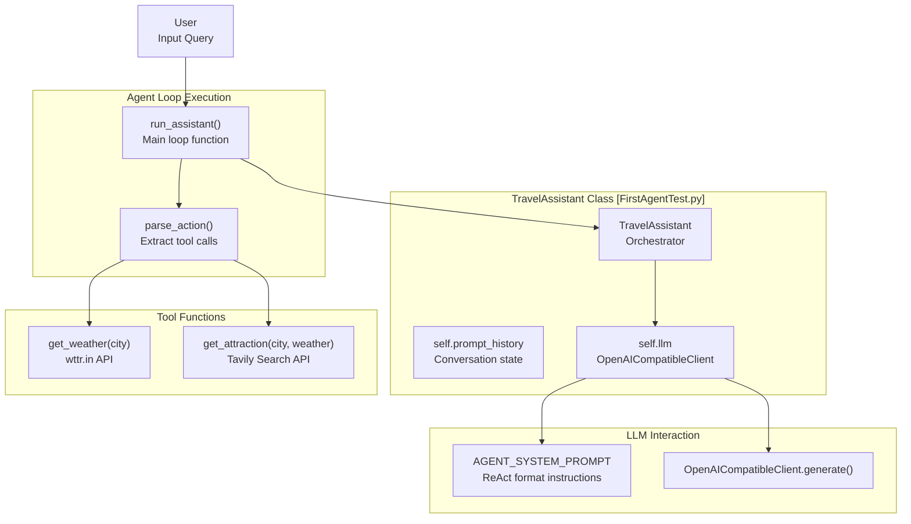

**Sources:** [code/chapter1/FirstAgentTest.py:29-199]()

### Environment Configuration

Before running the example, configure API credentials in your environment or a `.env` file:

| API | Purpose | Configuration Variable |
|-----|---------|------------------------|
| **LLM Provider** | Agent reasoning | `API_KEY`, `BASE_URL`, `MODEL_ID` |
| **Tavily Search** | Web search | `TAVILY_API_KEY` |

**Sources:** [code/chapter1/FirstAgentTest.py:15-28]()

---

## Next Steps

After completing the setup and running your first agent:

1. **Detailed Prerequisites:** See [Prerequisites and Target Audience](#2.1).
2. **Installation Guides:** See [Installation and Quick Start](#2.2) for detailed Python, Docker (n8n), and Node.js setup.
3. **Curriculum Overview:** Review [Learning Path and Curriculum](#3) to understand the five-part progression.

**Sources:** [README.md:51-74](), [docs/README.md:47-70]()

---

# Page: Prerequisites and Target Audience

# Prerequisites and Target Audience

<details>
<summary>Relevant source files</summary>

The following files were used as context for generating this wiki page:

- [README.md](README.md)
- [README_EN.md](README_EN.md)
- [docs/Preface.md](docs/Preface.md)
- [docs/README.md](docs/README.md)
- [docs/README_EN.md](docs/README_EN.md)
- [docs/_sidebar.md](docs/_sidebar.md)
- [docs/_sidebar_en.md](docs/_sidebar_en.md)
- [docs/images/star-history-2026324.png](docs/images/star-history-2026324.png)

</details>


This document specifies the required technical knowledge, hardware resources, and learner profiles for successfully completing the Hello-Agents tutorial. The material focuses on practical application and system construction rather than theoretical research or model training.

---

## 1. Technical Prerequisites

### 1.1 Python Programming Fundamentals

The tutorial requires **basic Python programming ability**. You should be comfortable with:

- Core syntax: variables, control flow (if/else, loops), functions, classes
- Data structures: lists, dictionaries, tuples
- Package management: using `pip`, installing from `requirements.txt`
- Working with external libraries: importing modules, reading documentation
- Basic file I/O and environment variable management

**No advanced Python expertise is required**. You do not need to know decorators, metaclasses, or async programming in depth, though familiarity with these concepts will be helpful.

**Recommended preparation**: If you lack Python fundamentals, the Datawhale community offers a preparatory course at [聪明办法学Python](https://datawhalechina.github.io/learn-python-the-smart-way-v2).

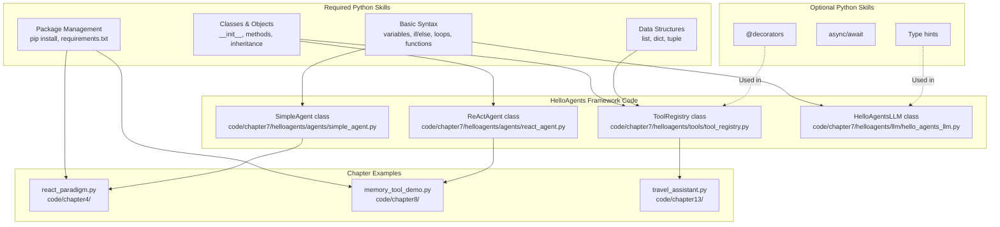

**Sources**: [README.md:96-98](), [docs/README.md:92-94](), [Extra-Chapter/Extra04-DatawhaleFAQ.md:105-116]()

### 1.2 Large Language Model Familiarity

You should have **basic conceptual understanding of LLMs**, specifically:

- What an LLM is and how it generates text
- How to interact with an LLM via API (sending prompts, receiving responses)
- Basic prompt engineering concepts (system messages, user messages, temperature)
- Familiarity with at least one LLM provider (OpenAI, Deepseek, or similar)

**You do NOT need**:
- Deep understanding of Transformer architecture (this is covered in [Large Language Model Architecture](#4.1))
- Knowledge of model training procedures
- Experience with model fine-tuning
- Mathematical background in neural networks

The tutorial teaches LLM fundamentals in Part 1 (Chapters 1-3), but assumes you have already experimented with calling an LLM through a simple API request.

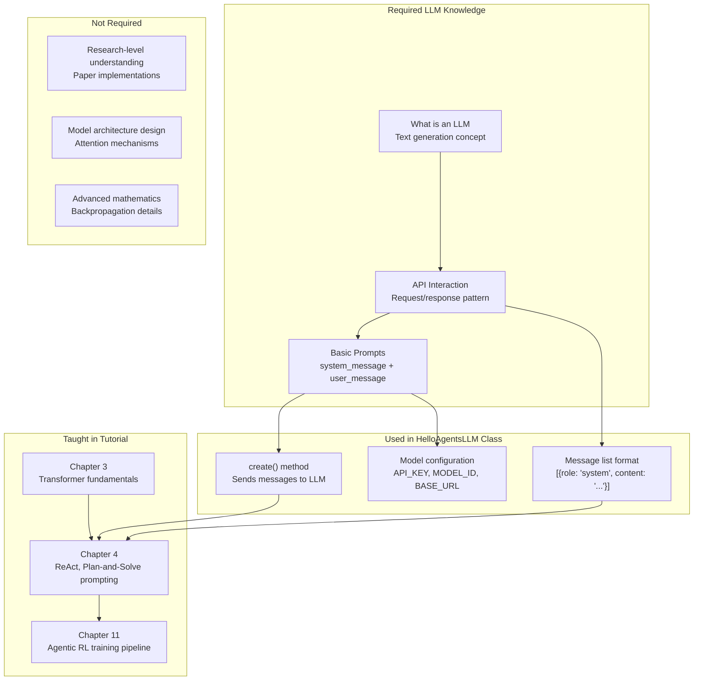

**Sources**: [README.md:96-98](), [docs/README.md:92-94]()

### 1.3 Development Environment Setup

Before beginning the tutorial, you should have:

| Component | Requirement | Notes |
|-----------|-------------|-------|
| **Operating System** | Windows, macOS, or Linux | Any modern OS |
| **Python Version** | Python 3.8 or higher | Verify with `python --version` |
| **Package Manager** | pip or conda | For installing dependencies |
| **Code Editor** | VSCode, PyCharm, or Jupyter | With Python extension/kernel |
| **API Access** | At least one LLM provider | See [API Provider Setup](#1.4) |
| **Internet Connection** | Stable connection | For API calls and package downloads |

**Git is recommended** but not strictly required. The repository can be downloaded as a ZIP file if needed.

**Sources**: [README.md:25-33](), [Extra-Chapter/Extra07-环境配置.md:1-50]()

### 1.4 API Provider Setup

The tutorial supports multiple LLM API providers. You must configure at least one before starting.

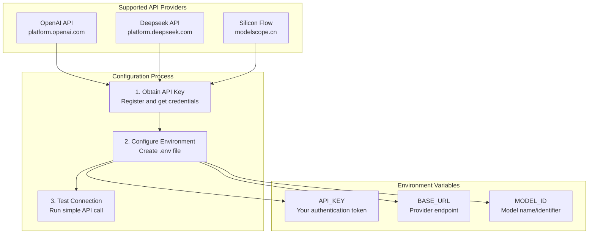

**Configuration steps**:

1. **Choose a provider**:
   - [OpenAI API](https://platform.openai.com/docs/quickstart) - Industry standard, requires credit card.
   - [Deepseek API](https://platform.deepseek.com/usage) - Cost-effective, competitive performance.
   - [Silicon Flow Inference API](https://modelscope.cn/models) - Domestic China alternative.

2. **Obtain API credentials**: Register an account and generate an API key from the provider's dashboard.

3. **Create `.env` file** in project root:
   ```
   API_KEY=your_api_key_here
   MODEL_ID=your_model_id
   BASE_URL=provider_base_url
   ```

4. **Verify setup**: Run a simple test script to ensure API connectivity before starting tutorial exercises.

**Common issues**:
- **401 Error**: API key invalid or account balance insufficient ([Extra-Chapter/Extra04-DatawhaleFAQ.md:243-245]()).
- **403 Error**: Network restrictions or rate limiting.
- **Timeout**: Check internet connection and BASE_URL configuration.

**Sources**: [Extra-Chapter/Extra04-DatawhaleFAQ.md:210-218](), [Extra-Chapter/Extra04-DatawhaleFAQ.md:243-245]()

---

## 2. Hardware Requirements

### 2.1 API-Based Learning Path (Recommended)

**For most learners, using API providers requires minimal hardware**:

| Component | Minimum | Recommended |
|-----------|---------|-------------|
| **CPU** | Any modern processor | Multi-core for Jupyter |
| **RAM** | 4GB | 8GB or more |
| **GPU** | None | None |
| **Storage** | 2GB free space | 10GB for all code + data |
| **Network** | Stable internet | Unlimited data preferred |

**Chapters compatible with API-only approach**: All chapters except Chapter 11 (Agentic RL) can be completed entirely using API calls with no local model deployment.

**Cost considerations**:
- Most API providers offer free tier or trial credits.
- Budget approximately $5-20 USD for completing all tutorial exercises.
- Deepseek is noted as cost-effective option for experimentation.

**Sources**: [Extra-Chapter/Extra04-DatawhaleFAQ.md:140-145](), [README.md:96]()

### 2.2 Local Deployment Path (Optional)

**For learners who want to deploy models locally** or complete Chapter 11 (Agentic RL training):

| Component | Minimum | Recommended |
|-----------|---------|-------------|
| **CPU** | Multi-core processor | 8-core or higher |
| **RAM** | 16GB | 32GB or more |
| **GPU** | 4GB VRAM | 8GB+ VRAM (RTX 3060 or better) |
| **Storage** | 50GB free | 100GB+ for models |
| **Network** | For downloading models | - |

**GPU-intensive chapters**:
- **Chapter 11 (Agentic RL)**: Requires GPU with ≥4GB VRAM for model training experiments ([Extra-Chapter/Extra04-DatawhaleFAQ.md:140-145]()).
- All other chapters: Can use API instead of local deployment.

**Local deployment advantages**:
- No API costs after initial setup.
- Full control over model parameters.
- Offline capability.
- Better for iterative experimentation.

**Sources**: [Extra-Chapter/Extra04-DatawhaleFAQ.md:78-84](), [Extra-Chapter/Extra04-DatawhaleFAQ.md:140-145]()

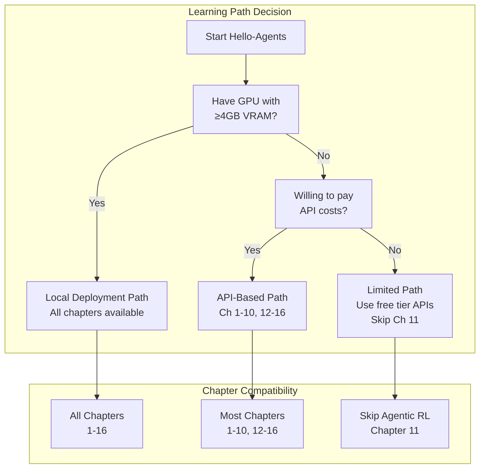

**Sources**: [Extra-Chapter/Extra04-DatawhaleFAQ.md:78-84](), [Extra-Chapter/Extra04-DatawhaleFAQ.md:140-145]()

---

## 3. Target Audience Profiles

The Hello-Agents tutorial is designed for multiple learner profiles, each with different starting points and learning goals.

### 3.1 AI Developers

**Typical background**:
- Professional experience with machine learning or NLP.
- Familiar with Python ML libraries (PyTorch, TensorFlow, scikit-learn).
- Has worked with LLM APIs or prompt engineering.
- Wants to build production-ready agent systems.

**Learning focus**:
- Agent system architecture: `SimpleAgent`, `ReActAgent`, `PlanAndSolveAgent` classes.
- Multi-agent coordination protocols: MCP, A2A, ANP implementations.
- Performance evaluation: BFCL and GAIA benchmarks.
- Tool integration patterns: `ToolRegistry` and `ToolExecutor` architecture.

**Recommended chapters**:
- **Chapters 1-3**: Foundational concepts and LLM architecture.
- **Chapters 4-7**: Agent paradigms (ReAct, Reflection, Plan-and-Solve) and framework construction.
- **Chapters 8-12**: `MemoryTool`, `RAGTool`, `ContextBuilder`, communication protocols, RL training.
- **Chapters 13-15**: Production case studies with multi-agent coordination.

**Sources**: [README.md:96-109](), [docs/README.md:92-105]()

### 3.2 Software Engineers

**Typical background**:
- Strong programming fundamentals in Python or other languages.
- Experience with backend development, APIs, microservices.
- May have limited ML/AI background.
- Wants to integrate AI capabilities into software applications.

**Learning focus**:
- Agent loop architecture: Thought-Action-Observation pattern.
- Tool integration: Creating custom tools via `@tool` decorator.
- External API orchestration: Tavily, SerpAPI, GitHub MCP integration.
- State management: `Message` class and conversation history.
- Configuration: Environment variables via `.env` and `Config` class.

**Recommended chapters**:
- **Chapters 1-3**: AI/LLM fundamentals and conceptual framework.
- **Chapters 4-7**: Agent construction patterns, tool registration, and framework architecture.
- **Chapter 10**: MCP (Model Context Protocol) for standardized tool interfaces.
- **Chapters 13-15**: Travel Assistant (MCP integration), Research Agent (pipeline pattern), Cyber Town (A2A communication).

**Sources**: [README.md:96-109](), [docs/README.md:92-105]()

### 3.3 Students (Undergraduate and Graduate)

**Typical background**:
- Academic coursework in computer science or related field.
- Learning AI/ML concepts in formal education.
- Interested in research projects or capstone work.

**Learning focus**:
- Comprehensive understanding from theory to practice.
- Building portfolio projects for internships or job applications.
- Combining agent systems with coursework or thesis topics.

**Note**: Students can submit capstone projects to [Co-creation-projects]() directory ([Extra-Chapter/Extra04-DatawhaleFAQ.md:148-153]()).

**Sources**: [README.md:96](), [docs/README.md:92](), [Extra-Chapter/Extra04-DatawhaleFAQ.md:148-153]()

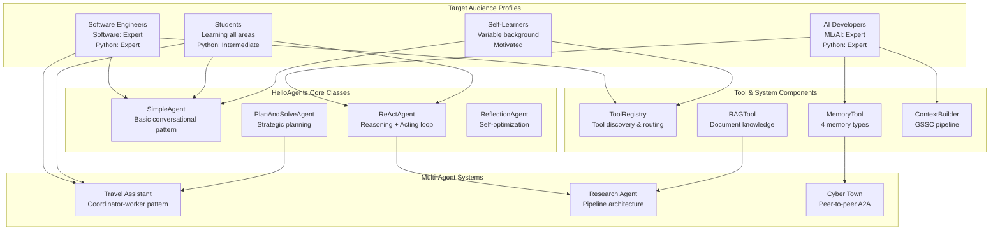

**Sources**: [README.md:96-109](), [docs/README.md:92-105]()

---

## 4. What You Do NOT Need

The tutorial explicitly **does not require**:

| Area | Not Required | Why |
|------|--------------|-----|
| **Deep Learning Theory** | Research-level understanding of neural networks | Tutorial teaches LLM fundamentals in Chapter 3 |
| **Model Training** | Experience training models from scratch | Chapter 11 provides guided RL training |
| **Advanced Mathematics** | Linear algebra, calculus, probability theory | Focus is on system construction, not algorithm development |
| **GPU Infrastructure** | High-end GPU hardware | API-based path works for 15 out of 16 chapters |
| **Research Background** | Published papers | Tutorial is practice-oriented |

**Sources**: [README.md:96](), [docs/README.md:92](), [Preface.md:25]()

---

## 5. Recommended Preparation Steps

### 5.1 Knowledge Preparation

1. **Verify Python skills**: Ensure you understand classes, list/dict operations, and basic file I/O.
2. **Test LLM API access**: Make a basic API call using a provider of your choice.
3. **Understand basic concepts**: Know how to pass functions as arguments and handle exceptions.

**Sources**: [README.md:96-109](), [Extra-Chapter/Extra04-DatawhaleFAQ.md:105-116]()

### 5.2 Environment Preparation

1. **Install Python 3.8+**.
2. **Clone repository**: `git clone https://github.com/datawhalechina/hello-agents.git`.
3. **Set up API access**: Create a `.env` file with your credentials.
4. **Install dependencies**: Run `pip install -r requirements.txt` in the framework directory.

**Sources**: [README.md:30-38](), [Extra-Chapter/Extra04-DatawhaleFAQ.md:210-218]()

### 5.3 Learning Strategy

1. **Budget 2-4 hours per chapter**.
2. **Always run the code**: Execute and modify examples in the `code/` folder.
3. **Join the community**: Engage with the Datawhale community for support.

**Sources**: [README.md:92-113](), [docs/README.md:88-109](), [Extra-Chapter/Extra04-DatawhaleFAQ.md:1-8]()

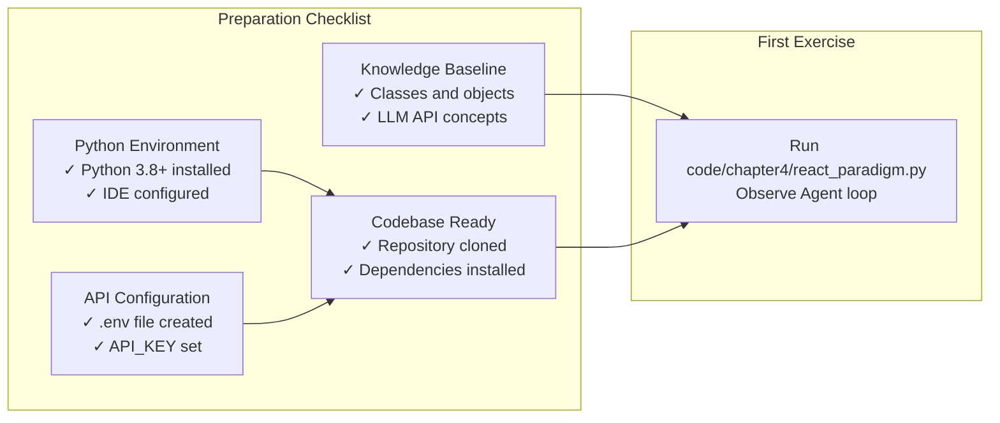

**Sources**: [README.md:92-113](), [docs/README.md:88-109]()

---

# Page: Installation and Quick Start

# Installation and Quick Start

<details>
<summary>Relevant source files</summary>

The following files were used as context for generating this wiki page:

- [Extra-Chapter/images/Extra07-figures/image1.png](Extra-Chapter/images/Extra07-figures/image1.png)
- [Extra-Chapter/images/Extra07-figures/image2.png](Extra-Chapter/images/Extra07-figures/image2.png)
- [Extra-Chapter/images/Extra07-figures/image3.png](Extra-Chapter/images/Extra07-figures/image3.png)
- [Extra-Chapter/images/Extra07-figures/image4.png](Extra-Chapter/images/Extra07-figures/image4.png)
- [Extra-Chapter/images/Extra07-figures/image5.png](Extra-Chapter/images/Extra07-figures/image5.png)
- [Extra-Chapter/images/Extra07-figures/image6.png](Extra-Chapter/images/Extra07-figures/image6.png)
- [Extra-Chapter/images/Extra07-figures/image7.png](Extra-Chapter/images/Extra07-figures/image7.png)
- [Extra-Chapter/images/Extra07-figures/image8.png](Extra-Chapter/images/Extra07-figures/image8.png)
- [README.md](README.md)
- [README_EN.md](README_EN.md)
- [docs/Preface.md](docs/Preface.md)
- [docs/README.md](docs/README.md)
- [docs/README_EN.md](docs/README_EN.md)
- [docs/_sidebar.md](docs/_sidebar.md)
- [docs/_sidebar_en.md](docs/_sidebar_en.md)
- [docs/images/star-history-2026324.png](docs/images/star-history-2026324.png)

</details>


## Purpose and Scope

This page provides step-by-step instructions for installing the Hello-Agents framework, configuring your development environment, and running your first agent. By the end of this guide, you will have a working installation and understand the basic configuration workflow for both code-first (Python) and low-code (Docker-based) environments.

For information about learning prerequisites and target audience, see [Prerequisites and Target Audience](). For detailed framework architecture, see [HelloAgents Framework]().

---

## System Requirements

**Minimum Requirements:**
- **Python Version**: 3.10 or higher [docs/Preface.md:21]()
- **Operating System**: Windows, macOS, or Linux
- **Memory**: 4GB RAM minimum (8GB+ recommended for local models)
- **Internet Connection**: Required for API-based LLM providers

**Optional Requirements:**
- **Docker**: Required for self-hosting low-code platforms like n8n or Dify [README.md:60-90]()
- **Node.js**: Required for specific community tools and frontend components [README.md:30-38]()
- **Git**: For cloning the repository and accessing example code [README.md:37-38]()

Sources: [README.md:30-90](), [docs/Preface.md:19-25]()

---

## Installation Methods

### Installation Flow Overview

The following diagram illustrates the setup process from environment check to running an agent.

**Installation Logic Flow**
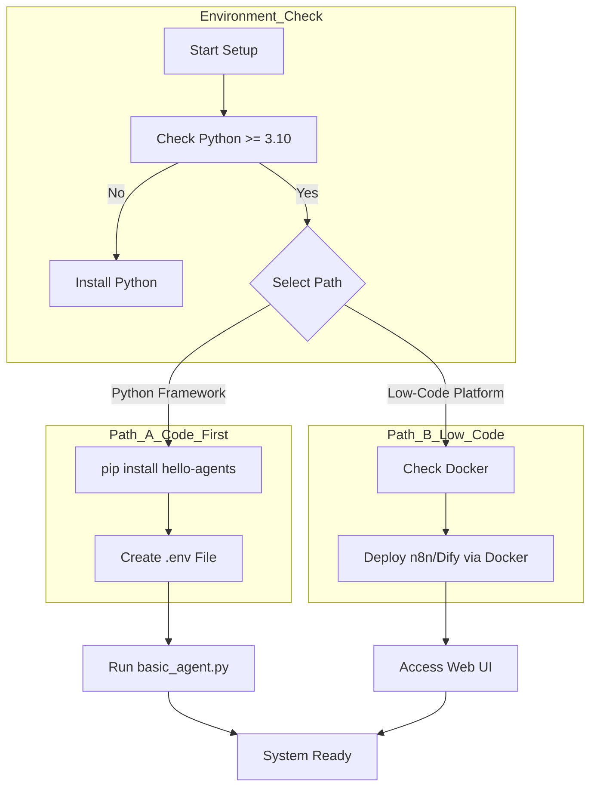

Sources: [README.md:30-62](), [docs/Preface.md:19-45]()

### Method 1: Python Framework Installation (Code-First)

For users building "AI Native" agents using the custom framework:

```bash
# Option A: Quick Install
pip install "hello-agents==0.1.1"

# Option B: Development Install (Clone Source)
git clone https://github.com/datawhalechina/hello-agents.git
cd hello-agents
pip install -e .
```

**Key Framework Components:**
- `HelloAgentsLLM`: Unified client for OpenAI, ModelScope, Ollama, etc. [README.md:43]()
- `SimpleAgent`: Base conversational agent. [README_EN.md:43]()
- `ReActAgent`: Reasoning-action loop implementation. [README.md:59]()

Sources: [README.md:30-62](), [README_EN.md:40-45]()

### Method 2: Low-Code Platform Setup (Docker-based)

Hello-Agents covers "Software Engineering Agents" like n8n and Dify, which typically require Docker for local deployment.

**n8n Installation (via Docker):**
```bash
docker run -it --rm --name n8n -p 5678:5678 -v ~/.n8n:/home/node/.n8n n8nio/n8n
```

**Dify Installation:**
Refer to the "Dify creation guide" in the community chapters for step-by-step UI configuration. [README.md:86-90]()

Sources: [README.md:60-90](), [docs/README.md:82-86]()

---

## Environment Configuration

### API Key Configuration

The framework uses a `.env` file to manage credentials. The `HelloAgentsLLM` class automatically detects the provider based on the environment variables provided. [README.md:43]()

**Config Mapping to Code Entities**
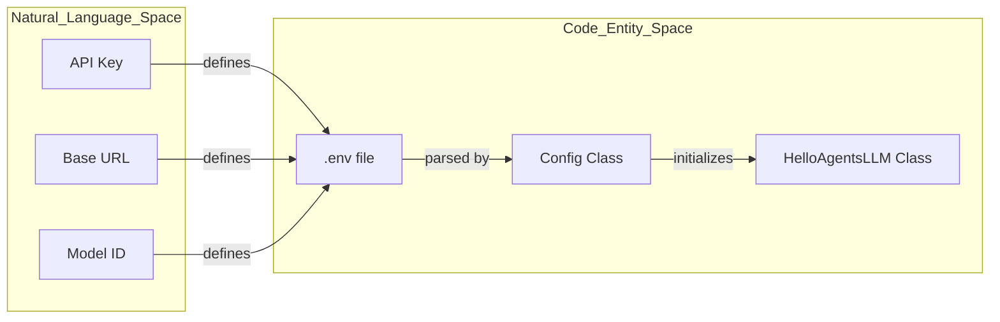

**Example `.env` Content:**
```bash
# OpenAI
OPENAI_API_KEY=sk-xxx
LLM_MODEL_ID=gpt-4o

# ModelScope (Domestic Alternative)
MODELSCOPE_API_KEY=ms-xxx
LLM_BASE_URL=https://api-inference.modelscope.cn/v1/
LLM_MODEL_ID=Qwen/Qwen2.5-72B-Instruct
```

Sources: [README.md:43-45](), [docs/chapter7/第七章%20构建你的Agent框架.md:1-50]() (referenced by chapter title in navigation)

---

## Quick Start: Running Your First Agent

### 1. Basic Conversational Agent
This example uses the `SimpleAgent` class to initiate a basic LLM interaction.

```python
from hello_agents import SimpleAgent, HelloAgentsLLM
from dotenv import load_dotenv

load_dotenv()

# Initialize LLM with auto-detection
llm = HelloAgentsLLM()

# Create Agent
agent = SimpleAgent(
    name="Assistant",
    llm=llm,
    system_prompt="You are a helpful assistant."
)

# Run
print(agent.run("What is an AI Agent?"))
```

### 2. Reasoning Agent (ReAct)
To run an agent that can use tools, use the `ReActAgent` which implements the "Thought-Action-Observation" loop. [README.md:59]()

**Agent Interaction Flow**
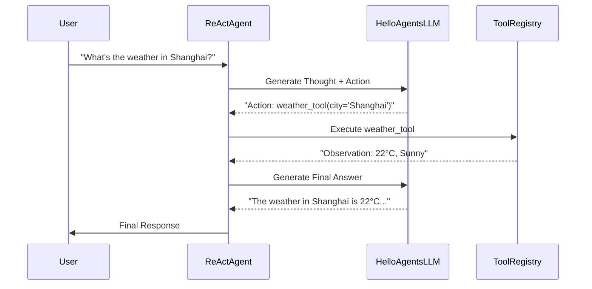

Sources: [README.md:55-62](), [README_EN.md:55-62]()

---

## Verification and Troubleshooting

### Common Setup Issues

| Component | Issue | Resolution |
| :--- | :--- | :--- |
| **Python** | `ModuleNotFoundError` | Ensure you ran `pip install` in the correct virtual environment. |
| **LLM API** | `AuthenticationError` | Check if `LLM_API_KEY` in `.env` matches your provider. |
| **n8n/Docker** | Port 5678 occupied | Change the host port in docker run: `-p 8080:5678`. |
| **Local Models** | High Latency | Ensure Ollama/VLLM is running and `LLM_BASE_URL` points to `localhost`. |

### Installation Checklist
1. [ ] Python >= 3.10 installed [docs/Preface.md:21]()
2. [ ] API Key obtained from provider (OpenAI, DeepSeek, or ModelScope) [docs/Preface.md:23]()
3. [ ] `.env` file created in project root [README.md:90]()
4. [ ] `pip install hello-agents` completed [README.md:30-38]()

Sources: [README.md:30-90](), [docs/Preface.md:15-25]()

---

# Page: Learning Path and Curriculum

# Learning Path and Curriculum

<details>
<summary>Relevant source files</summary>

The following files were used as context for generating this wiki page:

- [README.md](README.md)
- [README_EN.md](README_EN.md)
- [code/chapter1/FirstAgentTest.ipynb](code/chapter1/FirstAgentTest.ipynb)
- [code/chapter1/FirstAgentTest.py](code/chapter1/FirstAgentTest.py)
- [code/chapter4/ReAct.py](code/chapter4/ReAct.py)
- [docs/Preface.md](docs/Preface.md)
- [docs/README.md](docs/README.md)
- [docs/README_EN.md](docs/README_EN.md)
- [docs/_sidebar.md](docs/_sidebar.md)
- [docs/_sidebar_en.md](docs/_sidebar_en.md)
- [docs/chapter1/Chapter1-Introduction-to-Agents.md](docs/chapter1/Chapter1-Introduction-to-Agents.md)
- [docs/chapter16/Chapter16-Graduation-Project.md](docs/chapter16/Chapter16-Graduation-Project.md)
- [docs/chapter4/Chapter4-Building-Classic-Agent-Paradigms.md](docs/chapter4/Chapter4-Building-Classic-Agent-Paradigms.md)
- [docs/images/2-figures/1757246501849-00.png](docs/images/2-figures/1757246501849-00.png)
- [docs/images/star-history-2026324.png](docs/images/star-history-2026324.png)

</details>


The Hello-Agents curriculum comprises 16 chapters organized into 5 sequential parts, designed to transform learners from large language model "users" into agent system "builders" [README.md:28-29](). The structure follows a deliberate progression from foundational concepts to multi-agent system construction, with Chapter 7's framework implementation serving as a critical inflection point for advanced topics.

## Curriculum Structure Overview

The curriculum is divided into five logical parts that balance theory with hands-on implementation.

**Five-Part Curriculum Progression**

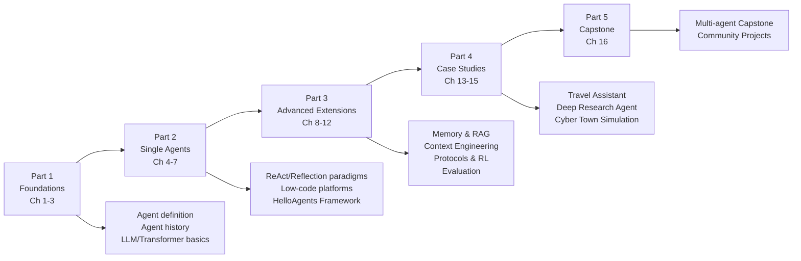

| Part | Focus | Key Learning Objective |
| :--- | :--- | :--- |
| **Part 1** | Foundations | Understand agent definitions, history, and Transformer architecture [README.md:54-57](). |
| **Part 2** | Building Single Agents | Implement classic paradigms (ReAct, Reflection) and build a custom framework [README.md:58-62](). |
| **Part 3** | Advanced Capabilities | Master memory systems, context engineering, and communication protocols [README.md:63-68](). |
| **Part 4** | Case Studies | Apply multi-agent collaboration to real-world scenarios [README.md:69-72](). |
| **Part 5** | Capstone | Design and build a complete autonomous multi-agent application [README.md:73-74](). |

**Sources:** [README.md:51-74](), [docs/README.md:47-70](), [Preface.md:27-37]()

## Chapter Dependencies and Code Mapping

The curriculum enforces a learning path where foundational chapters provide the "mental model" for code implementations. Chapters 4 and 7 are the primary coding milestones for single agents.

**Natural Language Space to Code Entity Space Mapping**

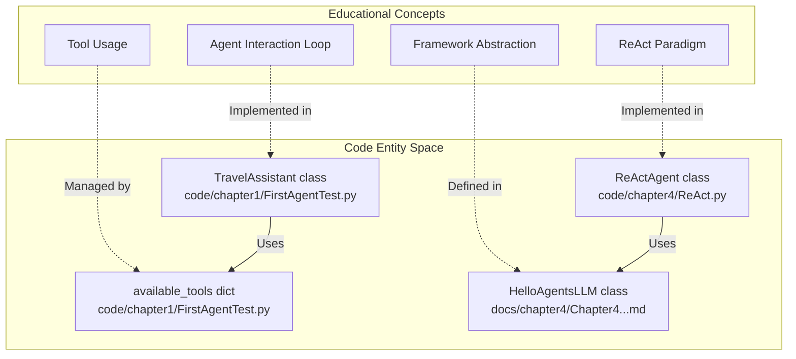

**Sources:** [code/chapter1/FirstAgentTest.py:202-206](), [code/chapter4/ReAct.py:26-31](), [docs/chapter4/Chapter4-Building-Classic-Agent-Paradigms.md:59-64]()

## 3.1 Part 1: Foundations (Chapters 1-3)
This section introduces the PEAS (Perception, Environment, Actuators, Sensors) model and the evolution of agents from simple reflex systems to goal-based and learning agents [docs/chapter1/Chapter1-Introduction-to-Agents.md:14-20](). It covers the technical underpinnings of LLMs, including the Transformer architecture and prompt engineering [README.md:57]().

For details, see [Part 1: Foundations (Chapters 1-3)](#3.1).

**Sources:** [docs/chapter1/Chapter1-Introduction-to-Agents.md:12-47](), [README.md:54-57]()

## 3.2 Part 2: Building Single Agents (Chapters 4-7)
Part 2 transitions to hands-on construction. Learners implement the **ReAct** (Reasoning and Acting) paradigm, which combines thought traces with action execution [code/chapter4/ReAct.py:6-24](). This part culminates in building the custom `HelloAgents` framework, abstracting LLM interactions via the `HelloAgentsLLM` client [docs/chapter4/Chapter4-Building-Classic-Agent-Paradigms.md:59-76]().

For details, see [Part 2: Building Single Agents (Chapters 4-7)](#3.2).

**Sources:** [code/chapter4/ReAct.py:26-73](), [docs/chapter4/Chapter4-Building-Classic-Agent-Paradigms.md:7-13](), [README.md:58-62]()

## 3.3 Part 3: Advanced Capabilities (Chapters 8-12)
This part extends agents with "systemic" technologies. Key topics include memory systems (RAG), context engineering (maintaining "situational understanding"), and communication protocols like MCP and A2A [README.md:63-68](). It also introduces Agentic RL, moving from SFT to GRPO for training LLMs specifically for agent tasks [README.md:67]().

For details, see [Part 3: Advanced Capabilities (Chapters 8-12)](#3.3).

**Sources:** [README.md:63-68](), [docs/README.md:59-64]()

## 3.4 Part 4: Real-World Case Studies (Chapters 13-15)
Learners explore comprehensive applications:
*   **Intelligent Travel Assistant**: Demonstrates MCP and multi-agent collaboration [README.md:70]().
*   **Automated Deep Research Agent**: Explores autonomous information synthesis [README.md:71]().
*   **Cyber Town**: Simulates social dynamics using agents in a game-like environment [README.md:72]().

For details, see [Part 4: Real-World Case Studies (Chapters 13-15)](#3.4).

**Sources:** [README.md:69-72](), [docs/README.md:65-68]()

## 3.5 Part 5: Capstone Project (Chapter 16)
The final stage involves building a complete multi-agent application. Learners are encouraged to contribute to the `Co-creation-projects` directory, showcasing unique implementations like the `DeepCastAgent` (research-to-podcast pipeline) or `MindEchoAgent` (emotion-driven music recommendation) [README.md:74, 82]().

For details, see [Part 5: Capstone Project (Chapter 16)](#3.5).

**Sources:** [README.md:73-74](), [docs/README.md:69-70](), [README_EN.md:82]()

## Summary of Code Implementation Progression

The following diagram bridges the conceptual curriculum to the specific code entities developed during the course.

**Framework Evolution Diagram**

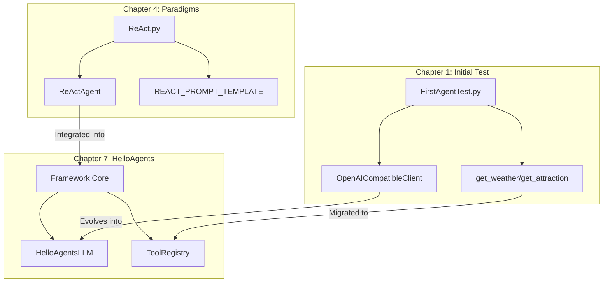

**Sources:** [code/chapter1/FirstAgentTest.py:174-182](), [code/chapter4/ReAct.py:6-24](), [docs/chapter4/Chapter4-Building-Classic-Agent-Paradigms.md:59-64]()

---

# Page: Part 1: Foundations (Chapters 1-3)

# Part 1: Foundations (Chapters 1-3)

<details>
<summary>Relevant source files</summary>

The following files were used as context for generating this wiki page:

- [code/chapter1/FirstAgentTest.ipynb](code/chapter1/FirstAgentTest.ipynb)
- [code/chapter1/FirstAgentTest.py](code/chapter1/FirstAgentTest.py)
- [code/chapter2/ELIZA.py](code/chapter2/ELIZA.py)
- [code/chapter3/BPE.py](code/chapter3/BPE.py)
- [code/chapter3/N_gram.py](code/chapter3/N_gram.py)
- [code/chapter3/Qwen.py](code/chapter3/Qwen.py)
- [code/chapter3/Transformer.py](code/chapter3/Transformer.py)
- [code/chapter3/Word_Embedding.py](code/chapter3/Word_Embedding.py)
- [code/chapter4/Plan_and_solve.py](code/chapter4/Plan_and_solve.py)
- [code/chapter4/ReAct.py](code/chapter4/ReAct.py)
- [code/chapter4/tools.py](code/chapter4/tools.py)
- [code/chapter6/AutoGenDemo/autogen_software_team.py](code/chapter6/AutoGenDemo/autogen_software_team.py)
- [docs/chapter1/Chapter1-Introduction-to-Agents.md](docs/chapter1/Chapter1-Introduction-to-Agents.md)
- [docs/chapter16/Chapter16-Graduation-Project.md](docs/chapter16/Chapter16-Graduation-Project.md)
- [docs/chapter3/Chapter3-Fundamentals-of-Large-Language-Models.md](docs/chapter3/Chapter3-Fundamentals-of-Large-Language-Models.md)
- [docs/chapter4/Chapter4-Building-Classic-Agent-Paradigms.md](docs/chapter4/Chapter4-Building-Classic-Agent-Paradigms.md)
- [docs/images/2-figures/1757246501849-00.png](docs/images/2-figures/1757246501849-00.png)

</details>


## Purpose and Scope

Part 1 provides the theoretical and technical foundations required for understanding and building AI agent systems. This section covers three foundational chapters:

- **Chapter 1**: Agent concepts, definitions, types, and the transition from traditional to LLM-based systems.
- **Chapter 2**: Historical evolution from symbolic AI to modern LLM-driven agents.
- **Chapter 3**: Large language model (LLM) fundamentals, including the evolution of language modeling, the Transformer architecture, and practical model interaction.

This material establishes the conceptual vocabulary and technical knowledge necessary before proceeding to practical agent implementation in Part 2.

**Sources:** [docs/chapter1/Chapter1-Introduction-to-Agents.md:1-21](), [docs/chapter3/Chapter3-Fundamentals-of-Large-Language-Models.md:1-5]()

## Learning Progression Through Part 1

The three chapters follow a deliberate pedagogical sequence that builds from abstract definitions to concrete technical implementations of the "brain" behind the agent.

```mermaid
graph TB
    subgraph Chapter1["Chapter 1: Agent Introduction"]
        C1_Def["Agent Definition<br/>Environment, Sensors, Actuators"]
        C1_Types["Traditional Types<br/>Simple Reflex, Model-Based, Goal-Based"]
        C1_Learning["Learning Agents<br/>Reinforcement Learning, Performance Element"]
        
        C1_Def --> C1_Types
        C1_Types --> C1_Learning
    end
    
    subgraph Chapter2["Chapter 2: Agent History"]
        C2_Symbolic["Symbolic AI Era<br/>Expert Systems, Logic-based"]
        C2_Reactive["Reactive Architecture<br/>Subsumption, Behavior-based"]
        C2_LLM["LLM-Driven Era<br/>Language as Reasoning Core"]
        
        C2_Symbolic --> C2_Reactive
        C2_Reactive --> C2_LLM
    end
    
    subgraph Chapter3["Chapter 3: LLM Fundamentals"]
        C3_LM["LM Evolution<br/>N-gram → RNN → Transformer"]
        C3_Arch["Transformer Internals<br/>Self-Attention, Multi-Head"]
        C3_Token["Tokenization<br/>BPE, WordPiece"]
        C3_Interact["Practical Interaction<br/>API Calls, Sampling, Prompting"]
        
        C3_LM --> C3_Arch
        C3_Arch --> C3_Token
        C3_Token --> C3_Interact
    end
    
    Chapter1 -.->|"Conceptual Gap"| Chapter2
    Chapter2 -.->|"Technical Brain"| Chapter3
    Chapter3 -.->|"Ready to Build"| Part2["Part 2: Building Agents"]
```

**Sources:** [docs/chapter1/Chapter1-Introduction-to-Agents.md:12-46](), [docs/chapter3/Chapter3-Fundamentals-of-Large-Language-Models.md:7-9]()

## Chapter 1: Agent Concepts and Definitions

Chapter 1 defines an **agent** as an entity that perceives its **Environment** through **Sensors** and autonomously takes **Actions** through **Actuators** to achieve goals [docs/chapter1/Chapter1-Introduction-to-Agents.md:14-18]().

### Traditional Agent Taxonomy
Before LLMs, agents evolved through several stages of complexity:
*   **Simple Reflex Agents**: Use condition-action rules (e.g., a thermostat) [docs/chapter1/Chapter1-Introduction-to-Agents.md:26-28]().
*   **Model-Based Reflex Agents**: Maintain an internal **World Model** to track unperceived environmental states [docs/chapter1/Chapter1-Introduction-to-Agents.md:35-36]().
*   **Goal-Based Agents**: Use search and planning to achieve specific future states [docs/chapter1/Chapter1-Introduction-to-Agents.md:37-38]().
*   **Utility-Based Agents**: Assign "satisfaction" values to states to balance conflicting goals [docs/chapter1/Chapter1-Introduction-to-Agents.md:39-40]().
*   **Learning Agents**: Use **Reinforcement Learning (RL)** to improve decision-making strategies through environment interaction [docs/chapter1/Chapter1-Introduction-to-Agents.md:41-45]().

### The Modern Agent Loop
In the modern context, the LLM acts as the reasoning core. The first hands-on example provided is a **TravelAssistant** that follows a Thought-Action-Observation loop [code/chapter1/FirstAgentTest.py:1-24]().

```mermaid
graph LR
    User["User Input"] --> Agent["TravelAssistant"]
    Agent --> Thought["Thought: Reasoning"]
    Thought --> Action["Action: Tool Call"]
    Action --> Tool["get_weather / get_attraction"]
    Tool --> Obs["Observation: Result"]
    Obs --> Agent
    Agent --> Finish["Action: Finish[Answer]"]
```
**Sources:** [docs/chapter1/Chapter1-Introduction-to-Agents.md:14-47](), [code/chapter1/FirstAgentTest.py:157-208]()

## Chapter 3: Large Language Model Fundamentals

This chapter details how the LLM functions as the agent's "brain," moving from statistical probabilities to the Transformer architecture.

### 3.1 Language Model Evolution
*   **N-gram Models**: Predict the next word based on the previous $n-1$ words using **Maximum Likelihood Estimation (MLE)** [docs/chapter3/Chapter3-Fundamentals-of-Large-Language-Models.md:24-36]().
*   **Bigram Example**: $P(w_i | w_{i-1}) = \frac{Count(w_{i-1}, w_i)}{Count(w_{i-1})}$ [docs/chapter3/Chapter3-Fundamentals-of-Large-Language-Models.md:36-43]().
*   **Neural Models**: Transitioned from RNNs (sequential processing) to Transformers (parallel processing via Attention) [docs/chapter3/Chapter3-Fundamentals-of-Large-Language-Models.md:7-9]().

### 3.2 Transformer Architecture
The core of modern agents is the Transformer, specifically the **Decoder-Only** architecture used in GPT-style models [docs/chapter3/Chapter3-Fundamentals-of-Large-Language-Models.md:189-200]().

#### Key Components:
1.  **Self-Attention**: Allows tokens to attend to all other positions in a sequence.
2.  **Multi-Head Attention**: Executes multiple attention mechanisms in parallel to capture different semantic relationships [docs/chapter3/Chapter3-Fundamentals-of-Large-Language-Models.md:286-310]().
3.  **Positional Encoding**: Adds sequence order information since Transformers process tokens in parallel [docs/chapter3/Chapter3-Fundamentals-of-Large-Language-Models.md:201-210]().

### 3.3 Tokenization
Text is converted into numerical IDs using subword algorithms like **Byte-Pair Encoding (BPE)**. This handles the Out-of-Vocabulary (OOV) problem by breaking unknown words into known sub-fragments [docs/chapter3/Chapter3-Fundamentals-of-Large-Language-Models.md:659-680]().

**Sources:** [docs/chapter3/Chapter3-Fundamentals-of-Large-Language-Models.md:13-62](), [docs/chapter3/Chapter3-Fundamentals-of-Large-Language-Models.md:189-310](), [docs/chapter3/Chapter3-Fundamentals-of-Large-Language-Models.md:659-758]()

## Bridging Language to Code

To implement an agent, the "Natural Language Space" (instructions) must be mapped to "Code Entity Space" (API calls and logic).

### System Mapping: Agent Logic to Code
The following diagram illustrates how the abstract concept of a ReAct agent is realized in the `FirstAgentTest.py` script.

```mermaid
graph TD
    subgraph NL_Space["Natural Language Space (Prompt)"]
        SysPrompt["AGENT_SYSTEM_PROMPT"]
        Format["'Thought: [plan] Action: [tool]'"]
    end

    subgraph Code_Space["Code Entity Space (Implementation)"]
        Client["OpenAICompatibleClient"]
        Loop["Main for-loop (max_steps=5)"]
        Regex["re.search(r'Action: (.*)')"]
        Registry["available_tools {dict}"]
    end

    SysPrompt -->|"Configures"| Client
    Format -->|"Parsed by"| Regex
    Regex -->|"Triggers"| Registry
    Registry -->|"Invokes"| ToolFunc["get_weather() / get_attraction()"]
    Loop -->|"Manages"| Client
```
**Sources:** [code/chapter1/FirstAgentTest.py:1-24](), [code/chapter1/FirstAgentTest.py:113-140](), [code/chapter1/FirstAgentTest.py:163-208]()

### Model Interaction Mapping
How the foundational `Transformer` concepts translate into using the `transformers` library for local deployment.

```mermaid
graph TD
    subgraph Transformer_Concepts["Transformer Concepts"]
        Weights["Pre-trained Parameters"]
        Vocab["Vocabulary / Token IDs"]
        Softmax["Next Token Probability"]
    end

    subgraph Library_Entities["Transformers Library (Python)"]
        AutoModel["AutoModelForCausalLM"]
        AutoTok["AutoTokenizer"]
        Generate["model.generate()"]
    end

    Weights -->|"Loaded by"| AutoModel
    Vocab -->|"Managed by"| AutoTok
    Softmax -->|"Executed via"| Generate
    
    AutoTok -->|"encode()"| InputID["Token IDs"]
    InputID --> Generate
    Generate -->|"decode()"| FinalText["Natural Language"]
```
**Sources:** [code/chapter3/Qwen.py:9-19](), [code/chapter3/Qwen.py:30-56](), [docs/chapter3/Chapter3-Fundamentals-of-Large-Language-Models.md:759-774]()

## Summary Table: Foundations to Implementation

| Concept | Foundation Detail | Code Implementation |
| :--- | :--- | :--- |
| **Agent Loop** | Perception -> Action | `for i in range(5)` loop in `FirstAgentTest.py` [code/chapter1/FirstAgentTest.py:163]() |
| **Tool Use** | Actuators / External APIs | `available_tools` dictionary and `requests.get` [code/chapter1/FirstAgentTest.py:106-110]() |
| **LLM Client** | Transformer-based inference | `OpenAICompatibleClient` class [code/chapter1/FirstAgentTest.py:113-140]() |
| **Prompting** | Instruction tuning / Templates | `AGENT_SYSTEM_PROMPT` with format requirements [code/chapter1/FirstAgentTest.py:1-24]() |
| **Observation** | Feedback from environment | `Observation: {observation}` string appended to history [code/chapter1/FirstAgentTest.py:206-208]() |

**Sources:** [code/chapter1/FirstAgentTest.py:1-208](), [docs/chapter4/Chapter4-Building-Classic-Agent-Paradigms.md:59-103]()

---

# Page: Part 2: Building Single Agents (Chapters 4-7)

# Part 2: Building Single Agents (Chapters 4-7)

<details>
<summary>Relevant source files</summary>

The following files were used as context for generating this wiki page:

- [code/chapter13/helloagents-trip-planner/backend/requirements.txt](code/chapter13/helloagents-trip-planner/backend/requirements.txt)
- [code/chapter7/my_main.py](code/chapter7/my_main.py)
- [code/chapter7/my_react_agent.py](code/chapter7/my_react_agent.py)
- [code/chapter7/test_react_agent.py](code/chapter7/test_react_agent.py)
- [docs/chapter5/Chapter5-Building-Agents-with-Low-Code-Platforms.md](docs/chapter5/Chapter5-Building-Agents-with-Low-Code-Platforms.md)
- [docs/chapter6/Chapter6-Framework-Development-Practice.md](docs/chapter6/Chapter6-Framework-Development-Practice.md)
- [docs/chapter7/Chapter7-Building-Your-Agent-Framework.md](docs/chapter7/Chapter7-Building-Your-Agent-Framework.md)
- [docs/images/13-figures/13-1.png](docs/images/13-figures/13-1.png)
- [docs/index.html](docs/index.html)

</details>


## Purpose and Scope

Part 2 (Chapters 4-7) constitutes the **construction phase** of the Hello-Agents tutorial, where learners transition from theoretical foundations to hands-on agent building. This section covers four progressive learning modules:

1.  **Chapter 4**: Implementing classic agent paradigms (ReAct, Plan-and-Solve, Reflection) from scratch.
2.  **Chapter 5**: Building agents using low-code platforms (Coze, Dify, n8n) [docs/chapter5/Chapter5-Building-Agents-with-Low-Code-Platforms.md:24-46]().
3.  **Chapter 6**: Practicing with mainstream agent frameworks (AutoGen, AgentScope, LangGraph, CAMEL) [docs/chapter6/Chapter6-Framework-Development-Practice.md:31-42]().
4.  **Chapter 7**: Constructing the **HelloAgents** framework from zero [docs/chapter7/Chapter7-Building-Your-Agent-Framework.md:3-7]().

This part emphasizes the philosophy of "learning by building" — progressing from implementing fundamental patterns with minimal abstractions to using sophisticated platforms, and finally to architecting a custom framework. By the end of Part 2, readers will possess both the ability to "use wheels" (leverage existing tools) and "build wheels" (create custom frameworks) [docs/chapter7/Chapter7-Building-Your-Agent-Framework.md:22-29]().

**Sources**: [docs/chapter7/Chapter7-Building-Your-Agent-Framework.md:1-46](), [docs/chapter5/Chapter5-Building-Agents-with-Low-Code-Platforms.md:1-22](), [docs/chapter6/Chapter6-Framework-Development-Practice.md:1-12]()

---

## Learning Progression Architecture

```mermaid
graph TB
    subgraph "Chapter 4: Classic Paradigms"
        C4_Theory["Paradigm Theory<br/>ReAct, Plan-Solve, Reflection"]
        C4_LLM["HelloAgentsLLM Client<br/>llm.py basic implementation"]
        C4_Tools["Tool System<br/>ToolExecutor class"]
        C4_ReAct["ReAct Implementation<br/>Thought-Action-Observation loop"]
        C4_PlanSolve["Plan-and-Solve Implementation<br/>Planner + Executor separation"]
        C4_Reflection["Reflection Implementation<br/>Memory + trajectory refinement"]
    end
    
    subgraph "Chapter 5: Low-Code Platforms"
        C5_Coze["Coze Platform<br/>Plugin-based, zero-code"]
        C5_Dify["Dify Platform<br/>Workflow + RAG + MCP"]
        C5_n8n["n8n Platform<br/>Automation nodes"]
    end
    
    subgraph "Chapter 6: Framework Practice"
        C6_AutoGen["AutoGen<br/>Conversation-driven"]
        C6_AgentScope["AgentScope<br/>Production-grade"]
        C6_LangGraph["LangGraph<br/>State machine"]
        C6_CAMEL["CAMEL<br/>Role-playing"]
    end
    
    subgraph "Chapter 7: HelloAgents Framework"
        C7_LLM["HelloAgentsLLM Extension<br/>Multi-provider + auto-detect"]
        C7_Core["Core Layer<br/>Agent, Message, Config"]
        C7_Tools["Tool System<br/>ToolRegistry + ToolChain"]
        C7_Agents["Agent Implementations<br/>SimpleAgent, ReActAgent, etc."]
    end
    
    C4_Theory --> C4_LLM
    C4_LLM --> C4_Tools
    C4_Theory --> C4_ReAct
    C4_Theory --> C4_PlanSolve
    C4_Theory --> C4_Reflection
    C4_Tools --> C4_ReAct
    
    C4_ReAct --> C5_Coze
    C4_ReAct --> C5_Dify
    
    C4_ReAct --> C6_AutoGen
    C4_PlanSolve --> C6_AgentScope
    C4_ReAct --> C6_LangGraph
    
    C4_LLM --> C7_LLM
    C4_Tools --> C7_Tools
    C4_ReAct --> C7_Agents
    
    C7_LLM --> C7_Core
    C7_Core --> C7_Tools
    C7_Tools --> C7_Agents
```

**Diagram**: Learning progression through Part 2 showing how foundational implementations in Chapter 4 inform platform usage (Ch 5), framework practice (Ch 6), and custom framework architecture (Ch 7).

**Sources**: [docs/chapter7/Chapter7-Building-Your-Agent-Framework.md:52-55](), [docs/chapter6/Chapter6-Framework-Development-Practice.md:3-7](), [docs/chapter5/Chapter5-Building-Agents-with-Low-Code-Platforms.md:3-7]()

---

## Chapter 4: Classic Agent Paradigms

### Overview
Chapter 4 implements foundational agent paradigms from first principles. This establishes the conceptual and practical foundation for all subsequent work.

**Key Learning Objectives**:
*   Implement ReAct's dynamic think-act-observe loop.
*   Build Plan-and-Solve's two-stage planner-executor architecture.
*   Create Reflection's self-improvement mechanism.

**Sources**: [docs/chapter6/Chapter6-Framework-Development-Practice.md:3-7]()

---

## Chapter 5: Low-Code Platform Development

### Platform Selection
Chapter 5 focuses on using graphical, modular platforms to build, debug, and deploy agent applications [docs/chapter5/Chapter5-Building-Agents-with-Low-Code-Platforms.md:5-7]().

*   **Coze**: Zero-code/low-code building by ByteDance. Focuses on visual interfaces, plugins, and multi-channel publishing (WeChat, Feishu) [docs/chapter5/Chapter5-Building-Agents-with-Low-Code-Platforms.md:27-31]().
*   **Dify**: Open-source LLMOps platform. Supports RAG pipelines, workflow orchestration, and Model Context Protocol (MCP) [docs/chapter5/Chapter5-Building-Agents-with-Low-Code-Platforms.md:33-37]().
*   **n8n**: Workflow automation tool with integrated AI capabilities. Excels at connecting hundreds of SaaS services and APIs [docs/chapter5/Chapter5-Building-Agents-with-Low-Code-Platforms.md:39-44]().

**Sources**: [docs/chapter5/Chapter5-Building-Agents-with-Low-Code-Platforms.md:22-46]()

---

## Chapter 6: Mainstream Framework Practice

### Framework Comparison
This chapter explores industry-standard frameworks to provide "specifications" for repetitive tasks like state management and tool invocation [docs/chapter6/Chapter6-Framework-Development-Practice.md:10-12]().

| Framework | Core Philosophy | Key Abstraction |
| :--- | :--- | :--- |
| **AutoGen** | Collaboration through conversation | GroupChat, Coder/Tester roles [docs/chapter6/Chapter6-Framework-Development-Practice.md:39-39]() |
| **AgentScope** | Engineering and ease of use | Message passing, distributed deployment [docs/chapter6/Chapter6-Framework-Development-Practice.md:40-40]() |
| **CAMEL** | Role-Playing autonomy | Inception Prompting [docs/chapter6/Chapter6-Framework-Development-Practice.md:41-41]() |
| **LangGraph** | Execution as a Graph | Nodes and Edges (supports Cycles) [docs/chapter6/Chapter6-Framework-Development-Practice.md:42-42]() |

**Sources**: [docs/chapter6/Chapter6-Framework-Development-Practice.md:33-42]()

---

## Chapter 7: Building HelloAgents Framework

### Framework Architecture
HelloAgents is designed to balance functional completeness with learning friendliness [docs/chapter7/Chapter7-Building-Your-Agent-Framework.md:42-43]().

*   **Core Components**:
    *   `HelloAgentsLLM`: Abstraction for LLM providers (OpenAI, ModelScope, Ollama) [code/chapter7/my_main.py:3-9]().
    *   `ToolRegistry`: Manages tool discovery and execution [code/chapter7/test_react_agent.py:16-17]().
    *   `Agent Base Classes`: `SimpleAgent`, `ReActAgent`, `ReflectionAgent`, and `PlanAndSolveAgent` [docs/chapter7/Chapter7-Building-Your-Agent-Framework.md:71-73]().

**Sources**: [docs/chapter7/Chapter7-Building-Your-Agent-Framework.md:38-60]()

### HelloAgentsLLM Integration
The `HelloAgentsLLM` class handles interaction with multiple providers. It inherits core logic like `think()` for streaming responses [code/chapter7/my_main.py:12-15]().

```mermaid
graph LR
    subgraph "Natural Language Space"
        Prompt["User Message"]
    end
    
    subgraph "Code Entity Space"
        Client["MyLLM / HelloAgentsLLM<br/>(my_llm.py)"]
        Method["think()<br/>(inherited)"]
        Provider["Provider: 'modelscope'<br/>(env config)"]
    end
    
    Prompt --> Client
    Client --> Method
    Method --> Provider
```
**Diagram**: Association between user prompts and the `HelloAgentsLLM` entity in code [code/chapter7/my_main.py:1-22]().

**Sources**: [code/chapter7/my_main.py:1-22]()

### Tool Registry System
The `ToolRegistry` allows dynamic registration of functions or class-based tools [code/chapter7/test_react_agent.py:22-35]().

```mermaid
graph TB
    subgraph "Natural Language Space"
        Task["'Calculate (25+15)*3'"]
    end
    
    subgraph "Code Entity Space"
        TR["ToolRegistry<br/>(hello_agents)"]
        Calc["calculate()<br/>(builtin tool)"]
        Agent["MyReActAgent<br/>(my_react_agent.py)"]
    end
    
    Task --> Agent
    Agent -- "look up" --> TR
    TR -- "invoke" --> Calc
```
**Diagram**: Mapping of natural language tasks to the `ToolRegistry` and specific tool functions [code/chapter7/test_react_agent.py:15-55]().

**Sources**: [code/chapter7/test_react_agent.py:15-55](), [code/chapter7/my_react_agent.py:89-94]()

### MyReActAgent Implementation
The `MyReActAgent` extends the base `ReActAgent` to implement the Thought-Action-Observation loop [code/chapter7/my_react_agent.py:33-36]().

*   **Key Logic**:
    *   `run()`: Manages the `while` loop up to `max_steps` [code/chapter7/my_react_agent.py:55-62]().
    *   `_parse_output()`: Splits LLM response into thought and action strings [code/chapter7/my_react_agent.py:79-80]().
    *   `tool_registry.execute_tool()`: Invokes the tool and returns an `Observation` [code/chapter7/my_react_agent.py:91-94]().
    *   `Finish[answer]`: Termination condition to return the final result [code/chapter7/my_react_agent.py:83-87]().

**Sources**: [code/chapter7/my_react_agent.py:33-100]()

---

# Page: Part 3: Advanced Capabilities (Chapters 8-12)

# Part 3: Advanced Capabilities (Chapters 8-12)

<details>
<summary>Relevant source files</summary>

The following files were used as context for generating this wiki page:

- [Co-creation-projects/README.md](Co-creation-projects/README.md)
- [code/chapter8/01_MemoryTool_Basic_Operations.py](code/chapter8/01_MemoryTool_Basic_Operations.py)
- [code/chapter8/02_MemoryTool_Architecture.py](code/chapter8/02_MemoryTool_Architecture.py)
- [code/chapter8/03_WorkingMemory_Implementation.py](code/chapter8/03_WorkingMemory_Implementation.py)
- [code/chapter8/04_RAGTool_MarkItDown_Pipeline.py](code/chapter8/04_RAGTool_MarkItDown_Pipeline.py)
- [code/chapter8/05_RAGTool_Advanced_Search.py](code/chapter8/05_RAGTool_Advanced_Search.py)
- [code/chapter8/06_Memory_Consolidation_Demo.py](code/chapter8/06_Memory_Consolidation_Demo.py)
- [code/chapter8/07_RAGTool_Intelligent_QA.py](code/chapter8/07_RAGTool_Intelligent_QA.py)
- [code/chapter8/08_Agent_Tool_Integration.py](code/chapter8/08_Agent_Tool_Integration.py)
- [code/chapter8/09_Memory_Types_Deep_Dive.py](code/chapter8/09_Memory_Types_Deep_Dive.py)
- [code/chapter8/10_RAG_Pipeline_Complete.py](code/chapter8/10_RAG_Pipeline_Complete.py)
- [code/chapter8/11_Q&A_Assistant.py](code/chapter8/11_Q&A_Assistant.py)
- [docs/chapter10/Chapter10-Agent-Communication-Protocols.md](docs/chapter10/Chapter10-Agent-Communication-Protocols.md)
- [docs/chapter11/Chapter11-Agentic-RL.md](docs/chapter11/Chapter11-Agentic-RL.md)
- [docs/chapter12/Chapter12-Agent-Performance-Evaluation.md](docs/chapter12/Chapter12-Agent-Performance-Evaluation.md)
- [docs/chapter13/Chapter13-Intelligent-Travel-Assistant.md](docs/chapter13/Chapter13-Intelligent-Travel-Assistant.md)
- [docs/chapter14/Chapter14-Automated-Deep-Research-Agent.md](docs/chapter14/Chapter14-Automated-Deep-Research-Agent.md)
- [docs/chapter9/Chapter9-Context-Engineering.md](docs/chapter9/Chapter9-Context-Engineering.md)
- [docs/images/16-figures/16-1.png](docs/images/16-figures/16-1.png)
- [docs/images/16-figures/16-2.png](docs/images/16-figures/16-2.png)
- [docs/images/16-figures/16-4.png](docs/images/16-figures/16-4.png)
- [fix_bold_format.py](fix_bold_format.py)

</details>


## Purpose and Scope

This section covers the advanced capabilities that extend basic agent functionality in the HelloAgents framework. Chapters 8-12 introduce orthogonal enhancements that can be applied to any agent paradigm. These capabilities include persistent memory systems, document knowledge retrieval (RAG), context optimization, inter-agent communication protocols (MCP, A2A, ANP), reinforcement learning training pipelines (Agentic RL), and standardized performance evaluation methods (BFCL, GAIA).

For foundational agent concepts, see [Part 1: Foundations (Chapters 1-3)](3.1). For basic implementation patterns, see [Part 2: Building Single Agents (Chapters 4-7)](3.2).

---

## Advanced Capabilities Architecture

The advanced capabilities layer provides modular extensions implemented as `BaseTool` subclasses or specialized utility classes like `ContextBuilder`.

### System Component Association

The following diagram bridges the Natural Language concepts to the specific Code Entities used in the framework.

```mermaid
graph TB
    subgraph "Agent_Layer"
        SimpleAgent["SimpleAgent<br/>hello_agents/agents/simple_agent.py"]
        ReActAgent["ReActAgent<br/>hello_agents/agents/react_agent.py"]
    end
    
    subgraph "Advanced_Capabilities_Layer"
        Memory["Memory_System<br/>MemoryTool"]
        RAG["RAG_System<br/>RAGTool"]
        Context["Context_Engineering<br/>ContextBuilder"]
        Protocols["Communication_Protocols<br/>MCPTool / A2ATool"]
        Training["Training_Pipeline<br/>SFT / GRPO"]
        Evaluation["Evaluation_System<br/>BFCL / GAIA"]
    end
    
    subgraph "Storage_&_External"
        Qdrant["Qdrant_VectorDB<br/>rag_namespace"]
        SQLite["SQLite_Store<br/>events.db"]
        MCPServers["MCP_Servers<br/>npx @modelcontextprotocol"]
    end
    
    SimpleAgent --> Memory
    ReActAgent --> RAG
    Memory --> SQLite
    RAG --> Qdrant
    Protocols --> MCPServers
    Context --> Memory
    Context --> RAG
```

**Sources:** [code/chapter8/08_Agent_Tool_Integration.py:11-55](), [docs/chapter10/Chapter10-Agent-Communication-Protocols.md:65-78](), [docs/chapter9/Chapter9-Context-Engineering.md:11-17]()

---

## Memory and Retrieval Systems (Chapter 8)

### Memory Architecture

The `MemoryTool` class manages four cognitive memory types. It uses a `MemoryManager` to route actions like `add`, `search`, and `consolidate` to specific memory components.

| Memory Type | Class / Logic | Characteristics | Storage Backend |
| :--- | :--- | :--- | :--- |
| **Working** | `WorkingMemory` | TTL-based, volatile, fast access | In-memory Dict |
| **Episodic** | `EpisodicMemory` | Event sequences, temporal context | SQLite + Qdrant |
| **Semantic** | `SemanticMemory` | Facts, concepts, entity relations | Neo4j + Qdrant |
| **Perceptual** | `PerceptualMemory` | Multimodal data (images/docs) | Vector Store |

**Sources:** [code/chapter8/02_MemoryTool_Architecture.py:75-100](), [code/chapter8/09_Memory_Types_Deep_Dive.py:53-143]()

### Memory Consolidation

`MemoryTool` implements a `consolidate` action that migrates important information from short-term (Working) to long-term (Episodic) memory based on an `importance_threshold`.

```mermaid
graph LR
    subgraph "Consolidation_Logic"
        WM["WorkingMemory<br/>TTL: 60min"]
        Filter["Importance_Filter<br/>threshold >= 0.7"]
        EM["EpisodicMemory<br/>Persistent"]
    end
    
    WM -- "run(action='consolidate')" --> Filter
    Filter -- "importance * 1.1" --> EM
```

**Sources:** [code/chapter8/06_Memory_Consolidation_Demo.py:100-130](), [code/chapter8/01_MemoryTool_Basic_Operations.py:145-153]()

### RAG Pipeline

The `RAGTool` processes documents using a multi-stage pipeline:
1. **Conversion**: Uses `MarkItDown` to transform PDFs/DOCX to Markdown.
2. **Chunking**: Semantic segmentation (default 1000 tokens, 200 overlap).
3. **Retrieval**: Supports `BasicSearch`, `MQE` (Multi-Query Expansion), and `HyDE` (Hypothetical Document Embedding).

**Sources:** [code/chapter8/11_Q&A_Assistant.py:65-75](), [code/chapter8/11_Q&A_Assistant.py:123-130]()

---

## Context Engineering (Chapter 9)

### GSSC Pipeline

`ContextBuilder` implements the **GSSC** (Gather-Select-Structure-Compress) pipeline to optimize the LLM's attention budget.

```mermaid
graph TD
    subgraph "GSSC_Process"
        Gather["Gather<br/>Collect from MemoryTool & RAGTool"]
        Select["Select<br/>Score by Recency/Relevance"]
        Structure["Structure<br/>Apply Markdown Templates"]
        Compress["Compress<br/>Enforce Token Budget"]
    end
    
    Gather --> Select --> Structure --> Compress
    Compress --> LLM["LLM_Inference_Loop"]
```

**Supporting Tools:**
- `NoteTool`: For persistent, structured note-taking during long-horizon tasks.
- `TerminalTool`: For sandboxed shell execution and just-in-time context retrieval.

**Sources:** [docs/chapter9/Chapter9-Context-Engineering.md:11-17](), [docs/chapter9/Chapter9-Context-Engineering.md:36-43]()

---

## Communication Protocols (Chapter 10)

### Protocol Suite

The framework addresses the "tool integration dilemma" using standardized protocols:

1. **MCP (Model Context Protocol)**: Standardizes communication between agents and external services (GitHub, Google Drive) via `MCPTool`.
2. **A2A (Agent-to-Agent)**: Enables peer-to-peer collaboration where agents act as both consumers and providers.
3. **ANP (Agent Network Protocol)**: Infrastructure for large-scale agent discovery and networking.

```mermaid
graph LR
    subgraph "MCP_Client_Pattern"
        Agent["ReActAgent"]
        MCPTool["MCPTool<br/>builtin_tool"]
        MCPServer["MCP_Server<br/>(e.g., GitHub API)"]
    end
    
    Agent -- "call_tool()" --> MCPTool
    MCPTool -- "JSON-RPC / Stdio" --> MCPServer
```

**Sources:** [docs/chapter10/Chapter10-Agent-Communication-Protocols.md:62-81](), [docs/chapter10/Chapter10-Agent-Communication-Protocols.md:86-105]()

---

## Agentic RL Training (Chapter 11)

### Training Pipeline

Agentic RL focuses on improving reasoning and tool-use through "trial and error" in a controlled environment.

- **SFT (Supervised Fine-Tuning)**: Baseline for instruction following.
- **RM (Reward Modeling)**: Learning human preferences from (chosen, rejected) pairs.
- **GRPO (Group Relative Policy Optimization)**: A reinforcement learning algorithm that samples multiple responses for a single prompt and optimizes based on relative rewards within the group.

**Sources:** [docs/chapter11/Chapter11-Agentic-RL.md:34-73](), [docs/chapter11/Chapter11-Agentic-RL.md:73-80]()

---

## Performance Evaluation (Chapter 12)

### Benchmarks

The framework integrates three primary evaluation methods:

| Benchmark | Target Capability | Evaluation Method |
| :--- | :--- | :--- |
| **BFCL** | Tool Invocation | **AST Matching**: Structural comparison of function calls. |
| **GAIA** | General Reasoning | **Quasi Exact Match**: Fuzzy matching for multi-step tasks. |
| **Data Quality** | Synthetic Data | **LLM Judge**: Using a stronger model (e.g., GPT-4) to score outputs. |

**Sources:** [docs/chapter12/Chapter12-Agent-Performance-Evaluation.md:58-81](), [docs/chapter12/Chapter12-Agent-Performance-Evaluation.md:93-107]()

---

## Practical Implementation: Q&A Assistant

The `PDFLearningAssistant` class demonstrates the integration of `MemoryTool` and `RAGTool` for a real-world application.

```mermaid
graph TD
    subgraph "PDFLearningAssistant_Workflow"
        Load["load_document()<br/>RAGTool.run('add_document')"]
        Ask["ask()<br/>RAGTool.run('ask')"]
        Mem["Memory_Log<br/>MemoryTool.run('add')"]
        Report["generate_report()<br/>MemoryTool.run('summary')"]
    end
    
    Load --> Ask
    Ask --> Mem
    Mem --> Report
```

**Key Methods:**
- `load_document(pdf_path)`: Uses `RAGTool` to build a knowledge base [code/chapter8/11_Q&A_Assistant.py:50-93]().
- `ask(question)`: Combines `RAGTool` for retrieval and `MemoryTool` to track the conversation session [code/chapter8/11_Q&A_Assistant.py:100-144]().
- `generate_report()`: Aggregates learning metrics and memory summaries into a JSON report [code/chapter8/11_Q&A_Assistant.py:197-240]().

**Sources:** [code/chapter8/11_Q&A_Assistant.py:23-49](), [code/chapter8/11_Q&A_Assistant.py:110-144]()

---

# Page: Part 4: Real-World Case Studies (Chapters 13-15)

# Part 4: Real-World Case Studies (Chapters 13-15)

<details>
<summary>Relevant source files</summary>

The following files were used as context for generating this wiki page:

- [Co-creation-projects/README.md](Co-creation-projects/README.md)
- [code/chapter13/helloagents-trip-planner/README.md](code/chapter13/helloagents-trip-planner/README.md)
- [code/chapter13/helloagents-trip-planner/backend/.env.example](code/chapter13/helloagents-trip-planner/backend/.env.example)
- [code/chapter13/helloagents-trip-planner/backend/.gitignore](code/chapter13/helloagents-trip-planner/backend/.gitignore)
- [code/chapter13/helloagents-trip-planner/backend/app/__init__.py](code/chapter13/helloagents-trip-planner/backend/app/__init__.py)
- [code/chapter13/helloagents-trip-planner/backend/app/agents/__init__.py](code/chapter13/helloagents-trip-planner/backend/app/agents/__init__.py)
- [code/chapter13/helloagents-trip-planner/backend/app/agents/trip_planner_agent.py](code/chapter13/helloagents-trip-planner/backend/app/agents/trip_planner_agent.py)
- [code/chapter13/helloagents-trip-planner/backend/app/api/__init__.py](code/chapter13/helloagents-trip-planner/backend/app/api/__init__.py)
- [code/chapter13/helloagents-trip-planner/backend/app/api/main.py](code/chapter13/helloagents-trip-planner/backend/app/api/main.py)
- [code/chapter13/helloagents-trip-planner/backend/app/api/routes/__init__.py](code/chapter13/helloagents-trip-planner/backend/app/api/routes/__init__.py)
- [code/chapter13/helloagents-trip-planner/backend/app/api/routes/map.py](code/chapter13/helloagents-trip-planner/backend/app/api/routes/map.py)
- [code/chapter13/helloagents-trip-planner/frontend/.env.example](code/chapter13/helloagents-trip-planner/frontend/.env.example)
- [code/chapter13/helloagents-trip-planner/frontend/src/views/Result.vue](code/chapter13/helloagents-trip-planner/frontend/src/views/Result.vue)
- [code/chapter15/Helloagents-AI-Town/SETUP_GUIDE.md](code/chapter15/Helloagents-AI-Town/SETUP_GUIDE.md)
- [docs/chapter10/Chapter10-Agent-Communication-Protocols.md](docs/chapter10/Chapter10-Agent-Communication-Protocols.md)
- [docs/chapter11/Chapter11-Agentic-RL.md](docs/chapter11/Chapter11-Agentic-RL.md)
- [docs/chapter12/Chapter12-Agent-Performance-Evaluation.md](docs/chapter12/Chapter12-Agent-Performance-Evaluation.md)
- [docs/chapter13/Chapter13-Intelligent-Travel-Assistant.md](docs/chapter13/Chapter13-Intelligent-Travel-Assistant.md)
- [docs/chapter14/Chapter14-Automated-Deep-Research-Agent.md](docs/chapter14/Chapter14-Automated-Deep-Research-Agent.md)
- [docs/chapter15/Chapter15-Building-Cyber-Town.md](docs/chapter15/Chapter15-Building-Cyber-Town.md)
- [docs/images/16-figures/16-1.png](docs/images/16-figures/16-1.png)
- [docs/images/16-figures/16-2.png](docs/images/16-figures/16-2.png)
- [docs/images/16-figures/16-4.png](docs/images/16-figures/16-4.png)
- [fix_bold_format.py](fix_bold_format.py)

</details>


## Purpose and Scope

Part 4 represents the culmination of the Hello-Agents curriculum, demonstrating how to integrate all previously learned concepts into complete, production-ready multi-agent applications. This section covers three comprehensive case studies that synthesize agent paradigms, tool integration, memory systems, communication protocols, and evaluation methods into functional systems.

**Scope**: This document covers Chapters 13-15, which present three distinct multi-agent architectures:
- **Chapter 13**: Intelligent Travel Assistant demonstrating coordinator-worker patterns with MCP protocol integration.
- **Chapter 14**: Automated Deep Research Agent showcasing pipeline architectures for autonomous investigation.
- **Chapter 15**: Cyber Town illustrating peer-to-peer agent networks for social simulation.

For foundational agent concepts, see Part 1. For single-agent implementation details, see Part 2. For advanced capabilities like memory and protocols, see Part 3. For capstone project guidance, see Part 5.

---

## Overview: Three Multi-Agent Architectures

Part 4 demonstrates three fundamentally different approaches to multi-agent system design, each optimized for different problem domains. The architectures differ in communication patterns, task decomposition strategies, and coordination mechanisms.

### Architecture Comparison

```mermaid
graph TB
    subgraph "Chapter 13: Travel Assistant"
        TA_Coord["MultiAgentTripPlanner<br/>(trip_planner_agent.py)"]
        TA_Attr["AttractionAgent<br/>(SimpleAgent)"]
        TA_Weather["WeatherAgent<br/>(SimpleAgent)"]
        TA_Hotel["HotelAgent<br/>(SimpleAgent)"]
        TA_Plan["PlannerAgent<br/>(SimpleAgent)"]
        
        TA_Coord -->|"delegates"| TA_Attr
        TA_Coord -->|"delegates"| TA_Weather
        TA_Coord -->|"delegates"| TA_Hotel
        TA_Coord -->|"delegates"| TA_Plan
        
        TA_Attr -.->|"MCPTool"| MCP1["amap-mcp-server"]
        TA_Weather -.->|"MCPTool"| MCP1
        TA_Hotel -.->|"MCPTool"| MCP1
    end
    
    subgraph "Chapter 14: Research Agent"
        RA_Main["ResearchAgent<br/>(orchestrator)"]
        RA_Search["SearchSubAgent"]
        RA_Analysis["AnalysisSubAgent"]
        RA_Synthesis["SynthesisSubAgent"]
        
        RA_Main -->|"pipeline step 1"| RA_Search
        RA_Search -->|"results"| RA_Analysis
        RA_Analysis -->|"insights"| RA_Synthesis
        RA_Synthesis -->|"final report"| RA_Main
    end
    
    subgraph "Chapter 15: Cyber Town"
        CT_Citizens["CitizenAgents<br/>(SimpleAgent)"]
        CT_NPC["NPC_Logic<br/>(npc.gd)"]
        CT_Backend["FastAPI_Backend<br/>(main.py)"]
        
        CT_Citizens -.->|"A2ATool"| CT_Citizens
        CT_Backend -->|"Dialogue Processing"| CT_Citizens
        CT_NPC -->|"HTTP API"| CT_Backend
    end
    
    Pattern1["Pattern: Coordinator-Worker<br/>Centralized control"]
    Pattern2["Pattern: Pipeline<br/>Sequential processing"]
    Pattern3["Pattern: Peer-to-Peer<br/>Decentralized collaboration"]
    
    TA_Coord -.-> Pattern1
    RA_Main -.-> Pattern2
    CT_Citizens -.-> Pattern3
```

**Sources**: [code/chapter13/helloagents-trip-planner/backend/app/agents/trip_planner_agent.py:155-211](), [docs/chapter15/Chapter15-Building-Cyber-Town.md:27-36]()

### Key Architectural Differences

| Aspect | Chapter 13 (Travel) | Chapter 14 (Research) | Chapter 15 (Cyber Town) |
|--------|-----------|-----------|-----------|
| **Coordination** | Centralized `MultiAgentTripPlanner` | Linear pipeline | Decentralized `A2A` network |
| **Communication** | Synchronous delegation | Sequential handoff | Asynchronous messaging |
| **Primary Protocol** | `MCPTool` (Amap) | Mixed (Search + RAG) | `A2A` + `ANP` |
| **State Management** | Shared request state | Accumulated output | Distributed across agents |
| **Primary Goal** | Itinerary generation | Information synthesis | Social simulation |

**Sources**: [code/chapter13/helloagents-trip-planner/backend/app/agents/trip_planner_agent.py:223-260](), [docs/chapter15/Chapter15-Building-Cyber-Town.md:49-81]()

---

## Chapter 13: Intelligent Travel Assistant

### System Architecture

The Travel Assistant implements a **coordinator-worker pattern** where a central `MultiAgentTripPlanner` orchestrates four specialized `SimpleAgent` instances.

```mermaid
graph TB
    subgraph "Frontend (Vue3 + TS)"
        UI["Result.vue"]
        API_S["trip.ts (service)"]
    end
    
    subgraph "Backend (FastAPI)"
        Route["trip.py (/api/trip/plan)"]
        Planner["MultiAgentTripPlanner<br/>(trip_planner_agent.py)"]
    end
    
    subgraph "Agent Workers"
        AttrA["attraction_agent"]
        WeathA["weather_agent"]
        HotelA["hotel_agent"]
        FinalP["planner_agent"]
    end
    
    subgraph "External"
        AMAP["amap-mcp-server"]
    end

    UI --> API_S
    API_S --> Route
    Route --> Planner
    Planner --> AttrA
    Planner --> WeathA
    Planner --> HotelA
    Planner --> FinalP
    
    AttrA -->|"MCPTool"| AMAP
    WeathA -->|"MCPTool"| AMAP
    HotelA -->|"MCPTool"| AMAP
```

**Sources**: [code/chapter13/helloagents-trip-planner/backend/app/agents/trip_planner_agent.py:158-211](), [code/chapter13/helloagents-trip-planner/README.md:31-59]()

### Implementation Details

The system uses a shared `MCPTool` instance for map services [code/chapter13/helloagents-trip-planner/backend/app/agents/trip_planner_agent.py:168-175]().

**Core Agents**:
1. **Attraction Agent**: Uses `maps_text_search` to find POIs [code/chapter13/helloagents-trip-planner/backend/app/agents/trip_planner_agent.py:13-33]().
2. **Weather Agent**: Uses `maps_weather` for forecasts [code/chapter13/helloagents-trip-planner/backend/app/agents/trip_planner_agent.py:35-54]().
3. **Hotel Agent**: Searches for accommodation [code/chapter13/helloagents-trip-planner/backend/app/agents/trip_planner_agent.py:56-73]().
4. **Planner Agent**: Synthesizes all data into a JSON itinerary [code/chapter13/helloagents-trip-planner/backend/app/agents/trip_planner_agent.py:75-152]().

**Sources**: [code/chapter13/helloagents-trip-planner/backend/app/agents/trip_planner_agent.py:178-211]()

---

## Chapter 14: Automated Deep Research Agent

### Pipeline Workflow

The Research Agent follows a sequential pipeline to transform a broad query into a structured report.

**Workflow Stages**:
1. **Search**: Decomposes queries and uses `SearchTool` to gather raw web data.
2. **Analysis**: Uses `RAGTool` and `MarkItDown` to parse and index documents into a vector database like Qdrant [docs/chapter12/Chapter12-Agent-Performance-Evaluation.md:103-107]().
3. **Synthesis**: Applies the **GSSC pipeline** (Gather-Select-Structure-Compress) to generate the final report [docs/chapter11/Chapter11-Agentic-RL.md:1-7]().

**Sources**: [docs/chapter14/Chapter14-Automated-Deep-Research-Agent.md](), [docs/chapter12/Chapter12-Agent-Performance-Evaluation.md:99-102]()

---

## Chapter 15: Cyber Town Social Simulation

### Technical Architecture

Cyber Town separates the simulation into a **Godot game engine** frontend and a **FastAPI + HelloAgents** backend.

```mermaid
graph LR
    subgraph "Godot 4.5 (Frontend)"
        Player["player.gd"]
        NPC_Node["npc.gd"]
        UI["dialogue_ui.gd"]
        API_C["api_client.gd"]
    end
    
    subgraph "FastAPI (Backend)"
        Main["main.py"]
        Agents["agents.py (SimpleAgent)"]
        Rel["relationship_manager.py"]
        Mem["Memory System (Qdrant/SQLite)"]
    end

    Player --> NPC_Node
    NPC_Node --> API_C
    API_C -->|"HTTP POST"| Main
    Main --> Agents
    Agents --> Rel
    Agents --> Mem
```

**Sources**: [docs/chapter15/Chapter15-Building-Cyber-Town.md:29-46](), [code/chapter15/Helloagents-AI-Town/SETUP_GUIDE.md:85-90]()

### Core NPC Features
- **Intelligent Dialogue**: NPCs use `SimpleAgent` to process natural language [docs/chapter15/Chapter15-Building-Cyber-Town.md:7-15]().
- **Memory & Affection**: NPCs track interaction history and "affection levels" which influence their responses [docs/chapter15/Chapter15-Building-Cyber-Town.md:9-12]().
- **Relationship Management**: Handled by `relationship_manager.py` in the backend [docs/chapter15/Chapter15-Building-Cyber-Town.md:74]().

**Sources**: [docs/chapter15/Chapter15-Building-Cyber-Town.md:5-15]()

---

## Performance Evaluation & RL Training

Real-world cases are validated using the frameworks established in Chapters 11 and 12.

### Evaluation Benchmarks
- **BFCL (Berkeley Function Calling Leaderboard)**: Used to evaluate tool invocation accuracy for the Travel Assistant [docs/chapter12/Chapter12-Agent-Performance-Evaluation.md:62]().
- **GAIA (General AI Assistants)**: Evaluates multi-step reasoning and tool use in complex tasks like the Research Agent [docs/chapter12/Chapter12-Agent-Performance-Evaluation.md:70]().

### Agentic RL Pipeline
For cases requiring higher reasoning (e.g., Research Agent), a training pipeline is utilized:
1. **SFT (Supervised Fine-Tuning)**: Teaches basic instruction following [docs/chapter11/Chapter11-Agentic-RL.md:57-63]().
2. **GRPO (Group Relative Policy Optimization)**: Optimizes multi-step reasoning paths through reinforcement learning [docs/chapter11/Chapter11-Agentic-RL.md:7-8]().

**Sources**: [docs/chapter12/Chapter12-Agent-Performance-Evaluation.md:58-73](), [docs/chapter11/Chapter11-Agentic-RL.md:55-76]()

---

## Transitioning to Part 5

The concepts from Part 4 serve as templates for the Capstone Project in Chapter 16. Learners are expected to:
1. Select a coordination pattern (Coordinator, Pipeline, or Peer-to-Peer).
2. Implement communication via `MCP`, `A2A`, or `ANP` [docs/chapter10/Chapter10-Agent-Communication-Protocols.md:5-7]().
3. Integrate advanced memory and context engineering [docs/chapter11/Chapter11-Agentic-RL.md:1-7]().

**Sources**: [docs/chapter13/Chapter13-Intelligent-Travel-Assistant.md:3-5](), [docs/chapter10/Chapter10-Agent-Communication-Protocols.md:1-7]()

---

# Page: Part 5: Capstone Project (Chapter 16)

# Part 5: Capstone Project (Chapter 16)

<details>
<summary>Relevant source files</summary>

The following files were used as context for generating this wiki page:

- [Co-creation-projects/EXAMPLE-ProjectTemplate/.env.example](Co-creation-projects/EXAMPLE-ProjectTemplate/.env.example)
- [Co-creation-projects/EXAMPLE-ProjectTemplate/README.md](Co-creation-projects/EXAMPLE-ProjectTemplate/README.md)
- [Co-creation-projects/EXAMPLE-ProjectTemplate/main.ipynb](Co-creation-projects/EXAMPLE-ProjectTemplate/main.ipynb)
- [Co-creation-projects/EXAMPLE-ProjectTemplate/requirements.txt](Co-creation-projects/EXAMPLE-ProjectTemplate/requirements.txt)
- [Co-creation-projects/jjyaoao-CodeReviewAgent/.env.example](Co-creation-projects/jjyaoao-CodeReviewAgent/.env.example)
- [Co-creation-projects/jjyaoao-CodeReviewAgent/README.md](Co-creation-projects/jjyaoao-CodeReviewAgent/README.md)
- [Co-creation-projects/jjyaoao-CodeReviewAgent/data/sample_code.py](Co-creation-projects/jjyaoao-CodeReviewAgent/data/sample_code.py)
- [Co-creation-projects/jjyaoao-CodeReviewAgent/main.ipynb](Co-creation-projects/jjyaoao-CodeReviewAgent/main.ipynb)
- [Co-creation-projects/jjyaoao-CodeReviewAgent/outputs/review_report.md](Co-creation-projects/jjyaoao-CodeReviewAgent/outputs/review_report.md)
- [Co-creation-projects/jjyaoao-CodeReviewAgent/requirements.txt](Co-creation-projects/jjyaoao-CodeReviewAgent/requirements.txt)
- [code/chapter1/FirstAgentTest.ipynb](code/chapter1/FirstAgentTest.ipynb)
- [code/chapter1/FirstAgentTest.py](code/chapter1/FirstAgentTest.py)
- [code/chapter4/ReAct.py](code/chapter4/ReAct.py)
- [docs/chapter1/Chapter1-Introduction-to-Agents.md](docs/chapter1/Chapter1-Introduction-to-Agents.md)
- [docs/chapter16/Chapter16-Graduation-Project.md](docs/chapter16/Chapter16-Graduation-Project.md)
- [docs/chapter4/Chapter4-Building-Classic-Agent-Paradigms.md](docs/chapter4/Chapter4-Building-Classic-Agent-Paradigms.md)
- [docs/images/2-figures/1757246501849-00.png](docs/images/2-figures/1757246501849-00.png)

</details>


## Purpose and Scope

This section documents the capstone project requirements and submission process for learners completing the Hello-Agents curriculum. The graduation project represents the culmination of all learned concepts—from agent paradigms and tool systems to memory mechanisms and communication protocols—integrated into a complete, functional multi-agent application.

This documentation covers the technical requirements, project structure, development workflow, and GitHub-based submission process. For the case study examples that precede this capstone (Intelligent Travel Assistant, Deep Research Agent, Cyber Town), see [Part 4: Real-World Case Studies (Chapters 13-15)](#3.4). For information on the HelloAgents framework architecture used in projects, see [HelloAgents Framework](#7).

**Sources:** [docs/chapter16/Chapter16-Graduation-Project.md:1-30]()

---

## 16.1 Project Objectives and Requirements

### 16.1.1 Educational Goals

The capstone project serves three primary objectives:

1. **Comprehensive Integration** - Synthesize knowledge from all previous chapters into a cohesive application [docs/chapter16/Chapter16-Graduation-Project.md:12-14]().
2. **Independent Problem-Solving** - Design and implement a complete system addressing a real-world problem [docs/chapter16/Chapter16-Graduation-Project.md:11-12]().
3. **Open-Source Contribution** - Participate in community collaborative development through GitHub [docs/chapter16/Chapter16-Graduation-Project.md:15-16]().

Expected competencies upon completion:
- Design and implement complete agent applications independently [docs/chapter16/Chapter16-Graduation-Project.md:15-15]().
- Utilize HelloAgents framework components (`SimpleAgent`, `ReActAgent`, `ToolRegistry`, `ToolExecutor`) [docs/chapter16/Chapter16-Graduation-Project.md:15-15]().
- Master Git/GitHub workflow (fork, branch, commit, pull request) [docs/chapter16/Chapter16-Graduation-Project.md:15-15]().
- Write clear project documentation (`README.md`, inline comments, docstrings) [docs/chapter16/Chapter16-Graduation-Project.md:15-16]().

**Sources:** [docs/chapter16/Chapter16-Graduation-Project.md:9-23]()

### 16.1.2 Submission Format

Projects are submitted to the `Co-creation-projects/` directory as open-source contributions [docs/chapter16/Chapter16-Graduation-Project.md:19-19]():

| Requirement | Specification |
|------------|---------------|
| **Project Naming** | Format: `{github-username}-{project-name}` (e.g., `jjyaoao-CodeReviewAgent`) [docs/chapter16/Chapter16-Graduation-Project.md:21-21]() |
| **Core Deliverable** | Runnable Jupyter Notebook (`.ipynb`) or Python script [docs/chapter16/Chapter16-Graduation-Project.md:24-24]() |
| **Dependencies** | Complete `requirements.txt` with pinned versions [docs/chapter16/Chapter16-Graduation-Project.md:25-25]() |
| **Documentation** | Comprehensive `README.md` following community template [docs/chapter16/Chapter16-Graduation-Project.md:26-26]() |
| **Submission Method** | GitHub Pull Request to main repository [docs/chapter16/Chapter16-Graduation-Project.md:29-29]() |

**Sources:** [docs/chapter16/Chapter16-Graduation-Project.md:17-29]()

---

## 16.2 Topic Selection and Design

### 16.2.1 Topic Selection Principles

Effective capstone projects balance three criteria:

1. **Practical Value** - Solves a real problem, not just technology demonstration [docs/chapter16/Chapter16-Graduation-Project.md:37-37]().
2. **Scoped Complexity** - Achievable within time constraints while demonstrating technical proficiency [docs/chapter16/Chapter16-Graduation-Project.md:37-37]().
3. **Technical Depth** - Clearly showcases learned capabilities (agent paradigms, tool integration, memory systems) [docs/chapter16/Chapter16-Graduation-Project.md:13-14]().

**Sources:** [docs/chapter16/Chapter16-Graduation-Project.md:33-37]()

### 16.2.2 Recommended Domains

The curriculum suggests four primary domains with concrete examples [docs/chapter16/Chapter16-Graduation-Project.md:41-76]():

```mermaid
graph TB
    subgraph "Productivity Tools"
        P1["CodeReviewAgent<br/>Automated code analysis"]
        P2["DocGenAgent<br/>API documentation generator"]
        P3["MeetingAgent<br/>Meeting notes & action items"]
        P4["EmailAgent<br/>Email classification & drafts"]
    end
    
    subgraph "Learning Assistance"
        L1["LearningPartner<br/>Personalized study paths"]
        L2["PaperAssistant<br/>Literature review & citations"]
        L3["ProgrammingTutor<br/>Code review & exercises"]
        L4["LanguageCoach<br/>Conversation practice"]
    end
    
    subgraph "Creative Entertainment"
        C1["StoryGenerator<br/>Narrative generation"]
        C2["GameNPC<br/>Interactive characters"]
        C3["MusicRecommender<br/>Mood-based playlists"]
        C4["RecipeAssistant<br/>Ingredient-based recipes"]
    end
    
    subgraph "Data Analysis"
        D1["DataAnalyst<br/>Automated reports"]
        D2["StockAnalyzer<br/>Market sentiment analysis"]
        D3["OpinionMonitor<br/>Social media tracking"]
        D4["CompetitorAnalysis<br/>Competitive intelligence"]
    end
    
    subgraph "Life Services"
        S1["HealthAssistant<br/>Fitness tracking"]
        S2["FinanceManager<br/>Expense analysis"]
        S3["ShoppingAgent<br/>Price comparison"]
        S4["SmartHomeController<br/>Natural language control"]
    end
```

**Sources:** [docs/chapter16/Chapter16-Graduation-Project.md:39-76]()

### 16.2.3 Design Example: CodeReviewAgent

The documentation provides a detailed design example demonstrating the analysis-to-implementation workflow [docs/chapter16/Chapter16-Graduation-Project.md:82-89]():

**Problem Statement:** Manual code review is time-consuming and inconsistent. Static analysis tools detect syntax errors but lack semantic understanding [docs/chapter16/Chapter16-Graduation-Project.md:84-84]().

**Core Functions:**
- Code quality analysis (PEP 8 compliance, naming conventions, documentation completeness) [docs/chapter16/Chapter16-Graduation-Project.md:86-86]().
- Bug detection (logic errors, boundary conditions, resource leaks) [docs/chapter16/Chapter16-Graduation-Project.md:86-86]().
- Performance optimization (bottleneck identification, algorithmic improvements) [docs/chapter16/Chapter16-Graduation-Project.md:86-86]().
- Security scanning (SQL injection, XSS vulnerabilities) [docs/chapter16/Chapter16-Graduation-Project.md:86-86]().

**Technical Architecture (Code Implementation):**
The community project `jjyaoao-CodeReviewAgent` implements this using a `SimpleAgent` [Co-creation-projects/jjyaoao-CodeReviewAgent/main.ipynb:130-135]() and a custom `QuickAnalysisTool` [Co-creation-projects/jjyaoao-CodeReviewAgent/main.ipynb:73-102]().

**Sources:** [docs/chapter16/Chapter16-Graduation-Project.md:78-88](), [Co-creation-projects/jjyaoao-CodeReviewAgent/main.ipynb:73-135]()

---

## 16.3 Development Environment Setup

### 16.3.1 Required Software Stack

```bash
# Python environment (3.10+)
pip install "hello-agents[all]"

# Git version control
git --version
git config --global user.name "Your Name"
git config --global user.email "your.email@example.com"

# Jupyter environment
pip install jupyterlab
jupyter lab
```

**Sources:** [docs/chapter16/Chapter16-Graduation-Project.md:92-136]()

### 16.3.2 Repository Fork and Clone Workflow

```mermaid
sequenceDiagram
    participant L as Learner
    participant GH as GitHub Web UI
    participant FR as Forked Repo<br/>(github.com/learner/hello-agents)
    participant LR as Local Repo
    participant UP as Upstream Repo<br/>(github.com/datawhalechina/hello-agents)
    
    L->>GH: 1. Navigate to datawhalechina/hello-agents
    L->>GH: 2. Click "Fork" button
    GH->>FR: Create fork under learner's account
    
    L->>LR: 3. git clone git@github.com:learner/hello-agents.git
    FR->>LR: Clone forked repository
    
    L->>LR: 4. cd hello-agents
    L->>LR: 5. git remote add upstream https://github.com/datawhalechina/hello-agents.git
    Note over LR: origin -> learner's fork<br/>upstream -> original repo
    
    L->>LR: 6. git checkout -b feature/project-name
    Note over LR: Create development branch
```

**Sources:** [docs/chapter16/Chapter16-Graduation-Project.md:138-180]()

### 16.3.3 Project Directory Structure

Projects must follow this standardized structure within `Co-creation-projects/` [docs/chapter16/Chapter16-Graduation-Project.md:182-218]():

```mermaid
graph TB
    Root["Co-creation-projects/"]
    
    Root --> ProjDir["username-projectname/<br/>(e.g., jjyaoao-CodeReviewAgent)"]
    
    ProjDir --> README["README.md<br/>Project documentation"]
    ProjDir --> REQ["requirements.txt<br/>Dependency list"]
    ProjDir --> MAIN["main.ipynb<br/>Primary notebook"]
    ProjDir --> ENV[".env.example<br/>API key template"]
    
    ProjDir --> DataDir["data/<br/>(optional)"]
    DataDir --> Sample["sample_code.py"]
    
    ProjDir --> OutDir["outputs/<br/>(optional)"]
    OutDir --> Report["review_report.md"]
```

**Sources:** [docs/chapter16/Chapter16-Graduation-Project.md:182-218]()

---

## 16.4 Documentation Standards

### 16.4.1 README.md Template

The repository provides a comprehensive template that projects must follow [Co-creation-projects/EXAMPLE-ProjectTemplate/README.md:1-105]():

```markdown
# Project Name

> One-sentence description

## 📝 Project Introduction
- Problem statement
- Unique features
- Target scenarios

## ✨ Core Features
- [ ] Feature 1: Description

## 🛠️ Technology Stack
- HelloAgents framework
- Agent paradigms (ReAct, etc.)
- Tools and APIs

## 🚀 Quick Start
### Installation
pip install -r requirements.txt

### Configuration
cp .env.example .env
```

**Sources:** [Co-creation-projects/EXAMPLE-ProjectTemplate/README.md:1-105]()

### 16.4.2 Requirements.txt Best Practices

Dependency management follows strict versioning conventions [Co-creation-projects/EXAMPLE-ProjectTemplate/requirements.txt:1-15]():

```python
# Core framework
hello-agents[all]>=0.2.7

# LLM related
openai>=1.0.0

# Data processing
pandas>=2.0.0
numpy>=1.24.0

# Environment
python-dotenv>=1.0.0
```

**Sources:** [Co-creation-projects/EXAMPLE-ProjectTemplate/requirements.txt:1-15]()

---

## 16.5 Code Structure and Implementation

### 16.5.1 Notebook Organization

Jupyter notebooks (like `main.ipynb`) typically follow this logical flow:

1.  **Environment Setup**: Import libraries and configure environment variables [Co-creation-projects/jjyaoao-CodeReviewAgent/main.ipynb:42-56]().
2.  **Tool Definition**: Implement custom tools inheriting from `Tool` [Co-creation-projects/jjyaoao-CodeReviewAgent/main.ipynb:73-102]().
3.  **Agent Initialization**: Create `ToolRegistry` and instantiate an agent (e.g., `SimpleAgent`) [Co-creation-projects/jjyaoao-CodeReviewAgent/main.ipynb:123-138]().
4.  **Execution**: Run the agent against test inputs [Co-creation-projects/jjyaoao-CodeReviewAgent/main.ipynb:206-225]().

**Sources:** [Co-creation-projects/jjyaoao-CodeReviewAgent/main.ipynb:42-225]()

### 16.5.2 HelloAgents Framework Integration

Projects integrate core framework components:

```python
from hello_agents import SimpleAgent, HelloAgentsLLM, ToolRegistry
from hello_agents.tools import Tool, ToolParameter

# Tool registration
registry = ToolRegistry()
registry.register_tool(MyCustomTool())

# Agent creation
agent = SimpleAgent(
    name="MyAgent",
    llm=HelloAgentsLLM(),
    tool_registry=registry
)
```

**Sources:** [Co-creation-projects/jjyaoao-CodeReviewAgent/main.ipynb:43-135]()

---

## 16.6 Submission Workflow

### 16.6.1 Git Commit and Branch Management

Commit messages should be clear and descriptive [docs/chapter16/Chapter16-Graduation-Project.md:109-111](). Branch names should reflect the project [docs/chapter16/Chapter16-Graduation-Project.md:178-178]().

**Sources:** [docs/chapter16/Chapter16-Graduation-Project.md:109-178]()

### 16.6.2 Pull Request Submission Process

```mermaid
sequenceDiagram
    participant L as Learner
    participant FR as Forked Repo
    participant UP as Upstream Repo<br/>(datawhalechina)
    participant REV as Reviewers
    
    L->>FR: 1. git push origin feature/project-name
    L->>UP: 2. Open Pull Request (PR)
    REV->>UP: 3. Code Review
    alt Approved
        REV->>UP: 4. Merge into main
    else Changes Requested
        L->>FR: 5. Update code & push
    end
```

**Sources:** [docs/chapter16/Chapter16-Graduation-Project.md:29-31]()

---

## 16.7 Technical Reference Patterns

### 16.7.1 Tool Definition Pattern

Tools are defined by overriding the `run` and `get_parameters` methods of the `Tool` class [Co-creation-projects/jjyaoao-CodeReviewAgent/main.ipynb:73-102]().

```mermaid
classDiagram
    class Tool {
        +name: str
        +description: str
        +run(parameters: dict) str
        +get_parameters() List[ToolParameter]
    }
    class QuickAnalysisTool {
        +run(parameters: dict) str
        +get_parameters() List[ToolParameter]
    }
    Tool <|-- QuickAnalysisTool
```

**Sources:** [Co-creation-projects/jjyaoao-CodeReviewAgent/main.ipynb:73-102]()

### 16.7.2 Agent Loop (ReAct)

For projects using the `ReAct` paradigm, the internal loop follows a Thought-Action-Observation pattern [code/chapter4/ReAct.py:37-70]().

```mermaid
graph TD
    Start["Start Loop"] --> Prompt["Construct Prompt<br/>(Question + History)"]
    Prompt --> LLM["LLM Generate Response<br/>(Thought + Action)"]
    LLM --> Parse["Parse Action"]
    Parse -->|Action: Finish| End["Return Final Answer"]
    Parse -->|Action: ToolCall| Tool["Execute Tool<br/>(ToolExecutor)"]
    Tool --> Obs["Observation"]
    Obs --> Hist["Append to History"]
    Hist --> Start
```

**Sources:** [code/chapter4/ReAct.py:37-70]()

---

## 16.8 Best Practices Summary

### 16.8.1 Security and Environment

- **No Hardcoded Keys**: Use `.env` files and `python-dotenv` [docs/chapter4/Chapter4-Building-Classic-Agent-Paradigms.md:31-42]().
- **Example Env**: Provide a `.env.example` with placeholders [Co-creation-projects/jjyaoao-CodeReviewAgent/.env.example:1-15]().

### 16.8.2 Robustness

- **Error Handling**: Wrap tool execution and LLM calls in `try-except` blocks [code/chapter1/FirstAgentTest.py:36-57]().
- **Validation**: Validate tool inputs before processing [Co-creation-projects/jjyaoao-CodeReviewAgent/main.ipynb:81-83]().

**Sources:** [docs/chapter4/Chapter4-Building-Classic-Agent-Paradigms.md:31-42](), [Co-creation-projects/jjyaoao-CodeReviewAgent/.env.example:1-15](), [code/chapter1/FirstAgentTest.py:36-57](), [Co-creation-projects/jjyaoao-CodeReviewAgent/main.ipynb:81-83]()

---

# Page: LLM and Agent Fundamentals

# LLM and Agent Fundamentals

<details>
<summary>Relevant source files</summary>

The following files were used as context for generating this wiki page:

- [code/chapter1/FirstAgentTest.ipynb](code/chapter1/FirstAgentTest.ipynb)
- [code/chapter1/FirstAgentTest.py](code/chapter1/FirstAgentTest.py)
- [code/chapter4/ReAct.py](code/chapter4/ReAct.py)
- [docs/chapter1/Chapter1-Introduction-to-Agents.md](docs/chapter1/Chapter1-Introduction-to-Agents.md)
- [docs/chapter16/Chapter16-Graduation-Project.md](docs/chapter16/Chapter16-Graduation-Project.md)
- [docs/chapter3/Chapter3-Fundamentals-of-Large-Language-Models.md](docs/chapter3/Chapter3-Fundamentals-of-Large-Language-Models.md)
- [docs/chapter4/Chapter4-Building-Classic-Agent-Paradigms.md](docs/chapter4/Chapter4-Building-Classic-Agent-Paradigms.md)
- [docs/images/2-figures/1757246501849-00.png](docs/images/2-figures/1757246501849-00.png)

</details>


## Purpose and Scope

This document covers the foundational technical concepts underlying AI agents in the Hello-Agents system: (1) the **Large Language Model architecture** (Transformer, attention mechanisms, tokenization, decoder-only design) that serves as the "brain" of modern agents, and (2) **agent architecture fundamentals** (PEAS model, agent types, the Thought-Action-Observation loop, and tool calling mechanisms).

For detailed technical dives into these topics, see the following child pages:
- **[Large Language Model Architecture](#4.1)**: Deep dive into Transformer architecture, tokenization, scaling laws, and prompt engineering.
- **[Agent Concepts and Classification](#4.2)**: Definition of agents, taxonomy of agent types, and the distinction between software engineering and AI-native approaches.
- **[Agent Loop and Tool Usage](#4.3)**: Explanation of the Thought-Action-Observation loop and how agents interact with tools and environments.

---

## Large Language Model Architecture

Modern LLM agents are powered by the **Transformer architecture**, which abandons recurrent structures in favor of parallel computation via attention mechanisms. The original Transformer follows an **Encoder-Decoder** structure, while modern agents primarily utilize **Decoder-Only** architectures for autoregressive reasoning.

### Key Components

| Component | Role | Location in Code |
|-----------|------|------------------|
| `EncoderLayer` | Processes input sequence with self-attention + feedforward | [docs/chapter3/Chapter3-Fundamentals-of-Large-Language-Models.md:236-256]() |
| `DecoderLayer` | Generates output with masked self-attention + cross-attention + feedforward | [docs/chapter3/Chapter3-Fundamentals-of-Large-Language-Models.md:259-283]() |
| `MultiHeadAttention` | Splits attention into multiple heads for parallel processing | [docs/chapter3/Chapter3-Fundamentals-of-Large-Language-Models.md:321-378]() |
| `PositionalEncoding` | Injects position information via sine/cosine functions | [docs/chapter3/Chapter3-Fundamentals-of-Large-Language-Models.md:443-469]() |

#### Transformer Data Flow

```mermaid
graph TB
    Input["Input Tokens<br/>(e.g., 'datawhale')"]
    Tokenization["Tokenization<br/>BPE/WordPiece"]
    Embedding["Token Embeddings<br/>+ PositionalEncoding"]
    
    subgraph Encoder["Encoder Stack (N layers)"]
        EncLayer1["EncoderLayer"]
        EncSelfAttn["MultiHeadAttention<br/>(self-attention)"]
        EncFFN["PositionWiseFeedForward"]
    end
    
    subgraph Decoder["Decoder Stack (N layers)"]
        DecLayer1["DecoderLayer"]
        DecMaskedAttn["Masked MultiHeadAttention<br/>(causal mask)"]
        DecCrossAttn["Cross-Attention"]
        DecFFN["PositionWiseFeedForward"]
    end
    
    Output["Output Probabilities<br/>(Next Token Prediction)"]
    
    Input --> Tokenization
    Tokenization --> Embedding
    Embedding --> Encoder
    EncLayer1 --> EncSelfAttn
    EncSelfAttn --> EncFFN
    
    Encoder --> Decoder
    DecLayer1 --> DecMaskedAttn
    DecMaskedAttn --> DecCrossAttn
    DecCrossAttn --> DecFFN
    
    Decoder --> Output
```

For details, see [Large Language Model Architecture](#4.1).

**Sources:** [docs/chapter3/Chapter3-Fundamentals-of-Large-Language-Models.md:186-284]()

---

## Agent Concepts and Classification

An agent is defined as an entity that perceives its **Environment** through **Sensors** and autonomously takes **Actions** through **Actuators** to achieve goals [docs/chapter1/Chapter1-Introduction-to-Agents.md:14-18]().

### Agent Taxonomy

Agents evolve from simple reactive rules to complex learning systems:
- **Simple Reflex Agents**: Use "condition-action" rules (e.g., a thermostat) [docs/chapter1/Chapter1-Introduction-to-Agents.md:26-28]().
- **Model-Based Agents**: Maintain an internal **World Model** to track unobservable states [docs/chapter1/Chapter1-Introduction-to-Agents.md:35-36]().
- **Goal-Based/Utility-Based Agents**: Plan actions to reach specific states or maximize a satisfaction utility [docs/chapter1/Chapter1-Introduction-to-Agents.md:37-39]().
- **Learning Agents**: Improve performance through **Reinforcement Learning (RL)** [docs/chapter1/Chapter1-Introduction-to-Agents.md:43-46]().

### Neuro-Symbolic Hybrid
Modern agents represent a hybrid paradigm where the **Neural** component (LLM) handles perception and reasoning, while the **Symbolic** component handles structured tool execution and logic [docs/chapter1/Chapter1-Introduction-to-Agents.md:110-141]().

For details, see [Agent Concepts and Classification](#4.2).

**Sources:** [docs/chapter1/Chapter1-Introduction-to-Agents.md:14-47](), [docs/chapter1/Chapter1-Introduction-to-Agents.md:110-141]()

---

## Agent Loop and Tool Usage

The **Agent Loop** is the core operational cycle where an LLM acts as the "brain" to orchestrate actions based on environmental feedback.

### The Thought-Action-Observation Cycle

This loop allows the agent to decompose tasks and interact with external systems:
1.  **Thought**: The LLM analyzes the current state and plans the next step.
2.  **Action**: The agent selects a tool to call (e.g., `get_weather`) or provides a final answer.
3.  **Observation**: The environment returns data (e.g., API results), which is appended to the conversation history.

#### Code Entity Interaction Diagram

```mermaid
sequenceDiagram
    participant U [User]
    participant TA [TravelAssistant]
    participant LLM [OpenAICompatibleClient]
    participant TR [available_tools Registry]
    participant W [get_weather Function]

    U->>TA: "What is the weather in Beijing?"
    TA->>LLM: generate(prompt_history, AGENT_SYSTEM_PROMPT)
    LLM-->>TA: "Thought: I need to check weather.<br/>Action: get_weather(city='Beijing')"
    TA->>TR: lookup("get_weather")
    TR->>W: execute(city="Beijing")
    W-->>TA: "Beijing: Sunny, 10°C"
    Note over TA: Observation appended to prompt_history
    TA->>LLM: generate(updated_history)
    LLM-->>TA: "Action: Finish[The weather is Sunny...]"
    TA->>U: Final Answer
```

### Implementation Highlights
- **System Prompting**: The `AGENT_SYSTEM_PROMPT` defines the available tools and the strict `Thought/Action` format [code/chapter1/FirstAgentTest.py:1-24]().
- **Tool Registry**: Tools are mapped in a dictionary like `available_tools` for dynamic lookup during the loop [code/chapter1/FirstAgentTest.py:106-109]().
- **ReAct Paradigm**: A formalized implementation of this loop where reasoning and acting are tightly interleaved [code/chapter4/ReAct.py:26-31]().

For details, see [Agent Loop and Tool Usage](#4.3).

**Sources:** [code/chapter1/FirstAgentTest.py:1-109](), [code/chapter4/ReAct.py:26-31](), [docs/chapter1/Chapter1-Introduction-to-Agents.md:162-213]()

---

# Page: Large Language Model Architecture

# Large Language Model Architecture

<details>
<summary>Relevant source files</summary>

The following files were used as context for generating this wiki page:

- [code/chapter2/ELIZA.py](code/chapter2/ELIZA.py)
- [code/chapter3/BPE.py](code/chapter3/BPE.py)
- [code/chapter3/N_gram.py](code/chapter3/N_gram.py)
- [code/chapter3/Qwen.py](code/chapter3/Qwen.py)
- [code/chapter3/Transformer.py](code/chapter3/Transformer.py)
- [code/chapter3/Word_Embedding.py](code/chapter3/Word_Embedding.py)
- [code/chapter4/Plan_and_solve.py](code/chapter4/Plan_and_solve.py)
- [code/chapter4/tools.py](code/chapter4/tools.py)
- [code/chapter6/AutoGenDemo/autogen_software_team.py](code/chapter6/AutoGenDemo/autogen_software_team.py)
- [docs/chapter3/Chapter3-Fundamentals-of-Large-Language-Models.md](docs/chapter3/Chapter3-Fundamentals-of-Large-Language-Models.md)

</details>


## Purpose and Scope

This page provides a technical deep dive into Large Language Model (LLM) architecture, focusing on the foundational components that enable modern AI agents. It covers the evolution from classical statistical models to neural architectures, detailed analysis of the Transformer architecture and its Decoder-Only variant, tokenization algorithms, scaling laws, and inherent limitations of current LLMs.

This page focuses on the **architectural and algorithmic foundations** of LLMs themselves. For information about how agents use these models in reasoning loops, see 4.3 Agent Loop and Tool Usage. For practical integration patterns with the HelloAgents framework, see 7.3 LLM Client Integration.

**Sources:** [docs/chapter3/Chapter3-Fundamentals-of-Large-Language-Models.md:1-10]()

---

## Evolution of Language Model Architectures

### Statistical Language Models: N-gram

The foundational task of language modeling is calculating the probability of a word sequence. N-gram models use the **Markov Assumption**: a word's probability depends only on the previous `n-1` words, not the entire history.

For a sentence with words $w_1, w_2, \ldots, w_m$:

$$P(S) = P(w_1) \cdot P(w_2|w_1) \cdot P(w_3|w_1,w_2) \cdots P(w_m|w_1,\ldots,w_{m-1})$$

Under the Bigram assumption (N=2):

$$P(w_i|w_1,\ldots,w_{i-1}) \approx P(w_i|w_{i-1}) = \frac{Count(w_{i-1}, w_i)}{Count(w_{i-1})}$$

**Key Limitations:**
- **Data Sparsity**: Unseen word sequences have zero probability.
- **No Semantic Generalization**: Cannot understand that "agent" and "robot" are semantically similar.

**Sources:** [docs/chapter3/Chapter3-Fundamentals-of-Large-Language-Models.md:11-106](), [code/chapter3/N_gram.py:1-31]()

---

### Neural Network Language Models

Neural networks introduced **word embeddings** - continuous vector representations where semantically similar words have nearby vectors. This enabled:

1. **Semantic Space**: Words mapped to high-dimensional vectors where similarity is measurable via cosine similarity.
2. **Generalization**: The model can understand `robot learns` even if it only saw `agent learns` during training.

**RNN and LSTM Architectures:**

Recurrent Neural Networks (RNNs) introduced a **hidden state** that carries information across time steps, enabling variable-length sequence processing. However, standard RNNs suffer from the **vanishing gradient problem** for long sequences.

Long Short-Term Memory (LSTM) networks addressed this through:
- **Cell State**: Information highway across time steps.
- **Gating Mechanisms**:
  - Forget Gate: Controls information removal.
  - Input Gate: Controls new information addition.
  - Output Gate: Controls hidden state output.

**Fundamental Limitation**: Sequential processing prevents parallelization, limiting training efficiency and scalability.

**Sources:** [docs/chapter3/Chapter3-Fundamentals-of-Large-Language-Models.md:107-186](), [code/chapter3/Word_Embedding.py:1-23]()

---

## Transformer Architecture

The Transformer architecture eliminated recurrence, achieving full parallelization through the **attention mechanism**. It follows an Encoder-Decoder structure where the encoder understands input and the decoder generates output.

### Overall Architecture and Code Structure

```mermaid
graph TB
    Input["Input Tokens"] --> Embedding["Token Embeddings"]
    Embedding --> PosEnc["PositionalEncoding"]
    PosEnc --> Encoder["Encoder Stack<br/>(N x EncoderLayer)"]
    
    Encoder --> EncoderOutput["Encoder Output<br/>(Contextual Representations)"]
    
    TargetInput["Target Tokens"] --> TargetEmbed["Target Embeddings"]
    TargetEmbed --> TargetPosEnc["PositionalEncoding"]
    TargetPosEnc --> Decoder["Decoder Stack<br/>(N x DecoderLayer)"]
    
    EncoderOutput --> Decoder
    Decoder --> Linear["Linear Layer"]
    Linear --> Softmax["Softmax"]
    Softmax --> Output["Output Probabilities"]
    
    subgraph "EncoderLayer Components"
        SelfAttn["MultiHeadAttention<br/>(self-attention)"]
        FFN1["PositionWiseFeedForward"]
        Norm1["LayerNorm + Residual"]
    end
    
    subgraph "DecoderLayer Components"
        MaskedAttn["MultiHeadAttention<br/>(masked self-attention)"]
        CrossAttn["MultiHeadAttention<br/>(cross-attention)"]
        FFN2["PositionWiseFeedForward"]
        Norm2["LayerNorm + Residual"]
    end
```

**Core Module Implementation Structure:**

The implementation defines modules that represent the structural hierarchy of the Transformer:

```python
class EncoderLayer(nn.Module):
    def __init__(self, d_model, num_heads, d_ff, dropout):
        self.self_attn = MultiHeadAttention(d_model, num_heads)
        self.feed_forward = PositionWiseFeedForward(d_model, d_ff, dropout)
        self.norm1 = nn.LayerNorm(d_model)
        self.norm2 = nn.LayerNorm(d_model)
        
class DecoderLayer(nn.Module):
    def __init__(self, d_model, num_heads, d_ff, dropout):
        self.self_attn = MultiHeadAttention(d_model, num_heads)
        self.cross_attn = MultiHeadAttention(d_model, num_heads)
        self.feed_forward = PositionWiseFeedForward(d_model, d_ff, dropout)
        self.norm1 = nn.LayerNorm(d_model)
        self.norm2 = nn.LayerNorm(d_model)
        self.norm3 = nn.LayerNorm(d_model)
```

**Sources:** [docs/chapter3/Chapter3-Fundamentals-of-Large-Language-Models.md:187-284](), [code/chapter3/Transformer.py:113-163]()

---

### Self-Attention and Multi-Head Attention

The self-attention mechanism allows each token to attend to all other tokens in the sequence, computing relevance dynamically.

#### Attention Mechanism

```mermaid
graph LR
    Input["Token Embeddings<br/>(batch_size, seq_len, d_model)"]
    
    Input --> WQ["W_q Linear<br/>Transformation"]
    Input --> WK["W_k Linear<br/>Transformation"]
    Input --> WV["W_v Linear<br/>Transformation"]
    
    WQ --> Q["Query (Q)"]
    WK --> K["Key (K)"]
    WV --> V["Value (V)"]
    
    Q --> Score["Attention Scores<br/>QK^T / sqrt(d_k)"]
    K --> Score
    
    Score --> Mask["Optional Masking<br/>(set future positions to -1e9)"]
    Mask --> SoftMax["Softmax Normalization"]
    SoftMax --> Weights["Attention Weights"]
    
    Weights --> Multiply["Weighted Sum<br/>Attention * V"]
    V --> Multiply
    
    Multiply --> Output["Attention Output"]
```

**Three Roles:**
- **Query (Q)**: The token seeking information.
- **Key (K)**: Index/label for retrievable information.  
- **Value (V)**: Actual content to retrieve.

**Scaled Dot-Product Attention Formula:**

$$\text{Attention}(Q,K,V) = \text{softmax}\left(\frac{QK^T}{\sqrt{d_k}}\right)V$$

The scaling factor $\sqrt{d_k}$ prevents gradients from becoming too small during the softmax operation.

#### Multi-Head Attention Implementation

Multi-head attention splits Q, K, V into `h` heads, performs parallel attention, then concatenates results:

```mermaid
graph TB
    Input["Input (Q, K, V)<br/>(batch_size, seq_len, d_model)"]
    
    Input --> Linear["Linear Transformations<br/>W_q, W_k, W_v"]
    
    Linear --> Split["split_heads()<br/>Reshape to (batch_size, num_heads, seq_len, d_k)<br/>where d_k = d_model / num_heads"]
    
    Split --> Head1["Head 1<br/>scaled_dot_product_attention()"]
    Split --> Head2["Head 2<br/>scaled_dot_product_attention()"]
    Split --> Head3["..."]
    Split --> HeadH["Head h<br/>scaled_dot_product_attention()"]
    
    Head1 --> Concat["combine_heads()<br/>Concatenate and reshape<br/>back to (batch_size, seq_len, d_model)"]
    Head2 --> Concat
    Head3 --> Concat
    HeadH --> Concat
    
    Concat --> Output["W_o Linear<br/>Final Output"]
```

**Key Methods in MultiHeadAttention:**
- `split_heads()`: Reshapes `(batch_size, seq_len, d_model)` → `(batch_size, num_heads, seq_len, d_k)`. [code/chapter3/Transformer.py:40-44]()
- `scaled_dot_product_attention()`: Computes attention for one head using dot product and softmax. [code/chapter3/Transformer.py:24-38]()
- `combine_heads()`: Reshapes `(batch_size, num_heads, seq_len, d_k)` → `(batch_size, seq_len, d_model)`. [code/chapter3/Transformer.py:46-50]()

**Sources:** [docs/chapter3/Chapter3-Fundamentals-of-Large-Language-Models.md:285-379](), [code/chapter3/Transformer.py:6-64]()

---

### Position-wise Feed-Forward Network

The `PositionWiseFeedForward` module applies the same two-layer network independently to each position:

$$\text{FFN}(x) = \max(0, xW_1 + b_1)W_2 + b_2$$

**Architecture:**
1. First linear layer expands dimension: `d_model` → `d_ff` (typically `d_ff = 4 * d_model`).
2. ReLU activation.
3. Dropout for regularization.
4. Second linear layer projects back: `d_ff` → `d_model`.

```python
class PositionWiseFeedForward(nn.Module):
    def __init__(self, d_model, d_ff, dropout=0.1):
        self.linear1 = nn.Linear(d_model, d_ff)
        self.dropout = nn.Dropout(dropout)
        self.linear2 = nn.Linear(d_ff, d_model)
        self.relu = nn.ReLU()
```

**Sources:** [docs/chapter3/Chapter3-Fundamentals-of-Large-Language-Models.md:380-413](), [code/chapter3/Transformer.py:65-84]()

---

### Residual Connections and Layer Normalization

Every sub-module (attention, feed-forward) is wrapped with `Add & Norm`:

**Residual Connection:**
$$\text{Output} = x + \text{Sublayer}(x)$$

Enables gradient flow through deep networks, preventing vanishing gradients.

**Layer Normalization:**
Normalizes features across the embedding dimension for each sample, stabilizing training.

```python
# In EncoderLayer.forward():
attn_output = self.self_attn(x, x, x, mask)
x = self.norm1(x + self.dropout(attn_output))  # Add & Norm

ff_output = self.feed_forward(x)
x = self.norm2(x + self.dropout(ff_output))    # Add & Norm
```

**Sources:** [docs/chapter3/Chapter3-Fundamentals-of-Large-Language-Models.md:414-423](), [code/chapter3/Transformer.py:125-134]()

---

### Positional Encoding

Self-attention has no inherent notion of token order. `PositionalEncoding` injects position information via fixed sinusoidal functions:

$$PE_{(pos, 2i)} = \sin\left(\frac{pos}{10000^{2i/d_{model}}}\right)$$

$$PE_{(pos, 2i+1)} = \cos\left(\frac{pos}{10000^{2i/d_{model}}}\right)$$

Where:
- `pos`: Position in sequence (0, 1, 2, ...).
- `i`: Dimension index (0 to `d_model/2`).
- Even dimensions use sine, odd dimensions use cosine.

```python
class PositionalEncoding(nn.Module):
    def __init__(self, d_model: int, dropout: float = 0.1, max_len: int = 5000):
        super().__init__()
        # ... calculation of pe matrix ...
        self.register_buffer('pe', pe.unsqueeze(0))
    
    def forward(self, x: torch.Tensor) -> torch.Tensor:
        x = x + self.pe[:, :x.size(1)]
        return self.dropout(x)
```

**Sources:** [docs/chapter3/Chapter3-Fundamentals-of-Large-Language-Models.md:424-470](), [code/chapter3/Transformer.py:85-111]()

---

## Decoder-Only Architecture

Modern LLMs like GPT, Llama, and Qwen use **Decoder-Only** architecture, discarding the encoder entirely. The core insight: language modeling reduces to **predicting the next token**.

### Autoregressive Generation

```mermaid
graph LR
    Start["Initial Prompt:<br/>'Datawhale Agent is'"]
    
    Start --> Step1["Model predicts:<br/>'a'"]
    Step1 --> Context1["New context:<br/>'Datawhale Agent is a'"]
    
    Context1 --> Step2["Model predicts:<br/>'powerful'"]
    Step2 --> Context2["New context:<br/>'Datawhale Agent is a powerful'"]
    
    Context2 --> Step3["Model predicts:<br/>'framework'"]
    Step3 --> Continue["Continue until<br/>stop token or max_length"]
```

**Process:**
1. Feed initial prompt to model.
2. Model predicts next token.
3. Append predicted token to input.
4. Repeat from step 2 until termination.

**Sources:** [docs/chapter3/Chapter3-Fundamentals-of-Large-Language-Models.md:471-506](), [code/chapter3/Qwen.py:44-56]()

---

### Masked Self-Attention

To prevent the model from "peeking" at future tokens during training:

```python
# In MultiHeadAttention.scaled_dot_product_attention():
if mask is not None:
    # Set future positions to -1e9 so they become ~0 after softmax
    attn_scores = attn_scores.masked_fill(mask == 0, -1e9)
```

**Mask Structure for sequence length 4:**

|       | Token 0 | Token 1 | Token 2 | Token 3 |
|-------|---------|---------|---------|---------|
| **Pos 0** | ✓ | ✗ | ✗ | ✗ |
| **Pos 1** | ✓ | ✓ | ✗ | ✗ |
| **Pos 2** | ✓ | ✓ | ✓ | ✗ |
| **Pos 3** | ✓ | ✓ | ✓ | ✓ |

**Advantages:**
- **Unified objective**: Single task (next-token prediction) for pre-training.
- **Scalability**: Simpler architecture scales to hundreds of billions of parameters.
- **Generation-optimized**: Naturally suited for text generation tasks.

**Sources:** [docs/chapter3/Chapter3-Fundamentals-of-Large-Language-Models.md:492-506](), [code/chapter3/Transformer.py:29-31]()

---

## Tokenization

### Why Subword Tokenization

**Word-level tokenization issues:**
- Vocabulary explosion (millions of unique words).
- Out-Of-Vocabulary (OOV) problem for unseen words.
- No morphological relationships captured.

**Subword tokenization** balances vocabulary size and semantic expression:
- Common words: Single token (e.g., `"agent"`).
- Rare words: Decomposed into subwords (e.g., `"Tokenization"` → `["Token", "ization"]`).

**Sources:** [docs/chapter3/Chapter3-Fundamentals-of-Large-Language-Models.md:658-673]()

---

### Byte-Pair Encoding (BPE)

BPE iteratively merges the most frequent adjacent token pairs until reaching target vocabulary size.

#### BPE Algorithm Flow

```mermaid
graph TB
    Corpus["Initial Corpus:<br/>{'hug': 1, 'pug': 1, 'pun': 1, 'bun': 1}"]
    
    Corpus --> Init["Initialize vocabulary:<br/>All characters: ['h', 'u', 'g', 'p', 'n', 'b', '&lt;/w&gt;']"]
    
    Init --> Iter1["Iteration 1:<br/>Count pairs: ('u','g')=2 is most frequent<br/>Merge → 'ug'<br/>Vocab: ['h', 'ug', 'p', 'n', 'b', '&lt;/w&gt;']"]
    
    Iter1 --> Iter2["Iteration 2:<br/>Count pairs: ('ug','&lt;/w&gt;')=2<br/>Merge → 'ug&lt;/w&gt;'<br/>Vocab: ['h', 'ug&lt;/w&gt;', 'p', 'u', 'n', 'b', '&lt;/w&gt;']"]
    
    Iter2 --> Iter3["Iteration 3:<br/>Count pairs: ('u','n')=2<br/>Merge → 'un'<br/>Vocab: ['h', 'ug&lt;/w&gt;', 'p', 'un', 'b', '&lt;/w&gt;']"]
    
    Iter3 --> Final["Continue until<br/>vocab_size = 10"]
```

#### BPE Implementation Core Functions

```python
def get_stats(vocab):
    """Count frequencies of adjacent token pairs"""
    pairs = collections.defaultdict(int)
    for word, freq in vocab.items():
        symbols = word.split()
        for i in range(len(symbols)-1):
            pairs[symbols[i], symbols[i+1]] += freq
    return pairs

def merge_vocab(pair, v_in):
    """Merge specified token pair throughout vocabulary"""
    v_out = {}
    bigram = re.escape(' '.join(pair))
    p = re.compile(r'(?<!\S)' + bigram + r'(?!\S)')
    for word in v_in:
        w_out = p.sub(''.join(pair), word)
        v_out[w_out] = v_in[word]
    return v_out
```

**Sources:** [docs/chapter3/Chapter3-Fundamentals-of-Large-Language-Models.md:674-750](), [code/chapter3/BPE.py:3-20]()

---

## Interacting with LLMs via Code

### Loading and Running Open-Source Models

The HelloAgents project demonstrates LLM interaction using the `transformers` library:

```python
from transformers import AutoModelForCausalLM, AutoTokenizer

model_id = "Qwen/Qwen1.5-0.5B-Chat"
device = "cuda" if torch.cuda.is_available() else "cpu"

# Load tokenizer and model
tokenizer = AutoTokenizer.from_pretrained(model_id)
model = AutoModelForCausalLM.from_pretrained(model_id).to(device)
```

**Key Integration Points:**
- `AutoTokenizer.from_pretrained()`: Loads tokenizer matching model architecture. [code/chapter3/Qwen.py:16]()
- `AutoModelForCausalLM.from_pretrained()`: Loads decoder-only models for text generation. [code/chapter3/Qwen.py:19]()

**Sources:** [docs/chapter3/Chapter3-Fundamentals-of-Large-Language-Models.md:759-793](), [code/chapter3/Qwen.py:1-21]()

---

### Tokenization and Generation Pipeline

```mermaid
graph TB
    Input["User Input:<br/>messages = [<br/>  {'role': 'system', 'content': '...'},<br/>  {'role': 'user', 'content': '...'}<br/>]"]
    
    Input --> Template["tokenizer.apply_chat_template()<br/>Format messages into model-specific template"]
    
    Template --> Encode["tokenizer(text, return_tensors='pt')<br/>Convert text → token IDs"]
    
    Encode --> Generate["model.generate(input_ids, max_new_tokens=512)<br/>Autoregressive generation"]
    
    Generate --> Truncate["Truncate input portion:<br/>output_ids[len(input_ids):]"]
    
    Truncate --> Decode["tokenizer.batch_decode(output_ids, skip_special_tokens=True)<br/>Convert token IDs → text"]
    
    Decode --> Output["Human-readable response"]
```

**Sources:** [docs/chapter3/Chapter3-Fundamentals-of-Large-Language-Models.md:794-848](), [code/chapter3/Qwen.py:24-59]()

---

## Prompt Engineering Fundamentals

### Sampling Parameters

Sampling parameters control the model's output distribution during generation:

#### Temperature

Modifies the softmax probability distribution:

$$p_i^{(T)} = \frac{e^{z_i / T}}{\sum_{j=1}^k e^{z_j / T}}$$

| Temperature Range | Behavior | Use Cases |
|-------------------|----------|-----------|
| **0 ≤ T < 0.3** | Deterministic, focused | Factual Q&A, code generation |
| **0.3 ≤ T < 0.7** | Balanced, natural | Daily conversation, email writing |
| **0.7 ≤ T ≤ 2** | Creative, diverse | Poetry, brainstorming |

#### Top-p (Nucleus) Sampling

Dynamically selects tokens until cumulative probability ≥ `p`.

**Sources:** [docs/chapter3/Chapter3-Fundamentals-of-Large-Language-Models.md:507-540]()

---

## Scaling Laws and Emergence

### Power-Law Relationships

Scaling laws describe predictable relationships between model performance (loss) and factors like parameters (`N`), data (`D`), and compute (`C`):

$$\text{Loss} \propto N^{-\alpha}, \quad \text{Loss} \propto D^{-\beta}, \quad \text{Loss} \propto C^{-\gamma}$$

**Chinchilla Finding:** Smaller models trained on more data often outperform larger models trained on less data (e.g., Llama-3 70B trained on 15T tokens).

### Emergent Capabilities

Capabilities like **Chain-of-Thought (CoT)** reasoning and complex **Instruction Following** often appear suddenly when a model crosses a certain scale (parameter count and training data).

**Sources:** [docs/chapter3/Chapter3-Fundamentals-of-Large-Language-Models.md:892-905]()

---

## Model Limitations

### Hallucination

**Definition:** Content generated by LLMs that contradicts facts or context.

| Type | Description |
|------|-------------|
| **Factual Hallucination** | Inconsistent with real-world facts. |
| **Faithfulness Hallucination** | Fails to reflect provided source text. |

**Mitigation:**
- **RAG (Retrieval-Augmented Generation)**: Grounding generation in external knowledge.
- **Chain-of-Thought**: Breaking down reasoning to reduce accumulation of errors.
- **Tool Usage**: Using search or code execution to verify facts.

**Sources:** [docs/chapter3/Chapter3-Fundamentals-of-Large-Language-Models.md:906-927](), [code/chapter4/tools.py:9-49]()

---

## Summary and Agent Development Implications

1. **Architecture Matters**: Agents rely on the emergent reasoning of large-scale Decoder-Only Transformers.
2. **Prompting is Programming**: Techniques like CoT and few-shot examples are necessary to guide the model's probabilistic output.
3. **Context Management**: Tokenization and context windows are hard constraints in agent design.
4. **Hybrid Systems**: Combining LLM "brains" with external tools (Search, Code Interpreter) is essential to overcome factual hallucinations.

**Sources:** [docs/chapter3/Chapter3-Fundamentals-of-Large-Language-Models.md:929-942]()

---

# Page: Agent Concepts and Classification

# Agent Concepts and Classification

<details>
<summary>Relevant source files</summary>

The following files were used as context for generating this wiki page:

- [README.md](README.md)
- [README_EN.md](README_EN.md)
- [code/chapter1/FirstAgentTest.ipynb](code/chapter1/FirstAgentTest.ipynb)
- [code/chapter1/FirstAgentTest.py](code/chapter1/FirstAgentTest.py)
- [code/chapter4/ReAct.py](code/chapter4/ReAct.py)
- [docs/Preface.md](docs/Preface.md)
- [docs/README.md](docs/README.md)
- [docs/README_EN.md](docs/README_EN.md)
- [docs/_sidebar.md](docs/_sidebar.md)
- [docs/_sidebar_en.md](docs/_sidebar_en.md)
- [docs/chapter1/Chapter1-Introduction-to-Agents.md](docs/chapter1/Chapter1-Introduction-to-Agents.md)
- [docs/chapter16/Chapter16-Graduation-Project.md](docs/chapter16/Chapter16-Graduation-Project.md)
- [docs/chapter4/Chapter4-Building-Classic-Agent-Paradigms.md](docs/chapter4/Chapter4-Building-Classic-Agent-Paradigms.md)
- [docs/images/2-figures/1757246501849-00.png](docs/images/2-figures/1757246501849-00.png)
- [docs/images/star-history-2026324.png](docs/images/star-history-2026324.png)

</details>


This page defines agents and their classification systems as implemented in Hello-Agents. An **agent** is an entity that perceives its environment through sensors and autonomously takes actions through actuators to achieve goals. The key distinguishing property is **autonomy** — independent decision-making capability rather than passive instruction execution [docs/chapter1/Chapter1-Introduction-to-Agents.md:14-20]().

## Two Schools of Agent Development

Modern agent development follows two distinct paradigms, as articulated in the Hello-Agents philosophy:

*   **Software Engineering Agents** (workflow-driven): Platforms like Dify, Coze, and n8n where LLMs serve as data processing backends in predefined workflows. The core logic is process-driven software engineering with explicit control flow [README.md:28]().
*   **AI-Native Agents** (intelligence-driven): Systems where the LLM is the central intelligence making autonomous decisions. The Hello-Agents framework focuses on building true AI-native agents that reason, plan, and act dynamically [README.md:28]().

This page covers agent definitions, the PEAS model for task environment specification, traditional agent type hierarchies, the LLM-driven agent paradigm, and classification dimensions including internal architecture, temporal reactivity, and knowledge representation.

**Sources:** [README.md:26-28](), [docs/README.md:26-28](), [docs/chapter1/Chapter1-Introduction-to-Agents.md:14-20]()

---

## 1. Agent Definition and PEAS Model

An **agent** is formally defined as any entity that perceives its **Environment** through **Sensors** and **autonomously** takes **Actions** through **Actuators** to achieve specific goals [docs/chapter1/Chapter1-Introduction-to-Agents.md:14-15]().

### 1.1 PEAS Task Environment Specification

The **PEAS model** (Performance measure, Environment, Actuators, Sensors) provides a structured framework for specifying agent task environments. The following diagram illustrates the PEAS decomposition for the `TravelAssistant` implementation:

**Title: PEAS Model for TravelAssistant Implementation**

```mermaid
graph TB
    subgraph "PEAS_Model_Specification"
        Performance["Performance Measure<br/>• User satisfaction<br/>• Response accuracy<br/>• Task completion rate<br/>• Efficiency (steps/tokens)"]
        
        Environment["Environment<br/>• Weather APIs (wttr.in)<br/>• Search APIs (Tavily)<br/>• User conversation context"]
        
        Actuators["Actuators<br/>• get_weather(city: str)<br/>• get_attraction(city, weather)<br/>• Finish[final_answer]<br/>• LLM text generation"]
        
        Sensors["Sensors<br/>• User input (natural language)<br/>• API response parsing<br/>• Observation feedback"]
    end
    
    subgraph "Code_Entity_Mapping"
        TA["TravelAssistant class"]
        Tools["available_tools dict"]
        LLM["OpenAICompatibleClient"]
        Parser["re.search(Action:...)"]
    end
    
    Actuators --> Tools
    Sensors --> Parser
    Environment --> Tools
    Performance -.-> TA
    LLM --> Actuators
```

**Sources:** [docs/chapter1/Chapter1-Introduction-to-Agents.md:14-20](), [code/chapter1/FirstAgentTest.py:29-109](), [code/chapter1/FirstAgentTest.py:182-198]()

### 1.2 Environment Characteristics

Agent task environments exhibit critical characteristics that dictate design requirements:

| Characteristic | Definition | Example (TravelAssistant) |
| :--- | :--- | :--- |
| **Observability** | Extent of environment visibility | Partially observable (cannot see all web data) |
| **Determinism** | Predictability of action outcomes | Stochastic (API responses vary by time/location) |
| **Multi-Agent** | Presence of other decision-makers | Yes (other users, web services) |
| **Sequential** | Actions affect future states | Yes (querying weather affects next search query) |
| **Dynamic** | Environment changes during deliberation | Yes (real-time weather updates) |

**Sources:** [docs/chapter1/Chapter1-Introduction-to-Agents.md:16-18]()

---

## 2. Traditional Agent Type Hierarchy

Classical AI research established an evolutionary progression of agent architectures based on internal decision complexity [docs/chapter1/Chapter1-Introduction-to-Agents.md:22-25]().

**Title: Traditional Agent Evolutionary Path**

```mermaid
graph TB
    subgraph "Hierarchy_of_Traditional_Agents"
        SimpleReflex["Simple Reflex Agent<br/>Condition-action rules<br/>No memory<br/>Example: Thermostat"]
        
        ModelBased["Model-Based Reflex Agent<br/>Internal World Model<br/>Tracks unobservable state<br/>Example: Car in tunnel"]
        
        GoalBased["Goal-Based Agent<br/>Explicit goal representation<br/>Search/planning algorithms<br/>Example: GPS (A* search)"]
        
        UtilityBased["Utility-Based Agent<br/>Utility function maximization<br/>Trade-offs multiple goals<br/>Example: Route optimizer"]
        
        Learning["Learning Agent<br/>Performance + Learning elements<br/>Self-improvement via RL<br/>Example: AlphaGo"]
    end
    
    SimpleReflex -->|"Add internal state"| ModelBased
    ModelBased -->|"Add goal representation"| GoalBased
    GoalBased -->|"Add utility function"| UtilityBased
    UtilityBased -->|"Add learning capability"| Learning
```

**Sources:** [docs/chapter1/Chapter1-Introduction-to-Agents.md:26-48]()

---

## 3. LLM-Driven Agents: AI-Native Paradigm

Large Language Models (LLMs) enable **AI-native agents** where the model is the central intelligence, providing implicit world models and emergent reasoning capabilities [README.md:28](), [docs/chapter4/Chapter4-Building-Classic-Agent-Paradigms.md:5]().

### 3.1 Comparative Analysis

| Dimension | Software Engineering Agents | AI-Native LLM Agents |
| :--- | :--- | :--- |
| **Core Engine** | Explicit algorithms (FSM, logic rules) | Neural network (Transformer) |
| **Knowledge** | Manual knowledge engineering | Pre-training on massive corpora |
| **Decision Making** | Deterministic rule execution | Probabilistic reasoning |
| **LLM Role** | Backend data processor in workflow | Central autonomous decision maker |

**Sources:** [README.md:28](), [docs/chapter4/Chapter4-Building-Classic-Agent-Paradigms.md:13]()

### 3.2 AI-Native Core Capabilities

The `ReActAgent` and `TravelAssistant` implementations demonstrate three core capabilities:

1.  **Planning and Reasoning**: Decomposing high-level goals into logical subtasks. Implemented via the `Thought:` field in the `AGENT_SYSTEM_PROMPT` [code/chapter1/FirstAgentTest.py:34-45]().
2.  **Tool Use**: Identifying information gaps and proactively invoking external tools. Managed via the `available_tools` registry [code/chapter1/FirstAgentTest.py:106-109]() and `ToolExecutor` [code/chapter4/ReAct.py:29]().
3.  **Dynamic Adjustment**: Updating understanding based on `Observation` feedback in an iterative loop [code/chapter4/ReAct.py:68-70]().

**Sources:** [code/chapter1/FirstAgentTest.py:1-57](), [code/chapter4/ReAct.py:6-24](), [code/chapter4/ReAct.py:60-70]()

---

## 4. Classification by Temporal Reactivity

Classification based on the trade-off between reaction speed and decision quality [docs/chapter1/Chapter1-Introduction-to-Agents.md:78-85]().

*   **Reactive Agents**: Immediate stimulus-response with minimal planning. High speed, low latency [docs/chapter1/Chapter1-Introduction-to-Agents.md:86-92]().
*   **Deliberative Agents**: Engage in explicit planning before execution. High latency, global optima. Example: `Plan-and-Solve` paradigm [docs/chapter1/Chapter1-Introduction-to-Agents.md:93-98](), [docs/chapter4/Chapter4-Building-Classic-Agent-Paradigms.md:10]().
*   **Hybrid Agents**: Combine fast reactions with long-term planning. Modern LLM agents use a "think-act-observe" loop to integrate both [docs/chapter1/Chapter1-Introduction-to-Agents.md:99-109]().

**Sources:** [docs/chapter1/Chapter1-Introduction-to-Agents.md:78-109](), [docs/chapter4/Chapter4-Building-Classic-Agent-Paradigms.md:9-11]()

---

## 5. Classification by Knowledge Representation

This captures how agents encode and process information [docs/chapter1/Chapter1-Introduction-to-Agents.md:110-112]().

### 5.1 Symbolic vs. Sub-Symbolic vs. Neuro-Symbolic

*   **Symbolic AI**: Explicit, human-readable rules and logic. High transparency but brittle [docs/chapter1/Chapter1-Introduction-to-Agents.md:113-119]().
*   **Sub-Symbolic AI**: Distributed patterns in neural weights (LLMs). Noise robust but black-box [docs/chapter1/Chapter1-Introduction-to-Agents.md:120-128]().
*   **Neuro-Symbolic Hybrid**: Modern LLM agents that use neural pattern recognition (System 1) to generate structured symbolic reasoning (System 2) [docs/chapter1/Chapter1-Introduction-to-Agents.md:129-141]().

**Title: Neuro-Symbolic Implementation in Hello-Agents**

```mermaid
graph LR
    subgraph "Neural_Inference_System_1"
        LLM["HelloAgentsLLM.think()"]
        Weights["Transformer Weights"]
    end
    
    subgraph "Symbolic_Reasoning_System_2"
        Prompt["REACT_PROMPT_TEMPLATE"]
        Output["Thought: ... Action: ..."]
        Parser["_parse_output() regex"]
        Tools["ToolExecutor.getTool()"]
    end
    
    LLM --> Output
    Prompt --> LLM
    Output --> Parser
    Parser --> Tools
```

**Sources:** [docs/chapter1/Chapter1-Introduction-to-Agents.md:129-141](), [code/chapter4/llm_client.py:28-53](), [code/chapter4/ReAct.py:6-24](), [code/chapter4/ReAct.py:75-82]()

---

## 6. Code-to-Concept Mapping

The following table maps classification concepts to specific code entities in the Hello-Agents repository.

| Classification | Code Entity | File Location |
| :--- | :--- | :--- |
| **AI-Native Agent** | `TravelAssistant` | [code/chapter1/FirstAgentTest.py:202-229]() |
| **ReAct Paradigm** | `ReActAgent` | [code/chapter4/ReAct.py:26-90]() |
| **Reflection Paradigm** | `ReflectionAgent` | [code/chapter4/Reflection.py:97-148]() |
| **Neural Foundation** | `HelloAgentsLLM` | [code/chapter4/llm_client.py:9-53]() |
| **Symbolic Tools** | `available_tools` | [code/chapter1/FirstAgentTest.py:106-109]() |
| **Hybrid Loop** | `for i in range(max_steps)` | [code/chapter1/FirstAgentTest.py:163-208]() |

**Sources:** [code/chapter1/FirstAgentTest.py:1-209](), [code/chapter4/ReAct.py:1-100](), [code/chapter4/Reflection.py:1-163](), [code/chapter4/llm_client.py:1-72]()

---

# Page: Agent Loop and Tool Usage

# Agent Loop and Tool Usage

<details>
<summary>Relevant source files</summary>

The following files were used as context for generating this wiki page:

- [code/chapter1/FirstAgentTest.ipynb](code/chapter1/FirstAgentTest.ipynb)
- [code/chapter1/FirstAgentTest.py](code/chapter1/FirstAgentTest.py)
- [code/chapter4/.env copy](code/chapter4/.env copy)
- [code/chapter4/ReAct.py](code/chapter4/ReAct.py)
- [code/chapter4/Reflection.py](code/chapter4/Reflection.py)
- [code/chapter4/llm_client.py](code/chapter4/llm_client.py)
- [docs/chapter1/Chapter1-Introduction-to-Agents.md](docs/chapter1/Chapter1-Introduction-to-Agents.md)
- [docs/chapter16/Chapter16-Graduation-Project.md](docs/chapter16/Chapter16-Graduation-Project.md)
- [docs/chapter4/Chapter4-Building-Classic-Agent-Paradigms.md](docs/chapter4/Chapter4-Building-Classic-Agent-Paradigms.md)
- [docs/images/2-figures/1757246501849-00.png](docs/images/2-figures/1757246501849-00.png)

</details>


This page explains the fundamental interaction pattern between agents and their environment: the **Thought-Action-Observation loop**. It covers how agents make decisions, select and execute tools, and process feedback in an iterative cycle. This document focuses on the core loop mechanism independent of specific agent paradigms.

Related pages:
- For LLM fundamentals powering agent decision-making, see [4.1]()
- For specific agent paradigm implementations, see [5]()
- For tool system design and custom tool creation, see [7.4]()

## The Agent Loop Fundamentals

### Core Cycle: Thought-Action-Observation

The agent loop is the heartbeat of any autonomous agent system. It represents a continuous cycle where the agent perceives the environment through sensors and takes actions through actuators to achieve goals. In the context of LLM-based agents, this is realized as a closed loop from perception to action.

1.  **Perceives**: The agent receives the current state through observations and previous conversation history.
2.  **Thinks**: The agent analyzes the situation and plans the next step using its LLM reasoning capability.
3.  **Acts**: The agent executes a selected tool or operation.
4.  **Observes**: The agent receives the result of its action as feedback from the environment.

```mermaid
graph TB
    Start["Start: User Query"] --> Perception["1. Perception<br/>Current state + History"]
    Perception --> Thought["2. Thought<br/>LLM reasoning:<br/>- Analyze situation<br/>- Plan next step<br/>- Select tool"]
    Thought --> Action["3. Action<br/>Execute tool or<br/>finish task"]
    Action --> Decision{"Action type?"}
    Decision -->|"Tool call"| ToolExec["Tool Execution<br/>get_weather()<br/>search()<br/>calculator()"]
    Decision -->|"Finish[answer]"| End["End: Return Result"]
    ToolExec --> Observation["4. Observation<br/>Tool result formatted<br/>as natural language"]
    Observation --> UpdateHistory["Update History<br/>Append Action + Observation"]
    UpdateHistory --> CheckLimit{"Max steps<br/>reached?"}
    CheckLimit -->|"No"| Perception
    CheckLimit -->|"Yes"| Timeout["Timeout: Force Stop"]
    Timeout --> End
```

**Diagram: Core Agent Loop Flow**

Sources: [docs/chapter1/Chapter1-Introduction-to-Agents.md:12-21](), [docs/chapter1/Chapter1-Introduction-to-Agents.md:162-213](), [code/chapter1/FirstAgentTest.py:162-208]()

### Loop State Management

The agent maintains an evolving context through history tracking. Each loop iteration appends new information to this history, which becomes part of the LLM's context for the next decision.

| Component | Purpose | Example Content |
| :--- | :--- | :--- |
| `prompt_history` | Accumulates all interactions | `["User request: ...", "Thought: ...", "Action: ...", "Observation: ..."]` |
| `current_step` | Iteration counter | `1, 2, 3, ...` |
| `max_steps` | Safety limit | `5` (typical default) |

The history structure is initialized with the user prompt and updated iteratively:

[code/chapter1/FirstAgentTest.py:157-158]()
```python
user_prompt = "你好，请帮我查询一下今天北京的天气，然后根据天气推荐一个合适的旅游景点。"
prompt_history = [f"用户请求: {user_prompt}"]
```

[code/chapter1/FirstAgentTest.py:165-167]()
```python
# 3.1. 构建Prompt
full_prompt = "\n".join(prompt_history)
```

Sources: [code/chapter1/FirstAgentTest.py:156-208](), [code/chapter4/ReAct.py:33-43]()

### Loop Termination Conditions

The loop terminates under three primary conditions:

1.  **Success Termination**: The agent outputs an action starting with `Finish[final answer]`.
2.  **Timeout Termination**: The loop reaches the `max_steps` limit without a final answer.
3.  **Error Termination**: The agent fails to produce a valid response or a parsing error occurs.

```mermaid
stateDiagram-v2
    [*] --> Running
    Running --> ParseOutput: LLM responds
    ParseOutput --> CheckAction: Extract Action
    CheckAction --> Finish: Action starts with "Finish"
    CheckAction --> ExecuteTool: Tool call format
    CheckAction --> Error: Invalid format
    ExecuteTool --> UpdateHistory: Tool returns result
    UpdateHistory --> CheckLimit: Increment step
    CheckLimit --> Running: step < max_steps
    CheckLimit --> Timeout: step >= max_steps
    Finish --> [*]: Return answer
    Timeout --> [*]: Force stop
    Error --> [*]: Terminate
```

**Diagram: Loop Termination State Machine**

Sources: [code/chapter1/FirstAgentTest.py:163-208](), [code/chapter4/ReAct.py:37-73]()

## Tool System Architecture

### Tool Definition Structure

A tool in the framework consists of the execution logic (function) and metadata (name and description). The description is vital as it serves as the instruction for the LLM.

```mermaid
classDiagram
    class Tool {
        +string name
        +string description
        +callable func
    }
    class ToolExecutor {
        +Dict available_tools
        +registerTool(name, desc, func)
        +getTool(name)
        +getAvailableTools()
    }
    class SpecificFunction {
        <<Function>>
        +get_weather(city)
        +get_attraction(city, weather)
    }
    
    ToolExecutor --> Tool: manages
    Tool --> SpecificFunction: calls
```

**Diagram: Tool System Code Entities**

The `description` field informs the LLM when and how to use the tool:

[code/chapter4/ReAct.py:95]()
```python
search_desc = "一个网页搜索引擎。当你需要回答关于时事、事实以及在你的知识库中找不到的信息时，应使用此工具。"
```

Sources: [code/chapter4/ReAct.py:94-96](), [code/chapter1/FirstAgentTest.py:106-109]()

### Tool Registration and Discovery

Tools are registered in a central registry (often a dictionary or a `ToolExecutor` class) so the agent can discover them and include their descriptions in the prompt.

[code/chapter1/FirstAgentTest.py:106-109]()
```python
# 将所有工具函数放入一个字典，方便后续调用
available_tools = {
    "get_weather": get_weather,
    "get_attraction": get_attraction,
}
```

```mermaid
sequenceDiagram
    participant Agent as ReActAgent
    participant TE as ToolExecutor
    participant LLM as HelloAgentsLLM
    
    Agent->>TE: getAvailableTools()
    TE-->>Agent: Formatted tool list string
    Agent->>LLM: Generate prompt with {tools}
    Note over LLM: LLM decides tool call based on descriptions
    LLM-->>Agent: Action: tool_name[input]
    Agent->>TE: getTool(tool_name)
    TE-->>Agent: tool_function
```

**Diagram: Tool Discovery and Retrieval Flow**

Sources: [code/chapter1/FirstAgentTest.py:105-109](), [code/chapter4/ReAct.py:41-43](), [code/chapter4/ReAct.py:65-66]()

### Tool Execution Lifecycle

When the LLM outputs a tool call, the agent parses the string, looks up the function, executes it, and formats the result as an "Observation".

[code/chapter1/FirstAgentTest.py:196-201]()
```python
    tool_name = re.search(r"(\w+)\(", action_str).group(1)
    args_str = re.search(r"\((.*)\)", action_str).group(1)
    kwargs = dict(re.findall(r'(\w+)="([^"]*)"', args_str))

    if tool_name in available_tools:
        observation = available_tools[tool_name](**kwargs)
```

Sources: [code/chapter1/FirstAgentTest.py:182-203](), [code/chapter4/ReAct.py:60-70]()

## Prompt Engineering for Loop Control

### System Prompt Template

The `AGENT_SYSTEM_PROMPT` defines the agent's identity, the available tools, and the strict output format requirements. It ensures the LLM provides a "Thought" and an "Action" in each step.

[code/chapter1/FirstAgentTest.py:1-24]()
```text
# 可用工具:
- `get_weather(city: str)`: 查询指定城市的实时天气。
- `get_attraction(city: str, weather: str)`: 根据城市和天气搜索推荐的旅游景点。

# 输出格式要求:
你的每次回复必须严格遵循以下格式，包含一对Thought和Action：

Thought: [你的思考过程和下一步计划]
Action: [你要执行的具体行动]
```

Sources: [code/chapter1/FirstAgentTest.py:1-24](), [code/chapter4/ReAct.py:6-24]()

### Dynamic Context Assembly

In each iteration, the agent constructs a `full_prompt` by combining the system instructions, the tool descriptions, the original user question, and the accumulated `history`.

[code/chapter4/ReAct.py:41-43]()
```python
            tools_desc = self.tool_executor.getAvailableTools()
            history_str = "\n".join(self.history)
            prompt = REACT_PROMPT_TEMPLATE.format(tools=tools_desc, question=question, history=history_str)
```

Sources: [code/chapter4/ReAct.py:41-43](), [code/chapter1/FirstAgentTest.py:167-170]()

## Parsing and Execution Flow

### Output Parsing Strategy

The agent uses regular expressions to extract the reasoning trace (`Thought`) and the command (`Action`) from the LLM's raw text response.

[code/chapter4/ReAct.py:75-82]()
```python
    def _parse_output(self, text: str):
        # Thought: 匹配到 Action: 或文本末尾
        thought_match = re.search(r"Thought:\s*(.*?)(?=\nAction:|$)", text, re.DOTALL)
        # Action: 匹配到文本末尾
        action_match = re.search(r"Action:\s*(.*?)$", text, re.DOTALL)
        thought = thought_match.group(1).strip() if thought_match else None
        action = action_match.group(1).strip() if action_match else None
        return thought, action
```

Sources: [code/chapter4/ReAct.py:75-90](), [code/chapter1/FirstAgentTest.py:172-182]()

### Complete Loop Implementation

The following sequence illustrates the interaction between the `ReActAgent`, `HelloAgentsLLM`, and the tool system.

```mermaid
sequenceDiagram
    participant Agent as ReActAgent
    participant LLM as HelloAgentsLLM
    participant TE as ToolExecutor
    
    loop Max Steps
        Agent->>LLM: think(prompt_with_history)
        LLM-->>Agent: "Thought: ... Action: tool[input]"
        Agent->>Agent: _parse_output()
        Agent->>TE: getTool(tool_name)
        TE-->>Agent: tool_func
        Agent->>Agent: tool_func(tool_input)
        Agent->>Agent: Append Observation to history
        Note over Agent: Check if Action is "Finish"
    end
```

**Diagram: ReAct Agent Loop Execution**

Sources: [code/chapter4/ReAct.py:33-73](), [code/chapter1/FirstAgentTest.py:162-208]()

## Error Handling and Robustness

### Common Failure Modes and Recovery

1.  **Format Hallucination**: If the LLM does not follow the `Thought: Action:` format, the agent records an error observation to prompt the LLM to correct itself in the next step.
2.  **Invalid Tool Call**: If the agent attempts to call a non-existent tool, the observation informs the LLM of the error.
3.  **Infinite Loops**: Controlled by `max_steps` to prevent resource exhaustion.

[code/chapter1/FirstAgentTest.py:183-188]()
```python
    action_match = re.search(r"Action: (.*)", llm_output, re.DOTALL)
    if not action_match:
        observation = "错误: 未能解析到 Action 字段。请确保你的回复严格遵循 'Thought: ... Action: ...' 的格式。"
        observation_str = f"Observation: {observation}"
        print(f"{observation_str}\n" + "="*40)
        prompt_history.append(observation_str)
        continue
```

Sources: [code/chapter1/FirstAgentTest.py:182-188](), [code/chapter4/ReAct.py:52-62]()

### Response Truncation

To prevent the LLM from "simulating" future steps (hallucinating observations), the agent truncates the output to the first Thought-Action pair.

[code/chapter1/FirstAgentTest.py:172-176]()
```python
    match = re.search(r'(Thought:.*?Action:.*?)(?=\n\s*(?:Thought:|Action:|Observation:)|\Z)', llm_output, re.DOTALL)
    if match:
        truncated = match.group(1).strip()
        if truncated != llm_output.strip():
            llm_output = truncated
```

Sources: [code/chapter1/FirstAgentTest.py:171-178]()

---

# Page: Agent Paradigms and Design Patterns

# Agent Paradigms and Design Patterns

<details>
<summary>Relevant source files</summary>

The following files were used as context for generating this wiki page:

- [code/chapter1/FirstAgentTest.ipynb](code/chapter1/FirstAgentTest.ipynb)
- [code/chapter1/FirstAgentTest.py](code/chapter1/FirstAgentTest.py)
- [code/chapter2/ELIZA.py](code/chapter2/ELIZA.py)
- [code/chapter3/BPE.py](code/chapter3/BPE.py)
- [code/chapter3/N_gram.py](code/chapter3/N_gram.py)
- [code/chapter3/Qwen.py](code/chapter3/Qwen.py)
- [code/chapter3/Transformer.py](code/chapter3/Transformer.py)
- [code/chapter3/Word_Embedding.py](code/chapter3/Word_Embedding.py)
- [code/chapter4/Plan_and_solve.py](code/chapter4/Plan_and_solve.py)
- [code/chapter4/ReAct.py](code/chapter4/ReAct.py)
- [code/chapter4/tools.py](code/chapter4/tools.py)
- [code/chapter6/AutoGenDemo/autogen_software_team.py](code/chapter6/AutoGenDemo/autogen_software_team.py)
- [docs/chapter1/Chapter1-Introduction-to-Agents.md](docs/chapter1/Chapter1-Introduction-to-Agents.md)
- [docs/chapter16/Chapter16-Graduation-Project.md](docs/chapter16/Chapter16-Graduation-Project.md)
- [docs/chapter4/Chapter4-Building-Classic-Agent-Paradigms.md](docs/chapter4/Chapter4-Building-Classic-Agent-Paradigms.md)
- [docs/images/2-figures/1757246501849-00.png](docs/images/2-figures/1757246501849-00.png)

</details>


## Purpose and Scope

This document explains the core agent reasoning patterns implemented in the Hello-Agents codebase. These paradigms represent universal design patterns for organizing agent "thinking" and "acting" processes, independent of specific high-level frameworks. By implementing these from scratch, the project demonstrates how to structure Large Language Model (LLM) interactions to achieve complex goal-directed behavior.

This page provides a high-level overview of three primary paradigms: **ReAct** (Reasoning and Acting), **Plan-and-Solve**, and **Reflection**. For detailed implementation guides, refer to the respective child pages.

**Sources:** [docs/chapter4/Chapter4-Building-Classic-Agent-Paradigms.md:1-13]()

---

## Paradigm Overview and Selection

Modern agents connect the reasoning power of LLMs with the external world by decomposing tasks and calling "tools" like search engines or APIs [docs/chapter4/Chapter4-Building-Classic-Agent-Paradigms.md:5-6](). To organize these processes, Hello-Agents implements three classic architectural paradigms:

| Paradigm | Strategy | Key Characteristic |
| :--- | :--- | :--- |
| **ReAct** | Reason-Act Loop | Tightly combines thinking and acting for dynamic adjustments [docs/chapter4/Chapter4-Building-Classic-Agent-Paradigms.md:9]() |
| **Plan-and-Solve** | Think-then-Act | Generates a complete plan first, then executes it strictly [docs/chapter4/Chapter4-Building-Classic-Agent-Paradigms.md:10]() |
| **Reflection** | Self-Correction | Optimizes results through iterative self-criticism and refinement [docs/chapter4/Chapter4-Building-Classic-Agent-Paradigms.md:11]() |

### Implementation Architecture

The codebase bridges "Natural Language Space" (prompts) to "Code Entity Space" (classes and functions) using a consistent structure.

**Agent to Code Mapping**
```mermaid
graph TB
    subgraph "Natural Language Space (Prompts)"
        RP["REACT_PROMPT_TEMPLATE"]
        PP["PLANNER_PROMPT_TEMPLATE"]
        EP["EXECUTOR_PROMPT_TEMPLATE"]
        RefP["REFLECT_PROMPT_TEMPLATE"]
    end

    subgraph "Code Entity Space (Implementation)"
        LLM["HelloAgentsLLM Class<br/>(llm_client.py)"]
        Tools["ToolExecutor Class<br/>(tools.py)"]
        
        RA["ReActAgent Class<br/>(ReAct.py)"]
        PSA["PlanAndSolveAgent Class<br/>(Plan_and_solve.py)"]
        RefA["ReflectionAgent Class<br/>(Reflection.py)"]
    end

    RA -->|Uses| RP
    RA -->|Calls| LLM
    RA -->|Executes| Tools

    PSA -->|Uses| PP
    PSA -->|Uses| EP
    PSA -->|Calls| LLM

    RefA -->|Uses| RefP
    RefA -->|Calls| LLM
```
**Sources:** [code/chapter4/ReAct.py:26-31](), [code/chapter4/Plan_and_solve.py:102-107](), [docs/chapter4/Chapter4-Building-Classic-Agent-Paradigms.md:59-64]()

---

## 5.1 ReAct Paradigm

The **ReAct** (Reasoning and Acting) paradigm implements a dynamic loop where the agent alternates between generating a "Thought" and an "Action". The "Action" results in an "Observation" from the environment, which is fed back into the next reasoning step [code/chapter4/ReAct.py:6-24]().

- **Mechanism**: Iterative Thought-Action-Observation loop.
- **Core Component**: `ReActAgent` class which manages a `history` list to maintain the execution trajectory [code/chapter4/ReAct.py:31-34]().
- **Tool Integration**: Uses a `ToolExecutor` to map string-based action names to Python functions like `search` [code/chapter4/ReAct.py:65-66]().

For details, see [ReAct Paradigm](#5.1).

**Sources:** [code/chapter4/ReAct.py:33-73](), [docs/chapter4/Chapter4-Building-Classic-Agent-Paradigms.md:9]()

---

## 5.2 Plan-and-Solve Paradigm

The **Plan-and-Solve** paradigm adopts a "think before you act" approach. It decouples the process into two distinct phases to handle complex tasks that require long-term consistency [docs/chapter4/Chapter4-Building-Classic-Agent-Paradigms.md:10]().

- **Planning Phase**: A `Planner` class uses a prompt to generate a structured list of sub-tasks [code/chapter4/Plan_and_solve.py:32-36]().
- **Execution Phase**: An `Executor` class iterates through the plan, solving each step sequentially while maintaining a `history` of previous results [code/chapter4/Plan_and_solve.py:77-83]().
- **Implementation**: Orchestrated by the `PlanAndSolveAgent` class [code/chapter4/Plan_and_solve.py:102-108]().

For details, see [Plan-and-Solve Paradigm](#5.2).

**Sources:** [code/chapter4/Plan_and_solve.py:19-30](), [code/chapter4/Plan_and_solve.py:57-75]()

---

## 5.3 Reflection Mechanism

The **Reflection** mechanism endows agents with the ability to self-critique. It is an iterative refinement pattern used to improve the quality of outputs (like code or creative writing) by looking back at previous attempts [docs/chapter4/Chapter4-Building-Classic-Agent-Paradigms.md:11]().

- **Logic**: The agent generates an initial response, then "reflects" on it to identify errors or areas for improvement, and finally "refines" the response.
- **Components**: Usually involves separate prompts for generation and critique to avoid self-bias.
- **Memory**: Relies on a trajectory of past attempts to ensure the refinement process converges on a better solution.

For details, see [Reflection Mechanism](#5.3).

**Sources:** [docs/chapter4/Chapter4-Building-Classic-Agent-Paradigms.md:856-879]()

---

## Shared Infrastructure

All paradigms in the Hello-Agents codebase rely on a common foundation for interacting with LLMs and managing tools.

**Infrastructure Component Relationship**
```mermaid
graph LR
    subgraph "Base Infrastructure"
        ENV[".env Configuration"]
        LLM["HelloAgentsLLM Class"]
        REG["ToolRegistry / ToolExecutor"]
    end

    subgraph "Agent Paradigms"
        RE["ReAct"]
        PS["Plan-and-Solve"]
        RF["Reflection"]
    end

    ENV -->|Provides Keys| LLM
    LLM -->|Reasoning Engine| RE
    LLM -->|Reasoning Engine| PS
    LLM -->|Reasoning Engine| RF
    REG -->|Capability Provider| RE
```

### Core Classes
- **`HelloAgentsLLM`**: A customized client for calling OpenAI-compatible APIs, supporting streaming responses [docs/chapter4/Chapter4-Building-Classic-Agent-Paradigms.md:59-64]().
- **`ToolExecutor`**: A registry that manages tool descriptions and their corresponding Python functions, allowing agents to "discover" capabilities [code/chapter4/tools.py:53-60]().

**Sources:** [docs/chapter4/Chapter4-Building-Classic-Agent-Paradigms.md:59-103](), [code/chapter4/tools.py:53-83]()

---

# Page: ReAct Paradigm

# ReAct Paradigm

<details>
<summary>Relevant source files</summary>

The following files were used as context for generating this wiki page:

- [code/chapter1/FirstAgentTest.ipynb](code/chapter1/FirstAgentTest.ipynb)
- [code/chapter1/FirstAgentTest.py](code/chapter1/FirstAgentTest.py)
- [code/chapter4/ReAct.py](code/chapter4/ReAct.py)
- [code/chapter7/my_main.py](code/chapter7/my_main.py)
- [code/chapter7/my_react_agent.py](code/chapter7/my_react_agent.py)
- [code/chapter7/test_react_agent.py](code/chapter7/test_react_agent.py)
- [docs/chapter1/Chapter1-Introduction-to-Agents.md](docs/chapter1/Chapter1-Introduction-to-Agents.md)
- [docs/chapter16/Chapter16-Graduation-Project.md](docs/chapter16/Chapter16-Graduation-Project.md)
- [docs/chapter4/Chapter4-Building-Classic-Agent-Paradigms.md](docs/chapter4/Chapter4-Building-Classic-Agent-Paradigms.md)
- [docs/chapter7/Chapter7-Building-Your-Agent-Framework.md](docs/chapter7/Chapter7-Building-Your-Agent-Framework.md)
- [docs/images/2-figures/1757246501849-00.png](docs/images/2-figures/1757246501849-00.png)

</details>


The ReAct (Reasoning and Acting) paradigm is a foundational agent design pattern that combines explicit reasoning traces with action execution in an iterative loop. This pattern allows agents to "think" about a problem, "act" by invoking tools, and "observe" the results to refine their subsequent reasoning.

## Purpose and Scope

ReAct addresses the limitations of pure reasoning models (which lack environmental grounding) and pure acting models (which lack strategic planning). By interleaving these processes, the agent can:
- **Ground reasoning** in real-world facts obtained through tools.
- **Adjust plans** dynamically based on intermediate observations.
- **Explain its logic** through explicit "Thought" traces before taking actions.

In the Hello-Agents framework, ReAct is implemented as a core architectural pattern that bridges the gap between the LLM's internal knowledge and external APIs.

Sources: [docs/chapter4/Chapter4-Building-Classic-Agent-Paradigms.md:1-14](), [docs/chapter1/Chapter1-Introduction-to-Agents.md:134-213]()

## Operational Workflow

The ReAct cycle follows a continuous **Thought-Action-Observation** loop until a final answer is reached or a maximum step limit is hit.

### The ReAct Loop Diagram

```mermaid
graph TB
    subgraph "Natural Language Space"
        UserQuery["User Question/Task"]
        Thought["Thought: Internal Reasoning<br/>Analyze state & plan next step"]
        FinalAns["Finish: Final Answer<br/>Synthesized result for user"]
    end

    subgraph "Code Entity Space (ReActAgent)"
        RunLoop["ReActAgent.run() loop<br/>code/chapter4/ReAct.py:33-73"]
        Parse["_parse_output()<br/>Regex extraction of Thought/Action"]
        History["self.history: List[str]<br/>Trajectory storage"]
    end

    subgraph "External Environment"
        ToolExec["ToolExecutor.execute_tool()<br/>code/chapter7/my_react_agent.py:92"]
        Observation["Observation: Tool Output<br/>Factual data from environment"]
    end

    UserQuery --> RunLoop
    RunLoop --> Thought
    Thought --> Parse
    Parse --> ToolExec
    ToolExec --> Observation
    Observation --> History
    History -- "Context for next step" --> RunLoop
    RunLoop -- "Termination Condition" --> FinalAns

    style UserQuery stroke-dasharray: 5 5
    style FinalAns stroke-dasharray: 5 5
```
**ReAct Operational Loop bridging Reasoning and Execution**

Sources: [code/chapter4/ReAct.py:33-73](), [code/chapter7/my_react_agent.py:55-100](), [docs/chapter4/Chapter4-Building-Classic-Agent-Paradigms.md:148-162]()

## Implementation Architecture

The Hello-Agents framework provides both a standalone implementation for educational purposes and a framework-integrated version for scalability.

### Core Class Structure

The `ReActAgent` class manages the state and logic of the loop. It relies on an LLM client for generation and a tool registry for execution.

```mermaid
classDiagram
    class ReActAgent {
        +llm_client: HelloAgentsLLM
        +tool_executor: ToolExecutor
        +max_steps: int
        +history: List[str]
        +run(question) string
        - _parse_output(text) tuple
        - _parse_action(action_text) tuple
    }

    class HelloAgentsLLM {
        +model: str
        +think(messages) string
    }

    class ToolExecutor {
        +tools: dict
        +registerTool(name, desc, func)
        +getAvailableTools() string
    }

    ReActAgent --> HelloAgentsLLM : invokes reasoning
    ReActAgent --> ToolExecutor : manages capabilities
    ReActAgent ..> ReActPrompt : formatted by
```
**ReActAgent Class Relationships**

Sources: [code/chapter4/ReAct.py:26-91](), [code/chapter4/llm_client.py:9-53](), [code/chapter7/my_react_agent.py:33-53]()

### Key Functions and Methods

| Method | File | Description |
| :--- | :--- | :--- |
| `run(input_text)` | [code/chapter7/my_react_agent.py:55-100]() | Orchestrates the while-loop, managing steps and history accumulation. |
| `_parse_output(text)` | [code/chapter4/ReAct.py:75-82]() | Uses `re.search` to extract the `Thought:` and `Action:` blocks from LLM raw text. |
| `_parse_action(text)` | [code/chapter4/ReAct.py:84-86]() | Extracts the tool name and arguments from the `Action:` string (e.g., `Tool[Args]`). |
| `think(messages)` | [docs/chapter4/Chapter4-Building-Classic-Agent-Paradigms.md:78-103]() | Communicates with the LLM API (OpenAI compatible) to generate the next step. |

Sources: [code/chapter4/ReAct.py:75-90](), [code/chapter7/my_react_agent.py:55-100](), [docs/chapter4/Chapter4-Building-Classic-Agent-Paradigms.md:78-103]()

## Prompt Engineering and Data Flow

The "Intelligence" of the ReAct agent is driven by a structured prompt template that enforces the Thought-Action-Observation format.

### The ReAct Prompt Template
The `MY_REACT_PROMPT` (or `REACT_PROMPT_TEMPLATE`) defines the interaction protocol:
1. **Available Tools**: Injected via `{tools}`.
2. **Formatting Rules**: Strict requirement for `Thought:` and `Action:`.
3. **History**: Context of previous steps injected via `{history}`.

Sources: [code/chapter7/my_react_agent.py:1-27](), [code/chapter4/ReAct.py:6-24]()

### Execution Trace Example
A typical data flow for a query like "What is the weather in Beijing?" looks as follows:

1. **Step 1 (Thought)**: "I need to find the current weather for Beijing."
2. **Step 1 (Action)**: `get_weather(city="Beijing")`
3. **Step 1 (Observation)**: "Beijing: Sunny, 25°C" [code/chapter1/FirstAgentTest.py:50]()
4. **Step 2 (Thought)**: "I have the weather info. Now I can answer the user."
5. **Step 2 (Action)**: `Finish[The weather in Beijing is sunny at 25°C.]`

Sources: [code/chapter1/FirstAgentTest.py:163-209](), [code/chapter4/ReAct.py:37-73]()

## Tool Integration System

ReAct agents interact with the world through a `ToolRegistry` or `ToolExecutor`. This system decouples the agent's reasoning from the specific implementation of external functions.

### Tool Registry Data Flow

```mermaid
graph LR
    subgraph "Code Entities"
        Registry["ToolRegistry<br/>code/chapter7/test_react_agent.py:16"]
        CalcFunc["calculate()<br/>code/chapter7/test_react_agent.py:23"]
        SearchFunc["search()<br/>code/chapter7/test_react_agent.py:31"]
    end

    subgraph "Prompt Construction"
        Desc["get_tools_description()<br/>code/chapter7/my_react_agent.py:67"]
    end

    Registry -- "register_function()" --> CalcFunc
    Registry -- "register_function()" --> SearchFunc
    Registry --> Desc
    Desc -- "Injected into" --> MY_REACT_PROMPT
```
**Tool Registration and Prompt Injection Flow**

Sources: [code/chapter7/test_react_agent.py:16-43](), [code/chapter7/my_react_agent.py:67-74]()

## Performance and Safety

The implementation includes several safeguards to ensure robust operation:
- **Max Steps**: The `max_steps` parameter (defaulting to 5) prevents infinite loops if the LLM fails to converge on a solution. [code/chapter7/my_react_agent.py:50]()
- **Regex Robustness**: Parsers handle variations in LLM output using `re.DOTALL` to capture multi-line thoughts. [code/chapter4/ReAct.py:77-79]()
- **Error Observations**: If an invalid action is generated, the agent receives an "Observation" describing the error, allowing it to self-correct in the next step. [code/chapter4/ReAct.py:62]()

Sources: [code/chapter4/ReAct.py:37-73](), [code/chapter7/my_react_agent.py:62-95]()

---

# Page: Plan-and-Solve Paradigm

# Plan-and-Solve Paradigm

<details>
<summary>Relevant source files</summary>

The following files were used as context for generating this wiki page:

- [code/chapter1/FirstAgentTest.ipynb](code/chapter1/FirstAgentTest.ipynb)
- [code/chapter1/FirstAgentTest.py](code/chapter1/FirstAgentTest.py)
- [code/chapter2/ELIZA.py](code/chapter2/ELIZA.py)
- [code/chapter3/BPE.py](code/chapter3/BPE.py)
- [code/chapter3/N_gram.py](code/chapter3/N_gram.py)
- [code/chapter3/Qwen.py](code/chapter3/Qwen.py)
- [code/chapter3/Transformer.py](code/chapter3/Transformer.py)
- [code/chapter3/Word_Embedding.py](code/chapter3/Word_Embedding.py)
- [code/chapter4/Plan_and_solve.py](code/chapter4/Plan_and_solve.py)
- [code/chapter4/ReAct.py](code/chapter4/ReAct.py)
- [code/chapter4/tools.py](code/chapter4/tools.py)
- [code/chapter6/AutoGenDemo/autogen_software_team.py](code/chapter6/AutoGenDemo/autogen_software_team.py)
- [docs/chapter1/Chapter1-Introduction-to-Agents.md](docs/chapter1/Chapter1-Introduction-to-Agents.md)
- [docs/chapter16/Chapter16-Graduation-Project.md](docs/chapter16/Chapter16-Graduation-Project.md)
- [docs/chapter4/Chapter4-Building-Classic-Agent-Paradigms.md](docs/chapter4/Chapter4-Building-Classic-Agent-Paradigms.md)
- [docs/images/2-figures/1757246501849-00.png](docs/images/2-figures/1757246501849-00.png)

</details>


## Purpose and Scope

This document describes the Plan-and-Solve agent paradigm, a two-phase approach to agent task execution that separates strategic planning from execution. The paradigm first decomposes a complex problem into a structured action plan and then executes each step sequentially. This page covers the architectural components (`Planner`, `Executor`, `PlanAndSolveAgent`), data flow, and implementation details.

For the dynamic, reactive paradigm that interleaves thinking and acting, see [ReAct Paradigm](). For the self-improvement paradigm using iterative refinement, see [Reflection Mechanism]().

**Sources:** [docs/chapter4/Chapter4-Building-Classic-Agent-Paradigms.md:7-11](), [code/chapter4/Plan_and_solve.py:101-115]()

---

## Overview and Motivation

The Plan-and-Solve paradigm addresses the limitations of LLMs when handling multi-step, complex reasoning tasks where models might "lose the thread" or hallucinate intermediate steps. Unlike the **ReAct** pattern which decides each action based on the immediate prior observation, Plan-and-Solve **decouples planning from execution** to maintain long-term goal consistency.

The paradigm follows a "think before you act" philosophy:
1.  **Planning Model ($\pi_{\text{plan}}$)**: Generates a complete blueprint of steps.
2.  **Execution Model ($\pi_{\text{solve}}$)**: Strictly follows the blueprint, using the cumulative history of previous steps to inform the current subtask.

**Sources:** [docs/chapter4/Chapter4-Building-Classic-Agent-Paradigms.md:9-10](), [code/chapter4/Plan_and_solve.py:19-30]()

---

## Two-Phase Workflow

The process is divided into two distinct stages:

### Stage 1: Planning Phase
The `Planner` receives the user's question and uses the `PLANNER_PROMPT_TEMPLATE` to generate a Python-parsable list of subtasks. No tools are called or actions taken during this phase; the goal is pure decomposition.

### Stage 2: Solving Phase
The `Executor` iterates through the generated list. For each step, it constructs a prompt containing the original question, the full plan, and the results of all previously completed steps (`history`).

```mermaid
graph TB
    subgraph "Natural Language Space"
        UserQuestion["'How many apples in total?'"]
        StepDescription["'Calculate Tuesday's sales'"]
    end

    subgraph "Code Entity Space (code/chapter4/Plan_and_solve.py)"
        PSAgent["PlanAndSolveAgent.run()"]
        PlannerObj["Planner.plan()"]
        ExecutorObj["Executor.execute()"]
        LLMClient["HelloAgentsLLM.think()"]
    end

    UserQuestion --> PSAgent
    PSAgent --> PlannerObj
    PlannerObj -->|Prompting| LLMClient
    LLMClient -->|Returns List| PlannerObj
    PlannerObj -->|plan: list[str]| PSAgent
    PSAgent --> ExecutorObj
    ExecutorObj --> StepDescription
    StepDescription -->|Contextual Prompt| LLMClient
    LLMClient -->|Step Result| ExecutorObj
    ExecutorObj -->|Final Answer| PSAgent
```

**Sources:** [code/chapter4/Plan_and_solve.py:32-55](), [code/chapter4/Plan_and_solve.py:77-99](), [code/chapter4/Plan_and_solve.py:108-115]()

---

## Implementation Details

### The Planner Component
The `Planner` class encapsulates the logic for task decomposition. It relies on `ast.literal_eval` for safe parsing of the LLM's output into a Python list.

**Key Logic:**
- **Prompting**: Uses `PLANNER_PROMPT_TEMPLATE` to request a specific `["step1", "step2"]` format [code/chapter4/Plan_and_solve.py:19-30]().
- **Parsing**: Extracts content between ` ```python ` and ` ``` ` markers and converts it to a list [code/chapter4/Plan_and_solve.py:44-51]().

### The Executor Component
The `Executor` class manages the state of the task through a `history` string. 

**State Management:**
As the agent progresses, the `history` variable is updated in a loop:
`history += f"步骤 {i}: {step}\n结果: {response_text}\n\n"` [code/chapter4/Plan_and_solve.py:95-95]().
This ensures that when the LLM solves "Step 3", it knows exactly what happened in "Step 1" and "Step 2".

```mermaid
sequenceDiagram
    participant A as PlanAndSolveAgent
    participant P as Planner
    participant E as Executor
    participant L as HelloAgentsLLM

    A->>P: plan(question)
    P->>L: think(PLANNER_PROMPT)
    L-->>P: "['Step 1', 'Step 2']"
    P-->>A: ["Step 1", "Step 2"]
    
    loop For each step in plan
        A->>E: execute(step, history)
        E->>L: think(EXECUTOR_PROMPT + history)
        L-->>E: "Result for Step X"
        E-->>E: Update history string
    end
    E-->>A: Final Result
```

**Sources:** [code/chapter4/Plan_and_solve.py:32-55](), [code/chapter4/Plan_and_solve.py:77-99]()

---

## Component Reference

| Class | File | Responsibility |
| :--- | :--- | :--- |
| `HelloAgentsLLM` | [code/chapter4/llm_client.py]() | Unified interface for LLM calls (OpenAI-compatible) |
| `Planner` | [code/chapter4/Plan_and_solve.py:32-33]() | Transforms a complex string into a structured list of tasks |
| `Executor` | [code/chapter4/Plan_and_solve.py:77-78]() | Executes subtasks while maintaining a cumulative `history` |
| `PlanAndSolveAgent` | [code/chapter4/Plan_and_solve.py:102-103]() | Orchestrates the `Planner` and `Executor` components |

**Sources:** [code/chapter4/Plan_and_solve.py:32-115](), [docs/chapter4/Chapter4-Building-Classic-Agent-Paradigms.md:59-76]()

---

## Comparison: Plan-and-Solve vs. ReAct

| Feature | Plan-and-Solve | ReAct |
| :--- | :--- | :--- |
| **Reasoning Style** | Upfront planning (Architect) | Iterative reasoning (Detective) |
| **State Management** | Cumulative history of results | Thought-Action-Observation loop |
| **Adaptability** | Low (follows a fixed plan) | High (adjusts based on observations) |
| **Efficiency** | High for predictable tasks | High for exploratory tasks |
| **Implementation** | `Planner` + `Executor` classes | `while` loop with regex parsing |

**Sources:** [docs/chapter4/Chapter4-Building-Classic-Agent-Paradigms.md:7-11](), [code/chapter4/ReAct.py:37-73](), [code/chapter4/Plan_and_solve.py:108-115]()

---

# Page: Reflection Mechanism

# Reflection Mechanism

<details>
<summary>Relevant source files</summary>

The following files were used as context for generating this wiki page:

- [code/chapter1/FirstAgentTest.ipynb](code/chapter1/FirstAgentTest.ipynb)
- [code/chapter1/FirstAgentTest.py](code/chapter1/FirstAgentTest.py)
- [code/chapter4/.env copy](code/chapter4/.env copy)
- [code/chapter4/ReAct.py](code/chapter4/ReAct.py)
- [code/chapter4/Reflection.py](code/chapter4/Reflection.py)
- [code/chapter4/llm_client.py](code/chapter4/llm_client.py)
- [docs/chapter1/Chapter1-Introduction-to-Agents.md](docs/chapter1/Chapter1-Introduction-to-Agents.md)
- [docs/chapter16/Chapter16-Graduation-Project.md](docs/chapter16/Chapter16-Graduation-Project.md)
- [docs/chapter4/Chapter4-Building-Classic-Agent-Paradigms.md](docs/chapter4/Chapter4-Building-Classic-Agent-Paradigms.md)
- [docs/images/2-figures/1757246501849-00.png](docs/images/2-figures/1757246501849-00.png)

</details>


This document describes the Reflection paradigm, a self-optimization pattern where agents iteratively improve their outputs through self-critique and refinement. This is the third major agent design pattern in the Hello-Agents framework, complementing the ReAct paradigm (see [5.1]()) and Plan-and-Solve paradigm (see [5.2]()).

The Reflection mechanism enables agents to evaluate their own work, identify deficiencies, and generate improved versions through multiple iterations. This approach mimics human problem-solving where initial attempts are reviewed and refined based on feedback.

## Core Concept

The Reflection paradigm is built on a simple yet powerful principle: **agents can improve their performance by critically evaluating their own outputs**. Unlike ReAct, which interleaves reasoning and action with external tools, or Plan-and-Solve, which separates planning from execution, Reflection focuses on **iterative self-improvement** without necessarily requiring external tools.

The paradigm consists of three fundamental phases:

1.  **Initial Execution**: The agent attempts to solve the task based on the original requirements.
2.  **Reflection**: The agent (often prompted into a different role) critically evaluates the initial output, identifying weaknesses and areas for improvement.
3.  **Refinement**: The agent generates an improved version based on the reflection feedback.

This cycle repeats until either the reflection phase determines no further improvement is needed, or a maximum iteration limit is reached.

**Key Characteristics:**

| Characteristic | Description |
| :--- | :--- |
| **Self-Critique** | Agent evaluates its own outputs without external validation. |
| **Role Separation** | LLM plays different roles (generator vs. critic) through prompt engineering. |
| **Iterative Convergence** | Quality improves through successive refinement cycles. |
| **Memory-Dependent** | Maintains history of all attempts and feedback. |
| **Stateful Process** | Each iteration builds upon previous work. |

Sources: [docs/chapter4/Chapter4-Building-Classic-Agent-Paradigms.md:7-11](), [code/chapter4/Reflection.py:106-137]()

## Architecture Components

The Reflection mechanism is implemented through three core components that work together to enable iterative self-improvement.

```mermaid
graph TB
    subgraph "ReflectionAgent [Reflection.py]"
        Agent["ReflectionAgent<br/>(main controller)"]
        LLM["HelloAgentsLLM<br/>(llm_client.py)"]
        Memory["Memory<br/>(trajectory storage)"]
    end
    
    subgraph "Prompt Templates [Reflection.py]"
        InitPrompt["INITIAL_PROMPT_TEMPLATE"]
        ReflectPrompt["REFLECT_PROMPT_TEMPLATE"]
        RefinePrompt["REFINE_PROMPT_TEMPLATE"]
    end
    
    subgraph "Memory Records"
        ExecRecord["'execution' records<br/>(generated code/output)"]
        ReflRecord["'reflection' records<br/>(feedback/critique)"]
    end
    
    Agent -->|"uses"| LLM
    Agent -->|"manages"| Memory
    Agent -->|"formats with"| InitPrompt
    Agent -->|"formats with"| ReflectPrompt
    Agent -->|"formats with"| RefinePrompt
    
    Memory -->|"stores"| ExecRecord
    Memory -->|"stores"| ReflRecord
    Memory -->|"retrieves via get_trajectory()"| Agent
    Memory -->|"retrieves via get_last_execution()"| Agent
```

**Diagram: Reflection Architecture Components and Their Relationships**
Sources: [code/chapter4/Reflection.py:7-148]()

### ReflectionAgent Class

The `ReflectionAgent` class in `code/chapter4/Reflection.py` serves as the orchestrator, managing the entire reflection loop. It coordinates between the LLM, memory system, and prompt templates.

**Key Attributes:**
- `llm_client`: Instance of `HelloAgentsLLM` (defined in `code/chapter4/llm_client.py`) for making model calls.
- `memory`: Instance of `Memory` for storing execution and reflection history.
- `max_iterations`: Safety limit to prevent infinite refinement loops.

**Key Methods:**
- `run(task: str)`: Main entry point that executes the complete reflection cycle [code/chapter4/Reflection.py:103-140]().
- `_get_llm_response(prompt: str)`: Helper method to call LLM and retrieve response [code/chapter4/Reflection.py:142-147]().

Sources: [code/chapter4/Reflection.py:97-101](), [code/chapter4/llm_client.py:9-54]()

### Memory Class

The `Memory` class maintains the complete trajectory of agent behavior, storing both execution attempts and reflection feedback in chronological order.

**Data Structure:**
The `records` list stores dictionaries with `type` ('execution' or 'reflection') and `content` [code/chapter4/Reflection.py:13-23]().

**Key Methods:**
| Method | Purpose | Return Type |
| :--- | :--- | :--- |
| `add_record(record_type, content)` | Append new execution or reflection to history [code/chapter4/Reflection.py:15-24](). | `None` |
| `get_trajectory()` | Format all records as coherent string for prompts [code/chapter4/Reflection.py:26-36](). | `str` |
| `get_last_execution()` | Retrieve most recent execution result [code/chapter4/Reflection.py:38-45](). | `str` |

Sources: [code/chapter4/Reflection.py:7-46]()

### Prompt Template System

The reflection paradigm relies on three distinct prompt templates that shape the LLM's behavior at different stages:

1.  **INITIAL_PROMPT_TEMPLATE**: Instructs the LLM to act as a senior Python programmer generating initial code based on task requirements [code/chapter4/Reflection.py:50-57]().
2.  **REFLECT_PROMPT_TEMPLATE**: Recasts the LLM as a "strict code reviewer and senior algorithm engineer" focused on identifying algorithmic inefficiencies [code/chapter4/Reflection.py:60-77]().
3.  **REFINE_PROMPT_TEMPLATE**: Returns the LLM to the programmer role, providing both the previous attempt and the reviewer's feedback to guide optimization [code/chapter4/Reflection.py:80-95]().

Sources: [code/chapter4/Reflection.py:49-95]()

## Reflection Workflow

The reflection process follows a structured sequence with three distinct phases. Each phase involves specific interactions between the agent, LLM, and memory system.

```mermaid
stateDiagram-v2
    [*] --> InitialExecution: "run(task)"
    
    InitialExecution --> StoreExecution1: "format INITIAL_PROMPT_TEMPLATE"
    StoreExecution1 --> IterationLoop: "memory.add_record('execution')"
    
    state IterationLoop {
        [*] --> ReflectionPhase
        ReflectionPhase --> CheckFeedback: "format REFLECT_PROMPT_TEMPLATE<br/>with get_last_execution()"
        CheckFeedback --> Complete: "feedback contains<br/>'无需改进'"
        CheckFeedback --> RefinementPhase: "improvement needed"
        RefinementPhase --> StoreExecution: "format REFINE_PROMPT_TEMPLATE<br/>with feedback + last_code"
        StoreExecution --> ReflectionPhase: "memory.add_record('execution')"
    }
    
    IterationLoop --> Complete: "reflection satisfied"
    IterationLoop --> MaxIterations: "iteration limit (max_iterations)"
    MaxIterations --> [*]: "return get_last_execution()"
    Complete --> [*]: "return get_last_execution()"
```

**Diagram: Reflection Agent State Transitions and Decision Points**
Sources: [code/chapter4/Reflection.py:103-140]()

### Phase 1: Initial Execution

The agent begins by generating an initial attempt without any prior context or feedback.

**Process:**
1.  Format `INITIAL_PROMPT_TEMPLATE` with the user's task description.
2.  Call LLM via `_get_llm_response()` to generate initial output.
3.  Store result in memory as `execution` record.

```python
initial_prompt = INITIAL_PROMPT_TEMPLATE.format(task=task)
initial_code = self._get_llm_response(initial_prompt)
self.memory.add_record("execution", initial_code)
```

Sources: [code/chapter4/Reflection.py:106-110]()

### Phase 2: Reflection

The agent switches to a critical evaluator role, analyzing the most recent execution for deficiencies.

**Process:**
1.  Retrieve the last execution attempt via `memory.get_last_execution()`.
2.  Format `REFLECT_PROMPT_TEMPLATE` with both task and the code to review.
3.  Call LLM (acting as code reviewer) to generate critique.
4.  Store feedback in memory as `reflection` record.
5.  Parse feedback to determine if further improvement is needed.

**Termination Condition:**
If feedback contains keywords like "无需改进" (no need for improvement), the loop terminates [code/chapter4/Reflection.py:124-126]().

Sources: [code/chapter4/Reflection.py:116-126]()

### Phase 3: Refinement

If reflection identifies areas for improvement, the agent generates an optimized version incorporating the feedback.

**Process:**
1.  Format `REFINE_PROMPT_TEMPLATE` with:
    - Original task requirements.
    - Last code attempt (`last_code_attempt`).
    - Reviewer feedback.
2.  Call LLM to generate refined output.
3.  Store new version in memory as `execution` record.
4.  Return to Phase 2 (Reflection) for next iteration.

Sources: [code/chapter4/Reflection.py:129-136]()

## Prompt Engineering Strategy

The effectiveness of the Reflection mechanism depends on role-based prompting and constrained review focus.

### Role-Based Prompting

| Template | Role | Persona Characteristics |
| :--- | :--- | :--- |
| `INITIAL_PROMPT_TEMPLATE` | Senior Python Programmer | Follows PEP 8, writes documentation, produces working code. |
| `REFLECT_PROMPT_TEMPLATE` | Strict Code Reviewer & Algorithm Engineer | Focuses on performance bottlenecks, demands algorithmic improvements. |
| `REFINE_PROMPT_TEMPLATE` | Senior Python Programmer | Incorporates critique, maintains code quality standards. |

Sources: [code/chapter4/Reflection.py:50-57](), [code/chapter4/Reflection.py:60-77](), [code/chapter4/Reflection.py:80-95]()

### Constraining Review Focus

The `REFLECT_PROMPT_TEMPLATE` deliberately narrows the critique scope to **algorithmic efficiency** [code/chapter4/Reflection.py:61-62](). It explicitly asks to analyze time complexity and propose a "better algorithm" (e.g., using a sieve instead of trial division) [code/chapter4/Reflection.py:72-73]().

Sources: [code/chapter4/Reflection.py:60-77]()

## Implementation Details

### Memory Trajectory Management

The `Memory` class provides `get_trajectory()` to format the entire history for context [code/chapter4/Reflection.py:26-36](). However, the `ReflectionAgent` primarily uses `get_last_execution()` to feed the most recent attempt into the next reflection or refinement stage [code/chapter4/Reflection.py:118-132]().

### LLM Response Handling

The `_get_llm_response()` helper method standardizes LLM interaction:
```python
def _get_llm_response(self, prompt: str) -> str:
    messages = [{"role": "user", "content": prompt}]
    response_text = self.llm_client.think(messages=messages) or ""
    return response_text
```
It uses the `HelloAgentsLLM.think()` method, which handles streaming responses and provides visual feedback in the terminal [code/chapter4/llm_client.py:28-49]().

Sources: [code/chapter4/Reflection.py:142-147](), [code/chapter4/llm_client.py:28-49]()

## Code Entity Mapping

The following diagram maps reflection concepts to specific code implementation in `Reflection.py`.

```mermaid
graph TB
    subgraph "Conceptual Logic"
        InitExec["Initial Execution"]
        ReflPhase["Reflection Phase"]
        RefinePhase["Refinement Phase"]
        Control["Iteration Control"]
    end
    
    subgraph "Reflection.py Code Entities"
        RunMethod["ReflectionAgent.run()<br/>(lines 103-140)"]
        MemClass["Memory class<br/>(lines 7-46)"]
        InitPrompt["INITIAL_PROMPT_TEMPLATE<br/>(lines 50-57)"]
        ReflPrompt["REFLECT_PROMPT_TEMPLATE<br/>(lines 60-77)"]
        RefinePrompt["REFINE_PROMPT_TEMPLATE<br/>(lines 80-95)"]
        LLMThink["HelloAgentsLLM.think()<br/>(llm_client.py:28)"]
    end
    
    InitExec --> InitPrompt
    InitExec --> LLMThink
    
    ReflPhase --> ReflPrompt
    ReflPhase --> LLMThink
    
    RefinePhase --> RefinePrompt
    RefinePhase --> LLMThink
    
    Control --> RunMethod
    RunMethod --> MemClass
```

**Diagram: Mapping Reflection Concepts to Code Entities**
Sources: [code/chapter4/Reflection.py:1-148](), [code/chapter4/llm_client.py:28-49]()

## Comparison with Other Paradigms

The Reflection mechanism differs from ReAct and Plan-and-Solve in its approach to task completion:

| Aspect | ReAct | Plan-and-Solve | Reflection |
| :--- | :--- | :--- | :--- |
| **Primary Focus** | Tool interaction [code/chapter4/ReAct.py:29-66]() | Strategic planning | Output quality [code/chapter4/Reflection.py:61-73]() |
| **External Tools** | Required (e.g., Search) [code/chapter4/ReAct.py:94-96]() | Optional | None (self-contained) |
| **Iteration Driver** | Environment feedback | Plan steps | Self-critique [code/chapter4/Reflection.py:120]() |
| **Role Switching** | None | None | Yes (generator ↔ critic) |

Sources: [docs/chapter4/Chapter4-Building-Classic-Agent-Paradigms.md:7-11](), [code/chapter4/Reflection.py:50-95](), [code/chapter4/ReAct.py:6-24]()

---

# Page: Development Approaches

# Development Approaches

<details>
<summary>Relevant source files</summary>

The following files were used as context for generating this wiki page:

- [code/chapter13/helloagents-trip-planner/backend/requirements.txt](code/chapter13/helloagents-trip-planner/backend/requirements.txt)
- [docs/chapter5/Chapter5-Building-Agents-with-Low-Code-Platforms.md](docs/chapter5/Chapter5-Building-Agents-with-Low-Code-Platforms.md)
- [docs/chapter6/Chapter6-Framework-Development-Practice.md](docs/chapter6/Chapter6-Framework-Development-Practice.md)
- [docs/images/13-figures/13-1.png](docs/images/13-figures/13-1.png)
- [docs/index.html](docs/index.html)

</details>


## Purpose and Scope

This page provides a comprehensive overview of the different agent development paths covered in the Hello-Agents tutorial. Building an agent is not a one-size-fits-all process; the curriculum addresses three distinct pathways: **low-code platforms** for rapid prototyping (Chapter 5), **mainstream code frameworks** for production-grade applications (Chapter 6), and a **custom framework** built from scratch to understand internal mechanisms (Chapter 7).

For deep dives into each path, see the following child pages:
- [AI-Native vs Software Engineering Agents](#6.1) — Fundamental architectural distinctions.
- [Low-Code Platforms](#6.2) — Overview of Coze, Dify, and n8n.
- [Mainstream Agent Frameworks](#6.3) — Survey of AutoGen, LangGraph, and AgentScope.
- [Choosing a Development Approach](#6.4) — Decision framework for project selection.

**Sources:** [docs/chapter5/Chapter5-Building-Agents-with-Low-Code-Platforms.md:1-11](), [docs/chapter6/Chapter6-Framework-Development-Practice.md:1-12]()

## Agent Type Classification

A critical distinction in the Hello-Agents curriculum is the difference between "Software Engineering" (workflow-based) and "AI-Native" (reasoning-based) approaches.

### Software Engineering vs. AI-Native Agents

**Software Engineering Agents** treat Large Language Models (LLMs) as backend services that return strings. These systems rely on deterministic workflow orchestration where the LLM is a component in a pre-defined pipeline [docs/chapter5/Chapter5-Building-Agents-with-Low-Code-Platforms.md:15-20]().

**AI-Native Agents** use the LLM as the "core intelligence" or "brain." The model actively decides which tools to call, how to decompose tasks, and when to iterate. This is the primary focus of the Hello-Agents framework [docs/chapter6/Chapter6-Framework-Development-Practice.md:15-23]().

```mermaid
graph TB
    subgraph "Software_Engineering_Agents"
        SWE["Workflow-Based"]
        SWE_Model["LLM as Backend Service"]
        SWE_Logic["Deterministic Pipelines"]
        SWE_Examples["n8n, Dify Workflows"]
        
        SWE --> SWE_Model
        SWE --> SWE_Logic
        SWE --> SWE_Examples
    end
    
    subgraph "AI_Native_Agents"
        AI["Reasoning-Based"]
        AI_Model["LLM as Core Intelligence"]
        AI_Logic["Dynamic Decision Loop"]
        AI_Examples["HelloAgents, AutoGen, LangGraph"]
        
        AI --> AI_Model
        AI --> AI_Logic
        AI --> AI_Examples
    end
    
    Approach["Development Approach"] --> SWE
    Approach --> AI
```
**Diagram: Agent Classification Logic**

**Sources:** [docs/chapter5/Chapter5-Building-Agents-with-Low-Code-Platforms.md:9-20](), [docs/chapter6/Chapter6-Framework-Development-Practice.md:13-25]()

## Low-Code Platforms (Chapter 5)

Low-code platforms lower technical barriers by encapsulating complex details like API calls and state management into visual "nodes" [docs/chapter5/Chapter5-Building-Agents-with-Low-Code-Platforms.md:15-18]().

| Platform | Core Positioning | Target Audience |
| :--- | :--- | :--- |
| **Coze** | Zero-code/low-code building with rich plugin ecosystem [docs/chapter5/Chapter5-Building-Agents-with-Low-Code-Platforms.md:28-30](). | Individual creators, PMs. |
| **Dify** | Open-source LLM application development and operations [docs/chapter5/Chapter5-Building-Agents-with-Low-Code-Platforms.md:34-37](). | Enterprise developers. |
| **n8n** | Workflow automation tool with integrated AI capabilities [docs/chapter5/Chapter5-Building-Agents-with-Low-Code-Platforms.md:40-44](). | Automation engineers. |

For details, see [Low-Code Platforms](#6.2).

**Sources:** [docs/chapter5/Chapter5-Building-Agents-with-Low-Code-Platforms.md:24-46]()

## Mainstream Agent Frameworks (Chapter 6)

Moving from manual scripts to frameworks allows for code reuse and standardized state management [docs/chapter6/Chapter6-Framework-Development-Practice.md:17-23](). The tutorial covers four major frameworks:

- **AutoGen**: Collaboration through conversation between "conversable" agents [docs/chapter6/Chapter6-Framework-Development-Practice.md:39]().
- **AgentScope**: An engineering-focused platform for large-scale multi-agent systems [docs/chapter6/Chapter6-Framework-Development-Practice.md:40]().
- **CAMEL**: Autonomous cooperation through "Role-Playing" and inception prompting [docs/chapter6/Chapter6-Framework-Development-Practice.md:41]().
- **LangGraph**: Modeling agent execution as a cyclic graph for complex iterative workflows [docs/chapter6/Chapter6-Framework-Development-Practice.md:42]().

For details, see [Mainstream Agent Frameworks](#6.3).

**Sources:** [docs/chapter6/Chapter6-Framework-Development-Practice.md:31-42]()

## HelloAgents Custom Framework (Chapter 7)

The `HelloAgents` framework is the educational core of the project. It provides a clean-room implementation of agentic patterns using native APIs.

```mermaid
graph LR
    subgraph "Natural_Language_Space"
        Prompt["System Prompt"]
        UserQuery["User Goal"]
    end

    subgraph "Code_Entity_Space"
        LLM["HelloAgentsLLM<br/>(Unified Interface)"]
        Registry["ToolRegistry<br/>(Schema Generator)"]
        Agent["SimpleAgent<br/>(Base Class)"]
        History["MessageHistory<br/>(State Management)"]
        
        Agent --> LLM
        Agent --> Registry
        Agent --> History
    end

    Prompt -.-> Agent
    UserQuery -.-> Agent
```
**Diagram: HelloAgents Architecture Bridge**

Key components include the `HelloAgentsLLM` unified interface and the `ToolRegistry` which automatically converts Python functions into tool schemas [code/chapter13/helloagents-trip-planner/backend/requirements.txt:2]().

For details, see [HelloAgents Framework](#7).

**Sources:** [code/chapter13/helloagents-trip-planner/backend/requirements.txt:1-2](), [docs/chapter6/Chapter6-Framework-Development-Practice.md:11-23]()

## Summary of Approaches

| Feature | Low-Code | Frameworks | Custom (HelloAgents) |
| :--- | :--- | :--- | :--- |
| **Effort** | Low | Medium | High |
| **Flexibility** | Limited by UI | High (Code) | Absolute |
| **Observability** | Visual Traces | Callbacks/Logs | Manual/Direct |
| **Best For** | MVPs, Non-Coders | Production Systems | Learning, Research |

For a decision matrix on which to use, see [Choosing a Development Approach](#6.4).

**Sources:** [docs/chapter5/Chapter5-Building-Agents-with-Low-Code-Platforms.md:15-20](), [docs/chapter6/Chapter6-Framework-Development-Practice.md:17-25]()

---

# Page: AI-Native vs Software Engineering Agents

# AI-Native vs Software Engineering Agents

<details>
<summary>Relevant source files</summary>

The following files were used as context for generating this wiki page:

- [README.md](README.md)
- [README_EN.md](README_EN.md)
- [code/chapter13/helloagents-trip-planner/backend/requirements.txt](code/chapter13/helloagents-trip-planner/backend/requirements.txt)
- [docs/Preface.md](docs/Preface.md)
- [docs/README.md](docs/README.md)
- [docs/README_EN.md](docs/README_EN.md)
- [docs/_sidebar.md](docs/_sidebar.md)
- [docs/_sidebar_en.md](docs/_sidebar_en.md)
- [docs/chapter5/Chapter5-Building-Agents-with-Low-Code-Platforms.md](docs/chapter5/Chapter5-Building-Agents-with-Low-Code-Platforms.md)
- [docs/chapter6/Chapter6-Framework-Development-Practice.md](docs/chapter6/Chapter6-Framework-Development-Practice.md)
- [docs/images/13-figures/13-1.png](docs/images/13-figures/13-1.png)
- [docs/images/star-history-2026324.png](docs/images/star-history-2026324.png)
- [docs/index.html](docs/index.html)

</details>


## Purpose and Scope

This page distinguishes between two fundamentally different approaches to building agent systems: **AI-Native agents**, where the Large Language Model (LLM) autonomously makes decisions and controls the execution flow, and **Software Engineering agents**, where LLMs serve as functional components within predetermined, developer-defined workflows. This distinction is critical for selecting the right architecture and framework for specific application requirements.

**Sources:** [README.md:21-29](), [docs/README.md:21-29]()

---

## Core Distinction

The Hello-Agents project emphasizes the development of **AI-Native agents**. As stated in the project introduction, agent construction is currently divided into two schools:

1.  **Software Engineering Agents**: Platforms like **Dify**, **Coze**, and **n8n**. These are essentially process-driven software development environments where the LLM acts as a data processing backend.
2.  **AI-Native Agents**: Truly AI-driven systems where the LLM functions as the "brain" or core intelligence, orchestrating tasks dynamically.

| Characteristic | AI-Native Agents | Software Engineering Agents |
| :--- | :--- | :--- |
| **Decision Authority** | LLM decides next action dynamically | Workflow engine executes predefined steps |
| **Control Flow** | Emergent and context-dependent | Predetermined branching logic (DAG) |
| **Tool Selection** | LLM chooses tools via reasoning | Developer hardcodes tool sequences |
| **Primary Metaphor** | Autonomous Agent | Workflow Orchestration |
| **Implementation** | Code-first (e.g., `ReActAgent`) | Low-code/Graphical (e.g., Nodes/Edges) |

**Sources:** [README.md:21-29](), [docs/README.md:21-29](), [docs/chapter5/Chapter5-Building-Agents-with-Low-Code-Platforms.md:5-20]()

---

## Architectural Comparison

### AI-Native Agent Architecture (LLM-as-Core)

In an AI-Native architecture, the system operates in a loop where the LLM evaluates the current state and decides the next step. The `HelloAgents` framework implements this using classes like `ReActAgent`.

**Diagram: AI-Native Control Flow (Natural Language to Code Entity)**

```mermaid
graph TB
    subgraph NaturalLanguageSpace["Natural Language Space"]
        UserQuery["'Find weather in Paris'"]
        Thought["Thought: 'I need to use a tool'"]
        Action["Action: 'weather_tool'"]
    end

    subgraph CodeEntitySpace["Code Entity Space (helloagents)"]
        ReActAgent["class ReActAgent<br/>(agent/react_agent.py)"]
        LLMCall["HelloAgentsLLM.generate()<br/>(llm/helloagents_llm.py)"]
        Registry["class ToolRegistry<br/>(tools/tool_registry.py)"]
        Executor["class ToolExecutor<br/>(tools/tool_executor.py)"]
        
        ReActAgent -->|"1. Request Decision"| LLMCall
        LLMCall -->|"2. Parse Intent"| Thought
        Thought -->|"3. Select Tool"| Registry
        Registry -->|"4. Run Tool"| Executor
        Executor -->|"5. Return Observation"| ReActAgent
    end

    UserQuery -.-> ReActAgent
    Action -.-> Registry
```

**Sources:** [README.md:56-62](), [docs/README.md:52-58](), [code/chapter13/helloagents-trip-planner/backend/requirements.txt:1-2]()

### Software Engineering Agent Architecture (LLM-as-Backend)

Software engineering agents use a **Workflow Engine** to traverse a Directed Acyclic Graph (DAG). The LLM is merely a node in this graph, processing input and providing output to the next hardcoded node.

**Diagram: Workflow-Driven Control Flow (Dify/n8n Pattern)**

```mermaid
graph LR
    subgraph WorkflowEngine["Workflow Engine (e.g. Dify/n8n)"]
        StartNode["Start Node<br/>(User Input)"]
        LLMNode["LLM Node<br/>(Intent Extraction)"]
        ConditionNode["Condition Node<br/>(If/Else Branch)"]
        ToolNode["Tool Node<br/>(API Call)"]
        EndNode["End Node<br/>(Response)"]

        StartNode --> LLMNode
        LLMNode --> ConditionNode
        ConditionNode -->|"Path A"| ToolNode
        ConditionNode -->|"Path B"| EndNode
        ToolNode --> EndNode
    end
    
    subgraph PlatformLogic["Platform Implementation"]
        DifyConfig["workflow.json"]
        N8NNode["@n8n/nodes-openai"]
    end
    
    WorkflowEngine -.-> DifyConfig
```

**Sources:** [docs/chapter5/Chapter5-Building-Agents-with-Low-Code-Platforms.md:296-360](), [docs/chapter5/Chapter5-Building-Agents-with-Low-Code-Platforms.md:693-896]()

---

## Decision-Making and Execution

### AI-Native: The ReAct Pattern
AI-Native agents often follow the **ReAct** (Reason + Act) paradigm. The control logic is encapsulated in the agent's main loop, which repeatedly calls the LLM until a "Finish" signal is generated.

**Key Implementation Details:**
- **`ReActAgent`**: Manages the loop and message history.
- **`HelloAgentsLLM`**: Interfaces with providers like OpenAI or ModelScope to generate the next reasoning step.
- **Dynamic Tooling**: The LLM determines which tool to call from the `ToolRegistry` based on the prompt description.

**Sources:** [README.md:59](), [docs/README.md:55](), [docs/chapter6/Chapter6-Framework-Development-Practice.md:39-42]()

### Software Engineering: The Pipeline Pattern
In software engineering agents, the "intelligence" is in the **graph design**. If a scenario isn't mapped in the DAG, the agent cannot handle it.

**Key Implementation Details:**
- **Nodes**: Standardized blocks for LLM, HTTP requests, or database queries.
- **Edges**: Hardcoded logic (e.g., "if intent == 'weather' go to Node 5").
- **Observability**: Graphical interfaces show the exact path taken through the nodes.

**Sources:** [docs/chapter5/Chapter5-Building-Agents-with-Low-Code-Platforms.md:15-20](), [docs/chapter6/Chapter6-Framework-Development-Practice.md:42-43]()

---

## Comparison of Mainstream Frameworks

The choice of framework often dictates whether the resulting agent is AI-Native or Software Engineering oriented.

| Framework | Category | Philosophy | Key Feature |
| :--- | :--- | :--- | :--- |
| **HelloAgents** | AI-Native | From-scratch education | Direct implementation of ReAct/Reflection |
| **AutoGen** | AI-Native | Conversation-based | Multi-agent group chats (`ConversableAgent`) |
| **AgentScope** | AI-Native | Engineering-focused | Distributed message passing mechanism |
| **LangGraph** | Hybrid | Graph-based state | Supports cycles for iterative reasoning |
| **Dify / Coze** | Software Eng. | Low-code platform | Visual DAG orchestration and RAG pipelines |

**Sources:** [README.md:61-62](), [docs/README.md:57-58](), [docs/chapter6/Chapter6-Framework-Development-Practice.md:31-43]()

---

## Choosing an Approach

| Use AI-Native (Code-First) When: | Use Software Engineering (Low-Code) When: |
| :--- | :--- |
| Tasks are exploratory or unpredictable | Workflows are well-defined and repetitive |
| Dynamic tool selection is required | Deterministic behavior is a priority |
| Building complex multi-agent simulations | Rapid prototyping for non-developers |
| Deep integration with custom Python logic | Standardizing enterprise API orchestrations |

**Sources:** [docs/chapter5/Chapter5-Building-Agents-with-Low-Code-Platforms.md:9-21](), [docs/chapter6/Chapter6-Framework-Development-Practice.md:13-25]()

---

# Page: Low-Code Platforms

# Low-Code Platforms

<details>
<summary>Relevant source files</summary>

The following files were used as context for generating this wiki page:

- [code/chapter13/helloagents-trip-planner/backend/requirements.txt](code/chapter13/helloagents-trip-planner/backend/requirements.txt)
- [code/chapter5/Chatflow-AI_news-draft-9211.zip](code/chapter5/Chatflow-AI_news-draft-9211.zip)
- [code/chapter5/HelloAgent_n8nCase.json](code/chapter5/HelloAgent_n8nCase.json)
- [docs/chapter5/Chapter5-Building-Agents-with-Low-Code-Platforms.md](docs/chapter5/Chapter5-Building-Agents-with-Low-Code-Platforms.md)
- [docs/chapter6/Chapter6-Framework-Development-Practice.md](docs/chapter6/Chapter6-Framework-Development-Practice.md)
- [docs/images/13-figures/13-1.png](docs/images/13-figures/13-1.png)
- [docs/images/5-figures/coze-01.png](docs/images/5-figures/coze-01.png)
- [docs/images/5-figures/coze-02.png](docs/images/5-figures/coze-02.png)
- [docs/images/5-figures/coze-03.png](docs/images/5-figures/coze-03.png)
- [docs/images/5-figures/coze-04.png](docs/images/5-figures/coze-04.png)
- [docs/images/5-figures/coze-05.png](docs/images/5-figures/coze-05.png)
- [docs/index.html](docs/index.html)

</details>


## Purpose and Scope

This document describes the low-code platform approach to building AI agent applications within the Hello-Agents learning curriculum. Low-code platforms provide graphical, modular interfaces for constructing agent workflows without writing extensive code. This page covers three representative platforms: Coze, Dify, and n8n, including their architectures, capabilities, integration patterns, and trade-offs.

For conceptual differences between AI-native and software engineering approaches to agents, see [AI-Native vs Software Engineering Agents](). For code-first frameworks like AutoGen and LangGraph, see [Mainstream Agent Frameworks](). For guidance on selecting between approaches, see [Choosing a Development Approach]().

Sources: [docs/chapter5/Chapter5-Building-Agents-with-Low-Code-Platforms.md:1-46]()

---

## Platform Positioning

Low-code platforms occupy a distinct position in the agent development landscape. While the HelloAgents framework ([HelloAgents Framework]()) provides fine-grained control through code, low-code platforms abstract common patterns into visual components, enabling rapid prototyping and deployment [docs/chapter5/Chapter5-Building-Agents-with-Low-Code-Platforms.md:3-12]().

### Core Value Proposition

Low-code platforms address specific pain points in agent development:

| Capability | Technical Benefit |
|------------|-------------------|
| **Visual Orchestration** | Drag-and-drop workflow construction eliminates boilerplate code for agent loops and state management [docs/chapter5/Chapter5-Building-Agents-with-Low-Code-Platforms.md:14-15](). |
| **Plugin Ecosystems** | Pre-built integrations with external services (search APIs, databases, LLMs) reduce integration overhead [docs/chapter5/Chapter5-Building-Agents-with-Low-Code-Platforms.md:28-30](). |
| **Prompt Management** | Centralized storage and versioning of prompts separate business logic from implementation [docs/chapter5/Chapter5-Building-Agents-with-Low-Code-Platforms.md:16-17](). |
| **Multi-Channel Publishing** | One-click deployment to platforms (WeChat, Feishu, web) without custom API development [docs/chapter5/Chapter5-Building-Agents-with-Low-Code-Platforms.md:48-52](). |
| **Observability** | Built-in visualization of agent execution traces, tool invocations, and intermediate states [docs/chapter5/Chapter5-Building-Agents-with-Low-Code-Platforms.md:17-17](). |

Sources: [docs/chapter5/Chapter5-Building-Agents-with-Low-Code-Platforms.md:9-21](), [docs/chapter5/Chapter5-Building-Agents-with-Low-Code-Platforms.md:48-52]()

### Platform Comparison Matrix

The three platforms target different use cases and user profiles:

Title: Platform Ecosystem and Target Profiles
```mermaid
graph TB
    subgraph "Platform_Ecosystem"
        Coze["Coze (ByteDance)<br/>Zero-Code Focus"]
        Dify["Dify (Open Source)<br/>Enterprise BaaS"]
        N8n["n8n (Workflow Engine)<br/>General Automation"]
    end
    
    subgraph "Core_Features"
        Coze_Plugin["Plugin Store<br/>LEGO-style building"]
        Dify_BaaS["RAG Pipeline<br/>LLMOps Support"]
        N8n_Nodes["400+ Nodes<br/>SaaS Connection"]
    end
    
    subgraph "Deployment_Models"
        Coze_Cloud["Cloud Only"]
        Dify_Hybrid["Self-Hosted / Cloud"]
        N8n_Private["Docker / Local"]
    end
    
    subgraph "Target_Users"
        Coze_Nontechnical["Product Managers<br/>Creators"]
        Dify_Developers["Enterprise Teams<br/>DevOps"]
        N8n_Automation["Automation Pros<br/>Power Users"]
    end
    
    Coze --> Coze_Plugin
    Coze --> Coze_Cloud
    Coze --> Coze_Nontechnical
    
    Dify --> Dify_BaaS
    Dify --> Dify_Hybrid
    Dify --> Dify_Developers
    
    N8n --> N8n_Nodes
    N8n --> N8n_Private
    N8n --> N8n_Automation
```

Sources: [docs/chapter5/Chapter5-Building-Agents-with-Low-Code-Platforms.md:22-46]()

---

## Coze Platform Architecture

Coze focuses on a zero-code building experience, abstracting complex technical details like API calls and state management into "nodes" [docs/chapter5/Chapter5-Building-Agents-with-Low-Code-Platforms.md:14-15]().

### Component Structure

Coze organizes development around several primary modules visible in the interface:

Title: Coze Component Architecture
```mermaid
graph TB
    subgraph "Coze_Interface"
        ProjectSpace["Project Space<br/>(Bot Management)"]
        WorkflowCanvas["Workflow Canvas<br/>(Visual Logic)"]
        PluginStore["Plugin Store<br/>(Tool Registry)"]
    end
    
    subgraph "Configuration_Entities"
        RolePrompt["Role Setting<br/>(System Prompts)"]
        KnowledgeBase["Knowledge Base<br/>(RAG Data)"]
        Variables["Variable Store<br/>(State)"]
    end
    
    subgraph "Publishing_Layer"
        Feishu["Feishu"]
        WeChat["WeChat"]
        Doubao["Doubao"]
    end
    
    ProjectSpace --> RolePrompt
    PluginStore --> WorkflowCanvas
    KnowledgeBase --> WorkflowCanvas
    WorkflowCanvas --> Feishu
    WorkflowCanvas --> WeChat
    WorkflowCanvas --> Doubao
```

Sources: [docs/chapter5/Chapter5-Building-Agents-with-Low-Code-Platforms.md:48-55](), [docs/chapter5/Chapter5-Building-Agents-with-Low-Code-Platforms.md:28-30]()

### Workflow Orchestration Pattern

Coze implements a plugin-based orchestration model where data flows between discrete nodes [docs/chapter5/Chapter5-Building-Agents-with-Low-Code-Platforms.md:14-15]().

Title: Coze Data Flow (Daily AI Brief Example)
```mermaid
graph LR
    subgraph "Input_Nodes"
        RSS["rss_24Hbj<br/>(RSS Feed)"]
        Search["searchRepository<br/>(GitHub API)"]
        Arxiv["arxiv<br/>(Paper Search)"]
    end
    
    subgraph "Processing_Node"
        LLM["Large Language Model<br/>(Prompt Processor)"]
    end
    
    subgraph "Output_Target"
        Summary["AI Daily Report<br/>(Markdown Format)"]
    end
    
    RSS --> LLM
    Search --> LLM
    Arxiv --> LLM
    LLM --> Summary
```

Sources: [docs/chapter5/Chapter5-Building-Agents-with-Low-Code-Platforms.md:100-150]() (approximate based on case study)

---

## Dify Platform Architecture

Dify is an open-source platform that integrates backend services and model operations (LLMOps) [docs/chapter5/Chapter5-Building-Agents-with-Low-Code-Platforms.md:32-37]().

### Layered Architecture

Dify adopts a four-layer architecture to support enterprise-level applications:

Title: Dify BaaS Architecture
```mermaid
graph TB
    subgraph "Foundation_Layer"
        Models["Model Providers<br/>(OpenAI, Ollama, etc.)"]
        Storage["Vector DB / PostgreSQL"]
    end
    
    subgraph "Orchestration_Layer"
        DifyWorkflow["Dify Workflow Engine<br/>(Node-based DAG)"]
        AgentStrategies["Agent Strategies<br/>(ReAct / Function Call)"]
    end
    
    subgraph "Service_Layer"
        KnowledgeBase["Knowledge Base<br/>(RAG Pipeline)"]
        ToolRegistry["Tool Registry<br/>(MCP / Custom Tools)"]
    end
    
    subgraph "Interface_Layer"
        DifyStudio["Dify Studio UI"]
        APIEndpoints["REST API Endpoints"]
    end
    
    Models --> DifyWorkflow
    Storage --> KnowledgeBase
    DifyWorkflow --> DifyStudio
    ToolRegistry --> DifyWorkflow
    DifyWorkflow --> APIEndpoints
```

Sources: [docs/chapter5/Chapter5-Building-Agents-with-Low-Code-Platforms.md:32-37](), [docs/chapter5/Chapter5-Building-Agents-with-Low-Code-Platforms.md:296-308]()

---

## n8n Platform Architecture

n8n is an open-source workflow automation tool that treats AI capabilities as specialized nodes within a larger automation chain [docs/chapter5/Chapter5-Building-Agents-with-Low-Code-Platforms.md:38-46]().

### AI Agent Node Implementation

The `AI Agent` node in n8n (defined in [code/chapter5/HelloAgent_n8nCase.json]()) acts as a container for LLM logic, memory, and tools.

Title: n8n AI Agent Node Internals
```mermaid
graph TB
    subgraph "n8n_AI_Agent_Node"
        direction TB
        LLM["lmChatGoogleGemini<br/>(Chat Model)"]
        Memory["memoryBufferWindow<br/>(Simple Memory)"]
        Tools["Tool Collection"]
    end
    
    subgraph "External_Tools"
        SerpAPI["toolSerpApi<br/>(Search)"]
        VectorStore["vectorStoreInMemory<br/>(Knowledge)"]
    end
    
    subgraph "Trigger_Context"
        GmailTrigger["gmailTrigger<br/>(Input Data)"]
    end
    
    GmailTrigger --> LLM
    LLM --> Memory
    LLM --> Tools
    Tools --> SerpAPI
    Tools --> VectorStore
```

Sources: [code/chapter5/HelloAgent_n8nCase.json:31-82](), [code/chapter5/HelloAgent_n8nCase.json:170-188]()

### Docker Installation (Additional-Chapter)

n8n is typically deployed via Docker for persistent self-hosting [docs/chapter5/Chapter5-Building-Agents-with-Low-Code-Platforms.md:959-960]().

**Basic Docker Run**:
```bash
docker run -it --rm --name n8n -p 5678:5678 -v ~/.n8n:/home/node/.n8n n8nio/n8n
```

**Persistence Configuration**:
n8n uses a local folder (mapped via `-v`) to store workflow definitions and credentials. For production, a database like PostgreSQL is recommended for the backend [docs/chapter5/Chapter5-Building-Agents-with-Low-Code-Platforms.md:960-968]().

Sources: [docs/chapter5/Chapter5-Building-Agents-with-Low-Code-Platforms.md:959-968]()

---

## Workflow Export and Portability

Low-code platforms allow exporting workflows for sharing or version control.

### Export Formats
- **Coze**: Exports as a ZIP package containing `MANIFEST.yml` and workflow YAML [code/chapter5/Chatflow-AI_news-draft-9211.zip:1-1]()
- **Dify**: Exports as DSL (Domain Specific Language) in YAML format.
- **n8n**: Exports as a single JSON file containing node configurations and connection metadata [code/chapter5/HelloAgent_n8nCase.json:1-5]()

### JSON Structure Example (n8n)
The n8n export defines nodes with `type`, `position`, and `parameters` [code/chapter5/HelloAgent_n8nCase.json:3-21](). Connections are implied by the structure or explicitly defined in the `connections` object (not shown in snippet but present in full JSON).

Sources: [code/chapter5/HelloAgent_n8nCase.json:1-21](), [code/chapter5/Chatflow-AI_news-draft-9211.zip:1-1]()

---

## Comparative Decision Framework

| Feature | Coze | Dify | n8n |
|---------|------|------|-----|
| **Ease of Use** | High (Zero-code) | Medium (Developer-centric) | Low (Steep curve) |
| **Customization** | Low (Plugin-based) | High (Code/Workflow) | Very High (Custom Code Nodes) |
| **Self-Hosting** | No | Yes (Docker) | Yes (Docker/npm) |
| **Best For** | Rapid Prototyping | Enterprise AI Apps | Business Automation |

Sources: [docs/chapter5/Chapter5-Building-Agents-with-Low-Code-Platforms.md:22-46]()

---

# Page: Mainstream Agent Frameworks

# Mainstream Agent Frameworks

<details>
<summary>Relevant source files</summary>

The following files were used as context for generating this wiki page:

- [code/chapter13/helloagents-trip-planner/backend/requirements.txt](code/chapter13/helloagents-trip-planner/backend/requirements.txt)
- [code/chapter6/AgentScopeDemo/README.md](code/chapter6/AgentScopeDemo/README.md)
- [code/chapter6/AgentScopeDemo/game_roles.py](code/chapter6/AgentScopeDemo/game_roles.py)
- [code/chapter6/AgentScopeDemo/main_cn.py](code/chapter6/AgentScopeDemo/main_cn.py)
- [code/chapter6/AgentScopeDemo/prompt_cn.py](code/chapter6/AgentScopeDemo/prompt_cn.py)
- [code/chapter6/AgentScopeDemo/requirements.txt](code/chapter6/AgentScopeDemo/requirements.txt)
- [code/chapter6/AgentScopeDemo/structured_output_cn.py](code/chapter6/AgentScopeDemo/structured_output_cn.py)
- [code/chapter6/AgentScopeDemo/utils_cn.py](code/chapter6/AgentScopeDemo/utils_cn.py)
- [code/chapter6/AutoGenDemo/.env copy](code/chapter6/AutoGenDemo/.env copy)
- [code/chapter6/AutoGenDemo/README.md](code/chapter6/AutoGenDemo/README.md)
- [code/chapter6/AutoGenDemo/requirements.txt](code/chapter6/AutoGenDemo/requirements.txt)
- [code/chapter6/CAMEL/DigitalBookWriting.py](code/chapter6/CAMEL/DigitalBookWriting.py)
- [docs/chapter5/Chapter5-Building-Agents-with-Low-Code-Platforms.md](docs/chapter5/Chapter5-Building-Agents-with-Low-Code-Platforms.md)
- [docs/chapter6/Chapter6-Framework-Development-Practice.md](docs/chapter6/Chapter6-Framework-Development-Practice.md)
- [docs/images/13-figures/13-1.png](docs/images/13-figures/13-1.png)
- [docs/index.html](docs/index.html)

</details>


This page provides a comparative overview of the four mainstream agent frameworks covered in the Hello-Agents tutorial: **AutoGen**, **AgentScope**, **CAMEL**, and **LangGraph**. Each framework represents a distinct architectural approach to building multi-agent systems, ranging from conversation-driven collaboration to explicit state machine control.

---

## Framework Landscape Overview

The agent framework ecosystem has evolved beyond general-purpose LLM application frameworks (like LangChain and LlamaIndex) to address specific challenges in **multi-agent collaboration** and **complex workflow control**. The four frameworks examined here represent different technical paths toward solving these challenges.

Title: Design Philosophy and Framework Positioning
```mermaid
graph TB
    subgraph "DesignPhilosophySpectrum"
        Emergence["Emergence-Driven<br/>Autonomous agent behavior<br/>Minimal hard-coded control"]
        Control["Control-Driven<br/>Explicit workflow orchestration<br/>Predictable execution"]
    end
    
    subgraph "FrameworkPositioning"
        CAMEL["CAMEL<br/>Role-Playing + Inception Prompting"]
        AutoGen["AutoGen<br/>Conversable Agents + Group Chat"]
        AgentScope["AgentScope<br/>Message-Driven Architecture"]
        LangGraph["LangGraph<br/>State Machine + Directed Graph"]
    end
    
    subgraph "CoreTechnicalApproaches"
        RoleBased["Role-Based Collaboration<br/>Two-agent dialogue"]
        ConvBased["Conversation Management<br/>Multi-agent chat rooms"]
        MsgBased["Message Passing<br/>Distributed systems"]
        GraphBased["Graph Workflows<br/>State transitions"]
    end
    
    Emergence -.->|influences| CAMEL
    Emergence -.->|influences| AutoGen
    Control -.->|influences| AgentScope
    Control -.->|influences| LangGraph
    
    CAMEL --> RoleBased
    AutoGen --> ConvBased
    AgentScope --> MsgBased
    LangGraph --> GraphBased
```
Sources: [docs/chapter6/Chapter6-Framework-Development-Practice.md:27-43](), [docs/chapter6/Chapter6-Framework-Development-Practice.md:33-43]()

---

## Comparative Framework Analysis

### Design Philosophy Matrix

| Framework | Core Concept | Collaboration Mode | Control Method | Primary Use Case |
|-----------|--------------|-------------------|----------------|------------------|
| **AutoGen** | Conversable agents in group chats | Multi-agent conversation | Emergent behavior from roles | Rapid prototyping, exploratory tasks |
| **AgentScope** | Message-driven agent platform | Message passing via `MsgHub` | Explicit routing + persistence | Production systems, high-concurrency |
| **CAMEL** | Role-playing autonomous agents | Two-agent dialogue loops | Inception prompting constraints | Creative tasks, cross-domain collaboration |
| **LangGraph** | State machine as directed graph | Node-to-node state transitions | Conditional edges + loops | Complex workflows, iterative processes |

Sources: [docs/chapter6/Chapter6-Framework-Development-Practice.md:33-43]()

---

## Framework Architecture Comparison

### AutoGen: Conversation-Driven Architecture

AutoGen abstracts multi-agent systems as a group chat composed of multiple "conversable" agents. It adopts a compositional architecture centered on `autogen-core` and `autogen-agentchat` modules.

Title: AutoGen Technical Architecture
```mermaid
graph TB
    subgraph "AutoGenCoreComponents"
        Core["autogen-core<br/>LLM interaction + message passing"]
        AgentChat["autogen-agentchat<br/>High-level conversation APIs"]
    end
    
    subgraph "AgentTypes"
        AssistantAgent["AssistantAgent<br/>LLM-powered responder"]
        UserProxyAgent["UserProxyAgent<br/>Human proxy + code executor"]
    end
    
    subgraph "CoordinationLayer"
        RoundRobinGroupChat["RoundRobinGroupChat<br/>Sequential speaker selection"]
        TeamChat["Team / GroupChat<br/>Conversation orchestration"]
        TextMentionTermination["TextMentionTermination<br/>TERMINATE condition"]
    end
    
    subgraph "ModelClientLayer"
        OpenAIChatClient["OpenAIChatCompletionClient<br/>model, api_key, base_url"]
    end
    
    AgentChat --> Core
    AssistantAgent --> AgentChat
    UserProxyAgent --> AgentChat
    TeamChat --> AgentChat
    RoundRobinGroupChat --> TeamChat
    
    AssistantAgent -.->|requires| OpenAIChatClient
    TeamChat -.->|manages| AssistantAgent
    TeamChat -.->|manages| UserProxyAgent
    RoundRobinGroupChat -.->|uses| TextMentionTermination
```

**Key Code Entities:**
- `OpenAIChatCompletionClient` - Model interface [code/chapter6/AutoGenDemo/requirements.txt:3-4]()
- `AssistantAgent` - LLM-powered agent [docs/chapter6/Chapter6-Framework-Development-Practice.md:39]()
- `UserProxyAgent` - Execution agent [docs/chapter6/Chapter6-Framework-Development-Practice.md:39]()
- `RoundRobinGroupChat` - Sequential coordination logic.
- `TextMentionTermination` - Termination logic based on specific strings.

Sources: [docs/chapter6/Chapter6-Framework-Development-Practice.md:39-40](), [code/chapter6/AutoGenDemo/requirements.txt:1-10]()

---

### AgentScope: Production-Grade Message Platform

AgentScope is a message-driven platform designed for ease of use and engineering stability. It utilizes a `MsgHub` for communication and supports structured output via Pydantic models.

Title: AgentScope Message-Driven Architecture
```mermaid
graph TB
    subgraph "FoundationalComponents"
        Msg["Msg<br/>name, content, role, metadata"]
        Memory["Memory<br/>Short-term + Long-term"]
        ModelAPI["DashScopeChatModel<br/>model_name, api_key"]
    end
    
    subgraph "AgentInfrastructure"
        AgentBase["AgentBase<br/>reply() + observe()"]
        ReActAgent["ReActAgent<br/>sys_prompt, model, formatter"]
        GameModerator["GameModerator<br/>announce()"]
    end
    
    subgraph "MultiAgentCoordination"
        MsgHub["MsgHub<br/>participants, auto_broadcast"]
        Pipeline["Pipeline System<br/>fanout_pipeline, sequential_pipeline"]
        StructuredOutput["Structured Output<br/>DiscussionModelCN, WerewolfKillModelCN"]
    end
    
    Msg --> AgentBase
    ModelAPI --> ReActAgent
    AgentBase --> ReActAgent
    
    MsgHub --> Pipeline
    Pipeline --> ReActAgent
    ReActAgent -.->|uses| StructuredOutput
```

**Key Code Entities:**
- `ReActAgent` - Core agent implementation [code/chapter6/AgentScopeDemo/main_cn.py:11]()
- `DashScopeChatModel` - LLM interface for Qwen models [code/chapter6/AgentScopeDemo/main_cn.py:12]()
- `MsgHub` - Context manager for multi-agent communication [code/chapter6/AgentScopeDemo/main_cn.py:13]()
- `fanout_pipeline` - Utility for concurrent agent execution [code/chapter6/AgentScopeDemo/main_cn.py:13]()
- `DiscussionModelCN` - Pydantic model for structured reasoning [code/chapter6/AgentScopeDemo/structured_output_cn.py:8]()

Sources: [code/chapter6/AgentScopeDemo/main_cn.py:6-145](), [code/chapter6/AgentScopeDemo/structured_output_cn.py:1-21](), [docs/chapter6/Chapter6-Framework-Development-Practice.md:40-40]()

---

### CAMEL: Role-Playing Framework

CAMEL provides a "Role-Playing" collaboration method where two agents (Assistant and User) cooperate under the guidance of "Inception Prompting".

Title: CAMEL Role-Playing Flow
```mermaid
graph TB
    subgraph "CoreAbstractions"
        RolePlaying["RolePlaying<br/>assistant_role_name, user_role_name, task_prompt"]
        ModelFactory["ModelFactory<br/>create()"]
    end
    
    subgraph "AgentRoles"
        Writer["Writer (User Role)<br/>Requirement proposer"]
        Psychologist["Psychologist (Assistant Role)<br/>Solution provider"]
    end
    
    subgraph "ConversationFlow"
        InitChat["init_chat()<br/>Generate opening message"]
        Step["step(input_msg)<br/>One round of dialogue"]
        TaskDone["Task Completion<br/>'CAMEL_TASK_DONE' flag"]
    end
    
    RolePlaying --> InitChat
    InitChat --> Step
    Step -.->|returns assistant_response, user_response| Step
    Step -.->|checks content for| TaskDone
```

**Key Code Entities:**
- `RolePlaying` - Session orchestrator [code/chapter6/CAMEL/DigitalBookWriting.py:2]()
- `ModelFactory` - Factory for creating model instances [code/chapter6/CAMEL/DigitalBookWriting.py:4]()
- `init_chat()` - Starts the collaboration session [code/chapter6/CAMEL/DigitalBookWriting.py:47]()
- `step()` - Executes one round of interaction [code/chapter6/CAMEL/DigitalBookWriting.py:51]()

Sources: [code/chapter6/CAMEL/DigitalBookWriting.py:1-63](), [docs/chapter6/Chapter6-Framework-Development-Practice.md:41-41]()

---

### LangGraph: State Machine Framework

LangGraph models agent execution as a directed graph where nodes represent computation (LLM calls, tool usage) and edges represent state transitions.

**Key Code Entities:**
- `StateGraph` - Container for the workflow definition [docs/chapter6/Chapter6-Framework-Development-Practice.md:42]().
- `Nodes` - Python functions that process state [docs/chapter6/Chapter6-Framework-Development-Practice.md:42]().
- `Edges` - Define transitions, supporting cycles and conditional logic [docs/chapter6/Chapter6-Framework-Development-Practice.md:42]().

Sources: [docs/chapter6/Chapter6-Framework-Development-Practice.md:42-42]()

---

## Framework Selection and Comparison

### Summary Comparison Table

| Feature | AutoGen | AgentScope | CAMEL | LangGraph |
| :--- | :--- | :--- | :--- | :--- |
| **Philosophy** | Conversation-centric | Message-driven platform | Role-playing | Graph-based state machine |
| **Collaboration** | Group Chat | Pipelines & MsgHub | Two-agent Dialogue | Node Transitions |
| **Best For** | Multi-agent prototyping | Production & Engineering | Complementary roles | Complex workflows & Loops |
| **Control** | Emergent | Explicit/Structured | Prompt-guided | Explicit/Cyclic |

Sources: [docs/chapter6/Chapter6-Framework-Development-Practice.md:33-42]()

### Selection Decision Tree

Title: Choosing an Agent Framework
```mermaid
graph TD
    Start["Start: Requirement"] --> MultiAgent{"Multi-agent needed?"}
    MultiAgent -- No --> SingleAgent["HelloAgents Single Agent"]
    MultiAgent -- Yes --> ControlType{"Control Preference?"}
    
    ControlType -- Emergent --> RoleType{"Role focus?"}
    RoleType -- TwoRoles --> CAMEL["CAMEL<br/>Role-Playing"]
    RoleType -- GroupChat --> AutoGen["AutoGen<br/>Conversable Agents"]
    
    ControlType -- Explicit --> Engineering{"High Engineering/Distributed?"}
    Engineering -- Yes --> AgentScope["AgentScope<br/>Message Platform"]
    Engineering -- No --> LangGraph["LangGraph<br/>Cyclic Workflows"]
```
Sources: [docs/chapter6/Chapter6-Framework-Development-Practice.md:33-42](), [docs/chapter5/Chapter5-Building-Agents-with-Low-Code-Platforms.md:24-46]()

---

# Page: Choosing a Development Approach

# Choosing a Development Approach

<details>
<summary>Relevant source files</summary>

The following files were used as context for generating this wiki page:

- [README.md](README.md)
- [README_EN.md](README_EN.md)
- [code/chapter13/helloagents-trip-planner/backend/requirements.txt](code/chapter13/helloagents-trip-planner/backend/requirements.txt)
- [docs/Preface.md](docs/Preface.md)
- [docs/README.md](docs/README.md)
- [docs/README_EN.md](docs/README_EN.md)
- [docs/_sidebar.md](docs/_sidebar.md)
- [docs/_sidebar_en.md](docs/_sidebar_en.md)
- [docs/chapter5/Chapter5-Building-Agents-with-Low-Code-Platforms.md](docs/chapter5/Chapter5-Building-Agents-with-Low-Code-Platforms.md)
- [docs/chapter6/Chapter6-Framework-Development-Practice.md](docs/chapter6/Chapter6-Framework-Development-Practice.md)
- [docs/images/13-figures/13-1.png](docs/images/13-figures/13-1.png)
- [docs/images/star-history-2026324.png](docs/images/star-history-2026324.png)
- [docs/index.html](docs/index.html)

</details>


## Purpose and Scope

This page provides a systematic decision framework for selecting the appropriate development approach when building agent systems. It synthesizes the material from previous sections to help developers choose between low-code platforms ([6.2]()), mainstream agent frameworks ([6.3]()), and custom implementation patterns. The framework considers technical requirements, team capabilities, project constraints, and long-term maintainability.

For foundational understanding of the philosophical differences between approaches, see [6.1 AI-Native vs Software Engineering Agents](). For implementation details of specific platforms or frameworks, refer to their respective sections.

---

## Decision Criteria

Selecting a development approach requires evaluating multiple dimensions. The following criteria form the foundation of the decision framework:

### Technical Requirements

| Criterion | Description | Impact on Approach Selection |
|-----------|-------------|------------------------------|
| **Customization Depth** | Level of control needed over agent behavior, prompt engineering, and internal logic | High need → Code-first; Low need → Low-code |
| **Tool Integration Complexity** | Number and type of external tools/APIs to integrate | MCP support critical → Dify/n8n; Plugin ecosystem → Coze |
| **Performance Requirements** | Latency, throughput, and resource efficiency needs | Real-time critical → Custom implementation |
| **State Management** | Complexity of conversation history, memory, and context handling | Complex state → Framework with built-in memory (`MemoryTool`) |
| **Multi-Agent Coordination** | Need for agent-to-agent communication and orchestration | A2A/ANP protocols → Custom or framework-based |
| **Data Privacy** | Sensitivity of data and deployment environment constraints | High sensitivity → Self-hosted (Dify/n8n local) or custom |

### Team Capabilities

| Factor | Low-Code Platforms | Agent Frameworks | Custom Implementation |
|--------|-------------------|------------------|----------------------|
| **Python Proficiency** | Not required | Intermediate | Advanced required |
| **LLM Knowledge** | Basic understanding | Intermediate | Deep understanding |
| **DevOps Skills** | Minimal | Moderate | Extensive |
| **Team Size** | 1-2 people | 2-5 people | 3+ developers |
| **Learning Curve** | Days | Weeks | Months |

### Project Constraints

**Development Timeline**: Low-code platforms enable prototypes in hours to days [docs/chapter5/Chapter5-Building-Agents-with-Low-Code-Platforms.md:15-17](), while custom implementations require weeks to months to reach production readiness [docs/chapter5/Chapter5-Building-Agents-with-Low-Code-Platforms.md:11-12]().

**Budget Considerations**: 
- Low-code SaaS: Subscription fees (Coze free tier, Dify Cloud pricing, n8n Cloud) [docs/chapter5/Chapter5-Building-Agents-with-Low-Code-Platforms.md:28-44]()
- Frameworks: Free but higher development/maintenance costs [docs/chapter6/Chapter6-Framework-Development-Practice.md:15-17]()
- Custom: No licensing but highest engineering investment [docs/chapter6/Chapter6-Framework-Development-Practice.md:9-12]()

**Deployment Model**:
- Cloud-only: Coze (ByteDance infrastructure) [docs/chapter5/Chapter5-Building-Agents-with-Low-Code-Platforms.md:28-29]()
- Hybrid: Dify (self-hosted or cloud) [docs/chapter5/Chapter5-Building-Agents-with-Low-Code-Platforms.md:34-35](), n8n (self-hosted or cloud) [docs/chapter5/Chapter5-Building-Agents-with-Low-Code-Platforms.md:38-40]()
- Full control: Custom implementation with `HelloAgentsLLM` client.

---

## Approach Comparison Matrix

### Capability Comparison

**Figure 1: Capability Distribution Across Development Approaches**

```mermaid
graph TB
    subgraph "DevelopmentApproaches"
        LowCode["Low-Code Platforms<br/>Coze, Dify, n8n"]
        Framework["Agent Frameworks<br/>AutoGen, LangGraph"]
        Custom["Custom Implementation<br/>HelloAgents"]
    end
    
    subgraph "Capabilities"
        RapidProto["Rapid Prototyping<br/>Hours to Days"]
        VisualDebug["Visual Debugging<br/>Flow Inspection"]
        DeepCustom["Deep Customization<br/>Full Control"]
        ToolInteg["Tool Integration<br/>8000+ plugins"]
        MCPSupport["MCP Protocol<br/>Standardized Tools"]
        MemoryMgmt["Memory Management<br/>4 Memory Types"]
        Training["Model Training<br/>SFT + GRPO"]
        Deployment["Production Deploy<br/>Multi-channel"]
    end
    
    LowCode --> RapidProto
    LowCode --> VisualDebug
    LowCode --> ToolInteg
    LowCode -.->|"Dify, n8n only"| MCPSupport
    LowCode --> Deployment
    
    Framework --> MemoryMgmt
    Framework --> DeepCustom
    Framework -.->|"Limited"| MCPSupport
    Framework -.->|"Via plugins"| ToolInteg
    
    Custom --> DeepCustom
    Custom --> MemoryMgmt
    Custom --> Training
    Custom --> MCPSupport
    
    RapidProto -.->|"vs"| DeepCustom
    VisualDebug -.->|"vs"| Training
```

Sources: [README.md:24-28](), [docs/chapter5/Chapter5-Building-Agents-with-Low-Code-Platforms.md:9-21]()

### Technical Feature Matrix

| Feature | Coze | Dify | n8n | AutoGen | LangGraph | HelloAgents |
|---------|------|------|-----|---------|-----------|-------------|
| **ReAct Pattern** | ✓ Built-in | ✓ Built-in | Via nodes | ✓ Native | ✓ Native | ✓ `ReActAgent` |
| **Plan-and-Solve** | ✓ Workflow | ✓ Workflow | Via nodes | Manual | Manual | ✓ `PlanAndSolveAgent` |
| **Reflection** | Limited | Via loops | Via nodes | Manual | ✓ Native | ✓ `ReflectionAgent` |
| **MCP Protocol** | ✗ | ✓ SSE mode | ✓ HTTP/SSE | Limited | Extension | ✓ `MCPTool` |
| **A2A Communication** | ✗ | Limited | Via nodes | ✓ Native | Extension | ✓ `A2ATool` |
| **RAG Pipeline** | ✓ Knowledge | ✓ Native | Via nodes | Manual | Manual | ✓ `RAGTool` |
| **Memory System** | ✓ Built-in | ✓ Conversation | Variables | Manual | Checkpoints | ✓ `MemoryTool` |
| **Context Eng.** | Manual | Manual | Manual | Manual | Manual | ✓ `ContextBuilder` |
| **Model Training** | ✗ | ✗ | ✗ | ✗ | ✗ | ✓ `AgenticRL` |
| **Code Access** | ✗ (Closed) | ✓ Open-source | ✓ Open-source | ✓ Open-source | ✓ Open-source | ✓ Open-source |
| **Local Deploy** | ✗ Cloud | ✓ Docker | ✓ Docker | ✓ pip | ✓ pip | ✓ pip |

Sources: [docs/chapter5/Chapter5-Building-Agents-with-Low-Code-Platforms.md:28-46](), [docs/chapter6/Chapter6-Framework-Development-Practice.md:31-42](), [README.md:40-47]()

---

## Decision Framework

### Decision Tree

**Figure 2: Decision Tree for Approach Selection**

```mermaid
graph TD
    Start["AgentDevelopment<br/>Project"] --> Q1{"Technical<br/>Background?"}
    
    Q1 -->|"Non-technical"| Q2{"Multi-channel<br/>Publishing?"}
    Q1 -->|"Python<br/>Experience"| Q4{"Complex<br/>Workflows?"}
    Q1 -->|"Senior Dev<br/>ML Background"| Q7{"Need Model<br/>Training?"}
    
    Q2 -->|"Yes"| Coze["Coze Platform"]
    Q2 -->|"No"| Q3{"Need MCP<br/>Tools?"}
    
    Q3 -->|"Yes"| Dify["Dify Platform"]
    Q3 -->|"No"| Coze
    
    Q4 -->|"Yes"| Q5{"Existing<br/>Integrations?"}
    Q4 -->|"No"| Q6{"Enterprise<br/>Requirements?"}
    
    Q5 -->|"Many SaaS"| N8N["n8n Platform"]
    Q5 -->|"AI-specific"| Dify
    
    Q6 -->|"Yes"| Dify
    Q6 -->|"No"| Framework{"Framework<br/>Preference?"}
    
    Framework -->|"Conversation"| AutoGen["AutoGen Framework"]
    Framework -->|"Graph-based"| LangGraph["LangGraph Framework"]
    Framework -->|"Engineering"| AgentScope["AgentScope Framework"]
    
    Q7 -->|"Yes"| Custom["Custom Implementation<br/>HelloAgents"]
    Q7 -->|"No"| Q8{"Complex Memory?"}
    
    Q8 -->|"Yes"| Custom
    Q8 -->|"No"| Framework
```

Sources: [README.md:24-28](), [docs/chapter5/Chapter5-Building-Agents-with-Low-Code-Platforms.md:22-45](), [docs/chapter6/Chapter6-Framework-Development-Practice.md:31-42]()

### Requirements-to-Approach Mapping

**Figure 3: Use Case to Approach Mapping**

```mermaid
graph LR
    subgraph "UseCaseRequirements"
        UC1["Customer Support<br/>FAQ + Routing"]
        UC2["Content Gen<br/>Marketing Copy"]
        UC3["Research Assistant<br/>Deep Analysis"]
        UC4["Travel Planning<br/>Multi-source"]
        UC5["Data Analysis<br/>SQL + Viz"]
        UC6["Social Simulation<br/>Agent Dynamics"]
        UC7["Custom RL Training<br/>Domain-specific"]
    end
    
    subgraph "RecommendedApproach"
        A1["Coze<br/>Plugin Ecosystem"]
        A2["Dify<br/>Workflow + RAG"]
        A3["n8n<br/>Automation"]
        A4["LangGraph<br/>Cyclic State"]
        A5["AutoGen<br/>Agent Chat"]
        A6["HelloAgents<br/>Custom Framework"]
    end
    
    UC1 --> A1
    UC1 -.-> A2
    
    UC2 --> A1
    UC2 -.-> A2
    
    UC3 --> A4
    UC3 -.-> A2
    
    UC4 --> A2
    UC4 -.-> A3
    
    UC5 --> A2
    UC5 -.-> A3
    
    UC6 --> A5
    UC6 -.-> A6
    
    UC7 --> A6
```

Sources: [docs/chapter5/Chapter5-Building-Agents-with-Low-Code-Platforms.md:28-46](), [docs/chapter6/Chapter6-Framework-Development-Practice.md:39-42](), [README.md:40-47]()

---

## Use Case Analysis

### Scenario 1: Daily AI News Aggregator

**Requirements**: Aggregate news from RSS, GitHub, and arXiv; format into brief; publish to Feishu/WeChat.

**Recommended Approach**: **Coze Platform**

**Rationale**:
- Built-in RSS and GitHub plugins [docs/chapter5/Chapter5-Building-Agents-with-Low-Code-Platforms.md:29]().
- One-click multi-channel publishing to Feishu/WeChat [docs/chapter5/Chapter5-Building-Agents-with-Low-Code-Platforms.md:29]().
- Visual interface allows non-technical operators to iterate on prompts [docs/chapter5/Chapter5-Building-Agents-with-Low-Code-Platforms.md:28]().

Sources: [docs/chapter5/Chapter5-Building-Agents-with-Low-Code-Platforms.md:28-31]()

---

### Scenario 2: Super Personal Assistant

**Requirements**: Multi-functional assistant covering Q&A, copywriting, and data query with MCP tool integration.

**Recommended Approach**: **Dify Platform**

**Rationale**:
- Native support for RAG Pipeline and data annotation [docs/chapter5/Chapter5-Building-Agents-with-Low-Code-Platforms.md:35]().
- Enterprise-grade stability and scalability [docs/chapter5/Chapter5-Building-Agents-with-Low-Code-Platforms.md:35]().
- Stronger backend service integration than pure chatbot platforms [docs/chapter5/Chapter5-Building-Agents-with-Low-Code-Platforms.md:35]().

Sources: [docs/chapter5/Chapter5-Building-Agents-with-Low-Code-Platforms.md:34-37]()

---

### Scenario 3: Email Automation with AI Decision-Making

**Requirements**: Monitor Gmail, analyze intent, search web, query private DB, and auto-reply.

**Recommended Approach**: **n8n Platform**

**Rationale**:
- Hundreds of preset nodes for SaaS services like Gmail [docs/chapter5/Chapter5-Building-Agents-with-Low-Code-Platforms.md:42]().
- Excellent at connecting disparate APIs into complex automated processes [docs/chapter5/Chapter5-Building-Agents-with-Low-Code-Platforms.md:42]().
- Embed LLM nodes directly into the automation chain [docs/chapter5/Chapter5-Building-Agents-with-Low-Code-Platforms.md:42]().

Sources: [docs/chapter5/Chapter5-Building-Agents-with-Low-Code-Platforms.md:39-45]()

---

### Scenario 4: Multi-Agent Research System

**Requirements**: Coordinator agent delegates to specialized search and analysis agents; requires complex state cycles.

**Recommended Approach**: **LangGraph Framework**

**Rationale**:
- Models execution as a **Graph** with **Nodes** and **Edges** [docs/chapter6/Chapter6-Framework-Development-Practice.md:42]().
- Naturally supports **Cycles** (Reflection/Iteration) which are hard in linear chains [docs/chapter6/Chapter6-Framework-Development-Practice.md:42]().
- Part of the LangChain ecosystem, allowing reuse of existing tools [docs/chapter6/Chapter6-Framework-Development-Practice.md:42]().

Sources: [docs/chapter6/Chapter6-Framework-Development-Practice.md:42]()

---

### Scenario 5: Custom Agent with Domain-Specific Training

**Requirements**: Train agent on proprietary data using SFT → GRPO pipeline; integrate 4-type memory system.

**Recommended Approach**: **HelloAgents Custom Implementation**

**Rationale**:
- Only approach supporting the full **Agentic RL** training pipeline [README.md:45]().
- Provides fine-grained control over the `MemoryTool` (working, episodic, semantic, perceptual) [README.md:44]().
- Build from scratch based on OpenAI native API for maximum transparency [README.md:43]().

Sources: [README.md:43-47](), [README.md:28]()

---

## Migration and Hybrid Considerations

### Migration Path Portability

| Asset Type | Coze | Dify | n8n | Framework | Custom |
|------------|------|------|-----|-----------|--------|
| **Prompts** | ✓ Copyable | ✓ Exportable | ✓ Exportable | ✓ Code-based | ✓ Versioned |
| **Workflows** | ✗ Proprietary | ✓ DSL Export | ✓ JSON Export | ✗ Code Logic | ✓ Modular |
| **Tools** | ✗ Plugin-locked | ✓ MCP Support | ✓ Node-based | ✓ Python pkgs | ✓ Full control |
| **Data** | ✗ Hosted | ✓ Self-hosted | ✓ Self-hosted | ✓ Local DB | ✓ Full Access |

Sources: [docs/chapter5/Chapter5-Building-Agents-with-Low-Code-Platforms.md:24-46](), [docs/chapter6/Chapter6-Framework-Development-Practice.md:18-23]()

### Hybrid Pattern: Low-Code Prototype → Custom Production

```mermaid
graph LR
    subgraph "Phase1:Prototype"
        Coze1["Coze<br/>Quick MVP"] --> Test1["User Testing"]
    end
    
    subgraph "Phase2:Production"
        Test1 --> Extract["Extract Prompts"]
        Extract --> HelloAgents1["HelloAgents<br/>Production Code"]
        HelloAgents1 --> RL["Agentic RL<br/>Optimization"]
    end
```

Sources: [README.md:28](), [docs/chapter5/Chapter5-Building-Agents-with-Low-Code-Platforms.md:16]()

---

## Summary Recommendations

### Strategic Decision Framework

**Start with Low-Code if**:
- Timeline is less than 1 week.
- Team has minimal Python experience.
- The goal is a quick MVP for non-technical users [docs/chapter5/Chapter5-Building-Agents-with-Low-Code-Platforms.md:15-16]().

**Use a Framework if**:
- You need complex multi-agent collaboration (e.g., `AutoGen`, `AgentScope`) [docs/chapter6/Chapter6-Framework-Development-Practice.md:39-40]().
- You require graph-based state management (`LangGraph`) [docs/chapter6/Chapter6-Framework-Development-Practice.md:42]().
- You want standardized state management and observability [docs/chapter6/Chapter6-Framework-Development-Practice.md:22-23]().

**Build Custom (HelloAgents) if**:
- You are in a learning/educational context and need to "reinvent the wheel" [docs/chapter5/Chapter5-Building-Agents-with-Low-Code-Platforms.md:11]().
- You require deep integration with **Agentic RL** training [README.md:45]().
- You need full control over the `Memory` and `Context` engineering layers [README.md:44]().

Sources: [README.md:28](), [docs/chapter5/Chapter5-Building-Agents-with-Low-Code-Platforms.md:9-21](), [docs/chapter6/Chapter6-Framework-Development-Practice.md:14-25]()

---

# Page: HelloAgents Framework

# HelloAgents Framework

<details>
<summary>Relevant source files</summary>

The following files were used as context for generating this wiki page:

- [code/chapter7/.env.example](code/chapter7/.env.example)
- [code/chapter7/my_advanced_search.py](code/chapter7/my_advanced_search.py)
- [code/chapter7/my_calculator_tool.py](code/chapter7/my_calculator_tool.py)
- [code/chapter7/my_llm.py](code/chapter7/my_llm.py)
- [code/chapter7/my_main.py](code/chapter7/my_main.py)
- [code/chapter7/my_react_agent.py](code/chapter7/my_react_agent.py)
- [code/chapter7/my_simple_agent.py](code/chapter7/my_simple_agent.py)
- [code/chapter7/test_advanced_search.py](code/chapter7/test_advanced_search.py)
- [code/chapter7/test_my_calculator.py](code/chapter7/test_my_calculator.py)
- [code/chapter7/test_plan_solve_agent.py](code/chapter7/test_plan_solve_agent.py)
- [code/chapter7/test_react_agent.py](code/chapter7/test_react_agent.py)
- [code/chapter7/test_simple_agent.py](code/chapter7/test_simple_agent.py)
- [docs/chapter7/Chapter7-Building-Your-Agent-Framework.md](docs/chapter7/Chapter7-Building-Your-Agent-Framework.md)

</details>


## Purpose and Scope

This document provides comprehensive technical reference for the HelloAgents framework, a custom agent framework designed for educational purposes. HelloAgents implements a lightweight, teaching-friendly architecture where agents interact with large language models and tools through a unified interface. The framework prioritizes code transparency, minimal dependencies, and progressive learning paths.

**Related Pages:**
- For foundational agent concepts and terminology, see [Agent Concepts and Classification](#4.2)
- For specific agent reasoning patterns implemented in the framework, see [Agent Paradigms and Design Patterns](#5)
- For tool-specific documentation (Memory, RAG, etc.), see [Advanced Agent Capabilities](#8)
- For low-code alternatives to code-first development, see [Low-Code Platforms](#6.2)

**Scope:** This page covers the HelloAgents framework architecture, core components, agent base classes, tool system, LLM client integration, and extension patterns. It does not cover advanced capabilities like memory systems, RAG pipelines, or communication protocols, which are documented in [Advanced Agent Capabilities](#8).

---

## Framework Architecture Overview

### Design Philosophy

HelloAgents follows four core design principles:

| Principle | Implementation |
|-----------|----------------|
| **Lightweight & Teaching-Friendly** | Minimal dependencies, chapter-based versioning, fully readable codebase |
| **Standard API-Based** | Built on OpenAI-compatible interfaces for portability |
| **Progressive Learning Path** | Each chapter adds functionality incrementally with historical versions |
| **Unified Tool Abstraction** | Memory, RAG, RL, and MCP all abstracted as "tools" |

Sources: [docs/chapter7/Chapter7-Building-Your-Agent-Framework.md:38-58]()

### Layer Structure

```mermaid
graph TB
    subgraph Application["Application Interface Layer"]
        CLI["Command Line Interface"]
        API["REST API Endpoints"]
        Gradio["Gradio Web UI"]
    end
    
    subgraph AgentLayer["Agent Orchestration Layer<br/>hello_agents/agents/"]
        SimpleAgent["SimpleAgent<br/>simple_agent.py"]
        ReActAgent["ReActAgent<br/>react_agent.py"]
        ReflectionAgent["ReflectionAgent<br/>reflection_agent.py"]
        PlanSolveAgent["PlanAndSolveAgent<br/>plan_solve_agent.py"]
    end
    
    subgraph CoreLayer["Core Infrastructure Layer<br/>hello_agents/core/"]
        Agent["Agent<br/>agent.py<br/>Abstract Base Class"]
        HelloAgentsLLM["HelloAgentsLLM<br/>llm.py<br/>Unified LLM Client"]
        Message["Message<br/>message.py<br/>Message System"]
        Config["Config<br/>config.py<br/>Configuration Management"]
    end
    
    subgraph ToolLayer["Tool Management Layer<br/>hello_agents/tools/"]
        ToolRegistry["ToolRegistry<br/>registry.py<br/>Tool Discovery & Routing"]
        ToolExecutor["ToolExecutor<br/>async_executor.py<br/>Execution Engine"]
        ToolBase["Tool<br/>base.py<br/>Tool Base Class"]
    end
    
    subgraph ToolImpl["Tool Implementations<br/>hello_agents/tools/builtin/"]
        Calculator["CalculatorTool<br/>calculator.py"]
        Search["SearchTool<br/>search.py"]
        Custom["Custom Tools<br/>User-Defined"]
    end
    
    subgraph External["External Services"]
        LLMProviders["LLM Providers<br/>OpenAI, ModelScope, Ollama, etc."]
        APIs["External APIs<br/>Tavily, SerpAPI"]
    end
    
    CLI --> SimpleAgent
    API --> ReActAgent
    Gradio --> PlanSolveAgent
    
    SimpleAgent --> Agent
    ReActAgent --> Agent
    ReflectionAgent --> Agent
    PlanSolveAgent --> Agent
    
    Agent --> HelloAgentsLLM
    Agent --> Message
    Agent --> Config
    
    SimpleAgent --> ToolRegistry
    ReActAgent --> ToolRegistry
    
    ToolRegistry --> ToolExecutor
    ToolRegistry --> ToolBase
    
    ToolExecutor --> Calculator
    ToolExecutor --> Search
    ToolExecutor --> Custom
    
    HelloAgentsLLM --> LLMProviders
    Search --> APIs
```

**HelloAgents Framework Architecture**: The framework consists of five layers. The Application Interface Layer provides multiple interaction modalities. The Agent Orchestration Layer implements four agent patterns inheriting from a common base. The Core Infrastructure Layer provides shared services for LLM access, message handling, and configuration. The Tool Management Layer implements a plugin architecture for tool registration and execution. Tool Implementations include built-in tools and user-defined extensions.

Sources: [docs/chapter7/Chapter7-Building-Your-Agent-Framework.md:64-90](), [docs/chapter7/Chapter7-Building-Your-Agent-Framework.md:605-648]()

---

## Core Infrastructure Components

### HelloAgentsLLM: Unified LLM Client

`HelloAgentsLLM` is the framework's abstraction for interacting with large language models. It provides a unified interface across multiple providers through automatic detection and credential resolution.

#### Multi-Provider Support

The client supports the following providers:

| Provider | Detection Method | Default Base URL | Environment Variable |
|----------|-----------------|------------------|---------------------|
| `openai` | `OPENAI_API_KEY` | `https://api.openai.com/v1` | `OPENAI_API_KEY` |
| `modelscope` | `MODELSCOPE_API_KEY` or URL pattern | `https://api-inference.modelscope.cn/v1/` | `MODELSCOPE_API_KEY` |
| `zhipu` | `ZHIPU_API_KEY` | `https://open.bigmodel.cn/api/paas/v4` | `ZHIPU_API_KEY` |
| `ollama` | Port `:11434` in URL | `http://localhost:11434/v1` | `LLM_API_KEY` (any value) |
| `vllm` | Port `:8000` in URL | `http://localhost:8000/v1` | `LLM_API_KEY` (any value) |

Sources: [docs/chapter7/Chapter7-Building-Your-Agent-Framework.md:162-268](), [code/chapter7/my_llm.py:8-41]()

#### Automatic Provider Detection

```mermaid
graph LR
    Start["HelloAgentsLLM<br/>Instantiation"]
    CheckProvider{"provider<br/>specified?"}
    
    CheckEnvKeys["Check Specific<br/>Provider Keys<br/>MODELSCOPE_API_KEY<br/>OPENAI_API_KEY<br/>ZHIPU_API_KEY"]
    CheckBaseURL["Parse LLM_BASE_URL<br/>Domain Matching<br/>Port Matching"]
    CheckKeyFormat["Analyze API Key Format<br/>Prefix Detection"]
    DefaultAuto["Default: 'auto'<br/>Generic Configuration"]
    
    ResolveCredentials["_resolve_credentials()<br/>Get API Key & Base URL<br/>for Provider"]
    CreateClient["Create OpenAI<br/>Client Instance<br/>self._client"]
    
    Start --> CheckProvider
    CheckProvider -->|No/auto| CheckEnvKeys
    CheckProvider -->|Yes| ResolveCredentials
    
    CheckEnvKeys -->|Found| ResolveCredentials
    CheckEnvKeys -->|Not Found| CheckBaseURL
    
    CheckBaseURL -->|Matched| ResolveCredentials
    CheckBaseURL -->|Not Matched| CheckKeyFormat
    
    CheckKeyFormat -->|Identified| ResolveCredentials
    CheckKeyFormat -->|Unknown| DefaultAuto
    
    DefaultAuto --> ResolveCredentials
    ResolveCredentials --> CreateClient
```

**LLM Provider Auto-Detection Flow**: The `_auto_detect_provider()` method implements a three-tier priority system. First priority checks for specific provider environment variables. Second priority analyzes the `base_url` for domain or port patterns. Third priority examines API key format. If all fail, defaults to generic configuration.

Sources: [docs/chapter7/Chapter7-Building-Your-Agent-Framework.md:350-445]()

#### Key Methods

| Method | Purpose | Return Type |
|--------|---------|-------------|
| `invoke(messages, **kwargs)` | Synchronous single completion | `str` |
| `think(messages, **kwargs)` | Streaming completion with live output | `Iterator[str]` |
| `_auto_detect_provider(api_key, base_url)` | Infer provider from environment | `str` |
| `_resolve_credentials(api_key, base_url)` | Get provider-specific credentials | `tuple[str, str]` |

Sources: [docs/chapter7/Chapter7-Building-Your-Agent-Framework.md:153-160](), [code/chapter7/my_main.py:15-22]()

### Message System

The `Message` class provides structured message handling compatible with OpenAI API format.

```mermaid
classDiagram
    class Message {
        +str content
        +MessageRole role
        +datetime timestamp
        +Dict metadata
        +__init__(content, role, **kwargs)
        +to_dict() Dict
        +__str__() str
    }
    
    class MessageRole {
        <<Literal>>
        user
        assistant
        system
        tool
    }
    
    Message --> MessageRole
```

**Message Class Structure**: The `Message` class uses Pydantic for validation. The `role` field is strictly typed using `Literal` to ensure compliance with OpenAI API specifications. The `to_dict()` method converts internal representation to API-compatible format.

Sources: [docs/chapter7/Chapter7-Building-Your-Agent-Framework.md:467-506](), [code/chapter7/my_simple_agent.py:49-50]()

Key features:
- **Role Validation**: Enforces four role types via `typing.Literal["user", "assistant", "system", "tool"]`
- **Timestamp Tracking**: Automatic timestamp assignment at creation via `datetime.now()`
- **Metadata Support**: Optional `metadata` field for extensibility
- **OpenAI Compatibility**: `to_dict()` method returns `{"role": str, "content": str}` format

Sources: [docs/chapter7/Chapter7-Building-Your-Agent-Framework.md:470-504]()

### Configuration Management

The `Config` class centralizes framework configuration with environment variable override support.

| Configuration Category | Key Parameters | Default Values |
|----------------------|----------------|----------------|
| **LLM Configuration** | `default_model`, `default_provider`, `temperature`, `max_tokens` | `"gpt-3.5-turbo"`, `"openai"`, `0.7`, `None` |
| **System Configuration** | `debug`, `log_level` | `False`, `"INFO"` |
| **Agent Configuration** | `max_history_length` | `100` |

The `from_env()` classmethod enables environment-driven configuration:

```python
# Environment variables override defaults
# LLM_MODEL_ID=your-model, LLM_TIMEOUT=60
config = Config.from_env()
```

Sources: [docs/chapter7/Chapter7-Building-Your-Agent-Framework.md:508-547](), [code/chapter7/.env.example:12-22]()

---

## Agent Base Class and Implementation Patterns

### Agent Abstract Base Class

The `Agent` abstract base class defines the interface contract that all agent implementations must follow.

```mermaid
classDiagram
    class Agent {
        <<abstract>>
        +str name
        +HelloAgentsLLM llm
        +str system_prompt
        +Config config
        +List~Message~ _history
        +__init__(name, llm, system_prompt, config)
        +run(input_text, **kwargs)* str
        +add_message(message) void
        +clear_history() void
        +get_history() List~Message~
    }
    
    class SimpleAgent {
        +ToolRegistry tool_registry
        +bool enable_tool_calling
        +run(input_text, **kwargs) str
        -_build_messages() List~Dict~
    }
    
    class ReActAgent {
        +ToolRegistry tool_registry
        +int max_steps
        +List~str~ current_history
        +str prompt_template
        +run(input_text, **kwargs) str
        -_parse_output(response) Tuple
        -_parse_action(action) Tuple
    }
    
    class ReflectionAgent {
        +int max_iterations
        +str reflection_prompt
        +run(input_text, **kwargs) str
        -_generate_output(messages) str
        -_generate_reflection(output) str
        -_should_continue(reflection) bool
    }
    
    class PlanAndSolveAgent {
        +str planning_prompt
        +str solving_prompt
        +run(input_text, **kwargs) str
        -_generate_plan(question) str
        -_execute_plan(plan, question) str
    }
    
    Agent <|-- SimpleAgent
    Agent <|-- ReActAgent
    Agent <|-- ReflectionAgent
    Agent <|-- PlanAndSolveAgent
```

**Agent Class Hierarchy**: All concrete agent implementations inherit from the abstract `Agent` base class. The base class enforces the `run()` method contract while providing common history management methods. Each concrete agent adds paradigm-specific attributes and private helper methods.

Sources: [docs/chapter7/Chapter7-Building-Your-Agent-Framework.md:552-598](), [docs/chapter7/Chapter7-Building-Your-Agent-Framework.md:605-648](), [code/chapter7/my_simple_agent.py:6-24](), [code/chapter7/my_react_agent.py:33-53]()

### Agent Implementation Patterns

#### SimpleAgent

`SimpleAgent` provides basic conversational capability without complex reasoning loops. It supports optional tool calling when integrated with `ToolRegistry`.

**Core Characteristics:**
- Direct LLM invocation with conversation history
- Optional tool integration via `tool_registry` parameter
- Configurable `enable_tool_calling` flag
- Streaming response support via `stream_run()`

**Usage Pattern:**
```python
# With tool support
registry = ToolRegistry()
agent = MySimpleAgent(name="Assistant", llm=llm, tool_registry=registry)
response = agent.run("Calculate 15 * 8 + 32")
```

Sources: [code/chapter7/my_simple_agent.py:6-55](), [code/chapter7/test_simple_agent.py:24-39]()

#### ReActAgent

`ReActAgent` implements the Reason-Act paradigm with iterative thought-action-observation loops.

**Core Characteristics:**
- Maximum step limit via `max_steps` parameter
- Prompt template with placeholders: `{tools}`, `{question}`, `{history}`
- Response parsing for `Thought:` and `Action:` segments
- Action execution via `ToolRegistry.execute_tool()`
- Loop termination on `Finish[answer]` action

**Execution Flow:**
```mermaid
graph TD
    Start["run(input_text)"]
    InitHistory["current_history = []<br/>current_step = 0"]
    CheckStep{"current_step <<br/>max_steps?"}
    BuildPrompt["Build Prompt:<br/>tools, question, history"]
    CallLLM["llm.invoke(messages)"]
    ParseOutput["_parse_output()<br/>Extract Thought & Action"]
    CheckFinish{"Action starts<br/>with 'Finish'?"}
    ExecuteTool["ToolRegistry.execute_tool()<br/>Get Observation"]
    AppendHistory["Append Action & Observation<br/>to current_history"]
    IncrementStep["current_step += 1"]
    ReturnAnswer["Return Final Answer"]
    MaxStepsReached["Return: Unable to<br/>complete in max_steps"]
    
    Start --> InitHistory
    InitHistory --> CheckStep
    CheckStep -->|Yes| BuildPrompt
    CheckStep -->|No| MaxStepsReached
    BuildPrompt --> CallLLM
    CallLLM --> ParseOutput
    ParseOutput --> CheckFinish
    CheckFinish -->|Yes| ReturnAnswer
    CheckFinish -->|No| ExecuteTool
    ExecuteTool --> AppendHistory
    AppendHistory --> IncrementStep
    IncrementStep --> CheckStep
```

Sources: [code/chapter7/my_react_agent.py:55-100](), [code/chapter7/test_react_agent.py:38-58]()

#### ReflectionAgent

`ReflectionAgent` implements self-critique and iterative refinement through reflection loops.

**Core Characteristics:**
- Maximum iteration limit via `max_iterations` parameter
- Two-phase generation: output generation + reflection
- Configurable reflection prompt template

Sources: [docs/chapter7/Chapter7-Building-Your-Agent-Framework.md:605-648]()

#### PlanAndSolveAgent

`PlanAndSolveAgent` implements two-phase strategic planning followed by step-by-step execution.

**Core Characteristics:**
- Separate planning and solving prompt templates
- Two-stage invocation: `_generate_plan()` then `_execute_plan()`

Sources: [docs/chapter7/Chapter7-Building-Your-Agent-Framework.md:605-648](), [code/chapter7/test_plan_solve_agent.py:1-25]()

---

## Tool System Architecture

### ToolRegistry: Tool Management

`ToolRegistry` provides centralized tool registration, discovery, and execution routing.

```mermaid
graph TB
    subgraph Registration["Tool Registration Methods"]
        RegisterFunc["register_function()<br/>name, description, func"]
        RegisterClass["register_tool()<br/>Tool instance"]
    end
    
    subgraph Storage["Internal Storage<br/>_tools: Dict[str, Tool]"]
        ToolDict["{'tool_name': Tool instance}"]
    end
    
    subgraph Discovery["Tool Discovery Methods"]
        GetToolsDesc["get_tools_description()<br/>Returns: str (formatted)"]
        GetTool["get_tool(name)<br/>Returns: Tool instance"]
    end
    
    subgraph Execution["Tool Execution"]
        ExecuteTool["execute_tool(name, input)<br/>Returns: str"]
    end
    
    RegisterFunc --> ToolDict
    RegisterClass --> ToolDict
    
    ToolDict --> GetToolsDesc
    ToolDict --> GetTool
    
    GetTool --> ExecuteTool
    ExecuteTool --> ToolDict
```

Sources: [code/chapter7/my_simple_agent.py:145-167](), [code/chapter7/test_react_agent.py:15-36]()

### Tool Registration Patterns

#### Function Registration

Register standalone functions directly using `register_function()`:

```python
registry = ToolRegistry()
registry.register_function("calculate", "Perform math", my_calculate)
```

Sources: [code/chapter7/my_calculator_tool.py:51-62](), [code/chapter7/test_react_agent.py:24]()

#### Class-Based Tools

Create tool classes and register instances using `register_tool()`:

```python
search_tool = MyAdvancedSearchTool()
registry.register_tool(search_tool)
```

Sources: [code/chapter7/my_advanced_search.py:6-130](), [code/chapter7/test_simple_agent.py:26-28]()

---

## Extension Patterns

### Custom LLM Providers

Extend `HelloAgentsLLM` to support new model providers:

```python
class MyLLM(HelloAgentsLLM):
    def __init__(self, provider="auto", **kwargs):
        if provider == "modelscope":
            self.api_key = os.getenv("MODELSCOPE_API_KEY")
            self.base_url = "https://api-inference.modelscope.cn/v1/"
            self._client = OpenAI(api_key=self.api_key, base_url=self.base_url)
        else:
            super().__init__(provider=provider, **kwargs)
```

Sources: [code/chapter7/my_llm.py:7-41](), [code/chapter7/my_main.py:8-22]()

### Custom Agent Reasoning

Override `run()` or prompt templates in base classes:

```python
class MyReActAgent(ReActAgent):
    def __init__(self, name, llm, tool_registry, custom_prompt=None):
        super().__init__(name, llm, system_prompt=None)
        self.prompt_template = custom_prompt or MY_REACT_PROMPT
```

Sources: [code/chapter7/my_react_agent.py:33-53](), [code/chapter7/test_react_agent.py:108-139]()

---

## Configuration and Environment Management

### Environment Variables

| Variable | Purpose |
|----------|---------|
| `LLM_MODEL_ID` | Default model identifier |
| `LLM_API_KEY` | Primary API key |
| `LLM_BASE_URL` | Service endpoint URL |
| `TAVILY_API_KEY` | Key for Tavily search tool |
| `SERPAPI_API_KEY` | Key for SerpApi search tool |

Sources: [code/chapter7/.env.example:1-32](), [code/chapter7/my_advanced_search.py:21-32]()

---

## File Structure Reference

| File Path | Purpose |
|-----------|---------|
| `code/chapter7/my_llm.py` | Custom LLM client implementation |
| `code/chapter7/my_simple_agent.py` | Base conversation agent with tool support |
| `code/chapter7/my_react_agent.py` | Reasoning and acting agent implementation |
| `code/chapter7/my_calculator_tool.py` | Mathematical tool implementation |
| `code/chapter7/my_advanced_search.py` | Multi-source search tool implementation |
| `code/chapter7/test_react_agent.py` | ReAct agent validation suite |
| `code/chapter7/test_simple_agent.py` | Simple agent validation suite |

Sources: File list provided

---

# Page: Framework Architecture Overview

# Framework Architecture Overview

<details>
<summary>Relevant source files</summary>

The following files were used as context for generating this wiki page:

- [code/chapter7/my_main.py](code/chapter7/my_main.py)
- [code/chapter7/my_react_agent.py](code/chapter7/my_react_agent.py)
- [code/chapter7/test_react_agent.py](code/chapter7/test_react_agent.py)
- [docs/chapter7/Chapter7-Building-Your-Agent-Framework.md](docs/chapter7/Chapter7-Building-Your-Agent-Framework.md)

</details>


## Purpose and Scope

This document describes the architectural design and core components of the HelloAgents framework, a lightweight, teaching-oriented agent development framework built on OpenAI-compatible APIs. The architecture is designed to balance simplicity with extensibility, enabling developers to understand agent mechanics while supporting progressive feature adoption.

This page covers the framework's layered structure, core abstractions, and extension patterns. For specific agent paradigm implementations, see [Agent Base Classes](7.2). For LLM provider integration details, see [LLM Client Integration](7.3). For tool management patterns, see [Tool Registry System](7.4).

**Sources:** [docs/chapter7/Chapter7-Building-Your-Agent-Framework.md:1-92]()

---

## Design Philosophy

HelloAgents is architected around four core principles that distinguish it from existing frameworks:

### Lightweight and Teaching-Friendly
The framework separates code by chapter, enabling developers to understand the complete working mechanism within a reasonable timeframe. Dependencies are minimized to the OpenAI SDK and basic libraries, avoiding heavy dependency chains that obscure the learning process. [docs/chapter7/Chapter7-Building-Your-Agent-Framework.md:44-47]()

### OpenAI API Standard
Rather than creating custom abstractions, HelloAgents builds directly on the industry-standard OpenAI API interface. This ensures compatibility when migrating to other frameworks and reduces conceptual overhead for developers already familiar with OpenAI patterns. [docs/chapter7/Chapter7-Building-Your-Agent-Framework.md:48-51]()

### Progressive Learning Path
The framework provides versioned releases corresponding to each chapter, allowing learners to study incremental feature additions without conceptual jumps. [docs/chapter7/Chapter7-Building-Your-Agent-Framework.md:52-55]()

### Unified Tool Abstraction
**Key Innovation:** All advanced capabilities (Memory, RAG, RL, MCP protocols) are abstracted as tools. This eliminates unnecessary abstraction layers present in frameworks that treat these as separate systems, returning to the intuitive core logic of "agents calling tools." [docs/chapter7/Chapter7-Building-Your-Agent-Framework.md:56-58]()

**Sources:** [docs/chapter7/Chapter7-Building-Your-Agent-Framework.md:38-58]()

---

## Layered Architecture

HelloAgents follows a three-tier layered architecture with clear separation of concerns:

Title: HelloAgents System Architecture
```mermaid
graph TB
    subgraph "AgentImplementationLayer"
        SimpleAgent["SimpleAgent<br/>(hello_agents.SimpleAgent)"]
        ReActAgent["ReActAgent<br/>(hello_agents.ReActAgent)"]
        ReflectionAgent["ReflectionAgent<br/>(hello_agents.ReflectionAgent)"]
        PlanSolveAgent["PlanAndSolveAgent<br/>(hello_agents.PlanAndSolveAgent)"]
    end
    
    subgraph "CoreFrameworkLayer"
        Agent["AgentBaseClass<br/>(hello_agents.Agent)"]
        HelloAgentsLLM["HelloAgentsLLM<br/>(hello_agents.HelloAgentsLLM)"]
        Message["MessageSystem<br/>(hello_agents.Message)"]
        Config["ConfigManagement<br/>(hello_agents.Config)"]
    end
    
    subgraph "ToolSystemLayer"
        ToolRegistry["ToolRegistry<br/>(hello_agents.ToolRegistry)"]
        ToolBase["ToolBaseClass<br/>(hello_agents.Tool)"]
        BuiltinTools["Built-inTools<br/>(calculate, search)"]
    end
    
    subgraph "ExternalServices"
        OpenAI["OpenAI_API"]
        ModelScope["ModelScope_API"]
        VLLM["VLLM_Local"]
        Ollama["Ollama_Local"]
    end
    
    SimpleAgent --> Agent
    ReActAgent --> Agent
    ReflectionAgent --> Agent
    PlanSolveAgent --> Agent
    
    Agent --> HelloAgentsLLM
    Agent --> Message
    Agent --> Config
    
    ReActAgent --> ToolRegistry
    
    ToolRegistry --> ToolBase
    ToolRegistry --> BuiltinTools
    
    HelloAgentsLLM --> OpenAI
    HelloAgentsLLM --> ModelScope
    HelloAgentsLLM --> VLLM
    HelloAgentsLLM --> Ollama
```

**Layer Responsibilities:**

| Layer | Purpose | Key Components |
|-------|---------|----------------|
| **Agent Implementation** | Concrete agent patterns with specific reasoning strategies | `SimpleAgent`, `ReActAgent`, `ReflectionAgent`, `PlanAndSolveAgent` |
| **Core Framework** | Abstract interfaces and shared infrastructure | `Agent`, `HelloAgentsLLM`, `Message`, `Config` |
| **Tool System** | Plugin architecture for external capabilities | `ToolRegistry`, `Tool`, `calculate`, `search` |

**Sources:** [docs/chapter7/Chapter7-Building-Your-Agent-Framework.md:63-92](), [code/chapter7/test_react_agent.py:3-4]()

---

## Core Component Mapping

This diagram maps high-level concepts to specific code entities and their lifecycle methods:

Title: Agent Execution and Lifecycle Mapping
```mermaid
graph LR
    subgraph "AgentLifecycle"
        Init["Initialization"]
        Execute["Execution"]
        History["HistoryManagement"]
    end
    
    subgraph "CoreClasses"
        AgentInit["Agent.__init__"]
        AgentRun["Agent.run"]
        AgentHistory["Agent._history"]
        AddMsg["Agent.add_message"]
        GetHistory["Agent.get_history"]
    end
    
    subgraph "LLMInterface"
        LLMInit["HelloAgentsLLM.__init__"]
        Invoke["HelloAgentsLLM.invoke"]
        Think["HelloAgentsLLM.think"]
    end
    
    subgraph "MessageFlow"
        MsgClass["Message"]
        ToDict["Message.to_dict"]
    end
    
    subgraph "Configuration"
        ConfigClass["Config"]
        FromEnv["Config.from_env"]
    end
    
    Init --> AgentInit
    AgentInit --> LLMInit
    AgentInit --> ConfigClass
    
    Execute --> AgentRun
    AgentRun --> Invoke
    AgentRun --> Think
    
    History --> AgentHistory
    History --> AddMsg
    History --> GetHistory
    
    AddMsg --> MsgClass
    MsgClass --> ToDict
    
    AgentInit --> FromEnv
```

**Key Class Relationships:**

| Class | Source File | Responsibility |
|-------|----------|----------------|
| `Agent` | `hello_agents` | Abstract base class defining agent interface and history. |
| `HelloAgentsLLM` | `hello_agents` | Unified LLM client with provider auto-detection. [code/chapter7/test_react_agent.py:13]() |
| `Message` | `hello_agents` | Structured message format with role constraints. [code/chapter7/my_react_agent.py:31]() |
| `Config` | `hello_agents` | Environment-based configuration management. [code/chapter7/my_react_agent.py:31]() |
| `ToolRegistry` | `hello_agents` | Plugin system for tool discovery and execution. [code/chapter7/test_react_agent.py:16]() |

**Sources:** [code/chapter7/test_react_agent.py:1-43](), [code/chapter7/my_react_agent.py:31-53]()

---

## Provider Detection System

HelloAgents implements a provider detection mechanism that enables zero-configuration usage by analyzing environment variables and URL patterns.

Title: HelloAgentsLLM Provider Resolution Logic
```mermaid
graph TD
    Start["HelloAgentsLLM.__init__"]
    
    CheckProvider{"provider_param?"}
    AutoDetect["_auto_detect_provider"]
    
    CheckEnvKeys["CheckEnvKeys"]
    CheckModelScope{"MODELSCOPE_API_KEY?"}
    CheckOpenAI{"OPENAI_API_KEY?"}
    
    CheckBaseURL["Check_LLM_BASE_URL"]
    ParseURL{"ParseURL"}
    
    SetProvider["SetProvider"]
    ResolveCredentials["_resolve_credentials"]
    
    Start --> CheckProvider
    CheckProvider -->|"'auto'"| AutoDetect
    CheckProvider -->|"specified"| ResolveCredentials
    
    AutoDetect --> CheckEnvKeys
    CheckEnvKeys --> CheckModelScope
    CheckModelScope -->|"Yes"| SetProvider
    CheckModelScope -->|"No"| CheckOpenAI
    CheckOpenAI -->|"Yes"| SetProvider
    
    CheckBaseURL --> ParseURL
    ParseURL -->|"modelscope.cn"| SetProvider
    ParseURL -->|"No match"| SetProvider
    
    SetProvider --> ResolveCredentials
```

### Credential Resolution
After provider detection, `_resolve_credentials()` maps the provider to appropriate defaults. For example, `MyLLM` demonstrates extending this to support ModelScope specifically by setting the base URL to `https://api-inference.modelscope.cn/v1/`. [code/chapter7/my_main.py:9](), [code/chapter7/my_llm.py:1-25]()

**Sources:** [code/chapter7/my_main.py:1-15](), [code/chapter7/my_llm.py:1-41]()

---

## Extension Patterns

HelloAgents supports extension through inheritance, allowing users to customize LLM clients and Agent logic.

### Extending LLM Provider Support
To add a custom provider or override behavior, inherit from `HelloAgentsLLM`.

```python
# From code/chapter7/my_llm.py
class MyLLM(HelloAgentsLLM):
    def __init__(self, provider="auto", **kwargs):
        # Custom initialization for specific providers
        if provider == "modelscope":
            self.provider = "modelscope"
            # ... custom setup ...
        else:
            super().__init__(provider=provider, **kwargs)
```
**Sources:** [code/chapter7/my_llm.py:12-32]()

### Extending Agent Patterns
To implement custom agent logic, inherit from a paradigm base class like `ReActAgent`.

```python
# From code/chapter7/my_react_agent.py
class MyReActAgent(ReActAgent):
    def __init__(self, name, llm, tool_registry, ...):
        super().__init__(name, llm, ...)
        self.tool_registry = tool_registry
        self.max_steps = max_steps

    def run(self, input_text: str, **kwargs) -> str:
        # Custom Thought-Action-Observation loop implementation
        # ...
```
**Sources:** [code/chapter7/my_react_agent.py:33-100]()

---

## Component Interaction Flow

This diagram shows how components interact during a typical `ReActAgent` execution loop.

Title: ReAct Agent Execution Sequence
```mermaid
sequenceDiagram
    participant User
    participant Agent["MyReActAgent"]
    participant LLM["HelloAgentsLLM"]
    participant Registry["ToolRegistry"]
    
    User->>Agent: run(input_text)
    loop until Finish or max_steps
        Agent->>LLM: invoke(prompt_with_history)
        LLM-->>Agent: response_text (Thought + Action)
        Agent->>Agent: _parse_output(response_text)
        
        alt Action is Tool Call
            Agent->>Registry: execute_tool(tool_name, tool_input)
            Registry-->>Agent: observation
            Agent->>Agent: update_history(Action + Observation)
        else Action is Finish
            Agent-->>User: final_answer
        end
    end
```

**Execution Steps:**
1. **Prompt Construction**: The agent combines the system prompt, tool descriptions from `tool_registry.get_tools_description()`, and `current_history`. [code/chapter7/my_react_agent.py:67-73]()
2. **LLM Inference**: The agent calls `self.llm.invoke()` with the constructed prompt. [code/chapter7/my_react_agent.py:77]()
3. **Parsing**: The agent parses the response into `thought` and `action`. [code/chapter7/my_react_agent.py:80]()
4. **Tool Execution**: If an action is identified, the agent calls `self.tool_registry.execute_tool()`. [code/chapter7/my_react_agent.py:92]()
5. **History Management**: The action and resulting observation are appended to `current_history` for the next iteration. [code/chapter7/my_react_agent.py:93-94]()

**Sources:** [code/chapter7/my_react_agent.py:55-100](), [code/chapter7/test_react_agent.py:38-55]()

---

# Page: Agent Base Classes

# Agent Base Classes

<details>
<summary>Relevant source files</summary>

The following files were used as context for generating this wiki page:

- [code/chapter7/.env.example](code/chapter7/.env.example)
- [code/chapter7/my_advanced_search.py](code/chapter7/my_advanced_search.py)
- [code/chapter7/my_calculator_tool.py](code/chapter7/my_calculator_tool.py)
- [code/chapter7/my_llm.py](code/chapter7/my_llm.py)
- [code/chapter7/my_main.py](code/chapter7/my_main.py)
- [code/chapter7/my_react_agent.py](code/chapter7/my_react_agent.py)
- [code/chapter7/my_simple_agent.py](code/chapter7/my_simple_agent.py)
- [code/chapter7/test_advanced_search.py](code/chapter7/test_advanced_search.py)
- [code/chapter7/test_my_calculator.py](code/chapter7/test_my_calculator.py)
- [code/chapter7/test_plan_solve_agent.py](code/chapter7/test_plan_solve_agent.py)
- [code/chapter7/test_react_agent.py](code/chapter7/test_react_agent.py)
- [code/chapter7/test_simple_agent.py](code/chapter7/test_simple_agent.py)
- [docs/chapter7/Chapter7-Building-Your-Agent-Framework.md](docs/chapter7/Chapter7-Building-Your-Agent-Framework.md)

</details>


This page documents the core agent implementations in the HelloAgents framework: `SimpleAgent`, `ReActAgent`, `ReflectionAgent`, and `PlanAndSolveAgent`. Each agent class represents a different reasoning paradigm, providing developers with specialized tools for different types of tasks.

## Purpose and Scope

The HelloAgents framework provides four base agent classes that implement distinct reasoning and execution patterns:

- **SimpleAgent**: Basic conversational agent with optional tool support and multi-turn capabilities.
- **ReActAgent**: Iterative reasoning and acting through a Thought-Action-Observation loop.
- **ReflectionAgent**: Self-critique and iterative refinement of outputs using an internal critic.
- **PlanAndSolveAgent**: Two-phase approach separating strategic planning from step-by-step execution.

All agent classes inherit from the abstract `Agent` base class and integrate with the framework's `HelloAgentsLLM` client and `ToolRegistry` system.

## Agent Class Hierarchy

The following diagram shows the inheritance structure and core dependencies of the agent implementations:

```mermaid
graph TB
    subgraph "Python Standard Library"
        ABC["ABC<br/>abstract base class"]
    end
    
    subgraph "hello_agents.core"
        Agent["Agent<br/>hello_agents.core.agent<br/>Abstract base class"]
        HelloAgentsLLM["HelloAgentsLLM<br/>hello_agents.core.llm"]
        Message["Message<br/>hello_agents.core.message"]
        Config["Config<br/>hello_agents.core.config"]
    end
    
    subgraph "hello_agents.agents"
        SimpleAgent["SimpleAgent<br/>hello_agents.agents.simple_agent"]
        ReActAgent["ReActAgent<br/>hello_agents.agents.react_agent"]
        ReflectionAgent["ReflectionAgent<br/>hello_agents.agents.reflection_agent"]
        PlanSolveAgent["PlanAndSolveAgent<br/>hello_agents.agents.plan_solve_agent"]
    end
    
    subgraph "hello_agents.tools"
        ToolRegistry["ToolRegistry<br/>hello_agents.tools.registry"]
    end
    
    ABC --> Agent
    Agent --> SimpleAgent
    Agent --> ReActAgent
    Agent --> ReflectionAgent
    Agent --> PlanSolveAgent
    
    SimpleAgent --> HelloAgentsLLM
    ReActAgent --> HelloAgentsLLM
    ReflectionAgent --> HelloAgentsLLM
    PlanSolveAgent --> HelloAgentsLLM
    
    SimpleAgent --> ToolRegistry
    ReActAgent --> ToolRegistry
    PlanSolveAgent --> ToolRegistry
    
    Agent --> Message
    Agent --> Config
```

**Sources**: [docs/chapter7/Chapter7-Building-Your-Agent-Framework.md:65-89](), [code/chapter7/my_simple_agent.py:3-24](), [code/chapter7/my_react_agent.py:31-53]()

## SimpleAgent

`SimpleAgent` is a lightweight conversational agent. While it lacks complex internal loops, it supports tool calling via a standardized prompt-based protocol.

**Key Implementation Details**:
- **Tool Calling**: Uses a `[TOOL_CALL:tool_name:parameters]` format defined in the system prompt [code/chapter7/my_simple_agent.py:73-77]().
- **Iteration**: Supports multi-turn tool execution within a single `run()` call, up to a defined `max_tool_iterations` [code/chapter7/my_simple_agent.py:81-113]().
- **Parameter Parsing**: Features an intelligent parameter parser that handles `key=value` pairs or positional inputs [code/chapter7/my_simple_agent.py:168-194]().

**Sources**: [code/chapter7/my_simple_agent.py:6-128](), [code/chapter7/test_simple_agent.py:15-55]()

## ReActAgent

`ReActAgent` implements the Reason-Act paradigm. It forces the LLM to generate a "Thought" before an "Action", creating a transparent reasoning trace.

**Execution Flow**:
The `run()` method maintains a `current_history` list separate from the global conversation history to track the steps of the current task [code/chapter7/my_react_agent.py:57-68]().

```mermaid
flowchart TD
    start["run(input_text)"]
    loop_check{"step < max_steps?"}
    
    build_prompt["Format Prompt:<br/>tools_desc + question + history"]
    llm_call["llm.invoke(prompt)"]
    parse["_parse_output(response)"]
    
    check_finish{"Action == Finish?"}
    
    execute_tool["tool_registry.execute_tool()"]
    update_hist["Append Action + Observation<br/>to current_history"]
    
    final["Return final_answer"]
    
    start --> loop_check
    loop_check -->|"Yes"| build_prompt
    build_prompt --> llm_call
    llm_call --> parse
    parse --> check_finish
    
    check_finish -->|"No"| execute_tool
    execute_tool --> update_hist
    update_hist --> loop_check
    
    check_finish -->|"Yes"| final
    loop_check -->|"No"| final
```

**Sources**: [code/chapter7/my_react_agent.py:55-100](), [code/chapter7/test_react_agent.py:38-88]()

## ReflectionAgent

`ReflectionAgent` focuses on self-correction. It is particularly effective for code generation or creative writing where the first output may contain errors.

**Phase Logic**:
1. **Generation**: Produces the initial response.
2. **Reflection**: A "critic" prompt analyzes the response for flaws or missing requirements.
3. **Refinement**: A "refiner" prompt uses the feedback to generate an improved version.

**Sources**: [docs/chapter4/Chapter4-Building-Classic-Agent-Paradigms.md:477-600]()

## PlanAndSolveAgent

`PlanAndSolveAgent` addresses complex, multi-step problems by decomposing them into a static plan before execution begins.

**Key Components**:
- **Planning Phase**: The LLM is prompted to output a numbered list of steps required to solve the user's request.
- **Execution Phase**: The agent iterates through the list, executing each step sequentially. The context of previous steps is passed forward to maintain coherence.

**Sources**: [docs/chapter4/Chapter4-Building-Classic-Agent-Paradigms.md:600-750]()

## Tool Integration Patterns

Agents interact with tools via the `ToolRegistry`. This allows agents to be decoupled from the specific implementation of tools like calculators or search engines.

| Component | Code Entity | Role |
|-----------|-------------|------|
| **Registry** | `ToolRegistry` | Manages tool discovery and execution [code/chapter7/test_react_agent.py:16-41]() |
| **Function Tool** | `register_function` | Wraps standard Python functions as tools [code/chapter7/my_calculator_tool.py:56-60]() |
| **Class Tool** | `register_tool` | Registers complex tool classes (e.g., `CalculatorTool`) [code/chapter7/test_simple_agent.py:26-28]() |

### Data Flow: Agent to Tool
The following diagram maps the Natural Language intent to Code Execution:

```mermaid
sequenceDiagram
    participant LLM as "LLM (Natural Language)"
    participant Agent as "MySimpleAgent (Code)"
    participant Reg as "ToolRegistry (Code)"
    participant Tool as "my_calculate (Code)"

    LLM->>Agent: "[TOOL_CALL:calculator:15*8]"
    Agent->>Agent: _parse_tool_calls()
    Agent->>Reg: execute_tool("calculator", "15*8")
    Reg->>Tool: my_calculate("15*8")
    Tool-->>Reg: "120"
    Reg-->>Agent: "🔧 工具 calculator 执行结果：120"
    Agent->>LLM: "Result is 120. Based on this..."
```

**Sources**: [code/chapter7/my_simple_agent.py:130-166](), [code/chapter7/my_calculator_tool.py:7-31](), [code/chapter7/test_my_calculator.py:30-61]()

## Comparison Summary

| Agent Type | Best For | Complexity | Key File |
|------------|----------|------------|----------|
| **SimpleAgent** | General Q&A, Basic Tools | Low | `my_simple_agent.py` |
| **ReActAgent** | Dynamic, Multi-step Search | Medium | `my_react_agent.py` |
| **ReflectionAgent** | High-quality Code/Writing | Medium | `reflection_agent.py` |
| **PlanAndSolveAgent** | Complex Math/Planning | High | `plan_solve_agent.py` |

**Sources**: [docs/chapter7/Chapter7-Building-Your-Agent-Framework.md:112-149](), [code/chapter7/my_react_agent.py:33-53]()

---

# Page: LLM Client Integration

# LLM Client Integration

<details>
<summary>Relevant source files</summary>

The following files were used as context for generating this wiki page:

- [code/chapter7/my_main.py](code/chapter7/my_main.py)
- [code/chapter7/my_react_agent.py](code/chapter7/my_react_agent.py)
- [code/chapter7/test_react_agent.py](code/chapter7/test_react_agent.py)
- [docs/chapter7/Chapter7-Building-Your-Agent-Framework.md](docs/chapter7/Chapter7-Building-Your-Agent-Framework.md)

</details>


## Purpose and Scope

This document describes the `HelloAgentsLLM` class, which provides a unified client interface for interacting with multiple Large Language Model providers. The client abstracts provider-specific configurations and implements automatic detection logic to simplify LLM integration across cloud services (OpenAI, ModelScope, Zhipu AI, etc.) and local deployment solutions (VLLM, Ollama). [docs/chapter7/Chapter7-Building-Your-Agent-Framework.md:40-58]()

For information about agent implementations that use this LLM client, see [Agent Base Classes](7.2). For tool integration patterns, see [Tool Registry System](7.4).

---

## Architecture Overview

The `HelloAgentsLLM` class serves as the central abstraction layer between HelloAgents framework components and LLM providers. It provides a standardized interface while handling provider-specific credential resolution, URL configuration, and client initialization. [docs/chapter7/Chapter7-Building-Your-Agent-Framework.md:153-165]()

### Core Design Principles

**Diagram: HelloAgentsLLM Architecture and Component Flow**

```mermaid
graph TB
    subgraph "User_Configuration_Layer"
        EnvVars["Environment_Variables<br/>OPENAI_API_KEY<br/>MODELSCOPE_API_KEY<br/>LLM_BASE_URL<br/>LLM_MODEL_ID"]
        DirectParams["Direct_Parameters<br/>api_key, base_url<br/>provider, model"]
    end
    
    subgraph "HelloAgentsLLM_Core"
        AutoDetect["_auto_detect_provider()<br/>Priority-based_detection"]
        ResolveCredentials["_resolve_credentials()<br/>Provider-specific_config"]
        ClientInit["OpenAI_Client<br/>Initialization"]
    end
    
    subgraph "Provider_Support"
        Cloud["Cloud_Providers<br/>openai, modelscope<br/>zhipu, siliconflow"]
        Local["Local_Providers<br/>vllm, ollama<br/>local"]
    end
    
    subgraph "Framework_Integration"
        Agents["Agent_Classes<br/>SimpleAgent, ReActAgent"]
        LLMMethods["LLM_Methods<br/>invoke(), think()<br/>stream(), function_call()"]
    end
    
    EnvVars --> AutoDetect
    DirectParams --> AutoDetect
    AutoDetect --> ResolveCredentials
    ResolveCredentials --> ClientInit
    
    ClientInit --> Cloud
    ClientInit --> Local
    
    Cloud --> LLMMethods
    Local --> LLMMethods
    
    LLMMethods --> Agents
```

The client implements a three-stage initialization process:
1. **Provider Detection**: Automatically infer provider type from environment variables or explicit parameters. [docs/chapter7/Chapter7-Building-Your-Agent-Framework.md:350-355]()
2. **Credential Resolution**: Map provider-specific environment variables to standardized configuration. [docs/chapter7/Chapter7-Building-Your-Agent-Framework.md:401-405]()
3. **Client Initialization**: Create OpenAI-compatible client instance with resolved credentials. [docs/chapter7/Chapter7-Building-Your-Agent-Framework.md:447-454]()

Sources: [docs/chapter7/Chapter7-Building-Your-Agent-Framework.md:153-454]()

---

## Provider Auto-Detection

The `_auto_detect_provider` method implements a priority-based detection algorithm to identify the LLM service provider without requiring explicit user configuration. [docs/chapter7/Chapter7-Building-Your-Agent-Framework.md:350-360]()

### Detection Priority Flow

**Diagram: Provider Auto-Detection Algorithm Flow**

```mermaid
graph TD
    Start["HelloAgentsLLM.__init__()"] --> CheckExplicit["Check_explicit<br/>provider_parameter"]
    CheckExplicit -->|provider != 'auto'| UseExplicit["Use_explicit_provider"]
    CheckExplicit -->|provider == 'auto'| Priority1["Priority_1:<br/>Check_provider-specific<br/>env_variables"]
    
    Priority1 --> CheckModelScope["MODELSCOPE_API_KEY?"]
    CheckModelScope -->|exists| ReturnModelScope["return 'modelscope'"]
    CheckModelScope -->|not_found| CheckOpenAI["OPENAI_API_KEY?"]
    
    CheckOpenAI -->|exists| ReturnOpenAI["return 'openai'"]
    CheckOpenAI -->|not_found| CheckZhipu["ZHIPU_API_KEY?"]
    
    CheckZhipu -->|exists| ReturnZhipu["return 'zhipu'"]
    CheckZhipu -->|not_found| Priority2["Priority_2:<br/>Parse_LLM_BASE_URL"]
    
    Priority2 --> CheckURL["Check_URL_patterns"]
    CheckURL -->|"api-inference.modelscope.cn"| ReturnModelScope
    CheckURL -->|"open.bigmodel.cn"| ReturnZhipu
    CheckURL -->|":11434"| ReturnOllama["return 'ollama'"]
    CheckURL -->|":8000"| ReturnVLLM["return 'vllm'"]
    CheckURL -->|"localhost/127.0.0.1"| ReturnLocal["return 'local'"]
    
    CheckURL -->|no_match| Priority3["Priority_3:<br/>Parse_LLM_API_KEY_format"]
    Priority3 --> CheckKeyFormat["Check_key_prefix"]
    CheckKeyFormat -->|"ms-"| ReturnModelScope
    CheckKeyFormat -->|no_match| ReturnAuto["return 'auto'<br/>(use generic config)"]
    
    UseExplicit --> CallResolve["_resolve_credentials()"]
    ReturnModelScope --> CallResolve
    ReturnOpenAI --> CallResolve
    ReturnZhipu --> CallResolve
    ReturnOllama --> CallResolve
    ReturnVLLM --> CallResolve
    ReturnLocal --> CallResolve
    ReturnAuto --> CallResolve
```

### Implementation Details

The detection logic follows three priority levels:

**Priority 1: Provider-Specific Environment Variables** (Highest)
The framework checks for keys like `MODELSCOPE_API_KEY`, `OPENAI_API_KEY`, or `ZHIPU_API_KEY`. [docs/chapter7/Chapter7-Building-Your-Agent-Framework.md:362-375]()

**Priority 2: Base URL Domain/Port Analysis**
It parses the `LLM_BASE_URL` for specific domains (e.g., `api-inference.modelscope.cn`) or ports (e.g., `11434` for Ollama, `8000` for VLLM). [docs/chapter7/Chapter7-Building-Your-Agent-Framework.md:377-392]()

**Priority 3: API Key Format Inspection** (Auxiliary)
As a fallback, it inspects the API key prefix (e.g., `ms-` for ModelScope). [docs/chapter7/Chapter7-Building-Your-Agent-Framework.md:394-399]()

Sources: [docs/chapter7/Chapter7-Building-Your-Agent-Framework.md:350-399]()

---

## Credential Resolution

The `_resolve_credentials` method maps provider types to their corresponding environment variables and default endpoints. [docs/chapter7/Chapter7-Building-Your-Agent-Framework.md:401-410]()

### Provider Configuration Mapping

| Provider | Environment Variables | Default Base URL | Default Port |
|----------|----------------------|------------------|--------------|
| `openai` | `OPENAI_API_KEY`, `LLM_API_KEY` | `https://api.openai.com/v1` | 443 |
| `modelscope` | `MODELSCOPE_API_KEY`, `LLM_API_KEY` | `https://api-inference.modelscope.cn/v1/` | 443 |
| `zhipu` | `ZHIPU_API_KEY`, `LLM_API_KEY` | `https://open.bigmodel.cn/api/paas/v4/` | 443 |
| `ollama` | `LLM_API_KEY` (optional) | `http://localhost:11434/v1` | 11434 |
| `vllm` | `LLM_API_KEY` (optional) | `http://localhost:8000/v1` | 8000 |

**Table: Provider-Specific Configuration Mappings** [docs/chapter7/Chapter7-Building-Your-Agent-Framework.md:412-446]()

### Credential Resolution Logic

**Diagram: Credential Resolution and Client Initialization**

```mermaid
graph LR
    subgraph "Credential_Resolution_Process"
        Provider["provider_type<br/>(from_auto-detect)"] --> ResolveMethod["_resolve_credentials()"]
        
        ResolveMethod --> CloudPath["Cloud_Provider_Path"]
        ResolveMethod --> LocalPath["Local_Provider_Path"]
        
        CloudPath --> CheckCloudKey["Check_provider-specific<br/>env_variable"]
        CheckCloudKey --> FallbackLLMKey["Fallback_to<br/>LLM_API_KEY"]
        FallbackLLMKey --> SetCloudURL["Set_default<br/>cloud_base_url"]
        
        LocalPath --> CheckLocalKey["LLM_API_KEY<br/>(optional_for_local)"]
        CheckLocalKey --> SetLocalURL["Set_default<br/>local_base_url"]
        
        SetCloudURL --> ReturnTuple["return_(api_key,_base_url)"]
        SetLocalURL --> ReturnTuple
        
        ReturnTuple --> InitClient["Initialize<br/>OpenAI_client"]
    end
```

Sources: [docs/chapter7/Chapter7-Building-Your-Agent-Framework.md:401-446]()

---

## Extension Patterns

The framework supports custom provider integration through inheritance. This allows users to add support for new providers or modify existing logic without changing the core library. [docs/chapter7/Chapter7-Building-Your-Agent-Framework.md:167-175]()

### Custom Provider Implementation

**Diagram: Custom Provider Extension Pattern**

```mermaid
graph TB
    subgraph "User_Project_Space"
        CustomClass["MyLLM<br/>(my_llm.py)"]
        CustomInit["Custom___init__()<br/>override"]
        ProviderCheck["if_provider_==_'modelscope':<br/>custom_logic"]
        SuperCall["else:<br/>super().__init__()"]
    end
    
    subgraph "HelloAgents_Library"
        BaseClass["HelloAgentsLLM<br/>(hello_agents.core.llm)"]
        BaseInit["Base___init__()"]
        BaseDetect["_auto_detect_provider()"]
        BaseResolve["_resolve_credentials()"]
    end
    
    subgraph "Shared_Methods_Inherited"
        Invoke["invoke()"]
        Think["think()"]
        Stream["stream()"]
    end
    
    CustomClass --|inherits_from| BaseClass
    CustomInit --> ProviderCheck
    ProviderCheck -->|custom_provider| CustomConfig["Custom_configuration<br/>logic"]
    ProviderCheck -->|other_providers| SuperCall
    SuperCall --> BaseInit
    BaseInit --> BaseDetect
    BaseDetect --> BaseResolve
    
    CustomConfig --> CreateClient["Create_OpenAI_client<br/>with_custom_config"]
    BaseResolve --> CreateClient
    
    CreateClient --> Invoke
    CreateClient --> Think
    CreateClient --> Stream
```

### Implementation Example

The extension pattern is demonstrated in `MyLLM`: [code/chapter7/my_llm.py:8-41]()

1. **Class Definition**: `class MyLLM(HelloAgentsLLM):` [code/chapter7/my_llm.py:8]()
2. **Custom Initialization**: Overriding `__init__` to handle specific providers like `modelscope` while delegating others to `super().__init__`. [code/chapter7/my_llm.py:11-28]()
3. **Usage**: Initializing the custom class and calling inherited methods like `think()`. [code/chapter7/my_main.py:9-15]()

Sources: [docs/chapter7/Chapter7-Building-Your-Agent-Framework.md:167-268](), [code/chapter7/my_llm.py:1-41](), [code/chapter7/my_main.py:1-22]()

---

## Core Methods Reference

The `HelloAgentsLLM` class provides a set of core methods for LLM interaction, used by agents like `MyReActAgent`. [code/chapter7/my_react_agent.py:77]()

### Method Signatures

*   **`invoke(messages, **kwargs)`**: Synchronous call to the LLM. Used in the `MyReActAgent.run` loop to get reasoning and actions. [code/chapter7/my_react_agent.py:77]()
*   **`think(messages, **kwargs)`**: Streaming call to the LLM. Used for real-time output in applications. [code/chapter7/my_main.py:15]()
*   **`function_call(messages, tools, **kwargs)`**: Specialized call for structured tool invocation (OpenAI-style tool use). [docs/chapter7/Chapter7-Building-Your-Agent-Framework.md:145-149]()

### Agent Integration

Agents integrate with the LLM client by holding a reference to a `HelloAgentsLLM` instance: [code/chapter7/my_react_agent.py:41-49]()

```python
# From MyReActAgent.__init__
self.llm = llm  # Instance of HelloAgentsLLM or MyLLM
```

During the execution loop (`run` method), the agent constructs prompts and calls the LLM: [code/chapter7/my_react_agent.py:75-77]()

```python
# From MyReActAgent.run
messages = [{"role": "user", "content": prompt}]
response_text = self.llm.invoke(messages, **kwargs)
```

Sources: [code/chapter7/my_react_agent.py:33-100](), [docs/chapter7/Chapter7-Building-Your-Agent-Framework.md:112-149]()

---

## Configuration Management

### Environment Variable Hierarchy

The framework implements a hierarchical configuration system:

1.  **Direct Constructor Parameters**: Highest priority (e.g., `HelloAgentsLLM(api_key='...')`). [docs/chapter7/Chapter7-Building-Your-Agent-Framework.md:419-425]()
2.  **Provider-Specific Env Vars**: (e.g., `MODELSCOPE_API_KEY`). [docs/chapter7/Chapter7-Building-Your-Agent-Framework.md:362-375]()
3.  **Generic Env Vars**: (e.g., `LLM_API_KEY`). [docs/chapter7/Chapter7-Building-Your-Agent-Framework.md:405-410]()
4.  **Framework Defaults**: Fallback base URLs for known providers. [docs/chapter7/Chapter7-Building-Your-Agent-Framework.md:412-446]()

### Local Deployment Integration

The framework natively supports local inference engines:

*   **VLLM**: Detected via port `8000`. [docs/chapter7/Chapter7-Building-Your-Agent-Framework.md:385-390]()
*   **Ollama**: Detected via port `11434`. [docs/chapter7/Chapter7-Building-Your-Agent-Framework.md:380-384]()

Sources: [docs/chapter7/Chapter7-Building-Your-Agent-Framework.md:270-348](), [code/chapter7/.env.example:1-32]()

---

# Page: Tool Registry System

# Tool Registry System

<details>
<summary>Relevant source files</summary>

The following files were used as context for generating this wiki page:

- [code/chapter7/.env.example](code/chapter7/.env.example)
- [code/chapter7/my_advanced_search.py](code/chapter7/my_advanced_search.py)
- [code/chapter7/my_calculator_tool.py](code/chapter7/my_calculator_tool.py)
- [code/chapter7/my_llm.py](code/chapter7/my_llm.py)
- [code/chapter7/my_main.py](code/chapter7/my_main.py)
- [code/chapter7/my_react_agent.py](code/chapter7/my_react_agent.py)
- [code/chapter7/my_simple_agent.py](code/chapter7/my_simple_agent.py)
- [code/chapter7/test_advanced_search.py](code/chapter7/test_advanced_search.py)
- [code/chapter7/test_my_calculator.py](code/chapter7/test_my_calculator.py)
- [code/chapter7/test_plan_solve_agent.py](code/chapter7/test_plan_solve_agent.py)
- [code/chapter7/test_react_agent.py](code/chapter7/test_react_agent.py)
- [code/chapter7/test_simple_agent.py](code/chapter7/test_simple_agent.py)
- [docs/chapter7/Chapter7-Building-Your-Agent-Framework.md](docs/chapter7/Chapter7-Building-Your-Agent-Framework.md)

</details>


The Tool Registry System is the centralized mechanism for managing, discovering, and executing tools within the HelloAgents framework. It provides a plugin architecture that allows agents to dynamically access and invoke external capabilities such as mathematical computation, web search, file operations, and custom domain-specific functions. This system implements the framework's core design philosophy: "Everything is a Tool" [docs/chapter7/Chapter7-Building-Your-Agent-Framework.md:56-57]().

---

## Core Architecture

The Tool Registry System acts as a bridge between the agent's reasoning logic and executable code entities. It manages the lifecycle of tools from registration to execution.

### Architecture Overview

```mermaid
graph TB
    subgraph "Agent Layer (Code Entity Space)"
        SimpleAgent["MySimpleAgent<br/>my_simple_agent.py"]
        ReActAgent["MyReActAgent<br/>my_react_agent.py"]
    end
    
    subgraph "Tool Registry System"
        ToolRegistry["ToolRegistry<br/>hello_agents.ToolRegistry"]
        ToolExecutor["execute_tool()<br/>Method"]
    end
    
    subgraph "Tool Storage"
        ToolsDict["_tools: Dict[str, ToolInfo]"]
    end
    
    subgraph "Tool Ecosystem (Code Entity Space)"
        BuiltIn["CalculatorTool<br/>hello_agents.tools"]
        CustomFunc["my_calculate()<br/>my_calculator_tool.py"]
        CustomClass["MyAdvancedSearchTool<br/>my_advanced_search.py"]
    end
    
    SimpleAgent --> ToolRegistry
    ReActAgent --> ToolRegistry
    
    ToolRegistry --> ToolsDict
    ToolRegistry --> ToolExecutor
    
    ToolExecutor --> BuiltIn
    ToolExecutor --> CustomFunc
    ToolExecutor --> CustomClass
```

**Tool Registry Architecture: From Agent to Execution**

Sources: [code/chapter7/my_react_agent.py:33-53](), [code/chapter7/my_simple_agent.py:12-24](), [code/chapter7/test_react_agent.py:16-43]()

---

## ToolRegistry Class

The `ToolRegistry` class is the service locator that maintains a centralized catalog of available tools. It provides methods for registration, discovery, and execution orchestration.

### Key Methods

| Method | Purpose | Source |
|--------|---------|--------|
| `register_function` | Registers a standard Python function as a tool with a name and description. | [code/chapter7/test_react_agent.py:24-32]() |
| `register_tool` | Registers a tool instance (like `CalculatorTool`). | [code/chapter7/test_simple_agent.py:28-28]() |
| `get_tools_description` | Generates a formatted string of all tools for the LLM prompt. | [code/chapter7/my_react_agent.py:67-67]() |
| `execute_tool` | Dispatches the tool call to the underlying function or class method. | [code/chapter7/my_react_agent.py:92-92]() |

### Data Flow: Registration to Execution

```mermaid
graph LR
    subgraph "Natural Language Space"
        UserQuery["'Calculate 15 * 8'" ]
        LLMPlan["'Action: calculate[15 * 8]'" ]
    end

    subgraph "Code Entity Space"
        Registry["ToolRegistry"]
        TargetFunc["my_calculate(expr)"]
        Agent["MyReActAgent.run()"]
    end

    UserQuery --> Agent
    Agent --> Registry
    Registry -- "get_tools_description()" --> Agent
    Agent -- "prompt" --> LLMPlan
    LLMPlan -- "execute_tool('calculate', '15*8')" --> Registry
    Registry --> TargetFunc
    TargetFunc -- "result string" --> Agent
```

**Bridge: Natural Language Intent to Code Execution**

Sources: [code/chapter7/my_react_agent.py:55-95](), [code/chapter7/my_calculator_tool.py:7-31]()

---

## Tool Registration Patterns

The Tool Registry supports multiple registration patterns to accommodate different code structures.

### Function-Based Registration
Suitable for stateless logic. A standalone function is wrapped with metadata.

```python
# From my_calculator_tool.py
def my_calculate(expression: str) -> str:
    # ... logic ...
    return str(result)

registry = ToolRegistry()
registry.register_function(
    name="my_calculator",
    description="Supports +,-,*,/ and sqrt",
    func=my_calculate
)
```
Sources: [code/chapter7/my_calculator_tool.py:7-60]()

### Class-Based Registration
Used for stateful tools requiring initialization (e.g., API clients).

```python
# From my_advanced_search.py
class MyAdvancedSearchTool:
    def __init__(self):
        self.tavily_client = TavilyClient(...) # State

    def search(self, query: str) -> str:
        # ... logic ...
        return result

search_tool = MyAdvancedSearchTool()
registry.register_function(
    name="advanced_search",
    description="Multi-source search",
    func=search_tool.search # Registering the bound method
)
```
Sources: [code/chapter7/my_advanced_search.py:6-130]()

---

## Tool Execution Mechanism

When an agent invokes `execute_tool(tool_name, tool_input)`, the registry performs the following steps:

1.  **Lookup**: Checks if `tool_name` exists in the internal registry [code/chapter7/my_simple_agent.py:158-160]().
2.  **Parameter Handling**: For `SimpleAgent`, parameters may be parsed from strings into dictionaries [code/chapter7/my_simple_agent.py:168-194]().
3.  **Invocation**: Calls the registered callable with the provided input.
4.  **Error Handling**: Catches exceptions during tool execution and returns them as strings to the agent so the LLM can "see" the error [code/chapter7/my_simple_agent.py:165-166]().

### ReAct Loop Integration
In a `ReActAgent`, the tool execution is the "Action" phase of the Thought-Action-Observation loop:

```python
# From my_react_agent.py
# 5. 执行工具调用
if action:
    tool_name, tool_input = self._parse_action(action)
    observation = self.tool_registry.execute_tool(tool_name, tool_input)
    self.current_history.append(f"Action: {action}")
    self.current_history.append(f"Observation: {observation}")
```
Sources: [code/chapter7/my_react_agent.py:90-94]()

---

## Built-in vs. Custom Tools

The framework distinguishes between standard tools and user-defined extensions.

| Type | Examples | Registration Method |
|------|----------|---------------------|
| **Built-in** | `CalculatorTool`, `RAGTool` | `registry.register_tool(tool_instance)` |
| **Custom Function** | `my_calculate` | `registry.register_function(name, desc, func)` |
| **Custom Class** | `MyAdvancedSearchTool` | `registry.register_function(name, desc, instance.method)` |

Sources: [code/chapter7/test_simple_agent.py:26-28](), [code/chapter7/test_react_agent.py:22-35](), [code/chapter7/my_advanced_search.py:118-131]()

---

## Advanced: Parameter Parsing

For agents that don't use structured tool-calling (like basic `SimpleAgent` implementations), the system provides utility logic to parse string parameters into structured data:

```python
# From my_simple_agent.py
def _parse_tool_parameters(self, tool_name: str, parameters: str) -> dict:
    # Handles key=value pairs or positional inputs
    if '=' in parameters:
        # action=search,query=Python -> {'action': 'search', 'query': 'Python'}
        # ... logic ...
    else:
        # search:Python -> {'query': 'Python'}
        # ... logic ...
```
Sources: [code/chapter7/my_simple_agent.py:168-194]()

---

## Integration Example: ReAct Agent

The following diagram shows how `ToolRegistry` is initialized and used within a `MyReActAgent` test workflow.

```mermaid
sequenceDiagram
    participant Test as test_react_agent.py
    participant Registry as ToolRegistry
    participant Agent as MyReActAgent
    participant LLM as HelloAgentsLLM

    Test->>Registry: register_function("calculate", ..., calculate)
    Test->>Agent: __init__(tool_registry=Registry)
    Test->>Agent: run("Calculate (25+15)*3")
    
    Agent->>Registry: get_tools_description()
    Registry-->>Agent: "calculate: 执行数学计算..."
    
    Agent->>LLM: invoke(prompt with tools)
    LLM-->>Agent: "Action: calculate[40*3]"
    
    Agent->>Registry: execute_tool("calculate", "40*3")
    Registry-->>Agent: "120"
    
    Agent->>LLM: invoke(prompt with observation)
    LLM-->>Agent: "Finish[120]"
    Agent-->>Test: "120"
```

Sources: [code/chapter7/test_react_agent.py:9-58](), [code/chapter7/my_react_agent.py:55-100]()

---

# Page: Message and Configuration Management

# Message and Configuration Management

<details>
<summary>Relevant source files</summary>

The following files were used as context for generating this wiki page:

- [code/chapter7/my_main.py](code/chapter7/my_main.py)
- [code/chapter7/my_react_agent.py](code/chapter7/my_react_agent.py)
- [code/chapter7/test_react_agent.py](code/chapter7/test_react_agent.py)
- [docs/chapter7/Chapter7-Building-Your-Agent-Framework.md](docs/chapter7/Chapter7-Building-Your-Agent-Framework.md)

</details>


This document covers the foundational data structures and configuration systems in the HelloAgents framework. These components provide standardized message handling for conversation history and centralized configuration management for framework behavior via environment variables.

For information about the Agent base classes that use these systems, see [Agent Base Classes](). For details on LLM client integration that consumes these configurations, see [LLM Client Integration]().

## Purpose and Scope

The HelloAgents framework requires two critical infrastructure components to function effectively:

1.  **Message System**: A standardized format for representing conversation turns between users, agents, and tools, ensuring compatibility with OpenAI API specifications while supporting framework-specific metadata.
2.  **Configuration System**: A centralized mechanism for managing framework parameters, supporting both hardcoded defaults and environment variable overrides.

These components are implemented in `hello_agents/core/message.py` and `hello_agents/core/config.py` respectively, forming the data layer that all agent implementations depend upon.

Sources: [docs/chapter7/Chapter7-Building-Your-Agent-Framework.md:466-474](), [docs/chapter7/Chapter7-Building-Your-Agent-Framework.md:509-515]()

## Message System Architecture

### Message Class Design

The `Message` class provides a structured representation of conversation turns using Pydantic's `BaseModel` for automatic validation and serialization.

**Diagram: Message Class Structure and Relationships**

```mermaid
classDiagram
    class Message {
        +str content
        +MessageRole role
        +datetime timestamp
        +Dict metadata
        +__init__(content, role, **kwargs)
        +to_dict() Dict
    }
    
    class MessageRole {
        <<enumeration>>
        user
        assistant
        system
        tool
    }
    
    class Agent {
        -list~Message~ _history
        +add_message(message: Message)
        +clear_history()
        +get_history() list~Message~
    }
    
    class HelloAgentsLLM {
        +think(messages: list~dict~)
        +invoke(messages: list~dict~)
    }
    
    Message --> MessageRole : "uses"
    Agent --> Message : "manages"
    HelloAgentsLLM ..> Message : "consumes via to_dict()"
```

Sources: [docs/chapter7/Chapter7-Building-Your-Agent-Framework.md:476-507](), [docs/chapter7/Chapter7-Building-Your-Agent-Framework.md:584-594]()

The `Message` class enforces type safety through the `MessageRole` literal type, restricting valid roles to exactly four values that align with the OpenAI API specification:

| Role | Purpose | Typical Content |
| :--- | :--- | :--- |
| `user` | Human input | Questions, instructions, feedback |
| `assistant` | Agent response | Answers, reasoning traces, tool calls |
| `system` | Framework directives | Prompts, role definitions, constraints |
| `tool` | Tool execution results | Observations, computed values, API responses |

Sources: [docs/chapter7/Chapter7-Building-Your-Agent-Framework.md:476-482]()

### Message Implementation Details

The `Message` class implementation demonstrates several key design patterns:

*   **Type-Safe Role Enforcement**: Uses Python's `typing.Literal` to create a compile-time restriction on valid role values, preventing typos and invalid role assignments. [docs/chapter7/Chapter7-Building-Your-Agent-Framework.md:477]()
*   **Automatic Timestamp Assignment**: The constructor automatically assigns the current timestamp if not explicitly provided, ensuring temporal context for logging. [docs/chapter7/Chapter7-Building-Your-Agent-Framework.md:491]()
*   **Extensible Metadata Storage**: The `metadata` field provides a flexible dictionary for storing additional information like token counts or embedding vectors. [docs/chapter7/Chapter7-Building-Your-Agent-Framework.md:485]()

### OpenAI API Compatibility

The `to_dict()` method provides the critical bridge between HelloAgents' internal representation and external LLM APIs. It intentionally excludes `timestamp` and `metadata` fields, returning only the minimal structure required by the OpenAI API.

```python
def to_dict(self) -> Dict[str, Any]:
    """Convert to dictionary format (OpenAI API format)"""
    return {
        "role": self.role,
        "content": self.content
    }
```

Sources: [docs/chapter7/Chapter7-Building-Your-Agent-Framework.md:495-500](), [docs/chapter7/Chapter7-Building-Your-Agent-Framework.md:506]()

## Configuration Management System

### Config Class Design

The `Config` class centralizes all framework parameters using Pydantic's `BaseModel` for validation and default value management.

**Diagram: Configuration System Architecture**

```mermaid
classDiagram
    class Config {
        +str default_model
        +str default_provider
        +float temperature
        +int max_tokens
        +bool debug
        +str log_level
        +int max_history_length
        +from_env() Config
    }
    
    class Agent {
        +Config config
    }
    
    class HelloAgentsLLM {
        +Config config
    }
    
    class EnvironmentVariables {
        <<external>>
        DEBUG
        LOG_LEVEL
        TEMPERATURE
        MAX_TOKENS
    }
    
    Config ..> EnvironmentVariables : "reads via from_env()"
    Agent --> Config : "uses"
    HelloAgentsLLM --> Config : "extracts parameters"
```

Sources: [docs/chapter7/Chapter7-Building-Your-Agent-Framework.md:509-547]()

### Configuration Categories

The `Config` class organizes parameters into logical groups:

1.  **LLM Parameters**: `default_model` (e.g., "gpt-3.5-turbo"), `default_provider` (e.g., "openai"), `temperature`, and `max_tokens`. [docs/chapter7/Chapter7-Building-Your-Agent-Framework.md:522-525]()
2.  **System Parameters**: `debug` (boolean) and `log_level` (e.g., "INFO", "DEBUG"). [docs/chapter7/Chapter7-Building-Your-Agent-Framework.md:527-529]()
3.  **Agent Parameters**: `max_history_length`, which controls conversation history management to prevent unbounded memory growth. [docs/chapter7/Chapter7-Building-Your-Agent-Framework.md:532]()

### Environment Variable Loading

The `from_env()` class method implements the "convention over configuration" pattern by loading values from the environment (often populated via a `.env` file).

**Diagram: Environment Variable Resolution Flow**

```mermaid
flowchart LR
    subgraph "External Source"
        EnvFile[".env file"]
    end
    
    subgraph "Process Environment"
        EnvVars["Environment Variables<br/>DEBUG, LOG_LEVEL<br/>TEMPERATURE, MAX_TOKENS"]
    end
    
    subgraph "Code Entity Space"
        FromEnv["Config.from_env()"]
        ConfigInstance["Config instance"]
        DefaultValues["Default values"]
    end
    
    EnvFile -->|"load_dotenv()"| EnvVars
    EnvVars --> FromEnv
    DefaultValues --> FromEnv
    FromEnv --> ConfigInstance
```

Sources: [docs/chapter7/Chapter7-Building-Your-Agent-Framework.md:534-542](), [code/chapter7/my_main.py:2-6]()

## Message and History Flow

In complex agents like `MyReActAgent`, message management involves both the standard `Agent` history and internal execution traces.

**Diagram: Message Lifecycle in MyReActAgent**

```mermaid
sequenceDiagram
    participant User
    participant Agent as "MyReActAgent"
    participant History as "Agent._history: list[Message]"
    participant LLM as "HelloAgentsLLM"
    
    User->>Agent: run("Calculate 25*3")
    Agent->>Agent: Create prompt with tool desc
    Agent->>LLM: invoke(messages)
    LLM-->>Agent: response_text (Thought + Action)
    
    Note over Agent: Agent parses Action and executes Tool
    
    Agent->>Agent: Parse "Finish[75]"
    Agent->>History: add_message(Message(input, "user"))
    Agent->>History: add_message(Message(75, "assistant"))
    Agent-->>User: return 75
```

Sources: [code/chapter7/my_react_agent.py:55-87](), [docs/chapter7/Chapter7-Building-Your-Agent-Framework.md:584-594]()

### Key Management Methods

The `Agent` base class provides the following methods for history control:

*   `add_message(message: Message)`: Appends a new message to the internal `_history` list. [docs/chapter7/Chapter7-Building-Your-Agent-Framework.md:584-586]()
*   `get_history()`: Returns a **copy** of the history list to prevent external modification. [docs/chapter7/Chapter7-Building-Your-Agent-Framework.md:592-594]()
*   `clear_history()`: Resets the history list to empty. [docs/chapter7/Chapter7-Building-Your-Agent-Framework.md:588-590]()

## Usage Examples

### Manual Configuration and Message Handling

```python
from hello_agents import Message, Config, HelloAgentsLLM

# Custom Configuration
config = Config(temperature=0.1, debug=True)

# Create Message
msg = Message(content="What is the capital of France?", role="user")

# Convert for LLM consumption
llm_input = [msg.to_dict()]
llm = HelloAgentsLLM(config=config)
response = llm.invoke(llm_input)
```

Sources: [docs/chapter7/Chapter7-Building-Your-Agent-Framework.md:466-547]()

### Environment-based Setup

In a typical application, `load_dotenv()` is called at the entry point to populate the environment from a `.env` file, which `Config.from_env()` then consumes.

```python
from dotenv import load_dotenv
from hello_agents import Config, HelloAgentsLLM

load_dotenv() # Loads from .env
config = Config.from_env()
llm = HelloAgentsLLM(config=config)
```

Sources: [code/chapter7/my_main.py:2-9](), [docs/chapter7/Chapter7-Building-Your-Agent-Framework.md:534-542]()

---

# Page: Extension Patterns

# Extension Patterns

<details>
<summary>Relevant source files</summary>

The following files were used as context for generating this wiki page:

- [code/chapter7/.env.example](code/chapter7/.env.example)
- [code/chapter7/my_advanced_search.py](code/chapter7/my_advanced_search.py)
- [code/chapter7/my_calculator_tool.py](code/chapter7/my_calculator_tool.py)
- [code/chapter7/my_llm.py](code/chapter7/my_llm.py)
- [code/chapter7/my_main.py](code/chapter7/my_main.py)
- [code/chapter7/my_react_agent.py](code/chapter7/my_react_agent.py)
- [code/chapter7/my_simple_agent.py](code/chapter7/my_simple_agent.py)
- [code/chapter7/test_advanced_search.py](code/chapter7/test_advanced_search.py)
- [code/chapter7/test_my_calculator.py](code/chapter7/test_my_calculator.py)
- [code/chapter7/test_plan_solve_agent.py](code/chapter7/test_plan_solve_agent.py)
- [code/chapter7/test_react_agent.py](code/chapter7/test_react_agent.py)
- [code/chapter7/test_simple_agent.py](code/chapter7/test_simple_agent.py)
- [docs/chapter7/Chapter7-Building-Your-Agent-Framework.md](docs/chapter7/Chapter7-Building-Your-Agent-Framework.md)

</details>


## Purpose and Scope

This page documents the extension mechanisms provided by the HelloAgents framework, enabling developers to add new functionality without modifying the framework's source code. Extension patterns covered include LLM provider integration, custom tool creation, and custom agent implementations.

For information about the base framework architecture and built-in components, see [Framework Architecture Overview](#7.1). For details on the tool registry system that enables tool extensions, see [Tool Registry System](#7.4). For information about using existing agent classes, see [Agent Base Classes](#7.2).

## Extension Philosophy

The HelloAgents framework follows three core design principles for extensibility:

1. **Inheritance over Modification** - Extend functionality by inheriting base classes rather than modifying source code [docs/chapter7/Chapter7-Building-Your-Agent-Framework.md:162-268]().
2. **Registration over Hardcoding** - Add new tools and components through registry mechanisms rather than hardcoding dependencies [code/chapter7/my_advanced_search.py:118-131]().
3. **Convention over Configuration** - Use standardized interfaces and naming patterns to minimize boilerplate [docs/chapter7/Chapter7-Building-Your-Agent-Framework.md:48-51]().

Sources: [docs/chapter7/Chapter7-Building-Your-Agent-Framework.md:38-58](), [code/chapter7/my_advanced_search.py:118-131]()

## Core Extension Points

The framework provides three primary extension points, each designed to support specific customization needs:

Title: Extension Points in HelloAgents Framework
```mermaid
graph TB
    subgraph "Framework_Core"
        HelloAgentsLLM["HelloAgentsLLM<br/>(Base LLM Client)"]
        AgentBase["Agent<br/>(Abstract Base Class)"]
        ToolRegistry["ToolRegistry<br/>(Tool Management)"]
    end
    
    subgraph "Extension_Implementations"
        MyLLM["MyLLM<br/>(Custom Provider)"]
        MyAgent["MyReActAgent<br/>(Custom Agent)"]
        MyTool["my_calculate<br/>(Custom Tool Function)"]
        MyToolClass["MyAdvancedSearchTool<br/>(Custom Tool Class)"]
    end
    
    MyLLM -->|"inherits_from"| HelloAgentsLLM
    MyAgent -->|"inherits_from"| AgentBase
    MyTool -->|"registers_with"| ToolRegistry
    MyToolClass -->|"registers_method_with"| ToolRegistry
    
    HelloAgentsLLM -->|"provides_to"| AgentBase
    ToolRegistry -->|"provides_to"| MyAgent
```

| Extension Point | Base Class/Component | Extension Method | Use Case |
|----------------|---------------------|------------------|----------|
| LLM Provider | `HelloAgentsLLM` [code/chapter7/my_llm.py:7-41]() | Inheritance + Override | Add support for new LLM services |
| Custom Tools | `ToolRegistry` [code/chapter7/my_calculator_tool.py:51-62]() | Function/Class Registration | Add domain-specific capabilities |
| Custom Agents | `Agent` or specific agent classes [code/chapter7/my_react_agent.py:33-100]() | Inheritance + Override `run()` | Implement custom reasoning patterns |

Sources: [docs/chapter7/Chapter7-Building-Your-Agent-Framework.md:162-268](), [code/chapter7/my_llm.py:1-41](), [code/chapter7/my_react_agent.py:1-100]()

## LLM Provider Extension Pattern

### Extension Architecture

The `HelloAgentsLLM` class provides automatic provider detection and credential resolution. To add a new provider, inherit the class and override the `__init__` method to intercept specific provider values.

Title: LLM Provider Extension Flow
```mermaid
graph TB
    subgraph "User_Code"
        MyLLM_init["MyLLM.__init__()<br/>provider='modelscope'"]
    end
    
    subgraph "Extension_Logic"
        CheckProvider{"provider ==<br/>'modelscope'?"}
        CustomLogic["Parse MODELSCOPE_API_KEY<br/>Set base_url<br/>Create OpenAI client"]
        ParentInit["super().__init__()<br/>(delegate to parent)"]
    end
    
    subgraph "Framework_Core"
        HelloAgentsLLM_init["HelloAgentsLLM.__init__()"]
        AutoDetect["_auto_detect_provider()"]
        ResolveCredentials["_resolve_credentials()"]
    end
    
    MyLLM_init --> CheckProvider
    CheckProvider -->|"Yes"| CustomLogic
    CheckProvider -->|"No"| ParentInit
    ParentInit --> HelloAgentsLLM_init
    HelloAgentsLLM_init --> AutoDetect
    HelloAgentsLLM_init --> ResolveCredentials
```

### Implementation Pattern

The following pattern demonstrates adding ModelScope support by inheriting `HelloAgentsLLM`:

**Step 1: Create Custom Class and Import Base**
[code/chapter7/my_llm.py:1-7]()

**Step 2: Override `__init__` with Provider-Specific Logic**
The override checks for the target provider and handles credential resolution:
[code/chapter7/my_llm.py:8-40]()

Key implementation details:
- **Line 17**: Check if `provider == "modelscope"` to intercept this specific case [code/chapter7/my_llm.py:17-17]().
- **Lines 22-27**: Parse environment variable `MODELSCOPE_API_KEY` and set default `base_url` [code/chapter7/my_llm.py:22-27]().
- **Line 36**: Create OpenAI client with custom credentials [code/chapter7/my_llm.py:36-36]().
- **Line 40**: Delegate all other providers to parent class via `super().__init__()` [code/chapter7/my_llm.py:40-40]().

**Step 3: Use Custom LLM Class**
Configuration in `.env` [code/chapter7/.env.example:13-19]():
```bash
MODELSCOPE_API_KEY="your-modelscope-api-key"
```

Usage in application code:
[code/chapter7/my_main.py:1-22]()

Sources: [docs/chapter7/Chapter7-Building-Your-Agent-Framework.md:350-399](), [code/chapter7/my_llm.py:1-41](), [code/chapter7/my_main.py:1-22]()

## Custom Tool Extension Pattern

### Tool Registration Architecture

The `ToolRegistry` class provides two registration methods: function-based and class-based. Both integrate seamlessly with the framework's tool execution pipeline.

Title: Tool Registration and Execution Flow
```mermaid
graph LR
    subgraph "Tool_Definitions"
        FuncTool["my_calculate()<br/>(Function)"]
        ClassTool["MyAdvancedSearchTool<br/>(Class)"]
        Method["search() method"]
    end
    
    subgraph "Registration"
        RegFunc["registry.register_function()"]
        RegClass["registry.register_function()"]
    end
    
    subgraph "ToolRegistry"
        Storage["_tools: Dict[str, Tool]"]
        Execute["execute_tool()"]
        Describe["get_tools_description()"]
    end
    
    subgraph "Agent_Usage"
        AgentRun["MyReActAgent.run()"]
        Parse["Parse Action"]
        Call["Tool Invocation"]
    end
    
    FuncTool --> RegFunc
    ClassTool --> Method
    Method --> RegClass
    RegFunc --> Storage
    RegClass --> Storage
    Storage --> Execute
    Storage --> Describe
    AgentRun --> Describe
    AgentRun --> Parse
    Parse --> Call
    Call --> Execute
```

### Function-Based Tool Pattern

The simplest extension pattern uses pure functions:

**Implementation:**
[code/chapter7/my_calculator_tool.py:7-31]()

**Registration:**
[code/chapter7/my_calculator_tool.py:51-62]()

**Key Components:**
- **Lines 7-11**: Function signature with type hints and docstring [code/chapter7/my_calculator_tool.py:7-11]().
- **Lines 13-24**: Define supported operators and functions using `ast` module [code/chapter7/my_calculator_tool.py:13-24]().
- **Lines 26-31**: Safe expression evaluation with error handling [code/chapter7/my_calculator_tool.py:26-31]().
- **Lines 56-60**: Register function with `name`, `description`, and `func` parameters [code/chapter7/my_calculator_tool.py:56-60]().

Sources: [code/chapter7/my_calculator_tool.py:1-62](), [code/chapter7/test_my_calculator.py:1-61]()

### Class-Based Tool Pattern

For tools requiring state management or complex initialization, use class-based tools:

**Implementation:**
[code/chapter7/my_advanced_search.py:6-116]()

**Architecture Details:**
- **Lines 12-16**: Class initialization with state (`search_sources` list) [code/chapter7/my_advanced_search.py:12-16]().
- **Lines 18-42**: `_setup_search_sources()` dynamically configures available APIs [code/chapter7/my_advanced_search.py:18-42]().
- **Lines 44-80**: Main `search()` method with fallback logic across multiple sources [code/chapter7/my_advanced_search.py:44-80]().
- **Lines 82-116**: Private methods `_search_with_tavily()` and `_search_with_serpapi()` for specific implementations [code/chapter7/my_advanced_search.py:82-116]().

**Registration:**
[code/chapter7/my_advanced_search.py:118-131]()

The pattern creates a tool instance, then registers its method as a callable [code/chapter7/my_advanced_search.py:126-130]().

### Tool Execution Pattern

When an agent invokes a tool, the registry executes this flow:

1. **Agent calls** `tool_registry.execute_tool(tool_name, tool_input)` [code/chapter7/my_react_agent.py:92-92]().
2. **Registry looks up** tool in `_tools` dictionary.
3. **Registry invokes** stored function/method with input.
4. **Result returns** to agent as observation [code/chapter7/my_react_agent.py:94-94]().

Sources: [code/chapter7/my_advanced_search.py:1-131](), [code/chapter7/my_react_agent.py:55-100](), [code/chapter7/test_advanced_search.py:1-53]()

## Custom Agent Extension Pattern

### Agent Inheritance Hierarchy

Title: Agent Class Hierarchy
```mermaid
graph TB
    subgraph "Abstract_Base"
        Agent["Agent (ABC)<br/>- name<br/>- llm<br/>- _history<br/>+ run() @abstractmethod<br/>+ add_message()<br/>+ get_history()"]
    end
    
    subgraph "Built-in_Implementations"
        SimpleAgent["SimpleAgent<br/>+ run()"]
        ReActAgent["ReActAgent<br/>+ run()"]
        ReflectionAgent["ReflectionAgent<br/>+ run()"]
        PlanAndSolveAgent["PlanAndSolveAgent<br/>+ run()"]
    end
    
    subgraph "Custom_Extensions"
        MyReActAgent["MyReActAgent<br/>- tool_registry<br/>- prompt_template<br/>+ run() override<br/>+ _parse_output()<br/>+ _parse_action()"]
        MySimpleAgent["MySimpleAgent<br/>- tool_registry<br/>+ run() override"]
    end
    
    Agent -->|"inherits"| SimpleAgent
    Agent -->|"inherits"| ReActAgent
    Agent -->|"inherits"| ReflectionAgent
    Agent -->|"inherits"| PlanAndSolveAgent
    
    ReActAgent -->|"inherits"| MyReActAgent
    SimpleAgent -->|"inherits"| MySimpleAgent
```

### Custom Agent Implementation

**Step 1: Define Custom Class with Inheritance**
[code/chapter7/my_react_agent.py:29-53]()

**Key Elements:**
- **Line 33**: Inherit from `ReActAgent` (or any agent base class) [code/chapter7/my_react_agent.py:33-33]().
- **Lines 41-42**: Add custom attributes (`tool_registry`, `max_steps`) [code/chapter7/my_react_agent.py:41-42]().
- **Line 52**: Store custom or default prompt template [code/chapter7/my_react_agent.py:52-52]().

**Step 2: Override `run()` Method**
The `run()` method implements the agent's reasoning loop:
[code/chapter7/my_react_agent.py:55-100]()

**Execution Flow:**
1. **Lines 57-58**: Initialize loop state [code/chapter7/my_react_agent.py:57-58]().
2. **Lines 62-64**: Iterate up to `max_steps` [code/chapter7/my_react_agent.py:62-64]().
3. **Lines 66-73**: Build prompt using template with tool descriptions and history [code/chapter7/my_react_agent.py:66-73]().
4. **Lines 75-77**: Call LLM via `llm.invoke()` [code/chapter7/my_react_agent.py:75-77]().
5. **Lines 79-80**: Parse LLM output into thought and action [code/chapter7/my_react_agent.py:79-80]().
6. **Lines 83-87**: Check for finish condition [code/chapter7/my_react_agent.py:83-87]().
7. **Lines 90-94**: Execute tool and record observation [code/chapter7/my_react_agent.py:90-94]().

### Custom Simple Agent with Tools
Developers can also extend `SimpleAgent` to add manual tool calling logic:
[code/chapter7/my_simple_agent.py:6-55]()

Sources: [code/chapter7/my_react_agent.py:1-100](), [code/chapter7/my_simple_agent.py:1-128](), [code/chapter7/test_react_agent.py:90-147]()

## Advanced Extension Patterns

### Multi-Source Tool Integration

The advanced search tool demonstrates integrating multiple external services with intelligent fallback:

Title: Multi-Source Search Tool Flow
```mermaid
graph TB
    SearchTool["MyAdvancedSearchTool.search()"]
    CheckSources{"Available<br/>sources?"}
    TryTavily["_search_with_tavily()"]
    TrySerpAPI["_search_with_serpapi()"]
    CheckResult{"Result<br/>valid?"}
    ReturnResult["Return formatted result"]
    TryNext["Try next source"]
    Error["Return error message"]
    
    SearchTool --> CheckSources
    CheckSources -->|"No sources"| Error
    CheckSources -->|"Has sources"| TryTavily
    TryTavily --> CheckResult
    CheckResult -->|"Valid"| ReturnResult
    CheckResult -->|"Invalid/Error"| TrySerpAPI
    TrySerpAPI --> CheckResult
    CheckResult -->|"All failed"| Error
```

**Implementation:**
[code/chapter7/my_advanced_search.py:44-80]()

**Design Patterns:**
- **Dynamic Source Detection** (lines 18-42): Check environment variables to determine available APIs [code/chapter7/my_advanced_search.py:18-42]().
- **Graceful Degradation** (lines 64-78): Try each source sequentially, continue on failure [code/chapter7/my_advanced_search.py:64-78]().
- **Unified Interface** (lines 44-46): Single `search()` method abstracts multiple backends [code/chapter7/my_advanced_search.py:44-46]().

### Tool Composition and Chaining

Tools can be composed to create higher-level functionality. The test file demonstrates this pattern:
[code/chapter7/test_my_calculator.py:30-61]()

**Pattern Elements:**
1. **Lines 35-38**: Create registry and register calculator tool [code/chapter7/test_my_calculator.py:35-38]().
2. **Lines 47-49**: Execute tool to get intermediate result [code/chapter7/test_my_calculator.py:47-49]().
3. **Lines 51-57**: Compose tool output with LLM for natural language response [code/chapter7/test_my_calculator.py:51-57]().

Sources: [code/chapter7/my_advanced_search.py:1-131](), [code/chapter7/test_my_calculator.py:30-61]()

## Extension Best Practices

### Design Principles

| Principle | Implementation | Benefit |
|-----------|---------------|---------|
| **Single Responsibility** | Each tool performs one task [code/chapter7/my_calculator_tool.py:7-8]() | Easier testing and reusability |
| **Fail-Safe Defaults** | Provide error messages [code/chapter7/my_advanced_search.py:50-59]() | Graceful degradation |
| **Environment Configuration** | Use `.env` for API keys [code/chapter7/.env.example:1-32]() | Security and portability |
| **Type Hints** | Annotate function signatures [code/chapter7/my_simple_agent.py:12-20]() | IDE support and documentation |
| **Docstrings** | Document behavior [code/chapter7/my_calculator_tool.py:8-8]() | Auto-generated tool descriptions |

### Testing Pattern

Each extension should include a dedicated test file:
[code/chapter7/test_react_agent.py:9-89]()

**Test Structure:**
- **Lines 19-35**: Tool registration and setup [code/chapter7/test_react_agent.py:19-35]().
- **Lines 49-57**: Individual test cases with assertions [code/chapter7/test_react_agent.py:49-57]().
- **Lines 79-86**: Validation of agent state and tool registry [code/chapter7/test_react_agent.py:79-86]().

Sources: [code/chapter7/my_calculator_tool.py:7-31](), [code/chapter7/my_advanced_search.py:44-60](), [code/chapter7/test_react_agent.py:9-89]()

---

# Page: Advanced Agent Capabilities

# Advanced Agent Capabilities

<details>
<summary>Relevant source files</summary>

The following files were used as context for generating this wiki page:

- [Co-creation-projects/README.md](Co-creation-projects/README.md)
- [code/chapter8/01_MemoryTool_Basic_Operations.py](code/chapter8/01_MemoryTool_Basic_Operations.py)
- [code/chapter8/02_MemoryTool_Architecture.py](code/chapter8/02_MemoryTool_Architecture.py)
- [code/chapter8/03_WorkingMemory_Implementation.py](code/chapter8/03_WorkingMemory_Implementation.py)
- [code/chapter8/04_RAGTool_MarkItDown_Pipeline.py](code/chapter8/04_RAGTool_MarkItDown_Pipeline.py)
- [code/chapter8/05_RAGTool_Advanced_Search.py](code/chapter8/05_RAGTool_Advanced_Search.py)
- [code/chapter8/06_Memory_Consolidation_Demo.py](code/chapter8/06_Memory_Consolidation_Demo.py)
- [code/chapter8/07_RAGTool_Intelligent_QA.py](code/chapter8/07_RAGTool_Intelligent_QA.py)
- [code/chapter8/08_Agent_Tool_Integration.py](code/chapter8/08_Agent_Tool_Integration.py)
- [code/chapter8/09_Memory_Types_Deep_Dive.py](code/chapter8/09_Memory_Types_Deep_Dive.py)
- [code/chapter8/10_RAG_Pipeline_Complete.py](code/chapter8/10_RAG_Pipeline_Complete.py)
- [code/chapter8/11_Q&A_Assistant.py](code/chapter8/11_Q&A_Assistant.py)
- [docs/chapter10/Chapter10-Agent-Communication-Protocols.md](docs/chapter10/Chapter10-Agent-Communication-Protocols.md)
- [docs/chapter11/Chapter11-Agentic-RL.md](docs/chapter11/Chapter11-Agentic-RL.md)
- [docs/chapter12/Chapter12-Agent-Performance-Evaluation.md](docs/chapter12/Chapter12-Agent-Performance-Evaluation.md)
- [docs/chapter13/Chapter13-Intelligent-Travel-Assistant.md](docs/chapter13/Chapter13-Intelligent-Travel-Assistant.md)
- [docs/chapter14/Chapter14-Automated-Deep-Research-Agent.md](docs/chapter14/Chapter14-Automated-Deep-Research-Agent.md)
- [docs/chapter9/Chapter9-Context-Engineering.md](docs/chapter9/Chapter9-Context-Engineering.md)
- [docs/images/16-figures/16-1.png](docs/images/16-figures/16-1.png)
- [docs/images/16-figures/16-2.png](docs/images/16-figures/16-2.png)
- [docs/images/16-figures/16-4.png](docs/images/16-figures/16-4.png)
- [fix_bold_format.py](fix_bold_format.py)

</details>


## Purpose and Scope

This page documents the advanced capabilities that extend basic agents in the HelloAgents framework. These features enable agents to maintain long-term memory, retrieve knowledge from documents, manage context efficiently, communicate with other agents, improve through reinforcement learning, and be systematically evaluated.

The advanced capabilities covered here include:
- **Memory and Retrieval Systems** (section 8.1): Four-type memory architecture and RAG pipelines.
- **RAG Pipeline and Document Processing** (section 8.2): MarkItDown conversion and advanced search strategies.
- **Tool Integration Patterns** (section 8.3): Collaborative workflows between `MemoryTool` and `RAGTool`.
- **Context Engineering** (section 8.4): GSSC pipeline for optimizing LLM context.
- **NoteTool and TerminalTool** (section 8.5): Long-horizon task management and sandboxed execution.
- **Agent Communication Protocols** (section 8.6): MCP, A2A, and ANP for agent interoperability.
- **Agentic RL Training Pipeline** (section 8.7): SFT to GRPO for improving agent performance.
- **Performance Evaluation Methods** (section 8.8): BFCL, GAIA, and custom quality metrics.

---

## 8.1 Memory and Retrieval Systems

### Architecture Overview

The memory system in HelloAgents implements a hierarchical architecture with `MemoryTool` as the user-facing interface and `MemoryManager` orchestrating four specialized memory types. This design models human cognitive processes: working memory for immediate tasks, episodic memory for experiences, semantic memory for concepts, and perceptual memory for multimodal data.

```mermaid
graph TB
    subgraph "User Interface"
        MemoryTool["MemoryTool<br/>(hello_agents.tools)"]
    end
    
    subgraph "Orchestration Layer"
        MemoryManager["MemoryManager<br/>(hello_agents.memory)"]
        MemoryConfig["MemoryConfig<br/>Configuration Object"]
    end
    
    subgraph "Memory Types"
        WorkingMemory["WorkingMemory<br/>TTL: 60min<br/>Storage: RAM"]
        EpisodicMemory["EpisodicMemory<br/>Events & Timeline<br/>Storage: SQLite + Qdrant"]
        SemanticMemory["SemanticMemory<br/>Concepts & Relations<br/>Storage: Neo4j + Qdrant"]
        PerceptualMemory["PerceptualMemory<br/>Multimodal Data<br/>Storage: Modal Qdrant"]
    end
    
    subgraph "Storage Backends"
        SQLite["SQLite<br/>Structured Events"]
        Qdrant["Qdrant<br/>Vector Embeddings"]
        Neo4j["Neo4j<br/>Knowledge Graph"]
    end
    
    MemoryTool --> MemoryManager
    MemoryManager --> MemoryConfig
    MemoryManager --> WorkingMemory
    MemoryManager --> EpisodicMemory
    MemoryManager --> SemanticMemory
    MemoryManager --> PerceptualMemory
    
    WorkingMemory --> |"In-Memory"| WorkingMemory
    EpisodicMemory --> SQLite
    EpisodicMemory --> Qdrant
    SemanticMemory --> Neo4j
    SemanticMemory --> Qdrant
    PerceptualMemory --> Qdrant
```

Sources: [code/chapter8/02_MemoryTool_Architecture.py:15-107](), [code/chapter8/01_MemoryTool_Basic_Operations.py:14-28]()

### MemoryTool Interface

`MemoryTool` provides a unified `run()` method accepting dictionaries with an `action` key. Supported actions include:

| Action | Purpose | Required Parameters | Memory Type |
|--------|---------|---------------------|-------------|
| `add` | Store new memory | `content`, `memory_type`, `importance` | All |
| `search` | Query memories | `query`, optional `memory_type`, `limit` | All |
| `summary` | Get memory overview | `limit` (optional) | All |
| `stats` | System statistics | None | N/A |
| `update` | Modify existing memory | `memory_id`, fields to update | All |
| `remove` | Delete specific memory | `memory_id` | All |
| `forget` | Remove low-importance memories | `strategy`, `threshold` | All |
| `consolidate` | Transfer memories between types | `from_type`, `to_type`, `importance_threshold` | Working→Others |
| `clear_all` | Reset system | `confirm` | All |

Sources: [code/chapter8/01_MemoryTool_Basic_Operations.py:30-154](), [code/chapter8/09_Memory_Types_Deep_Dive.py:23-49]()

### Four Memory Types

#### Working Memory
`WorkingMemory` implements a capacity-limited (default 50 items), time-limited (default 60 minutes TTL) RAM-based store for immediate task context. It uses a hybrid retrieval strategy combining semantic search and recency scoring.
Sources: [code/chapter8/09_Memory_Types_Deep_Dive.py:51-133]()

#### Episodic Memory
`EpisodicMemory` stores event sequences with rich contextual metadata using SQLite for structured data and Qdrant for semantic search. Each memory includes timestamp, `session_id`, and arbitrary metadata fields.
Sources: [code/chapter8/09_Memory_Types_Deep_Dive.py:134-242]()

#### Semantic Memory
`SemanticMemory` builds a knowledge graph using Neo4j for entity-relationship modeling and Qdrant for concept embeddings. It supports concept hierarchies and entity linking.
Sources: [code/chapter8/09_Memory_Types_Deep_Dive.py:244-375]()

#### Perceptual Memory
`PerceptualMemory` handles multimodal data (text, image, audio, video) with modality-specific Qdrant collections.
Sources: [code/chapter8/09_Memory_Types_Deep_Dive.py:377-499]()

For more details on implementation and usage, see [Memory and Retrieval Systems](#8.1).

---

## 8.2 RAG Pipeline and Document Processing

`RAGTool` implements a complete Retrieval-Augmented Generation pipeline with document ingestion, intelligent chunking, and advanced retrieval strategies.

### RAGTool Architecture

```mermaid
graph LR
    subgraph "Document Ingestion"
        input["Input Documents<br/>PDF, DOCX, HTML, etc."]
        markitdown["MarkItDown<br/>Format Converter"]
        markdown["Markdown<br/>Normalized Text"]
    end
    
    subgraph "Processing Pipeline"
        chunker["Intelligent Chunker<br/>Semantic Segmentation"]
        embedder["Embedding Generator<br/>Vector Representation"]
        chunks["Text Chunks<br/>+ Metadata"]
    end
    
    subgraph "Storage"
        qdrant["Qdrant Collection<br/>rag_namespace"]
    end
    
    input --> markitdown
    markitdown --> markdown
    markdown --> chunker
    chunker --> chunks
    chunks --> embedder
    embedder --> qdrant
```

Sources: [code/chapter8/04_RAGTool_MarkItDown_Pipeline.py:1-180](), [code/chapter8/11_Q&A_Assistant.py:23-98]()

### Advanced Search Strategies
Beyond basic vector similarity, `RAGTool` supports:
- **MQE (Multi-Query Expansion)**: LLM generates alternative phrasings to improve recall.
- **HyDE (Hypothetical Document Embedding)**: Generates a hypothetical answer to embed and search against.

Sources: [code/chapter8/05_RAGTool_Advanced_Search.py:1-385](), [code/chapter8/11_Q&A_Assistant.py:100-144]()

For detailed pipeline configuration, see [RAG Pipeline and Document Processing](#8.2).

---

## 8.3 Tool Integration Patterns

`MemoryTool` and `RAGTool` work together to provide both personal history context and general domain knowledge.

**Collaborative Workflow Example**:
1. **Scenario**: Agent learns a new concept.
2. **Action 1**: `RAGTool` adds the detailed documentation to the knowledge base.
3. **Action 2**: `MemoryTool` records the learning event (episodic memory) with high importance.
4. **Result**: Future queries retrieve both the source documentation and the record of when/why the agent learned it.

Sources: [code/chapter8/08_Agent_Tool_Integration.py:165-257]()

For practical examples of tool orchestration, see [Tool Integration Patterns](#8.3).

---

## 8.4 Context Engineering

`ContextBuilder` implements the GSSC (Gather-Select-Structure-Compress) pipeline to optimize LLM input within token budget constraints.

- **Gather**: Collects info from System Prompts, Memory, RAG, and Conversation History.
- **Select**: Scores packets based on relevance and recency.
- **Structure**: Populates a standardized information template.
- **Compress**: Uses LLM to summarize verbose sections if the token limit is exceeded.

Sources: [docs/chapter9/Chapter9-Context-Engineering.md:13-17](), [docs/chapter9/Chapter9-Context-Engineering.md:122-210]()

For optimization strategies, see [Context Engineering](#8.4).

---

## 8.5 NoteTool and TerminalTool

- **NoteTool**: Supports persistent memory management via structured notes (Action, Blocker, Conclusion, etc.) for long-horizon tasks.
- **TerminalTool**: Provides sandboxed shell command execution for file system operations and just-in-time context retrieval.

Sources: [docs/chapter9/Chapter9-Context-Engineering.md:11-17]()

For sandboxing and note management details, see [NoteTool and TerminalTool](#8.5).

---

## 8.6 Agent Communication Protocols

Standardized protocols form the infrastructure layer for agent communication:
- **MCP (Model Context Protocol)**: Standardizes communication between agents and external tools/resources.
- **A2A (Agent-to-Agent)**: Peer-to-peer collaboration and task delegation.
- **ANP (Agent Network Protocol)**: Service discovery and routing for large-scale agent networks.

Sources: [docs/chapter10/Chapter10-Agent-Communication-Protocols.md:1-125]()

For protocol specifications, see [Agent Communication Protocols](#8.6).

---

## 8.7 Agentic RL Training Pipeline

Agents can be trained to improve reasoning and tool-use capabilities through a multi-stage pipeline:
1. **SFT (Supervised Fine-Tuning)**: Learning task formats and instruction following.
2. **Reward Modeling (RM)**: Training a model to score outputs based on human preferences.
3. **GRPO (Group Relative Policy Optimization)**: Reinforcement learning that optimizes policy based on relative rewards within sampled groups.

Sources: [docs/chapter11/Chapter11-Agentic-RL.md:1-80]()

For training configurations, see [Agentic RL Training Pipeline](#8.7).

---

## 8.8 Performance Evaluation Methods

Evaluation is performed across three primary scenarios:
- **BFCL (Berkeley Function Calling Leaderboard)**: Measures tool invocation accuracy using AST matching.
- **GAIA (General AI Assistants)**: Evaluates comprehensive problem-solving in real-world tasks using Quasi Exact Match (QEM).
- **Data Generation Quality**: Uses LLM Judges and Win Rates to evaluate synthetic data quality.

Sources: [docs/chapter12/Chapter12-Agent-Performance-Evaluation.md:1-107]()

For detailed metrics and benchmarks, see [Performance Evaluation Methods](#8.8).

---

# Page: Memory and Retrieval Systems

# Memory and Retrieval Systems

<details>
<summary>Relevant source files</summary>

The following files were used as context for generating this wiki page:

- [code/chapter8/01_MemoryTool_Basic_Operations.py](code/chapter8/01_MemoryTool_Basic_Operations.py)
- [code/chapter8/02_MemoryTool_Architecture.py](code/chapter8/02_MemoryTool_Architecture.py)
- [code/chapter8/03_WorkingMemory_Implementation.py](code/chapter8/03_WorkingMemory_Implementation.py)
- [code/chapter8/04_RAGTool_MarkItDown_Pipeline.py](code/chapter8/04_RAGTool_MarkItDown_Pipeline.py)
- [code/chapter8/05_RAGTool_Advanced_Search.py](code/chapter8/05_RAGTool_Advanced_Search.py)
- [code/chapter8/06_Memory_Consolidation_Demo.py](code/chapter8/06_Memory_Consolidation_Demo.py)
- [code/chapter8/07_RAGTool_Intelligent_QA.py](code/chapter8/07_RAGTool_Intelligent_QA.py)
- [code/chapter8/08_Agent_Tool_Integration.py](code/chapter8/08_Agent_Tool_Integration.py)
- [code/chapter8/09_Memory_Types_Deep_Dive.py](code/chapter8/09_Memory_Types_Deep_Dive.py)
- [code/chapter8/10_RAG_Pipeline_Complete.py](code/chapter8/10_RAG_Pipeline_Complete.py)
- [code/chapter8/11_Q&A_Assistant.py](code/chapter8/11_Q&A_Assistant.py)

</details>


This page documents the memory and retrieval systems in HelloAgents, which provide agents with persistent memory capabilities and intelligent document-based knowledge retrieval. The memory system implements four types of memory inspired by cognitive psychology (working, episodic, semantic, perceptual), while the RAG (Retrieval-Augmented Generation) system enables agents to answer questions based on document knowledge bases.

For information about using these tools within agent workflows, see [Tool Integration Patterns](#8.3). For context engineering that optimizes how memory and RAG outputs are used in LLM prompts, see [Context Engineering](#8.4).

---

## System Overview

The memory and retrieval systems consist of two primary components:

1. **MemoryTool** - Manages four types of memory with different storage backends and lifecycle characteristics [code/chapter8/02_MemoryTool_Architecture.py:15-103]().
2. **RAGTool** - Processes documents through a MarkItDown pipeline and provides intelligent question-answering [code/chapter8/10_RAG_Pipeline_Complete.py:22-40]().

### System Architecture and Data Flow

```mermaid
graph TB
    subgraph "Agent Layer"
        Agent["Agent (SimpleAgent, ReActAgent, etc.)"]
        ToolRegistry["ToolRegistry"]
    end
    
    subgraph "Tool Layer"
        MemoryTool["MemoryTool"]
        RAGTool["RAGTool"]
    end
    
    subgraph "Memory Management"
        MemoryManager["MemoryManager"]
        WorkingMemory["WorkingMemory<br/>(Pure RAM)"]
        EpisodicMemory["EpisodicMemory<br/>(SQLite + Qdrant)"]
        SemanticMemory["SemanticMemory<br/>(Neo4j + Qdrant)"]
        PerceptualMemory["PerceptualMemory<br/>(Modal-specific)"]
    end
    
    subgraph "RAG Pipeline"
        MarkItDown["MarkItDown<br/>Format Converter"]
        Chunker["Intelligent Chunker<br/>(Markdown-aware)"]
        Embedder["Embedding Generator"]
        VectorDB["Qdrant Vector Store"]
        LLMGenerator["LLM Answer Generator"]
    end
    
    subgraph "Storage Backends"
        RAM["In-Memory<br/>(TTL: 60min)"]
        SQLite["SQLite<br/>(Events & Metadata)"]
        Neo4j["Neo4j<br/>(Knowledge Graph)"]
        Qdrant["Qdrant<br/>(Vector Store)"]
    end
    
    Agent --> ToolRegistry
    ToolRegistry --> MemoryTool
    ToolRegistry --> RAGTool
    
    MemoryTool --> MemoryManager
    MemoryManager --> WorkingMemory
    MemoryManager --> EpisodicMemory
    MemoryManager --> SemanticMemory
    MemoryManager --> PerceptualMemory
    
    WorkingMemory --> RAM
    EpisodicMemory --> SQLite
    EpisodicMemory --> Qdrant
    SemanticMemory --> Neo4j
    SemanticMemory --> Qdrant
    PerceptualMemory --> Qdrant
    
    RAGTool --> MarkItDown
    MarkItDown --> Chunker
    Chunker --> Embedder
    Embedder --> VectorDB
    VectorDB --> LLMGenerator
```

**Sources:** [code/chapter8/02_MemoryTool_Architecture.py:1-248](), [code/chapter8/08_Agent_Tool_Integration.py:1-468]()

---

## MemoryTool Architecture

The `MemoryTool` provides a unified interface for memory operations through a two-layer architecture: the tool layer handles user interaction, while the `MemoryManager` coordinates the four specialized memory types [code/chapter8/02_MemoryTool_Architecture.py:15-103]().

### Core Components

| Component | Purpose | Implementation |
|-----------|---------|----------------|
| `MemoryTool` | Unified API for all memory operations | [code/chapter8/01_MemoryTool_Basic_Operations.py:20-23]() |
| `MemoryManager` | Coordinates memory types, handles consolidation | [code/chapter8/02_MemoryTool_Architecture.py:30-31]() |
| `MemoryConfig` | Configuration for capacity, TTL, storage paths | [code/chapter8/02_MemoryTool_Architecture.py:13-13]() |
| `MemoryItem` | Data structure for memory entries | [code/chapter8/03_WorkingMemory_Implementation.py:12-12]() |

### Unified Interface Pattern

The `MemoryTool.run()` method provides a single entry point for all memory operations, supporting a standardized action-based parameter dictionary [code/chapter8/01_MemoryTool_Basic_Operations.py:36-76]().

**Supported Actions:**

| Action | Purpose | Key Parameters |
|--------|---------|----------------|
| `add` | Store new memory | `content`, `memory_type`, `importance`, `**metadata` |
| `search` | Retrieve relevant memories | `query`, `memory_type`, `limit`, `min_importance` |
| `summary` | Get memory overview | `limit`, `memory_type` |
| `stats` | System statistics | - |
| `update` | Modify existing memory | `memory_id`, updated fields |
| `remove` | Delete specific memory | `memory_id` |
| `forget` | Bulk deletion | `strategy`, `threshold` |
| `consolidate` | Transfer memories | `from_type`, `to_type`, `importance_threshold` |
| `clear_all` | Reset memory system | `confirm=True` |

**Sources:** [code/chapter8/01_MemoryTool_Basic_Operations.py:1-199](), [code/chapter8/02_MemoryTool_Architecture.py:15-103]()

---

## Four Memory Types

### Architectural Comparison

```mermaid
graph LR
    subgraph "WorkingMemory"
        WM_Store["Pure RAM Storage"]
        WM_TTL["TTL: 60 minutes"]
        WM_Capacity["Capacity: 50 items"]
        WM_Access["Access: O(1)-O(n)"]
    end
    
    subgraph "EpisodicMemory"
        EM_Store["SQLite + Qdrant"]
        EM_TTL["Persistent"]
        EM_Capacity["Unlimited"]
        EM_Access["Access: O(log n)"]
    end
    
    subgraph "SemanticMemory"
        SM_Store["Neo4j + Qdrant"]
        SM_TTL["Long-term"]
        SM_Capacity["Unlimited"]
        SM_Access["Graph: O(edges)"]
    end
    
    subgraph "PerceptualMemory"
        PM_Store["Qdrant (Modal)"]
        PM_TTL["Importance-based"]
        PM_Capacity["Unlimited"]
        PM_Access["Vector: O(log n)"]
    end
```

**Sources:** [code/chapter8/09_Memory_Types_Deep_Dive.py:1-880](), [code/chapter8/02_MemoryTool_Architecture.py:69-143]()

### Working Memory

**Purpose:** Temporary, high-speed storage for current session information [code/chapter8/09_Memory_Types_Deep_Dive.py:53-60]().

**Key Characteristics:**
- Pure in-memory storage (no persistence) [code/chapter8/03_WorkingMemory_Implementation.py:220-223]().
- TTL mechanism: 60-minute default expiration [code/chapter8/03_WorkingMemory_Implementation.py:32-33]().
- Capacity limited: 50 items default [code/chapter8/03_WorkingMemory_Implementation.py:31-31]().
- Mixed retrieval: TF-IDF vectorization + keyword matching + time decay [code/chapter8/03_WorkingMemory_Implementation.py:68-73]().

**Time Decay Formula:**
`final_score = semantic_similarity × (1 - age_factor × 0.3) × importance` [code/chapter8/03_WorkingMemory_Implementation.py:72-72]().

**Sources:** [code/chapter8/03_WorkingMemory_Implementation.py:1-304](), [code/chapter8/09_Memory_Types_Deep_Dive.py:50-132]()

### Episodic Memory

**Purpose:** Store complete events and experiences with rich temporal and contextual metadata [code/chapter8/09_Memory_Types_Deep_Dive.py:136-143]().

**Key Characteristics:**
- Hybrid storage: SQLite (structured data) + Qdrant (semantic search) [code/chapter8/02_MemoryTool_Architecture.py:85-85]().
- Persistent across sessions.
- Time-series aware with sequence tracking [code/chapter8/09_Memory_Types_Deep_Dive.py:186-197]().

**Sources:** [code/chapter8/09_Memory_Types_Deep_Dive.py:134-277](), [code/chapter8/01_MemoryTool_Basic_Operations.py:45-54]()

### Semantic Memory

**Purpose:** Store conceptual knowledge, entities, and relationships in a structured knowledge graph [code/chapter8/09_Memory_Types_Deep_Dive.py:278-285]().

**Key Characteristics:**
- Hybrid storage: Neo4j (graph) + Qdrant (semantic embeddings) [code/chapter8/02_MemoryTool_Architecture.py:91-91]().
- Concept-centric organization [code/chapter8/09_Memory_Types_Deep_Dive.py:328-340]().
- Supports reasoning and inference.

**Sources:** [code/chapter8/09_Memory_Types_Deep_Dive.py:278-431](), [code/chapter8/01_MemoryTool_Basic_Operations.py:56-65]()

### Perceptual Memory

**Purpose:** Handle multimodal sensory data (text, images, audio) with cross-modal retrieval [code/chapter8/09_Memory_Types_Deep_Dive.py:433-440]().

**Key Characteristics:**
- Modality-specific embeddings in Qdrant [code/chapter8/02_MemoryTool_Architecture.py:97-97]().
- Metadata Fields: `genre`, `emotion`, `language` for text; `scene_type`, `objects` for images [code/chapter8/09_Memory_Types_Deep_Dive.py:460-478]().

**Sources:** [code/chapter8/09_Memory_Types_Deep_Dive.py:433-573]()

---

## Memory Consolidation

Memory consolidation transfers important memories from short-term (working) to long-term storage (episodic or semantic) [code/chapter8/06_Memory_Consolidation_Demo.py:136-142]().

**Key Consolidation Parameters:**
- **Importance Threshold:** Only memories above a certain score are moved (e.g., 0.7) [code/chapter8/06_Memory_Consolidation_Demo.py:117-130]().
- **Importance Boost:** Consolidated memories often receive a score multiplier (e.g., 1.1x) [code/chapter8/06_Memory_Consolidation_Demo.py:129-129]().
- **Metadata Traceability:** Adds `consolidated_from`, `consolidated_at`, and `original_id` [code/chapter8/06_Memory_Consolidation_Demo.py:184-188]().

**Sources:** [code/chapter8/06_Memory_Consolidation_Demo.py:1-385](), [code/chapter8/09_Memory_Types_Deep_Dive.py:659-677]()

---

## RAGTool and Document Processing

The `RAGTool` implements a Retrieval-Augmented Generation pipeline using `MarkItDown` for unified document ingestion [code/chapter8/04_RAGTool_MarkItDown_Pipeline.py:143-148]().

### Document Processing Flow

```mermaid
graph TB
    Input["Input Documents<br/>(PDF, DOCX, HTML, JSON, CSV, MD, TXT)"]
    MarkItDown["MarkItDown Converter"]
    Markdown["Unified Markdown"]
    Chunker["Intelligent Chunker<br/>Markdown-structure-aware"]
    Chunks["Document Chunks<br/>(size: 500-1000 tokens)"]
    Embedder["Embedding Generator<br/>(OpenAI/ModelScope)"]
    Vectors["Vector Embeddings"]
    Qdrant["Qdrant Vector Store<br/>Namespace-isolated"]
    
    Input --> MarkItDown
    MarkItDown --> Markdown
    Markdown --> Chunker
    Chunker --> Chunks
    Chunks --> Embedder
    Embedder --> Vectors
    Vectors --> Qdrant
```

**Sources:** [code/chapter8/04_RAGTool_MarkItDown_Pipeline.py:1-408](), [code/chapter8/10_RAG_Pipeline_Complete.py:1-850]()

### Intelligent Chunking and Retrieval

The system uses Markdown-aware chunking to preserve semantic boundaries [code/chapter8/04_RAGTool_MarkItDown_Pipeline.py:179-184](). Advanced retrieval strategies include:

1. **Multi-Query Expansion (MQE):** LLM generates semantic equivalents of the query to improve recall [code/chapter8/05_RAGTool_Advanced_Search.py:212-217]().
2. **Hypothetical Document Embeddings (HyDE):** LLM generates a hypothetical answer to use as a query vector [code/chapter8/05_RAGTool_Advanced_Search.py:255-260]().

**Sources:** [code/chapter8/05_RAGTool_Advanced_Search.py:1-446](), [code/chapter8/07_RAGTool_Intelligent_QA.py:251-290]()

---

## Practical Implementation: PDF Learning Assistant

The `PDFLearningAssistant` demonstrates the synergy between `MemoryTool` and `RAGTool` [code/chapter8/11_Q&A_Assistant.py:23-26]().

1. **Document Loading:** PDF is processed by `RAGTool` and recorded in `EpisodicMemory` [code/chapter8/11_Q&A_Assistant.py:65-87]().
2. **Question Answering:** `RAGTool` provides document context while `MemoryTool` logs the interaction [code/chapter8/11_Q&A_Assistant.py:122-140]().
3. **Report Generation:** Summarizes learning activity using memory statistics and RAG metadata [code/chapter8/11_Q&A_Assistant.py:206-228]().

**Sources:** [code/chapter8/11_Q&A_Assistant.py:1-449](), [code/chapter8/08_Agent_Tool_Integration.py:165-256]()

---

# Page: RAG Pipeline and Document Processing

# RAG Pipeline and Document Processing

<details>
<summary>Relevant source files</summary>

The following files were used as context for generating this wiki page:

- [code/chapter8/01_MemoryTool_Basic_Operations.py](code/chapter8/01_MemoryTool_Basic_Operations.py)
- [code/chapter8/02_MemoryTool_Architecture.py](code/chapter8/02_MemoryTool_Architecture.py)
- [code/chapter8/03_WorkingMemory_Implementation.py](code/chapter8/03_WorkingMemory_Implementation.py)
- [code/chapter8/04_RAGTool_MarkItDown_Pipeline.py](code/chapter8/04_RAGTool_MarkItDown_Pipeline.py)
- [code/chapter8/05_RAGTool_Advanced_Search.py](code/chapter8/05_RAGTool_Advanced_Search.py)
- [code/chapter8/06_Memory_Consolidation_Demo.py](code/chapter8/06_Memory_Consolidation_Demo.py)
- [code/chapter8/07_RAGTool_Intelligent_QA.py](code/chapter8/07_RAGTool_Intelligent_QA.py)
- [code/chapter8/08_Agent_Tool_Integration.py](code/chapter8/08_Agent_Tool_Integration.py)
- [code/chapter8/09_Memory_Types_Deep_Dive.py](code/chapter8/09_Memory_Types_Deep_Dive.py)
- [code/chapter8/10_RAG_Pipeline_Complete.py](code/chapter8/10_RAG_Pipeline_Complete.py)
- [code/chapter8/11_Q&A_Assistant.py](code/chapter8/11_Q&A_Assistant.py)

</details>


## Purpose and Scope

This page documents the RAG (Retrieval-Augmented Generation) pipeline and document processing system in HelloAgents. It covers the complete workflow from document ingestion through intelligent question answering, including:

- Document format conversion via `MarkItDown` [code/chapter8/04_RAGTool_MarkItDown_Pipeline.py:4-6]().
- Intelligent chunking strategies for semantic segmentation [code/chapter8/04_RAGTool_MarkItDown_Pipeline.py:175-184]().
- Vector embedding and storage in `Qdrant` [code/chapter8/02_MemoryTool_Architecture.py:85-87]().
- Advanced retrieval techniques (MQE, HyDE) [code/chapter8/05_RAGTool_Advanced_Search.py:4-6]().
- Context construction and answer generation with citations [code/chapter8/07_RAGTool_Intelligent_QA.py:4-6]().

## System Architecture

### High-Level Component Overview

The RAG system is implemented through the `RAGTool` class, providing a unified interface for document processing and intelligent retrieval.

Title: RAG Pipeline Data Flow
```mermaid
graph TB
    subgraph "Input_Layer"
        UserDoc["User Documents<br/>PDF, DOCX, HTML, JSON, CSV"]
        UserQuery["User Queries<br/>Natural Language Questions"]
    end
    
    subgraph "RAGTool_Core"
        MarkItDown["MarkItDown Converter"]
        Chunker["Intelligent Chunker<br/>Markdown-aware"]
        Embedder["Embedding Generator"]
        QdrantDB["Qdrant Vector Store"]
    end
    
    subgraph "Retrieval_Layer"
        BasicSearch["Basic Vector Search"]
        MQESearch["MQE Multi-Query Expansion"]
        HyDESearch["HyDE Hypothetical Docs"]
    end
    
    subgraph "Output_Layer"
        SearchResults["Ranked Chunks"]
        QASystem["QA Answer Generator"]
        Citations["Citation System"]
    end
    
    UserDoc --> MarkItDown
    MarkItDown --> Chunker
    Chunker --> Embedder
    Embedder --> QdrantDB
    
    UserQuery --> BasicSearch
    UserQuery --> MQESearch
    UserQuery --> HyDESearch
    
    BasicSearch --> QdrantDB
    MQESearch --> QdrantDB
    HyDESearch --> QdrantDB
    
    QdrantDB --> SearchResults
    SearchResults --> QASystem
    QASystem --> Citations
```
**Sources**: [code/chapter8/10_RAG_Pipeline_Complete.py:28-41](), [code/chapter8/04_RAGTool_MarkItDown_Pipeline.py:15-23]()

### RAGTool Interface and Operations

The `RAGTool` class exposes a unified `run()` method supporting multiple operations [code/chapter8/08_Agent_Tool_Integration.py:160-163]().

| Action | Parameters | Description | Return Type |
|--------|------------|-------------|-------------|
| `add_document` | `file_path`, `chunk_size`, `chunk_overlap` | Process file and add to knowledge base | Status message |
| `add_text` | `text`, `document_id`, metadata | Add text content directly | Status message |
| `search` | `query`, `limit`, `enable_advanced_search` | Vector similarity search | Ranked text chunks |
| `ask` | `question`, `limit`, `enable_advanced_search` | Generate contextual answer | Answer with sources |
| `stats` | none | Knowledge base statistics | Metrics dictionary |

**Sources**: [code/chapter8/11_Q&A_Assistant.py:65-71](), [code/chapter8/11_Q&A_Assistant.py:123-130](), [code/chapter8/08_Agent_Tool_Integration.py:148-158]()

## Document Processing Pipeline

### Stage 1: Format Conversion with MarkItDown

`MarkItDown` converts heterogeneous document formats into unified Markdown representation while preserving structure [code/chapter8/04_RAGTool_MarkItDown_Pipeline.py:143-147]().

Title: MarkItDown Conversion Process
```mermaid
graph LR
    subgraph "Input_Formats"
        PDF["PDF files"]
        DOCX["Word DOCX"]
        HTML["HTML pages"]
        JSON["JSON data"]
        CSV["CSV tables"]
        MD["Markdown"]
    end
    
    subgraph "MarkItDown_Pipeline"
        Detect["Format Detection"]
        Convert["Format-Specific Converter"]
        Extract["Metadata Extraction"]
        Structure["Structure Preservation"]
    end
    
    subgraph "Output"
        UnifiedMD["Unified Markdown"]
        Meta["Metadata Dict"]
    end
    
    PDF --> Detect
    DOCX --> Detect
    HTML --> Detect
    JSON --> Detect
    CSV --> Detect
    MD --> Detect
    
    Detect --> Convert
    Convert --> Extract
    Convert --> Structure
    
    Extract --> Meta
    Structure --> UnifiedMD
```
**Sources**: [code/chapter8/04_RAGTool_MarkItDown_Pipeline.py:138-147](), [code/chapter8/10_RAG_Pipeline_Complete.py:47-51]()

### Stage 2: Intelligent Chunking

The chunking system segments documents into semantically coherent pieces optimized for retrieval while respecting Markdown structure [code/chapter8/04_RAGTool_MarkItDown_Pipeline.py:179-184]().

**Chunking Parameters** [code/chapter8/11_Q&A_Assistant.py:69-70]():
- `chunk_size`: Target tokens per chunk (e.g., 1000).
- `chunk_overlap`: Overlapping tokens between chunks (e.g., 200).

**Sources**: [code/chapter8/04_RAGTool_MarkItDown_Pipeline.py:249-254](), [code/chapter8/11_Q&A_Assistant.py:66-71]()

### Stage 3: Embedding and Vector Storage

Text chunks are converted to dense vector representations and stored in a vector database [code/chapter8/04_RAGTool_MarkItDown_Pipeline.py:165-165]().

Title: Vector Storage Entity Mapping
```mermaid
graph TB
    subgraph "Code_Entity_Space"
        RAGTool["RAGTool Class"]
        AddDoc["add_document action"]
        Embed["Embedding Process"]
    end
    
    subgraph "Storage_Space"
        Qdrant["Qdrant Collection"]
        Namespace["rag_namespace"]
        Payload["Chunk Metadata"]
    end
    
    RAGTool -->|"defines"| AddDoc
    AddDoc -->|"triggers"| Embed
    Embed -->|"stores in"| Qdrant
    Namespace -->|"isolates"| Qdrant
    Payload -->|"stored with"| Qdrant
```
**Sources**: [code/chapter8/04_RAGTool_MarkItDown_Pipeline.py:19-22](), [code/chapter8/10_RAG_Pipeline_Complete.py:29-32]()

## Advanced Retrieval Strategies

### MQE: Multi-Query Expansion

MQE improves recall by generating multiple semantically equivalent query variations using an LLM [code/chapter8/05_RAGTool_Advanced_Search.py:212-216]().

- **Principle**: LLM generates 3-5 equivalent queries.
- **Execution**: Parallel execution of queries against the vector store.
- **Aggregation**: Results are merged and deduplicated.

**Sources**: [code/chapter8/05_RAGTool_Advanced_Search.py:208-216](), [code/chapter8/05_RAGTool_Advanced_Search.py:238-241]()

### HyDE: Hypothetical Document Embedding

HyDE generates a hypothetical answer and uses it for document-to-document matching [code/chapter8/05_RAGTool_Advanced_Search.py:255-259]().

- **Principle**: LLM generates a "fake" answer document.
- **Retrieval**: The hypothetical document's vector is used to find real similar documents.

**Sources**: [code/chapter8/05_RAGTool_Advanced_Search.py:250-259](), [code/chapter8/05_RAGTool_Advanced_Search.py:273-276]()

## Intelligent QA System

### Context Construction and Answering

The `ask` action in `RAGTool` performs the complete RAG loop [code/chapter8/07_RAGTool_Intelligent_QA.py:257-262]():

1. **Retrieve**: Search relevant chunks using `search` (optionally with MQE/HyDE) [code/chapter8/07_RAGTool_Intelligent_QA.py:272-275]().
2. **Assemble**: Construct a context prompt from retrieved text.
3. **Generate**: Use `HelloAgentsLLM` to generate the final answer based on the context [code/chapter8/07_RAGTool_Intelligent_QA.py:281-286]().

Title: Intelligent QA Code Flow
```mermaid
graph LR
    subgraph "Natural_Language_Space"
        UserQ["'What is a Transformer?'"]
        FinalA["'A Transformer is...'"]
    end
    
    subgraph "Code_Entity_Space"
        Ask["RAGTool.run('ask')"]
        Search["RAGTool.run('search')"]
        LLM["HelloAgentsLLM.generate()"]
    end
    
    UserQ --> Ask
    Ask --> Search
    Search -->|"retrieved chunks"| LLM
    LLM --> FinalA
```
**Sources**: [code/chapter8/07_RAGTool_Intelligent_QA.py:242-245](), [code/chapter8/07_RAGTool_Intelligent_QA.py:281-286](), [code/chapter8/11_Q&A_Assistant.py:123-130]()

### Performance Optimization

| Strategy | Benefit | Code Reference |
|----------|---------|----------------|
| **Batch Processing** | Reduces overhead for multiple documents | [code/chapter8/10_RAG_Pipeline_Complete.py:214-256]() |
| **Advanced Search Selection** | Balance between latency and recall | [code/chapter8/05_RAGTool_Advanced_Search.py:225-248]() |
| **Namespace Isolation** | Logical separation of knowledge bases | [code/chapter8/08_Agent_Tool_Integration.py:32-35]() |

**Sources**: [code/chapter8/10_RAG_Pipeline_Complete.py:214-256](), [code/chapter8/05_RAGTool_Advanced_Search.py:225-248](), [code/chapter8/08_Agent_Tool_Integration.py:32-35]()

---

# Page: Tool Integration Patterns

# Tool Integration Patterns

<details>
<summary>Relevant source files</summary>

The following files were used as context for generating this wiki page:

- [code/chapter8/01_MemoryTool_Basic_Operations.py](code/chapter8/01_MemoryTool_Basic_Operations.py)
- [code/chapter8/02_MemoryTool_Architecture.py](code/chapter8/02_MemoryTool_Architecture.py)
- [code/chapter8/03_WorkingMemory_Implementation.py](code/chapter8/03_WorkingMemory_Implementation.py)
- [code/chapter8/04_RAGTool_MarkItDown_Pipeline.py](code/chapter8/04_RAGTool_MarkItDown_Pipeline.py)
- [code/chapter8/05_RAGTool_Advanced_Search.py](code/chapter8/05_RAGTool_Advanced_Search.py)
- [code/chapter8/06_Memory_Consolidation_Demo.py](code/chapter8/06_Memory_Consolidation_Demo.py)
- [code/chapter8/07_RAGTool_Intelligent_QA.py](code/chapter8/07_RAGTool_Intelligent_QA.py)
- [code/chapter8/08_Agent_Tool_Integration.py](code/chapter8/08_Agent_Tool_Integration.py)
- [code/chapter8/09_Memory_Types_Deep_Dive.py](code/chapter8/09_Memory_Types_Deep_Dive.py)
- [code/chapter8/10_RAG_Pipeline_Complete.py](code/chapter8/10_RAG_Pipeline_Complete.py)
- [code/chapter8/11_Q&A_Assistant.py](code/chapter8/11_Q&A_Assistant.py)

</details>


## Purpose and Scope

This document explains the design patterns and implementation strategies for integrating multiple tools within the HelloAgents framework, with a focus on how `MemoryTool` and `RAGTool` work together to enable sophisticated agent capabilities. Tool integration patterns define how independent tools collaborate through standardized interfaces to solve complex tasks.

For detailed information about individual tool implementations, see:
- Memory system architecture and four memory types: [8.1]()
- RAG pipeline and document processing: [8.2]()
- Context engineering with tool outputs: [8.4]()

**Scope**: This page covers the architectural patterns, interface designs, and orchestration mechanisms that enable tools to work together seamlessly. It does not cover individual tool internals or agent-specific paradigms (see [5]() for agent patterns).

---

## Architecture Overview

The HelloAgents framework uses a plugin-based architecture where tools are independent modules that integrate through a common registry and interface pattern.

### Tool Integration Architecture

```mermaid
graph TB
    subgraph "Agent_Layer"
        Agent["SimpleAgent / ReActAgent"]
    end
    
    subgraph "Integration_Layer"
        ToolRegistry["ToolRegistry<br/>_tools: Dict[str, Tool]"]
        ToolExecutor["Tool.run() Interface"]
    end
    
    subgraph "Tool_Layer"
        MemoryTool["MemoryTool<br/>run(action, **params)"]
        RAGTool["RAGTool<br/>run(action, **params)"]
        NoteTool["NoteTool<br/>run(action, **params)"]
    end
    
    subgraph "Storage_Layer"
        MemoryManager["MemoryManager<br/>4 memory types"]
        VectorDB["Qdrant / Vector Store"]
        KnowledgeBase["./agent_integration_kb"]
    end
    
    Agent --> ToolRegistry
    ToolRegistry --> ToolExecutor
    ToolExecutor --> MemoryTool
    ToolExecutor --> RAGTool
    
    MemoryTool --> MemoryManager
    RAGTool --> KnowledgeBase
    MemoryManager --> VectorDB
```

**Sources**: [code/chapter8/08_Agent_Tool_Integration.py:11-57](), [code/chapter8/02_MemoryTool_Architecture.py:15-68]()

---

## Core Integration Patterns

### Pattern 1: Tool Registry Pattern

The `ToolRegistry` pattern provides centralized tool management with dynamic registration and discovery capabilities. This allows an `Agent` to access multiple tools through a single entry point.

#### Registry Implementation

```mermaid
graph LR
    subgraph "Tool_Registration_Flow"
        Tool1["MemoryTool<br/>instance"]
        Tool2["RAGTool<br/>instance"]
        Registry["ToolRegistry<br/>register_tool()"]
        Storage["_tools: Dict<br/>{'memory': MemoryTool,<br/>'rag': RAGTool}"]
    end
    
    Tool1 -->|"register_tool(tool)"| Registry
    Tool2 -->|"register_tool(tool)"| Registry
    Registry -->|"stores by name"| Storage
    
    subgraph "Tool_Discovery_Flow"
        Agent["SimpleAgent"]
        ListTools["list_tools()<br/>returns: List[str]"]
        GetTool["get_tool(name)<br/>returns: Tool instance"]
    end
    
    Agent -->|"discover tools"| ListTools
    Agent -->|"retrieve tool"| GetTool
    Storage -.->|"query"| ListTools
    Storage -.->|"fetch"| GetTool
```

**Key Implementation Details**:

| Aspect | Implementation | Code Reference |
|--------|---------------|----------------|
| Registration | `ToolRegistry.register_tool(tool)` | [code/chapter8/08_Agent_Tool_Integration.py:53-54]() |
| Storage | `_tools: Dict[str, Tool]` dictionary | [code/chapter8/08_Agent_Tool_Integration.py:79]() |
| Discovery | `list_tools()` returns available tool names | [code/chapter8/08_Agent_Tool_Integration.py:94-95]() |
| Retrieval | `get_tool(name)` returns tool instance | [code/chapter8/08_Agent_Tool_Integration.py:98-99]() |

**Sources**: [code/chapter8/08_Agent_Tool_Integration.py:50-103](), [code/chapter8/02_MemoryTool_Architecture.py:47-69]()

---

### Pattern 2: Unified Interface Pattern

All tools implement a standardized `run(params)` method. This `execute` pattern ensures that an `Agent` can interact with `MemoryTool`, `RAGTool`, or any `CustomTool` using an identical syntax, typically passing an `action` string and keyword arguments.

#### Unified Interface Contract

```mermaid
graph TB
    subgraph "Tool_Interface_Contract"
        Interface["Tool.run(params: Dict)<br/>→ str | Dict | Any"]
    end
    
    subgraph "MemoryTool_Operations"
        MemAdd["run({'action': 'add',<br/>'content': str,<br/>'memory_type': str})"]
        MemSearch["run({'action': 'search',<br/>'query': str})"]
        MemConsolidate["run({'action': 'consolidate'})"]
    end
    
    subgraph "RAGTool_Operations"
        RAGAdd["run({'action': 'add_text',<br/>'text': str})"]
        RAGAsk["run({'action': 'ask',<br/>'question': str})"]
        RAGStats["run({'action': 'stats'})"]
    end
    
    Interface --> MemAdd
    Interface --> MemSearch
    Interface --> MemConsolidate
    
    Interface --> RAGAdd
    Interface --> RAGAsk
    Interface --> RAGStats
```

**Common Parameters Across Tools**:

| Parameter | Type | Purpose | Tools Supporting |
|-----------|------|---------|-----------------|
| `action` | `str` | Operation to perform | All tools |
| `query` | `str` | Search query | `MemoryTool`, `RAGTool` |
| `limit` | `int` | Result count limit | `MemoryTool`, `RAGTool` |
| `importance` | `float` | Importance score (0-1) | `MemoryTool` |
| `content` | `str` | Content to store | `MemoryTool` |
| `question` | `str` | Question for QA | `RAGTool` |

**Sources**: [code/chapter8/08_Agent_Tool_Integration.py:105-163](), [code/chapter8/01_MemoryTool_Basic_Operations.py:30-154]()

---

### Pattern 3: Collaborative Workflow Pattern

The collaborative workflow pattern enables tools to work together by sharing data. A common scenario is using `RAGTool` for external knowledge retrieval and `MemoryTool` for tracking the agent's internal learning state.

#### Collaborative Workflow Architecture

```mermaid
sequenceDiagram
    participant Agent
    participant RAGTool
    participant MemoryTool
    
    Note over Agent,RAGTool: Step 1: Learn New Knowledge
    Agent->>RAGTool: run({"action": "add_text", "text": "...", "document_id": "..."})
    RAGTool-->>Agent: Success Message
    
    Note over Agent,MemoryTool: Step 2: Record Learning Event
    Agent->>MemoryTool: run({"action": "add", "content": "Learned about X", "memory_type": "episodic"})
    MemoryTool-->>Agent: Memory Item Result
    
    Note over Agent,RAGTool: Step 3: Knowledge Application
    Agent->>RAGTool: run({"action": "ask", "question": "What is X?"})
    RAGTool-->>Agent: Answer based on RAG
    
    Note over Agent,MemoryTool: Step 4: Update Semantic Memory
    Agent->>MemoryTool: run({"action": "add", "content": "X is defined as...", "memory_type": "semantic"})
    MemoryTool-->>Agent: Success
```

**Workflow Implementation Example**:
The `PDFLearningAssistant` class demonstrates a complete collaborative workflow:
1. **Document Ingestion**: `RAGTool` processes a PDF via `add_document` [code/chapter8/11_Q&A_Assistant.py:66-71]().
2. **Event Logging**: `MemoryTool` records the load event in `episodic` memory [code/chapter8/11_Q&A_Assistant.py:80-87]().
3. **Interactive Q&A**: `RAGTool` generates answers while `MemoryTool` logs the interaction [code/chapter8/11_Q&A_Assistant.py:123-140]().

**Sources**: [code/chapter8/08_Agent_Tool_Integration.py:165-256](), [code/chapter8/11_Q&A_Assistant.py:50-144]()

---

## Tool Communication Mechanisms

### Data Flow and Synthesis

Tools communicate indirectly through the Agent. The Agent retrieves information from one tool (e.g., `RAGTool` knowledge) and stores the resulting state or synthesis in another (e.g., `MemoryTool`).

| Scenario | Tool 1 (Source) | Tool 2 (Destination) | Purpose |
|----------|----------------|----------------------|---------|
| **Study** | `RAGTool.add_text` | `MemoryTool.add(episodic)` | Track learning history |
| **Review** | `MemoryTool.search` | `RAGTool.search` | Combine personal history with raw knowledge |
| **Analysis** | `MemoryTool.stats` | `RAGTool.stats` | Unified learning report generation |

**Implementation of Parallel Retrieval**:
```python
# Simultaneous query to both tools for comprehensive context
memory_search = self.memory_tool.run({"action": "search", "query": "design patterns"})
rag_search = self.rag_tool.run({"action": "search", "query": "design patterns"})
```

**Sources**: [code/chapter8/08_Agent_Tool_Integration.py:211-235](), [code/chapter8/11_Q&A_Assistant.py:197-228]()

---

## Agent Orchestration Patterns

Agents orchestrate tool usage through decision-making logic. In the `PDFLearningAssistant`, orchestration is managed via dedicated methods that wrap tool calls into logical business processes.

### Q&A Assistant Orchestration

```mermaid
graph TB
    subgraph "PDFLearningAssistant_Class"
        Init["__init__(user_id)"]
        LoadDoc["load_document(pdf_path)"]
        Ask["ask(question)"]
        Report["generate_report()"]
    end
    
    subgraph "Tool_Instances"
        MemTool["MemoryTool<br/>user_id=user_id"]
        RAGToolInst["RAGTool<br/>namespace=pdf_{user_id}"]
    end
    
    Init --> MemTool
    Init --> RAGToolInst
    
    LoadDoc --> RAGToolInst
    LoadDoc -->|"Log Event"| MemTool
    
    Ask -->|"Retrieve Answer"| RAGToolInst
    Ask -->|"Log Interaction"| MemTool
    
    Report -->|"Summarize"| MemTool
    Report -->|"Stats"| RAGToolInst
```

**Sources**: [code/chapter8/11_Q&A_Assistant.py:23-240](), [code/chapter8/08_Agent_Tool_Integration.py:14-63]()

---

## Performance Considerations

Integrating multiple tools introduces latency. HelloAgents optimizes this through specialized memory types and retrieval strategies.

### Performance Characteristics

| Component | Latency | Storage | Optimization |
|-----------|---------|---------|--------------|
| `WorkingMemory` | Low | RAM | TTL (Time-To-Live) and Capacity Limits [code/chapter8/09_Memory_Types_Deep_Dive.py:56-60]() |
| `EpisodicMemory` | Medium | SQLite/Vector | Persistent sequence numbers [code/chapter8/09_Memory_Types_Deep_Dive.py:139-143]() |
| `RAGTool` | High | Vector DB | Advanced Search (MQE/HyDE) [code/chapter8/05_RAGTool_Advanced_Search.py:209-260]() |

### Optimization Strategy: Memory Consolidation
To maintain performance, the framework implements a `consolidate` action. This moves important memories from fast, volatile `working` memory to persistent `episodic` memory based on an `importance_threshold`.

**Example**:
```python
# Consolidate working memory to episodic memory for long-term retention
self.memory_tool.run({
    "action": "consolidate",
    "from_type": "working",
    "to_type": "episodic",
    "importance_threshold": 0.7
})
```

**Sources**: [code/chapter8/06_Memory_Consolidation_Demo.py:131-178](), [code/chapter8/03_WorkingMemory_Implementation.py:25-34]()

---

## Best Practices

1. **Isolation**: Use `user_id` in `MemoryTool` [code/chapter8/11_Q&A_Assistant.py:26-37]() and `rag_namespace` in `RAGTool` [code/chapter8/10_RAG_Pipeline_Complete.py:29-32]() to isolate data between different users or sessions.
2. **Importance Scoring**: Always assign an `importance` score to memories [code/chapter8/01_MemoryTool_Basic_Operations.py:36-76]() to enable effective consolidation and forgetting strategies.
3. **Advanced Retrieval**: Enable `enable_advanced_search` (MQE/HyDE) in `RAGTool` for complex queries to improve answer quality [code/chapter8/11_Q&A_Assistant.py:123-130]().
4. **Structured Metadata**: When adding memories or documents, include metadata like `session_id`, `topic`, or `event_type` to improve future retrieval filtering [code/chapter8/09_Memory_Types_Deep_Dive.py:186-197]().

**Sources**: [code/chapter8/08_Agent_Tool_Integration.py:443-461](), [code/chapter8/11_Q&A_Assistant.py:23-144]()

---

# Page: Context Engineering

# Context Engineering

<details>
<summary>Relevant source files</summary>

The following files were used as context for generating this wiki page:

- [code/chapter9/01_context_builder_basic.py](code/chapter9/01_context_builder_basic.py)
- [code/chapter9/02_context_builder_with_agent.py](code/chapter9/02_context_builder_with_agent.py)
- [code/chapter9/03_note_tool_operations.py](code/chapter9/03_note_tool_operations.py)
- [code/chapter9/04_note_tool_integration.py](code/chapter9/04_note_tool_integration.py)
- [code/chapter9/05_terminal_tool_examples.py](code/chapter9/05_terminal_tool_examples.py)
- [code/chapter9/06_three_day_workflow.py](code/chapter9/06_three_day_workflow.py)
- [code/chapter9/README.md](code/chapter9/README.md)
- [code/chapter9/codebase/__init__.py](code/chapter9/codebase/__init__.py)
- [code/chapter9/codebase/api_client.py](code/chapter9/codebase/api_client.py)
- [code/chapter9/codebase/data_processor.py](code/chapter9/codebase/data_processor.py)
- [code/chapter9/codebase/models.py](code/chapter9/codebase/models.py)
- [code/chapter9/codebase_maintainer.py](code/chapter9/codebase_maintainer.py)
- [docs/chapter9/Chapter9-Context-Engineering.md](docs/chapter9/Chapter9-Context-Engineering.md)

</details>


Context engineering is the systematic approach to optimizing the information sent to LLMs within their token budget constraints. Unlike prompt engineering (which focuses on instruction writing), context engineering manages the **entire context state**—system instructions, conversation history, tool results, retrieved documents, and memory—to maximize inference quality while staying within token limits.

This document covers the `ContextBuilder` implementation in HelloAgents, which provides a production-ready GSSC (Gather-Select-Structure-Compress) pipeline for context management. For long-term memory storage, see [Memory and Retrieval Systems](#8.1). For RAG integration, see [RAG Pipeline and Document Processing](#8.2).

---

## Purpose and Scope

Context engineering solves the fundamental constraint in LLM-based agents: **limited attention budgets**. As context length increases, models exhibit "context rot"—degraded ability to recall information from within the window, particularly from the middle positions ("lost-in-the-middle" effect).

This document covers:

- The `ContextBuilder` class and GSSC pipeline implementation [docs/chapter9/Chapter9-Context-Engineering.md:13-17]()
- `ContextConfig` and `ContextPacket` data structures [code/chapter9/01_context_builder_basic.py:30-41]()
- Token budget allocation and relevance-based selection [docs/chapter9/Chapter9-Context-Engineering.md:182-209]()
- Integration with `MemoryTool`, `RAGTool`, `NoteTool`, and `TerminalTool` [code/chapter9/codebase_maintainer.py:51-68]()
- Long-horizon task patterns: compaction, structured note-taking, and agentic search [code/chapter9/06_three_day_workflow.py:39-130]()

**Sources:** [docs/chapter9/Chapter9-Context-Engineering.md:1-120](), [code/chapter9/01_context_builder_basic.py:1-41]()

---

## Why Context Engineering Matters

### Context Rot and Attention Degradation

Research shows that LLMs exhibit **context rot**: as context length increases, the model's ability to accurately recall information decreases. This manifests as:

- **Lost-in-the-middle effect**: Information in the middle of long contexts is often ignored.
- **Attention budget**: Each token consumes part of the model's "attention budget," requiring careful selection of high signal density tokens. [docs/chapter9/Chapter9-Context-Engineering.md:44-54]()

**Context as Limited Resource:**

```mermaid
graph TB
    subgraph "Context Budget Allocation (ContextConfig)"
        TotalWindow["Total Context Window<br/>(max_tokens)"]
        
        SystemPrompt["System Prompt<br/>(reserve_ratio)"]
        UserQuery["User Query"]
        ConversationHistory["Conversation History"]
        RetrievedDocs["Retrieved Evidence"]
        ReservedOutput["Reserved for Output"]
    end
    
    TotalWindow --> SystemPrompt
    TotalWindow --> UserQuery
    TotalWindow --> ConversationHistory
    TotalWindow --> RetrievedDocs
    TotalWindow --> ReservedOutput
    
    subgraph "Candidate Information Universe"
        MemoryTool["MemoryTool<br/>(Working/Episodic)"]
        RAGTool["RAGTool<br/>(Knowledge Base)"]
        NoteTool["NoteTool<br/>(Project Notes)"]
        TerminalTool["TerminalTool<br/>(File Contents)"]
    end
    
    MemoryTool --> Selection["GSSC Pipeline<br/>(ContextBuilder.build)"]
    RAGTool --> Selection
    NoteTool --> Selection
    TerminalTool --> Selection
    
    Selection --> ConversationHistory
    Selection --> RetrievedDocs
```

**Sources:** [docs/chapter9/Chapter9-Context-Engineering.md:44-119](), [code/chapter9/01_context_builder_basic.py:30-41]()

### The GSSC Pipeline

HelloAgents implements context engineering through the **GSSC pipeline**:

1. **Gather**: Collect candidate information from multiple sources (History, Memory, RAG, Notes).
2. **Select**: Score and filter by relevance and recency.
3. **Structure**: Organize into fixed template sections (Role, Task, Evidence, Context).
4. **Compress**: Apply fallback truncation if over the `max_tokens` limit.

**Sources:** [docs/chapter9/Chapter9-Context-Engineering.md:121-143](), [code/chapter9/01_context_builder_basic.py:70-74]()

---

## Core Data Structures

### ContextPacket

`ContextPacket` is the fundamental unit of candidate information. While defined in the core framework, its usage is demonstrated in high-level integrations. [code/chapter9/04_note_tool_integration.py:136-186]()

**Key attributes:**
- `content`: The actual text to include.
- `timestamp`: Used for recency scoring.
- `token_count`: Estimated token usage.
- `relevance_score`: Importance relative to the user query.
- `metadata`: Type classification (e.g., `"note"`, `"memory"`, `"system_instruction"`).

**Sources:** [docs/chapter9/Chapter9-Context-Engineering.md:145-177](), [code/chapter9/04_note_tool_integration.py:174-184]()

### ContextConfig

`ContextConfig` encapsulates the parameters for the `ContextBuilder`. [code/chapter9/01_context_builder_basic.py:30-35]()

| Parameter | Purpose |
|-----------|---------|
| `max_tokens` | Maximum context window size (e.g., 3000 or 4000). |
| `reserve_ratio` | Fraction of tokens reserved for system instructions. |
| `min_relevance` | Minimum threshold for including historical information. |
| `enable_compression` | Whether to apply truncation when limits are exceeded. |

**Sources:** [code/chapter9/01_context_builder_basic.py:30-35](), [code/chapter9/02_context_builder_with_agent.py:33]()

---

## Implementation Components

### ContextBuilder

The `ContextBuilder` class (`hello_agents/context/builder.py`) is the central orchestrator of the GSSC pipeline. [docs/chapter9/Chapter9-Context-Engineering.md:13]()

- **Initialization**: Accepts a `ContextConfig` and optional tool instances like `MemoryTool` or `RAGTool`. [code/chapter9/01_context_builder_basic.py:37-41]()
- **Build Method**: The main entry point `build()` takes the `user_query`, `conversation_history`, and `system_instructions` to produce a single structured string. [code/chapter9/01_context_builder_basic.py:70-74]()

**Sources:** [code/chapter9/01_context_builder_basic.py:37-74](), [docs/chapter9/Chapter9-Context-Engineering.md:13]()

### NoteTool Integration

The `NoteTool` (`hello_agents/tools/builtin/note_tool.py`) provides structured persistence. Agents use it to record "blockers," "actions," and "conclusions" that survive across session restarts. [code/chapter9/03_note_tool_operations.py:34-68](), [code/chapter9/06_three_day_workflow.py:151-203]()

**Note Operations:**
- `create`: Saves findings with tags and types. [code/chapter9/03_note_tool_operations.py:36-46]()
- `search`: Retrieves notes based on keyword relevance for injection into context. [code/chapter9/03_note_tool_operations.py:95-101]()
- `summary`: Provides a macro view of all project notes. [code/chapter9/03_note_tool_operations.py:113-117]()

**Sources:** [code/chapter9/03_note_tool_operations.py:1-135](), [code/chapter9/04_note_tool_integration.py:48-60]()

### TerminalTool Integration

The `TerminalTool` (`hello_agents/tools/builtin/terminal_tool.py`) enables "Agentic Search" or Just-In-Time (JIT) context retrieval. Instead of pre-loading a whole codebase, the agent explores it using shell commands. [code/chapter9/05_terminal_tool_examples.py:1-13]()

- **Discovery**: `ls`, `find` to locate files. [code/chapter9/05_terminal_tool_examples.py:27-40]()
- **Analysis**: `grep`, `wc`, `awk` to extract specific lines or statistics. [code/chapter9/05_terminal_tool_examples.py:105-117]()
- **Retrieval**: `cat`, `head`, `tail` to read specific file segments into the current context window. [code/chapter9/05_terminal_tool_examples.py:42-45]()

**Sources:** [code/chapter9/05_terminal_tool_examples.py:1-163](), [docs/chapter9/Chapter9-Context-Engineering.md:15]()

---

## Agentic Context Management

HelloAgents emphasizes "Agentic" workflows where the agent autonomously decides which tools to use to manage its own context.

### CodebaseMaintainer Architecture

The `CodebaseMaintainer` class is a high-level agentic implementation that integrates all context engineering components. [code/chapter9/codebase_maintainer.py:25-35]()

```mermaid
graph TB
    subgraph "CodebaseMaintainer (Agentic Wrapper)"
        Agent["FunctionCallAgent"]
        Registry["ToolRegistry"]
    end

    subgraph "Context Management (CodebaseMaintainer.run)"
        Builder["ContextBuilder.build"]
        NoteSearch["NoteTool.run(action='search')"]
    end

    subgraph "Code Entity Space (Tools)"
        Term["TerminalTool<br/>(File System)"]
        Notes["NoteTool<br/>(SQLite/Markdown)"]
        Mem["MemoryTool<br/>(Vector/Working)"]
    end

    Agent -- "1. Decide Tool" --> Registry
    Registry -- "2. Execute" --> Term
    Registry -- "2. Execute" --> Notes
    Registry -- "2. Execute" --> Mem
    
    Notes -- "3. Relevant Notes" --> NoteSearch
    NoteSearch -- "4. Additional Packets" --> Builder
    Builder -- "5. Optimized Context" --> Agent
```

**Sources:** [code/chapter9/codebase_maintainer.py:37-85](), [code/chapter9/codebase_maintainer.py:121-141]()

### Multi-Day Workflow Pattern

Context engineering allows agents to maintain continuity over long periods by utilizing structured notes as "external working memory." [code/chapter9/06_three_day_workflow.py:1-10]()

1. **Day 1 (Exploration)**: Agent uses `TerminalTool` to map project structure and `NoteTool` to record the initial architecture. [code/chapter9/06_three_day_workflow.py:39-65]()
2. **Day 2 (Analysis)**: Agent uses `grep` to find TODOs and records specific quality issues as `blocker` notes. [code/chapter9/06_three_day_workflow.py:68-95]()
3. **Day 3 (Planning)**: Agent retrieves `blocker` notes from previous days via `ContextBuilder` to generate a refactoring plan. [code/chapter9/06_three_day_workflow.py:98-128]()
4. **Week Later (Review)**: A new session instance retrieves the `task_state` notes to summarize progress. [code/chapter9/06_three_day_workflow.py:131-149]()

**Sources:** [code/chapter9/06_three_day_workflow.py:1-203](), [code/chapter9/codebase_maintainer.py:153-177]()

---

## Practical Implementation Examples

### Basic Context Construction
The simplest use case involves passing conversation history and system instructions to the builder. [code/chapter9/01_context_builder_basic.py:70-74]()

```python
builder = ContextBuilder(config=ContextConfig(max_tokens=3000))
context_str = builder.build(
    user_query="How to optimize Pandas memory?",
    conversation_history=history,
    system_instructions="You are a data expert."
)
```

### Context-Aware Agent Loop
Integrating the builder into an agent's `run` method ensures every LLM call is optimized. [code/chapter9/02_context_builder_with_agent.py:38-71]()

```python
def run(self, user_input: str) -> str:
    # 1. Build optimized context
    optimized_context = self.context_builder.build(
        user_query=user_input,
        conversation_history=self.conversation_history,
        system_instructions=self.system_prompt
    )
    # 2. Call LLM with structured context
    messages = [
        {"role": "system", "content": optimized_context},
        {"role": "user", "content": user_input}
    ]
    response = self.llm.invoke(messages)
    return response
```

**Sources:** [code/chapter9/01_context_builder_basic.py:70-80](), [code/chapter9/02_context_builder_with_agent.py:38-71]()

---

## Summary of Best Practices

1. **Prioritize Relevance**: Use `min_relevance` in `ContextConfig` to drop noise from the context window. [code/chapter9/01_context_builder_basic.py:33]()
2. **Structured Retrieval**: Use `NoteTool` for high-value conclusions rather than relying on raw conversation history. [code/chapter9/04_note_tool_integration.py:188-205]()
3. **Just-In-Time Access**: Use `TerminalTool` to read file segments on demand, avoiding the "Lost-in-the-middle" effect of massive pre-loaded contexts. [code/chapter9/05_terminal_tool_examples.py:42-45]()
4. **Token Budgeting**: Always reserve a ratio of the context for the model's output to prevent mid-sentence truncation. [code/chapter9/01_context_builder_basic.py:32]()

**Sources:** [docs/chapter9/Chapter9-Context-Engineering.md:44-54](), [code/chapter9/01_context_builder_basic.py:30-35](), [code/chapter9/04_note_tool_integration.py:188-205]()

---

# Page: NoteTool and TerminalTool

# NoteTool and TerminalTool

<details>
<summary>Relevant source files</summary>

The following files were used as context for generating this wiki page:

- [code/chapter9/01_context_builder_basic.py](code/chapter9/01_context_builder_basic.py)
- [code/chapter9/02_context_builder_with_agent.py](code/chapter9/02_context_builder_with_agent.py)
- [code/chapter9/03_note_tool_operations.py](code/chapter9/03_note_tool_operations.py)
- [code/chapter9/04_note_tool_integration.py](code/chapter9/04_note_tool_integration.py)
- [code/chapter9/05_terminal_tool_examples.py](code/chapter9/05_terminal_tool_examples.py)
- [code/chapter9/06_three_day_workflow.py](code/chapter9/06_three_day_workflow.py)
- [code/chapter9/README.md](code/chapter9/README.md)
- [code/chapter9/codebase/__init__.py](code/chapter9/codebase/__init__.py)
- [code/chapter9/codebase/api_client.py](code/chapter9/codebase/api_client.py)
- [code/chapter9/codebase/data_processor.py](code/chapter9/codebase/data_processor.py)
- [code/chapter9/codebase/models.py](code/chapter9/codebase/models.py)
- [code/chapter9/codebase_maintainer.py](code/chapter9/codebase_maintainer.py)
- [docs/chapter9/Chapter9-Context-Engineering.md](docs/chapter9/Chapter9-Context-Engineering.md)

</details>


## Purpose and Scope

This document covers two specialized tools designed for long-horizon agent tasks in the Hello-Agents framework: **NoteTool** and **TerminalTool**. These tools address key challenges in context engineering by providing persistent memory and just-in-time information retrieval capabilities.

- **NoteTool**: Structured note-taking system that maintains persistent state across agent sessions, supporting categorized notes (blockers, actions, task states, conclusions) with search and retrieval capabilities.
- **TerminalTool**: Sandboxed shell command executor that enables agents to explore file systems and execute safe commands within workspace boundaries.

Together, these tools implement the "structured note-taking" and "just-in-time context" patterns discussed in context engineering. They are core components of the `CodebaseMaintainer` architecture, which enables agents to manage complex software projects over multiple days.

**Sources:** [docs/chapter9/Chapter9-Context-Engineering.md:11-17](), [code/chapter9/README.md:108-114]()

---

## NoteTool Architecture

### Overview and Design Philosophy

`NoteTool` provides a file-based persistent storage system for structured notes. Unlike ephemeral conversation history or working memory, notes persist indefinitely and maintain structured metadata for long-term task tracking.

**Key Design Principles:**
- **Session Independence**: Notes survive beyond individual agent sessions, enabling multi-day workflows [code/chapter9/06_three_day_workflow.py:181-202]().
- **Type-Based Organization**: Specific note types (e.g., `blocker`, `action`) guide retrieval priority [code/chapter9/04_note_tool_integration.py:191-198]().
- **Search-Friendly Metadata**: Tags and content enable keyword search via the `search` action [code/chapter9/03_note_tool_operations.py:94-101]().
- **Human-Readable Storage**: Notes are stored in a workspace directory (e.g., `./project_notes`) for easy inspection [code/chapter9/03_note_tool_operations.py:32-32]().

**Sources:** [code/chapter9/03_note_tool_operations.py:1-12](), [code/chapter9/04_note_tool_integration.py:1-8]()

### Core Operations

```mermaid
graph TB
    subgraph "NoteTool_API_Operations"
        Create["create<br/>(title, content, note_type, tags)"]
        Read["read<br/>(note_id)"]
        Update["update<br/>(note_id, content)"]
        Search["search<br/>(query, limit)"]
        List["list<br/>(note_type, limit)"]
        Summary["summary<br/>()"]
    end
    
    subgraph "Storage_Layer"
        Workspace["Workspace_Directory<br/>'./{project}_notes'"]
        JSONFiles["Note_Files<br/>(JSON format)"]
    end
    
    subgraph "Note_Entity_Structure"
        NoteID["note_id: note_YYYYMMDD_HHMMSS"]
        Title["title: str"]
        Content["content: str"]
        Type["note_type: blocker|action|task_state|conclusion"]
        Tags["tags: List[str]"]
    end
    
    Create --> Workspace
    Read --> Workspace
    Update --> Workspace
    Search --> Workspace
    List --> Workspace
    Summary --> Workspace
    
    Workspace --> JSONFiles
    JSONFiles --> NoteID
    JSONFiles --> Title
    JSONFiles --> Content
    JSONFiles --> Type
    JSONFiles --> Tags
```

**Diagram: NoteTool Operation Flow and Data Model**

**Sources:** [code/chapter9/03_note_tool_operations.py:31-118](), [code/chapter9/04_note_tool_integration.py:136-186]()

### Note Types and Retrieval Priority

| Note Type | Purpose | Retrieval Priority | Example Use Case |
|-----------|---------|-------------------|------------------|
| `blocker` | Critical issues blocking progress | **Highest (0.9)** | Dependency conflicts, build failures |
| `action` | Action items and next steps | High (0.8) | Planned refactorings, implementation tasks |
| `task_state` | Current state of ongoing tasks | Medium-High (0.75) | Progress tracking, milestone status |
| `conclusion` | Analysis results and decisions | Medium (0.7) | Design decisions, performance analysis |

The priority values are used by `ContextBuilder` when converting notes to `ContextPacket` objects to ensure the most critical information is preserved within the token limit.

**Sources:** [code/chapter9/codebase_maintainer.py:261-272](), [code/chapter9/04_note_tool_integration.py:191-198]()

---

## TerminalTool Architecture

### Security-First Command Execution

`TerminalTool` provides sandboxed shell command execution with workspace isolation and command whitelisting. It enables agents to perform just-in-time file system exploration without compromising host security.

```mermaid
graph TB
    subgraph "Command_Execution_Flow"
        AgentInput["Agent_Command_Request<br/>{command: 'grep TODO *.py'}"]
        Validator["Command_Validator<br/>(Whitelist Check)"]
        PathSanitizer["Path_Sanitizer<br/>(Block '..', '/', absolute)"]
        Executor["subprocess_run<br/>(timeout=60s)"]
    end
    
    subgraph "HelloAgents_Entities"
        TT["TerminalTool<br/>(hello_agents.tools.TerminalTool)"]
        Workspace["Workspace_Root<br/>(codebase_path)"]
    end
    
    subgraph "Security_Constraints"
        Whitelist["Allowed_Commands<br/>ls, cat, grep, find, wc, etc."]
        Isolation["CWD_Restriction<br/>(Cannot escape workspace)"]
    end
    
    AgentInput --> TT
    TT --> Validator
    Validator --> Whitelist
    TT --> PathSanitizer
    PathSanitizer --> Isolation
    Validator -->|Success| Executor
    PathSanitizer -->|Success| Executor
    Executor --> Workspace
```

**Diagram: TerminalTool Security Architecture**

**Sources:** [code/chapter9/05_terminal_tool_examples.py:120-142](), [code/chapter9/codebase_maintainer.py:56-56]()

### Allowed Command Categories

The tool restricts execution to a safe subset of shell commands to prevent destructive actions:

**File Exploration:**
- `ls`, `cat`, `head`, `tail` - Viewing directory contents and files [code/chapter9/05_terminal_tool_examples.py:29-45]().
- `find`, `grep` - Searching for files and patterns [code/chapter9/05_terminal_tool_examples.py:39-111]().

**Data Analysis:**
- `wc -l` - Counting lines in code or data files [code/chapter9/05_terminal_tool_examples.py:63-106]().
- `cut`, `sort`, `uniq` - Processing CSV or log data [code/chapter9/05_terminal_tool_examples.py:68-88]().
- `awk` - Advanced log parsing [code/chapter9/05_terminal_tool_examples.py:87-87]().

**Blocked Commands:**
- Destructive operations: `rm`, `mv` [code/chapter9/05_terminal_tool_examples.py:130-130]().
- Root access: `sudo` [code/chapter9/README.md:283-283]().
- Directory escape: `cd ../../../etc` [code/chapter9/05_terminal_tool_examples.py:140-140]().

**Sources:** [code/chapter9/05_terminal_tool_examples.py:120-142](), [code/chapter9/README.md:277-285]()

---

## Integration with ContextBuilder

### Note-to-ContextPacket Pipeline

The `CodebaseMaintainer` demonstrates how `NoteTool` integrates with `ContextBuilder` to provide long-term context.

```mermaid
graph LR
    subgraph "Note_Retrieval"
        UserQuery["User Query"]
        NoteSearch["note_tool.run<br/>(action: search)"]
        NoteList["note_tool.run<br/>(action: list, type: blocker)"]
    end
    
    subgraph "HelloAgents_Context_Entities"
        Normalize["_normalize_note_results()"]
        ToPackets["_notes_to_packets()"]
        CPacket["ContextPacket<br/>(content, relevance_score)"]
        CBuilder["ContextBuilder.build()"]
    end
    
    UserQuery --> NoteSearch
    UserQuery --> NoteList
    NoteSearch --> Normalize
    NoteList --> Normalize
    Normalize --> ToPackets
    ToPackets --> CPacket
    CPacket --> CBuilder
    CBuilder --> FinalContext["Optimized_Context_String"]
```

**Diagram: NoteTool Integration with ContextBuilder**

**Sources:** [code/chapter9/codebase_maintainer.py:121-131](), [code/chapter9/codebase_maintainer.py:193-291]()

### ContextPacket Mapping Logic

The integration logic maps note types to relevance scores to ensure critical information survives token compression:
- `blocker`: 0.9 (Highest priority) [code/chapter9/codebase_maintainer.py:263-263]().
- `action`: 0.8 [code/chapter9/codebase_maintainer.py:264-264]().
- `task_state`: 0.75 [code/chapter9/codebase_maintainer.py:265-265]().
- `conclusion`: 0.7 [code/chapter9/codebase_maintainer.py:266-266]().

Notes are formatted into structured strings: `[笔记:Title] 类型: note_type \n\n Content` before being wrapped in a `ContextPacket`.

**Sources:** [code/chapter9/codebase_maintainer.py:254-291](), [code/chapter9/04_note_tool_integration.py:136-186]()

---

## CodebaseMaintainer: Full Integration Example

### Architecture Overview

`CodebaseMaintainer` is a "long-horizon" agent that orchestrates multiple tools to maintain a codebase over time.

**Key Components:**
- **Agent**: `FunctionCallAgent` capable of autonomous tool selection [code/chapter9/codebase_maintainer.py:77-84]().
- **Tools**: `MemoryTool`, `NoteTool`, and `TerminalTool` registered in a `ToolRegistry` [code/chapter9/codebase_maintainer.py:71-74]().
- **Context**: `ContextBuilder` managing a 4000-token window with 15% reserve ratio [code/chapter9/codebase_maintainer.py:59-68]().

**Sources:** [code/chapter9/codebase_maintainer.py:25-101]()

### Execution Workflow

1. **Context Construction**: On each `run()`, the system retrieves relevant notes and builds an optimized context string using `ContextBuilder` [code/chapter9/codebase_maintainer.py:121-131]().
2. **Autonomous Reasoning**: The agent's `system_prompt` is updated with the new context. The agent then decides which tools to call (e.g., `terminal_tool` to check a file, then `note_tool` to record a bug) [code/chapter9/codebase_maintainer.py:133-140]().
3. **State Tracking**: Tool usage is tracked, and conversation history is updated for the next turn [code/chapter9/codebase_maintainer.py:142-146]().

**Sources:** [code/chapter9/codebase_maintainer.py:103-151](), [code/chapter9/06_three_day_workflow.py:204-243]()

---

## Three-Day Workflow Demonstration

The framework supports multi-session continuity through persistent notes.

| Phase | Agent Actions | Tool Synergy |
|-----------|------------------|------------------|
| **Day 1: Exploration** | Explore project structure, identify modules [code/chapter9/06_three_day_workflow.py:39-66](). | `TerminalTool` (ls/find) -> `NoteTool` (create overview) |
| **Day 2: Analysis** | Analyze code quality, find TODOs [code/chapter9/06_three_day_workflow.py:68-96](). | `TerminalTool` (grep TODO) -> `NoteTool` (create blockers) |
| **Day 3: Planning** | Review notes, create refactoring plan [code/chapter9/06_three_day_workflow.py:98-129](). | `NoteTool` (search blockers) -> `NoteTool` (create task_state) |
| **Week Later** | Retrieve historical notes to check progress [code/chapter9/06_three_day_workflow.py:131-149](). | `NoteTool` (summary/list) -> `ContextBuilder` (inject into LLM) |

**Sources:** [code/chapter9/06_three_day_workflow.py:1-150](), [code/chapter9/codebase_maintainer.py:348-395]()

---

# Page: Agent Communication Protocols

# Agent Communication Protocols

<details>
<summary>Relevant source files</summary>

The following files were used as context for generating this wiki page:

- [Co-creation-projects/README.md](Co-creation-projects/README.md)
- [docs/chapter10/Chapter10-Agent-Communication-Protocols.md](docs/chapter10/Chapter10-Agent-Communication-Protocols.md)
- [docs/chapter11/Chapter11-Agentic-RL.md](docs/chapter11/Chapter11-Agentic-RL.md)
- [docs/chapter12/Chapter12-Agent-Performance-Evaluation.md](docs/chapter12/Chapter12-Agent-Performance-Evaluation.md)
- [docs/chapter13/Chapter13-Intelligent-Travel-Assistant.md](docs/chapter13/Chapter13-Intelligent-Travel-Assistant.md)
- [docs/chapter14/Chapter14-Automated-Deep-Research-Agent.md](docs/chapter14/Chapter14-Automated-Deep-Research-Agent.md)
- [docs/images/16-figures/16-1.png](docs/images/16-figures/16-1.png)
- [docs/images/16-figures/16-2.png](docs/images/16-figures/16-2.png)
- [docs/images/16-figures/16-4.png](docs/images/16-figures/16-4.png)
- [fix_bold_format.py](fix_bold_format.py)

</details>


## Purpose and Scope

This document explains the three communication protocols integrated into the HelloAgents framework: **MCP (Model Context Protocol)** for standardized agent-tool interaction, **A2A (Agent-to-Agent Protocol)** for peer-to-peer agent collaboration, and **ANP (Agent Network Protocol)** for service discovery in agent networks. These protocols form the infrastructure layer that enables agents to access external resources and coordinate with each other.

For agent design patterns like ReAct and Plan-and-Solve, see [5.1](), [5.2](). For multi-agent system examples, see [9](). For tool integration without protocols, see [7.4]().

---

## The Need for Communication Protocols

Traditional agent implementations face three fundamental limitations:

*   **Tool Integration Dilemma**: Each external service (GitHub API, database, file system) requires writing a specialized `Tool` class. This creates code duplication and incompatibility between tools from different developers.
*   **Capability Expansion Bottleneck**: Agents are limited to predefined tool sets and cannot dynamically discover new services at runtime.
*   **Lack of Collaboration Mechanisms**: Complex tasks requiring multiple specialized agents (researcher + writer + editor) can only be coordinated through manual orchestration.

Communication protocols solve these problems by providing standardized interface specifications that enable:
- **Unified access** to diverse external services.
- **Interoperability** between tools from different sources.
- **Dynamic discovery** of services at runtime.
- **Peer-to-peer collaboration** between agents.

Sources: [docs/chapter10/Chapter10-Agent-Communication-Protocols.md:1-90]()

---

## Protocol Comparison Matrix

The three protocols address different communication scenarios:

| Aspect | MCP | A2A | ANP |
| :--- | :--- | :--- | :--- |
| **Purpose** | Agent ↔ Tool communication | Agent ↔ Agent communication | Agent network discovery |
| **Architecture** | Client-Server | Peer-to-Peer | Distributed registry |
| **Primary Use** | Access external resources | Task delegation & collaboration | Service discovery |
| **Communication** | RPC-style function calls | Message-based dialogue | Service registration/lookup |
| **Maturity** | Production-ready (Anthropic) | Early stage (Google) | Conceptual (community) |
| **Ecosystem** | Rich (50+ servers) | Limited | Minimal |

**Selection Guidelines**:
- Use **MCP** when agents need to access files, databases, APIs, or any external tools.
- Use **A2A** when multiple agents collaborate on tasks with delegation and negotiation.
- Use **ANP** when building large-scale agent ecosystems requiring service discovery.

Sources: [docs/chapter10/Chapter10-Agent-Communication-Protocols.md:82-134]()

---

## HelloAgents Protocol Architecture

**Three-Layer Architecture Diagram**

```mermaid
graph TB
    subgraph "Agent Integration Layer"
        SimpleAgent["SimpleAgent<br/>hello_agents/agents/simple_agent.py"]
        ReActAgent["ReActAgent<br/>hello_agents/agents/react_agent.py"]
        PlanSolveAgent["PlanAndSolveAgent<br/>hello_agents/agents/plan_solve_agent.py"]
    end
    
    subgraph "Tool Encapsulation Layer"
        MCPTool["MCPTool(BaseTool)<br/>protocol_tools.py"]
        A2ATool["A2ATool(BaseTool)<br/>protocol_tools.py"]
        ANPTool["ANPTool(BaseTool)<br/>protocol_tools.py"]
        ToolRegistry["ToolRegistry<br/>tool_registry.py"]
    end
    
    subgraph "Protocol Implementation Layer"
        subgraph "MCP"
            MCPClient["MCPClient<br/>protocols/mcp/client.py<br/>transport: stdio/http/sse"]
            MCPServer["MCPServer<br/>protocols/mcp/server.py<br/>FastMCP wrapper"]
            MCPUtils["create_context()<br/>parse_context()<br/>protocols/mcp/utils.py"]
        end
        
        subgraph "A2A"
            A2AServer["A2AServer<br/>protocols/a2a/implementation.py<br/>@skill decorator"]
            A2AClient["A2AClient<br/>execute_skill()"]
        end
        
        subgraph "ANP"
            ANPRegistry["ANPRegistry<br/>protocols/anp/implementation.py<br/>register/discover/query"]
        end
    end
    
    subgraph "External Services"
        MCPServers["MCP Servers<br/>@modelcontextprotocol/server-*<br/>npx commands"]
        A2AAgents["Remote A2A Agents<br/>HTTP endpoints"]
    end
    
    SimpleAgent --> ToolRegistry
    ReActAgent --> ToolRegistry
    PlanSolveAgent --> ToolRegistry
    
    ToolRegistry --> MCPTool
    ToolRegistry --> A2ATool
    ToolRegistry --> ANPTool
    
    MCPTool --> MCPClient
    MCPTool --> MCPServer
    MCPClient --> MCPUtils
    MCPClient --> MCPServers
    
    A2ATool --> A2AServer
    A2ATool --> A2AClient
    A2AClient --> A2AAgents
    
    ANPTool --> ANPRegistry
```

**Three-Layer Design**:

1.  **Protocol Implementation Layer** (`hello_agents/protocols/`):
    *   **MCP**: `MCPClient` class supports transport types (Stdio, HTTP, SSE) via FastMCP. `MCPServer` wraps FastMCP for custom servers. `utils.py` provides context manipulation helpers.
    *   **A2A**: `A2AServer` class uses `@skill` decorator to register agent capabilities. `A2AClient` executes remote skills via `execute_skill(skill_name, query)`.
    *   **ANP**: `ANPRegistry` provides `register_service()`, `discover_services()`, and `query_service()` for service discovery.
2.  **Tool Encapsulation Layer** (`hello_agents/tools/builtin/protocol_tools.py`):
    *   Each protocol wrapped as `BaseTool` subclass implementing `run(action_dict) -> str`.
    *   `MCPTool`: `action` values include `list_tools`, `call_tool`, `list_resources`, `read_resource`.
    *   `A2ATool`: `action` values include `execute_skill`, `get_capabilities`.
    *   `ANPTool`: `action` values include `register_service`, `discover_services`, `query_service`.
    *   `auto_expand=True` (default for `MCPTool`) creates individual tool wrappers for each server tool.
3.  **Agent Integration Layer**:
    *   All agents inherit from `BaseAgent` which uses `ToolRegistry.get_tool(name)`.
    *   Agents parse tool call markers (e.g., `[TOOL_CALL:tool_name:params]`) from LLM output.
    *   No protocol-specific logic needed in agent code.

Sources: [docs/chapter10/Chapter10-Agent-Communication-Protocols.md:136-181](), [docs/chapter10/Chapter10-Agent-Communication-Protocols.md:154-212]()

---

## MCP Protocol: Agent-Tool Communication

### Architecture Overview

```mermaid
graph LR
    subgraph "Host Layer"
        User["User"]
        ClaudeDesktop["Claude Desktop<br/>or Custom App"]
    end
    
    subgraph "Client Layer"
        MCPClient_Internal["MCPClient<br/>protocols/mcp/client.py"]
        Transport["Transport Layer<br/>Stdio/HTTP/SSE"]
    end
    
    subgraph "Server Layer"
        FileSystemServer["Filesystem MCP Server<br/>@modelcontextprotocol/server-filesystem"]
        GitHubServer["GitHub MCP Server<br/>@modelcontextprotocol/server-github"]
        CustomServer["Custom MCP Server<br/>FastMCP-based"]
    end
    
    User --> ClaudeDesktop
    ClaudeDesktop --> MCPClient_Internal
    MCPClient_Internal --> Transport
    Transport --> FileSystemServer
    Transport --> GitHubServer
    Transport --> CustomServer
    
    FileSystemServer -.->|"Tools: read_file, write_file<br/>Resources: file:///"| MCPClient_Internal
    GitHubServer -.->|"Tools: search_repositories<br/>Resources: github://"| MCPClient_Internal
```

MCP adopts a three-layer architecture where:
- **Host**: User-facing application (Claude Desktop, custom agents).
- **Client**: Protocol communication layer (`MCPClient` in HelloAgents).
- **Server**: Service providers exposing tools, resources, and prompts.

Sources: [docs/chapter10/Chapter10-Agent-Communication-Protocols.md:215-255]()

### Core Capabilities

MCP provides three types of capabilities:

| Capability | Description | Example |
| :--- | :--- | :--- |
| **Tools** | Functions agents can invoke | `read_file(path)`, `search_repositories(query)` |
| **Resources** | Data sources agents can read | `file:///path/to/doc`, `github://org/repo` |
| **Prompts** | Pre-configured templates | Code review template, research template |

**Tool Discovery and Selection**: When `MCPClient` connects to a server, it calls `list_tools()` to discover available tools. These tool descriptions are injected into the LLM's system prompt, enabling the model to autonomously decide which tool to use based on user queries.

Sources: [docs/chapter10/Chapter10-Agent-Communication-Protocols.md:256-293]()

### Using MCP in HelloAgents

**MCP Client Async API** [hello_agents/protocols/mcp/client.py]():

```python
import asyncio
from hello_agents.protocols import MCPClient

async def use_mcp_async():
    # Initialize with server command (Stdio transport)
    client = MCPClient([
        "npx", "-y", 
        "@modelcontextprotocol/server-filesystem", 
        "."
    ])
    
    async with client:
        # 1. List available tools
        tools = await client.list_tools()
        
        # 2. Call tool with parameters
        result = await client.call_tool("read_file", {
            "path": "README.md"
        })
        
        # 3. Read resource
        content = await client.read_resource("file:///path/to/resource")

asyncio.run(use_mcp_async())
```

**MCPTool Wrapper for Agents** [hello_agents/tools/builtin/protocol_tools.py]():

`MCPTool` encapsulates `MCPClient` as a `BaseTool`, enabling agent integration:

```python
from hello_agents import SimpleAgent, HelloAgentsLLM
from hello_agents.tools import MCPTool

agent = SimpleAgent(name="Assistant", llm=HelloAgentsLLM())

# Method 1: Connect to community MCP server
fs_tool = MCPTool(
    name="fs",
    server_command=["npx", "-y", "@modelcontextprotocol/server-filesystem", "."],
    auto_expand=True  # Default: create individual tools
)
agent.add_tool(fs_tool)

# Agent usage - LLM autonomously selects tools
response = agent.run("Read the README.md file and summarize it")
```

Sources: [docs/chapter10/Chapter10-Agent-Communication-Protocols.md:402-507](), [docs/chapter10/Chapter10-Agent-Communication-Protocols.md:773-904]()

---

## A2A Protocol: Agent-Agent Communication

### Design Philosophy

```mermaid
graph LR
    subgraph "Peer-to-Peer Architecture"
        ResearchAgent["ResearchAgent<br/>A2AServer:5000<br/>skill: research"]
        WriterAgent["WriterAgent<br/>A2AServer:5001<br/>skill: write"]
        EditorAgent["EditorAgent<br/>A2AServer:5002<br/>skill: edit"]
    end
    
    subgraph "Communication Pattern"
        ResearchAgent -->|"delegate task<br/>A2AClient"| WriterAgent
        WriterAgent -->|"request review<br/>A2AClient"| EditorAgent
        EditorAgent -->|"provide feedback<br/>A2AClient"| WriterAgent
        WriterAgent -.->|"query capability<br/>A2AClient"| ResearchAgent
    end
```

A2A enables peer-to-peer communication between agents without a central coordinator. Key features:

*   **Task**: Abstract unit of work with lifecycle states (created → negotiated → delegated → in-progress → completed/failed).
*   **Artifact**: Output produced by task execution (documents, data, analysis results).
*   **Peer-to-Peer**: Each agent acts as both server (provides skills) and client (requests skills).

Sources: [docs/chapter10/Chapter10-Agent-Communication-Protocols.md:1108-1145]()

### Implementation in HelloAgents

**Creating A2A Server** [hello_agents/protocols/a2a/implementation.py]():

```python
from hello_agents.protocols.a2a import A2AServer

calculator = A2AServer(
    name="calculator-agent",
    capabilities={"math": ["addition"]}
)

@calculator.skill("add")
def add_numbers(query: str) -> str:
    # Logic to add numbers
    return "Result: 15"

calculator.run(host="localhost", port=5000)
```

**Creating A2A Client**:

```python
from hello_agents.protocols.a2a import A2AClient

client = A2AClient("http://localhost:5000")
response = client.execute_skill("add", "calculate 10 + 5")
```

Sources: [docs/chapter10/Chapter10-Agent-Communication-Protocols.md:1146-1348]()

---

## ANP Protocol: Service Discovery

ANP provides infrastructure for large-scale agent networks through:

*   **Service Registration**: Agents register their capabilities and endpoints in a registry.
*   **Service Discovery**: Agents query the registry to find services matching specific criteria.

**Service Registration Example** [hello_agents/protocols/anp/implementation.py]():

```python
from hello_agents.tools import ANPTool

anp = ANPTool()
anp.run({
    "action": "register_service",
    "service_id": "calculator-01",
    "service_type": "math",
    "endpoint": "http://localhost:5000",
    "capabilities": ["add"]
})
```

Sources: [docs/chapter10/Chapter10-Agent-Communication-Protocols.md:1349-1491]()

---

## Protocol Data Flow

**MCP Tool Call Sequence Diagram**

```mermaid
sequenceDiagram
    participant User
    participant Agent as "SimpleAgent.run()<br/>simple_agent.py"
    participant LLM as "HelloAgentsLLM<br/>llm_client.py"
    participant Registry as "ToolRegistry<br/>tool_registry.py"
    participant MCPTool as "MCPTool.run()<br/>protocol_tools.py"
    participant MCPClient as "MCPClient.call_tool()<br/>mcp/client.py"
    participant Transport as "StdioTransport<br/>stdin/stdout"
    participant MCPServer as "MCP Server Process<br/>npx @modelcontextprotocol/server-filesystem"
    
    User->>Agent: run("Read README.md")
    Agent->>LLM: Generate response
    LLM-->>Agent: "[TOOL_CALL:fs_read_file:path=README.md]"
    
    Agent->>Agent: Parse tool call
    Agent->>Registry: get_tool("fs_read_file")
    
    Agent->>MCPTool: run({"action": "call_tool", "tool_name": "read_file", "arguments": {"path": "README.md"}})
    MCPTool->>MCPClient: call_tool("read_file", {"path": "README.md"})
    MCPClient->>Transport: JSON-RPC request
    Transport->>MCPServer: Write to stdin
    
    MCPServer->>MCPServer: Execute read_file()
    MCPServer->>Transport: Write to stdout
    Transport-->>MCPClient: JSON-RPC response
    MCPClient-->>MCPTool: Return result
    MCPTool-->>Agent: Observation string
    
    Agent->>LLM: Generate final response
    LLM-->>Agent: "The README file contains..."
    Agent-->>User: Return final response
```

Sources: [docs/chapter10/Chapter10-Agent-Communication-Protocols.md:136-181](), [docs/chapter10/Chapter10-Agent-Communication-Protocols.md:773-844](), [docs/chapter13/Chapter13-Intelligent-Travel-Assistant.md:690-770]()

---

## Multi-Agent Protocol Example: Travel Planning System

**System Architecture with Code Entities**

```mermaid
graph TB
    subgraph "Agent Layer"
        Coordinator["CoordinatorAgent<br/>agents/coordinator_agent.py<br/>SimpleAgent"]
        AttractionAgent["AttractionAgent<br/>agents/attraction_agent.py<br/>SimpleAgent"]
        WeatherAgent["WeatherAgent<br/>agents/weather_agent.py<br/>SimpleAgent"]
    end
    
    subgraph "MCP Tool Layer"
        AmapMCP["MCPTool(name='amap')<br/>auto_expand=True"]
    end
    
    subgraph "Expanded Tools"
        AmapTextSearch["amap_amap_maps_text_search"]
        AmapWeather["amap_amap_maps_weather"]
    end
    
    subgraph "MCP Servers (External)"
        AmapServer["npx @sugarforever/amap-mcp-server"]
    end
    
    Coordinator --> AttractionAgent
    Coordinator --> WeatherAgent
    
    AttractionAgent --> AmapTextSearch
    WeatherAgent --> AmapWeather
    
    AmapTextSearch --> AmapMCP
    AmapWeather --> AmapMCP
    
    AmapMCP --> AmapServer
```

**Implementation Pattern** [docs/chapter13/Chapter13-Intelligent-Travel-Assistant.md:440-842]():

1.  **Shared MCP Instances**: Multiple agents share the same `MCPTool` instance.
2.  **Tool Auto-Expansion**: `MCPTool` registers multiple tools (e.g., `amap_amap_maps_text_search`).
3.  **Coordinator Pattern**: `CoordinatorAgent` delegates specialized tasks to domain-specific agents.

Sources: [docs/chapter13/Chapter13-Intelligent-Travel-Assistant.md:440-842]()

---

# Page: Agentic RL Training Pipeline

# Agentic RL Training Pipeline

<details>
<summary>Relevant source files</summary>

The following files were used as context for generating this wiki page:

- [Co-creation-projects/README.md](Co-creation-projects/README.md)
- [docs/chapter10/Chapter10-Agent-Communication-Protocols.md](docs/chapter10/Chapter10-Agent-Communication-Protocols.md)
- [docs/chapter11/Chapter11-Agentic-RL.md](docs/chapter11/Chapter11-Agentic-RL.md)
- [docs/chapter12/Chapter12-Agent-Performance-Evaluation.md](docs/chapter12/Chapter12-Agent-Performance-Evaluation.md)
- [docs/chapter13/Chapter13-Intelligent-Travel-Assistant.md](docs/chapter13/Chapter13-Intelligent-Travel-Assistant.md)
- [docs/chapter14/Chapter14-Automated-Deep-Research-Agent.md](docs/chapter14/Chapter14-Automated-Deep-Research-Agent.md)
- [docs/images/16-figures/16-1.png](docs/images/16-figures/16-1.png)
- [docs/images/16-figures/16-2.png](docs/images/16-figures/16-2.png)
- [docs/images/16-figures/16-4.png](docs/images/16-figures/16-4.png)
- [fix_bold_format.py](fix_bold_format.py)

</details>


## Purpose and Scope

This document describes the technical architecture and implementation of the reinforcement learning training pipeline in HelloAgents, focusing on the complete workflow from supervised fine-tuning (SFT) through Group Relative Policy Optimization (GRPO). The pipeline enables agents to learn advanced capabilities such as multi-step reasoning, tool usage, and self-improvement through reinforcement learning on mathematical reasoning tasks using the GSM8K dataset.

For the theoretical foundations of Agentic RL and its distinction from traditional RLHF, see the foundational concepts in Chapter 11 [docs/chapter11/Chapter11-Agentic-RL.md:1-32](). For evaluation methods used to assess trained models, see [docs/chapter12/Chapter12-Agent-Performance-Evaluation.md:1-112]().

## Four-Layer Architecture

The Agentic RL training pipeline adopts a modular four-layer architecture that separates data management, reward computation, training logic, and user interface concerns. This design enables flexible experimentation with different datasets, reward functions, and training algorithms while maintaining a consistent API.

```mermaid
graph TB
    subgraph "Layer 4: Unified Interface"
        RLTrainingTool["RLTrainingTool<br/>Unified API"]
    end
    
    subgraph "Layer 3: Trainer Layer"
        SFTTrainerWrapper["SFTTrainerWrapper<br/>Supervised Fine-Tuning"]
        GRPOTrainerWrapper["GRPOTrainerWrapper<br/>RL Training"]
    end
    
    subgraph "Layer 2: Reward Function Layer"
        MathRewardFunction["MathRewardFunction<br/>Base Class"]
        AccuracyReward["AccuracyReward<br/>Binary Correctness"]
        LengthPenaltyReward["LengthPenaltyReward<br/>Conciseness"]
        StepReward["StepReward<br/>Reasoning Steps"]
        create_accuracy_reward["create_accuracy_reward()"]
        create_length_penalty_reward["create_length_penalty_reward()"]
        create_step_reward["create_step_reward()"]
    end
    
    subgraph "Layer 1: Dataset Layer"
        GSM8KDataset["GSM8KDataset<br/>Data Loader"]
        create_sft_dataset["create_sft_dataset()<br/>Format: prompt+completion"]
        create_rl_dataset["create_rl_dataset()<br/>Format: prompt+ground_truth"]
    end
    
    RLTrainingTool --> SFTTrainerWrapper
    RLTrainingTool --> GRPOTrainerWrapper
    SFTTrainerWrapper --> create_sft_dataset
    GRPOTrainerWrapper --> create_rl_dataset
    GRPOTrainerWrapper --> AccuracyReward
    GRPOTrainerWrapper --> LengthPenaltyReward
    GRPOTrainerWrapper --> StepReward
    AccuracyReward --> MathRewardFunction
    LengthPenaltyReward --> MathRewardFunction
    StepReward --> MathRewardFunction
    create_sft_dataset --> GSM8KDataset
    create_rl_dataset --> GSM8KDataset
```

**Architecture Design Principles:**

The **Dataset Layer** handles raw data loading and format conversion. `GSM8KDataset` loads the mathematical reasoning dataset, while `create_sft_dataset()` and `create_rl_dataset()` transform raw question-answer pairs into formats suitable for supervised learning and reinforcement learning respectively [docs/chapter11/Chapter11-Agentic-RL.md:246-344]().

The **Reward Function Layer** defines what constitutes "good behavior" for the agent. `MathRewardFunction` provides the base abstraction, with three concrete implementations: `AccuracyReward` for binary correctness, `LengthPenaltyReward` for penalizing verbose outputs, and `StepReward` for encouraging explicit reasoning steps [docs/chapter11/Chapter11-Agentic-RL.md:346-498]().

The **Trainer Layer** implements training algorithms. `SFTTrainerWrapper` handles supervised fine-tuning using prompt-completion pairs, teaching the model basic reasoning formats. `GRPOTrainerWrapper` implements reinforcement learning, optimizing the model's policy to maximize cumulative rewards through multiple sampling and gradient updates [docs/chapter11/Chapter11-Agentic-RL.md:179-241]().

The **Unified Interface Layer** provides a single entry point through `RLTrainingTool`, which supports four operations via an `action` parameter: `"train"` for model training, `"load_dataset"` for data inspection, `"create_reward"` for reward configuration, and `"evaluate"` for model assessment.

**Sources:** [docs/chapter11/Chapter11-Agentic-RL.md:149-164]()

## Dataset Layer Implementation

### GSM8K Dataset Structure

The GSM8K dataset contains thousands of elementary-level mathematical word problems. Each sample consists of a natural language question and a step-by-step solution [docs/chapter11/Chapter11-Agentic-RL.md:13-32]().

```mermaid
graph LR
    subgraph "Raw GSM8K Format"
        RawQuestion["question:<br/>Natural language problem"]
        RawAnswer["answer:<br/>Solution steps +<br/>#### final_number"]
    end
    
    subgraph "SFT Format"
        SFTPrompt["prompt:<br/>system + user message<br/>with model template"]
        SFTCompletion["completion:<br/>Full solution process<br/>+ final answer"]
    end
    
    subgraph "RL Format"
        RLPrompt["prompt:<br/>system + user message<br/>with model template"]
        RLGroundTruth["ground_truth:<br/>Final answer only<br/>no solution"]
    end
    
    RawQuestion --> SFTPrompt
    RawAnswer --> SFTCompletion
    RawQuestion --> RLPrompt
    RawAnswer --> RLGroundTruth
    
    GSM8KDataset["GSM8KDataset.load()"] --> RawQuestion
    create_sft_dataset["create_sft_dataset()"] --> SFTPrompt
    create_rl_dataset["create_rl_dataset()"] --> RLPrompt
```

**Format Conversion Details:**

The **SFT format** prepares data for supervised fine-tuning. The `prompt` field contains the user's question wrapped in the model's dialogue template. The `completion` field includes the full reasoning process, teaching the model how to structure its outputs [docs/chapter11/Chapter11-Agentic-RL.md:57-63]().

The **RL format** prepares data for reinforcement learning. The `prompt` is identical to SFT format, but the `ground_truth` field contains only the final numerical answer. During RL training, the model must generate the complete reasoning process autonomously, and the reward is computed by comparing the model's final answer against `ground_truth` [docs/chapter11/Chapter11-Agentic-RL.md:22-32]().

**Sources:** [docs/chapter11/Chapter11-Agentic-RL.md:246-308]()

### Dataset Loading API

The `GSM8KDataset` class provides programmatic access to the dataset through the `load()` method, while factory functions handle format-specific transformations.

**Sources:** [docs/chapter11/Chapter11-Agentic-RL.md:310-344]()

## Reward Function Layer

### Reward Function Design Philosophy

Reward functions define the optimization objective for reinforcement learning by assigning numerical scores to agent behaviors. Good reward functions provide clear success criteria and stable gradient signals [docs/chapter11/Chapter11-Agentic-RL.md:65-72]().

```mermaid
graph TB
    subgraph "Base Abstraction"
        MathRewardFunction["MathRewardFunction<br/>__call__(predicted, ground_truth)"]
    end
    
    subgraph "Concrete Implementations"
        AccuracyReward["AccuracyReward<br/>r = 1 if correct else 0"]
        LengthPenaltyReward["LengthPenaltyReward<br/>r = acc - α×max(0, len-target)"]
        StepReward["StepReward<br/>r = acc + β×step_count"]
    end
    
    subgraph "Factory Functions"
        create_accuracy["create_accuracy_reward()"]
        create_length["create_length_penalty_reward(max_length, penalty_weight)"]
        create_step["create_step_reward(step_bonus)"]
    end
    
    MathRewardFunction --> AccuracyReward
    MathRewardFunction --> LengthPenaltyReward
    MathRewardFunction --> StepReward
    
    create_accuracy -.creates.-> AccuracyReward
    create_length -.creates.-> LengthPenaltyReward
    create_step -.creates.-> StepReward
```

**Sources:** [docs/chapter11/Chapter11-Agentic-RL.md:346-372]()

### AccuracyReward

`AccuracyReward` implements binary classification of answer correctness. The implementation handles answer extraction through parsing the final number in the output and comparing it to the ground truth [docs/chapter11/Chapter11-Agentic-RL.md:373-418]().

### LengthPenaltyReward

`LengthPenaltyReward` encourages concise outputs by penalizing excessive length. The penalty applies only to correct answers, preventing the model from gaming the reward by producing short incorrect outputs [docs/chapter11/Chapter11-Agentic-RL.md:419-459]().

### StepReward

`StepReward` encourages interpretable reasoning by rewarding explicit step markers, promoting explainable AI outputs [docs/chapter11/Chapter11-Agentic-RL.md:460-498]().

## Trainer Layer Implementation

### SFT Training Pipeline

`SFTTrainerWrapper` implements supervised fine-tuning using the TRL library's `SFTTrainer`. The training process optimizes the standard causal language modeling objective to make the model learn task formats [docs/chapter11/Chapter11-Agentic-RL.md:57-63]().

```mermaid
graph TB
    subgraph "SFT Training Components"
        SFTTrainerWrapper["SFTTrainerWrapper"]
        create_sft_dataset_call["create_sft_dataset()"]
        SFTTrainer["TRL.SFTTrainer"]
        TrainingArguments["TrainingArguments"]
        LoraConfig["LoraConfig"]
    end
    
    subgraph "Training Loop"
        LoadModel["Load base model"]
        ApplyLoRA["Apply LoRA adapters"]
        TrainLoop["Training loop"]
        SaveModel["Save fine-tuned model"]
    end
    
    create_sft_dataset_call --> SFTTrainerWrapper
    TrainingArguments --> SFTTrainer
    LoraConfig --> ApplyLoRA
    SFTTrainerWrapper --> LoadModel
    LoadModel --> ApplyLoRA
    ApplyLoRA --> TrainLoop
    TrainLoop --> SaveModel
```

**Sources:** [docs/chapter11/Chapter11-Agentic-RL.md:179-241]()

### GRPO Training Pipeline

`GRPOTrainerWrapper` implements Group Relative Policy Optimization. The objective function balances reward maximization with a KL divergence constraint to prevent reward hacking [docs/chapter11/Chapter11-Agentic-RL.md:73-82]().

```mermaid
graph TB
    subgraph "GRPO Training Components"
        GRPOTrainerWrapper["GRPOTrainerWrapper"]
        create_rl_dataset_call["create_rl_dataset()"]
        GRPOTrainer["TRL.GRPOTrainer"]
        GRPOConfig["GRPOConfig"]
        RewardFunction["Reward Function"]
    end
    
    subgraph "GRPO Training Loop"
        LoadSFTModel["Load SFT model"]
        GenerateSamples["Generate N samples"]
        ComputeRewards["Compute rewards"]
        ComputeAdvantages["Compute advantages"]
        PolicyUpdate["Update policy"]
        CheckConvergence["Check convergence"]
    end
    
    create_rl_dataset_call --> GRPOTrainerWrapper
    RewardFunction --> ComputeRewards
    GRPOConfig --> GRPOTrainer
    GRPOTrainerWrapper --> LoadSFTModel
    LoadSFTModel --> GenerateSamples
    GenerateSamples --> ComputeRewards
    ComputeRewards --> ComputeAdvantages
    ComputeAdvantages --> PolicyUpdate
    PolicyUpdate --> CheckConvergence
```

**Sources:** [docs/chapter11/Chapter11-Agentic-RL.md:179-241]()

## Unified Interface: RLTrainingTool

`RLTrainingTool` provides a single entry point for all training operations through an action-based API, supporting `train`, `load_dataset`, `create_reward`, and `evaluate` actions [docs/chapter11/Chapter11-Agentic-RL.md:164-241]().

```mermaid
graph TB
    subgraph "RLTrainingTool API"
        RLTrainingTool["RLTrainingTool.run(parameters)"]
    end
    
    subgraph "Action: train"
        TrainAction["action='train'"]
        SFTExecution["Execute SFT training"]
        GRPOExecution["Execute GRPO training"]
    end
    
    subgraph "Action: evaluate"
        EvalAction["action='evaluate'"]
        EvalResult["Return metrics"]
    end
    
    RLTrainingTool --> TrainAction
    RLTrainingTool --> EvalAction
    TrainAction --> SFTExecution
    TrainAction --> GRPOExecution
```

## Complete Training Flow

The end-to-end training pipeline follows a two-stage process: supervised fine-tuning followed by reinforcement learning optimization [docs/chapter11/Chapter11-Agentic-RL.md:36-82]().

```mermaid
graph TB
    subgraph "Stage 1: Supervised Fine-Tuning"
        SFTTraining["SFT Training<br/>Learn reasoning format"]
        SaveSFT["Save SFT Model"]
    end
    
    subgraph "Stage 2: Reinforcement Learning"
        LoadSFTCheckpoint["Load SFT Model"]
        GRPOTraining["GRPO Training<br/>Sample N completions<br/>Optimize strategies"]
        SaveGRPO["Save GRPO Model"]
    end
    
    subgraph "Stage 3: Evaluation"
        InferenceLoop["Generate answers"]
        ComputeMetrics["Compute Metrics"]
    end
    
    SFTTraining --> SaveSFT
    SaveSFT --> LoadSFTCheckpoint
    LoadSFTCheckpoint --> GRPOTraining
    GRPOTraining --> SaveGRPO
    SaveGRPO --> InferenceLoop
    InferenceLoop --> ComputeMetrics
```

**Sources:** [docs/chapter11/Chapter11-Agentic-RL.md:179-241]()

## Model Evaluation

Evaluation assesses trained model performance on held-out test data using accuracy and average reward metrics. Systematic evaluation is required to quantify real improvements and ensure reliability [docs/chapter12/Chapter12-Agent-Performance-Evaluation.md:3-52]().

**Expected performance:**
Performance typically scales from a base accuracy of 5-10% up to 55-65% after full dataset GRPO training [docs/chapter11/Chapter11-Agentic-RL.md:218-241]().

**Sources:** [docs/chapter11/Chapter11-Agentic-RL.md:218-241](), [docs/chapter12/Chapter12-Agent-Performance-Evaluation.md:1-52]()

---

# Page: Performance Evaluation Methods

# Performance Evaluation Methods

<details>
<summary>Relevant source files</summary>

The following files were used as context for generating this wiki page:

- [Co-creation-projects/README.md](Co-creation-projects/README.md)
- [docs/chapter10/Chapter10-Agent-Communication-Protocols.md](docs/chapter10/Chapter10-Agent-Communication-Protocols.md)
- [docs/chapter11/Chapter11-Agentic-RL.md](docs/chapter11/Chapter11-Agentic-RL.md)
- [docs/chapter12/Chapter12-Agent-Performance-Evaluation.md](docs/chapter12/Chapter12-Agent-Performance-Evaluation.md)
- [docs/chapter13/Chapter13-Intelligent-Travel-Assistant.md](docs/chapter13/Chapter13-Intelligent-Travel-Assistant.md)
- [docs/chapter14/Chapter14-Automated-Deep-Research-Agent.md](docs/chapter14/Chapter14-Automated-Deep-Research-Agent.md)
- [docs/images/16-figures/16-1.png](docs/images/16-figures/16-1.png)
- [docs/images/16-figures/16-2.png](docs/images/16-figures/16-2.png)
- [docs/images/16-figures/16-4.png](docs/images/16-figures/16-4.png)
- [fix_bold_format.py](fix_bold_format.py)

</details>


This page covers the performance evaluation system in HelloAgents, including evaluation benchmarks (BFCL, GAIA), evaluation metrics, matching algorithms (AST matching, Quasi Exact Match), and systematic agent assessment techniques. This evaluation infrastructure enables objective measurement of agent capabilities across different dimensions such as tool calling accuracy, reasoning quality, and task completion rates.

For information about training agents to improve performance, see [8.7 Agentic RL Training Pipeline](). For information about agent memory and context management that affects performance, see [8.1 Memory and Retrieval Systems]() and [8.4 Context Engineering]().

## Purpose of Agent Evaluation

Agent evaluation addresses three fundamental questions: whether agents possess expected capabilities, how they perform on different tasks, and how they compare to other agents. Without systematic evaluation, agent development becomes subjective and difficult to optimize [docs/chapter12/Chapter12-Agent-Performance-Evaluation.md:3-8]().

Traditional software testing approaches are insufficient for agent systems due to three key challenges:
1.  **Output Uncertainty**: The same question may have multiple valid answers, making binary pass/fail testing inadequate [docs/chapter12/Chapter12-Agent-Performance-Evaluation.md:50-50]().
2.  **Diversity of Evaluation Criteria**: Different tasks require different evaluation methods—tool invocation needs function signature validation while Q&A tasks need semantic similarity assessment [docs/chapter12/Chapter12-Agent-Performance-Evaluation.md:50-50]().
3.  **High Evaluation Cost**: Each evaluation requires numerous API calls, potentially costing hundreds of dollars for comprehensive testing [docs/chapter12/Chapter12-Agent-Performance-Evaluation.md:50-50]().

The HelloAgents evaluation system provides standardized methods to quantify agent performance, objectively compare design solutions, identify weaknesses in specific scenarios, and prove reliability to stakeholders [docs/chapter12/Chapter12-Agent-Performance-Evaluation.md:46-49]().

Sources: [docs/chapter12/Chapter12-Agent-Performance-Evaluation.md:1-53]()

## Evaluation System Architecture

The HelloAgents evaluation system implements a modular architecture with three layers: dataset loaders, evaluators with matching algorithms, and tool wrappers for agent integration.

### Evaluation Data Flow

```mermaid
graph TB
    subgraph "Tool Layer"
        BFCLTool["BFCLEvaluationTool"]
        GAIATool["GAIAEvaluationTool"]
        LLMJudgeTool["LLMJudgeTool"]
        WinRateTool["WinRateTool"]
    end
    
    subgraph "Evaluator Layer"
        BFCLEval["BFCLEvaluator<br/>AST Matching"]
        GAIAEval["GAIAEvaluator<br/>Quasi Exact Match"]
        LLMJudge["LLMJudge<br/>Model-based Scoring"]
        WinRate["WinRate<br/>Pairwise Comparison"]
    end
    
    subgraph "Dataset Layer"
        BFCLData["BFCLDataset<br/>1120+ samples"]
        GAIAData["GAIADataset<br/>466 samples"]
        CustomData["Custom Datasets<br/>AIME, GSM8K"]
    end
    
    subgraph "Agent Under Test"
        SimpleAgent["SimpleAgent"]
        ReActAgent["ReActAgent"]
        CustomAgent["Custom Agents"]
    end
    
    BFCLTool --> BFCLEval
    GAIATool --> GAIAEval
    LLMJudgeTool --> LLMJudge
    WinRateTool --> WinRate
    
    BFCLEval --> BFCLData
    GAIAEval --> GAIAData
    LLMJudge --> CustomData
    WinRate --> CustomData
    
    BFCLTool -.->|evaluates| SimpleAgent
    GAIATool -.->|evaluates| ReActAgent
    LLMJudgeTool -.->|evaluates| CustomAgent
```

**Module Organization**:
*   **Dataset Layer**: Loads test data and ground truth from benchmark sources [docs/chapter12/Chapter12-Agent-Performance-Evaluation.md:108-108]().
*   **Evaluator Layer**: Executes evaluation logic and matching algorithms [docs/chapter12/Chapter12-Agent-Performance-Evaluation.md:108-108]().
*   **Metrics Layer**: Computes accuracy, F1 scores, and domain-specific metrics [docs/chapter12/Chapter12-Agent-Performance-Evaluation.md:82-90]().
*   **Tool Layer**: Wraps evaluators as callable tools for agent integration [docs/chapter12/Chapter12-Agent-Performance-Evaluation.md:108-108]().

Sources: [docs/chapter12/Chapter12-Agent-Performance-Evaluation.md:108-160]()

## BFCL: Tool Calling Evaluation

The Berkeley Function Calling Leaderboard (BFCL) benchmark evaluates agent tool invocation capabilities across four categories: simple single-function calls, multiple sequential calls, parallel multi-function calls, and irrelevance detection (determining when NOT to call functions) [docs/chapter12/Chapter12-Agent-Performance-Evaluation.md:62-62]().

### BFCL Dataset Structure

The BFCL dataset contains 1120+ test samples with standardized JSON format [docs/chapter12/Chapter12-Agent-Performance-Evaluation.md:62-62]().

```mermaid
graph LR
    Dataset["BFCL Dataset"] --> Simple["simple_python<br/>400 samples"]
    Dataset --> Multiple["multiple<br/>280 samples"]
    Dataset --> Parallel["parallel<br/>240 samples"]
    Dataset --> Irrelevance["irrelevance<br/>200 samples"]
    
    Simple --> Question1["question: str"]
    Simple --> Functions1["function: list"]
    Simple --> Truth1["ground_truth: list"]
    
    Multiple --> Question2["question: str"]
    Multiple --> Functions2["function: list"]
    Multiple --> Truth2["ground_truth: list"]
```

Each sample contains three fields: `question` (natural language request), `function` (available schemas), and `ground_truth` (expected calls) [docs/chapter12/Chapter12-Agent-Performance-Evaluation.md:62-62]().

Sources: [docs/chapter12/Chapter12-Agent-Performance-Evaluation.md:62-65](), [docs/chapter12/Chapter12-Agent-Performance-Evaluation.md:95-98]()

### AST Matching Algorithm

BFCL uses Abstract Syntax Tree (AST) matching rather than string comparison, enabling intelligent comparison of semantically equivalent function calls [docs/chapter12/Chapter12-Agent-Performance-Evaluation.md:62-62]().

```mermaid
graph TB
    Prediction["Agent Prediction<br/>get_weather(city='Beijing', unit='celsius')"]
    GroundTruth["Ground Truth<br/>get_weather(unit='celsius', city='Beijing')"]
    
    Prediction --> ParsePred["Parse to AST"]
    GroundTruth --> ParseGT["Parse to AST"]
    
    ParsePred --> ASTPred["AST Node<br/>Function: get_weather<br/>Args: {city, unit}"]
    ParseGT --> ASTGT["AST Node<br/>Function: get_weather<br/>Args: {unit, city}"]
    
    ASTPred --> Compare["AST Equivalence Check"]
    ASTGT --> Compare
    
    Compare --> FuncName["Function Name Match?"]
    FuncName -->|Yes| ParamSet["Parameter Set Match?"]
    ParamSet -->|Yes| ValueEquiv["Value Equivalence?"]
    ValueEquiv -->|Yes| Match["MATCH = 1"]
    
    FuncName -->|No| NoMatch["MATCH = 0"]
    ParamSet -->|No| NoMatch
    ValueEquiv -->|No| NoMatch
```

Two AST nodes are equivalent if function names match, parameter sets match regardless of order, and parameter values are semantically equivalent [docs/chapter12/Chapter12-Agent-Performance-Evaluation.md:62-62]().

Sources: [docs/chapter12/Chapter12-Agent-Performance-Evaluation.md:62-65]()

## GAIA: General AI Assistant Evaluation

The GAIA (General AI Assistants) benchmark evaluates comprehensive agent capabilities in real-world tasks requiring multi-step reasoning, tool use, file processing, and web browsing [docs/chapter12/Chapter12-Agent-Performance-Evaluation.md:70-70]().

### GAIA Dataset Characteristics

GAIA contains 466 manually curated problems divided into Level 1, 2, and 3 difficulty [docs/chapter12/Chapter12-Agent-Performance-Evaluation.md:70-70](). It uses the **Quasi Exact Match** algorithm for evaluation, which handles variations in numeric precision and string formatting [docs/chapter12/Chapter12-Agent-Performance-Evaluation.md:70-70]().

| Difficulty | Focus |
| :--- | :--- |
| **Level 1** | Basic tool use and single-step reasoning |
| **Level 2** | Complex tool chains and multi-step reasoning |
| **Level 3** | Long-horizon tasks with file/web interaction |

Sources: [docs/chapter12/Chapter12-Agent-Performance-Evaluation.md:70-73](), [docs/chapter12/Chapter12-Agent-Performance-Evaluation.md:99-102]()

## Data Generation Quality Evaluation

This module evaluates the quality of data generated by agents (e.g., for training or testing purposes) using multiple methods [docs/chapter12/Chapter12-Agent-Performance-Evaluation.md:103-107]().

### Evaluation Methods
1.  **LLM Judge**: Using a superior model (e.g., GPT-4) to score generated data [docs/chapter12/Chapter12-Agent-Performance-Evaluation.md:106-106]().
2.  **Win Rate**: Pairwise comparison between different generation strategies [docs/chapter12/Chapter12-Agent-Performance-Evaluation.md:106-106]().
3.  **Manual Verification**: Human-in-the-loop validation for final quality assurance [docs/chapter12/Chapter12-Agent-Performance-Evaluation.md:106-106]().

### Data Generation Pipeline

```mermaid
sequenceDiagram
    participant Agent as "Data Generation Agent"
    participant Data as "Generated Data"
    participant Judge as "LLM Judge Agent"
    participant Metrics as "Quality Metrics"
    
    Agent->>Data: Generate samples (SFT/DPO)
    Data->>Judge: Provide sample + reference
    Judge->>Judge: Execute Scoring Prompt
    Judge->>Metrics: Output Scores (0-10)
    Metrics->>Metrics: Calculate Win Rate / Avg Score
```

Sources: [docs/chapter12/Chapter12-Agent-Performance-Evaluation.md:103-107]()

## Evaluation Metrics Summary

The HelloAgents framework tracks several key metrics across benchmarks:

| Category | Metric | Description |
| :--- | :--- | :--- |
| **Accuracy** | Exact Match / F1 | Measures answer correctness [docs/chapter12/Chapter12-Agent-Performance-Evaluation.md:86-86](). |
| **Efficiency** | Response Time / Tokens | Measures computational resource usage [docs/chapter12/Chapter12-Agent-Performance-Evaluation.md:87-87](). |
| **Robustness** | Error Rate / Recovery | Measures fault tolerance in tool calls [docs/chapter12/Chapter12-Agent-Performance-Evaluation.md:88-88](). |
| **Collaboration** | Comm. Efficiency | Measures multi-agent interaction quality [docs/chapter12/Chapter12-Agent-Performance-Evaluation.md:89-89](). |

Sources: [docs/chapter12/Chapter12-Agent-Performance-Evaluation.md:82-90]()

---

# Page: Multi-Agent System Architectures

# Multi-Agent System Architectures

<details>
<summary>Relevant source files</summary>

The following files were used as context for generating this wiki page:

- [Co-creation-projects/README.md](Co-creation-projects/README.md)
- [code/chapter15/Helloagents-AI-Town/SETUP_GUIDE.md](code/chapter15/Helloagents-AI-Town/SETUP_GUIDE.md)
- [docs/chapter10/Chapter10-Agent-Communication-Protocols.md](docs/chapter10/Chapter10-Agent-Communication-Protocols.md)
- [docs/chapter11/Chapter11-Agentic-RL.md](docs/chapter11/Chapter11-Agentic-RL.md)
- [docs/chapter12/Chapter12-Agent-Performance-Evaluation.md](docs/chapter12/Chapter12-Agent-Performance-Evaluation.md)
- [docs/chapter13/Chapter13-Intelligent-Travel-Assistant.md](docs/chapter13/Chapter13-Intelligent-Travel-Assistant.md)
- [docs/chapter14/Chapter14-Automated-Deep-Research-Agent.md](docs/chapter14/Chapter14-Automated-Deep-Research-Agent.md)
- [docs/chapter15/Chapter15-Building-Cyber-Town.md](docs/chapter15/Chapter15-Building-Cyber-Town.md)
- [docs/images/16-figures/16-1.png](docs/images/16-figures/16-1.png)
- [docs/images/16-figures/16-2.png](docs/images/16-figures/16-2.png)
- [docs/images/16-figures/16-4.png](docs/images/16-figures/16-4.png)
- [fix_bold_format.py](fix_bold_format.py)

</details>


This page describes common architectural patterns for coordinating multiple agents in the HelloAgents framework. When a single agent is insufficient for complex tasks, multi-agent systems enable specialized agents to collaborate, each focusing on specific subtasks. We cover three fundamental patterns: **coordinator-worker**, **pipeline**, and **peer-to-peer**, along with the communication protocols that enable agent interaction.

For implementation details of specific multi-agent applications, see:
- [Intelligent Travel Assistant](#9.1) — Multi-agent collaboration with coordinator-worker pattern using MCP for external service integration
- [Automated Deep Research Agent](#9.2) — Pipeline pattern with search-analysis-synthesis agents for autonomous investigation
- [Cyber Town Simulation](#9.3) — Peer-to-peer A2A communication for simulating social dynamics with emergent behavior

For the underlying communication mechanisms, see [Agent Communication Protocols](#8.6).

## Multi-Agent System Patterns Overview

Multi-agent systems (MAS) decompose complex problems into specialized subtasks handled by coordinated agents. The HelloAgents framework supports three primary architectural patterns, each suited to different problem characteristics.

### System Architecture Visualization
This diagram bridges high-level patterns to the specific code entities used in the HelloAgents framework.

```mermaid
graph TB
    subgraph "Natural Language Space (Patterns)"
        CoordPattern["Coordinator-Worker Pattern"]
        PipePattern["Pipeline Pattern"]
        P2PPattern["Peer-to-Peer Pattern"]
    end

    subgraph "Code Entity Space (HelloAgents)"
        BaseAgent["SimpleAgent / ReActAgent"]
        SpecializedTools["MCPTool / A2ATool / ANPTool"]
        CommunicationProtocols["hello_agents.protocols"]
    end

    CoordPattern -->|"Implemented by"| BaseAgent
    PipePattern -->|"Uses"| CommunicationProtocols
    P2PPattern -->|"Communicates via"| SpecializedTools
```

**Pattern Comparison**

| Pattern | Communication Flow | Use Cases | Advantages | Disadvantages |
|---------|-------------------|-----------|------------|---------------|
| **Coordinator-Worker** | Centralized (hub-and-spoke) | Task decomposition with clear subtasks | Clear control flow, easy to debug | Single point of failure, coordinator bottleneck |
| **Pipeline** | Sequential (linear chain) | Multi-stage processing workflows | Predictable flow, easy to optimize stages | Inflexible, hard to handle errors mid-stream |
| **Peer-to-Peer** | Decentralized (mesh) | Emergent behaviors, simulation | Robust, scalable, flexible | Complex coordination, harder to debug |

Sources: [docs/chapter10/Chapter10-Agent-Communication-Protocols.md:1-213](), [docs/chapter13/Chapter13-Intelligent-Travel-Assistant.md:1-90]()

## Coordinator-Worker Pattern

The coordinator-worker pattern employs a central **coordinator agent** that delegates specialized subtasks to **worker agents**. The coordinator receives user requests, decomposes them into subtasks, dispatches work to appropriate specialists, and synthesizes final results.

### Intelligent Travel Assistant Architecture
This diagram maps the travel assistant system to specific agent classes and tools.

```mermaid
graph TB
    User["User Request"]
    Coordinator["CoordinatorAgent<br/>(SimpleAgent)"]
    
    subgraph "Worker Agents (backend/app/agents)"
        Worker1["AttractionAgent"]
        Worker2["WeatherAgent"]
        Worker3["HotelAgent"]
        Worker4["PlannerAgent"]
    end
    
    subgraph "External Services via MCP"
        MCP_Amap["AmapMCPServer"]
        MCP_Unsplash["UnsplashMCPServer"]
    end
    
    User --> Coordinator
    Coordinator -->|"Task 1"| Worker1
    Coordinator -->|"Task 2"| Worker2
    Coordinator -->|"Task 3"| Worker3
    Coordinator -->|"Task 4"| Worker4
    
    Worker1 -.->|"MCPTool"| MCP_Amap
    Worker2 -.->|"MCPTool"| MCP_Amap
    Worker3 -.->|"MCPTool"| MCP_Amap
    Worker4 -.->|"MCPTool"| MCP_Unsplash
    
    Worker1 -->|"Results"| Coordinator
    Worker2 -->|"Results"| Coordinator
    Worker3 -->|"Results"| Coordinator
    Worker4 -->|"Results"| Coordinator
    
    Coordinator --> User
```

**Architecture Characteristics**

- **Centralized Control**: Coordinator maintains task state and orchestrates worker execution.
- **Specialization**: Each worker agent focuses on a narrow domain (attractions, weather, hotels) [docs/chapter13/Chapter13-Intelligent-Travel-Assistant.md:42-44]().
- **Tool Integration**: Workers access external services via `MCPTool` for standardized API interaction [docs/chapter10/Chapter10-Agent-Communication-Protocols.md:65-78]().
- **Result Aggregation**: Coordinator synthesizes worker outputs into cohesive responses [docs/chapter13/Chapter13-Intelligent-Travel-Assistant.md:46-46]().

**Implementation in HelloAgents**

The Travel Assistant implements this pattern using specialized agents located in `helloagents-trip-planner/backend/app/agents/` [docs/chapter13/Chapter13-Intelligent-Travel-Assistant.md:49-57](). Communication happens through the back-end layer using the `FastAPI` framework [docs/chapter13/Chapter13-Intelligent-Travel-Assistant.md:40-40]().

Sources: [docs/chapter13/Chapter13-Intelligent-Travel-Assistant.md:17-90](), [docs/chapter10/Chapter10-Agent-Communication-Protocols.md:1-100]()

## Pipeline Pattern

The pipeline pattern chains agents in a sequential workflow where each agent's output becomes the next agent's input. Unlike coordinator-worker, there is no central orchestrator—agents form a processing chain.

```mermaid
graph LR
    User["User Query"]
    
    subgraph "Pipeline Stages (helloagents-deepresearch/backend/src/services)"
        SearchAgent["planner.py<br/>(Planner Agent)"]
        AnalysisAgent["summarizer.py<br/>(Summarizer Agent)"]
        SynthesisAgent["reporter.py<br/>(Report Agent)"]
    end
    
    subgraph "Tools & Storage"
        SearchAPIs["SearchTool"]
        NoteTool["NoteTool"]
    end
    
    User --> SearchAgent
    SearchAgent -.->|"search"| SearchAPIs
    SearchAgent -->|"subtasks"| AnalysisAgent
    AnalysisAgent -.->|"record"| NoteTool
    AnalysisAgent -->|"summaries"| SynthesisAgent
    SynthesisAgent --> User
```

**Architecture Characteristics**

- **Sequential Flow**: Each stage completes before the next begins.
- **Data Transformation**: Agents progressively refine information (raw → analyzed → synthesized).
- **Stage Specialization**: Different services handle planning, summarization, and reporting [docs/chapter14/Chapter14-Automated-Deep-Research-Agent:78-80]().
- **State Passing**: Results flow through explicit data structures, often streamed via SSE (Server-Sent Events) [docs/chapter14/Chapter14-Automated-Deep-Research-Agent:63-63]().

**Implementation in HelloAgents**

The Deep Research Agent (see [Automated Deep Research Agent](#9.2)) exemplifies this pattern. It uses a `TODO Planner` to decompose topics, a `Task Summarizer` for mining materials, and a `Report Writer` for final synthesis [docs/chapter14/Chapter14-Automated-Deep-Research-Agent:43-43]().

Sources: [docs/chapter14/Chapter14-Automated-Deep-Research-Agent.md:28-64](), [docs/chapter10/Chapter10-Agent-Communication-Protocols.md:100-150]()

## Peer-to-Peer Pattern

The peer-to-peer (P2P) pattern enables decentralized agent interaction where agents communicate directly via the **A2A (Agent-to-Agent) Protocol**. Unlike coordinator-worker, no central authority exists—agents autonomously discover and interact with peers.

```mermaid
graph TB
    subgraph "Autonomous Agents (backend/agents.py)"
        Citizen1["SimpleAgent 1"]
        Citizen2["SimpleAgent 2"]
    end
    
    subgraph "Infrastructure (backend)"
        RelManager["relationship_manager.py"]
        StateManager["state_manager.py"]
        FastAPI["main.py (API Routes)"]
    end
    
    Citizen1 <-->|"HTTP API"| FastAPI
    Citizen2 <-->|"HTTP API"| FastAPI
    FastAPI --> RelManager
    FastAPI --> StateManager
```

**Architecture Characteristics**

- **Decentralized**: Agents make independent decisions based on personality and memory [docs/chapter15/Chapter15-Building-Cyber-Town.md:5-11]().
- **Dynamic Interaction**: Communication is handled via HTTP API requests between the game engine and the back-end [docs/chapter15/Chapter15-Building-Cyber-Town.md:45-45]().
- **Emergent Behavior**: NPC attitudes and relationships evolve over time through the `RelationshipManager` [docs/chapter15/Chapter15-Building-Cyber-Town.md:74-74]().

**Implementation in HelloAgents**

The Cyber Town simulation (see [Cyber Town Simulation](#9.3)) implements this pattern using the `Godot` game engine for the front-end and `FastAPI` for the back-end [docs/chapter15/Chapter15-Building-Cyber-Town.md:36-36](). Each NPC is a `SimpleAgent` instance with independent memory and state [docs/chapter15/Chapter15-Building-Cyber-Town.md:36-36]().

Sources: [docs/chapter15/Chapter15-Building-Cyber-Town.md:1-81](), [docs/chapter10/Chapter10-Agent-Communication-Protocols.md:97-150]()

## Communication Protocols for Multi-Agent Systems

Multi-agent systems in HelloAgents rely on three communication protocols:

| Protocol | Purpose | Example Use Case |
|----------|---------|------------------|
| **MCP** | Standardized tool/API access [docs/chapter10/Chapter10-Agent-Communication-Protocols.md:88-88]() | Connecting to GitHub or Database servers [docs/chapter10/Chapter10-Agent-Communication-Protocols.md:71-72]() |
| **A2A** | Peer-to-peer messaging [docs/chapter10/Chapter10-Agent-Communication-Protocols.md:99-99]() | Dialogue and negotiation between agents [docs/chapter10/Chapter10-Agent-Communication-Protocols.md:99-99]() |
| **ANP** | Large-scale network discovery [docs/chapter10/Chapter10-Agent-Communication-Protocols.md:5-5]() | Building complex agent network infrastructures [docs/chapter10/Chapter10-Agent-Communication-Protocols.md:5-5]() |

Sources: [docs/chapter10/Chapter10-Agent-Communication-Protocols.md:1-100]()

---

# Page: Intelligent Travel Assistant

# Intelligent Travel Assistant

<details>
<summary>Relevant source files</summary>

The following files were used as context for generating this wiki page:

- [Co-creation-projects/README.md](Co-creation-projects/README.md)
- [code/chapter13/helloagents-trip-planner/README.md](code/chapter13/helloagents-trip-planner/README.md)
- [code/chapter13/helloagents-trip-planner/backend/.env.example](code/chapter13/helloagents-trip-planner/backend/.env.example)
- [code/chapter13/helloagents-trip-planner/backend/.gitignore](code/chapter13/helloagents-trip-planner/backend/.gitignore)
- [code/chapter13/helloagents-trip-planner/backend/app/__init__.py](code/chapter13/helloagents-trip-planner/backend/app/__init__.py)
- [code/chapter13/helloagents-trip-planner/backend/app/agents/__init__.py](code/chapter13/helloagents-trip-planner/backend/app/agents/__init__.py)
- [code/chapter13/helloagents-trip-planner/backend/app/agents/trip_planner_agent.py](code/chapter13/helloagents-trip-planner/backend/app/agents/trip_planner_agent.py)
- [code/chapter13/helloagents-trip-planner/backend/app/api/__init__.py](code/chapter13/helloagents-trip-planner/backend/app/api/__init__.py)
- [code/chapter13/helloagents-trip-planner/backend/app/api/main.py](code/chapter13/helloagents-trip-planner/backend/app/api/main.py)
- [code/chapter13/helloagents-trip-planner/backend/app/api/routes/__init__.py](code/chapter13/helloagents-trip-planner/backend/app/api/routes/__init__.py)
- [code/chapter13/helloagents-trip-planner/backend/app/api/routes/map.py](code/chapter13/helloagents-trip-planner/backend/app/api/routes/map.py)
- [code/chapter13/helloagents-trip-planner/frontend/.env.example](code/chapter13/helloagents-trip-planner/frontend/.env.example)
- [code/chapter13/helloagents-trip-planner/frontend/src/views/Result.vue](code/chapter13/helloagents-trip-planner/frontend/src/views/Result.vue)
- [docs/chapter10/Chapter10-Agent-Communication-Protocols.md](docs/chapter10/Chapter10-Agent-Communication-Protocols.md)
- [docs/chapter11/Chapter11-Agentic-RL.md](docs/chapter11/Chapter11-Agentic-RL.md)
- [docs/chapter12/Chapter12-Agent-Performance-Evaluation.md](docs/chapter12/Chapter12-Agent-Performance-Evaluation.md)
- [docs/chapter13/Chapter13-Intelligent-Travel-Assistant.md](docs/chapter13/Chapter13-Intelligent-Travel-Assistant.md)
- [docs/chapter14/Chapter14-Automated-Deep-Research-Agent.md](docs/chapter14/Chapter14-Automated-Deep-Research-Agent.md)
- [docs/images/16-figures/16-1.png](docs/images/16-figures/16-1.png)
- [docs/images/16-figures/16-2.png](docs/images/16-figures/16-2.png)
- [docs/images/16-figures/16-4.png](docs/images/16-figures/16-4.png)
- [fix_bold_format.py](fix_bold_format.py)

</details>


## Purpose and Scope

The Intelligent Travel Assistant is a comprehensive multi-agent application that integrates the HelloAgents framework with external services via the Model Context Protocol (MCP). It demonstrates a practical implementation of the coordinator-worker pattern to automate complex travel planning tasks, including attraction searching, weather forecasting, hotel recommendation, and budget calculation.

This page details the technical architecture, multi-agent coordination logic, and implementation of the backend services and frontend visualization.

**Sources:** [docs/chapter13/Chapter13-Intelligent-Travel-Assistant.md:1-27](), [code/chapter13/helloagents-trip-planner/README.md:1-12]()

## System Architecture Overview

The system follows a front-end and back-end separation architecture, divided into four primary layers.

```mermaid
graph TB
    subgraph "Frontend Layer (Vue 3 + TS)"
        UI["Ant Design Vue UI"]
        Map["AMap JS API Visualization"]
        Store["Axios HTTP Client"]
    end
    
    subgraph "Backend Layer (FastAPI)"
        API["app.api.main:app"]
        Routes["app.api.routes.trip:plan_trip"]
        Models["app.models.schemas:TripPlan"]
    end
    
    subgraph "Agent Layer (HelloAgents)"
        Coordinator["MultiAgentTripPlanner<br/>(Coordinator)"]
        AttractionAgent["SimpleAgent<br/>(Attraction Expert)"]
        WeatherAgent["SimpleAgent<br/>(Weather Expert)"]
        HotelAgent["SimpleAgent<br/>(Hotel Expert)"]
        PlannerAgent["SimpleAgent<br/>(Itinerary Planner)"]
    end
    
    subgraph "External Services"
        MCP["amap-mcp-server<br/>(via MCPTool)"]
        LLM["HelloAgentsLLM<br/>(OpenAI/DeepSeek)"]
    end
    
    UI --> Store
    Store --> API
    API --> Routes
    Routes --> Models
    Routes --> Coordinator
    
    Coordinator --> AttractionAgent
    Coordinator --> WeatherAgent
    Coordinator --> HotelAgent
    Coordinator --> PlannerAgent
    
    AttractionAgent --> MCP
    WeatherAgent --> MCP
    HotelAgent --> MCP
    
    AttractionAgent --> LLM
    WeatherAgent --> LLM
    HotelAgent --> LLM
    PlannerAgent --> LLM
```

| Layer | Technology | Role |
| :--- | :--- | :--- |
| **Frontend** | Vue 3, TypeScript, Vite, Ant Design Vue | User interface, form handling, and map rendering [code/chapter13/helloagents-trip-planner/README.md:22-26]() |
| **Backend** | FastAPI, Uvicorn | API routing and service orchestration [code/chapter13/helloagents-trip-planner/README.md:17-18]() |
| **Agent Logic** | HelloAgents Framework | Multi-agent reasoning and tool invocation [code/chapter13/helloagents-trip-planner/backend/app/agents/trip_planner_agent.py:5-6]() |
| **Integration** | MCP (Model Context Protocol) | Standardized access to Amap (AutoNavi) services [code/chapter13/helloagents-trip-planner/backend/app/agents/trip_planner_agent.py:168-174]() |

**Sources:** [code/chapter13/helloagents-trip-planner/README.md:13-59](), [docs/chapter13/Chapter13-Intelligent-Travel-Assistant.md:29-69]()

## Multi-Agent Coordination Pattern

The core logic resides in the `MultiAgentTripPlanner` class, which implements a coordinator-worker pattern. It initializes a shared `MCPTool` instance and distributes it among specialized agents.

### Coordinator Logic
The coordinator manages the sequential execution of tasks and passes context between agents to ensure a coherent final plan.

1.  **Attraction Search**: The `attraction_agent` uses `amap_maps_text_search` to find POIs based on user preferences [code/chapter13/helloagents-trip-planner/backend/app/agents/trip_planner_agent.py:242-246]().
2.  **Weather Query**: The `weather_agent` retrieves forecasts for the destination city using `amap_maps_weather` [code/chapter13/helloagents-trip-planner/backend/app/agents/trip_planner_agent.py:249-252]().
3.  **Hotel Recommendation**: The `hotel_agent` searches for accommodations near the selected attractions [code/chapter13/helloagents-trip-planner/backend/app/agents/trip_planner_agent.py:255-258]().
4.  **Final Planning**: The `planner_agent` aggregates all gathered data (POI, Weather, Hotels) to generate a structured JSON itinerary [code/chapter13/helloagents-trip-planner/backend/app/agents/trip_planner_agent.py:206-210]().

### Natural Language to Code Entity Mapping
This diagram maps the functional requirements described in natural language to the specific code entities in the `trip_planner_agent.py` file.

```mermaid
graph LR
    subgraph "Natural Language Requirements"
        Req1["Search Attractions"]
        Req2["Check Weather"]
        Req3["Find Hotels"]
        Req4["Generate JSON Plan"]
    end
    
    subgraph "Code Entity Space (trip_planner_agent.py)"
        Prompt1["ATTRACTION_AGENT_PROMPT"]
        Prompt2["WEATHER_AGENT_PROMPT"]
        Prompt3["HOTEL_AGENT_PROMPT"]
        Prompt4["PLANNER_AGENT_PROMPT"]
        
        Agent1["self.attraction_agent"]
        Agent2["self.weather_agent"]
        Agent3["self.hotel_agent"]
        Agent4["self.planner_agent"]
        
        Method["MultiAgentTripPlanner.plan_trip()"]
    end
    
    Req1 --> Prompt1
    Req2 --> Prompt2
    Req3 --> Prompt3
    Req4 --> Prompt4
    
    Prompt1 --> Agent1
    Prompt2 --> Agent2
    Prompt3 --> Agent3
    Prompt4 --> Agent4
    
    Agent1 --> Method
    Agent2 --> Method
    Agent3 --> Method
    Agent4 --> Method
```

**Sources:** [code/chapter13/helloagents-trip-planner/backend/app/agents/trip_planner_agent.py:11-211](), [code/chapter13/helloagents-trip-planner/backend/app/agents/trip_planner_agent.py:223-260]()

## Implementation Details

### MCP Tool Integration
The system uses the `amap-mcp-server` to bridge the LLM and the Amap API. The `MCPTool` is initialized with the `uvx` command to run the server dynamically.

```python
self.amap_tool = MCPTool(
    name="amap",
    description="高德地图服务",
    server_command=["uvx", "amap-mcp-server"],
    env={"AMAP_MAPS_API_KEY": settings.amap_api_key},
    auto_expand=True
)
```
[code/chapter13/helloagents-trip-planner/backend/app/agents/trip_planner_agent.py:168-174]()

### Data Models and Validation
Pydantic models in `schemas.py` ensure that the multi-agent system returns structured, type-safe data that the frontend can consume.

```mermaid
classDiagram
    class TripPlan {
        +str city
        +str start_date
        +str end_date
        +List~DayPlan~ days
        +List~WeatherInfo~ weather_info
        +Budget budget
        +str overall_suggestions
    }
    class DayPlan {
        +str date
        +int day_index
        +str description
        +Hotel hotel
        +List~Attraction~ attractions
        +List~Meal~ meals
    }
    class Attraction {
        +str name
        +str address
        +Location location
        +int visit_duration
        +int ticket_price
    }
    TripPlan *-- DayPlan
    DayPlan *-- Attraction
```

**Sources:** [code/chapter13/helloagents-trip-planner/backend/app/agents/trip_planner_agent.py:75-152](), [code/chapter13/helloagents-trip-planner/backend/app/models/schemas.py:1-45]()

## Frontend Implementation

The frontend is built with **Vue 3** and **Ant Design Vue**. It features a split-view result page (`Result.vue`) that displays the itinerary and a map.

### Key Components
*   **Result View**: Displays the `tripPlan` overview, budget, and daily breakdown [code/chapter13/helloagents-trip-planner/frontend/src/views/Result.vue:71-110]().
*   **Map Container**: A `div` with ID `amap-container` used to initialize the AMap JS API for visualizing POI markers [code/chapter13/helloagents-trip-planner/frontend/src/views/Result.vue:113-115]().
*   **Edit Mode**: Allows users to move or delete attractions, providing interactive control over the AI-generated plan [code/chapter13/helloagents-trip-planner/frontend/src/views/Result.vue:159-182]().

### Configuration
The frontend requires two distinct AMap keys:
*   `VITE_AMAP_WEB_KEY`: For backend service calls (via MCP) [code/chapter13/helloagents-trip-planner/frontend/.env.example:5]().
*   `VITE_AMAP_WEB_JS_KEY`: For client-side map rendering [code/chapter13/helloagents-trip-planner/frontend/.env.example:7]().

**Sources:** [code/chapter13/helloagents-trip-planner/frontend/src/views/Result.vue:1-182](), [code/chapter13/helloagents-trip-planner/README.md:99-123]()

## Execution Flow

When a user submits a `TripRequest`, the following process occurs:

1.  **API Call**: `POST /api/trip/plan` is called in `main.py` [code/chapter13/helloagents-trip-planner/backend/app/api/main.py:189]().
2.  **Agent Loop**: The `MultiAgentTripPlanner` executes the `plan_trip` method [code/chapter13/helloagents-trip-planner/backend/app/agents/trip_planner_agent.py:223]().
3.  **Tool Execution**: Agents generate `[TOOL_CALL:...]` strings which are parsed by the HelloAgents framework to execute MCP tools like `maps_text_search` [code/chapter13/helloagents-trip-planner/backend/app/agents/trip_planner_agent.py:18-20]().
4.  **Aggregation**: The `planner_agent` compiles the final JSON [code/chapter13/helloagents-trip-planner/backend/app/agents/trip_planner_agent.py:206]().
5.  **Response**: The structured `TripPlan` is returned to the frontend for rendering [code/chapter13/helloagents-trip-planner/backend/app/models/schemas.py:8]().

**Sources:** [code/chapter13/helloagents-trip-planner/backend/app/agents/trip_planner_agent.py:233-260](), [code/chapter13/helloagents-trip-planner/README.md:133-140]()

---

# Page: Automated Deep Research Agent

# Automated Deep Research Agent

<details>
<summary>Relevant source files</summary>

The following files were used as context for generating this wiki page:

- [Co-creation-projects/README.md](Co-creation-projects/README.md)
- [code/chapter14/helloagents-deepresearch/backend/pyproject.toml](code/chapter14/helloagents-deepresearch/backend/pyproject.toml)
- [code/chapter14/helloagents-deepresearch/frontend/src/App.vue](code/chapter14/helloagents-deepresearch/frontend/src/App.vue)
- [docs/chapter10/Chapter10-Agent-Communication-Protocols.md](docs/chapter10/Chapter10-Agent-Communication-Protocols.md)
- [docs/chapter11/Chapter11-Agentic-RL.md](docs/chapter11/Chapter11-Agentic-RL.md)
- [docs/chapter12/Chapter12-Agent-Performance-Evaluation.md](docs/chapter12/Chapter12-Agent-Performance-Evaluation.md)
- [docs/chapter13/Chapter13-Intelligent-Travel-Assistant.md](docs/chapter13/Chapter13-Intelligent-Travel-Assistant.md)
- [docs/chapter14/Chapter14-Automated-Deep-Research-Agent.md](docs/chapter14/Chapter14-Automated-Deep-Research-Agent.md)
- [docs/images/16-figures/16-1.png](docs/images/16-figures/16-1.png)
- [docs/images/16-figures/16-2.png](docs/images/16-figures/16-2.png)
- [docs/images/16-figures/16-4.png](docs/images/16-figures/16-4.png)
- [fix_bold_format.py](fix_bold_format.py)

</details>


## Purpose and Scope

The Automated Deep Research Agent is a knowledge-intensive multi-agent system designed to autonomously execute deep investigation tasks. Unlike simpler assistants, it focuses on the continuous divergence of information, rapid fact updates, and rigorous citation requirements. The system transforms open-ended user topics into structured, trustworthy research reports by coordinating specialized agents in a pipeline architecture that emphasizes problem analysis, multi-round collection, and iterative reflection.

For information about single-agent paradigms used as building blocks, see `ReActAgent` or `PlanAndSolveAgent` [docs/chapter12/Chapter12-Agent-Performance-Evaluation.md:15-44](). For coordination patterns, compare this with the Intelligent Travel Assistant [docs/chapter13/Chapter13-Intelligent-Travel-Assistant.md:1-70]().

**Sources:** [docs/chapter14/Chapter14-Automated-Deep-Research-Agent.md:1-12](), [docs/chapter14/Chapter14-Automated-Deep-Research-Agent.md:15-27]()

## Architecture Overview

The system utilizes a classic front-end and back-end separation architecture, specifically optimized for long-running research tasks via Server-Sent Events (SSE).

### System Component Diagram

This diagram maps the functional layers to the specific code entities within the `helloagents-deepresearch` project.

```mermaid
graph TB
    subgraph "Front-End Layer (Vue3)"
        UI["App.vue"]
        Modal["ResearchModal.vue"]
        Logic["useResearch.ts"]
    end

    subgraph "Back-End Layer (FastAPI)"
        Entry["main.py<br/>(Route: /research/stream)"]
        Coord["agent.py<br/>(ResearchCoordinator)"]
        Models["models.py<br/>(ResearchState)"]
    end

    subgraph "Agent Layer (HelloAgents)"
        Planner["planner.py<br/>(TODO Planner Agent)"]
        Summ["summarizer.py<br/>(Task Summarizer Agent)"]
        Reporter["reporter.py<br/>(Report Writer Agent)"]
    end

    subgraph "Tool & Service Layer"
        Search["search.py<br/>(SearchTool / Tavily)"]
        Notes["NoteTool<br/>(Workspace Storage)"]
    end

    UI --> Logic
    Logic -->|"SSE Request"| Entry
    Entry --> Coord
    Coord --> Planner
    Coord --> Search
    Coord --> Summ
    Coord --> Notes
    Coord --> Reporter
    Reporter -->|"Markdown Report"| Entry
    Entry -->|"SSE Stream"| Logic
```

**Sources:** [docs/chapter14/Chapter14-Automated-Deep-Research-Agent.md:28-46](), [docs/chapter14/Chapter14-Automated-Deep-Research-Agent.md:66-95](), [code/chapter14/helloagents-deepresearch/backend/pyproject.toml:11-21]()

## Research Pipeline and Data Flow

The agent operates through a sequential pipeline where state is managed by a central coordinator. This process ensures that information is not just gathered, but analyzed and synthesized incrementally.

### Pipeline Execution Flow

The following diagram illustrates the data flow from user input to the final report, citing the specific backend services involved.

```mermaid
sequenceDiagram
    participant U as User (App.vue)
    participant C as ResearchCoordinator (agent.py)
    participant P as PlannerService (planner.py)
    participant S as SearchService (search.py)
    participant Z as SummarizerService (summarizer.py)
    participant N as NoteTool (backend/workspace)
    participant R as ReporterService (reporter.py)

    U->>C: Submit Topic
    C->>P: Decompose Topic
    P-->>C: List of 3-5 Subtasks
    loop For Each Subtask
        C->>S: Execute Search (Tavily/DuckDuckGo)
        S-->>C: Raw Search Results
        C->>Z: Analyze & Deduplicate
        Z-->>C: Structured Summary
        C->>N: Store in Research Notes
    end
    C->>R: Synthesize All Notes
    R-->>C: Final Markdown Report
    C->>U: Stream Final Result via SSE
```

**Sources:** [docs/chapter14/Chapter14-Automated-Deep-Research-Agent.md:47-65](), [code/chapter14/helloagents-deepresearch/frontend/src/App.vue:137-166]()

## Key Implementation Details

### 1. Problem Analysis (Planner)
The system uses a `TODO Planner` agent to handle the initial "divergence" of the research topic. It breaks down an open topic (e.g., "Impact of Multi-modal Models in 2025") into specific, retrievable query statements [docs/chapter14/Chapter14-Automated-Deep-Research-Agent.md:7-12]().

### 2. Multi-Round Collection (Search & Summarize)
The execution phase combines different search APIs (configured via `.env`) with a summarization agent.
*   **Search APIs**: Supports `tavily-python` and `ddgs` (DuckDuckGo) [code/chapter14/helloagents-deepresearch/backend/pyproject.toml:14-19]().
*   **Deduplication**: The `Task Summarizer` identifies knowledge gaps and integrates new materials with existing notes [docs/chapter14/Chapter14-Automated-Deep-Research-Agent.md:9-11]().

### 3. State Persistence (NoteTool)
Intermediate findings are stored in the `backend/workspace/` directory using the `NoteTool`. This allows the agent to maintain a long-term "memory" of the research session that persists even if the LLM context window is cleared [docs/chapter14/Chapter14-Automated-Deep-Research-Agent.md:61-84]().

### 4. Real-time Feedback (SSE)
The front-end `App.vue` tracks research progress using a progress bar and a real-time log of agent activities.

| UI Component | Backend Data Source | Purpose |
|--------------|---------------------|---------|
| `progress-fill` | `completedTasks / totalTasks` | Visual progress tracking [code/chapter14/helloagents-deepresearch/frontend/src/App.vue:119-122]() |
| `timeline` | `progressLogs` | Real-time agent activity audit [code/chapter14/helloagents-deepresearch/frontend/src/App.vue:159-166]() |
| `task-list` | `todoTasks` | Detailed status of individual sub-investigations [code/chapter14/helloagents-deepresearch/frontend/src/App.vue:168-190]() |

**Sources:** [code/chapter14/helloagents-deepresearch/frontend/src/App.vue:93-134](), [docs/chapter14/Chapter14-Automated-Deep-Research-Agent.md:54-65]()

## Setup and Configuration

The agent requires specific environment variables defined in `backend/.env` to function:

*   **LLM_PROVIDER**: Selection of model (OpenAI, DeepSeek, Qwen) [docs/chapter14/Chapter14-Automated-Deep-Research-Agent.md:128]().
*   **SEARCH_API**: Choice of search engine (Tavily is recommended for high-quality research) [docs/chapter14/Chapter14-Automated-Deep-Research-Agent.md:130]().

The backend uses `uv` or `pip` for dependency management, requiring `hello-agents==0.2.9` and `fastapi` [code/chapter14/helloagents-deepresearch/backend/pyproject.toml:11-13]().

**Sources:** [docs/chapter14/Chapter14-Automated-Deep-Research-Agent.md:109-134](), [code/chapter14/helloagents-deepresearch/backend/pyproject.toml:1-21]()

---

# Page: Cyber Town Simulation

# Cyber Town Simulation

<details>
<summary>Relevant source files</summary>

The following files were used as context for generating this wiki page:

- [code/chapter15/Helloagents-AI-Town/SETUP_GUIDE.md](code/chapter15/Helloagents-AI-Town/SETUP_GUIDE.md)
- [code/chapter15/Helloagents-AI-Town/backend/requirements.txt](code/chapter15/Helloagents-AI-Town/backend/requirements.txt)
- [docs/chapter15/Chapter15-Building-Cyber-Town.md](docs/chapter15/Chapter15-Building-Cyber-Town.md)

</details>


## Purpose and Scope

Cyber Town is a sophisticated multi-agent simulation that integrates the HelloAgents framework with the Godot game engine to create a living digital ecosystem. Unlike static simulations, Cyber Town features NPCs with independent personalities, dynamic memory systems, and evolving social relationships. The project demonstrates the practical application of peer-to-peer A2A (Agent-to-Agent) communication and the ANP (Agent Network Protocol) within a gamified environment.

The system allows players to interact with AI-driven NPCs in a 2D pixel-style office scene. These NPCs do not follow preset dialogue trees; instead, they generate responses based on their unique role settings, interaction history, and real-time affection levels toward the player.

Sources: [docs/chapter15/Chapter15-Building-Cyber-Town.md:3-15](), [docs/chapter15/Chapter15-Building-Cyber-Town.md:21-25]()

## Technical Architecture

Cyber Town adopts a decoupled **game engine + back-end service** architecture. This separation ensures that the high-frequency rendering and input logic of the game do not block the heavy reasoning processes of the AI agents.

### Architecture Diagram

```mermaid
graph TD
    subgraph "Frontend: Godot 4.5"
        G_UI["dialogue_ui.tscn"]
        G_NPC["npc.tscn"]
        G_PL["player.tscn"]
        G_API["api_client.gd"]
    end

    subgraph "Backend: FastAPI"
        B_MAIN["main.py (API Routes)"]
        B_STATE["state_manager.py"]
        B_REL["relationship_manager.py"]
        B_LOG["logger.py"]
    end

    subgraph "Agent Layer: HelloAgents"
        H_AGENT["agents.py (SimpleAgent)"]
        H_MEM["Memory System"]
    end

    subgraph "Infrastructure"
        DB_SQL["SQLite (Persistence)"]
        DB_VEC["Qdrant (Vector DB)"]
        LLM_API["LLM Provider (OpenAI/DeepSeek)"]
    end

    G_API -->|"HTTP Request"| B_MAIN
    B_MAIN --> H_AGENT
    H_AGENT --> H_MEM
    H_AGENT --> LLM_API
    B_MAIN --> B_STATE
    B_MAIN --> B_REL
    B_REL --> DB_SQL
    H_MEM --> DB_VEC
```

Sources: [docs/chapter15/Chapter15-Building-Cyber-Town.md:29-37](), [docs/chapter15/Chapter15-Building-Cyber-Town.md:49-81]()

## Core Components and Data Flow

The simulation's lifecycle is driven by player interaction and background state updates. When a player initiates a conversation, the data flows through the system to generate a contextually aware response.

### Interaction Data Flow

```mermaid
sequenceDiagram
    participant P as Player (Godot)
    participant F as FastAPI (main.py)
    participant A as SimpleAgent (agents.py)
    participant M as Memory/LLM
    participant R as RelationshipManager

    P->>F: POST /chat {npc_id, message}
    F->>A: get_response(message)
    A->>M: Retrieve short/long-term memory
    M-->>A: Contextual history
    A->>M: LLM Inference
    M-->>A: Generated Response
    F->>R: update_affection(npc_id, delta)
    R->>F: New Affection Level
    F-->>P: {reply, affection_status}
```

### Key Code Entities

| Component | File Path | Responsibility |
|-----------|-----------|----------------|
| **FastAPI Backend** | [code/chapter15/Helloagents-AI-Town/backend/main.py]() | Orchestrates API routing and high-level NPC state management. |
| **NPC Agent System** | [code/chapter15/Helloagents-AI-Town/backend/agents.py]() | Implements `SimpleAgent` instances with specific personality prompts. |
| **Affection Manager** | [code/chapter15/Helloagents-AI-Town/backend/relationship_manager.py]() | Calculates and persists NPC attitudes (stranger to intimate). |
| **API Client** | [code/chapter15/Helloagents-AI-Town/helloagents-ai-town/scripts/api_client.gd]() | Handles Godot-to-Python communication via HTTP. |
| **NPC Behavior** | [code/chapter15/Helloagents-AI-Town/helloagents-ai-town/scripts/npc.gd]() | Manages NPC animations and interaction triggers (E key). |

Sources: [docs/chapter15/Chapter15-Building-Cyber-Town.md:40-45](), [docs/chapter15/Chapter15-Building-Cyber-Town.md:49-81]()

## Emergent Social Dynamics

Cyber Town utilizes the A2A (Agent-to-Agent) protocol to enable autonomous social behavior without centralized scripts.

### 1. Memory and Context
NPCs utilize a dual-memory system. Short-term memory captures the immediate dialogue flow, while long-term memory (backed by a vector database) allows NPCs to recall interactions from previous game sessions. This allows for emergent recognition: an NPC might mention a topic the player discussed days ago.

### 2. Affection System
The `relationship_manager.py` tracks interaction quality. Positive sentiment in player messages or helpful actions increases affection scores, which in turn modifies the system prompt for the `SimpleAgent`. Higher affection levels unlock friendlier dialogue styles and potentially new information or "quests."

### 3. Real-Time Logging
All agent "thoughts," memory retrievals, and communications are recorded via `logger.py`. This provides a transparent view of the agent's reasoning process, essential for debugging emergent behaviors that might seem unpredictable.

Sources: [docs/chapter15/Chapter15-Building-Cyber-Town.md:7-15](), [docs/chapter15/Chapter15-Building-Cyber-Town.md:71-81]()

## Setup and Configuration

The simulation requires both a Python backend and the Godot editor.

### Backend Dependencies
The backend relies on `fastapi`, `uvicorn`, and the `hello-agents` framework (version 0.2.4 to 0.2.9).
Sources: [code/chapter15/Helloagents-AI-Town/backend/requirements.txt:1-15]()

### Environment Variables
Configuration is managed via a `.env` file in the backend directory:
- `LLM_API_KEY`: Authentication for the LLM provider.
- `LLM_BASE_URL`: The endpoint for the LLM (e.g., OpenAI or DeepSeek).
- `NPC_UPDATE_INTERVAL`: Frequency of background state updates.

Sources: [code/chapter15/Helloagents-AI-Town/SETUP_GUIDE.md:68-81]()

### Execution Steps
1. **Start Backend**: Run `python main.py` within the `backend` directory to initialize the FastAPI server on port 8000.
2. **Launch Godot**: Import the project in Godot 4.2+ and run the `main.tscn` scene.
3. **Interact**: Use **WASD** to move and **E** to initiate A2A dialogue with NPCs.

Sources: [code/chapter15/Helloagents-AI-Town/SETUP_GUIDE.md:87-125]()

## Comparison with Coordinator Patterns

Unlike the Intelligent Travel Assistant (Section 9.1), which uses a central coordinator to delegate tasks, Cyber Town's agents are autonomous peers.

| Feature | Cyber Town (P2P) | Travel Assistant (Coordinator) |
|---------|------------------|-------------------------------|
| **Logic Core** | Distributed in each NPC | Centralized in Coordinator |
| **Communication** | A2A / ANP | MCP / Direct Delegation |
| **Social Structure** | Emergent/Fluid | Fixed Hierarchy |
| **Primary Goal** | Social Simulation | Task Completion |

Sources: [docs/chapter15/Chapter15-Building-Cyber-Town.md:29-37](), [docs/chapter15/Chapter15-Building-Cyber-Town.md:40-45]()

---

# Page: Community Co-Creation Projects

# Community Co-Creation Projects

<details>
<summary>Relevant source files</summary>

The following files were used as context for generating this wiki page:

- [Co-creation-projects/EXAMPLE-ProjectTemplate/.env.example](Co-creation-projects/EXAMPLE-ProjectTemplate/.env.example)
- [Co-creation-projects/EXAMPLE-ProjectTemplate/README.md](Co-creation-projects/EXAMPLE-ProjectTemplate/README.md)
- [Co-creation-projects/EXAMPLE-ProjectTemplate/main.ipynb](Co-creation-projects/EXAMPLE-ProjectTemplate/main.ipynb)
- [Co-creation-projects/EXAMPLE-ProjectTemplate/requirements.txt](Co-creation-projects/EXAMPLE-ProjectTemplate/requirements.txt)
- [Co-creation-projects/jjyaoao-CodeReviewAgent/.env.example](Co-creation-projects/jjyaoao-CodeReviewAgent/.env.example)
- [Co-creation-projects/jjyaoao-CodeReviewAgent/README.md](Co-creation-projects/jjyaoao-CodeReviewAgent/README.md)
- [Co-creation-projects/jjyaoao-CodeReviewAgent/data/sample_code.py](Co-creation-projects/jjyaoao-CodeReviewAgent/data/sample_code.py)
- [Co-creation-projects/jjyaoao-CodeReviewAgent/main.ipynb](Co-creation-projects/jjyaoao-CodeReviewAgent/main.ipynb)
- [Co-creation-projects/jjyaoao-CodeReviewAgent/outputs/review_report.md](Co-creation-projects/jjyaoao-CodeReviewAgent/outputs/review_report.md)
- [Co-creation-projects/jjyaoao-CodeReviewAgent/requirements.txt](Co-creation-projects/jjyaoao-CodeReviewAgent/requirements.txt)
- [Co-creation-projects/melxy1997-ColumnWriter/README.md](Co-creation-projects/melxy1997-ColumnWriter/README.md)
- [Co-creation-projects/melxy1997-ColumnWriter/agents.py](Co-creation-projects/melxy1997-ColumnWriter/agents.py)
- [Co-creation-projects/melxy1997-ColumnWriter/config.py](Co-creation-projects/melxy1997-ColumnWriter/config.py)
- [Co-creation-projects/melxy1997-ColumnWriter/exporter.py](Co-creation-projects/melxy1997-ColumnWriter/exporter.py)
- [Co-creation-projects/melxy1997-ColumnWriter/main.py](Co-creation-projects/melxy1997-ColumnWriter/main.py)
- [Co-creation-projects/melxy1997-ColumnWriter/models.py](Co-creation-projects/melxy1997-ColumnWriter/models.py)
- [Co-creation-projects/melxy1997-ColumnWriter/orchestrator.py](Co-creation-projects/melxy1997-ColumnWriter/orchestrator.py)
- [Co-creation-projects/melxy1997-ColumnWriter/prompts.py](Co-creation-projects/melxy1997-ColumnWriter/prompts.py)
- [Co-creation-projects/melxy1997-ColumnWriter/search_mcp_server.py](Co-creation-projects/melxy1997-ColumnWriter/search_mcp_server.py)
- [Co-creation-projects/melxy1997-ColumnWriter/utils.py](Co-creation-projects/melxy1997-ColumnWriter/utils.py)
- [Co-creation-projects/pamdla-MindEchoAgent/Dockerfile](Co-creation-projects/pamdla-MindEchoAgent/Dockerfile)
- [Co-creation-projects/pamdla-MindEchoAgent/README.md](Co-creation-projects/pamdla-MindEchoAgent/README.md)
- [Co-creation-projects/pamdla-MindEchoAgent/docker-compose.yaml](Co-creation-projects/pamdla-MindEchoAgent/docker-compose.yaml)
- [Co-creation-projects/pamdla-MindEchoAgent/main.ipynb](Co-creation-projects/pamdla-MindEchoAgent/main.ipynb)
- [Co-creation-projects/pamdla-MindEchoAgent/main.py](Co-creation-projects/pamdla-MindEchoAgent/main.py)
- [Co-creation-projects/pamdla-MindEchoAgent/requirements.txt](Co-creation-projects/pamdla-MindEchoAgent/requirements.txt)
- [Co-creation-projects/pamdla-MindEchoAgent/src/agents/mind_echo_agent.py](Co-creation-projects/pamdla-MindEchoAgent/src/agents/mind_echo_agent.py)
- [Co-creation-projects/pamdla-MindEchoAgent/src/agents/sleep_agent.py](Co-creation-projects/pamdla-MindEchoAgent/src/agents/sleep_agent.py)

</details>


## Purpose and Scope

This section documents community-contributed agent applications built using the Hello-Agents framework. These projects demonstrate production-quality implementations of multi-agent systems across diverse domains including technical writing, emotional health, and research automation. Each project serves as both a learning resource and a blueprint for building real-world agent applications.

For framework architecture details, see [HelloAgents Framework](#7). For underlying agent design patterns, see [Agent Paradigms and Design Patterns](#5).

---

## Featured Community Projects

The following featured projects demonstrate advanced implementations of the HelloAgents framework. Detailed implementation guides for these are available in their respective child pages.

### [ColumnWriter: Multi-Agent Article Generation](#10.1)
A sophisticated content system mimicking a professional editorial team. It uses a `PlannerAgent` (Plan-and-Solve) to structure outlines and a `WriterAgent` (ReAct/Reflection) for content generation.
- **Key Features**: Recursive tree-based generation, multi-mode writing (ReAct vs Reflection), and independent quality review cycles.
- **Source Code**: [Co-creation-projects/melxy1997-ColumnWriter/orchestrator.py:16-131]()

### [MindEchoAgent: Emotion-Driven Music Recommendation](#10.2)
An emotion-aware assistant that uses deep sentiment analysis to provide musical comfort and sleep advice.
- **Key Features**: Six-state dialogue tracking, Agent-to-Agent (A2A) communication with a specialized `SleepAgent`, and multi-tool integration (Memory, Music, Comfort).
- **Source Code**: [Co-creation-projects/pamdla-MindEchoAgent/src/agents/mind_echo_agent.py:1-50](), [Co-creation-projects/pamdla-MindEchoAgent/src/agents/sleep_agent.py:6-20]()

### [DeepCastAgent: Research-to-Podcast Pipeline](#10.3)
A research automation system that transforms complex topics into structured reports and two-person audio podcasts.
- **Key Features**: Plan-and-Solve multi-agent architecture, SSE streaming for real-time feedback, and TTS synthesis for audio generation.

### [Additional Featured Projects](#10.4)
A survey of other notable community works including:
- **InnocoreAI**: Academic research assistant with a 4-agent collaboration pipeline.
- **HelloCodeAgentCli**: CLI-based coding assistant using ReAct and GSSC context engineering.
- **HelloClaw**: Personalized assistant featuring persistent memory systems.

---

## ColumnWriter: System Architecture Deep Dive

ColumnWriter serves as a primary example of complex multi-agent orchestration. It supports two distinct operational modes: **ReAct Mode** (with independent review) and **Reflection Mode** (built-in self-optimization).

### Orchestration Logic

```mermaid
graph TB
    subgraph "Natural Language Space (User Input)"
        Topic["User Topic: 'Python Async Programming'"]
    end

    subgraph "Code Entity Space (ColumnWriter)"
        Orch["ColumnWriterOrchestrator<br/>orchestrator.py:16"]
        PlanNode["ColumnPlan<br/>models.py:74"]
        
        subgraph "Agents (agents.py)"
            Planner["PlannerAgent<br/>(PlanAndSolveAgent)"]
            Writer["WriterAgent<br/>(ReActAgent)"]
            Reflector["ReflectionWriterAgent<br/>(ReflectionAgent)"]
            Reviewer["ReviewerAgent<br/>(SimpleAgent)"]
        end
        
        subgraph "Execution Logic"
            Recursive["_recursive_write()<br/>orchestrator.py:175"]
            ReviewLoop["_review_and_revise()<br/>orchestrator.py:258"]
        end
    end

    Topic --> Orch
    Orch --> Planner
    Planner -->|"generates"| PlanNode
    PlanNode --> Recursive
    
    Recursive -->|"use_reflection=False"| Writer
    Recursive -->|"use_reflection=True"| Reflector
    
    Writer --> ReviewLoop
    ReviewLoop --> Reviewer
    
    style Planner fill:#f9f9f9
    style Writer fill:#f9f9f9
    style Reflector fill:#f9f9f9
```

### Component Breakdown

1.  **PlannerAgent**: Implements the `PlanAndSolveAgent` pattern. It breaks down a broad topic into a `ColumnPlan` [models.py:74-89](). It utilizes a `CachedExecutor` to prevent redundant LLM calls for the same topic [agents.py:121-203]().
2.  **WriterAgent**: A `ReActAgent` wrapper [agents.py:52-53]() that uses tools like `web_search` and `search_code_examples` [search_mcp_server.py:15-133]() to gather factual data.
3.  **Quality Control**: The `ReviewerAgent` evaluates content against a configurable `approval_threshold` (default 75) [config.py:32](). If the score is insufficient, the `RevisionAgent` performs targeted edits [agents.py:58-60]().

**Sources**: [Co-creation-projects/melxy1997-ColumnWriter/orchestrator.py:16-131](), [Co-creation-projects/melxy1997-ColumnWriter/agents.py:38-203](), [Co-creation-projects/melxy1997-ColumnWriter/config.py:32-37]()

---

## MindEchoAgent: Emotion and Service Architecture

MindEchoAgent demonstrates how to bridge emotional detection with specialized agent services using the Agent-to-Agent (A2A) protocol.

### Emotion-to-Service Mapping

```mermaid
graph LR
    subgraph "User Interaction"
        Input["'I'm feeling stressed and can't sleep'"]
    end

    subgraph "MindEcho Intelligence (src/agents)"
        Main["mind_echo_agent.py<br/>(Main Orchestrator)"]
        StateTool["dialogue_state_tool.py<br/>(6-State Tracker)"]
        
        subgraph "Specialized Services"
            SleepSrv["sleep_agent.py<br/>(A2AServer)"]
            MusicTool["mood_music_tool.py"]
            ComfortTool["text_comfort_tool.py"]
        end
    end

    Input --> Main
    Main --> StateTool
    StateTool -->|"State: Problem Escalation"| SleepSrv
    Main --> MusicTool
    Main --> ComfortTool
    
    SleepSrv -->|"Skill: answer"| Main
    
    style SleepSrv fill:#f9f9f9
    style StateTool fill:#f9f9f9
```

### Technical Implementation
- **A2A Protocol**: The `SleepAgent` is implemented as an `A2AServer` [src/agents/sleep_agent.py:6-9](), exposing the `answer` skill [src/agents/sleep_agent.py:11-12]() to the main agent.
- **State Management**: Uses a custom `dialogue_state_tool.py` to transition between 6 states: Initial, Emotion Recognition, Emotional Support, Music Recommendation, Reflection, and Escalation [README.md:69-72]().

**Sources**: [Co-creation-projects/pamdla-MindEchoAgent/README.md:1-104](), [Co-creation-projects/pamdla-MindEchoAgent/src/agents/sleep_agent.py:1-21]()

---

## Project Structure and Best Practices

All co-creation projects follow a standardized structure to ensure framework compatibility and community discoverability. For a complete guide on these standards, see [Project Structure and Best Practices](#10.5).

### Standard Directory Layout
```text
Co-creation-projects/
├── {username}-{projectname}/
│   ├── README.md              # Project overview and author info
│   ├── requirements.txt       # Dependencies
│   ├── main.py/main.ipynb     # Entry point
│   ├── agents.py              # Agent definitions (recommended)
│   ├── tools.py               # Custom tool definitions (recommended)
│   └── .env.example           # Configuration template
```

### Key Contribution Rules
- **Modular Design**: Separate prompts, agents, and tools into distinct files (e.g., `prompts.py`, `agents.py`) [melxy1997-ColumnWriter/README.md:51-59]().
- **Robust Parsing**: Use the `JSONExtractor` pattern to handle non-standard LLM outputs [melxy1997-ColumnWriter/utils.py:9-18]().
- **Error Handling**: Implement fallbacks (e.g., falling back from `ReActAgent` to `SimpleAgent` on failure) [melxy1997-ColumnWriter/orchestrator.py:34-35]().

**Sources**: [Co-creation-projects/melxy1997-ColumnWriter/README.md:51-59](), [Co-creation-projects/melxy1997-ColumnWriter/utils.py:9-88](), [Co-creation-projects/pamdla-MindEchoAgent/README.md:34-62]()

---

# Page: ColumnWriter: Multi-Agent Article Generation

# ColumnWriter: Multi-Agent Article Generation

<details>
<summary>Relevant source files</summary>

The following files were used as context for generating this wiki page:

- [Co-creation-projects/melxy1997-ColumnWriter/.env example](Co-creation-projects/melxy1997-ColumnWriter/.env example)
- [Co-creation-projects/melxy1997-ColumnWriter/.gitignore](Co-creation-projects/melxy1997-ColumnWriter/.gitignore)
- [Co-creation-projects/melxy1997-ColumnWriter/README.md](Co-creation-projects/melxy1997-ColumnWriter/README.md)
- [Co-creation-projects/melxy1997-ColumnWriter/agents.py](Co-creation-projects/melxy1997-ColumnWriter/agents.py)
- [Co-creation-projects/melxy1997-ColumnWriter/config.py](Co-creation-projects/melxy1997-ColumnWriter/config.py)
- [Co-creation-projects/melxy1997-ColumnWriter/exporter.py](Co-creation-projects/melxy1997-ColumnWriter/exporter.py)
- [Co-creation-projects/melxy1997-ColumnWriter/main.py](Co-creation-projects/melxy1997-ColumnWriter/main.py)
- [Co-creation-projects/melxy1997-ColumnWriter/models.py](Co-creation-projects/melxy1997-ColumnWriter/models.py)
- [Co-creation-projects/melxy1997-ColumnWriter/orchestrator.py](Co-creation-projects/melxy1997-ColumnWriter/orchestrator.py)
- [Co-creation-projects/melxy1997-ColumnWriter/output_20251121_190555/REPORT.md](Co-creation-projects/melxy1997-ColumnWriter/output_20251121_190555/REPORT.md)
- [Co-creation-projects/melxy1997-ColumnWriter/output_20251121_190555/column_data.json](Co-creation-projects/melxy1997-ColumnWriter/output_20251121_190555/column_data.json)
- [Co-creation-projects/melxy1997-ColumnWriter/prompts.py](Co-creation-projects/melxy1997-ColumnWriter/prompts.py)
- [Co-creation-projects/melxy1997-ColumnWriter/search_mcp_server.py](Co-creation-projects/melxy1997-ColumnWriter/search_mcp_server.py)
- [Co-creation-projects/melxy1997-ColumnWriter/utils.py](Co-creation-projects/melxy1997-ColumnWriter/utils.py)

</details>


## Purpose and Scope

ColumnWriter is a community co-creation project that demonstrates how to build a production-ready technical writing system using the HelloAgents framework. It implements a multi-agent architecture where specialized agents collaborate to plan, write, review, and refine long-form technical articles with hierarchical structure. The system supports two operational modes: ReAct-based writing with independent review, and Reflection-based self-optimizing generation.

This document covers the implementation details of ColumnWriter's agent coordination, content generation workflows, and quality control mechanisms.

**Sources:** [Co-creation-projects/melxy1997-ColumnWriter/README.md:1-15](), [Co-creation-projects/melxy1997-ColumnWriter/README.md:94-119]()

## System Architecture Overview

ColumnWriter implements a three-layer architecture: orchestration layer, agent layer, and infrastructure layer. The orchestrator coordinates specialized agents, each implementing a different HelloAgents pattern optimized for its specific responsibility.

### High-Level Component Architecture

```mermaid
graph TB
    subgraph "Entry Point"
        main["main.py<br/>CLI/Interactive Entry"]
    end
    
    subgraph "Orchestration Layer"
        orchestrator["ColumnWriterOrchestrator<br/>orchestrator.py"]
        mode_selector["Mode Selection:<br/>use_reflection_mode"]
    end
    
    subgraph "Agent Layer - Planning"
        planner["PlannerAgent<br/>agents.py:37-350"]
        plan_solve["PlanAndSolveAgent<br/>HelloAgents Framework"]
        cached_executor["CachedExecutor<br/>agents.py:121-219"]
    end
    
    subgraph "Agent Layer - Writing (ReAct Mode)"
        writer_react["WriterAgent<br/>agents.py:435-829"]
        react_agent["ReActAgent<br/>HelloAgents Framework"]
        wrapper["ReActAgentWrapper<br/>agents.py:352-433"]
    end
    
    subgraph "Agent Layer - Writing (Reflection Mode)"
        writer_reflection["ReflectionWriterAgent<br/>agents.py:844-914"]
        reflection_agent["ReflectionAgent<br/>HelloAgents Framework"]
    end
    
    subgraph "Agent Layer - Quality Control"
        reviewer["ReviewerAgent<br/>agents.py:917-1006"]
        revision["RevisionAgent<br/>agents.py:1009-1092"]
    end
    
    subgraph "Tool Layer"
        tool_registry["ToolRegistry<br/>HelloAgents Framework"]
        search_tool["SearchTool<br/>Tavily/SerpAPI"]
        mcp_tool["MCPTool<br/>GitHub MCP Server"]
    end
    
    subgraph "Data Models"
        column_plan["ColumnPlan<br/>models.py:73-103"]
        content_node["ContentNode<br/>models.py:15-44"]
        review_result["ReviewResult<br/>models.py:46-71"]
    end
    
    subgraph "Infrastructure"
        llm_service["LLMService<br/>agents.py:22-34"]
        config["Settings<br/>config.py:12-62"]
        json_extractor["JSONExtractor<br/>utils.py:9-267"]
        exporter["ColumnExporter<br/>exporter.py:9-155"]
    end
    
    main --> orchestrator
    orchestrator --> mode_selector
    
    mode_selector -->|"use_reflection_mode=False"| writer_react
    mode_selector -->|"use_reflection_mode=True"| writer_reflection
    
    orchestrator --> planner
    planner --> plan_solve
    plan_solve --> cached_executor
    
    writer_react --> react_agent
    writer_react --> wrapper
    writer_react --> tool_registry
    
    writer_reflection --> reflection_agent
    
    orchestrator -->|"if enable_review"| reviewer
    reviewer --> revision
    
    tool_registry --> search_tool
    tool_registry --> mcp_tool
    
    planner --> column_plan
    orchestrator --> content_node
    reviewer --> review_result
    
    planner --> llm_service
    writer_react --> llm_service
    writer_reflection --> llm_service
    reviewer --> llm_service
    revision --> llm_service
    
    orchestrator --> exporter
    
    llm_service --> config
    planner --> json_extractor
    writer_react --> json_extractor
```

**Sources:** [Co-creation-projects/melxy1997-ColumnWriter/orchestrator.py:16-77](), [Co-creation-projects/melxy1997-ColumnWriter/agents.py:1-34](), [Co-creation-projects/melxy1997-ColumnWriter/README.md:47-60]()

## Agent Implementations

### PlannerAgent: Task Decomposition with Caching

`PlannerAgent` wraps the `PlanAndSolveAgent` pattern with a custom caching mechanism. It decomposes a high-level topic into a structured column plan with 2-4 subtopics, each with metadata about target word count, key points, and prerequisites.

```mermaid
graph LR
    subgraph "PlannerAgent Flow"
        input["main_topic"]
        cache_check["_load_from_cache()<br/>agents.py:235-269"]
        plan_method["plan_column()<br/>agents.py:295-337"]
        
        subgraph "PlanAndSolveAgent Execution"
            planner_prompt["planner prompt<br/>agents.py:62-78"]
            executor_prompt["executor prompt<br/>agents.py:80-115"]
            cached_executor["CachedExecutor<br/>Step-level Caching"]
            step1["Step 1: Analyze topic"]
            step2["Step 2: Framework"]
            step3["Step 3: 2-4 subtopics"]
            step4["Step 4: Objectives"]
            step5["Step 5: Assemble JSON"]
        end
        
        extract_json["_extract_json()<br/>agents.py:339-349"]
        save_cache["_save_to_cache()<br/>agents.py:271-293"]
        output["ColumnPlan"]
    end
    
    input --> cache_check
    cache_check -->|"miss"| plan_method
    cache_check -->|"hit"| output
    
    plan_method --> planner_prompt
    planner_prompt --> cached_executor
    cached_executor --> step1
    step1 --> step2
    step2 --> step3
    step3 --> step4
    step4 --> step5
    step5 --> executor_prompt
    executor_prompt --> extract_json
    extract_json --> save_cache
    save_cache --> output
```

The `CachedExecutor` class [Co-creation-projects/melxy1997-ColumnWriter/agents.py:121-219]() extends the base `Executor` to cache each step's result using MD5 hashes of `topic + step_index + step_content`. This prevents redundant LLM calls when re-running the same topic.

**Key Implementation Details:**
- Cache key generation: `hashlib.md5(f"{self.main_topic}_{step_index}_{step_content}".encode('utf-8')).hexdigest()` [Co-creation-projects/melxy1997-ColumnWriter/agents.py:133-136]()
- Cache directory: `.cache/steps_cache/` for per-step caching [Co-creation-projects/melxy1997-ColumnWriter/agents.py:127-128](), `.cache/` for final plan caching [Co-creation-projects/melxy1997-ColumnWriter/agents.py:57-58]()
- Custom prompts enforce JSON output only on final step [Co-creation-projects/melxy1997-ColumnWriter/agents.py:88-115]()

**Sources:** [Co-creation-projects/melxy1997-ColumnWriter/agents.py:37-350](), [Co-creation-projects/melxy1997-ColumnWriter/prompts.py:3-63]()

### WriterAgent: ReAct with Tool Integration

`WriterAgent` uses `ReActAgent` for iterative reasoning and action execution. It can invoke search tools and MCP tools during content generation, enabling real-time fact-checking and code example retrieval.

```mermaid
graph TB
    subgraph "WriterAgent Architecture"
        writer_agent["WriterAgent<br/>agents.py:435-829"]
        
        subgraph "Tool Setup"
            setup_search["_setup_search_tool()<br/>agents.py:477-517"]
            register_wrappers["_register_search_wrappers()<br/>agents.py:519-543"]
            search_tool["SearchTool instance<br/>Tavily/SerpAPI"]
            web_search["web_search(query)"]
            search_recent["search_recent_info(topic)"]
            search_code["search_code_examples(tech, task)"]
            verify_facts["verify_facts(statement)"]
            github_mcp["github MCPTool<br/>agents.py:503-517"]
        end
        
        subgraph "ReAct Execution"
            react_wrapper["ReActAgentWrapper<br/>agents.py:352-433"]
            run_method["run(question)<br/>agents.py:362-432"]
            parse_override["parse_wrapper()<br/>agents.py:388-390"]
            invoke_intercept["wrapped_invoke()<br/>agents.py:396-401"]
            last_history["last_history[]<br/>Captured messages"]
            last_raw["last_raw_responses[]<br/>Raw LLM output"]
        end
        
        generate_content["generate_content()<br/>agents.py:546-724"]
        extract_json["_extract_json()<br/>agents.py:830-842"]
        fallback["_generate_content_with_history()<br/>agents.py:726-783"]
    end
    
    writer_agent --> setup_search
    setup_search --> search_tool
    search_tool --> register_wrappers
    register_wrappers --> web_search
    register_wrappers --> search_recent
    register_wrappers --> search_code
    register_wrappers --> verify_facts
    setup_search --> github_mcp
    
    writer_agent --> react_wrapper
    react_wrapper --> run_method
    run_method --> parse_override
    run_method --> invoke_intercept
    invoke_intercept --> last_raw
    
    generate_content --> react_wrapper
    react_wrapper --> last_history
    generate_content --> extract_json
    generate_content -->|"on failure"| fallback
    fallback --> last_history
```

**ReActAgentWrapper** [Co-creation-projects/melxy1997-ColumnWriter/agents.py:352-433]() captures execution history by:
1. Replacing `_parse_output` with `parse_react_output()` from `utils.py` [Co-creation-projects/melxy1997-ColumnWriter/agents.py:388-390]()
2. Intercepting LLM `invoke()` calls to save raw responses [Co-creation-projects/melxy1997-ColumnWriter/agents.py:396-401]()
3. Preserving history even when agent execution fails [Co-creation-projects/melxy1997-ColumnWriter/agents.py:417-432]()

This enables fallback content generation using a simplified prompt with accumulated context when `ReActAgent` exceeds max steps or encounters errors [Co-creation-projects/melxy1997-ColumnWriter/agents.py:726-783]().

**Sources:** [Co-creation-projects/melxy1997-ColumnWriter/agents.py:435-829](), [Co-creation-projects/melxy1997-ColumnWriter/prompts.py:66-104](), [Co-creation-projects/melxy1997-ColumnWriter/utils.py:270-444]()

### ReflectionWriterAgent: Self-Optimizing Generation

`ReflectionWriterAgent` uses the `ReflectionAgent` pattern for single-shot generation with built-in self-critique and refinement, eliminating the need for separate review agents.

```mermaid
graph LR
    subgraph "ReflectionWriterAgent Flow"
        reflection_agent["ReflectionWriterAgent<br/>agents.py:844-914"]
        generate_refine["generate_and_refine_content()<br/>agents.py:863-914"]
        
        subgraph "ReflectionAgent Cycle"
            initial_gen["Initial Draft Generation"]
            self_reflect["self_reflect_prompt<br/>Critique own work"]
            refine["refine_prompt<br/>Apply improvements"]
        end
        
        extract["_extract_json()<br/>agents.py:830-842"]
        output["ContentNode data"]
    end
    
    reflection_agent --> generate_refine
    generate_refine --> initial_gen
    initial_gen --> self_reflect
    self_reflect --> refine
    refine --> extract
    extract --> output
```

The reflection prompts guide the agent to:
1. Evaluate its own draft against objectives, quality, structure, and language [Co-creation-projects/melxy1997-ColumnWriter/prompts.py:390-422]()
2. Identify specific weaknesses with examples [Co-creation-projects/melxy1997-ColumnWriter/prompts.py:423-428]()
3. Generate actionable improvements while preserving strengths [Co-creation-projects/melxy1997-ColumnWriter/prompts.py:429-442]()

**Sources:** [Co-creation-projects/melxy1997-ColumnWriter/agents.py:844-914](), [Co-creation-projects/melxy1997-ColumnWriter/prompts.py:390-447]()

### ReviewerAgent and RevisionAgent: Quality Control Loop

When `use_reflection_mode=False`, the system employs independent review and revision agents implementing a multi-round optimization loop.

```mermaid
graph TB
    subgraph "Review and Revision Flow"
        reviewer["ReviewerAgent<br/>agents.py:917-1006"]
        review_method["review_content()<br/>agents.py:934-1006"]
        
        subgraph "Review Dimensions"
            content_quality["Content Quality: 40pts<br/>Accuracy, Completeness, Depth"]
            structure_logic["Structure Logic: 30pts<br/>Hierarchy, Coherence, Flow"]
            language_expr["Language Expression: 20pts<br/>Readability, Professionalism"]
            format_spec["Format Spec: 10pts<br/>Word count, Markdown, Layout"]
        end
        
        review_prompt["REVIEWER_PROMPT<br/>prompts.py:107-257"]
        review_result["ReviewResult<br/>models.py:46-71"]
        
        decision{"score >= threshold<br/>(default: 75)"}
        
        revision_agent["RevisionAgent<br/>agents.py:1009-1092"]
        revision_method["revise_content()<br/>agents.py:1026-1092"]
        revision_prompt["REVISION_PROMPT<br/>prompts.py:260-341"]
        
        rewrite_decision{"score < 60<br/>(revision_threshold)"}
    end
    
    reviewer --> review_method
    review_method --> review_prompt
    review_prompt --> content_quality
    review_prompt --> structure_logic
    review_prompt --> language_expr
    review_prompt --> format_spec
    review_method --> review_result
    
    review_result --> decision
    decision -->|"pass"| approved["Approved"]
    decision -->|"fail"| rewrite_decision
    
    rewrite_decision -->|"too low"| regenerate["Regenerate with WriterAgent"]
    rewrite_decision -->|"acceptable"| revision_agent
    
    revision_agent --> revision_method
    revision_method --> revision_prompt
    revision_prompt --> review_method
```

**Review Scoring Breakdown:**
| Dimension | Weight | Sub-criteria |
|-----------|--------|-------------|
| Content Quality | 40 points | Accuracy, Completeness, Depth, Originality [Co-creation-projects/melxy1997-ColumnWriter/prompts.py:112-133]() |
| Structure Logic | 30 points | Hierarchy, Coherence, Transitions [Co-creation-projects/melxy1997-ColumnWriter/prompts.py:134-150]() |
| Language Expression | 20 points | Readability, Professionalism, Precision [Co-creation-projects/melxy1997-ColumnWriter/prompts.py:151-167]() |
| Format Specification | 10 points | Word Count, Format, Layout [Co-creation-projects/melxy1997-ColumnWriter/prompts.py:168-182]() |

The revision loop [Co-creation-projects/melxy1997-ColumnWriter/orchestrator.py:258-356]() continues for up to `max_revisions` (default: 2) or until score exceeds `approval_threshold` (default: 75) [Co-creation-projects/melxy1997-ColumnWriter/config.py:32-37]().

**Sources:** [Co-creation-projects/melxy1997-ColumnWriter/agents.py:917-1092](), [Co-creation-projects/melxy1997-ColumnWriter/prompts.py:107-341](), [Co-creation-projects/melxy1997-ColumnWriter/orchestrator.py:258-356]()

## Orchestration and Workflow

### ColumnWriterOrchestrator: Central Coordinator

The `ColumnWriterOrchestrator` class manages the end-to-end column creation workflow with recursive content tree generation.

```mermaid
graph TD
    subgraph "Orchestrator Workflow"
        init["__init__(use_reflection_mode)<br/>orchestrator.py:26-77"]
        create_column["create_column(main_topic)<br/>orchestrator.py:79-131"]
        
        subgraph "Phase 1: Planning"
            plan["planner.plan_column()<br/>orchestrator.py:96-101"]
            column_plan["ColumnPlan object"]
        end
        
        subgraph "Phase 2: Writing"
            write_sequential["_write_topics_sequential()<br/>orchestrator.py:133-150"]
            write_tree["_write_topic_tree()<br/>orchestrator.py:152-173"]
            recursive_write["_recursive_write()<br/>orchestrator.py:175-197"]
            
            mode_branch{"use_reflection_mode?"}
            write_reflection["_write_with_reflection()<br/>orchestrator.py:199-223"]
            write_react["_write_with_react()<br/>orchestrator.py:225-256"]
            
            review_loop["_review_and_revise()<br/>orchestrator.py:258-356"]
        end
        
        subgraph "Phase 3: Assembly"
            assemble["_assemble_column()<br/>orchestrator.py:384-412"]
            tree_to_md["_tree_to_markdown()<br/>orchestrator.py:414-429"]
            calc_stats["_calculate_statistics()<br/>orchestrator.py:431-452"]
        end
        
        result["Dict with column_info,<br/>articles, statistics"]
    end
    
    init --> create_column
    create_column --> plan
    plan --> column_plan
    
    column_plan --> write_sequential
    write_sequential --> write_tree
    write_tree --> recursive_write
    
    recursive_write --> mode_branch
    mode_branch -->|"True"| write_reflection
    mode_branch -->|"False"| write_react
    
    write_react -->|"if enable_review"| review_loop
    
    write_reflection --> assemble
    review_loop --> assemble
    write_react -->|"review disabled"| assemble
    
    assemble --> tree_to_md
    assemble --> calc_stats
    
    tree_to_md --> result
    calc_stats --> result
```

**Recursive Content Generation Logic:**

The system generates content hierarchically using `ContentNode` trees [Co-creation-projects/melxy1997-ColumnWriter/models.py:15-44](). Each node represents a topic/section/detail level and can have child nodes.

Each level has different structural requirements defined in `prompts.py` [Co-creation-projects/melxy1997-ColumnWriter/prompts.py:344-365]():
- **Level 1 (Topic):** ~600 words - Introduction, Main body, Summary [Co-creation-projects/melxy1997-ColumnWriter/prompts.py:347-352]()
- **Level 2 (Section):** ~400 words - Section intro, Core content, Section summary [Co-creation-projects/melxy1997-ColumnWriter/prompts.py:353-358]()
- **Level 3 (Detail):** ~200 words - Specific explanation, Example/supplement [Co-creation-projects/melxy1997-ColumnWriter/prompts.py:359-363]()

**Sources:** [Co-creation-projects/melxy1997-ColumnWriter/orchestrator.py:16-453](), [Co-creation-projects/melxy1997-ColumnWriter/models.py:15-44](), [Co-creation-projects/melxy1997-ColumnWriter/prompts.py:344-365]()

### Two-Mode Operation Comparison

| Aspect | ReAct + Review Mode | Reflection Mode |
|--------|---------------------|-----------------|
| Writer Agent | `ReActAgent` via `WriterAgent` [Co-creation-projects/melxy1997-ColumnWriter/orchestrator.py:52]() | `ReflectionAgent` via `ReflectionWriterAgent` [Co-creation-projects/melxy1997-ColumnWriter/orchestrator.py:47]() |
| Tool Access | Yes (Search, MCP) [Co-creation-projects/melxy1997-ColumnWriter/agents.py:446-543]() | No (standard single-shot) |
| Quality Control | Separate `ReviewerAgent` + `RevisionAgent` [Co-creation-projects/melxy1997-ColumnWriter/orchestrator.py:57-58]() | Built-in self-reflection [Co-creation-projects/melxy1997-ColumnWriter/agents.py:863-914]() |
| Iterations | Multi-round review loop [Co-creation-projects/melxy1997-ColumnWriter/orchestrator.py:258-356]() | Single reflection cycle |

**Sources:** [Co-creation-projects/melxy1997-ColumnWriter/orchestrator.py:26-256](), [Co-creation-projects/melxy1997-ColumnWriter/README.md:94-119]()

## Data Models and Structures

### Core Data Models

```mermaid
classDiagram
    class ContentLevel {
        <<enumeration>>
        TOPIC = 1
        SECTION = 2
        DETAIL = 3
    }
    
    class ContentNode {
        +str id
        +str title
        +ContentLevel level
        +str description
        +Optional~str~ content
        +List~ContentNode~ children
        +Dict metadata
        +List revision_history
        +add_child(child)
        +get_all_nodes() List~ContentNode~
        +count_words() int
    }
    
    class ColumnPlan {
        +str column_title
        +str column_description
        +str target_audience
        +List~Dict~ topics
        +from_dict(data) ColumnPlan
        +get_topic_count() int
        +to_dict() Dict
    }
    
    class ReviewResult {
        +int score
        +str grade
        +Dict dimension_scores
        +Dict detailed_feedback
        +Dict revision_plan
        +bool needs_revision
        +str estimated_effort
        +str reviewer_notes
        +from_dict(data) ReviewResult
    }
    
    ContentNode --> ContentLevel
    ContentNode --> ContentNode : children
```

Each `ContentNode.metadata` tracks properties like `review_score`, `review_grade`, and `revision_count` [Co-creation-projects/melxy1997-ColumnWriter/exporter.py:49-54]().

**Sources:** [Co-creation-projects/melxy1997-ColumnWriter/models.py:1-103]()

## Configuration and Tool Integration

### Settings Configuration

The `Settings` class [Co-creation-projects/melxy1997-ColumnWriter/config.py:12-62]() uses pydantic-settings for environment-based configuration:

**Key Configuration Parameters:**
| Parameter | Default | Purpose |
|-----------|---------|---------|
| `max_depth` | 3 | Maximum content tree recursion depth [Co-creation-projects/melxy1997-ColumnWriter/config.py:31]() |
| `approval_threshold` | 75 | Minimum score to pass review [Co-creation-projects/melxy1997-ColumnWriter/config.py:32]() |
| `enable_search` | True | Enable/disable search tool integration [Co-creation-projects/melxy1997-ColumnWriter/config.py:35]() |
| `max_revisions` | 2 | Maximum number of revision attempts [Co-creation-projects/melxy1997-ColumnWriter/config.py:37]() |

**Sources:** [Co-creation-projects/melxy1997-ColumnWriter/config.py:1-93]()

### Tool Integration Architecture

```mermaid
graph TB
    subgraph "Tool Registration Flow"
        writer_init["WriterAgent.__init__()<br/>agents.py:446-475"]
        tool_registry["ToolRegistry<br/>HelloAgents Framework"]
        
        subgraph "Search Tools"
            search_tool_init["SearchTool()<br/>agents.py:485-496"]
            register_wrappers["_register_search_wrappers()<br/>agents.py:519-543"]
            web_search["web_search(query)"]
            search_recent["search_recent_info(topic)"]
            search_code["search_code_examples(tech, task)"]
            verify_facts["verify_facts(statement)"]
        end
        
        subgraph "MCP Tools"
            github_check["Check GITHUB_PERSONAL_ACCESS_TOKEN"]
            github_mcp["MCPTool('github')<br/>agents.py:506-517"]
            mcp_server["@modelcontextprotocol/server-github"]
        end
    end
    
    writer_init --> tool_registry
    writer_init --> search_tool_init
    search_tool_init --> register_wrappers
    
    register_wrappers -->|"register_function()"| web_search
    register_wrappers -->|"register_function()"| search_recent
    register_wrappers -->|"register_function()"| search_code
    register_wrappers -->|"register_function()"| verify_facts
    
    web_search --> tool_registry
    search_recent --> tool_registry
    search_code --> tool_registry
    verify_facts --> tool_registry
    
    writer_init --> github_check
    github_check -->|"if token exists"| github_mcp
    github_mcp --> mcp_server
    github_mcp -->|"register_tool()"| tool_registry
```

The search tool wrappers [Co-creation-projects/melxy1997-ColumnWriter/agents.py:519-543]() adapt the `SearchTool.run()` interface to match the prompt's expected function signatures.

**Sources:** [Co-creation-projects/melxy1997-ColumnWriter/agents.py:477-543](), [Co-creation-projects/melxy1997-ColumnWriter/search_mcp_server.py:1-155]()

## Utility Components

### JSONExtractor: Robust Parsing

The `JSONExtractor` class [Co-creation-projects/melxy1997-ColumnWriter/utils.py:9-267]() implements multiple extraction strategies:

```mermaid
graph TD
    subgraph "JSONExtractor Strategy Chain"
        input["LLM Response String"]
        
        strategy1["_extract_from_finish()<br/>Finish[...] format"]
        strategy2["_extract_direct_json()<br/>Direct {... } JSON"]
        strategy3["_extract_from_markdown_json()<br/>```json blocks"]
        strategy4["_extract_from_markdown()<br/>``` blocks"]
        strategy5["_extract_from_braces()<br/>Any {... } in text"]
        strategy6["_extract_from_history()<br/>PlanAndSolve steps"]
        
        parse_retry["_parse_json_with_retry()<br/>Fix escaping issues"]
        
        validate{"Has required fields?"}
        
        output["Dict[str, Any]"]
        error["ValueError"]
    end
    
    input --> strategy1
    strategy1 -->|"None"| strategy2
    strategy2 -->|"None"| strategy3
    strategy3 -->|"None"| strategy4
    strategy4 -->|"None"| strategy5
    strategy5 -->|"None"| strategy6
    
    strategy1 -->|"found"| parse_retry
    strategy2 -->|"found"| parse_retry
    strategy3 -->|"found"| parse_retry
    strategy4 -->|"found"| parse_retry
    strategy5 -->|"found"| parse_retry
    strategy6 -->|"found"| parse_retry
    
    parse_retry -->|"success"| validate
    
    validate -->|"Yes"| output
    validate -->|"No"| error
```

**Sources:** [Co-creation-projects/melxy1997-ColumnWriter/utils.py:9-267]()

## Export and Output

### ColumnExporter: File Generation

The `ColumnExporter` class [Co-creation-projects/melxy1997-ColumnWriter/exporter.py:9-155]() generates article files and a comprehensive `REPORT.md` [Co-creation-projects/melxy1997-ColumnWriter/exporter.py:72-154]().

**REPORT.md Contents:**
- Column metadata (title, description, target audience) [Co-creation-projects/melxy1997-ColumnWriter/exporter.py:75-79]()
- Content statistics (total words, nodes, articles) [Co-creation-projects/melxy1997-ColumnWriter/exporter.py:81-86]()
- Agent modes used [Co-creation-projects/melxy1997-ColumnWriter/exporter.py:107-112]()
- Creation timeline and call statistics [Co-creation-projects/melxy1997-ColumnWriter/exporter.py:114-141]()

**Sources:** [Co-creation-projects/melxy1997-ColumnWriter/exporter.py:1-155](), [Co-creation-projects/melxy1997-ColumnWriter/orchestrator.py:414-429]()

## Running the System

### Entry Point Flow

```mermaid
graph TD
    subgraph "main.py Execution Flow"
        start["python main.py [topic]"]
        
        get_topic["Get topic from args<br/>or interactive input"]
        
        mode_choice["Choose mode:<br/>1. ReAct + Review<br/>2. Reflection"]
        
        review_choice{"ReAct mode selected?"}
        enable_review["Choose enable_review:<br/>1. Enable (default)<br/>2. Disable"]
        
        create_orchestrator["ColumnWriterOrchestrator(<br/>use_reflection_mode)"]
        
        create_column["orchestrator.create_column(<br/>main_topic)"]
        
        export["ColumnExporter.export_to_files(<br/>result, output_dir)"]
        
        stats["Print statistics:<br/>- Articles, words<br/>- Generations, reviews<br/>- Agent modes used"]
        
        done["Files in output_YYYYMMDD_HHMMSS/"]
    end
    
    start --> get_topic
    get_topic --> mode_choice
    mode_choice --> review_choice
    
    review_choice -->|"Yes"| enable_review
    review_choice -->|"No"| create_orchestrator
    enable_review --> create_orchestrator
    
    create_orchestrator --> create_column
    create_column --> export
    export --> stats
    stats --> done
```

**Sources:** [Co-creation-projects/melxy1997-ColumnWriter/main.py:1-107]()

---

# Page: MindEchoAgent: Emotion-Driven Music Recommendation

# MindEchoAgent: Emotion-Driven Music Recommendation

<details>
<summary>Relevant source files</summary>

The following files were used as context for generating this wiki page:

- [Co-creation-projects/pamdla-MindEchoAgent/Dockerfile](Co-creation-projects/pamdla-MindEchoAgent/Dockerfile)
- [Co-creation-projects/pamdla-MindEchoAgent/README.md](Co-creation-projects/pamdla-MindEchoAgent/README.md)
- [Co-creation-projects/pamdla-MindEchoAgent/docker-compose.yaml](Co-creation-projects/pamdla-MindEchoAgent/docker-compose.yaml)
- [Co-creation-projects/pamdla-MindEchoAgent/main.ipynb](Co-creation-projects/pamdla-MindEchoAgent/main.ipynb)
- [Co-creation-projects/pamdla-MindEchoAgent/main.py](Co-creation-projects/pamdla-MindEchoAgent/main.py)
- [Co-creation-projects/pamdla-MindEchoAgent/requirements.txt](Co-creation-projects/pamdla-MindEchoAgent/requirements.txt)
- [Co-creation-projects/pamdla-MindEchoAgent/src/agents/mind_echo_agent.py](Co-creation-projects/pamdla-MindEchoAgent/src/agents/mind_echo_agent.py)
- [Co-creation-projects/pamdla-MindEchoAgent/src/agents/sleep_agent.py](Co-creation-projects/pamdla-MindEchoAgent/src/agents/sleep_agent.py)
- [Co-creation-projects/pamdla-MindEchoAgent/src/tools/mood_music_tool.py](Co-creation-projects/pamdla-MindEchoAgent/src/tools/mood_music_tool.py)
- [Co-creation-projects/pamdla-MindEchoAgent/src/tools/text_comfort_tool.py](Co-creation-projects/pamdla-MindEchoAgent/src/tools/text_comfort_tool.py)

</details>


## Purpose and Scope

This document describes **MindEchoAgent**, a community co-creation project that demonstrates emotion-driven music recommendation using the Hello-Agents framework. MindEchoAgent detects user emotions through natural language conversation, provides personalized music recommendations, offers emotional support, and escalates to a specialized sleep agent when detecting sleep-related anxiety through A2A (Agent-to-Agent) protocol communication.

The system emphasizes a modular "Agent + Tool" architecture, integrating memory systems, state management, and specialized support services to provide a holistic emotional wellness experience.

**Sources**: [Co-creation-projects/pamdla-MindEchoAgent/README.md:1-11](), [Co-creation-projects/pamdla-MindEchoAgent/README.md:65-91]()

---

## System Overview

MindEchoAgent is a multi-component system consisting of a primary agent and a specialized sub-agent service:

| Component | Code Entity | Purpose |
|-----------|-------------|---------|
| **MindEchoAgent** | `SimpleAgent` | Primary orchestrator for emotion detection and tool routing. |
| **SleepAgent** | `A2AServer` | Specialized A2A service for sleep strategies and anxiety. |
| **DialogueStateTool** | `DialogueStateTool` | Manages transitions between 6 defined conversation states. |
| **MoodMusicTool** | `MoodMusicTool` | Rule-based engine for mapping emotions to music tracks. |
| **TextComfortTool** | `TextComfortTool` | Provides empathy anchors for LLM-generated support. |
| **MemoryTool** | `MemoryTool` | Records and retrieves historical mood patterns. |
| **A2ATool** | `A2ATool` | Facilitates the bridge to the `SleepAgent` service. |

The architecture is designed to be "Simulation-First," allowing for high-quality interaction using built-in mock data even without external music API keys.

**Sources**: [Co-creation-projects/pamdla-MindEchoAgent/src/agents/mind_echo_agent.py:11-46](), [Co-creation-projects/pamdla-MindEchoAgent/src/agents/sleep_agent.py:6-9](), [Co-creation-projects/pamdla-MindEchoAgent/README.md:9-11]()

---

## Architecture and Code Entity Mapping

The following diagram maps the logical functional blocks to the specific classes and files in the codebase.

### System Component Map
```mermaid
graph TB
    subgraph "Interface Layer [main.py]"
        Gradio["Gradio Web UI<br/>demo = gr.Blocks()"]
        ChatFunc["chat(user_input)<br/>Line 48"]
    end

    subgraph "Primary Agent [src/agents/mind_echo_agent.py]"
        MEA["MindEchoAgent<br/>class: SimpleAgent"]
        Registry["ToolRegistry<br/>Line 28"]
        SysPrompt["System Prompt<br/>State Routing Logic"]
    end

    subgraph "Tool Implementation [src/tools/]"
        MusicTool["MoodMusicTool<br/>mood_music_tool.py"]
        StateTool["DialogueStateTool<br/>dialogue_state_tool.py"]
        ComfortTool["TextComfortTool<br/>text_comfort_tool.py"]
        SummaryTool["MoodSummaryTool<br/>mood_summary_tool.py"]
        A2ABridge["A2ATool<br/>Target: :6000"]
    end

    subgraph "A2A Service [src/agents/sleep_agent.py]"
        SA["SleepAgent<br/>class: A2AServer"]
        Skill["answer_sleep_question<br/>@sleep_agent.skill('answer')"]
    end

    Gradio --> ChatFunc
    ChatFunc --> MEA
    MEA --> Registry
    Registry --> MusicTool
    Registry --> StateTool
    Registry --> ComfortTool
    Registry --> SummaryTool
    Registry --> A2ABridge
    
    A2ABridge -- "HTTP POST" --> SA
    SA --> Skill
```

**Architecture Analysis**: The system follows a distributed agent pattern. The `MindEchoAgent` is the central brain that uses a `ToolRegistry` to access local tools and the remote `SleepAgent` [src/agents/mind_echo_agent.py:28-43](). The `SleepAgent` runs as a standalone `A2AServer` [src/agents/sleep_agent.py:6-9](), typically hosted on port 6000 [main.py:11]().

**Sources**: [Co-creation-projects/pamdla-MindEchoAgent/main.py:11-54](), [Co-creation-projects/pamdla-MindEchoAgent/src/agents/mind_echo_agent.py:11-46](), [Co-creation-projects/pamdla-MindEchoAgent/src/agents/sleep_agent.py:1-21]()

---

## Core Implementation Details

### MindEchoAgent Factory
The `create_mind_echo_agent` function encapsulates the setup of the primary agent, including its specialized system prompt and toolset.

| Configuration | Implementation |
|---------------|----------------|
| **LLM Client** | `HelloAgentsLLM()` [src/agents/mind_echo_agent.py:12]() |
| **System Prompt** | Defines states: `MOOD`, `COMFORT`, `MUSIC`, `ESCALATE` [src/agents/mind_echo_agent.py:17]() |
| **A2A Tooling** | `A2ATool(agent_url="http://localhost:6000", ...)` [src/agents/mind_echo_agent.py:36-40]() |
| **Initial State** | `DialogueState.INIT.value` [src/agents/mind_echo_agent.py:44]() |

The system prompt specifically instructs the agent to escalate to the `SleepAgent` if keywords like "持续焦虑" (persistent anxiety) or "睡不着" (can't sleep) are detected [src/agents/mind_echo_agent.py:19]().

**Sources**: [Co-creation-projects/pamdla-MindEchoAgent/src/agents/mind_echo_agent.py:11-46]()

### SleepAgent A2A Service
The `SleepAgent` is a specialized micro-agent that provides sleep strategies.

- **Definition**: Uses `A2AServer` from `hello_agents.protocols` [src/agents/sleep_agent.py:3-9]().
- **Skill Registration**: The `@sleep_agent.skill("answer")` decorator exposes the `answer_sleep_question` function [src/agents/sleep_agent.py:11-12]().
- **Response Logic**: Currently provides a 3-step structured advice: device shutdown/breathing, soft music, and gratitude journaling [src/agents/sleep_agent.py:14-20]().

**Sources**: [Co-creation-projects/pamdla-MindEchoAgent/src/agents/sleep_agent.py:1-21]()

---

## Tool Functionality

### MoodMusicTool
The `MoodMusicTool` acts as the recommendation engine. It maps user descriptions to specific tracks using a rule-based lookup in `mood_map` [src/tools/mood_music_tool.py:18-36]().

- **Input**: `query` (string) representing the user's mood [src/tools/mood_music_tool.py:24]().
- **Fallback**: If no mood is matched, it defaults to ambient tracks like "Tycho - Awake" [src/tools/mood_music_tool.py:39-42]().

### TextComfortTool
The `TextComfortTool` provides "comfort anchors." Instead of generating the full response, it provides structural points (Empathy, Permission to Pause, Small Actions) that the LLM then weaves into a natural response [src/tools/text_comfort_tool.py:24-31]().

**Sources**: [Co-creation-projects/pamdla-MindEchoAgent/src/tools/mood_music_tool.py:6-49](), [Co-creation-projects/pamdla-MindEchoAgent/src/tools/text_comfort_tool.py:5-32]()

---

## UI and Interaction Flow

The project uses **Gradio** to provide a web-based dashboard [main.py:73]().

### Data Flow: User Input to UI Update
```mermaid
sequenceDiagram
    participant User
    participant UI as Gradio (main.py)
    participant Agent as MindEchoAgent
    participant Tool as MoodMusicTool
    
    User->>UI: "I feel stressed, need music"
    UI->>Agent: mind_agent.run(user_input)
    Agent->>Tool: run(query)
    Tool-->>Agent: JSON-formatted track list
    Agent-->>UI: Response Text + JSON Block
    UI->>UI: extract_music_info() [Line 16]
    UI->>UI: update_music_player() [Line 56]
    UI-->>User: Display Text + Styled Music Player
```

**Key UI Features**:
- **Music Extraction**: The `extract_music_info` function parses JSON from the LLM's raw string response to isolate track titles and artists [main.py:16-38]().
- **Dynamic Player**: `update_music_player` updates a styled HTML panel with track metadata and simulated playback controls [main.py:56-71]().
- **A2A Backgrounding**: The `SleepAgent` is started in a separate daemon thread at launch [main.py:11]().

**Sources**: [Co-creation-projects/pamdla-MindEchoAgent/main.py:11-180]()

---

## Deployment and Environment

The system is containerized using Docker and Docker Compose, managing both the application and its vector/graph backends.

### Infrastructure Diagram
```mermaid
graph LR
    subgraph "Docker Compose [docker-compose.yaml]"
        App["mindechoagent<br/>Dockerfile"]
        Qdrant["qdrant<br/>Vector DB (Port 6333)"]
        Neo4j["neosrv<br/>Graph DB (Port 7474)"]
    end

    App -- "Memory/Context" --> Qdrant
    App -- "Knowledge Graph" --> Neo4j
```

- **Python Environment**: Built on `python:3.12-slim` [Dockerfile:1]().
- **Vector Store**: Uses Qdrant for the `MemoryTool` [docker-compose.yaml:14-24]().
- **Graph Store**: Uses Neo4j (community edition) for structured relationship mapping [docker-compose.yaml:26-40]().

**Sources**: [Co-creation-projects/pamdla-MindEchoAgent/Dockerfile:1-34](), [Co-creation-projects/pamdla-MindEchoAgent/docker-compose.yaml:1-42](), [Co-creation-projects/pamdla-MindEchoAgent/requirements.txt:1-9]()

---

# Page: DeepCastAgent: Research-to-Podcast Pipeline

# DeepCastAgent: Research-to-Podcast Pipeline

<details>
<summary>Relevant source files</summary>

The following files were used as context for generating this wiki page:

- [Co-creation-projects/JJason-DeepCastAgent/README.md](Co-creation-projects/JJason-DeepCastAgent/README.md)
- [Co-creation-projects/JJason-DeepCastAgent/backend/env.example](Co-creation-projects/JJason-DeepCastAgent/backend/env.example)
- [Co-creation-projects/JJason-DeepCastAgent/backend/pyproject.toml](Co-creation-projects/JJason-DeepCastAgent/backend/pyproject.toml)
- [Co-creation-projects/JJason-DeepCastAgent/backend/src/agent.py](Co-creation-projects/JJason-DeepCastAgent/backend/src/agent.py)
- [Co-creation-projects/JJason-DeepCastAgent/backend/src/config.py](Co-creation-projects/JJason-DeepCastAgent/backend/src/config.py)
- [Co-creation-projects/JJason-DeepCastAgent/backend/src/main.py](Co-creation-projects/JJason-DeepCastAgent/backend/src/main.py)
- [Co-creation-projects/JJason-DeepCastAgent/backend/src/models.py](Co-creation-projects/JJason-DeepCastAgent/backend/src/models.py)
- [Co-creation-projects/JJason-DeepCastAgent/backend/src/prompts.py](Co-creation-projects/JJason-DeepCastAgent/backend/src/prompts.py)
- [Co-creation-projects/JJason-DeepCastAgent/backend/src/services/audio_generator.py](Co-creation-projects/JJason-DeepCastAgent/backend/src/services/audio_generator.py)
- [Co-creation-projects/JJason-DeepCastAgent/backend/src/services/audio_synthesizer.py](Co-creation-projects/JJason-DeepCastAgent/backend/src/services/audio_synthesizer.py)
- [Co-creation-projects/JJason-DeepCastAgent/backend/src/services/notes.py](Co-creation-projects/JJason-DeepCastAgent/backend/src/services/notes.py)
- [Co-creation-projects/JJason-DeepCastAgent/backend/src/services/planner.py](Co-creation-projects/JJason-DeepCastAgent/backend/src/services/planner.py)
- [Co-creation-projects/JJason-DeepCastAgent/backend/src/services/reporter.py](Co-creation-projects/JJason-DeepCastAgent/backend/src/services/reporter.py)
- [Co-creation-projects/JJason-DeepCastAgent/backend/src/services/script_generator.py](Co-creation-projects/JJason-DeepCastAgent/backend/src/services/script_generator.py)
- [Co-creation-projects/JJason-DeepCastAgent/backend/src/services/search.py](Co-creation-projects/JJason-DeepCastAgent/backend/src/services/search.py)
- [Co-creation-projects/JJason-DeepCastAgent/backend/src/services/summarizer.py](Co-creation-projects/JJason-DeepCastAgent/backend/src/services/summarizer.py)
- [Co-creation-projects/JJason-DeepCastAgent/backend/src/services/text_processing.py](Co-creation-projects/JJason-DeepCastAgent/backend/src/services/text_processing.py)
- [Co-creation-projects/JJason-DeepCastAgent/backend/src/services/tool_events.py](Co-creation-projects/JJason-DeepCastAgent/backend/src/services/tool_events.py)
- [Co-creation-projects/JJason-DeepCastAgent/frontend/src/App.vue](Co-creation-projects/JJason-DeepCastAgent/frontend/src/App.vue)
- [Co-creation-projects/JJason-DeepCastAgent/frontend/src/components/PlayerView.vue](Co-creation-projects/JJason-DeepCastAgent/frontend/src/components/PlayerView.vue)
- [Co-creation-projects/JJason-DeepCastAgent/frontend/src/components/ProductionView.vue](Co-creation-projects/JJason-DeepCastAgent/frontend/src/components/ProductionView.vue)
- [Co-creation-projects/JJason-DeepCastAgent/frontend/src/components/SetupView.vue](Co-creation-projects/JJason-DeepCastAgent/frontend/src/components/SetupView.vue)
- [Co-creation-projects/JJason-DeepCastAgent/frontend/src/components/TerminalLog.vue](Co-creation-projects/JJason-DeepCastAgent/frontend/src/components/TerminalLog.vue)

</details>


DeepCastAgent is an automated podcast production system built on the HelloAgents framework. It transforms a user-provided research topic into a structured Markdown report and a two-person audio podcast featuring a curious host (Xiayu) and a knowledgeable guest (Liwa). The system employs a **Plan-and-Solve** multi-agent architecture to decompose complex queries, perform deep web research via hybrid search APIs, and synthesize the findings into both text and audio formats.

Sources: `[Co-creation-projects/JJason-DeepCastAgent/README.md:1-16]()`, `[Co-creation-projects/JJason-DeepCastAgent/backend/src/agent.py:35-36]()`

## System Architecture

The system is divided into a FastAPI backend and a Vue 3 frontend. The backend orchestrates a pipeline of specialized services and agents that handle discrete stages of the production process, from initial planning to final audio synthesis.

### High-Level Data Flow

The following diagram illustrates the transition from natural language input to code-managed entities across the pipeline.

**Pipeline Entity Mapping**
```mermaid
graph TD
    subgraph "Natural Language Space"
        UserTopic["User Research Topic"]
        ResearchReport["Markdown Research Report"]
        PodcastScript["Host/Guest Dialogue Script"]
    end

    subgraph "Code Entity Space (Backend)"
        Request[("ResearchRequest (main.py)")]
        State[("SummaryState (models.py)")]
        
        Planner["PlanningService (planner.py)"]
        Search["dispatch_search (search.py)"]
        Summarizer["SummarizationService (summarizer.py)"]
        Reporter["ReportingService (reporter.py)"]
        ScriptGen["ScriptGenerationService (script_generator.py)"]
        AudioGen["AudioGenerationService (audio_generator.py)"]
        Synthesizer["PodcastSynthesisService (audio_synthesizer.py)"]
    end

    UserTopic --> Request
    Request --> State
    State -- "Decompose" --> Planner
    Planner -- "Iterate" --> Search
    Search --> Summarizer
    Summarizer -- "Update State" --> State
    State -- "Synthesize" --> Reporter
    Reporter --> ResearchReport
    ResearchReport --> ScriptGen
    ScriptGen --> PodcastScript
    PodcastScript --> AudioGen
    AudioGen --> Synthesizer
    Synthesizer -- ".mp3 file" --> UserTopic
```
Sources: `[Co-creation-projects/JJason-DeepCastAgent/README.md:86-95]()`, `[Co-creation-projects/JJason-DeepCastAgent/backend/src/main.py:36-60]()`, `[Co-creation-projects/JJason-DeepCastAgent/backend/src/models.py:24-40]()`

## Core Orchestration: DeepResearchAgent

The `DeepResearchAgent` class in `agent.py` acts as the central orchestrator. It manages the lifecycle of the research task, including thread safety via a `Lock`, cancellation signals via an `Event`, and the coordination of multiple LLM instances (Smart, Fast, and Default).

### Agent Configuration and Initialization
The agent initializes several sub-agents and services using different LLM profiles:
- **Smart LLM (`ecnu-reasoner`)**: Used for `PlanningService` and `ReportingService` to handle complex logic.
- **Fast LLM (`ecnu-max`)**: Used for `SummarizationService` and `ScriptGenerationService` for rapid processing and structured JSON output.

**Agent Internal Components**
```mermaid
graph LR
    subgraph "DeepResearchAgent (agent.py)"
        DRA["DeepResearchAgent Class"]
        NoteTool["NoteTool (Built-in)"]
        Tracker["ToolCallTracker"]
        
        subgraph "HelloAgents Entities"
            TodoAgent["Research Planning Agent"]
            ReportAgent["Report Writing Agent"]
            SummarizerAgent["Task Summary Agent"]
        end
    end

    DRA --> TodoAgent
    DRA --> ReportAgent
    DRA --> SummarizerAgent
    DRA --> NoteTool
    DRA --> Tracker
```
Sources: `[Co-creation-projects/JJason-DeepCastAgent/backend/src/agent.py:35-87]()`, `[Co-creation-projects/JJason-DeepCastAgent/backend/src/config.py:84-93]()`

## Implementation Details

### 1. Research Planning and Execution
The `PlanningService` utilizes the `todo_planner_system_prompt` to break the topic into 3-5 `TodoItem` objects. Each item contains a specific search `query` and an `intent`.
- **Parallel Execution**: In `run_stream`, the agent spawns worker threads to execute these tasks concurrently.
- **Tool Integration**: Each worker uses `dispatch_search` to gather data and the `NoteTool` to persist intermediate findings.

Sources: `[Co-creation-projects/JJason-DeepCastAgent/backend/src/agent.py:182-195]()`, `[Co-creation-projects/JJason-DeepCastAgent/backend/src/prompts.py:12-27]()`, `[Co-creation-projects/JJason-DeepCastAgent/backend/src/models.py:7-21]()`

### 2. Script Generation
The `ScriptGenerationService` transforms the Markdown report into a JSON array of dialogue turns.
- **Structured Output**: It enforces a `SCRIPT_JSON_SCHEMA` using OpenAI-compatible structured output calls to ensure the response contains a valid list of "Host" and "Guest" roles.
- **Parsing Logic**: `_parse_script_json` handles fallback scenarios, such as extracting JSON from Markdown blocks or fixing common character encoding issues in LLM responses.

Sources: `[Co-creation-projects/JJason-DeepCastAgent/backend/src/services/script_generator.py:18-37]()`, `[Co-creation-projects/JJason-DeepCastAgent/backend/src/services/script_generator.py:135-194]()`

### 3. Audio Production Pipeline
Audio generation is a two-stage process:
1.  **`AudioGenerationService`**: Iterates through the script and calls the `ecnu-tts` API for each line. It maps "Host" to the `xiayu` voice and "Guest" to the `liwa` voice.
2.  **`PodcastSynthesisService`**: Uses `pydub` (backed by `FFmpeg`) to concatenate the individual `.mp3` files with a 500ms silence gap between segments.

Sources: `[Co-creation-projects/JJason-DeepCastAgent/backend/src/services/audio_generator.py:44-117]()`, `[Co-creation-projects/JJason-DeepCastAgent/backend/src/services/audio_synthesizer.py:37-91]()`

## Communication and Streaming

The system uses Server-Sent Events (SSE) to provide real-time progress to the frontend.

| Event Type | Source | Description |
| :--- | :--- | :--- |
| `stage_change` | `agent.py` | Transitions between research, report, script, and audio stages. |
| `task_status` | `agent.py` | Updates on individual research `TodoItem` completion. |
| `tool_call` | `agent.py` | Real-time notification of agent tool usage (e.g., Search, Note). |
| `audio_progress` | `App.vue` | Tracks the TTS generation count (e.g., "3/12 segments completed"). |

Sources: `[Co-creation-projects/JJason-DeepCastAgent/backend/src/agent.py:213-250]()`, `[Co-creation-projects/JJason-DeepCastAgent/frontend/src/App.vue:146-236]()`

## Configuration and Environment

The `Configuration` class manages all external integrations. Key parameters include:
- `SEARCH_API`: Supports `tavily`, `serpapi`, or `hybrid` (recommended).
- `FFMPEG_PATH`: Required for audio concatenation.
- `SMART_LLM_MODEL` / `FAST_LLM_MODEL`: Defines the reasoning vs. speed balance for different pipeline stages.

Sources: `[Co-creation-projects/JJason-DeepCastAgent/backend/src/config.py:26-159]()`, `[Co-creation-projects/JJason-DeepCastAgent/backend/env.example:1-38]()`

---

# Page: Additional Featured Projects

# Additional Featured Projects

<details>
<summary>Relevant source files</summary>

The following files were used as context for generating this wiki page:

- [Co-creation-projects/1zrj-DataAnalysisAgent/README.md](Co-creation-projects/1zrj-DataAnalysisAgent/README.md)
- [Co-creation-projects/1zrj-DataAnalysisAgent/data/simple_data.xls](Co-creation-projects/1zrj-DataAnalysisAgent/data/simple_data.xls)
- [Co-creation-projects/1zrj-DataAnalysisAgent/main.ipynb](Co-creation-projects/1zrj-DataAnalysisAgent/main.ipynb)
- [Co-creation-projects/1zrj-DataAnalysisAgent/output/echarts.html](Co-creation-projects/1zrj-DataAnalysisAgent/output/echarts.html)
- [Co-creation-projects/1zrj-DataAnalysisAgent/output/report.md](Co-creation-projects/1zrj-DataAnalysisAgent/output/report.md)
- [Co-creation-projects/1zrj-DataAnalysisAgent/requirements.txt](Co-creation-projects/1zrj-DataAnalysisAgent/requirements.txt)
- [Co-creation-projects/Shawnxyxy-HealthRecordAgent/README.md](Co-creation-projects/Shawnxyxy-HealthRecordAgent/README.md)
- [Co-creation-projects/Shawnxyxy-HealthRecordAgent/backend/agents/__init__.py](Co-creation-projects/Shawnxyxy-HealthRecordAgent/backend/agents/__init__.py)
- [Co-creation-projects/Shawnxyxy-HealthRecordAgent/backend/agents/advice.py](Co-creation-projects/Shawnxyxy-HealthRecordAgent/backend/agents/advice.py)
- [Co-creation-projects/Shawnxyxy-HealthRecordAgent/backend/agents/base.py](Co-creation-projects/Shawnxyxy-HealthRecordAgent/backend/agents/base.py)
- [Co-creation-projects/Shawnxyxy-HealthRecordAgent/backend/agents/health_indicator.py](Co-creation-projects/Shawnxyxy-HealthRecordAgent/backend/agents/health_indicator.py)
- [Co-creation-projects/Shawnxyxy-HealthRecordAgent/backend/agents/planner.py](Co-creation-projects/Shawnxyxy-HealthRecordAgent/backend/agents/planner.py)
- [Co-creation-projects/Shawnxyxy-HealthRecordAgent/backend/agents/report.py](Co-creation-projects/Shawnxyxy-HealthRecordAgent/backend/agents/report.py)
- [Co-creation-projects/Shawnxyxy-HealthRecordAgent/backend/agents/risk_assess.py](Co-creation-projects/Shawnxyxy-HealthRecordAgent/backend/agents/risk_assess.py)
- [Co-creation-projects/Shawnxyxy-HealthRecordAgent/backend/api/main.py](Co-creation-projects/Shawnxyxy-HealthRecordAgent/backend/api/main.py)
- [Co-creation-projects/Shawnxyxy-HealthRecordAgent/backend/api/routes/health.py](Co-creation-projects/Shawnxyxy-HealthRecordAgent/backend/api/routes/health.py)
- [Co-creation-projects/Shawnxyxy-HealthRecordAgent/backend/core/__init__.py](Co-creation-projects/Shawnxyxy-HealthRecordAgent/backend/core/__init__.py)
- [Co-creation-projects/YYHDBL-HelloCodeAgentCli/memory/storage/qdrant_store.py](Co-creation-projects/YYHDBL-HelloCodeAgentCli/memory/storage/qdrant_store.py)
- [Co-creation-projects/alexrunner-DataAnalysisAgent/.env.example](Co-creation-projects/alexrunner-DataAnalysisAgent/.env.example)
- [Co-creation-projects/alexrunner-DataAnalysisAgent/.gitignore](Co-creation-projects/alexrunner-DataAnalysisAgent/.gitignore)
- [Co-creation-projects/alexrunner-DataAnalysisAgent/README.md](Co-creation-projects/alexrunner-DataAnalysisAgent/README.md)
- [Co-creation-projects/alexrunner-DataAnalysisAgent/agents/__init__.py](Co-creation-projects/alexrunner-DataAnalysisAgent/agents/__init__.py)
- [Co-creation-projects/alexrunner-DataAnalysisAgent/agents/agent_prompts.py](Co-creation-projects/alexrunner-DataAnalysisAgent/agents/agent_prompts.py)
- [Co-creation-projects/alexrunner-DataAnalysisAgent/agents/react_agent.py](Co-creation-projects/alexrunner-DataAnalysisAgent/agents/react_agent.py)
- [Co-creation-projects/alexrunner-DataAnalysisAgent/agents/test_analysis_agent.py](Co-creation-projects/alexrunner-DataAnalysisAgent/agents/test_analysis_agent.py)
- [Co-creation-projects/alexrunner-DataAnalysisAgent/agents/test_planning_agent.py](Co-creation-projects/alexrunner-DataAnalysisAgent/agents/test_planning_agent.py)
- [Co-creation-projects/alexrunner-DataAnalysisAgent/agents/test_report_agent.py](Co-creation-projects/alexrunner-DataAnalysisAgent/agents/test_report_agent.py)
- [Co-creation-projects/alexrunner-DataAnalysisAgent/data/shopping_behavior_updated.csv](Co-creation-projects/alexrunner-DataAnalysisAgent/data/shopping_behavior_updated.csv)
- [Co-creation-projects/alexrunner-DataAnalysisAgent/main.py](Co-creation-projects/alexrunner-DataAnalysisAgent/main.py)
- [Co-creation-projects/allen2000-FashionDailyDress/.env.example](Co-creation-projects/allen2000-FashionDailyDress/.env.example)
- [Co-creation-projects/allen2000-FashionDailyDress/README.md](Co-creation-projects/allen2000-FashionDailyDress/README.md)
- [Co-creation-projects/allen2000-FashionDailyDress/fashion_agent.py](Co-creation-projects/allen2000-FashionDailyDress/fashion_agent.py)
- [Co-creation-projects/allen2000-FashionDailyDress/gradio_app.py](Co-creation-projects/allen2000-FashionDailyDress/gradio_app.py)
- [Co-creation-projects/allen2000-FashionDailyDress/multi_agent_coordinator.py](Co-creation-projects/allen2000-FashionDailyDress/multi_agent_coordinator.py)
- [Co-creation-projects/allen2000-FashionDailyDress/requirements.txt](Co-creation-projects/allen2000-FashionDailyDress/requirements.txt)
- [Co-creation-projects/allen2000-FashionDailyDress/simple_multi_agent.py](Co-creation-projects/allen2000-FashionDailyDress/simple_multi_agent.py)
- [Co-creation-projects/allen2000-FashionDailyDress/weather.py](Co-creation-projects/allen2000-FashionDailyDress/weather.py)
- [Co-creation-projects/allen2000-FashionDailyDress/weather_mcp.py](Co-creation-projects/allen2000-FashionDailyDress/weather_mcp.py)
- [Co-creation-projects/bichchibui5-hub-EmailSmartAssistant/EmailSmartAssistant.ipynb](Co-creation-projects/bichchibui5-hub-EmailSmartAssistant/EmailSmartAssistant.ipynb)
- [Co-creation-projects/bichchibui5-hub-EmailSmartAssistant/EmailSmartAssistant_HelloAgents.ipynb](Co-creation-projects/bichchibui5-hub-EmailSmartAssistant/EmailSmartAssistant_HelloAgents.ipynb)
- [Co-creation-projects/bichchibui5-hub-EmailSmartAssistant/README.md](Co-creation-projects/bichchibui5-hub-EmailSmartAssistant/README.md)
- [Co-creation-projects/bichchibui5-hub-EmailSmartAssistant/config/email_config.json](Co-creation-projects/bichchibui5-hub-EmailSmartAssistant/config/email_config.json)
- [Co-creation-projects/bichchibui5-hub-EmailSmartAssistant/demo.py](Co-creation-projects/bichchibui5-hub-EmailSmartAssistant/demo.py)
- [Co-creation-projects/bichchibui5-hub-EmailSmartAssistant/email_assistant.py](Co-creation-projects/bichchibui5-hub-EmailSmartAssistant/email_assistant.py)
- [Co-creation-projects/bichchibui5-hub-EmailSmartAssistant/main.ipynb](Co-creation-projects/bichchibui5-hub-EmailSmartAssistant/main.ipynb)
- [Co-creation-projects/bichchibui5-hub-EmailSmartAssistant/output/drafts/.gitkeep](Co-creation-projects/bichchibui5-hub-EmailSmartAssistant/output/drafts/.gitkeep)
- [Co-creation-projects/bichchibui5-hub-EmailSmartAssistant/output/reports/.gitkeep](Co-creation-projects/bichchibui5-hub-EmailSmartAssistant/output/reports/.gitkeep)
- [Co-creation-projects/bichchibui5-hub-EmailSmartAssistant/requirements.txt](Co-creation-projects/bichchibui5-hub-EmailSmartAssistant/requirements.txt)
- [Co-creation-projects/bichchibui5-hub-EmailSmartAssistant/templates/reply_templates.json](Co-creation-projects/bichchibui5-hub-EmailSmartAssistant/templates/reply_templates.json)
- [Co-creation-projects/chen070808-ProgrammingTutor/.env.example](Co-creation-projects/chen070808-ProgrammingTutor/.env.example)
- [Co-creation-projects/chen070808-ProgrammingTutor/README.md](Co-creation-projects/chen070808-ProgrammingTutor/README.md)
- [Co-creation-projects/chen070808-ProgrammingTutor/main.ipynb](Co-creation-projects/chen070808-ProgrammingTutor/main.ipynb)
- [Co-creation-projects/chen070808-ProgrammingTutor/requirements.txt](Co-creation-projects/chen070808-ProgrammingTutor/requirements.txt)
- [Co-creation-projects/chen070808-ProgrammingTutor/src/agents/exercise.py](Co-creation-projects/chen070808-ProgrammingTutor/src/agents/exercise.py)
- [Co-creation-projects/chen070808-ProgrammingTutor/src/agents/planner.py](Co-creation-projects/chen070808-ProgrammingTutor/src/agents/planner.py)
- [Co-creation-projects/chen070808-ProgrammingTutor/src/agents/reviewer.py](Co-creation-projects/chen070808-ProgrammingTutor/src/agents/reviewer.py)
- [Co-creation-projects/chen070808-ProgrammingTutor/src/agents/tutor.py](Co-creation-projects/chen070808-ProgrammingTutor/src/agents/tutor.py)
- [Co-creation-projects/chen070808-ProgrammingTutor/src/tools/agent_tool.py](Co-creation-projects/chen070808-ProgrammingTutor/src/tools/agent_tool.py)
- [Co-creation-projects/chen070808-ProgrammingTutor/src/tools/code_runner.py](Co-creation-projects/chen070808-ProgrammingTutor/src/tools/code_runner.py)
- [Co-creation-projects/haoye2-UnivesalAgent/.env.example](Co-creation-projects/haoye2-UnivesalAgent/.env.example)
- [Co-creation-projects/haoye2-UnivesalAgent/.gitignore](Co-creation-projects/haoye2-UnivesalAgent/.gitignore)
- [Co-creation-projects/haoye2-UnivesalAgent/README.md](Co-creation-projects/haoye2-UnivesalAgent/README.md)
- [Co-creation-projects/haoye2-UnivesalAgent/data/sample_queries.txt](Co-creation-projects/haoye2-UnivesalAgent/data/sample_queries.txt)
- [Co-creation-projects/haoye2-UnivesalAgent/main.ipynb](Co-creation-projects/haoye2-UnivesalAgent/main.ipynb)
- [Co-creation-projects/haoye2-UnivesalAgent/main.py](Co-creation-projects/haoye2-UnivesalAgent/main.py)
- [Co-creation-projects/haoye2-UnivesalAgent/outputs/demo_results.md](Co-creation-projects/haoye2-UnivesalAgent/outputs/demo_results.md)
- [Co-creation-projects/haoye2-UnivesalAgent/outputs/docs/CONTRIBUTING.md](Co-creation-projects/haoye2-UnivesalAgent/outputs/docs/CONTRIBUTING.md)
- [Co-creation-projects/haoye2-UnivesalAgent/outputs/docs/IMPROVEMENTS_SUMMARY.md](Co-creation-projects/haoye2-UnivesalAgent/outputs/docs/IMPROVEMENTS_SUMMARY.md)
- [Co-creation-projects/haoye2-UnivesalAgent/outputs/tests/test_agent_improvements.py](Co-creation-projects/haoye2-UnivesalAgent/outputs/tests/test_agent_improvements.py)
- [Co-creation-projects/haoye2-UnivesalAgent/outputs/tests/test_tools.py](Co-creation-projects/haoye2-UnivesalAgent/outputs/tests/test_tools.py)
- [Co-creation-projects/healer-666-Academic-Data-Agent/.env.example](Co-creation-projects/healer-666-Academic-Data-Agent/.env.example)
- [Co-creation-projects/healer-666-Academic-Data-Agent/.gitignore](Co-creation-projects/healer-666-Academic-Data-Agent/.gitignore)
- [Co-creation-projects/healer-666-Academic-Data-Agent/README.md](Co-creation-projects/healer-666-Academic-Data-Agent/README.md)
- [Co-creation-projects/healer-666-Academic-Data-Agent/data/sample_paper.pdf](Co-creation-projects/healer-666-Academic-Data-Agent/data/sample_paper.pdf)
- [Co-creation-projects/healer-666-Academic-Data-Agent/data/sample_table.xlsx](Co-creation-projects/healer-666-Academic-Data-Agent/data/sample_table.xlsx)
- [Co-creation-projects/healer-666-Academic-Data-Agent/images/image1.png](Co-creation-projects/healer-666-Academic-Data-Agent/images/image1.png)
- [Co-creation-projects/healer-666-Academic-Data-Agent/images/image2.png](Co-creation-projects/healer-666-Academic-Data-Agent/images/image2.png)
- [Co-creation-projects/healer-666-Academic-Data-Agent/images/image3.png](Co-creation-projects/healer-666-Academic-Data-Agent/images/image3.png)
- [Co-creation-projects/healer-666-Academic-Data-Agent/main.ipynb](Co-creation-projects/healer-666-Academic-Data-Agent/main.ipynb)
- [Co-creation-projects/healer-666-Academic-Data-Agent/requirements.txt](Co-creation-projects/healer-666-Academic-Data-Agent/requirements.txt)
- [Co-creation-projects/healer-666-Academic-Data-Agent/src/data_analysis_agent/__init__.py](Co-creation-projects/healer-666-Academic-Data-Agent/src/data_analysis_agent/__init__.py)
- [Co-creation-projects/jack6249-GiftGeniusAgent/.env example](Co-creation-projects/jack6249-GiftGeniusAgent/.env example)
- [Co-creation-projects/jack6249-GiftGeniusAgent/README.md](Co-creation-projects/jack6249-GiftGeniusAgent/README.md)
- [Co-creation-projects/jack6249-GiftGeniusAgent/data/test_cases.json](Co-creation-projects/jack6249-GiftGeniusAgent/data/test_cases.json)
- [Co-creation-projects/jack6249-GiftGeniusAgent/example.png](Co-creation-projects/jack6249-GiftGeniusAgent/example.png)
- [Co-creation-projects/jack6249-GiftGeniusAgent/main.ipynb](Co-creation-projects/jack6249-GiftGeniusAgent/main.ipynb)
- [Co-creation-projects/jack6249-GiftGeniusAgent/outputs/gift_plan_output.md](Co-creation-projects/jack6249-GiftGeniusAgent/outputs/gift_plan_output.md)
- [Co-creation-projects/jack6249-GiftGeniusAgent/requirements.txt](Co-creation-projects/jack6249-GiftGeniusAgent/requirements.txt)
- [Co-creation-projects/kkkano-FinReportAgent/.env.example](Co-creation-projects/kkkano-FinReportAgent/.env.example)
- [Co-creation-projects/kkkano-FinReportAgent/README.md](Co-creation-projects/kkkano-FinReportAgent/README.md)
- [Co-creation-projects/kkkano-FinReportAgent/main.ipynb](Co-creation-projects/kkkano-FinReportAgent/main.ipynb)
- [Co-creation-projects/kkkano-FinReportAgent/requirements.txt](Co-creation-projects/kkkano-FinReportAgent/requirements.txt)
- [Co-creation-projects/laoyouf-aistory/.env.example](Co-creation-projects/laoyouf-aistory/.env.example)
- [Co-creation-projects/laoyouf-aistory/README.md](Co-creation-projects/laoyouf-aistory/README.md)
- [Co-creation-projects/laoyouf-aistory/main.ipynb](Co-creation-projects/laoyouf-aistory/main.ipynb)
- [Co-creation-projects/laoyouf-aistory/requirements.txt](Co-creation-projects/laoyouf-aistory/requirements.txt)
- [Co-creation-projects/lgs-only-NovelGenerator/.env.example](Co-creation-projects/lgs-only-NovelGenerator/.env.example)
- [Co-creation-projects/lgs-only-NovelGenerator/README.md](Co-creation-projects/lgs-only-NovelGenerator/README.md)
- [Co-creation-projects/lgs-only-NovelGenerator/agents/chapter_generate_agent.py](Co-creation-projects/lgs-only-NovelGenerator/agents/chapter_generate_agent.py)
- [Co-creation-projects/lgs-only-NovelGenerator/agents/outline_agent.py](Co-creation-projects/lgs-only-NovelGenerator/agents/outline_agent.py)
- [Co-creation-projects/lgs-only-NovelGenerator/agents/prompt.py](Co-creation-projects/lgs-only-NovelGenerator/agents/prompt.py)
- [Co-creation-projects/lgs-only-NovelGenerator/data/image.png](Co-creation-projects/lgs-only-NovelGenerator/data/image.png)
- [Co-creation-projects/lgs-only-NovelGenerator/frontend/index.html](Co-creation-projects/lgs-only-NovelGenerator/frontend/index.html)
- [Co-creation-projects/lgs-only-NovelGenerator/main.py](Co-creation-projects/lgs-only-NovelGenerator/main.py)
- [Co-creation-projects/megg-ops-roleplay_agent/.env.example](Co-creation-projects/megg-ops-roleplay_agent/.env.example)
- [Co-creation-projects/megg-ops-roleplay_agent/README.md](Co-creation-projects/megg-ops-roleplay_agent/README.md)
- [Co-creation-projects/megg-ops-roleplay_agent/requirements.txt](Co-creation-projects/megg-ops-roleplay_agent/requirements.txt)
- [Co-creation-projects/megg-ops-roleplay_agent/roleplay_agent.py](Co-creation-projects/megg-ops-roleplay_agent/roleplay_agent.py)
- [Co-creation-projects/tino-chen-HelloClaw/.env.example](Co-creation-projects/tino-chen-HelloClaw/.env.example)
- [Co-creation-projects/tino-chen-HelloClaw/.gitignore](Co-creation-projects/tino-chen-HelloClaw/.gitignore)
- [Co-creation-projects/tino-chen-HelloClaw/README.md](Co-creation-projects/tino-chen-HelloClaw/README.md)
- [Co-creation-projects/tino-chen-HelloClaw/frontend/.env.example](Co-creation-projects/tino-chen-HelloClaw/frontend/.env.example)
- [Co-creation-projects/tino-chen-HelloClaw/frontend/index.html](Co-creation-projects/tino-chen-HelloClaw/frontend/index.html)
- [Co-creation-projects/tino-chen-HelloClaw/frontend/package-lock.json](Co-creation-projects/tino-chen-HelloClaw/frontend/package-lock.json)
- [Co-creation-projects/tino-chen-HelloClaw/frontend/package.json](Co-creation-projects/tino-chen-HelloClaw/frontend/package.json)
- [Co-creation-projects/tino-chen-HelloClaw/frontend/public/favicon.ico](Co-creation-projects/tino-chen-HelloClaw/frontend/public/favicon.ico)
- [Co-creation-projects/tino-chen-HelloClaw/frontend/public/favicon.svg](Co-creation-projects/tino-chen-HelloClaw/frontend/public/favicon.svg)
- [Co-creation-projects/tino-chen-HelloClaw/frontend/src/App.vue](Co-creation-projects/tino-chen-HelloClaw/frontend/src/App.vue)
- [Co-creation-projects/tino-chen-HelloClaw/frontend/src/api/chat.ts](Co-creation-projects/tino-chen-HelloClaw/frontend/src/api/chat.ts)
- [Co-creation-projects/usernamedadad-AutoFlow/.gitignore](Co-creation-projects/usernamedadad-AutoFlow/.gitignore)
- [Co-creation-projects/usernamedadad-AutoFlow/README.md](Co-creation-projects/usernamedadad-AutoFlow/README.md)
- [Co-creation-projects/usernamedadad-AutoFlow/backend/.env.example](Co-creation-projects/usernamedadad-AutoFlow/backend/.env.example)
- [Co-creation-projects/usernamedadad-AutoFlow/backend/app/__init__.py](Co-creation-projects/usernamedadad-AutoFlow/backend/app/__init__.py)
- [Co-creation-projects/usernamedadad-AutoFlow/backend/app/agents/__init__.py](Co-creation-projects/usernamedadad-AutoFlow/backend/app/agents/__init__.py)
- [Co-creation-projects/usernamedadad-AutoFlow/backend/app/agents/mermaid/__init__.py](Co-creation-projects/usernamedadad-AutoFlow/backend/app/agents/mermaid/__init__.py)
- [Co-creation-projects/usernamedadad-AutoFlow/backend/app/agents/mermaid/agent_factory.py](Co-creation-projects/usernamedadad-AutoFlow/backend/app/agents/mermaid/agent_factory.py)
- [Co-creation-projects/usernamedadad-AutoFlow/backend/app/agents/mermaid/code_utils.py](Co-creation-projects/usernamedadad-AutoFlow/backend/app/agents/mermaid/code_utils.py)
- [Co-creation-projects/usernamedadad-AutoFlow/backend/app/agents/mermaid/pipeline.py](Co-creation-projects/usernamedadad-AutoFlow/backend/app/agents/mermaid/pipeline.py)
- [Co-creation-projects/usernamedadad-AutoFlow/backend/app/agents/mermaid_agent_service.py](Co-creation-projects/usernamedadad-AutoFlow/backend/app/agents/mermaid_agent_service.py)
- [Co-creation-projects/usernamedadad-AutoFlow/backend/app/config.py](Co-creation-projects/usernamedadad-AutoFlow/backend/app/config.py)

</details>


This section surveys notable community co-creation projects built using the HelloAgents framework. These projects demonstrate the versatility of the framework across diverse domains such as e-commerce, finance, data science, and creative writing, utilizing various agentic paradigms including ReAct and Simple multi-agent pipelines.

## 1. GiftGenius: Intelligent Gifting Assistant
**Author:** [@jack6249](https://github.com/jack6249)

GiftGenius is a multi-agent pipeline designed to solve the "what to give" problem by simulating human decision-making. It combines personality analysis (MBTI/Zodiac) with real-time web searching to generate personalized gift guides.

### Implementation Details
The project utilizes a `SimpleAgent` [Co-creation-projects/jack6249-GiftGeniusAgent/main.ipynb:36-36]() architecture configured as a pipeline:
1.  **Strategist (军师):** Analyzes user profiles (MBTI, budget, occasion) to formulate search strategies.
2.  **Hunter (猎人):** Executes searches using a unified `BatchSearchTool` [Co-creation-projects/jack6249-GiftGeniusAgent/main.ipynb:89-89]().
3.  **Editor (编辑):** Performs data cleaning and creates the final Markdown report.

### Key Components
*   **BatchSearchTool:** A custom `Tool` [Co-creation-projects/jack6249-GiftGeniusAgent/main.ipynb:89-94]() that dynamically switches between **Tavily Search API** (for general/global queries) and **Baidu Youxuan MCP** (for Chinese e-commerce data) [Co-creation-projects/jack6249-GiftGeniusAgent/main.ipynb:95-104]().
*   **Code-based Guardrails:** Instead of relying on the LLM to format JSON, the system uses Python regular expressions to extract prices and image URLs directly from search results to prevent hallucinations [Co-creation-projects/jack6249-GiftGeniusAgent/README.md:114-114]().
*   **Feedback Loop:** Implements a "Price Gatekeeper" mechanism. If items are over budget, it triggers a "downgrade search" strategy to find affordable alternatives [Co-creation-projects/jack6249-GiftGeniusAgent/README.md:116-116]().

### Data Flow Diagram: GiftGenius Pipeline
The following diagram bridges the natural language intent to the code entities performing the task.

```mermaid
graph TD
    User["User Input (user_profile.json)"] --> Strategist["Strategist (SimpleAgent)"]
    Strategist -->|"Formulate Query"| SearchTool["BatchSearchTool (search_raw)"]
    
    subgraph Search_Engines ["External APIs"]
        Tavily["TavilyClient"]
        Baidu["Baidu MCP (ClientSession)"]
    end
    
    SearchTool -->|"SEARCH_PROVIDER=baidu"| Baidu
    SearchTool -->|"SEARCH_PROVIDER=tavily"| Tavily
    
    Baidu -->|"_parse_baidu_response"| Results["Raw Results"]
    Tavily -->|"_search_tavily"| Results
    
    Results -->|"Regex Extraction"| Editor["Editor (SimpleAgent)"]
    Editor --> Output["outputs/gift_plan_output.md"]
```
**Sources:** [Co-creation-projects/jack6249-GiftGeniusAgent/README.md:9-31](), [Co-creation-projects/jack6249-GiftGeniusAgent/main.ipynb:89-183]()

---

## 2. FinReportAgent: Financial Research Intelligence
**Author:** [@kkkano](https://github.com/kkkano)

FinReportAgent is a specialized investment analysis tool that automates the collection of market data and news to generate structured financial reports.

### Technical Architecture
The project is built on the `ReActAgent` [Co-creation-projects/kkkano-FinReportAgent/main.ipynb:20-20]() paradigm, allowing the agent to perform multi-step reasoning before reaching a conclusion.

### Core Tools
The agent is equipped with three specialized tools via the `ToolRegistry` [Co-creation-projects/kkkano-FinReportAgent/main.ipynb:180-183]():
*   **PriceTool:** Uses `yfinance` to fetch real-time stock prices, market caps, and P/E ratios [Co-creation-projects/kkkano-FinReportAgent/main.ipynb:100-140]().
*   **NewsTool:** Utilizes `duckduckgo_search` to pull the latest 5 news items for a specific ticker [Co-creation-projects/kkkano-FinReportAgent/main.ipynb:74-98]().
*   **SearchTool:** Provides general web search capabilities for broader market context [Co-creation-projects/kkkano-FinReportAgent/main.ipynb:48-72]().

### Features
*   **Sentiment Analysis:** Automatically identifies Bullish/Bearish/Neutral sentiment based on gathered data [Co-creation-projects/kkkano-FinReportAgent/README.md:19-19]().
*   **Automated Formatting:** Generates reports in Markdown format including price change calculations [Co-creation-projects/kkkano-FinReportAgent/main.ipynb:119-137]().

**Sources:** [Co-creation-projects/kkkano-FinReportAgent/README.md:13-29](), [Co-creation-projects/kkkano-FinReportAgent/main.ipynb:48-146]()

---

## 3. DataAnalysisAgent: Intelligent Data Assistant
**Author:** [@1zrj](https://github.com/1zrj)

This project focuses on the automation of the data science lifecycle, from cleaning to visualization.

### Implementation
The agent uses `SimpleAgent` [Co-creation-projects/1zrj-DataAnalysisAgent/main.ipynb:32-32]() combined with a custom toolset for tabular data manipulation:
*   **DataCleaningTool:** Performs row/column filtering and null value handling using `pandas` [Co-creation-projects/1zrj-DataAnalysisAgent/main.ipynb:72-132]().
*   **DataStatisticsTool:** Provides descriptive statistics (mean, median, std, etc.) for numerical columns and frequency counts for categorical data [Co-creation-projects/1zrj-DataAnalysisAgent/main.ipynb:172-212]().

### System Flow
1.  **Input:** User provides a CSV/Excel file in the `data/` directory [Co-creation-projects/1zrj-DataAnalysisAgent/README.md:68-68]().
2.  **Processing:** The agent invokes `data_cleaner` followed by `data_statistics` [Co-creation-projects/1zrj-DataAnalysisAgent/main.ipynb:77-178]().
3.  **Output:** Generates a Markdown report (`report.md`) and an interactive ECharts HTML file (`echarts.html`) [Co-creation-projects/1zrj-DataAnalysisAgent/README.md:70-71]().

**Sources:** [Co-creation-projects/1zrj-DataAnalysisAgent/README.md:7-14](), [Co-creation-projects/1zrj-DataAnalysisAgent/main.ipynb:72-212]()

---

## 4. Other Notable Implementations

### StoryGeneratorAgent
Developed by [@laoyouf](https://github.com/laoyouf), this project uses a `StoryGeneratorTool` [Co-creation-projects/laoyouf-aistory/main.ipynb:91-91]() to produce creative content across three formats: **Novels**, **Scripts**, and **Poetry**. It dynamically modifies its internal prompts based on the `story_type` parameter to ensure the LLM adheres to specific formatting rules (e.g., scene descriptions for scripts or rhyming for poetry) [Co-creation-projects/laoyouf-aistory/main.ipynb:231-236]().

### HelloCodeAgentCli
A CLI-based coding assistant that integrates the **GSSC** (Gather-Select-Structure-Compress) context engineering pipeline. A key technical feature is its memory implementation using **Qdrant** via the `QdrantVectorStore` [Co-creation-projects/YYHDBL-HelloCodeAgentCli/memory/storage/qdrant_store.py:70-70](). It uses a `QdrantConnectionManager` [Co-creation-projects/YYHDBL-HelloCodeAgentCli/memory/storage/qdrant_store.py:29-29]() to handle singleton connections to local or cloud Qdrant instances, utilizing HNSW indexes for efficient vector retrieval [Co-creation-projects/YYHDBL-HelloCodeAgentCli/memory/storage/qdrant_store.py:183-195]().

### System Entity Mapping: Creative and Technical Agents
This diagram maps high-level project goals to the specific code classes and external dependencies used across these featured projects.

```mermaid
graph LR
    subgraph "StoryGeneratorAgent"
        SGA["SimpleAgent"] --> SGT["StoryGeneratorTool"]
    end
    
    subgraph "HelloCodeAgentCli"
        HCA["ReActAgent"] --> QVS["QdrantVectorStore"]
        QVS --> QCM["QdrantConnectionManager"]
    end
    
    subgraph "FinReportAgent"
        FRA["ReActAgent"] --> PT["PriceTool (yfinance)"]
        FRA --> NT["NewsTool (DDGS)"]
    end

    SGA -.->|"Framework Base"| HABase["hello_agents.SimpleAgent"]
    HCA -.->|"Framework Base"| HAReAct["hello_agents.ReActAgent"]
    FRA -.->|"Framework Base"| HAReAct
```
**Sources:** [Co-creation-projects/laoyouf-aistory/main.ipynb:135-140](), [Co-creation-projects/YYHDBL-HelloCodeAgentCli/memory/storage/qdrant_store.py:29-70](), [Co-creation-projects/kkkano-FinReportAgent/main.ipynb:177-183]()

---

## Summary of Use Cases

| Project | Core Paradigm | Key Technology | Primary Output |
| :--- | :--- | :--- | :--- |
| **GiftGenius** | Pipeline | Baidu Youxuan MCP / Tavily | Markdown Gift Guide |
| **FinReportAgent** | ReAct | yfinance / DuckDuckGo | Investment Analysis |
| **DataAnalysisAgent** | Simple | Pandas / ECharts | Statistical Report |
| **StoryGenerator** | Simple | Context-aware Prompts | Multi-format Creative Text |
| **HelloCodeAgentCli** | ReAct | Qdrant Vector DB | CLI Code Assistance |

**Sources:** [Co-creation-projects/jack6249-GiftGeniusAgent/README.md:33-43](), [Co-creation-projects/kkkano-FinReportAgent/README.md:21-29](), [Co-creation-projects/1zrj-DataAnalysisAgent/README.md:15-19](), [Co-creation-projects/laoyouf-aistory/main.ipynb:135-140]()

---

# Page: Project Structure and Best Practices

# Project Structure and Best Practices

<details>
<summary>Relevant source files</summary>

The following files were used as context for generating this wiki page:

- [Co-creation-projects/EXAMPLE-ProjectTemplate/.env.example](Co-creation-projects/EXAMPLE-ProjectTemplate/.env.example)
- [Co-creation-projects/EXAMPLE-ProjectTemplate/README.md](Co-creation-projects/EXAMPLE-ProjectTemplate/README.md)
- [Co-creation-projects/EXAMPLE-ProjectTemplate/main.ipynb](Co-creation-projects/EXAMPLE-ProjectTemplate/main.ipynb)
- [Co-creation-projects/EXAMPLE-ProjectTemplate/requirements.txt](Co-creation-projects/EXAMPLE-ProjectTemplate/requirements.txt)
- [Co-creation-projects/jjyaoao-CodeReviewAgent/.env.example](Co-creation-projects/jjyaoao-CodeReviewAgent/.env.example)
- [Co-creation-projects/jjyaoao-CodeReviewAgent/README.md](Co-creation-projects/jjyaoao-CodeReviewAgent/README.md)
- [Co-creation-projects/jjyaoao-CodeReviewAgent/data/sample_code.py](Co-creation-projects/jjyaoao-CodeReviewAgent/data/sample_code.py)
- [Co-creation-projects/jjyaoao-CodeReviewAgent/main.ipynb](Co-creation-projects/jjyaoao-CodeReviewAgent/main.ipynb)
- [Co-creation-projects/jjyaoao-CodeReviewAgent/outputs/review_report.md](Co-creation-projects/jjyaoao-CodeReviewAgent/outputs/review_report.md)
- [Co-creation-projects/jjyaoao-CodeReviewAgent/requirements.txt](Co-creation-projects/jjyaoao-CodeReviewAgent/requirements.txt)
- [README.md](README.md)
- [README_EN.md](README_EN.md)
- [docs/Preface.md](docs/Preface.md)
- [docs/README.md](docs/README.md)
- [docs/README_EN.md](docs/README_EN.md)
- [docs/_sidebar.md](docs/_sidebar.md)
- [docs/_sidebar_en.md](docs/_sidebar_en.md)
- [docs/images/star-history-2026324.png](docs/images/star-history-2026324.png)

</details>


This document provides guidelines for structuring community co-creation projects built on the HelloAgents framework. It establishes standardized patterns for code organization, configuration management, documentation, and development workflows to ensure consistency, maintainability, and ease of contribution across the Hello-Agents ecosystem.

**Scope**: This guide covers project structure, module organization, and development practices for standalone agent applications. For information about integrating individual agents into the core framework, see [Extension Patterns](#7.6). For multi-agent system architectures, see [Multi-Agent System Architectures](#9).

---

## Recommended Project Structure

Community co-creation projects should follow a consistent directory layout that separates concerns and makes the codebase navigable. This structure is exemplified by featured projects like `ColumnWriter` and the standard `EXAMPLE-ProjectTemplate`.

### Standard Directory Layout

```text
project-name/
├── README.md                    # Project overview and usage guide
├── requirements.txt             # Python dependencies
├── .env.example                # Environment variable template
├── main.py                     # Application entry point (or main.ipynb)
├── config.py                   # Configuration management
├── models.py                   # Data models and schemas
├── agents.py                   # Agent implementations
├── orchestrator.py             # Multi-agent coordination logic
├── prompts.py                  # LLM prompt templates
├── tools.py                    # Custom tool implementations
├── utils.py                    # Utility functions
├── exporter.py                 # Output formatting and export
├── assets/                     # Static assets (images, diagrams)
├── data/                       # Input data samples
├── output_*/                   # Generated outputs (gitignored)
└── .cache/                     # Cached data (gitignored)
```

**Project Layout Diagram**

```mermaid
graph TB
    subgraph "Entry Layer"
        MainPy["main.py / main.ipynb<br/>CLI & UI"]
        ConfigPy["config.py<br/>Settings"]
    end
    
    subgraph "Orchestration Layer"
        OrchestratorPy["orchestrator.py<br/>Workflow Control"]
        ModelsPy["models.py<br/>Data Schemas"]
    end
    
    subgraph "Agent Layer"
        AgentsPy["agents.py<br/>Agent Classes"]
        PromptsPy["prompts.py<br/>Templates"]
    end
    
    subgraph "Support Layer"
        UtilsPy["utils.py<br/>Helpers"]
        ToolsPy["tools.py<br/>Custom Tools"]
        ExporterPy["exporter.py<br/>Output"]
    end
    
    subgraph "External"
        EnvExample[".env.example"]
        README["README.md"]
        Requirements["requirements.txt"]
    end
    
    MainPy --> ConfigPy
    MainPy --> OrchestratorPy
    OrchestratorPy --> AgentsPy
    OrchestratorPy --> ModelsPy
    AgentsPy --> PromptsPy
    AgentsPy --> ToolsPy
    AgentsPy --> UtilsPy
    OrchestratorPy --> ExporterPy
    ConfigPy --> EnvExample
```

Sources: [Co-creation-projects/EXAMPLE-ProjectTemplate/README.md:1-106](), [Co-creation-projects/jjyaoao-CodeReviewAgent/main.ipynb:1-261]()

---

## Core Module Organization

### Configuration Management (`config.py`)

The configuration module centralizes all settings and environment variable management. In many community projects, `python-dotenv` is used to load variables from a `.env` file into the environment.

**Key Components**:

| Component | Purpose | Implementation Detail |
|-----------|---------|-----------------------|
| Environment loading | `.env` file integration | `dotenv.load_dotenv()` |
| LLM Config | API connectivity | `LLM_MODEL_ID`, `LLM_API_KEY`, `LLM_BASE_URL` |
| Feature flags | Logic toggles | `ENABLE_SEARCH`, `ENABLE_REVIEW` |
| Parameters | Domain-specific logic | `MAX_STEPS`, `TIMEOUT` |

**Implementation Pattern (from CodeReviewAgent)**:

```python
# Configuration setup in Jupyter or main.py
import os
from dotenv import load_dotenv

load_dotenv()

# Configure LLM parameters for HelloAgentsLLM
os.environ["LLM_MODEL_ID"] = "Qwen/Qwen2.5-72B-Instruct"
os.environ["LLM_API_KEY"] = "your_api_key_here"
os.environ["LLM_BASE_URL"] = "https://api-inference.modelscope.cn/v1/"
os.environ["LLM_TIMEOUT"] = "60"
```

Sources: [Co-creation-projects/jjyaoao-CodeReviewAgent/main.ipynb:49-53](), [Co-creation-projects/jjyaoao-CodeReviewAgent/requirements.txt:8-9]()

### Agent Implementation (`agents.py`)

The agents module contains all agent class implementations, typically inheriting from `hello_agents` base classes. Featured projects often utilize the `SimpleAgent` for basic tasks and `ReActAgent` for tool-using reasoning loops.

**Agent Organization Pattern**:

```mermaid
graph TB
    subgraph "HelloAgents Framework"
        BaseLLM["HelloAgentsLLM<br/>Model Client"]
        BaseAgent["SimpleAgent / ReActAgent<br/>Base Classes"]
    end
    
    subgraph "Project Implementation"
        CustomAgent["ProjectAgent<br/>Custom Logic"]
        ToolReg["ToolRegistry<br/>Local Tools"]
    end
    
    BaseLLM --> CustomAgent
    BaseAgent --> CustomAgent
    ToolReg --> CustomAgent
```

**Key Patterns**:

1. **LLM Client Integration**: Use `HelloAgentsLLM` which automatically reads from environment variables.
2. **Tool Registration**: Agents should be initialized with a `ToolRegistry` containing the specific tools they need.

```python
# Pattern from CodeReviewAgent
from hello_agents import SimpleAgent, HelloAgentsLLM, ToolRegistry

# Create agent with specific registry and prompt
agent = SimpleAgent(
    name="CodeReviewer",
    llm=HelloAgentsLLM(),
    system_prompt="You are a code review assistant...",
    tool_registry=registry
)
```

Sources: [Co-creation-projects/jjyaoao-CodeReviewAgent/main.ipynb:123-135](), [Co-creation-projects/EXAMPLE-ProjectTemplate/README.md:61-68]()

### Custom Tool Development (`tools.py`)

Custom tools must inherit from the `Tool` base class and implement the `run` and `get_parameters` methods. This ensures compatibility with the framework's internal tool-calling logic.

**Implementation Pattern**:

```python
# Pattern from CodeReviewAgent
from hello_agents.tools import Tool, ToolParameter
import ast

class CodeAnalysisTool(Tool):
    def __init__(self):
        super().__init__(
            name="code_analysis",
            description="Analyzes Python code structure"
        )
    
    def run(self, parameters: Dict[str, Any]) -> str:
        code = parameters.get("code", "")
        # ... implementation logic ...
        return f"Found {len(functions)} functions"
    
    def get_parameters(self) -> List[ToolParameter]:
        return [
            ToolParameter(
                name="code",
                type="string",
                description="Python code to analyze",
                required=True
            )
        ]
```

Sources: [Co-creation-projects/jjyaoao-CodeReviewAgent/main.ipynb:73-101]()

---

## Tool Integration Patterns

### Built-in Tool Usage

HelloAgents provides several built-in tools. Register them with `ToolRegistry` and pass to agents to extend their capabilities without writing new code.

**Tool Registration Flow**:

```mermaid
graph LR
    Registry["ToolRegistry<br/>Container"]
    Search["SearchTool<br/>Web Search"]
    Memory["MemoryTool<br/>RAG/History"]
    Custom["CustomTool<br/>Project Logic"]
    
    Search --> Registry
    Memory --> Registry
    Custom --> Registry
    Registry --> Agent["Agent<br/>Executor"]
```

### Dependency Management

Use `requirements.txt` to manage project-specific dependencies. Every project should at least include the `hello-agents` framework.

**Standard requirements.txt**:
```text
# Core framework
hello-agents[all]>=0.2.7

# LLM and Environment
openai>=1.0.0
python-dotenv>=1.0.0

# Project specific (e.g., Data Science)
pandas>=2.0.0
numpy>=1.24.0
```

Sources: [Co-creation-projects/EXAMPLE-ProjectTemplate/requirements.txt:1-15](), [Co-creation-projects/jjyaoao-CodeReviewAgent/requirements.txt:1-12]()

---

## Documentation Requirements

### README Structure

Every co-creation project must include a comprehensive README with standardized sections to ensure users can understand and run the project.

**Required Sections**:

| Section | Purpose |
|---------|---------|
| Project Intro | One-sentence summary and detailed problem statement |
| Core Features | Bulleted list of what the agent can do |
| Tech Stack | List of frameworks and APIs used |
| Quick Start | Step-by-step installation and run guide |
| Usage Example | Code snippet or screenshot of the agent in action |
| Project Highlights | What makes this implementation unique |

Sources: [Co-creation-projects/EXAMPLE-ProjectTemplate/README.md:1-106]()

### Environment Configuration Template

Provide a `.env.example` file. This is critical for security, ensuring developers do not commit their actual API keys to the repository.

**Template Format**:
```bash
# LLM Configuration
LLM_MODEL_ID=your_model_id
LLM_API_KEY=your_key_here
LLM_BASE_URL=https://api.example.com/v1

# Optional Tools
TAVILY_API_KEY=tvly-...
```

Sources: [Co-creation-projects/EXAMPLE-ProjectTemplate/README.md:38-46]()

---

## Best Practices for Agent Development

### 1. Robust Output Parsing
Agents often return structured data (like JSON) within natural language. Use utility functions or specific prompts to ensure the LLM outputs valid formats.

### 2. Sandbox Execution
When building agents that execute code (like a `TerminalTool` or `CodeReviewAgent`), ensure the execution happens in a controlled environment to prevent system damage.

### 3. Iterative Prompting
Use a "Quick Demo" approach in notebooks to test system prompts before implementing the full multi-agent orchestrator.

### 4. Modular Prompts
Keep prompts separate from logic (in `prompts.py`) to allow for easy tuning without modifying the core Python code.

Sources: [Co-creation-projects/jjyaoao-CodeReviewAgent/main.ipynb:13-25](), [Co-creation-projects/jjyaoao-CodeReviewAgent/main.ipynb:133-134]()

---

# Page: Documentation and Community

# Documentation and Community

<details>
<summary>Relevant source files</summary>

The following files were used as context for generating this wiki page:

- [README.md](README.md)
- [README_EN.md](README_EN.md)
- [code/chapter13/helloagents-trip-planner/backend/requirements.txt](code/chapter13/helloagents-trip-planner/backend/requirements.txt)
- [docs/Preface.md](docs/Preface.md)
- [docs/README.md](docs/README.md)
- [docs/README_EN.md](docs/README_EN.md)
- [docs/_sidebar.md](docs/_sidebar.md)
- [docs/_sidebar_en.md](docs/_sidebar_en.md)
- [docs/chapter5/Chapter5-Building-Agents-with-Low-Code-Platforms.md](docs/chapter5/Chapter5-Building-Agents-with-Low-Code-Platforms.md)
- [docs/chapter6/Chapter6-Framework-Development-Practice.md](docs/chapter6/Chapter6-Framework-Development-Practice.md)
- [docs/images/13-figures/13-1.png](docs/images/13-figures/13-1.png)
- [docs/images/star-history-2026324.png](docs/images/star-history-2026324.png)
- [docs/index.html](docs/index.html)

</details>


This document describes the Hello-Agents documentation infrastructure, contribution workflows, and community engagement channels. The project uses a Docsify-based documentation website with bilingual support, integrated discussion system, and multiple pathways for community participation.

For information about the learning curriculum structure, see [Learning Path and Curriculum](#3). For details on specific technical frameworks, see [HelloAgents Framework](#7) and [Development Approaches](#6).

---

## Documentation Website Architecture

The Hello-Agents documentation is delivered through a static website powered by Docsify, a lightweight documentation generator that renders Markdown files on-the-fly in the browser. The architecture emphasizes accessibility, internationalization, and community interaction.

### Core Technology Stack

The documentation site is implemented as a single-page application with no build step required. The entry point is [docs/index.html:1-204](), which configures all features through JavaScript and CDN-loaded plugins.

| Component | Technology | Purpose |
|-----------|-----------|---------|
| Static Site Generator | Docsify 4.x | Renders Markdown to HTML client-side |
| Syntax Highlighting | Prism.js | Python, Bash code highlighting |
| Comment System | Giscus | GitHub Discussions-powered comments |
| Navigation | docsify-pagination | Previous/Next chapter links |
| Diagrams | Mermaid.js | Renders flowcharts and diagrams |

**Sources:** [docs/index.html:1-204](), [docs/index.html:205-232]()

### Bilingual Support System

The site implements a client-side language switching mechanism. Content is organized with language-specific file naming conventions and path mapping in the configuration [docs/index.html:214-222]().

#### Documentation File Structure

```mermaid
graph LR
    subgraph "Chinese_Source"
        ZH_README["README.md"]
        ZH_Sidebar["_sidebar.md"]
        ZH_Chapter["docs/chapterN/第N章_XXX.md"]
    end
    
    subgraph "English_Translation"
        EN_README["README_EN.md"]
        EN_Sidebar["_sidebar_en.md"]
        EN_Chapter["docs/chapterN/ChapterN-XXX.md"]
    end
    
    Docsify["Docsify_Router"]
    
    ZH_README --> Docsify
    EN_README --> Docsify
    ZH_Chapter --> Docsify
    EN_Chapter --> Docsify
```

The language switching logic is triggered by a button in the UI [docs/index.html:201-203]() which executes the `switchLanguage()` function. Path aliases handle the mapping between English and Chinese content [docs/index.html:214-222]().

**Sources:** [docs/index.html:201-222](), [docs/_sidebar.md:1-29](), [docs/_sidebar_en.md:1-30]()

### Dark Mode and UI Customization

The site features a dark mode system implemented via CSS variables and a custom toggle plugin.

#### Theme Variables

CSS custom properties define the dark color scheme [docs/index.html:101-108]():

```css
:root {
    --dark-bg: #1a1a1a;
    --dark-text: #c4c4c4;
    --dark-sidebar: #141414;
    --dark-code-bg: #2b2b2b;
    --dark-border: #333;
    --theme-color: #42b983;
}
```

The system also includes a custom sidebar toggle button [docs/index.html:173-196]() and adapts Mermaid diagrams for readability in dark mode [docs/index.html:163-165]().

**Sources:** [docs/index.html:101-108](), [docs/index.html:163-196]()

### Giscus Comment System

Giscus provides a GitHub Discussions-backed comment system. It is integrated into the Docsify lifecycle, appearing at the bottom of content pages [docs/index.html:36-98](). The system supports a collapsible interface with a toggle icon [docs/index.html:71-79]().

**Sources:** [docs/index.html:36-98]()

---

## Contribution Guidelines

The Hello-Agents project is an open-source community initiative that welcomes contributions across multiple dimensions: code, documentation, supplementary chapters, and co-creation projects.

### Contribution Pathways

Community members can contribute through several channels:

1.  **Main Curriculum**: Improving the core 16 chapters or fixing bugs in the `code/` directory [README.md:51-74]().
2.  **Extra Chapters**: Contributing supplementary technical guides or interview prep to the `Extra-Chapter/` directory [README.md:78-92]().
3.  **Co-creation Projects**: Submitting complete multi-agent applications to the `Co-creation-projects/` directory [README.md:82]().

**Sources:** [README.md:51-92]()

### Technical Contribution Structure

```mermaid
graph TD
    subgraph "Code_Entity_Space"
        CoreCode["code/chapter1-16/"]
        Framework["code/chapter7/helloagents/"]
        ExtraContent["Extra-Chapter/"]
        Projects["Co-creation-projects/"]
    end

    subgraph "Natural_Language_Space"
        Issues["GitHub_Issues"]
        PRs["Pull_Requests"]
        Discussions["GitHub_Discussions"]
    end

    Issues --> PRs
    PRs --> CoreCode
    PRs --> Framework
    PRs --> ExtraContent
    PRs --> Projects
    Discussions -.-> Issues
```

**Sources:** [README.md:18](), [README.md:78-92]()

---

## Extra Chapters and Supplementary Content

The `Extra-Chapter/` directory serves as a repository for community-contributed content that extends beyond the primary curriculum.

### Featured Supplementary Content

Current community contributions include [README.md:78-92]():

| ID | Title | Content Overview |
|:---|:---|:---|
| 01 | Agent Interview Questions | Summary of job interview questions and reference answers |
| 02 | Context Engineering Supplement | Extended knowledge on context window management |
| 03 | Dify Tutorial | Step-by-step guide for creating agents in Dify |
| 05 | Agent Skills vs MCP | Comparison between Agent Skills and Model Context Protocol |
| 06 | GUI Agent Guide | Introduction and practical scenarios for GUI-based agents |
| 07 | Environment Setup | Detailed configuration guide for local development |
| 09 | Practical Pitfalls | Experience sharing and common traps in Code Agent development |

For details, see [Extra Chapters and Supplementary Content](#11.3).

**Sources:** [README.md:78-92]()

### Community Recognition

The project acknowledges all contributors through the README and provides links to their specific contributions [README.md:76-92](). This collaborative model has resulted in a diverse ecosystem of tools and guides that complement the core `HelloAgents` framework.

**Sources:** [README.md:76-92]()

---

# Page: Documentation Website Architecture

# Documentation Website Architecture

<details>
<summary>Relevant source files</summary>

The following files were used as context for generating this wiki page:

- [code/chapter13/helloagents-trip-planner/backend/requirements.txt](code/chapter13/helloagents-trip-planner/backend/requirements.txt)
- [docs/chapter5/Chapter5-Building-Agents-with-Low-Code-Platforms.md](docs/chapter5/Chapter5-Building-Agents-with-Low-Code-Platforms.md)
- [docs/chapter6/Chapter6-Framework-Development-Practice.md](docs/chapter6/Chapter6-Framework-Development-Practice.md)
- [docs/images/13-figures/13-1.png](docs/images/13-figures/13-1.png)
- [docs/index.html](docs/index.html)

</details>


## Purpose and Scope

This document describes the technical architecture of the Hello-Agents documentation website, which serves tutorial content at `datawhalechina.github.io/hello-agents`. The system is built on Docsify, a lightweight documentation framework that generates a single-page application from Markdown files without requiring a static build process. This page covers the website's core framework configuration, multi-language support mechanism, dark mode implementation, comment system integration, and dynamic content injection patterns.

---

## System Architecture Overview

The documentation website follows a client-side rendering architecture where all content processing happens in the browser. The system loads Markdown files dynamically based on URL routing and transforms them into HTML using Docsify plugins.

**System Logic and Code Entity Mapping**

The following diagram bridges the high-level website features to the specific code entities and files that implement them.

Title: Website Logic to Code Entity Mapping
```mermaid
graph TB
    subgraph "Natural Language Space"
        LangSwitch["Language Switching"]
        DarkMode["Dark Mode"]
        Comments["Giscus Comments"]
        Diagrams["Mermaid Diagrams"]
    end

    subgraph "Code Entity Space (docs/index.html)"
        fn_switchLanguage["function switchLanguage()"]
        fn_toggleDarkMode["function toggleDarkMode()"]
        hook_doneEach["hook.doneEach()"]
        config_docsify["window.$docsify"]
    end

    subgraph "Filesystem Space"
        SidebarZH["docs/_sidebar.md"]
        SidebarEN["docs/_sidebar_en.md"]
        ContentZH["docs/chapter*/Chapter*.md"]
        ContentEN["docs/README_EN.md"]
    end

    LangSwitch --> fn_switchLanguage
    DarkMode --> fn_toggleDarkMode
    Comments --> hook_doneEach
    Diagrams --> config_docsify

    fn_switchLanguage --> SidebarEN
    fn_switchLanguage --> ContentEN
    config_docsify --> SidebarZH
    config_docsify --> ContentZH
```
Sources: [docs/index.html:15-108](), [docs/index.html:207-264]()

---

## Core Framework: Docsify Configuration

The website uses Docsify as its documentation engine, configured through the `window.$docsify` object. The framework handles Markdown parsing, syntax highlighting, and plugin orchestration.

### Docsify Initialization and Routing

The configuration object is defined at [docs/index.html:207-264]() and includes core settings for navigation and repo integration.

| Configuration Key | Purpose | Value |
|------------------|---------|-------|
| `name` | Site title displayed in header | `'Hello-Agents'` |
| `repo` | GitHub repository link | `'https://github.com/datawhalechina/Hello-Agents'` |
| `loadSidebar` | Enable custom sidebar navigation | `true` |
| `subMaxLevel` | Maximum heading depth in sidebar | `3` |
| `alias` | Route mappings for multi-language | Object mapping `/en/` paths |

Sources: [docs/index.html:207-222]()

### Route Alias System
The `alias` configuration maps virtual paths to physical Markdown files, enabling clean URLs for multi-language support:
[docs/index.html:214-222]()
```javascript
alias: {
    '/en/README.md': '/README_EN.md',
    '/en/_sidebar.md': '/_sidebar_en.md',
    '/en/chapter(\\d+)/Chapter(.*)': '/chapter$1/Chapter$2',
    '/_sidebar.md': '/_sidebar.md'
}
```

---

## Visual Presentation and Dark Mode

The site features a custom CSS implementation for a Dark Mode toggle and responsive styling.

### Dark Mode Implementation
Dark mode is implemented using a CSS class `dark-mode` applied to the `body` element. Specific styles are defined for the sidebar, code blocks, and Mermaid diagrams to ensure readability in dark environments.

**Dark Mode Style Entities**
- **Variables**: Root variables define colors like `--dark-bg: #1a1a1a` and `--dark-sidebar: #141414` [docs/index.html:101-108]().
- **Sidebar Adaption**: Sidebar background and active link colors are adjusted [docs/index.html:117-128]().
- **Code Blocks**: Backgrounds are set to `var(--dark-code-bg)` [docs/index.html:131-141]().
- **Mermaid Inversion**: Diagrams use a CSS filter `invert(1) hue-rotate(180deg)` to adapt to dark backgrounds [docs/index.html:163-165]().

Sources: [docs/index.html:100-171]()

---

## Multi-Language Support System

The documentation provides bilingual content through a language switching mechanism that involves file mapping and route rewriting.

### Language Architecture and Flow

Title: Multi-Language Routing and Persistence Flow
```mermaid
graph LR
    User["User Interaction"]
    btn_langBtn["button#langBtn"]
    fn_switchLanguage["switchLanguage()"]
    var_chapterMapping["const chapterMapping"]
    storage_pref["localStorage: preferredLanguage"]
    
    User --> btn_langBtn
    btn_langBtn --> fn_switchLanguage
    fn_switchLanguage --> var_chapterMapping
    fn_switchLanguage --> storage_pref
    storage_pref --> Reload["window.location.reload()"]
```

### Chapter Filename Mapping
The `chapterMapping` object defines bidirectional mappings between Chinese and English filenames to ensure that switching languages preserves the user's current chapter context.
[docs/index.html:285-328]()

### Language Switch Implementation
The `switchLanguage()` function implements the core logic:
1. Detects current language from the URL hash.
2. Extracts the current filename.
3. Performs a lookup in `chapterMapping`.
4. Updates `localStorage.preferredLanguage`.
5. Triggers a page reload with the new path.

Sources: [docs/index.html:330-387]()

---

## Comment System: Giscus Integration

The documentation integrates Giscus, a GitHub Discussions-powered comment system. The integration uses a collapsible UI pattern implemented via Docsify's `hook.doneEach` lifecycle method.

### Implementation Details
The comment system is injected dynamically after each page render. It targets only chapter pages to avoid cluttering the landing page.

**Giscus Configuration Attributes:**
[docs/index.html:221-235]()
- `data-repo`: `'datawhalechina/hello-agents'`
- `data-category`: `'💬 Exercises & Q&A'`
- `data-mapping`: `'pathname'`
- `data-theme`: `'preferred_color_scheme'`

### Collapsible UI Logic
The comment section is wrapped in a container with a toggle button. CSS transitions handle the expansion from `max-height: 0` to `max-height: 2000px`.
[docs/index.html:81-92]()

Sources: [docs/index.html:36-98](), [docs/index.html:163-261]()

---

## Content Organization and Plugins

The site leverages a variety of plugins to handle complex content types like math and code.

### Plugin Ecosystem
- **Prism.js**: Provides syntax highlighting for Python and Bash [docs/index.html:267-270]().
- **Docsify-Pagination**: Adds "Previous" and "Next" buttons at the bottom of pages, with text dynamically updated via `hook.beforeEach` [docs/index.html:146-160](), [docs/index.html:271]().
- **Docsify-KaTeX**: Renders LaTeX mathematical formulas [docs/index.html:274-278]().
- **Docsify-Count**: Displays word counts for chapters [docs/index.html:280]().

### Mermaid Diagram Support
Mermaid is initialized via a CDN script [docs/index.html:205](). Diagrams are rendered within Markdown sections and are specifically styled to invert colors when the site is in Dark Mode [docs/index.html:163-165]().

Sources: [docs/index.html:107](), [docs/index.html:205](), [docs/index.html:267-280]()

---

# Page: Contribution Guidelines

# Contribution Guidelines

<details>
<summary>Relevant source files</summary>

The following files were used as context for generating this wiki page:

- [.github/ISSUE_TEMPLATE/book_issue.yml](.github/ISSUE_TEMPLATE/book_issue.yml)
- [.github/ISSUE_TEMPLATE/config.yml](.github/ISSUE_TEMPLATE/config.yml)
- [README.md](README.md)
- [README_EN.md](README_EN.md)
- [docs/Preface.md](docs/Preface.md)
- [docs/README.md](docs/README.md)
- [docs/README_EN.md](docs/README_EN.md)
- [docs/_sidebar.md](docs/_sidebar.md)
- [docs/_sidebar_en.md](docs/_sidebar_en.md)
- [docs/images/star-history-2026324.png](docs/images/star-history-2026324.png)

</details>


This document describes the contribution processes for the Hello-Agents repository. It covers bug reporting, feature suggestions, content improvement pull requests, and community practice sharing through the Extra-Chapter and Co-creation project systems.

## Overview

The Hello-Agents project implements a bidirectional community engagement model where learners consume educational content and contribute back through multiple channels. All contributions are managed through the GitHub repository at `datawhalechina/Hello-Agents` and follow open-source collaboration practices under the CC BY-NC-SA 4.0 license. [README.md:157-159]().

The project structure is divided into five main parts, ranging from fundamentals to a capstone project [README.md:51-74](). Contributors can assist by refining existing chapters or adding supplementary content to the `Extra-Chapter` or `Co-creation-projects` directories [README.md:78-106]().

**Sources:** [README.md:108-116](), [docs/README.md:104-112](), [README.md:157-159]()

## Contribution Types

The project accepts five primary contribution types, each serving distinct purposes in the ecosystem:

| Contribution Type | Symbol | Purpose | Submission Method |
|------------------|--------|---------|-------------------|
| Bug Reports | 🐛 | Report content or code errors | GitHub Issues (book_issue.yml) |
| Suggestions | 💡 | Propose project improvements | GitHub Discussions |
| Content PRs | 📝 | Submit tutorial corrections/enhancements | Pull Requests |
| Practice Sharing | ✍️ | Share learning notes and insights | Extra-Chapter submissions |
| Co-creation | 🚀 | Build complete multi-agent applications | Co-creation-projects |

**Sources:** [README.md:112-115](), [docs/README.md:108-111](), [.github/ISSUE_TEMPLATE/book_issue.yml:1-5]()

### Bug Report Workflow

The project uses a structured issue template `book_issue.yml` to ensure high-quality reports.

```mermaid
graph TB
    Discovery["Learner discovers issue<br/>in content or code"]
    Analysis["Verify issue:<br/>- Code Error<br/>- Content Error<br/>- Dependency Issue"]
    CreateIssue["Create GitHub Issue<br/>using book_issue.yml"]
    IssueTemplate["Provide details:<br/>- Affected Chapter<br/>- Problem Description<br/>- Reproduction Materials"]
    Triage["Maintainers triage<br/>and assign labels"]
    Resolution["Issue resolved via:<br/>- Direct commit<br/>- Pull request"]
    
    Discovery --> Analysis
    Analysis --> CreateIssue
    CreateIssue --> IssueTemplate
    IssueTemplate --> Triage
    Triage --> Resolution
    
    Resolution --> |"Merged"| Closed["Issue closed<br/>with reference"]
```

**Diagram: Bug Report Submission and Resolution Process**

Bug reports must specify the `Affected Chapter` (e.g., `Chapter3.2`) and provide `Reproduction Materials` such as code snippets or error logs [.github/ISSUE_TEMPLATE/book_issue.yml:12-71]().

**Sources:** [README.md:112](), [docs/README.md:108](), [.github/ISSUE_TEMPLATE/book_issue.yml:1-106]()

### Suggestion and Discussion Workflow

```mermaid
graph LR
    Idea["Contributor has idea:<br/>- New chapter topic<br/>- Framework addition<br/>- Structure improvement"]
    Discussion["Create GitHub Discussion<br/>in Ideas category"]
    CommunityInput["Community engagement:<br/>- Comments<br/>- Votes<br/>- Refinement"]
    Decision{"Maintainers<br/>evaluate"}
    
    Idea --> Discussion
    Discussion --> CommunityInput
    CommunityInput --> Decision
    
    Decision --> |"Accepted"| Planning["Added to roadmap/<br/>Issue created"]
    Decision --> |"Deferred"| Archive["Archived with<br/>explanation"]
    Decision --> |"Alternative"| Redirect["Redirect to<br/>existing solution"]
```

**Diagram: Suggestion Discussion and Evaluation Flow**

Suggestions leverage GitHub Discussions to gather community feedback before potential implementation. This prevents duplicate work and ensures alignment with project goals. [README.md:113]().

**Sources:** [README.md:113](), [docs/README.md:109]()

## Pull Request Process

### Content Improvement PRs

Content improvements follow a structured review process that maintains documentation quality while encouraging contributions:

```mermaid
graph TB
    subgraph "Preparation Phase"
        Fork["Fork repository<br/>datawhalechina/Hello-Agents"]
        Clone["Clone fork locally<br/>git clone"]
        Branch["Create feature branch<br/>git checkout -b fix/chapter-X"]
    end
    
    subgraph "Development Phase"
        Edit["Edit content:<br/>- docs/**.md<br/>- code/chapter*/*.py<br/>- images/"]
        Test["Verify changes:<br/>- Run code examples<br/>- Check markdown rendering<br/>- Test links"]
        Commit["Commit with message:<br/>git commit -m 'fix: ...'"]
    end
    
    subgraph "Submission Phase"
        Push["Push to fork<br/>git push origin fix/chapter-X"]
        CreatePR["Create PR on<br/>GitHub"]
        PRTemplate["Fill PR template:<br/>- What changed<br/>- Why changed<br/>- Testing done"]
    end
    
    subgraph "Review Phase"
        Review["Maintainer review:<br/>- Content accuracy<br/>- Code functionality<br/>- Style consistency"]
        Feedback{"Changes<br/>requested?"}
        Iterate["Update PR<br/>with fixes"]
    end
    
    Fork --> Clone
    Clone --> Branch
    Branch --> Edit
    Edit --> Test
    Test --> Commit
    Commit --> Push
    Push --> CreatePR
    CreatePR --> PRTemplate
    PRTemplate --> Review
    Review --> Feedback
    Feedback --> |"Yes"| Iterate
    Iterate --> Review
    Feedback --> |"No"| Merge["Merge to main<br/>Credit added"]
```

**Diagram: Pull Request Workflow for Content Contributions**

Contributors modifying content in `docs/` directory or code in `code/` directory must ensure their changes align with the tutorial's pedagogical structure across five parts and sixteen chapters as documented in the navigation guide [README.md:51-74]().

**Sources:** [README.md:114](), [docs/README.md:110](), [docs/_sidebar.md:1-28]()

## Extra-Chapter and Co-creation Submissions

Beyond core curriculum updates, the project emphasizes community co-creation through two specific channels:

### Extra-Chapter System
Designed for supplementary content like interview questions, environment guides, and specific technology deep-dives [README.md:83-93]().

- **Directory:** `Extra-Chapter/`
- **Naming:** `Extra##-Topic.md`
- **Examples:** `Extra01-面试问题总结.md`, `Extra07-环境配置.md` [README.md:83-90]().

### Co-creation Projects
Designed for complete multi-agent applications built by the community [README.md:82]().

- **Directory:** `Co-creation-projects/`
- **Current Examples:** `ColumnWriter`, `MindEchoAgent`, `DeepCastAgent` [README.md:95-106]().

```mermaid
graph TB
    Prepare["Prepare content:<br/>- Learning notes<br/>- Practice summaries<br/>- Agent interview Q&A<br/>- Co-creation Project"]
    Format["Format as markdown or<br/>project folder structure"]
    PRCreate["Create Pull Request<br/>to Extra-Chapter/ or<br/>Co-creation-projects/"]
    Review["Maintainer review:<br/>- Relevance to agents<br/>- Content quality<br/>- Code functionality"]
    Integrate["Add to README table:<br/>社区贡献精选"]
    Publish["Visible in:<br/>- Online docs<br/>- Community Blog"]
    
    Prepare --> Format
    Format --> PRCreate
    PRCreate --> Review
    Review --> |"Approved"| Integrate
    Integrate --> Publish
    Review --> |"Revisions needed"| Format
```

**Diagram: Supplementary Content Integration Pipeline**

**Sources:** [README.md:78-106](), [docs/README.md:74-88]()

## Contributor Recognition

The project maintains multiple levels of contributor recognition:

### Core Contributors
Core leads and contributors are explicitly recognized in the `README.md` for their specific roles in content creation and project management [README.md:117-136]().

### Community Contributors
Individuals who contribute via `Extra-Chapter` or `Co-creation-projects` are listed in the `社区贡献精选` tables [README.md:80-106]().

### Automated Attribution
The repository uses the `contrib.rocks` service to generate an automated contributor gallery in the acknowledgments section [README.md:134]().

**Sources:** [README.md:117-136](), [docs/README.md:113-132]()

## Content Standards

### Documentation Standards
- **Language:** Primary content is in Chinese, with English versions in `README_EN.md` and `docs/README_EN.md`.
- **Encoding:** UTF-8.
- **Assets:** Images must be stored in `docs/images/` [README.md:6]().

### Code Standards
Code should follow the patterns established in the `HelloAgents` framework, emphasizing modularity and clear interaction loops.
- **Base Classes:** Use `SimpleAgent`, `ReActAgent`, or `ReflectionAgent` where appropriate.
- **Tooling:** Use the `ToolRegistry` pattern for tool management.

**Sources:** [README.md:43](), [README_EN.md:43](), [docs/README.md:39]()

## Submission Checklist

### For Bug Reports
- [ ] Used `book_issue.yml` template [.github/ISSUE_TEMPLATE/book_issue.yml:1]()
- [ ] Specified chapter number (e.g., Chapter 7.2) [.github/ISSUE_TEMPLATE/book_issue.yml:15]()
- [ ] Provided error logs and environment info [.github/ISSUE_TEMPLATE/book_issue.yml:70-76]()

### For Pull Requests
- [ ] Branch created from latest `main`
- [ ] Changes tested locally
- [ ] Code examples verified with `helloagents` framework requirements
- [ ] PR description explains the value of the contribution

### For Extra/Co-creation Submissions
- [ ] Followed naming convention for `Extra-Chapter`
- [ ] Included necessary assets in `docs/images/`
- [ ] For co-creation, included a `README.md` within the project sub-folder

**Sources:** [.github/ISSUE_TEMPLATE/book_issue.yml:1-106](), [README.md:78-106]()

---

# Page: Extra Chapters and Supplementary Content

# Extra Chapters and Supplementary Content

<details>
<summary>Relevant source files</summary>

The following files were used as context for generating this wiki page:

- [Extra-Chapter/Extra04-DatawhaleFAQ.md](Extra-Chapter/Extra04-DatawhaleFAQ.md)
- [Extra-Chapter/images/Extra02-figures/image-1.png](Extra-Chapter/images/Extra02-figures/image-1.png)
- [Extra-Chapter/images/Extra02-figures/image-10.png](Extra-Chapter/images/Extra02-figures/image-10.png)
- [Extra-Chapter/images/Extra02-figures/image-11.png](Extra-Chapter/images/Extra02-figures/image-11.png)
- [Extra-Chapter/images/Extra02-figures/image-12.png](Extra-Chapter/images/Extra02-figures/image-12.png)
- [Extra-Chapter/images/Extra02-figures/image-2.png](Extra-Chapter/images/Extra02-figures/image-2.png)
- [Extra-Chapter/images/Extra02-figures/image-3.png](Extra-Chapter/images/Extra02-figures/image-3.png)
- [Extra-Chapter/images/Extra02-figures/image-4.png](Extra-Chapter/images/Extra02-figures/image-4.png)
- [Extra-Chapter/images/Extra02-figures/image-5.png](Extra-Chapter/images/Extra02-figures/image-5.png)
- [Extra-Chapter/images/Extra02-figures/image-6.png](Extra-Chapter/images/Extra02-figures/image-6.png)
- [Extra-Chapter/images/Extra02-figures/image-7.png](Extra-Chapter/images/Extra02-figures/image-7.png)
- [Extra-Chapter/images/Extra03-figures/image1.jpg](Extra-Chapter/images/Extra03-figures/image1.jpg)
- [Extra-Chapter/images/Extra03-figures/image10.jpg](Extra-Chapter/images/Extra03-figures/image10.jpg)
- [Extra-Chapter/images/Extra03-figures/image11.jpg](Extra-Chapter/images/Extra03-figures/image11.jpg)
- [Extra-Chapter/images/Extra03-figures/image12.jpg](Extra-Chapter/images/Extra03-figures/image12.jpg)
- [Extra-Chapter/images/Extra03-figures/image13.png](Extra-Chapter/images/Extra03-figures/image13.png)
- [Extra-Chapter/images/Extra03-figures/image14.png](Extra-Chapter/images/Extra03-figures/image14.png)
- [Extra-Chapter/images/Extra04-figures/3f1b68eedc9d9e556fbb51358bf49f9d.png](Extra-Chapter/images/Extra04-figures/3f1b68eedc9d9e556fbb51358bf49f9d.png)
- [Extra-Chapter/images/Extra04-figures/e7dd177f-4867-4af0-bd0e-03771a3a040e.png](Extra-Chapter/images/Extra04-figures/e7dd177f-4867-4af0-bd0e-03771a3a040e.png)
- [Extra-Chapter/images/Extra05-figures/image1.png](Extra-Chapter/images/Extra05-figures/image1.png)
- [Extra-Chapter/images/Extra05-figures/image2.png](Extra-Chapter/images/Extra05-figures/image2.png)
- [Extra-Chapter/images/Extra05-figures/image3.png](Extra-Chapter/images/Extra05-figures/image3.png)
- [Extra-Chapter/images/Extra05-figures/image4.png](Extra-Chapter/images/Extra05-figures/image4.png)
- [Extra-Chapter/images/Extra05-figures/image5.png](Extra-Chapter/images/Extra05-figures/image5.png)
- [Extra-Chapter/images/Extra05-figures/image6.png](Extra-Chapter/images/Extra05-figures/image6.png)
- [Extra-Chapter/images/Extra06-figures/image1.png](Extra-Chapter/images/Extra06-figures/image1.png)
- [Extra-Chapter/images/Extra06-figures/image2.png](Extra-Chapter/images/Extra06-figures/image2.png)
- [Extra-Chapter/images/Extra06-figures/image3.png](Extra-Chapter/images/Extra06-figures/image3.png)
- [Extra-Chapter/images/Extra06-figures/image4.png](Extra-Chapter/images/Extra06-figures/image4.png)
- [Extra-Chapter/images/Extra08-figures/creation-flow.png](Extra-Chapter/images/Extra08-figures/creation-flow.png)
- [Extra-Chapter/images/Extra08-figures/file-interaction.png](Extra-Chapter/images/Extra08-figures/file-interaction.png)
- [Extra-Chapter/images/Extra08-figures/freedom-spectrum.png](Extra-Chapter/images/Extra08-figures/freedom-spectrum.png)
- [Extra-Chapter/images/Extra08-figures/skill-structure.png](Extra-Chapter/images/Extra08-figures/skill-structure.png)
- [Extra-Chapter/images/Extra08-figures/toc.png](Extra-Chapter/images/Extra08-figures/toc.png)

</details>


This page serves as a technical index and deep-dive into the community-contributed supplementary materials found in the `Extra-Chapter/` directory. These chapters extend the core curriculum with practical guides, platform-specific tutorials, and career-oriented resources.

---

## Technical Content Map

The supplementary content bridges the gap between the core framework concepts and real-world deployment, platform usage, and career readiness.

| Chapter ID | Technical Focus | Primary File | Key Concepts |
| :--- | :--- | :--- | :--- |
| **Extra01** | Career & Theory | [Extra-Chapter/Extra01-面试问题总结.md]() | Agent architectures, LLM limitations, evaluation metrics |
| **Extra02** | Context Engineering | [Extra-Chapter/Extra02-上下文工程补充知识.md]() | GSSC Pipeline, Token management, long-context optimization |
| **Extra03** | Low-Code Platforms | [Extra-Chapter/Extra03-Dify智能体创建保姆级操作流程.md]() | Dify workflows, Knowledge Base integration, API publishing |
| **Extra04** | Community FAQ | [Extra-Chapter/Extra04-DatawhaleFAQ.md]() | Multi-agent parallel scheduling, A2A/ANP protocols, API config |
| **Extra05** | Agent Protocols | [Extra-Chapter/Extra05-AgentSkills解读.md]() | Agent Skills vs. MCP, Tool abstraction, interoperability |
| **Extra06** | GUI Automation | [Extra-Chapter/Extra06-GUIAgent科普与实战.md]() | Computer Use, visual grounding, action space mapping |
| **Extra07** | Infrastructure | [Extra-Chapter/Extra07-环境配置.md]() | Conda environments, API Key management, dependency resolution |
| **Extra08** | Advanced Skills | [Extra-Chapter/Extra08-智能体技能插件实战指南.md]() | Plugin architecture, Skill-structure, tool-calling lifecycle |

**Sources:** [Extra-Chapter/Extra04-DatawhaleFAQ.md:1-225](), [Extra-Chapter/Extra08-智能体技能插件实战指南.md:1-40]()

---

## Core Technical Deep-Dives

### Multi-Agent Parallel Scheduling & A2A
A significant portion of the supplementary content addresses how the `HelloAgents` framework interacts with other ecosystems.

```mermaid
graph TD
    subgraph "Natural Language Space"
        UserIntent["User Intent / Task Planning"]
        SubTaskA["Parallel Sub-task A"]
        SubTaskB["Parallel Sub-task B"]
    end

    subgraph "Code Entity Space"
        Planner["Task Planning Agent"]
        A2AProtocol["A2A Protocol / Agent Card"]
        LangGraphNode["LangGraph Remote Node"]
        HelloAgentInstance["HelloAgents Instance"]
    end

    UserIntent -->|Decompose| Planner
    Planner -->|Parallel Dispatch| SubTaskA
    Planner -->|Parallel Dispatch| SubTaskB
    
    SubTaskA -->|Expose via| A2AProtocol
    A2AProtocol -->|Remote Call| LangGraphNode
    LangGraphNode -->|Function Calling| HelloAgentInstance
```
**Parallel Execution and Interoperability Architecture**

*   **Multi-threading:** Implementation involves a "Task Planning Agent" that performs dependency analysis to form a DAG of sub-tasks. Execution is handled via specialized agents monitoring queues or API polling [Extra-Chapter/Extra04-DatawhaleFAQ.md:11-19]().
*   **A2A Interoperability:** The **A2A Protocol** and **Agent Card** allow a `HelloAgents` instance to be exposed as a "remote function" callable by other frameworks like `LangGraph` [Extra-Chapter/Extra04-DatawhaleFAQ.md:44-53]().

**Sources:** [Extra-Chapter/Extra04-DatawhaleFAQ.md:11-53]()

### Context Engineering & GSSC Pipeline
Supplementary content for Chapter 9 details the **GSSC (Gather-Select-Structure-Compress)** pipeline for managing long-context window constraints.

| Phase | Code/Logic Entity | Description |
| :--- | :--- | :--- |
| **Gather** | `ContextBuilder` | Collecting raw data from Memory, RAG, and Tools. |
| **Select** | `Reranker` / `Filter` | Identifying high-relevance tokens using semantic similarity. |
| **Structure** | `TemplateEngine` | Formatting selected data into structured JSON or Markdown. |
| **Compress** | `Summarizer` | Iterative summarization to fit within `max_tokens` limits. |

**Sources:** [Extra-Chapter/Extra04-DatawhaleFAQ.md:184-191]()

---

### Agent Skills & Plugin Architecture
Extra Chapter 08 defines the "Skill" as the unit of capability for an agent.

```mermaid
graph LR
    subgraph "Skill Definition"
        SkillMetadata["Skill Metadata (JSON/YAML)"]
        ToolFunction["Python Function / ToolRegistry"]
    end

    subgraph "Execution Lifecycle"
        Trigger["LLM Tool Call"]
        Validation["Input Schema Validation"]
        Execution["Sandbox/Terminal Execution"]
        Observation["Result Feedback Loop"]
    end

    SkillMetadata --> ToolFunction
    ToolFunction --> Trigger
    Trigger --> Validation
    Validation --> Execution
    Execution --> Observation
```
**Agent Skill Execution Lifecycle**

*   **Skill Structure:** Skills are managed via the `ToolRegistry` pattern, where each skill is a combination of metadata (for LLM reasoning) and executable code (for action) [Extra-Chapter/images/Extra08-figures/skill-structure.png]().
*   **Creation Flow:** The process involves defining the tool logic, registering it within the framework's `Agent` instance, and verifying the `Thought-Action-Observation` loop [Extra-Chapter/images/Extra08-figures/creation-flow.png]().

**Sources:** [Extra-Chapter/images/Extra08-figures/skill-structure.png](), [Extra-Chapter/images/Extra08-figures/creation-flow.png]()

---

## Practical Implementation Guides

### Environment and API Setup
Chapter 07 provides the baseline for running all experiments in the repository.

1.  **API Configuration:** Supports `SiliconFlow`, `DeepSeek`, and `OpenAI`. Configuration is managed via an `.env` file containing `API_KEY`, `MODEL_ID`, and `BASE_URL` [Extra-Chapter/Extra04-DatawhaleFAQ.md:210-218]().
2.  **ModelScope Integration:** Instructions for obtaining API tokens from the ModelScope community for Qwen-series models [Extra-Chapter/Extra04-DatawhaleFAQ.md:219-222]().

### GUI Agent & Computer Use
Extra Chapter 06 introduces agents capable of operating software via visual interfaces.
*   **Mechanism:** The agent receives a screenshot, uses a Vision-Language Model (VLM) to ground UI elements to coordinates, and executes mouse/keyboard events.
*   **Data Flow:** `Screenshot` -> `VLM Grounding` -> `Coordinate Mapping` -> `PyAutoGUI/System Call` [Extra-Chapter/images/Extra06-figures/image4.png]().

**Sources:** [Extra-Chapter/Extra04-DatawhaleFAQ.md:210-222](), [Extra-Chapter/images/Extra06-figures/image4.png]()

---

## Community FAQ and Pitfalls

The `Extra04-DatawhaleFAQ.md` file tracks common technical hurdles encountered by the community.

*   **Token Management:** Strategies for balancing long system prompts with response latency, emphasizing "Summary + Memory Module + Retrieval Context" [Extra-Chapter/Extra04-DatawhaleFAQ.md:184-191]().
*   **RAG Necessity:** Clarifies that RAG is a tool, not a requirement, for agent construction [Extra-Chapter/Extra04-DatawhaleFAQ.md:159-165]().
*   **Hardware Requirements:** Standard chapters require only API access; `Agentic RL` chapters suggest a GPU with $\ge$ 4G VRAM for local fine-tuning [Extra-Chapter/Extra04-DatawhaleFAQ.md:140-145]().

**Sources:** [Extra-Chapter/Extra04-DatawhaleFAQ.md:140-191]()

---

# Page: Glossary

# Glossary

<details>
<summary>Relevant source files</summary>

The following files were used as context for generating this wiki page:

- [Co-creation-projects/README.md](Co-creation-projects/README.md)
- [README.md](README.md)
- [README_EN.md](README_EN.md)
- [code/chapter1/FirstAgentTest.ipynb](code/chapter1/FirstAgentTest.ipynb)
- [code/chapter1/FirstAgentTest.py](code/chapter1/FirstAgentTest.py)
- [code/chapter4/ReAct.py](code/chapter4/ReAct.py)
- [code/chapter7/my_main.py](code/chapter7/my_main.py)
- [code/chapter7/my_react_agent.py](code/chapter7/my_react_agent.py)
- [code/chapter7/test_react_agent.py](code/chapter7/test_react_agent.py)
- [docs/Preface.md](docs/Preface.md)
- [docs/README.md](docs/README.md)
- [docs/README_EN.md](docs/README_EN.md)
- [docs/_sidebar.md](docs/_sidebar.md)
- [docs/_sidebar_en.md](docs/_sidebar_en.md)
- [docs/chapter1/Chapter1-Introduction-to-Agents.md](docs/chapter1/Chapter1-Introduction-to-Agents.md)
- [docs/chapter10/Chapter10-Agent-Communication-Protocols.md](docs/chapter10/Chapter10-Agent-Communication-Protocols.md)
- [docs/chapter11/Chapter11-Agentic-RL.md](docs/chapter11/Chapter11-Agentic-RL.md)
- [docs/chapter12/Chapter12-Agent-Performance-Evaluation.md](docs/chapter12/Chapter12-Agent-Performance-Evaluation.md)
- [docs/chapter13/Chapter13-Intelligent-Travel-Assistant.md](docs/chapter13/Chapter13-Intelligent-Travel-Assistant.md)
- [docs/chapter14/Chapter14-Automated-Deep-Research-Agent.md](docs/chapter14/Chapter14-Automated-Deep-Research-Agent.md)
- [docs/chapter16/Chapter16-Graduation-Project.md](docs/chapter16/Chapter16-Graduation-Project.md)
- [docs/chapter3/Chapter3-Fundamentals-of-Large-Language-Models.md](docs/chapter3/Chapter3-Fundamentals-of-Large-Language-Models.md)
- [docs/chapter4/Chapter4-Building-Classic-Agent-Paradigms.md](docs/chapter4/Chapter4-Building-Classic-Agent-Paradigms.md)
- [docs/chapter7/Chapter7-Building-Your-Agent-Framework.md](docs/chapter7/Chapter7-Building-Your-Agent-Framework.md)
- [docs/chapter9/Chapter9-Context-Engineering.md](docs/chapter9/Chapter9-Context-Engineering.md)
- [docs/images/16-figures/16-1.png](docs/images/16-figures/16-1.png)
- [docs/images/16-figures/16-2.png](docs/images/16-figures/16-2.png)
- [docs/images/16-figures/16-4.png](docs/images/16-figures/16-4.png)
- [docs/images/2-figures/1757246501849-00.png](docs/images/2-figures/1757246501849-00.png)
- [docs/images/star-history-2026324.png](docs/images/star-history-2026324.png)
- [fix_bold_format.py](fix_bold_format.py)

</details>


This page provides a comprehensive reference for terms, jargon, and domain-specific concepts used throughout the **Hello-Agents** codebase and curriculum. It is designed to help onboarding engineers map theoretical AI concepts to specific code implementations.

## Core Agent Concepts

### Agent
An autonomous entity that perceives its **Environment** through **Sensors** and takes **Actions** via **Actuators** to achieve specific goals [docs/chapter1/Chapter1-Introduction-to-Agents.md:14-15](). In the Hello-Agents framework, this is typically implemented as a class that maintains a state and an interaction loop with an LLM [code/chapter1/FirstAgentTest.py:202-212]().

### AI-Native Agent
A system where the Large Language Model (LLM) serves as the primary reasoning engine and "brain," rather than just a backend data processor [README.md:28-28](). This contrasts with "Software Engineering Agents" (like those built in n8n or Dify) which are primarily workflow-driven [README_EN.md:28-28]().

### Thought-Action-Observation Loop
The fundamental execution cycle of an agent.
1.  **Thought**: The LLM's internal reasoning about the current state and next steps.
2.  **Action**: The specific tool call or final response generated by the agent.
3.  **Observation**: The feedback or data returned from the environment (e.g., tool output) [code/chapter1/FirstAgentTest.py:163-208]().

### Agent Interaction Flow (Natural Language to Code)

The following diagram bridges the conceptual "Agent Loop" with the specific Python entities found in the early implementation chapters.

**Diagram: Agent Loop Implementation Mapping**
```mermaid
graph TD
    subgraph "Natural Language Space"
        UserRequest["'User Request'"]
        Reasoning["'Reasoning/Thinking'"]
        Execution["'Tool Execution'"]
    end

    subgraph "Code Entity Space (Chapter 1/4/7)"
        PromptHistory["'prompt_history (List)'"]
        LLMClient["'HelloAgentsLLM.think() / OpenAICompatibleClient.generate()'"]
        ToolRegistry["'available_tools (Dict)'"]
        ParseLogic["'re.search(Action: ...)'"]
    end

    UserRequest --> PromptHistory
    PromptHistory --> LLMClient
    LLMClient --> Reasoning
    Reasoning --> ParseLogic
    ParseLogic --> Execution
    Execution --> ToolRegistry
    ToolRegistry --> Observation["'Observation String'"]
    Observation --> PromptHistory
```
**Sources:** [code/chapter1/FirstAgentTest.py:158-208](), [docs/chapter4/Chapter4-Building-Classic-Agent-Paradigms.md:59-103](), [docs/chapter7/Chapter7-Building-Your-Agent-Framework.md:56-58]()

---

## Agent Paradigms

### ReAct (Reasoning and Acting)
A paradigm where the agent interleaves reasoning traces and task-specific actions. This allows the model to induce, track, and update action plans while handling exceptions [docs/chapter4/Chapter4-Building-Classic-Agent-Paradigms.md:9-9]().
*   **Implementation:** See `ReActAgent` (Chapter 7) or the manual loop in `FirstAgentTest.py` [code/chapter1/FirstAgentTest.py:163-180]().

### Plan-and-Solve
A two-stage approach where the agent first generates a comprehensive plan consisting of multiple steps and then executes them sequentially [docs/chapter4/Chapter4-Building-Classic-Agent-Paradigms.md:10-10](). This reduces the overhead of constant re-reasoning for straightforward multi-step tasks.

### Reflection
A self-correction pattern where an agent generates an initial output, then "reflects" on it to find errors or improvements before finalizing the response [docs/chapter4/Chapter4-Building-Classic-Agent-Paradigms.md:11-11]().

---

## HelloAgents Framework Architecture

The `HelloAgents` framework is the custom, lightweight library developed throughout the project to demonstrate core principles without the "black-box" complexity of LangChain [docs/chapter7/Chapter7-Building-Your-Agent-Framework.md:17-19]().

### HelloAgentsLLM
The standardized client for interacting with LLM providers. It is designed to be compatible with the OpenAI API format and supports streaming responses by default [docs/chapter4/Chapter4-Building-Classic-Agent-Paradigms.md:59-63]().
*   **Key Function:** `think(messages, temperature)` [docs/chapter4/Chapter4-Building-Classic-Agent-Paradigms.md:78-82]().

### Tool Registry
A system for managing external functions that the agent can invoke. Tools are typically defined as standard Python functions and stored in a dictionary or registry class for the agent to look up during the "Action" phase [code/chapter1/FirstAgentTest.py:147-150]().

### Framework Entity Relationship

This diagram maps the structural components of the `HelloAgents` framework to their code responsibilities.

**Diagram: HelloAgents Framework Architecture**
```mermaid
classDiagram
    class HelloAgentsLLM {
        +model: str
        +client: OpenAI
        +think(messages, temperature)
    }
    class AgentBase {
        +llm: HelloAgentsLLM
        +prompt_history: list
        +run(user_input)
    }
    class ToolRegistry {
        +available_tools: dict
        +call_tool(name, kwargs)
    }
    class ReActAgent {
        +system_prompt: str
        +parse_action(text)
    }

    AgentBase <|-- ReActAgent
    AgentBase o-- HelloAgentsLLM
    ReActAgent ..> ToolRegistry : "uses"
```
**Sources:** [docs/chapter4/Chapter4-Building-Classic-Agent-Paradigms.md:59-99](), [code/chapter1/FirstAgentTest.py:202-220](), [docs/chapter7/Chapter7-Building-Your-Agent-Framework.md:56-58]()

---

## Domain Concepts & Jargon

| Term | Definition | Code/Doc Pointer |
| :--- | :--- | :--- |
| **Agentic RL** | Using Reinforcement Learning (specifically GRPO or SFT) to train LLMs to be better at agent-specific tasks like tool use. | [docs/chapter11/Chapter11-Agentic-RL.md:1-10]() |
| **MCP** | **Model Context Protocol**: A standardized protocol for agents to access external data sources and tools. | [docs/chapter10/Chapter10-Agent-Communication-Protocols.md:1-5]() |
| **A2A** | **Agent-to-Agent**: Protocols or patterns for direct communication between autonomous agents. | [README.md:66-66]() |
| **GSSC** | **Gather-Select-Structure-Compress**: A pipeline for context engineering to optimize the information provided to the LLM. | [README.md:85-85]() |
| **Hallucination** | When an LLM generates factually incorrect or nonsensical information, a primary challenge in agent reliability. | [docs/chapter4/Chapter4-Building-Classic-Agent-Paradigms.md:5-5]() |
| **N-gram** | A classical statistical language model that predicts the next word based on the previous $N-1$ words. | [docs/chapter3/Chapter3-Fundamentals-of-Large-Language-Models.md:24-26]() |
| **Transformer** | The underlying neural network architecture (Attention-based) that powers modern LLMs. | [docs/chapter3/Chapter3-Fundamentals-of-Large-Language-Models.md:5-6]() |

**Sources:** [docs/chapter3/Chapter3-Fundamentals-of-Large-Language-Models.md](), [docs/chapter10/Chapter10-Agent-Communication-Protocols.md](), [README.md]()