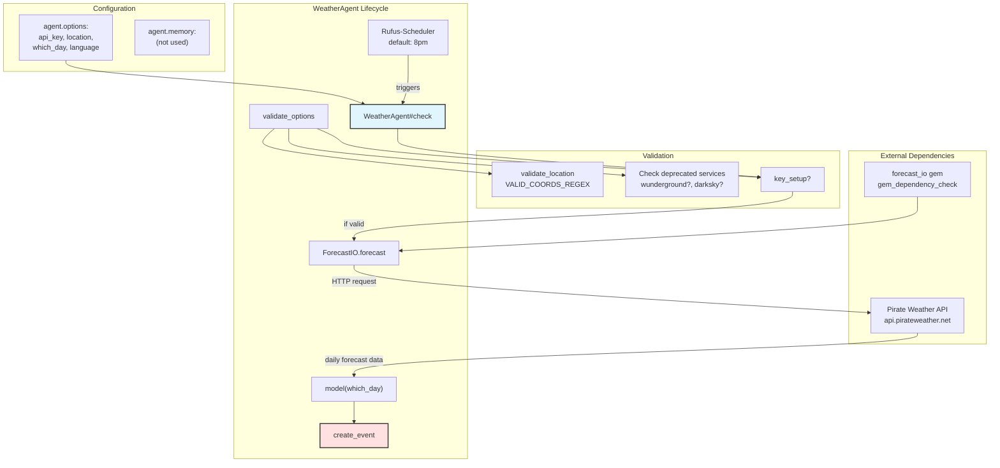
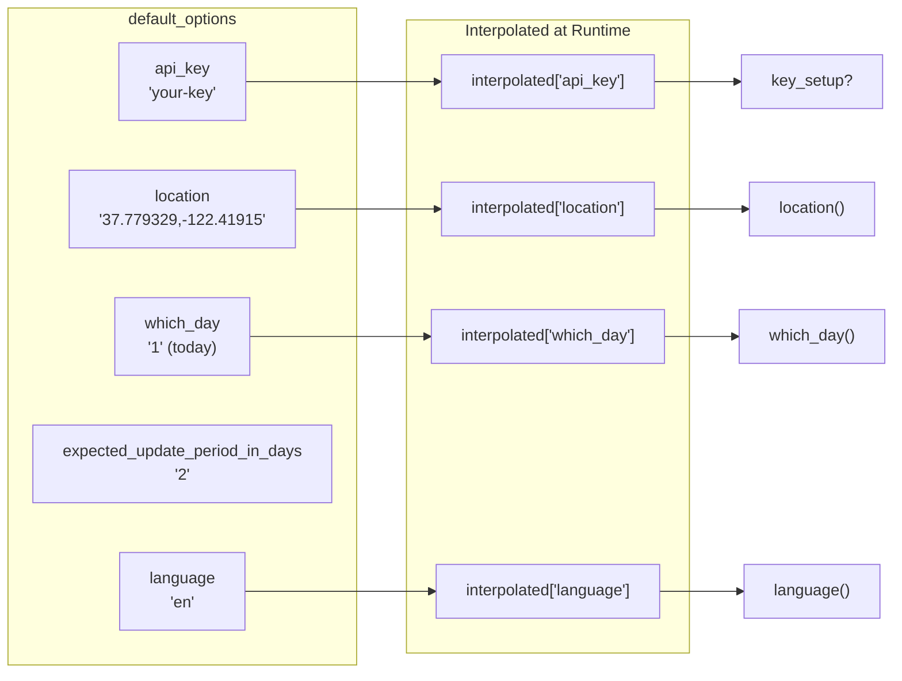
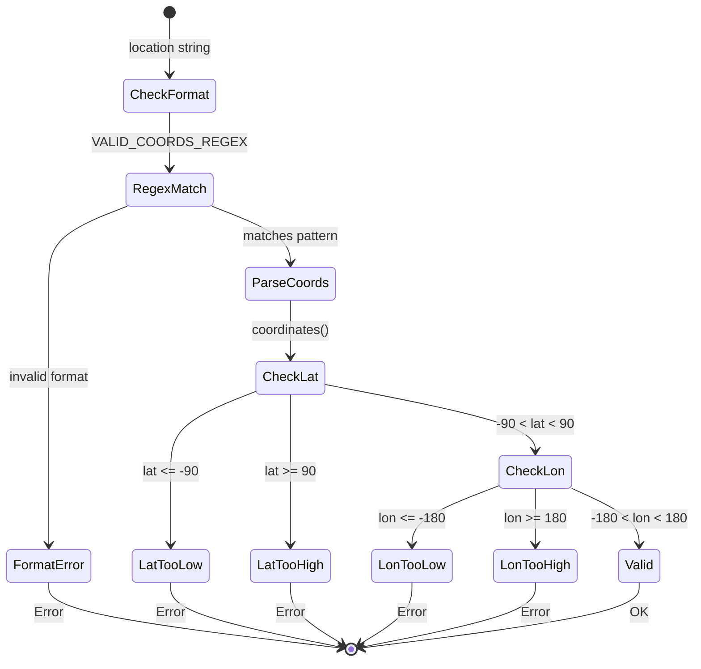
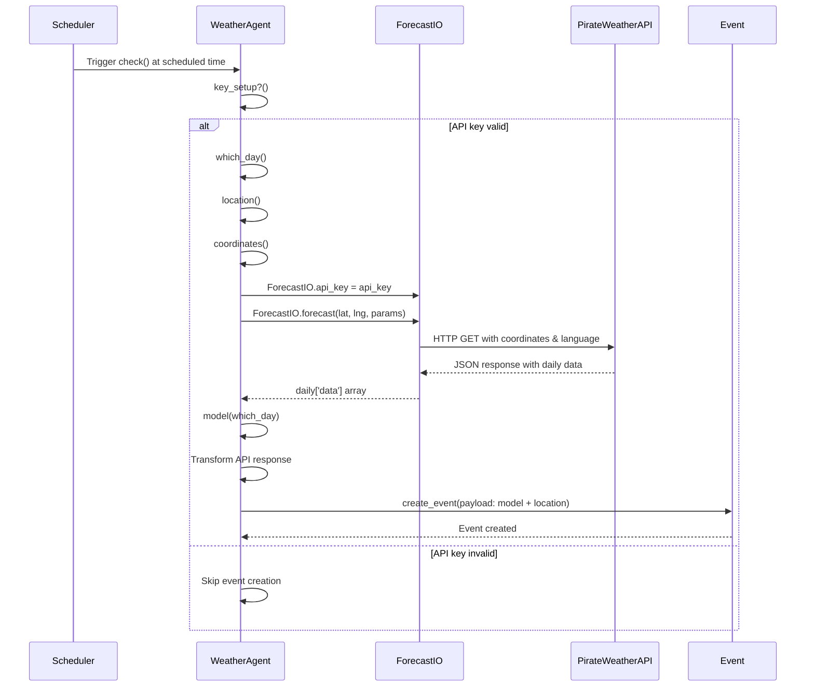
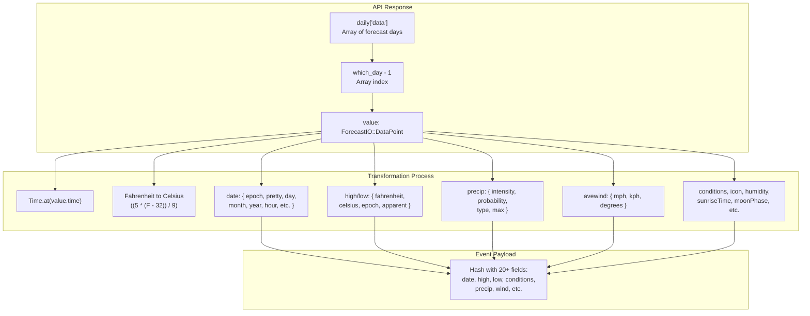
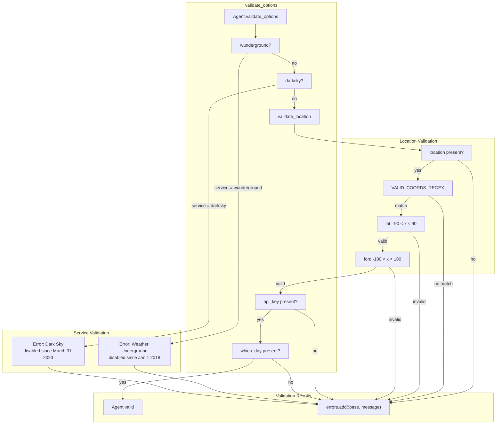
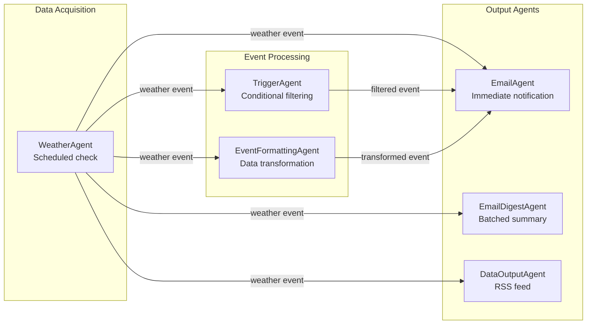

<!-- source: DeepWiki mcp.deepwiki.com · repo huginn/huginn · page 5.6 WeatherAgent · fetched 2026-10-29 -->

# WeatherAgent

<details>
<summary>Relevant source files</summary>

The following files were used as context for generating this wiki page:

- [app/models/agents/email_agent.rb](app/models/agents/email_agent.rb)
- [app/models/agents/email_digest_agent.rb](app/models/agents/email_digest_agent.rb)
- [app/models/agents/weather_agent.rb](app/models/agents/weather_agent.rb)
- [config/initializers/mail_encoding_patch.rb](config/initializers/mail_encoding_patch.rb)
- [db/migrate/20160807000122_remove_queue_from_email_digest_agent_memory.rb](db/migrate/20160807000122_remove_queue_from_email_digest_agent_memory.rb)
- [db/seeds.rb](db/seeds.rb)
- [spec/data_fixtures/weather.json](spec/data_fixtures/weather.json)
- [spec/models/agents/email_agent_spec.rb](spec/models/agents/email_agent_spec.rb)
- [spec/models/agents/email_digest_agent_spec.rb](spec/models/agents/email_digest_agent_spec.rb)
- [spec/models/agents/weather_agent_spec.rb](spec/models/agents/weather_agent_spec.rb)

</details>


## Purpose and Scope

WeatherAgent is a scheduled data acquisition agent that fetches weather forecast data from the Pirate Weather API and creates events containing detailed meteorological information. This agent operates on a schedule and cannot receive events from other agents.

For sending weather data via email, see [Email Agents](#5.5). For processing weather events with conditional logic, see [EventFormattingAgent](#5.7).

**Sources:** [app/models/agents/weather_agent.rb:1-206]()

---

## Architecture Overview

WeatherAgent is a scheduled agent that integrates with external weather APIs to generate events on a regular schedule. It depends on the `forecast_io` gem for API communication.



**Sources:** [app/models/agents/weather_agent.rb:5-9](), [app/models/agents/weather_agent.rb:51-75](), [app/models/agents/weather_agent.rb:123-130]()

---

## Agent Capabilities and Constraints

WeatherAgent has specific operational characteristics defined at the class level:

| Capability | Status | Implementation |
|------------|--------|----------------|
| Can receive events | ❌ No | `cannot_receive_events!` at [app/models/agents/weather_agent.rb:6]() |
| Can be scheduled | ✅ Yes | `default_schedule "8pm"` at [app/models/agents/weather_agent.rb:51]() |
| Creates events | ✅ Yes | Events created in `check` method |
| Gem dependency | ✅ Required | `forecast_io` gem checked at [app/models/agents/weather_agent.rb:8]() |
| Memory usage | ❌ None | No memory state management |

**Sources:** [app/models/agents/weather_agent.rb:6-51]()

---

## Configuration Options

### Default Configuration Structure



**Sources:** [app/models/agents/weather_agent.rb:61-69]()

### Configuration Parameters

| Parameter | Type | Required | Description | Default |
|-----------|------|----------|-------------|---------|
| `api_key` | String | ✅ Yes | Pirate Weather API key | `'your-key'` |
| `location` | String | ✅ Yes | Coordinates in format "latitude,longitude" | `'37.779329,-122.41915'` |
| `which_day` | Integer | ✅ Yes | Day offset (1=today, 2=tomorrow, max 7) | `'1'` |
| `expected_update_period_in_days` | Integer | ✅ Yes | Maximum time between events | `'2'` |
| `language` | String | ❌ No | Language code for forecast text | `'en'` |

**Sources:** [app/models/agents/weather_agent.rb:61-69](), [app/models/agents/weather_agent.rb:10-24]()

### Location Coordinate Validation

The location must be specified as comma-separated latitude,longitude coordinates:



The `VALID_COORDS_REGEX` pattern at [app/models/agents/weather_agent.rb:103]() matches: `/^\s*-?\d{1,3}\.\d+\s*,\s*-?\d{1,3}\.\d+\s*$/`

**Sources:** [app/models/agents/weather_agent.rb:103-121](), [spec/models/agents/weather_agent_spec.rb:48-64]()

---

## API Integration and Data Flow

### Pirate Weather API Communication



**Sources:** [app/models/agents/weather_agent.rb:71-75](), [app/models/agents/weather_agent.rb:132-138]()

### API Response Transformation

The `model(which_day)` method at [app/models/agents/weather_agent.rb:140-203]() transforms the Pirate Weather API response into a structured event payload:



**Sources:** [app/models/agents/weather_agent.rb:140-203]()

---

## Event Payload Structure

### Complete Event Schema

Events created by WeatherAgent contain comprehensive weather data. The example from [app/models/agents/weather_agent.rb:26-49]() shows:

```json
{
  "location": "37.779329,-122.41915",
  "date": {
    "epoch": "1357959600",
    "pretty": "10:00 PM EST on January 11, 2013",
    "day": 11,
    "month": 1,
    "year": 2013,
    "yday": 11,
    "hour": 22,
    "min": "00",
    "sec": 0,
    "isdst": 0,
    "monthname": "January",
    "monthname_short": "Jan",
    "weekday_short": "Fri",
    "weekday": "Friday",
    "ampm": "PM",
    "tz_short": "EST"
  },
  "period": 1,
  "high": {
    "fahrenheit": "64",
    "celsius": "18",
    "epoch": "1357959600",
    "fahrenheit_apparent": "62",
    "epoch_apparent": "1357960800"
  },
  "low": {
    "fahrenheit": "52",
    "celsius": "11",
    "epoch": "1357945200",
    "fahrenheit_apparent": "50",
    "epoch_apparent": "1357946400"
  },
  "conditions": "Rain Showers",
  "icon": "rain",
  "avehumidity": 85,
  "sunriseTime": "1357912800",
  "sunsetTime": "1357952400",
  "moonPhase": "0.25",
  "precip": {
    "intensity": "0.0015",
    "intensity_max": "0.0025",
    "intensity_max_epoch": "1357959600",
    "probability": "0.45",
    "type": "rain"
  },
  "dewPoint": "45.5",
  "avewind": {
    "mph": "12",
    "kph": "19",
    "degrees": "180"
  },
  "visibility": "10.0",
  "cloudCover": "0.75",
  "pressure": "1013.5",
  "ozone": "300.5"
}
```

**Sources:** [app/models/agents/weather_agent.rb:26-49](), [app/models/agents/weather_agent.rb:140-203]()

### Payload Field Reference

| Field Group | Subfields | Description |
|-------------|-----------|-------------|
| `location` | - | Original location coordinates |
| `date` | `epoch`, `pretty`, `day`, `month`, `year`, `hour`, `min`, etc. | Detailed timestamp information |
| `period` | - | Which day forecast (1-7) |
| `high` | `fahrenheit`, `celsius`, `epoch`, `fahrenheit_apparent`, `epoch_apparent` | High temperature data |
| `low` | `fahrenheit`, `celsius`, `epoch`, `fahrenheit_apparent`, `epoch_apparent` | Low temperature data |
| `conditions` | - | Text description of weather |
| `icon` | - | Icon identifier from API |
| `avehumidity` | - | Average humidity percentage |
| `sunriseTime` | - | Sunrise epoch timestamp |
| `sunsetTime` | - | Sunset epoch timestamp |
| `moonPhase` | - | Moon phase (0-1) |
| `precip` | `intensity`, `intensity_max`, `probability`, `type` | Precipitation details |
| `dewPoint` | - | Dew point temperature |
| `avewind` | `mph`, `kph`, `degrees` | Wind speed and direction |
| `visibility` | - | Visibility in miles |
| `cloudCover` | - | Cloud cover (0-1) |
| `pressure` | - | Atmospheric pressure |
| `ozone` | - | Ozone level |

**Sources:** [app/models/agents/weather_agent.rb:144-201]()

---

## Validation and Error Handling

### Validation Flow



**Sources:** [app/models/agents/weather_agent.rb:123-130](), [app/models/agents/weather_agent.rb:105-121](), [app/models/agents/weather_agent.rb:95-101]()

### Key Setup Validation

The `key_setup?` method at [app/models/agents/weather_agent.rb:57-59]() checks for placeholder API keys:

```ruby
def key_setup?
  interpolated['api_key'].present? && 
  interpolated['api_key'] != "your-key" && 
  interpolated['api_key'] != "put-your-key-here"
end
```

This validation prevents the agent from attempting API calls with invalid placeholder keys.

**Sources:** [app/models/agents/weather_agent.rb:57-59](), [spec/models/agents/weather_agent_spec.rb:37-45]()

---

## Working Status

The `working?` method at [app/models/agents/weather_agent.rb:53-55]() determines if the agent is functioning correctly:

```ruby
def working?
  event_created_within?((interpolated['expected_update_period_in_days'].presence || 2).to_i) && 
  !recent_error_logs? && 
  key_setup?
end
```

An agent is considered working if:
1. An event was created within the expected update period
2. No recent error logs exist
3. API key is properly configured (not a placeholder)

**Sources:** [app/models/agents/weather_agent.rb:53-55]()

---

## Testing Infrastructure

### Test Coverage

The WeatherAgent spec at [spec/models/agents/weather_agent_spec.rb:1-90]() validates:

1. **Basic Agent Creation**: Ensures valid agents can be created
2. **Placeholder Key Handling**: Verifies agents with placeholder keys are valid but not working
3. **Location Validation**: Tests coordinate format and range validation
4. **Service Deprecation**: Confirms deprecated services are rejected

### Mock API Responses

Tests use a fixture file at [spec/data_fixtures/weather.json:1-1879]() containing a complete Pirate Weather API response with:
- Current conditions
- Minute-by-minute forecast (60 entries)
- Hourly forecast (48 entries)
- Daily forecast (8 days)
- Alerts and metadata

Test stubs at [spec/models/agents/email_agent_spec.rb:59]() and [spec/models/agents/email_digest_agent_spec.rb:87]():
```ruby
stub_request(:any, /pirateweather)
  .to_return(:body => File.read(Rails.root.join("spec/data_fixtures/weather.json")), 
             :status => 200)
```

**Sources:** [spec/models/agents/weather_agent_spec.rb:1-90](), [spec/data_fixtures/weather.json:1-1879](), [spec/models/agents/email_agent_spec.rb:59]()

---

## Integration with Other Agents

### Common Integration Patterns



### Example: Weather Alert Workflow

A typical workflow might be:
1. **WeatherAgent** creates event with forecast
2. **TriggerAgent** filters for rain probability > 50%
3. **EventFormattingAgent** extracts relevant fields
4. **EmailAgent** sends immediate alert

**Sources:** [spec/models/agents/email_agent_spec.rb:58-71](), [spec/models/agents/email_digest_agent_spec.rb:86-104]()

---

## Migration from Deprecated Services

### Service Deprecation Timeline

| Service | Status | Deprecation Date | Migration Path |
|---------|--------|------------------|----------------|
| Weather Underground | ❌ Disabled | January 1, 2018 | Pirate Weather |
| Dark Sky | ❌ Disabled | March 31, 2023 | Pirate Weather |
| Pirate Weather | ✅ Active | Current | - |

The validation at [app/models/agents/weather_agent.rb:124-126]() explicitly rejects deprecated services:

```ruby
errors.add(:base, "The Weather Underground API has been disabled...") if wunderground?
errors.add(:base, "The Dark Sky API has been disabled...") if darksky?
```

**Note**: Pirate Weather uses the same API format as Dark Sky, requiring only an API key change.

**Sources:** [app/models/agents/weather_agent.rb:95-101](), [app/models/agents/weather_agent.rb:124-126](), [app/models/agents/weather_agent.rb:17]()

---

## ForecastIO Gem Dependency

WeatherAgent requires the `forecast_io` gem for API communication. The gem dependency check at [app/models/agents/weather_agent.rb:8]():

```ruby
gem_dependency_check { defined?(ForecastIO) }
```

If the gem is missing, the agent description includes a warning at [app/models/agents/weather_agent.rb:13]().

**Sources:** [app/models/agents/weather_agent.rb:8](), [app/models/agents/weather_agent.rb:13]()

---

