# Page: Overview

# Overview

<details>
<summary>Relevant source files</summary>

The following files were used as context for generating this wiki page:

- [.dockerignore](.dockerignore)
- [README.md](README.md)
- [app/models/agent.rb](app/models/agent.rb)
- [app/views/agents/_form.html.erb](app/views/agents/_form.html.erb)
- [config/database.yml](config/database.yml)
- [spec/models/agent_spec.rb](spec/models/agent_spec.rb)

</details>


## Purpose and Scope

This document provides an architectural overview of Huginn, introducing its core concepts, system components, and data flow patterns. It serves as an entry point for understanding how Huginn operates as an agent-based automation platform. For detailed information about specific components referenced here, see:

- Installation and deployment options: [Installation and Deployment](#2)
- Agent system internals: [Agent System](#3.1)
- Event propagation mechanics: [Event-Driven Architecture](#3.2)
- Liquid templating features: [Liquid Templating System](#4)
- Individual agent documentation: [Agent Reference](#5)

**Sources:** [README.md:1-156]()

---

## What is Huginn?

Huginn is a self-hosted automation platform built on Ruby on Rails that enables users to create workflows of interconnected agents. Each agent performs a specific task (web scraping, API calls, data transformation, notifications) and can create and consume events. Agents are connected in directed graphs where events propagate from source agents to receiver agents, enabling complex automation workflows.

**Key characteristics:**

| Aspect | Description |
|--------|-------------|
| **Architecture** | Agent-based, event-driven system |
| **Language** | Ruby 3.2.6, Rails 7.1 |
| **Agent Base Class** | `Agent` ([app/models/agent.rb:6]()) |
| **Event Model** | `Event` records linked to agents |
| **Scheduling** | Rufus-Scheduler for periodic execution |
| **Background Jobs** | Delayed Job (via `AgentCheckJob`, `AgentReceiveJob`) |
| **Templating** | Liquid via `LiquidInterpolatable` concern |
| **Databases** | MySQL or PostgreSQL ([config/database.yml:1-42]()) |

**Sources:** [README.md:5-24](), [app/models/agent.rb:1-6]()

---

## Core Architecture Components

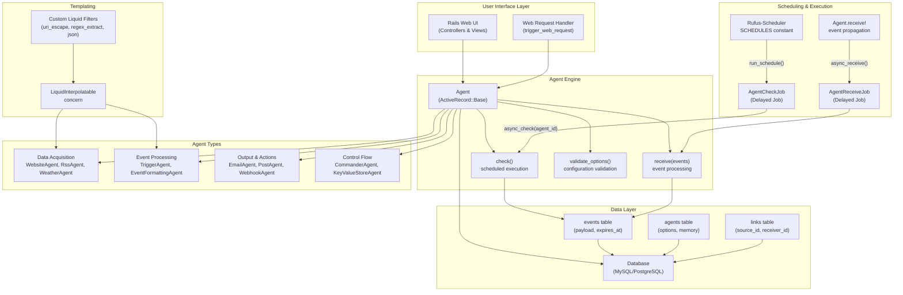

**Sources:** [app/models/agent.rb:1-523](), [README.md:7]()

---

## Agent System

### Agent Base Class

The `Agent` class ([app/models/agent.rb:6]()) is an `ActiveRecord::Base` model that serves as the foundation for all agent types. It includes several concerns that provide core functionality:

| Concern | Purpose | Key Methods |
|---------|---------|-------------|
| `LiquidInterpolatable` | Liquid template processing | `interpolate_string`, `interpolate_options` |
| `WorkingHelpers` | Status tracking | `working?`, `recent_error_logs?` |
| `DryRunnable` | Testing mode | `dry_run?` |
| `HasGuid` | Unique identifiers | `guid` generation |

**Sources:** [app/models/agent.rb:7-16]()

### Agent Lifecycle Methods

Agents implement three primary execution methods:

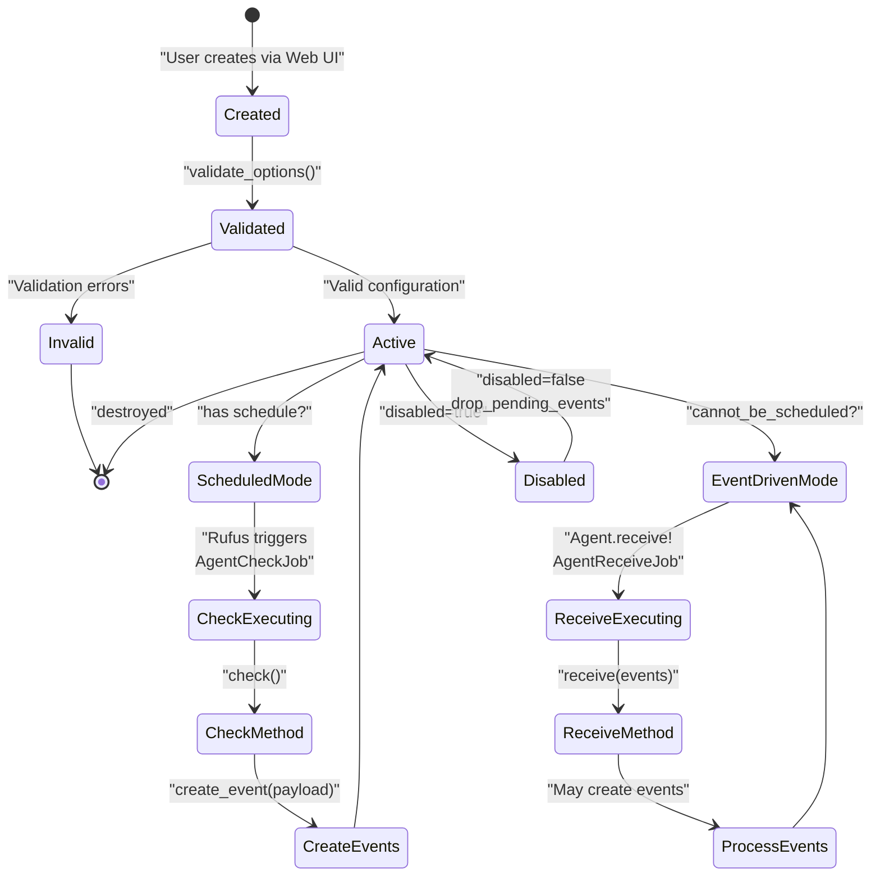

| Method | Trigger | Purpose | Examples |
|--------|---------|---------|----------|
| `check()` | Schedule (Rufus-Scheduler) | Periodic execution to generate events | `WebsiteAgent` scrapes URL, `WeatherAgent` calls API |
| `receive(events)` | Event propagation (`Agent.receive!`) | Process incoming events from source agents | `TriggerAgent` filters events, `EmailAgent` sends notifications |
| `receive_web_request(params, method, format)` | HTTP request to agent's webhook URL | Handle external HTTP requests | `WebhookAgent` receives webhooks, `DataOutputAgent` serves RSS feeds |

**Sources:** [app/models/agent.rb:95-115](), [app/models/agent.rb:170-190](), [spec/models/agent_spec.rb:140-161]()

### Agent Configuration

Agents are configured through three key attributes:

- **`options`**: JSON-serialized hash containing agent-specific configuration ([app/models/agent.rb:39]())
- **`memory`**: JSON-serialized hash for persistent state storage ([app/models/agent.rb:39]())
- **`schedule`**: String from `SCHEDULES` constant defining execution frequency ([app/models/agent.rb:21-28]())

**Sources:** [app/models/agent.rb:39-49]()

---

## Event-Driven Architecture

### Event Model

Events are the primary data structure for inter-agent communication. Each event record contains:

| Column | Type | Purpose |
|--------|------|---------|
| `payload` | JSON | The actual data being transmitted |
| `agent_id` | Integer | Foreign key to creating agent |
| `user_id` | Integer | Foreign key to owner |
| `expires_at` | DateTime | Automatic cleanup timestamp |
| `created_at` | DateTime | Event creation time |

**Sources:** [app/models/agent.rb:60-61]()

### Link System

The `links` table establishes directed edges in the agent graph:

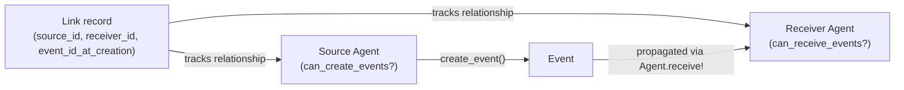

Key associations in `Agent`:

- `has_many :links_as_source` ([app/models/agent.rb:63-64]())
- `has_many :links_as_receiver` ([app/models/agent.rb:65-66]())
- `has_many :sources, through: :links_as_receiver` ([app/models/agent.rb:67]())
- `has_many :receivers, through: :links_as_source` ([app/models/agent.rb:69]())

**Sources:** [app/models/agent.rb:63-69]()

### Event Propagation Flow

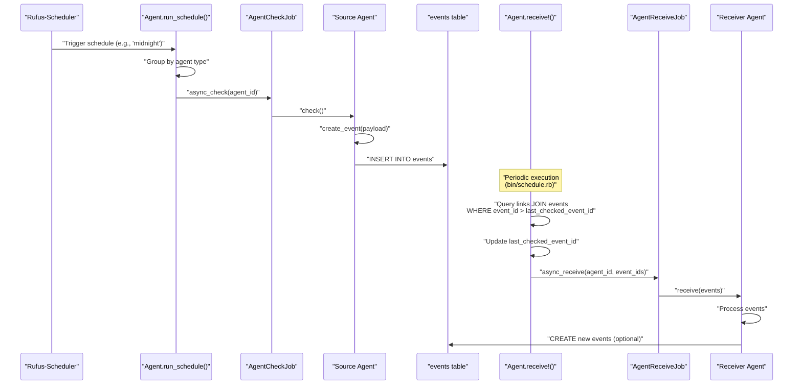

The `Agent.receive!` method ([app/models/agent.rb:400-443]()) is the core event propagation engine:

1. Joins `agents`, `links`, and `events` tables
2. Finds events created after the link was established
3. Groups events by receiver agent
4. Updates `last_checked_event_id` on each receiver
5. Enqueues `AgentReceiveJob` for each receiver with pending events

**Sources:** [app/models/agent.rb:400-443](), [spec/models/agent_spec.rb:284-426]()

---

## Agent Categories

### Data Acquisition Agents

Agents that gather data from external sources and create events:

| Agent Class | Purpose | Scheduling | Key Options |
|-------------|---------|------------|-------------|
| `WebsiteAgent` | Web scraping (HTML/XML/JSON) | Scheduled | `url`, `extract`, `type`, `mode` |
| `RssAgent` | RSS/Atom feed parsing | Scheduled | `url`, `clean` |
| `WeatherAgent` | Weather data from Pirate Weather API | Scheduled | `location`, `api_key` |
| `TwitterUserAgent` | Twitter timeline monitoring | Scheduled | OAuth credentials, `username` |

**Key method:** `check()` - fetches external data and calls `create_event(payload: {...})`

**Sources:** [README.md:11-24]()

### Event Processing Agents

Agents that transform, filter, or aggregate events:

| Agent Class | Purpose | Trigger | Key Options |
|-------------|---------|---------|-------------|
| `TriggerAgent` | Conditional filtering | Event-driven | `rules` (conditions), `must_match` |
| `EventFormattingAgent` | Data transformation | Event-driven | `instructions` (Liquid templates), `matchers` |
| `DigestAgent` | Event aggregation | Scheduled | `expected_receive_period_in_days` |

**Key method:** `receive(events)` - processes incoming events, may create new events

**Sources:** [README.md:14]()

### Output Agents

Agents that perform actions or expose data:

| Agent Class | Purpose | Trigger | Key Options |
|-------------|---------|---------|-------------|
| `EmailAgent` | Send emails | Event-driven | `recipients`, `subject`, `body` |
| `PostAgent` | HTTP POST requests | Event-driven | `post_url`, `payload`, `method` |
| `WebhookAgent` | Receive HTTP requests | External HTTP | `secret`, `response` |
| `DataOutputAgent` | Expose RSS/JSON feeds | HTTP request | `template`, `events_to_show` |

**Key method:** `receive(events)` for event-driven agents, `receive_web_request()` for HTTP agents

**Sources:** [README.md:18-21]()

---

## Scheduling System

### Schedule Options

The `SCHEDULES` constant ([app/models/agent.rb:21-28]()) defines available schedules:

| Category | Values |
|----------|--------|
| **Minutes** | `every_1m`, `every_2m`, `every_5m`, `every_10m`, `every_30m` |
| **Hours** | `every_1h`, `every_2h`, `every_5h`, `every_12h` |
| **Days** | `every_1d`, `every_2d`, `every_7d` |
| **Times** | `midnight`, `1am`...`11pm`, `noon` |
| **Special** | `never` (manual triggering only) |

### Execution Flow

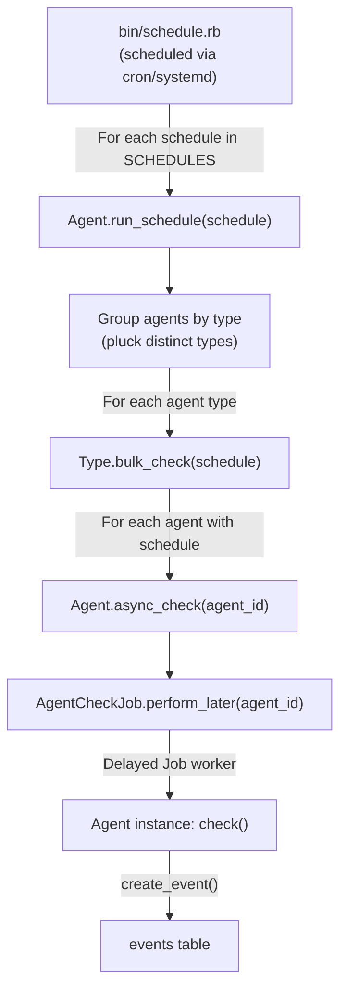

**Key methods:**

- `Agent.run_schedule(schedule)` ([app/models/agent.rb:453-462]()): Entry point, groups by type
- `Agent.bulk_check(schedule)` ([app/models/agent.rb:466-472]()): Finds agents with schedule, calls `async_check`
- `Agent.async_check(agent_id)` ([app/models/agent.rb:476-478]()): Enqueues `AgentCheckJob`

**Sources:** [app/models/agent.rb:453-478](), [spec/models/agent_spec.rb:34-94]()

---

## Configuration System

### Environment Variables

Huginn uses environment variables from the `.env` file for configuration:

| Variable | Purpose | Example |
|----------|---------|---------|
| `DATABASE_ADAPTER` | Database type | `mysql2` or `postgresql` |
| `DATABASE_NAME` | Database name | `huginn_production` |
| `DATABASE_USERNAME` | Database username | `root` |
| `DATABASE_PASSWORD` | Database password | (secure password) |
| `APP_SECRET_TOKEN` | Rails secret key | (random string) |
| `INVITATION_CODE` | Registration control | (optional code) |
| `SMTP_*` | Email settings | Various SMTP options |

**Sources:** [config/database.yml:1-42](), [README.md:65-76]()

### Database Configuration

The `config/database.yml` file ([config/database.yml:1-42]()) defines three environments, all configurable via environment variables with fallback defaults:

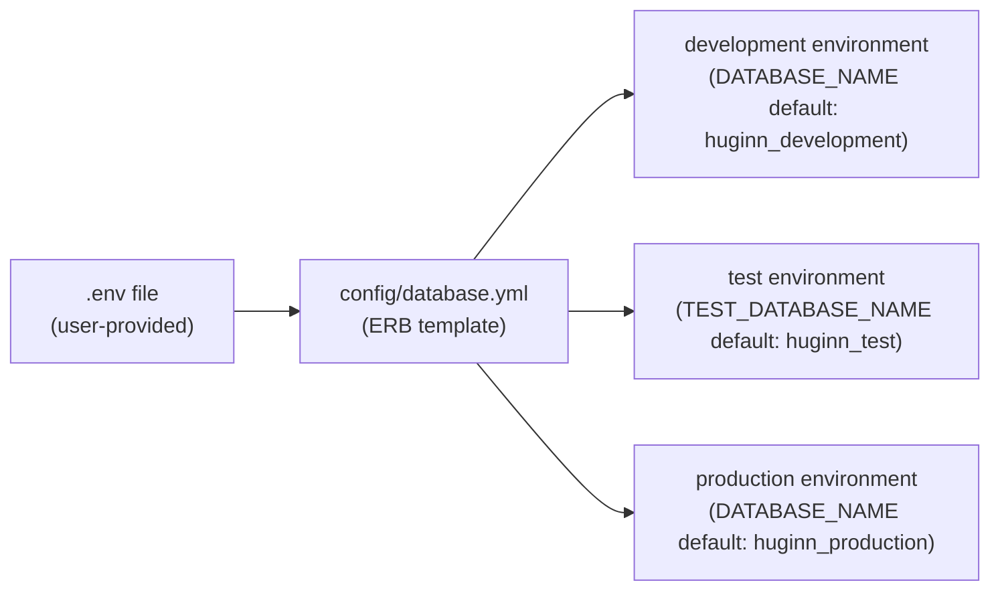

**Sources:** [config/database.yml:1-42]()

---

## Deployment Options

Huginn supports multiple deployment strategies:

### Docker Deployment

| Option | Image | Use Case |
|--------|-------|----------|
| **All-in-one** | `huginn/huginn` | Quick evaluation, contains web + workers + MySQL |
| **Multi-container** | `huginn/huginn-single-process` | Production, separate web/worker containers, external DB |

### Manual Installation

Components required:
- Ruby 3.2.6 (compiled from source)
- Bundler for dependency management
- Unicorn web server
- Runit for process management
- Nginx as reverse proxy
- MySQL or PostgreSQL database

### PaaS Deployment

Supported platforms:
- Heroku (via Deploy button)
- OpenShift (via JSON templates)

**Sources:** [README.md:56-134](), [.dockerignore:1-39]()

---

## Agent Web Interface

The web UI provides agent management through Rails controllers and views:

### Agent Form Structure

The agent form ([app/views/agents/_form.html.erb:1-152]()) includes:

| Section | Form Fields | Purpose |
|---------|-------------|---------|
| **Type Selection** | `type` select (new records only) | Choose agent class |
| **Basic Settings** | `name`, `schedule` | Identity and execution timing |
| **Relationships** | `source_ids`, `receiver_ids`, `controller_ids`, `control_target_ids` | Link agents together |
| **Event Management** | `keep_events_for`, `propagate_immediately` | Event retention and propagation |
| **Scenarios** | `scenario_ids` | Group agents for organization |
| **Options** | Agent-specific JSON configuration | Agent behavior customization |

**Dynamic behavior:**
- Schedule field hidden if `cannot_be_scheduled?` is true
- Source field hidden if `cannot_receive_events?` is true
- Receiver field hidden if `cannot_create_events?` is true

**Sources:** [app/views/agents/_form.html.erb:1-152]()

---

## Data Persistence

### Agent Memory

Each agent has a `memory` attribute ([app/models/agent.rb:39]()) - a JSON-serialized hash for persistent state:

```ruby
# Example memory usage in an agent
def check
  memory[:last_checked] = Time.now
  memory[:seen_ids] ||= []
  memory[:seen_ids] << new_id
  save!
end
```

Common use cases:
- Deduplication tracking (`seen_ids` arrays)
- Cursor/pagination state
- Rate limiting counters
- Cached API responses

**Sources:** [app/models/agent.rb:39](), [spec/models/agent_spec.rb:535-563]()

### Event Expiration

Events can be automatically deleted based on `keep_events_for`:

| Setting | Duration | Use Case |
|---------|----------|----------|
| `0` | Forever | Critical audit logs |
| `1.hour` to `365.days` | Configurable | Most agents |

The `new_event_expiration_date` method ([app/models/agent.rb:158-160]()) calculates `expires_at` timestamps. When `keep_events_for` changes, `update_event_expirations!` ([app/models/agent.rb:162-168]()) recalculates all existing event expiration dates.

**Sources:** [app/models/agent.rb:158-168](), [spec/models/agent_spec.rb:669-727]()

---

## Control Flow Features

### Propagate Immediately

By default, events propagate from sources to receivers once per minute via `Agent.receive!`. Setting `propagate_immediately = true` ([app/models/agent.rb:322]()) causes events to trigger receivers synchronously during event creation.

**Trade-offs:**
- **Advantage:** Near-instant event propagation
- **Disadvantage:** Increased CPU usage, slower event creation

**Sources:** [spec/models/agent_spec.rb:461-514]()

### Drop Pending Events

When re-enabling a disabled agent, setting `drop_pending_events = true` ([app/models/agent.rb:257-259]()) updates `last_checked_event_id` to skip accumulated events, preventing event backlog processing.

**Sources:** [app/models/agent.rb:257-259](), [spec/models/agent_spec.rb:932-967]()

### Control Links

Agents with `can_control_other_agents!` ([app/models/agent.rb:364-370]()) can have `control_targets` - other agents they can enable, disable, or trigger via `ControlLink` associations ([app/models/agent.rb:70-75]()).

**Sources:** [app/models/agent.rb:70-75](), [app/models/agent.rb:364-370]()

---

## Validation and Error Handling

### Option Validation

Each agent subclass implements `validate_options` ([app/models/agent.rb:293-295]()):

```ruby
def validate_options
  errors.add(:base, "api_key is required") unless options[:api_key].present?
  errors.add(:base, "url must be a valid URL") unless options[:url] =~ URI::regexp
end
```

Validation occurs before save, with errors displayed in the web UI.

**Sources:** [app/models/agent.rb:293-295](), [spec/models/agent_spec.rb:517-524]()

### Agent Logging

Agents log messages via `log(message, options)` and `error(message, options)` methods ([app/models/agent.rb:240-246]()):

```ruby
log("Fetched #{results.count} items")
error("API request failed: #{e.message}")
```

Logs are stored in the `agent_logs` table with severity levels (1=info, 4=error). The `last_error_log_at` timestamp tracks the most recent error for status display.

**Sources:** [app/models/agent.rb:240-251]()

---

## Testing Infrastructure

Huginn includes comprehensive RSpec tests:

| Test Type | Location | Coverage |
|-----------|----------|----------|
| **Model specs** | `spec/models/agent_spec.rb` | Agent lifecycle, validation, scheduling |
| **Agent specs** | `spec/models/agents/*_spec.rb` | Individual agent behavior |
| **Integration specs** | `spec/features/*_spec.rb` | End-to-end workflows |

**Key test patterns:**
- Shared examples for common agent behaviors (e.g., `WorkingHelpers`, `LiquidInterpolatable`)
- Fixtures defined in `spec/data_fixtures/` for API responses
- Time travel via `travel_to` for testing scheduled behavior

**Sources:** [spec/models/agent_spec.rb:1-1095](), [README.md:84-93]()

---

# Page: Installation and Deployment

# Installation and Deployment

<details>
<summary>Relevant source files</summary>

The following files were used as context for generating this wiki page:

- [.dockerignore](.dockerignore)
- [README.md](README.md)
- [config/database.yml](config/database.yml)
- [doc/README.md](doc/README.md)
- [doc/docker/install.md](doc/docker/install.md)
- [doc/heroku/update.md](doc/heroku/update.md)
- [doc/manual/installation.md](doc/manual/installation.md)
- [doc/manual/requirements.md](doc/manual/requirements.md)
- [doc/manual/update.md](doc/manual/update.md)
- [docker/README.md](docker/README.md)
- [docker/scripts/prepare](docker/scripts/prepare)
- [lib/tasks/database_test.rake](lib/tasks/database_test.rake)

</details>


This document covers all supported methods for deploying Huginn, including Docker containers, manual installation on Debian/Ubuntu systems, and PaaS platforms. It also explains the configuration system used across all deployment methods. For information about updating an existing deployment, see the update documentation referenced in [doc/manual/update.md:1-120](). For development setup, refer to the development sections in [README.md:84-93]().

## Deployment Architecture Overview

Huginn supports multiple deployment strategies, each suitable for different use cases. The system requires a web application server, background job workers, and a relational database (MySQL or PostgreSQL).

### Deployment Options Comparison

```mermaid
graph TB
    subgraph DockerMulti["Docker: huginn/huginn (Multi-Process)"]
        DM_Container["Single Container"]
        DM_Web["Web: Unicorn"]
        DM_Worker["Worker: threaded.rb"]
        DM_DB["MySQL (internal)"]
        DM_Foreman["foreman via Procfile"]
        
        DM_Container --> DM_Foreman
        DM_Foreman --> DM_Web
        DM_Foreman --> DM_Worker
        DM_Container --> DM_DB
    end
    
    subgraph DockerSingle["Docker: huginn/huginn-single-process"]
        DS_Web["Web Container"]
        DS_Worker1["Worker Container 1"]
        DS_WorkerN["Worker Container N"]
        DS_ExtDB[("External PostgreSQL/MySQL")]
        
        DS_Web --> DS_ExtDB
        DS_Worker1 --> DS_ExtDB
        DS_WorkerN --> DS_ExtDB
    end
    
    subgraph Manual["Manual: /home/huginn/huginn"]
        M_Runit["runit (/etc/service)"]
        M_Unicorn["unicorn -c config/unicorn.rb"]
        M_Threaded["rails runner bin/threaded.rb"]
        M_Nginx["nginx (reverse proxy)"]
        M_ExtDB2[("MySQL/PostgreSQL")]
        
        M_Runit --> M_Unicorn
        M_Runit --> M_Threaded
        M_Nginx --> M_Unicorn
        M_Unicorn --> M_ExtDB2
        M_Threaded --> M_ExtDB2
    end
    
    subgraph PaaS["PaaS"]
        H_Heroku["Heroku: bin/setup_heroku"]
        H_DB[("Heroku Postgres")]
        OS_Template["OpenShift: huginn-mysql.json"]
        OS_DB[("OpenShift MySQL/PostgreSQL")]
        
        H_Heroku --> H_DB
        OS_Template --> OS_DB
    end
```

**Sources:** [README.md:56-133](), [docker/README.md:1-13](), [doc/manual/installation.md:20-30]()

| Deployment Type | Use Case | Pros | Cons | Documentation |
|----------------|----------|------|------|---------------|
| `huginn/huginn` Docker | Evaluation, quick demo | Single command to start | Not recommended for production, difficult backups | [doc/docker/install.md:9-15]() |
| `huginn/huginn-single-process` Docker | Production, scalable | Separate web/worker containers, easy scaling | Requires external database | [docker/README.md:10-12]() |
| Manual Installation | Production, full control | Maximum flexibility, detailed control | Manual setup and maintenance | [doc/manual/installation.md:1-489]() |
| Heroku | Managed PaaS | No server management | Paid plans only, limited control | [README.md:107-109]() |
| OpenShift | Managed PaaS | Kubernetes-based | Platform-specific configuration | [README.md:111-129]() |

## Docker Deployment

### Quick Start: Multi-Process Image

The `huginn/huginn` image runs all processes in a single container with an internal MySQL database.

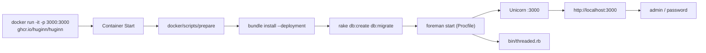

**Default Credentials:**
- Username: `admin`
- Password: `password`

**Sources:** [README.md:56-58](), [doc/docker/install.md:9-15]()

### Production: Single-Process Image

The `huginn/huginn-single-process` image runs one process per container, requiring separate containers for web and workers.

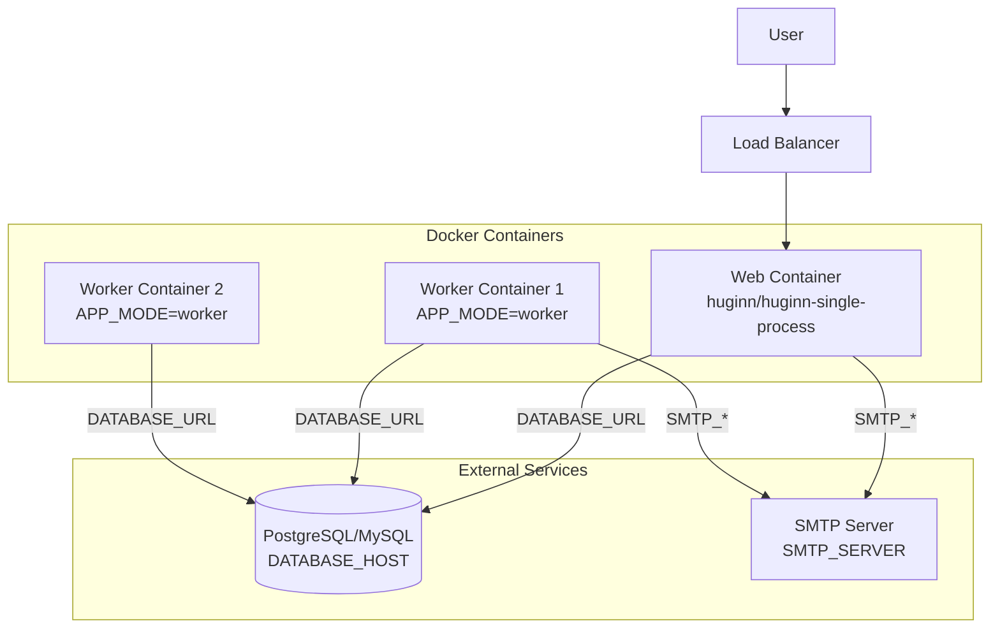

**Required Environment Variables:**
- `DATABASE_ADAPTER`: `postgresql` or `mysql2`
- `DATABASE_URL` or individual `DATABASE_*` variables
- `APP_SECRET_TOKEN`: Random secure token
- `DOMAIN`: Your deployment domain

**Sources:** [docker/README.md:10-12](), [doc/docker/install.md:16-22]()

## Manual Installation

Manual installation provides full control and is recommended for production deployments where Docker is not suitable.

### Installation Flow

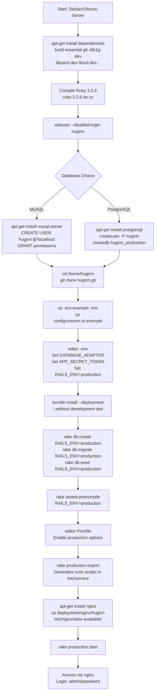

**Sources:** [doc/manual/installation.md:1-489]()

### System Requirements

The manual installation requires specific packages and system configurations:

**Required Packages** [doc/manual/installation.md:47-49]():
```bash
sudo apt-get install -y runit build-essential git zlib1g-dev libyaml-dev \
  libssl-dev libgdbm-dev libreadline-dev libncurses5-dev libffi-dev \
  curl openssh-server checkinstall libxml2-dev libxslt-dev \
  libcurl4-openssl-dev libicu-dev logrotate pkg-config cmake nodejs \
  graphviz jq shared-mime-info
```

**Ruby Installation** [doc/manual/installation.md:72-79]():
- Ruby 3.2.6 compiled from source
- Location: `/tmp/ruby/ruby-3.2.6`
- Configure flags: `--disable-install-rdoc`
- Post-install: `gem install foreman --no-document`

**System User** [doc/manual/installation.md:87-89]():
- Username: `huginn`
- Home directory: `/home/huginn`
- Shell: disabled login (system account)

**Sources:** [doc/manual/installation.md:31-89](), [doc/manual/requirements.md:1-69]()

### Database Setup

#### MySQL Configuration

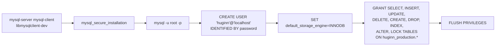

**MySQL Version Check** [doc/manual/installation.md:105-107]():
```bash
mysql --version  # Check if >= 5.5.3 for utf8mb4 support
```

**Sources:** [doc/manual/installation.md:93-152]()

#### PostgreSQL Configuration

```bash
# Install packages
sudo apt-get install -y postgresql libpq-dev

# Create user (interactive password prompt)
sudo -u postgres -H createuser -P huginn

# Create database
sudo -u postgres -H createdb -O huginn -T template0 huginn_production

# Test connection
sudo -u huginn psql -h localhost -W huginn_production
```

**Sources:** [doc/manual/installation.md:154-174]()

### Process Management with Runit

Huginn uses `foreman` to generate runit service scripts from the `Procfile`.

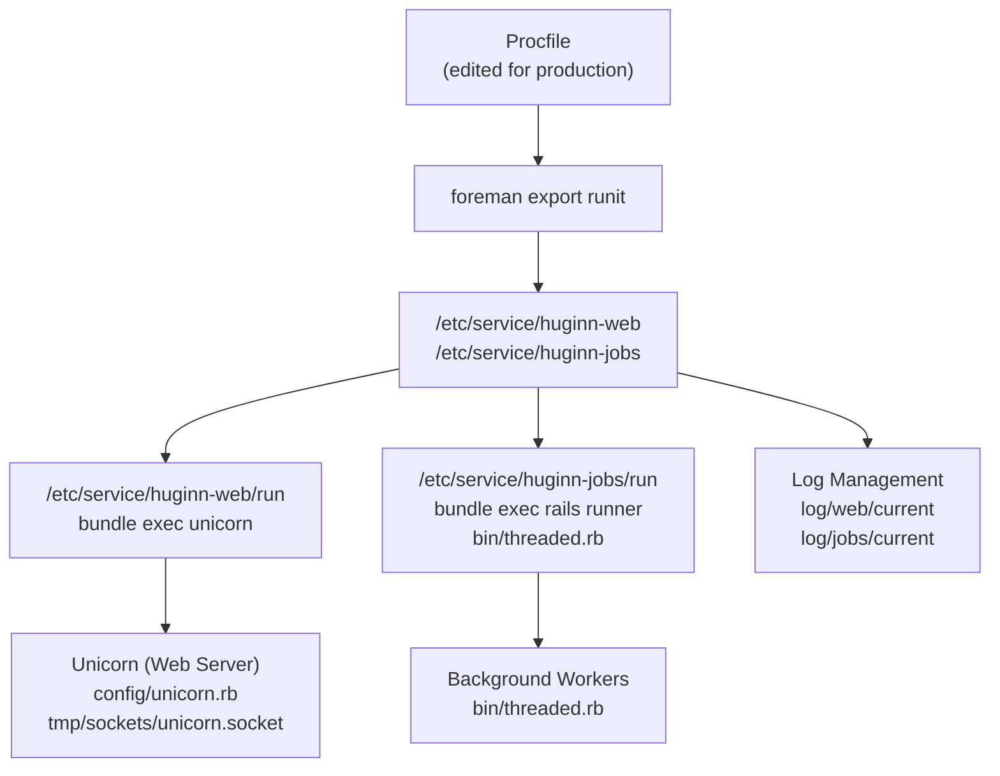

**Procfile Configuration** [doc/manual/installation.md:286-302]():

For production, disable development options:
```
# Comment out:
# web: bundle exec rails server -p ${PORT-3000} -b ${IP-0.0.0.0}
# jobs: bundle exec rails runner bin/threaded.rb

# Enable production options:
web: bundle exec unicorn -c config/unicorn.rb
jobs: bundle exec rails runner bin/threaded.rb
```

**Export Command** [doc/manual/installation.md:307-311]():
```bash
sudo bundle exec rake production:export
# Generates runit scripts in /etc/service/
```

**Sources:** [doc/manual/installation.md:284-322]()

### Nginx Configuration

Nginx serves as a reverse proxy to the Unicorn application server.

**Configuration Path** [doc/manual/installation.md:333-342]():
```bash
sudo cp deployment/nginx/huginn /etc/nginx/sites-available/huginn
sudo ln -s /etc/nginx/sites-available/huginn /etc/nginx/sites-enabled/huginn
```

**Key Configuration Elements:**
- Upstream: `unix:/home/huginn/huginn/tmp/sockets/unicorn.socket`
- Static assets: `/home/huginn/huginn/public`
- Server name: Replace `YOUR_SERVER_FQDN`

For HTTPS deployments, use `deployment/nginx/huginn-ssl` instead [doc/manual/installation.md:348-409]().

**Sources:** [doc/manual/installation.md:323-361]()

## Configuration System

Huginn's configuration is managed through environment variables, which flow into Rails configurations and database settings.

### Environment Variable Configuration Flow

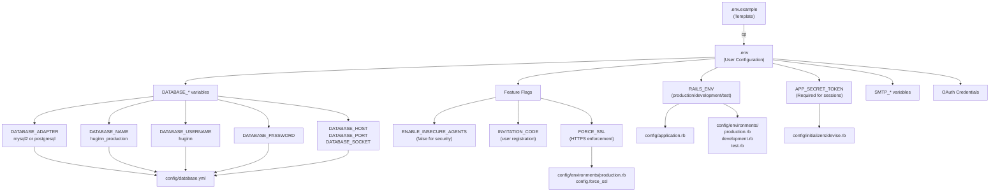

**Sources:** [README.md:65-66](), [doc/manual/installation.md:207-241](), [config/database.yml:1-42]()

### Critical Environment Variables

#### Database Configuration

**MySQL Example** [doc/manual/installation.md:212-228]():
```bash
DATABASE_ADAPTER=mysql2
DATABASE_RECONNECT=true
DATABASE_NAME=huginn_production
DATABASE_POOL=20
DATABASE_USERNAME=huginn
DATABASE_PASSWORD='your_secure_password'
# Optional: DATABASE_HOST, DATABASE_PORT, DATABASE_SOCKET

DATABASE_ENCODING=utf8
# For MySQL >= 5.5.3, use utf8mb4 for emoji support:
# DATABASE_ENCODING=utf8mb4
```

**PostgreSQL Example** [doc/manual/installation.md:230-241]():
```bash
DATABASE_ADAPTER=postgresql
DATABASE_RECONNECT=true
DATABASE_NAME=huginn_production
DATABASE_POOL=20
DATABASE_USERNAME=huginn
DATABASE_PASSWORD='your_secure_password'
DATABASE_HOST=localhost
DATABASE_PORT=5432
DATABASE_ENCODING=utf8
```

**Database Configuration Processing** [config/database.yml:30-42]():

The `config/database.yml` file reads environment variables with fallback defaults:
- `adapter`: `ENV['DATABASE_ADAPTER']` defaults to `mysql2`
- `encoding`: `ENV['DATABASE_ENCODING']` defaults to `utf8`
- `pool`: `ENV['DATABASE_POOL']` defaults to `20`
- Socket auto-detection for MySQL: `/var/run/mysqld/mysqld.sock`, `/opt/local/var/run/mysql5/mysqld.sock`, `/tmp/mysql.sock`

#### Application Configuration

**Required Variables:**
- `APP_SECRET_TOKEN`: Cryptographic secret for session cookies (must be unique per installation)
- `RAILS_ENV`: Set to `production` for production deployments [doc/manual/installation.md:243-245]()

**Security Variables:**
- `ENABLE_INSECURE_AGENTS`: Controls whether dangerous agents (ShellCommandAgent, etc.) are available
- `FORCE_SSL`: Enforces HTTPS connections [doc/manual/installation.md:386-387]()
- `INVITATION_CODE`: Required code for user registration (if enabled)

**Sources:** [README.md:65-66](), [doc/manual/installation.md:207-255]()

### Unicorn Configuration

The web server configuration is managed via `config/unicorn.rb`.

**Key Settings** [doc/manual/installation.md:247-252]():
```ruby
# config/unicorn.rb
worker_processes 2  # Adjust based on available RAM
working_directory "/home/huginn/huginn"
listen "/home/huginn/huginn/tmp/sockets/unicorn.socket"
timeout 30
pid "/home/huginn/huginn/tmp/pids/unicorn.pid"
```

**Worker Calculation** [doc/manual/requirements.md:53-60]():
- 512MB RAM: 1 worker
- 1GB+ RAM: 2 workers (recommended)
- General rule: CPU cores = unicorn workers
- Each additional 300MB RAM supports one more DelayedJob worker

**Sources:** [doc/manual/installation.md:204-206](), [doc/manual/requirements.md:53-60]()

## Platform-as-a-Service Deployments

### Heroku Deployment

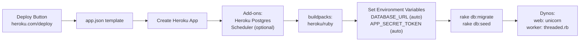

**Deployment Command** [README.md:109]():
```bash
# One-click deploy via Heroku button
# Or manual:
heroku create your-huginn-app
git push heroku master
heroku run rake db:migrate
heroku run rake db:seed
```

**Requirements:**
- Paid Heroku plan required (no free tier support)
- Heroku Postgres add-on (automatically provisioned)
- At least 1GB dyno recommended

**Updates** [doc/heroku/update.md:1-10]():
```bash
git fetch origin
git merge origin/master
git push -f heroku master
heroku run rake db:migrate
```

**Sources:** [README.md:107-109](), [doc/heroku/update.md:1-10]()

### OpenShift Deployment

OpenShift deployments use JSON templates for MySQL or PostgreSQL variants.

**Template Deployment** [README.md:117-124]():
```bash
# MySQL variant
oc new-app -f https://raw.githubusercontent.com/huginn/huginn/master/openshift/templates/huginn-mysql.json

# PostgreSQL variant
oc new-app -f https://raw.githubusercontent.com/huginn/huginn/master/openshift/templates/huginn-postgresql.json
```

**Platform Support:**
- OpenShift v3 installations
- OpenShift v4 (current online version)
- Can also import via web console: "Add to Project" → "Import YAML/JSON"

**Sources:** [README.md:111-129]()

## Post-Installation Steps

### Initial Access

After successful deployment, access Huginn via:
- Docker: `http://localhost:3000`
- Manual: `http://YOUR_SERVER_FQDN`
- Heroku/OpenShift: Provided deployment URL

**Default Credentials** [doc/manual/installation.md:366-369]():
- Username: `admin` (or `SEED_USERNAME` if customized)
- Password: `password` (or `SEED_PASSWORD` if customized)

**Important:** Change the default password immediately when exposed to the internet.

### Database Initialization

The database is initialized with seed data [doc/manual/installation.md:267-275]():
```bash
sudo -u huginn -H bundle exec rake db:seed RAILS_ENV=production \
  SEED_USERNAME=admin SEED_PASSWORD=password
```

This creates:
- Initial admin user
- Example agents demonstrating Huginn capabilities
- Default configuration values

### Service Management

**Manual Installation** [doc/manual/installation.md:374]():
```bash
# Start services
cd /home/huginn/huginn && sudo bundle exec rake production:start

# Stop services
cd /home/huginn/huginn && sudo bundle exec rake production:stop

# Check status
sudo bundle exec rake production:status

# Force stop (if stuck)
sudo bundle exec rake production:force_stop
```

**Docker:**
```bash
# Multi-process image
docker stop <container_id>
docker start <container_id>

# Single-process image (use docker-compose)
docker-compose down
docker-compose up -d
```

**Sources:** [doc/manual/installation.md:319-322](), [doc/manual/installation.md:374](), [doc/manual/update.md:12-23]()

### Log Files and Troubleshooting

**Manual Installation Log Locations** [doc/manual/installation.md:420-461]():

| Log File | Purpose | Common Issues |
|----------|---------|---------------|
| `/var/log/nginx/huginn_error.log` | Nginx errors | Unicorn socket connection failures, permission errors |
| `/home/huginn/huginn/log/unicorn.log` | Web server requests | Ruby exceptions, gem dependency issues |
| `/home/huginn/huginn/log/production.log` | Rails application | Agent errors, database queries |
| `/home/huginn/huginn/log/*/current` | Background workers | Agent check failures, runit process logs |

**Troubleshooting Commands** [doc/manual/installation.md:417-418]():
```bash
# Run self-check
cd /home/huginn/huginn
sudo bundle exec rake production:check

# Monitor all logs
tail -f /home/huginn/huginn/log/*/current
```

**Docker Logs:**
```bash
docker logs <container_id>
docker logs -f <container_id>  # Follow logs
```

**Sources:** [doc/manual/installation.md:411-465]()

### Security Hardening

**HTTPS Configuration** [doc/manual/installation.md:382-409]():

1. Set `.env` variable:
   ```bash
   FORCE_SSL=true
   ```

2. Use SSL Nginx configuration:
   ```bash
   sudo cp deployment/nginx/huginn-ssl /etc/nginx/sites-available/huginn
   ```

3. Configure SSL certificates:
   - Update `ssl_certificate` path
   - Update `ssl_certificate_key` path
   - Use Let's Encrypt or commercial certificates (avoid self-signed)

4. Re-export and restart:
   ```bash
   sudo service nginx restart
   sudo bundle exec rake production:export
   ```

**Additional Security:**
- Install firewall (ufw recommended) [doc/manual/installation.md:378]()
- Change default admin password immediately
- Set `INVITATION_CODE` to control user registration
- Keep `ENABLE_INSECURE_AGENTS=false` unless specifically needed

**Sources:** [doc/manual/installation.md:380-409](), [README.md:145-147]()

## Configuration Updates

When modifying configuration after initial installation, certain actions are required:

**After changing `.env`, `Procfile`, or `config/unicorn.rb`** [doc/manual/installation.md:259]():
```bash
cd /home/huginn/huginn
sudo bundle exec rake production:export  # Re-generate runit scripts
```

**After code updates** [doc/manual/update.md:74-86]():
```bash
bundle install --deployment --without development test
bundle exec rake db:migrate RAILS_ENV=production
bundle exec rake assets:clean assets:precompile RAILS_ENV=production
```

**Sources:** [doc/manual/installation.md:259](), [doc/manual/update.md:1-120]()

## Hardware and Software Requirements

### Minimum Requirements

[doc/manual/requirements.md:44-51]():
- **RAM:** 0.5GB physical + 0.5GB swap (minimum, not recommended)
- **Recommended RAM:** 2GB for production with 2 unicorn workers
- **CPU:** Single core works, dual core recommended
- **Disk:** Varies based on event retention and database size

### Supported Platforms

**Operating Systems** [doc/manual/requirements.md:5-20]():
- Ubuntu 18.04, 16.04, 14.04 (supported)
- Debian Stretch, Jessie, BullsEye (supported)
- CentOS, RHEL, Arch, Fedora, FreeBSD (unsupported but possible)
- Windows: Not supported (use Docker or VM)

**Ruby Version** [doc/manual/requirements.md:28-32]():
- Ruby 3.2.6 (current requirement)
- MRI implementation only (JRuby and Rubinius not supported due to native extensions)

**Databases** [doc/manual/installation.md:92-174]():
- MySQL 5.5.3+ (supports utf8mb4)
- MariaDB (drop-in MySQL replacement)
- PostgreSQL 9.4+

**Sources:** [doc/manual/requirements.md:1-69](), [doc/manual/installation.md:72-79]()

---

# Page: Docker Deployment

# Docker Deployment

<details>
<summary>Relevant source files</summary>

The following files were used as context for generating this wiki page:

- [doc/README.md](doc/README.md)
- [doc/docker/install.md](doc/docker/install.md)
- [doc/heroku/update.md](doc/heroku/update.md)
- [doc/manual/installation.md](doc/manual/installation.md)
- [doc/manual/requirements.md](doc/manual/requirements.md)
- [doc/manual/update.md](doc/manual/update.md)
- [docker/README.md](docker/README.md)
- [docker/scripts/prepare](docker/scripts/prepare)
- [lib/tasks/database_test.rake](lib/tasks/database_test.rake)

</details>


This document covers Docker-based deployment options for Huginn, including single-container (all-in-one) and multi-container architectures. For manual installation on Linux servers, see [Manual Installation](#2.2). For environment variable configuration details, see [Configuration System](#2.3).

## Overview

Huginn provides two Docker image types with different deployment strategies. The all-in-one image packages all processes and an internal MySQL database into a single container for quick evaluation. The single-process image enables production-ready multi-container deployments where web servers and background workers run in separate, independently scalable containers.

**Sources:** [docker/README.md:1-13](), [doc/docker/install.md:1-6]()

## Image Architecture

### All-in-One Image: huginn/huginn

The `huginn/huginn` image runs multiple processes within a single container using process management. When no external database is linked, it starts an internal MySQL instance automatically. This approach simplifies initial deployment but complicates maintenance, backups, and scaling.

**Container Contents:**
- Web server process (Unicorn)
- Background worker process (threaded.rb)
- Internal MySQL database (optional, when not linked externally)
- All application code and dependencies

**Use Cases:**
- Rapid evaluation and testing
- Development environments
- Single-user deployments
- Scenarios where container orchestration is unavailable

**Sources:** [docker/README.md:6-8](), [doc/docker/install.md:9-15]()

### Single-Process Image: huginn/huginn-single-process

The `huginn/huginn-single-process` image runs exactly one process per container, following Docker best practices. This architecture requires at least two containers (web + worker) and an external database. Individual worker processes can be distributed across multiple containers for horizontal scaling.

**Container Process Types:**
- `web`: Runs the Unicorn web server
- `jobs`: Runs the threaded background worker (bin/threaded.rb)

**Use Cases:**
- Production deployments
- High-availability configurations
- Environments requiring independent scaling of web and worker processes
- Container orchestration platforms (Docker Compose, Kubernetes)

**Sources:** [docker/README.md:10-12](), [doc/docker/install.md:20-22]()

## Image Architecture Comparison

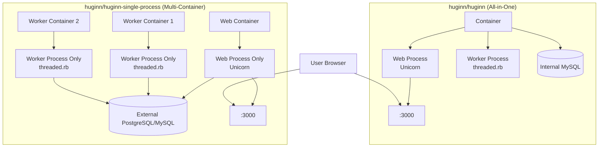

**Sources:** [docker/README.md:4-12]()

## Quick Start Evaluation Setup

The fastest way to evaluate Huginn is using the all-in-one image with default settings:

**Basic Command:**
```bash
docker run -it -p 3000:3000 ghcr.io/huginn/huginn
```

**Access:**
- URL: `http://localhost:3000`
- Username: `admin`
- Password: `password`

**Process Flow:**

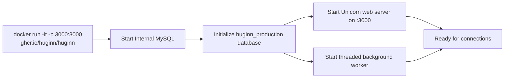

**Limitations:**
- Data persistence requires volume mounting (not shown in basic command)
- Single point of failure (all processes in one container)
- Difficult to scale workers independently
- Internal MySQL makes backups complex

**Sources:** [doc/docker/install.md:9-15]()

## Production Deployment with External Database

### Environment Variable Configuration

Docker deployments use environment variables instead of the `.env` file used in manual installations. Variables are passed via the `docker run -e` flag or Docker Compose environment sections.

**Critical Configuration Variables:**

| Variable | Purpose | Example Value |
|----------|---------|---------------|
| `DATABASE_ADAPTER` | Database type | `postgresql` or `mysql2` |
| `DATABASE_NAME` | Database name | `huginn_production` |
| `DATABASE_USERNAME` | Database user | `huginn` |
| `DATABASE_PASSWORD` | Database password | (secret) |
| `DATABASE_HOST` | Database hostname | `postgres-container` |
| `DATABASE_PORT` | Database port | `5432` (PostgreSQL) or `3306` (MySQL) |
| `RAILS_ENV` | Rails environment | `production` |
| `APP_SECRET_TOKEN` | Session encryption key | (generated secret) |
| `DOMAIN` | Public hostname | `huginn.example.com` |

**Sources:** [doc/docker/install.md:16-18](), [doc/manual/installation.md:209-242]()

### Single-Container Production Setup

Example using external PostgreSQL:

```bash
docker run -d \
  --name huginn \
  -p 3000:3000 \
  -e DATABASE_ADAPTER=postgresql \
  -e DATABASE_HOST=db.example.com \
  -e DATABASE_NAME=huginn_production \
  -e DATABASE_USERNAME=huginn \
  -e DATABASE_PASSWORD=secret \
  -e RAILS_ENV=production \
  -e APP_SECRET_TOKEN=$(openssl rand -hex 64) \
  -e DOMAIN=huginn.example.com \
  ghcr.io/huginn/huginn
```

**Sources:** [doc/docker/install.md:16-18]()

### Multi-Container Production Architecture

Using `huginn/huginn-single-process` enables horizontal scaling and process isolation:

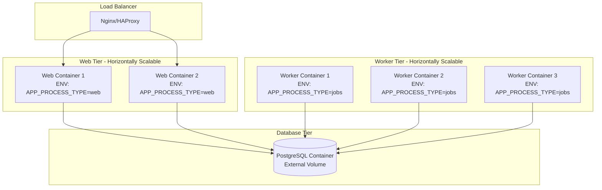

**Process Type Selection:**

The `APP_PROCESS_TYPE` environment variable determines which process runs in each container:
- `web`: Executes the Unicorn web server (corresponds to `web:` in Procfile)
- `jobs`: Executes the threaded background worker (corresponds to `jobs:` in Procfile)

**Sources:** [docker/README.md:10-12](), [doc/docker/install.md:20-22]()

### Docker Compose Example

**File Structure for Multi-Container Setup:**

```yaml
# Example: docker-compose.yml (conceptual)
services:
  postgres:
    image: postgres:15
    environment:
      POSTGRES_USER: huginn
      POSTGRES_PASSWORD: secret
      POSTGRES_DB: huginn_production
    volumes:
      - postgres-data:/var/lib/postgresql/data
  
  web:
    image: huginn/huginn-single-process
    environment:
      APP_PROCESS_TYPE: web
      DATABASE_ADAPTER: postgresql
      DATABASE_HOST: postgres
      DATABASE_NAME: huginn_production
      DATABASE_USERNAME: huginn
      DATABASE_PASSWORD: secret
      RAILS_ENV: production
    ports:
      - "3000:3000"
    depends_on:
      - postgres
  
  worker:
    image: huginn/huginn-single-process
    environment:
      APP_PROCESS_TYPE: jobs
      DATABASE_ADAPTER: postgresql
      DATABASE_HOST: postgres
      DATABASE_NAME: huginn_production
      DATABASE_USERNAME: huginn
      DATABASE_PASSWORD: secret
      RAILS_ENV: production
    depends_on:
      - postgres

volumes:
  postgres-data:
```

**Scaling Workers:**
```bash
docker-compose up --scale worker=3
```

**Sources:** [docker/README.md:12]()

## Image Build Process

The Docker images are built using multi-stage builds and system preparation scripts.

### Build-Time Dependencies

The `prepare` script installs system packages required for compiling Ruby gems with native extensions:

**Package Categories:**
- **Build Tools:** build-essential, checkinstall, git-core
- **Ruby Dependencies:** zlib1g-dev, libyaml-dev, libssl-dev, libgdbm-dev, libreadline-dev, libncurses5-dev, libffi-dev
- **XML/HTTP:** libxml2-dev, libxslt-dev, libcurl4-openssl-dev
- **Database Clients:** libmysqlclient-dev, libpq-dev, libsqlite3-dev
- **Utilities:** graphviz, shared-mime-info, iputils-ping

**Optimizations:**
- Documentation removal to reduce image size ([docker/scripts/prepare:4-14]())
- Locale generation limited to en_US.UTF-8 ([docker/scripts/prepare:31-32]())
- Python and unnecessary packages purged ([docker/scripts/prepare:36]())
- Latest jq binary downloaded for JqAgent support ([docker/scripts/prepare:46-47]())

**Sources:** [docker/scripts/prepare:1-51]()

### Image Layer Structure

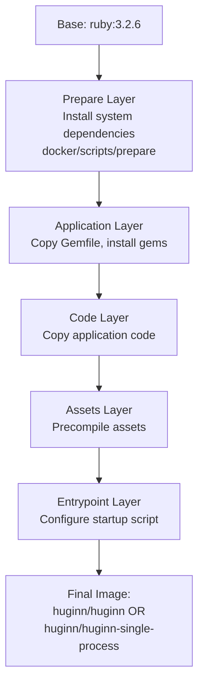

**File Ownership:**
- Application runs as non-root user
- `/app` directory permissions configured ([docker/scripts/prepare:49-50]())
- `/etc/passwd` made group-writable for OpenShift compatibility ([docker/scripts/prepare:50]())

**Sources:** [docker/scripts/prepare:49-51]()

## Process Management in Containers

### Procfile-Based Process Definition

Docker containers execute processes defined in the `Procfile`. The manual installation guide references this same file, but Docker uses it differently:

**Procfile Process Types** (from manual installation context):

```
web: bundle exec unicorn -c config/unicorn.rb
jobs: bundle exec rails runner bin/threaded.rb
```

In Docker:
- **All-in-One Image:** Runs both `web` and `jobs` processes simultaneously using a process supervisor
- **Single-Process Image:** Runs only the process specified by `APP_PROCESS_TYPE` environment variable

**Sources:** [doc/manual/installation.md:286-302]()

### Worker Process: bin/threaded.rb

The background worker executes scheduled agent checks and event propagation. The threaded implementation runs multiple tasks concurrently within a single process.

**Worker Responsibilities:**
- Execute scheduled agents via `AgentCheckJob`
- Process event propagation via `AgentReceiveJob`
- Manage delayed job queue
- Handle agent memory state persistence

**Sources:** [doc/manual/installation.md:295]()

### Web Process: Unicorn

The Unicorn web server handles HTTP requests from users and external webhooks.

**Configuration:**
- Worker count determined by available RAM
- Unix socket communication with reverse proxy (in manual setups)
- Port 3000 exposed in Docker containers

**Sources:** [doc/manual/installation.md:247-252](), [doc/manual/installation.md:299]()

## Database Connectivity

### Database Adapters

Huginn supports two database adapters, selected via `DATABASE_ADAPTER`:

| Adapter | Gem | Use Case |
|---------|-----|----------|
| `mysql2` | mysql2 | MySQL 5.5+, MariaDB |
| `postgresql` | pg | PostgreSQL 9.3+ |

**Adapter Dependencies Installed:**
- `libmysqlclient-dev` for mysql2 gem ([docker/scripts/prepare:29]())
- `libpq-dev` for pg gem ([docker/scripts/prepare:29]())
- `libsqlite3-dev` for development/testing ([docker/scripts/prepare:29]())

**Sources:** [docker/scripts/prepare:29](), [lib/tasks/database_test.rake:1-10]()

### Connection Configuration Flow

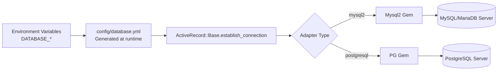

**Connection Validation:**

The `database_test:ping` task verifies database connectivity:
- Loads ActiveRecord, mysql2, and pg gems ([lib/tasks/database_test.rake:4-6]())
- Establishes connection ([lib/tasks/database_test.rake:7]())
- Verifies connection alive ([lib/tasks/database_test.rake:8]())

**Sources:** [lib/tasks/database_test.rake:1-10]()

### Database Encoding

**MySQL/MariaDB:**
- Default: `utf8`
- MySQL ≥5.5.3: Use `utf8mb4` for 4-byte UTF-8 characters (emoji support)
- Set via `DATABASE_ENCODING=utf8mb4`

**PostgreSQL:**
- Default: `utf8`
- No special configuration needed

**Sources:** [doc/manual/installation.md:224-228]()

## Container Startup Sequence

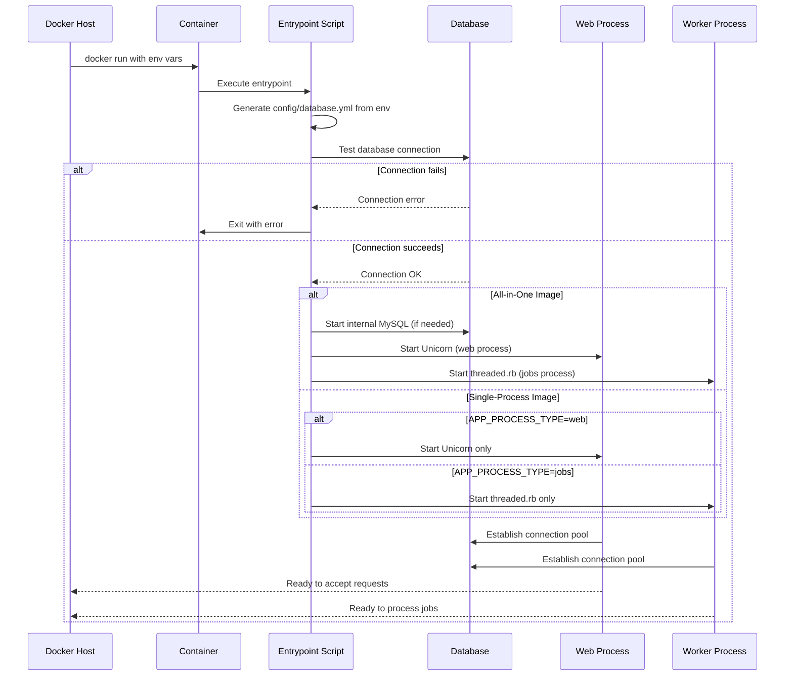

**Sources:** [docker/README.md:6-12]()

## Comparison with Manual Installation

| Aspect | Docker Deployment | Manual Installation |
|--------|-------------------|---------------------|
| **Process Management** | Docker/Supervisor | Runit ([doc/manual/installation.md:286-312]()) |
| **Configuration** | Environment variables | `.env` file ([doc/manual/installation.md:189-211]()) |
| **Init System** | Container restart policies | Runit service directory ([doc/manual/installation.md:309]()) |
| **Reverse Proxy** | Optional (direct port exposure) | Nginx required ([doc/manual/installation.md:323-361]()) |
| **Ruby Installation** | Pre-installed in image | Compiled from source ([doc/manual/installation.md:64-79]()) |
| **Database** | Container linking or internal | Local system service ([doc/manual/installation.md:92-175]()) |
| **Updates** | Pull new image | Git pull + bundle install ([doc/update.md:3-120]()) |
| **Logs** | Docker logs commands | Runit log directories ([doc/manual/installation.md:451-461]()) |

**Sources:** [docker/README.md:1-13](), [doc/manual/installation.md:20-489](), [doc/update.md:1-120]()

## Volume Mounting for Data Persistence

Both image types require volume mounting to persist data across container restarts:

**Recommended Volumes:**

| Path in Container | Purpose | Critical |
|-------------------|---------|----------|
| `/var/lib/mysql` | Internal MySQL data (all-in-one only) | Yes |
| `/app/log` | Application logs | No |
| `/app/tmp` | Temporary files, job queues | No |

**Note:** When using external databases, only log and tmp volumes are relevant. Database persistence is handled by the database container's own volumes.

**Sources:** [docker/README.md:8]()

## Troubleshooting Docker Deployments

### Common Issues

**Database Connection Failures:**
- Verify `DATABASE_HOST` resolves correctly from within container
- Check `DATABASE_PORT` matches database server configuration
- Ensure database user has correct permissions
- For Docker Compose, verify service names match `DATABASE_HOST`

**Process Not Starting:**
- Check Docker logs: `docker logs <container_name>`
- For single-process image, verify `APP_PROCESS_TYPE` is set to `web` or `jobs`
- Ensure `RAILS_ENV=production` is set

**Assets Not Loading:**
- Assets are precompiled during image build
- Rebuilding container may be required after pulling new image
- Check for JavaScript console errors indicating missing asset paths

**Sources:** [doc/manual/installation.md:411-465]()

### Log Access

**Docker Logs Command:**
```bash
# View all logs
docker logs huginn

# Follow logs in real-time
docker logs -f huginn

# Last 100 lines
docker logs --tail 100 huginn
```

**Log Files Inside Container:**
- Application log: `/app/log/production.log`
- Unicorn log: `/app/log/unicorn.log`
- Worker logs: Visible in `docker logs` output

**Sources:** [doc/manual/installation.md:432-461]()

## Migration from Manual Installation

To migrate from a manual installation to Docker:

1. **Backup Database:**
   - Export database using `mysqldump` or `pg_dump`
   
2. **Start Database Container:**
   - Import database dump into containerized database

3. **Configure Environment Variables:**
   - Transfer settings from `.env` file to Docker environment variables
   - Update `DATABASE_HOST` to point to database container

4. **Start Application Container:**
   - Use `huginn/huginn-single-process` for production deployments
   - Deploy separate web and worker containers

5. **Update DNS/Reverse Proxy:**
   - Point to new container port or load balancer

**Sources:** [doc/manual/installation.md:176-282]()

---

# Page: Manual Installation

# Manual Installation

<details>
<summary>Relevant source files</summary>

The following files were used as context for generating this wiki page:

- [.dockerignore](.dockerignore)
- [README.md](README.md)
- [config/database.yml](config/database.yml)
- [doc/README.md](doc/README.md)
- [doc/docker/install.md](doc/docker/install.md)
- [doc/heroku/update.md](doc/heroku/update.md)
- [doc/manual/installation.md](doc/manual/installation.md)
- [doc/manual/requirements.md](doc/manual/requirements.md)
- [doc/manual/update.md](doc/manual/update.md)
- [docker/scripts/prepare](docker/scripts/prepare)

</details>


This page provides detailed instructions for installing Huginn manually on Debian/Ubuntu systems. Manual installation gives you maximum control over the deployment and is recommended for production environments where you need fine-grained configuration.

For containerized deployments, see [Docker Deployment](#2.1). For configuration details after installation, see [Configuration System](#2.3).

## Overview

Manual installation involves setting up a complete Ruby application stack with the following components:

```mermaid
graph TB
    subgraph "System Layer"
        OS["Debian/Ubuntu OS"]
        Packages["System Packages<br/>build-essential, git, etc"]
        Ruby["Ruby 3.2.6<br/>Compiled from source"]
    end
    
    subgraph "User Layer"
        HuginnUser["huginn system user<br/>/home/huginn"]
    end
    
    subgraph "Application Layer"
        Code["Huginn Source<br/>/home/huginn/huginn"]
        Gems["Bundled Dependencies<br/>deployment mode"]
        DotEnv[".env Configuration"]
    end
    
    subgraph "Data Layer"
        DB["MySQL or PostgreSQL<br/>huginn_production"]
    end
    
    subgraph "Process Management"
        Runit["Runit Service Manager<br/>/etc/service"]
        Unicorn["Unicorn Web Server<br/>config/unicorn.rb"]
        Worker["threaded.rb Worker<br/>Background jobs"]
    end
    
    subgraph "Web Layer"
        Nginx["Nginx Reverse Proxy<br/>/etc/nginx/sites-available/huginn"]
        Socket["Unix Socket<br/>tmp/sockets/unicorn.socket"]
    end
    
    OS --> Packages
    Packages --> Ruby
    OS --> HuginnUser
    HuginnUser --> Code
    Ruby --> Gems
    Code --> Gems
    Code --> DotEnv
    DotEnv --> DB
    
    Code --> Runit
    Runit --> Unicorn
    Runit --> Worker
    Unicorn --> Socket
    Worker --> DB
    
    Nginx --> Socket
    
    style Runit fill:#f9f9f9,stroke:#333,stroke-width:2px
    style DotEnv fill:#f9f9f9,stroke:#333,stroke-width:2px
```

**Sources:** [doc/manual/installation.md:20-30](), [README.md:131-133]()

## Prerequisites and System Requirements

Manual installation is supported on:
- **Ubuntu:** 18.04, 16.04, 14.04
- **Debian:** Stretch, Jessie, Bullseye

### Hardware Requirements

| Component | Minimum | Recommended |
|-----------|---------|-------------|
| CPU | Single core | Dual core |
| RAM | 512MB | 2GB |
| Swap | 512MB | 1GB |
| Disk | 2GB | 5GB |

The system requires a Unix-based operating system. Windows is not supported.

**Sources:** [doc/manual/requirements.md:1-27](), [doc/manual/requirements.md:34-52]()

## Installation Process

### Step 1: System Packages and Dependencies

Update the system and install `sudo`:

```bash
# Run as root
apt-get update -y
apt-get upgrade -y
apt-get install sudo -y
```

Install required build dependencies and runtime packages:

```bash
sudo apt-get install -y runit build-essential git zlib1g-dev libyaml-dev \
  libssl-dev libgdbm-dev libreadline-dev libncurses5-dev libffi-dev curl \
  openssh-server checkinstall libxml2-dev libxslt-dev libcurl4-openssl-dev \
  libicu-dev logrotate pkg-config cmake nodejs graphviz jq shared-mime-info
```

**Platform-specific adjustments:**

For **Debian Stretch** (requires OpenSSL 1.0 and runit-systemd):
```bash
sudo apt-get install -y runit-systemd libssl1.0-dev
```

For **Ubuntu 18.04 Bionic** (requires runit-systemd):
```bash
sudo apt-get install -y runit-systemd
```

These packages provide:
- **Build tools:** `build-essential`, `cmake` for compiling Ruby and native gems
- **Ruby dependencies:** `zlib1g-dev`, `libyaml-dev`, `libssl-dev`, `libreadline-dev`
- **XML/HTML processing:** `libxml2-dev`, `libxslt-dev` (for Nokogiri)
- **Process management:** `runit`, `runit-systemd`
- **Utilities:** `jq` (for JqAgent), `graphviz` (for diagrams), `nodejs` (asset pipeline)

**Sources:** [doc/manual/installation.md:31-62](), [docker/scripts/prepare:26-30]()

### Step 2: Ruby Installation from Source

Huginn requires Ruby 3.2.6 compiled from source. Using system Ruby version managers (RVM, rbenv, chruby) is not recommended for production as it leads to permission and path issues.

```mermaid
graph LR
    Download["Download Ruby 3.2.6<br/>from cache.ruby-lang.org"]
    Extract["Extract tarball<br/>/tmp/ruby"]
    Configure["./configure<br/>--disable-install-rdoc"]
    Compile["make -j nproc<br/>Parallel compilation"]
    Install["make install<br/>System-wide"]
    Foreman["gem install foreman<br/>Process manager"]
    
    Download --> Extract
    Extract --> Configure
    Configure --> Compile
    Compile --> Install
    Install --> Foreman
```

**Installation commands:**

```bash
# Remove old Ruby versions
sudo apt-get remove -y ruby1.8 ruby1.9

# Download and compile Ruby 3.2.6
mkdir /tmp/ruby && cd /tmp/ruby
curl -L --progress-bar https://cache.ruby-lang.org/pub/ruby/3.2/ruby-3.2.6.tar.xz | tar xJ
cd ruby-3.2.6
./configure --disable-install-rdoc
make -j`nproc`
sudo make install

# Install foreman for process management
sudo gem install foreman --no-document
```

The `--disable-install-rdoc` flag skips documentation generation, reducing installation time. The `-j$(nproc)` flag enables parallel compilation using all available CPU cores.

**Sources:** [doc/manual/installation.md:64-83](), [doc/manual/update.md:54-71]()

### Step 3: System User Creation

Create a dedicated `huginn` user without login capability:

```bash
sudo adduser --disabled-login --gecos 'Huginn' huginn
```

This creates:
- User: `huginn`
- Home directory: `/home/huginn`
- No password (login disabled)

All Huginn processes will run as this unprivileged user for security.

**Sources:** [doc/manual/installation.md:85-89]()

### Step 4: Database Setup

Huginn supports both MySQL/MariaDB and PostgreSQL. Choose one based on your requirements.

#### MySQL/MariaDB Installation

```mermaid
graph TB
    Install["Install MySQL packages<br/>mysql-server mysql-client libmysqlclient-dev"]
    Secure["mysql_secure_installation<br/>Set root password"]
    CreateUser["CREATE USER huginn@localhost"]
    SetEngine["SET default_storage_engine=INNODB"]
    Grant["GRANT permissions<br/>on huginn_production.*"]
    Flush["FLUSH PRIVILEGES"]
    
    Install --> Secure
    Secure --> CreateUser
    CreateUser --> SetEngine
    SetEngine --> Grant
    Grant --> Flush
```

**Installation commands:**

```bash
# Install packages (Debian Stretch: use default-libmysqlclient-dev)
sudo apt-get install -y mysql-server mysql-client libmysqlclient-dev

# For Debian Bullseye
sudo apt-get install -y default-mysql-server default-mysql-client default-libmysqlclient-dev

# Secure installation
sudo mysql_secure_installation

# Login to MySQL
mysql -u root -p
```

**Database configuration (in MySQL shell):**

```sql
-- Create huginn user
CREATE USER 'huginn'@'localhost' IDENTIFIED BY 'your_password';

-- Ensure InnoDB engine is available
SET default_storage_engine=INNODB;

-- Grant permissions
GRANT SELECT, INSERT, UPDATE, DELETE, CREATE, DROP, INDEX, ALTER, LOCK TABLES 
  ON `huginn_production`.* TO 'huginn'@'localhost';

-- Apply changes
FLUSH PRIVILEGES;
```

Test the connection:
```bash
sudo -u huginn -H mysql -u huginn -p -D huginn_production
# Should see: ERROR 1049 (42000): Unknown database 'huginn_production'
# This is expected - the database will be created later
```

**Ubuntu-specific note:** On Ubuntu systems (>= 5.7.26), MySQL uses the `auth_socket` plugin by default. To set a password for the root user:

```sql
ALTER USER 'root'@'localhost' IDENTIFIED WITH mysql_native_password BY 'new-password';
```

**Sources:** [doc/manual/installation.md:91-152](), [doc/manual/installation.md:473-488]()

#### PostgreSQL Installation

```bash
# Install packages
sudo apt-get install -y postgresql libpq-dev

# Create user with password (-d allows database creation)
sudo -u postgres -H createuser -P huginn

# Create database
sudo -u postgres -H createdb -O huginn -T template0 huginn_production

# Test connection
sudo -u huginn psql -h localhost -W huginn_production
```

**Sources:** [doc/manual/installation.md:154-174]()

### Step 5: Huginn Application Setup

#### Clone the Repository

```bash
cd /home/huginn
sudo -u huginn -H git clone https://github.com/huginn/huginn.git -b master huginn
cd /home/huginn/huginn
```

#### Initialize Directory Structure

```bash
# Copy configuration template
sudo -u huginn -H cp .env.example .env

# Create required directories
sudo -u huginn mkdir -p log tmp/pids tmp/sockets

# Set permissions
sudo chown -R huginn log/ tmp/
sudo chmod -R u+rwX,go-w log/ tmp/
sudo -u huginn -H chmod o-rwx .env

# Copy Unicorn configuration
sudo -u huginn -H cp config/unicorn.rb.example config/unicorn.rb
```

**Sources:** [doc/manual/installation.md:176-206]()

#### Configure .env File

Edit `/home/huginn/huginn/.env` to configure the application:

```bash
sudo -u huginn -H editor .env
```

**MySQL configuration:**

```bash
DATABASE_ADAPTER=mysql2
DATABASE_RECONNECT=true
DATABASE_NAME=huginn_production
DATABASE_POOL=20
DATABASE_USERNAME=huginn
DATABASE_PASSWORD='your_password'

DATABASE_ENCODING=utf8
# For MySQL >= 5.5.3, use utf8mb4 for emoji support
# DATABASE_ENCODING=utf8mb4
```

**PostgreSQL configuration:**

```bash
DATABASE_ADAPTER=postgresql
DATABASE_RECONNECT=true
DATABASE_NAME=huginn_production
DATABASE_POOL=20
DATABASE_USERNAME=huginn
DATABASE_PASSWORD='your_password'
DATABASE_HOST=localhost
DATABASE_PORT=5432

DATABASE_ENCODING=utf8
```

**Critical settings:**

```bash
# Enable production environment
RAILS_ENV=production

# Generate secure token (required)
APP_SECRET_TOKEN=<generate_with_rake_secret>
```

The `.env` file maps to [config/database.yml:30-41]() for database configuration and provides environment variables for the entire application.

**Sources:** [doc/manual/installation.md:207-255](), [config/database.yml:30-41](), [README.md:65-66]()

#### Install Dependencies

```bash
sudo -u huginn -H bundle install --deployment --without development test
```

The `--deployment` flag installs gems to `vendor/bundle` and the `--without` flag excludes test and development dependencies.

**Sources:** [doc/manual/installation.md:261-263]()

#### Initialize Database

```bash
# Create the database
sudo -u huginn -H bundle exec rake db:create RAILS_ENV=production

# Run migrations
sudo -u huginn -H bundle exec rake db:migrate RAILS_ENV=production

# Seed with default admin user
sudo -u huginn -H bundle exec rake db:seed RAILS_ENV=production \
  SEED_USERNAME=admin SEED_PASSWORD=password
```

The seed task creates:
- Default admin user (username: `admin`, password: `password`)
- Example agents demonstrating capabilities
- Initial database schema

**Warning:** Change the default password after first login.

**Sources:** [doc/manual/installation.md:265-278]()

#### Precompile Assets

```bash
sudo -u huginn -H bundle exec rake assets:precompile RAILS_ENV=production
```

This compiles JavaScript, CSS, and other assets for production serving.

**Sources:** [doc/manual/installation.md:280-282]()

### Step 6: Process Management with Runit

Huginn uses `foreman` to generate `runit` service scripts from a `Procfile`.

```mermaid
graph TB
    Procfile["Procfile<br/>Process definitions"]
    Export["foreman export runit<br/>Generate service scripts"]
    EtcService["/etc/service<br/>Runit service directory"]
    WebService["/etc/service/huginn-web<br/>Unicorn process"]
    JobsService["/etc/service/huginn-jobs<br/>threaded.rb worker"]
    RunScript["run script<br/>Start process"]
    LogScript["log/run script<br/>Logging"]
    
    Procfile --> Export
    Export --> EtcService
    EtcService --> WebService
    EtcService --> JobsService
    WebService --> RunScript
    WebService --> LogScript
    JobsService --> RunScript
    JobsService --> LogScript
```

#### Edit Procfile

The `Procfile` defines which processes to run. Edit `/home/huginn/huginn/Procfile`:

```bash
sudo -u huginn -H editor Procfile
```

**For production, disable development entries** ([Procfile:6-7]()):
```
# web: bundle exec rails server -p ${PORT-3000} -b ${IP-0.0.0.0}
# jobs: bundle exec rails runner bin/threaded.rb
```

**Enable production entries** ([Procfile:24-25]() or [Procfile:28-31]()):
```
web: bundle exec unicorn -c config/unicorn.rb
jobs: bundle exec rails runner bin/threaded.rb
```

#### Export Runit Services

```bash
sudo bundle exec rake production:export
```

This generates service scripts in `/etc/service/huginn-{web,jobs}/` that `runit` automatically manages.

**Note:** Re-export whenever you modify `.env`, `Procfile`, or `config/unicorn.rb`.

**Sources:** [doc/manual/installation.md:284-311](), [doc/manual/installation.md:259]()

#### Verify Service Status

```bash
sudo bundle exec rake production:status
```

**Sources:** [doc/manual/installation.md:319-321]()

### Step 7: Nginx Reverse Proxy

Nginx serves as the reverse proxy and static asset server for Huginn.

```mermaid
graph LR
    Client["HTTP Client<br/>Port 80/443"]
    Nginx["Nginx<br/>/etc/nginx/sites-available/huginn"]
    Static["Static Assets<br/>/home/huginn/huginn/public"]
    Socket["Unix Socket<br/>tmp/sockets/unicorn.socket"]
    Unicorn["Unicorn Process<br/>Rails application"]
    
    Client --> Nginx
    Nginx -->|"Static files"| Static
    Nginx -->|"Dynamic requests"| Socket
    Socket --> Unicorn
```

#### Install Nginx

```bash
sudo apt-get install -y nginx
```

#### Configure Site

```bash
# Copy configuration template
sudo cp deployment/nginx/huginn /etc/nginx/sites-available/huginn
sudo ln -s /etc/nginx/sites-available/huginn /etc/nginx/sites-enabled/huginn

# Edit configuration
sudo editor /etc/nginx/sites-available/huginn
```

Key configuration points in the Nginx config:
- **upstream huginn:** Points to `unix:/home/huginn/huginn/tmp/sockets/unicorn.socket`
- **root:** Set to `/home/huginn/huginn/public` for static assets
- **server_name:** Replace `YOUR_SERVER_FQDN` with your domain
- **proxy_pass:** Routes dynamic requests to Unicorn via socket

**For HTTPS:** Use `deployment/nginx/huginn-ssl` instead and configure SSL certificates. See [Using HTTPS](#https-configuration).

#### Remove Default Site (Optional)

```bash
# Only if Huginn is the sole site
sudo rm /etc/nginx/sites-enabled/default
```

#### Test and Restart

```bash
# Validate configuration
sudo nginx -t

# Restart Nginx
sudo service nginx restart
```

**Sources:** [doc/manual/installation.md:323-360]()

### Step 8: Logrotate Configuration

Set up log rotation to prevent disk space issues:

```bash
sudo cp deployment/logrotate/huginn /etc/logrotate.d/huginn
```

Modify if using a non-default log directory.

**Sources:** [doc/manual/installation.md:313-317]()

## Process Architecture

```mermaid
graph TB
    subgraph "Runit Supervision"
        RunitWeb["runit: huginn-web"]
        RunitJobs["runit: huginn-jobs"]
    end
    
    subgraph "Web Layer"
        Unicorn["Unicorn Master<br/>config/unicorn.rb"]
        Worker1["Unicorn Worker 1"]
        Worker2["Unicorn Worker 2"]
        Socket["Unix Socket<br/>tmp/sockets/unicorn.socket"]
    end
    
    subgraph "Background Jobs"
        Threaded["bin/threaded.rb<br/>Rufus-Scheduler + Delayed Job"]
        Scheduler["Rufus-Scheduler<br/>Agent.check() scheduling"]
        DelayedJob["Delayed Job Workers<br/>Event propagation"]
    end
    
    subgraph "Data Store"
        DB["Database<br/>Events, Agents, Memory"]
    end
    
    RunitWeb --> Unicorn
    Unicorn --> Worker1
    Unicorn --> Worker2
    Worker1 --> Socket
    Worker2 --> Socket
    
    RunitJobs --> Threaded
    Threaded --> Scheduler
    Threaded --> DelayedJob
    
    Worker1 --> DB
    Worker2 --> DB
    Scheduler --> DB
    DelayedJob --> DB
```

The `threaded.rb` worker ([bin/threaded.rb]()) combines:
- **Rufus-Scheduler:** Triggers `Agent.check()` on scheduled agents
- **Delayed Job:** Processes background jobs (event propagation, long-running tasks)

Unicorn workers handle HTTP requests from Nginx via Unix socket. The number of Unicorn workers is configured in [config/unicorn.rb]() and should match CPU cores (recommended 2 for most systems).

**Sources:** [doc/manual/installation.md:284-311](), [doc/manual/requirements.md:53-69]()

## HTTPS Configuration

For production deployments, enable HTTPS:

**In `.env`:**
```bash
FORCE_SSL=true
```

**Use SSL Nginx config:**
```bash
sudo cp deployment/nginx/huginn-ssl /etc/nginx/sites-available/huginn
sudo editor /etc/nginx/sites-available/huginn
```

Configure:
- `YOUR_SERVER_FQDN`: Your domain name
- `ssl_certificate`: Path to certificate file
- `ssl_certificate_key`: Path to private key

**Self-signed certificate (development only):**
```bash
sudo mkdir -p /etc/nginx/ssl/
cd /etc/nginx/ssl/
sudo openssl req -newkey rsa:2048 -x509 -nodes -days 3560 -out huginn.crt -keyout huginn.key
sudo chmod o-r huginn.key
```

Re-export services after changing `.env`:
```bash
cd /home/huginn/huginn
sudo service nginx restart
sudo bundle exec rake production:export
```

**Sources:** [doc/manual/installation.md:382-409]()

## Post-Installation

### Initial Login

Access your Huginn instance at `http://YOUR_SERVER` (or `https://` if configured).

Default credentials:
- **Username:** `admin` (or `SEED_USERNAME` value)
- **Password:** `password` (or `SEED_PASSWORD` value)

**Important:** Change the default password immediately via the web interface.

### Managing Services

```bash
# Check status
cd /home/huginn/huginn && sudo bundle exec rake production:status

# Start services
cd /home/huginn/huginn && sudo bundle exec rake production:start

# Stop services
cd /home/huginn/huginn && sudo bundle exec rake production:stop

# Force stop (if stuck)
cd /home/huginn/huginn && sudo bundle exec rake production:force_stop
```

### Verify Installation

```bash
cd /home/huginn/huginn
sudo bundle exec rake production:check
```

This validates:
- Database connectivity
- Required directories and permissions
- Service status
- Configuration validity

**Sources:** [doc/manual/installation.md:363-377](), [doc/manual/update.md:5-10]()

## Troubleshooting

### Log File Locations

| Log File | Purpose |
|----------|---------|
| `/var/log/nginx/huginn_error.log` | Nginx errors |
| `/home/huginn/huginn/log/unicorn.log` | Unicorn HTTP requests |
| `/home/huginn/huginn/log/production.log` | Rails application log |
| `/home/huginn/huginn/log/*/current` | Runit service logs (web, jobs) |

### Common Issues

**Nginx 502 Bad Gateway:**
- Symptom: `connect() to unix:/home/huginn/huginn/tmp/sockets/unicorn.socket failed`
- Cause: Unicorn not running
- Solution: Check `Procfile` has uncommented `web:` line and re-export: `sudo bundle exec rake production:export`

**Permission Denied:**
- Symptom: `failed (13: Permission denied)` in Nginx logs
- Cause: Nginx cannot read `/home/huginn/huginn/public`
- Solution: Ensure `/home/huginn/huginn/public` is readable by `www-data` user

**Database Connection Errors:**
- Symptom: `Can't connect to MySQL server` or `could not connect to server`
- Cause: Wrong credentials in `.env` or database not running
- Solution: Verify `.env` credentials match database user, ensure database service is running

### Monitoring Logs

Monitor all background worker logs:
```bash
tail -f /home/huginn/huginn/log/*/current
```

List available log files:
```bash
ls -al /home/huginn/huginn/log/*/current
```

**Sources:** [doc/manual/installation.md:411-465]()

## Updating an Installation

To update an existing manual installation:

```bash
cd /home/huginn/huginn

# Stop services
sudo bundle exec rake production:stop

# Backup configuration
sudo -u huginn -H cp Procfile Procfile.bak

# Update code
sudo -u huginn -H git fetch --all
sudo -u huginn -H git checkout master
sudo -u huginn -H git pull

# Restore configuration
sudo -u huginn -H cp Procfile.bak Procfile

# Update dependencies
sudo -u huginn -H bundle install --deployment --without development test

# Migrate database
sudo -u huginn -H bundle exec rake db:migrate RAILS_ENV=production

# Precompile assets
sudo -u huginn -H bundle exec rake assets:clean assets:precompile tmp:cache:clear RAILS_ENV=production

# Re-export services (if .env or Procfile changed)
sudo bundle exec rake production:export

# Services will auto-start via runit
```

For Capistrano-based deployments, see [Capistrano documentation](https://github.com/huginn/huginn/blob/master/doc/manual/capistrano.md).

**Sources:** [doc/manual/update.md:1-120](), [README.md:376]()

## Security Recommendations

After installation:

1. **Change default password** immediately after first login
2. **Configure firewall** (ufw on Ubuntu/Debian):
   ```bash
   sudo apt-get install -y ufw
   sudo ufw allow 22/tcp  # SSH
   sudo ufw allow 80/tcp  # HTTP
   sudo ufw allow 443/tcp # HTTPS
   sudo ufw enable
   ```
3. **Enable HTTPS** for production deployments
4. **Regular updates:** Monitor the Huginn repository for security updates
5. **Backup strategy:** Regular backups of database and `.env` configuration

**Sources:** [doc/manual/installation.md:378]()

---

# Page: Configuration System

# Configuration System

<details>
<summary>Relevant source files</summary>

The following files were used as context for generating this wiki page:

- [.dockerignore](.dockerignore)
- [.env.example](.env.example)
- [README.md](README.md)
- [bin/setup](bin/setup)
- [config/application.rb](config/application.rb)
- [config/boot.rb](config/boot.rb)
- [config/database.yml](config/database.yml)
- [config/environment.rb](config/environment.rb)
- [config/environments/development.rb](config/environments/development.rb)
- [config/environments/production.rb](config/environments/production.rb)
- [config/environments/test.rb](config/environments/test.rb)
- [config/initializers/wrap_parameters.rb](config/initializers/wrap_parameters.rb)
- [config/spring.rb](config/spring.rb)

</details>


## Purpose and Scope

This document explains Huginn's configuration system, covering environment variables, the `.env` file structure, database configuration, and Rails environment settings. The configuration system controls application behavior, security settings, external integrations, and deployment-specific parameters.

For information about deploying Huginn with different configuration strategies, see [Docker Deployment](#2.1) and [Manual Installation](#2.2). For dependency management and gem configuration, see [Dependency Management](#7.1).

---

## Configuration Hierarchy

Huginn's configuration system operates in three layers: environment variables, Rails application configuration, and environment-specific overrides.

```mermaid
graph TB
    subgraph "Configuration Sources"
        ENV_EXAMPLE[".env.example<br/>Template with 260+ settings"]
        ENV[".env<br/>User configuration"]
        SYS_ENV["System Environment Variables"]
    end
    
    subgraph "Loading Mechanism"
        DOTENV["Dotenv gem<br/>vendor/gems/dotenv"]
        BOOT["config/boot.rb<br/>Bundler setup"]
        APP["config/application.rb<br/>Global defaults"]
    end
    
    subgraph "Environment-Specific Config"
        DEV["config/environments/development.rb"]
        PROD["config/environments/production.rb"]
        TEST["config/environments/test.rb"]
    end
    
    subgraph "Specialized Configuration"
        DB_YML["config/database.yml<br/>Database adapters"]
        MAILER["config/initializers/action_mailer.rb<br/>SMTP settings"]
        DEVISE["config/initializers/devise.rb<br/>Authentication"]
    end
    
    ENV_EXAMPLE -->|"cp .env.example .env"| ENV
    ENV --> DOTENV
    SYS_ENV --> DOTENV
    
    BOOT --> APP
    DOTENV --> APP
    
    APP --> DEV
    APP --> PROD
    APP --> TEST
    
    ENV --> DB_YML
    ENV --> MAILER
    ENV --> DEVISE
    
    DEV -->|"RAILS_ENV=development"| Runtime["Application Runtime"]
    PROD -->|"RAILS_ENV=production"| Runtime
    TEST -->|"RAILS_ENV=test"| Runtime
    
    DB_YML --> Runtime
    MAILER --> Runtime
    DEVISE --> Runtime
```

**Sources:** [.env.example:1-267](), [config/application.rb:1-71](), [config/boot.rb:1-7](), [config/environments/production.rb:1-150]()

---

## Environment Variables (.env File)

The `.env` file is the primary configuration mechanism. Users copy `.env.example` to `.env` and customize settings for their deployment.

### Critical Required Settings

```mermaid
graph LR
    subgraph "Required Settings"
        SECRET["APP_SECRET_TOKEN<br/>Rails session encryption"]
        DOMAIN["DOMAIN<br/>Application hostname"]
        PORT["PORT<br/>Web server port"]
        INVITE["INVITATION_CODE<br/>User registration control"]
    end
    
    SECRET -->|"rake secret"| Generated["Generated 128-char hex"]
    DOMAIN -->|"production"| ProdDomain["yourdomain.com"]
    DOMAIN -->|"development"| DevDomain["localhost:3000"]
    PORT -->|"default"| Port3000["3000"]
    
    INVITE -->|"security"| Access["Controls signup access"]
```

| Variable | Purpose | Default | Required |
|----------|---------|---------|----------|
| `APP_SECRET_TOKEN` | Rails session encryption key | N/A | Yes |
| `DOMAIN` | Application domain/hostname | `localhost:3000` | Yes |
| `PORT` | Web server port | `3000` | Yes |
| `INVITATION_CODE` | Required code for user signup | `try-huginn` | Yes |

**Sources:** [.env.example:3-10](), [.env.example:47-49]()

### Database Configuration

Database settings control which adapter is used and connection parameters:

```mermaid
graph TB
    subgraph "Database Adapter Selection"
        ADAPTER["DATABASE_ADAPTER"]
        ADAPTER -->|"mysql2"| MYSQL["MySQL/MariaDB"]
        ADAPTER -->|"postgresql"| POSTGRES["PostgreSQL"]
    end
    
    subgraph "Connection Parameters"
        DB_NAME["DATABASE_NAME"]
        DB_USER["DATABASE_USERNAME"]
        DB_PASS["DATABASE_PASSWORD"]
        DB_HOST["DATABASE_HOST"]
        DB_PORT["DATABASE_PORT"]
        DB_SOCKET["DATABASE_SOCKET"]
        DB_POOL["DATABASE_POOL"]
    end
    
    subgraph "Environment-Specific Databases"
        DB_NAME -->|"development"| DEV_DB["huginn_development"]
        DB_NAME -->|"production"| PROD_DB["huginn_production"]
        DB_NAME -->|"test"| TEST_DB["huginn_test"]
    end
    
    MYSQL --> CONFIG["config/database.yml"]
    POSTGRES --> CONFIG
    DB_NAME --> CONFIG
    DB_USER --> CONFIG
    DB_PASS --> CONFIG
    DB_HOST --> CONFIG
    DB_PORT --> CONFIG
    DB_SOCKET --> CONFIG
    DB_POOL --> CONFIG
```

| Variable | Purpose | Default | Notes |
|----------|---------|---------|-------|
| `DATABASE_ADAPTER` | Database type | `mysql2` | Options: `mysql2`, `postgresql` |
| `DATABASE_ENCODING` | Character encoding | `utf8` | Use `utf8mb4` for MySQL ≥5.5.3 (emoji support) |
| `DATABASE_RECONNECT` | Auto-reconnect on connection loss | `true` | Boolean |
| `DATABASE_NAME` | Database name | `huginn_development` | Environment-specific |
| `DATABASE_POOL` | Connection pool size | `20` | Integer |
| `DATABASE_USERNAME` | Database user | `root` | Required for authentication |
| `DATABASE_PASSWORD` | Database password | `""` | Empty string for no password |
| `DATABASE_HOST` | Database host | `""` | Empty for socket connection |
| `DATABASE_PORT` | Database port | `""` | Empty uses default (3306/5432) |
| `DATABASE_SOCKET` | Unix socket path | Auto-detected | Used when host is empty |

The `config/database.yml` file uses ERB to interpolate these environment variables for each Rails environment:

**Sources:** [.env.example:15-34](), [config/database.yml:1-42]()

### Security and Feature Flags

Security-related settings control dangerous functionality and authentication parameters:

| Variable | Purpose | Default | Security Impact |
|----------|---------|---------|-----------------|
| `ENABLE_INSECURE_AGENTS` | Allow ShellCommandAgent and similar | `false` | **HIGH**: Enables arbitrary code execution |
| `ENABLE_SECOND_PRECISION_SCHEDULE` | Allow second-level scheduling | `false` | **MEDIUM**: May cause resource abuse |
| `FORCE_SSL` | Require HTTPS for all requests | `false` | **HIGH**: Should be `true` in production |
| `SKIP_INVITATION_CODE` | Allow signup without invitation | `false` | **MEDIUM**: Opens registration |
| `REQUIRE_CONFIRMED_EMAIL` | Require email verification | `false` | **MEDIUM**: Email-based security |
| `LOCK_STRATEGY` | Account locking strategy | `failed_attempts` | Options: `failed_attempts`, `none` |
| `MAX_FAILED_LOGIN_ATTEMPTS` | Failed logins before lock | `10` | Integer |
| `UNLOCK_STRATEGY` | Unlock mechanism | `both` | Options: `email`, `time`, `both`, `none` |

**Sources:** [.env.example:210-218](), [.env.example:40-82]()

### Email Configuration (SMTP)

Email delivery is configured through SMTP settings:

```mermaid
graph TB
    subgraph "SMTP Configuration Variables"
        DELIVERY["SMTP_DELIVERY_METHOD"]
        DOMAIN["SMTP_DOMAIN"]
        SERVER["SMTP_SERVER"]
        PORT["SMTP_PORT"]
        AUTH["SMTP_AUTHENTICATION"]
        USER["SMTP_USER_NAME"]
        PASS["SMTP_PASSWORD"]
        TLS["SMTP_ENABLE_STARTTLS_AUTO"]
        SSL["SMTP_SSL"]
        FROM["EMAIL_FROM_ADDRESS"]
    end
    
    subgraph "Delivery Methods"
        DELIVERY -->|"smtp"| SMTP_METHOD["External SMTP Server"]
        DELIVERY -->|"sendmail"| SENDMAIL_METHOD["/usr/sbin/sendmail"]
    end
    
    subgraph "Authentication Types"
        AUTH -->|"plain"| PLAIN["Username/password"]
        AUTH -->|"login"| LOGIN["Gmail-compatible"]
        AUTH -->|"none"| NONE["No authentication"]
    end
    
    subgraph "Rails Environments"
        DEV_FLAG["SEND_EMAIL_IN_DEVELOPMENT"]
        DEV_FLAG -->|"false"| LETTER_OPENER["letter_opener_web<br/>http://localhost:3000/letter_opener"]
        DEV_FLAG -->|"true"| REAL_SMTP["Real SMTP delivery"]
    end
    
    SMTP_METHOD --> MAILER["config/initializers/action_mailer.rb"]
    SENDMAIL_METHOD --> MAILER
    FROM --> MAILER
```

| Variable | Purpose | Example |
|----------|---------|---------|
| `SMTP_DELIVERY_METHOD` | Delivery mechanism | `smtp` (or `sendmail`) |
| `SMTP_DOMAIN` | SMTP domain | `your-domain-here.com` |
| `SMTP_SERVER` | SMTP server hostname | `smtp.gmail.com` |
| `SMTP_PORT` | SMTP port | `587` (TLS) or `465` (SSL) |
| `SMTP_ENABLE_STARTTLS_AUTO` | Enable STARTTLS | `true` |
| `SMTP_SSL` | Use SSL/TLS | `false` (use STARTTLS instead) |
| `SMTP_AUTHENTICATION` | Auth method | `plain`, `login`, or `none` |
| `SMTP_USER_NAME` | SMTP username | `you@gmail.com` |
| `SMTP_PASSWORD` | SMTP password | (sensitive) |
| `EMAIL_FROM_ADDRESS` | From address in emails | `from_address@gmail.com` |
| `SEND_EMAIL_IN_DEVELOPMENT` | Send real emails in dev | `false` |

**Sources:** [.env.example:91-129](), [config/environments/development.rb:76-85](), [config/environments/production.rb:89-98]()

### OAuth Credentials

OAuth integrations require API keys from external services:

| Variable | Service | Purpose |
|----------|---------|---------|
| `TWITTER_OAUTH_KEY` | Twitter | TwitterUserAgent, TwitterStreamAgent |
| `TWITTER_OAUTH_SECRET` | Twitter | TwitterUserAgent, TwitterStreamAgent |
| `GITHUB_OAUTH_KEY` | GitHub | GitHub authentication |
| `GITHUB_OAUTH_SECRET` | GitHub | GitHub authentication |
| `TUMBLR_OAUTH_KEY` | Tumblr | TumblrPublishAgent |
| `TUMBLR_OAUTH_SECRET` | Tumblr | TumblrPublishAgent |
| `DROPBOX_OAUTH_KEY` | Dropbox | DropboxWatchAgent, DropboxFileUrlAgent |
| `DROPBOX_OAUTH_SECRET` | Dropbox | DropboxWatchAgent, DropboxFileUrlAgent |
| `EVERNOTE_OAUTH_KEY` | Evernote | EvernoteAgent |
| `EVERNOTE_OAUTH_SECRET` | Evernote | EvernoteAgent |
| `USE_EVERNOTE_SANDBOX` | Evernote | Use sandbox environment (dev) |
| `GOOGLE_CLIENT_ID` | Google | Various Google service agents |
| `GOOGLE_CLIENT_SECRET` | Google | Various Google service agents |
| `THIRTY_SEVEN_SIGNALS_OAUTH_KEY` | Basecamp | BasecampAgent |
| `THIRTY_SEVEN_SIGNALS_OAUTH_SECRET` | Basecamp | BasecampAgent |

**Sources:** [.env.example:138-165]()

### Agent and System Behavior

Configuration variables that control agent behavior and system performance:

```mermaid
graph TB
    subgraph "Agent Behavior"
        LOG_LEN["AGENT_LOG_LENGTH<br/>Default: 200"]
        DEFAULT_USER_AGENT["DEFAULT_HTTP_USER_AGENT"]
        FARADAY["FARADAY_HTTP_BACKEND<br/>Default: typhoeus"]
    end
    
    subgraph "Scheduling System"
        SCHED_FREQ["SCHEDULER_FREQUENCY<br/>Default: 0.3 seconds"]
        EVENT_EXP["EVENT_EXPIRATION_CHECK<br/>Default: 6h"]
        DJ_MAX["DELAYED_JOB_MAX_RUNTIME<br/>Default: 2 minutes"]
        DJ_SLEEP["DELAYED_JOB_SLEEP_DELAY<br/>Default: 10 seconds"]
    end
    
    subgraph "External Tools"
        USE_JQ["USE_JQ<br/>JqAgent support"]
        USE_GRAPHVIZ["USE_GRAPHVIZ_DOT<br/>Diagram generation"]
        LAYOUT["DIAGRAM_DEFAULT_LAYOUT<br/>Default: dot"]
    end
    
    LOG_LEN -->|"per agent"| AgentLogs["Agent log storage"]
    SCHED_FREQ -->|"Rufus-Scheduler"| Scheduling["Agent scheduling loop"]
    EVENT_EXP -->|"periodic cleanup"| EventCleanup["Expired events removal"]
    DJ_MAX -->|"timeout"| JobTimeout["Background job limits"]
```

| Variable | Purpose | Default | Notes |
|----------|---------|---------|-------|
| `AGENT_LOG_LENGTH` | Lines of logs per agent | `200` | Integer |
| `DEFAULT_HTTP_USER_AGENT` | Default User-Agent header | `Huginn - https://...` | String |
| `FARADAY_HTTP_BACKEND` | HTTP library for agents | `typhoeus` | Options: `typhoeus`, `net_http`, `em_http` |
| `SCHEDULER_FREQUENCY` | Scheduler check interval | `0.3` | Seconds (float) |
| `EVENT_EXPIRATION_CHECK` | Event cleanup frequency | `6h` | Time format: `m`, `h`, `d` |
| `DELAYED_JOB_MAX_RUNTIME` | Max background job runtime | `2` | Minutes (integer) |
| `DELAYED_JOB_SLEEP_DELAY` | Job queue polling interval | `10` | Seconds (integer) |
| `FAILED_JOBS_TO_KEEP` | Failed job history size | `100` | Integer |
| `TIMEZONE` | Application timezone | `Pacific Time (US & Canada)` | Rails timezone name |
| `USE_JQ` | Enable JqAgent | (unset) | Path to `jq` binary or `jq` |
| `USE_GRAPHVIZ_DOT` | Use Graphviz for diagrams | (unset) | Path to `dot` binary |
| `DIAGRAM_DEFAULT_LAYOUT` | Graphviz layout algorithm | `dot` | Options: `dot`, `neato`, `circo`, etc. |

**Sources:** [.env.example:132-258]()

### User Registration and Authentication

Devise-based authentication settings:

| Variable | Purpose | Default | Type |
|----------|---------|---------|------|
| `INVITATION_CODE` | Required signup code | `try-huginn` | String |
| `SKIP_INVITATION_CODE` | Bypass invitation requirement | `false` | Boolean |
| `REQUIRE_CONFIRMED_EMAIL` | Require email confirmation | `false` | Boolean |
| `ALLOW_UNCONFIRMED_ACCESS_FOR` | Grace period for confirmation | `2.days` | Duration |
| `CONFIRM_WITHIN` | Confirmation token validity | `3.days` | Duration |
| `MIN_PASSWORD_LENGTH` | Minimum password length | `8` | Integer |
| `RESET_PASSWORD_WITHIN` | Password reset token validity | `6.hours` | Duration |
| `REMEMBER_FOR` | "Remember me" duration | `4.weeks` | Duration |
| `UNLOCK_AFTER` | Auto-unlock duration | `1.hour` | Duration |
| `IMPORT_DEFAULT_SCENARIO_FOR_ALL_USERS` | Create default agents | `true` | Boolean |
| `DEFAULT_SCENARIO_FILE` | Custom scenario template | (unset) | Path or URL |

**Sources:** [.env.example:43-90]()

### AWS and Mechanical Turk

Amazon Web Services configuration for the HumanTaskAgent:

| Variable | Purpose | Example |
|----------|---------|---------|
| `AWS_ACCESS_KEY_ID` | AWS access key ID | `your aws access key id` |
| `AWS_ACCESS_KEY` | AWS secret key | `your aws access key` |
| `AWS_SANDBOX` | Use MTurk sandbox | `false` (true for development) |

**Sources:** [.env.example:166-176]()

---

## Rails Application Configuration

The `config/application.rb` file sets global defaults that apply to all environments:

### Global Configuration Options

```mermaid
graph TB
    subgraph "config/application.rb"
        AUTOLOAD["config.autoload_paths<br/>Custom load paths"]
        TIMEZONE["config.time_zone<br/>From ENV['TIMEZONE']"]
        ENCODING["config.encoding = 'utf-8'"]
        JOB_ADAPTER["config.active_job.queue_adapter = :delayed_job"]
        XML_BACKEND["ActiveSupport::XmlMini.backend = 'Nokogiri'"]
        YAML_CLASSES["config.active_record.yaml_column_permitted_classes"]
    end
    
    subgraph "Autoload Paths"
        AUTOLOAD --> LIB["#{config.root}/lib"]
        AUTOLOAD --> PRESENTERS["#{config.root}/app/presenters"]
        AUTOLOAD --> JOBS["#{config.root}/app/jobs"]
    end
    
    subgraph "Background Job System"
        JOB_ADAPTER --> DELAYED_JOB["Delayed Job<br/>Database-backed queue"]
    end
    
    subgraph "XML Processing"
        XML_BACKEND --> NOKOGIRI["Nokogiri<br/>Fast XML/HTML parsing"]
    end
    
    subgraph "Timezone Handling"
        TIMEZONE -->|"default"| PACIFIC["Pacific Time (US & Canada)"]
        TIMEZONE -->|"customizable"| ENV_TZ["ENV['TIMEZONE']"]
    end
```

**Key Settings:**

- **Autoload Paths** [config/application.rb:33](): Adds `lib/`, `app/presenters/`, and `app/jobs/` to the autoload path
- **Timezone** [config/application.rb:40](): Uses `ENV['TIMEZONE']` with fallback to Pacific Time
- **Encoding** [config/application.rb:47](): Forces UTF-8 encoding throughout
- **Background Jobs** [config/application.rb:57](): Uses Delayed Job with database persistence
- **XML Backend** [config/application.rb:68](): Uses Nokogiri for XML processing
- **YAML Security** [config/application.rb:64-66](): Permits Symbol, Date, and Time classes in YAML columns

**Sources:** [config/application.rb:20-71]()

---

## Environment-Specific Configuration

Rails uses environment-specific configuration files that override global settings:

### Development Environment

```mermaid
graph TB
    subgraph "Development Mode<br/>config/environments/development.rb"
        RELOAD["config.cache_classes = false<br/>Code reloading enabled"]
        EAGER["config.eager_load = false<br/>Lazy loading"]
        ERRORS["config.consider_all_requests_local = true<br/>Full error pages"]
        LIVERELOAD["Rack::LiveReload middleware<br/>Auto-refresh browser"]
    end
    
    subgraph "Email in Development"
        SEND_EMAIL["ENV['SEND_EMAIL_IN_DEVELOPMENT']"]
        SEND_EMAIL -->|"false"| LETTER["letter_opener_web<br/>http://localhost:3000/letter_opener"]
        SEND_EMAIL -->|"true"| SMTP_DEV["Real SMTP delivery"]
    end
    
    subgraph "Performance"
        RELOAD --> SLOW["Slower response times<br/>but easier debugging"]
        LIVERELOAD --> AUTO["Automatic browser refresh<br/>on file changes"]
    end
```

**Key Features:**

- Code reloading on every request [config/environments/development.rb:15]()
- Full error reports with stack traces [config/environments/development.rb:21]()
- Email interception via letter_opener_web unless `SEND_EMAIL_IN_DEVELOPMENT=true` [config/environments/development.rb:79-83]()
- Rack::LiveReload for automatic browser refresh [config/environments/development.rb:13]()
- Asset debugging enabled [config/environments/development.rb:71]()

**Sources:** [config/environments/development.rb:1-91]()

### Production Environment

```mermaid
graph TB
    subgraph "Production Mode<br/>config/environments/production.rb"
        CACHE["config.cache_classes = true<br/>No code reloading"]
        EAGER["config.eager_load = true<br/>Load all code at boot"]
        SSL["config.force_ssl<br/>From ENV['FORCE_SSL']"]
        ASSETS["config.assets.compile = false<br/>Precompiled assets only"]
    end
    
    subgraph "Logging"
        LOG_LEVEL["config.log_level = :info"]
        STDOUT["RAILS_LOG_TO_STDOUT<br/>or ON_HEROKU"]
        STDOUT -->|"present"| STDOUT_LOG["Log to STDOUT<br/>For containers/Heroku"]
        STDOUT -->|"absent"| FILE_LOG["Log to log/production.log"]
    end
    
    subgraph "Performance Optimizations"
        CACHE --> FAST["Faster response times"]
        EAGER --> MEMORY["More memory usage<br/>but faster boot"]
        ASSETS --> CDN["Use precompiled assets<br/>Optional CDN via ASSET_HOST"]
    end
    
    subgraph "Email Delivery"
        SMTP_METHOD["config.action_mailer.delivery_method<br/>From ENV['SMTP_DELIVERY_METHOD']"]
        SMTP_METHOD -->|"smtp"| SMTP_PROD["SMTP server"]
        SMTP_METHOD -->|"sendmail"| SENDMAIL["/usr/sbin/sendmail"]
    end
```

**Key Features:**

- Code caching enabled for performance [config/environments/production.rb:7]()
- Eager loading of all code at boot [config/environments/production.rb:13]()
- SSL enforcement controlled by `ENV['FORCE_SSL']` [config/environments/production.rb:65]()
- Stdout logging detection for Heroku/containers [config/environments/production.rb:32-40]()
- Asset host support via `ENV['ASSET_HOST']` [config/environments/production.rb:82-84]()
- SMTP delivery method from `ENV['SMTP_DELIVERY_METHOD']` [config/environments/production.rb:96]()

**Sources:** [config/environments/production.rb:1-150]()

### Test Environment

The test environment is used exclusively for RSpec tests:

**Key Features:**

- No code caching to reflect test changes immediately [config/environments/test.rb:10]()
- No eager loading for faster test startup [config/environments/test.rb:15]()
- Test email delivery method (accumulates in memory) [config/environments/test.rb:42]()
- Exception raising instead of error pages [config/environments/test.rb:29]()
- Deprecation warnings printed to stderr [config/environments/test.rb:47]()
- CI-specific optimizations when `ENV['CI']` is present [config/environments/test.rb:67-72]()

**Sources:** [config/environments/test.rb:1-74]()

---

## Configuration Loading Process

The configuration system loads in a specific order during application boot:

```mermaid
sequenceDiagram
    participant Bundle as Bundler
    participant Dotenv as Dotenv Gem
    participant Boot as config/boot.rb
    participant App as config/application.rb
    participant Env as config/environments/*.rb
    participant Init as config/initializers/*.rb
    participant Rails as Rails.application.initialize!
    
    Boot->>Bundle: Load Gemfile dependencies
    Bundle->>Dotenv: Load dotenv gem
    Dotenv->>Dotenv: Load .env file into ENV
    Note over Dotenv: Test env loads spec/env.test
    
    App->>App: Set Rails configuration defaults
    App->>App: Load autoload_paths
    App->>App: Set time_zone from ENV['TIMEZONE']
    App->>App: Configure active_job adapter
    
    Rails->>Env: Load environment-specific config
    Note over Env: Development, Production, or Test
    
    Env->>Env: Override global settings
    Env->>Env: Set SSL, logging, caching
    
    Rails->>Init: Load all initializers/*.rb
    Note over Init: action_mailer.rb, devise.rb, etc.
    
    Init->>Init: Configure SMTP from ENV vars
    Init->>Init: Configure Devise from ENV vars
    Init->>Init: Set up other services
    
    Rails->>Rails: Application ready
```

**Loading Order:**

1. **Bundler Setup** [config/boot.rb:3](): Loads all gems from Gemfile
2. **Dotenv Loading** [config/application.rb:22](): Loads `.env` (or `spec/env.test` in test mode)
3. **Application Configuration** [config/application.rb:24-69](): Sets global Rails defaults
4. **Environment-Specific Config**: Loads `config/environments/#{Rails.env}.rb`
5. **Initializers**: Loads all files in `config/initializers/` alphabetically
6. **Rails Initialization** [config/environment.rb:5](): Finalizes the application

**Sources:** [config/boot.rb:1-7](), [config/application.rb:1-71](), [config/environment.rb:1-6]()

---

## Database Configuration Template

The `config/database.yml` file uses ERB templating to reference environment variables:

### Database Adapter Pattern

```mermaid
graph LR
    subgraph "ENV Variable"
        DB_ADAPTER["DATABASE_ADAPTER<br/>mysql2 or postgresql"]
    end
    
    subgraph "config/database.yml ERB"
        TEMPLATE["adapter: <%= ENV['DATABASE_ADAPTER'].presence || 'mysql2' %>"]
    end
    
    subgraph "Active Record"
        MYSQL_CONN["Mysql2 Adapter<br/>mysql2 gem"]
        PG_CONN["PostgreSQL Adapter<br/>pg gem"]
    end
    
    DB_ADAPTER -->|"mysql2"| TEMPLATE
    DB_ADAPTER -->|"postgresql"| TEMPLATE
    
    TEMPLATE -->|"resolved to mysql2"| MYSQL_CONN
    TEMPLATE -->|"resolved to postgresql"| PG_CONN
    
    MYSQL_CONN --> DB_POOL["Connection Pool<br/>DATABASE_POOL threads"]
    PG_CONN --> DB_POOL
```

### Socket vs TCP Connection

The database configuration supports both Unix socket and TCP connections:

```mermaid
graph TB
    subgraph "Connection Method Selection"
        HOST["DATABASE_HOST"]
        HOST -->|"empty or unset"| SOCKET["Use socket connection"]
        HOST -->|"hostname/IP"| TCP["Use TCP connection"]
    end
    
    subgraph "Socket Path Detection"
        SOCKET --> SOCKET_VAR["DATABASE_SOCKET"]
        SOCKET_VAR -->|"set"| EXPLICIT["Use specified path"]
        SOCKET_VAR -->|"unset"| AUTO["Auto-detect:<br/>/var/run/mysqld/mysqld.sock<br/>/opt/local/var/run/mysql5/mysqld.sock<br/>/tmp/mysql.sock"]
    end
    
    subgraph "TCP Connection"
        TCP --> HOST_VAR["DATABASE_HOST"]
        TCP --> PORT_VAR["DATABASE_PORT"]
        PORT_VAR -->|"empty"| DEFAULT_PORT["Use default port<br/>3306 MySQL, 5432 PostgreSQL"]
        PORT_VAR -->|"set"| CUSTOM_PORT["Use specified port"]
    end
```

**Template Structure (per environment):**

```yaml
development:
  adapter: <%= ENV['DATABASE_ADAPTER'].presence || "mysql2" %>
  encoding: <%= ENV['DATABASE_ENCODING'].presence || "utf8" %>
  reconnect: <%= ENV['DATABASE_RECONNECT'].presence || "true" %>
  database: <%= ENV['DATABASE_NAME'].presence || "huginn_development" %>
  pool: <%= ENV['DATABASE_POOL'].presence || "20" %>
  username: <%= ENV['DATABASE_USERNAME'].presence || "root" %>
  password: <%= ENV['DATABASE_PASSWORD'] || "" %>
  host: <%= ENV['DATABASE_HOST'] || "" %>
  port: <%= ENV['DATABASE_PORT'] || "" %>
  socket: <%= ENV['DATABASE_SOCKET'] || auto_detect_path %>
  strict: false
```

**Sources:** [config/database.yml:1-42]()

---

## Configuration Best Practices

### Security Recommendations

| Setting | Development | Production | Rationale |
|---------|-------------|------------|-----------|
| `FORCE_SSL` | `false` | `true` | Encrypt all traffic in production |
| `ENABLE_INSECURE_AGENTS` | `false` | `false` | Never enable unless single-user deployment |
| `SKIP_INVITATION_CODE` | `true` | `false` | Control who can register |
| `REQUIRE_CONFIRMED_EMAIL` | `false` | `true` | Verify user email addresses |
| `APP_SECRET_TOKEN` | Generated | Generated (different) | Never reuse between environments |

### Performance Tuning

| Setting | Small Deployment | Large Deployment | Notes |
|---------|------------------|------------------|-------|
| `DATABASE_POOL` | `20` | `50-100` | Match web server threads + workers |
| `SCHEDULER_FREQUENCY` | `0.3` | `1.0-5.0` | Reduce CPU usage on large installations |
| `DELAYED_JOB_SLEEP_DELAY` | `10` | `5` | Faster job processing with more workers |
| `DELAYED_JOB_MAX_RUNTIME` | `2` | `10` | Allow longer-running jobs |
| `AGENT_LOG_LENGTH` | `200` | `100` | Reduce database size |

### Development Workflow

1. **Initial Setup:**
   ```bash
   cp .env.example .env
   # Edit .env with your settings
   rake secret  # Generate APP_SECRET_TOKEN
   ```

2. **Database Setup:**
   ```bash
   # MySQL
   bundle exec rake db:create db:migrate db:seed
   
   # PostgreSQL
   DATABASE_ADAPTER=postgresql bundle exec rake db:create db:migrate db:seed
   ```

3. **Testing Email Delivery:**
   - Keep `SEND_EMAIL_IN_DEVELOPMENT=false` [.env.example:126]()
   - View emails at http://localhost:3000/letter_opener
   - Set to `true` only when testing real SMTP

**Sources:** [README.md:62-77](), [.env.example:1-267]()

---

## Common Configuration Scenarios

### Scenario 1: Docker Deployment

Docker environments typically use environment variables passed via `docker-compose.yml` or Kubernetes ConfigMaps:

```mermaid
graph LR
    subgraph "Docker Environment"
        COMPOSE["docker-compose.yml<br/>or Dockerfile ENV"]
        COMPOSE -->|"ENV vars"| CONTAINER["Huginn Container"]
    end
    
    subgraph "Container Runtime"
        CONTAINER --> DOTENV["Dotenv loaded<br/>from ENV"]
        DOTENV --> RAILS["Rails Application"]
    end
    
    subgraph "Common Docker Vars"
        DB_HOST["DATABASE_HOST=db"]
        POSTGRES["DATABASE_ADAPTER=postgresql"]
        RAILS_ENV["RAILS_ENV=production"]
    end
    
    COMPOSE --> DB_HOST
    COMPOSE --> POSTGRES
    COMPOSE --> RAILS_ENV
```

**Sources:** [README.md:56-59](), Diagram 3 from high-level overview

### Scenario 2: Heroku Deployment

Heroku uses environment variables exclusively (no `.env` file):

- Config vars set via `heroku config:set KEY=value`
- Database URL automatically parsed by Rails
- `ON_HEROKU` or `HEROKU_POSTGRESQL_*` detected for logging [config/environments/production.rb:32-36]()
- Requires `RAILS_ENV=production` and `DOMAIN` set to your Heroku domain

**Sources:** [README.md:107-109](), [config/environments/production.rb:32-40]()

### Scenario 3: Manual Installation

Traditional server deployment with `.env` file:

1. Copy `.env.example` to `.env` [README.md:65]()
2. Edit `.env` with production values
3. Set `RAILS_ENV=production` in environment or `.env`
4. Precompile assets: `bundle exec rake assets:precompile`
5. Start services via Runit or systemd

**Sources:** [README.md:62-77](), [README.md:131-133]()

---

## Configuration Validation

Huginn does not have extensive configuration validation at boot time. Invalid configurations typically surface as runtime errors. Key validation points:

### Required Variables Check

- `APP_SECRET_TOKEN` must be set and non-empty (Rails will refuse to start otherwise)
- `DATABASE_NAME`, `DATABASE_USERNAME` required for database connection
- Invalid `DATABASE_ADAPTER` causes immediate failure

### Common Configuration Errors

| Error Symptom | Likely Cause | Solution |
|---------------|--------------|----------|
| `FATAL: password authentication failed` | Wrong `DATABASE_PASSWORD` | Check database credentials |
| `Unknown database 'huginn_production'` | Database not created | Run `rake db:create` |
| `NameError: uninitialized constant Mysql2` | Wrong adapter or missing gem | Check `DATABASE_ADAPTER` and Gemfile |
| Emails not sending | SMTP misconfiguration | Verify all `SMTP_*` variables |
| "Invalid invitation code" | `INVITATION_CODE` mismatch | Check code or set `SKIP_INVITATION_CODE=true` |
| Agent won't schedule | Wrong `TIMEZONE` | Use `rake time:zones:all` to find correct name |

**Sources:** [.env.example:1-267](), [config/database.yml:1-42](), [README.md:65-77]()

---

# Page: Core Architecture

# Core Architecture

<details>
<summary>Relevant source files</summary>

The following files were used as context for generating this wiki page:

- [.env.example](.env.example)
- [Gemfile](Gemfile)
- [Gemfile.lock](Gemfile.lock)
- [app/models/agent.rb](app/models/agent.rb)
- [app/views/agents/_form.html.erb](app/views/agents/_form.html.erb)
- [bin/setup](bin/setup)
- [config/application.rb](config/application.rb)
- [config/boot.rb](config/boot.rb)
- [config/environment.rb](config/environment.rb)
- [config/environments/development.rb](config/environments/development.rb)
- [config/environments/production.rb](config/environments/production.rb)
- [config/environments/test.rb](config/environments/test.rb)
- [config/initializers/wrap_parameters.rb](config/initializers/wrap_parameters.rb)
- [config/spring.rb](config/spring.rb)
- [spec/models/agent_spec.rb](spec/models/agent_spec.rb)
- [spec/rails_helper.rb](spec/rails_helper.rb)

</details>


This page provides a comprehensive overview of Huginn's core architectural components and how they interact to enable the agent-based automation platform. It covers the fundamental systems that underpin all agent functionality, including the Agent base class, event propagation, scheduling, background job processing, and data persistence.

For detailed information about specific subsystems, see:
- [Agent System](#3.1) - Agent base class, lifecycle, capabilities, and memory management
- [Event-Driven Architecture](#3.2) - Event creation, propagation, and the Link system
- [Scheduling and Background Jobs](#3.3) - Rufus-Scheduler integration and Delayed Job execution
- [Liquid Templating System](#4) - Template interpolation and custom filters
- [Configuration System](#2.3) - Environment variables and Rails configuration

## System Overview

Huginn is built on Rails 7.0 as an agent-based automation platform. The architecture is centered around the `Agent` model class, which serves as the base class for all specialized agent types. Agents operate asynchronously through a combination of scheduled execution and event-driven triggers, with all background work processed through Delayed Job.

**Sources:** [app/models/agent.rb:1-6](), [config/application.rb:20-57]()

## Core Components

```mermaid
graph TB
    subgraph "Rails Application"
        AgentModel["Agent Model<br/>(ActiveRecord::Base)"]
        EventModel["Event Model<br/>(ActiveRecord::Base)"]
        LinkModel["Link Model<br/>(ActiveRecord::Base)"]
        AgentLogModel["AgentLog Model"]
    end
    
    subgraph "Concerns and Mixins"
        LiquidInterpolatable["LiquidInterpolatable"]
        WorkingHelpers["WorkingHelpers"]
        HasGuid["HasGuid"]
        DryRunnable["DryRunnable"]
        JsonSerializedField["JsonSerializedField"]
    end
    
    subgraph "Background Processing"
        DelayedJob["Delayed Job<br/>(ActiveJob Backend)"]
        AgentCheckJob["AgentCheckJob"]
        AgentReceiveJob["AgentReceiveJob"]
    end
    
    subgraph "Scheduling System"
        RufusScheduler["Rufus::Scheduler"]
        ScheduleRunner["bin/schedule.rb"]
    end
    
    subgraph "Database"
        AgentsTable[("agents table")]
        EventsTable[("events table")]
        LinksTable[("links table")]
    end
    
    AgentModel --> LiquidInterpolatable
    AgentModel --> WorkingHelpers
    AgentModel --> HasGuid
    AgentModel --> DryRunnable
    AgentModel --> JsonSerializedField
    
    ScheduleRunner --> RufusScheduler
    RufusScheduler --> AgentModel
    AgentModel -- "Agent.run_schedule" --> AgentCheckJob
    AgentModel -- "Agent.receive!" --> AgentReceiveJob
    
    AgentCheckJob --> DelayedJob
    AgentReceiveJob --> DelayedJob
    
    AgentModel --> AgentsTable
    EventModel --> EventsTable
    LinkModel --> LinksTable
    
    AgentModel -- "has_many" --> EventModel
    AgentModel -- "has_many through" --> LinkModel
    
    style AgentModel fill:#f9f,stroke:#333,stroke-width:3px
    style DelayedJob fill:#bbf,stroke:#333,stroke-width:2px
    style RufusScheduler fill:#bfb,stroke:#333,stroke-width:2px
```

**Sources:** [app/models/agent.rb:6-15](), [config/application.rb:57](), [Gemfile:88-89](), [Gemfile:122]()

### Agent Base Class

The `Agent` class at [app/models/agent.rb:6]() is the core abstraction in Huginn. It inherits from `ActiveRecord::Base` and includes several concerns that provide key functionality:

| Concern | Purpose | Location |
|---------|---------|----------|
| `AssignableTypes` | Dynamic agent type loading | Line 7 |
| `LiquidInterpolatable` | Template interpolation with event data | Line 12 |
| `HasGuid` | UUID generation for agents | Line 13 |
| `DryRunnable` | Test execution without side effects | Line 14 |
| `WorkingHelpers` | Status checking utilities | Line 11 |
| `JsonSerializedField` | JSON serialization for options/memory | Line 9 |

Agents store their configuration in a `options` JSON field and maintain state in a `memory` JSON field [app/models/agent.rb:39](). Each agent has a `schedule` field that determines when it should be executed [app/models/agent.rb:21-28]().

**Sources:** [app/models/agent.rb:6-39]()

### Event Model

Events are the primary data structure for inter-agent communication. Each event:
- Belongs to an agent that created it [app/models/agent.rb:60]()
- Has a `payload` containing arbitrary JSON data
- Has an `expires_at` timestamp for automatic cleanup [app/models/agent.rb:130]()
- Can be ordered and filtered through associations [app/models/agent.rb:60-68]()

**Sources:** [app/models/agent.rb:60-68](), [app/models/agent.rb:126-142]()

### Link Model

Links define the agent graph topology by connecting source agents to receiver agents. The `Link` model tracks:
- `source_id` - Agent creating events
- `receiver_id` - Agent receiving events  
- `event_id_at_creation` - Prevents backfilling old events [spec/models/agent_spec.rb:384-418]()

Links enable event propagation through the `sources` and `receivers` associations on `Agent` [app/models/agent.rb:63-69]().

**Sources:** [app/models/agent.rb:63-69](), [spec/models/agent_spec.rb:384-418]()

## Execution Models

Huginn agents execute through two distinct patterns:

```mermaid
graph LR
    subgraph "Scheduled Execution"
        S1["Rufus::Scheduler<br/>(bin/schedule.rb)"]
        S2["Agent.run_schedule(schedule)"]
        S3["AgentType.bulk_check(schedule)"]
        S4["Agent.async_check(agent_id)"]
        S5["AgentCheckJob.perform_later"]
        S6["agent.check()"]
        
        S1 -->|"every schedule"| S2
        S2 -->|"group by type"| S3
        S3 -->|"for each agent"| S4
        S4 --> S5
        S5 -->|"Delayed Job"| S6
    end
    
    subgraph "Event-Driven Execution"
        E1["Agent.receive!<br/>(periodic)"]
        E2["Find agents with<br/>new events"]
        E3["Update last_checked_event_id"]
        E4["Agent.async_receive(agent_id, event_ids)"]
        E5["AgentReceiveJob.perform_later"]
        E6["agent.receive(events)"]
        
        E1 --> E2
        E2 --> E3
        E3 --> E4
        E4 --> E5
        E5 -->|"Delayed Job"| E6
    end
    
    S6 -.->|"may create"| Events[("Events")]
    Events -.->|"triggers"| E1
    E6 -.->|"may create"| Events
```

**Sources:** [app/models/agent.rb:453-478](), [app/models/agent.rb:400-449]()

### Scheduled Execution

Agents with a non-`nil` schedule are executed periodically via `Agent.run_schedule(schedule)` [app/models/agent.rb:453-462](). The flow:

1. **Schedule Trigger**: `bin/schedule.rb` uses Rufus-Scheduler to call `Agent.run_schedule` for each schedule in `SCHEDULES` [app/models/agent.rb:21-28]()
2. **Type Grouping**: The method groups agents by type to enable bulk operations [app/models/agent.rb:456-461]()
3. **Bulk Check**: Each agent type's `bulk_check` method is invoked [app/models/agent.rb:466-472]()
4. **Job Enqueueing**: `Agent.async_check(agent_id)` enqueues an `AgentCheckJob` [app/models/agent.rb:476-478]()
5. **Execution**: The background job calls `agent.check` on the instance [spec/models/agent_spec.rb:250-261]()

Valid schedules include time-based (`midnight`, `5pm`), interval-based (`every_1h`, `every_1d`), and `never` for event-only agents [app/models/agent.rb:21-28]().

**Sources:** [app/models/agent.rb:453-478](), [app/models/agent.rb:21-28]()

### Event-Driven Execution

Agents connected via `Link` relationships receive events through the `Agent.receive!` mechanism [app/models/agent.rb:400-443](). The flow:

1. **Event Discovery**: A SQL query joins `agents`, `links`, and `events` to find new events [app/models/agent.rb:402-410]()
2. **Filtering**: Only active agents receive events; those with `disabled` or `deactivated` flags are skipped [app/models/agent.rb:407]()
3. **Checkpoint Update**: Each agent's `last_checked_event_id` is updated to the maximum event ID received [app/models/agent.rb:429]()
4. **Job Enqueueing**: `Agent.async_receive(agent_id, event_ids)` enqueues an `AgentReceiveJob` [app/models/agent.rb:447-449]()
5. **Batch Processing**: By default, events are batched; agents with `no_bulk_receive!` get individual jobs [app/models/agent.rb:431-435]()

The `event_id_at_creation` field on `Link` prevents backfilling events that existed before the link was created [spec/models/agent_spec.rb:404]().

**Sources:** [app/models/agent.rb:400-443](), [spec/models/agent_spec.rb:384-418]()

## Data Persistence Strategy

```mermaid
graph TD
    subgraph "Agent Data"
        A1["Agent Record<br/>(agents table)"]
        A2["options column<br/>(JSON)"]
        A3["memory column<br/>(JSON)"]
        A4["schedule column"]
        A5["last_checked_event_id"]
        
        A1 --> A2
        A1 --> A3
        A1 --> A4
        A1 --> A5
    end
    
    subgraph "Event Data"
        E1["Event Record<br/>(events table)"]
        E2["payload column<br/>(JSON)"]
        E3["expires_at column"]
        E4["agent_id foreign key"]
        
        E1 --> E2
        E1 --> E3
        E1 --> E4
    end
    
    subgraph "Relationship Data"
        L1["Link Record<br/>(links table)"]
        L2["source_id"]
        L3["receiver_id"]
        L4["event_id_at_creation"]
        
        L1 --> L2
        L1 --> L3
        L1 --> L4
    end
    
    A1 -->|"has_many"| E1
    L1 -->|"connects"| A1
    
    subgraph "Serialization"
        JS["JsonSerializedField"]
        JS -.->|"serializes"| A2
        JS -.->|"serializes"| A3
        JS -.->|"serializes"| E2
    end
```

**Sources:** [app/models/agent.rb:39-42](), [app/models/agent.rb:60-77]()

### Options and Memory

Agents store configuration in `options` and runtime state in `memory`, both serialized as JSON [app/models/agent.rb:39](). The `JsonSerializedField` concern provides:

- **Symbol-indifferent access**: Keys can be accessed as strings or symbols [spec/models/agent_spec.rb:526-541]()
- **Validation**: Invalid JSON triggers validation errors [spec/models/agent_spec.rb:556-583]()
- **Type safety**: Only hashes are allowed; other types are rejected [spec/models/agent_spec.rb:579-583]()

**Sources:** [app/models/agent.rb:39](), [spec/models/agent_spec.rb:526-583]()

### Event Retention

Events have configurable retention periods via the `keep_events_for` agent attribute [app/models/agent.rb:30-37](). The `expires_at` timestamp is set on event creation [app/models/agent.rb:130](), and a background process periodically deletes expired events. Retention options range from 1 hour to forever [app/models/agent.rb:30-37]().

**Sources:** [app/models/agent.rb:30-37](), [app/models/agent.rb:158-168]()

### Checkpoint System

The `last_checked_event_id` field tracks the most recent event an agent has processed [app/models/agent.rb:429](). This prevents duplicate processing during `Agent.receive!` execution. When a new agent is created, this field is initialized to the current maximum event ID to prevent backfilling [app/models/agent.rb:271-275]().

**Sources:** [app/models/agent.rb:271-275](), [app/models/agent.rb:429](), [spec/models/agent_spec.rb:438-459]()

## Rails Application Structure

```mermaid
graph TB
    subgraph "Configuration Layer"
        Boot["config/boot.rb<br/>Bundler setup"]
        App["config/application.rb<br/>Rails::Application"]
        Env["config/environments/<br/>{production,development,test}.rb"]
        Dotenv[".env file<br/>(loaded by dotenv)"]
    end
    
    subgraph "Application Components"
        Models["app/models/<br/>Agent, Event, Link"]
        Controllers["app/controllers/<br/>Web UI"]
        Jobs["app/jobs/<br/>AgentCheckJob, AgentReceiveJob"]
        Concerns["app/concerns/<br/>LiquidInterpolatable, etc."]
        Agents["app/models/agents/<br/>Specialized agent types"]
    end
    
    subgraph "Background Processing"
        DJ["Delayed Job<br/>(ActiveJob backend)"]
        DJTable[("delayed_jobs table")]
    end
    
    subgraph "External Dependencies"
        Gems["Bundler Gems<br/>(Gemfile)"]
        DB[("Database<br/>MySQL/PostgreSQL")]
    end
    
    Boot --> Gems
    Boot --> Dotenv
    Dotenv --> App
    App --> Env
    
    Env --> Models
    Env --> Controllers
    Env --> Jobs
    
    Models --> Concerns
    Models --> Agents
    
    Jobs --> DJ
    DJ --> DJTable
    
    Models --> DB
```

**Sources:** [config/boot.rb:1-5](), [config/application.rb:1-69](), [config/environments/production.rb:1-149]()

### Configuration Hierarchy

Huginn's configuration follows the standard Rails pattern with environment-specific overrides:

1. **config/boot.rb**: Initializes Bundler and Bootsnap for dependency management [config/boot.rb:3-4]()
2. **config/application.rb**: Defines the base `Huginn::Application` class with global defaults [config/application.rb:20-69]()
   - Sets Active Job backend to `:delayed_job` [config/application.rb:57]()
   - Configures autoload paths for `lib` and custom directories [config/application.rb:33]()
   - Sets default timezone from `ENV['TIMEZONE']` [config/application.rb:40]()
3. **config/environment.rb**: Initializes the Rails application [config/environment.rb:1-5]()
4. **Environment-specific files**: Override settings for production, development, and test [config/environments/production.rb:1-149]()

The `.env` file (based on `.env.example`) provides environment variables that control database selection, feature flags, and external service credentials [.env.example:1-267]().

**Sources:** [config/boot.rb:1-5](), [config/application.rb:20-69](), [config/environment.rb:1-5]()

### Dependency Management

Dependencies are declared in `Gemfile` and locked in `Gemfile.lock`:

| Dependency | Purpose | Version |
|------------|---------|---------|
| `rails` | Web framework | ~> 7.0.1 |
| `delayed_job` | Background job queue | Latest |
| `delayed_job_active_record` | Active Record backend for Delayed Job | Latest |
| `rufus-scheduler` | Periodic task scheduling | ~> 3.9 |
| `liquid` | Template engine | ~> 5.6 |
| `nokogiri` | HTML/XML parsing | >= 1.18.10 |
| `faraday` | HTTP client | Latest |

Agent-specific gems can be loaded via the `ADDITIONAL_GEMS` environment variable [.env.example:179-194](), parsed by `GemfileHelper` [Gemfile:213-215]().

**Sources:** [Gemfile:1-216](), [Gemfile.lock:1-985](), [.env.example:179-194]()

## Agent Type System

```mermaid
graph TD
    Agent["Agent<br/>(Base Class)"]
    
    Agent --> LoadTypes["load_types_in 'Agents'"]
    
    LoadTypes --> WA["Agents::WebsiteAgent"]
    LoadTypes --> RA["Agents::RssAgent"]
    LoadTypes --> EA["Agents::EmailAgent"]
    LoadTypes --> TGA["Agents::TriggerAgent"]
    LoadTypes --> EFA["Agents::EventFormattingAgent"]
    LoadTypes --> PA["Agents::PostAgent"]
    LoadTypes --> More["... 50+ agent types"]
    
    Agent -.->|"class flags"| Capabilities
    
    subgraph Capabilities["Agent Capabilities (Class Methods)"]
        CBS["cannot_be_scheduled?"]
        CCE["cannot_create_events?"]
        CRE["cannot_receive_events?"]
        CCOA["can_control_other_agents?"]
        NBR["no_bulk_receive?"]
    end
    
    WA -->|"implements"| Check["check() method"]
    RA -->|"implements"| Check
    
    TGA -->|"implements"| Receive["receive(events) method"]
    EFA -->|"implements"| Receive
```

**Sources:** [app/models/agent.rb:19](), [app/models/agent.rb:335-386]()

### Agent Capabilities

Agents declare their capabilities through class-level flags:

- **`cannot_be_scheduled!`**: Prevents scheduling; agent only responds to events [app/models/agent.rb:335-341]()
- **`cannot_create_events!`**: Agent cannot emit events [app/models/agent.rb:348-354]()
- **`cannot_receive_events!`**: Agent cannot receive events from other agents [app/models/agent.rb:356-362]()
- **`can_control_other_agents!`**: Agent can trigger other agents on-demand [app/models/agent.rb:364-370]()
- **`no_bulk_receive!`**: Forces individual event processing instead of batching [app/models/agent.rb:380-386]()

These capabilities affect UI presentation (e.g., hiding schedule dropdown) and execution behavior (e.g., skipping event propagation) [app/views/agents/_form.html.erb:46-50]().

**Sources:** [app/models/agent.rb:335-386](), [app/views/agents/_form.html.erb:46-50]()

### Agent Lifecycle Callbacks

Agents implement lifecycle hooks:

- **`validate_options`**: Called during validation to check agent-specific configuration [app/models/agent.rb:293-295]()
- **`check`**: Executed on schedule to perform agent's primary work [app/models/agent.rb:95-97]()
- **`receive(events)`**: Executed when receiving events from source agents [app/models/agent.rb:104-106]()
- **`working?`**: Returns boolean indicating if agent is functioning correctly [app/models/agent.rb:122-124]()

**Sources:** [app/models/agent.rb:95-124](), [app/models/agent.rb:293-295]()

## Asynchronous Processing

```mermaid
sequenceDiagram
    participant S as Rufus::Scheduler
    participant AM as Agent Model
    participant AJ as ActiveJob
    participant DJ as Delayed Job
    participant W as Worker Process
    
    Note over S,W: Scheduled Execution Flow
    S->>AM: Agent.run_schedule("midnight")
    AM->>AM: Group agents by type
    loop For each type
        AM->>AM: Type.bulk_check("midnight")
        AM->>AJ: async_check(agent_id)
        AJ->>DJ: Enqueue AgentCheckJob
    end
    
    W->>DJ: Poll for jobs
    DJ->>W: AgentCheckJob
    W->>AM: agent.check()
    AM->>AM: Create events
    
    Note over S,W: Event-Driven Execution Flow
    S->>AM: Agent.receive!()
    AM->>AM: SQL query for new events
    AM->>AM: Update last_checked_event_id
    AM->>AJ: async_receive(agent_id, event_ids)
    AJ->>DJ: Enqueue AgentReceiveJob
    
    W->>DJ: Poll for jobs
    DJ->>W: AgentReceiveJob
    W->>AM: agent.receive(events)
```

**Sources:** [app/models/agent.rb:453-478](), [app/models/agent.rb:400-449]()

### ActiveJob Integration

Huginn uses ActiveJob with Delayed Job as the backend [config/application.rb:57](). Job classes:

- **`AgentCheckJob`**: Executes scheduled agent checks [app/models/agent.rb:476-478]()
- **`AgentReceiveJob`**: Delivers events to receiving agents [app/models/agent.rb:447-449]()

Jobs are enqueued with agent and event IDs rather than full objects to keep job payloads small [app/models/agent.rb:447]().

**Sources:** [config/application.rb:57](), [app/models/agent.rb:447-449](), [app/models/agent.rb:476-478]()

### Error Handling

Background jobs log exceptions to the agent's logs when errors occur during execution [spec/models/agent_spec.rb:263-274](), [spec/models/agent_spec.rb:327-341](). The `AgentLog` model stores error messages with severity levels, viewable through the web UI.

**Sources:** [spec/models/agent_spec.rb:263-274](), [spec/models/agent_spec.rb:327-341](), [app/models/agent.rb:240-246]()

## Special Execution Modes

### Propagate Immediately

Agents with `propagate_immediately = true` bypass the periodic `Agent.receive!` mechanism and trigger receiving agents synchronously upon event creation [spec/models/agent_spec.rb:461-481](). This reduces latency at the cost of increased resource usage.

**Sources:** [spec/models/agent_spec.rb:461-514](), [app/views/agents/_form.html.erb:95-99]()

### Dry Run Mode

The `DryRunnable` concern enables agents to execute in a test mode that prevents side effects [app/models/agent.rb:14](). This is useful for validating agent configuration before enabling production execution.

**Sources:** [app/models/agent.rb:14](), [app/models/agent.rb:232-234]()

### Drop Pending Events

When re-enabling a disabled agent, users can set `drop_pending_events = true` to reset the `last_checked_event_id` checkpoint, preventing accumulated events from being processed [app/models/agent.rb:253-259]().

**Sources:** [app/models/agent.rb:253-259]()

## Credential System

Agents access external service credentials through the `credential(name)` method [app/models/agent.rb:144-151](). This retrieves values from the `user_credentials` table, with caching to minimize database queries [spec/models/agent_spec.rb:96-116]().

The credential cache is cleared on agent reload to ensure fresh values [app/models/agent.rb:153-156]().

**Sources:** [app/models/agent.rb:144-156](), [spec/models/agent_spec.rb:96-116]()

---

# Page: Agent System

# Agent System

<details>
<summary>Relevant source files</summary>

The following files were used as context for generating this wiki page:

- [app/controllers/agents_controller.rb](app/controllers/agents_controller.rb)
- [app/models/agent.rb](app/models/agent.rb)
- [app/views/agents/_action_menu.html.erb](app/views/agents/_action_menu.html.erb)
- [app/views/agents/_form.html.erb](app/views/agents/_form.html.erb)
- [config/routes.rb](config/routes.rb)
- [spec/controllers/agents_controller_spec.rb](spec/controllers/agents_controller_spec.rb)
- [spec/fixtures/agents.yml](spec/fixtures/agents.yml)
- [spec/models/agent_spec.rb](spec/models/agent_spec.rb)

</details>


## Purpose and Scope

This page documents the core Agent system in Huginn, including the `Agent` base class, agent lifecycle, capabilities, validation, memory management, and the relationship between agents. For information about specific agent types and their usage, see the Agent Reference section ([5](#5)). For details on event propagation between agents, see [Event-Driven Architecture](#3.2). For scheduling and background job execution, see [Scheduling and Background Jobs](#3.3).

---

## The Agent Base Class

The `Agent` class [app/models/agent.rb:6]() is the foundation of Huginn's automation system. All agent types inherit from this base class, which provides a consistent interface for scheduling, event processing, configuration, and state management.

### Class Definition and Modules

```ruby
class Agent < ActiveRecord::Base
  include AssignableTypes
  include MarkdownClassAttributes
  include JsonSerializedField
  include RdbmsFunctions
  include WorkingHelpers
  include LiquidInterpolatable
  include HasGuid
  include DryRunnable
  include SortableEvents
```

**Sources:** [app/models/agent.rb:6-15]()

### Core Attributes

| Attribute | Type | Purpose |
|-----------|------|---------|
| `name` | String | User-defined name for the agent |
| `type` | String | Agent class name (e.g., "Agents::WebsiteAgent") |
| `schedule` | String | When the agent runs (e.g., "midnight", "every_1h") |
| `disabled` | Boolean | Whether the agent is disabled by the user |
| `deactivated` | Boolean | Whether the agent's owner account is deactivated |
| `options` | JSON | Agent-specific configuration parameters |
| `memory` | JSON | Persistent state storage for the agent |
| `keep_events_for` | Integer | Event retention period in seconds (0 = forever) |
| `last_check_at` | DateTime | Timestamp of last scheduled execution |
| `last_receive_at` | DateTime | Timestamp of last event received |
| `last_checked_event_id` | Integer | Last event ID processed (for event propagation) |
| `last_web_request_at` | DateTime | Timestamp of last webhook/web request |
| `propagate_immediately` | Boolean | Whether to receive events immediately vs. batch processing |

**Sources:** [app/models/agent.rb:39-60](), [app/views/agents/_form.html.erb:1-152]()

---

## Agent Type System

### Type Loading and Validation

Agents are loaded dynamically from the `app/models/agents/` directory:

```ruby
load_types_in "Agents"
```

The type system ensures agents can only be instantiated with valid, defined agent classes [app/models/agent.rb:19](). Type changes are not allowed after an agent is saved [spec/models/agent_spec.rb:129-133]().

### Available Agent Types

The system provides `Agent.types` to enumerate all valid agent classes [spec/models/agent_spec.rb:136-137]().

**Title: Agent Type Hierarchy and Class Method**

```mermaid
graph TB
    Agent["Agent<br/>(Base Class)"]
    
    Agent --> DataAgents["Data Acquisition Agents"]
    Agent --> ProcessingAgents["Processing Agents"]
    Agent --> OutputAgents["Output Agents"]
    Agent --> ControlAgents["Control Agents"]
    
    DataAgents --> WebsiteAgent["Agents::WebsiteAgent"]
    DataAgents --> RssAgent["Agents::RssAgent"]
    DataAgents --> WeatherAgent["Agents::WeatherAgent"]
    DataAgents --> TwitterUserAgent["Agents::TwitterUserAgent"]
    
    ProcessingAgents --> TriggerAgent["Agents::TriggerAgent"]
    ProcessingAgents --> EventFormattingAgent["Agents::EventFormattingAgent"]
    ProcessingAgents --> DigestAgent["Agents::DigestAgent"]
    
    OutputAgents --> EmailAgent["Agents::EmailAgent"]
    OutputAgents --> PostAgent["Agents::PostAgent"]
    OutputAgents --> DataOutputAgent["Agents::DataOutputAgent"]
    
    ControlAgents --> CommanderAgent["Agents::CommanderAgent"]
    ControlAgents --> ManualEventAgent["Agents::ManualEventAgent"]
    
    Agent --> ClassMethods["Class Methods:<br/>build_for_type<br/>valid_type?<br/>types"]
```

**Sources:** [app/models/agent.rb:19](), [spec/models/agent_spec.rb:135-138]()

---

## Agent Capabilities and Constraints

Agents declare their capabilities through class-level methods. These control what operations are allowed and how the agent integrates with the system.

### Capability Declaration Methods

| Class Method | Instance Method | Purpose |
|--------------|-----------------|---------|
| `cannot_be_scheduled!` | `can_be_scheduled?` | Agent runs only on events, not on a schedule |
| `cannot_receive_events!` | `can_receive_events?` | Agent cannot accept events from other agents |
| `cannot_create_events!` | `can_create_events?` | Agent cannot emit events |
| `can_control_other_agents!` | `can_control_other_agents?` | Agent can control/trigger other agents |
| `can_dry_run!` | `can_dry_run?` | Agent supports dry run mode for testing |
| `no_bulk_receive!` | `no_bulk_receive?` | Agent processes events one at a time |

**Sources:** [app/models/agent.rb:335-386]()

### Example Agent with Constraints

```ruby
class Agents::CannotBeScheduled < Agent
  cannot_be_scheduled!
  
  def receive(events)
    events.each do |event|
      create_event payload: { events_received: 1 }
    end
  end
end
```

**Sources:** [spec/models/agent_spec.rb:153-161]()

### Schedule Validation

When an agent `cannot_be_scheduled?`, its `schedule` field is automatically set to `nil` and cannot be changed [app/models/agent.rb:263-269]():

```ruby
def set_default_schedule
  self.schedule = default_schedule unless schedule.present? || cannot_be_scheduled?
end

def unschedule_if_cannot_schedule
  self.schedule = nil if cannot_be_scheduled?
end
```

**Sources:** [app/models/agent.rb:263-269](), [spec/models/agent_spec.rb:207-219]()

---

## Agent Lifecycle

**Title: Agent State Machine and Lifecycle**

```mermaid
stateDiagram-v2
    [*] --> New: "User creates agent<br/>via AgentsController#create"
    
    New --> Validating: "before_validation callbacks"
    Validating --> Invalid: "validate_options fails"
    Invalid --> [*]: "Save rejected"
    
    Validating --> Saved: "Validation passes"
    Saved --> Active: "after_save callbacks<br/>set_last_checked_event_id"
    
    Active --> ScheduledExecution: "schedule != 'never'<br/>Agent.run_schedule"
    ScheduledExecution --> CheckQueued: "Agent.async_check(id)"
    CheckQueued --> CheckExecuting: "AgentCheckJob.perform_later"
    CheckExecuting --> Active: "agent.check() completes"
    
    Active --> EventReceiving: "Agent.receive!<br/>periodic propagation"
    EventReceiving --> ReceiveQueued: "Agent.async_receive(id, event_ids)"
    ReceiveQueued --> ReceiveExecuting: "AgentReceiveJob.perform_later"
    ReceiveExecuting --> Active: "agent.receive(events) completes"
    
    Active --> Disabled: "User sets disabled=true"
    Disabled --> Active: "User sets disabled=false<br/>optionally drop_pending_events"
    
    Active --> Deactivated: "Account deactivated"
    
    Active --> [*]: "User deletes agent<br/>AgentsController#destroy"
    Disabled --> [*]: "User deletes agent"
    Deactivated --> [*]: "User deletes agent"
```

**Sources:** [app/models/agent.rb:51-56](), [app/models/agent.rb:263-296](), [app/controllers/agents_controller.rb:156-205]()

### Creation and Initialization

Agents are created through `AgentsController#create` [app/controllers/agents_controller.rb:156-169]():

1. `build_agent` constructs the agent from parameters
2. `validate_options` is called during validation [app/models/agent.rb:293-295]()
3. `set_default_schedule` sets the default schedule [app/models/agent.rb:263-265]()
4. `set_last_checked_event_id` initializes event tracking [app/models/agent.rb:271-275]()

**Sources:** [app/controllers/agents_controller.rb:156-169](), [app/models/agent.rb:51-56]()

### Scheduled Execution

For agents with `can_be_scheduled? == true`:

1. `Agent.run_schedule(schedule_name)` is called periodically by the scheduler [app/models/agent.rb:453-462]()
2. Agents are grouped by type for efficient bulk processing
3. Each type calls `bulk_check(schedule)` [app/models/agent.rb:466-472]()
4. Individual agents are queued via `async_check(agent_id)` [app/models/agent.rb:476-478]()
5. `AgentCheckJob` executes the agent's `check` method

**Sources:** [app/models/agent.rb:453-478](), [spec/models/agent_spec.rb:34-94]()

### Event Reception

For agents with `can_receive_events? == true`:

1. `Agent.receive!` is called periodically (typically every minute) [app/models/agent.rb:400-443]()
2. SQL query finds agents with new events from their sources
3. `last_checked_event_id` is updated to prevent reprocessing [app/models/agent.rb:429]()
4. Events are batched and passed to `async_receive(agent_id, event_ids)` [app/models/agent.rb:434]()
5. `AgentReceiveJob` executes the agent's `receive(events)` method

**Sources:** [app/models/agent.rb:400-443](), [spec/models/agent_spec.rb:284-436]()

---

## Agent Schedules

### Available Schedules

The `SCHEDULES` constant defines all valid schedule values [app/models/agent.rb:21-28]():

```ruby
SCHEDULES = %w[
  every_1m every_2m every_5m every_10m every_30m
  every_1h every_2h every_5h every_12h
  every_1d every_2d every_7d
  midnight 1am 2am 3am 4am 5am 6am 7am 8am 9am 10am 11am
  noon 1pm 2pm 3pm 4pm 5pm 6pm 7pm 8pm 9pm 10pm 11pm
  never
]
```

The `never` schedule prevents scheduled execution but keeps the agent active for event reception [spec/models/agent_spec.rb:89-93]().

**Sources:** [app/models/agent.rb:21-28](), [app/views/agents/_form.html.erb:45-52]()

### Default Schedule

Agent subclasses can declare a default schedule:

```ruby
class Agents::SomethingSource < Agent
  default_schedule "2pm"
end
```

This is applied during initialization and saved if not explicitly overridden [spec/models/agent_spec.rb:186-205]().

**Sources:** [app/models/agent.rb:343-346](), [spec/models/agent_spec.rb:186-205]()

---

## Options and Configuration

### Options Field

The `options` field is a JSON-serialized hash that stores agent-specific configuration [app/models/agent.rb:39](). Each agent type defines its own schema.

**Title: Options Validation and Default Lifecycle**

```mermaid
graph LR
    User["User Input<br/>(Web Form)"]
    Default["default_options<br/>(Class Method)"]
    Options["options<br/>(JSON Field)"]
    Validation["validate_options<br/>(Instance Method)"]
    Saved["Saved Options<br/>(Database)"]
    
    User --> Options
    Default --> Options
    Options --> Validation
    Validation -->|"Valid"| Saved
    Validation -->|"Invalid"| Errors["errors.add(:base, ...)"]
    
    Errors --> User
```

**Sources:** [app/models/agent.rb:39](), [app/models/agent.rb:99-102](), [app/models/agent.rb:293-295]()

### Default Options

Agents implement `default_options` to provide initial configuration [app/models/agent.rb:99-102]():

```ruby
def default_options
  # Implement me in your subclass of Agent.
  {}
end
```

**Sources:** [app/models/agent.rb:99-102](), [app/controllers/agents_controller.rb:62]()

### Options Validation

Agents implement `validate_options` to enforce constraints [app/models/agent.rb:293-295]():

```ruby
def validate_options
  # Implement me in your subclass to test for valid options.
end
```

Example validation [spec/models/agent_spec.rb:148-150]():

```ruby
def validate_options
  errors.add(:base, "bad is bad") if options[:bad]
end
```

Options are automatically converted to symbol-indifferent access before validation [spec/models/agent_spec.rb:526-533]().

**Sources:** [app/models/agent.rb:48-49](), [app/models/agent.rb:293-295](), [spec/models/agent_spec.rb:517-584]()

---

## Memory System

The `memory` field provides persistent state storage for agents across executions [app/models/agent.rb:39]().

### Memory Characteristics

- JSON-serialized hash stored in the database
- Automatically symbol-indifferent [spec/models/agent_spec.rb:535-541]()
- Persists across agent restarts
- Can be manually cleared via `AgentsController#destroy_memory` [app/controllers/agents_controller.rb:113-121]()

### Memory Usage Example

```ruby
# Store data
memory[:last_seen_id] = event.id
memory[:item_count] = (memory[:item_count] || 0) + 1

# Read data
if memory[:last_run_at]
  # Process only new items
end
```

**Sources:** [app/models/agent.rb:39](), [spec/models/agent_spec.rb:535-563](), [app/controllers/agents_controller.rb:113-121]()

---

## Event Management

### Creating Events

Agents create events using `create_event` [app/models/agent.rb:134-142]():

```ruby
def create_event(event)
  if can_create_events?
    event = build_event(event)
    event.save!
    event
  else
    error "This Agent cannot create events!"
  end
end
```

Events are automatically:
- Associated with the agent and user [app/models/agent.rb:126-132]()
- Assigned an expiration date based on `keep_events_for` [app/models/agent.rb:130]()

**Sources:** [app/models/agent.rb:126-142](), [spec/models/agent_spec.rb:222-241]()

### Event Retention

The `keep_events_for` field controls how long events are retained [app/models/agent.rb:30-37]():

```ruby
EVENT_RETENTION_SCHEDULES = [
  ["Forever", 0], ['1 hour', 1.hour], ['6 hours', 6.hours], ["1 day", 1.day],
  *(
    [2, 3, 4, 5, 7, 14, 21, 30, 45, 90, 180, 365].map { |n|
      ["#{n} days", n.days]
    }
  )
]
```

- `0` means events are kept forever
- Non-zero values set an expiration timestamp
- Changing `keep_events_for` updates all existing events [app/models/agent.rb:162-168]()

**Sources:** [app/models/agent.rb:30-37](), [app/models/agent.rb:158-168](), [spec/models/agent_spec.rb:669-727]()

---

## Agent Relationships

**Title: Agent Relationship Types and Link System**

```mermaid
graph TB
    Agent["Agent Instance"]
    
    Agent -->|"links_as_receiver"| Sources["Sources<br/>(Agents that create events<br/>for this agent)"]
    Agent -->|"links_as_source"| Receivers["Receivers<br/>(Agents that receive events<br/>from this agent)"]
    Agent -->|"control_links_as_control_target"| Controllers["Controllers<br/>(Agents that can trigger<br/>this agent)"]
    Agent -->|"control_links_as_controller"| ControlTargets["Control Targets<br/>(Agents this agent<br/>can trigger)"]
    Agent -->|"scenario_memberships"| Scenarios["Scenarios<br/>(Groupings for organization)"]
    
    Sources -.->|"Link.event_id_at_creation"| EventFilter["Event Filtering<br/>(Ignore events created<br/>before link was made)"]
    
    Agent -->|"user_id"| User["User<br/>(Owner)"]
    Agent -->|"service_id"| Service["Service<br/>(OAuth provider)"]
```

**Sources:** [app/models/agent.rb:63-77]()

### Sources and Receivers

- **Sources** (`sources`): Agents whose events this agent receives [app/models/agent.rb:67]()
- **Receivers** (`receivers`): Agents that receive this agent's events [app/models/agent.rb:69]()
- Links are created through the `links_as_source` and `links_as_receiver` associations [app/models/agent.rb:63-66]()
- Each link records `event_id_at_creation` to ignore old events [spec/models/agent_spec.rb:384-418]()

**Sources:** [app/models/agent.rb:63-69](), [spec/models/agent_spec.rb:384-418]()

### Controllers and Control Targets

- **Controllers** (`controllers`): Agents that can manually trigger this agent [app/models/agent.rb:74]()
- **Control Targets** (`control_targets`): Agents this agent can trigger [app/models/agent.rb:75]()
- Used for manual execution workflows
- Requires `can_control_other_agents?` capability

**Sources:** [app/models/agent.rb:70-75](), [app/views/agents/_form.html.erb:54-75]()

### Scenarios

Agents can belong to multiple scenarios for organization and export [app/models/agent.rb:76-77]().

**Sources:** [app/models/agent.rb:76-77](), [app/views/agents/_form.html.erb:116-124]()

### Relationship Validation

All relationships are validated to ensure agents can only link to agents owned by the same user [app/models/agent.rb:43-47]():

```ruby
validates :sources, owned_by: :user_id
validates :receivers, owned_by: :user_id
validates :controllers, owned_by: :user_id
validates :control_targets, owned_by: :user_id
validates :scenarios, owned_by: :user_id
```

**Sources:** [app/models/agent.rb:43-47](), [spec/models/agent_spec.rb:585-644]()

---

## Background Job Integration

### Asynchronous Execution Model

Huginn uses background jobs to execute agents asynchronously, allowing the system to scale horizontally.

**Title: Agent Execution Flow Through Background Jobs**

```mermaid
sequenceDiagram
    participant Scheduler as "Scheduler<br/>(bin/schedule.rb)"
    participant AgentClass as "Agent Class"
    participant DelayedJob as "Delayed Job Queue"
    participant Worker as "Background Worker"
    participant AgentInstance as "Agent Instance"
    
    rect rgb(240, 240, 240)
        note right of Scheduler: Scheduled Check
        Scheduler->>AgentClass: Agent.run_schedule("midnight")
        AgentClass->>AgentClass: bulk_check("midnight")
        AgentClass->>DelayedJob: AgentCheckJob.perform_later(agent_id)
        DelayedJob->>Worker: Dequeue job
        Worker->>AgentInstance: agent.check()
        AgentInstance-->>Worker: Complete
    end
    
    rect rgb(245, 245, 245)
        note right of Scheduler: Event Propagation
        Scheduler->>AgentClass: Agent.receive!()
        AgentClass->>AgentClass: Find agents with new events
        AgentClass->>DelayedJob: AgentReceiveJob.perform_later(agent_id, event_ids)
        DelayedJob->>Worker: Dequeue job
        Worker->>AgentInstance: agent.receive(events)
        AgentInstance-->>Worker: Complete
    end
```

**Sources:** [app/models/agent.rb:447-478]()

### AgentCheckJob

`AgentCheckJob` executes an agent's `check` method [app/models/agent.rb:476-478]():

```ruby
def async_check(agent_id)
  AgentCheckJob.perform_later(agent_id)
end
```

This is called by:
- `Agent.run_schedule` for scheduled agents [app/models/agent.rb:453-462]()
- `AgentsController#run` for manual execution [app/controllers/agents_controller.rb:41-49]()

**Sources:** [app/models/agent.rb:476-478](), [spec/models/agent_spec.rb:243-282]()

### AgentReceiveJob

`AgentReceiveJob` executes an agent's `receive` method with events [app/models/agent.rb:447-449]():

```ruby
def async_receive(agent_id, event_ids)
  AgentReceiveJob.perform_later(agent_id, event_ids)
end
```

Called by `Agent.receive!` during event propagation [app/models/agent.rb:431-435]().

**Sources:** [app/models/agent.rb:447-449](), [spec/models/agent_spec.rb:428-435]()

### Bulk vs. Individual Receive

By default, agents receive events in batches. Agents with `no_bulk_receive!` receive events one at a time [app/models/agent.rb:431-435]():

```ruby
if agent.no_bulk_receive?
  event_ids.each { |event_id| Agent.async_receive(agent.id, [event_id]) }
else
  Agent.async_receive(agent.id, event_ids)
end
```

**Sources:** [app/models/agent.rb:380-386](), [app/models/agent.rb:431-435](), [spec/models/agent_spec.rb:374-382]()

---

## Agent Propagation System

### Immediate vs. Batch Propagation

Agents can be configured for immediate or batch event propagation using the `propagate_immediately` flag.

**Title: Event Propagation Modes**

```mermaid
graph TB
    SourceAgent["Source Agent"]
    CreateEvent["create_event(payload)"]
    
    SourceAgent --> CreateEvent
    
    CreateEvent --> CheckFlag{"propagate_immediately<br/>on receivers?"}
    
    CheckFlag -->|"true"| Immediate["Immediate Propagation<br/>AgentReceiveJob queued instantly"]
    CheckFlag -->|"false"| Batch["Batch Propagation<br/>Wait for Agent.receive!<br/>(typically 1 minute)"]
    
    Immediate --> ReceiverA["Receiver Agent"]
    Batch --> ScheduledReceive["Agent.receive!<br/>periodic execution"]
    ScheduledReceive --> ReceiverB["Receiver Agent"]
    
    ReceiverA -.->|"Lower latency<br/>Higher CPU usage"| Note1[" "]
    ReceiverB -.->|"Higher latency<br/>Lower CPU usage"| Note2[" "]
```

**Sources:** [spec/models/agent_spec.rb:461-514](), [app/views/agents/_form.html.erb:95-99]()

### The receive! Method

`Agent.receive!` is the core propagation mechanism [app/models/agent.rb:400-443](). It:

1. Queries for agents that have new events from their sources
2. Filters events created after `Link.event_id_at_creation` [spec/models/agent_spec.rb:384-418]()
3. Skips disabled and deactivated agents [app/models/agent.rb:407]()
4. Updates `last_checked_event_id` to prevent reprocessing [app/models/agent.rb:429]()
5. Queues `AgentReceiveJob` for each agent

**Sources:** [app/models/agent.rb:400-443](), [spec/models/agent_spec.rb:284-426]()

---

## Credentials System

### Credential Access

Agents access user credentials via the `credential(name)` method [app/models/agent.rb:144-151]():

```ruby
def credential(name)
  @credential_cache ||= {}
  if @credential_cache.has_key?(name)
    @credential_cache[name]
  else
    @credential_cache[name] = user.user_credentials.where(credential_name: name).first.try(:credential_value)
  end
end
```

Features:
- Automatic caching for performance [spec/models/agent_spec.rb:107-115]()
- Returns `nil` if credential doesn't exist [spec/models/agent_spec.rb:103-105]()
- Cache is cleared on `reload` [app/models/agent.rb:153-156]()

**Sources:** [app/models/agent.rb:144-156](), [spec/models/agent_spec.rb:96-116]()

---

## Web Request Handling

### Receiving Web Requests

Agents can receive HTTP requests via `receive_web_request` [app/models/agent.rb:112-119]():

```ruby
def receive_web_request(params, method, format)
  # Implement me in your subclass of Agent.
  ["not implemented", 404, "text/plain", {}] # last two elements are optional
end
```

Alternative signature with full request object [app/models/agent.rb:117-119]():

```ruby
def receive_web_request(request=ActionDispatch::Request.new(...))
end
```

**Sources:** [app/models/agent.rb:112-119](), [spec/models/agent_spec.rb:777-865]()

### Triggering Web Requests

The `trigger_web_request(request)` method [app/models/agent.rb:170-190]():

1. Extracts params from the request
2. Calls the agent's `receive_web_request` method
3. Updates `last_web_request_at` timestamp
4. Supports both old `receive_webhook` and new `receive_web_request` APIs

**Sources:** [app/models/agent.rb:170-190](), [config/routes.rb:99-101]()

---

## Agent Operations

### Active and Inactive Scopes

The system provides scopes to filter agents [app/models/agent.rb:79-80]():

```ruby
scope :active,   -> { where(disabled: false, deactivated: false) }
scope :inactive, -> { where(disabled: true).or(where(deactivated: true)) }
```

**Sources:** [app/models/agent.rb:79-80](), [spec/models/agent_spec.rb:6-32]()

### Manual Execution

Users can manually trigger agents via `AgentsController#run` [app/controllers/agents_controller.rb:41-49]():

```ruby
def run
  @agent = current_user.agents.find(params[:id])
  Agent.async_check(@agent.id)
  # ...
end
```

**Sources:** [app/controllers/agents_controller.rb:41-49](), [app/views/agents/_action_menu.html.erb:2-6]()

### Dry Run Mode

Agents with `can_dry_run?` support testing without side effects [app/models/agent.rb:232-234](), [app/models/agent.rb:372-378]().

**Sources:** [app/models/agent.rb:232-234](), [app/models/agent.rb:372-378](), [app/views/agents/_action_menu.html.erb:8-12]()

### Re-emitting Events

`AgentsController#reemit_events` allows agents to re-emit all their past events [app/controllers/agents_controller.rb:78-88]():

- Useful for replaying data through a pipeline
- Optional `delete_old_events` parameter to clean up originals

**Sources:** [app/controllers/agents_controller.rb:78-88](), [app/views/agents/_action_menu.html.erb:99-124]()

### Cloning Agents

`Agent.build_clone` creates a copy of an agent for editing [app/models/agent.rb:319-333]():

```ruby
def self.build_clone(original)
  new(original.slice(
    :type, :options, :service_id, :schedule, :controller_ids, :control_target_ids,
    :source_ids, :receiver_ids, :keep_events_for, :propagate_immediately, :scenario_ids
  )) { |clone|
    # Give it a unique name
    2.step do |i|
      name = '%s (%d)' % [original.name, i]
      unless exists?(name:)
        clone.name = name
        break
      end
    end
  }
end
```

Key points:
- Copies configuration but not memory or events
- Generates a unique name by appending a number
- Preserves source/receiver relationships

**Sources:** [app/models/agent.rb:319-333](), [spec/models/agent_spec.rb:729-774](), [app/views/agents/_action_menu.html.erb:24-26]()

### Disabling and Enabling

Agents can be disabled/enabled via the UI [app/views/agents/_action_menu.html.erb:71-97]():

- Disabled agents don't run on schedule and don't receive events
- When re-enabling, `drop_pending_events` option skips events accumulated while disabled [app/models/agent.rb:253-259]():

```ruby
def drop_pending_events
  false
end

def drop_pending_events=(bool)
  set_last_checked_event_id if bool
end
```

This prevents event floods when re-enabling agents [spec/controllers/agents_controller_spec.rb:358-368]().

**Sources:** [app/models/agent.rb:253-259](), [app/views/agents/_action_menu.html.erb:71-97](), [spec/controllers/agents_controller_spec.rb:358-368]()

### Memory Management

Users can clear an agent's memory via `AgentsController#destroy_memory` [app/controllers/agents_controller.rb:113-121]():

```ruby
def destroy_memory
  @agent = current_user.agents.find(params[:id])
  @agent.update!(memory: {})
  # ...
end
```

Route: `DELETE /agents/:id/memory` [config/routes.rb:9]()

**Sources:** [app/controllers/agents_controller.rb:113-121](), [config/routes.rb:9](), [spec/controllers/agents_controller_spec.rb:448-466]()

---

## Logging System

### Creating Log Entries

Agents create log entries using `log(message, options)` and `error(message, options)` [app/models/agent.rb:240-246]():

```ruby
def log(message, options = {})
  AgentLog.log_for_agent(self, message, options.merge(inbound_event: current_event))
end

def error(message, options = {})
  log(message, options.merge(level: 4))
end
```

Logs are associated with:
- The agent that created them
- Optionally, the event being processed (`current_event`)
- A severity level (4 = error)

**Sources:** [app/models/agent.rb:240-246](), [app/models/agent.rb:62]()

### Viewing Logs

Logs are accessible via:
- `agent.logs` association [app/models/agent.rb:62]()
- Web UI at `/agents/:id/logs` [config/routes.rb:22-26]()
- `AgentsController#delete_logs!` to clear logs [app/models/agent.rb:248-251]()

**Sources:** [app/models/agent.rb:62](), [app/models/agent.rb:248-251](), [config/routes.rb:22-26]()

---

## Working Status

Agents must implement the `working?` method to indicate their health status [app/models/agent.rb:122-124]():

```ruby
def working?
  raise "Implement me in your subclass"
end
```

This is used by the UI to show agent status and is part of the `WorkingHelpers` concern [spec/models/agent_spec.rb:4]().

**Sources:** [app/models/agent.rb:122-124](), [spec/models/agent_spec.rb:4]()

---

## Type Safety and Validation

### Type Constraints

- Type must be a valid Agent subclass [spec/models/agent_spec.rb:119-127]()
- Type cannot be changed after creation [spec/models/agent_spec.rb:129-133]()
- Type must match a loaded agent class from `app/models/agents/`

### Unknown Type Handling

The system gracefully handles agents with unknown types (e.g., from deleted custom agents):

- Skipped during `run_schedule` [spec/models/agent_spec.rb:77-82]()
- Skipped during `receive!` propagation [spec/models/agent_spec.rb:302-325]()
- Can be bulk-deleted via `AgentsController#destroy_undefined` [spec/controllers/agents_controller_spec.rb:468-480]()

**Sources:** [spec/models/agent_spec.rb:77-82](), [spec/models/agent_spec.rb:302-325](), [spec/controllers/agents_controller_spec.rb:468-480]()

---

## Dependencies and Gem Requirements

Agents can declare gem dependencies using `gem_dependency_check` [app/models/agent.rb:388-395]():

```ruby
gem_dependency_check do
  require 'some_optional_gem'
  true
rescue LoadError
  false
end
```

If dependencies are missing:
- `dependencies_missing?` returns `true` [app/models/agent.rb:393-395]()
- `unavailable?` returns `true` [app/models/agent.rb:192-198]()
- Agent creation may be blocked or display warnings

**Sources:** [app/models/agent.rb:192-198](), [app/models/agent.rb:388-395]()

---

## Summary Table of Key Methods

| Method | Type | Purpose |
|--------|------|---------|
| `check` | Instance | Called on schedule to perform work |
| `receive(events)` | Instance | Called when events arrive from sources |
| `receive_web_request` | Instance | Called when HTTP request arrives |
| `validate_options` | Instance | Validates agent configuration |
| `default_options` | Instance | Provides initial configuration |
| `working?` | Instance | Returns health status |
| `create_event(payload)` | Instance | Creates a new event |
| `credential(name)` | Instance | Retrieves user credential |
| `log(message)` | Instance | Creates log entry |
| `error(message)` | Instance | Creates error log entry |
| `run_schedule(schedule)` | Class | Executes all agents with schedule |
| `receive!` | Class | Propagates events to receivers |
| `async_check(agent_id)` | Class | Queues agent check job |
| `async_receive(agent_id, event_ids)` | Class | Queues agent receive job |
| `bulk_check(schedule)` | Class | Queues checks for all agents of type |
| `build_clone(original)` | Class | Creates editable copy |

**Sources:** [app/models/agent.rb:95-478]()

---

# Page: Event-Driven Architecture

# Event-Driven Architecture

<details>
<summary>Relevant source files</summary>

The following files were used as context for generating this wiki page:

- [app/controllers/agents_controller.rb](app/controllers/agents_controller.rb)
- [app/models/agent.rb](app/models/agent.rb)
- [app/views/agents/_action_menu.html.erb](app/views/agents/_action_menu.html.erb)
- [app/views/agents/_form.html.erb](app/views/agents/_form.html.erb)
- [config/routes.rb](config/routes.rb)
- [spec/controllers/agents_controller_spec.rb](spec/controllers/agents_controller_spec.rb)
- [spec/fixtures/agents.yml](spec/fixtures/agents.yml)
- [spec/models/agent_spec.rb](spec/models/agent_spec.rb)

</details>


This document describes Huginn's event-driven architecture, which enables agents to communicate by creating and receiving events through a directed graph of Links. Events are the primary data structure that flows between agents, carrying arbitrary JSON payloads. For information about the Agent system itself, see [Agent System](#3.1). For details on scheduling and background job execution, see [Scheduling and Background Jobs](#3.3).

---

## Core Concepts

Huginn's architecture centers around three key entities:

| Entity | Purpose | Primary Table |
|--------|---------|---------------|
| **Event** | Data payload created by agents | `events` |
| **Link** | Directional connection between agents | `links` |
| **Agent** | Processes that create/receive events | `agents` |

Events flow from **source agents** to **receiver agents** through **Links**. Source agents create events via `create_event()`, which are then propagated to all connected receiver agents via their `receive(events)` method.

**Sources**: [app/models/agent.rb:60-69]()

---

## Event Model and Lifecycle

### Event Structure

Events are ActiveRecord models with the following key attributes:

```ruby
# Core attributes
event.user         # Owner (User instance)
event.agent        # Creating agent (Agent instance)
event.payload      # JSON data (Hash)
event.created_at   # Creation timestamp
event.expires_at   # Expiration timestamp (nullable)
```

### Event Creation

Agents create events through the `create_event` method:

```mermaid
graph TB
    Agent["Agent"]
    CreateEvent["create_event(payload)"]
    BuildEvent["build_event(event)"]
    Validate["can_create_events?"]
    Save["event.save!"]
    Error["log error"]
    
    Agent --> CreateEvent
    CreateEvent --> Validate
    Validate -->|true| BuildEvent
    Validate -->|false| Error
    BuildEvent --> Save
    
    BuildEvent -.->|sets| User["event.user = agent.user"]
    BuildEvent -.->|sets| ExpiresAt["event.expires_at = new_event_expiration_date()"]
```

**Sources**: [app/models/agent.rb:126-142]()

### Event Expiration

Events automatically expire based on the agent's `keep_events_for` setting:

| Setting | Behavior |
|---------|----------|
| `0` | Events never expire (`expires_at = nil`) |
| `> 0` | Events expire after specified seconds |

Expiration is calculated at creation time:

```ruby
def new_event_expiration_date
  keep_events_for > 0 ? keep_events_for.seconds.from_now : nil
end
```

**Sources**: [app/models/agent.rb:158-160](), [app/models/agent.rb:162-168](), [app/models/agent.rb:30-37]()

---

## Link System

### Database Schema

Links create directional connections between agents:

```mermaid
erDiagram
    AGENTS ||--o{ LINKS_AS_SOURCE : "links_as_source"
    AGENTS ||--o{ LINKS_AS_RECEIVER : "links_as_receiver"
    
    AGENTS {
        int id
        string name
        string type
        int user_id
        int last_checked_event_id
    }
    
    LINKS_AS_SOURCE {
        int id
        int source_id "FK to agents"
        int receiver_id "FK to agents"
        int event_id_at_creation
    }
    
    LINKS_AS_RECEIVER {
        int id
        int source_id "FK to agents"
        int receiver_id "FK to agents"
        int event_id_at_creation
    }
```

### Agent Link Associations

Agents have four key associations for event flow:

```ruby
# Outgoing connections
has_many :links_as_source      # Links where this agent is the source
has_many :receivers            # Agents that receive events from this agent

# Incoming connections  
has_many :links_as_receiver    # Links where this agent is the receiver
has_many :sources              # Agents that send events to this agent
has_many :received_events      # Events from all source agents
```

**Sources**: [app/models/agent.rb:63-69]()

### Link Creation Tracking

Each Link records `event_id_at_creation`, which prevents backfilling events that existed before the link was established. Only events created **after** the link are propagated to the receiver.

**Sources**: [spec/models/agent_spec.rb:384-418]()

---

## Event Propagation Mechanism

### The Agent.receive! Method

The `Agent.receive!` class method is the core of event propagation. It runs periodically (typically every minute) to move events from source agents to receiver agents.

```mermaid
graph TB
    Start["Agent.receive!"]
    Query["SQL JOIN query:<br/>agents -> links -> sources -> events"]
    Filter["Filter:<br/>- event.id > link.event_id_at_creation<br/>- event.id > agent.last_checked_event_id<br/>- agent not disabled/deactivated"]
    Group["Group events by receiver_agent_id"]
    Update["Update agent.last_checked_event_id"]
    Schedule["Schedule AgentReceiveJob"]
    
    Start --> Query
    Query --> Filter
    Filter --> Group
    Group --> Update
    Update --> Schedule
    
    Schedule -->|bulk receive| AgentReceiveJobBulk["AgentReceiveJob(agent_id, [event_ids])"]
    Schedule -->|no_bulk_receive| AgentReceiveJobSingle["AgentReceiveJob(agent_id, [event_id])<br/>for each event"]
```

**Sources**: [app/models/agent.rb:397-443]()

### Propagation Query

The SQL query that drives propagation:

```sql
SELECT 
  agents.id AS receiver_agent_id,
  sources.type AS source_agent_type,
  agents.type AS receiver_agent_type,
  events.id AS event_id
FROM agents
JOIN links ON (links.receiver_id = agents.id)
JOIN agents AS sources ON (links.source_id = sources.id)
JOIN events ON (events.agent_id = sources.id 
                AND events.id > links.event_id_at_creation)
WHERE 
  NOT agents.disabled 
  AND NOT agents.deactivated
  AND (agents.last_checked_event_id IS NULL 
       OR events.id > agents.last_checked_event_id)
```

This query finds all events that:
1. Were created by a source agent
2. Are newer than the link's `event_id_at_creation`
3. Are newer than the receiver agent's `last_checked_event_id`
4. Belong to an active (not disabled/deactivated) receiver agent

**Sources**: [app/models/agent.rb:402-412]()

### Event Deduplication

The `last_checked_event_id` field on each agent tracks the most recent event ID that has been processed. This prevents reprocessing events:

```ruby
# When propagation happens
agent.update_attribute :last_checked_event_id, event_ids.max

# Next propagation skips events with id <= last_checked_event_id
WHERE events.id > agents.last_checked_event_id
```

When a new receiver agent is created, `last_checked_event_id` is initialized to the current maximum event ID, preventing backfilling of historical events.

**Sources**: [app/models/agent.rb:271-275](), [app/models/agent.rb:427-429](), [spec/models/agent_spec.rb:437-459]()

---

## Propagation Modes

### Batch Propagation (Default)

By default, events are propagated once per minute via `Agent.receive!`:

```mermaid
sequenceDiagram
    participant Scheduler as "bin/schedule.rb"
    participant AgentReceive as "Agent.receive!"
    participant Job as "AgentReceiveJob"
    participant Agent as "Agent#receive(events)"
    
    Scheduler->>AgentReceive: Every minute
    AgentReceive->>AgentReceive: Query pending events
    AgentReceive->>AgentReceive: Group by receiver agent
    AgentReceive->>Job: Enqueue AgentReceiveJob(agent_id, event_ids)
    Job->>Agent: receive([event1, event2, ...])
    Agent->>Agent: Process batch
```

**Sources**: [app/models/agent.rb:397-443]()

### Immediate Propagation

Agents can enable `propagate_immediately` to receive events without waiting for the next propagation cycle:

```ruby
# When a source agent creates an event
create_event(payload: data)
  # If any receivers have propagate_immediately = true
  receivers.where(propagate_immediately: true).each do |receiver|
    Agent.async_receive(receiver.id, [event.id])
  end
```

This trades CPU efficiency for lower latency. Immediate propagation is useful for time-sensitive workflows.

**Sources**: [app/views/agents/_form.html.erb:95-99](), [spec/models/agent_spec.rb:461-514]()

### No Bulk Receive

Some agents require individual event processing. They can declare `no_bulk_receive!` in their class:

```ruby
class MyAgent < Agent
  no_bulk_receive!
  
  def receive(events)
    # Called once per event instead of batched
  end
end
```

When `no_bulk_receive?` returns true, each event is passed individually:

```ruby
if agent.no_bulk_receive?
  event_ids.each { |event_id| Agent.async_receive(agent.id, [event_id]) }
else
  Agent.async_receive(agent.id, event_ids)
end
```

**Sources**: [app/models/agent.rb:380-386](), [app/models/agent.rb:431-435]()

---

## Background Job Integration

### AgentReceiveJob

The `AgentReceiveJob` processes events for a specific agent:

```mermaid
graph LR
    AgentReceive["Agent.async_receive(agent_id, event_ids)"]
    Enqueue["AgentReceiveJob.perform_later"]
    Job["AgentReceiveJob#perform"]
    Load["Load agent and events from DB"]
    Receive["agent.receive(events)"]
    Save["agent.save! (if modified)"]
    Error["Log exception to agent.logs"]
    
    AgentReceive --> Enqueue
    Enqueue --> Job
    Job --> Load
    Load --> Receive
    Receive --> Save
    Receive -.->|on error| Error
```

The job:
1. Loads the agent and events from the database
2. Calls `agent.receive(events)`
3. Saves any changes to agent options or memory
4. Logs exceptions if the receive method fails

**Sources**: [app/models/agent.rb:447-449]()

### AgentPropagateJob

The `AgentPropagateJob` is a singleton job that calls `Agent.receive!`:

```ruby
# From the web UI or API
AgentPropagateJob.perform_later if AgentPropagateJob.can_enqueue?
```

This allows manual triggering of event propagation from the web interface.

**Sources**: [app/controllers/agents_controller.rb:100-111](), [spec/controllers/agents_controller_spec.rb:129-144]()

---

## Event Flow Example

Here's a complete example of event flow through a simple workflow:

```mermaid
graph TB
    subgraph "t0: Agent Creation"
        WA["WeatherAgent<br/>(id=1)"]
        TA["TriggerAgent<br/>(id=2)<br/>last_checked_event_id=null"]
        Link["Link created<br/>event_id_at_creation=5"]
    end
    
    subgraph "t1: WeatherAgent.check()"
        Check["WeatherAgent.check()"]
        E6["Event(id=6)<br/>agent_id=1<br/>payload={temp: 72}"]
        Check --> E6
    end
    
    subgraph "t2: Agent.receive!()"
        Query["SQL finds Event(6)<br/>6 > last_checked_event_id(null)<br/>6 > event_id_at_creation(5)"]
        Update["TriggerAgent.last_checked_event_id = 6"]
        Schedule["AgentReceiveJob(2, [6])"]
        Query --> Update
        Update --> Schedule
    end
    
    subgraph "t3: AgentReceiveJob Execution"
        Job["AgentReceiveJob.perform"]
        Receive["TriggerAgent.receive([Event(6)])"]
        Process["Check trigger rules"]
        E7["Event(id=7)<br/>agent_id=2<br/>payload={alert: true}"]
        Job --> Receive
        Receive --> Process
        Process -.->|rules match| E7
    end
    
    WA --> Link
    Link --> TA
```

### Step-by-Step Flow

1. **Agent Creation**: TriggerAgent links to WeatherAgent. Link records `event_id_at_creation=5`
2. **Event Creation**: WeatherAgent checks weather and creates Event(6)
3. **Propagation Discovery**: `Agent.receive!` finds Event(6) because:
   - `6 > event_id_at_creation (5)` ✓
   - `6 > last_checked_event_id (null)` ✓
4. **Tracking Update**: TriggerAgent's `last_checked_event_id` set to 6
5. **Job Scheduling**: AgentReceiveJob enqueued with Event(6)
6. **Event Processing**: TriggerAgent receives Event(6), evaluates rules, may create Event(7)

**Sources**: [spec/models/agent_spec.rb:284-426]()

---

## Controlling Event Propagation

### Manual Propagation Trigger

Users can manually trigger event propagation through the web interface:

```ruby
# POST /agents/propagate
def propagate
  if AgentPropagateJob.can_enqueue?
    details = Agent.receive!
    # Returns: { agent_count: X, event_count: Y }
  end
end
```

**Sources**: [app/controllers/agents_controller.rb:100-111](), [config/routes.rb:14]()

### Dropping Pending Events

When re-enabling a disabled agent, users can drop accumulated pending events:

```ruby
# Updates last_checked_event_id to current max event ID
agent.drop_pending_events = true
agent.disabled = false
agent.save!
```

This prevents the agent from receiving a backlog of events created while it was disabled.

**Sources**: [app/models/agent.rb:253-259](), [app/views/agents/_action_menu.html.erb:83-88](), [spec/controllers/agents_controller_spec.rb:358-368]()

---

## Agent Capabilities

Agents declare their capabilities regarding event creation and reception:

| Class Method | Instance Method | Behavior |
|--------------|----------------|----------|
| `cannot_create_events!` | `can_create_events?` | Agent cannot emit events |
| `cannot_receive_events!` | `can_receive_events?` | Agent cannot receive events |
| `cannot_be_scheduled!` | `can_be_scheduled?` | Agent runs only on event receipt |

These capabilities control:
- Which agents appear in source/receiver dropdowns
- Whether propagation logic includes the agent
- UI behavior (showing/hiding event-related options)

**Sources**: [app/models/agent.rb:212-226](), [app/models/agent.rb:348-362]()

---

## Event-Related Agent Methods

Agents interact with events through these key methods:

```ruby
# Event creation (implemented by Agent base class)
def create_event(event_hash_or_instance)
  # Builds event with user, agent, expires_at
  # Returns saved Event instance
end

# Event reception (implemented by agent subclasses)
def receive(events)
  # Called with array of Event instances
  # Process events and optionally create new events
end

# Scheduled checks (implemented by agent subclasses)
def check
  # Called on schedule
  # Typically creates events from external sources
end
```

**Sources**: [app/models/agent.rb:95-106](), [app/models/agent.rb:126-142]()

---

## Event Tracking Across Agent States

### Disabled Agents

Disabled agents:
- Do not receive events (filtered in propagation query)
- Can still have events created manually via API
- Accumulate pending events while disabled
- Can use `drop_pending_events` when re-enabled

**Sources**: [app/models/agent.rb:79-80](), [spec/models/agent_spec.rb:296-301]()

### Deactivated Users

Agents belonging to deactivated users:
- Do not run on schedule
- Do not receive events during propagation
- Events remain in database but are not processed

**Sources**: [spec/models/agent_spec.rb:50-54](), [spec/models/agent_spec.rb:420-425]()

---

## Link Management Through UI

The agent form includes link configuration:

```erb
<!-- Source agents (event producers) -->
<%= f.select(:source_ids, 
             options_for_select(eventSources.map {|s| [s.name, s.id] },
                                @agent.source_ids),
             {}, { multiple: true }) %>

<!-- Receiver agents (event consumers) -->
<%= f.select(:receiver_ids,
             options_for_select(eventTargets.pluck(:name, :id),
                                @agent.receiver_ids),
             {}, { multiple: true }) %>

<!-- Propagate immediately checkbox -->
<%= f.check_box :propagate_immediately %>
```

The form filters agents based on capabilities:
- `eventSources` includes only `can_create_events?` agents
- `eventTargets` includes only `can_receive_events?` agents

**Sources**: [app/views/agents/_form.html.erb:86-114]()

---

## Event Query Optimization

### Pre-filtering Invalid Agent Types

The propagation query checks agent class existence before processing:

```ruby
agents_to_events.each do |receiver_agent_id, event_ids|
  begin
    Object.const_get(source_agent_type)
    Object.const_get(receiver_agent_type)
  rescue NameError
    next  # Skip if agent class no longer exists
  end
  # ... process events
end
```

This prevents errors when agent types are removed from the codebase.

**Sources**: [app/models/agent.rb:416-421](), [spec/models/agent_spec.rb:303-325]()

### Event Grouping

Events are grouped by receiver agent to minimize database queries and job overhead:

```ruby
# Single job per agent, multiple events
Agent.async_receive(agent_id, [event1_id, event2_id, event3_id])

# vs. multiple jobs (when no_bulk_receive? is true)
event_ids.each { |event_id| Agent.async_receive(agent_id, [event_id]) }
```

**Sources**: [app/models/agent.rb:427-435]()

---

## Related Background Jobs

Three jobs interact with the event system:

| Job | Purpose | Triggered By |
|-----|---------|--------------|
| `AgentCheckJob` | Runs agent.check() on schedule | `Agent.run_schedule(schedule)` |
| `AgentReceiveJob` | Calls agent.receive(events) | `Agent.async_receive(agent_id, event_ids)` |
| `AgentPropagateJob` | Calls Agent.receive! | Manual trigger or scheduled |
| `AgentReemitJob` | Re-emits existing events | User action |

**Sources**: [app/models/agent.rb:447-478](), [app/controllers/agents_controller.rb:78-88]()

---

## Summary

Huginn's event-driven architecture enables agent-to-agent communication through:

1. **Events** - JSON payloads created by source agents
2. **Links** - Directional connections with creation-time tracking
3. **Propagation** - Periodic movement of events to receivers via `Agent.receive!`
4. **Background Jobs** - Asynchronous processing of checks and event reception
5. **Tracking** - `last_checked_event_id` prevents duplicate processing

This architecture supports both batch and immediate propagation modes, handles agent lifecycle states (disabled/deactivated), and prevents backfilling through link creation timestamps.

---

# Page: Scheduling and Background Jobs

# Scheduling and Background Jobs

<details>
<summary>Relevant source files</summary>

The following files were used as context for generating this wiki page:

- [Gemfile](Gemfile)
- [Gemfile.lock](Gemfile.lock)
- [app/models/agent.rb](app/models/agent.rb)
- [app/views/agents/_form.html.erb](app/views/agents/_form.html.erb)
- [spec/models/agent_spec.rb](spec/models/agent_spec.rb)
- [spec/rails_helper.rb](spec/rails_helper.rb)

</details>


This document explains Huginn's scheduling and background job processing systems, which together enable automated agent execution and event propagation. It covers the Rufus-Scheduler integration for time-based scheduling, Delayed Job for asynchronous task processing, and the mechanisms for propagating events between agents.

For information about the Agent lifecycle and capabilities, see [Agent System](#3.1). For details on event creation and propagation through agent graphs, see [Event-Driven Architecture](#3.2).

## Overview

Huginn's scheduling system consists of two complementary subsystems:

1. **Time-based Scheduling**: Rufus-Scheduler triggers agent checks at configured intervals (e.g., `every_1h`, `midnight`, `5pm`)
2. **Asynchronous Job Processing**: Delayed Job executes agent checks and event propagation in background workers

Agents are either schedule-driven (run at fixed intervals) or event-driven (run when receiving events from sources). The system tracks which events have been propagated to which agents to prevent duplicate processing.

**Sources**: [app/models/agent.rb:1-524](), [Gemfile:88-89](), [Gemfile:122]()

## Scheduling System

### Schedule Configuration

Huginn defines 27 built-in schedule options in the `SCHEDULES` constant. These include minute-based intervals, hour-based intervals, day-based intervals, and specific times of day:

| Schedule Type | Examples |
|---------------|----------|
| Minute intervals | `every_1m`, `every_2m`, `every_5m`, `every_10m`, `every_30m` |
| Hour intervals | `every_1h`, `every_2h`, `every_5h`, `every_12h` |
| Day intervals | `every_1d`, `every_2d`, `every_7d` |
| Specific times | `midnight`, `1am`, `2am`, ..., `11pm`, `noon` |
| Special | `never` (disables scheduled execution) |

The `never` schedule explicitly prevents an agent from being scheduled, which is useful for event-driven agents.

**Sources**: [app/models/agent.rb:21-28]()

### Schedule Validation and Assignment

Agents validate their schedule during the validation phase and automatically set default schedules:

```
Agent Initialization Flow:

1. after_initialize → set_default_schedule
2. before_validation → set_default_schedule
3. before_validation → unschedule_if_cannot_schedule
4. validate → validate_schedule
```

The `validate_schedule` method ensures the schedule is in the `SCHEDULES` list (unless the agent `cannot_be_scheduled`). The `set_default_schedule` callback applies the agent class's default schedule if none is set. The `unschedule_if_cannot_schedule` callback forces the schedule to `nil` for agents that declare `cannot_be_scheduled!`.

**Sources**: [app/models/agent.rb:51-54](), [app/models/agent.rb:263-269](), [app/models/agent.rb:287-295]()

### Schedule Execution: `Agent.run_schedule`

The `Agent.run_schedule` class method is the entry point for executing all agents with a given schedule. It is called periodically by the scheduler process (typically `bin/schedule.rb`):

**Diagram: Schedule Execution Flow**

```mermaid
sequenceDiagram
    participant Scheduler as "Scheduler Process<br/>(bin/schedule.rb)"
    participant RunSchedule as "Agent.run_schedule(schedule)"
    participant BulkCheck as "AgentClass.bulk_check(schedule)"
    participant AsyncCheck as "AgentClass.async_check(agent_id)"
    participant JobQueue as "Delayed Job Queue"
    participant Worker as "Background Worker"

    Scheduler->>RunSchedule: Call with schedule (e.g., "midnight")
    RunSchedule->>RunSchedule: Query agents by schedule
    RunSchedule->>RunSchedule: Group by agent type
    
    loop For each agent type
        RunSchedule->>BulkCheck: Call on agent class
        BulkCheck->>BulkCheck: Query active agents with schedule
        
        loop For each agent_id
            BulkCheck->>AsyncCheck: Enqueue agent_id
            AsyncCheck->>JobQueue: Create AgentCheckJob
        end
    end
    
    Worker->>JobQueue: Pick up AgentCheckJob
    Worker->>Worker: Execute agent.check()
```

The method performs the following steps:

1. Returns immediately if schedule is `"never"`
2. Queries all agents with the given schedule, grouped by type
3. For each agent type, calls `AgentClass.bulk_check(schedule)`
4. Each `bulk_check` implementation queries its active agents and calls `async_check` for each
5. `async_check` enqueues an `AgentCheckJob` with the agent's ID

**Sources**: [app/models/agent.rb:453-462](), [app/models/agent.rb:466-472](), [app/models/agent.rb:476-478]()

### Type-Based Bulk Checking

The `bulk_check` method is called once per agent type for a given schedule. The default implementation queries all non-disabled, non-deactivated agents with the schedule and enqueues them individually:

```
Default bulk_check logic:
where("NOT disabled AND NOT deactivated AND schedule = ?", schedule)
  .pluck("agents.id")
  .each { |agent_id| async_check(agent_id) }
```

Custom agent types can override `bulk_check` to implement specialized bulk processing logic, though this is rarely needed.

**Sources**: [app/models/agent.rb:466-472](), [spec/models/agent_spec.rb:34-54](), [spec/models/agent_spec.rb:57-93]()

## Background Job Processing

### AgentCheckJob

`AgentCheckJob` is an ActiveJob that executes an agent's `check` method. When the job runs:

1. Loads the agent from the database by ID
2. Skips execution if the agent is disabled or deactivated
3. Updates `last_check_at` timestamp
4. Calls `agent.check()`
5. Saves any changes to the agent's options or memory
6. Logs any exceptions that occur

**Diagram: AgentCheckJob Execution**

```mermaid
flowchart TD
    Start["AgentCheckJob.perform_later(agent_id)"]
    Load["Load Agent by ID"]
    CheckDisabled{"Agent disabled<br/>or deactivated?"}
    Skip["Skip execution"]
    UpdateTimestamp["Update last_check_at"]
    CallCheck["agent.check()"]
    SaveAgent["Save agent (options/memory)"]
    LogException["Log exception"]
    End["Job complete"]
    
    Start --> Load
    Load --> CheckDisabled
    CheckDisabled -->|Yes| Skip
    CheckDisabled -->|No| UpdateTimestamp
    UpdateTimestamp --> CallCheck
    CallCheck -->|Success| SaveAgent
    CallCheck -->|Exception| LogException
    SaveAgent --> End
    LogException --> End
    Skip --> End
```

The job is fire-and-forget: it doesn't return a value or block on completion. This allows the scheduler to enqueue thousands of agents simultaneously without blocking.

**Sources**: [app/models/agent.rb:476-478](), [spec/models/agent_spec.rb:243-282]()

### AgentReceiveJob

`AgentReceiveJob` is an ActiveJob that delivers events to an agent. It accepts an agent ID and an array of event IDs:

1. Loads the agent from the database
2. Skips execution if the agent is disabled or deactivated
3. Loads all events by their IDs
4. Calls `agent.receive(events)` with the array of Event objects
5. Logs any exceptions that occur

The key difference from `AgentCheckJob` is that `receive` is passed events rather than being parameterless.

**Sources**: [app/models/agent.rb:447-449](), [spec/models/agent_spec.rb:428-435]()

### Job Queuing with Delayed Job

Huginn uses Delayed Job (via ActiveJob) as its background job processor. The `delayed_job_active_record` gem stores jobs in the database's `delayed_jobs` table, which background workers poll for pending jobs.

Configuration:
- Gem: `delayed_job_active_record` (version 4.1.7)
- Adapter: ActiveRecord (stores jobs in database)
- Workers: Run via `bin/threaded.rb` or similar process manager

Workers can be scaled horizontally by running multiple worker processes, which all poll the same job queue.

**Sources**: [Gemfile:88-89](), [Gemfile.lock:255-259]()

## Event Propagation System

### `Agent.receive!` Method

The `Agent.receive!` class method is the core of Huginn's event propagation system. It's called periodically (typically every minute) to propagate events from source agents to their receivers:

**Diagram: Event Propagation with Agent.receive!**

```mermaid
flowchart TD
    Start["Agent.receive!"]
    BuildQuery["Build SQL query:<br/>- Join agents, links, events<br/>- Filter by last_checked_event_id<br/>- Exclude disabled/deactivated"]
    ExecuteQuery["Execute query:<br/>Get (receiver_id, event_id) pairs"]
    GroupEvents["Group events by receiver_agent_id"]
    
    LoopAgents["For each receiving agent"]
    UpdateLastChecked["Update last_checked_event_id"]
    CheckBulk{"Agent.no_bulk_receive?"}
    EnqueueBulk["Agent.async_receive(agent_id, event_ids)"]
    EnqueueIndividual["For each event_id:<br/>Agent.async_receive(agent_id, [event_id])"]
    
    Return["Return agent_count, event_count"]
    
    Start --> BuildQuery
    BuildQuery --> ExecuteQuery
    ExecuteQuery --> GroupEvents
    GroupEvents --> LoopAgents
    LoopAgents --> UpdateLastChecked
    UpdateLastChecked --> CheckBulk
    CheckBulk -->|No| EnqueueBulk
    CheckBulk -->|Yes| EnqueueIndividual
    EnqueueBulk --> LoopAgents
    EnqueueIndividual --> LoopAgents
    LoopAgents -->|All done| Return
```

The method performs a complex SQL join across three tables:

```
SELECT 
  agents.id AS receiver_agent_id,
  sources.type AS source_agent_type,
  agents.type AS receiver_agent_type,
  events.id AS event_id
FROM agents
JOIN links ON (links.receiver_id = agents.id)
JOIN agents AS sources ON (links.source_id = sources.id)
JOIN events ON (events.agent_id = sources.id 
            AND events.id > links.event_id_at_creation)
WHERE NOT agents.disabled 
  AND NOT agents.deactivated
  AND (agents.last_checked_event_id IS NULL 
       OR events.id > agents.last_checked_event_id)
```

This query finds all events that:
1. Were created by a source agent
2. Are newer than the link between source and receiver (prevents backfill)
3. Haven't been seen by the receiver yet (based on `last_checked_event_id`)
4. Belong to non-disabled agents

**Sources**: [app/models/agent.rb:400-443](), [spec/models/agent_spec.rb:284-426]()

### Event Tracking with `last_checked_event_id`

Each agent tracks the highest event ID it has processed in the `last_checked_event_id` column. This prevents duplicate event delivery:

1. When `Agent.receive!` runs, it only finds events with `id > last_checked_event_id`
2. After enqueueing jobs for an agent, it updates `last_checked_event_id` to the maximum event ID
3. Subsequent `receive!` calls skip those events

This tracking is transactional: the entire `receive!` method runs inside `Agent.transaction` to ensure consistency.

**Sources**: [app/models/agent.rb:400-443](), [spec/models/agent_spec.rb:343-355]()

### Link Creation and `event_id_at_creation`

When a link is created between two agents, it records the current maximum event ID in `event_id_at_creation`. This prevents old events from being backfilled to newly connected receivers:

```
Flow when creating a link:
1. User connects Agent A → Agent B
2. Link.event_id_at_creation = max(Agent A's events.id)
3. Only events with id > event_id_at_creation are propagated
```

This design ensures that adding a new receiver doesn't trigger reprocessing of historical events.

**Sources**: [spec/models/agent_spec.rb:384-418]()

### Bulk vs Individual Event Delivery

By default, `Agent.receive!` batches all pending events for an agent into a single job. However, agents can declare `no_bulk_receive!` to receive events one at a time:

| Mode | Behavior | Use Case |
|------|----------|----------|
| Bulk (default) | `async_receive(agent_id, [event1, event2, event3])` | Efficient for most agents |
| Individual | `async_receive(agent_id, [event1])`<br/>`async_receive(agent_id, [event2])`<br/>etc. | Agents with expensive per-event processing |

The `no_bulk_receive?` flag is checked during event propagation, and individual jobs are enqueued accordingly.

**Sources**: [app/models/agent.rb:431-435](), [app/models/agent.rb:380-386](), [spec/models/agent_spec.rb:374-382]()

## Advanced Scheduling Features

### `cannot_be_scheduled!` Declaration

Agents that are purely event-driven can declare `cannot_be_scheduled!` in their class definition. This:

1. Sets the agent's schedule to `nil` and keeps it `nil` (via `unschedule_if_cannot_schedule` callback)
2. Skips schedule validation
3. Hides the schedule field in the UI

Example usage:
```ruby
class Agents::TriggerAgent < Agent
  cannot_be_scheduled!
  
  def receive(events)
    # Process events
  end
end
```

**Sources**: [app/models/agent.rb:335-341](), [app/models/agent.rb:204-210](), [app/models/agent.rb:267-269](), [spec/models/agent_spec.rb:153-161](), [spec/models/agent_spec.rb:207-219]()

### `propagate_immediately` Option

By default, events propagate from sources to receivers when `Agent.receive!` runs (typically every minute). The `propagate_immediately` flag bypasses this delay:

**Diagram: Immediate vs Delayed Propagation**

```mermaid
sequenceDiagram
    participant Source as "Source Agent"
    participant Event as "Event Model"
    participant Receiver1 as "Receiver (immediate)"
    participant Receiver2 as "Receiver (delayed)"
    participant ReceiveLoop as "Agent.receive!"
    participant Worker as "Background Worker"

    Note over Source,Worker: When propagate_immediately = true
    Source->>Event: create_event(payload)
    Event->>Event: after_create callback
    Event->>Receiver1: Enqueue AgentReceiveJob immediately
    Receiver1->>Worker: Process event (< 1 second)
    
    Note over Source,Worker: When propagate_immediately = false
    Source->>Event: create_event(payload)
    Note over Receiver2: Event sits in database
    Note over Receiver2: Waits for receive! loop
    ReceiveLoop->>Event: Query new events (every ~1 min)
    ReceiveLoop->>Receiver2: Enqueue AgentReceiveJob
    Receiver2->>Worker: Process event (1-2 minutes delay)
```

This feature is useful for time-sensitive workflows where immediate reaction is required. However, it increases CPU usage and job queue load.

**Sources**: [spec/models/agent_spec.rb:461-514]()

### Controller Agents

Agents can be manually triggered by "controller" agents via `ControlLink` relationships. This provides programmatic control over agent execution outside the normal schedule:

| Relationship | Purpose |
|--------------|---------|
| `controllers` | Agents that can trigger this agent |
| `control_targets` | Agents that this agent can trigger |

Controller agents declare `can_control_other_agents!` and typically implement custom logic for when to trigger their targets. This is separate from the scheduling system but complements it for complex workflows.

**Sources**: [app/models/agent.rb:70-75](), [app/models/agent.rb:364-370](), [app/views/agents/_form.html.erb:54-75]()

### `drop_pending_events` Virtual Attribute

When re-enabling a disabled agent, accumulated events may cause a backlog. Setting `drop_pending_events = true` updates `last_checked_event_id` to skip all pending events:

```
Flow for dropping pending events:
1. Agent is disabled for 1 week
2. Source agents create 1000 events during that time
3. User re-enables agent with drop_pending_events = true
4. last_checked_event_id = max(events.id)
5. Agent.receive! skips all 1000 old events
```

This prevents overwhelming agents with stale data after a long disable period.

**Sources**: [app/models/agent.rb:253-259](), [spec/models/agent_spec.rb:916-930](), [spec/models/agent_spec.rb:932-967]()

## System Architecture Summary

**Diagram: Complete Scheduling and Job Architecture**

```mermaid
graph TB
    subgraph "Scheduler Process"
        Cron["Cron / systemd timer"]
        BinSchedule["bin/schedule.rb<br/>Periodic execution"]
        RunSchedule["Agent.run_schedule(schedule)"]
        Receive["Agent.receive!"]
    end
    
    subgraph "Database Tables"
        AgentsTable[("agents table<br/>- schedule<br/>- last_check_at<br/>- last_checked_event_id<br/>- disabled")]
        EventsTable[("events table<br/>- agent_id<br/>- created_at")]
        LinksTable[("links table<br/>- source_id<br/>- receiver_id<br/>- event_id_at_creation")]
        JobsTable[("delayed_jobs table<br/>Job queue")]
    end
    
    subgraph "Background Jobs"
        CheckJob["AgentCheckJob<br/>perform_later(agent_id)"]
        ReceiveJob["AgentReceiveJob<br/>perform_later(agent_id, event_ids)"]
    end
    
    subgraph "Worker Processes"
        Worker1["Worker 1"]
        Worker2["Worker 2"]
        WorkerN["Worker N"]
    end
    
    subgraph "Agent Execution"
        AgentCheck["agent.check()"]
        AgentReceive["agent.receive(events)"]
        CreateEvent["create_event()"]
    end
    
    Cron -->|Triggers| BinSchedule
    BinSchedule -->|"Every schedule<br/>(1m, 1h, midnight, etc)"| RunSchedule
    BinSchedule -->|"Every ~1 minute"| Receive
    
    RunSchedule -->|Query by schedule| AgentsTable
    RunSchedule -->|Enqueue| CheckJob
    Receive -->|Query with joins| AgentsTable
    Receive -->|Query| LinksTable
    Receive -->|Query| EventsTable
    Receive -->|Enqueue| ReceiveJob
    
    CheckJob -->|Insert job| JobsTable
    ReceiveJob -->|Insert job| JobsTable
    
    Worker1 -->|Poll| JobsTable
    Worker2 -->|Poll| JobsTable
    WorkerN -->|Poll| JobsTable
    
    Worker1 -->|Execute| AgentCheck
    Worker1 -->|Execute| AgentReceive
    Worker2 -->|Execute| AgentCheck
    Worker2 -->|Execute| AgentReceive
    
    AgentCheck -->|Update| AgentsTable
    AgentCheck -->|May call| CreateEvent
    AgentReceive -->|May call| CreateEvent
    
    CreateEvent -->|Insert| EventsTable
    CreateEvent -->|If propagate_immediately| ReceiveJob
    
    style AgentsTable fill:#f9f9f9,stroke:#333,stroke-width:2px
    style EventsTable fill:#f9f9f9,stroke:#333,stroke-width:2px
    style LinksTable fill:#f9f9f9,stroke:#333,stroke-width:2px
    style JobsTable fill:#f9f9f9,stroke:#333,stroke-width:2px
```

The complete system involves:

1. **Scheduler Process**: Periodically calls `Agent.run_schedule` (for time-based triggers) and `Agent.receive!` (for event propagation)
2. **Job Queue**: Stores pending `AgentCheckJob` and `AgentReceiveJob` tasks in the database
3. **Worker Processes**: Poll the job queue and execute agent methods (`check` or `receive`)
4. **Database**: Tracks agent schedules, event history, links, and job state

This architecture allows Huginn to scale horizontally by adding more worker processes while maintaining exactly-once event delivery semantics through database-backed tracking.

**Sources**: [app/models/agent.rb:400-478](), [Gemfile:88-89](), [Gemfile:122]()

---

# Page: Liquid Templating System

# Liquid Templating System

<details>
<summary>Relevant source files</summary>

The following files were used as context for generating this wiki page:

- [app/concerns/liquid_droppable.rb](app/concerns/liquid_droppable.rb)
- [app/concerns/liquid_interpolatable.rb](app/concerns/liquid_interpolatable.rb)
- [app/concerns/web_request_concern.rb](app/concerns/web_request_concern.rb)
- [app/models/agents/event_formatting_agent.rb](app/models/agents/event_formatting_agent.rb)
- [app/models/agents/website_agent.rb](app/models/agents/website_agent.rb)
- [lib/utils.rb](lib/utils.rb)
- [lib/utils/html_transformer.rb](lib/utils/html_transformer.rb)
- [spec/concerns/liquid_interpolatable_spec.rb](spec/concerns/liquid_interpolatable_spec.rb)
- [spec/data_fixtures/urlTest.html](spec/data_fixtures/urlTest.html)
- [spec/lib/utils_spec.rb](spec/lib/utils_spec.rb)
- [spec/models/agents/event_formatting_agent_spec.rb](spec/models/agents/event_formatting_agent_spec.rb)
- [spec/models/agents/website_agent_spec.rb](spec/models/agents/website_agent_spec.rb)
- [spec/support/shared_examples/liquid_interpolatable.rb](spec/support/shared_examples/liquid_interpolatable.rb)
- [spec/support/shared_examples/web_request_concern.rb](spec/support/shared_examples/web_request_concern.rb)

</details>


The Liquid Templating System in Huginn provides dynamic configuration and data transformation capabilities across all agents. Liquid is a templating language that allows users to reference event data, agent properties, and credentials using expressions like `{{variable}}` in agent options. Huginn extends the standard Liquid implementation with custom filters, tags, and context management tailored for agent-based automation.

This page covers the core Liquid architecture and integration with agents. For details on how template interpolation works, see [Template Interpolation](#4.1). For documentation of Huginn's custom filters and tags, see [Custom Filters and Tags](#4.2).

## Core Architecture

### LiquidInterpolatable Concern

The Liquid templating system is implemented as the `LiquidInterpolatable` concern, which is included in the base `Agent` class. This makes Liquid templating available to all agents throughout the system.

```mermaid
graph TB
    subgraph "Liquid Integration"
        LIC[LiquidInterpolatable Concern<br/>app/concerns/liquid_interpolatable.rb]
        Context[LiquidInterpolatable::Context<br/>Custom Liquid Context]
        Filters[LiquidInterpolatable::Filters<br/>Custom Filters Module]
        Tags[LiquidInterpolatable::Tags<br/>Custom Tags Module]
        Blocks[LiquidInterpolatable::Blocks<br/>Custom Blocks Module]
    end
    
    subgraph "Liquid Library"
        LiquidTemplate[Liquid::Template]
        LiquidContext[Liquid::Context]
        LiquidEnvironment[Liquid::Environment]
    end
    
    subgraph "Agent System"
        Agent[Agent Base Class]
        WA[WebsiteAgent]
        EFA[EventFormattingAgent]
        PA[PostAgent]
    end
    
    LIC -->|included in| Agent
    Agent -->|inherited by| WA
    Agent -->|inherited by| EFA
    Agent -->|inherited by| PA
    
    Context -->|extends| LiquidContext
    LIC -->|uses| Context
    LIC -->|registers| Filters
    LIC -->|registers| Tags
    LIC -->|registers| Blocks
    
    Filters -->|registered with| LiquidEnvironment
    Tags -->|registered with| LiquidEnvironment
    Blocks -->|registered with| LiquidEnvironment
    
    LIC -->|renders with| LiquidTemplate
    Context -->|used by| LiquidTemplate
```

**Sources:** [app/concerns/liquid_interpolatable.rb:3-8](), [app/concerns/liquid_interpolatable.rb:112-132](), [app/concerns/liquid_interpolatable.rb:408-436]()

The concern provides several key capabilities:

| Method | Purpose |
|--------|---------|
| `interpolation_context` | Returns the current Liquid context for the agent |
| `interpolate_with(object)` | Evaluates templates with a specific object as the data source |
| `interpolate_options(options)` | Recursively interpolates all strings in an options hash |
| `interpolate_string(string)` | Interpolates a single Liquid template string |
| `interpolated` | Returns the agent's options with all templates interpolated |

**Sources:** [app/concerns/liquid_interpolatable.rb:39-110]()

### Interpolation Context

The `LiquidInterpolatable::Context` class extends `Liquid::Context` to provide agent-specific functionality:

```mermaid
graph TB
    subgraph "Context Initialization"
        OuterScope["Outer Scope<br/>{'_agent_' => agent}"]
        KVS["KeyValueStoreAgent.merge(controllers)<br/>Add controller variables"]
        Registers["Registers<br/>{agent: agent}"]
    end
    
    subgraph "Context Environments Stack"
        Env0["environments[0]<br/>Event payload / self_object"]
        Env1["environments[1]<br/>Outer scope"]
    end
    
    subgraph "Variable Resolution"
        Lookup["Variable Lookup Order:<br/>1. Current event/object<br/>2. Outer scope (_agent_, KVS)<br/>3. Registers"]
    end
    
    OuterScope --> Context
    KVS --> OuterScope
    Registers --> Context
    
    Context[LiquidInterpolatable::Context] --> Env0
    Context --> Env1
    
    Env0 --> Lookup
    Env1 --> Lookup
    Registers --> Lookup
```

**Sources:** [app/concerns/liquid_interpolatable.rb:112-132]()

The context initialization in [app/concerns/liquid_interpolatable.rb:113-121]() performs these steps:

1. **Outer Scope Setup**: Creates a hash containing `_agent_` (the current agent)
2. **KeyValueStore Integration**: Merges controller agents' variables into the outer scope
3. **Registers**: Stores the agent reference for use by custom tags like ``

When an agent processes events, it uses `interpolate_with(event)` to push the event's payload onto the environment stack, making event data accessible as Liquid variables.

**Sources:** [app/concerns/liquid_interpolatable.rb:56-68]()

## Interpolation Methods

### Recursive Interpolation

The `interpolate_options` method recursively processes nested data structures:

```mermaid
graph LR
    Start["interpolate_options(options)"] --> TypeCheck{Type?}
    
    TypeCheck -->|String| InterpString["interpolate_string(string)<br/>Parse & render Liquid template"]
    TypeCheck -->|Hash| RecurseHash["Recursively process<br/>each value"]
    TypeCheck -->|Array| RecurseArray["Map each element<br/>through interpolate_options"]
    TypeCheck -->|Other| PassThrough["Return value as-is"]
    
    InterpString --> Result[Interpolated Result]
    RecurseHash --> Result
    RecurseArray --> Result
    PassThrough --> Result
```

**Sources:** [app/concerns/liquid_interpolatable.rb:80-95]()

This enables complex nested structures like:

```json
{
  "simple": "{{value}}",
  "nested": {
    "field": "{{nested.value}}"
  },
  "array": ["{{item1}}", "{{item2}}"]
}
```

### Scoped Variable Management

The `interpolate_with` method provides scoped variable access:

```mermaid
sequenceDiagram
    participant Agent
    participant Context as interpolation_context
    participant Stack as environments stack
    
    Agent->>Context: interpolate_with(event)
    Context->>Stack: unshift(event.to_liquid)
    Note over Stack: Event data now accessible
    
    Agent->>Agent: Process with interpolated values
    
    Agent->>Context: Block completes
    Context->>Stack: shift()
    Note over Stack: Event data removed from scope
```

**Sources:** [app/concerns/liquid_interpolatable.rb:56-78]()

This pattern is used extensively in agent implementations, such as [app/models/agents/website_agent.rb:421-425]() where WebsiteAgent sets `_url_` and `_response_` for template processing.

## Agent Integration Patterns

### Pattern 1: Event Processing with Interpolation

Most agents follow this pattern when receiving events:

```mermaid
graph TB
    ReceiveEvents["receive(incoming_events)"] --> IterateEvents["interpolate_with_each(events)"]
    IterateEvents --> SetCurrent["Set current_event"]
    SetCurrent --> PushContext["Push event.to_liquid to context"]
    PushContext --> ProcessEvent["Process event with interpolated options"]
    ProcessEvent --> PopContext["Pop event from context"]
    PopContext --> NextEvent{More events?}
    NextEvent -->|Yes| SetCurrent
    NextEvent -->|No| Done[Complete]
```

**Example Implementation:**
```ruby
def receive(incoming_events)
  incoming_events.each do |event|
    interpolate_with(event) do
      # Agent-specific processing using interpolated['option_name']
    end
  end
end
```

**Sources:** [app/concerns/liquid_interpolatable.rb:71-78](), [app/models/agents/event_formatting_agent.rb:126-138]()

### Pattern 2: Scoped Variables in Templates

Agents can provide temporary variables for specific template rendering:

```mermaid
graph TB
    AgentOperation["Agent Operation<br/>(e.g., fetch URL)"] --> StackOpen["interpolation_context.stack { }"]
    StackOpen --> SetVars["Set scoped variables:<br/>_url_, _response_, etc."]
    SetVars --> RenderTemplate["Render template with<br/>interpolated options"]
    RenderTemplate --> StackClose["Block ends, variables removed"]
    StackClose --> Continue["Continue processing"]
```

**Example from WebsiteAgent:**
```ruby
interpolation_context.stack {
  interpolation_context['_url_'] = uri.to_s
  interpolation_context['_response_'] = ResponseDrop.new(response)
  handle_data(response.body, response.env[:url], existing_payload)
}
```

**Sources:** [app/models/agents/website_agent.rb:421-425](), [app/models/agents/website_agent.rb:517-520]()

### Pattern 3: Template Option

Many agents support a `template` option for post-processing extracted data:

```mermaid
graph LR
    Extract["Extract data<br/>from source"] --> Extracted["extracted = {<br/>  url: '...',<br/>  title: '...'<br/>}"]
    Extracted --> Template{template<br/>option?}
    Template -->|Yes| Interpolate["interpolate_options(template, extracted)"]
    Template -->|No| UseExtracted["Use extracted as-is"]
    Interpolate --> Merge["result.update(interpolated_template)"]
    UseExtracted --> CreateEvent["create_event(payload: result)"]
    Merge --> CreateEvent
```

**Sources:** [app/models/agents/website_agent.rb:468-481]()

## Available Variables in Liquid Templates

### Event Payload Variables

When processing events, all keys from the event's payload are accessible as Liquid variables:

```json
{
  "title": "Example",
  "nested": {
    "value": 42
  }
}
```

Can be accessed as:
- `{{title}}` → "Example"
- `{{nested.value}}` → 42

### Special Agent Variables

| Variable | Type | Description |
|----------|------|-------------|
| `_agent_` | Agent Drop | The current agent object with properties like `name`, `type`, `options` |
| `created_at` | Timestamp | Event creation time (when processing events) |
| `agent` | Agent Drop | The source agent of the event being processed |

**Sources:** [app/concerns/liquid_interpolatable.rb:114](), [app/models/agents/event_formatting_agent.rb:37]()

### Agent-Specific Variables

Different agents provide additional context variables:

**WebsiteAgent Variables:**
| Variable | Description |
|----------|-------------|
| `_url_` | The URL being fetched |
| `_response_.status` | HTTP status code |
| `_response_.headers` | HTTP response headers |
| `_response_.url` | Final URL after redirects |

**Sources:** [app/models/agents/website_agent.rb:186-197]()

## Custom Extensions Overview

Huginn extends Liquid with numerous custom filters, tags, and blocks designed for automation workflows. These are registered globally and available in all agent templates.

### Custom Filters (Brief Overview)

Huginn provides over 30 custom filters including:

- **URI Processing**: `uri_escape`, `to_uri`, `uri_expand`, `rebase_hrefs`
- **String Manipulation**: `regex_extract`, `regex_replace`, `regex_replace_first`, `to_xpath`, `unescape`
- **Data Transformation**: `json`, `fromjson`, `as_object`, `group_by`
- **Cryptographic**: `md5`, `sha1`, `sha256`, `hmac_sha1`, `hmac_sha256`
- **Encoding**: `hex_encode`, `hex_decode`

For complete documentation, see [Custom Filters and Tags](#4.2).

**Sources:** [app/concerns/liquid_interpolatable.rb:135-407]()

### Custom Tags

| Tag | Syntax | Purpose |
|-----|--------|---------|
| `credential` | `` | Access stored user credentials |
| `line_break` | `` | Insert a newline character |
| `uuidv4` | `` | Generate a UUID v4 string |

**Sources:** [app/concerns/liquid_interpolatable.rb:410-436]()

### Custom Blocks

The `regex_replace` and `regex_replace_first` blocks enable complex pattern matching and replacement:

```liquid

  Use me like this.

  {{ match | capitalize }}

```

The `match` variable provides access to capture groups and match metadata.

**Sources:** [app/concerns/liquid_interpolatable.rb:438-534]()

## Validation and Error Handling

The `LiquidInterpolatable` concern includes automatic validation of Liquid templates:

```mermaid
graph TB
    Validate["validate_interpolation<br/>Called during agent.valid?"] --> CallInterpolated["Call interpolated()"]
    CallInterpolated --> TryParse{Parse success?}
    TryParse -->|"Liquid::Error"| AddError["errors.add(:options,<br/>'has an error with Liquid templating')"]
    TryParse -->|"ZeroDivisionError"| Ignore["Ignore (may be due to missing variables)"]
    TryParse -->|"Other StandardError"| Ignore
    TryParse -->|Success| Valid["Template is valid"]
    
    AddError --> Invalid[Agent invalid]
    Ignore --> Valid
```

**Sources:** [app/concerns/liquid_interpolatable.rb:16-25]()

This ensures that agents with malformed Liquid templates cannot be saved, providing immediate feedback to users.

## Common Usage Examples

### Example 1: Simple Variable Interpolation

```json
{
  "message": "Hello {{name}}, the weather is {{conditions}}"
}
```

With event payload `{"name": "Alice", "conditions": "sunny"}`, this renders to:
```
"Hello Alice, the weather is sunny"
```

### Example 2: Accessing Nested Data

```json
{
  "url": "{{link | to_uri: _response_.url}}",
  "description": "{{body_text}}",
  "last_modified": "{{_response_.headers.Last-Modified | date: '%FT%T'}}"
}
```

**Sources:** [app/models/agents/website_agent.rb:174-180]()

### Example 3: Using Filters

```json
{
  "escaped_title": "{{title | uri_escape}}",
  "hash": "{{content | sha256}}",
  "parsed": "{{json_string | fromjson}}"
}
```

### Example 4: Conditional Templating

```json
{
  "mode": "mergeclean"
}
```

**Sources:** [app/models/agents/event_formatting_agent.rb:77-80]()

## Integration with KeyValueStoreAgent

The Liquid context automatically integrates with `KeyValueStoreAgent` controllers, making their stored variables globally accessible:

```mermaid
graph LR
    KVSAgent1["KeyValueStoreAgent<br/>variable: 'api_key'<br/>memory: {...}"]
    KVSAgent2["KeyValueStoreAgent<br/>variable: 'config'<br/>memory: {...}"]
    
    Agent["Agent with controllers"] -->|controls| KVSAgent1
    Agent -->|controls| KVSAgent2
    
    Context["Interpolation Context"] -->|outer_scope| KVSVariables["{'api_key' => memory1,<br/>'config' => memory2}"]
    
    KVSAgent1 -.->|merged into| KVSVariables
    KVSAgent2 -.->|merged into| KVSVariables
    
    Template["{{api_key.token}}<br/>{{config.endpoint}}"] -->|resolves from| Context
```

**Sources:** [app/concerns/liquid_interpolatable.rb:116-118]()

This allows agents to reference shared configuration without hardcoding values:

```json
{
  "url": "{{api_config.base_url}}/endpoint",
  "headers": {
    "Authorization": "Bearer {{credentials.token}}"
  }
}
```

## Performance Considerations

### Template Caching

The `interpolated` method caches parsed templates based on options and context:

```ruby
(@interpolated_cache ||= {})[[options, interpolation_context].hash] ||=
  interpolate_options(options)
```

This cache is invalidated when:
- Agent options change
- Interpolation context changes (different event being processed)

**Sources:** [app/concerns/liquid_interpolatable.rb:97-102]()

### Context Stack Management

The `interpolation_context.stack {}` pattern ensures variables are properly scoped and cleaned up, preventing memory leaks in long-running agent processes.

**Sources:** [app/concerns/liquid_interpolatable.rb:32-37]()

---

**Sources:** [app/concerns/liquid_interpolatable.rb](), [app/models/agents/website_agent.rb:17-201](), [app/models/agents/event_formatting_agent.rb:6-84](), [spec/concerns/liquid_interpolatable_spec.rb]()

---

# Page: Template Interpolation

# Template Interpolation

<details>
<summary>Relevant source files</summary>

The following files were used as context for generating this wiki page:

- [app/concerns/liquid_droppable.rb](app/concerns/liquid_droppable.rb)
- [app/concerns/liquid_interpolatable.rb](app/concerns/liquid_interpolatable.rb)
- [app/models/agents/event_formatting_agent.rb](app/models/agents/event_formatting_agent.rb)
- [spec/concerns/liquid_interpolatable_spec.rb](spec/concerns/liquid_interpolatable_spec.rb)
- [spec/models/agents/event_formatting_agent_spec.rb](spec/models/agents/event_formatting_agent_spec.rb)
- [spec/support/shared_examples/liquid_interpolatable.rb](spec/support/shared_examples/liquid_interpolatable.rb)

</details>


## Purpose and Scope

Template Interpolation is the mechanism by which Huginn agents dynamically replace Liquid template expressions in their configuration options with actual values at runtime. This system allows agents to reference event data, agent properties, credentials, and KeyValueStore variables using Liquid template syntax (e.g., `{{event.payload.value}}`).

This page covers the interpolation engine, context management, and the core methods that agents use to process templated options. For information about specific Liquid filters and tags available in Huginn, see [Custom Filters and Tags](#4.2). For examples of how individual agents use interpolation, see [Agent Reference](#5).

---

## Core Concepts

Template interpolation in Huginn is implemented through the `LiquidInterpolatable` concern, which is included in the `Agent` base class. When an agent's options contain Liquid template expressions, those expressions are evaluated against an interpolation context that contains:

- Event payload data (when processing incoming events)
- The agent itself (accessible as `_agent_`)
- User credentials (via the `credential` tag)
- KeyValueStore variables (from controller agents)
- Temporary local variables (set within `interpolation_context.stack` blocks)

**Key Template Syntax:**
- Variable access: `{{event.payload.key}}` or `{{key}}`
- Filters: `{{text | upcase | uri_escape}}`
- Tags: ``, ``
- Blocks: `......`

**Sources:**
- [app/concerns/liquid_interpolatable.rb:1-535]()
- [spec/concerns/liquid_interpolatable_spec.rb:1-478]()

---

## Interpolation Workflow

The following diagram illustrates how template interpolation flows from raw agent options through the Liquid engine to produce final interpolated values:

```mermaid
graph TB
    AgentOptions["Agent.options<br/>(Hash with templates)"]
    InterpolatedMethod["interpolated() method"]
    InterpolateOptions["interpolate_options()"]
    InterpolateString["interpolate_string()"]
    LiquidParse["Liquid::Template.parse()"]
    LiquidRender["template.render!()"]
    Context["LiquidInterpolatable::Context"]
    Cache["@interpolated_cache"]
    Result["Interpolated Hash<br/>(processed values)"]
    
    AgentOptions --> InterpolatedMethod
    InterpolatedMethod --> Cache
    Cache -->|cache miss| InterpolateOptions
    Cache -->|cache hit| Result
    
    InterpolateOptions --> InterpolateString
    InterpolateString --> LiquidParse
    LiquidParse --> LiquidRender
    LiquidRender --> Context
    
    Context -->|provides variables| LiquidRender
    LiquidRender --> Result
    InterpolateOptions -->|recursively processes| InterpolateOptions
    
    subgraph "Context Contents"
        ContextAgent["_agent_<br/>(Agent instance)"]
        ContextEvent["event payload<br/>(when interpolate_with used)"]
        ContextKVS["KeyValueStore variables"]
        ContextCreds["credentials"]
    end
    
    Context --> ContextAgent
    Context --> ContextEvent
    Context --> ContextKVS
    Context --> ContextCreds
```

**Sources:**
- [app/concerns/liquid_interpolatable.rb:97-102]() - `interpolated` method
- [app/concerns/liquid_interpolatable.rb:80-95]() - `interpolate_options` method
- [app/concerns/liquid_interpolatable.rb:104-110]() - `interpolate_string` method
- [app/concerns/liquid_interpolatable.rb:112-132]() - `Context` class

---

## Key Components

### LiquidInterpolatable Module

The `LiquidInterpolatable` concern is the core module that provides template interpolation capabilities to agents. It is included in the `Agent` base class.

| Method | Purpose | Returns |
|--------|---------|---------|
| `interpolated(self_object = nil)` | Returns fully interpolated options hash | `Hash` |
| `interpolate_options(options, self_object = nil)` | Recursively interpolates a data structure | `Hash`, `Array`, or `String` |
| `interpolate_string(string, self_object = nil)` | Interpolates a single string template | `String` or `Object` |
| `interpolate_with(self_object) { block }` | Temporarily adds context while executing block | `void` |
| `interpolation_context` | Returns the current interpolation context | `LiquidInterpolatable::Context` |

**Sources:**
- [app/concerns/liquid_interpolatable.rb:3-110]()

### Context Class

The `LiquidInterpolatable::Context` class extends `Liquid::Context` to provide Huginn-specific variable scoping and initialization:

```mermaid
classDiagram
    class LiquidContext["Liquid::Context"] {
        +environments
        +scopes
        +registers
    }
    
    class Context["LiquidInterpolatable::Context"] {
        +initialize(agent)
        +hash()
        +eql?(other)
    }
    
    LiquidContext <|-- Context
    
    class InitialScope["Outer Scope (set in initialize)"] {
        _agent_: Agent instance
        variable_name: KeyValueStore.memory
    }
    
    class Registers["Registers"] {
        agent: Agent instance
    }
    
    Context --> InitialScope : "creates"
    Context --> Registers : "sets"
    
    note for InitialScope "KeyValueStore agents merged<br/>from agent.controllers"
```

**Initialization Process (line 113-121):**

1. Creates outer scope with `_agent_` variable pointing to the agent
2. Queries all `KeyValueStoreAgent` instances from `agent.controllers`
3. For each KeyValueStore, adds its memory under the variable name from options
4. Stores agent reference in registers for use by tags like `credential`

**Sources:**
- [app/concerns/liquid_interpolatable.rb:112-132]()
- [spec/concerns/liquid_interpolatable_spec.rb:469-476]() - `_agent_` usage example

---

## Context Management and Stacking

The interpolation context uses a stack-based scoping system to manage temporary variables and event-specific data. The `interpolate_with` method is the primary mechanism for adding context:

```mermaid
graph TB
    subgraph "Normal State"
        Context1["Context"]
        OuterScope1["Outer Scope<br/>{_agent_: agent,<br/>kvs_var: memory}"]
        Context1 --> OuterScope1
    end
    
    subgraph "During interpolate_with(event)"
        Context2["Context"]
        EventScope["Event Environment<br/>{event.payload keys}"]
        OuterScope2["Outer Scope<br/>{_agent_: agent,<br/>kvs_var: memory}"]
        Context2 --> EventScope
        EventScope --> OuterScope2
        EventScope -.->|"environments.unshift"| EventScope
        OuterScope2 -.->|"after block ends<br/>environments.shift"| OuterScope2
    end
    
    subgraph "During interpolation_context.stack"
        Context3["Context"]
        LocalScope["Local Scope<br/>{_var1_: value1,<br/>_var2_: value2}"]
        EventScope3["Event Environment<br/>(if applicable)"]
        OuterScope3["Outer Scope"]
        Context3 --> LocalScope
        LocalScope --> EventScope3
        EventScope3 --> OuterScope3
    end
```

### interpolate_with Pattern

The `interpolate_with` method temporarily adds an object's properties to the context environment stack:

**Method signature:** [app/concerns/liquid_interpolatable.rb:56-69]()

```
def interpolate_with(self_object)
  case self_object
  when nil
    yield
  else
    context = interpolation_context
    begin
      context.environments.unshift(self_object.to_liquid)
      yield
    ensure
      context.environments.shift
    end
  end
end
```

**Common Usage Pattern:**

```ruby
def receive(incoming_events)
  incoming_events.each do |event|
    interpolate_with(event) do
      # Within this block, event payload keys are accessible
      # as Liquid variables, e.g., {{title}} for event.payload['title']
      formatted = interpolated['some_option']
      # Process formatted value...
    end
  end
end
```

**Sources:**
- [app/concerns/liquid_interpolatable.rb:56-69]() - `interpolate_with` implementation
- [app/models/agents/event_formatting_agent.rb:129-138]() - Usage in EventFormattingAgent
- [spec/support/shared_examples/liquid_interpolatable.rb:75-85]() - Usage test

---

## Key Methods in Detail

### interpolated(self_object = nil)

The primary method agents use to access their interpolated options. This method:

1. Creates a cache key from options and context hash
2. Returns cached result if available
3. Otherwise calls `interpolate_options` and caches the result

**Implementation:** [app/concerns/liquid_interpolatable.rb:97-102]()

**Caching behavior:** The cache is keyed by `[options, interpolation_context].hash`, meaning the cache is invalidated when:
- Agent options change
- The interpolation context changes (different event, different scope)

**Example:**
```ruby
# In an agent's check or receive method
url = interpolated['url']  # Returns interpolated value of options['url']
```

**Sources:**
- [app/concerns/liquid_interpolatable.rb:97-102]()
- [spec/concerns/liquid_interpolatable_spec.rb:23-31]() - Basic interpolation test

### interpolate_options(options, self_object = nil)

Recursively processes a data structure, interpolating any strings it encounters. Handles:

- **Strings:** Passed to `interpolate_string`
- **Hashes:** Each value recursively interpolated
- **Arrays:** Each element recursively interpolated  
- **Other types:** Returned unchanged

**Implementation:** [app/concerns/liquid_interpolatable.rb:80-95]()

**Type handling:**

| Input Type | Processing |
|------------|-----------|
| `String` | `interpolate_string(value)` |
| `Hash` / `HashWithIndifferentAccess` | Recursively process each value |
| `Array` | Recursively process each element |
| Other | Return as-is |

**Sources:**
- [app/concerns/liquid_interpolatable.rb:80-95]()
- [spec/support/shared_examples/liquid_interpolatable.rb:33-51]() - Recursive interpolation tests

### interpolate_string(string, self_object = nil)

Parses and renders a single Liquid template string. Uses Ruby's `catch/throw` mechanism to support the `as_object` filter (which allows returning non-string objects from templates).

**Implementation:** [app/concerns/liquid_interpolatable.rb:104-110]()

```ruby
def interpolate_string(string, self_object = nil)
  interpolate_with(self_object) do
    catch :as_object do
      Liquid::Template.parse(string).render!(interpolation_context)
    end
  end
end
```

**The `as_object` filter:** [app/concerns/liquid_interpolatable.rb:314-316]() throws `:as_object` with the Ruby object, allowing templates to return arrays, hashes, or other objects instead of strings.

**Sources:**
- [app/concerns/liquid_interpolatable.rb:104-110]()
- [spec/concerns/liquid_interpolatable_spec.rb:316-368]() - `as_object` filter tests

---

## Validation and Error Handling

The module includes validation to catch Liquid syntax errors during agent configuration:

**Validation method:** [app/concerns/liquid_interpolatable.rb:16-25]()

```ruby
def validate_interpolation
  interpolated
rescue Liquid::ZeroDivisionError => e
  # Ignore (may be missing variables)
rescue Liquid::Error => e
  errors.add(:options, "has an error with Liquid templating: #{e.message}")
rescue StandardError
  # Calling interpolated without an incoming event may naturally fail
end
```

This validation runs when an agent is saved, catching common template errors like:
- Unclosed template tags: `{{foo}`
- Invalid filter syntax: `{{bar | invalid_filter}}`
- Syntax errors in regex patterns (for regex_replace blocks)

**Sources:**
- [app/concerns/liquid_interpolatable.rb:6-25]()
- [spec/concerns/liquid_interpolatable_spec.rb:34-38]() - Validation error test

---

## Integration with Agents

The following diagram shows how a typical event-processing agent uses the interpolation system:

```mermaid
sequenceDiagram
    participant Agent as EventFormattingAgent
    participant LI as LiquidInterpolatable
    participant Context as Context
    participant Liquid as Liquid::Template
    participant Event as Incoming Event
    
    Agent->>Agent: receive([event1, event2])
    
    loop For each event
        Agent->>LI: interpolate_with(event)
        LI->>Context: environments.unshift(event.to_liquid)
        
        Agent->>LI: interpolated['instructions']
        LI->>LI: Check @interpolated_cache
        
        alt Cache miss
            LI->>LI: interpolate_options(options['instructions'])
            loop For each instruction value
                LI->>LI: interpolate_string(value)
                LI->>Liquid: Template.parse(value).render!(context)
                Liquid->>Context: Fetch variables (e.g., conditions, high.celsius)
                Context-->>Liquid: Event payload values
                Liquid-->>LI: Rendered string
            end
            LI->>LI: Store in @interpolated_cache
        end
        
        LI-->>Agent: Interpolated instructions hash
        Agent->>Agent: create_event(payload: formatted_event)
        
        LI->>Context: environments.shift
    end
```

### Example: EventFormattingAgent

The EventFormattingAgent demonstrates complete interpolation workflow:

**Configuration:**
```json
{
  "instructions": {
    "message": "Today's conditions: {{conditions}}",
    "temp": "{{high.celsius}} degrees"
  },
  "mode": "clean"
}
```

**Processing:** [app/models/agents/event_formatting_agent.rb:126-138]()

```ruby
def receive(incoming_events)
  incoming_events.each do |event|
    interpolate_with(event) do
      # Now event.payload keys are accessible as {{key}}
      formatted_event = interpolated['mode'].to_s == "merge" ? event.payload.dup : {}
      formatted_event.merge! interpolated['instructions']
      create_event payload: formatted_event
    end
  end
end
```

**Sources:**
- [app/models/agents/event_formatting_agent.rb:126-138]()
- [spec/models/agents/event_formatting_agent_spec.rb:65-102]()

---

## Caching Strategy

The interpolation system includes a caching mechanism to avoid re-parsing and re-rendering templates unnecessarily:

**Cache Implementation:** [app/concerns/liquid_interpolatable.rb:97-102]()

```ruby
def interpolated(self_object = nil)
  interpolate_with(self_object) do
    (@interpolated_cache ||= {})[[options, interpolation_context].hash] ||=
      interpolate_options(options)
  end
end
```

### Cache Key Structure

The cache key is a hash of two components:

1. **`options`** - The agent's configuration hash
2. **`interpolation_context`** - The current context (includes environments stack)

The `Context` class implements custom `hash` and `eql?` methods: [app/concerns/liquid_interpolatable.rb:123-131]()

```ruby
def hash
  [@environments, @scopes, @registers].hash
end

def eql?(other)
  other.environments == @environments &&
    other.scopes == @scopes &&
    other.registers == @registers
end
```

### Cache Invalidation

The cache is automatically invalidated when:

| Change | Effect |
|--------|--------|
| Agent options modified | Different `options` hash → new cache key |
| Different event processed | Different `environments` → new cache key |
| `interpolate_with` block entered | Context environment changes → new cache key |
| Local variables added/removed | Context scopes change → new cache key |

**Note:** The cache is instance-level (`@interpolated_cache`), so it persists across multiple method calls but not across agent instances.

**Sources:**
- [app/concerns/liquid_interpolatable.rb:97-102]()
- [app/concerns/liquid_interpolatable.rb:123-131]()

---

## Advanced Patterns

### Matchers in EventFormattingAgent

The EventFormattingAgent demonstrates an advanced pattern where regex matching results are merged into the interpolation context:

**Pattern:** [app/models/agents/event_formatting_agent.rb:183-215]()

```ruby
def apply_compiled_matchers(matchers, event, &block)
  return yield if matchers.nil?
  
  hash = {}.update(event.payload)
  
  matchers.each do |re, path, to|
    m = re.match(interpolate_string(path, hash)) or next
    
    # Create hash to store match results
    mhash = to ? (hash[to] = {}) : hash
    
    # Add numbered captures: "0", "1", "2", etc.
    m.size.times { |i| mhash[i.to_s] = m[i] }
    
    # Add named captures
    m.names.each { |name| mhash[name] = m[name] }
  end
  
  interpolate_with(hash, &block)
end
```

This pattern:
1. Performs regex matching against interpolated paths
2. Adds match data to a temporary hash
3. Uses `interpolate_with(hash)` to make match results available in subsequent interpolations

**Sources:**
- [app/models/agents/event_formatting_agent.rb:183-215]()
- [spec/models/agents/event_formatting_agent_spec.rb:91-102]() - Matchers test

### Local Variables with interpolation_context.stack

Agents can create temporary local scopes using `interpolation_context.stack`:

```ruby
interpolation_context.stack {
  interpolation_context['_temp_var_'] = computed_value
  result = interpolated['some_option']
  # _temp_var_ is accessible within this block
}
# _temp_var_ is no longer accessible
```

**Sources:**
- [app/concerns/liquid_interpolatable.rb:27-41]() - Documentation comment
- [spec/support/shared_examples/liquid_interpolatable.rb:58-73]() - Local variable test

---

## Special Context Variables

### _agent_ Variable

Every interpolation context includes the `_agent_` variable, providing access to the agent's properties:

**Available properties:** All methods defined in `Agent::Drop` [app/concerns/liquid_droppable.rb]() including:
- `{{_agent_.name}}` - Agent name
- `{{_agent_.type}}` - Agent class name
- `{{_agent_.options}}` - Raw (un-interpolated) options
- `{{_agent_.disabled}}` - Whether agent is disabled
- `{{_agent_.memory}}` - Agent memory hash

**Setup:** [app/concerns/liquid_interpolatable.rb:113-121]()

```ruby
def initialize(agent)
  outer_scope = { '_agent_' => agent }
  # ... KeyValueStore variables added ...
  super({}, outer_scope, { agent: }, true)
end
```

**Sources:**
- [app/concerns/liquid_interpolatable.rb:113-121]()
- [spec/concerns/liquid_interpolatable_spec.rb:469-476]()

### KeyValueStore Variables

When an agent has KeyValueStoreAgent controllers, their memory is automatically accessible:

```ruby
# If a KeyValueStoreAgent has options['variable'] = 'my_storage'
# Then in any controlled agent:
{{my_storage.some_key}}  # Accesses KeyValueStoreAgent.memory['some_key']
```

**Setup:** [app/concerns/liquid_interpolatable.rb:116-118]()

```ruby
Agents::KeyValueStoreAgent.merge(agent.controllers).find_each do |kvs|
  outer_scope[kvs.options[:variable]] = kvs.memory
end
```

**Sources:**
- [app/concerns/liquid_interpolatable.rb:116-118]()

---

## Summary

The Template Interpolation system provides a powerful, flexible way for agents to dynamically configure their behavior based on runtime data. Key takeaways:

1. **Primary method:** Use `interpolated` to access fully processed options
2. **Event context:** Use `interpolate_with(event)` to make event data accessible
3. **Validation:** Liquid errors are caught during agent configuration save
4. **Caching:** Interpolation results are cached per context to improve performance
5. **Scope management:** Context uses a stack-based system for variable scoping
6. **Special variables:** `_agent_` and KeyValueStore variables are always available

For specific filters and tags available in templates, see [Custom Filters and Tags](#4.2).

**Sources:**
- [app/concerns/liquid_interpolatable.rb:1-535]()
- [spec/concerns/liquid_interpolatable_spec.rb:1-478]()
- [spec/support/shared_examples/liquid_interpolatable.rb:1-109]()

---

# Page: Custom Filters and Tags

# Custom Filters and Tags

<details>
<summary>Relevant source files</summary>

The following files were used as context for generating this wiki page:

- [app/concerns/liquid_droppable.rb](app/concerns/liquid_droppable.rb)
- [app/concerns/liquid_interpolatable.rb](app/concerns/liquid_interpolatable.rb)
- [app/models/agents/event_formatting_agent.rb](app/models/agents/event_formatting_agent.rb)
- [spec/concerns/liquid_interpolatable_spec.rb](spec/concerns/liquid_interpolatable_spec.rb)
- [spec/models/agents/event_formatting_agent_spec.rb](spec/models/agents/event_formatting_agent_spec.rb)
- [spec/support/shared_examples/liquid_interpolatable.rb](spec/support/shared_examples/liquid_interpolatable.rb)

</details>


This page documents Huginn's custom Liquid filters, tags, and blocks that extend the standard Liquid templating engine. These extensions provide specialized functionality for URL manipulation, string processing, cryptographic operations, and data transformation in agent configurations.

For information about basic Liquid template interpolation and context management, see [Template Interpolation](#4.1).

---

## Overview

Huginn extends Liquid's templating capabilities through three types of custom components:

- **Filters**: Functions that transform input values (e.g., `{{ url | uri_escape }}`)
- **Tags**: Self-contained template elements (e.g., ``)
- **Blocks**: Multi-line template structures with opening and closing tags (e.g., `...`)

All custom filters and tags are registered globally through the `Liquid::Environment.default` interface and are available in any agent that includes the `LiquidInterpolatable` concern.

**Sources:** [app/concerns/liquid_interpolatable.rb:3-8](), [app/concerns/liquid_interpolatable.rb:408](), [app/concerns/liquid_interpolatable.rb:434-436]()

---

## Filter Categories

```mermaid
graph TB
    Filters["LiquidInterpolatable::Filters"]
    
    URI["URI/URL Filters"]
    String["String Processing"]
    Data["Data Serialization"]
    Crypto["Encoding & Hashing"]
    Collections["Collection Operations"]
    
    Filters --> URI
    Filters --> String
    Filters --> Data
    Filters --> Crypto
    Filters --> Collections
    
    URI --> uri_escape["uri_escape<br/>CGI.escape"]
    URI --> to_uri["to_uri<br/>Utils.normalize_uri"]
    URI --> uri_expand["uri_expand<br/>Follow redirects"]
    URI --> rebase_hrefs["rebase_hrefs<br/>Utils.rebase_hrefs"]
    
    String --> unescape["unescape<br/>CGI.unescapeHTML"]
    String --> to_xpath["to_xpath<br/>XPath escaping"]
    String --> regex_extract["regex_extract<br/>Regexp.new"]
    String --> regex_replace["regex_replace<br/>gsub"]
    String --> regex_replace_first["regex_replace_first<br/>sub"]
    
    Data --> json["json<br/>JSON.dump"]
    Data --> fromjson["fromjson<br/>JSON.parse"]
    Data --> as_object["as_object<br/>Return Ruby object"]
    
    Crypto --> hex_encode["hex_encode<br/>unpack1('H*')"]
    Crypto --> hex_decode["hex_decode<br/>pack('H*')"]
    Crypto --> md5["md5<br/>Digest::MD5"]
    Crypto --> sha1["sha1<br/>Digest::SHA1"]
    Crypto --> sha256["sha256<br/>Digest::SHA256"]
    Crypto --> hmac_sha1["hmac_sha1<br/>OpenSSL::HMAC"]
    Crypto --> hmac_sha256["hmac_sha256<br/>OpenSSL::HMAC"]
    
    Collections --> group_by["group_by<br/>Enumerable#group_by"]
```

**Sources:** [app/concerns/liquid_interpolatable.rb:135-407]()

---

## URI and URL Manipulation Filters

### `uri_escape`

Percent-encodes a string for safe inclusion in URIs according to RFC 3986.

**Syntax:** `{{ string | uri_escape }}`

**Implementation:** Uses `CGI.escape` to encode characters. Returns the original string if an error occurs.

**Example:**
```liquid
{{ "hello world" | uri_escape }}
# Output: "hello+world"

{{ "abc:/?=" | uri_escape }}
# Output: "abc%3A%2F%3F%3D"
```

**Sources:** [app/concerns/liquid_interpolatable.rb:136-142](), [spec/concerns/liquid_interpolatable_spec.rb:11-19]()

---

### `to_uri`

Parses a string into a URI object, optionally resolving it against a base URI.

**Syntax:** `{{ uri_string | to_uri }}` or `{{ relative_uri | to_uri: base_uri }}`

**Returns:** A URI object with properties: `scheme`, `userinfo`, `host`, `port`, `path`, `query`, `fragment`

**Example:**
```liquid

{{ u.path }}
# Output: "/dir/1"


{{ u.path }}
# Output: "/dir/foo/index.html"
```

**Sources:** [app/concerns/liquid_interpolatable.rb:144-159](), [spec/concerns/liquid_interpolatable_spec.rb:83-132]()

---

### `uri_expand`

Recursively follows HTTP redirects up to a specified limit (default: 5) and returns the final destination URL.

**Syntax:** `{{ short_url | uri_expand }}` or `{{ short_url | uri_expand: limit }}`

**Implementation:** Uses Faraday to follow 301, 302, 303, and 307 redirects. Returns the original URL if it's not HTTP, encounters errors, or exceeds the redirect limit.

**Example:**
```liquid
{{ "https://t.co/abc123" | uri_expand }}
# Output: "http://example.com/final-destination"

{{ "http://many-redirects.com/start" | uri_expand: 10 }}
# Output: follows up to 10 redirects
```

**Sources:** [app/concerns/liquid_interpolatable.rb:161-210](), [spec/concerns/liquid_interpolatable_spec.rb:134-214]()

---

### `rebase_hrefs`

Rebases relative URIs in HTML attributes (`href`, `src`, `srcset`) against a base URI.

**Syntax:** `{{ html_fragment | rebase_hrefs: base_uri }}`

**Implementation:** Uses `Utils.rebase_hrefs` to transform relative URLs to absolute URLs.

**Example:**
```liquid

{{ html | rebase_hrefs: "http://example.com/dir/" }}
# Output: '<a href="http://example.com/dir/file.html">Link</a>'
```

**Sources:** [app/concerns/liquid_interpolatable.rb:212-217](), [spec/concerns/liquid_interpolatable_spec.rb:371-407]()

---

## String Processing Filters

### `unescape`

Decodes HTML entities in a string.

**Syntax:** `{{ html_string | unescape }}`

**Supported Entities:** `&apos;`, `&quot;`, `&lt;`, `&gt;`, `&amp;`, `&#dd;` (decimal), `&#xhh;` (hexadecimal)

**Implementation:** Uses `CGI.unescapeHTML`.

**Example:**
```liquid
{{ "&#39;&lt;foo&gt; &amp; bar" | unescape }}
# Output: "'<foo> & bar"
```

**Sources:** [app/concerns/liquid_interpolatable.rb:219-227](), [spec/concerns/liquid_interpolatable_spec.rb:41-49]()

---

### `to_xpath`

Escapes a string for safe use in XPath expressions by intelligently handling quotes.

**Syntax:** `{{ string | to_xpath }}`

**Implementation:** Splits strings containing both single and double quotes into concatenated segments.

**Example:**
```liquid
{{ "It's a \"test\"" | to_xpath }}
# Output: concat("It's a ", '"test"')
```

**Sources:** [app/concerns/liquid_interpolatable.rb:229-244](), [spec/concerns/liquid_interpolatable_spec.rb:61-81]()

---

### `regex_extract`

Extracts a portion of a string matching a regular expression.

**Syntax:** `{{ string | regex_extract: pattern }}` or `{{ string | regex_extract: pattern, index_or_name }}`

**Parameters:**
- `pattern`: Regular expression pattern
- `index_or_name`: Capture group index (default: 0) or named group name

**Example:**
```liquid
{{ "foo BAR BAZ" | regex_extract: "[A-Z]+" }}
# Output: "BAR"

{{ "foo BAR BAZ" | regex_extract: "[A-Z]([A-Z]+)", 1 }}
# Output: "AR"

{{ "foo BAZ" | regex_extract: "(?<x>.)AZ", "x" }}
# Output: "B"
```

**Sources:** [app/concerns/liquid_interpolatable.rb:246-250](), [spec/concerns/liquid_interpolatable_spec.rb:233-249]()

---

### `regex_replace` / `regex_replace_first`

Replaces text matching a regular expression pattern.

**Syntax:** `{{ string | regex_replace: pattern, replacement }}`

**Difference:** `regex_replace` replaces all occurrences; `regex_replace_first` replaces only the first.

**Escape Sequences in Replacement:**
The replacement string supports special escape sequences defined in [app/concerns/liquid_interpolatable.rb:365-406]():

| Sequence | Meaning |
|----------|---------|
| `\\` | Backslash |
| `\n` | Newline |
| `\t` | Tab |
| `\1`-`\9` | Numbered capture groups |
| `\&` or `\0` | Complete matched text |
| `\k<name>` | Named capture groups |

**Example:**
```liquid
{{ "foobar foobar" | regex_replace: "\S+bar", "foobaz" }}
# Output: "foobaz foobaz"

{{ "foobar zoobar" | regex_replace_first: "\S+bar", "foobaz" }}
# Output: "foobaz zoobar"

{{ "foo\\bar\n\nfoo\\baz" | regex_replace: "\\n+", "\n" }}
# Output: (with newlines collapsed)
```

**Sources:** [app/concerns/liquid_interpolatable.rb:252-258](), [app/concerns/liquid_interpolatable.rb:351-406](), [spec/concerns/liquid_interpolatable_spec.rb:216-266]()

---

## Data Serialization Filters

### `json`

Serializes data as JSON.

**Syntax:** `{{ object | json }}`

**Implementation:** Uses `JSON.dump`.

**Example:**
```liquid

{{ data | json }}
# Output: "{\"foo\":\"bar\"}"
```

**Sources:** [app/concerns/liquid_interpolatable.rb:260-263](), [spec/concerns/liquid_interpolatable_spec.rb:51-59]()

---

### `fromjson`

Parses a JSON string into a Ruby object.

**Syntax:** `{{ json_string | fromjson }}`

**Returns:** Parsed object, or `nil` if parsing fails.

**Example:**
```liquid

{{ obj.array[1] }} and {{ obj.number }}
# Output: "b and 42"
```

**Sources:** [app/concerns/liquid_interpolatable.rb:265-269](), [spec/concerns/liquid_interpolatable_spec.rb:306-314]()

---

### `as_object`

Returns the Ruby object representation instead of converting to a string. **Must be the last filter in an expression.**

**Syntax:** `{{ value | some_filter | as_object }}`

**Use Cases:**
1. Returning arrays from Liquid operations
2. Accessing nested object properties
3. Bypassing string conversion for complex objects

**Implementation:** Uses `throw :as_object` to short-circuit template rendering and return the raw object.

**Example:**
```liquid

# Returns: ["A", "B", "C"] as a Ruby array

{{ something.nested | as_object }}
# Returns: The nested hash without string conversion
```

**Sources:** [app/concerns/liquid_interpolatable.rb:299-316](), [spec/concerns/liquid_interpolatable_spec.rb:316-369]()

---

## Encoding and Hashing Filters

### Hexadecimal Encoding

**`hex_encode`**: `{{ "text" | hex_encode }}` → Converts to hexadecimal string using `unpack1('H*')`

**`hex_decode`**: `{{ "74657874" | hex_decode }}` → Converts from hexadecimal using `pack('H*')`

**Sources:** [app/concerns/liquid_interpolatable.rb:271-277]()

---

### Hash Digest Filters

All digest filters accept a string input and return a hexadecimal digest.

| Filter | Algorithm | Implementation |
|--------|-----------|----------------|
| `md5` | MD5 | `Digest::MD5.hexdigest` |
| `sha1` | SHA-1 | `Digest::SHA1.hexdigest` |
| `sha256` | SHA-256 | `Digest::SHA256.hexdigest` |
| `hmac_sha1` | HMAC-SHA1 | `OpenSSL::HMAC.hexdigest('sha1', key, input)` |
| `hmac_sha256` | HMAC-SHA256 | `OpenSSL::HMAC.hexdigest('sha256', key, input)` |

**Example:**
```liquid
{{ "Huginn" | md5 }}
# Output: "5fca9fe120027bc87fa9923cc926f8fe"

{{ "Huginn" | sha256 }}
# Output: "62c6099ec14502176974aadf0991525f50332ba552500556fea583ffdf0ba076"

{{ "Huginn" | hmac_sha1: "secret_key" }}
# Output: HMAC signature
```

**Sources:** [app/concerns/liquid_interpolatable.rb:279-297](), [spec/concerns/liquid_interpolatable_spec.rb:409-431]()

---

## Collection Operations

### `group_by`

Groups an enumerable collection by a property value.

**Syntax:** `{{ array | group_by: "property_name" }}`

**Returns:** Array of objects with `name` (the grouped value) and `items` (array of items with that value).

**Example:**
```liquid


  <dt>{{ author.name }}</dt>
  
    <dd>{{ post.title }}</dd>
  

```

**Sources:** [app/concerns/liquid_interpolatable.rb:318-337](), [spec/concerns/liquid_interpolatable_spec.rb:433-467]()

---

## Custom Tags

### `credential`

Retrieves a user credential by name. Returns an empty string if the credential doesn't exist.

**Syntax:** ``

**Implementation:** Calls `context.registers[:agent].credential(@credential_name)` to retrieve the credential value.

**Example:**
```liquid

# Output: "your-aws-key-value"


# Used in: "Authorization: Bearer "
```

**Sources:** [app/concerns/liquid_interpolatable.rb:411-420](), [spec/support/shared_examples/liquid_interpolatable.rb:89-100]()

---

### `line_break`

Inserts a literal newline character (`\n`) into the template output.

**Syntax:** ``

**Example:**
```liquid
First lineSecond line
# Output: "First line\nSecond line"
```

**Sources:** [app/concerns/liquid_interpolatable.rb:422-426](), [spec/support/shared_examples/liquid_interpolatable.rb:102-106]()

---

### `uuidv4`

Generates a random UUID version 4.

**Syntax:** ``

**Implementation:** Uses `SecureRandom.uuid`.

**Example:**
```liquid

# Output: "123e4567-e89b-12d3-a456-426614174000"
```

**Sources:** [app/concerns/liquid_interpolatable.rb:428-432]()

---

## Custom Blocks

### `regex_replace` / `regex_replace_first` Blocks

Advanced regex replacement with access to match data through a `with` clause.

**Syntax:**
```liquid

  text to search

  replacement using {{ match }}

```

The `regex_replace_first` variant replaces only the first match.

---

### Match Data Access

Within the `with` block, the following variables are available:

| Variable | Description |
|----------|-------------|
| `match` or `match[0]` | Complete matched string |
| `match[1]`...`match[n]` | Numbered capture groups |
| `match.size` | Total number of elements |
| `match.names` | Array of named capture group names |
| `match[name]` | Named capture groups |
| `match.pre_match` | Text before the match |
| `match.post_match` | Text after the match |

Named captures are also available directly as variables.

---

### Block Implementation Details

```mermaid
graph TB
    Parse["regex_replace Block Parse"]
    
    Parse --> InBlock["@in_block<br/>(Liquid::BlockBody)<br/>Contains text to search"]
    Parse --> WithBlock["@with_block<br/>(Liquid::BlockBody)<br/>Contains replacement template"]
    
    Render["render(context)"]
    Render --> CompileRegex["Compile Regexp<br/>from context[@regexp]"]
    CompileRegex --> RenderIn["Render @in_block<br/>to get subject text"]
    RenderIn --> PerformGsub["subject.gsub(regexp)"]
    
    PerformGsub --> StackContext["context.stack do<br/>Set match variables"]
    StackContext --> SetNames["Set named captures<br/>as context variables"]
    StackContext --> SetMatch["Set 'match' variable<br/>to MatchData"]
    SetMatch --> RenderWith["Render @with_block<br/>to get replacement"]
    
    style InBlock fill:#f9f9f9
    style WithBlock fill:#f9f9f9
```

**Sources:** [app/concerns/liquid_interpolatable.rb:438-535]()

---

### Block Examples

**Basic replacement with capture groups:**
```liquid

  foobar zoobar

  {{ word | upcase }}{{ suffix }}

# Output: "FOObar ZOObar"
```

**Using pattern from a variable:**
```liquid


  {{ something }}

  {{ word | upcase }}{{ suffix }}

```

**Accessing match object properties:**
```liquid

  {{ text }}

  {{ match.word | upcase }}{{ match["suffix"] }}

```

**Sources:** [spec/concerns/liquid_interpolatable_spec.rb:268-304]()

---

## Filter and Tag Registration

```mermaid
graph LR
    Module["LiquidInterpolatable Module"]
    
    Module --> Filters["Filters Module<br/>(35+ methods)"]
    Module --> Tags["Tags Module<br/>(3 tag classes)"]
    Module --> Blocks["Blocks Module<br/>(1 block class)"]
    
    Filters --> RegisterFilters["Liquid::Environment.default<br/>.register_filter(Filters)"]
    Tags --> RegisterCredential["register_tag<br/>('credential', Credential)"]
    Tags --> RegisterLineBreak["register_tag<br/>('line_break', LineBreak)"]
    Tags --> RegisterUuid["register_tag<br/>('uuidv4', Uuidv4)"]
    Blocks --> RegisterReplace["register_tag<br/>('regex_replace', RegexReplace)"]
    Blocks --> RegisterReplaceFirst["register_tag<br/>('regex_replace_first', RegexReplace)"]
    
    RegisterFilters --> Global["Global Liquid Environment"]
    RegisterCredential --> Global
    RegisterLineBreak --> Global
    RegisterUuid --> Global
    RegisterReplace --> Global
    RegisterReplaceFirst --> Global
    
    Global --> Available["Available in all agents<br/>via interpolation_context"]
```

**Registration Points:**
- **Filters:** [app/concerns/liquid_interpolatable.rb:408]() - All filters registered at once
- **Tags:** [app/concerns/liquid_interpolatable.rb:434-436]() - Individual tag registration
- **Blocks:** [app/concerns/liquid_interpolatable.rb:533-534]() - Block tag registration

**Sources:** [app/concerns/liquid_interpolatable.rb:3-535]()

---

## Usage in Agents

All custom filters and tags are automatically available in any agent that includes the `LiquidInterpolatable` concern through the `interpolation_context`.

**Example from EventFormattingAgent:**
```json
{
  "instructions": {
    "message": "Today's conditions: {{ conditions | unescape }}",
    "api_url": "https://api.example.com/search?q={{ query | uri_escape }}",
    "digest": "{{ data | sha256 }}",
    "uuid": "",
    "token": ""
  }
}
```

**Sources:** [app/models/agents/event_formatting_agent.rb:6-84](), [app/concerns/liquid_interpolatable.rb:39-41]()

---

# Page: Agent Reference

# Agent Reference

<details>
<summary>Relevant source files</summary>

The following files were used as context for generating this wiki page:

- [app/concerns/web_request_concern.rb](app/concerns/web_request_concern.rb)
- [app/models/agent.rb](app/models/agent.rb)
- [app/models/agents/website_agent.rb](app/models/agents/website_agent.rb)
- [app/views/agents/_form.html.erb](app/views/agents/_form.html.erb)
- [lib/utils.rb](lib/utils.rb)
- [lib/utils/html_transformer.rb](lib/utils/html_transformer.rb)
- [spec/data_fixtures/urlTest.html](spec/data_fixtures/urlTest.html)
- [spec/lib/utils_spec.rb](spec/lib/utils_spec.rb)
- [spec/models/agent_spec.rb](spec/models/agent_spec.rb)
- [spec/models/agents/website_agent_spec.rb](spec/models/agents/website_agent_spec.rb)
- [spec/support/shared_examples/web_request_concern.rb](spec/support/shared_examples/web_request_concern.rb)

</details>


This page provides a comprehensive reference for Huginn's Agent system, covering the base `Agent` class, agent capabilities, configuration patterns, and lifecycle management. For detailed documentation on specific agent implementations, see the individual agent pages ([WebsiteAgent](#5.1), [RssAgent](#5.2), [PostAgent](#5.3), etc.).

For information about the event-driven architecture that connects agents, see [Event-Driven Architecture](#3.2). For Liquid templating used in agent configurations, see [Liquid Templating System](#4).

---

## Agent Base Class

The `Agent` class [app/models/agent.rb:6]() is the core abstraction in Huginn. All agents inherit from this base class and implement specific functionality by overriding key methods.

### Key Agent Methods

| Method | Purpose | Implementation Required |
|--------|---------|------------------------|
| `check` | Execute scheduled work | Optional - for scheduled agents |
| `receive(events)` | Process incoming events | Optional - for event-driven agents |
| `validate_options` | Validate agent configuration | Recommended |
| `default_options` | Provide default configuration | Recommended |
| `working?` | Determine if agent is functioning correctly | Required |

**Agent Base Class Structure**

```mermaid
classDiagram
    class Agent {
        +String name
        +Hash options
        +Hash memory
        +String schedule
        +Integer keep_events_for
        +check()
        +receive(events)
        +validate_options()
        +working?()
        +create_event(payload)
        +credential(name)
    }
    
    class Concerns {
        <<interface>>
        LiquidInterpolatable
        WebRequestConcern
        WorkingHelpers
        HasGuid
        DryRunnable
        SortableEvents
    }
    
    class AgentTypes {
        WebsiteAgent
        RssAgent
        PostAgent
        EmailAgent
        TriggerAgent
        EventFormattingAgent
        DataOutputAgent
        WebhookAgent
        WeatherAgent
    }
    
    Agent --|> Concerns : includes
    AgentTypes --|> Agent : inherit
```

**Sources:** [app/models/agent.rb:1-524]()

---

## Agent Capabilities

Agents declare their capabilities through class-level macros that control scheduling, event creation/reception, and other behaviors.

### Capability Declaration Methods

```mermaid
graph TD
    subgraph "Class-Level Capability Declarations"
        CBS["cannot_be_scheduled!"]
        CCE["cannot_create_events!"]
        CRE["cannot_receive_events!"]
        CDR["can_dry_run!"]
        CCO["can_control_other_agents!"]
        NBR["no_bulk_receive!"]
        DS["default_schedule('schedule')"]
    end
    
    subgraph "Runtime Capability Checks"
        CBS --> CBS_Q["can_be_scheduled?"]
        CCE --> CCE_Q["can_create_events?"]
        CRE --> CRE_Q["can_receive_events?"]
        CDR --> CDR_Q["can_dry_run?"]
        CCO --> CCO_Q["can_control_other_agents?"]
        NBR --> NBR_Q["no_bulk_receive?"]
        DS --> DS_Q["default_schedule"]
    end
    
    CBS_Q --> Schedule["Determines if agent<br/>can have schedule"]
    CCE_Q --> Events["Determines if agent<br/>can emit events"]
    CRE_Q --> Receive["Determines if agent<br/>can receive events"]
    CDR_Q --> DryRun["Determines if agent<br/>supports dry runs"]
    CCO_Q --> Control["Determines if agent<br/>can control others"]
    NBR_Q --> Bulk["Determines if receive()<br/>gets batched events"]
```

### Capability Matrix

| Capability | Agent Type Examples | Impact |
|------------|-------------------|---------|
| `can_be_scheduled` | WebsiteAgent, RssAgent, WeatherAgent | Agent has `schedule` field, runs via `AgentCheckJob` |
| `can_create_events` | WebsiteAgent, RssAgent, TriggerAgent | Agent can call `create_event()`, has event retention settings |
| `can_receive_events` | TriggerAgent, EmailAgent, EventFormattingAgent | Agent can be linked as receiver, implements `receive(events)` |
| `can_dry_run` | WebsiteAgent, PostAgent | Agent supports test mode without side effects |
| `can_control_other_agents` | CommanderAgent | Agent can be linked as controller, can enable/disable other agents |
| `no_bulk_receive` | WebhookAgent | Each event triggers separate `receive()` call |

**Sources:** [app/models/agent.rb:335-386](), [app/models/agents/website_agent.rb:8-11]()

---

## Agent Types and Categories

Agents are organized into functional categories based on their role in data processing pipelines.

```mermaid
graph LR
    subgraph "Data Acquisition"
        WA["WebsiteAgent<br/>(HTTP scraping)"]
        RA["RssAgent<br/>(Feed parsing)"]
        WTA["WeatherAgent<br/>(API calls)"]
        WHA["WebhookAgent<br/>(Webhook receiver)"]
    end
    
    subgraph "Event Processing"
        TGA["TriggerAgent<br/>(Filtering)"]
        EFA["EventFormattingAgent<br/>(Transformation)"]
        DSA["DigestAgent<br/>(Aggregation)"]
    end
    
    subgraph "Data Output"
        EA["EmailAgent<br/>(Notifications)"]
        PA["PostAgent<br/>(HTTP POST)"]
        DOA["DataOutputAgent<br/>(RSS/JSON feeds)"]
    end
    
    subgraph "Control & Storage"
        KVS["KeyValueStoreAgent<br/>(State storage)"]
        CA["CommanderAgent<br/>(Agent control)"]
    end
    
    WA --> Event1["Events"]
    RA --> Event1
    WTA --> Event1
    WHA --> Event1
    
    Event1 --> TGA
    Event1 --> EFA
    Event1 --> DSA
    
    TGA --> Event2["Events"]
    EFA --> Event2
    DSA --> Event2
    
    Event2 --> EA
    Event2 --> PA
    Event2 --> DOA
```

### Agent Type Reference

| Type | Primary Purpose | Key Methods | Schedule | Documentation |
|------|----------------|-------------|----------|---------------|
| WebsiteAgent | Scrape HTML/XML/JSON from URLs | `check()` | Yes | [WebsiteAgent](#5.1) |
| RssAgent | Parse RSS/Atom feeds | `check()` | Yes | [RssAgent](#5.2) |
| PostAgent | Send HTTP POST/PUT/GET requests | `receive(events)` | No | [PostAgent](#5.3) |
| DataOutputAgent | Expose events as RSS/JSON feeds | `receive(events)`, `receive_web_request()` | No | [DataOutputAgent and WebhookAgent](#5.4) |
| WebhookAgent | Receive HTTP webhooks | `receive_web_request()` | No | [DataOutputAgent and WebhookAgent](#5.4) |
| EmailAgent | Send email notifications | `receive(events)` | No | [Email Agents](#5.5) |
| WeatherAgent | Fetch weather data | `check()` | Yes | [WeatherAgent](#5.6) |
| EventFormattingAgent | Transform event payloads | `receive(events)` | No | [EventFormattingAgent](#5.7) |
| TriggerAgent | Filter events by conditions | `receive(events)` | No | Core agent |

**Sources:** [app/models/agent.rb:1-6](), Diagram 1 and 2 from system overview

---

## Agent Configuration

### Configuration Structure

Every agent stores its configuration in two primary fields:

```mermaid
graph TD
    Agent["Agent Instance"]
    
    Agent --> Options["options<br/>(JSON hash)"]
    Agent --> Memory["memory<br/>(JSON hash)"]
    Agent --> Schedule["schedule<br/>(String)"]
    Agent --> KeepEvents["keep_events_for<br/>(Integer seconds)"]
    
    Options --> OptValidation["validate_options()<br/>called before save"]
    Options --> OptInterpolation["Liquid interpolation<br/>via interpolated"]
    
    Memory --> MemState["Agent-specific state:<br/>- seen_ids<br/>- last_run<br/>- counters"]
    
    Schedule --> SchedValues["SCHEDULES constant:<br/>- every_1m..every_1h<br/>- every_1d..every_7d<br/>- midnight, 1am..11pm<br/>- never"]
    
    KeepEvents --> Retention["EVENT_RETENTION_SCHEDULES:<br/>0 (forever) to 365 days"]
```

### Options Field

The `options` hash contains agent-specific configuration. Common patterns:

| Option Pattern | Purpose | Example Agents |
|---------------|---------|----------------|
| `url` or `url_from_event` | Target URL for HTTP operations | WebsiteAgent, RssAgent |
| `extract` | Data extraction rules | WebsiteAgent (CSS/XPath/JSONPath) |
| `expected_update_period_in_days` | Working status threshold | WebsiteAgent, RssAgent |
| `basic_auth`, `headers`, `user_agent` | HTTP authentication/headers | WebsiteAgent, PostAgent (via WebRequestConcern) |
| `mode` | Operation mode (e.g., `on_change`, `all`, `merge`) | WebsiteAgent |
| `template` | Liquid template for output | EventFormattingAgent, EmailAgent |

**Sources:** [app/models/agent.rb:39](), [app/models/agents/website_agent.rb:227-239]()

### Memory Field

The `memory` hash stores agent-specific state between runs:

```ruby
# Example memory usage patterns
agent.memory['seen_ids'] = [123, 456, 789]  # Track processed items
agent.memory['last_fetch_at'] = Time.now.to_i
agent.memory['error_count'] = 0
```

Memory is automatically persisted to the database and symbol-indifferent [app/models/agent.rb:39]().

**Sources:** [app/models/agent.rb:39](), [spec/models/agent_spec.rb:535-563]()

### Validation

Agents validate their configuration in `validate_options`:

```mermaid
sequenceDiagram
    participant User
    participant Agent
    participant Validators
    
    User->>Agent: agent.save!
    Agent->>Agent: before_validation callbacks
    Agent->>Agent: validate_options()
    Agent->>Validators: validate_web_request_options!<br/>(if includes WebRequestConcern)
    Validators-->>Agent: Add errors to errors.add(:base, msg)
    Agent->>Agent: Other validations
    Agent-->>User: Raise if invalid, or save
```

**Sources:** [app/models/agent.rb:48-49](), [app/models/agents/website_agent.rb:241-268]()

---

## Agent Lifecycle

### Agent States and Transitions

```mermaid
stateDiagram-v2
    [*] --> Created: User creates via UI/API
    
    Created --> Validating: save!
    Validating --> Invalid: validation errors
    Invalid --> [*]
    Validating --> Active: validation passes
    
    Active --> Scheduled: has schedule
    Active --> EventDriven: cannot_be_scheduled
    
    Scheduled --> Queued: Scheduler triggers<br/>via run_schedule()
    Queued --> Executing: AgentCheckJob.perform_later
    Executing --> RunCheck: agent.check()
    RunCheck --> Active: Creates events
    
    EventDriven --> Receiving: Source creates event
    Receiving --> Queued2: Agent.receive! propagates
    Queued2 --> Executing2: AgentReceiveJob.perform_later
    Executing2 --> RunReceive: agent.receive(events)
    RunReceive --> EventDriven: May create events
    
    Active --> Disabled: user sets disabled=true
    Disabled --> Active: user sets disabled=false<br/>+drop_pending_events option
    
    Active --> [*]: delete
```

### Lifecycle Callbacks

| Callback | Timing | Purpose | Example |
|----------|--------|---------|---------|
| `after_initialize` | After `Agent.new()` | Set defaults | `set_default_schedule` [app/models/agent.rb:51]() |
| `before_validation` | Before validation | Normalize data | `set_default_schedule` [app/models/agent.rb:52-53]() |
| `validate` | During validation | Check configuration | `validate_schedule`, `validate_options` [app/models/agent.rb:48-49]() |
| `before_create` | Before first save | Initialize state | `set_last_checked_event_id` [app/models/agent.rb:55]() |
| `after_save` | After save | Update related data | `possibly_update_event_expirations` [app/models/agent.rb:56]() |

**Sources:** [app/models/agent.rb:51-56](), [app/models/agent.rb:263-279]()

---

## Agent Scheduling and Execution

### Schedule-Based Execution

Agents with schedules run via the scheduler [bin/schedule.rb]():

```mermaid
sequenceDiagram
    participant Scheduler as Rufus-Scheduler
    participant Agent as Agent.run_schedule(schedule)
    participant BulkCheck as Agent.bulk_check(schedule)
    participant Job as AgentCheckJob
    participant Instance as agent.check()
    
    Scheduler->>Agent: Every schedule interval
    Agent->>Agent: Find agent types with schedule
    loop For each type
        Agent->>BulkCheck: Type.bulk_check(schedule)
        BulkCheck->>BulkCheck: Find active agents with schedule
        loop For each agent
            BulkCheck->>Job: async_check(agent_id)
            Job->>Instance: Enqueue background job
            Instance->>Instance: Execute check(), create events
            Instance->>Instance: Update last_check_at
        end
    end
```

**Available Schedules:** [app/models/agent.rb:21-28]()
- Minute intervals: `every_1m`, `every_2m`, `every_5m`, `every_10m`, `every_30m`
- Hour intervals: `every_1h`, `every_2h`, `every_5h`, `every_12h`
- Day intervals: `every_1d`, `every_2d`, `every_7d`
- Specific times: `midnight`, `1am`...`11pm`, `noon`
- `never` - disabled scheduling

**Sources:** [app/models/agent.rb:21-28](), [app/models/agent.rb:453-478](), Diagram 5 from system overview

### Event-Based Execution

Agents that receive events run via the event propagation system:

```mermaid
sequenceDiagram
    participant SourceAgent
    participant Event
    participant Receiver as Agent.receive!()
    participant Link
    participant Job as AgentReceiveJob
    participant Instance as agent.receive(events)
    
    SourceAgent->>Event: create_event(payload)
    Note over Receiver: Periodic call (every minute)
    Receiver->>Link: Query links with new events
    Receiver->>Receiver: Find agents with events.id > last_checked_event_id
    Receiver->>Receiver: Group events by receiver agent
    loop For each receiving agent
        Receiver->>Job: async_receive(agent_id, event_ids)
        Job->>Instance: Enqueue background job
        Instance->>Instance: Execute receive(events)
        Instance->>Instance: May create new events
        Instance->>Instance: Update last_checked_event_id
    end
```

**Key Concepts:**

- **Links:** Connect source agents to receiver agents [app/models/agent.rb:63-75]()
- **last_checked_event_id:** Tracks last processed event [app/models/agent.rb:271-275]()
- **event_id_at_creation:** Prevents backfilling old events [spec/models/agent_spec.rb:384-418]()
- **no_bulk_receive:** Forces individual event processing [app/models/agent.rb:380-385]()
- **propagate_immediately:** Bypasses periodic propagation [app/views/agents/_form.html.erb:95-99]()

**Sources:** [app/models/agent.rb:397-443](), [spec/models/agent_spec.rb:284-426](), Diagram 5 from system overview

---

## Common Agent Patterns

### WebRequestConcern

Agents that make HTTP requests include `WebRequestConcern` [app/concerns/web_request_concern.rb:65]():

**Configuration Options:**

| Option | Type | Purpose | Default |
|--------|------|---------|---------|
| `user_agent` | String | Custom User-Agent header | `"Huginn - https://github.com/huginn/huginn"` |
| `basic_auth` | String or Array | HTTP basic authentication | None |
| `headers` | Hash | Custom HTTP headers | `{}` |
| `disable_ssl_verification` | Boolean | Skip SSL certificate validation | `false` |
| `proxy` | String | HTTP proxy URL | None |
| `force_encoding` | String | Force response encoding (e.g., `"UTF-8"`) | Auto-detect |
| `unzip` | String | Decompress response (e.g., `"gzip"`) | Auto |
| `disable_redirect_follow` | Boolean | Disable automatic redirects | `false` |
| `disable_url_encoding` | Boolean | Skip URL parameter encoding | `false` |

**Faraday Integration:**

```mermaid
graph TD
    Agent["Agent with WebRequestConcern"]
    
    Agent --> Faraday["faraday<br/>(Faraday::Connection)"]
    
    Faraday --> Middleware["Middleware Stack"]
    
    Middleware --> CharEnc["CharacterEncoding<br/>(encoding detection)"]
    Middleware --> FollowRedir["FollowRedirects<br/>(unless disabled)"]
    Middleware --> Multipart["Multipart<br/>(file uploads)"]
    Middleware --> URLEnc["URLEncoded<br/>(unless disabled)"]
    Middleware --> Auth["Authorization<br/>(basic auth)"]
    Middleware --> Gzip["Gzip<br/>(compression)"]
    
    Middleware --> Adapter["Adapter"]
    Adapter --> Backend["Backend (typhoeus, net_http,<br/>httpclient, em_http)"]
```

**Sources:** [app/concerns/web_request_concern.rb:1-206](), [app/models/agents/website_agent.rb:6]()

### LiquidInterpolatable

All agents include `LiquidInterpolatable` [app/models/agent.rb:12](), enabling Liquid templating in options:

**Key Methods:**

| Method | Purpose | Usage |
|--------|---------|-------|
| `interpolated` | Returns options with Liquid interpolation | Access as `interpolated['option_name']` |
| `interpolate_options(options)` | Interpolate specific hash | Pass hash to interpolate |
| `interpolate_with_each(events) { }` | Set event context for interpolation | Used in `receive()` methods |

**Sources:** [app/models/agent.rb:12](), see [Liquid Templating System](#4) for details

### Working Status

Agents report their status via `working?`:

```ruby
# Common pattern for scheduled agents
def working?
  event_created_within?(options['expected_update_period_in_days']) && 
    !recent_error_logs?
end
```

**Helper Methods:**
- `event_created_within?(days)` - Check if events created recently [WorkingHelpers concern]
- `recent_error_logs?` - Check for recent errors [WorkingHelpers concern]

**Sources:** [app/models/agents/website_agent.rb:223-225](), [spec/models/agents/website_agent_spec.rb:638-658]()

---

## Agent Database Schema

Key agent fields and relationships:

```mermaid
erDiagram
    agents ||--o{ events : creates
    agents ||--o{ agent_logs : has
    agents }o--|| users : "belongs to"
    agents }o--o| services : "optional oauth"
    agents ||--o{ links : "source (via links_as_source)"
    agents ||--o{ links : "receiver (via links_as_receiver)"
    agents ||--o{ control_links : "controller"
    agents ||--o{ control_links : "control_target"
    agents }o--o{ scenarios : "belongs to many"
    
    agents {
        int id PK
        int user_id FK
        int service_id FK
        string type
        string name
        string schedule
        json options
        json memory
        datetime last_check_at
        datetime last_receive_at
        datetime last_web_request_at
        datetime last_event_at
        int last_checked_event_id
        int keep_events_for
        boolean disabled
        boolean deactivated
        boolean propagate_immediately
    }
    
    links {
        int id PK
        int source_id FK
        int receiver_id FK
        int event_id_at_creation
    }
    
    control_links {
        int id PK
        int controller_id FK
        int control_target_id FK
    }
```

**Sources:** [app/models/agent.rb:58-77]()

---

## Working with Agents in Code

### Creating Events

```ruby
# Basic event creation
create_event payload: { key: 'value' }

# With explicit expiration
event = build_event(payload: { data: 'value' })
event.expires_at = 1.day.from_now
event.save!
```

**Sources:** [app/models/agent.rb:126-142]()

### Accessing Credentials

```ruby
# Retrieve user credential
api_key = credential('my_api_key')
# Returns nil if not found
```

**Sources:** [app/models/agent.rb:144-156]()

### Logging

```ruby
# Log informational message
log "Processing #{events.count} events"

# Log error
error "Failed to process: #{e.message}", inbound_event: event
```

**Sources:** [app/models/agent.rb:240-246]()

### Event Retention

```ruby
# Update all event expiration dates
update_event_expirations!

# Get expiration date for new events
expires_at = new_event_expiration_date  # Based on keep_events_for
```

**Available Retention Options:** [app/models/agent.rb:30-37]()
- Forever (0 seconds)
- 1 hour to 365 days in various increments

**Sources:** [app/models/agent.rb:158-168]()

---

## Agent Form and UI Integration

The agent form [app/views/agents/_form.html.erb]() provides UI for configuring agents:

**Form Structure:**

```mermaid
graph TD
    Form["Agent Form"]
    
    Form --> TypeSelect["Type Selection<br/>(new agents only)"]
    Form --> Basic["Basic Settings"]
    Form --> Links["Links & Relationships"]
    Form --> Options["Agent Options<br/>(JSON editor)"]
    Form --> Description["Agent Description<br/>(rendered markdown)"]
    
    Basic --> Name["name"]
    Basic --> Schedule["schedule<br/>(dropdown)"]
    Basic --> KeepEvents["keep_events_for<br/>(dropdown)"]
    
    Links --> Sources["sources<br/>(multi-select)"]
    Links --> Receivers["receivers<br/>(multi-select)"]
    Links --> Controllers["controllers<br/>(multi-select)"]
    Links --> ControlTargets["control_targets<br/>(multi-select)"]
    Links --> Scenarios["scenarios<br/>(multi-select)"]
    Links --> PropImm["propagate_immediately<br/>(checkbox)"]
```

**Dynamic Form Behavior:**

- Schedule dropdown hidden if `cannot_be_scheduled?` [app/views/agents/_form.html.erb:46-52]()
- Event retention hidden if `cannot_create_events?` [app/views/agents/_form.html.erb:77-83]()
- Source links disabled if `cannot_receive_events?` [app/views/agents/_form.html.erb:88-100]()
- Control target links shown only if `can_control_other_agents?` [app/views/agents/_form.html.erb:65-75]()

**Sources:** [app/views/agents/_form.html.erb:1-152]()

---

## Finding Specific Agent Documentation

For detailed documentation on specific agent implementations:

- **[WebsiteAgent](#5.1)** - Scrape websites using CSS, XPath, JSONPath, or regex
- **[RssAgent](#5.2)** - Parse RSS/Atom feeds with Feedjira
- **[PostAgent](#5.3)** - Send HTTP requests with full header/body control
- **[DataOutputAgent and WebhookAgent](#5.4)** - Expose data as feeds or receive webhooks
- **[Email Agents](#5.5)** - EmailAgent and EmailDigestAgent for notifications
- **[WeatherAgent](#5.6)** - Fetch weather data from Pirate Weather API
- **[EventFormattingAgent](#5.7)** - Transform events with matchers and templates

For understanding how agents interact through events, see [Event-Driven Architecture](#3.2).

For the Liquid templating syntax used throughout agent configurations, see [Liquid Templating System](#4).

**Sources:** Table of contents structure, [app/models/agents/]() directory

---

# Page: WebsiteAgent

# WebsiteAgent

<details>
<summary>Relevant source files</summary>

The following files were used as context for generating this wiki page:

- [app/concerns/liquid_droppable.rb](app/concerns/liquid_droppable.rb)
- [app/concerns/liquid_interpolatable.rb](app/concerns/liquid_interpolatable.rb)
- [app/concerns/web_request_concern.rb](app/concerns/web_request_concern.rb)
- [app/models/agents/event_formatting_agent.rb](app/models/agents/event_formatting_agent.rb)
- [app/models/agents/website_agent.rb](app/models/agents/website_agent.rb)
- [lib/utils.rb](lib/utils.rb)
- [lib/utils/html_transformer.rb](lib/utils/html_transformer.rb)
- [spec/concerns/liquid_interpolatable_spec.rb](spec/concerns/liquid_interpolatable_spec.rb)
- [spec/data_fixtures/urlTest.html](spec/data_fixtures/urlTest.html)
- [spec/lib/utils_spec.rb](spec/lib/utils_spec.rb)
- [spec/models/agents/event_formatting_agent_spec.rb](spec/models/agents/event_formatting_agent_spec.rb)
- [spec/models/agents/website_agent_spec.rb](spec/models/agents/website_agent_spec.rb)
- [spec/support/shared_examples/liquid_interpolatable.rb](spec/support/shared_examples/liquid_interpolatable.rb)
- [spec/support/shared_examples/web_request_concern.rb](spec/support/shared_examples/web_request_concern.rb)

</details>


The WebsiteAgent is a data acquisition agent that scrapes websites, XML documents, or JSON feeds and creates Events based on extracted data. It supports multiple document formats (HTML, XML, JSON, text), various extraction methods (CSS selectors, XPath, JSONPath, regex), and Liquid templating for dynamic configuration. The agent can operate on scheduled intervals or react to incoming events.

For information about processing and transforming scraped data, see [EventFormattingAgent](#5.7). For sending HTTP requests (POST/PUT), see [PostAgent](#5.3). For exposing scraped data as feeds, see [DataOutputAgent and WebhookAgent](#5.4).

---

## Basic Concepts

### Operational Modes

The WebsiteAgent supports three operational modes that control when events are created:

| Mode | Behavior | Use Case |
|------|----------|----------|
| `all` | Creates an event for every extraction | When you want all results, even duplicates |
| `on_change` | Creates events only when content changes | Monitoring for updates, avoiding duplicate notifications |
| `merge` | Merges extracted data with incoming event payload | When chaining agents and preserving upstream data |

The `on_change` mode compares the JSON representation of extracted payloads and updates the `expires_at` timestamp of existing events when duplicates are detected, preventing notification spam.

**Sources:** [app/models/agents/website_agent.rb:528-543]()

### Document Types

The agent automatically detects document type from the URL extension or accepts explicit configuration via the `type` option:

```mermaid
graph LR
    Input["HTTP Response Body"]
    
    TypeDetection["extraction_type()"]
    
    HTML["type: 'html'<br/>Nokogiri::HTML"]
    XML["type: 'xml'<br/>Nokogiri::XML"]
    JSON["type: 'json'<br/>JSON.parse"]
    TEXT["type: 'text'<br/>Raw String"]
    
    Input --> TypeDetection
    TypeDetection --> HTML
    TypeDetection --> XML
    TypeDetection --> JSON
    TypeDetection --> TEXT
    
    HTML --> Parse["parse(data)"]
    XML --> Parse
    JSON --> Parse
    TEXT --> Parse
```

**Diagram: Document Type Detection and Parsing Pipeline**

**Sources:** [app/models/agents/website_agent.rb:562-575](), [app/models/agents/website_agent.rb:705-721]()

---

## Configuration Options

### Core Options

The WebsiteAgent configuration is defined in the `options` hash with the following key parameters:

| Option | Type | Required | Description |
|--------|------|----------|-------------|
| `url` | String or Array | Conditional | Single URL or array of URLs to scrape |
| `url_from_event` | Liquid template | Conditional | Generate URL dynamically from incoming event |
| `data_from_event` | Liquid template | Conditional | Use event payload directly without HTTP fetch |
| `type` | String | No | Document type: `html`, `xml`, `json`, or `text` |
| `mode` | String | No | When to create events: `all`, `on_change`, or `merge` |
| `extract` | Hash | Conditional | Extraction rules (required except for raw JSON) |
| `template` | Hash | No | Post-extraction Liquid template for transforming results |
| `expected_update_period_in_days` | Integer | Yes | Maximum time between events for "working" status |
| `uniqueness_look_back` | Integer | No | Number of recent events to check for duplicates |

**Note:** Either `url`, `url_from_event`, or `data_from_event` must be present.

**Sources:** [app/models/agents/website_agent.rb:227-239](), [app/models/agents/website_agent.rb:241-268]()

### HTTP Configuration

The WebsiteAgent inherits HTTP configuration options from `WebRequestConcern`:

| Option | Type | Description |
|--------|------|-------------|
| `basic_auth` | String or Array | HTTP basic authentication: `"username:password"` or `["username", "password"]` |
| `headers` | Hash | Custom HTTP headers |
| `user_agent` | String | Custom User-Agent string (default: `"Huginn - https://github.com/huginn/huginn"`) |
| `disable_ssl_verification` | Boolean | Disable SSL certificate verification |
| `force_encoding` | String | Force character encoding (e.g., `"UTF-8"`, `"ISO-8859-1"`) |
| `unzip` | String | Set to `"gzip"` to decompress gzipped content |
| `http_success_codes` | Array | Additional HTTP status codes to treat as successful (e.g., `[404, 422]`) |
| `proxy` | String | HTTP proxy URL |
| `disable_redirect_follow` | Boolean | Disable automatic redirect following |

**Sources:** [app/models/agents/website_agent.rb:151-173](), [app/concerns/web_request_concern.rb:67-102]()

### Encoding Detection

The agent follows a specific priority order for encoding detection:

```mermaid
graph TD
    Start["Received HTTP Response"]
    
    CheckForce{"force_encoding<br/>option set?"}
    UseForce["Use force_encoding"]
    
    CheckHeader{"Content-Type header<br/>has charset?"}
    UseHeader["Use header charset"]
    
    CheckType{"type is<br/>html or xml?"}
    CheckBOM{"Check for BOM,<br/>XML declaration,<br/>or HTML meta tag"}
    UseDetected["Use detected encoding"]
    
    Fallback["Fallback to UTF-8"]
    
    Start --> CheckForce
    CheckForce -->|Yes| UseForce
    CheckForce -->|No| CheckHeader
    CheckHeader -->|Yes| UseHeader
    CheckHeader -->|No| CheckType
    CheckType -->|Yes| CheckBOM
    CheckType -->|No| Fallback
    CheckBOM -->|Found| UseDetected
    CheckBOM -->|Not Found| Fallback
```

**Diagram: Character Encoding Detection Flowchart**

**Sources:** [app/models/agents/website_agent.rb:157-162](), [app/concerns/web_request_concern.rb:16-61]()

---

## Extraction Methods

### HTML and XML Extraction

For HTML and XML documents, extraction rules use CSS selectors or XPath expressions to locate elements, then XPath expressions to extract values from those elements.

**Extraction Rule Structure:**

```json
{
  "extract": {
    "field_name": {
      "css": "#selector",          // CSS selector (alternative to xpath)
      "xpath": "//xpath/expression", // XPath selector (alternative to css)
      "value": "@attribute",         // XPath to extract value (default: ".")
      "hidden": false,               // Exclude from event payload if true
      "repeat": false,               // Include in all extracts if true
      "raw": false,                  // Return raw value without stringification
      "single_array": false          // Extract all matches into array
    }
  }
}
```

**Common XPath Value Expressions:**

| Expression | Purpose | Example Result |
|------------|---------|----------------|
| `@src` | Extract attribute value | Attribute string |
| `.` | Extract outer HTML | Full HTML of element |
| `string(.)` | Extract concatenated text | All text content |
| `normalize-space(.)` | Extract text, normalized | Text with whitespace cleaned |
| `./node()` | Extract inner HTML | HTML content inside element |
| `count(./a)` | Count child elements | Integer |

**Sources:** [app/models/agents/website_agent.rb:44-62](), [app/models/agents/website_agent.rb:631-703]()

#### Namespace Handling in XML

By default, the WebsiteAgent strips all namespaces from XML documents for easier querying. To preserve namespaces:

```json
{
  "use_namespaces": true,
  "extract": {
    "title": { 
      "xpath": "/xmlns:feed/xmlns:entry/xmlns:title",
      "value": "string(.)"
    }
  }
}
```

**Sources:** [app/models/agents/website_agent.rb:63](), [app/models/agents/website_agent.rb:577-585]()

### JSON Extraction

For JSON documents, extraction rules use JSONPath expressions to navigate the data structure:

```json
{
  "extract": {
    "title": { "path": "results.data[*].title" },
    "price": { "path": "results.data[*].price" }
  }
}
```

The `*` wildcard iterates through arrays, creating one event per array element. All extractors must match the same number of elements unless they have `repeat: true`.

**Special Case:** If `extract` is omitted for JSON type, the entire parsed JSON response becomes the event payload.

**Sources:** [app/models/agents/website_agent.rb:69-124](), [app/models/agents/website_agent.rb:608-615]()

### Text Extraction with Regular Expressions

For plain text documents, extraction rules use regular expressions with capture groups:

```json
{
  "extract": {
    "word": { 
      "regexp": "^(?<word>.+?): (?<definition>.+)$",
      "index": "word"
    },
    "definition": {
      "regexp": "^(?<word>.+?): (?<definition>.+)$",
      "index": "definition"
    }
  }
}
```

The `index` can be:
- An integer (0 for full match, 1+ for capture groups)
- A string matching a named capture group name

**Sources:** [app/models/agents/website_agent.rb:125-147](), [app/models/agents/website_agent.rb:617-629]()

### Extraction Pipeline Architecture

```mermaid
graph TB
    subgraph "WebsiteAgent Core Flow"
        CheckMethod["check()<br/>Scheduled execution"]
        ReceiveMethod["receive()<br/>Event-based execution"]
        
        CheckURL["check_url(url)"]
        HandleData["handle_data(body, url)"]
        
        Parse["parse(body)"]
        
        ExtractDispatch{"extraction_type"}
        ExtractXML["extract_xml(doc)"]
        ExtractJSON["extract_json(doc)"]
        ExtractText["extract_text(doc)"]
        
        Output["Output object<br/>collects extractions"]
        
        StorePayload["store_payload!(old_events, result)"]
        CreateEvent["create_event(payload)"]
    end
    
    subgraph "WebRequestConcern"
        Faraday["faraday.get(uri)"]
        ResponseDrop["ResponseDrop.new(response)"]
    end
    
    subgraph "LiquidInterpolatable"
        InterpolateContext["interpolation_context.stack"]
        Template["interpolate_options(template)"]
    end
    
    CheckMethod --> CheckURL
    ReceiveMethod --> CheckURL
    CheckURL --> Faraday
    Faraday --> ResponseDrop
    ResponseDrop --> InterpolateContext
    InterpolateContext --> HandleData
    
    HandleData --> Parse
    Parse --> ExtractDispatch
    ExtractDispatch -->|"type: xml/html"| ExtractXML
    ExtractDispatch -->|"type: json"| ExtractJSON
    ExtractDispatch -->|"type: text"| ExtractText
    
    ExtractXML --> Output
    ExtractJSON --> Output
    ExtractText --> Output
    
    Output --> Template
    Template --> StorePayload
    StorePayload -->|"mode: on_change<br/>not duplicate"| CreateEvent
    StorePayload -->|"mode: all/merge"| CreateEvent
```

**Diagram: WebsiteAgent Extraction Pipeline with Code Entities**

**Sources:** [app/models/agents/website_agent.rb:398-428](), [app/models/agents/website_agent.rb:440-482](), [app/models/agents/website_agent.rb:587-703]()

---

## Liquid Templating

### Available Variables

The WebsiteAgent provides special variables in Liquid templates for accessing request and response metadata:

| Variable | Type | Description |
|----------|------|-------------|
| `_url_` | String | The URL that was fetched (not available with `data_from_event`) |
| `_response_.status` | Integer | HTTP status code (200, 404, etc.) |
| `_response_.headers` | Object | Response headers (case-insensitive access) |
| `_response_.url` | String | Final URL after redirects |

**Example Usage:**

```json
{
  "template": {
    "url": "{{ url | to_uri: _response_.url }}",
    "content_type": "{{ _response_.headers.Content-Type }}",
    "last_modified": "{{ _response_.headers.Last-Modified | date: '%FT%T' }}"
  }
}
```

**Sources:** [app/models/agents/website_agent.rb:186-197](), [app/models/agents/website_agent.rb:782-820]()

### Template Post-Processing

The `template` option applies Liquid transformations after extraction. This allows:

1. Resolving relative URLs: `{{ link | to_uri: _response_.url }}`
2. Reformatting dates: `{{ created_at | date: '%Y-%m-%d' }}`
3. Combining extracted fields: `{{ title }}: {{ description }}`
4. Rebasing HTML links: `{{ content | rebase_hrefs: _response_.url }}`

Extracted field names become variables in the template context. Fields marked as `hidden: true` are available for templating but excluded from the final event payload.

**Sources:** [app/models/agents/website_agent.rb:174-182](), [app/models/agents/website_agent.rb:468-481]()

### Hidden and Repeated Fields

**Hidden Fields** (`hidden: true`):
- Extracted but not included in event payload
- Available for use in `template` option
- Useful for intermediate data transformation

**Repeated Fields** (`repeat: true`):
- First match is included in ALL events
- Useful for including page-level metadata (e.g., page title) in every extracted item

```json
{
  "extract": {
    "page_title": { 
      "css": "title", 
      "value": "string(.)", 
      "repeat": true 
    },
    "secret_key": {
      "css": ".data-key",
      "value": "@data-key",
      "hidden": true
    },
    "item_name": { "css": ".item", "value": "string(.)" }
  },
  "template": {
    "name": "{{ item_name }}",
    "title": "{{ page_title }}",
    "hash": "{{ secret_key | sha256 }}"
  }
}
```

**Sources:** [app/models/agents/website_agent.rb:38-41](), [app/models/agents/website_agent.rb:587-606]()

---

## Event-Based Scraping

The WebsiteAgent can react to incoming events from other agents in three ways:

### 1. Dynamic URL Generation (`url_from_event`)

Generate the URL to scrape from incoming event data:

```json
{
  "url_from_event": "https://example.com/api/{{ user_id }}/profile",
  "type": "json",
  "extract": {
    "name": { "path": "name" }
  }
}
```

**Sources:** [app/models/agents/website_agent.rb:26](), [app/models/agents/website_agent.rb:496-502]()

### 2. Direct Data Processing (`data_from_event`)

Process data directly from the incoming event without making an HTTP request:

```json
{
  "data_from_event": "{{ html }}",
  "type": "html",
  "extract": {
    "title": { "css": "h1", "value": "string(.)" }
  }
}
```

This is useful for:
- Processing HTML/JSON from a previous agent
- Avoiding redundant HTTP requests
- Working with data that's already been fetched

**Sources:** [app/models/agents/website_agent.rb:27](), [app/models/agents/website_agent.rb:488-495]()

### 3. Merge Mode (`mode: merge`)

Preserve the incoming event's payload and merge extracted data into it:

```json
{
  "url_from_event": "{{ api_url }}",
  "mode": "merge",
  "type": "json",
  "extract": {
    "additional_data": { "path": "data.field" }
  }
}
```

The outgoing event will contain both the original event's payload and the newly extracted fields.

**Sources:** [app/models/agents/website_agent.rb:28](), [app/models/agents/website_agent.rb:486]()

### Event Handling Flow

```mermaid
graph TD
    IncomingEvent["Incoming Event"]
    
    ReceiveMethod["receive(incoming_events)"]
    InterpolateEach["interpolate_with_each(events)"]
    
    CheckDataFrom{"data_from_event<br/>present?"}
    HandleEventData["handle_event_data(data, event)"]
    
    CheckURLFrom{"url_from_event<br/>present?"}
    InterpolateURL["interpolate_options(url_from_event)"]
    UseStaticURL["Use static url option"]
    
    CheckURLs["check_urls(url, existing_payload)"]
    
    CheckMerge{"mode == 'merge'?"}
    SetPayload["existing_payload = event.payload"]
    EmptyPayload["existing_payload = {}"]
    
    IncomingEvent --> ReceiveMethod
    ReceiveMethod --> InterpolateEach
    InterpolateEach --> CheckMerge
    CheckMerge -->|Yes| SetPayload
    CheckMerge -->|No| EmptyPayload
    
    SetPayload --> CheckDataFrom
    EmptyPayload --> CheckDataFrom
    
    CheckDataFrom -->|Yes| HandleEventData
    CheckDataFrom -->|No| CheckURLFrom
    CheckURLFrom -->|Yes| InterpolateURL
    CheckURLFrom -->|No| UseStaticURL
    InterpolateURL --> CheckURLs
    UseStaticURL --> CheckURLs
    
    HandleEventData --> HandleData["handle_data(body, url,<br/>existing_payload)"]
    CheckURLs --> HandleData
```

**Diagram: Event-Based Scraping Decision Flow**

**Sources:** [app/models/agents/website_agent.rb:484-505](), [app/models/agents/website_agent.rb:516-523]()

---

## Advanced Features

### Deduplication and Uniqueness

In `on_change` mode, the agent maintains event uniqueness by comparing JSON-serialized payloads:

1. Extract new data from source
2. Compare with recent events (default: 200 or 3× extracted items, whichever is larger)
3. If match found: update existing event's `expires_at` timestamp
4. If no match: create new event

The `uniqueness_look_back` option limits the number of historical events to check:

```json
{
  "mode": "on_change",
  "uniqueness_look_back": 500
}
```

**Sources:** [app/models/agents/website_agent.rb:14-15](), [app/models/agents/website_agent.rb:155](), [app/models/agents/website_agent.rb:545-556]()

### Multiple URLs

The agent can scrape multiple URLs in a single execution by providing an array:

```json
{
  "url": [
    "https://example.com/page1",
    "https://example.com/page2",
    "https://example.com/page3"
  ]
}
```

Each URL is processed independently, and deduplication works across all results.

**Sources:** [app/models/agents/website_agent.rb:22](), [app/models/agents/website_agent.rb:402-408]()

### Raw Value Extraction

The `raw: true` option returns values without stringification, preserving their original types:

```json
{
  "extract": {
    "count": { 
      "css": "#items", 
      "value": "count(./li)", 
      "raw": true 
    },
    "tags": {
      "css": ".tag",
      "value": "string(.)",
      "raw": true
    }
  }
}
```

Without `raw: true`, XPath numeric results become strings. With it:
- Numbers remain as integers or floats
- Boolean values remain as booleans
- Arrays remain as arrays
- Special float values (NaN, Infinity, -Infinity) are handled appropriately

**Sources:** [app/models/agents/website_agent.rb:65](), [app/models/agents/website_agent.rb:664-687]()

### Single Array Extraction

The `single_array: true` option collects all matches into a single array:

```json
{
  "extract": {
    "all_links": {
      "css": "a",
      "value": "@href",
      "single_array": true
    }
  }
}
```

Result:
```json
{
  "all_links": [
    "/link1",
    "/link2",
    "/link3"
  ]
}
```

**Sources:** [app/models/agents/website_agent.rb:67](), [app/models/agents/website_agent.rb:694-697]()

### Custom HTTP Success Codes

By default, only 2xx status codes are considered successful. The `http_success_codes` option allows treating other codes as success:

```json
{
  "http_success_codes": [404, 422],
  "extract": {
    "error_message": { "path": "error" }
  }
}
```

This is useful for:
- Scraping error pages
- APIs that return errors with non-2xx codes
- Handling expected failure states

**Sources:** [app/models/agents/website_agent.rb:172](), [app/models/agents/website_agent.rb:509-514]()

---

## Code Architecture

### Class Structure

```mermaid
classDiagram
    class Agent {
        <<Base Class>>
        +options
        +interpolation_context
        +create_event()
        +log()
        +error()
    }
    
    class WebRequestConcern {
        <<Concern>>
        +faraday()
        +headers()
        +user_agent()
        +basic_auth_credentials()
        +validate_web_request_options!()
    }
    
    class LiquidInterpolatable {
        <<Concern>>
        +interpolate_options()
        +interpolate_string()
        +interpolate_with()
        +interpolation_context
    }
    
    class WebsiteAgent {
        +UNIQUENESS_LOOK_BACK
        +UNIQUENESS_FACTOR
        +default_options()
        +validate_options()
        +check()
        +receive()
        -check_url()
        -handle_data()
        -parse()
        -extract_xml()
        -extract_json()
        -extract_text()
        -store_payload!()
        -previous_payloads()
        -extraction_type()
    }
    
    class Output {
        -@hash
        -@size
        -@hidden_keys
        +[]=(key, value)
        +each()
    }
    
    class Repeater {
        -@value
        -@done
        +<<(value)
    }
    
    class ResponseDrop {
        +headers()
        +status()
        +url()
    }
    
    class ResponseFromEventDrop {
        +headers()
        +status()
        +url()
    }
    
    class HeaderDrop {
        +liquid_method_missing(name)
    }
    
    Agent <|-- WebsiteAgent
    WebsiteAgent ..|> WebRequestConcern
    WebsiteAgent ..|> LiquidInterpolatable
    WebsiteAgent ..> Output : creates
    WebsiteAgent ..> Repeater : uses
    WebsiteAgent ..> ResponseDrop : creates
    WebsiteAgent ..> ResponseFromEventDrop : creates
    ResponseDrop ..> HeaderDrop : contains
    ResponseFromEventDrop ..> HeaderDrop : contains
```

**Diagram: WebsiteAgent Class Hierarchy and Relationships**

**Sources:** [app/models/agents/website_agent.rb:5-829]()

### Key Internal Classes

#### Output Class

The `Output` class manages extracted data and enforces consistent array sizes across all extractors:

- Stores extracted values as hash of arrays
- Validates that all non-`repeat` extractors return the same number of matches
- Raises `UnevenSizeError` if sizes don't match
- Tracks `hidden_keys` for template-only fields
- Provides iterator over extracted records

**Sources:** [app/models/agents/website_agent.rb:726-754]()

#### Repeater Class

The `Repeater` class implements the `repeat: true` behavior using Ruby's `Enumerator`:

- Creates infinite sequence of the same value
- Allows single extracted value to appear in all output records
- Used for page-level metadata (titles, dates, etc.)

**Sources:** [app/models/agents/website_agent.rb:756-779]()

#### Response Drops

**ResponseDrop** (for HTTP requests):
- Wraps `Faraday::Response` object
- Exposes `status`, `headers`, and `url` to Liquid templates
- Created when fetching URLs normally

**ResponseFromEventDrop** (for event-based data):
- Wraps `Event` object
- Extracts `status`, `headers`, and `url` from event payload
- Created when using `data_from_event` option

**HeaderDrop**:
- Wraps HTTP headers hash
- Provides case-insensitive header access via `liquid_method_missing`
- Normalizes header name formats (dashes, underscores)

**Sources:** [app/models/agents/website_agent.rb:781-827]()

### Validation Flow

```mermaid
graph TD
    ValidateOptions["validate_options()"]
    
    CheckRequired["Check required fields:<br/>url/url_from_event/data_from_event<br/>expected_update_period_in_days"]
    
    ValidateExtract["validate_extract_options!()"]
    ValidateTemplate["validate_template_options!()"]
    ValidateHTTPCodes["validate_http_success_codes!()"]
    ValidateWebRequest["validate_web_request_options!()<br/>(from WebRequestConcern)"]
    
    CheckMode{"mode valid?"}
    CheckPeriod{"period valid integer?"}
    CheckLookback{"uniqueness_look_back<br/>valid integer?"}
    
    ValidateByType{"Switch on<br/>extraction_type"}
    
    ValidateHTML["Validate HTML/XML:<br/>- css or xpath required<br/>- value is string or nil"]
    ValidateJSON["Validate JSON:<br/>- path required<br/>- path is string"]
    ValidateText["Validate Text:<br/>- regexp required<br/>- index required<br/>- regexp valid"]
    
    AddError["errors.add(:base, ...)"]
    
    ValidateOptions --> CheckRequired
    CheckRequired --> ValidateExtract
    ValidateExtract --> ValidateByType
    ValidateByType --> ValidateHTML
    ValidateByType --> ValidateJSON
    ValidateByType --> ValidateText
    
    ValidateHTML --> ValidateTemplate
    ValidateJSON --> ValidateTemplate
    ValidateText --> ValidateTemplate
    
    ValidateTemplate --> ValidateHTTPCodes
    ValidateHTTPCodes --> ValidateWebRequest
    ValidateWebRequest --> CheckMode
    CheckMode -->|Invalid| AddError
    CheckMode -->|Valid| CheckPeriod
    CheckPeriod -->|Invalid| AddError
    CheckPeriod -->|Valid| CheckLookback
    CheckLookback -->|Invalid| AddError
```

**Diagram: WebsiteAgent Option Validation Flow**

**Sources:** [app/models/agents/website_agent.rb:241-268](), [app/models/agents/website_agent.rb:286-388](), [app/models/agents/website_agent.rb:390-396]()

---

## Example Configurations

### Scraping HTML with CSS Selectors

```json
{
  "url": "https://example.com/blog",
  "type": "html",
  "mode": "on_change",
  "expected_update_period_in_days": 1,
  "extract": {
    "title": { "css": "article h2", "value": "string(.)" },
    "link": { "css": "article h2 a", "value": "@href" },
    "summary": { "css": "article .excerpt", "value": "string(.)" },
    "image": { "css": "article img", "value": "@src" }
  },
  "template": {
    "title": "{{ title }}",
    "url": "{{ link | to_uri: _response_.url }}",
    "summary": "{{ summary | strip }}",
    "image_url": "{{ image | to_uri: _response_.url }}"
  }
}
```

### Scraping JSON API

```json
{
  "url": "https://api.example.com/posts",
  "type": "json",
  "mode": "all",
  "expected_update_period_in_days": 1,
  "extract": {
    "id": { "path": "data[*].id" },
    "title": { "path": "data[*].attributes.title" },
    "published_at": { "path": "data[*].attributes.publishedAt" }
  },
  "template": {
    "post_id": "{{ id }}",
    "title": "{{ title }}",
    "published": "{{ published_at | date: '%Y-%m-%d' }}"
  }
}
```

### XML with Namespaces

```json
{
  "url": "https://example.com/feed.atom",
  "type": "xml",
  "mode": "on_change",
  "use_namespaces": true,
  "expected_update_period_in_days": 1,
  "extract": {
    "title": { 
      "xpath": "/xmlns:feed/xmlns:entry", 
      "value": "normalize-space(./xmlns:title)" 
    },
    "link": { 
      "xpath": "/xmlns:feed/xmlns:entry", 
      "value": "./xmlns:link[1]/@href" 
    },
    "page_title": {
      "xpath": "/xmlns:feed/xmlns:title",
      "value": "string(.)",
      "repeat": true
    }
  }
}
```

### Event-Driven Scraping

```json
{
  "url_from_event": "{{ url }}",
  "type": "html",
  "mode": "merge",
  "expected_update_period_in_days": 1,
  "extract": {
    "title": { "css": "h1", "value": "string(.)" },
    "content": { "css": ".content", "value": "./node()" }
  }
}
```

**Sources:** All examples derived from [app/models/agents/website_agent.rb:17-201]() and [spec/models/agents/website_agent_spec.rb]()

---

# Page: RssAgent

# RssAgent

<details>
<summary>Relevant source files</summary>

The following files were used as context for generating this wiki page:

- [CHANGES.md](CHANGES.md)
- [VERSION](VERSION)
- [app/concerns/web_request_concern.rb](app/concerns/web_request_concern.rb)
- [app/models/agents/rss_agent.rb](app/models/agents/rss_agent.rb)
- [app/models/agents/website_agent.rb](app/models/agents/website_agent.rb)
- [lib/feedjira_extension.rb](lib/feedjira_extension.rb)
- [lib/utils.rb](lib/utils.rb)
- [lib/utils/html_transformer.rb](lib/utils/html_transformer.rb)
- [spec/data_fixtures/iso-8859-1.rss](spec/data_fixtures/iso-8859-1.rss)
- [spec/data_fixtures/onethingwell.rss](spec/data_fixtures/onethingwell.rss)
- [spec/data_fixtures/podcast.rss](spec/data_fixtures/podcast.rss)
- [spec/data_fixtures/urlTest.html](spec/data_fixtures/urlTest.html)
- [spec/data_fixtures/youtube.xml](spec/data_fixtures/youtube.xml)
- [spec/lib/utils_spec.rb](spec/lib/utils_spec.rb)
- [spec/models/agents/rss_agent_spec.rb](spec/models/agents/rss_agent_spec.rb)
- [spec/models/agents/website_agent_spec.rb](spec/models/agents/website_agent_spec.rb)
- [spec/support/shared_examples/web_request_concern.rb](spec/support/shared_examples/web_request_concern.rb)

</details>


## Purpose and Scope

The RssAgent is a scheduled agent that consumes RSS and Atom feeds from URLs and emits events when new feed items are detected. It uses the Feedjira library to parse various feed formats including standard RSS 2.0, Atom, FeedBurner feeds, and iTunes podcast feeds. The agent tracks seen items to prevent duplicate event creation and supports configurable event ordering.

For scraping web pages with custom extraction logic, see [WebsiteAgent](#5.1). For exposing data as RSS feeds, see [DataOutputAgent](#5.4).

**Sources:** [app/models/agents/rss_agent.rb:1-42]()

## Agent Architecture

```mermaid
graph TB
    subgraph "RssAgent Class Hierarchy"
        Agent["Agent<br/>(Base Class)"]
        WebRequestConcern["WebRequestConcern<br/>(Mixin)"]
        RssAgent["RssAgent<br/>app/models/agents/rss_agent.rb"]
        
        Agent --> RssAgent
        WebRequestConcern -.->|includes| RssAgent
    end
    
    subgraph "External Dependencies"
        Feedjira["Feedjira Gem<br/>(Feed Parser)"]
        FeedjiraExt["FeedjiraExtension<br/>lib/feedjira_extension.rb"]
        Faraday["Faraday<br/>(HTTP Client)"]
    end
    
    subgraph "Agent Capabilities"
        Schedule["default_schedule: 'every_1d'"]
        DryRun["can_dry_run!"]
        NoReceive["cannot_receive_events!"]
    end
    
    RssAgent --> Schedule
    RssAgent --> DryRun
    RssAgent --> NoReceive
    
    RssAgent -->|uses| Feedjira
    RssAgent -->|requires| FeedjiraExt
    WebRequestConcern -->|uses| Faraday
    Feedjira -->|extended by| FeedjiraExt
```

**Sources:** [app/models/agents/rss_agent.rb:1-10](), [app/concerns/web_request_concern.rb:1-65](), [lib/feedjira_extension.rb:1-329]()

## Core Components

### Class Definition and Configuration

The RssAgent is defined in [app/models/agents/rss_agent.rb:1-336]() with the following key characteristics:

| Capability | Value | Description |
|------------|-------|-------------|
| `cannot_receive_events!` | true | Does not process incoming events from other agents |
| `can_dry_run!` | true | Supports dry run mode for testing |
| `default_schedule` | `"every_1d"` | Runs once per day by default |
| `gem_dependency_check` | Feedjira | Requires Feedjira gem to be available |
| `DEFAULT_EVENTS_ORDER` | `[['{{date_published}}', 'time'], ['{{last_updated}}', 'time']]` | Default sorting for events |

**Sources:** [app/models/agents/rss_agent.rb:2-11]()

### Configuration Options

```mermaid
graph LR
    subgraph "Required Options"
        url["url<br/>(String or Array)"]
        expected["expected_update_period_in_days<br/>(Integer)"]
    end
    
    subgraph "Feed Processing"
        clean["clean<br/>(Boolean)"]
        include_feed["include_feed_info<br/>(Boolean)"]
        max_events["max_events_per_run<br/>(Integer)"]
        remembered["remembered_id_count<br/>(Integer, default: 500)"]
    end
    
    subgraph "HTTP Options (from WebRequestConcern)"
        headers["headers<br/>(Hash)"]
        basic_auth["basic_auth<br/>(String/Array)"]
        user_agent["user_agent<br/>(String)"]
        disable_ssl["disable_ssl_verification<br/>(Boolean)"]
        force_encoding["force_encoding<br/>(String)"]
    end
    
    subgraph "Event Ordering"
        events_order["events_order<br/>(Array of sort keys)"]
    end
```

**Sources:** [app/models/agents/rss_agent.rb:13-41](), [app/models/agents/rss_agent.rb:130-145]()

## Feed Processing Pipeline

```mermaid
sequenceDiagram
    participant Scheduler as "Rufus-Scheduler"
    participant RssAgent as "RssAgent#check"
    participant Faraday as "Faraday HTTP"
    participant Feedjira as "Feedjira.parse"
    participant Memory as "Agent Memory<br/>(seen_ids)"
    participant DB as "Events Table"
    
    Scheduler->>RssAgent: Trigger scheduled run
    RssAgent->>RssAgent: check_urls(urls)
    
    loop For each URL
        RssAgent->>Faraday: faraday.get(url)
        Faraday-->>RssAgent: response
        RssAgent->>RssAgent: preprocessed_body(response)
        RssAgent->>Feedjira: Feedjira.parse(body)
        Feedjira-->>RssAgent: feed object
        RssAgent->>RssAgent: feed_to_events(feed)
        
        loop For each feed entry
            RssAgent->>RssAgent: entry_data(entry)
            RssAgent->>RssAgent: check_and_track(entry.id)
            RssAgent->>Memory: Check if ID in seen_ids
            
            alt ID not seen
                Memory-->>RssAgent: true (new item)
                RssAgent->>Memory: Add ID to seen_ids
                RssAgent->>DB: create_event(payload)
            else ID already seen
                Memory-->>RssAgent: false (duplicate)
                RssAgent->>RssAgent: Skip event creation
            end
        end
    end
    
    RssAgent->>RssAgent: sort_events(new_events)
    RssAgent->>RssAgent: Log summary
```

**Sources:** [app/models/agents/rss_agent.rb:155-183](), [app/models/agents/rss_agent.rb:189-198]()

## Feed Parsing Implementation

### Entry Point: check Method

The `check` method is the entry point called by the scheduler:

```ruby
def check
  check_urls(Array(interpolated['url']))
end
```

**Sources:** [app/models/agents/rss_agent.rb:155-157]()

### URL Processing: check_urls

The `check_urls` method in [app/models/agents/rss_agent.rb:161-183]() performs the following operations:

1. **Fetch feeds** - HTTP GET request via Faraday for each URL
2. **Parse body** - Call `preprocessed_body` to handle encoding
3. **Parse feed** - Use `Feedjira.parse` to convert to feed object
4. **Convert to events** - Call `feed_to_events` to create Event objects
5. **Sort events** - Apply `events_order` configuration via `sort_events`
6. **Deduplicate** - Filter using `check_and_track(event.payload[:id])`
7. **Limit** - Apply `max_events_per_run` if configured
8. **Create events** - Persist to database via `create_events`

**Sources:** [app/models/agents/rss_agent.rb:161-183]()

### Body Preprocessing

The `preprocessed_body` method in [app/models/agents/rss_agent.rb:204-217]() handles character encoding edge cases:

- Strips encoding declaration from XML if encoding is already known from Content-Type header
- Allows SAX parser to detect encoding from BOM or XML declaration for binary-encoded responses
- Prevents conflicts between Content-Type charset and XML declaration

**Sources:** [app/models/agents/rss_agent.rb:204-217]()

## Deduplication System

### Memory Structure

The agent uses the `memory` hash to track seen feed item IDs:

```ruby
memory['seen_ids'] = [
  'http://example.com/item/123',
  '829f845279611d7925146725317b868d',
  # ... up to 500 IDs by default
]
```

**Sources:** [app/models/agents/rss_agent.rb:189-198]()

### check_and_track Method

The `check_and_track` method in [app/models/agents/rss_agent.rb:189-198]() implements a FIFO queue:

1. Check if `entry_id` exists in `memory['seen_ids']`
2. If found, return `false` (skip duplicate)
3. If not found:
   - Prepend `entry_id` to beginning of array
   - Trim array to `remembered_id_count` size (default 500)
   - Return `true` (create event)

**Sources:** [app/models/agents/rss_agent.rb:189-198]()

### Fallback ID Generation

When feed entries lack IDs, the system generates MD5 hashes in [lib/feedjira_extension.rb:265-267]():

```ruby
def id
  entry_id || @dc_identifier || Digest::MD5.hexdigest(content || summary || '')
end
```

**Sources:** [lib/feedjira_extension.rb:265-267]()

## Event Structure

### Feed-Level Data

When `include_feed_info` is true, the `feed_data` method in [app/models/agents/rss_agent.rb:219-243]() extracts:

| Field | Description | Source |
|-------|-------------|--------|
| `id` | Feed identifier | `feed.feed_id` |
| `type` | Feed type (`"atom"` or `"rss"`) | Detected from feed class |
| `url` | Feed URL | `feed.url` |
| `links` | Array of link objects | `feed.links` |
| `title` | Feed title | `feed.title` |
| `description` | Feed description | `feed.description` |
| `copyright` | Copyright notice | `feed.copyright` |
| `generator` | Generator software | `feed.generator` |
| `icon` | Feed icon URL | `feed.icon` |
| `authors` | Array of author strings | `feed.authors` |
| `date_published` | ISO 8601 timestamp | `feed.date_published` |
| `last_updated` | ISO 8601 timestamp | `feed.last_updated` |

**Sources:** [app/models/agents/rss_agent.rb:219-243]()

### Entry-Level Data

The `entry_data` method in [app/models/agents/rss_agent.rb:275-292]() extracts:

| Field | Description | Processing |
|-------|-------------|------------|
| `id` | Entry identifier | Fallback to MD5 hash if missing |
| `url` | Primary URL | From `entry.url` |
| `urls` | All URLs | Union of `entry.url` and link hrefs |
| `links` | Link objects | Array of `{href, rel, type}` |
| `title` | Entry title | Direct from entry |
| `description` | Summary HTML | Cleaned via `clean_fragment` if `clean: true` |
| `content` | Full content HTML | Cleaned via `clean_fragment` if `clean: true` |
| `image` | Image URL | From enclosure if present |
| `enclosure` | Media enclosure | `{url, type, length}` |
| `authors` | Author array | Normalized format |
| `categories` | Category array | Direct from entry |
| `date_published` | ISO 8601 timestamp | Published date |
| `last_updated` | ISO 8601 timestamp | Updated date |

**Sources:** [app/models/agents/rss_agent.rb:275-292]()

### HTML Cleaning

When `clean` option is true, the `clean_fragment` method in [app/models/agents/rss_agent.rb:328-334]() uses Loofah to sanitize HTML:

```ruby
def clean_fragment(fragment)
  if boolify(interpolated['clean']) && fragment.present?
    Loofah.scrub_fragment(fragment, :prune).to_s
  else
    fragment
  end
end
```

This removes unsafe HTML elements and attributes while preserving safe content.

**Sources:** [app/models/agents/rss_agent.rb:328-334]()

## iTunes Podcast Support

### Feed-Level iTunes Data

The `itunes_feed_data` method in [app/models/agents/rss_agent.rb:245-273]() extracts iTunes-specific fields when parsing `Feedjira::Parser::ITunesRSS` feeds:

| Field | Description |
|-------|-------------|
| `itunes_block` | Blocking status (`"yes"`/`"no"`) |
| `itunes_categories` | Flat array of categories |
| `itunes_complete` | Completion status |
| `itunes_explicit` | Explicit content flag |
| `itunes_image` | Podcast artwork URL |
| `itunes_new_feed_url` | Migration URL |
| `itunes_owners` | Array of owner strings |
| `itunes_subtitle` | Podcast subtitle |
| `itunes_summary` | Podcast summary (cleaned) |
| `language` | Podcast language code |

**Sources:** [app/models/agents/rss_agent.rb:245-273]()

### Entry-Level iTunes Data

The `itunes_entry_data` method in [app/models/agents/rss_agent.rb:294-314]() extracts episode-specific fields:

| Field | Description |
|-------|-------------|
| `itunes_block` | Episode blocking status |
| `itunes_closed_captioned` | Closed caption availability |
| `itunes_duration` | Episode duration (e.g., `"04:34"`) |
| `itunes_explicit` | Episode explicit flag |
| `itunes_image` | Episode artwork URL |
| `itunes_order` | Episode order number |
| `itunes_subtitle` | Episode subtitle |
| `itunes_summary` | Episode summary |

**Sources:** [app/models/agents/rss_agent.rb:294-314]()

## Feedjira Extensions

### Extension Architecture

```mermaid
graph TB
    subgraph "Feedjira Parsers"
        AtomParser["Feedjira::Parser::Atom"]
        RSSParser["Feedjira::Parser::RSS"]
        ITunesParser["Feedjira::Parser::ITunesRSS"]
        FeedBurnerParser["Feedjira::Parser::FeedBurnerRSS"]
    end
    
    subgraph "Extension Modules"
        FeedExt["FeedExtensions"]
        EntryExt["FeedEntryExtensions"]
        HasAuthors["HasAuthors"]
        HasLinks["HasLinks"]
        HasEnclosure["HasEnclosure"]
        HasTimestamps["HasTimestamps"]
    end
    
    subgraph "Custom Classes"
        Author["Author<br/>(Struct)"]
        AtomAuthor["AtomAuthor"]
        RssAuthor["RssAuthor"]
        ITunesOwner["ITunesRssOwner"]
        Enclosure["Enclosure"]
        AtomLink["AtomLink"]
        RssLinkElement["RssLinkElement"]
    end
    
    FeedExt -->|includes| HasAuthors
    FeedExt -->|includes| HasLinks
    FeedExt -->|includes| HasEnclosure
    FeedExt -->|includes| HasTimestamps
    
    EntryExt -->|includes| HasAuthors
    EntryExt -->|includes| HasLinks
    EntryExt -->|includes| HasEnclosure
    EntryExt -->|includes| HasTimestamps
    
    AtomParser -.->|includes| FeedExt
    RSSParser -.->|includes| FeedExt
    ITunesParser -.->|includes| FeedExt
    FeedBurnerParser -.->|includes| FeedExt
    
    HasAuthors -->|uses| Author
    HasAuthors -->|uses| AtomAuthor
    HasAuthors -->|uses| RssAuthor
    HasAuthors -->|uses| ITunesOwner
    
    HasLinks -->|uses| AtomLink
    HasLinks -->|uses| RssLinkElement
    
    HasEnclosure -->|uses| Enclosure
```

**Sources:** [lib/feedjira_extension.rb:1-329]()

### Author Normalization

The extension normalizes authors to a consistent string format in [lib/feedjira_extension.rb:14-30]():

```
"Name <email@example.com> (http://example.com/profile)"
```

Each component is optional. This handles:
- Atom authors with separate `name`, `email`, `uri` elements
- RSS authors in `"email (name)"` format
- iTunes owners with `itunes:name` and `itunes:email`

**Sources:** [lib/feedjira_extension.rb:6-65]()

### Link Extraction

The `HasLinks` module in [lib/feedjira_extension.rb:174-223]() provides:

- `links` - Array of link objects with empty links filtered out
- `alternate_link` - Primary `rel="alternate"` link for HTML content
- `url` - Convenience method returning `alternate_link.href` or first link

**Sources:** [lib/feedjira_extension.rb:174-223]()

### Timestamp Handling

The `HasTimestamps` module in [lib/feedjira_extension.rb:225-253]() provides:

- `published` / `date_published` - ISO 8601 formatted publish date (keeps oldest)
- `updated` / `last_updated` - ISO 8601 formatted update date (keeps most recent)
- Automatic DateTime parsing with fallback to nil

**Sources:** [lib/feedjira_extension.rb:225-253]()

## Event Ordering

### Configuration

The `events_order` option accepts an array of sort key specifications in [app/models/agents/rss_agent.rb:147-153]():

```ruby
"events_order": [
  ["{{date_published}}", "time"],
  ["{{last_updated}}", "time"]
]
```

Each element is `[liquid_template, order_type]` where:
- `liquid_template` - Liquid expression to extract sort value
- `order_type` - `"time"` for timestamp sorting, `"string"` for lexicographic, etc.

**Sources:** [app/models/agents/rss_agent.rb:11](), [app/models/agents/rss_agent.rb:147-153]()

### Sorting Implementation

The `sort_events` method (inherited from `SortableEvents` concern) applies tuple sorting via [lib/utils.rb:120-157]():

1. Extract sort keys from each event using Liquid templates
2. Create `SortableTuple` objects with comparison orders
3. Sort using Ruby's `sort_by!` with custom `<=>` operator
4. Add `sort_info` metadata to events if `include_sort_info: true`

**Sources:** [lib/utils.rb:120-157]()

## WebRequestConcern Integration

### HTTP Client Configuration

RssAgent inherits HTTP capabilities from `WebRequestConcern` in [app/concerns/web_request_concern.rb:115-167]():

```mermaid
graph LR
    subgraph "Faraday Middleware Stack"
        direction TB
        Response["Response Middleware"]
        CharEnc["CharacterEncoding"]
        JSON["JSON Parser (if parse_body?)"]
        FollowRedir["FollowRedirects"]
        Auth["Basic Auth"]
        Gzip["Gzip Compression"]
        
        Response --> CharEnc
        CharEnc --> JSON
        JSON --> FollowRedir
        FollowRedir --> Auth
        Auth --> Gzip
    end
    
    subgraph "Request Configuration"
        Headers["headers"]
        UserAgent["user_agent"]
        Proxy["proxy"]
        SSL["ssl.verify"]
        Timeout["timeout"]
    end
    
    subgraph "Backend Adapter"
        Typhoeus["Typhoeus (default)"]
        NetHTTP["Net::HTTP"]
        HTTPClient["HTTPClient"]
        EMHTTP["EM::HTTP"]
    end
    
    Request["HTTP Request"] --> Headers
    Request --> UserAgent
    Request --> Proxy
    Request --> SSL
    Request --> Timeout
    Request --> Response
    
    Gzip --> Typhoeus
    Gzip --> NetHTTP
    Gzip --> HTTPClient
    Gzip --> EMHTTP
```

**Sources:** [app/concerns/web_request_concern.rb:115-167]()

### Character Encoding Handling

The `CharacterEncoding` middleware in [app/concerns/web_request_concern.rb:16-61]() handles:

1. **Gzip decompression** if `unzip: "gzip"` option is set
2. **Encoding detection** from Content-Type charset parameter
3. **Force encoding** if `force_encoding` option specified
4. **Default encoding** to UTF-8 for text/* and application/json content
5. **Transcoding** to UTF-8 with invalid/undef character replacement

**Sources:** [app/concerns/web_request_concern.rb:16-61]()

## Validation

### Required Options

The `validate_options` method in [app/models/agents/rss_agent.rb:130-145]() enforces:

| Option | Validation | Error Message |
|--------|-----------|---------------|
| `url` | Must be present | `"url is required"` |
| `expected_update_period_in_days` | Must be present and > 0 | Long descriptive message |
| `remembered_id_count` | If present, must be >= 1 | `"Please provide 'remembered_id_count' as a number bigger than 0..."` |

Additionally calls:
- `validate_web_request_options!` from WebRequestConcern
- `validate_events_order` from SortableEvents concern

**Sources:** [app/models/agents/rss_agent.rb:130-145]()

## Working Status

The `working?` method in [app/models/agents/rss_agent.rb:126-128]() checks:

```ruby
def working?
  event_created_within?((interpolated['expected_update_period_in_days'].presence || 10).to_i) && !recent_error_logs?
end
```

Returns `true` only if:
1. An event was created within the expected update period (or 10 days default)
2. No recent error logs exist

**Sources:** [app/models/agents/rss_agent.rb:126-128]()

## Comparison with WebsiteAgent

| Feature | RssAgent | WebsiteAgent |
|---------|----------|--------------|
| **Primary Use Case** | Parse RSS/Atom feeds | Scrape arbitrary web pages |
| **Parser** | Feedjira | Nokogiri (HTML/XML/JSON/Text) |
| **Extraction Config** | Automatic (feed structure) | Manual (`extract` hash with CSS/XPath/JSONPath/Regex) |
| **Can Receive Events** | No (`cannot_receive_events!`) | Yes |
| **Supported Formats** | RSS 2.0, Atom, FeedBurner, iTunes | HTML, XML, JSON, Text |
| **Special Features** | iTunes podcast metadata, author normalization | Template system, multiple extraction modes, `on_change` mode |
| **Deduplication** | Built-in via `seen_ids` memory | Optional via `mode: "on_change"` |

**Sources:** [app/models/agents/rss_agent.rb:1-10](), [app/models/agents/website_agent.rb:5-10]()

## Example Configuration

### Basic RSS Feed

```json
{
  "url": "https://github.com/huginn/huginn/commits/master.atom",
  "expected_update_period_in_days": "2",
  "clean": "false"
}
```

### Multiple Feeds with Ordering

```json
{
  "url": [
    "https://example.com/feed1.rss",
    "https://example.com/feed2.atom"
  ],
  "expected_update_period_in_days": "1",
  "clean": "true",
  "include_feed_info": "true",
  "max_events_per_run": "50",
  "remembered_id_count": "1000",
  "events_order": [
    ["{{date_published}}", "time"]
  ]
}
```

### Authenticated Feed

```json
{
  "url": "https://private.example.com/feed.rss",
  "expected_update_period_in_days": "1",
  "basic_auth": ["username", "password"],
  "disable_ssl_verification": "false",
  "user_agent": "My RSS Reader/1.0",
  "headers": {
    "Accept-Language": "en-US"
  }
}
```

**Sources:** [app/models/agents/rss_agent.rb:44-50](), [spec/models/agents/rss_agent_spec.rb:5-8]()

---

# Page: PostAgent

# PostAgent

<details>
<summary>Relevant source files</summary>

The following files were used as context for generating this wiki page:

- [app/concerns/event_headers_concern.rb](app/concerns/event_headers_concern.rb)
- [app/concerns/web_request_concern.rb](app/concerns/web_request_concern.rb)
- [app/models/agents/post_agent.rb](app/models/agents/post_agent.rb)
- [app/models/agents/website_agent.rb](app/models/agents/website_agent.rb)
- [db/migrate/20160405072512_post_agent_set_event_header_style.rb](db/migrate/20160405072512_post_agent_set_event_header_style.rb)
- [lib/utils.rb](lib/utils.rb)
- [lib/utils/html_transformer.rb](lib/utils/html_transformer.rb)
- [spec/data_fixtures/urlTest.html](spec/data_fixtures/urlTest.html)
- [spec/lib/utils_spec.rb](spec/lib/utils_spec.rb)
- [spec/models/agents/post_agent_spec.rb](spec/models/agents/post_agent_spec.rb)
- [spec/models/agents/website_agent_spec.rb](spec/models/agents/website_agent_spec.rb)
- [spec/support/shared_examples/web_request_concern.rb](spec/support/shared_examples/web_request_concern.rb)

</details>


## Purpose and Scope

The PostAgent sends HTTP requests to external services, either on a schedule or when receiving events from other agents. It merges incoming event data with configured payloads, applies Liquid template interpolation, and optionally emits the HTTP response as a new event. This agent serves as Huginn's primary interface for making outbound HTTP calls to APIs, webhooks, and web services.

For receiving incoming HTTP requests (webhooks), see [DataOutputAgent and WebhookAgent](#5.4). For retrieving data via HTTP GET with parsing capabilities, see [WebsiteAgent](#5.1).

**Sources:** [app/models/agents/post_agent.rb:1-56]()

---

## Agent Classification and Capabilities

```mermaid
graph TB
    Agent["Agent (base class)"]
    WebRequestConcern["WebRequestConcern<br/>(HTTP client setup)"]
    EventHeadersConcern["EventHeadersConcern<br/>(response header normalization)"]
    FileHandling["FileHandling<br/>(file upload support)"]
    
    PostAgent["PostAgent"]
    
    Agent --> PostAgent
    WebRequestConcern --> PostAgent
    EventHeadersConcern --> PostAgent
    FileHandling --> PostAgent
    
    PostAgent --> Capabilities["Capabilities:<br/>• can_dry_run!<br/>• no_bulk_receive!<br/>• consumes_file_pointer!<br/>• default_schedule: never"]
    
    style PostAgent fill:#f9f9f9,stroke:#333,stroke-width:2px
```

PostAgent inherits from the base Agent class and includes three concerns that provide HTTP functionality, response header handling, and file upload capabilities.

**Sources:** [app/models/agents/post_agent.rb:2-13]()

---

## Data Flow Architecture

```mermaid
graph LR
    subgraph "Input Sources"
        Schedule["Scheduled Execution<br/>(check method)"]
        IncomingEvent["Incoming Events<br/>(receive method)"]
    end
    
    subgraph "Processing Pipeline"
        Interpolate["Liquid Interpolation<br/>(interpolate_with)"]
        Merge["Payload Merge<br/>(conditional on no_merge)"]
        Format["Content Type Formatting<br/>(to_json, to_xml, to_query)"]
    end
    
    subgraph "HTTP Request"
        BuildRequest["Build Request<br/>(method, url, body, headers)"]
        Faraday["Faraday HTTP Client<br/>(faraday.run_request)"]
        ExternalAPI["External API/Service"]
    end
    
    subgraph "Response Processing"
        CheckEmit{"emit_events<br/>option?"}
        ParseBody{"parse_body<br/>option?"}
        NormalizeHeaders["Normalize Headers<br/>(event_headers_payload)"]
        CreateEvent["Create Event<br/>(response payload)"]
    end
    
    Schedule --> Interpolate
    IncomingEvent --> Interpolate
    Interpolate --> Merge
    Merge --> Format
    Format --> BuildRequest
    BuildRequest --> Faraday
    Faraday --> ExternalAPI
    ExternalAPI --> Faraday
    Faraday --> CheckEmit
    CheckEmit -->|true| ParseBody
    CheckEmit -->|false| End["End"]
    ParseBody --> NormalizeHeaders
    NormalizeHeaders --> CreateEvent
    CreateEvent --> End
    
    style Faraday fill:#f9f9f9,stroke:#333,stroke-width:2px
```

**Sources:** [app/models/agents/post_agent.rb:162-229](), [app/models/agents/post_agent.rb:175-177]()

---

## Request Configuration

### HTTP Method and URL

PostAgent supports five HTTP methods, configured via the `method` option:

| Method | Use Case | Payload Location |
|--------|----------|------------------|
| `get` | Retrieve data | Query parameters |
| `post` | Create resources | Request body |
| `put` | Replace resources | Request body |
| `patch` | Update resources | Request body |
| `delete` | Remove resources | Query parameters |

The `post_url` option specifies the target URL and supports Liquid interpolation:

```liquid
"post_url": "https://{{ domain }}/api/{{ endpoint }}"
```

**Sources:** [app/models/agents/post_agent.rb:101-103](), [app/models/agents/post_agent.rb:184-214](), [spec/models/agents/post_agent_spec.rb:144-155]()

### Content Types

```mermaid
graph TD
    Start{"Method Type"}
    Start -->|GET/DELETE| QueryParams["Query Parameters<br/>(params variable)"]
    Start -->|POST/PUT/PATCH| CheckContent{"content_type"}
    
    CheckContent -->|"form"| FormEncoded["application/x-www-form-urlencoded<br/>(data.to_query)"]
    CheckContent -->|"json"| JSON["application/json<br/>(data.to_json)"]
    CheckContent -->|"xml"| XML["text/xml<br/>(data.to_xml)"]
    CheckContent -->|MIME_RE| CustomMIME["Custom MIME Type<br/>(data.to_s)"]
    CheckContent -->|file_pointer| Multipart["multipart/form-data<br/>(file upload)"]
    
    QueryParams --> Request["HTTP Request"]
    FormEncoded --> Request
    JSON --> Request
    XML --> Request
    CustomMIME --> Request
    Multipart --> Request
```

**Content Type Configuration:**

- **`form`** (default): Sends data as `application/x-www-form-urlencoded`
- **`json`**: Converts payload to JSON with `application/json; charset=utf-8` header
- **`xml`**: Converts payload to XML with `text/xml; charset=utf-8` header, using `xml_root` option for root element name (default: `post`)
- **MIME type string**: Sets `Content-Type` header and sends payload as string (requires `no_merge: true`)

**Sources:** [app/models/agents/post_agent.rb:199-211](), [spec/models/agents/post_agent_spec.rb:197-246]()

---

## Payload Handling

### Default Payload Merging

```mermaid
sequenceDiagram
    participant Event as Incoming Event
    participant PostAgent as PostAgent
    participant Options as options['payload']
    participant Output as HTTP Request Body
    
    Event->>PostAgent: event.payload = {key: 'value'}
    PostAgent->>Options: payload = {default: 'setting'}
    
    alt no_merge = false (default)
        PostAgent->>PostAgent: merge(event.payload, options['payload'])
        PostAgent->>Output: {key: 'value', default: 'setting'}
    else no_merge = true
        PostAgent->>PostAgent: interpolate(options['payload'])
        PostAgent->>Output: {default: 'setting'}
    end
```

By default, PostAgent merges the incoming event's payload with the configured `payload` option. The configured payload takes precedence for overlapping keys. Set `no_merge` to `true` to send only the configured payload (still interpolated with event data).

**Sources:** [app/models/agents/post_agent.rb:164-171](), [spec/models/agents/post_agent_spec.rb:134-141]()

### Liquid Interpolation

All string values in the `payload`, `post_url`, and `headers` options support Liquid templating:

```json
{
  "post_url": "https://api.example.com/users/{{ user_id }}",
  "payload": {
    "message": "User {{ name }} scored {{ points | plus: 10 }}"
  },
  "headers": {
    "X-Custom": "{{ event_type }}"
  }
}
```

**Sources:** [app/models/agents/post_agent.rb:164-171](), [spec/models/agents/post_agent_spec.rb:143-167]()

---

## Response Handling

### Event Emission

When `emit_events` is set to `true`, PostAgent creates events from HTTP responses with the following structure:

```json
{
  "status": 200,
  "headers": {
    "Content-Type": "application/json"
  },
  "body": "<response body as string or parsed JSON>"
}
```

**Sources:** [app/models/agents/post_agent.rb:220-228](), [app/models/agents/post_agent.rb:58-71]()

### Parse Body Option

The `parse_body` option controls response body parsing:

| `parse_body` | Content-Type | Result |
|-------------|--------------|--------|
| `true` | `application/json` | Parsed JSON object in `body` field |
| `true` | Other | Raw string in `body` field |
| `false` | Any | Raw string in `body` field |

**Sources:** [app/models/agents/post_agent.rb:158-160](), [spec/models/agents/post_agent_spec.rb:299-310]()

### Output Mode

The `output_mode` option determines event payload structure:

```mermaid
graph LR
    IncomingEvent["Incoming Event<br/>{original: 'data'}"]
    Response["HTTP Response<br/>{status: 200, body: '...'}"]
    
    IncomingEvent --> OutputMode{"output_mode"}
    Response --> OutputMode
    
    OutputMode -->|"clean"| Clean["New Event<br/>{status: 200, body: '...'}"]
    OutputMode -->|"merge"| Merge["Merged Event<br/>{original: 'data',<br/>status: 200, body: '...'}"]
    
    style OutputMode fill:#f9f9f9,stroke:#333,stroke-width:2px
```

**Sources:** [app/models/agents/post_agent.rb:221](), [spec/models/agents/post_agent_spec.rb:342-354]()

### Header Normalization

The `event_headers_style` option normalizes response header keys in emitted events:

| Style | Example Input | Example Output |
|-------|--------------|----------------|
| `capitalized` (default) | `content-type` | `Content-Type` |
| `downcased` | `Content-Type` | `content-type` |
| `snakecased` | `Content-Type` | `content_type` |
| `raw` | (unchanged) | (unchanged) |

Use `event_headers` to filter which headers are included (array or comma-separated string):

```json
{
  "event_headers": ["content-type", "x-custom-header"],
  "event_headers_style": "snakecased"
}
```

**Sources:** [app/concerns/event_headers_concern.rb:14-27](), [app/models/agents/post_agent.rb:231-233](), [spec/models/agents/post_agent_spec.rb:312-340]()

---

## Authentication and Security

### HTTP Basic Authentication

Configure basic auth via the `basic_auth` option:

```json
// String format
{"basic_auth": "username:password"}

// Array format
{"basic_auth": ["username", "password"]}
```

**Sources:** [app/concerns/web_request_concern.rb:173-183](), [spec/support/shared_examples/web_request_concern.rb:46-64]()

### SSL Verification

Set `disable_ssl_verification` to `true` to disable SSL certificate verification (not recommended for production):

```json
{"disable_ssl_verification": true}
```

**Sources:** [app/concerns/web_request_concern.rb:117-119](), [spec/support/shared_examples/web_request_concern.rb:66-87]()

### Custom Headers

The `headers` option adds custom HTTP headers to requests:

```json
{
  "headers": {
    "Authorization": "Bearer ",
    "X-Custom-Header": "{{ custom_value }}"
  }
}
```

Headers support Liquid interpolation and credential tags.

**Sources:** [app/models/agents/post_agent.rb:181-182](), [spec/models/agents/post_agent_spec.rb:157-167](), [spec/models/agents/post_agent_spec.rb:248-255]()

---

## File Upload Support

PostAgent can send files using multipart encoding when receiving events with a `file_pointer`:

```mermaid
sequenceDiagram
    participant Source as Source Agent
    participant PostAgent as PostAgent
    participant API as External API
    
    Source->>PostAgent: Event with file_pointer
    Note over PostAgent: Detect file_pointer
    PostAgent->>PostAgent: get_upload_io(event)
    PostAgent->>PostAgent: Set upload_key (default: 'file')
    PostAgent->>API: POST multipart/form-data
    Note over API: Receives file + payload
```

When a `file_pointer` is present:
1. The request uses `multipart/form-data` encoding (overrides `content_type`)
2. The file is sent in the field specified by `upload_key` (default: `file`)
3. Other payload fields are sent as form fields

**Sources:** [app/models/agents/post_agent.rb:7](), [app/models/agents/post_agent.rb:192-194](), [spec/models/agents/post_agent_spec.rb:169-186]()

---

## Validation Rules

PostAgent validates configuration with the following constraints:

| Option | Constraint |
|--------|-----------|
| `post_url` | Required, must be present |
| `method` | Must be one of: `post`, `get`, `put`, `delete`, `patch` |
| `payload` | For GET/DELETE: must be hash or array<br/>For POST/PUT/PATCH with MIME type: can be string if `no_merge: true` |
| `content_type` | Must be `form`, `json`, `xml`, or valid MIME type |
| `no_merge` | Must be `true` or `false` if present |
| `emit_events` | Must be `true` or `false` if present |
| `output_mode` | Must be `clean` or `merge` if present (or Liquid template) |
| `parse_body` | Must be `true` or `false` if present (or Liquid template) |
| `headers` | Must be a hash if present |

String payloads with custom MIME types require `no_merge: true` to prevent unintended merging.

**Sources:** [app/models/agents/post_agent.rb:105-156](), [spec/models/agents/post_agent_spec.rb:388-537]()

---

## Execution Modes

### Scheduled Execution

When PostAgent has a schedule, the `check` method executes periodically:

```ruby
# Sends configured payload to post_url
def check
  handle interpolated['payload'].presence || {}, headers
end
```

**Sources:** [app/models/agents/post_agent.rb:175-177]()

### Event-Driven Execution

When receiving events from upstream agents, the `receive` method processes each event:

```ruby
def receive(incoming_events)
  incoming_events.each do |event|
    interpolate_with(event) do
      # Merge or use configured payload
      # Make HTTP request
    end
  end
end
```

The agent processes events individually (no bulk receive) as indicated by the `no_bulk_receive!` declaration.

**Sources:** [app/models/agents/post_agent.rb:162-173](), [app/models/agents/post_agent.rb:12]()

---

## Working Status

PostAgent's `working?` method returns `true` when:
1. No recent error logs exist
2. If `expected_receive_period_in_days` is set: the agent received an event within that period

```mermaid
stateDiagram-v2
    [*] --> CheckErrors
    CheckErrors --> HasErrors: recent_error_logs?
    CheckErrors --> CheckReceivePeriod: No errors
    
    HasErrors --> NotWorking
    
    CheckReceivePeriod --> CheckDaysSet: expected_receive_period_in_days set?
    CheckDaysSet --> CheckLastReceive: Yes
    CheckDaysSet --> Working: No
    
    CheckLastReceive --> CheckRecent: last_receive_at exists?
    CheckRecent --> CheckDays: Yes
    CheckRecent --> NotWorking: No
    
    CheckDays --> Working: Within period
    CheckDays --> NotWorking: Outside period
    
    Working --> [*]
    NotWorking --> [*]
```

**Sources:** [app/models/agents/post_agent.rb:91-99](), [spec/models/agents/post_agent_spec.rb:359-386]()

---

## Common Usage Patterns

### Simple API POST

```json
{
  "post_url": "https://api.example.com/notifications",
  "method": "post",
  "content_type": "json",
  "payload": {
    "message": "{{ text }}",
    "priority": "high"
  },
  "no_merge": true
}
```

### GET Request with Query Parameters

```json
{
  "post_url": "https://api.example.com/search",
  "method": "get",
  "payload": {
    "q": "{{ search_term }}",
    "limit": "10"
  }
}
```

### XML POST with Custom Root

```json
{
  "post_url": "https://soap.example.com/endpoint",
  "method": "post",
  "content_type": "xml",
  "xml_root": "request",
  "payload": {
    "action": "{{ action_type }}",
    "data": "{{ payload }}"
  }
}
```

### Webhook with Response Capture

```json
{
  "post_url": "https://webhook.site/{{ webhook_id }}",
  "method": "post",
  "content_type": "json",
  "emit_events": "true",
  "parse_body": "true",
  "output_mode": "merge",
  "payload": {
    "event_type": "{{ type }}",
    "timestamp": "{{ 'now' | date: '%Y-%m-%d %H:%M:%S' }}"
  }
}
```

**Sources:** [app/models/agents/post_agent.rb:73-89](), [spec/models/agents/post_agent_spec.rb:77-357]()

---

## Integration with WebRequestConcern

PostAgent relies on WebRequestConcern for HTTP client functionality:

```mermaid
graph TB
    subgraph "PostAgent Request Flow"
        HandleMethod["handle(data, event, headers)"]
        BuildRequest["Build request<br/>(url, method, body, params)"]
        ExecuteRequest["faraday.run_request"]
    end
    
    subgraph "WebRequestConcern"
        FaradaySetup["faraday() method"]
        Middleware["Middleware Stack:<br/>• Character Encoding<br/>• Follow Redirects<br/>• Multipart<br/>• URL Encoding<br/>• Authorization"]
        Backend["HTTP Backend:<br/>• typhoeus (default)<br/>• net_http<br/>• httpclient"]
    end
    
    subgraph "Configuration"
        Options["Agent Options:<br/>• basic_auth<br/>• proxy<br/>• user_agent<br/>• disable_ssl_verification<br/>• disable_url_encoding"]
    end
    
    HandleMethod --> BuildRequest
    BuildRequest --> ExecuteRequest
    ExecuteRequest --> FaradaySetup
    FaradaySetup --> Middleware
    Middleware --> Backend
    Options --> FaradaySetup
    
    style FaradaySetup fill:#f9f9f9,stroke:#333,stroke-width:2px
```

The `faraday` method from WebRequestConcern configures the HTTP client with:
- SSL verification settings
- Custom headers and user agent
- Proxy configuration
- Request/response middleware
- Timeout handling
- HTTP backend selection

**Sources:** [app/models/agents/post_agent.rb:4](), [app/concerns/web_request_concern.rb:115-167](), [app/models/agents/post_agent.rb:216-218]()

---

## Default Configuration

PostAgent provides sensible defaults for quick setup:

```ruby
{
  'post_url' => "http://www.example.com",
  'expected_receive_period_in_days' => '1',
  'content_type' => 'form',
  'method' => 'post',
  'payload' => {
    'key' => 'value',
    'something' => 'the event contained {{ somekey }}'
  },
  'headers' => {},
  'emit_events' => 'false',
  'parse_body' => 'true',
  'no_merge' => 'true',
  'output_mode' => 'clean'
}
```

**Sources:** [app/models/agents/post_agent.rb:73-89]()

---

# Page: DataOutputAgent and WebhookAgent

# DataOutputAgent and WebhookAgent

<details>
<summary>Relevant source files</summary>

The following files were used as context for generating this wiki page:

- [app/controllers/web_requests_controller.rb](app/controllers/web_requests_controller.rb)
- [app/models/agent.rb](app/models/agent.rb)
- [app/models/agents/data_output_agent.rb](app/models/agents/data_output_agent.rb)
- [app/models/agents/webhook_agent.rb](app/models/agents/webhook_agent.rb)
- [app/views/agents/_form.html.erb](app/views/agents/_form.html.erb)
- [db/migrate/20160423163416_add_xml_namespace_option_to_data_output_agents.rb](db/migrate/20160423163416_add_xml_namespace_option_to_data_output_agents.rb)
- [db/migrate/20160607055850_change_events_order_to_events_list_order.rb](db/migrate/20160607055850_change_events_order_to_events_list_order.rb)
- [db/migrate/20170419073748_set_rss_content_type.rb](db/migrate/20170419073748_set_rss_content_type.rb)
- [spec/controllers/web_requests_controller_spec.rb](spec/controllers/web_requests_controller_spec.rb)
- [spec/models/agent_spec.rb](spec/models/agent_spec.rb)
- [spec/models/agents/data_output_agent_spec.rb](spec/models/agents/data_output_agent_spec.rb)
- [spec/models/agents/webhook_agent_spec.rb](spec/models/agents/webhook_agent_spec.rb)
- [spec/routing/webhooks_controller_spec.rb](spec/routing/webhooks_controller_spec.rb)

</details>


## Purpose and Scope

This page documents two complementary agents that enable Huginn to interact with external systems via HTTP:

- **DataOutputAgent**: Exposes internal Huginn events as public or authenticated RSS/JSON feeds
- **WebhookAgent**: Receives external HTTP requests (webhooks) and creates Huginn events

Both agents operate through the web request system and use secret-based authentication. For information about making outbound HTTP requests, see [PostAgent](#5.3). For web scraping capabilities, see [WebsiteAgent](#5.1).

**Sources:** [app/models/agents/data_output_agent.rb:1-11](), [app/models/agents/webhook_agent.rb:1-11]()

---

## Web Request Architecture

Both agents implement the `receive_web_request` interface, which allows agents to handle incoming HTTP requests without requiring user authentication.

```mermaid
graph TB
    External["External System<br/>(RSS Reader, Webhook Sender)"]
    
    subgraph "Huginn Web Layer"
        Controller["WebRequestsController<br/>handle_request()"]
        Route["Route:<br/>/users/:user_id/web_requests/:agent_id/:secret"]
    end
    
    subgraph "Agent Layer"
        TriggerMethod["Agent.trigger_web_request()"]
        ReceiveMethod["agent.receive_web_request()"]
        
        subgraph "DataOutputAgent"
            DOA_Receive["receive_web_request()"]
            DOA_Sort["sort_events()"]
            DOA_Template["Liquid templating"]
            DOA_XML["items_to_xml()"]
            DOA_JSON["simplify_item_for_json()"]
        end
        
        subgraph "WebhookAgent"
            WHA_Receive["receive_web_request()"]
            WHA_Verify["Secret verification"]
            WHA_reCAPTCHA["reCAPTCHA check"]
            WHA_Create["create_event()"]
        end
    end
    
    subgraph "Data Layer"
        Events[("Events<br/>received_events")]
    end
    
    External -->|"HTTP GET/POST"| Route
    Route --> Controller
    Controller -->|"Find agent by ID"| TriggerMethod
    TriggerMethod --> ReceiveMethod
    
    ReceiveMethod -.->|"DataOutputAgent"| DOA_Receive
    DOA_Receive --> DOA_Sort
    DOA_Sort --> Events
    DOA_Sort --> DOA_Template
    DOA_Template --> DOA_XML
    DOA_Template --> DOA_JSON
    
    ReceiveMethod -.->|"WebhookAgent"| WHA_Receive
    WHA_Receive --> WHA_Verify
    WHA_Verify --> WHA_reCAPTCHA
    WHA_reCAPTCHA --> WHA_Create
    WHA_Create --> Events
    
    DOA_XML -->|"RSS XML"| External
    DOA_JSON -->|"JSON"| External
    WHA_Create -->|"HTTP 201"| External
```

**Diagram: Web Request Flow Architecture**

The `WebRequestsController` routes incoming requests to the appropriate agent's `receive_web_request` method. The controller handles response formatting, status codes, and custom headers.

**Sources:** [app/controllers/web_requests_controller.rb:1-56](), [app/models/agent.rb:170-190]()

---

## URL Structure and Routing

Both agents use the same URL pattern for web requests:

```
https://{DOMAIN}/users/{user_id}/web_requests/{agent_id}/{secret}
```

| Component | Description |
|-----------|-------------|
| `{DOMAIN}` | Configured via `ENV['DOMAIN']` |
| `{user_id}` | The numeric ID of the user who owns the agent |
| `{agent_id}` | The numeric ID of the specific agent |
| `{secret}` | User-defined authentication token |

The URL can optionally include a format extension:
- `.xml` or `.rss` for RSS output (DataOutputAgent)
- `.json` for JSON output (both agents)

Example URLs:
```
https://huginn.example.com/users/1/web_requests/42/abc123.xml
https://huginn.example.com/users/1/web_requests/43/xyz789
```

**Sources:** [app/controllers/web_requests_controller.rb:5-7](), [config/routes.rb](), [spec/routing/webhooks_controller_spec.rb:4-22]()

---

## DataOutputAgent

### Overview

The DataOutputAgent serves events from connected source agents as RSS or JSON feeds. It cannot be scheduled and cannot create events—it only outputs events it receives from other agents.

```mermaid
graph LR
    subgraph "Source Agents"
        WA["WebsiteAgent"]
        RA["RssAgent"]
        Other["Other Agents"]
    end
    
    subgraph "DataOutputAgent"
        Receive["receive()<br/>Update cache"]
        Memory["Agent Memory<br/>event_ids<br/>last_event_id<br/>events_order"]
        WebReq["receive_web_request()<br/>Serve feed"]
    end
    
    subgraph "Output"
        RSS["RSS 2.0 XML"]
        JSON["JSON Response"]
    end
    
    subgraph "External"
        PubSubHub["PubSubHubbub Hubs<br/>push notification"]
        FeedReader["Feed Readers<br/>RSS Clients"]
    end
    
    WA -->|"Events"| Receive
    RA -->|"Events"| Receive
    Other -->|"Events"| Receive
    
    Receive --> Memory
    Receive -->|"push_to_hub()"| PubSubHub
    
    Memory --> WebReq
    
    WebReq -->|"format=xml"| RSS
    WebReq -->|"format=json"| JSON
    
    RSS --> FeedReader
    JSON --> FeedReader
```

**Diagram: DataOutputAgent Event Flow**

**Sources:** [app/models/agents/data_output_agent.rb:2-6]()

### Configuration Options

The DataOutputAgent is configured through its `options` hash:

| Option | Type | Description |
|--------|------|-------------|
| `secrets` | Array of Strings | Authentication tokens (one or more) |
| `expected_receive_period_in_days` | Integer | Working status threshold |
| `template` | Hash | Liquid template for feed structure |
| `template.title` | String | Feed title |
| `template.description` | String | Feed description |
| `template.link` | String | Feed link URL |
| `template.icon` | String | Feed icon URL |
| `template.self` | String | Self-referential feed URL |
| `template.item` | Hash | Template for each event |
| `events_to_show` | Integer | Number of events in feed (default: 40) |
| `ttl` | Integer | RSS TTL in minutes (default: 60) |
| `ns_dc` | Boolean | Enable Dublin Core namespace |
| `ns_media` | Boolean | Enable Yahoo Media namespace |
| `ns_itunes` | Boolean | Enable iTunes namespace |
| `rss_content_type` | String | Content-Type header (default: `application/rss+xml`) |
| `response_headers` | Hash | Custom HTTP response headers |
| `push_hubs` | Array | PubSubHubbub hub URLs for push notifications |
| `events_order` | Array | Liquid expressions for event ordering |
| `events_list_order` | Array | Liquid expressions for list ordering |

Example configuration:

```json
{
  "secrets": ["a-secret-key"],
  "expected_receive_period_in_days": 2,
  "template": {
    "title": "XKCD comics as a feed",
    "description": "Recent XKCD comics from Huginn",
    "item": {
      "title": "{{title}}",
      "description": "Secret hovertext: {{hovertext}}",
      "link": "{{url}}"
    }
  },
  "ns_media": "true"
}
```

**Sources:** [app/models/agents/data_output_agent.rb:70-85](), [app/models/agents/data_output_agent.rb:21-33]()

### RSS/JSON Output Format

#### RSS Output

The agent generates RSS 2.0 XML with configurable namespaces:

```xml
<?xml version="1.0" encoding="UTF-8" ?>
<rss version="2.0" xmlns:atom="http://www.w3.org/2005/Atom">
  <channel>
    <atom:link href="..." rel="self" type="application/rss+xml"/>
    <title>{{template.title}}</title>
    <description>{{template.description}}</description>
    <link>{{template.link}}</link>
    <item>
      <title>{{item.title}}</title>
      <description>{{item.description}}</description>
      <guid isPermaLink="false">{{event.id}}</guid>
      <pubDate>{{event.created_at or item.pubDate}}</pubDate>
    </item>
  </channel>
</rss>
```

**XML Namespaces:**

| Namespace | Option | URI |
|-----------|--------|-----|
| Atom | Always included | `http://www.w3.org/2005/Atom` |
| Dublin Core | `ns_dc: "true"` | `http://purl.org/dc/elements/1.1/` |
| Yahoo Media | `ns_media: "true"` | `http://search.yahoo.com/mrss/` |
| iTunes | `ns_itunes: "true"` | `http://www.itunes.com/dtds/podcast-1.0.dtd` |

**Sources:** [app/models/agents/data_output_agent.rb:306-324](), [app/models/agents/data_output_agent.rb:183-196]()

#### JSON Output

JSON format returns a simplified structure:

```json
{
  "title": "Feed title",
  "description": "Feed description",
  "pubDate": "2024-01-01T12:00:00Z",
  "items": [
    {
      "title": "Event title",
      "description": "Event description",
      "guid": {"contents": 123, "isPermaLink": "false"},
      "pubDate": "RFC2822 date"
    }
  ]
}
```

**Sources:** [app/models/agents/data_output_agent.rb:288-296](), [app/models/agents/data_output_agent.rb:382-409]()

### Advanced Template Features

#### Nested XML Elements with Attributes

Use `_attributes` and `_contents` keys to create complex XML structures:

```json
{
  "template": {
    "item": {
      "enclosure": {
        "_attributes": {
          "url": "{{media_url}}",
          "length": "1234456789",
          "type": "audio/mpeg"
        }
      },
      "custom_tag": {
        "_attributes": {"key": "value"},
        "_contents": "Tag content"
      }
    }
  }
}
```

This generates:

```xml
<enclosure url="..." length="..." type="..."/>
<custom_tag key="value">Tag content</custom_tag>
```

**Sources:** [app/models/agents/data_output_agent.rb:35-50]()

#### Event Access in Templates

The special `events` variable provides access to the array of events being rendered:

```liquid
{{events.first.site_title}}
{{events.size}}
```

This is useful for feed-level interpolation based on event data.

**Sources:** [app/models/agents/data_output_agent.rb:63-66]()

### Event Ordering and Filtering

The DataOutputAgent maintains an internal cache of events and supports two levels of ordering:

```mermaid
graph TD
    SourceEvents["Source Agent Events<br/>(all received events)"]
    
    subgraph "Event Selection"
        MemoryCache["Memory Cache<br/>event_ids array"]
        NewEvents["New Events<br/>(since last_event_id)"]
        SortOrder1["sort_events()<br/>events_order"]
        SelectLast["last(events_to_show)"]
    end
    
    subgraph "Output Preparation"
        SortOrder2["sort_events()<br/>events_list_order"]
        Template["Apply Liquid Template"]
    end
    
    Output["RSS/JSON Output"]
    
    SourceEvents --> MemoryCache
    SourceEvents --> NewEvents
    NewEvents --> MemoryCache
    MemoryCache --> SortOrder1
    SortOrder1 --> SelectLast
    SelectLast --> SortOrder2
    SortOrder2 --> Template
    Template --> Output
```

**Diagram: Event Ordering Pipeline**

**Ordering Options:**

- `events_order`: Determines which events are selected (maintains total ordering)
- `events_list_order`: Determines output order only (default: reverse chronological)

Example:

```json
{
  "events_order": [["{{date_published}}", "string"]],
  "events_list_order": [["{{title}}", "string", true]]
}
```

**Sources:** [app/models/agents/data_output_agent.rb:202-209](), [app/models/agents/data_output_agent.rb:211-254](), [app/models/agents/data_output_agent.rb:265-267]()

### PubSubHubbub Integration

The agent can push notifications to PubSubHubbub hubs when new events are received:

```mermaid
sequenceDiagram
    participant Source as Source Agent
    participant DOA as DataOutputAgent
    participant Hub as PubSubHubbub Hub
    participant Reader as Feed Reader
    
    Source->>DOA: receive(events)
    DOA->>DOA: latest_events(reload=true)
    DOA->>Hub: POST hub.mode=publish
    Note over DOA,Hub: hub.url={feed_url}
    Hub->>Reader: Notification
    Reader->>DOA: GET feed
    DOA->>Reader: RSS/JSON response
```

**Diagram: PubSubHubbub Push Flow**

Configuration:

```json
{
  "push_hubs": [
    "https://pubsubhubbub.superfeedr.com/",
    "https://pubsubhubbub.appspot.com/"
  ],
  "template": {
    "self": "https://safe-proxy.example.com/feed"
  }
}
```

**Sources:** [app/models/agents/data_output_agent.rb:328-337](), [app/models/agents/data_output_agent.rb:427-452]()

### Internal Implementation

#### Memory Structure

The agent maintains state in its `memory` hash:

| Key | Type | Description |
|-----|------|-------------|
| `event_ids` | Array | Cached event IDs in current window |
| `last_event_id` | Integer | Last processed event ID |
| `events_order` | Array | Current ordering configuration |
| `events_to_show` | Integer | Current window size |

**Sources:** [app/models/agents/data_output_agent.rb:215-251]()

#### XML Node Transformation

The `XMLNode` class handles attributes and nested content:

```ruby
class XMLNode
  def initialize(tag_name, attributes, contents)
  def to_xml(options)
```

The `simplify_item_for_xml` method processes the template hash and converts `_attributes` and `_contents` keys into `XMLNode` objects.

**Sources:** [app/models/agents/data_output_agent.rb:341-359](), [app/models/agents/data_output_agent.rb:361-380]()

---

## WebhookAgent

### Overview

The WebhookAgent receives HTTP requests from external systems and creates Huginn events. It cannot be scheduled and cannot receive events from other agents—it only creates events from incoming webhooks.

```mermaid
graph LR
    subgraph "External Systems"
        GitHub["GitHub Webhooks"]
        IFTTT["IFTTT"]
        Zapier["Zapier"]
        Custom["Custom Services"]
    end
    
    subgraph "WebhookAgent"
        Receive["receive_web_request()"]
        VerifySecret["Verify secret"]
        VerifyVerb["Check HTTP verb"]
        VerifyRecaptcha["reCAPTCHA<br/>(optional)"]
        PayloadExtract["Extract payload<br/>via payload_path"]
        EventCreate["create_event()"]
    end
    
    subgraph "Huginn Event Flow"
        Events["Created Events"]
        Receivers["Receiver Agents"]
    end
    
    GitHub --> Receive
    IFTTT --> Receive
    Zapier --> Receive
    Custom --> Receive
    
    Receive --> VerifySecret
    VerifySecret -->|"Invalid"| Reject["401 Not Authorized"]
    VerifySecret -->|"Valid"| VerifyVerb
    VerifyVerb -->|"Invalid"| Reject
    VerifyVerb -->|"Valid"| VerifyRecaptcha
    VerifyRecaptcha -->|"Failed"| Reject
    VerifyRecaptcha -->|"Passed"| PayloadExtract
    PayloadExtract -->|"Single payload"| EventCreate
    PayloadExtract -->|"Array payload"| EventCreate
    EventCreate --> Events
    Events --> Receivers
```

**Diagram: WebhookAgent Request Processing Flow**

**Sources:** [app/models/agents/webhook_agent.rb:2-7]()

### Configuration Options

| Option | Type | Default | Description |
|--------|------|---------|-------------|
| `secret` | String | Random UUID | Authentication token |
| `expected_receive_period_in_days` | Integer | 1 | Working status threshold |
| `payload_path` | String | `"."` | JSONPath to event payload |
| `event_headers` | String | `""` | Comma-separated list of headers to include |
| `event_headers_key` | String | `"headers"` | Key for storing headers in payload |
| `verbs` | String | `"post"` | Allowed HTTP verbs (comma-separated) |
| `response` | String | `"Event Created"` | Response message |
| `response_headers` | Hash | - | Custom response headers |
| `code` | Integer/String | `201` | HTTP response code |
| `recaptcha_secret` | String | - | Google reCAPTCHA secret key |
| `recaptcha_send_remote_addr` | Boolean | `false` | Send IP to reCAPTCHA |
| `score_threshold` | Float | `0.5` | reCAPTCHA v3 score threshold |

Example configuration:

```json
{
  "secret": "my-webhook-secret-123",
  "expected_receive_period_in_days": 1,
  "payload_path": ".",
  "event_headers": "X-GitHub-Event,X-GitHub-Delivery",
  "event_headers_key": "github_headers",
  "verbs": "post",
  "response": "Webhook received"
}
```

**Sources:** [app/models/agents/webhook_agent.rb:48-57]()

### Receiving Webhooks

#### Request Processing

The `receive_web_request` method processes incoming requests:

1. **Secret Verification** - Compares URL secret with configured secret
2. **Verb Validation** - Checks HTTP method against allowed verbs
3. **reCAPTCHA Verification** - Optional bot protection
4. **Payload Extraction** - Uses JSONPath to extract relevant data
5. **Event Creation** - Creates one or more events
6. **Response** - Returns customized response

**Sources:** [app/models/agents/webhook_agent.rb:59-134]()

#### Multiple Event Creation

If `payload_path` points to an array, the agent creates multiple events:

```json
{
  "payload_path": "items"
}
```

For a request with:
```json
{
  "items": [
    {"name": "Item 1"},
    {"name": "Item 2"}
  ]
}
```

Creates two events with payloads `{"name": "Item 1"}` and `{"name": "Item 2"}`.

**Sources:** [app/models/agents/webhook_agent.rb:117-119](), [spec/models/agents/webhook_agent_spec.rb:33-50]()

#### Event Headers

The agent can capture HTTP headers and include them in event payloads:

```json
{
  "event_headers": "Accept,X-Hello-World",
  "event_headers_key": "http_headers"
}
```

HTTP headers starting with `HTTP_` are normalized (e.g., `HTTP_X_CUSTOM_HEADER` becomes `X-Custom-Header`) and included in the event payload under the specified key.

**Sources:** [app/models/agents/webhook_agent.rb:71-76](), [app/models/agents/webhook_agent.rb:118]()

### HTTP Verb Configuration

The `verbs` option controls which HTTP methods are accepted:

| Configuration | Accepted Methods |
|---------------|-----------------|
| `"post"` (default) | POST only |
| `"get"` | GET only |
| `"get,post"` | GET and POST |
| `"put,post,get"` | PUT, POST, and GET |

The option is case-insensitive and handles extra whitespace and commas gracefully.

**Sources:** [app/models/agents/webhook_agent.rb:79-80](), [spec/models/agents/webhook_agent_spec.rb:170-460]()

### reCAPTCHA Integration

The agent supports Google reCAPTCHA v2 and v3 for bot protection:

```mermaid
sequenceDiagram
    participant Form as Web Form
    participant WHA as WebhookAgent
    participant Google as Google reCAPTCHA API
    
    Form->>WHA: POST with g-recaptcha-response
    WHA->>Google: POST /recaptcha/api/siteverify
    Note over WHA,Google: secret, response, remoteip
    Google->>WHA: JSON response
    alt v3 with score
        WHA->>WHA: Check score >= threshold
    else v2
        WHA->>WHA: Check success flag
    end
    alt Valid
        WHA->>WHA: create_event()
        WHA->>Form: 201 Event Created
    else Invalid
        WHA->>Form: 401 Not Authorized
    end
```

**Diagram: reCAPTCHA Verification Flow**

Configuration:

```json
{
  "recaptcha_secret": "your-recaptcha-secret-key",
  "recaptcha_send_remote_addr": true,
  "score_threshold": 0.5
}
```

The agent looks for `g-recaptcha-response` in request parameters and verifies it with Google's API.

**Sources:** [app/models/agents/webhook_agent.rb:86-115]()

### Response Customization

#### Dynamic Response Messages

The `response` option supports Liquid interpolation:

```json
{
  "response": "Received {{items.size}} items from {{source}}"
}
```

The response is interpolated with the incoming request parameters.

**Sources:** [app/models/agents/webhook_agent.rb:123](), [spec/models/agents/webhook_agent_spec.rb:89-101]()

#### Custom Response Codes and Headers

```json
{
  "code": "200",
  "response": "OK",
  "response_headers": {
    "Access-Control-Allow-Origin": "*",
    "X-Custom-Header": "value"
  }
}
```

Codes `301` and `302` trigger automatic redirects to the URL in `response`.

**Sources:** [app/models/agents/webhook_agent.rb:121-133](), [app/controllers/web_requests_controller.rb:40-48]()

---

## Security and Authentication

Both agents use secret-based authentication:

```mermaid
graph TD
    Request["HTTP Request<br/>/users/{user_id}/web_requests/{agent_id}/{secret}"]
    
    Controller["WebRequestsController"]
    
    FindUser["Find User by user_id"]
    FindAgent["Find Agent by agent_id"]
    
    ValidUser{"User<br/>exists?"}
    ValidAgent{"Agent<br/>exists?"}
    ValidSecret{"Secret<br/>matches?"}
    
    TriggerWeb["trigger_web_request()"]
    Process["Agent processing"]
    
    Error404["404 Not Found"]
    Error401["401 Not Authorized"]
    Success["Success Response"]
    
    Request --> Controller
    Controller --> FindUser
    FindUser --> ValidUser
    ValidUser -->|"No"| Error404
    ValidUser -->|"Yes"| FindAgent
    FindAgent --> ValidAgent
    ValidAgent -->|"No"| Error404
    ValidAgent -->|"Yes"| TriggerWeb
    TriggerWeb -->|"Check secret"| ValidSecret
    ValidSecret -->|"No"| Error401
    ValidSecret -->|"Yes"| Process
    Process --> Success
```

**Diagram: Authentication Flow**

### Secret Management

**DataOutputAgent:**
- Supports multiple secrets via the `secrets` array
- Allows different external systems to access the same feed with different tokens
- Secret is verified in `receive_web_request`

**WebhookAgent:**
- Uses a single secret (default: auto-generated UUID)
- Secret should be shared only with trusted external systems
- Recommended to use different secrets for different webhook sources

**Sources:** [app/models/agents/data_output_agent.rb:257-263](), [app/models/agents/webhook_agent.rb:60-62](), [app/controllers/web_requests_controller.rb:25-55]()

### Security Best Practices

1. **Use HTTPS**: Always access webhook URLs over HTTPS in production
2. **Unique Secrets**: Use different secrets for different agents
3. **Secret Rotation**: Periodically change secrets for sensitive integrations
4. **reCAPTCHA**: Enable for public-facing webhooks to prevent abuse
5. **IP Restrictions**: Consider using reverse proxy with IP allowlists for sensitive feeds
6. **Audit Logging**: Monitor `last_web_request_at` timestamp for unusual activity

**Sources:** [app/models/agent.rb:175-188]()

---

## Common Use Cases

### DataOutputAgent Use Cases

1. **Public RSS Feed**: Share filtered/transformed events with RSS readers
2. **JSON API**: Provide JSON endpoint for mobile apps or external services
3. **Podcast Feed**: Use iTunes namespace for podcast distribution
4. **Real-time Notifications**: Push to PubSubHubbub for instant updates
5. **Event Archive**: Expose historical events with custom ordering

### WebhookAgent Use Cases

1. **GitHub Integration**: Receive push notifications, PR events, issue updates
2. **Form Submissions**: Accept data from web forms
3. **IoT Device Events**: Receive sensor data or device status updates
4. **Payment Notifications**: Process payment gateway webhooks
5. **Chat Platform Integration**: Receive messages from Slack, Discord, etc.
6. **Monitoring Alerts**: Ingest alerts from monitoring systems

**Sources:** [app/models/agents/data_output_agent.rb:8-33](), [app/models/agents/webhook_agent.rb:9-38]()

---

## Testing and Debugging

### DataOutputAgent Testing

Access the feed directly via browser or curl:

```bash
# RSS feed
curl https://huginn.example.com/users/1/web_requests/42/secret.xml

# JSON feed
curl https://huginn.example.com/users/1/web_requests/42/secret.json
```

Check agent logs for:
- Template rendering errors
- PubSubHubbub push failures
- Event ordering issues

**Sources:** [spec/models/agents/data_output_agent_spec.rb:100-118]()

### WebhookAgent Testing

Test webhooks using curl:

```bash
# Simple POST
curl -X POST \
  https://huginn.example.com/users/1/web_requests/43/secret \
  -H "Content-Type: application/json" \
  -d '{"test": "data"}'

# With custom headers
curl -X POST \
  https://huginn.example.com/users/1/web_requests/43/secret \
  -H "X-Custom-Header: value" \
  -d '{"test": "data"}'
```

Monitor the agent's:
- `last_web_request_at` timestamp
- Event count
- Error logs for authentication failures

**Sources:** [spec/models/agents/webhook_agent_spec.rb:13-31](), [spec/controllers/web_requests_controller_spec.rb:27-49]()

---

## Related Concerns and Mixins

Both agents inherit common functionality:

| Concern | Purpose |
|---------|---------|
| `WebRequestConcern` | HTTP client functionality (used by DataOutputAgent for PubSubHubbub) |
| `EventHeadersConcern` | Header normalization and extraction (WebhookAgent) |
| `LiquidInterpolatable` | Liquid template processing (both agents) |
| `SortableEvents` | Event sorting functionality (DataOutputAgent) |

**Sources:** [app/models/agents/data_output_agent.rb:3](), [app/models/agents/webhook_agent.rb:3-4](), [app/models/agent.rb:12]()

---

# Page: Email Agents

# Email Agents

<details>
<summary>Relevant source files</summary>

The following files were used as context for generating this wiki page:

- [app/concerns/liquid_droppable.rb](app/concerns/liquid_droppable.rb)
- [app/concerns/liquid_interpolatable.rb](app/concerns/liquid_interpolatable.rb)
- [app/models/agents/email_agent.rb](app/models/agents/email_agent.rb)
- [app/models/agents/email_digest_agent.rb](app/models/agents/email_digest_agent.rb)
- [app/models/agents/event_formatting_agent.rb](app/models/agents/event_formatting_agent.rb)
- [app/models/agents/weather_agent.rb](app/models/agents/weather_agent.rb)
- [config/initializers/mail_encoding_patch.rb](config/initializers/mail_encoding_patch.rb)
- [db/migrate/20160807000122_remove_queue_from_email_digest_agent_memory.rb](db/migrate/20160807000122_remove_queue_from_email_digest_agent_memory.rb)
- [db/seeds.rb](db/seeds.rb)
- [spec/concerns/liquid_interpolatable_spec.rb](spec/concerns/liquid_interpolatable_spec.rb)
- [spec/data_fixtures/weather.json](spec/data_fixtures/weather.json)
- [spec/models/agents/email_agent_spec.rb](spec/models/agents/email_agent_spec.rb)
- [spec/models/agents/email_digest_agent_spec.rb](spec/models/agents/email_digest_agent_spec.rb)
- [spec/models/agents/event_formatting_agent_spec.rb](spec/models/agents/event_formatting_agent_spec.rb)
- [spec/models/agents/weather_agent_spec.rb](spec/models/agents/weather_agent_spec.rb)
- [spec/support/shared_examples/liquid_interpolatable.rb](spec/support/shared_examples/liquid_interpolatable.rb)

</details>


This document covers the email notification agents in Huginn: `EmailAgent` and `EmailDigestAgent`. These agents send event data via email, either immediately upon receipt or batched on a schedule. For processing events before sending them to email agents, see [EventFormattingAgent](#5.7). For triggering email based on conditions, see the examples in [Event-Driven Architecture](#3.2).

---

## Overview

Huginn provides two agents for email notifications that differ in their delivery timing:

| Feature | EmailAgent | EmailDigestAgent |
|---------|-----------|------------------|
| **Delivery Timing** | Immediate (per event) | Batched (scheduled) |
| **Default Schedule** | `"never"` (event-driven) | `"5am"` (scheduled) |
| **Event Storage** | None | Stores event IDs in memory |
| **Primary Use Case** | Real-time alerts | Daily/periodic summaries |
| **Creates Events** | No | No |
| **Bulk Receive** | No | Yes |

Both agents extend from the `Agent` base class and include `EmailConcern`, which provides shared functionality for email handling.

**Sources:** [app/models/agents/email_agent.rb:1-68](), [app/models/agents/email_digest_agent.rb:1-73]()

---

## Email Agent Architecture

```mermaid
graph TB
    subgraph "Event Sources"
        WA["WebsiteAgent"]
        RA["RssAgent"]
        EFA["EventFormattingAgent"]
    end
    
    subgraph "Email Agents"
        EA["EmailAgent<br/>(Immediate)"]
        EDA["EmailDigestAgent<br/>(Scheduled)"]
    end
    
    subgraph "Processing Flow"
        EA_Receive["receive(incoming_events)"]
        EDA_Receive["receive(incoming_events)"]
        EDA_Check["check()"]
        Memory["memory['events']"]
    end
    
    subgraph "Email Delivery"
        SystemMailer["SystemMailer.send_message()"]
        SMTP["SMTP Server"]
    end
    
    subgraph "Configuration"
        Interpolation["LiquidInterpolatable<br/>subject, body, headline"]
        EmailConcern["EmailConcern<br/>recipients(), present()"]
    end
    
    WA -->|"Event"| EA
    RA -->|"Event"| EA
    EFA -->|"Event"| EA
    
    WA -->|"Event"| EDA
    RA -->|"Event"| EDA
    EFA -->|"Event"| EDA
    
    EA --> EA_Receive
    EA_Receive --> SystemMailer
    
    EDA --> EDA_Receive
    EDA_Receive --> Memory
    EDA --> EDA_Check
    Memory --> EDA_Check
    EDA_Check --> SystemMailer
    
    SystemMailer --> SMTP
    
    Interpolation -.->|"templating"| EA_Receive
    Interpolation -.->|"templating"| EDA_Check
    EmailConcern -.->|"shared methods"| EA
    EmailConcern -.->|"shared methods"| EDA
```

**Sources:** [app/models/agents/email_agent.rb:48-66](), [app/models/agents/email_digest_agent.rb:43-71]()

---

## EmailAgent

The `EmailAgent` sends emails immediately when it receives events. Each incoming event triggers a separate email to be sent.

### Configuration Options

```ruby
{
  'subject' => "You have a notification!",
  'headline' => "Your notification:",
  'expected_receive_period_in_days' => "2",
  'recipients' => [],  # optional, defaults to user's email
  'from' => "",        # optional, defaults to EMAIL_FROM_ADDRESS
  'body' => "",        # optional, custom email body
  'content_type' => "" # optional, 'text/plain' or 'text/html'
}
```

### Key Characteristics

- **Schedule:** `"never"` - operates as event-driven only via `receive()`
- **Capabilities:** `can_dry_run!`, `cannot_create_events!`, `no_bulk_receive!`
- **Processing:** Events are processed individually, one email per event

### Receive Method Flow

```mermaid
graph LR
    Receive["receive(incoming_events)"]
    LoopEvents["Loop each event"]
    LoopRecipients["Loop each recipient"]
    Interpolate["interpolated(event)"]
    Present["present(event.payload)"]
    SendMail["SystemMailer.send_message()"]
    Deliver["deliver_now"]
    Log["log success"]
    Error["error() and raise"]
    
    Receive --> LoopEvents
    LoopEvents --> LoopRecipients
    LoopRecipients --> Interpolate
    Interpolate --> Present
    Present --> SendMail
    SendMail --> Deliver
    Deliver -->|"success"| Log
    Deliver -->|"exception"| Error
```

The `receive()` method at [app/models/agents/email_agent.rb:48-66]() processes each event immediately:

1. Iterates through `incoming_events`
2. Calls `recipients(event.payload)` to determine recipient list
3. Interpolates Liquid templates with event data via `interpolated(event)`
4. Calls `SystemMailer.send_message()` with interpolated values
5. Executes `deliver_now` for immediate delivery
6. Logs success or error for each email

### Email Body Formatting

When no `body` option is provided, the email displays an optional `headline` followed by the event payload. When `body` is specified, it's rendered as HTML with sanitization.

**Sources:** [app/models/agents/email_agent.rb:1-68](), [spec/models/agents/email_agent_spec.rb:21-106]()

---

## EmailDigestAgent

The `EmailDigestAgent` collects events in memory and sends them in a single batched email when scheduled to run.

### Configuration Options

```ruby
{
  'subject' => "You have some notifications!",
  'headline' => "Your notifications:",
  'expected_receive_period_in_days' => "2",
  'recipients' => [],  # optional, defaults to user's email
  'from' => "",        # optional, defaults to EMAIL_FROM_ADDRESS
  'content_type' => "" # optional, 'text/plain' or 'text/html'
}
```

Note: `EmailDigestAgent` does not support the `body` option that `EmailAgent` has.

### Key Characteristics

- **Schedule:** `"5am"` by default - runs on scheduled intervals
- **Capabilities:** `cannot_create_events!`
- **Storage:** Event IDs stored in `memory['events']` array
- **Processing:** Multiple events batched into single email

### Event Collection and Delivery Flow

```mermaid
stateDiagram-v2
    [*] --> Receive: Event arrives
    
    Receive --> StoreEventID: memory['events'] << event.id
    StoreEventID --> [*]
    
    [*] --> Check: Schedule triggers
    
    Check --> CheckMemory: memory['events'].length > 0?
    CheckMemory --> NoEvents: No events
    NoEvents --> [*]
    
    CheckMemory --> FetchPayloads: Has events
    FetchPayloads --> LoopRecipients: received_events.pluck(:payload)
    LoopRecipients --> SendDigest: SystemMailer.send_message(groups)
    SendDigest --> ClearMemory: memory['events'] = []
    ClearMemory --> [*]
    
    SendDigest --> LogError: Exception
    LogError --> [*]
```

The agent uses two methods:

**`receive(incoming_events)`** at [app/models/agents/email_digest_agent.rb:43-48]():
- Appends event IDs to `memory['events']` array
- Does not send emails immediately

**`check()`** at [app/models/agents/email_digest_agent.rb:50-71]():
- Retrieves payloads for stored event IDs
- Formats payloads using `present()` method
- Sends single email containing all events
- Clears `memory['events']` after successful delivery

### Memory Structure

The agent maintains state in the `memory` hash:

```ruby
{
  'events' => [123, 456, 789]  # Array of Event IDs
}
```

Event IDs persist until successfully sent. If email delivery fails, the events remain in memory for the next scheduled run.

**Sources:** [app/models/agents/email_digest_agent.rb:1-73](), [spec/models/agents/email_digest_agent_spec.rb:24-115]()

---

## Common Features

Both email agents share core functionality through `EmailConcern` and `LiquidInterpolatable`.

### Liquid Templating

All text fields support Liquid templating with access to event data:

```ruby
# Subject templating
'subject' => "Alert: {{title}}"

# Body templating (EmailAgent only)
'body' => "Event occurred at {{created_at | date:'%Y-%m-%d'}} with value {{value}}"

# Headline templating
'headline' => "{{agent.type}} notification"
```

Available template variables:
- Event payload fields (e.g., `{{field_name}}`)
- `{{created_at}}` - Event timestamp
- `{{agent.type}}`, `{{agent.name}}` - Source agent information
- All [Liquid filters](#4.2) (`uri_escape`, `date`, `json`, etc.)

**Sources:** [app/concerns/liquid_interpolatable.rb:97-110](), [spec/models/agents/email_agent_spec.rb:73-91]()

### Recipients Configuration

Both agents support flexible recipient specification:

```ruby
# Single recipient
'recipients' => "user@example.com"

# Multiple recipients (array)
'recipients' => ["user1@example.com", "user2@example.com"]

# Multiple recipients (comma-separated string)
'recipients' => "user1@example.com, user2@example.com"

# Use default (user's email address)
'recipients' => []  # or omit the field
```

The `recipients()` method from `EmailConcern` normalizes these formats and provides interpolation support.

### Email Content Types

Both agents support explicit content type specification:

| Content Type | Effect |
|--------------|--------|
| `"text/plain"` | Plain text email only |
| `"text/html"` | HTML email only |
| (not specified) | Multipart email (both text and HTML versions) |

When using `body` in `EmailAgent`, HTML content is sanitized to prevent XSS attacks while preserving formatting tags like `<strong>`, `<em>`, etc.

**Sources:** [spec/models/agents/email_agent_spec.rb:93-106](), [spec/models/agents/email_digest_agent_spec.rb:106-115]()

---

## Email Delivery System

```mermaid
graph TB
    subgraph "Agent Layer"
        EmailAgent["EmailAgent"]
        EmailDigestAgent["EmailDigestAgent"]
    end
    
    subgraph "Mailer Layer"
        SystemMailer["SystemMailer.send_message()"]
        MailParams["Parameters:<br/>to, from, subject,<br/>headline, body,<br/>content_type, groups"]
    end
    
    subgraph "ActionMailer"
        Deliver["deliver_now"]
        Template["Email Template<br/>(HTML + Plain Text)"]
    end
    
    subgraph "Mail Configuration"
        SMTP["SMTP Settings<br/>(from .env)"]
        Encoding["Mail Encoding Patch<br/>JP charset support"]
    end
    
    subgraph "Delivery"
        NetSMTP["Net::SMTP"]
        ExternalServer["External Mail Server"]
    end
    
    EmailAgent --> SystemMailer
    EmailDigestAgent --> SystemMailer
    SystemMailer --> MailParams
    MailParams --> Deliver
    Deliver --> Template
    Template --> NetSMTP
    
    SMTP -.->|"configuration"| NetSMTP
    Encoding -.->|"charset handling"| Template
    
    NetSMTP --> ExternalServer
    
    NetSMTP -->|"Net::SMTPAuthenticationError"| ErrorHandling["Error Logging<br/>+ Exception Re-raise"]
```

### Error Handling

Both agents implement consistent error handling for mail delivery failures:

1. **Logging:** Errors are logged via `error()` method with details
2. **Re-raising:** Exceptions are re-raised to ensure visibility
3. **State preservation:** `EmailDigestAgent` preserves event IDs in memory on failure

Example from [app/models/agents/email_agent.rb:61-63]():
```ruby
rescue StandardError => e
  error("Error sending mail to #{recipient} with event #{event.id}: #{e.message}")
  raise
```

### Character Encoding

The system includes a custom encoder for improved handling of Japanese character sets via [config/initializers/mail_encoding_patch.rb:1-21](), which maps `iso-2022-jp` to `Encoding::CP50220` and `shift_jis` to `Encoding::Windows_31J`.

**Sources:** [app/models/agents/email_agent.rb:48-66](), [app/models/agents/email_digest_agent.rb:50-71](), [config/initializers/mail_encoding_patch.rb:1-21]()

---

## Configuration Reference

### Complete EmailAgent Options

| Option | Type | Required | Default | Description |
|--------|------|----------|---------|-------------|
| `subject` | String | Yes | `"You have a notification!"` | Email subject line (Liquid supported) |
| `headline` | String | No | `"Your notification:"` | Header text before event details |
| `body` | String | No | (auto-generated) | Custom email body (Liquid supported, HTML sanitized) |
| `recipients` | String/Array | No | User's email | Email recipient(s) |
| `from` | String | No | `EMAIL_FROM_ADDRESS` | Sender email address |
| `content_type` | String | No | (multipart) | `"text/plain"` or `"text/html"` |
| `expected_receive_period_in_days` | String/Integer | Yes | `"2"` | Expected event frequency for monitoring |

### Complete EmailDigestAgent Options

| Option | Type | Required | Default | Description |
|--------|------|----------|---------|-------------|
| `subject` | String | Yes | `"You have some notifications!"` | Email subject line (Liquid supported) |
| `headline` | String | No | `"Your notifications:"` | Header text before event list |
| `recipients` | String/Array | No | User's email | Email recipient(s) |
| `from` | String | No | `EMAIL_FROM_ADDRESS` | Sender email address |
| `content_type` | String | No | (multipart) | `"text/plain"` or `"text/html"` |
| `expected_receive_period_in_days` | String/Integer | Yes | `"2"` | Expected event frequency for monitoring |

**Sources:** [app/models/agents/email_agent.rb:36-42](), [app/models/agents/email_digest_agent.rb:31-37]()

---

## Usage Examples

### Example 1: Immediate Alert with Custom Body

```ruby
{
  'subject' => "Alert: {{event_type}}",
  'body' => "<strong>{{title}}</strong><br/>{{description}}<br/>Time: {{created_at}}",
  'recipients' => ["admin@example.com"],
  'content_type' => "text/html"
}
```

When this `EmailAgent` receives an event:
```json
{
  "event_type": "Critical Error",
  "title": "Database Connection Failed",
  "description": "Unable to connect to production database"
}
```

It sends an HTML email immediately with the interpolated subject and body.

### Example 2: Daily Digest Summary

```ruby
{
  'subject' => "Daily Report - {{_now_ | date:'%Y-%m-%d'}}",
  'headline' => "Events from the last 24 hours:",
  'recipients' => ["team@example.com"]
}
```

This `EmailDigestAgent` scheduled at `"5am"` collects all events during the day and sends one consolidated email at 5 AM containing all event payloads.

### Example 3: Conditional Formatting with EventFormattingAgent

Chain `EventFormattingAgent` before email agents to prepare data:

```ruby
# EventFormattingAgent instructions
{
  'instructions' => {
    'alert_title' => "{{type | upcase}}: {{name}}",
    'formatted_time' => "{{timestamp | date:'%I:%M %p'}}",
    'severity_icon' => "🔴🟡"
  }
}

# EmailAgent configuration
{
  'subject' => "{{alert_title}}",
  'body' => "{{severity_icon}} Alert at {{formatted_time}}"
}
```

**Sources:** [spec/models/agents/email_agent_spec.rb:73-91](), [spec/models/agents/email_digest_agent_spec.rb:43-70]()

---

## Working Status

Both agents implement the `working?` method to report their operational status:

**EmailAgent:** Returns `true` if an event was received without error within the expected period:
```ruby
def working?
  received_event_without_error?
end
```

**EmailDigestAgent:** Returns `true` if an event was received without error within the expected period:
```ruby
def working?
  received_event_without_error?
end
```

The `received_event_without_error?` helper checks:
1. At least one event was received within `expected_receive_period_in_days`
2. No recent error logs exist

**Sources:** [app/models/agents/email_agent.rb:44-46](), [app/models/agents/email_digest_agent.rb:39-41]()

---

# Page: WeatherAgent

# WeatherAgent

<details>
<summary>Relevant source files</summary>

The following files were used as context for generating this wiki page:

- [app/models/agents/email_agent.rb](app/models/agents/email_agent.rb)
- [app/models/agents/email_digest_agent.rb](app/models/agents/email_digest_agent.rb)
- [app/models/agents/weather_agent.rb](app/models/agents/weather_agent.rb)
- [config/initializers/mail_encoding_patch.rb](config/initializers/mail_encoding_patch.rb)
- [db/migrate/20160807000122_remove_queue_from_email_digest_agent_memory.rb](db/migrate/20160807000122_remove_queue_from_email_digest_agent_memory.rb)
- [db/seeds.rb](db/seeds.rb)
- [spec/data_fixtures/weather.json](spec/data_fixtures/weather.json)
- [spec/models/agents/email_agent_spec.rb](spec/models/agents/email_agent_spec.rb)
- [spec/models/agents/email_digest_agent_spec.rb](spec/models/agents/email_digest_agent_spec.rb)
- [spec/models/agents/weather_agent_spec.rb](spec/models/agents/weather_agent_spec.rb)

</details>


## Purpose and Scope

WeatherAgent is a scheduled data acquisition agent that fetches weather forecast data from the Pirate Weather API and creates events containing detailed meteorological information. This agent operates on a schedule and cannot receive events from other agents.

For sending weather data via email, see [Email Agents](#5.5). For processing weather events with conditional logic, see [EventFormattingAgent](#5.7).

**Sources:** [app/models/agents/weather_agent.rb:1-206]()

---

## Architecture Overview

WeatherAgent is a scheduled agent that integrates with external weather APIs to generate events on a regular schedule. It depends on the `forecast_io` gem for API communication.

```mermaid
graph TB
    subgraph "WeatherAgent Lifecycle"
        Schedule["Rufus-Scheduler<br/>default: 8pm"]
        Check["WeatherAgent#check"]
        Validate["validate_options"]
        APICall["ForecastIO.forecast"]
        Model["model(which_day)"]
        Event["create_event"]
    end
    
    subgraph "External Dependencies"
        Gem["forecast_io gem<br/>gem_dependency_check"]
        API["Pirate Weather API<br/>api.pirateweather.net"]
    end
    
    subgraph "Configuration"
        Options["agent.options:<br/>api_key, location,<br/>which_day, language"]
        Memory["agent.memory:<br/>(not used)"]
    end
    
    subgraph "Validation"
        ValidLocation["validate_location<br/>VALID_COORDS_REGEX"]
        ValidService["Check deprecated services<br/>wunderground?, darksky?"]
        ValidKey["key_setup?"]
    end
    
    Schedule -->|triggers| Check
    Check --> ValidKey
    ValidKey -->|if valid| APICall
    Options --> Check
    Gem --> APICall
    APICall -->|HTTP request| API
    API -->|daily forecast data| Model
    Model --> Event
    
    Validate --> ValidLocation
    Validate --> ValidService
    Validate --> ValidKey
    
    style Check fill:#e1f5ff,stroke:#333,stroke-width:2px
    style Event fill:#ffe1e1,stroke:#333,stroke-width:2px
```

**Sources:** [app/models/agents/weather_agent.rb:5-9](), [app/models/agents/weather_agent.rb:51-75](), [app/models/agents/weather_agent.rb:123-130]()

---

## Agent Capabilities and Constraints

WeatherAgent has specific operational characteristics defined at the class level:

| Capability | Status | Implementation |
|------------|--------|----------------|
| Can receive events | ❌ No | `cannot_receive_events!` at [app/models/agents/weather_agent.rb:6]() |
| Can be scheduled | ✅ Yes | `default_schedule "8pm"` at [app/models/agents/weather_agent.rb:51]() |
| Creates events | ✅ Yes | Events created in `check` method |
| Gem dependency | ✅ Required | `forecast_io` gem checked at [app/models/agents/weather_agent.rb:8]() |
| Memory usage | ❌ None | No memory state management |

**Sources:** [app/models/agents/weather_agent.rb:6-51]()

---

## Configuration Options

### Default Configuration Structure

```mermaid
graph LR
    subgraph "default_options"
        API["api_key<br/>'your-key'"]
        LOC["location<br/>'37.779329,-122.41915'"]
        DAY["which_day<br/>'1' (today)"]
        PERIOD["expected_update_period_in_days<br/>'2'"]
        LANG["language<br/>'en'"]
    end
    
    subgraph "Interpolated at Runtime"
        IntAPI["interpolated['api_key']"]
        IntLOC["interpolated['location']"]
        IntDAY["interpolated['which_day']"]
        IntLANG["interpolated['language']"]
    end
    
    API --> IntAPI
    LOC --> IntLOC
    DAY --> IntDAY
    LANG --> IntLANG
    
    IntAPI --> KeySetup["key_setup?"]
    IntLOC --> Location["location()"]
    IntDAY --> WhichDay["which_day()"]
    IntLANG --> Language["language()"]
```

**Sources:** [app/models/agents/weather_agent.rb:61-69]()

### Configuration Parameters

| Parameter | Type | Required | Description | Default |
|-----------|------|----------|-------------|---------|
| `api_key` | String | ✅ Yes | Pirate Weather API key | `'your-key'` |
| `location` | String | ✅ Yes | Coordinates in format "latitude,longitude" | `'37.779329,-122.41915'` |
| `which_day` | Integer | ✅ Yes | Day offset (1=today, 2=tomorrow, max 7) | `'1'` |
| `expected_update_period_in_days` | Integer | ✅ Yes | Maximum time between events | `'2'` |
| `language` | String | ❌ No | Language code for forecast text | `'en'` |

**Sources:** [app/models/agents/weather_agent.rb:61-69](), [app/models/agents/weather_agent.rb:10-24]()

### Location Coordinate Validation

The location must be specified as comma-separated latitude,longitude coordinates:

```mermaid
stateDiagram-v2
    [*] --> CheckFormat: location string
    
    CheckFormat --> RegexMatch: VALID_COORDS_REGEX
    RegexMatch --> ParseCoords: matches pattern
    RegexMatch --> FormatError: invalid format
    
    ParseCoords --> CheckLat: coordinates()
    CheckLat --> LatTooLow: lat <= -90
    CheckLat --> LatTooHigh: lat >= 90
    CheckLat --> CheckLon: -90 < lat < 90
    
    CheckLon --> LonTooLow: lon <= -180
    CheckLon --> LonTooHigh: lon >= 180
    CheckLon --> Valid: -180 < lon < 180
    
    FormatError --> [*]: Error
    LatTooLow --> [*]: Error
    LatTooHigh --> [*]: Error
    LonTooLow --> [*]: Error
    LonTooHigh --> [*]: Error
    Valid --> [*]: OK
```

The `VALID_COORDS_REGEX` pattern at [app/models/agents/weather_agent.rb:103]() matches: `/^\s*-?\d{1,3}\.\d+\s*,\s*-?\d{1,3}\.\d+\s*$/`

**Sources:** [app/models/agents/weather_agent.rb:103-121](), [spec/models/agents/weather_agent_spec.rb:48-64]()

---

## API Integration and Data Flow

### Pirate Weather API Communication

```mermaid
sequenceDiagram
    participant Scheduler
    participant WeatherAgent
    participant ForecastIO
    participant PirateWeatherAPI
    participant Event
    
    Scheduler->>WeatherAgent: Trigger check() at scheduled time
    WeatherAgent->>WeatherAgent: key_setup?()
    
    alt API key valid
        WeatherAgent->>WeatherAgent: which_day()
        WeatherAgent->>WeatherAgent: location()
        WeatherAgent->>WeatherAgent: coordinates()
        
        WeatherAgent->>ForecastIO: ForecastIO.api_key = api_key
        WeatherAgent->>ForecastIO: ForecastIO.forecast(lat, lng, params)
        ForecastIO->>PirateWeatherAPI: HTTP GET with coordinates & language
        PirateWeatherAPI-->>ForecastIO: JSON response with daily data
        ForecastIO-->>WeatherAgent: daily['data'] array
        
        WeatherAgent->>WeatherAgent: model(which_day)
        WeatherAgent->>WeatherAgent: Transform API response
        WeatherAgent->>Event: create_event(payload: model + location)
        Event-->>WeatherAgent: Event created
    else API key invalid
        WeatherAgent->>WeatherAgent: Skip event creation
    end
```

**Sources:** [app/models/agents/weather_agent.rb:71-75](), [app/models/agents/weather_agent.rb:132-138]()

### API Response Transformation

The `model(which_day)` method at [app/models/agents/weather_agent.rb:140-203]() transforms the Pirate Weather API response into a structured event payload:

```mermaid
graph TB
    subgraph "API Response"
        DailyData["daily['data']<br/>Array of forecast days"]
        DayIndex["which_day - 1<br/>Array index"]
        RawValue["value: ForecastIO::DataPoint"]
    end
    
    subgraph "Transformation Process"
        Timestamp["Time.at(value.time)"]
        TempConvert["Fahrenheit to Celsius<br/>((5 * (F - 32)) / 9)"]
        DateFields["date: { epoch, pretty, day,<br/>month, year, hour, etc. }"]
        TempFields["high/low: { fahrenheit,<br/>celsius, epoch, apparent }"]
        PrecipFields["precip: { intensity, probability,<br/>type, max }"]
        WindFields["avewind: { mph, kph, degrees }"]
        OtherFields["conditions, icon, humidity,<br/>sunriseTime, moonPhase, etc."]
    end
    
    subgraph "Event Payload"
        FinalPayload["Hash with 20+ fields:<br/>date, high, low, conditions,<br/>precip, wind, etc."]
    end
    
    DailyData --> DayIndex
    DayIndex --> RawValue
    RawValue --> Timestamp
    RawValue --> TempConvert
    RawValue --> DateFields
    RawValue --> TempFields
    RawValue --> PrecipFields
    RawValue --> WindFields
    RawValue --> OtherFields
    
    DateFields --> FinalPayload
    TempFields --> FinalPayload
    PrecipFields --> FinalPayload
    WindFields --> FinalPayload
    OtherFields --> FinalPayload
```

**Sources:** [app/models/agents/weather_agent.rb:140-203]()

---

## Event Payload Structure

### Complete Event Schema

Events created by WeatherAgent contain comprehensive weather data. The example from [app/models/agents/weather_agent.rb:26-49]() shows:

```json
{
  "location": "37.779329,-122.41915",
  "date": {
    "epoch": "1357959600",
    "pretty": "10:00 PM EST on January 11, 2013",
    "day": 11,
    "month": 1,
    "year": 2013,
    "yday": 11,
    "hour": 22,
    "min": "00",
    "sec": 0,
    "isdst": 0,
    "monthname": "January",
    "monthname_short": "Jan",
    "weekday_short": "Fri",
    "weekday": "Friday",
    "ampm": "PM",
    "tz_short": "EST"
  },
  "period": 1,
  "high": {
    "fahrenheit": "64",
    "celsius": "18",
    "epoch": "1357959600",
    "fahrenheit_apparent": "62",
    "epoch_apparent": "1357960800"
  },
  "low": {
    "fahrenheit": "52",
    "celsius": "11",
    "epoch": "1357945200",
    "fahrenheit_apparent": "50",
    "epoch_apparent": "1357946400"
  },
  "conditions": "Rain Showers",
  "icon": "rain",
  "avehumidity": 85,
  "sunriseTime": "1357912800",
  "sunsetTime": "1357952400",
  "moonPhase": "0.25",
  "precip": {
    "intensity": "0.0015",
    "intensity_max": "0.0025",
    "intensity_max_epoch": "1357959600",
    "probability": "0.45",
    "type": "rain"
  },
  "dewPoint": "45.5",
  "avewind": {
    "mph": "12",
    "kph": "19",
    "degrees": "180"
  },
  "visibility": "10.0",
  "cloudCover": "0.75",
  "pressure": "1013.5",
  "ozone": "300.5"
}
```

**Sources:** [app/models/agents/weather_agent.rb:26-49](), [app/models/agents/weather_agent.rb:140-203]()

### Payload Field Reference

| Field Group | Subfields | Description |
|-------------|-----------|-------------|
| `location` | - | Original location coordinates |
| `date` | `epoch`, `pretty`, `day`, `month`, `year`, `hour`, `min`, etc. | Detailed timestamp information |
| `period` | - | Which day forecast (1-7) |
| `high` | `fahrenheit`, `celsius`, `epoch`, `fahrenheit_apparent`, `epoch_apparent` | High temperature data |
| `low` | `fahrenheit`, `celsius`, `epoch`, `fahrenheit_apparent`, `epoch_apparent` | Low temperature data |
| `conditions` | - | Text description of weather |
| `icon` | - | Icon identifier from API |
| `avehumidity` | - | Average humidity percentage |
| `sunriseTime` | - | Sunrise epoch timestamp |
| `sunsetTime` | - | Sunset epoch timestamp |
| `moonPhase` | - | Moon phase (0-1) |
| `precip` | `intensity`, `intensity_max`, `probability`, `type` | Precipitation details |
| `dewPoint` | - | Dew point temperature |
| `avewind` | `mph`, `kph`, `degrees` | Wind speed and direction |
| `visibility` | - | Visibility in miles |
| `cloudCover` | - | Cloud cover (0-1) |
| `pressure` | - | Atmospheric pressure |
| `ozone` | - | Ozone level |

**Sources:** [app/models/agents/weather_agent.rb:144-201]()

---

## Validation and Error Handling

### Validation Flow

```mermaid
graph TB
    subgraph "validate_options"
        Start["Agent.validate_options"]
        
        CheckWU["wunderground?"]
        CheckDS["darksky?"]
        CheckLoc["validate_location"]
        CheckKey["api_key present?"]
        CheckDay["which_day present?"]
    end
    
    subgraph "Service Validation"
        WUError["Error: Weather Underground<br/>disabled since Jan 1 2018"]
        DSError["Error: Dark Sky<br/>disabled since March 31 2023"]
    end
    
    subgraph "Location Validation"
        LocPresent["location present?"]
        LocFormat["VALID_COORDS_REGEX"]
        LatRange["lat: -90 < x < 90"]
        LonRange["lon: -180 < x < 180"]
    end
    
    subgraph "Validation Results"
        Valid["Agent valid"]
        Invalid["errors.add(:base, message)"]
    end
    
    Start --> CheckWU
    CheckWU -->|service = wunderground| WUError
    CheckWU -->|no| CheckDS
    CheckDS -->|service = darksky| DSError
    CheckDS -->|no| CheckLoc
    
    CheckLoc --> LocPresent
    LocPresent -->|no| Invalid
    LocPresent -->|yes| LocFormat
    LocFormat -->|match| LatRange
    LocFormat -->|no match| Invalid
    LatRange -->|valid| LonRange
    LatRange -->|invalid| Invalid
    LonRange -->|valid| CheckKey
    LonRange -->|invalid| Invalid
    
    CheckKey -->|no| Invalid
    CheckKey -->|yes| CheckDay
    CheckDay -->|no| Invalid
    CheckDay -->|yes| Valid
    
    WUError --> Invalid
    DSError --> Invalid
```

**Sources:** [app/models/agents/weather_agent.rb:123-130](), [app/models/agents/weather_agent.rb:105-121](), [app/models/agents/weather_agent.rb:95-101]()

### Key Setup Validation

The `key_setup?` method at [app/models/agents/weather_agent.rb:57-59]() checks for placeholder API keys:

```ruby
def key_setup?
  interpolated['api_key'].present? && 
  interpolated['api_key'] != "your-key" && 
  interpolated['api_key'] != "put-your-key-here"
end
```

This validation prevents the agent from attempting API calls with invalid placeholder keys.

**Sources:** [app/models/agents/weather_agent.rb:57-59](), [spec/models/agents/weather_agent_spec.rb:37-45]()

---

## Working Status

The `working?` method at [app/models/agents/weather_agent.rb:53-55]() determines if the agent is functioning correctly:

```ruby
def working?
  event_created_within?((interpolated['expected_update_period_in_days'].presence || 2).to_i) && 
  !recent_error_logs? && 
  key_setup?
end
```

An agent is considered working if:
1. An event was created within the expected update period
2. No recent error logs exist
3. API key is properly configured (not a placeholder)

**Sources:** [app/models/agents/weather_agent.rb:53-55]()

---

## Testing Infrastructure

### Test Coverage

The WeatherAgent spec at [spec/models/agents/weather_agent_spec.rb:1-90]() validates:

1. **Basic Agent Creation**: Ensures valid agents can be created
2. **Placeholder Key Handling**: Verifies agents with placeholder keys are valid but not working
3. **Location Validation**: Tests coordinate format and range validation
4. **Service Deprecation**: Confirms deprecated services are rejected

### Mock API Responses

Tests use a fixture file at [spec/data_fixtures/weather.json:1-1879]() containing a complete Pirate Weather API response with:
- Current conditions
- Minute-by-minute forecast (60 entries)
- Hourly forecast (48 entries)
- Daily forecast (8 days)
- Alerts and metadata

Test stubs at [spec/models/agents/email_agent_spec.rb:59]() and [spec/models/agents/email_digest_agent_spec.rb:87]():
```ruby
stub_request(:any, /pirateweather)
  .to_return(:body => File.read(Rails.root.join("spec/data_fixtures/weather.json")), 
             :status => 200)
```

**Sources:** [spec/models/agents/weather_agent_spec.rb:1-90](), [spec/data_fixtures/weather.json:1-1879](), [spec/models/agents/email_agent_spec.rb:59]()

---

## Integration with Other Agents

### Common Integration Patterns

```mermaid
graph LR
    subgraph "Data Acquisition"
        WA["WeatherAgent<br/>Scheduled check"]
    end
    
    subgraph "Event Processing"
        TGA["TriggerAgent<br/>Conditional filtering"]
        EFA["EventFormattingAgent<br/>Data transformation"]
    end
    
    subgraph "Output Agents"
        EA["EmailAgent<br/>Immediate notification"]
        EDA["EmailDigestAgent<br/>Batched summary"]
        DOA["DataOutputAgent<br/>RSS feed"]
    end
    
    WA -->|weather event| TGA
    WA -->|weather event| EFA
    WA -->|weather event| EA
    WA -->|weather event| EDA
    WA -->|weather event| DOA
    
    TGA -->|filtered event| EA
    EFA -->|transformed event| EA
```

### Example: Weather Alert Workflow

A typical workflow might be:
1. **WeatherAgent** creates event with forecast
2. **TriggerAgent** filters for rain probability > 50%
3. **EventFormattingAgent** extracts relevant fields
4. **EmailAgent** sends immediate alert

**Sources:** [spec/models/agents/email_agent_spec.rb:58-71](), [spec/models/agents/email_digest_agent_spec.rb:86-104]()

---

## Migration from Deprecated Services

### Service Deprecation Timeline

| Service | Status | Deprecation Date | Migration Path |
|---------|--------|------------------|----------------|
| Weather Underground | ❌ Disabled | January 1, 2018 | Pirate Weather |
| Dark Sky | ❌ Disabled | March 31, 2023 | Pirate Weather |
| Pirate Weather | ✅ Active | Current | - |

The validation at [app/models/agents/weather_agent.rb:124-126]() explicitly rejects deprecated services:

```ruby
errors.add(:base, "The Weather Underground API has been disabled...") if wunderground?
errors.add(:base, "The Dark Sky API has been disabled...") if darksky?
```

**Note**: Pirate Weather uses the same API format as Dark Sky, requiring only an API key change.

**Sources:** [app/models/agents/weather_agent.rb:95-101](), [app/models/agents/weather_agent.rb:124-126](), [app/models/agents/weather_agent.rb:17]()

---

## ForecastIO Gem Dependency

WeatherAgent requires the `forecast_io` gem for API communication. The gem dependency check at [app/models/agents/weather_agent.rb:8]():

```ruby
gem_dependency_check { defined?(ForecastIO) }
```

If the gem is missing, the agent description includes a warning at [app/models/agents/weather_agent.rb:13]().

**Sources:** [app/models/agents/weather_agent.rb:8](), [app/models/agents/weather_agent.rb:13]()

---

# Page: EventFormattingAgent

# EventFormattingAgent

<details>
<summary>Relevant source files</summary>

The following files were used as context for generating this wiki page:

- [app/concerns/liquid_droppable.rb](app/concerns/liquid_droppable.rb)
- [app/concerns/liquid_interpolatable.rb](app/concerns/liquid_interpolatable.rb)
- [app/models/agent.rb](app/models/agent.rb)
- [app/models/agents/event_formatting_agent.rb](app/models/agents/event_formatting_agent.rb)
- [app/views/agents/_form.html.erb](app/views/agents/_form.html.erb)
- [spec/concerns/liquid_interpolatable_spec.rb](spec/concerns/liquid_interpolatable_spec.rb)
- [spec/models/agent_spec.rb](spec/models/agent_spec.rb)
- [spec/models/agents/event_formatting_agent_spec.rb](spec/models/agents/event_formatting_agent_spec.rb)
- [spec/support/shared_examples/liquid_interpolatable.rb](spec/support/shared_examples/liquid_interpolatable.rb)

</details>


## Overview

The `EventFormattingAgent` transforms incoming events by applying Liquid templates to create new events with formatted payloads. This agent is event-driven and cannot be scheduled; it processes events received from source agents and outputs newly formatted events based on user-defined instructions.

The agent serves two primary use cases:
1. **Field restructuring**: Rename, combine, or extract specific fields from incoming events
2. **Content formatting**: Apply string formatting, date formatting, and text transformations using Liquid filters

For information about receiving external data and creating events, see [WebsiteAgent](#5.1). For conditional filtering before formatting, see the TriggerAgent documentation.

**Sources**: [app/models/agents/event_formatting_agent.rb:1-217]()

---

## Configuration Schema

The `EventFormattingAgent` accepts three main configuration options:

| Option | Type | Required | Description |
|--------|------|----------|-------------|
| `instructions` | Hash | Yes | Liquid template definitions for output event fields |
| `mode` | String | Yes | Either `"clean"` (replace) or `"merge"` (combine with original) |
| `matchers` | Array | No | Regular expression extractors for advanced field parsing |

**Sources**: [app/models/agents/event_formatting_agent.rb:100-109](), [app/models/agents/event_formatting_agent.rb:111-120]()

---

## Agent Capabilities

```mermaid
graph LR
    subgraph "Agent Classification"
        EFA["EventFormattingAgent"]
        Base["Agent"]
        
        EFA -.->|"inherits"| Base
    end
    
    subgraph "Capability Flags"
        NoSchedule["cannot_be_scheduled!"]
        DryRun["can_dry_run!"]
        
        EFA -->|"declares"| NoSchedule
        EFA -->|"declares"| DryRun
    end
    
    subgraph "Processing Model"
        Receive["receive(events)"]
        CreateEvent["create_event(payload)"]
        
        EFA -->|"implements"| Receive
        Receive -->|"calls"| CreateEvent
    end
    
    subgraph "Templating"
        Interpolatable["LiquidInterpolatable"]
        InterpolateWith["interpolate_with(event)"]
        Interpolated["interpolated['instructions']"]
        
        EFA -.->|"includes"| Interpolatable
        Receive -->|"uses"| InterpolateWith
        InterpolateWith -->|"provides"| Interpolated
    end
```

**Sources**: [app/models/agents/event_formatting_agent.rb:3-4](), [app/models/agents/event_formatting_agent.rb:126-138](), [app/models/agent.rb:12]()

---

## Event Processing Flow

### Basic Processing Lifecycle

```mermaid
sequenceDiagram
    participant Source as "Source Agent"
    participant EFA as "EventFormattingAgent"
    participant Liquid as "LiquidInterpolatable"
    participant Matcher as "Matcher System"
    participant Output as "Output Event"
    
    Source->>EFA: receive([events])
    
    loop "For each event"
        EFA->>EFA: compiled_matchers()
        EFA->>Liquid: interpolate_with(event)
        
        alt "Has matchers"
            Liquid->>Matcher: apply_compiled_matchers()
            Matcher->>Matcher: regex match on paths
            Matcher->>Matcher: merge match data into hash
            Matcher->>Liquid: interpolate_with(augmented_hash)
        end
        
        Liquid->>Liquid: interpolated['mode']
        
        alt "mode == 'merge'"
            Liquid->>EFA: event.payload.dup + interpolated['instructions']
        else "mode == 'clean'"
            Liquid->>EFA: interpolated['instructions']
        end
        
        EFA->>Output: create_event(payload: formatted_event)
    end
```

**Sources**: [app/models/agents/event_formatting_agent.rb:126-138](), [app/models/agents/event_formatting_agent.rb:183-215]()

---

## Instructions and Mode

### Instructions Configuration

The `instructions` hash defines the output event structure using Liquid templates. Each key in `instructions` becomes a field in the output event:

```json
{
  "instructions": {
    "message": "{{conditions}} with temp {{high.celsius}}°C",
    "subject": "Weather Update",
    "timestamp": "{{created_at | date: '%Y-%m-%d %H:%M'}}"
  }
}
```

**Template Context**: Each instruction template has access to:
- All fields from the incoming event payload
- `created_at`: The event's timestamp
- `agent`: The source agent's properties (see [Agent::Drop](#3.1))
- Custom fields created by matchers (if defined)

**Sources**: [app/models/agents/event_formatting_agent.rb:26-31](), [app/models/agents/event_formatting_agent.rb:132-134]()

### Mode: Clean vs Merge

```mermaid
graph TB
    subgraph "Input Event"
        Input["{ 'text': 'hello', 'data': 'xyz', 'flag': true }"]
    end
    
    subgraph "Instructions"
        Inst["{ 'message': '{{text}}', 'status': 'ok' }"]
    end
    
    subgraph "Mode Decision"
        Mode{{"interpolated['mode']"}}
    end
    
    subgraph "Clean Output"
        Clean["{ 'message': 'hello', 'status': 'ok' }"]
    end
    
    subgraph "Merge Output"
        Merge["{ 'text': 'hello', 'data': 'xyz', 'flag': true, 'message': 'hello', 'status': 'ok' }"]
    end
    
    Input --> Mode
    Inst --> Mode
    
    Mode -->|"mode == 'clean'"| Clean
    Mode -->|"mode == 'merge'"| Merge
```

The `mode` option supports Liquid templating (e.g., `"mode": "{{_mode_var_}}"`), allowing dynamic mode selection based on event content.

**Sources**: [app/models/agents/event_formatting_agent.rb:77](), [app/models/agents/event_formatting_agent.rb:132](), [app/models/agents/event_formatting_agent.rb:104-106]()

---

## Matchers: Regex Extraction

### Matcher Configuration

Matchers enable regex-based field extraction before Liquid interpolation:

```json
{
  "matchers": [
    {
      "path": "{{date.pretty}}",
      "regexp": "\\A(?<time>\\d\\d:\\d\\d [AP]M [A-Z]+)",
      "to": "pretty_date"
    }
  ]
}
```

| Field | Type | Description |
|-------|------|-------------|
| `path` | String (Liquid) | Template to extract the string to match against |
| `regexp` | String | Regular expression with optional named capture groups |
| `to` | String (optional) | Target field name for match data; if omitted, merges into root |

**Sources**: [app/models/agents/event_formatting_agent.rb:48-67](), [app/models/agents/event_formatting_agent.rb:156-171]()

### Matcher Processing

```mermaid
graph TB
    Event["Incoming Event Payload"]
    
    subgraph "Matcher Processing"
        Compile["compiled_matchers()"]
        Loop["For each matcher"]
        Interpolate["interpolate_string(path, hash)"]
        Regex["re.match(interpolated_path)"]
        Extract["Extract match data"]
        Merge["Merge into hash[to]"]
    end
    
    subgraph "Match Data Structure"
        MatchData["{ '0': full_match, '1': group1, ..., 'name': named_group }"]
    end
    
    Augmented["Augmented Event Hash"]
    Instructions["Apply instructions"]
    
    Event --> Compile
    Compile --> Loop
    Loop --> Interpolate
    Interpolate --> Regex
    Regex -->|"if match"| Extract
    Extract --> MatchData
    MatchData --> Merge
    Merge --> Augmented
    Augmented --> Instructions
```

**Match Data Fields**: After a successful match, the target hash contains:
- `"0"`: Full matched string
- `"1"`, `"2"`, ... : Numbered capture groups
- `"name"`: Named capture groups (e.g., `(?<name>...)`)

**Sources**: [app/models/agents/event_formatting_agent.rb:174-181](), [app/models/agents/event_formatting_agent.rb:183-215]()

---

## Liquid Template Integration

### Available Context

The `EventFormattingAgent` uses the `LiquidInterpolatable` concern to provide templating. Within `instructions`, the following context is available:

| Variable | Type | Description |
|----------|------|-------------|
| Event payload fields | Any | Direct access to all incoming event fields |
| `created_at` | Timestamp | Event creation timestamp |
| `agent` | Agent::Drop | Source agent metadata (id, name, type, options, memory, etc.) |
| Matcher results | Hash | Fields added by matchers (if configured) |
| `_agent_` | Agent::Drop | The EventFormattingAgent itself |

**Sources**: [app/models/agents/event_formatting_agent.rb:33-37](), [app/concerns/liquid_interpolatable.rb:56-69](), [app/concerns/liquid_interpolatable.rb:113-121]()

### Common Liquid Filters

The following filters are frequently used with `EventFormattingAgent`:

| Filter | Usage | Description |
|--------|-------|-------------|
| `uri_escape` | `{{text \| uri_escape}}` | URL-encode string |
| `date` | `{{created_at \| date: "%Y-%m-%d"}}` | Format timestamp |
| `upcase` / `downcase` | `{{text \| upcase}}` | Change case |
| `regex_extract` | `{{text \| regex_extract: "[0-9]+"}}` | Extract via regex |
| `regex_replace` | `{{text \| regex_replace: "foo", "bar"}}` | Replace via regex |
| `json` | `{{object \| json}}` | Serialize to JSON |
| `as_object` | `{{array \| as_object}}` | Return raw Ruby object |

For comprehensive filter documentation, see [Custom Filters and Tags](#4.2).

**Sources**: [app/models/agents/event_formatting_agent.rb:79-83](), [app/concerns/liquid_interpolatable.rb:135-407]()

---

## Usage Examples

### Example 1: Simple Field Transformation

**Incoming Event**:
```json
{
  "temperature": { "celsius": 22, "fahrenheit": 72 },
  "condition": "Sunny",
  "location": "San Francisco"
}
```

**Configuration**:
```json
{
  "instructions": {
    "message": "{{condition}} in {{location}} - {{temperature.celsius}}°C",
    "temp_f": "{{temperature.fahrenheit}}"
  },
  "mode": "clean"
}
```

**Output Event**:
```json
{
  "message": "Sunny in San Francisco - 22°C",
  "temp_f": "72"
}
```

**Sources**: [spec/models/agents/event_formatting_agent_spec.rb:84-89]()

### Example 2: Merge Mode with Agent Metadata

**Configuration**:
```json
{
  "instructions": {
    "formatted_by": "{{agent.name}}",
    "processed_at": "{{created_at | date: '%FT%T%:z'}}"
  },
  "mode": "merge"
}
```

**Result**: Original event fields are preserved, with new fields `formatted_by` and `processed_at` added.

**Sources**: [spec/models/agents/event_formatting_agent_spec.rb:72-75](), [spec/models/agents/event_formatting_agent_spec.rb:12-14]()

### Example 3: Using Matchers

**Incoming Event**:
```json
{
  "timestamp": "2023-10-15 14:30 PST",
  "message": "Error occurred"
}
```

**Configuration**:
```json
{
  "matchers": [
    {
      "path": "{{timestamp}}",
      "regexp": "(?<date>\\d{4}-\\d{2}-\\d{2}) (?<time>\\d{2}:\\d{2}) (?<tz>[A-Z]+)",
      "to": "parsed"
    }
  ],
  "instructions": {
    "log_date": "{{parsed.date}}",
    "log_time": "{{parsed.time}}",
    "timezone": "{{parsed.tz}}",
    "original": "{{timestamp}}"
  },
  "mode": "clean"
}
```

**Output Event**:
```json
{
  "log_date": "2023-10-15",
  "log_time": "14:30",
  "timezone": "PST",
  "original": "2023-10-15 14:30 PST"
}
```

**Sources**: [spec/models/agents/event_formatting_agent_spec.rb:17-27](), [spec/models/agents/event_formatting_agent_spec.rb:91-102]()

---

## Implementation Details

### Class Structure

```mermaid
classDiagram
    class Agent {
        +receive(events)
        +create_event(payload)
        +interpolate_with(object)
    }
    
    class LiquidInterpolatable {
        +interpolated
        +interpolate_string(string, object)
        +interpolation_context
    }
    
    class EventFormattingAgent {
        -validate_options()
        -validate_matchers()
        -compiled_matchers()
        -apply_compiled_matchers()
        +receive(incoming_events)
        +working?()
    }
    
    Agent <|-- EventFormattingAgent
    Agent ..|> LiquidInterpolatable
    
    EventFormattingAgent : +cannot_be_scheduled!
    EventFormattingAgent : +can_dry_run!
```

**Sources**: [app/models/agents/event_formatting_agent.rb:2](), [app/models/agent.rb:3-15]()

### Method: receive

The `receive` method is the primary entry point for event processing:

```ruby
def receive(incoming_events)
  matchers = compiled_matchers                          # Line 127
  
  incoming_events.each do |event|                       # Line 129
    interpolate_with(event) do                          # Line 130
      apply_compiled_matchers(matchers, event) do       # Line 131
        formatted_event = interpolated['mode'].to_s == "merge" ? 
          event.payload.dup : {}                        # Line 132
        formatted_event.merge! interpolated['instructions']  # Line 133
        create_event payload: formatted_event           # Line 134
      end
    end
  end
end
```

**Processing Steps**:
1. Compile regex matchers once for efficiency
2. For each incoming event:
   - Set interpolation context to the event
   - Apply matchers to augment available fields
   - Choose merge or clean mode
   - Merge instructions into base payload
   - Create output event

**Sources**: [app/models/agents/event_formatting_agent.rb:126-138]()

### Method: apply_compiled_matchers

```mermaid
graph TB
    Start["apply_compiled_matchers(matchers, event)"]
    Check{"matchers.nil?"}
    Yield1["yield (no matchers)"]
    
    Copy["hash = {}.update(event.payload)"]
    Loop["For each matcher (re, path, to)"]
    Interpolate["interpolate_string(path, hash)"]
    Match["m = re.match(interpolated)"]
    MatchCheck{"Match success?"}
    
    Target["Determine target hash"]
    ToCheck{"to present?"}
    CreateHash["hash[to] = {}"]
    UseRoot["Use root hash"]
    
    StoreGroups["Store m[0], m[1], m[2]..."]
    StoreNamed["Store named captures"]
    
    InterpolateWith["interpolate_with(hash)"]
    Yield2["yield"]
    
    Start --> Check
    Check -->|"Yes"| Yield1
    Check -->|"No"| Copy
    Copy --> Loop
    Loop --> Interpolate
    Interpolate --> Match
    Match --> MatchCheck
    MatchCheck -->|"No"| Loop
    MatchCheck -->|"Yes"| Target
    Target --> ToCheck
    ToCheck -->|"Yes"| CreateHash
    ToCheck -->|"No"| UseRoot
    CreateHash --> StoreGroups
    UseRoot --> StoreGroups
    StoreGroups --> StoreNamed
    StoreNamed --> Loop
    Loop -->|"Done"| InterpolateWith
    InterpolateWith --> Yield2
```

**Sources**: [app/models/agents/event_formatting_agent.rb:183-215]()

### Method: compiled_matchers

Matchers are compiled once at the start of `receive` to avoid repeated regex compilation:

```ruby
def compiled_matchers
  if matchers = options['matchers']
    matchers.map { |matcher|
      regexp, path, to = matcher.values_at(*%w[regexp path to])
      [Regexp.new(regexp), path, to]
    }
  end
end
```

Returns an array of `[Regexp, path_template, target_field]` tuples, or `nil` if no matchers are configured.

**Sources**: [app/models/agents/event_formatting_agent.rb:174-181]()

### Validation

The agent validates configuration during model validation:

```ruby
def validate_options
  errors.add(:base, "instructions and mode need to be present.") 
    unless options['instructions'].present? && options['mode'].present?
  
  if options['mode'].present? && 
     !options['mode'].to_s.include?('{{') && 
     !%(clean merge).include?(options['mode'].to_s)
    errors.add(:base, "mode must be 'clean' or 'merge'")
  end
  
  validate_matchers
end
```

**Mode Validation**: Allows either literal `"clean"`/`"merge"` or a Liquid template containing `{{`.

**Sources**: [app/models/agents/event_formatting_agent.rb:100-109](), [app/models/agents/event_formatting_agent.rb:142-172]()

---

## Working Status

The agent's `working?` method returns `true` if no recent errors have been logged:

```ruby
def working?
  !recent_error_logs?
end
```

This follows the standard Agent pattern for health checking.

**Sources**: [app/models/agents/event_formatting_agent.rb:122-124](), [app/models/agent.rb:122-124]()

---

## Dry Run Support

The `EventFormattingAgent` declares `can_dry_run!`, enabling testing via the web interface without persisting events. This allows users to preview formatted output before activating the agent.

**Sources**: [app/models/agents/event_formatting_agent.rb:4](), [app/models/agent.rb:372-378]()

---

## Testing

### RSpec Test Structure

The test suite covers:
1. **Mode behavior**: Clean vs merge output
2. **Liquid interpolation**: Variable substitution, filters
3. **Matchers**: Regex extraction with named groups
4. **Validation**: Instructions, mode, matcher format
5. **Multiple events**: Batch processing

**Key Test Cases**:

```ruby
it "should accept clean mode" do
  @checker.receive([@event])
  expect(Event.last.payload[:content]).to eq(nil)  # Original fields removed
end

it "should accept merge mode" do
  @checker.options[:mode] = "merge"
  @checker.receive([@event])
  expect(Event.last.payload[:content]).not_to eq(nil)  # Original preserved
end
```

**Sources**: [spec/models/agents/event_formatting_agent_spec.rb:65-152]()

---

## Performance Considerations

1. **Matcher Compilation**: Regex patterns are compiled once per `receive` call via `compiled_matchers`, not per event
2. **Hash Copying**: In matcher processing, `{}.update(event.payload)` creates a shallow copy to avoid mutating original events
3. **Liquid Context**: The `interpolation_context` is reused across interpolations within the same agent instance, with event-specific data pushed/popped via `interpolate_with`

**Sources**: [app/models/agents/event_formatting_agent.rb:127](), [app/models/agents/event_formatting_agent.rb:188](), [app/concerns/liquid_interpolatable.rb:56-69]()

---

## Related Agents

- **TriggerAgent**: Filters events before formatting based on conditions
- **WebsiteAgent**: Extracts structured data from web pages
- **DigestAgent**: Aggregates multiple events before formatting
- **EmailAgent**: Consumes formatted events to send notifications

For broader context on event propagation between agents, see [Event-Driven Architecture](#3.2).

---

# Page: Web Interface

# Web Interface

<details>
<summary>Relevant source files</summary>

The following files were used as context for generating this wiki page:

- [app/controllers/agents_controller.rb](app/controllers/agents_controller.rb)
- [app/helpers/application_helper.rb](app/helpers/application_helper.rb)
- [app/views/agents/_action_menu.html.erb](app/views/agents/_action_menu.html.erb)
- [app/views/agents/index.html.erb](app/views/agents/index.html.erb)
- [app/views/layouts/_navigation.html.erb](app/views/layouts/_navigation.html.erb)
- [config.ru](config.ru)
- [config/routes.rb](config/routes.rb)
- [spec/controllers/agents_controller_spec.rb](spec/controllers/agents_controller_spec.rb)
- [spec/fixtures/agents.yml](spec/fixtures/agents.yml)
- [spec/helpers/application_helper_spec.rb](spec/helpers/application_helper_spec.rb)

</details>


## Purpose and Scope

This document describes Huginn's web interface layer, which provides the primary user interaction mechanism for managing agents, scenarios, events, and other system resources. The web interface is built on Ruby on Rails and follows the Model-View-Controller (MVC) pattern. This page covers the routing system, controller actions, view templates, helper methods, and navigation structure.

For information about agent implementation details, see [Agent System](#3.1). For background job execution, see [Scheduling and Background Jobs](#3.3). For API interactions outside the web UI, see the REST API documentation (Web Requests Controller).

## Architecture Overview

The web interface layer sits between users and Huginn's core agent system. It translates HTTP requests into agent operations and renders responses as HTML pages or JSON data.

```mermaid
graph TB
    Browser["Browser<br/>(User)"]
    
    subgraph "Web Interface Layer"
        Routes["Routes<br/>config/routes.rb"]
        
        subgraph "Controllers"
            AgentsCtrl["AgentsController<br/>app/controllers/agents_controller.rb"]
            ScenariosCtrl["ScenariosController"]
            EventsCtrl["EventsController"]
            WebReqCtrl["WebRequestsController"]
        end
        
        subgraph "Views"
            AgentViews["Agent Views<br/>app/views/agents/*.html.erb"]
            Layouts["Layouts<br/>app/views/layouts/*.html.erb"]
            Partials["Partials<br/>_navigation.html.erb<br/>_action_menu.html.erb"]
        end
        
        subgraph "Helpers"
            AppHelper["ApplicationHelper<br/>app/helpers/application_helper.rb"]
        end
    end
    
    subgraph "Core System"
        Agent["Agent Model<br/>app/models/agent.rb"]
        Event["Event Model"]
        Scenario["Scenario Model"]
    end
    
    Browser -->|"HTTP Request"| Routes
    Routes -->|"dispatch"| AgentsCtrl
    Routes -->|"dispatch"| ScenariosCtrl
    Routes -->|"dispatch"| EventsCtrl
    Routes -->|"dispatch"| WebReqCtrl
    
    AgentsCtrl -->|"read/write"| Agent
    AgentsCtrl -->|"render"| AgentViews
    EventsCtrl -->|"read/write"| Event
    ScenariosCtrl -->|"read/write"| Scenario
    
    AgentViews -->|"use"| AppHelper
    AgentViews -->|"include"| Partials
    Layouts -->|"include"| Partials
    
    AgentViews -->|"HTML Response"| Browser
```

**Sources:** [app/controllers/agents_controller.rb:1-267](), [config/routes.rb:1-117](), [app/helpers/application_helper.rb:1-123](), [app/views/layouts/_navigation.html.erb:1-105]()

## Routing System

Huginn defines its routes in `config/routes.rb`. The routing system maps HTTP requests to controller actions using RESTful conventions and custom member/collection actions.

### Agent Routes

The core agent management routes follow Rails REST conventions with extensive custom actions:

```mermaid
graph LR
    subgraph "Member Routes (Single Agent)"
        run["POST /agents/:id/run"]
        handle["POST /agents/:id/handle_details_post"]
        leave["PUT /agents/:id/leave_scenario"]
        reemit["POST /agents/:id/reemit_events"]
        remove["DELETE /agents/:id/remove_events"]
        memory["DELETE /agents/:id/memory"]
        logs["GET /agents/:id/logs"]
        events["GET /agents/:id/events"]
        dry_runs["GET /agents/:id/dry_runs<br/>POST /agents/:id/dry_runs"]
    end
    
    subgraph "Collection Routes (All Agents)"
        visibility["PUT /agents/toggle_visibility"]
        propagate["POST /agents/propagate"]
        type_det["GET /agents/type_details"]
        event_desc["GET /agents/event_descriptions"]
        validate["POST /agents/validate"]
        complete["POST /agents/complete"]
        undef["DELETE /agents/undefined"]
    end
    
    subgraph "Standard REST"
        index["GET /agents"]
        show["GET /agents/:id"]
        new["GET /agents/new"]
        create["POST /agents"]
        edit["GET /agents/:id/edit"]
        update["PUT /agents/:id"]
        destroy["DELETE /agents/:id"]
    end
```

**Key Route Definitions:**

| Route | HTTP Method | Controller Action | Purpose |
|-------|-------------|-------------------|---------|
| `/agents` | GET | `index` | List all agents for current user |
| `/agents/new` | GET | `new` | Display agent creation form |
| `/agents` | POST | `create` | Create a new agent |
| `/agents/:id/edit` | GET | `edit` | Display agent edit form |
| `/agents/:id` | PUT | `update` | Update agent configuration |
| `/agents/:id` | DELETE | `destroy` | Delete an agent |
| `/agents/:id/run` | POST | `run` | Trigger immediate agent execution |
| `/agents/:id/reemit_events` | POST | `reemit_events` | Re-emit all agent events |
| `/agents/:id/memory` | DELETE | `destroy_memory` | Clear agent memory |
| `/agents/propagate` | POST | `propagate` | Trigger global event propagation |
| `/agents/type_details` | GET | `type_details` | Get agent type metadata (AJAX) |
| `/agents/validate` | POST | `validate` | Validate agent option (AJAX) |

**Sources:** [config/routes.rb:2-33]()

### Webhook and Web Request Routes

External systems can trigger agents via HTTP endpoints:

```mermaid
graph LR
    External["External System"]
    
    WebReq["GET/POST/PUT/DELETE<br/>/users/:user_id/web_requests/:agent_id/:secret"]
    Webhook["POST<br/>/users/:user_id/webhooks/:agent_id/:secret"]
    Location["POST<br/>/users/:user_id/update_location/:secret"]
    
    External --> WebReq
    External --> Webhook
    External --> Location
    
    WebReq --> WebReqCtrl["WebRequestsController#handle_request"]
    Webhook --> WebReqCtrl
    Location --> LocCtrl["WebRequestsController#update_location"]
```

**Sources:** [config/routes.rb:99-101]()

## AgentsController

The `AgentsController` is the primary controller for agent management, handling CRUD operations and specialized agent actions.

### Controller Structure

```mermaid
graph TB
    subgraph "AgentsController"
        subgraph "CRUD Actions"
            index["index<br/>List agents"]
            show["show<br/>Display single agent"]
            new["new<br/>Create form"]
            create["create<br/>Save new agent"]
            edit["edit<br/>Edit form"]
            update["update<br/>Save changes"]
            destroy["destroy<br/>Delete agent"]
        end
        
        subgraph "Agent Operations"
            run["run<br/>Trigger check()"]
            reemit["reemit_events<br/>Re-emit events"]
            remove["remove_events<br/>Delete all events"]
            propagate["propagate<br/>Event propagation"]
            mem_destroy["destroy_memory<br/>Clear memory"]
        end
        
        subgraph "AJAX Actions"
            type_details["type_details<br/>Agent metadata"]
            event_desc["event_descriptions<br/>Event schemas"]
            validate["validate<br/>Option validation"]
            complete["complete<br/>Auto-completion"]
            handle_post["handle_details_post<br/>Agent-specific POST"]
        end
        
        subgraph "UI Actions"
            toggle_vis["toggle_visibility<br/>Show/hide disabled"]
            leave_scenario["leave_scenario<br/>Remove from scenario"]
        end
    end
    
    index --> Cookie["Check cookie<br/>huginn_view_only_enabled_agents"]
    Cookie --> Filter["Filter disabled agents"]
    
    run --> AsyncCheck["Agent.async_check(id)"]
    propagate --> Receive["Agent.receive!"]
    
    type_details --> BuildAgent["Agent.build_for_type"]
    BuildAgent --> Metadata["Return capabilities JSON"]
```

**Sources:** [app/controllers/agents_controller.rb:1-267]()

### Index Action

The `index` action lists agents with filtering and pagination:

```mermaid
sequenceDiagram
    participant User
    participant AgentsCtrl as AgentsController
    participant Cookie
    participant DB as Database
    
    User->>AgentsCtrl: GET /agents
    AgentsCtrl->>Cookie: Check huginn_view_only_enabled_agents
    
    alt Only show enabled
        Cookie-->>AgentsCtrl: Cookie present
        AgentsCtrl->>DB: WHERE disabled = false
    else Show all
        Cookie-->>AgentsCtrl: Cookie not present
        AgentsCtrl->>DB: All agents
    end
    
    AgentsCtrl->>DB: preload(:scenarios, :controllers)
    AgentsCtrl->>DB: reorder(table_sort)
    AgentsCtrl->>DB: page(params[:page])
    DB-->>AgentsCtrl: @agents
    AgentsCtrl-->>User: Render agents/index.html.erb
```

The controller applies sorting via the `SortableTable` concern and supports toggling disabled agent visibility:

- [app/controllers/agents_controller.rb:6-19]() - Index action with filtering
- [app/controllers/agents_controller.rb:21-29]() - Toggle visibility action
- [app/controllers/agents_controller.rb:253-266]() - Cookie management methods

**Sources:** [app/controllers/agents_controller.rb:6-29](), [app/controllers/agents_controller.rb:253-266]()

### Create and Update Actions

Agent creation and updates follow Rails REST conventions with custom validation:

```mermaid
graph TB
    FormSubmit["Form Submit<br/>POST /agents"]
    
    FormSubmit --> build_agent["build_agent<br/>Build Agent instance"]
    build_agent --> Build["Agent.build_for_type<br/>(params[:type], current_user, params)"]
    
    Build --> Validate["agent.save<br/>Validation"]
    
    Validate -->|Success| Success["Redirect to agents_path<br/>Flash notice"]
    Validate -->|Failure| Failure["Render 'new'<br/>Display errors"]
    
    Failure --> Presenter["initialize_presenter<br/>FormConfigurableAgentPresenter"]
```

**Key Implementation Details:**

1. **Agent Building** [app/controllers/agents_controller.rb:240-244]():
   - Uses `Agent.build_for_type` to instantiate the correct agent class
   - Strips `:type` from params before passing to constructor
   - Associates with `current_user`

2. **Form Configurable Agents** [app/controllers/agents_controller.rb:246-250]():
   - Wraps agent in `FormConfigurableAgentPresenter` if applicable
   - Provides dynamic form generation capabilities

3. **Security** [app/controllers/agents_controller.rb:231-238]():
   - Implements `redirect_back` with open redirect protection
   - Filters return URLs to prevent external redirects

**Sources:** [app/controllers/agents_controller.rb:156-169](), [app/controllers/agents_controller.rb:171-184](), [app/controllers/agents_controller.rb:240-250]()

### Agent Operations

The controller provides several operations for agent management:

| Action | Method | Purpose | Implementation |
|--------|--------|---------|----------------|
| `run` | POST | Trigger agent execution | Calls `Agent.async_check(id)` to queue `AgentCheckJob` |
| `reemit_events` | POST | Re-emit all events | Enqueues `AgentReemitJob` with optional `delete_old_events` |
| `remove_events` | DELETE | Delete all agent events | Calls `@agent.events.delete_all` |
| `propagate` | POST | Run global event propagation | Calls `Agent.receive!` if `AgentPropagateJob.can_enqueue?` |
| `destroy_memory` | DELETE | Clear agent memory | Updates `@agent.memory` to `{}` |

**Run Action Example:**

[app/controllers/agents_controller.rb:41-49]() - Queues an `AgentCheckJob` for immediate execution:

```ruby
def run
  @agent = current_user.agents.find(params[:id])
  Agent.async_check(@agent.id)
  
  respond_to do |format|
    format.html { redirect_back "Agent run queued for '#{@agent.name}'" }
    format.json { head :ok }
  end
end
```

**Propagate Action:**

[app/controllers/agents_controller.rb:100-111]() - Triggers event propagation across all agents with duplicate job prevention:

```ruby
def propagate
  respond_to do |format|
    if AgentPropagateJob.can_enqueue?
      details = Agent.receive! 
      format.html { redirect_back "Queued propagation calls for #{details[:event_count]} event(s)" }
    else
      format.html { redirect_back "Event propagation is already scheduled to run." }
    end
  end
end
```

**Sources:** [app/controllers/agents_controller.rb:41-49](), [app/controllers/agents_controller.rb:78-98](), [app/controllers/agents_controller.rb:100-111](), [app/controllers/agents_controller.rb:113-121]()

### AJAX Actions

The controller provides several AJAX endpoints for dynamic UI updates:

```mermaid
graph LR
    subgraph "AJAX Endpoints"
        type_details["type_details<br/>GET /agents/type_details"]
        event_desc["event_descriptions<br/>GET /agents/event_descriptions"]
        validate["validate<br/>POST /agents/validate"]
        complete["complete<br/>POST /agents/complete"]
    end
    
    type_details --> TypeJSON["Return JSON:<br/>- can_be_scheduled<br/>- default_schedule<br/>- can_receive_events<br/>- can_create_events<br/>- options<br/>- description_html<br/>- form_options HTML"]
    
    event_desc --> DescJSON["Return JSON:<br/>- description_html<br/>(grouped by type)"]
    
    validate --> ValidateResp["Return:<br/>200 'ok' or<br/>403 'error'"]
    
    complete --> CompleteJSON["Return JSON:<br/>autocomplete options"]
```

**type_details** [app/controllers/agents_controller.rb:51-67]() - Returns agent type metadata for the agent creation form:

- Builds a temporary agent instance with `Agent.build_for_type`
- Returns capabilities (can_be_scheduled, can_receive_events, etc.)
- Renders HTML partials for OAuth dropdown and form options
- Used when changing agent type in the UI

**validate** [app/controllers/agents_controller.rb:207-215]() - Validates individual agent options:

- Calls `@agent.validate_option(params[:attribute])`
- Returns HTTP 200 for valid, 403 for invalid
- Used for real-time form validation

**Sources:** [app/controllers/agents_controller.rb:51-67](), [app/controllers/agents_controller.rb:69-76](), [app/controllers/agents_controller.rb:207-221]()

## View Layer

The view layer consists of ERB templates organized in the `app/views` directory. Views use helper methods from `ApplicationHelper` and Rails view helpers.

### Navigation Structure

The main navigation is defined in `app/views/layouts/_navigation.html.erb`:

```mermaid
graph TB
    NavBar["Navigation Bar"]
    
    subgraph "Main Menu (Left)"
        Agents["Agents<br/>(with dropdown)"]
        Scenarios["Scenarios"]
        Events["Events"]
        Credentials["Credentials"]
        Services["Services"]
    end
    
    subgraph "Agents Dropdown"
        NewAgent["New Agent"]
        Propagate["Run event propagation"]
        Diagram["View Diagram"]
    end
    
    subgraph "Right Side"
        Search["Agent Search Box"]
        JobInd["Job Indicators<br/>(3 badges)"]
        EventInd["Event Indicator"]
        Account["Account Dropdown"]
    end
    
    subgraph "Account Dropdown"
        EditAcct["Account Settings"]
        JobMgmt["Job Management (admin)"]
        UserMgmt["User Management (admin)"]
        About["About"]
        Logout["Logout"]
    end
    
    NavBar --> Agents
    NavBar --> Scenarios
    NavBar --> Events
    NavBar --> Credentials
    NavBar --> Services
    
    Agents --> NewAgent
    Agents --> Propagate
    Agents --> Diagram
    
    NavBar --> Search
    NavBar --> JobInd
    NavBar --> EventInd
    NavBar --> Account
    
    Account --> EditAcct
    Account --> JobMgmt
    Account --> UserMgmt
    Account --> About
    Account --> Logout
```

**Job Indicators** [app/views/layouts/_navigation.html.erb:38-52]() - Display real-time job statistics:

- **Pending Jobs Badge**: Shows count of jobs in `pending` state
- **Awaiting Retry Badge**: Shows count of jobs in `awaiting_retry` state  
- **Recent Failures Badge**: Shows count of recent job failures
- Badges are updated via JavaScript polling
- Only visible when user is signed in
- Admin users can click to navigate to jobs management

**Agent Search** [app/views/layouts/_navigation.html.erb:31-36]() - Autocomplete search for agents:

- Input field with ID `agent-navigate`
- Displays loading spinner during search
- Implemented via JavaScript autocomplete

**Sources:** [app/views/layouts/_navigation.html.erb:1-105]()

### Agent Index View

The agents index page displays a table of all agents:

```mermaid
graph TB
    IndexPage["agents/index.html.erb"]
    
    IndexPage --> Header["Page Header<br/>'Your Agents' or<br/>'Username's Agents' (admin)"]
    IndexPage --> Table["render 'agents/table'<br/>(Agent list table)"]
    IndexPage --> Buttons["Action Buttons"]
    
    subgraph "Action Buttons"
        NewBtn["New Agent"]
        PropBtn["Run event propagation"]
        DiagBtn["View diagram"]
        ToggleBtn["Toggle disabled visibility"]
    end
    
    Buttons --> NewBtn
    Buttons --> PropBtn
    Buttons --> DiagBtn
    Buttons --> ToggleBtn
    
    ToggleBtn --> Cookie["Updates<br/>huginn_view_only_enabled_agents<br/>cookie"]
```

The view includes icon tags from `ApplicationHelper` and links to various agent operations:

[app/views/agents/index.html.erb:14-19]() - Action button group with icon tags and URL helpers

**Sources:** [app/views/agents/index.html.erb:1-23]()

### Agent Action Menu

The action menu partial provides a dropdown menu for individual agent operations:

```mermaid
graph TB
    ActionMenu["_action_menu.html.erb"]
    
    subgraph "Conditional Actions"
        Run["Run<br/>(if can_be_scheduled?)"]
        DryRun["Dry Run<br/>(if can_dry_run?)"]
    end
    
    subgraph "Standard Actions"
        Show["Show"]
        Edit["Edit agent"]
        Clone["Clone agent"]
        Toggle["Enable/Disable agent"]
    end
    
    subgraph "Scenario Actions"
        RemoveScenario["Remove from Scenario<br/>(if in scenarios)"]
    end
    
    subgraph "Event Actions"
        Reemit["Re-emit all events<br/>(if events exist)"]
        DeleteEvents["Delete all events<br/>(if events exist)"]
    end
    
    subgraph "Destructive Actions"
        DeleteAgent["Delete agent"]
    end
    
    ActionMenu --> Run
    ActionMenu --> DryRun
    ActionMenu --> Show
    ActionMenu --> Edit
    ActionMenu --> Clone
    ActionMenu --> Toggle
    ActionMenu --> RemoveScenario
    ActionMenu --> Reemit
    ActionMenu --> DeleteEvents
    ActionMenu --> DeleteAgent
    
    Toggle --> Modal1["Enable/Disable Modal<br/>with drop_pending_events option"]
    Reemit --> Modal2["Re-emit Modal<br/>with delete_old_events option"]
```

**Enable/Disable Modal** [app/views/agents/_action_menu.html.erb:71-97]():

- Displays confirmation dialog
- For disabled agents that can receive events, shows `drop_pending_events` checkbox
- Checkbox allows preventing accumulated event processing on re-enable
- Submits as hidden field `disabled` with toggled value

**Re-emit Modal** [app/views/agents/_action_menu.html.erb:99-124]():

- Displays confirmation dialog for re-emitting events
- Shows `delete_old_events` checkbox option
- When checked, original events are deleted after re-emission
- Posts to `reemit_events_agent_path`

**Sources:** [app/views/agents/_action_menu.html.erb:1-125]()

## ApplicationHelper

The `ApplicationHelper` module provides utility methods for rendering UI elements consistently throughout the application.

### Icon Rendering

The `icon_tag` method renders Bootstrap Glyphicons and Font Awesome icons:

```mermaid
graph LR
    icon_tag["icon_tag(name, options)"]
    
    icon_tag --> GlyphCheck{{"name matches<br/>/^glyphicon-/ ?"}}
    GlyphCheck -->|Yes| Glyph["<span class='glyphicon #{name}'>"]
    
    GlyphCheck -->|No| FACheck{{"name matches<br/>/^fa-/ ?"}}
    FACheck -->|Yes| FA["<i class='fa-solid #{name}'>"]
    
    FACheck -->|No| Error["raise 'Unrecognized icon name'"]
```

**Implementation** [app/helpers/application_helper.rb:2-13]():

- Accepts icon name and optional CSS classes
- Auto-adds `fa-solid` prefix if not present for Font Awesome icons
- Returns HTML-safe string
- Used extensively throughout views for consistent iconography

**Examples:**
- `icon_tag('glyphicon-refresh')` → Glyphicon refresh icon
- `icon_tag('fa-copy')` → Font Awesome copy icon
- `icon_tag('fa-github', class: 'fa-brands')` → Font Awesome brand icon

**Sources:** [app/helpers/application_helper.rb:2-13]()

### Navigation Links

The `nav_link` method creates navigation items with active state detection:

```mermaid
graph TB
    nav_link["nav_link(name, path, options, &block)"]
    
    nav_link --> Current["current_page?(path)"]
    Current --> Active{{"Active?"}}
    
    Active -->|Yes| SetActive["active = true"]
    Active -->|No| NotActive["active = false"]
    
    nav_link --> HasBlock{{"Block given?"}}
    
    HasBlock -->|Yes| Menu["Create dropdown menu"]
    Menu --> SetFlag["@nav_in_menu = true"]
    SetFlag --> Capture["capture(&block)"]
    Capture --> CheckChild["Check if child active"]
    CheckChild --> MenuClass["class = 'dropdown dropdown-hover'"]
    
    HasBlock -->|No| Simple["Simple nav link"]
    Simple --> ItemClass["class = 'active' if active"]
    
    MenuClass --> Output["<li class='#{class_name}'>"]
    ItemClass --> Output
```

**Implementation** [app/helpers/application_helper.rb:15-36]():

- Detects if current page matches the link path
- Supports nested dropdown menus via block parameter
- Marks parent menu as active if any child is active
- Uses instance variables `@nav_in_menu` and `@nav_link_active` for state tracking

**Usage Pattern:**

```erb
<%= nav_link "Agents", agents_path do %>
  <ul class='dropdown-menu'>
    <%= nav_link "New Agent", new_agent_path %>
  </ul>
<% end %>
```

**Sources:** [app/helpers/application_helper.rb:15-36]()

### Status Helpers

Several helper methods render agent status information:

**yes_no** [app/helpers/application_helper.rb:38-40]() - Renders boolean as labeled badge:
- `true` → `<span class="label label-info">Yes</span>`
- `false` → `<span class="label label-default">No</span>`

**working** [app/helpers/application_helper.rb:42-52]() - Renders agent working status:

```mermaid
graph TD
    agent["Agent"]
    
    agent --> Disabled{{"disabled?"}}
    Disabled -->|Yes| DisLabel["Link: 'Disabled'<br/>class: label-warning"]
    
    Disabled -->|No| Missing{{"dependencies_missing?"}}
    Missing -->|Yes| MissLabel["Span: 'Missing Gems'<br/>class: label-danger"]
    
    Missing -->|No| Working{{"working?"}}
    Working -->|Yes| WorkLabel["Span: 'Yes'<br/>class: label-success"]
    Working -->|No| NoLabel["Link: 'No'<br/>class: label-danger<br/>Links to logs or details"]
```

The method checks agent state in priority order and renders appropriate labels with color coding.

**Sources:** [app/helpers/application_helper.rb:38-52]()

### OAuth and Service Helpers

Helper methods for OAuth provider integration:

**omniauth_provider_icon** [app/helpers/application_helper.rb:54-61]() - Returns provider-specific icons:
- Twitter, Tumblr, GitHub, Dropbox, Google → Uses brand-specific Font Awesome icons
- Other providers → Generic lock icon

**omniauth_button** [app/helpers/application_helper.rb:67-72]() - Renders OAuth authentication button:
- Combines provider icon and text
- Links to `user_omniauth_authorize_path(provider)`
- Styled as button with provider-specific CSS class

**service_label** [app/helpers/application_helper.rb:78-84]() - Renders connected service label:
- Shows provider icon and service name
- Returns nil if service is nil
- Styled as badge with provider-specific styling

**Sources:** [app/helpers/application_helper.rb:54-84]()

### Utility Methods

**load_ace_editor!** [app/helpers/application_helper.rb:86-90]() - Lazily loads ACE editor JavaScript:
- Checks if already loaded via `content_for?(:ace_editor_script)`
- Adds JavaScript include tag only once per page
- Used by agent forms that need code editing

**highlighted?** [app/helpers/application_helper.rb:92-111]() - Parses highlight query parameter:
- Supports syntax like `hl=6-8` (range), `hl=1,3-4,9` (list), `hl=8-` (open-ended)
- Used for highlighting specific lines or IDs in lists
- Returns boolean for whether given ID is highlighted

**agent_type_to_human** [app/helpers/application_helper.rb:113-115]() - Formats agent type names:
- Strips `Agents::` namespace prefix
- Converts to humanized, titleized string
- Example: `Agents::WebsiteAgent` → `Website Agent`

**Sources:** [app/helpers/application_helper.rb:86-115]()

## User Workflows

Common user interactions through the web interface follow specific patterns.

### Agent Creation Workflow

```mermaid
sequenceDiagram
    participant User
    participant Browser
    participant AgentsCtrl as AgentsController
    participant Agent as Agent Model
    
    User->>Browser: Click "New Agent"
    Browser->>AgentsCtrl: GET /agents/new
    AgentsCtrl->>AgentsCtrl: agents.build
    AgentsCtrl->>Browser: Render new.html.erb
    
    Browser->>User: Display form
    User->>Browser: Select agent type
    Browser->>AgentsCtrl: GET /agents/type_details?type=Agents::WebsiteAgent
    AgentsCtrl->>Agent: Agent.build_for_type
    AgentsCtrl->>Browser: Return JSON (capabilities, options, form HTML)
    
    Browser->>User: Update form dynamically
    User->>Browser: Fill in options, click Save
    Browser->>AgentsCtrl: POST /agents
    AgentsCtrl->>Agent: Agent.build_for_type
    AgentsCtrl->>Agent: agent.save
    
    alt Validation Success
        Agent-->>AgentsCtrl: true
        AgentsCtrl-->>Browser: Redirect to /agents
        Browser-->>User: Show flash notice
    else Validation Failure
        Agent-->>AgentsCtrl: false
        AgentsCtrl-->>Browser: Render new.html.erb with errors
        Browser-->>User: Display validation errors
    end
```

**Key Steps:**

1. User navigates to `/agents/new` [app/controllers/agents_controller.rb:132-149]()
2. Browser renders empty agent form
3. User selects agent type from dropdown
4. AJAX request to `/agents/type_details` returns type-specific form [app/controllers/agents_controller.rb:51-67]()
5. User fills in options and submits form
6. Controller validates and saves agent [app/controllers/agents_controller.rb:156-169]()
7. On success, redirects to agents index; on failure, re-renders form with errors

**Sources:** [app/controllers/agents_controller.rb:132-169]()

### Running an Agent

```mermaid
sequenceDiagram
    participant User
    participant Browser
    participant AgentsCtrl as AgentsController
    participant Agent as Agent Model
    participant DelayedJob as Delayed Job
    
    User->>Browser: Click "Run" in action menu
    Browser->>AgentsCtrl: POST /agents/:id/run
    AgentsCtrl->>Agent: Agent.async_check(id)
    Agent->>DelayedJob: Enqueue AgentCheckJob
    DelayedJob-->>Agent: Job queued
    Agent-->>AgentsCtrl: Success
    AgentsCtrl-->>Browser: Redirect with notice
    Browser-->>User: "Agent run queued for 'Agent Name'"
    
    Note over DelayedJob: Background worker picks up job
    DelayedJob->>Agent: Execute check() method
    Agent->>Agent: Perform agent logic
    Agent->>Agent: Create events if applicable
```

The run action immediately queues a background job rather than executing synchronously, preventing timeout issues for long-running agents.

**Sources:** [app/controllers/agents_controller.rb:41-49]()

### Enabling/Disabling Agents

```mermaid
sequenceDiagram
    participant User
    participant Browser
    participant Modal as Enable/Disable Modal
    participant AgentsCtrl as AgentsController
    participant Agent as Agent Model
    
    User->>Browser: Click "Disable agent" or "Enable agent"
    Browser->>Modal: Show confirmation modal
    Modal->>User: Display options
    
    alt Enabling agent that receives events
        User->>Modal: Check "Drop pending events"
        Modal->>Modal: Enable checkbox in form
    end
    
    User->>Modal: Click "Yes"
    Modal->>AgentsCtrl: PUT /agents/:id (disabled=false/true, drop_pending_events=true)
    
    AgentsCtrl->>Agent: Update disabled field
    
    alt drop_pending_events is true
        AgentsCtrl->>Agent: Set last_checked_event_id = Event.maximum(:id)
    end
    
    Agent-->>AgentsCtrl: Save successful
    AgentsCtrl-->>Browser: Redirect with notice
    Browser-->>User: Flash message confirming state change
```

**Drop Pending Events Option** [spec/controllers/agents_controller_spec.rb:358-368]():

When re-enabling a disabled agent that can receive events, the `drop_pending_events` checkbox prevents the agent from processing events that accumulated during its disabled period. This is accomplished by setting `last_checked_event_id` to the current maximum event ID.

**Sources:** [app/views/agents/_action_menu.html.erb:71-97](), [spec/controllers/agents_controller_spec.rb:358-368]()

### Event Propagation

```mermaid
sequenceDiagram
    participant User
    participant Browser
    participant AgentsCtrl as AgentsController
    participant Agent as Agent Model
    participant Job as AgentPropagateJob
    
    User->>Browser: Click "Run event propagation"
    Browser->>AgentsCtrl: POST /agents/propagate
    AgentsCtrl->>Job: AgentPropagateJob.can_enqueue?
    
    alt No job currently queued
        Job-->>AgentsCtrl: true
        AgentsCtrl->>Agent: Agent.receive!
        Agent->>Agent: Find agents with pending events
        Agent->>Job: Enqueue AgentPropagateJob for each
        Agent-->>AgentsCtrl: {event_count: N, agent_count: M}
        AgentsCtrl-->>Browser: "Queued propagation for N events on M agents"
    else Job already queued
        Job-->>AgentsCtrl: false
        AgentsCtrl-->>Browser: "Event propagation is already scheduled to run"
    end
```

Event propagation is a global operation that processes all pending events through the agent graph. The system prevents duplicate jobs using `AgentPropagateJob.can_enqueue?`.

**Sources:** [app/controllers/agents_controller.rb:100-111](), [spec/controllers/agents_controller_spec.rb:129-144]()

## Security Considerations

The web interface implements several security measures:

### Authentication and Authorization

- All agent operations require user authentication via Devise
- Agents are scoped to `current_user.agents` to prevent cross-user access [app/controllers/agents_controller.rb:9](), [app/controllers/agents_controller.rb:32]()
- Attempting to access another user's agent raises `ActiveRecord::RecordNotFound`

### Open Redirect Protection

The `redirect_back` method sanitizes return URLs to prevent open redirect attacks:

[app/controllers/agents_controller.rb:231-238]() - Filters return paths through `filtered_agent_return_link`:

```ruby
def redirect_back(message, options = {})
  if path = filtered_agent_return_link(options)
    redirect_to path, notice: message
  else
    super agents_path, notice: message
  end
end
```

Return URLs are validated to ensure they point to internal routes (agents, scenarios) rather than external sites.

**Sources:** [spec/controllers/agents_controller_spec.rb:346-355]()

### Parameter Filtering

Strong parameters prevent mass assignment vulnerabilities:

- User ID cannot be modified via `agent_params` [spec/controllers/agents_controller_spec.rb:319-324]()
- Agent type can be set during creation but not during updates [spec/controllers/agents_controller_spec.rb:274-279]()
- Unpermitted parameters raise `ActionController::UnpermittedParameters` exception

**Sources:** [spec/controllers/agents_controller_spec.rb:274-324]()

### CSRF Protection

Rails CSRF protection is enabled by default, requiring authenticity tokens for all state-changing requests (POST, PUT, DELETE).

## Response Formats

Controllers support multiple response formats for different use cases:

### HTML Responses

Default response format for browser requests:
- Renders ERB templates
- Includes flash messages for user feedback
- Handles form validation errors by re-rendering forms

### JSON Responses

Used for API clients and AJAX requests:

```mermaid
graph LR
    Request["HTTP Request<br/>Accept: application/json"]
    
    Request --> CRUD["CRUD Actions"]
    Request --> AJAX["AJAX Actions"]
    
    CRUD --> Index["GET /agents<br/>→ @agents.to_json"]
    CRUD --> Show["GET /agents/:id<br/>→ @agent.to_json"]
    CRUD --> Create["POST /agents<br/>→ @agent.to_json (201)<br/>or errors (422)"]
    CRUD --> Update["PUT /agents/:id<br/>→ @agent.to_json (200)<br/>or errors (422)"]
    
    AJAX --> TypeDetails["GET /agents/type_details<br/>→ capabilities JSON"]
    AJAX --> EventDesc["GET /agents/event_descriptions<br/>→ description_html JSON"]
    AJAX --> Complete["POST /agents/complete<br/>→ autocomplete options"]
```

**JSON Response Examples:**

- **Index**: [app/controllers/agents_controller.rb:17]() - `render json: @agents`
- **Create Success**: [app/controllers/agents_controller.rb:162]() - Returns agent JSON with 200 status and Location header
- **Create Failure**: [app/controllers/agents_controller.rb:166]() - Returns validation errors JSON with 422 status
- **Type Details**: [app/controllers/agents_controller.rb:55-66]() - Returns structured JSON with agent capabilities and HTML fragments

**Sources:** [app/controllers/agents_controller.rb:15-18](), [app/controllers/agents_controller.rb:126-129](), [app/controllers/agents_controller.rb:159-167](), [app/controllers/agents_controller.rb:55-66]()

## Testing

The web interface has comprehensive test coverage using RSpec:

### Controller Specs

[spec/controllers/agents_controller_spec.rb:1-482]() provides extensive controller testing:

**Authentication Tests:**
- Verifies actions return only current user's agents
- Tests for `ActiveRecord::RecordNotFound` when accessing other users' agents
- Examples: [spec/controllers/agents_controller_spec.rb:14-18](), [spec/controllers/agents_controller_spec.rb:37-42]()

**Action Tests:**
- Tests each controller action's HTTP response
- Verifies database changes (creation, deletion, updates)
- Tests both HTML and JSON response formats
- Examples: [spec/controllers/agents_controller_spec.rb:232-240](), [spec/controllers/agents_controller_spec.rb:292-298]()

**Validation Tests:**
- Tests invalid agent creation/updates
- Verifies error messages are returned
- Tests form re-rendering with errors
- Example: [spec/controllers/agents_controller_spec.rb:254-261]()

**Security Tests:**
- Tests open redirect protection
- Tests parameter filtering
- Tests cross-user access restrictions
- Examples: [spec/controllers/agents_controller_spec.rb:346-355](), [spec/controllers/agents_controller_spec.rb:319-324]()

### Helper Specs

[spec/helpers/application_helper_spec.rb:1-202]() tests helper methods:

**Icon Tests:**
- Tests `icon_tag` with Glyphicons and Font Awesome
- Verifies HTML structure and CSS classes
- Examples: [spec/helpers/application_helper_spec.rb:4-34]()

**Navigation Tests:**
- Tests `nav_link` active state detection
- Tests nested dropdown menus
- Tests active state propagation to parent
- Examples: [spec/helpers/application_helper_spec.rb:36-93]()

**Status Helpers:**
- Tests `working` method with various agent states
- Tests `yes_no` boolean rendering
- Examples: [spec/helpers/application_helper_spec.rb:95-145]()

**Sources:** [spec/controllers/agents_controller_spec.rb:1-482](), [spec/helpers/application_helper_spec.rb:1-202]()

---

# Page: Agent Management

# Agent Management

<details>
<summary>Relevant source files</summary>

The following files were used as context for generating this wiki page:

- [app/controllers/agents_controller.rb](app/controllers/agents_controller.rb)
- [app/models/agent.rb](app/models/agent.rb)
- [app/views/agents/_action_menu.html.erb](app/views/agents/_action_menu.html.erb)
- [app/views/agents/_form.html.erb](app/views/agents/_form.html.erb)
- [config/routes.rb](config/routes.rb)
- [spec/controllers/agents_controller_spec.rb](spec/controllers/agents_controller_spec.rb)
- [spec/fixtures/agents.yml](spec/fixtures/agents.yml)
- [spec/models/agent_spec.rb](spec/models/agent_spec.rb)

</details>


## Purpose and Scope

This document explains how users interact with agents through the web interface, focusing on the `AgentsController` and associated views. It covers agent creation, configuration, lifecycle management, and operational controls available through the UI.

For details about the Agent model itself and its internal architecture, see [Agent System](#3.1). For information about the event-driven architecture and how agents communicate, see [Event-Driven Architecture](#3.2).

---

## AgentsController Overview

The `AgentsController` [app/controllers/agents_controller.rb:1]() serves as the primary interface for all agent management operations. It implements standard RESTful actions plus several custom operations for agent-specific functionality.

### Controller Structure

```mermaid
graph TB
    User["User (Browser)"]
    Controller["AgentsController"]
    Model["Agent Model"]
    Views["Views<br/>(form, index, show)"]
    Jobs["Background Jobs<br/>(AgentCheckJob,<br/>AgentReceiveJob)"]
    
    User -->|HTTP Requests| Controller
    Controller -->|CRUD Operations| Model
    Controller -->|Renders| Views
    Controller -->|Enqueues| Jobs
    Views -->|Form Submissions| Controller
    
    subgraph "Controller Actions"
        CRUD["index, show, new,<br/>edit, create,<br/>update, destroy"]
        Operations["run, propagate,<br/>reemit_events,<br/>remove_events"]
        Config["type_details,<br/>event_descriptions,<br/>validate, complete"]
        Memory["destroy_memory"]
    end
```

**Sources:** [app/controllers/agents_controller.rb:1-267]()

---

## Agent Listing and Filtering

### Index Action

The `index` action displays all agents owned by the current user with sorting and pagination capabilities.

| Feature | Implementation | Location |
|---------|---------------|----------|
| Sorting | Sortable by name, created_at, last_check_at, last_event_at, last_receive_at | [app/controllers/agents_controller.rb:7]() |
| Pagination | Uses Kaminari gem | [app/controllers/agents_controller.rb:9]() |
| Filtering | Optional filter for enabled-only agents | [app/controllers/agents_controller.rb:11-13]() |
| Preloading | Eager loads scenarios and controllers | [app/controllers/agents_controller.rb:9]() |

### Visibility Toggle

Users can toggle between viewing all agents or only enabled agents using the `toggle_visibility` action [app/controllers/agents_controller.rb:21-29](). This preference is stored in a cookie `huginn_view_only_enabled_agents` [app/controllers/agents_controller.rb:254-265]().

```mermaid
stateDiagram-v2
    [*] --> ViewAll: Initial State
    ViewAll --> ViewEnabled: toggle_visibility<br/>(set cookie)
    ViewEnabled --> ViewAll: toggle_visibility<br/>(delete cookie)
    
    note right of ViewAll
        Cookie absent
        Shows all agents
    end note
    
    note right of ViewEnabled
        Cookie present
        Filters disabled agents
    end note
```

**Sources:** [app/controllers/agents_controller.rb:21-29](), [app/controllers/agents_controller.rb:253-266](), [spec/controllers/agents_controller_spec.rb:20-27]()

---

## Creating Agents

### Creation Workflow

Agent creation follows a two-step process: type selection followed by configuration.

```mermaid
sequenceDiagram
    participant User
    participant GET_new as "GET /agents/new"
    participant Form as "Agent Form"
    participant POST_create as "POST /agents"
    participant DB as "Database"
    
    User->>GET_new: Request new agent page
    GET_new->>Form: Render form with type selector
    Form->>User: Display form
    User->>Form: Select agent type
    Form->>Form: AJAX: fetch type_details
    Form->>User: Update form with type-specific options
    User->>POST_create: Submit complete configuration
    POST_create->>DB: Save agent
    POST_create->>User: Redirect to agents index
```

### New Agent Action

The `new` action [app/controllers/agents_controller.rb:132-149]() handles three scenarios:

1. **Standard Creation**: `GET /agents/new` creates a blank agent
2. **Cloning**: `GET /agents/new?id=123` creates a clone of agent 123 using `Agent.build_clone` [app/models/agent.rb:319-333]()
3. **Scenario Assignment**: `GET /agents/new?scenario_id=5` pre-assigns the agent to scenario 5

### Type Selection and Dynamic Configuration

When a user selects an agent type in the form, JavaScript fetches type-specific configuration via the `type_details` action [app/controllers/agents_controller.rb:51-67]():

| Returned Data | Purpose |
|--------------|---------|
| `can_be_scheduled` | Shows/hides schedule selector |
| `default_schedule` | Pre-fills schedule field |
| `can_receive_events` | Shows/hides source agent selector |
| `can_create_events` | Shows/hides event retention options |
| `can_control_other_agents` | Shows/hides control targets |
| `can_dry_run` | Enables dry run button |
| `options` | Default options hash for the agent type |
| `description_html` | Rendered agent description |
| `form_options` | Type-specific form fields |

### Create Action

The `create` action [app/controllers/agents_controller.rb:156-169]() performs the following steps:

1. Build agent from parameters using `Agent.build_for_type` [app/controllers/agents_controller.rb:240-244]()
2. Validate options using agent-specific `validate_options` [app/models/agent.rb:293-295]()
3. Validate ownership of linked agents (sources, receivers, controllers) [app/models/agent.rb:43-46]()
4. Save agent and create Link records
5. Redirect with success message or re-render form with errors

**Sources:** [app/controllers/agents_controller.rb:132-169](), [app/controllers/agents_controller.rb:51-67](), [app/views/agents/_form.html.erb:1-152](), [spec/controllers/agents_controller_spec.rb:202-271]()

---

## Agent Form Structure

The agent form [app/views/agents/_form.html.erb:1-152]() is dynamically configured based on agent capabilities.

### Form Layout

```mermaid
graph TB
    Form["Agent Form"]
    
    subgraph "Left Column"
        Type["Type Selector<br/>(new agents only)"]
        Name["Name Field"]
        OAuth["OAuth Dropdown"]
        Schedule["Schedule Selector<br/>(conditional)"]
        Controllers["Controller Agents"]
        ControlTargets["Control Targets<br/>(conditional)"]
        KeepEvents["Event Retention<br/>(conditional)"]
        Sources["Source Agents<br/>(conditional)"]
        PropImmediate["Propagate Immediately"]
        Receivers["Receiver Agents"]
        Scenarios["Scenario Assignment"]
        Options["Agent-Specific Options"]
    end
    
    subgraph "Right Column"
        Description["Agent Description<br/>(HTML rendered)"]
        EventDesc["Event Descriptions<br/>(from sources)"]
    end
    
    Form --> Type
    Form --> Name
    Form --> OAuth
    Form --> Schedule
    Form --> Controllers
    Form --> ControlTargets
    Form --> KeepEvents
    Form --> Sources
    Form --> PropImmediate
    Form --> Receivers
    Form --> Scenarios
    Form --> Options
    Form --> Description
    Form --> EventDesc
```

### Conditional Form Fields

The form uses data attributes to show/hide sections based on agent capabilities:

| Field Section | Visibility Condition | Data Attribute |
|--------------|---------------------|----------------|
| Schedule selector | `agent.can_be_scheduled?` | `data-can-be-scheduled` [app/views/agents/_form.html.erb:46]() |
| Control targets | `agent.can_control_other_agents?` | `data-can-control-other-agents` [app/views/agents/_form.html.erb:65]() |
| Event retention | `agent.can_create_events?` | `data-can-create-events` [app/views/agents/_form.html.erb:77]() |
| Source agents | `agent.can_receive_events?` | `data-can-receive-events` [app/views/agents/_form.html.erb:88]() |

### Agent Linking

The form provides multi-select dropdowns for establishing relationships:

- **Sources** [app/views/agents/_form.html.erb:86-101](): Agents that will send events to this agent
- **Receivers** [app/views/agents/_form.html.erb:103-114](): Agents that will receive events from this agent
- **Controllers** [app/views/agents/_form.html.erb:54-63](): Agents that can trigger this agent
- **Control Targets** [app/views/agents/_form.html.erb:65-75](): Agents this agent can control
- **Scenarios** [app/views/agents/_form.html.erb:116-124](): Scenarios this agent belongs to

**Sources:** [app/views/agents/_form.html.erb:1-152](), [app/controllers/agents_controller.rb:246-250]()

---

## Editing Agents

### Edit Action

The `edit` action [app/controllers/agents_controller.rb:151-154]() loads an existing agent and renders the same form used for creation. The form automatically detects it's editing an existing agent and:

1. Hides the type selector (type cannot be changed after creation) [app/views/agents/_form.html.erb:25-31]()
2. Pre-fills all fields with current values
3. Changes the form submission method to `PUT` [app/views/agents/_form.html.erb:15]()

### Update Action

The `update` action [app/controllers/agents_controller.rb:171-184]() validates and saves changes. Key behaviors:

- **Type Immutability**: Attempts to change `type` are rejected with validation error [spec/controllers/agents_controller_spec.rb:274-279]()
- **User ID Protection**: Attempts to change `user_id` raise `ActionController::UnpermittedParameters` [spec/controllers/agents_controller_spec.rb:319-324]()
- **Ownership Validation**: Linked agents must be owned by the current user [spec/controllers/agents_controller_spec.rb:300-310]()

### Drop Pending Events

When re-enabling a disabled agent that can receive events, users can check "Drop pending events" [app/views/agents/_action_menu.html.erb:83-88]() to skip events that accumulated while disabled. This sets the agent's `last_checked_event_id` to the latest event ID [app/models/agent.rb:253-259]().

**Sources:** [app/controllers/agents_controller.rb:151-184](), [app/controllers/agents_controller.rb:171-184](), [spec/controllers/agents_controller_spec.rb:358-368]()

---

## Agent Operations

### Running Agents Manually

The `run` action [app/controllers/agents_controller.rb:41-49]() manually triggers an agent check by enqueuing an `AgentCheckJob`:

```mermaid
sequenceDiagram
    participant User
    participant Controller as "AgentsController"
    participant Queue as "Delayed Job Queue"
    participant Job as "AgentCheckJob"
    participant Agent
    
    User->>Controller: POST /agents/:id/run
    Controller->>Controller: Agent.async_check(agent_id)
    Controller->>Queue: Enqueue AgentCheckJob
    Controller->>User: Redirect with notice
    Queue->>Job: Execute job
    Job->>Agent: agent.check()
    Agent->>Agent: Perform work, create events
```

This is typically used for:
- Testing agent configuration
- Forcing an immediate check outside the schedule
- Debugging agent behavior

### Dry Run Mode

Agents that support dry run (indicated by `can_dry_run?`) can be tested without side effects. The dry run button in the action menu [app/views/agents/_action_menu.html.erb:8-12]() triggers client-side JavaScript that handles the dry run workflow (implemented in the agent dry runs controller).

**Sources:** [app/controllers/agents_controller.rb:41-49](), [app/views/agents/_action_menu.html.erb:2-12](), [spec/controllers/agents_controller_spec.rb:45-58]()

---

## Event Management

### Event Propagation

The `propagate` action [app/controllers/agents_controller.rb:100-111]() manually triggers event propagation across all agents:

```mermaid
graph LR
    User["User Action"]
    Controller["AgentsController.propagate"]
    Receive["Agent.receive!"]
    Query["SQL Query<br/>(find agents with<br/>new events)"]
    Jobs["AgentReceiveJob<br/>(one per agent)"]
    
    User -->|POST /agents/propagate| Controller
    Controller -->|Checks can_enqueue?| Receive
    Receive -->|Finds agents| Query
    Query -->|Enqueues jobs| Jobs
```

This action:
- Calls `Agent.receive!` [app/models/agent.rb:400-443]() to find all agents with new events
- Enqueues `AgentReceiveJob` for each agent that has received new events
- Prevents duplicate propagation if a job is already queued [app/controllers/agents_controller.rb:102]()

### Re-emitting Events

The `reemit_events` action [app/controllers/agents_controller.rb:78-88]() allows re-emitting all events from an agent:

| Option | Parameter | Effect |
|--------|-----------|--------|
| Re-emit only | (default) | Creates duplicate events, keeps originals |
| Delete old events | `delete_old_events=1` | Deletes original events after re-emission |

This is useful for:
- Replaying events through a modified workflow
- Fixing errors in downstream agents
- Testing event processing logic

### Removing Events

The `remove_events` action [app/controllers/agents_controller.rb:90-98]() deletes all events created by an agent using `agent.events.delete_all` [app/controllers/agents_controller.rb:92]().

**Sources:** [app/controllers/agents_controller.rb:78-111](), [app/views/agents/_action_menu.html.erb:48-69](), [spec/controllers/agents_controller_spec.rb:60-144]()

---

## Agent Lifecycle Controls

### Enable/Disable

Agents can be enabled or disabled through the action menu [app/views/agents/_action_menu.html.erb:28-36](). The enable/disable modal [app/views/agents/_action_menu.html.erb:71-97]() provides:

1. **Confirmation Dialog**: Prevents accidental state changes
2. **Drop Pending Events Option**: For agents that can receive events, optionally skip accumulated events [app/views/agents/_action_menu.html.erb:83-88]()
3. **State Toggle**: Updates the `disabled` attribute via the update action

```mermaid
stateDiagram-v2
    [*] --> Enabled: Agent Created
    Enabled --> Disabled: User disables<br/>(disabled = true)
    Disabled --> Enabled: User enables<br/>(disabled = false)
    Disabled --> Enabled: User enables<br/>+ drop_pending_events
    
    note right of Enabled
        Participates in scheduling
        Receives events
        Creates events
    end note
    
    note left of Disabled
        Skipped by scheduler
        Events not delivered
        No event creation
    end note
```

### Cloning Agents

The clone action is accessed via `GET /agents/new?id=:id` [app/controllers/agents_controller.rb:135-136](). The `Agent.build_clone` method [app/models/agent.rb:319-333]():

- Copies type, options, schedule, keep_events_for, propagate_immediately
- Copies linked agents (sources, receivers, controllers, control_targets)
- Copies scenario memberships
- Generates a unique name by appending "(2)", "(3)", etc.
- Does NOT copy memory or events

### Deleting Agents

The `destroy` action [app/controllers/agents_controller.rb:197-205]() performs cascading deletion:

1. Deletes the agent record
2. Automatically deletes associated records (via ActiveRecord associations):
   - All events created by the agent [app/models/agent.rb:60]()
   - All agent logs [app/models/agent.rb:62]()
   - All links (as source or receiver) [app/models/agent.rb:63-66]()
   - All control links [app/models/agent.rb:70-73]()
   - All scenario memberships [app/models/agent.rb:76]()

### Scenario Management

Agents can be removed from specific scenarios via `leave_scenario` [app/controllers/agents_controller.rb:186-195]() without deleting the agent itself. This only removes the scenario membership.

**Sources:** [app/controllers/agents_controller.rb:186-205](), [app/views/agents/_action_menu.html.erb:28-97](), [spec/controllers/agents_controller_spec.rb:371-412]()

---

## Memory Management

The `destroy_memory` action [app/controllers/agents_controller.rb:113-121]() clears an agent's memory hash:

```ruby
# Route: DELETE /agents/:id/memory
agent.update!(memory: {})
```

Agent memory stores state between runs, such as:
- Last seen IDs (for deduplication)
- Cached API responses
- Counters and flags
- Temporary working data

Clearing memory is useful when:
- An agent is stuck due to corrupted state
- Testing requires a clean slate
- Resetting deduplication logic

**Sources:** [app/controllers/agents_controller.rb:113-121](), [spec/controllers/agents_controller_spec.rb:448-466](), [config/routes.rb:9]()

---

## Advanced Controller Actions

### Event Descriptions

The `event_descriptions` action [app/controllers/agents_controller.rb:69-76]() fetches and aggregates event descriptions from multiple source agents. Used when configuring an agent to show what kind of events it will receive.

```mermaid
graph LR
    Form["Agent Form"]
    Action["event_descriptions"]
    Sources["Source Agents"]
    HTML["Aggregated HTML"]
    
    Form -->|AJAX Request<br/>with source IDs| Action
    Action -->|Fetch agents| Sources
    Sources -->|Call html_event_description| Action
    Action -->|Group by type,<br/>deduplicate| HTML
    HTML -->|Render in UI| Form
```

### Handle Details Post

The `handle_details_post` action [app/controllers/agents_controller.rb:31-39]() provides a generic endpoint for agents that need custom UI interactions. Agents can implement `handle_details_post` to process custom form submissions from their detail views.

### Form Configurable Helpers

For agents with complex forms, two helper actions support auto-completion and validation:

| Action | Purpose | Implementation |
|--------|---------|---------------|
| `validate` [app/controllers/agents_controller.rb:207-215]() | Validate a single option field | Calls `agent.validate_option(attribute)` |
| `complete` [app/controllers/agents_controller.rb:217-221]() | Provide auto-complete suggestions | Calls `agent.complete_option(attribute)` |

These actions build a temporary agent instance from submitted parameters without saving it [app/controllers/agents_controller.rb:240-244]().

**Sources:** [app/controllers/agents_controller.rb:31-39](), [app/controllers/agents_controller.rb:69-76](), [app/controllers/agents_controller.rb:207-221](), [spec/controllers/agents_controller_spec.rb:414-446]()

---

## Security and Permissions

### Ownership Validation

All controller actions ensure agents can only be accessed by their owners. This is enforced at multiple levels:

```mermaid
graph TB
    Request["HTTP Request"]
    Find["current_user.agents.find(id)"]
    Validate["Validate Linked Agents"]
    Exception["ActiveRecord::RecordNotFound"]
    Success["Action Proceeds"]
    
    Request --> Find
    Find -->|Agent not found| Exception
    Find -->|Agent found| Validate
    Validate -->|Invalid links| Exception
    Validate -->|Valid links| Success
```

The controller uses `current_user.agents` scope [app/controllers/agents_controller.rb:9](), which automatically filters to the current user's agents. Attempting to access another user's agent raises `ActiveRecord::RecordNotFound` [spec/controllers/agents_controller_spec.rb:38-42]().

### Link Ownership Validation

When creating or updating agents, all linked agents must be owned by the current user:

| Relationship | Validation Location |
|--------------|-------------------|
| Sources | [app/models/agent.rb:43]() |
| Receivers | [app/models/agent.rb:44]() |
| Controllers | [app/models/agent.rb:45]() |
| Control Targets | [app/models/agent.rb:46]() |
| Scenarios | [app/models/agent.rb:47]() |

Validation errors are added to the agent model and displayed in the form [spec/controllers/agents_controller_spec.rb:586-644]().

### Parameter Filtering

Strong parameters ensure only permitted attributes can be mass-assigned. The `user_id` attribute is specifically excluded to prevent privilege escalation [spec/controllers/agents_controller_spec.rb:319-324]().

**Sources:** [app/controllers/agents_controller.rb:9](), [app/models/agent.rb:43-47](), [spec/controllers/agents_controller_spec.rb:263-270](), [spec/controllers/agents_controller_spec.rb:319-324]()

---

## Routes Configuration

The agents resource in [config/routes.rb:2-33]() defines all available endpoints:

| HTTP Method | Path | Action | Purpose |
|-------------|------|--------|---------|
| GET | `/agents` | `index` | List all agents |
| GET | `/agents/new` | `new` | New agent form |
| POST | `/agents` | `create` | Create agent |
| GET | `/agents/:id` | `show` | Show agent details |
| GET | `/agents/:id/edit` | `edit` | Edit agent form |
| PUT | `/agents/:id` | `update` | Update agent |
| DELETE | `/agents/:id` | `destroy` | Delete agent |
| POST | `/agents/:id/run` | `run` | Manually run agent |
| POST | `/agents/:id/handle_details_post` | `handle_details_post` | Custom agent UI handler |
| PUT | `/agents/:id/leave_scenario` | `leave_scenario` | Remove from scenario |
| POST | `/agents/:id/reemit_events` | `reemit_events` | Re-emit all events |
| DELETE | `/agents/:id/remove_events` | `remove_events` | Delete all events |
| DELETE | `/agents/:id/memory` | `destroy_memory` | Clear agent memory |
| PUT | `/agents/toggle_visibility` | `toggle_visibility` | Toggle enabled-only filter |
| POST | `/agents/propagate` | `propagate` | Manual event propagation |
| GET | `/agents/type_details` | `type_details` | Fetch agent type metadata |
| GET | `/agents/event_descriptions` | `event_descriptions` | Fetch source event descriptions |
| POST | `/agents/validate` | `validate` | Validate single option |
| POST | `/agents/complete` | `complete` | Auto-complete suggestions |
| DELETE | `/agents/undefined` | `destroy_undefined` | Delete undefined agents |

**Sources:** [config/routes.rb:2-33]()

---

## Action Menu

The action menu partial [app/views/agents/_action_menu.html.erb:1-125]() provides a dropdown menu with contextual actions for each agent:

```mermaid
graph TB
    Menu["Action Menu Dropdown"]
    
    subgraph "Always Available"
        Show["Show Agent"]
        Edit["Edit Agent"]
        Clone["Clone Agent"]
        EnableDisable["Enable/Disable"]
        Delete["Delete Agent"]
    end
    
    subgraph "Conditional Actions"
        Run["Run Agent<br/>(if schedulable)"]
        DryRun["Dry Run<br/>(if can_dry_run)"]
        RemoveScenario["Remove from Scenario<br/>(if in scenarios)"]
        Reemit["Re-emit Events<br/>(if has events)"]
        DeleteEvents["Delete Events<br/>(if has events)"]
    end
    
    Menu --> Show
    Menu --> Edit
    Menu --> Clone
    Menu --> EnableDisable
    Menu --> Delete
    Menu --> Run
    Menu --> DryRun
    Menu --> RemoveScenario
    Menu --> Reemit
    Menu --> DeleteEvents
```

Each action includes:
- Appropriate icon (Bootstrap Glyphicons or Font Awesome)
- Confirmation modals for destructive operations
- Contextual availability based on agent capabilities

**Sources:** [app/views/agents/_action_menu.html.erb:1-125]()

---

# Page: UI Components and Helpers

# UI Components and Helpers

<details>
<summary>Relevant source files</summary>

The following files were used as context for generating this wiki page:

- [app/controllers/agents_controller.rb](app/controllers/agents_controller.rb)
- [app/helpers/application_helper.rb](app/helpers/application_helper.rb)
- [app/views/agents/_action_menu.html.erb](app/views/agents/_action_menu.html.erb)
- [app/views/agents/index.html.erb](app/views/agents/index.html.erb)
- [app/views/layouts/_navigation.html.erb](app/views/layouts/_navigation.html.erb)
- [config.ru](config.ru)
- [config/routes.rb](config/routes.rb)
- [spec/controllers/agents_controller_spec.rb](spec/controllers/agents_controller_spec.rb)
- [spec/fixtures/agents.yml](spec/fixtures/agents.yml)
- [spec/helpers/application_helper_spec.rb](spec/helpers/application_helper_spec.rb)

</details>


This document covers the UI helper methods, view components, and frontend patterns used throughout Huginn's web interface. These utilities provide consistent rendering of icons, navigation elements, status badges, and interactive components across all pages.

For information about the agent management controllers and actions, see [Agent Management](#6.1). For the overall architecture of the Rails application, see [Rails Application Structure](#7.2).

---

## Overview

Huginn's UI layer is built with Rails ERB templates, Bootstrap 3 styling, and jQuery for interactivity. The `ApplicationHelper` module ([app/helpers/application_helper.rb:1-122]()) provides reusable helper methods for rendering common UI components consistently across views. These helpers integrate with the controller layer to provide interactive elements like modals, dropdown menus, and dynamic status indicators.

**Key Responsibilities:**
- Icon rendering (Glyphicons and FontAwesome)
- Navigation link generation with active state tracking
- Status badge rendering for agents and services
- OAuth provider UI components
- Code editor loading
- Line highlighting in code views

**Sources:** [app/helpers/application_helper.rb:1-122](), [spec/helpers/application_helper_spec.rb:1-201]()

---

## ApplicationHelper Methods

The `ApplicationHelper` module provides the core set of helper methods used throughout the application's views.

### Icon Rendering System

The `icon_tag` method provides unified icon rendering supporting both Glyphicon and FontAwesome icon sets.

```mermaid
graph LR
    subgraph "icon_tag Method"
        Input["icon_tag(name, options)"]
        Check{Icon Type?}
        Input --> Check
        Check -->|"Starts with 'glyphicon-'"| GlyphSpan["&lt;span class='glyphicon #{name}'&gt;&lt;/span&gt;"]
        Check -->|"Starts with 'fa-'"| FAIcon["&lt;i class='fa-solid #{name}'&gt;&lt;/i&gt;"]
        Check -->|Other| Error["raise 'Unrecognized icon name'"]
        
        GlyphSpan --> Output[HTML Safe String]
        FAIcon --> Output
    end
    
    subgraph "Usage in Views"
        NavLink["nav_link with icon"]
        Button["Button with icon"]
        Badge["Badge with icon"]
        
        Output --> NavLink
        Output --> Button
        Output --> Badge
    end
```

**Implementation Details:**
- [app/helpers/application_helper.rb:2-13]() - Icon tag method supporting Glyphicons and FontAwesome
- Automatically adds `fa-solid` prefix for FontAwesome icons unless `fa-brands` is specified
- Accepts optional CSS classes via `:class` option
- Returns HTML-safe string for direct insertion in views

**Common Icon Patterns:**

| Icon Name | Usage | Example Location |
|-----------|-------|------------------|
| `glyphicon-plus` | Create/Add actions | [app/views/agents/index.html.erb:15]() |
| `glyphicon-refresh` | Run/Reload actions | [app/views/layouts/_navigation.html.erb:18]() |
| `glyphicon-pencil` | Edit actions | [app/views/agents/_action_menu.html.erb:21]() |
| `glyphicon-trash` | Delete actions | [app/views/agents/_action_menu.html.erb:62]() |
| `fa-copy` | Clone actions | [app/views/agents/_action_menu.html.erb:25]() |
| `fa-brands` | Social media icons | [app/helpers/application_helper.rb:56-57]() |

**Sources:** [app/helpers/application_helper.rb:2-13](), [spec/helpers/application_helper_spec.rb:4-34]()

---

### Navigation Link System

The `nav_link` method creates navigation links with automatic active state detection and support for dropdown menus.

```mermaid
graph TB
    subgraph "nav_link Method Flow"
        Call["nav_link(name, path, options, &block)"]
        CurrentPage{"current_page?(path)"}
        HasBlock{Block given?}
        
        Call --> CurrentPage
        CurrentPage -->|true| SetActive["active = true"]
        CurrentPage -->|false| NotActive["active = false"]
        
        SetActive --> HasBlock
        NotActive --> HasBlock
        
        HasBlock -->|Yes| MenuHeader["Dropdown menu header"]
        HasBlock -->|No| SimpleLink["Simple link"]
        
        MenuHeader --> CaptureBlock["Capture block content"]
        CaptureBlock --> CheckActive{"Any child active?"}
        CheckActive -->|Yes| MenuActive["Add 'active' to menu"]
        CheckActive -->|No| MenuInactive["No 'active' class"]
        
        SimpleLink --> CheckSelfActive{"Link active?"}
        CheckSelfActive -->|Yes| LinkActive["Add 'active' to li"]
        CheckSelfActive -->|No| LinkInactive["No 'active' class"]
        
        MenuActive --> WrapLI["content_tag :li, content, class: class_name"]
        MenuInactive --> WrapLI
        LinkActive --> WrapLI
        LinkInactive --> WrapLI
    end
```

**Key Features:**
- Automatically marks current page as active using `current_page?`
- Supports nested dropdown menus via block syntax
- Parent menu items become active if any child is on current page
- Uses `@nav_in_menu` and `@nav_link_active` instance variables to track menu state

**Example Usage:**

Navigation with dropdown menu:
```erb
<%= nav_link "Agents", agents_path do %>
  <ul class='dropdown-menu' role='menu'>
    <%= nav_link icon_tag('glyphicon-plus') + " New Agent", new_agent_path %>
    <%= nav_link icon_tag('glyphicon-refresh') + " Run event propagation", propagate_agents_path, method: 'post' %>
  </ul>
<% end %>
```

**Sources:** [app/helpers/application_helper.rb:15-36](), [app/views/layouts/_navigation.html.erb:15-21](), [spec/helpers/application_helper_spec.rb:36-92]()

---

### Status and Label Helpers

These helpers render status badges and labels with contextual colors.

#### yes_no Helper

Renders a boolean value as a styled label.

```mermaid
graph LR
    Input["yes_no(bool)"]
    Check{bool == true?}
    Input --> Check
    Check -->|true| YesLabel["&lt;span class='label label-info'&gt;Yes&lt;/span&gt;"]
    Check -->|false| NoLabel["&lt;span class='label label-default'&gt;No&lt;/span&gt;"]
```

**Sources:** [app/helpers/application_helper.rb:38-40](), [spec/helpers/application_helper_spec.rb:95-111]()

#### working Helper

Renders an agent's working status as a contextual label with appropriate links.

```mermaid
graph TB
    Input["working(agent)"]
    Disabled{agent.disabled?}
    Missing{agent.dependencies_missing?}
    Working{agent.working?}
    
    Input --> Disabled
    Disabled -->|true| DisabledLabel["link_to 'Disabled', agent_path, class: 'label label-warning'"]
    Disabled -->|false| Missing
    
    Missing -->|true| MissingLabel["content_tag 'Missing Gems', class: 'label label-danger'"]
    Missing -->|false| Working
    
    Working -->|true| WorkingLabel["content_tag 'Yes', class: 'label label-success'"]
    Working -->|false| NotWorkingLabel["link_to 'No', agent_path(tab: logs/details), class: 'label label-danger'"]
```

**Status Indicators:**

| Status | CSS Class | Link | Meaning |
|--------|-----------|------|---------|
| Disabled | `label-warning` | Yes (to agent) | Agent is manually disabled |
| Missing Gems | `label-danger` | No | Required dependencies not installed |
| Yes | `label-success` | No | Agent is working properly |
| No | `label-danger` | Yes (to logs/details) | Agent has errors |

**Sources:** [app/helpers/application_helper.rb:42-52](), [spec/helpers/application_helper_spec.rb:113-145]()

---

### OAuth Provider Helpers

These helpers render OAuth provider UI components with consistent styling.

```mermaid
graph LR
    subgraph "OAuth Helper Methods"
        ProviderName["omniauth_provider_name(provider)"]
        ProviderIcon["omniauth_provider_icon(provider)"]
        ProviderButton["omniauth_button(provider)"]
        ServiceLabel["service_label(service)"]
        
        ProviderName --> I18n["t('devise.omniauth_providers.#{provider}')"]
        
        ProviderIcon --> IconCheck{Known provider?}
        IconCheck -->|twitter, github, etc| BrandIcon["icon_tag('fa-#{provider}', class: 'fa-brands')"]
        IconCheck -->|other| LockIcon["icon_tag('fa-lock')"]
        
        ProviderButton --> LinkTag["link_to with icon + name"]
        LinkTag --> AuthPath["user_omniauth_authorize_path(provider)"]
    end
```

**Supported Providers with Icons:**
- Twitter, Tumblr, GitHub, Dropbox, Google (use branded icons)
- All other providers use generic lock icon

**Service Label Format:**
Combines provider icon with service details: `[Icon] Provider - Service Name`

**Sources:** [app/helpers/application_helper.rb:54-84](), [spec/helpers/application_helper_spec.rb:147-168]()

---

### Utility Helpers

#### load_ace_editor!

Conditionally loads the Ace code editor JavaScript when needed.

```mermaid
graph LR
    Call["load_ace_editor!"]
    Check{":ace_editor_script content_for?"}
    Call --> Check
    Check -->|false| AddScript["content_for :ace_editor_script, javascript_include_tag('ace')"]
    Check -->|true| Skip["Skip (already loaded)"]
```

Uses `content_for` to ensure the editor is only loaded once per page.

**Sources:** [app/helpers/application_helper.rb:86-90]()

#### highlighted?

Determines if a given line number should be highlighted based on the `hl` query parameter.

**Supported Formats:**

| Format | Example | Meaning |
|--------|---------|---------|
| Single | `hl=5` | Highlight line 5 |
| Range | `hl=6-8` | Highlight lines 6, 7, 8 |
| Multiple | `hl=1,3-4,9` | Highlight lines 1, 3, 4, 9 |
| Open start | `hl=-2` | Highlight lines 1 through 2 |
| Open end | `hl=8-` | Highlight lines 8 through end |
| All | `hl=-` | Highlight all lines |

**Implementation:** Parses the `hl` parameter into Range objects and checks if the given ID is covered by any range.

**Sources:** [app/helpers/application_helper.rb:92-111](), [spec/helpers/application_helper_spec.rb:170-200]()

#### agent_type_to_human

Converts agent type class names to human-readable format.

```
"Agents::WebsiteAgent" → "Website Agent"
"Agents::TriggerAgent" → "Trigger Agent"
```

**Process:**
1. Remove namespace prefix (`Agents::`)
2. Convert to underscore case
3. Humanize
4. Titleize

**Sources:** [app/helpers/application_helper.rb:113-115]()

---

## View Components and Patterns

### Navigation Bar Structure

The main navigation is defined in a partial and uses the `nav_link` helper extensively.

```mermaid
graph TB
    subgraph "Navigation Bar Layout"
        NavBar["layouts/_navigation.html.erb"]
        
        NavBar --> BrandLink["Huginn Logo/Link"]
        NavBar --> MainMenu["Main Menu (if signed in)"]
        NavBar --> RightMenu["Right Side Menu"]
        
        MainMenu --> AgentsDropdown["Agents (dropdown)"]
        MainMenu --> ScenariosLink["Scenarios"]
        MainMenu --> EventsLink["Events"]
        MainMenu --> CredentialsLink["Credentials"]
        MainMenu --> ServicesLink["Services"]
        
        AgentsDropdown --> NewAgent["New Agent"]
        AgentsDropdown --> Propagate["Run event propagation"]
        AgentsDropdown --> Diagram["View Diagram"]
        
        RightMenu --> SearchForm["Agent Search Input"]
        RightMenu --> JobIndicators["Job Status Badges"]
        RightMenu --> EventIndicator["Event Count Badge"]
        RightMenu --> AccountDropdown["Account Dropdown"]
        
        JobIndicators --> Pending["Pending Jobs"]
        JobIndicators --> AwaitingRetry["Awaiting Retry"]
        JobIndicators --> RecentFailures["Recent Failures"]
        
        AccountDropdown --> AccountSettings["Account Settings"]
        AccountDropdown --> JobMgmt["Job Management (admin)"]
        AccountDropdown --> UserMgmt["User Management (admin)"]
        AccountDropdown --> About["About Link"]
        AccountDropdown --> Logout["Logout"]
    end
```

**Dynamic Elements:**

The navigation includes real-time status indicators that update via JavaScript:

| Indicator | Element | Purpose |
|-----------|---------|---------|
| Pending Jobs | `.job-indicator[role='pending']` | Shows queued background jobs |
| Awaiting Retry | `.job-indicator[role='awaiting_retry']` | Shows jobs waiting for retry |
| Recent Failures | `.job-indicator[role='recent_failures']` | Shows recently failed jobs |
| Event Count | `#event-indicator` | Shows system event count |

**Admin-Specific Elements:**
- Job management link (only for admins)
- User management link (only for admins)
- User switching indicator when admin is impersonating

**Sources:** [app/views/layouts/_navigation.html.erb:1-105]()

---

### Agent Action Menu

The action menu provides a dropdown of available operations for each agent.

```mermaid
graph TB
    subgraph "Action Menu Structure"
        ActionMenu["_action_menu.html.erb"]
        
        ActionMenu --> Dropdown["Dropdown Menu"]
        ActionMenu --> EnableDisableModal["Enable/Disable Confirmation Modal"]
        ActionMenu --> ReemitModal["Re-emit Events Confirmation Modal"]
        
        Dropdown --> ConditionalActions["Conditional Actions"]
        Dropdown --> StandardActions["Standard Actions"]
        Dropdown --> DangerActions["Danger Zone Actions"]
        
        ConditionalActions --> RunAction["Run (if can_be_scheduled?)"]
        ConditionalActions --> DryRunAction["Dry Run (if can_dry_run?)"]
        ConditionalActions --> ReemitAction["Re-emit all events (if can_create_events? && events_count > 0)"]
        
        StandardActions --> ShowAction["Show"]
        StandardActions --> EditAction["Edit agent"]
        StandardActions --> CloneAction["Clone agent"]
        StandardActions --> ToggleAction["Enable/Disable agent"]
        StandardActions --> ScenarioRemoval["Remove from scenario (if in scenarios)"]
        
        DangerActions --> DeleteEvents["Delete all events"]
        DangerActions --> DeleteAgent["Delete agent"]
    end
```

**Action Availability Logic:**

| Action | Condition | Method Called |
|--------|-----------|---------------|
| Run | `agent.can_be_scheduled?` | POST to `run_agent_path` |
| Dry Run | `agent.can_dry_run?` | JavaScript: `Utils.handleDryRunButton` |
| Re-emit Events | `agent.can_create_events? && agent.events_count > 0` | POST to `reemit_events_agent_path` |
| Enable/Disable | Always | PUT to `agent_path` with modal |
| Remove from Scenario | `agent.scenarios.length > 0` | PUT to `leave_scenario_agent_path` |
| Delete All Events | `agent.can_create_events? && agent.events_count > 0` | DELETE to `remove_events_agent_path` |

**Modal Components:**

Two Bootstrap modals are rendered inline with each action menu:

1. **Enable/Disable Confirmation Modal** ([app/views/agents/_action_menu.html.erb:71-97]())
   - Shows agent name
   - For event-receiving agents being enabled, offers `drop_pending_events` checkbox
   - Help tooltip explains pending events behavior

2. **Re-emit Events Confirmation Modal** ([app/views/agents/_action_menu.html.erb:99-124]())
   - Shows agent name
   - Offers `delete_old_events` checkbox
   - Help tooltip explains event deletion behavior

**Sources:** [app/views/agents/_action_menu.html.erb:1-125]()

---

### Agent Index View

The agents index page demonstrates integration of multiple UI components.

```mermaid
graph TB
    subgraph "Agents Index Page"
        PageHeader["Page Header: 'Your Agents' or '{username}'s Agents'"]
        
        PageHeader --> AgentsTable["render 'agents/table'"]
        AgentsTable --> ActionButtons["Button Group"]
        
        ActionButtons --> NewAgentBtn["New Agent"]
        ActionButtons --> PropagateBtn["Run event propagation"]
        ActionButtons --> DiagramBtn["View diagram"]
        ActionButtons --> ToggleVisibilityBtn["Toggle disabled agents visibility"]
        
        subgraph "Visibility Toggle Logic"
            ToggleCheck{Cookie set?}
            ToggleCheck -->|Yes| ShowAll["Show: Show all agents"]
            ToggleCheck -->|No| ShowEnabled["Show: Hide disabled agents"]
        end
        
        ToggleVisibilityBtn --> ToggleCheck
    end
```

**Visibility Toggle Feature:**

The toggle visibility button uses a cookie to remember user preference:

- Cookie name: `huginn_view_only_enabled_agents`
- Controller action: `toggle_visibility` ([app/controllers/agents_controller.rb:21-29]())
- Index filtering: [app/controllers/agents_controller.rb:11-13]()

**Button Icons and Paths:**

| Button | Icon | Path | Method |
|--------|------|------|--------|
| New Agent | `glyphicon-plus` | `new_agent_path` | GET |
| Run event propagation | `glyphicon-refresh` | `propagate_agents_path` | POST |
| View diagram | `glyphicon-random` | `diagram_path` | GET |
| Toggle visibility | `glyphicon-adjust` | `toggle_visibility_agents_path` | PUT |

**Sources:** [app/views/agents/index.html.erb:1-23](), [app/controllers/agents_controller.rb:6-29]()

---

## Route Definitions for UI Actions

The routing configuration defines all UI-accessible agent actions.

```mermaid
graph TB
    subgraph "Agent Routes"
        AgentsResource["resources :agents"]
        
        AgentsResource --> MemberRoutes["Member Routes (require :id)"]
        AgentsResource --> CollectionRoutes["Collection Routes"]
        AgentsResource --> NestedRoutes["Nested Resources"]
        
        MemberRoutes --> Run["POST /agents/:id/run"]
        MemberRoutes --> HandlePost["POST /agents/:id/handle_details_post"]
        MemberRoutes --> LeaveScenario["PUT /agents/:id/leave_scenario"]
        MemberRoutes --> Reemit["POST /agents/:id/reemit_events"]
        MemberRoutes --> RemoveEvents["DELETE /agents/:id/remove_events"]
        MemberRoutes --> DestroyMemory["DELETE /agents/:id/memory"]
        
        CollectionRoutes --> ToggleVisibility["PUT /agents/toggle_visibility"]
        CollectionRoutes --> Propagate["POST /agents/propagate"]
        CollectionRoutes --> TypeDetails["GET /agents/type_details"]
        CollectionRoutes --> EventDescriptions["GET /agents/event_descriptions"]
        CollectionRoutes --> Validate["POST /agents/validate"]
        CollectionRoutes --> Complete["POST /agents/complete"]
        CollectionRoutes --> DestroyUndefined["DELETE /agents/undefined"]
        
        NestedRoutes --> Logs["resources :logs (index, clear)"]
        NestedRoutes --> Events["resources :events (index)"]
        NestedRoutes --> DryRuns["resources :dry_runs (index, create)"]
    end
```

**Route to Controller Action Mapping:**

| Route | HTTP Method | Controller Action | Purpose |
|-------|-------------|-------------------|---------|
| `/agents/:id/run` | POST | `AgentsController#run` | Queue agent check job |
| `/agents/:id/handle_details_post` | POST | `AgentsController#handle_details_post` | Agent-specific detail POST handler |
| `/agents/toggle_visibility` | PUT | `AgentsController#toggle_visibility` | Toggle disabled agent visibility |
| `/agents/propagate` | POST | `AgentsController#propagate` | Trigger event propagation |
| `/agents/type_details` | GET | `AgentsController#type_details` | Get agent type metadata |
| `/agents/event_descriptions` | GET | `AgentsController#event_descriptions` | Get event descriptions for agents |
| `/agents/validate` | POST | `AgentsController#validate` | Validate agent option |
| `/agents/complete` | POST | `AgentsController#complete` | Get autocomplete suggestions |

**Sources:** [config/routes.rb:2-33]()

---

## Controller Integration with Helpers

The `AgentsController` demonstrates helper integration patterns.

```mermaid
graph LR
    subgraph "Controller Helper Usage"
        Controller["AgentsController"]
        Includes["include DotHelper, ActionView::Helpers::TextHelper, SortableTable"]
        
        Controller --> Includes
        
        subgraph "Initialize Presenter Pattern"
            InitMethod["initialize_presenter"]
            CheckFormConfig{"agent.is_form_configurable?"}
            WrapAgent["@agent = FormConfigurableAgentPresenter.new(@agent, view_context)"]
            
            InitMethod --> CheckFormConfig
            CheckFormConfig -->|true| WrapAgent
        end
        
        subgraph "Redirect Back Pattern"
            RedirectMethod["redirect_back(message, options)"]
            FilterPath["filtered_agent_return_link(options)"]
            SafetyCheck["Sanitize return path"]
            
            RedirectMethod --> FilterPath
            FilterPath --> SafetyCheck
        end
        
        Controller --> InitMethod
        Controller --> RedirectMethod
    end
```

**Key Integration Points:**

1. **Includes** ([app/controllers/agents_controller.rb:2-4]())
   - `DotHelper`: For graph/diagram generation
   - `ActionView::Helpers::TextHelper`: For text formatting
   - `SortableTable`: For table sorting functionality

2. **initialize_presenter** ([app/controllers/agents_controller.rb:246-250]())
   - Called in `new`, `edit`, `create`, `update` actions
   - Wraps form-configurable agents in presenter for enhanced UI
   - Provides `view_context` to presenter for helper access

3. **redirect_back** ([app/controllers/agents_controller.rb:232-238]())
   - Custom redirect with return path support
   - Sanitizes return paths to prevent open redirect attacks
   - Supports returning to agent show page or scenario page

**FormConfigurableAgentPresenter Integration:**

When an agent implements form configurability, the controller wraps it in a presenter that enhances the view rendering with additional UI controls and validation.

**Sources:** [app/controllers/agents_controller.rb:1-267]()

---

## Common UI Patterns

### Table Sorting

The agents index uses the `SortableTable` concern for sortable columns:

```ruby
set_table_sort sorts: %w[name created_at last_check_at last_event_at last_receive_at], 
               default: { created_at: :desc }
```

**Sorting Behavior:**
- Allows sorting by agent attributes
- Maintains sort state across requests
- Provides default sort when none specified

**Sources:** [app/controllers/agents_controller.rb:7]()

### Modal Confirmation Dialogs

Bootstrap modals are used for destructive actions:

**Standard Modal Structure:**
```erb
<div id="confirm-{action}{agent.id}" class="confirm-agent modal fade">
  <div class="modal-dialog modal-sm">
    <div class="modal-content">
      <div class="modal-header"><!-- Title --></div>
      <div class="modal-body"><!-- Confirmation message --></div>
      <div class="modal-footer">
        <!-- Form with options and submit buttons -->
      </div>
    </div>
  </div>
</div>
```

**Triggered via data attributes:**
```erb
<%= link_to '#', 'data-toggle' => 'modal', 'data-target' => "#confirm-{id}" %>
```

**Sources:** [app/views/agents/_action_menu.html.erb:71-124]()

### Help Tooltips

The `hover-help` class provides contextual help:

```erb
<span class="glyphicon glyphicon-question-sign hover-help" 
      data-content="Help text here"></span>
```

Used extensively to explain:
- Drop pending events option
- Delete old events option
- Form field requirements

**Sources:** [app/views/agents/_action_menu.html.erb:87](), [app/views/agents/_action_menu.html.erb:115]()

### AJAX Form Validation

The `validate` and `complete` actions support real-time form validation:

```mermaid
graph LR
    FormField["Form Field Change"]
    AjaxPost["POST /agents/validate or /agents/complete"]
    BuildAgent["build_agent from params"]
    ValidateMethod["agent.validate_option(attribute)"]
    Response["200 OK or 403 Forbidden"]
    
    FormField --> AjaxPost
    AjaxPost --> BuildAgent
    BuildAgent --> ValidateMethod
    ValidateMethod --> Response
```

**Validate Action:** Returns status 200 if valid, 403 if invalid
**Complete Action:** Returns JSON array of autocomplete suggestions

**Sources:** [app/controllers/agents_controller.rb:207-221](), [config/routes.rb:17-18]()

---

## Summary

Huginn's UI component system provides:

1. **Consistent icon rendering** via `icon_tag` supporting Glyphicons and FontAwesome
2. **Smart navigation** with `nav_link` and automatic active state detection
3. **Status indicators** via `working`, `yes_no`, and badge helpers
4. **OAuth integration UI** with provider-specific icons and buttons
5. **Reusable action menus** with conditional display logic
6. **Modal confirmations** for destructive operations
7. **Real-time validation** via AJAX endpoints
8. **Helper-controller integration** through `view_context` and presenter pattern

These components work together to provide a cohesive user experience while maintaining code reusability and consistency across all agent management interfaces.

---

# Page: Development Guide

# Development Guide

<details>
<summary>Relevant source files</summary>

The following files were used as context for generating this wiki page:

- [.env.example](.env.example)
- [Gemfile](Gemfile)
- [Gemfile.lock](Gemfile.lock)
- [bin/setup](bin/setup)
- [config/application.rb](config/application.rb)
- [config/boot.rb](config/boot.rb)
- [config/environment.rb](config/environment.rb)
- [config/environments/development.rb](config/environments/development.rb)
- [config/environments/production.rb](config/environments/production.rb)
- [config/environments/test.rb](config/environments/test.rb)
- [config/initializers/wrap_parameters.rb](config/initializers/wrap_parameters.rb)
- [config/spring.rb](config/spring.rb)
- [spec/rails_helper.rb](spec/rails_helper.rb)

</details>


This guide provides an introduction to developing and extending Huginn. It covers setting up a development environment, understanding the project structure, and key workflows for contributing to the codebase or building custom agents.

For information about deploying Huginn, see [Installation and Deployment](#2). For specific agent implementations, see [Agent Reference](#5).

---

## Purpose and Scope

This section is designed for developers who want to:
- Set up a local development environment for Huginn
- Understand the Rails application structure and conventions
- Create custom agents or modify existing functionality
- Run tests and maintain code quality
- Contribute to the Huginn project

Child pages provide detailed documentation on:
- [Dependency Management](#7.1) - Gemfile structure, gem sources, and external agent gems
- [Rails Application Structure](#7.2) - Configuration files and Rails conventions
- [Testing Infrastructure](#7.3) - RSpec setup, test helpers, and testing strategies

---

## Getting Started

### Prerequisites

Huginn requires the following dependencies:

| Component | Version | Purpose |
|-----------|---------|---------|
| Ruby | >= 3.2.4 | Application runtime |
| Bundler | Latest | Dependency management |
| Database | MySQL 5.7+ or PostgreSQL 9.4+ | Data persistence |
| Node.js | Latest LTS | Asset compilation |

**Sources:** [Gemfile:3](), [Gemfile.lock:982]()

### Initial Setup

The `bin/setup` script automates the development environment setup:

```mermaid
graph LR
    Start["bin/setup"] --> InstallBundler["Install Bundler<br/>gem install bundler"]
    InstallBundler --> BundleCheck{"bundle check<br/>passes?"}
    BundleCheck -->|No| BundleInstall["bundle install"]
    BundleCheck -->|Yes| PrepareDB
    BundleInstall --> PrepareDB["rails db:prepare<br/>Create & migrate DB"]
    PrepareDB --> CleanLogs["rails log:clear tmp:clear<br/>Remove old files"]
    CleanLogs --> Restart["rails restart<br/>Touch restart.txt"]
    Restart --> Done["Development Ready"]
```

Run the setup script:

```bash
cd /path/to/huginn
bin/setup
```

This script executes the following steps as defined in [bin/setup:11-32]():
1. Installs or updates Bundler
2. Runs `bundle check` or `bundle install`
3. Prepares the database with `db:prepare`
4. Clears logs and temporary files
5. Triggers application restart

**Sources:** [bin/setup:1-34]()

---

## Development Environment Configuration

### Environment Variables

Development configuration is managed through the `.env` file, which is loaded via a vendored `dotenv` gem. Create your local configuration:

```bash
cp .env.example .env
# Edit .env with your settings
```

Key development settings:

| Variable | Default | Purpose |
|----------|---------|---------|
| `RAILS_ENV` | `development` | Rails environment |
| `DOMAIN` | `localhost:3000` | Application domain |
| `DATABASE_ADAPTER` | `mysql2` | Database type (mysql2 or postgresql) |
| `SEND_EMAIL_IN_DEVELOPMENT` | `false` | Use real SMTP vs letter_opener_web |
| `ENABLE_INSECURE_AGENTS` | `false` | Allow ShellCommandAgent |
| `SPRING` | unset | Enable Spring preloader |

**Sources:** [.env.example:1-267](), [Gemfile:10-16]()

### Database Configuration

The Gemfile conditionally loads database adapters based on `DATABASE_ADAPTER`:

```mermaid
graph TB
    EnvVar["DATABASE_ADAPTER<br/>environment variable"]
    
    EnvVar --> CheckAdapter{"Check adapter"}
    CheckAdapter -->|"postgresql"| LoadPG["gem 'pg', '~> 1.6'"]
    CheckAdapter -->|"mysql2"| LoadMySQL["gem 'mysql2', '~> 0.5'"]
    CheckAdapter -->|"ON_HEROKU=true"| HerokuPG["Auto-select<br/>postgresql"]
    
    LoadPG --> BundleInstall["bundle install"]
    LoadMySQL --> BundleInstall
    HerokuPG --> LoadPG
    
    BundleInstall --> DatabaseYML["config/database.yml<br/>uses ENV variables"]
```

The Gemfile uses the `if_true` conditional to only load the required adapter:

[Gemfile:205-211]()

**Sources:** [Gemfile:193-211](), [.env.example:19-28]()

### Rails Environment Configuration

Rails configuration is split across environment-specific files:

```mermaid
graph TB
    BaseConfig["config/application.rb<br/>Global defaults"]
    
    BaseConfig --> DevConfig["config/environments/development.rb<br/>Development overrides"]
    BaseConfig --> TestConfig["config/environments/test.rb<br/>Test overrides"]
    BaseConfig --> ProdConfig["config/environments/production.rb<br/>Production overrides"]
    
    DevConfig --> DevFeatures["• Rack::LiveReload<br/>• letter_opener_web<br/>• No caching<br/>• Raise on unpermitted params"]
    
    TestConfig --> TestFeatures["• Test delivery method<br/>• Null cache store<br/>• Show exceptions<br/>• Transactional fixtures"]
    
    ProdConfig --> ProdFeatures["• Asset compression<br/>• SSL support<br/>• SMTP delivery<br/>• Memory cache store"]
```

Key development-specific settings in [config/environments/development.rb:4-90]():

- **Hot Reloading:** `cache_classes = false` enables code reloading on each request
- **Rack LiveReload:** Middleware at [config/environments/development.rb:13]() auto-refreshes browser
- **Email Preview:** Uses `letter_opener_web` unless `SEND_EMAIL_IN_DEVELOPMENT=true`
- **Error Reporting:** `better_errors` gem provides detailed error pages

**Sources:** [config/application.rb:20-70](), [config/environments/development.rb:1-91](), [config/environments/test.rb:1-74](), [config/environments/production.rb:1-150]()

---

## Project Structure

### Key Directories

```mermaid
graph TB
    Root["huginn/"]
    
    Root --> App["app/<br/>Application code"]
    Root --> Config["config/<br/>Configuration"]
    Root --> Lib["lib/<br/>Custom libraries"]
    Root --> Spec["spec/<br/>Tests"]
    Root --> Vendor["vendor/<br/>Vendored gems"]
    
    App --> AppModels["models/<br/>Agent classes"]
    App --> AppControllers["controllers/<br/>Web interface"]
    App --> AppConcerns["concerns/<br/>Shared modules"]
    App --> AppJobs["jobs/<br/>Background jobs"]
    App --> AppPresenters["presenters/<br/>View helpers"]
    
    Config --> ConfigEnv["environments/<br/>Dev/test/prod config"]
    Config --> ConfigInit["initializers/<br/>Startup code"]
    
    Spec --> SpecModels["models/<br/>Unit tests"]
    Spec --> SpecSupport["support/<br/>Test helpers"]
```

Custom autoload paths are configured in [config/application.rb:33]():

```
config.autoload_paths += %W[#{config.root}/lib #{config.root}/app/presenters #{config.root}/app/jobs]
```

This allows classes in these directories to be autoloaded without explicit `require` statements.

**Sources:** [config/application.rb:33]()

### Core Rails Configuration

The application initializer at [config/application.rb:20-70]() sets global defaults:

| Setting | Value | Purpose |
|---------|-------|---------|
| `load_defaults` | `7.0` | Rails 7.0 defaults |
| `time_zone` | `ENV['TIMEZONE']` or Pacific | Default timezone |
| `active_job.queue_adapter` | `:delayed_job` | Background job system |
| `encoding` | `utf8` | Template encoding |

The application requires specific Rails components at [config/application.rb:5-14]():
- `active_record/railtie` - Database ORM
- `action_controller/railtie` - Web request handling
- `action_mailer/railtie` - Email sending
- `sprockets/railtie` - Asset pipeline

Notable exclusions: ActiveStorage and ActionCable are commented out.

**Sources:** [config/application.rb:1-71]()

---

## Dependency Management

### Gemfile Structure

Huginn's Gemfile uses a sophisticated dependency management system with multiple gem sources:

```mermaid
graph TB
    Gemfile["Gemfile"]
    
    Gemfile --> RubyGems["RubyGems.org<br/>source 'https://rubygems.org/'"]
    Gemfile --> GitHub["GitHub<br/>git_source(:github)"]
    Gemfile --> Bitbucket["Bitbucket<br/>bitbucket: param"]
    Gemfile --> LocalPath["Local Path<br/>path: 'vendor/gems/...'"]
    Gemfile --> Additional["ADDITIONAL_GEMS<br/>Dynamic agent gems"]
    
    GitHub --> GitHubExamples["• twitter<br/>• dropbox-api<br/>• tumblr_client<br/>• erector"]
    
    Bitbucket --> BitbucketEx["• hypdf"]
    
    LocalPath --> LocalEx["• dotenv"]
    
    Additional --> ParseGems["GemfileHelper.parse_each_agent_gem"]
```

The Gemfile defines a custom `git_source` for GitHub at [Gemfile:6-8]():

```ruby
git_source(:github) do |repo_name|
  "https://github.com/#{repo_name}.git"
end
```

### Custom Gem Loading

Huginn uses a custom `GemfileHelper` to load the vendored dotenv gem at [Gemfile:11-16]():

```ruby
require File.join(File.dirname(__FILE__), 'lib/gemfile_helper.rb')
GemfileHelper.load_dotenv do |dotenv_dir|
  path dotenv_dir do
    gem 'dotenv'
  end
end
```

### Conditional Gem Loading

The `if_true` method enables conditional gem inclusion based on environment variables:

[Gemfile:19-27]()

This allows gems to remain in `Gemfile.lock` even when not actively loaded, by scoping them to an unsupported platform (`:ruby_18`) when the condition is false.

**Usage examples:**
- Database adapters: [Gemfile:205-211]()
- Spring preloader: [Gemfile:154-158]()

### Agent Gem Extensions

External agent gems can be loaded via the `ADDITIONAL_GEMS` environment variable:

[Gemfile:213-215]()

```bash
# .env
ADDITIONAL_GEMS=huginn_nlp_agents(~> 0.2.1),huginn_custom_agent(github: user/repo)
```

The `GemfileHelper.parse_each_agent_gem` method parses this comma-separated list and loads each gem with its specified version constraints or source.

**Sources:** [Gemfile:1-216]()

---

## Testing Infrastructure

### RSpec Configuration

Huginn uses RSpec as its testing framework, configured in [spec/rails_helper.rb:1-85]():

```mermaid
graph TB
    RailsHelper["spec/rails_helper.rb"]
    
    RailsHelper --> Coverage["Coverage<br/>SimpleCov"]
    RailsHelper --> WebMock["HTTP Mocking<br/>WebMock"]
    RailsHelper --> Matchers["Matchers<br/>Shoulda::Matchers"]
    RailsHelper --> Support["Support Files<br/>spec/support/**/*.rb"]
    
    Coverage --> CoverageMode{"ENV['COVERAGE']<br/>or ENV['CI']"}
    CoverageMode -->|"CI"| LcovFormat["LCOV format<br/>for CI reporting"]
    CoverageMode -->|"Local"| HTMLFormat["HTML format<br/>for local viewing"]
    
    WebMock --> DisableNet["WebMock.disable_net_connect!<br/>allow_localhost: true"]
    
    Support --> SpecHelpers["SpecHelpers module<br/>Custom test helpers"]
    Support --> Fixtures["Fixtures<br/>spec/fixtures/"]
```

### Test Configuration

Key RSpec settings at [spec/rails_helper.rb:40-82]():

| Setting | Value | Purpose |
|---------|-------|---------|
| `use_transactional_fixtures` | `true` | Wrap tests in DB transactions |
| `infer_spec_type_from_file_location` | `true` | Auto-detect spec types |
| `order` | `'random'` | Randomize test execution order |
| `render_views` | `true` | Render views in controller specs |
| `global_fixtures` | `:all` | Load all fixtures for every test |

### Test Environment

The test environment configuration at [config/environments/test.rb:8-73]() provides:

- **No Caching:** `cache_store = :null_store` disables caching
- **Test Delivery:** `delivery_method = :test` accumulates emails in memory
- **Strict Errors:** `action_on_unpermitted_parameters = :raise` catches parameter issues

### Coverage Reporting

SimpleCov integration at [spec/rails_helper.rb:3-17]():

- Local development: HTML coverage reports
- CI environment: LCOV format for external reporting
- Single report file: `coverage/lcov.info`

**Sources:** [spec/rails_helper.rb:1-85](), [config/environments/test.rb:1-74]()

---

## Development Workflow

### Starting the Development Server

```mermaid
graph LR
    Start["Developer"] --> Choice{"Choose Server"}
    
    Choice -->|"Rails Server"| RailsCmd["rails server"]
    Choice -->|"Foreman"| ForemanCmd["foreman start"]
    
    RailsCmd --> WebOnly["Web Server Only<br/>localhost:3000"]
    
    ForemanCmd --> Procfile["Reads Procfile"]
    Procfile --> MultiProc["Web + Worker<br/>Multiple processes"]
    
    WebOnly --> Browser["http://localhost:3000"]
    MultiProc --> Browser
```

**Development server options:**

1. **Rails server** (web only):
   ```bash
   bundle exec rails server
   ```

2. **Foreman** (web + background worker):
   ```bash
   foreman start
   ```
   Uses the `foreman` gem at [Gemfile:101]() to run multiple processes from the Procfile.

### Live Reloading

The development environment includes live reloading via Guard:

**Development gems at [Gemfile:139-141]():**
- `guard` - File watching framework
- `guard-livereload` - Browser auto-refresh
- `guard-rspec` - Automatic test execution

The Rack LiveReload middleware is inserted at [config/environments/development.rb:13]():

```ruby
config.middleware.insert_after ActionDispatch::Static, Rack::LiveReload
```

### Spring Preloader

Spring speeds up development by keeping Rails loaded in the background. It's conditionally enabled via the `SPRING` environment variable at [Gemfile:154-158]():

```ruby
if_true(ENV['SPRING']) do
  gem 'spring'
  gem 'spring-commands-rspec'
  gem 'spring-watcher-listen'
end
```

Spring watches files configured in [config/spring.rb:1-7]():
- `.ruby-version` - Ruby version changes
- `.rbenv-vars` - Environment variables
- `tmp/restart.txt` - Manual restart trigger
- `tmp/caching-dev.txt` - Cache mode toggle

**Sources:** [Gemfile:154-158](), [config/spring.rb:1-7](), [config/environments/development.rb:13]()

---

## Code Quality Tools

### RuboCop

RuboCop provides static code analysis and style enforcement. Development gems at [Gemfile:150-152]():

```ruby
gem 'rubocop', require: false
gem 'rubocop-performance', require: false
gem 'rubocop-rspec', require: false
```

The `require: false` option means these gems are only loaded when explicitly required, not on application boot.

### Development Debugging

Development-only debugging tools at [Gemfile:137-138]():

- **better_errors:** Enhanced error pages with REPL
- **binding_of_caller:** Allows inspecting stack frames in error pages

These provide interactive debugging in the browser when an exception occurs.

**Sources:** [Gemfile:137-152]()

---

## Extending Huginn with Custom Agents

### Agent Development Workflow

```mermaid
graph TB
    Start["Create New Agent"] --> Scaffold["Use huginn_agent gem<br/>huginn_agent new MyAgent"]
    
    Scaffold --> AgentClass["app/models/agents/<br/>my_agent.rb"]
    
    AgentClass --> DefineOptions["Define default_options<br/>Hash of configuration"]
    AgentClass --> DefineDescription["Define description<br/>User-facing docs"]
    AgentClass --> DefineValidation["Define validate_options<br/>Validate config"]
    
    DefineValidation --> ImplementMethods{"Agent Type"}
    
    ImplementMethods -->|"Scheduled"| CheckMethod["def check<br/>Periodic execution"]
    ImplementMethods -->|"Event-driven"| ReceiveMethod["def receive(events)<br/>Process incoming events"]
    ImplementMethods -->|"Both"| BothMethods["Implement both methods"]
    
    CheckMethod --> CreateEvents["create_event(payload: {})<br/>Generate events"]
    ReceiveMethod --> CreateEvents
    BothMethods --> CreateEvents
    
    CreateEvents --> Tests["spec/models/agents/<br/>my_agent_spec.rb"]
    Tests --> Register["Auto-registered via<br/>app/models/agents/"]
```

### Agent Development Gems

The `huginn_agent` gem at [Gemfile:106]() provides scaffolding tools:

```bash
# Install the agent generator
gem install huginn_agent

# Create a new agent
huginn_agent new MyCustomAgent
```

### Loading External Agent Gems

External agents can be added via `ADDITIONAL_GEMS` in `.env`:

[.env.example:177-194]()

Examples:
```bash
# From RubyGems
ADDITIONAL_GEMS=huginn_nlp_agents

# With version constraint
ADDITIONAL_GEMS=huginn_nlp_agents(~> 0.2.1)

# From GitHub
ADDITIONAL_GEMS=huginn_nlp_agents(github: kreuzwerker/DKT.huginn_nlp_agents)

# Multiple gems
ADDITIONAL_GEMS=huginn_nlp_agents(~> 0.2.1),huginn_custom_agent
```

The Gemfile processes these at [Gemfile:213-215]() using `GemfileHelper.parse_each_agent_gem`.

**Sources:** [Gemfile:106](), [Gemfile:213-215](), [.env.example:177-194]()

---

## Development Configuration Reference

### Boot Sequence

```mermaid
graph TB
    BinRails["bin/rails"] --> Boot["config/boot.rb"]
    
    Boot --> Gemfile["Set BUNDLE_GEMFILE"]
    Gemfile --> BundlerSetup["require 'bundler/setup'"]
    BundlerSetup --> Bootsnap["require 'bootsnap/setup'"]
    
    Bootsnap --> Application["config/application.rb"]
    
    Application --> LoadDotenv["Load .env file<br/>Dotenv.overload"]
    Application --> RailsDefaults["config.load_defaults 7.0"]
    Application --> CustomConfig["Custom configuration"]
    
    CustomConfig --> Environment["config/environment.rb"]
    Environment --> Initialize["Rails.application.initialize!"]
    
    Initialize --> EnvSpecific{"Rails.env"}
    EnvSpecific -->|"development"| DevConfig["config/environments/<br/>development.rb"]
    EnvSpecific -->|"test"| TestConfig["config/environments/<br/>test.rb"]
    EnvSpecific -->|"production"| ProdConfig["config/environments/<br/>production.rb"]
```

**Boot sequence files:**

1. [config/boot.rb:1-7]() - Sets up Bundler and Bootsnap
2. [config/application.rb:1-71]() - Defines application class and global config
3. [config/environment.rb:1-6]() - Initializes the Rails application
4. Environment-specific config files apply final overrides

**Sources:** [config/boot.rb:1-7](), [config/application.rb:1-71](), [config/environment.rb:1-6]()

### Important Configuration Values

| Configuration | File | Line | Purpose |
|--------------|------|------|---------|
| Ruby version | Gemfile | 3 | Minimum Ruby version |
| Rails version | Gemfile | 120 | Rails framework version |
| Autoload paths | config/application.rb | 33 | Custom class directories |
| Queue adapter | config/application.rb | 57 | Background job system |
| Time zone | config/application.rb | 40 | Default timezone |
| YAML permitted classes | config/application.rb | 65 | Deserialization security |

**Sources:** [Gemfile:3](), [Gemfile:120](), [config/application.rb:33](), [config/application.rb:57](), [config/application.rb:40](), [config/application.rb:65]()

---

## Development Best Practices

### Environment Isolation

Use separate `.env` files for different purposes:

```bash
.env                # Development settings (gitignored)
.env.example        # Template with documentation
.env.test           # Test-specific overrides
```

The test environment automatically loads `spec/env.test` at [config/application.rb:22]():

```ruby
Dotenv.overload File.expand_path('../spec/env.test', __dir__) if Rails.env.test?
```

### Database Management

Development database tasks:

```bash
# Create database
rails db:create

# Run migrations
rails db:migrate

# Reset database (drop, create, migrate)
rails db:reset

# Load schema without running migrations
rails db:schema:load

# Rollback last migration
rails db:rollback
```

### Asset Development

The development environment uses [config/environments/development.rb:71]():

```ruby
config.assets.debug = true
```

This serves assets individually rather than concatenated for easier debugging.

### Running Tests

```bash
# Run all tests
bundle exec rspec

# Run specific test file
bundle exec rspec spec/models/agents/website_agent_spec.rb

# Run specific test by line number
bundle exec rspec spec/models/agents/website_agent_spec.rb:42

# Run with coverage
COVERAGE=true bundle exec rspec
```

**Sources:** [config/application.rb:22](), [config/environments/development.rb:71](), [spec/rails_helper.rb:1-85]()

---

## Additional Resources

For more detailed information on specific development topics, see:

- [Dependency Management](#7.1) - Detailed Gemfile patterns and gem management
- [Rails Application Structure](#7.2) - Deep dive into configuration and Rails conventions  
- [Testing Infrastructure](#7.3) - Comprehensive testing guide with examples

For deployment and production configuration, see [Installation and Deployment](#2).

For understanding the agent system, see [Agent System](#3.1) and [Agent Reference](#5).

---

# Page: Dependency Management

# Dependency Management

<details>
<summary>Relevant source files</summary>

The following files were used as context for generating this wiki page:

- [.dockerignore](.dockerignore)
- [Gemfile](Gemfile)
- [Gemfile.lock](Gemfile.lock)
- [README.md](README.md)
- [config/database.yml](config/database.yml)
- [spec/rails_helper.rb](spec/rails_helper.rb)

</details>


## Purpose and Scope

This document explains Huginn's dependency management system, including gem sources, conditional loading, external agent gems, and database adapter selection. For information about configuring environment variables that control dependencies, see [Configuration System](#2.3). For details about the Rails application structure and initialization, see [Rails Application Structure](#7.2).

---

## Gem Sources and Repository Types

Huginn uses multiple gem sources beyond the standard RubyGems.org registry to accommodate custom forks, unreleased patches, and vendored dependencies.

### Source Hierarchy

```mermaid
graph TB
    Gemfile["Gemfile<br/>Main dependency declaration"]
    
    subgraph "Gem Sources"
        RubyGems["RubyGems.org<br/>~350 standard gems"]
        GitHub["GitHub Repositories<br/>Custom forks"]
        Bitbucket["Bitbucket Repositories<br/>hypdf_gem"]
        LocalPath["Local Path<br/>vendor/gems/dotenv"]
    end
    
    subgraph "GitHub Forks"
        Twitter["twitter<br/>sferik/twitter"]
        TwitterStream["twitter-stream<br/>cantino/twitter-stream"]
        Tumblr["tumblr_client<br/>IFTTT/tumblr_client"]
        Dropbox["dropbox-api<br/>dsander/dropbox-api"]
        Erector["erector<br/>dsander/erector"]
        Weibo["weibo_2<br/>albertsun/weibo_2"]
        HTTParty["httparty<br/>jnunemaker/httparty"]
        OmniAuthDropbox["omniauth-dropbox-oauth2<br/>huginn/omniauth-dropbox-oauth2"]
        CapybaraSelect2["capybara-select-2<br/>Hirurg103/capybara_select2"]
    end
    
    Gemfile --> RubyGems
    Gemfile --> GitHub
    Gemfile --> Bitbucket
    Gemfile --> LocalPath
    
    GitHub --> Twitter
    GitHub --> TwitterStream
    GitHub --> Tumblr
    GitHub --> Dropbox
    GitHub --> Erector
    GitHub --> Weibo
    GitHub --> HTTParty
    GitHub --> OmniAuthDropbox
    GitHub --> CapybaraSelect2
```

**Sources:** [Gemfile:1-216](), [Gemfile.lock:1-102]()

### Custom Forks and Patches

Huginn maintains custom forks of several gems to include specific patches or features not yet merged upstream:

| Gem | Repository | Reason for Fork |
|-----|------------|-----------------|
| `twitter` | `sferik/twitter` | Compatibility updates |
| `twitter-stream` | `cantino/twitter-stream` (branch: huginn) | Huginn-specific modifications |
| `tumblr_client` | `IFTTT/tumblr_client` | Updated Faraday dependencies |
| `dropbox-api` | `dsander/dropbox-api` (pinned ref) | Hashie version compatibility |
| `erector` | `dsander/erector` (branch: rails6) | Rails 6/7 compatibility |
| `httparty` | `jnunemaker/httparty` | Latest unreleased features |
| `hypdf` | `knu/hypdf_gem` (Bitbucket, branch: uploadio_namespace) | UploadIO namespace fix |
| `weibo_2` | `albertsun/weibo_2` | Maintained fork |

**Sources:** [Gemfile:31-63](), [Gemfile.lock:9-97]()

### Vendored Dependencies

The `dotenv` gem is vendored locally to ensure stability and control over the environment variable loading mechanism:

```ruby
# Loaded via GemfileHelper.load_dotenv
path 'vendor/gems/dotenv-3.1.0' do
  gem 'dotenv'
end
```

**Sources:** [Gemfile:10-16](), [Gemfile.lock:98-101]()

---

## Core Dependency Structure

The [Gemfile:1-216]() is organized into logical sections based on functionality and agent requirements.

### Dependency Categories

```mermaid
graph LR
    subgraph "Agent-Specific Gems"
        Optional["Optional Agent Gems<br/>HipchatAgent, MQTTAgent<br/>TwilioAgent, etc."]
        Twitter["Twitter Agents<br/>twitter, twitter-stream<br/>omniauth-twitter"]
        Tumblr["Tumblr Agents<br/>tumblr_client<br/>omniauth-tumblr"]
        Dropbox["Dropbox Agents<br/>dropbox-api<br/>omniauth-dropbox-oauth2"]
        Google["Google Agents<br/>google-api-client<br/>google-cloud-translate-v2"]
        Weibo["Weibo Agents<br/>weibo_2"]
        Evernote["Evernote Agents<br/>evernote_oauth<br/>omniauth-evernote"]
        Location["Location Agents<br/>geokit, geokit-rails<br/>haversine"]
        S3["S3Agent<br/>aws-sdk-s3"]
        IMAP["ImapFolderAgent<br/>gmail_xoauth<br/>omniauth-google-oauth2"]
        LocalFile["LocalFileAgent<br/>listen"]
    end
    
    subgraph "Core Infrastructure"
        Rails["Rails 7.0.8.7<br/>Full framework"]
        BackgroundJobs["Background Jobs<br/>delayed_job<br/>delayed_job_active_record"]
        Scheduler["Scheduler<br/>rufus-scheduler"]
        Templating["Templating<br/>liquid"]
        HTTP["HTTP Clients<br/>faraday, httparty<br/>typhoeus, em-http-request"]
        Auth["Authentication<br/>devise, omniauth"]
        Parsing["Parsing<br/>nokogiri, feedjira<br/>jsonpath"]
        Database["Database Adapters<br/>mysql2, pg"]
    end
    
    subgraph "Development/Test"
        Testing["Testing<br/>rspec, capybara<br/>webmock, vcr"]
        Debugging["Debugging<br/>better_errors<br/>letter_opener_web"]
        CodeQuality["Code Quality<br/>rubocop<br/>simplecov"]
        Development["Development Tools<br/>guard, spring<br/>capistrano"]
    end
    
    subgraph "Production"
        WebServer["Web Server<br/>unicorn<br/>unicorn-rails"]
    end
```

**Sources:** [Gemfile:31-182](), [Gemfile.lock:103-856]()

### Optional Agent Dependencies

Lines [Gemfile:29-42]() define optional gems that can be commented out to conserve memory. These are required for specific agent types:

| Gem | Agent | Purpose |
|-----|-------|---------|
| `erector` | `HumanTaskAgent` | HTML generation for MTurk |
| `hipchat` | `HipchatAgent` | HipChat API integration |
| `hypdf` | `PDFInfoAgent` | PDF parsing |
| `mini_racer` | `JavaScriptAgent` | V8 JavaScript execution |
| `mqtt` | `MQTTAgent` | MQTT protocol support |
| `net-ftp`, `net-ftp-list` | `FtpsiteAgent` | FTP site monitoring |
| `pirate_weather_forecast_ruby` | `WeatherAgent` | Weather API integration |
| `rturk` | `HumanTaskAgent` | Amazon Mechanical Turk |
| `slack-notifier` | `SlackAgent` | Slack webhook integration |
| `twilio-ruby` | `TwilioAgent` | Twilio API integration |
| `xmpp4r` | `JabberAgent` | XMPP/Jabber protocol |

**Sources:** [Gemfile:31-42]()

---

## Conditional Loading Mechanism

Huginn implements a conditional gem loading system using the `if_true` helper method to support optional dependencies without forcing them onto all installations.

### The `if_true` Helper

```mermaid
graph TB
    Condition{Condition<br/>Evaluates}
    Include["Include gems<br/>Normal loading"]
    Exclude["Exclude gems<br/>Scope to :ruby_18<br/>(unsupported platform)"]
    GemfileLock["Still appear in<br/>Gemfile.lock"]
    
    Condition -->|true| Include
    Condition -->|false| Exclude
    Exclude --> GemfileLock
    
    style GemfileLock fill:#f9f9f9
```

The helper is defined at [Gemfile:18-27]():

```ruby
def if_true(condition, &block)
  if condition
    yield
  else
    # When not including the gems, we still want our Gemfile.lock
    # to include them, so we scope them to an unsupported platform.
    platform :ruby_18, &block
  end
end
```

This ensures that excluded gems still appear in `Gemfile.lock` for reproducibility, but are not installed or loaded at runtime.

**Sources:** [Gemfile:18-27]()

### Usage Examples

#### Spring Development Tool

```ruby
if_true(ENV['SPRING']) do
  gem 'spring'
  gem 'spring-commands-rspec'
  gem 'spring-watcher-listen'
end
```

Spring is only loaded when `SPRING=true` in the environment, allowing developers to opt-in to faster test startup times.

**Sources:** [Gemfile:154-158]()

#### Database Adapter Selection

```ruby
if_true(ENV['DATABASE_ADAPTER'].strip == 'postgresql') do
  gem 'pg', '~> 1.6', '>= 1.6.2'
end

if_true(ENV['DATABASE_ADAPTER'].strip == 'mysql2') do
  gem 'mysql2', '~> 0.5', '>= 0.5.7'
end
```

Only one database adapter is loaded based on the `DATABASE_ADAPTER` environment variable.

**Sources:** [Gemfile:205-211]()

---

## Database Adapter Selection

Huginn supports both MySQL and PostgreSQL databases through conditional adapter loading.

### Adapter Selection Flow

```mermaid
graph TB
    EnvCheck{Check Environment}
    Heroku["Heroku Detection<br/>ON_HEROKU or<br/>HEROKU_POSTGRESQL_* or<br/>Procfile check"]
    DatabaseAdapter["DATABASE_ADAPTER<br/>environment variable"]
    
    SetPostgres["Set to 'postgresql'"]
    SetMySQL["Set to 'mysql2'<br/>(default)"]
    
    LoadPG["Load pg gem<br/>~> 1.6"]
    LoadMySQL["Load mysql2 gem<br/>~> 0.5"]
    
    DatabaseYML["config/database.yml<br/>Uses DATABASE_ADAPTER"]
    
    EnvCheck -->|Heroku detected| Heroku
    EnvCheck -->|DATABASE_ADAPTER set| DatabaseAdapter
    
    Heroku --> SetPostgres
    DatabaseAdapter -->|postgresql| SetPostgres
    DatabaseAdapter -->|mysql2 or unset| SetMySQL
    
    SetPostgres --> LoadPG
    SetMySQL --> LoadMySQL
    
    LoadPG --> DatabaseYML
    LoadMySQL --> DatabaseYML
```

**Sources:** [Gemfile:193-211](), [config/database.yml:1-42]()

### Heroku Detection Logic

Lines [Gemfile:193-203]() implement automatic PostgreSQL selection for Heroku deployments:

```ruby
on_heroku = ENV['ON_HEROKU'] ||
            ENV['HEROKU_POSTGRESQL_ROSE_URL'] ||
            ENV['HEROKU_POSTGRESQL_GOLD_URL'] ||
            File.read(File.join(File.dirname(__FILE__), 'Procfile')) =~ /intended for Heroku/

ENV['DATABASE_ADAPTER'] ||=
  if on_heroku
    'postgresql'
  else
    'mysql2'
  end
```

This automatically configures PostgreSQL when:
- `ON_HEROKU` environment variable is set
- Heroku PostgreSQL addon URLs are detected
- The Procfile contains "intended for Heroku"

**Sources:** [Gemfile:193-203]()

---

## External Agent Gems (ADDITIONAL_GEMS)

Huginn allows loading external agent gems through the `ADDITIONAL_GEMS` environment variable, enabling users to extend functionality without modifying the core codebase.

### Loading Mechanism

```mermaid
graph TB
    EnvVar["ADDITIONAL_GEMS<br/>Environment Variable"]
    GemfileHelper["GemfileHelper.parse_each_agent_gem"]
    ParseFormat["Parse gem specification<br/>Format: 'name(~>1.0)/source'"]
    
    subgraph "Gem Specifications"
        Standard["Standard gem<br/>'huginn_twitter_publish_agent'"]
        Versioned["Versioned gem<br/>'huginn_agent(~>0.6.0)'"]
        GitHub["GitHub gem<br/>'huginn_rss_agent/dsander'"]
        GitHubRef["GitHub with ref<br/>'gem/owner:branch'"]
        Local["Local path<br/>'huginn_agent/path/to/gem'"]
    end
    
    LoadGem["gem(*args)<br/>Add to Gemfile"]
    
    EnvVar --> GemfileHelper
    GemfileHelper --> ParseFormat
    
    ParseFormat --> Standard
    ParseFormat --> Versioned
    ParseFormat --> GitHub
    ParseFormat --> GitHubRef
    ParseFormat --> Local
    
    Standard --> LoadGem
    Versioned --> LoadGem
    GitHub --> LoadGem
    GitHubRef --> LoadGem
    Local --> LoadGem
```

**Sources:** [Gemfile:213-215](), [lib/gemfile_helper.rb:1-100]() (inferred)

### Usage in Gemfile

```ruby
GemfileHelper.parse_each_agent_gem(ENV['ADDITIONAL_GEMS']) do |args|
  gem(*args)
end
```

This parses the `ADDITIONAL_GEMS` variable and dynamically adds gem declarations to the Gemfile. Multiple gems can be specified separated by semicolons.

**Sources:** [Gemfile:213-215]()

### Example Specifications

```bash
# Single gem from RubyGems
ADDITIONAL_GEMS="huginn_twitter_publish_agent"

# Multiple gems with versions
ADDITIONAL_GEMS="huginn_twitter_publish_agent(~>1.0);huginn_rss_agent(>=0.5)"

# From GitHub
ADDITIONAL_GEMS="huginn_agent/dsander"

# From GitHub with branch
ADDITIONAL_GEMS="huginn_agent/huginn:feature-branch"

# Local path
ADDITIONAL_GEMS="huginn_agent/path/to/local/gem"
```

**Sources:** Based on GemfileHelper implementation pattern

---

## GemfileHelper Utility

The `GemfileHelper` class provides utilities for loading environment variables and parsing external gem specifications.

### Dotenv Loading

```mermaid
graph TB
    Require["require lib/gemfile_helper.rb"]
    LoadDotenv["GemfileHelper.load_dotenv"]
    
    CheckVendor{Check<br/>vendor/gems/dotenv-*}
    FindVersion["Find dotenv version<br/>in vendor/gems"]
    
    YieldPath["Yield dotenv directory<br/>to block"]
    PathDeclaration["path dotenv_dir do<br/>  gem 'dotenv'<br/>end"]
    
    LoadEnv["Load .env file<br/>Environment variables"]
    
    Require --> LoadDotenv
    LoadDotenv --> CheckVendor
    CheckVendor -->|exists| FindVersion
    FindVersion --> YieldPath
    YieldPath --> PathDeclaration
    PathDeclaration --> LoadEnv
```

Lines [Gemfile:10-16]() use `GemfileHelper.load_dotenv`:

```ruby
GemfileHelper.load_dotenv do |dotenv_dir|
  path dotenv_dir do
    gem 'dotenv'
  end
end
```

This loads the vendored dotenv gem before processing the rest of the Gemfile, ensuring environment variables (like `DATABASE_ADAPTER` and `ADDITIONAL_GEMS`) are available during gem resolution.

**Sources:** [Gemfile:10-16]()

---

## Bundler and Lock File Management

Huginn uses Bundler to manage dependencies and ensure reproducible builds across environments.

### Version Locking Flow

```mermaid
graph TB
    Gemfile["Gemfile<br/>Dependency declarations"]
    BundleInstall["bundle install"]
    Resolve["Bundler resolves<br/>dependency tree"]
    
    GemfileLock["Gemfile.lock<br/>Exact versions"]
    
    subgraph "Lock File Contents"
        GitDeps["GIT dependencies<br/>with revision hashes"]
        PathDeps["PATH dependencies<br/>with versions"]
        GemDeps["GEM dependencies<br/>with versions"]
        Platforms["PLATFORMS<br/>arm64-darwin, x86_64-linux"]
        RubyVersion["RUBY VERSION<br/>3.2.4"]
        BundlerVersion["BUNDLED WITH<br/>2.7.2"]
    end
    
    Gemfile --> BundleInstall
    BundleInstall --> Resolve
    Resolve --> GemfileLock
    
    GemfileLock --> GitDeps
    GemfileLock --> PathDeps
    GemfileLock --> GemDeps
    GemfileLock --> Platforms
    GemfileLock --> RubyVersion
    GemfileLock --> BundlerVersion
```

**Sources:** [Gemfile.lock:1-985]()

### Lock File Structure

The [Gemfile.lock:1-985]() contains:

1. **GIT section** (lines 1-97): Git dependencies with exact revision hashes
2. **PATH section** (lines 98-101): Local path dependencies
3. **GEM section** (lines 103-855): RubyGems dependencies with resolved versions
4. **PLATFORMS section** (lines 857-860): Target platforms
5. **DEPENDENCIES section** (lines 862-979): Direct dependencies from Gemfile
6. **RUBY VERSION** (line 982): Required Ruby version
7. **BUNDLED WITH** (line 985): Bundler version used

**Sources:** [Gemfile.lock:1-985]()

### Git Dependency Locking

Git dependencies are locked to specific commit hashes to ensure consistency:

```
GIT
  remote: https://github.com/sferik/twitter.git
  revision: 5fc9b15371b0936a4b331103b588c860f46170fd
  specs:
    twitter (8.0.0)
      addressable (~> 2.3)
      ...
```

This prevents unexpected changes when the remote repository is updated.

**Sources:** [Gemfile.lock:83-96]()

---

## Platform-Specific Dependencies

Huginn supports multiple platforms with platform-specific gem versions and requirements.

### Platform Detection

```mermaid
graph TB
    Platforms["Target Platforms"]
    
    subgraph "Supported Platforms"
        Darwin64["x86_64-darwin<br/>macOS Intel"]
        DarwinARM["arm64-darwin<br/>macOS Apple Silicon"]
        Linux["x86_64-linux-gnu<br/>Linux x86_64"]
    end
    
    subgraph "Platform-Specific Gems"
        Nokogiri["nokogiri<br/>C extension with platform binaries"]
        FFI["ffi<br/>Foreign Function Interface"]
        PG["pg<br/>PostgreSQL adapter"]
        MySQL["mysql2<br/>MySQL adapter"]
        Protobuf["google-protobuf<br/>Protocol Buffers"]
        GRPC["grpc<br/>gRPC framework"]
        Libv8["libv8-node<br/>V8 JavaScript engine"]
    end
    
    Platforms --> Darwin64
    Platforms --> DarwinARM
    Platforms --> Linux
    
    Darwin64 --> Nokogiri
    DarwinARM --> Nokogiri
    Linux --> Nokogiri
    
    Darwin64 --> FFI
    DarwinARM --> FFI
    Linux --> FFI
    
    Darwin64 --> PG
    DarwinARM --> PG
    Linux --> PG
```

**Sources:** [Gemfile.lock:313-315](), [Gemfile.lock:551-556](), [Gemfile.lock:857-860]()

### Native Extension Dependencies

Several gems have platform-specific versions with pre-compiled native extensions:

| Gem | Darwin (Intel) | Darwin (ARM) | Linux | Purpose |
|-----|---------------|--------------|-------|---------|
| `nokogiri` | 1.18.10 | 1.18.10 | 1.18.10 | XML/HTML parsing |
| `ffi` | 1.17.2 | 1.17.2 | 1.17.2 | Foreign function interface |
| `pg` | 1.6.2 | 1.6.2 | 1.6.2 | PostgreSQL adapter |
| `google-protobuf` | 4.32.0 | 4.32.0 | 4.32.0 | Protocol Buffers |
| `grpc` | 1.74.1 | 1.74.1 | 1.74.1 | gRPC framework |
| `libv8-node` | 24.1.0.0 | 24.1.0.0 | 24.1.0.0 | V8 engine for mini_racer |

**Sources:** [Gemfile.lock:313-315](), [Gemfile.lock:367-397](), [Gemfile.lock:481-483](), [Gemfile.lock:551-556](), [Gemfile.lock:602-604]()

### Platform-Conditional Requirements

Lines [Gemfile:184-191]() define platform-specific requirements:

```ruby
require 'rbconfig'
gem 'ffi', '>= 1.17.2'  # Required by typhoeus; 1.9.4 has fixes for *BSD
gem 'tzinfo', '>= 2.0.6'  # Required by rails; 1.2.0 has support for *BSD and Solaris
gem 'tzinfo-data', platforms: %i[windows]  # Windows doesn't have zoneinfo files
gem 'rb-kqueue', '>= 0.2.8', require: /bsd|dragonfly/i === RbConfig::CONFIG['target_os']
```

The `rb-kqueue` gem is conditionally required on BSD systems to enable file watching without polling.

**Sources:** [Gemfile:184-191]()

---

## Dependency Groups

Gemfile uses groups to organize dependencies by usage context, allowing selective loading based on the Rails environment.

### Group Organization

```mermaid
graph TB
    Gemfile["Gemfile Groups"]
    
    subgraph "Default (All Environments)"
        Core["Core Dependencies<br/>rails, devise, liquid<br/>delayed_job, rufus-scheduler"]
        Agents["Agent Dependencies<br/>faraday, nokogiri, feedjira<br/>twitter, tumblr_client"]
        Database["Database Adapters<br/>mysql2 or pg"]
    end
    
    subgraph "development, test"
        Shared["Shared Dev/Test<br/>rspec-rails, debug"]
    end
    
    subgraph "development Only"
        DevTools["Development Tools<br/>better_errors<br/>letter_opener_web<br/>guard, capistrano"]
        CodeQuality["Code Quality<br/>rubocop"]
        Spring["Optional Spring<br/>ENV['SPRING']"]
    end
    
    subgraph "test Only"
        Testing["Testing Tools<br/>capybara, webmock<br/>vcr, simplecov"]
    end
    
    subgraph "production Only"
        Production["Production Server<br/>unicorn, unicorn-rails"]
    end
    
    Gemfile --> Core
    Gemfile --> Agents
    Gemfile --> Database
    Gemfile --> Shared
    Gemfile --> DevTools
    Gemfile --> CodeQuality
    Gemfile --> Spring
    Gemfile --> Testing
    Gemfile --> Production
```

**Sources:** [Gemfile:131-182]()

### Group Definitions

**Development + Test** ([Gemfile:131-134]()):
- `debug` - Debugging support
- `rspec-rails` - RSpec testing framework

**Development Only** ([Gemfile:136-158]()):
- `better_errors`, `binding_of_caller` - Enhanced error pages
- `guard`, `guard-livereload`, `guard-rspec` - Automatic testing
- `letter_opener_web` - Email preview
- `rack-livereload` - Browser auto-refresh
- `web-console` - In-browser debugging
- `capistrano`, `capistrano-bundler`, `capistrano-rails` - Deployment
- `rubocop`, `rubocop-performance`, `rubocop-rspec` - Code linting
- `spring` (optional) - Fast test startup

**Test Only** ([Gemfile:160-176]()):
- `capybara`, `selenium-webdriver` - Browser automation
- `capybara-select-2` - Select2 testing helpers
- `puma` - Test web server
- `rails-controller-testing` - Controller specs
- `rr` - Mocking library (alternative)
- `rspec`, `rspec-collection_matchers`, `rspec-html-matchers`, `rspec-mocks` - Testing
- `shoulda-matchers` - RSpec matchers
- `simplecov`, `simplecov-lcov` - Code coverage
- `vcr`, `webmock` - HTTP mocking

**Production Only** ([Gemfile:179-182]()):
- `unicorn`, `unicorn-rails` - Production web server

**Sources:** [Gemfile:131-182]()

---

## Development Workflow

### Adding New Dependencies

```mermaid
graph TB
    AddGem["Add gem to Gemfile<br/>Choose appropriate group"]
    BundleInstall["bundle install"]
    ResolveDeps["Bundler resolves<br/>dependencies"]
    UpdateLock["Updates Gemfile.lock"]
    
    TestChange["Test application<br/>with new dependency"]
    
    CommitBoth["git add Gemfile Gemfile.lock<br/>git commit"]
    
    AddGem --> BundleInstall
    BundleInstall --> ResolveDeps
    ResolveDeps --> UpdateLock
    UpdateLock --> TestChange
    TestChange --> CommitBoth
```

**Standard process:**

1. Add gem to appropriate section in `Gemfile`
2. Run `bundle install` to resolve and install
3. Verify `Gemfile.lock` is updated with exact versions
4. Test the application with the new dependency
5. Commit both `Gemfile` and `Gemfile.lock` together

**Sources:** Based on Bundler workflow

### Updating Dependencies

```bash
# Update a specific gem
bundle update gem_name

# Update all gems
bundle update

# Update gems in a group
bundle update --group development

# Check for outdated gems
bundle outdated
```

### Using ADDITIONAL_GEMS for External Agents

```bash
# In .env file
ADDITIONAL_GEMS="huginn_pushover_agent;huginn_todoist_agent/dsander"

# Then install
bundle install
```

This allows users to extend Huginn without forking the main repository.

**Sources:** [Gemfile:213-215]()

### Docker Dependency Management

In Docker environments, dependencies are handled during image build:

```dockerfile
# Dependencies installed during build
RUN bundle install --without development test
```

The `.dockerignore` file excludes `vendor/bundle` to prevent local gem cache from being copied into the image.

**Sources:** [.dockerignore:9]()

---

## Key Dependency Versions

### Core Framework Versions

| Component | Version | Notes |
|-----------|---------|-------|
| Ruby | ≥3.2.4 | Minimum version |
| Rails | ~>7.0.1 (7.0.8.7) | Rails 7 framework |
| Bundler | 2.7.2 | Locked version |

**Sources:** [Gemfile:3](), [Gemfile:120](), [Gemfile.lock:982](), [Gemfile.lock:985]()

### Critical Dependencies

| Gem | Version | Purpose |
|-----|---------|---------|
| `liquid` | ~>5.6, =5.6.0 | Template engine |
| `rufus-scheduler` | ~>3.9, >=3.9.2 | Job scheduling |
| `delayed_job` | 4.1.13 | Background jobs |
| `devise` | ~>4.9, >=4.9.4 | Authentication |
| `nokogiri` | ≥1.18.10 | HTML/XML parsing |
| `faraday` | 2.14.0 | HTTP client |
| `feedjira` | ~>4.0, >=4.0.1 | RSS/Atom parsing |

**Sources:** [Gemfile:88-122](), [Gemfile.lock:255-310]()

### Database Adapters

| Adapter | Version | Used When |
|---------|---------|-----------|
| `mysql2` | ~>0.5, >=0.5.7 | `DATABASE_ADAPTER=mysql2` (default) |
| `pg` | ~>1.6, >=1.6.2 | `DATABASE_ADAPTER=postgresql` |

**Sources:** [Gemfile:205-211](), [Gemfile.lock:527-528](), [Gemfile.lock:602-604]()

---

## Related Configuration

For environment variable configuration that controls dependency behavior, see [Configuration System](#2.3).

For testing infrastructure that uses development dependencies, see [Testing Infrastructure](#7.3).

For deployment-specific dependency considerations, see [Docker Deployment](#2.1) and [Manual Installation](#2.2).

**Sources:** [Gemfile:1-216](), [Gemfile.lock:1-985](), [config/database.yml:1-42](), [README.md:95-102]()

---

# Page: Rails Application Structure

# Rails Application Structure

<details>
<summary>Relevant source files</summary>

The following files were used as context for generating this wiki page:

- [.env.example](.env.example)
- [app/models/agent.rb](app/models/agent.rb)
- [app/views/agents/_form.html.erb](app/views/agents/_form.html.erb)
- [bin/setup](bin/setup)
- [config/application.rb](config/application.rb)
- [config/boot.rb](config/boot.rb)
- [config/environment.rb](config/environment.rb)
- [config/environments/development.rb](config/environments/development.rb)
- [config/environments/production.rb](config/environments/production.rb)
- [config/environments/test.rb](config/environments/test.rb)
- [config/initializers/wrap_parameters.rb](config/initializers/wrap_parameters.rb)
- [config/spring.rb](config/spring.rb)
- [spec/models/agent_spec.rb](spec/models/agent_spec.rb)

</details>


## Purpose and Scope

This document provides an overview of Huginn's Rails application structure, focusing on the configuration system, initialization sequence, and Rails conventions used throughout the codebase. It covers the core configuration files in the `config/` directory, environment-specific settings, and how the Rails framework is configured for Huginn's specific needs.

For information about dependency management and the Gemfile structure, see [Dependency Management](#7.1). For details about testing infrastructure, see [Testing Infrastructure](#7.3).

---

## Configuration File Hierarchy

Huginn follows the standard Rails configuration pattern with environment-specific overrides. The configuration system is layered, with each level overriding or extending the previous one.

### Configuration Loading Sequence

```mermaid
graph TD
    Gemfile["Gemfile<br/>Dependency Declaration"]
    Boot["config/boot.rb<br/>Bundler.setup"]
    Application["config/application.rb<br/>Rails::Application"]
    Environment["config/environment.rb<br/>initialize!"]
    
    EnvVars[".env File<br/>Environment Variables"]
    ProdConfig["config/environments/production.rb"]
    DevConfig["config/environments/development.rb"]
    TestConfig["config/environments/test.rb"]
    
    Initializers["config/initializers/*<br/>Custom Initializers"]
    
    Gemfile --> Boot
    Boot --> Application
    Application --> EnvSpecific{Rails.env}
    EnvVars -.->|loaded by Dotenv| Application
    
    EnvSpecific -->|production| ProdConfig
    EnvSpecific -->|development| DevConfig
    EnvSpecific -->|test| TestConfig
    
    ProdConfig --> Environment
    DevConfig --> Environment
    TestConfig --> Environment
    
    Environment --> Initializers
    Initializers --> Ready["Rails.application Ready"]
    
    style Application fill:#f9f9f9,stroke:#333,stroke-width:2px
    style Environment fill:#f9f9f9,stroke:#333,stroke-width:2px
```

**Sources:** [config/boot.rb:1-7](), [config/application.rb:1-71](), [config/environment.rb:1-6](), [config/environments/production.rb:1-149](), [config/environments/development.rb:1-91](), [config/environments/test.rb:1-74]()

---

## Application Configuration (config/application.rb)

The `config/application.rb` file contains the core Rails application configuration for Huginn. This is where global defaults are set that apply across all environments.

### Key Configuration Areas

| Configuration Area | Setting | Purpose |
|-------------------|---------|----------|
| **Rails Components** | Selectively loaded railties | Only loads needed Rails components (no Action Cable, no Active Storage) |
| **Autoload Paths** | `config.autoload_paths` | Adds custom directories for automatic class loading |
| **Time Zone** | `config.time_zone` | Default timezone from `ENV['TIMEZONE']` or Pacific Time |
| **Active Job** | `config.active_job.queue_adapter = :delayed_job` | Background job processing via Delayed Job |
| **YAML Serialization** | `config.active_record.yaml_column_permitted_classes` | Allowed classes for YAML columns |
| **XML Backend** | `ActiveSupport::XmlMini.backend = 'Nokogiri'` | Uses Nokogiri for XML processing |

### Rails Components Loaded

Huginn selectively loads only the Rails components it needs, excluding unused features to reduce overhead:

```mermaid
graph LR
    subgraph "Loaded Components"
        ActiveModel["active_model/railtie<br/>Model validations"]
        ActiveJob["active_job/railtie<br/>Background jobs"]
        ActiveRecord["active_record/railtie<br/>Database ORM"]
        ActionController["action_controller/railtie<br/>HTTP controllers"]
        ActionMailer["action_mailer/railtie<br/>Email delivery"]
        ActionView["action_view/railtie<br/>View templates"]
        Sprockets["sprockets/railtie<br/>Asset pipeline"]
        TestUnit["rails/test_unit/railtie<br/>Testing"]
    end
    
    subgraph "Excluded Components"
        ActiveStorage["active_storage/engine<br/>NOT LOADED"]
        ActionCable["action_cable/engine<br/>NOT LOADED"]
    end
    
    style ActiveStorage fill:#f5f5f5,stroke:#999,stroke-dasharray: 5 5
    style ActionCable fill:#f5f5f5,stroke:#999,stroke-dasharray: 5 5
```

**Sources:** [config/application.rb:5-14]()

### Autoload Path Configuration

Huginn extends Rails' autoload paths to include custom directories:

```ruby
# config/application.rb:33
config.autoload_paths += %W[#{config.root}/lib #{config.root}/app/presenters #{config.root}/app/jobs]
```

This allows classes in these directories to be automatically loaded without explicit `require` statements:

- `lib/` - Utility classes and modules
- `app/presenters/` - Presentation layer objects
- `app/jobs/` - Background job definitions (AgentCheckJob, AgentReceiveJob)

**Sources:** [config/application.rb:33]()

### Active Job Configuration

Huginn uses Delayed Job as its background job adapter:

```ruby
# config/application.rb:57
config.active_job.queue_adapter = :delayed_job
```

This enables asynchronous execution of agent checks and event propagation via [app/models/agent.rb:447-449]() (`async_receive`) and [app/models/agent.rb:476-478]() (`async_check`).

**Sources:** [config/application.rb:57](), [app/models/agent.rb:447-478]()

---

## Environment-Specific Configurations

Rails provides three default environments, each with its own configuration file. Huginn customizes each environment for its specific use case.

### Configuration Comparison Table

| Setting | Production | Development | Test |
|---------|-----------|-------------|------|
| **Cache Classes** | `true` | `false` | `false` |
| **Eager Load** | `true` | `false` | `false` / `true` (CI) |
| **Log Level** | `:info` | Debug | Debug |
| **Show Errors** | `false` | `true` | `true` |
| **Asset Compilation** | `false` (precompiled) | On-demand | `true` (CI only) |
| **Cache Store** | `:memory_store` | `:memory_store` / `:null_store` | `:null_store` |
| **Mail Delivery** | SMTP | `letter_opener_web` / SMTP | `:test` |

### Production Environment (config/environments/production.rb)

The production configuration is optimized for performance and security:

**Performance Optimizations:**
- Class caching enabled [config/environments/production.rb:7]()
- Eager loading enabled [config/environments/production.rb:13]()
- Asset compression (Terser for JS, SCSS for CSS) [config/environments/production.rb:43-44]()
- Precompiled assets [config/environments/production.rb:47]()

**Security Features:**
- SSL enforcement via `ENV['FORCE_SSL']` [config/environments/production.rb:65]()
- Secure cookies when SSL enabled
- Limited error reporting [config/environments/production.rb:16]()

**Heroku-Specific Detection:**
Huginn auto-detects Heroku deployment and adjusts logging accordingly:

```ruby
# config/environments/production.rb:32-40
if ENV["RAILS_LOG_TO_STDOUT"].present? ||
    ENV['ON_HEROKU'] ||
    ENV['HEROKU_POSTGRESQL_ROSE_URL'] ||
    ENV['HEROKU_POSTGRESQL_GOLD_URL'] ||
    File.read(File.join(File.dirname(__FILE__), '../../Procfile')) =~ /intended for Heroku/
  logger = ActiveSupport::Logger.new(STDOUT)
  # ... configure stdout logging
end
```

**Sources:** [config/environments/production.rb:1-149]()

### Development Environment (config/environments/development.rb)

Development configuration prioritizes developer experience:

**Developer Experience Features:**
- Code reloading on each request [config/environments/development.rb:15]()
- Live reload middleware [config/environments/development.rb:13]()
- Full error reports [config/environments/development.rb:21]()
- Verbose query logs [config/environments/development.rb:66]()
- Asset debugging enabled [config/environments/development.rb:71]()

**Email Handling:**
Development uses `letter_opener_web` by default to preview emails in-browser without sending them. Set `ENV['SEND_EMAIL_IN_DEVELOPMENT'] = 'true'` to send real emails via SMTP.

**Sources:** [config/environments/development.rb:1-91]()

### Test Environment (config/environments/test.rb)

Test configuration optimizes for fast, isolated test execution:

**Test-Specific Settings:**
- Caching disabled [config/environments/test.rb:26]()
- Exception raising instead of rendering [config/environments/test.rb:29]()
- Test mail delivery (stored in memory) [config/environments/test.rb:42]()
- Unpermitted parameters raise errors [config/environments/test.rb:62]()

**CI Optimizations:**
When `ENV['CI']` is set, the test environment enables eager loading and asset precompilation for CI pipeline performance:

```ruby
# config/environments/test.rb:67-72
if ENV['CI']
  config.eager_load = true
  config.assets.debug = false
  config.assets.compile = true
  config.assets.digest = true
end
```

**Sources:** [config/environments/test.rb:1-74]()

---

## Environment Variables Integration

Huginn uses the `dotenv` gem to load environment variables from `.env` files. This provides a clean separation between code and configuration.

### Environment Variable Loading Flow

```mermaid
graph TB
    EnvExample[".env.example<br/>Template file"]
    EnvFile[".env<br/>Local configuration"]
    EnvTest["spec/env.test<br/>Test overrides"]
    
    Application["config/application.rb<br/>Dotenv.overload"]
    
    RailsEnv{Rails.env}
    
    Production["Production<br/>Uses real ENV vars"]
    Development["Development<br/>Loads .env"]
    Test["Test<br/>Loads spec/env.test"]
    
    Config["Configuration Values<br/>ENV['KEY']"]
    
    EnvExample -.->|copy to| EnvFile
    
    RailsEnv -->|production| Production
    RailsEnv -->|development| Development
    RailsEnv -->|test| Test
    
    EnvFile -->|Dotenv loads| Development
    EnvTest -->|Dotenv.overload| Test
    
    Production --> Config
    Development --> Config
    Test --> Config
    
    Application -.->|controls| RailsEnv
```

**Test Environment Special Case:**

In test mode, Huginn uses `Dotenv.overload` to force-load test-specific environment variables:

```ruby
# config/application.rb:22
Dotenv.overload File.expand_path('../spec/env.test', __dir__) if Rails.env.test?
```

This ensures test configuration always takes precedence over `.env` files.

**Sources:** [config/application.rb:22](), [.env.example:1-267]()

### Key Environment Variables Used in Configuration

| Variable | Used In | Purpose |
|----------|---------|---------|
| `TIMEZONE` | [config/application.rb:40]() | Sets `config.time_zone` |
| `FORCE_SSL` | [config/environments/production.rb:65]() | Enforces HTTPS |
| `DOMAIN` | [config/environments/production.rb:89]() | Sets `action_mailer.default_url_options` |
| `ASSET_HOST` | [config/environments/production.rb:82-84]() | CDN configuration |
| `SMTP_DELIVERY_METHOD` | [config/environments/production.rb:96]() | Email delivery method |
| `RAILS_LOG_TO_STDOUT` | [config/environments/production.rb:32]() | Logging destination |
| `SEND_EMAIL_IN_DEVELOPMENT` | [config/environments/development.rb:79]() | Dev email behavior |

**Sources:** [config/application.rb:40](), [config/environments/production.rb:65-96](), [config/environments/development.rb:79-83]()

---

## Application Initialization Sequence

Understanding how Huginn initializes helps developers know when their code will be loaded and executed.

### Detailed Initialization Flow

```mermaid
sequenceDiagram
    participant Bundler
    participant Boot as config/boot.rb
    participant Dotenv
    participant App as config/application.rb
    participant Env as config/environments/*.rb
    participant Init as config/initializers/*
    participant Rails
    
    Note over Bundler: Gemfile resolution
    Bundler->>Boot: require "bundler/setup"
    Boot->>Boot: Bootsnap caching setup
    
    Note over Boot: Environment loading
    Boot->>App: require application.rb
    App->>Dotenv: Load .env file (test mode)
    App->>App: Load Rails components
    App->>App: config.load_defaults 7.0
    App->>App: Set autoload_paths
    App->>App: Configure Active Job
    App->>App: Set time zone
    
    Note over App: Environment-specific config
    App->>Env: Load environment file
    Env->>Env: Override base config
    
    Note over Env: Custom initialization
    Env->>Init: Load initializers/*.rb
    Init->>Init: Execute each initializer
    
    Note over Init: Finalization
    Init->>Rails: Rails.application.initialize!
    Rails->>Rails: Run after_initialize blocks
    Rails->>Rails: Application ready
```

**Key Initialization Points:**

1. **Bundler Setup** [config/boot.rb:3]() - Loads all gems from Gemfile
2. **Bootsnap Caching** [config/boot.rb:4]() - Speeds up boot time by caching expensive operations
3. **Dotenv Loading** [config/application.rb:22]() - Loads environment variables (test mode only)
4. **Rails Defaults** [config/application.rb:25]() - Loads Rails 7.0 defaults
5. **Custom Configuration** [config/application.rb:33-69]() - Huginn-specific settings
6. **Environment Override** - Loads production/development/test config
7. **Initializers** - Runs files in `config/initializers/`
8. **After Initialize** [config/application.rb:64-66]() - Sets permitted YAML classes

**Sources:** [config/boot.rb:1-7](), [config/application.rb:1-71](), [config/environment.rb:1-6]()

---

## Rails Conventions in Huginn

Huginn follows Rails conventions with some notable customizations for its agent-based architecture.

### Model Layer Conventions

**Agent Model Hierarchy:**

The core `Agent` model [app/models/agent.rb:6]() uses Single Table Inheritance (STI) to support multiple agent types:

```mermaid
graph TD
    Agent["Agent<br/>app/models/agent.rb<br/>Base class with STI"]
    
    subgraph "Agent Types (app/models/agents)"
        WebsiteAgent["WebsiteAgent<br/>website_agent.rb"]
        RssAgent["RssAgent<br/>rss_agent.rb"]
        WeatherAgent["WeatherAgent<br/>weather_agent.rb"]
        EmailAgent["EmailAgent<br/>email_agent.rb"]
        TriggerAgent["TriggerAgent<br/>trigger_agent.rb"]
        PostAgent["PostAgent<br/>post_agent.rb"]
    end
    
    Agent --> WebsiteAgent
    Agent --> RssAgent
    Agent --> WeatherAgent
    Agent --> EmailAgent
    Agent --> TriggerAgent
    Agent --> PostAgent
    
    Agent -->|type column| STI["Single Table Inheritance<br/>agents table"]
```

**Concerns Pattern:**

Huginn uses Rails concerns extensively for shared behavior:

- `LiquidInterpolatable` [app/models/agent.rb:12]() - Template interpolation
- `WorkingHelpers` [app/models/agent.rb:11]() - Status checking
- `JsonSerializedField` [app/models/agent.rb:9]() - JSON column handling
- `HasGuid` [app/models/agent.rb:13]() - GUID generation
- `DryRunnable` [app/models/agent.rb:14]() - Dry run support

**Sources:** [app/models/agent.rb:6-19]()

### Controller Layer Conventions

**RESTful Resource Routes:**

Agents follow standard RESTful conventions in `AgentsController`:

| HTTP Method | Path | Action | Purpose |
|------------|------|--------|---------|
| GET | `/agents` | `index` | List all agents |
| GET | `/agents/new` | `new` | New agent form |
| POST | `/agents` | `create` | Create agent |
| GET | `/agents/:id` | `show` | Display agent |
| GET | `/agents/:id/edit` | `edit` | Edit agent form |
| PUT/PATCH | `/agents/:id` | `update` | Update agent |
| DELETE | `/agents/:id` | `destroy` | Delete agent |

**Custom Actions:**

Beyond RESTful routes, Huginn adds agent-specific actions like `run`, `dry_run`, `toggle_disabled`, etc.

**Sources:** Based on standard Rails conventions and [app/views/agents/_form.html.erb:12-16]()

### View Layer Conventions

**Template Organization:**

Views follow Rails conventions with some Huginn-specific patterns:

- `app/views/agents/_form.html.erb` - Shared form partial
- `app/views/agents/_options.html.erb` - Agent-specific options (dynamically loaded)
- Form helpers extensively use `form_for` [app/views/agents/_form.html.erb:12]()
- Select2 for enhanced dropdowns [app/views/agents/_form.html.erb:61]()

**ACE Editor Integration:**

Agent options editing uses the ACE editor for JSON/code input:

```ruby
# app/views/agents/_form.html.erb:1
<% load_ace_editor! %>
```

This provides syntax highlighting and validation for agent configuration.

**Sources:** [app/views/agents/_form.html.erb:1-152]()

---

## Custom Rails Configuration Summary

### Differences from Standard Rails

Huginn makes the following notable deviations from standard Rails applications:

| Area | Standard Rails | Huginn |
|------|---------------|--------|
| **Storage** | Active Storage enabled | Active Storage disabled [config/application.rb:8]() |
| **WebSockets** | Action Cable included | Action Cable excluded [config/application.rb:12]() |
| **Background Jobs** | Various adapters | Delayed Job only [config/application.rb:57]() |
| **XML Parsing** | REXML (default) | Nokogiri [config/application.rb:68]() |
| **Autoload Paths** | app/* only | Includes lib/, presenters/, jobs/ [config/application.rb:33]() |
| **Sanitization** | Restrictive | Expanded tag/attribute whitelist [config/application.rb:59-62]() |

### Critical Configuration Files

The following files are essential to Huginn's operation:

1. **config/boot.rb** - Bundler setup and Bootsnap initialization
2. **config/application.rb** - Core application configuration
3. **config/environment.rb** - Initializes the Rails application
4. **config/environments/{production,development,test}.rb** - Environment-specific overrides
5. **config/initializers/** - Custom initialization code (not shown but referenced)
6. **.env** - Environment variables (created from .env.example)

**Sources:** [config/boot.rb:1-7](), [config/application.rb:1-71](), [config/environment.rb:1-6](), [config/environments/production.rb:1-149](), [config/environments/development.rb:1-91](), [config/environments/test.rb:1-74]()

---

# Page: Testing Infrastructure

# Testing Infrastructure

<details>
<summary>Relevant source files</summary>

The following files were used as context for generating this wiki page:

- [Gemfile](Gemfile)
- [Gemfile.lock](Gemfile.lock)
- [app/concerns/web_request_concern.rb](app/concerns/web_request_concern.rb)
- [app/models/agents/website_agent.rb](app/models/agents/website_agent.rb)
- [lib/utils.rb](lib/utils.rb)
- [lib/utils/html_transformer.rb](lib/utils/html_transformer.rb)
- [spec/data_fixtures/urlTest.html](spec/data_fixtures/urlTest.html)
- [spec/lib/utils_spec.rb](spec/lib/utils_spec.rb)
- [spec/models/agents/website_agent_spec.rb](spec/models/agents/website_agent_spec.rb)
- [spec/rails_helper.rb](spec/rails_helper.rb)
- [spec/support/shared_examples/web_request_concern.rb](spec/support/shared_examples/web_request_concern.rb)

</details>


## Purpose and Scope

This document describes the testing infrastructure for Huginn, including the RSpec test framework configuration, test organization patterns, HTTP mocking strategies, shared examples, and code coverage reporting. For information about the Rails application structure itself, see [Rails Application Structure](#7.2). For dependency management of testing gems, see [Dependency Management](#7.1).

---

## Testing Stack Overview

Huginn uses RSpec as its primary testing framework with several supporting libraries for different testing needs:

```mermaid
graph TB
    subgraph "Test Execution"
        RSpec["RSpec<br/>rspec-rails"]
        Guard["Guard<br/>Automated Test Running"]
        Spring["Spring<br/>Fast Preloading"]
    end
    
    subgraph "Test Types"
        Models["Model Specs<br/>spec/models/"]
        Libs["Library Specs<br/>spec/lib/"]
        Controllers["Controller Specs<br/>spec/controllers/"]
        Features["Feature Specs<br/>Capybara"]
    end
    
    subgraph "Testing Utilities"
        WebMock["WebMock<br/>HTTP Mocking"]
        VCR["VCR<br/>HTTP Recording"]
        Capybara["Capybara<br/>Browser Testing"]
        Selenium["Selenium WebDriver"]
        FactoryBot["FactoryBot<br/>Test Data"]
    end
    
    subgraph "Assertions & Matchers"
        RSpecMocks["rspec-mocks"]
        RSpecCollection["rspec-collection_matchers"]
        RSpecHTML["rspec-html-matchers"]
        Shoulda["shoulda-matchers"]
        RR["RR Mocking"]
    end
    
    subgraph "Coverage & Quality"
        SimpleCov["SimpleCov<br/>Coverage Reports"]
        LCOV["LCOV Format<br/>CI Integration"]
        RailsController["rails-controller-testing"]
    end
    
    RSpec --> Models
    RSpec --> Libs
    RSpec --> Controllers
    RSpec --> Features
    
    Models --> RSpecMocks
    Models --> Shoulda
    Models --> WebMock
    
    Features --> Capybara
    Capybara --> Selenium
    
    Controllers --> RailsController
    
    WebMock --> VCR
    
    RSpec --> SimpleCov
    SimpleCov --> LCOV
    
    Guard --> RSpec
    Spring --> RSpec
```

**Sources:** [Gemfile:131-177](), [Gemfile.lock:689-849]()

---

## RSpec Configuration

The main RSpec configuration is in `rails_helper.rb`, which sets up the test environment and integrates various testing tools:

### Environment and Dependencies

```mermaid
graph LR
    TestEnv["ENV['RAILS_ENV'] = 'test'"]
    RailsHelper["rails_helper.rb"]
    ConfigEnv["config/environment.rb"]
    
    Coverage{{"Coverage Enabled?"}}
    SimpleCov["SimpleCov.start 'rails'"]
    LCOV["LCOV Formatter"]
    
    RSpecRails["require 'rspec/rails'"]
    WebMockReq["require 'webmock/rspec'"]
    SupportFiles["spec/support/**/*.rb"]
    
    TestEnv --> RailsHelper
    RailsHelper --> Coverage
    Coverage -->|"ENV['COVERAGE']"| SimpleCov
    Coverage -->|"ENV['CI'] = 'true'"| SimpleCov
    SimpleCov --> LCOV
    
    RailsHelper --> ConfigEnv
    RailsHelper --> RSpecRails
    RailsHelper --> WebMockReq
    RailsHelper --> SupportFiles
```

**Sources:** [spec/rails_helper.rb:1-28]()

### Core Configuration Options

| Configuration | Value | Purpose |
|--------------|-------|---------|
| `use_transactional_fixtures` | `true` | Wraps each test in a database transaction for isolation |
| `infer_spec_type_from_file_location!` | enabled | Automatically determines spec type from file path |
| `infer_base_class_for_anonymous_controllers` | `false` | Explicit controller base class required |
| `fixture_path` | `"#{Rails.root}/spec/fixtures"` | Location of test fixtures |
| `global_fixtures` | `:all` | All fixtures loaded for every test |
| `order` | `'random'` | Tests run in random order to detect dependencies |
| `render_views` | enabled | Controller specs render views |

**Sources:** [spec/rails_helper.rb:40-76]()

### Network Isolation

```ruby
WebMock.disable_net_connect!(allow_localhost: true)
```

This configuration prevents tests from making real HTTP requests, ensuring tests are isolated and fast. Only localhost connections are allowed (for Selenium tests).

**Sources:** [spec/rails_helper.rb:24]()

### Test Helper Modules

The configuration includes several helper modules for common testing patterns:

```mermaid
graph TB
    RSpecConfig["RSpec.configure"]
    
    Devise["Devise::Test::ControllerHelpers<br/>type: :controller"]
    SpecHelpers["SpecHelpers<br/>Custom test utilities"]
    TimeHelpers["ActiveSupport::Testing::TimeHelpers<br/>Time manipulation"]
    Shoulda["Shoulda::Matchers<br/>Rails matchers"]
    
    RSpecConfig --> Devise
    RSpecConfig --> SpecHelpers
    RSpecConfig --> TimeHelpers
    RSpecConfig --> Shoulda
```

**Sources:** [spec/rails_helper.rb:33-38](), [spec/rails_helper.rb:79-82]()

---

## Test Organization

Tests are organized following Rails conventions with additional custom structure:

```mermaid
graph TB
    subgraph "Test Directory Structure"
        SpecRoot["spec/"]
        
        Models["models/"]
        Agents["models/agents/"]
        Concerns["concerns/"]
        Lib["lib/"]
        Controllers["controllers/"]
        Features["features/"]
        
        Support["support/"]
        SharedExamples["support/shared_examples/"]
        Helpers["support/spec_helpers.rb"]
        
        Fixtures["fixtures/"]
        DataFixtures["data_fixtures/"]
        
        SpecRoot --> Models
        SpecRoot --> Concerns
        SpecRoot --> Lib
        SpecRoot --> Controllers
        SpecRoot --> Features
        SpecRoot --> Support
        SpecRoot --> Fixtures
        SpecRoot --> DataFixtures
        
        Models --> Agents
        Support --> SharedExamples
        Support --> Helpers
    end
```

### Test File Naming Conventions

- Model specs: `spec/models/agent_spec.rb` for `app/models/agent.rb`
- Agent specs: `spec/models/agents/website_agent_spec.rb` for `app/models/agents/website_agent.rb`
- Concern specs: `spec/concerns/web_request_concern_spec.rb`
- Library specs: `spec/lib/utils_spec.rb` for `lib/utils.rb`
- Controller specs: `spec/controllers/agents_controller_spec.rb`

**Sources:** [spec/models/agents/website_agent_spec.rb:1-3](), [spec/lib/utils_spec.rb:1-2]()

---

## Shared Examples and Helpers

Huginn uses RSpec shared examples to test common behavior across multiple agent types:

### WebRequestConcern Shared Examples

The `WebRequestConcern` shared example tests HTTP request functionality used by many agents:

```mermaid
graph LR
    WebRequestShared["shared_examples_for<br/>WebRequestConcern"]
    
    Validations["Validation Tests"]
    UserAgent["User-Agent Tests"]
    Faraday["Faraday Configuration"]
    SSL["SSL Verification"]
    URLEncoding["URL Encoding"]
    Redirects["Redirect Following"]
    
    WebRequestShared --> Validations
    WebRequestShared --> UserAgent
    WebRequestShared --> Faraday
    
    Validations --> SSL
    Validations --> URLEncoding
    
    Faraday --> SSL
    Faraday --> Redirects
    
    UserAgent --> DefaultUA["Default: 'Huginn - https://...'"]
    UserAgent --> EnvOverride["ENV['DEFAULT_HTTP_USER_AGENT']"]
    UserAgent --> OptionOverride["options['user_agent']"]
```

Usage in agent specs:

```ruby
it_behaves_like WebRequestConcern
```

**Sources:** [spec/support/shared_examples/web_request_concern.rb:1-189](), [spec/models/agents/website_agent_spec.rb:32]()

### Tested Validations

| Validation | Valid Values | Invalid Values |
|-----------|-------------|----------------|
| `user_agent` | `nil`, `""`, `"foo"` | `["foo"]`, `1` |
| `headers` | `""`, `{}`, `{'foo' => 'bar'}` | `"blah"` |
| `basic_auth` | `"foo:bar"`, `["foo", "bar"]`, `nil` | `"blah"`, `["blah"]` |
| `disable_ssl_verification` | `nil`, `true`, `false`, `"true"`, `"false"` | `"blah"`, `51` |

**Sources:** [spec/support/shared_examples/web_request_concern.rb:10-87]()

### DoNotEncoder Testing

Tests for the custom parameter encoder that preserves special characters in URLs:

```ruby
WebRequestConcern::DoNotEncoder.encode('GetRss?CategoryNr=39207' => 'test')
# => 'GetRss?CategoryNr=39207=test'
```

**Sources:** [spec/support/shared_examples/web_request_concern.rb:172-188]()

---

## HTTP Testing with WebMock

WebMock is used to stub HTTP requests in tests, preventing external network calls and ensuring deterministic test behavior:

### Basic HTTP Stubbing Pattern

```ruby
stub_request(:any, /xkcd).to_return(
  body: File.read(Rails.root.join("spec/data_fixtures/xkcd.html")),
  status: 200,
  headers: {
    'X-Status-Message' => 'OK'
  }
)
```

**Sources:** [spec/models/agents/website_agent_spec.rb:6-10]()

### Common Stubbing Scenarios

```mermaid
graph TB
    subgraph "HTTP Stubbing Patterns"
        StubRequest["stub_request(:method, url_pattern)"]
        
        BasicResponse["to_return<br/>body, status, headers"]
        Redirects["to_return<br/>status: 301<br/>Location header"]
        GzipResponse["to_return<br/>Content-Encoding: gzip<br/>compressed body"]
        CustomCodes["to_return<br/>status: 404, 422, etc"]
        
        StubRequest --> BasicResponse
        StubRequest --> Redirects
        StubRequest --> GzipResponse
        StubRequest --> CustomCodes
    end
```

### Redirect Testing

```ruby
stub_request(:any, /xkcd\.com\/index$).to_return(
  status: 301,
  headers: {
    'Location' => 'http://xkcd.com/'
  }
)
```

**Sources:** [spec/models/agents/website_agent_spec.rb:11-14]()

### Gzip Response Testing

```ruby
json = { 'response' => { 'version' => 2 } }
zipped = ActiveSupport::Gzip.compress(json.to_json)
stub_request(:any, /gzip).to_return(
  body: zipped,
  headers: { 'Content-Encoding' => 'gzip' },
  status: 200
)
```

**Sources:** [spec/models/agents/website_agent_spec.rb:257-265]()

### VCR for Complex HTTP Scenarios

The `vcr` gem records and replays HTTP interactions for complex scenarios:

```mermaid
graph LR
    Test["Test Execution"]
    VCR["VCR"]
    Cassette["YAML Cassette File"]
    RealAPI["Real API"]
    
    Test --> VCR
    VCR -->|"First Run"| RealAPI
    RealAPI --> Cassette
    VCR -->|"Subsequent Runs"| Cassette
```

**Sources:** [Gemfile:174]()

---

## Agent Testing Patterns

### WebsiteAgent Test Structure

The WebsiteAgent spec demonstrates comprehensive testing patterns used throughout the codebase:

```mermaid
graph TB
    subgraph "WebsiteAgent Test Coverage"
        Setup["Before Block<br/>HTTP Stubs & Valid Options"]
        
        SharedBehavior["it_behaves_like<br/>WebRequestConcern"]
        
        Validations["Validations"]
        CheckMethod["#check Method"]
        ReceiveMethod["#receive Method"]
        WorkingStatus["#working?"]
        Parsing["Parsing Tests"]
        
        Validations --> IntegerFields["Integer Fields"]
        Validations --> HTTPCodes["http_success_codes"]
        Validations --> Uniqueness["uniqueness_look_back"]
        Validations --> Mode["mode validation"]
        Validations --> Encoding["force_encoding"]
        Validations --> ExtractOptions["Extract Options<br/>JSON/HTML/XML/Text"]
        
        CheckMethod --> OnChange["on_change Mode"]
        CheckMethod --> AllMode["all Mode"]
        CheckMethod --> MergeMode["merge Mode"]
        CheckMethod --> URLArray["URL Arrays"]
        
        Parsing --> CSS["CSS Selectors"]
        Parsing --> XPath["XPath Expressions"]
        Parsing --> Hidden["Hidden Keys"]
        Parsing --> RawValues["Raw Values"]
        
        Setup --> SharedBehavior
        Setup --> Validations
        Setup --> CheckMethod
        Setup --> ReceiveMethod
        Setup --> WorkingStatus
        Setup --> Parsing
    end
```

**Sources:** [spec/models/agents/website_agent_spec.rb:4-31]()

### Validation Testing Pattern

```ruby
describe "validations" do
  before do
    expect(@checker).to be_valid
  end

  it "should validate the integer fields" do
    @checker.options['expected_update_period_in_days'] = "2"
    expect(@checker).to be_valid

    @checker.options['expected_update_period_in_days'] = "nonsense"
    expect(@checker).not_to be_valid
  end
end
```

**Sources:** [spec/models/agents/website_agent_spec.rb:34-46]()

### Encoding Testing Strategy

The WebsiteAgent spec includes extensive encoding tests covering multiple scenarios:

| Scenario | Test Coverage |
|---------|--------------|
| JSON with no charset | Assumes UTF-8 |
| HTML with charset in header | Detects from Content-Type |
| HTML with charset in meta tag | Detects from `<meta charset>` |
| XML with charset in header | Detects from Content-Type |
| XML with encoding declaration | Detects from `<?xml encoding>` |
| XML with BOM | Detects from Byte Order Mark |
| `force_encoding` option | Overrides all detection |

**Sources:** [spec/models/agents/website_agent_spec.rb:346-636]()

---

## Utility Testing Examples

### Utils Spec Structure

```mermaid
graph TB
    UtilsSpec["Utils Spec"]
    
    Unindent["#unindent<br/>Text formatting"]
    Interpolate["#interpolate_jsonpaths<br/>JSONPath templating"]
    Recursive["#recursively_interpolate_jsonpaths"]
    ValueAt["#value_at, #values_at<br/>JSON extraction"]
    Jsonify["#jsonify, #pretty_jsonify<br/>XSS-safe JSON"]
    SortTuples["#sort_tuples!<br/>Multi-key sorting"]
    ParseDuration["#parse_duration<br/>Time parsing"]
    IfPresent["#if_present<br/>Nil-safe operations"]
    NormalizeURI["#normalize_uri<br/>URI normalization"]
    
    UtilsSpec --> Unindent
    UtilsSpec --> Interpolate
    UtilsSpec --> Recursive
    UtilsSpec --> ValueAt
    UtilsSpec --> Jsonify
    UtilsSpec --> SortTuples
    UtilsSpec --> ParseDuration
    UtilsSpec --> IfPresent
    UtilsSpec --> NormalizeURI
```

**Sources:** [spec/lib/utils_spec.rb:3-207]()

### JSONPath Testing Pattern

```ruby
it "interpolates jsonpath expressions between matching <>'s" do
  payload = { there: { world: "WORLD" }, works: "should work" }
  result = Utils.interpolate_jsonpaths(
    "hello <$.there.world> this <escape works>",
    payload
  )
  expect(result).to eq("hello WORLD this should+work")
end
```

**Sources:** [spec/lib/utils_spec.rb:30-35]()

### URI Normalization Testing

Tests ensure proper handling of internationalized domain names, malformed URIs, and special characters:

```ruby
uri = Utils.normalize_uri("http://\u{3042}/\u{3042}?a[]=%2F&b=\u{3042}#100%")
expect(uri.to_s).to eq "http://xn--l8j/%E3%81%82?a[]=%2F&b=%E3%81%82#100%25"
```

**Sources:** [spec/lib/utils_spec.rb:200-206]()

---

## Coverage Reporting

SimpleCov provides code coverage metrics for the test suite:

### Coverage Configuration

```mermaid
graph TB
    EnvCheck{{"Environment Check"}}
    
    CoverageEnv["ENV['COVERAGE']"]
    CIEnv["ENV['CI'] = 'true'"]
    
    SimpleCovStart["SimpleCov.start 'rails'"]
    
    RailsProfile["Rails Profile<br/>app/, lib/ covered<br/>spec/, config/ excluded"]
    
    LCOVFormatter["SimpleCov::Formatter::LcovFormatter"]
    SingleFile["single_report_path:<br/>'coverage/lcov.info'"]
    
    EnvCheck --> CoverageEnv
    EnvCheck --> CIEnv
    
    CoverageEnv --> SimpleCovStart
    CIEnv --> SimpleCovStart
    
    SimpleCovStart --> RailsProfile
    
    CIEnv --> LCOVFormatter
    LCOVFormatter --> SingleFile
```

**Sources:** [spec/rails_helper.rb:3-16]()

### Coverage Output Formats

| Environment | Format | Output Location | Purpose |
|------------|--------|----------------|---------|
| Development | HTML | `coverage/index.html` | Local development review |
| CI (`ENV['CI']='true'`) | LCOV | `coverage/lcov.info` | Integration with CI services |

### Excluded Files

SimpleCov automatically excludes:
- `version.rb` - Version constant file
- `initializer.rb` - Application initializers
- `spec/` directory - Test files themselves
- `config/` directory - Configuration files

**Sources:** [spec/rails_helper.rb:15]()

---

## Running Tests

### Command Line Execution

| Command | Purpose |
|---------|---------|
| `bundle exec rspec` | Run all tests |
| `bundle exec rspec spec/models` | Run all model tests |
| `bundle exec rspec spec/models/agents/website_agent_spec.rb` | Run specific file |
| `bundle exec rspec spec/models/agents/website_agent_spec.rb:149` | Run specific line |
| `COVERAGE=true bundle exec rspec` | Run with coverage |
| `bundle exec rspec --tag focus` | Run only tests tagged with `:focus` |

### Guard for Automated Testing

Guard watches for file changes and automatically runs relevant tests:

```mermaid
graph LR
    Guard["guard<br/>File Watcher"]
    
    FileChange["File Modified"]
    GuardRSpec["guard-rspec<br/>Test Runner"]
    GuardLiveReload["guard-livereload<br/>Browser Reload"]
    
    RSpecRun["RSpec Execution"]
    BrowserRefresh["Browser Refresh"]
    
    FileChange --> Guard
    Guard --> GuardRSpec
    Guard --> GuardLiveReload
    
    GuardRSpec --> RSpecRun
    GuardLiveReload --> BrowserRefresh
```

**Sources:** [Gemfile:139-141]()

### Spring for Fast Test Startup

Spring preloads the Rails application to speed up test execution:

```ruby
if_true(ENV['SPRING']) do
  gem 'spring'
  gem 'spring-commands-rspec'
  gem 'spring-watcher-listen'
end
```

Usage: `spring rspec spec/models/agent_spec.rb`

**Sources:** [Gemfile:154-158]()

---

## Writing New Tests

### Basic Test Structure

```ruby
require 'rails_helper'

describe Agents::MyNewAgent do
  before do
    @valid_options = {
      'expected_update_period_in_days' => '2',
      # ... agent-specific options
    }
    @agent = Agents::MyNewAgent.new(
      name: "My Agent",
      options: @valid_options
    )
    @agent.user = users(:bob)
    @agent.save!
  end
  
  it_behaves_like WebRequestConcern  # If agent makes HTTP requests
  
  describe "validations" do
    # Test option validations
  end
  
  describe "#check" do
    # Test scheduled execution
  end
  
  describe "#receive" do
    # Test event processing
  end
end
```

### Fixture Data Location

Test data files are stored in:
- `spec/fixtures/` - Rails fixtures (YAML)
- `spec/data_fixtures/` - Static test files (HTML, JSON, XML)

**Sources:** [spec/models/agents/website_agent_spec.rb:6](), [spec/data_fixtures/urlTest.html:1-19]()

### Time Manipulation in Tests

Use ActiveSupport::Testing::TimeHelpers for time-dependent tests:

```ruby
include ActiveSupport::Testing::TimeHelpers

it "checks time-dependent behavior" do
  travel(-2.seconds) do
    # Code executed as if time was 2 seconds ago
  end
end
```

**Sources:** [spec/rails_helper.rb:81](), [spec/models/agents/website_agent_spec.rb:150-151]()

### Database Transaction Behavior

Each test runs in a database transaction that is rolled back after the test completes, ensuring test isolation. This is controlled by:

```ruby
config.use_transactional_fixtures = true
```

To access data across transaction boundaries (rare), use `use_transactional_fixtures = false` for specific tests.

**Sources:** [spec/rails_helper.rb:49]()

---

## Test Execution Persistence

RSpec stores test execution history to track flaky tests and provide run statistics:

```ruby
config.example_status_persistence_file_path = './spec/examples.txt'
```

This file records which tests passed, failed, or are pending, enabling features like:
- `--only-failures` - Re-run only failed tests
- `--next-failure` - Run tests until the next failure

**Sources:** [spec/rails_helper.rb:77]()

---

# Page: Advanced Topics

# Advanced Topics

<details>
<summary>Relevant source files</summary>

The following files were used as context for generating this wiki page:

- [app/concerns/web_request_concern.rb](app/concerns/web_request_concern.rb)
- [app/controllers/web_requests_controller.rb](app/controllers/web_requests_controller.rb)
- [app/models/agents/data_output_agent.rb](app/models/agents/data_output_agent.rb)
- [app/models/agents/webhook_agent.rb](app/models/agents/webhook_agent.rb)
- [app/models/agents/website_agent.rb](app/models/agents/website_agent.rb)
- [db/migrate/20160423163416_add_xml_namespace_option_to_data_output_agents.rb](db/migrate/20160423163416_add_xml_namespace_option_to_data_output_agents.rb)
- [db/migrate/20160607055850_change_events_order_to_events_list_order.rb](db/migrate/20160607055850_change_events_order_to_events_list_order.rb)
- [db/migrate/20170419073748_set_rss_content_type.rb](db/migrate/20170419073748_set_rss_content_type.rb)
- [lib/utils.rb](lib/utils.rb)
- [lib/utils/html_transformer.rb](lib/utils/html_transformer.rb)
- [spec/controllers/web_requests_controller_spec.rb](spec/controllers/web_requests_controller_spec.rb)
- [spec/data_fixtures/urlTest.html](spec/data_fixtures/urlTest.html)
- [spec/lib/utils_spec.rb](spec/lib/utils_spec.rb)
- [spec/models/agents/data_output_agent_spec.rb](spec/models/agents/data_output_agent_spec.rb)
- [spec/models/agents/webhook_agent_spec.rb](spec/models/agents/webhook_agent_spec.rb)
- [spec/models/agents/website_agent_spec.rb](spec/models/agents/website_agent_spec.rb)
- [spec/routing/webhooks_controller_spec.rb](spec/routing/webhooks_controller_spec.rb)
- [spec/support/shared_examples/web_request_concern.rb](spec/support/shared_examples/web_request_concern.rb)

</details>


This document covers advanced technical systems in Huginn for developers and power users who need to extend or deeply customize the platform. These topics focus on the internal mechanisms that power web request handling, HTTP header processing, and data transformation.

For general agent usage patterns, see [Agent Reference](#5). For basic Liquid templating, see [Liquid Templating System](#4). For development setup and contributing, see [Development Guide](#7).

## Overview

The advanced topics covered in this document include:

1. **WebRequestConcern** - The HTTP client infrastructure used by agents to make external requests, including Faraday configuration, SSL verification, authentication, character encoding, and custom parameter encoding.

2. **Event Headers and Response Processing** - How agents capture and normalize HTTP headers from incoming requests and responses, including the EventHeadersConcern module and ResponseDrop classes.

3. **XML and JSON Transformation** - The sophisticated data transformation system used by DataOutputAgent to convert event payloads into RSS/XML and JSON formats, including the XMLNode abstraction and simplification logic.

These systems form the foundation for any agent that interacts with external HTTP services or exposes data to external consumers.

---

## WebRequestConcern

WebRequestConcern is a shared module that provides HTTP client functionality to agents that need to make outbound web requests. It encapsulates Faraday configuration, SSL settings, authentication, encoding detection, and various HTTP client behaviors.

### Architecture

```mermaid
graph TB
    subgraph "Agents Using WebRequestConcern"
        WebsiteAgent["WebsiteAgent<br/>(scraping)"]
        PostAgent["PostAgent<br/>(HTTP POST)"]
        DataOutputAgent["DataOutputAgent<br/>(RSS feeds)"]
        WebhookAgent["WebhookAgent<br/>(reCAPTCHA)"]
    end
    
    subgraph "WebRequestConcern Module"
        ValidateOptions["validate_web_request_options!<br/>Validates configuration"]
        FaradayFactory["faraday()<br/>Returns configured client"]
        UserAgent["user_agent()<br/>Returns User-Agent string"]
        BasicAuth["basic_auth_credentials()<br/>Parses auth config"]
        Headers["headers()<br/>Returns header hash"]
        Encoding["default_encoding()<br/>Returns Encoding::UTF_8"]
    end
    
    subgraph "Faraday Configuration"
        SSLConfig["SSL Verification<br/>ssl.verify = !disable_ssl_verification"]
        MiddlewareStack["Middleware Stack"]
        CharEncoding["CharacterEncoding<br/>Custom middleware"]
        FollowRedirects["FollowRedirects<br/>faraday/follow_redirects"]
        Gzip["Request Gzip<br/>Compression"]
        MultipartJSON["Multipart + URL Encoded<br/>Request encoding"]
        Backend["HTTP Backend<br/>Typhoeus/NetHTTP/HTTPClient"]
    end
    
    subgraph "Options"
        UserAgentOpt["user_agent"]
        DisableSSL["disable_ssl_verification"]
        HeadersOpt["headers"]
        BasicAuthOpt["basic_auth"]
        ProxyOpt["proxy"]
        ForceEncodingOpt["force_encoding"]
        UnzipOpt["unzip"]
        DisableRedirect["disable_redirect_follow"]
        DisableURLEncode["disable_url_encoding"]
        BackendOpt["backend"]
    end
    
    WebsiteAgent --> FaradayFactory
    PostAgent --> FaradayFactory
    DataOutputAgent --> FaradayFactory
    WebhookAgent --> FaradayFactory
    
    FaradayFactory --> SSLConfig
    FaradayFactory --> MiddlewareStack
    
    MiddlewareStack --> CharEncoding
    MiddlewareStack --> FollowRedirects
    MiddlewareStack --> Gzip
    MiddlewareStack --> MultipartJSON
    MiddlewareStack --> Backend
    
    ValidateOptions --> UserAgentOpt
    ValidateOptions --> DisableSSL
    ValidateOptions --> HeadersOpt
    ValidateOptions --> BasicAuthOpt
    
    FaradayFactory --> UserAgent
    FaradayFactory --> BasicAuth
    FaradayFactory --> Headers
    FaradayFactory --> Encoding
    
    UserAgentOpt --> UserAgent
    DisableSSL --> SSLConfig
    HeadersOpt --> Headers
    BasicAuthOpt --> BasicAuth
    ProxyOpt --> FaradayFactory
    ForceEncodingOpt --> CharEncoding
    UnzipOpt --> CharEncoding
    DisableRedirect --> FollowRedirects
    DisableURLEncode --> FaradayFactory
    BackendOpt --> Backend
```

**Sources**: [app/concerns/web_request_concern.rb:1-206]()

### Core Components

#### Faraday Client Factory

The `faraday()` method constructs a configured Faraday HTTP client with a specific middleware stack:

| Middleware Layer | Purpose | Configuration |
|-----------------|---------|---------------|
| `:json` response parser | Parse JSON responses | Only if `parse_body?` returns true |
| `CharacterEncoding` | Handle character encoding detection | Uses `force_encoding`, `default_encoding`, `unzip` options |
| Custom headers | Add request headers | From `headers` option |
| User-Agent header | Set User-Agent | From `user_agent` option or ENV default |
| Proxy | Configure HTTP proxy | From `proxy` option |
| `:follow_redirects` | Follow HTTP redirects | Disabled if `disable_redirect_follow` is true |
| `:multipart` | Handle multipart form data | Always enabled |
| `:url_encoded` | Encode URL parameters | Uses `DoNotEncoder` if `disable_url_encoding` is true |
| `:authorization` | HTTP Basic Auth | Configured if `basic_auth` credentials provided |
| `:gzip` | Request gzip compression | Always enabled |
| Backend adapter | HTTP backend | Typhoeus (default), NetHTTP, HTTPClient, or EM-HTTP |

The timeout is set to `Delayed::Worker.max_run_time - 2` seconds to prevent job timeouts.

**Sources**: [app/concerns/web_request_concern.rb:115-167]()

#### CharacterEncoding Middleware

The `CharacterEncoding` class is a custom Faraday middleware that handles character encoding detection and conversion:

```mermaid
graph LR
    Response["HTTP Response<br/>Body bytes"]
    Unzip{"unzip = 'gzip'?"}
    Gunzip["ActiveSupport::Gzip<br/>decompress()"]
    
    CheckForce{"force_encoding<br/>specified?"}
    UseForce["Use force_encoding"]
    
    CheckBinary{"Body encoding is<br/>ASCII_8BIT?"}
    ParseContentType["Parse Content-Type<br/>header charset"]
    
    CheckTextType{"Is text/<br/>or JSON/XML?"}
    UseDefault["Use default_encoding"]
    
    SkipBinary["Skip: Binary content"]
    
    Transcode["body.encode!<br/>Encoding::UTF_8"]
    Done["UTF-8 encoded body"]
    
    Response --> Unzip
    Unzip -->|Yes| Gunzip
    Unzip -->|No| CheckForce
    Gunzip --> CheckForce
    
    CheckForce -->|Yes| UseForce
    CheckForce -->|No| CheckBinary
    
    CheckBinary -->|Yes| ParseContentType
    CheckBinary -->|No| Done
    
    ParseContentType --> CheckTextType
    CheckTextType -->|Yes| UseDefault
    CheckTextType -->|No| SkipBinary
    
    UseForce --> Transcode
    UseDefault --> Transcode
    Transcode --> Done
```

The middleware implements these encoding detection rules:

1. If `force_encoding` option is set, use it unconditionally
2. If response body is already not ASCII-8BIT, skip conversion
3. Extract charset from Content-Type header (e.g., `text/html; charset=UTF-8`)
4. For text, JSON, or XML content types with no charset, use `default_encoding` (UTF-8 by default)
5. For binary content types, skip conversion to preserve bytes
6. Convert detected encoding to UTF-8 with replacement characters for invalid bytes

**Sources**: [app/concerns/web_request_concern.rb:16-61]()

#### DoNotEncoder

The `DoNotEncoder` class provides custom URL parameter encoding that preserves special characters:

```ruby
# Standard Faraday encoding:
{ 'GetRss?CategoryNr=39207' => 'test' }
# => "GetRss%3FCategoryNr%3D39207=test"

# DoNotEncoder:
{ 'GetRss?CategoryNr=39207' => 'test' }
# => "GetRss?CategoryNr=39207=test"
```

This is useful when interacting with APIs that expect pre-encoded query strings or have unusual parameter formats.

**Sources**: [app/concerns/web_request_concern.rb:4-14](), [spec/support/shared_examples/web_request_concern.rb:172-188]()

### Configuration Options

#### User-Agent

User-Agent can be configured at three levels (in order of precedence):

1. Agent's `user_agent` option (per-agent)
2. `DEFAULT_HTTP_USER_AGENT` environment variable (global)
3. Default: `"Huginn - https://github.com/huginn/huginn"`

**Sources**: [app/concerns/web_request_concern.rb:196-203]()

#### SSL Verification

SSL certificate verification is enabled by default and can be disabled per-agent:

```ruby
# In agent options:
{
  "disable_ssl_verification" => true  # or "true" as string
}
```

This sets `faraday.ssl.verify` to `false`. Disabling SSL verification should only be used for testing or with self-signed certificates.

**Sources**: [app/concerns/web_request_concern.rb:116-119](), [spec/support/shared_examples/web_request_concern.rb:66-87]()

#### Basic Authentication

Basic auth credentials can be specified in two formats:

```ruby
# Format 1: Colon-separated string
{ "basic_auth" => "username:password" }

# Format 2: Array
{ "basic_auth" => ["username", "password"] }
```

The `basic_auth_credentials()` method parses both formats and configures Faraday's `:authorization` request middleware.

**Sources**: [app/concerns/web_request_concern.rb:173-183](), [spec/support/shared_examples/web_request_concern.rb:46-64]()

#### Headers

Custom HTTP headers are specified as a hash:

```ruby
{
  "headers" => {
    "X-API-Key" => "secret123",
    "Accept" => "application/vnd.api+json"
  }
}
```

Headers are applied to all requests made by the agent's Faraday client.

**Sources**: [app/concerns/web_request_concern.rb:169-171]()

#### Backend Selection

The HTTP backend adapter can be selected via the `backend` option or `FARADAY_HTTP_BACKEND` environment variable:

| Backend | Library | Use Case |
|---------|---------|----------|
| `typhoeus` | Typhoeus/libcurl | Default, high performance |
| `net_http` | Ruby stdlib Net::HTTP | No external dependencies |
| `httpclient` | HTTPClient gem | Advanced features |
| `em_http` | EM-HTTP-Request | EventMachine integration |

**Sources**: [app/concerns/web_request_concern.rb:185-194]()

### Validation

The `validate_web_request_options!` method validates all web request configuration:

| Option | Validation Rule |
|--------|----------------|
| `user_agent` | Must be a string (or absent) |
| `proxy` | Must be a string (or absent) |
| `disable_ssl_verification` | Must be boolean-like (or absent) |
| `headers` | Must be a hash (or absent) |
| `basic_auth` | Must be "user:pass" string or [user, pass] array |
| `force_encoding` | Must be a valid encoding name recognized by Ruby |

Invalid configurations add errors to the agent preventing it from being saved.

**Sources**: [app/concerns/web_request_concern.rb:67-102]()

### Usage Example in WebsiteAgent

WebsiteAgent demonstrates typical WebRequestConcern usage:

```ruby
# WebsiteAgent includes WebRequestConcern
include WebRequestConcern

# Calls validate_web_request_options! during validation
def validate_options
  # ... other validations
  validate_web_request_options!
end

# Uses faraday client to fetch URLs
def check_url(url, existing_payload = {})
  uri = Utils.normalize_uri(url)
  response = faraday.get(uri)  # Uses configured Faraday client
  
  # Access response properties
  status = response.status
  headers = response.headers
  body = response.body  # Already decoded per CharacterEncoding middleware
  
  handle_data(body, response.env[:url], existing_payload)
end
```

The agent can override `default_encoding()` to customize encoding behavior:

```ruby
def default_encoding
  case extraction_type
  when 'html', 'xml'
    # Let Nokogiri detect encoding from meta tags
    nil
  else
    super  # Use UTF-8
  end
end
```

**Sources**: [app/models/agents/website_agent.rb:6](), [app/models/agents/website_agent.rb:267](), [app/models/agents/website_agent.rb:410-428](), [app/models/agents/website_agent.rb:430-438]()

---

## Event Headers and Response Processing

Huginn provides sophisticated systems for capturing and processing HTTP headers from both incoming webhook requests and outgoing HTTP responses. These systems enable agents to access metadata about requests and enrich event payloads with header information.

### EventHeadersConcern

EventHeadersConcern is a module that allows agents to capture specific HTTP headers from incoming requests and include them in created events.

```mermaid
graph TB
    IncomingRequest["Incoming HTTP Request<br/>POST /users/1/web_requests/123/secret"]
    
    subgraph "WebhookAgent"
        ReceiveWebRequest["receive_web_request(request)"]
        ExtractHeaders["Extract HTTP headers<br/>from request.headers"]
        NormalizeHeaders["Normalize header names<br/>HTTP_X_API_KEY → X-Api-Key"]
        FilterHeaders["Filter to event_headers list<br/>Only keep configured headers"]
        CreatePayload["event_headers_payload(headers)<br/>Build payload hash"]
        CreateEvent["create_event(payload:)"]
    end
    
    subgraph "Options"
        EventHeadersOpt["event_headers:<br/>'Accept,X-Hello-World'"]
        EventHeadersKey["event_headers_key:<br/>'headers'"]
    end
    
    subgraph "Event Payload"
        PayloadData["Original payload data:<br/>{name: 'bob'}"]
        PayloadHeaders["Header data:<br/>{headers: {Accept: '...', X-Hello-World: '...'}}"]
        MergedPayload["Merged payload"]
    end
    
    IncomingRequest --> ReceiveWebRequest
    ReceiveWebRequest --> ExtractHeaders
    ExtractHeaders --> NormalizeHeaders
    NormalizeHeaders --> FilterHeaders
    
    EventHeadersOpt --> FilterHeaders
    
    FilterHeaders --> CreatePayload
    EventHeadersKey --> CreatePayload
    
    CreatePayload --> PayloadHeaders
    PayloadData --> MergedPayload
    PayloadHeaders --> MergedPayload
    
    MergedPayload --> CreateEvent
```

**Sources**: [app/models/agents/webhook_agent.rb:3](), [app/models/agents/webhook_agent.rb:59-119]()

#### Header Normalization

HTTP headers arrive in the Rack environment with the `HTTP_` prefix and underscores. The normalization process converts them to standard hyphenated format:

| Rack Environment Variable | Normalized Header Name |
|--------------------------|------------------------|
| `HTTP_ACCEPT` | `Accept` |
| `HTTP_CONTENT_TYPE` | `Content-Type` |
| `HTTP_X_API_KEY` | `X-Api-Key` |
| `HTTP_X_HELLO_WORLD` | `X-Hello-World` |

The normalization algorithm:
1. Strip `HTTP_` prefix
2. Replace underscores with hyphens
3. Capitalize each segment after split on hyphen

**Sources**: [app/models/agents/webhook_agent.rb:71-76]()

#### Configuration

EventHeadersConcern is configured with two options:

```ruby
{
  # Comma-separated list of headers to capture
  "event_headers" => "Accept,X-Api-Key,User-Agent",
  
  # Key name for headers in event payload (default: "headers")
  "event_headers_key" => "http_headers"
}
```

Headers not listed in `event_headers` are discarded. The comparison is case-insensitive.

**Sources**: [app/models/agents/webhook_agent.rb:27-28](), [app/models/agents/webhook_agent.rb:54]()

#### Usage Example

WebhookAgent demonstrates EventHeadersConcern usage:

```ruby
def receive_web_request(request)
  # Extract all headers from Rack environment
  headers = request.headers.each_with_object({}) { |(name, value), hash|
    case name
    when /\AHTTP_([A-Z0-9_]+)\z/
      # Normalize: HTTP_X_API_KEY -> X-Api-Key
      hash[$1.tr('_', '-').gsub(/[^-]+/, &:capitalize)] = value
    end
  }
  
  # Create event with headers merged into payload
  [payload_for(params)].flatten.each do |payload|
    create_event(payload: payload.merge(event_headers_payload(headers)))
  end
end
```

This produces events like:

```json
{
  "name": "bob",
  "age": 30,
  "headers": {
    "Accept": "application/json",
    "X-Api-Key": "secret123",
    "User-Agent": "Mozilla/5.0"
  }
}
```

**Sources**: [app/models/agents/webhook_agent.rb:71-76](), [app/models/agents/webhook_agent.rb:117-119]()

### Response Processing

Agents that make HTTP requests need to access response metadata like status codes, headers, and final URLs (after redirects). Huginn provides two "Drop" classes for Liquid templating with response data.

#### ResponseDrop

`ResponseDrop` wraps a Faraday response object for use in Liquid templates:

```mermaid
classDiagram
    class ResponseDrop {
        +Faraday::Response @object
        +headers() HeaderDrop
        +status() Integer
        +url() String
    }
    
    class HeaderDrop {
        +Faraday::Utils::Headers @object
        +liquid_method_missing(name) String
    }
    
    class FaradayResponse {
        +status Integer
        +headers Faraday::Utils::Headers
        +env Hash
        +body String
    }
    
    ResponseDrop --> HeaderDrop : returns
    ResponseDrop --> FaradayResponse : wraps
    HeaderDrop --> FaradayUtilsHeaders : wraps
```

**Sources**: [app/models/agents/website_agent.rb:782-796](), [app/models/agents/website_agent.rb:823-827]()

The `ResponseDrop` class provides three methods for Liquid templates:

| Method | Returns | Description |
|--------|---------|-------------|
| `status` | Integer | HTTP status code (e.g., 200, 404) |
| `url` | String | Final URL after following redirects |
| `headers` | HeaderDrop | Response headers |

#### HeaderDrop

`HeaderDrop` wraps Faraday's header collection and provides case-insensitive, underscore-tolerant access:

```liquid
{{ _response_.headers.Content-Type }}
{{ _response_.headers.content_type }}
{{ _response_.headers.CONTENT_TYPE }}
```

All three expressions above return the same value. The `liquid_method_missing` method converts underscores to hyphens:

```ruby
def liquid_method_missing(name)
  @object[name.tr('_', '-')]
end
```

**Sources**: [app/models/agents/website_agent.rb:823-827]()

#### Usage in WebsiteAgent Templates

WebsiteAgent makes `_response_` available in the interpolation context during data extraction:

```ruby
def check_url(url, existing_payload = {})
  uri = Utils.normalize_uri(url)
  response = faraday.get(uri)
  
  interpolation_context.stack {
    interpolation_context['_url_'] = uri.to_s
    interpolation_context['_response_'] = ResponseDrop.new(response)
    handle_data(response.body, response.env[:url], existing_payload)
  }
end
```

This enables templates like:

```json
{
  "template": {
    "url": "{{ url | to_uri: _response_.url }}",
    "status": "{{ _response_.status }}",
    "content_type": "{{ _response_.headers.Content-Type }}",
    "last_modified": "{{ _response_.headers.Last-Modified | date: '%FT%T' }}"
  }
}
```

The `_response_.url` is particularly useful for resolving relative URLs extracted from HTML:

```liquid
{{ link_href | to_uri: _response_.url }}
```

This converts relative paths like `/products/123` to absolute URLs like `https://example.com/products/123`.

**Sources**: [app/models/agents/website_agent.rb:421-425](), [app/models/agents/website_agent.rb:186-197]()

#### ResponseFromEventDrop

For agents processing `data_from_event` instead of fetching URLs, `ResponseFromEventDrop` constructs a response-like object from event payload:

```ruby
class ResponseFromEventDrop < LiquidDroppable::Drop
  def headers
    headers = begin
      Faraday::Utils::Headers.from(@object.payload[:headers])
    rescue
      {}
    end
    HeaderDrop.new(headers)
  end
  
  def status
    Integer(@object.payload[:status])
  rescue
    nil
  end
  
  def url
    @object.payload[:url]
  end
end
```

This allows consistent `_response_` access whether data comes from HTTP or from events:

```ruby
def handle_event_data(data, event, existing_payload)
  interpolation_context.stack {
    interpolation_context['_response_'] = ResponseFromEventDrop.new(event)
    handle_data(data, event.payload['url'].presence, existing_payload)
  }
end
```

**Sources**: [app/models/agents/website_agent.rb:798-820](), [app/models/agents/website_agent.rb:516-523]()

### Response Status Code Handling

WebsiteAgent provides the `http_success_codes` option to treat non-200 status codes as successful:

```ruby
{
  "http_success_codes" => [404, 422]
}
```

The `consider_response_successful?` method checks both `response.success?` and the custom status codes:

```ruby
def consider_response_successful?(response)
  response.success? || begin
    consider_success = options["http_success_codes"]
    consider_success.present? && 
      (consider_success.include?(response.status.to_s) || 
       consider_success.include?(response.status))
  end
end
```

This enables scraping from error pages or APIs that use non-standard success codes.

**Sources**: [app/models/agents/website_agent.rb:509-514](), [app/models/agents/website_agent.rb:270-284]()

---

## XML and JSON Transformation

DataOutputAgent transforms event payloads into RSS/XML and JSON formats for external consumption. This system includes sophisticated support for XML attributes, nested structures, and format-specific simplification.

### Architecture Overview

```mermaid
graph TB
    subgraph "Input: Event Payloads"
        Events["Array of Events<br/>from source agents"]
        Template["template.item configuration<br/>Liquid expressions"]
    end
    
    subgraph "Template Interpolation"
        InterpolateLoop["For each event:<br/>interpolate_options(template.item)"]
        AddGUID["Add guid with _attributes"]
        ParseDate["Parse/format pubDate"]
    end
    
    subgraph "Format-Specific Processing"
        CheckFormat{"Output format?"}
        
        XMLPath["RSS/XML Output"]
        SimplifyXML["simplify_item_for_xml()"]
        XMLNode["Convert _attributes<br/>to XMLNode objects"]
        ToXML["to_xml(skip_types: true)"]
        Cleanup["Regex cleanup:<br/>- Remove array nesting<br/>- Remove empty elements"]
        
        JSONPath["JSON Output"]
        SimplifyJSON["simplify_item_for_json()"]
        FlattenAttrs["Merge _attributes<br/>into parent hash"]
        ContentsKey["Rename _contents<br/>to 'contents'"]
    end
    
    subgraph "Output"
        RSSFeed["RSS 2.0 XML<br/>with namespaces"]
        JSONFeed["JSON object<br/>with items array"]
    end
    
    Events --> InterpolateLoop
    Template --> InterpolateLoop
    
    InterpolateLoop --> AddGUID
    AddGUID --> ParseDate
    ParseDate --> CheckFormat
    
    CheckFormat -->|XML| XMLPath
    CheckFormat -->|JSON| JSONPath
    
    XMLPath --> SimplifyXML
    SimplifyXML --> XMLNode
    XMLNode --> ToXML
    ToXML --> Cleanup
    Cleanup --> RSSFeed
    
    JSONPath --> SimplifyJSON
    SimplifyJSON --> FlattenAttrs
    FlattenAttrs --> ContentsKey
    ContentsKey --> JSONFeed
```

**Sources**: [app/models/agents/data_output_agent.rb:256-326]()

### XMLNode Class

The `XMLNode` class represents an XML element with attributes and contents for use with ActiveSupport's XmlMini serializer:

```ruby
class XMLNode
  def initialize(tag_name, attributes, contents)
    @tag_name = tag_name
    @attributes = attributes
    @contents = contents
  end
  
  def to_xml(options)
    if @contents.is_a?(Hash)
      options[:builder].tag! @tag_name, @attributes do
        @contents.each { |key, value|
          ActiveSupport::XmlMini.to_tag(key, value, options.merge(skip_instruct: true))
        }
      end
    else
      options[:builder].tag! @tag_name, @attributes, @contents
    end
  end
end
```

This allows creating RSS elements like:

```xml
<enclosure url="http://example.com/audio.mp3" length="12345" type="audio/mpeg"/>
<guid isPermaLink="false">12345</guid>
```

**Sources**: [app/models/agents/data_output_agent.rb:341-359]()

### Template Structure

DataOutputAgent templates use a special `_attributes` and `_contents` structure to specify XML attributes:

```ruby
{
  "template" => {
    "item" => {
      # Simple element
      "title" => "{{ title }}",
      
      # Element with attributes only
      "enclosure" => {
        "_attributes" => {
          "url" => "{{ media_url }}",
          "length" => "12345",
          "type" => "audio/mpeg"
        }
      },
      
      # Element with attributes and text content
      "link" => {
        "_attributes" => {
          "rel" => "alternate"
        },
        "_contents" => "{{ url }}"
      },
      
      # Element with attributes and nested content
      "media:content" => {
        "_attributes" => {
          "url" => "{{ image_url }}",
          "type" => "image/jpeg"
        },
        "_contents" => {
          "media:title" => "{{ image_title }}"
        }
      }
    }
  }
}
```

**Sources**: [app/models/agents/data_output_agent.rb:35-50]()

### XML Simplification

The `simplify_item_for_xml()` method recursively converts the template structure into XMLNode objects:

```mermaid
graph TB
    Input["Hash/Array input"]
    
    CheckType{"Type?"}
    
    HashPath["Hash"]
    CheckKeys{"Has _attributes<br/>or _contents?"}
    CreateXMLNode["Create XMLNode<br/>(key, _attributes, _contents)"]
    RecurseContents["Recursively simplify<br/>_contents"]
    RecurseHash["Recursively simplify<br/>each value"]
    
    ArrayPath["Array"]
    RecurseArray["Recursively simplify<br/>each element"]
    
    OtherPath["String/Number/etc"]
    ReturnAsIs["Return as-is"]
    
    Input --> CheckType
    
    CheckType -->|Hash| HashPath
    CheckType -->|Array| ArrayPath
    CheckType -->|Other| OtherPath
    
    HashPath --> CheckKeys
    CheckKeys -->|Yes| CreateXMLNode
    CheckKeys -->|No| RecurseHash
    
    CreateXMLNode --> RecurseContents
    
    ArrayPath --> RecurseArray
    OtherPath --> ReturnAsIs
```

**Sources**: [app/models/agents/data_output_agent.rb:361-380]()

The recursive algorithm:

1. If value is a Hash:
   - If it has `_attributes` or `_contents` keys → Create `XMLNode` with recursively simplified contents
   - Otherwise → Recursively simplify each value in the hash
2. If value is an Array → Recursively simplify each element
3. Otherwise → Return value as-is

Example transformation:

```ruby
# Input:
{
  "enclosure" => {
    "_attributes" => { "url" => "http://example.com/audio.mp3", "type" => "audio/mpeg" },
    "_contents" => nil
  }
}

# After simplify_item_for_xml:
{
  "enclosure" => XMLNode.new("enclosure", 
                             { "url" => "http://example.com/audio.mp3", "type" => "audio/mpeg" },
                             nil)
}

# After to_xml:
"<enclosure url=\"http://example.com/audio.mp3\" type=\"audio/mpeg\"/>"
```

**Sources**: [app/models/agents/data_output_agent.rb:361-380]()

### items_to_xml Processing

After simplification, the `items_to_xml()` method converts the structure to XML and applies cleanup:

```ruby
def items_to_xml(items)
  simplify_item_for_xml(items)
    .to_xml(skip_types: true, root: "items", skip_instruct: true, indent: 1)
    .gsub(/REGEX1/, '') { ... }  # Delete redundant array nesting
    .gsub(/REGEX2/, '')          # Delete empty elements
    .gsub(/^<\/?items>\n/, '')   # Remove <items> wrapper
end
```

The regex cleanup removes artifacts from ActiveSupport's XML serialization:

**Cleanup 1: Remove redundant array element nesting**

When arrays are serialized, XmlMini creates duplicate parent tags:

```xml
<category>
  <category>Category 1</category>
  <category>Category 2</category>
</category>
```

The regex collapses this to:

```xml
<category>Category 1</category>
<category>Category 2</category>
```

**Cleanup 2: Remove empty elements**

Empty XMLNode objects generate self-closing tags that should be omitted:

```xml
<enclosure/>
```

These are removed entirely.

**Sources**: [app/models/agents/data_output_agent.rb:411-425]()

### JSON Simplification

The `simplify_item_for_json()` method flattens the XML-oriented structure for JSON output:

```mermaid
graph TB
    Input["Hash/Array input"]
    
    CheckType{"Type?"}
    
    HashPath["Hash"]
    CheckXMLKeys{"Has _attributes<br/>or _contents?"}
    
    FlattenPath["Flatten XML structure"]
    CheckContentsType{"_contents<br/>is Hash?"}
    SimplifyContents["Recursively simplify<br/>_contents"]
    WrapContents["Wrap in {contents: ...}"]
    MergeAttrs["Merge with _attributes"]
    
    NormalPath["Normal hash processing"]
    RecurseHash["Recursively simplify<br/>each value"]
    
    ArrayPath["Array"]
    RecurseArray["Map and simplify<br/>each element"]
    
    OtherPath["Primitive value"]
    Return["Return as-is"]
    
    Input --> CheckType
    CheckType -->|Hash| HashPath
    CheckType -->|Array| ArrayPath
    CheckType -->|Other| OtherPath
    
    HashPath --> CheckXMLKeys
    CheckXMLKeys -->|Yes| FlattenPath
    CheckXMLKeys -->|No| NormalPath
    
    FlattenPath --> CheckContentsType
    CheckContentsType -->|Yes| SimplifyContents
    CheckContentsType -->|No| WrapContents
    
    SimplifyContents --> MergeAttrs
    WrapContents --> MergeAttrs
    
    NormalPath --> RecurseHash
    ArrayPath --> RecurseArray
    OtherPath --> Return
```

**Sources**: [app/models/agents/data_output_agent.rb:382-409]()

The JSON simplification merges `_attributes` into the parent object and renames `_contents` to `contents` for non-hash content:

```ruby
# Input (XML-oriented structure):
{
  "guid" => {
    "_attributes" => { "isPermaLink" => "false" },
    "_contents" => "12345"
  },
  "enclosure" => {
    "_attributes" => {
      "url" => "http://example.com/audio.mp3",
      "type" => "audio/mpeg"
    }
  }
}

# Output (flattened for JSON):
{
  "guid" => {
    "isPermaLink" => "false",
    "contents" => "12345"
  },
  "enclosure" => {
    "url" => "http://example.com/audio.mp3",
    "type" => "audio/mpeg"
  }
}
```

**Sources**: [app/models/agents/data_output_agent.rb:382-409]()

### RSS/XML Output

The complete RSS feed generation combines channel metadata with transformed items:

```ruby
def receive_web_request(params, method, format)
  source_events = sort_events(latest_events, 'events_list_order')
  
  interpolate_with('events' => source_events) do
    items = source_events.map do |event|
      interpolated = interpolate_options(options['template']['item'], event)
      interpolated['guid'] = {
        '_attributes' => { 'isPermaLink' => 'false' },
        '_contents' => interpolated['guid'].presence || event.id
      }
      # ... format pubDate ...
      interpolated
    end
    
    items = items_to_xml(items)
    
    return [<<~XML, 200, rss_content_type]
      <?xml version="1.0" encoding="UTF-8" ?>
      <rss version="2.0" #{xml_namespace}>
      <channel>
       <title>#{feed_title}</title>
       <description>#{feed_description}</description>
       <link>#{feed_link}</link>
       <!-- ... hub links ... -->
      #{items}
      </channel>
      </rss>
    XML
  end
end
```

The XML namespace string is built from enabled namespace options:

```ruby
def xml_namespace
  namespaces = ['xmlns:atom="http://www.w3.org/2005/Atom"']
  
  if boolify(interpolated['ns_dc'])
    namespaces << 'xmlns:dc="http://purl.org/dc/elements/1.1/"'
  end
  if boolify(interpolated['ns_media'])
    namespaces << 'xmlns:media="http://search.yahoo.com/mrss/"'
  end
  if boolify(interpolated['ns_itunes'])
    namespaces << 'xmlns:itunes="http://www.itunes.com/dtds/podcast-1.0.dtd"'
  end
  
  namespaces.join(' ')
end
```

This enables RSS extensions like Dublin Core metadata, Yahoo Media RSS, and iTunes podcast tags.

**Sources**: [app/models/agents/data_output_agent.rb:256-326](), [app/models/agents/data_output_agent.rb:183-196]()

### JSON Output

JSON output is much simpler since no XML-specific transformations are needed:

```ruby
if format =~ /json/
  content = {
    'title' => feed_title,
    'description' => feed_description,
    'pubDate' => now,
    'items' => simplify_item_for_json(items)
  }
  
  return [content, 200, "application/json", interpolated['response_headers'].presence]
end
```

The simplified JSON structure is more compact and natural for JSON consumers:

```json
{
  "title": "My Feed",
  "description": "Recent items",
  "pubDate": "2024-01-15T10:30:00Z",
  "items": [
    {
      "title": "Item 1",
      "link": "http://example.com/1",
      "guid": {
        "isPermaLink": "false",
        "contents": "123"
      },
      "enclosure": {
        "url": "http://example.com/audio.mp3",
        "type": "audio/mpeg"
      }
    }
  ]
}
```

**Sources**: [app/models/agents/data_output_agent.rb:288-296]()

### PubSubHubbub Integration

DataOutputAgent can push feed updates to PubSubHubbub hubs:

```ruby
def receive(incoming_events)
  url = feed_url(secret: interpolated['secrets'].first, format: :xml)
  
  # Reload new events and update cache
  latest_events(true)
  
  push_hubs.each do |hub|
    push_to_hub(hub, url)
  end
end

def push_to_hub(hub, url)
  hub_uri = URI.parse(hub)
  
  faraday.post hub_uri, {
    'hub.mode' => 'publish',
    'hub.url' => url
  }
end
```

The `push_hubs` option accepts an array of hub URLs like:
- `https://pubsubhubbub.superfeedr.com/`
- `https://pubsubhubbub.appspot.com/`

When an event is received, the agent POSTs a publish notification to each hub with the feed URL. Subscribers to these hubs receive near-instant notifications of feed updates.

**Sources**: [app/models/agents/data_output_agent.rb:328-337](), [app/models/agents/data_output_agent.rb:427-452]()

---

# Page: WebRequestConcern

# WebRequestConcern

<details>
<summary>Relevant source files</summary>

The following files were used as context for generating this wiki page:

- [app/concerns/event_headers_concern.rb](app/concerns/event_headers_concern.rb)
- [app/concerns/web_request_concern.rb](app/concerns/web_request_concern.rb)
- [app/models/agents/post_agent.rb](app/models/agents/post_agent.rb)
- [app/models/agents/website_agent.rb](app/models/agents/website_agent.rb)
- [db/migrate/20160405072512_post_agent_set_event_header_style.rb](db/migrate/20160405072512_post_agent_set_event_header_style.rb)
- [lib/utils.rb](lib/utils.rb)
- [lib/utils/html_transformer.rb](lib/utils/html_transformer.rb)
- [spec/data_fixtures/urlTest.html](spec/data_fixtures/urlTest.html)
- [spec/lib/utils_spec.rb](spec/lib/utils_spec.rb)
- [spec/models/agents/post_agent_spec.rb](spec/models/agents/post_agent_spec.rb)
- [spec/models/agents/website_agent_spec.rb](spec/models/agents/website_agent_spec.rb)
- [spec/support/shared_examples/web_request_concern.rb](spec/support/shared_examples/web_request_concern.rb)

</details>


## Purpose and Scope

WebRequestConcern is a Ruby module that provides HTTP request handling capabilities to Huginn agents. It encapsulates Faraday HTTP client configuration, including SSL settings, authentication, encoding, compression, and various HTTP-specific features. This module is included by agents that need to make outbound HTTP requests, such as WebsiteAgent and PostAgent.

For information about how agents use this concern to scrape websites, see [WebsiteAgent](#5.1). For information about how agents use this to send HTTP requests, see [PostAgent](#5.3).

## Architecture Overview

WebRequestConcern integrates into the agent system as a reusable concern that configures Faraday HTTP clients with a consistent set of features across all agents.

**Diagram: WebRequestConcern Integration**

```mermaid
graph TB
    WRC["WebRequestConcern<br/>(app/concerns/web_request_concern.rb)"]
    
    subgraph "Agent Classes"
        WA["WebsiteAgent<br/>include WebRequestConcern"]
        PA["PostAgent<br/>include WebRequestConcern"]
        OtherAgents["Other HTTP-enabled Agents"]
    end
    
    subgraph "Core Components"
        Faraday["Faraday HTTP Client"]
        CharEnc["CharacterEncoding<br/>Middleware"]
        DNE["DoNotEncoder<br/>URL Parameter Handler"]
    end
    
    subgraph "Configuration Sources"
        Options["Agent Options<br/>{user_agent, proxy,<br/>disable_ssl_verification,<br/>headers, basic_auth,<br/>force_encoding}"]
        EnvVars["Environment Variables<br/>DEFAULT_HTTP_USER_AGENT<br/>FARADAY_HTTP_BACKEND"]
    end
    
    subgraph "HTTP Backends"
        Typhoeus["Typhoeus<br/>(default)"]
        NetHTTP["Net::HTTP"]
        HTTPClient["HTTPClient"]
        EMHTTP["EM-HTTP"]
    end
    
    WRC --> WA
    WRC --> PA
    WRC --> OtherAgents
    
    WA --> Faraday
    PA --> Faraday
    OtherAgents --> Faraday
    
    Faraday --> CharEnc
    Faraday --> DNE
    Faraday --> Typhoeus
    Faraday --> NetHTTP
    Faraday --> HTTPClient
    Faraday --> EMHTTP
    
    Options --> WRC
    EnvVars --> WRC
```

**Sources:** [app/concerns/web_request_concern.rb:1-206](), [app/models/agents/website_agent.rb:6](), [app/models/agents/post_agent.rb:4]()

## Configuration Options

WebRequestConcern supports a comprehensive set of configuration options through agent options. These are validated by the `validate_web_request_options!` method.

| Option | Type | Description | Default | Validation |
|--------|------|-------------|---------|------------|
| `user_agent` | String | Custom User-Agent header | `"Huginn - https://github.com/huginn/huginn"` | Must be a string |
| `proxy` | String | HTTP proxy URL | None | Must be a string |
| `disable_ssl_verification` | Boolean/String | Disable SSL certificate verification | `false` | Must be boolean or `"true"`/`"false"` |
| `headers` | Hash | Additional HTTP headers | `{}` | Must be a hash |
| `basic_auth` | String/Array | HTTP Basic Authentication | None | `"username:password"` or `["username", "password"]` |
| `force_encoding` | String | Force character encoding | None | Must be valid encoding name |
| `disable_url_encoding` | Boolean | Disable automatic URL encoding | `false` | Must be boolean |
| `disable_redirect_follow` | Boolean | Disable automatic redirect following | `false` | Must be boolean |
| `backend` | String | HTTP backend library | `"typhoeus"` | Must be one of: `typhoeus`, `net_http`, `httpclient`, `em_http` |
| `unzip` | String | Decompress response | None | Set to `"gzip"` to decompress |

**Sources:** [app/concerns/web_request_concern.rb:67-102](), [app/concerns/web_request_concern.rb:115-167]()

## Faraday Connection Builder

The `faraday` method constructs a memoized Faraday HTTP client with a specific middleware stack. This is the core method that agents use to make HTTP requests.

**Diagram: Faraday Middleware Stack**

```mermaid
graph TB
    Request["HTTP Request"]
    
    subgraph "Middleware Stack (in order)"
        JSON["JSON Parser<br/>(if parse_body? = true)"]
        CharEnc["CharacterEncoding<br/>Middleware"]
        Headers["Headers Configuration"]
        UserAgent["User-Agent Header"]
        Proxy["Proxy Configuration"]
        Redirects["Follow Redirects<br/>(unless disabled)"]
        Multipart["Multipart Encoding"]
        URLEncoded["URL Encoding<br/>(or DoNotEncoder)"]
        BasicAuth["Basic Authentication<br/>(if configured)"]
        Gzip["Gzip Request Compression"]
        Backend["HTTP Backend<br/>(Typhoeus/Net::HTTP/etc)"]
    end
    
    Response["HTTP Response"]
    
    Request --> JSON
    JSON --> CharEnc
    CharEnc --> Headers
    Headers --> UserAgent
    UserAgent --> Proxy
    Proxy --> Redirects
    Redirects --> Multipart
    Multipart --> URLEncoded
    URLEncoded --> BasicAuth
    BasicAuth --> Gzip
    Gzip --> Backend
    Backend --> Response
```

**Sources:** [app/concerns/web_request_concern.rb:115-167]()

### Key Middleware Configuration

**1. SSL Verification**

```ruby
faraday_options = {
  ssl: {
    verify: !boolify(options['disable_ssl_verification'])
  }
}
```

SSL verification is enabled by default and can be disabled by setting `disable_ssl_verification` to `true`.

**Sources:** [app/concerns/web_request_concern.rb:116-120]()

**2. Timeout Configuration**

```ruby
builder.options.timeout = (Delayed::Worker.max_run_time.seconds - 2).to_i
```

Request timeout is automatically set to 2 seconds less than the worker timeout to prevent job timeout issues.

**Sources:** [app/concerns/web_request_concern.rb:150]()

**3. Redirect Following**

```ruby
unless boolify(interpolated['disable_redirect_follow'])
  require 'faraday/follow_redirects'
  builder.response :follow_redirects
end
```

Automatic redirect following is enabled by default using the `faraday-follow_redirects` gem.

**Sources:** [app/concerns/web_request_concern.rb:138-141]()

## Character Encoding System

The `CharacterEncoding` middleware handles character encoding detection and conversion for HTTP responses. This is critical for properly processing non-ASCII content.

**Diagram: Encoding Detection Flow**

```mermaid
graph TB
    Response["HTTP Response Received"]
    
    Unzip{"unzip = 'gzip'?"}
    Decompress["Decompress with Gzip"]
    
    ForceEnc{"force_encoding<br/>specified?"}
    UseForce["Use force_encoding"]
    
    CheckBinary{"body.encoding ==<br/>ASCII_8BIT?"}
    
    CheckCT{"Content-Type header<br/>has charset?"}
    UseCT["Use charset from<br/>Content-Type"]
    
    CheckTextType{"Content-Type is<br/>text/* or JSON/XML?"}
    UseDefault["Use default_encoding<br/>(UTF-8)"]
    
    SkipBinary["Skip - treat as binary"]
    
    Transcode["Transcode to UTF-8<br/>(invalid: :replace,<br/>undef: :replace)"]
    
    Response --> Unzip
    Unzip -->|Yes| Decompress
    Decompress --> ForceEnc
    Unzip -->|No| ForceEnc
    
    ForceEnc -->|Yes| UseForce
    ForceEnc -->|No| CheckBinary
    
    CheckBinary -->|Yes| CheckCT
    CheckBinary -->|No| Transcode
    
    CheckCT -->|Yes| UseCT
    CheckCT -->|No| CheckTextType
    
    CheckTextType -->|Yes| UseDefault
    CheckTextType -->|No| SkipBinary
    
    UseForce --> Transcode
    UseCT --> Transcode
    UseDefault --> Transcode
```

**Sources:** [app/concerns/web_request_concern.rb:16-61]()

### Encoding Priority

The encoding is determined in the following priority order:

1. **`force_encoding` option** - Explicitly specified encoding overrides all detection
2. **Content-Type header charset** - e.g., `Content-Type: text/html; charset=iso-8859-1`
3. **Default encoding** - From `default_encoding` method (typically UTF-8)
4. **Binary content** - If Content-Type is not text/JSON/XML, skip encoding conversion

**Code Reference:**

[app/concerns/web_request_concern.rb:36-57]() contains the encoding detection logic:

```ruby
case
when @force_encoding
  encoding = @force_encoding
when body.encoding == Encoding::ASCII_8BIT
  case env[:response_headers][:content_type]
  when /;\s*charset\s*=\s*([^()<>@,;:\\"\/\[\]?={}\s]+)/i
    encoding = begin
      Encoding.find($1)
    rescue StandardError
      @default_encoding
    end
  when /\A\s*(?:text\/[^\s;]+|application\/(?:[^\s;]+\+)?(?:xml|json))\s*(?:;|\z)/i
    encoding = @default_encoding
  else
    # Never try to transcode a binary content
    next
  end
  next if encoding.nil?
end
body.encode!(Encoding::UTF_8, encoding, invalid: :replace, undef: :replace)
```

**Sources:** [app/concerns/web_request_concern.rb:16-61](), [app/concerns/web_request_concern.rb:104-109]()

### Gzip Decompression

The middleware also handles gzip decompression in two scenarios:

1. **Automatic**: When response has `Content-Encoding: gzip` header
2. **Manual**: When agent option `unzip` is set to `"gzip"`

[app/concerns/web_request_concern.rb:28-34]():

```ruby
if @unzip == 'gzip'
  begin
    body.replace(ActiveSupport::Gzip.decompress(body))
  rescue Zlib::GzipFile::Error => e
    log e.message
  end
end
```

**Sources:** [app/concerns/web_request_concern.rb:28-34](), [app/concerns/web_request_concern.rb:127-130]()

## Authentication

### Basic Authentication

The `basic_auth_credentials` method parses basic authentication credentials from three formats:

**Supported Formats:**

| Format | Example | Description |
|--------|---------|-------------|
| String with colon | `"username:password"` | Colon-separated credentials |
| Array | `["username", "password"]` | Two-element array |
| Empty/nil | `""` or `nil` | No authentication |

**Code Reference:**

[app/concerns/web_request_concern.rb:173-183]():

```ruby
def basic_auth_credentials(value = interpolated['basic_auth'])
  case value
  when nil, ''
    return nil
  when Array
    return value if value.size == 2
  when /:/
    return value.split(/:/, 2)
  end
  raise ArgumentError.new("bad value for basic_auth: #{value.inspect}")
end
```

The credentials are then applied to the Faraday connection:

[app/concerns/web_request_concern.rb:152-154]():

```ruby
if userinfo = basic_auth_credentials
  builder.request :authorization, :basic, *userinfo
end
```

**Sources:** [app/concerns/web_request_concern.rb:173-183](), [app/concerns/web_request_concern.rb:152-154]()

## DoNotEncoder - Custom URL Encoding

The `DoNotEncoder` class provides an alternative to Faraday's default URL parameter encoding, allowing parameters to pass through without encoding. This is useful for APIs that require pre-encoded parameters or special query string formats.

**Diagram: URL Encoding Behavior**

```mermaid
graph LR
    Params["Query Parameters"]
    
    DefaultCheck{"disable_url_encoding?"}
    
    DefaultEncoder["Faraday Default Encoder<br/>(URL-encodes parameters)"]
    DoNotEncoder["DoNotEncoder<br/>(no encoding)"]
    
    ExampleDefault["Input: {category: 'a b'}<br/>Output: category=a+b"]
    ExampleDoNot["Input: {'GetRss?CategoryNr=39207': 'test'}<br/>Output: GetRss?CategoryNr=39207=test"]
    
    Params --> DefaultCheck
    DefaultCheck -->|false| DefaultEncoder
    DefaultCheck -->|true| DoNotEncoder
    
    DefaultEncoder --> ExampleDefault
    DoNotEncoder --> ExampleDoNot
```

**Sources:** [app/concerns/web_request_concern.rb:4-14](), [app/concerns/web_request_concern.rb:146-148]()

### DoNotEncoder Implementation

[app/concerns/web_request_concern.rb:4-14]():

```ruby
module DoNotEncoder
  def self.encode(params)
    params.map do |key, value|
      value.nil? ? "#{key}" : "#{key}=#{value}"
    end.join('&')
  end

  def self.decode(val)
    [val]
  end
end
```

**Usage:**

When `disable_url_encoding` is set to true:

[app/concerns/web_request_concern.rb:146-148]():

```ruby
if boolify(interpolated['disable_url_encoding'])
  builder.options.params_encoder = DoNotEncoder
end
```

**Sources:** [app/concerns/web_request_concern.rb:4-14](), [spec/support/shared_examples/web_request_concern.rb:172-188]()

## Backend Selection

WebRequestConcern supports multiple HTTP backend libraries through Faraday's adapter system. The backend is selected via the `faraday_backend` method.

**Diagram: Backend Selection Logic**

```mermaid
graph TB
    Start["Select HTTP Backend"]
    
    EnvCheck{"FARADAY_HTTP_BACKEND<br/>env var set?"}
    UseEnv["Use environment variable"]
    
    OptionCheck{"options['backend']<br/>specified?"}
    UseOption["Use option value"]
    
    UseDefault["Use 'typhoeus'<br/>(default)"]
    
    subgraph "Supported Backends"
        Typhoeus["typhoeus<br/>Fast, concurrent"]
        NetHTTP["net_http<br/>Ruby stdlib"]
        HTTPClient["httpclient<br/>Feature-rich"]
        EMHTTP["em_http<br/>EventMachine"]
    end
    
    Result["Returns backend symbol"]
    
    Start --> EnvCheck
    EnvCheck -->|Yes| UseEnv
    EnvCheck -->|No| OptionCheck
    
    OptionCheck -->|Valid| UseOption
    OptionCheck -->|No| UseDefault
    
    UseEnv --> Result
    UseOption --> Result
    UseDefault --> Result
    
    Result --> Typhoeus
    Result --> NetHTTP
    Result --> HTTPClient
    Result --> EMHTTP
```

**Sources:** [app/concerns/web_request_concern.rb:185-194]()

### Backend Configuration

[app/concerns/web_request_concern.rb:185-194]():

```ruby
def faraday_backend
  ENV.fetch('FARADAY_HTTP_BACKEND') {
    case interpolated['backend']
    in 'typhoeus' | 'net_http' | 'httpclient' | 'em_http' => backend
      backend
    else
      'typhoeus'
    end
  }.to_sym
end
```

### Backend-Specific Configuration

Typhoeus requires special configuration to disable automatic encoding handling:

[app/concerns/web_request_concern.rb:158-165]():

```ruby
case backend = faraday_backend
when :typhoeus
  require "faraday/#{backend}"
  builder.adapter backend, accept_encoding: nil
when :httpclient, :em_http
  require "faraday/#{backend}"
  builder.adapter backend
end
```

**Sources:** [app/concerns/web_request_concern.rb:158-165](), [app/concerns/web_request_concern.rb:185-194]()

## User-Agent Configuration

User-Agent headers can be configured at three levels with the following precedence:

**Diagram: User-Agent Precedence**

```mermaid
graph TB
    Request["HTTP Request Needs User-Agent"]
    
    OptCheck{"Agent options<br/>['user_agent']<br/>present?"}
    UseOpt["Use agent option"]
    
    EnvCheck{"DEFAULT_HTTP_USER_AGENT<br/>env var set?"}
    UseEnv["Use environment variable"]
    
    UseDefault["Use default:<br/>'Huginn - https://github.com/huginn/huginn'"]
    
    SetHeader["Set User-Agent header"]
    
    Request --> OptCheck
    OptCheck -->|Yes| UseOpt
    OptCheck -->|No| EnvCheck
    
    EnvCheck -->|Yes| UseEnv
    EnvCheck -->|No| UseDefault
    
    UseOpt --> SetHeader
    UseEnv --> SetHeader
    UseDefault --> SetHeader
```

**Sources:** [app/concerns/web_request_concern.rb:196-204]()

### User-Agent Methods

[app/concerns/web_request_concern.rb:196-198]():

```ruby
def user_agent
  interpolated['user_agent'].presence || self.class.default_user_agent
end
```

[app/concerns/web_request_concern.rb:200-204]():

```ruby
module ClassMethods
  def default_user_agent
    ENV.fetch('DEFAULT_HTTP_USER_AGENT', "Huginn - https://github.com/huginn/huginn")
  end
end
```

**Sources:** [app/concerns/web_request_concern.rb:196-204](), [app/concerns/web_request_concern.rb:134]()

## Validation System

The `validate_web_request_options!` method validates all configuration options when an agent is saved. This ensures that invalid configurations are caught early.

**Validation Rules:**

| Option | Validation Rule |
|--------|----------------|
| `user_agent` | Must be a string (if present) |
| `proxy` | Must be a string (if present) |
| `disable_ssl_verification` | Must be boolean or `"true"`/`"false"` (if present) |
| `headers` | Must be a hash (if present) |
| `basic_auth` | Must be `"user:pass"` or `["user", "pass"]` format |
| `force_encoding` | Must be a valid encoding name recognized by Ruby |

**Code Reference:**

[app/concerns/web_request_concern.rb:67-102]() implements the validation logic:

```ruby
def validate_web_request_options!
  if options['user_agent'].present?
    errors.add(:base, "user_agent must be a string") unless options['user_agent'].is_a?(String)
  end

  if options['proxy'].present?
    errors.add(:base, "proxy must be a string") unless options['proxy'].is_a?(String)
  end

  if options['disable_ssl_verification'].present? && boolify(options['disable_ssl_verification']).nil?
    errors.add(:base, "if provided, disable_ssl_verification must be true or false")
  end

  unless headers(options['headers']).is_a?(Hash)
    errors.add(:base, "if provided, headers must be a hash")
  end

  begin
    basic_auth_credentials(options['basic_auth'])
  rescue ArgumentError => e
    errors.add(:base, e.message)
  end

  if (encoding = options['force_encoding']).present?
    case encoding
    when String
      begin
        Encoding.find(encoding)
      rescue ArgumentError
        errors.add(:base, "Unknown encoding: #{encoding.inspect}")
      end
    else
      errors.add(:base, "force_encoding must be a string")
    end
  end
end
```

**Sources:** [app/concerns/web_request_concern.rb:67-102]()

## Usage Patterns

### Including the Concern

Agents include WebRequestConcern to gain HTTP capabilities:

```ruby
module Agents
  class WebsiteAgent < Agent
    include WebRequestConcern
    # ...
  end
end
```

**Sources:** [app/models/agents/website_agent.rb:6](), [app/models/agents/post_agent.rb:4]()

### Calling Validation

Agents call `validate_web_request_options!` in their `validate_options` method:

```ruby
def validate_options
  # ... other validations ...
  validate_web_request_options!
end
```

**Sources:** [app/models/agents/website_agent.rb:267](), [app/models/agents/post_agent.rb:155]()

### Making HTTP Requests

Agents use the `faraday` method to make HTTP requests:

**GET Request Example:**

[app/models/agents/website_agent.rb:417]():

```ruby
response = faraday.get(uri)
```

**POST Request Example:**

[app/models/agents/post_agent.rb:216-218]():

```ruby
response = faraday.run_request(method.to_sym, url, body, headers) { |request|
  request.params.update(params) if params
}
```

**Sources:** [app/models/agents/website_agent.rb:417](), [app/models/agents/post_agent.rb:216-218]()

## Testing

WebRequestConcern provides shared examples for testing agents that include it:

[spec/support/shared_examples/web_request_concern.rb:3]():

```ruby
shared_examples_for WebRequestConcern do
  # Test validations, User-Agent, SSL, URL encoding, etc.
end
```

Agents use this in their specs:

[spec/models/agents/website_agent_spec.rb:32]():

```ruby
it_behaves_like WebRequestConcern
```

**Test Coverage Includes:**

- Validation of all configuration options
- SSL verification behavior
- User-Agent precedence
- Basic authentication parsing
- URL encoding/DoNotEncoder behavior
- Redirect following
- Backend configuration

**Sources:** [spec/support/shared_examples/web_request_concern.rb:1-190](), [spec/models/agents/website_agent_spec.rb:32](), [spec/models/agents/post_agent_spec.rb:70]()

---

# Page: Event Headers and Response Processing

# Event Headers and Response Processing

<details>
<summary>Relevant source files</summary>

The following files were used as context for generating this wiki page:

- [app/concerns/event_headers_concern.rb](app/concerns/event_headers_concern.rb)
- [app/controllers/web_requests_controller.rb](app/controllers/web_requests_controller.rb)
- [app/models/agents/data_output_agent.rb](app/models/agents/data_output_agent.rb)
- [app/models/agents/post_agent.rb](app/models/agents/post_agent.rb)
- [app/models/agents/webhook_agent.rb](app/models/agents/webhook_agent.rb)
- [db/migrate/20160405072512_post_agent_set_event_header_style.rb](db/migrate/20160405072512_post_agent_set_event_header_style.rb)
- [db/migrate/20160423163416_add_xml_namespace_option_to_data_output_agents.rb](db/migrate/20160423163416_add_xml_namespace_option_to_data_output_agents.rb)
- [db/migrate/20160607055850_change_events_order_to_events_list_order.rb](db/migrate/20160607055850_change_events_order_to_events_list_order.rb)
- [db/migrate/20170419073748_set_rss_content_type.rb](db/migrate/20170419073748_set_rss_content_type.rb)
- [spec/controllers/web_requests_controller_spec.rb](spec/controllers/web_requests_controller_spec.rb)
- [spec/models/agents/data_output_agent_spec.rb](spec/models/agents/data_output_agent_spec.rb)
- [spec/models/agents/post_agent_spec.rb](spec/models/agents/post_agent_spec.rb)
- [spec/models/agents/webhook_agent_spec.rb](spec/models/agents/webhook_agent_spec.rb)
- [spec/routing/webhooks_controller_spec.rb](spec/routing/webhooks_controller_spec.rb)

</details>


## Purpose and Scope

This document explains how Huginn agents handle HTTP headers when receiving web requests and emitting response events. It covers the `EventHeadersConcern` module, which provides header normalization and filtering capabilities, and how agents like `PostAgent`, `WebhookAgent`, and `DataOutputAgent` use these features to process and propagate HTTP headers.

For information about making HTTP requests and handling authentication, see [WebRequestConcern](#8.1). For details on webhook reception and data output, see [DataOutputAgent and WebhookAgent](#5.4).

## EventHeadersConcern Overview

The `EventHeadersConcern` module provides a standardized way for agents to include HTTP headers in event payloads. It offers three main capabilities:

1. **Header Normalization** - Transform header names into consistent formats
2. **Header Filtering** - Select specific headers to include
3. **Payload Construction** - Build event payloads with normalized, filtered headers

```mermaid
graph TB
    subgraph "EventHeadersConcern Methods"
        validate["validate_event_headers_options!<br/>Validates configuration"]
        normalizer["event_headers_normalizer<br/>Returns normalization function"]
        key["event_headers_key<br/>Returns payload key name"]
        payload["event_headers_payload(headers)<br/>Builds event payload"]
    end
    
    subgraph "Configuration Options"
        style_opt["event_headers_style<br/>capitalized/downcased/snakecased/raw"]
        headers_opt["event_headers<br/>Array or comma-separated string"]
        key_opt["event_headers_key<br/>Key name in event payload"]
    end
    
    subgraph "Processing Flow"
        input["Raw Headers Hash"]
        normalize["Normalize Keys"]
        filter["Filter by Names"]
        output["Event Payload with Headers"]
    end
    
    style_opt --> normalizer
    headers_opt --> payload
    key_opt --> key
    
    normalizer --> normalize
    key --> output
    
    input --> normalize
    normalize --> filter
    filter --> output
    payload --> output
```

**Sources:** [app/concerns/event_headers_concern.rb:1-61]()

## Header Normalization Styles

Header names can be normalized into four different styles using the `event_headers_style` option:

| Style | Description | Example Input | Example Output |
|-------|-------------|---------------|----------------|
| `capitalized` | Capitalizes each word (default) | `content-type` | `Content-Type` |
| `downcased` | Converts to lowercase | `Content-Type` | `content-type` |
| `snakecased` | Converts to snake_case | `Content-Type` | `content_type` |
| `raw` | Leaves headers unmodified | `content-type` | `content-type` |

The normalization is implemented using Ruby procs returned by `event_headers_normalizer`:

```mermaid
graph LR
    input["event_headers_style option"]
    
    input -->|"nil, '', 'capitalized'"| cap["gsub(/[^-]+/, &:capitalize)"]
    input -->|"'downcased'"| down[":downcase.to_proc"]
    input -->|"'snakecased'"| snake["tr('A-Z-', 'a-z_')"]
    input -->|"'raw'"| raw[":itself.to_proc"]
    
    cap --> proc["Normalization Proc"]
    down --> proc
    snake --> proc
    raw --> proc
    
    proc --> applied["Applied to all header names"]
```

**Sources:** [app/concerns/event_headers_concern.rb:14-27]()

## Header Filtering

The `event_headers` option allows agents to select specific headers to include in event payloads. This can be configured as:

- **Array of strings**: `["Content-Type", "X-Custom-Header"]`
- **Comma-separated string**: `"Content-Type,X-Custom-Header"`
- **Nil/omitted**: All headers are included

The filtering process:

```mermaid
graph TB
    headers["Raw Headers<br/>{Content-Type: 'application/json',<br/>X-Custom: 'value',<br/>Accept: 'text/html'}"]
    
    config["event_headers configuration"]
    
    normalize["Normalize all header names<br/>using event_headers_style"]
    
    filter{"event_headers<br/>specified?"}
    
    all["Include all normalized headers"]
    selected["Filter to selected headers<br/>Apply normalization to filter list too"]
    
    result["Final Headers Hash"]
    
    headers --> normalize
    config --> normalize
    normalize --> filter
    
    filter -->|"No (nil)"| all
    filter -->|"Yes"| selected
    
    all --> result
    selected --> result
```

**Sources:** [app/concerns/event_headers_concern.rb:38-60]()

## Event Payload Construction

The `event_headers_payload` method constructs the final event payload with headers:

```mermaid
graph TB
    method["event_headers_payload(headers)"]
    
    get_key["Get event_headers_key"]
    key_check{"Key present?"}
    
    empty["Return empty hash {}"]
    
    get_norm["Get normalizer function"]
    transform["Transform header keys"]
    
    get_names["Get event_headers filter"]
    filter_check{"Filter specified?"}
    
    all["Include all headers"]
    slice["Slice to selected headers"]
    
    build["Build payload:<br/>{key => filtered_headers}"]
    
    method --> get_key
    get_key --> key_check
    
    key_check -->|"No"| empty
    key_check -->|"Yes"| get_norm
    
    get_norm --> transform
    transform --> get_names
    get_names --> filter_check
    
    filter_check -->|"No"| all
    filter_check -->|"Yes"| slice
    
    all --> build
    slice --> build
```

**Sources:** [app/concerns/event_headers_concern.rb:38-60]()

## PostAgent Response Headers

`PostAgent` uses `EventHeadersConcern` to include HTTP response headers when emitting events after making requests. This is controlled by the `emit_events` option.

```mermaid
sequenceDiagram
    participant E as Event
    participant PA as PostAgent
    participant HTTP as HTTP Server
    participant EHC as EventHeadersConcern
    participant NE as New Event
    
    E->>PA: receive(event)
    PA->>HTTP: POST/GET/PUT/etc
    HTTP->>PA: Response with headers
    
    Note over PA: if emit_events == true
    
    PA->>EHC: event_headers_payload(response.headers)
    EHC->>EHC: Normalize header names
    EHC->>EHC: Filter headers
    EHC->>PA: {headers: normalized_headers}
    
    PA->>NE: create_event(payload)
    Note over NE: payload includes:<br/>body, status, headers
```

The event payload structure when `emit_events` is true:

```json
{
  "status": 200,
  "body": "response body content",
  "headers": {
    "Content-Type": "application/json",
    "X-Custom-Header": "value"
  }
}
```

When `output_mode` is set to `merge`, the original event payload is merged with the response data.

**Sources:** [app/models/agents/post_agent.rb:1-236](), [app/models/agents/post_agent.rb:220-229](), [spec/models/agents/post_agent_spec.rb:312-340]()

## PostAgent Configuration Example

Configuration options for response header handling:

| Option | Type | Description | Default |
|--------|------|-------------|---------|
| `emit_events` | Boolean | Whether to emit events with response data | `false` |
| `parse_body` | Boolean | Parse JSON response bodies | `true` |
| `event_headers` | Array/String | Specific headers to include | All headers |
| `event_headers_style` | String | Normalization style | `capitalized` |
| `output_mode` | String | `clean` or `merge` with original event | `clean` |

Example configuration:

```json
{
  "post_url": "https://api.example.com/endpoint",
  "emit_events": "true",
  "event_headers": "Content-Type,X-RateLimit-Remaining",
  "event_headers_style": "snakecased",
  "output_mode": "merge"
}
```

This would emit events with response headers like:

```json
{
  "original_event_key": "original_value",
  "status": 200,
  "body": {"result": "data"},
  "headers": {
    "content_type": "application/json",
    "x_ratelimit_remaining": "99"
  }
}
```

**Sources:** [app/models/agents/post_agent.rb:73-89](), [app/models/agents/post_agent.rb:15-71]()

## WebhookAgent Request Headers

`WebhookAgent` uses `EventHeadersConcern` to include HTTP request headers when creating events from incoming webhooks.

```mermaid
sequenceDiagram
    participant HTTP as HTTP Client
    participant WRC as WebRequestsController
    participant WA as WebhookAgent
    participant EHC as EventHeadersConcern
    participant E as Event
    
    HTTP->>WRC: POST/GET with headers
    WRC->>WA: receive_web_request(request)
    
    Note over WA: Extract headers from request
    WA->>WA: Build headers hash from<br/>HTTP_* environment variables
    
    WA->>EHC: event_headers_payload(headers)
    EHC->>EHC: Normalize header names
    EHC->>EHC: Filter headers
    EHC->>WA: {event_headers_key: normalized_headers}
    
    WA->>WA: Merge with payload_path data
    WA->>E: create_event(merged_payload)
    
    WA->>HTTP: Return response
```

The header extraction process in WebhookAgent:

1. Request headers are extracted from the Rack environment
2. Only headers starting with `HTTP_` are processed
3. The `HTTP_` prefix is removed and underscores converted to hyphens
4. Each word is capitalized (e.g., `HTTP_X_HELLO_WORLD` → `X-Hello-World`)
5. Headers are then passed through `EventHeadersConcern` for normalization

**Sources:** [app/models/agents/webhook_agent.rb:1-160](), [app/models/agents/webhook_agent.rb:70-76](), [app/models/agents/webhook_agent.rb:117-119]()

## WebhookAgent Configuration Example

Configuration options for request header handling:

| Option | Type | Description | Default |
|--------|------|-------------|---------|
| `event_headers` | String | Comma-separated list of headers | Empty (no headers) |
| `event_headers_key` | String | Key name for headers in event payload | `headers` |
| `payload_path` | String | JSONPath to extract from request body | `.` |

Example configuration:

```json
{
  "secret": "my-secret-token",
  "event_headers": "Accept,X-Hello-World",
  "event_headers_key": "request_headers",
  "payload_path": "data"
}
```

For an incoming request:
```
POST /users/1/web_requests/5/my-secret-token
Accept: application/json
X-Hello-World: greeting
Content-Type: application/json

{"data": {"message": "hello"}}
```

The created event payload would be:
```json
{
  "message": "hello",
  "request_headers": {
    "Accept": "application/json",
    "X-Hello-World": "greeting"
  }
}
```

**Sources:** [app/models/agents/webhook_agent.rb:48-57](), [spec/models/agents/webhook_agent_spec.rb:13-31]()

## Custom Response Headers

Agents that implement `receive_web_request` can return custom response headers. This is used by `WebhookAgent` and `DataOutputAgent` to set headers like `Access-Control-Allow-Origin` for CORS support.

```mermaid
graph TB
    subgraph "Agent Implementation"
        agent["Agent#receive_web_request"]
        return["Return array:<br/>[content, status, content_type, headers]"]
    end
    
    subgraph "WebRequestsController"
        controller["handle_request action"]
        extract["Extract response components"]
        set_headers["Set custom headers on response"]
        render["Render response"]
    end
    
    subgraph "Response Headers Hash"
        headers["{'Access-Control-Allow-Origin': '*',<br/>'X-My-Custom-Header': 'value'}"]
    end
    
    agent --> return
    return --> controller
    controller --> extract
    extract --> set_headers
    headers --> set_headers
    set_headers --> render
```

The return value format for `receive_web_request`:

```ruby
[content, status_code, content_type, response_headers]
```

Where:
- `content` - String or Hash to return
- `status_code` - HTTP status code (default: 200)
- `content_type` - MIME type (optional)
- `response_headers` - Hash of custom headers (optional)

**Sources:** [app/controllers/web_requests_controller.rb:1-70](), [app/controllers/web_requests_controller.rb:30-36]()

## DataOutputAgent Response Headers

`DataOutputAgent` uses the `response_headers` option to set custom HTTP headers on RSS/JSON feed responses:

```mermaid
graph LR
    subgraph "DataOutputAgent Configuration"
        opt["response_headers option<br/>{'Access-Control-Allow-Origin': '*'}"]
    end
    
    subgraph "receive_web_request Method"
        generate["Generate RSS/JSON content"]
        interpolate["Interpolate response_headers"]
        return_val["Return [content, 200, content_type,<br/>interpolated response_headers]"]
    end
    
    subgraph "WebRequestsController"
        set["Set each header on response object"]
        send["Send response to client"]
    end
    
    opt --> interpolate
    generate --> return_val
    interpolate --> return_val
    return_val --> set
    set --> send
```

Example configuration:

```json
{
  "secrets": ["feed-secret"],
  "response_headers": {
    "Access-Control-Allow-Origin": "*",
    "Cache-Control": "max-age=3600"
  },
  "template": {
    "title": "My Feed",
    "item": {"title": "{{title}}"}
  }
}
```

This allows feeds to be consumed by JavaScript applications running on different domains.

**Sources:** [app/models/agents/data_output_agent.rb:256-326](), [app/models/agents/data_output_agent.rb:32-33](), [spec/models/agents/data_output_agent_spec.rb:268-279]()

## Complete Request/Response Flow

The following diagram shows the complete flow of headers through the web request system:

```mermaid
sequenceDiagram
    participant Client
    participant Routes
    participant WRC as WebRequestsController
    participant Agent
    participant EHC as EventHeadersConcern
    participant Event
    
    Note over Client,Event: Incoming Web Request Flow
    
    Client->>Routes: HTTP Request with headers
    Routes->>WRC: handle_request(params)
    
    WRC->>WRC: Find user and agent
    WRC->>Agent: trigger_web_request(request)
    Agent->>Agent: receive_web_request(params, method, format)
    
    alt WebhookAgent
        Agent->>Agent: Extract request headers
        Agent->>EHC: event_headers_payload(headers)
        EHC->>Agent: Normalized/filtered headers
        Agent->>Event: create_event(payload with headers)
        Agent->>Agent: Build response
    else DataOutputAgent
        Agent->>Agent: Generate RSS/JSON feed
        Agent->>Agent: Add response_headers from options
    end
    
    Agent->>WRC: [content, status, content_type, headers]
    
    WRC->>WRC: Set custom headers on response
    WRC->>Client: HTTP Response with headers
    
    Note over Client,Event: Outgoing Request Flow (PostAgent)
    
    Event->>Agent: receive(event)
    Agent->>Agent: Make HTTP request
    Note over Agent: Response received with headers
    
    alt emit_events == true
        Agent->>EHC: event_headers_payload(response.headers)
        EHC->>Agent: Normalized/filtered headers
        Agent->>Event: create_event(payload with headers)
    end
```

**Sources:** [app/controllers/web_requests_controller.rb:25-55](), [app/models/agents/webhook_agent.rb:59-134](), [app/models/agents/post_agent.rb:162-229](), [app/models/agents/data_output_agent.rb:256-326]()

## Validation

Agents using `EventHeadersConcern` must call `validate_event_headers_options!` during option validation. This method:

1. Attempts to call `event_headers_payload({})` with an empty hash
2. Catches `ArgumentError` for invalid option values
3. Catches `Liquid::Error` for invalid Liquid templates
4. Adds appropriate error messages to the agent

```mermaid
graph TB
    validate["validate_options method"]
    call["validate_event_headers_options!"]
    
    test["event_headers_payload({})"]
    
    catch_arg["Catch ArgumentError"]
    catch_liquid["Catch Liquid::Error"]
    
    error_arg["errors.add(:base, e.message)"]
    error_liquid["errors.add(:base, 'Liquid error...')"]
    
    valid["Validation passes"]
    
    validate --> call
    call --> test
    
    test -->|"ArgumentError"| catch_arg
    test -->|"Liquid::Error"| catch_liquid
    test -->|"No error"| valid
    
    catch_arg --> error_arg
    catch_liquid --> error_liquid
```

This ensures that configuration errors are caught before the agent is saved, preventing runtime errors during event processing.

**Sources:** [app/concerns/event_headers_concern.rb:6-12](), [app/models/agents/post_agent.rb:133](), [app/models/agents/webhook_agent.rb:153]()

## Migration History

Several database migrations have updated header-related behavior:

| Migration | Purpose | Date |
|-----------|---------|------|
| `PostAgentSetEventHeaderStyle` | Set `event_headers_style` to `raw` for existing PostAgents with `emit_events` enabled | 2016-04-05 |

This migration ensured backward compatibility when the header normalization feature was added. Existing PostAgents that were already emitting events continued to use raw header names to avoid breaking downstream agents.

**Sources:** [db/migrate/20160405072512_post_agent_set_event_header_style.rb:1-12]()

---

# Page: XML and JSON Transformation

# XML and JSON Transformation

<details>
<summary>Relevant source files</summary>

The following files were used as context for generating this wiki page:

- [CHANGES.md](CHANGES.md)
- [VERSION](VERSION)
- [app/controllers/web_requests_controller.rb](app/controllers/web_requests_controller.rb)
- [app/models/agents/data_output_agent.rb](app/models/agents/data_output_agent.rb)
- [app/models/agents/rss_agent.rb](app/models/agents/rss_agent.rb)
- [app/models/agents/webhook_agent.rb](app/models/agents/webhook_agent.rb)
- [db/migrate/20160423163416_add_xml_namespace_option_to_data_output_agents.rb](db/migrate/20160423163416_add_xml_namespace_option_to_data_output_agents.rb)
- [db/migrate/20160607055850_change_events_order_to_events_list_order.rb](db/migrate/20160607055850_change_events_order_to_events_list_order.rb)
- [db/migrate/20170419073748_set_rss_content_type.rb](db/migrate/20170419073748_set_rss_content_type.rb)
- [lib/feedjira_extension.rb](lib/feedjira_extension.rb)
- [spec/controllers/web_requests_controller_spec.rb](spec/controllers/web_requests_controller_spec.rb)
- [spec/data_fixtures/iso-8859-1.rss](spec/data_fixtures/iso-8859-1.rss)
- [spec/data_fixtures/onethingwell.rss](spec/data_fixtures/onethingwell.rss)
- [spec/data_fixtures/podcast.rss](spec/data_fixtures/podcast.rss)
- [spec/data_fixtures/youtube.xml](spec/data_fixtures/youtube.xml)
- [spec/models/agents/data_output_agent_spec.rb](spec/models/agents/data_output_agent_spec.rb)
- [spec/models/agents/rss_agent_spec.rb](spec/models/agents/rss_agent_spec.rb)
- [spec/models/agents/webhook_agent_spec.rb](spec/models/agents/webhook_agent_spec.rb)
- [spec/routing/webhooks_controller_spec.rb](spec/routing/webhooks_controller_spec.rb)

</details>


This document describes the XML and JSON transformation system used by Huginn to convert structured event data into RSS/XML feeds or JSON outputs. This system is primarily implemented in `DataOutputAgent`, which exposes events through web-accessible feeds.

For information about event templating and Liquid interpolation, see [Template Interpolation](#4.1). For details on the agents that consume these feeds, see [RssAgent](#5.2) and [WebhookAgent](#5.4).

## Purpose and Scope

The transformation system solves the problem of converting Huginn's internal event data into standardized output formats (RSS 2.0, Atom, JSON) suitable for external consumption. The system handles:

- Converting Liquid-templated event data into XML/JSON structures
- Supporting RSS elements with attributes (e.g., `<enclosure>`, `<guid>`)
- Generating compliant RSS 2.0 feeds with multiple namespaces (Atom, iTunes, Media RSS, Dublin Core)
- Transforming the same data structure into both XML and JSON outputs

## System Architecture

```mermaid
graph TB
    subgraph "Input: Event Data"
        Events["Events<br/>(from source agents)"]
    end
    
    subgraph "DataOutputAgent Transformation Pipeline"
        Template["Template Options<br/>options['template']"]
        Interpolate["interpolate_options()<br/>Liquid templating"]
        Items["Interpolated Items<br/>(Array of Hashes)"]
        
        Format{Request Format?}
        
        SimplifyXML["simplify_item_for_xml()<br/>Lines 361-380"]
        SimplifyJSON["simplify_item_for_json()<br/>Lines 382-409"]
        
        XMLNode["XMLNode instances<br/>Lines 341-359"]
        XMLMini["ActiveSupport::XmlMini.to_tag()"]
        PostProcess["items_to_xml()<br/>Regex cleanup<br/>Lines 411-425"]
        
        JSONFlat["Flattened JSON structure"]
    end
    
    subgraph "Output Formats"
        RSS["RSS 2.0 XML<br/>with namespaces"]
        JSON["JSON response"]
    end
    
    Events --> Template
    Template --> Interpolate
    Interpolate --> Items
    Items --> Format
    
    Format -->|"format: xml"| SimplifyXML
    Format -->|"format: json"| SimplifyJSON
    
    SimplifyXML --> XMLNode
    XMLNode --> XMLMini
    XMLMini --> PostProcess
    PostProcess --> RSS
    
    SimplifyJSON --> JSONFlat
    JSONFlat --> JSON
```

**Sources:** [app/models/agents/data_output_agent.rb:267-326](), [app/models/agents/data_output_agent.rb:341-425]()

## Template Data Format

The transformation system uses a special hash structure to represent XML elements with attributes. This format is defined in the agent's `template` option and interpolated with event data.

### Special Keys

| Key | Purpose | Used In |
|-----|---------|---------|
| `_attributes` | XML element attributes | XML only |
| `_contents` | Element text or nested elements | XML and JSON |

### Template Example

```ruby
{
  "enclosure" => {
    "_attributes" => {
      "url" => "{{media_url}}",
      "type" => "audio/mpeg",
      "length" => "1234567"
    }
  },
  "category" => ["Category 1", "Category 2"],
  "guid" => {
    "_attributes" => { "isPermaLink" => "false" },
    "_contents" => "{{id}}"
  }
}
```

**Sources:** [app/models/agents/data_output_agent.rb:35-50](), [spec/models/agents/data_output_agent_spec.rb:519-557]()

## XMLNode Internal Representation

The `XMLNode` class provides an intermediate representation for XML elements that need both attributes and content.

```mermaid
classDiagram
    class XMLNode {
        -@tag_name : String
        -@attributes : Hash
        -@contents : Object
        +initialize(tag_name, attributes, contents)
        +to_xml(options) : void
    }
    
    class ActiveSupport_XmlMini {
        <<module>>
        +to_tag(key, value, options)
    }
    
    XMLNode --> ActiveSupport_XmlMini : uses for rendering
```

The `XMLNode#to_xml` method delegates to `ActiveSupport::XmlMini.to_tag` for actual XML generation, enabling proper nesting and encoding.

**Sources:** [app/models/agents/data_output_agent.rb:341-359]()

## Transformation Pipeline Details

### XML Transformation Process

The `simplify_item_for_xml` method recursively processes template data:

```mermaid
graph TD
    Input["Input: Template Hash<br/>with _attributes/_contents"]
    
    Check{Is Hash?}
    CheckArray{Is Array?}
    
    HasSpecial{Has _attributes<br/>or _contents?}
    
    CreateNode["Create XMLNode<br/>with tag_name, attributes, contents"]
    RecurseContents["Recursively process _contents"]
    RecurseHash["Recursively process<br/>all hash values"]
    RecurseArray["Recursively process<br/>each array element"]
    
    Output["Output: XMLNode or<br/>processed structure"]
    
    Input --> Check
    Check -->|Yes| HasSpecial
    Check -->|No| CheckArray
    
    HasSpecial -->|Yes| CreateNode
    CreateNode --> RecurseContents
    RecurseContents --> Output
    
    HasSpecial -->|No| RecurseHash
    RecurseHash --> Output
    
    CheckArray -->|Yes| RecurseArray
    CheckArray -->|No| Output
    RecurseArray --> Output
```

**Implementation:** The method creates `XMLNode` instances when it encounters the special keys:

```ruby
# Lines 362-374
if item.is_a?(Hash)
  item.each.with_object({}) do |(key, value), memo|
    memo[key] =
      if value.is_a?(Hash)
        if value.key?('_attributes') || value.key?('_contents')
          XMLNode.new(key, value['_attributes'], 
                     simplify_item_for_xml(value['_contents']))
        else
          simplify_item_for_xml(value)
        end
      else
        value
      end
  end
```

**Sources:** [app/models/agents/data_output_agent.rb:361-380]()

### JSON Transformation Process

The `simplify_item_for_json` method flattens the XML-oriented structure into JSON-friendly format:

```mermaid
graph TD
    Input["Input: Template Hash<br/>with _attributes/_contents"]
    
    Check{Is Hash?}
    CheckArray{Is Array?}
    
    HasSpecial{Has _attributes<br/>or _contents?}
    
    ExtractContents["Extract _contents value"]
    IsHash{Contents<br/>is Hash?}
    
    MergeAttrs["Merge: contents + attributes"]
    WrapContents["Wrap: {contents: value} + attributes"]
    
    RecurseHash["Recursively process<br/>all hash values"]
    RecurseArray["Recursively process<br/>each array element"]
    
    Output["Output: Flattened JSON structure"]
    
    Input --> Check
    Check -->|Yes| HasSpecial
    Check -->|No| CheckArray
    
    HasSpecial -->|Yes| ExtractContents
    ExtractContents --> IsHash
    
    IsHash -->|Yes| MergeAttrs
    IsHash -->|No| WrapContents
    
    MergeAttrs --> Output
    WrapContents --> Output
    
    HasSpecial -->|No| RecurseHash
    RecurseHash --> Output
    
    CheckArray -->|Yes| RecurseArray
    CheckArray -->|No| Output
    RecurseArray --> Output
```

**Implementation:** The method merges attributes and contents at the same level:

```ruby
# Lines 385-396
if value.is_a?(Hash)
  if value.key?('_attributes') || value.key?('_contents')
    contents =
      if value['_contents'] && value['_contents'].is_a?(Hash)
        simplify_item_for_json(value['_contents'])
      elsif value['_contents']
        { "contents" => value['_contents'] }
      else
        {}
      end
    memo[key] = contents.merge(value['_attributes'] || {})
```

**Sources:** [app/models/agents/data_output_agent.rb:382-409]()

## XML Generation and Post-Processing

After simplification, `items_to_xml` converts the structure to XML and applies cleanup:

### Generation Steps

1. **Convert to XML:** Uses `ActiveSupport::XmlMini#to_xml` on the simplified structure
2. **Remove redundant nesting:** Removes wrapper elements around array items
3. **Remove empty elements:** Deletes self-closing tags with no attributes
4. **Remove wrapper tags:** Strips the outer `<items>` container

### Regex Post-Processing

```ruby
# Lines 414-424
.gsub(%r{
  (?<indent> ^\ + ) < (?<tagname> [^> ]+ ) > \n
  (?<children>
    (?: \k<indent> \  < \k<tagname> (?:\ [^>]*)? > [^<>]*? </ \k<tagname> > \n )+
  )
  \k<indent> </ \k<tagname> > \n
}mx) { $~[:children].gsub(/^ /, '') }  # delete redundant array wrappers

.gsub(%r{
  (?<indent> ^\ + ) < [^> ]+ /> \n
}mx, '')  # delete empty elements
```

This regex removes array container elements that Rails' XML serializer creates, making the output cleaner.

**Sources:** [app/models/agents/data_output_agent.rb:411-425]()

## Complete Transformation Example

### Input Template and Event Data

```ruby
# Template
{
  "item" => {
    "title" => "{{title}}",
    "link" => "{{url}}",
    "enclosure" => {
      "_attributes" => {
        "url" => "{{media_url}}",
        "type" => "audio/mpeg",
        "length" => "{{file_size}}"
      }
    },
    "category" => "{{ categories | as_object }}"
  }
}

# Event Payload
{
  "title" => "Episode 1",
  "url" => "http://example.com/ep1",
  "media_url" => "http://example.com/ep1.mp3",
  "file_size" => "8727310",
  "categories" => ["Tech", "Podcasts"]
}
```

### XML Output

```xml
<item>
  <title>Episode 1</title>
  <link>http://example.com/ep1</link>
  <enclosure url="http://example.com/ep1.mp3" type="audio/mpeg" length="8727310"/>
  <category>Tech</category>
  <category>Podcasts</category>
</item>
```

### JSON Output

```json
{
  "title": "Episode 1",
  "link": "http://example.com/ep1",
  "enclosure": {
    "url": "http://example.com/ep1.mp3",
    "type": "audio/mpeg",
    "length": "8727310"
  },
  "category": ["Tech", "Podcasts"]
}
```

**Sources:** [spec/models/agents/data_output_agent_spec.rb:517-601]()

## Namespace Support

DataOutputAgent supports multiple XML namespaces for RSS feeds:

### Available Namespaces

| Option | Namespace | Purpose |
|--------|-----------|---------|
| `ns_media` | `xmlns:media="http://search.yahoo.com/mrss/"` | Yahoo Media RSS elements |
| `ns_itunes` | `xmlns:itunes="http://www.itunes.com/dtds/podcast-1.0.dtd"` | iTunes podcast tags |
| `ns_dc` | `xmlns:dc="http://purl.org/dc/elements/1.1/"` | Dublin Core metadata |
| (always included) | `xmlns:atom="http://www.w3.org/2005/Atom"` | Atom elements in RSS |

### Namespace Configuration

```ruby
def xml_namespace
  namespaces = ['xmlns:atom="http://www.w3.org/2005/Atom"']
  
  if boolify(interpolated['ns_dc'])
    namespaces << 'xmlns:dc="http://purl.org/dc/elements/1.1/"'
  end
  if boolify(interpolated['ns_media'])
    namespaces << 'xmlns:media="http://search.yahoo.com/mrss/"'
  end
  if boolify(interpolated['ns_itunes'])
    namespaces << 'xmlns:itunes="http://www.itunes.com/dtds/podcast-1.0.dtd"'
  end
  namespaces.join(' ')
end
```

**Sources:** [app/models/agents/data_output_agent.rb:183-196](), [app/models/agents/data_output_agent.rb:28-30]()

## Web Request Handling

The transformation system is invoked through the `receive_web_request` method:

```mermaid
sequenceDiagram
    participant Client
    participant WebRequestsController
    participant DataOutputAgent
    participant Simplifier
    participant Renderer
    
    Client->>WebRequestsController: GET /users/1/web_requests/2/secret.xml
    WebRequestsController->>DataOutputAgent: receive_web_request(params, method, format)
    
    DataOutputAgent->>DataOutputAgent: Verify secret
    DataOutputAgent->>DataOutputAgent: latest_events(reload=false)
    DataOutputAgent->>DataOutputAgent: sort_events()
    
    DataOutputAgent->>DataOutputAgent: interpolate_with(events)
    
    alt Format is JSON
        DataOutputAgent->>Simplifier: simplify_item_for_json(items)
        Simplifier-->>DataOutputAgent: Flattened structure
        DataOutputAgent-->>Client: [json, 200, "application/json"]
    else Format is XML
        DataOutputAgent->>Simplifier: simplify_item_for_xml(items)
        Simplifier-->>DataOutputAgent: XMLNode structure
        DataOutputAgent->>Renderer: items_to_xml()
        Renderer-->>DataOutputAgent: XML string
        DataOutputAgent-->>Client: [xml_string, 200, rss_content_type]
    end
```

**Sources:** [app/models/agents/data_output_agent.rb:256-326](), [app/controllers/web_requests_controller.rb:20-55]()

## Event Ordering and Selection

Before transformation, DataOutputAgent applies ordering to select which events to output:

```mermaid
graph LR
    AllEvents["All Received Events<br/>(from source agents)"]
    
    Memory["Memory Cache<br/>memory[:event_ids]"]
    
    Reload{Need<br/>Reload?}
    
    SelectRecent["Select recent events<br/>per source agent"]
    
    SortEvents["sort_events()<br/>using events_order"]
    
    TakeLast["Take last N events<br/>(events_to_show)"]
    
    UpdateMemory["Update memory<br/>with selected IDs"]
    
    Transform["Transform to<br/>XML or JSON"]
    
    AllEvents --> Memory
    Memory --> Reload
    
    Reload -->|Yes| SelectRecent
    Reload -->|No| SortEvents
    
    SelectRecent --> SortEvents
    SortEvents --> TakeLast
    TakeLast --> UpdateMemory
    UpdateMemory --> Transform
```

The default ordering is by event creation time, but can be customized with `events_order` and `events_list_order` options.

**Sources:** [app/models/agents/data_output_agent.rb:211-254](), [app/models/agents/data_output_agent.rb:202-209]()

## Testing and Validation

The transformation system includes extensive test coverage:

### Key Test Scenarios

1. **XML with attributes:** Tests `enclosure`, `guid` elements with attributes
2. **Nested structures:** Tests complex nesting with `_attributes` and `_contents`
3. **Array handling:** Tests multiple `category` elements
4. **JSON flattening:** Verifies attributes merge with contents
5. **Namespace handling:** Tests media, iTunes, DC namespaces
6. **Empty element removal:** Verifies cleanup of self-closing tags

### Test Data Structure

```ruby
# From spec/models/agents/data_output_agent_spec.rb:519-557
agent.options['template']['item']['nested'] = {
  "_attributes" => {
    "key" => "value"
  },
  "_contents" => {
    "title" => "some title"
  }
}
```

**Sources:** [spec/models/agents/data_output_agent_spec.rb:517-601](), [spec/models/agents/data_output_agent_spec.rb:153-201]()

## Related Systems

### RssAgent Feed Parsing

While DataOutputAgent transforms internal events to RSS, `RssAgent` performs the inverse operation using Feedjira. The parsing extensions in `lib/feedjira_extension.rb` define how RSS/Atom feeds are converted into Huginn events.

**Sources:** [app/models/agents/rss_agent.rb:1-336](), [lib/feedjira_extension.rb:1-330]()

### WebhookAgent Reception

`WebhookAgent` receives external data and can create events that DataOutputAgent later transforms and outputs, creating a complete data flow cycle.

**Sources:** [app/models/agents/webhook_agent.rb:1-160]()