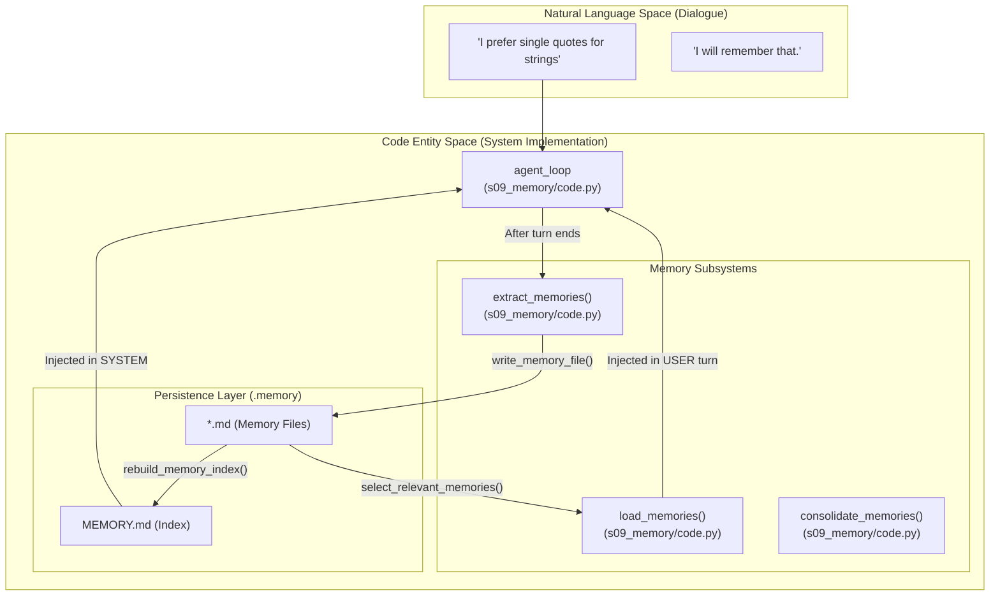
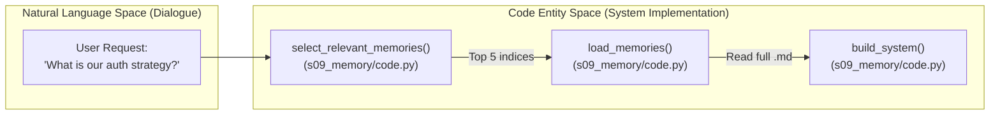

<!-- source: DeepWiki mcp.deepwiki.com · repo shareAI-lab/learn-claude-code · page 4.6 s09: Memory System · fetched 2026-10-29 -->

# s09: Memory System

<details>
<summary>Relevant source files</summary>

The following files were used as context for generating this wiki page:

- [s08_context_compact/code.py](s08_context_compact/code.py)
- [s09_memory/README.ja.md](s09_memory/README.ja.md)
- [s09_memory/README.md](s09_memory/README.md)
- [s09_memory/README.zh.md](s09_memory/README.zh.md)
- [s09_memory/code.py](s09_memory/code.py)
- [s09_memory/images/memory-subsystems.en.svg](s09_memory/images/memory-subsystems.en.svg)
- [s09_memory/images/memory-subsystems.ja.svg](s09_memory/images/memory-subsystems.ja.svg)
- [s09_memory/images/memory-subsystems.svg](s09_memory/images/memory-subsystems.svg)

</details>


## Purpose and Scope

This document covers **s09: Memory System**, which provides persistent, cross-session knowledge for the coding agent. While context compression (s08) handles the short-term continuity of a single session by summarizing history, the Memory System ensures that critical details—such as user preferences, project facts, and recurring feedback—are never lost.

The system utilizes a file-based storage strategy in the `.memory/` directory, employing a "Load-Inject-Extract-Consolidate" lifecycle. This allows the agent to maintain a long-term "personality" and project awareness that survives session restarts and infinite context compactions.

Sources: [s09_memory/code.py:2-25](), [s09_memory/README.en.md:1-8]()

---

## The Core Problem: Lossy Compression vs. Long-term Knowledge

In **s08: Context Compression**, the agent uses `auto_compact` to summarize history when the token limit is reached. While effective for maintaining the current goal, summaries are inherently lossy. A specific instruction like *"Use tabs for indentation, never spaces"* might be compressed into *"User has code style preferences,"* causing the agent to eventually forget the specific technical constraint.

Furthermore, standard agent loops lose all state once the process exits. The Memory System introduces a **Harness Layer** that:
1. Persists across sessions using the filesystem [s09_memory/README.en.md:14-17]().
2. Prevents detail decay by storing facts outside the compactable message history [s09_memory/README.en.md:24-26]().
3. Optimizes context by only injecting relevant memories on-demand [s09_memory/code.py:108-139]().

Sources: [s09_memory/README.en.md:12-17](), [s09_memory/code.py:5-21]()

---

## Memory Architecture & Data Flow

The Memory System bridges the gap between the agent's natural language interactions and the persistent file storage.

### Memory Lifecycle and Data Flow Diagram


Sources: [s09_memory/code.py:70-87](), [s09_memory/code.py:149-164](), [s09_memory/README.en.md:41-41]()

---

## Storage: Markdown + YAML Frontmatter

Memories are stored as individual Markdown files. This format is human-readable, easily editable, and allows for structured metadata via YAML frontmatter.

### Memory File Structure
Each file includes a `name`, `description`, and `type` parsed through `parse_frontmatter()` [s09_memory/code.py:70-82]().

```markdown
---
name: user-preference-quotes
description: User prefers single quotes for Python strings
type: user
---

The user explicitly requested the use of single quotes (') rather than 
double quotes (") for string literals in Python files.
```

### Memory Types
The system categorizes knowledge into four distinct types (`MEMORY_TYPES`) [s09_memory/code.py:44-44]():

| Type | Purpose | Example |
| :--- | :--- | :--- |
| `user` | Personal preferences and identity | "Prefers tabs over spaces" |
| `feedback` | Instructions on how to perform tasks | "Don't mock the database in tests" |
| `project` | Facts about the current codebase | "Auth rewrite is compliance-driven" |
| `reference` | Locations and lookups | "API docs are at /docs/api.md" |

Sources: [s09_memory/code.py:44-44](), [s09_memory/code.py:70-82](), [s09_memory/README.en.md:28-35]()

---

## The Memory Lifecycle

### Recall and Selection Flow


### 1. Load & Inject (Two-Path Injection)
Memory is injected into the context using two distinct paths to balance visibility with token efficiency:
* **Path 1: The Index (Global Awareness):** The `MEMORY.md` index (one-line summaries of all memories) is injected into the **SYSTEM** prompt every turn [s09_memory/code.py:165-184](). This makes the agent aware of *what* it knows.
* **Path 2: Relevant Content (Deep Knowledge):** The `load_memories()` function performs a "side-query" to the LLM, comparing the recent conversation against the index to select the top relevant files [s09_memory/code.py:200-250](). The full content of these files is then injected into the current context.

### 2. Extract (Learning)
When a conversation turn ends, the system invokes `extract_memories()` [s09_memory/code.py:200-250](). It analyzes recent dialogue against `should_store_memory()` filters to identify durable facts or preferences [s09_memory/code.py:108-139]().

### 3. Consolidate (Dreaming)
As the number of memory files grows, they may become redundant or contradictory. `consolidate_memories()` triggers once a threshold (`CONSOLIDATE_THRESHOLD = 10`) is reached [s09_memory/code.py:67-67](). The LLM reviews all memories to deduplicate and merge them under a transactional snapshot-rollback safety mechanism.

Sources: [s09_memory/code.py:44-69](), [s09_memory/code.py:108-164](), [s09_memory/README.en.md:77-99]()

---

## Implementation Details

### Key Functions

| Function | File:Lines | Description |
| :--- | :--- | :--- |
| `parse_frontmatter` | [s09_memory/code.py:70-82]() | Extracts YAML frontmatter and markdown body from memory files. |
| `write_memory_file` | [s09_memory/code.py:149-163]() | Writes `.md` file and triggers index rebuild. |
| `rebuild_memory_index` | [s09_memory/code.py:165-184]() | Aggregates all memory frontmatter into `MEMORY.md`. |
| `should_store_memory` | [s09_memory/code.py:108-139]() | Validates candidate memories for persistence and duplicates. |
| `consolidate_memories` | [s09_memory/code.py:200-250]() | Triggers deduplication logic with backup snapshots. |

### The "Side-Query" Pattern
To select relevant memories without bloating the main conversation, selection routines send standalone requests to the LLM containing only the recent dialogue and the memory catalog [s09_memory/code.py:200-250](). This is a critical pattern for maintaining high performance in large-scale agent systems.

Sources: [s09_memory/code.py:70-184](), [s09_memory/README.en.md:83-99]()

---

