# Page: Overview

# Overview

<details>
<summary>Relevant source files</summary>

The following files were used as context for generating this wiki page:

- [README-ja.md](README-ja.md)
- [README-zh.md](README-zh.md)
- [README.md](README.md)
- [s01_agent_loop/README.ja.md](s01_agent_loop/README.ja.md)
- [s01_agent_loop/README.md](s01_agent_loop/README.md)
- [web/src/data/generated/docs.json](web/src/data/generated/docs.json)
- [web/src/data/generated/versions.json](web/src/data/generated/versions.json)

</details>


`learn-claude-code` is a pedagogical harness-engineering project exploring the core philosophy that **the model is the agent**, while everything else—tools, knowledge, observation mechanisms, action interfaces, and permissions—forms the harness [README.md:7-11](). This wiki page provides a high-level overview of the 17-lesson progressive course (`s01`–`s17`), the legacy `agents/` reference track, the web learning platform, and repository organization.

For detailed information, please refer to the child pages:
- [Repository Structure](#1.1) — Organization of lesson directories, `agents/`, `docs/`, `skills/`, `tests/`, and `web/`.
- [Lesson Tracks: 17-Lesson Course vs Legacy 12-Lesson agents/](#1.2) — Comparison and mapping between the current 17-lesson progressive course and the legacy track.

Sources: [README.md:7-11](), [README.md:162-187]()

---

## 1.1. Repository Structure

The repository is organized to support both standalone Python lesson scripts and an interactive web learning platform. Each lesson under `sNN_*/` contains an executable script (`code.py`), multilingual documentation (`README.md`, `README.zh.md`, `README.ja.md`), and generated architecture diagrams under `images/` [web/src/data/generated/versions.json:1-38](). 

The supporting directories include `agents/` for reference script implementations, `docs/` for historical essays, `skills/` for on-demand knowledge injection (`SKILL.md`), `tests/` for the `pytest` test suite, and `web/` for the Next.js learning platform [README.md:289-297](). For detailed breakdowns of how these directories interrelate, see [Repository Structure](#1.1).

**Diagram: Repository Directory and Code Entity Bridge**

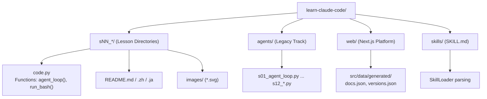

Sources: [web/src/data/generated/versions.json:1-38](), [README.md:289-297]()

---

## 1.2. Lesson Tracks: 17-Lesson Course vs Legacy 12-Lesson agents/

The repository features two distinct historical tracks reflecting the evolution of the codebase. The current progressive course consists of 17 lessons (`s01` through `s17`) structured around standalone directories (`s01_agent_loop/code.py`, `s02_tool_use/code.py`, etc.), focusing on modular harness components like tool dispatch, permission gates, context compaction, and multi-agent teams [README.md:162-187](). 

The legacy track (`agents/` and `docs/`) contains earlier reference implementations and essays detailing the mental models of coding agent loops [README.md:289-297](). For a comprehensive mapping table translating between the legacy scripts and the current 17-lesson structure, see [Lesson Tracks: 17-Lesson Course vs Legacy 12-Lesson agents/](#1.2).

**Diagram: Lesson Track Architecture and Execution Flow**

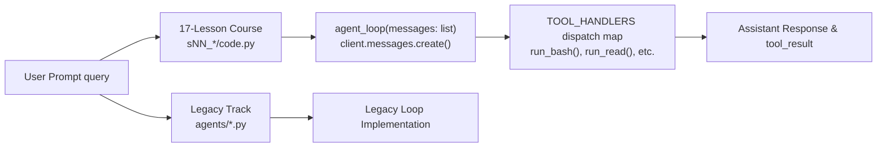

Sources: [web/src/data/generated/versions.json:1-38](), [README.md:162-187]()

---

# Page: Repository Structure

# Repository Structure

<details>
<summary>Relevant source files</summary>

The following files were used as context for generating this wiki page:

- [CONTRIBUTING.md](CONTRIBUTING.md)
- [README-ja.md](README-ja.md)
- [README-zh.md](README-zh.md)
- [README.md](README.md)
- [s01_agent_loop/README.ja.md](s01_agent_loop/README.ja.md)
- [s01_agent_loop/README.md](s01_agent_loop/README.md)

</details>


This page documents the physical organization of the `learn-claude-code` repository, mapping top-level directories, lesson modules, runtime states, and tooling platforms to their pedagogical and functional purposes.

---

## Purpose and Scope

The repository serves as a pedagogical harness-engineering project designed to teach how to build production-grade agent harnesses around large language models. The file structure is partitioned into self-contained lesson directories (`sNN_*/`), legacy reference scripts (`agents/`), multi-lingual documentation (`docs/`), skill definitions (`skills/`), automated test suites (`tests/`), and an interactive web learning platform (`web/`). 

Sources: [README.md:5-12](), [CONTRIBUTING.md:1-4]()

---

## Top-Level Directory Overview

The repository root orchestrates both runtime educational content and the interactive Next.js web application.

### Title: Repository Physical Architecture
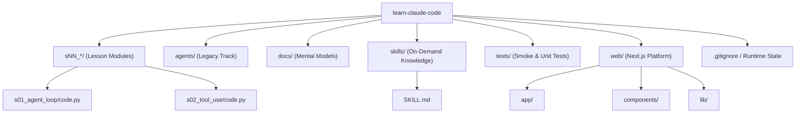

| Directory Path | Functional Purpose | Key Artifacts |
|----------------|--------------------|---------------|
| `sNN_*/` | Progressive course chapters (s01 to s17) | `code.py`, `README.md`, `README.zh.md`, `README.ja.md`, `images/` |
| `agents/` | Legacy reference implementation track | Single-file session scripts (`s01_agent_loop.py`, etc.) |
| `docs/` | Mental-model essays and architectural deep dives | Language subdirectories (`en/`, `zh/`, `ja/`) |
| `skills/` | On-demand knowledge catalogs | Subdirectories containing `SKILL.md` frontmatter and guides |
| `tests/` | Automated test infrastructure | Smoke tests and workflow verification scripts |
| `web/` | Interactive Next.js learning platform | Course visualizer, i18n message catalogs, content generators |

Sources: [README.md:1-11](), [CONTRIBUTING.md:1-5]()

---

## Lesson Modules (`sNN_*/`)

The core pedagogical engine of the repository resides in the `sNN_*` lesson directories (such as `s01_agent_loop/`, `s02_tool_use/`, etc.). Each lesson directory is fully self-contained.

### Title: Lesson Directory Anatomy
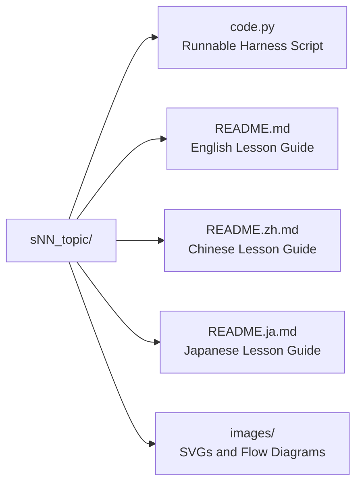

- **`code.py`**: The canonical, minimalist executable implementation of the lesson's core harness concept (e.g., event loops, permission gates, or skill injectors).
- **`README.md`, `README.zh.md`, `README.ja.md`**: Trilingual pedagogical guides explaining the problem, solution, and step-by-step code mechanics [CONTRIBUTING.md:9-10]().
- **`images/`**: Architectural SVGs and sequence charts (such as `agent-loop.en.svg`) embedded in the markdown documentation [s01_agent_loop/README.md:26-26]().

Sources: [CONTRIBUTING.md:3-10](), [s01_agent_loop/README.md:26-28]()

---

## Reference and Support Directories

Beyond the progressive lessons, several functional subsystems support development, testing, and multi-agent operations.

### Agents Track (`agents/`)
Contains historical or flattened reference scripts mirroring the progressive chapters, allowing quick execution without traversing nested chapter folders.

### Skills System (`skills/`)
Houses modular capability packages. Each subdirectory contains a `SKILL.md` file featuring YAML frontmatter and instructional markdown loaded dynamically into the agent's context pool during execution [README.md:73-75]().

### Testing Infrastructure (`tests/`)
Contains automated verification scripts, such as smoke tests that compile all agent implementations via Python's `py_compile` module to guarantee zero syntax regressions [tests/test_agents_smoke.py:10-19]().

### Runtime State Directories (Git-Ignored)
During agent execution, several local state folders are generated to manage tasks, memory, and parallel worktrees. These directories are strictly excluded via `.gitignore`:
- `.tasks/`: File-backed task graphs with dependency tracking.
- `.memory/`: Durable cross-session memory storage and index files.
- `.team/`: JSONL mailboxes and inter-agent communication logs.
- `.worktrees/`: Git worktree bindings for parallel agent execution lanes.

Sources: [CONTRIBUTING.md:1-11](), [tests/test_agents_smoke.py:10-19]()

---

## Web Learning Platform (`web/`)

The `web/` directory hosts the Next.js application powering the interactive documentation and course visualizer. 

### Title: Web Platform Data Flow
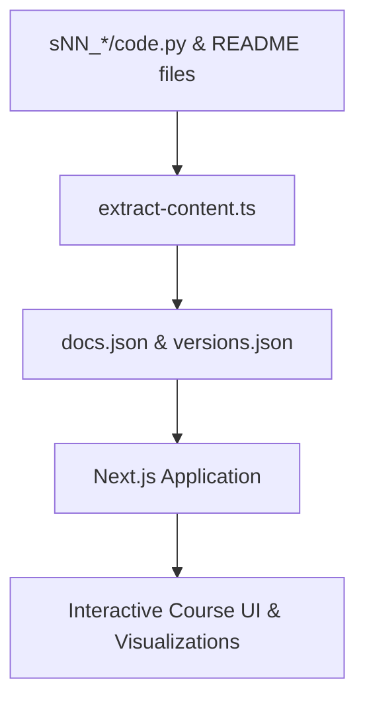

- **Content Pipeline**: Scripts like `extract-content.ts` parse lesson source code and markdown documents into structured assets (`docs.json`, `versions.json`) consumed by the Next.js frontend.
- **Components & Layouts**: Organized under `web/src/components/`, providing code viewers, execution flow visualizers, and multi-language routing catalogs (`en`, `zh`, `ja`).

Sources: [README.md:1-5]()

---

# Page: Lesson Tracks: 17-Lesson Course vs Legacy 12-Lesson agents/

# Lesson Tracks: 17-Lesson Course vs Legacy 12-Lesson agents/

<details>
<summary>Relevant source files</summary>

The following files were used as context for generating this wiki page:

- [README-ja.md](README-ja.md)
- [README-zh.md](README-zh.md)
- [README.md](README.md)
- [agents/s01_agent_loop.py](agents/s01_agent_loop.py)
- [agents/s02_tool_use.py](agents/s02_tool_use.py)
- [agents/s04_subagent.py](agents/s04_subagent.py)
- [docs/en/s01-the-agent-loop.md](docs/en/s01-the-agent-loop.md)
- [docs/en/s03-todo-write.md](docs/en/s03-todo-write.md)
- [docs/en/s04-subagent.md](docs/en/s04-subagent.md)
- [docs/en/s10-team-protocols.md](docs/en/s10-team-protocols.md)
- [docs/en/s11-autonomous-agents.md](docs/en/s11-autonomous-agents.md)
- [s01_agent_loop/README.ja.md](s01_agent_loop/README.ja.md)
- [s01_agent_loop/README.md](s01_agent_loop/README.md)

</details>


## 1. Purpose and Scope

The `learn-claude-code` repository maintains two distinct educational and reference tracks reflecting its architectural evolution: the legacy **12-lesson reference track** located in the root `agents/` and `docs/` directories, and the current **17-lesson progressive course** structured as self-contained modular directories (`s01_*` through `s17_*`). 

This page documents the structural, functional, and organizational mapping between these two numbering systems, explaining how monolithic single-file implementations (`agents/s01_agent_loop.py`) evolved into modular, production-grade harness components (`s01_agent_loop/code.py`).

Sources: [README.md:1-168](), [agents/s01_agent_loop.py:1-121](), [agents/s02_tool_use.py:1-20]()

---

## 2. Legacy Track vs. Progressive Course Mapping

The legacy 12-lesson track (`agents/s01_*.py` to `agents/s12_*.py`) implemented core harness milestones as single-file scripts with accompanying markdown essays in `docs/en/`, `docs/zh/`, and `docs/ja/`. The current 17-lesson course expands upon this foundation by dedicating isolated directories to advanced concepts such as context compaction pipelines, agent teams, Model Context Protocol (MCP) plugins, workflow runtimes, and goal loops.

| Legacy Lesson (`agents/`) | Modern Lesson Course (`sNN_*`) | Harness Mechanism | Key Code Entities |
| :--- | :--- | :--- | :--- |
| `agents/s01_agent_loop.py` | `s01_agent_loop/` | The Agent Loop & Bash Tool | `agent_loop()`, `run_bash()` |
| `agents/s02_tool_use.py` | `s02_tool_use/` | Tool Dispatch Architecture | `TOOL_HANDLERS`, `TOOLS` |
| `agents/s03_todo_write.py` | `s03_todo_write/` | TodoManager & Status Tracking | `TodoManager`, `update()` |
| `agents/s04_subagent.py` | `s04_subagent/` & `s06_subagents/` | Context Isolation & Delegation | `run_subagent()`, `CHILD_TOOLS` |
| `agents/s05_skill_loading.py` | `s07_skill_loading/` | Two-Layer Skill Catalog Injection | `SkillLoader`, `load_skill` |
| `agents/s06_context_compaction.py` | `s08_context_compaction/` | Context Compaction Pipeline | `snip_compact()`, `micro_compact()` |
| `agents/s07_memory_system.py` | `s09_memory_system/` | Persistent `.memory/` Store | `write_memory_file()`, `MEMORY.md` |
| `agents/s08_task_system.py` | `s10_task_system/` | File-Backed Task Graph (`.tasks/`) | `TaskManager`, `blockedBy` |
| `agents/s09_background_tasks.py` | `s11_background_tasks/` | Daemon Threads & Notifications | `BackgroundManager`, `CronScheduler` |
| `agents/s10_team_protocols.py` | `s13_agent_teams/` | JSONL Mailboxes & Protocols | `MessageBus`, `TeammateManager` |
| `agents/s11_autonomous_agents.py` | `s13_agent_teams/` | Autonomous Task Claiming | `_idle_poll()`, `scan_unclaimed_tasks()` |
| `agents/s12_mcp_plugin.py` | `s14_mcp_plugin/` & `s15_` | Model Context Protocol Integration | `mcp__server__tool`, `MCP client` |
| (New in 17-Lesson) | `s16_workflow_runtime/` | Deterministic Scripted Orchestration | `WorkflowRuntime`, resumable journals |
| (New in 17-Lesson) | `s17_goal_loop/` | Independent Goal Evaluation | `GoalController`, `PromptGoalEvaluator` |

Sources: [agents/s01_agent_loop.py:1-121](), [agents/s02_tool_use.py:101-118](), [agents/s04_subagent.py:124-143](), [docs/en/s01-the-agent-loop.md:1-93](), [docs/en/s03-todo-write.md:39-74](), [docs/en/s04-subagent.md:48-72](), [docs/en/s10-team-protocols.md:47-81](), [docs/en/s11-autonomous-agents.md:53-107]()

---

## 3. Natural Language Space to Code Entity Space: Architecture Bridge

To understand the relationship between the legacy scripts and the modern course, we trace how high-level architectural concepts (Natural Language Space) map directly to concrete Python functions and dispatch maps (Code Entity Space).

```mermaid
graph TD
    subgraph "Natural Language Space"
        NL1[""Core Agent Loop""]
        NL2[""Tool Dispatch & Routing""]
        NL3[""Context Isolation / Subagents""]
        NL4[""Team Protocols & Mailboxes""]
    end

    subgraph "Code Entity Space"
        CE1[""agents/s01_agent_loop.py: agent_loop()""]
        CE2[""agents/s02_tool_use.py: TOOL_HANDLERS""]
        CE3[""agents/s04_subagent.py: run_subagent()""]
        CE4[""docs/en/s10-team-protocols.py: BUS.send()""]
    end

    NL1 ==> CE1
    NL2 ==> CE2
    NL3 ==> CE3
    NL4 ==> CE4
```
**Figure 1**: Mapping conceptual harness layers to legacy script implementations in `agents/`.

Sources: [agents/s01_agent_loop.py:81-102](), [agents/s02_tool_use.py:102-107](), [agents/s04_subagent.py:124-143](), [docs/en/s10-team-protocols.md:50-56]()

---

## 4. Evolution of Execution Flow: Monolithic Scripts vs. Modular Course

The legacy `agents/` track prioritized single-file readability, combining path safety checks, tool implementations, and the main `agent_loop` in one script. The modern 17-lesson course (`sNN_*`) modularizes these concerns into reusable managers and clean file layouts while preserving the underlying agent loop pattern.

```mermaid
graph TD
    subgraph "Legacy Monolithic Execution"
        LM1[""agents/s01_agent_loop.py""] --> LM2[""Inline run_bash()""]
        LM2 --> LM3[""client.messages.create()""]
        LM3 --> LM4[""While-loop check stop_reason""]
    end

    subgraph "Modern Modular Execution"
        MM1[""s01_agent_loop/code.py""] --> MM2[""Import shared harness utilities""]
        MM2 --> MM3[""client.messages.create()""]
        MM3 --> MM4[""Dispatch via TOOL_HANDLERS""]
    end

    LM4 -.->|"Refactored into"| MM1
```
**Figure 2**: Execution flow comparison between single-file reference scripts and modular lesson directories.

Sources: [agents/s01_agent_loop.py:65-102](), [agents/s02_tool_use.py:54-138]()

---

# Page: Getting Started

# Getting Started

<details>
<summary>Relevant source files</summary>

The following files were used as context for generating this wiki page:

- [.env.example](.env.example)
- [requirements.txt](requirements.txt)

</details>


This section guides you through setting up your development environment and running your first AI agent. By the end of this setup, you will understand how to configure your API credentials and execute the foundational agent loop.

For detailed setup instructions, see [Prerequisites and Installation](#2.1). For a walkthrough of your first execution, see [Running Your First Agent](#2.2).

---

## 2.1. Prerequisites and Installation

Setting up the repository requires configuring Python dependencies and environment variables for the Anthropic API (or an Anthropic-compatible provider). The environment template [.env.example:1-77]() defines the required `ANTHROPIC_API_KEY` and `MODEL_ID` settings, along with optional base URLs for alternative providers. Python dependencies are specified in [requirements.txt:1-3](), including `anthropic`, `python-dotenv`, and `pyyaml`.

For details, see [Prerequisites and Installation](#2.1).

### Setup Pipeline Overview

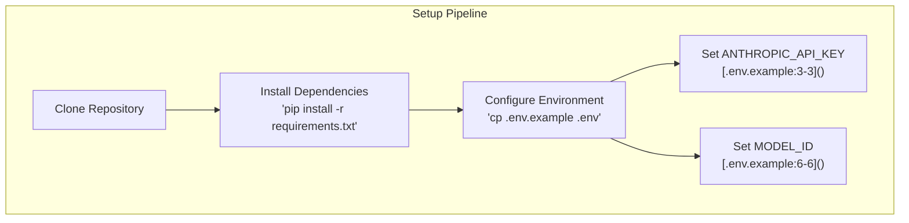

**Sources:** [.env.example:1-77](), [requirements.txt:1-3]()

---

## 2.2. Running Your First Agent

Once the environment is configured, you can execute the foundational agent loop to interact with the model via a command-line REPL. The course implementations demonstrate the minimal harness—connecting model tool use directly to local system execution.

For details, see [Running Your First Agent](#2.2).

### Execution Flow Overview

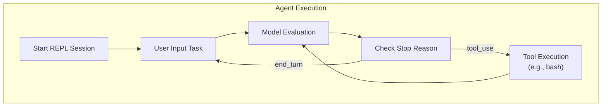

**Sources:** [.env.example:1-77](), [requirements.txt:1-3]()

---

# Page: Prerequisites and Installation

# Prerequisites and Installation

<details>
<summary>Relevant source files</summary>

The following files were used as context for generating this wiki page:

- [.env.example](.env.example)
- [.gitignore](.gitignore)
- [requirements.txt](requirements.txt)

</details>


This page covers environment setup, dependency installation, API configuration, and verification steps for running the `learn-claude-code` repository. The setup process enables the progressive learning sessions, reference agent implementations, and the optional web learning platform.

---

## Prerequisites

### System Requirements

| Component | Minimum Version | Purpose | Notes |
|-----------|----------------|---------|-------|
| Python | 3.11+ | Agent runtime | Version 3.11+ required for modern type hinting and async constructs. |
| pip | Latest | Package installation | Bundled with Python |
| Git | Any recent version | Repository cloning | Required for cloning and worktree features |
| API Key | N/A | Model access | Anthropic API key or compatible provider key |
| Node.js | 20+ | Web platform | Required for building and running the web UI. |
| npm | Latest | Web dependencies | Bundled with Node.js |

### Python Dependencies

The repository requires exactly three primary Python packages, specified in `requirements.txt`:

- **`anthropic`** (>=0.25.0): Official SDK for model interaction and tool use (`anthropic.Anthropic`). [requirements.txt:1-1]()
- **`python-dotenv`** (>=1.0.0): Environment variable management via `dotenv.load_dotenv()`. [requirements.txt:2-2]()
- **`pyyaml`** (>=6.0): YAML parsing for skill frontmatter and configurations (`yaml.safe_load`). [requirements.txt:3-3]()

Sources: [requirements.txt:1-3]()

---

## Installation Process

### Diagram: Installation and Configuration Flow

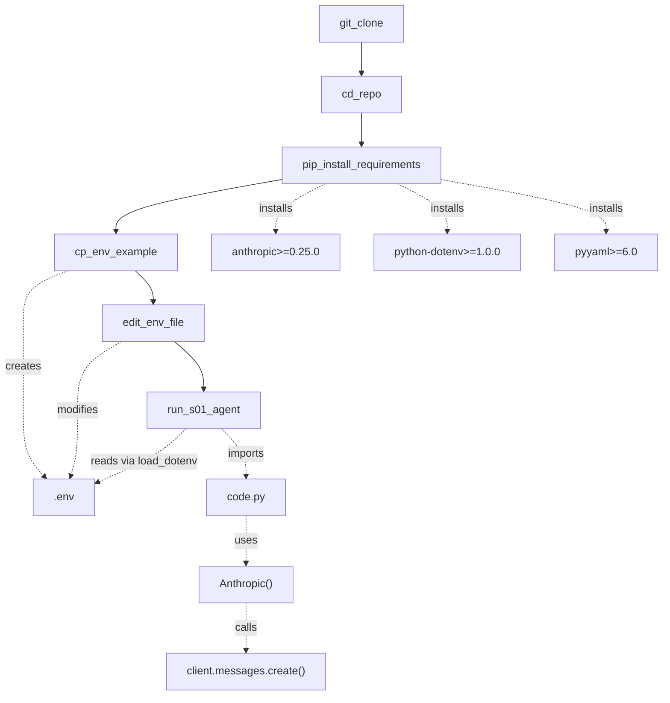

Sources: [requirements.txt:1-3](), [.env.example:1-3]()

### Step 1: Clone Repository

```bash
git clone https://github.com/shareAI-lab/learn-claude-code
cd learn-claude-code
```

This creates a local copy containing the agent implementations, documentation, tests, and the `skills/` directory which holds `SKILL.md` files used by the skill loading system.

### Step 2: Install Python Dependencies

```bash
pip install -r requirements.txt
```

This ensures the `anthropic` SDK, `python-dotenv`, and `pyyaml` are available in your active Python environment. [requirements.txt:1-3]()

### Step 3: Configure Environment Variables

```bash
cp .env.example .env
# Edit .env with your API key and model selection
```

The `.env` file is git-ignored (`[.gitignore:138-138]()`) and contains sensitive credentials. At minimum, you must set `ANTHROPIC_API_KEY` and `MODEL_ID`. [.env.example:1-6]()

Sources: [.env.example:1-6](), [.gitignore:138-138](), [requirements.txt:1-3]()

---

## Environment Configuration

### Diagram: Configuration Loading and Client Initialization

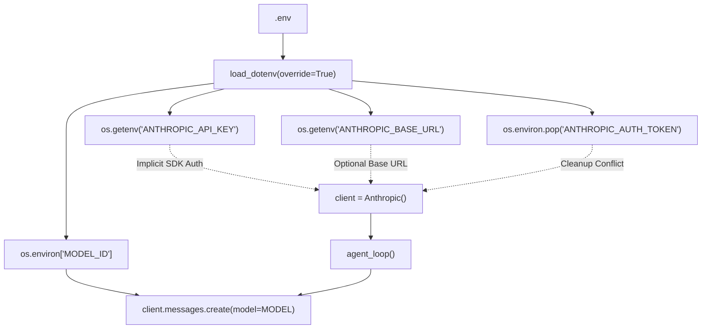

Sources: [.env.example:1-10]()

### Environment Variables

The system relies on configuration keys defined in `.env.example`:

| Variable | Required | Default | Usage |
|----------|----------|---------|-------|
| `ANTHROPIC_API_KEY` | **Yes** | None | Authenticates requests against the Anthropic API or compatible gateway. [.env.example:3-3]() |
| `MODEL_ID` | **Yes** | `claude-sonnet-4-6` | Specifies the model identifier passed to `client.messages.create()`. [.env.example:6-6]() |
| `ANTHROPIC_BASE_URL` | No | Anthropic default | Overrides the target endpoint for alternative providers (e.g., MiniMax, GLM, Kimi, DeepSeek). [.env.example:8-9]() |

#### Anthropic-Compatible Providers

The `.env.example` file provides configuration templates for alternative providers such as MiniMax, Zhipu GLM, Moonshot Kimi, and DeepSeek. When configuring an alternative provider, set both `ANTHROPIC_BASE_URL` and the corresponding `MODEL_ID`. [.env.example:11-77]()

Sources: [.env.example:1-77]()

---

## Verification

### Testing Your Installation

Verify your setup by executing the foundational agent session or running the test suite:

```bash
python s01_agent_loop/code.py
```

To run the test suite via `pytest`:

```bash
python -m pytest tests -q
```

### Common Configuration Errors

| Error Message | Root Cause | Solution |
|---------------|------------|----------|
| `ModuleNotFoundError: No module named 'anthropic'` | Missing python dependencies | Run `pip install -r requirements.txt` [requirements.txt:1-3]() |
| `KeyError: 'MODEL_ID'` | `MODEL_ID` not defined in environment | Add `MODEL_ID=claude-sonnet-4-6` to `.env` [.env.example:6-6]() |
| `AuthenticationError: 401` | Invalid or missing API key | Verify `ANTHROPIC_API_KEY` in `.env` [.env.example:3-3]() |

Sources: [requirements.txt:1-3](), [.env.example:3-6]()

---

## Web Learning Platform (Optional)

The repository includes an interactive Next.js web platform located under the `web/` directory for visualizing agent workflows and course materials.

### Local Web Platform Setup

```bash
cd web
npm install
npm run build
npm run dev
```

The web build pipeline is validated via continuous integration checks as defined in workflow configurations.

Sources: [.gitignore:226-229]()

---

# Page: Running Your First Agent

# Running Your First Agent

<details>
<summary>Relevant source files</summary>

The following files were used as context for generating this wiki page:

- [agents/s01_agent_loop.py](agents/s01_agent_loop.py)
- [agents/s02_tool_use.py](agents/s02_tool_use.py)
- [agents/s04_subagent.py](agents/s04_subagent.py)
- [s01_agent_loop/README.zh.md](s01_agent_loop/README.zh.md)
- [s01_agent_loop/code.py](s01_agent_loop/code.py)

</details>


This page walks through executing `s01_agent_loop/code.py` and its legacy counterpart `agents/s01_agent_loop.py` — the minimal agent implementations that capture the foundational loop pattern. By running these scripts and observing their behavior, you will understand how the agent loop operates: message accumulation, tool execution, and stop condition checking.

For environment setup (API keys, `.env`, dependencies), see [2.1 Prerequisites and Installation](). For a conceptual explanation of the agent loop pattern, see [3.2 The Agent Loop Pattern]().

Sources: [s01_agent_loop/code.py:1-30](), [agents/s01_agent_loop.py:1-25]()

---

## Prerequisites Check

Before running the agent, verify your environment settings and file paths:

| Requirement | Check Command | Expected Result |
|------------|---------------|-----------------|
| Environment variables | `grep MODEL_ID .env` | Returns `MODEL_ID=claude-3-5-sonnet-20241022` or similar |
| API key | `grep ANTHROPIC_API_KEY .env` or check `ANTHROPIC_BASE_URL` | Valid key or base URL set |
| Dependencies | `pip list | grep anthropic` | Shows `anthropic` package installed |
| Lesson path | `ls s01_agent_loop/code.py` | File exists |

Sources: [s01_agent_loop/code.py:46-55]()

---

## Starting s01: The Minimal Agent

The `s01_agent_loop/code.py` script (and its legacy equivalent `agents/s01_agent_loop.py`) represents the smallest complete agent: one tool (`bash`), one loop (`agent_loop()`), and a Read-Eval-Print Loop (REPL). Launch it from the repository root:

```bash
python s01_agent_loop/code.py
```

The cyan prompt appears:

```
s01 >>
```

Type a task and press Enter. The agent submits the message to Claude, which decides whether to call the `bash` tool or return text. Tool calls execute, results append to the conversation history, and the loop continues until Claude returns a response without a `tool_use` stop reason.

**Example Session:**

```
s01 >> list the files in this directory

$ ls -la
total 48
drwxr-xr-x  8 user user 4096 Jan 10 12:00 .
drwxr-xr-x 20 user user 4096 Jan 10 11:59 ..
drwxr-xr-x  2 user user 4096 Jan 10 12:00 s01_agent_loop
-rw-r--r--  1 user user 1234 Jan 10 12:00 README.md
...

Here are the files in the current directory: s01_agent_loop/, docs/, web/, skills/, README.md, ...
```

**Output Conventions:**
- Shell commands appear in yellow (`\033[33m$ command\033[0m`) [s01_agent_loop/code.py:107]()
- Command output is truncated to 200 characters in the terminal display [s01_agent_loop/code.py:109]()
- Agent text responses print after all tool calls complete [s01_agent_loop/code.py:137-142]()

Sources: [s01_agent_loop/code.py:121-142](), [agents/s01_agent_loop.py:104-121]()

---

## The Agent Loop in Action

### Execution Flow Through Code Entities

The script's operation bridges natural language queries to concrete function execution through three core Python objects: `history` (the message list), `agent_loop()` (the loop driver), and `run_bash()` (the tool handler).

Title: s01 Execution Path From Natural Language to Code Entities

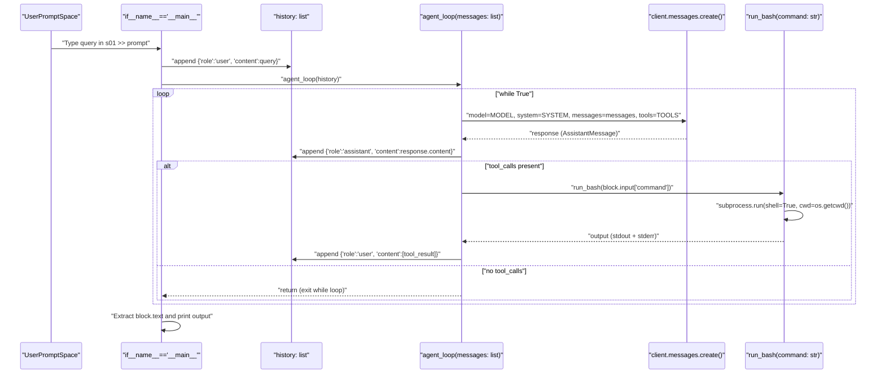

**Key Code Entities:**
- `history: list` — accumulates all messages across turns [s01_agent_loop/code.py:125]()
- `agent_loop(messages)` — the while-loop implementation at [s01_agent_loop/code.py:87-118]()
- `client.messages.create()` — Anthropic API invocation at [s01_agent_loop/code.py:89-92]()
- `run_bash(command)` — subprocess execution wrapper at [s01_agent_loop/code.py:71-84]()
- `TOOLS` — single-tool configuration list at [s01_agent_loop/code.py:59-67]()

Sources: [s01_agent_loop/code.py:71-118]()

### The while True Loop Structure

The `agent_loop()` function implements the fundamental state-machine iteration:

```python
def agent_loop(messages: list):
    while True:
        response = client.messages.create(
            model=MODEL, system=SYSTEM, messages=messages,
            tools=TOOLS, max_tokens=8000,
        )

        # Append assistant turn
        messages.append({"role": "assistant", "content": response.content})

        # If the model didn't call a tool, we're done
        tool_calls = [
            block for block in response.content if block.type == "tool_use"
        ]
        if not tool_calls:
            return

        # Execute each tool call, collect results
        results = []
        for block in tool_calls:
            print(f"\033[33m$ {block.input['command']}\033[0m")
            output = run_bash(block.input["command"])
            print(output[:200])
            results.append({
                "type": "tool_result",
                "tool_use_id": block.id,
                "content": output,
            })

        # Feed tool results back, loop continues
        messages.append({"role": "user", "content": results})
```

**Loop Invariants:**
- The `messages` list strictly alternates between `role: user` and `role: assistant` [s01_agent_loop/code.py:95, 117]()
- Every `tool_use` block produces a corresponding `tool_result` block carrying the identical `tool_use_id` [s01_agent_loop/code.py:111-113]()
- The loop terminates when `tool_calls` is empty — indicating the model completed its goal and returned pure text [s01_agent_loop/code.py:98-102]()

Sources: [s01_agent_loop/code.py:87-118]()

---

## Tool Schema and Tool Execution

### The TOOLS List and Tool Schema Format

The `TOOLS` list at [s01_agent_loop/code.py:59-67]() defines the capability surface exposed to Claude:

```python
TOOLS = [{
    "name": "bash",
    "description": "Run a shell command.",
    "input_schema": {
        "type": "object",
        "properties": {"command": {"type": "string"}},
        "required": ["command"],
    },
}]
```

**Schema Components:**
- `name` — The exact identifier matched by the model in `tool_use` blocks.
- `description` — Semantic instruction to guide the model on when and how to invoke the tool.
- `input_schema` — JSON Schema defining parameters required for execution.

Sources: [s01_agent_loop/code.py:59-67]()

### The run_bash() Tool Handler

The `run_bash()` function at [s01_agent_loop/code.py:71-84]() executes shell commands requested by the model:

Title: run_bash Safety and Subprocess Architecture

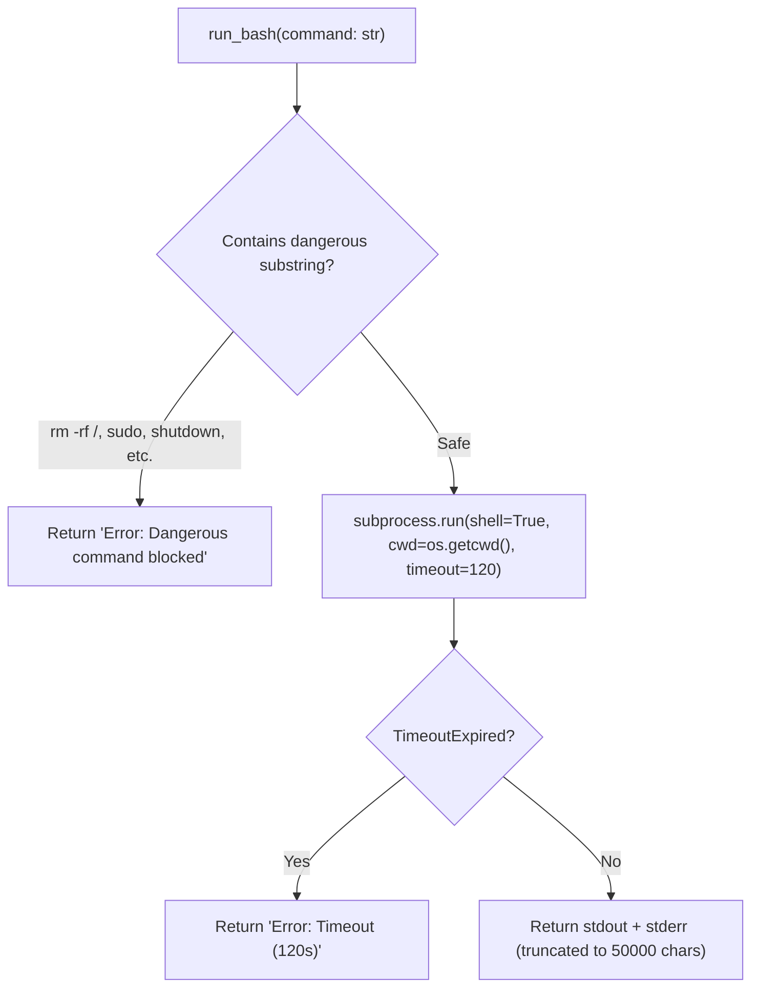

**Safety Mechanisms:**
- **Dangerous command blocklist**: intercepts patterns like `rm -rf /`, `sudo`, `shutdown`, and `reboot` [s01_agent_loop/code.py:72-74]()
- **Timeout protection**: limits subprocess execution to 120 seconds [s01_agent_loop/code.py:77, 80]()
- **Output truncation**: bounds output size to 50,000 characters [s01_agent_loop/code.py:78]()
- **Working directory constraint**: runs commands within `os.getcwd()` [s01_agent_loop/code.py:76]()

Sources: [s01_agent_loop/code.py:71-84]()

---

## REPL Session Management

### Input Loop and Exit Conditions

The REPL entry point at [s01_agent_loop/code.py:121-142]() manages user interaction:

```python
if __name__ == "__main__":
    print("s01: Agent Loop")
    print("Enter a question, press Enter to send. Type q to quit.\n")

    history = []
    while True:
        try:
            query = input("\033[36ms01 >> \033[0m")
        except (EOFError, KeyboardInterrupt):
            break
        if query.strip().lower() in ("q", "exit", ""):
            break
        history.append({"role": "user", "content": query})
        agent_loop(history)
```

**Exit Methods:**

| Input / Signal | Condition Checked | Action |
|----------------|-------------------|--------|
| `q` | `query.strip().lower() == "q"` | Clean exit from REPL |
| `exit` | `query.strip().lower() == "exit"` | Clean exit from REPL |
| Enter (Empty) | `query.strip() == ""` | Clean exit from REPL |
| `Ctrl+C` | `KeyboardInterrupt` exception | Caught, clean exit |
| `Ctrl+D` | `EOFError` exception | Caught, clean exit |

Sources: [s01_agent_loop/code.py:121-134]()

### Conversation State: The history List

The `history` list accumulates conversation messages across REPL turns.

Title: Conversation History Growth Across Turns

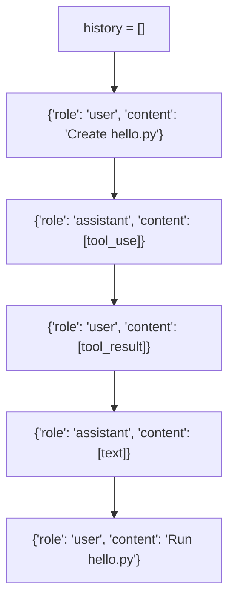

**Conversation Memory Properties:**
- Every turn appends user queries, assistant tool requests, and tool execution results [s01_agent_loop/code.py:95, 117, 134]().
- Strictly preserves alternating user/assistant message order required by the Anthropic API.
- Lacks compression; as turns accumulate, token consumption increases (addressed later in [4.5 Context Compaction]()).

Sources: [s01_agent_loop/code.py:87-142]()

---

## What to Try Next

| Goal | Script Reference | Corresponding Documentation |
|------|------------------|---------------------------|
| Expand tool dispatch maps for multiple tools | `python s02_tool_use/code.py` | [4.1 s01–s02: Agent Loop and Tool Use]() |
| Implement permission gates and hooks | `python s03_permission/code.py` | [4.2 s03–s04: Permission and Hooks]() |
| Run complete multi-feature reference harness | `python s15_integrated/code.py` | [4.11 s15: Integrated Harness]() |

Sources: [s01_agent_loop/code.py:1-30]()

---

# Page: Core Concepts

# Core Concepts

<details>
<summary>Relevant source files</summary>

The following files were used as context for generating this wiki page:

- [README-ja.md](README-ja.md)
- [README-zh.md](README-zh.md)
- [README.md](README.md)
- [s01_agent_loop/README.ja.md](s01_agent_loop/README.ja.md)
- [s01_agent_loop/README.md](s01_agent_loop/README.md)

</details>


This page outlines the fundamental concepts underpinning every lesson in the `learn-claude-code` repository. These principles remain invariant across all progressive learning sessions, establishing how AI models and harness infrastructure interact.

For detailed technical breakdowns, see the respective child pages:
- [Philosophy: Agent vs Harness](#3.1)
- [The Agent Loop Pattern](#3.2)
- [Tool Dispatch Architecture](#3.3)
- [Security and Path Safety](#3.4)

---

## 3.1. Philosophy: Agent vs Harness

The central premise of this repository is that **Agency comes from the model, not the code.** [README.md:11-15]() An agent product is defined as a combination of the model (the driver providing intelligence and reasoning) and the harness (the vehicle providing tools, knowledge, observation interfaces, and permissions) [README.md:11-63]().

Harness engineering focuses on building robust operational environments rather than brittle prompt plumbing or hardcoded state machines [README.md:33-43](). By providing clean tools and boundaries, the harness enables the model to perceive and act effectively within a specific domain.

For details, see [Philosophy: Agent vs Harness](#3.1).

**Sources:** [README.md:5-63]()

---

## 3.2. The Agent Loop Pattern

The foundational mechanism of any agent is the repeating `while` loop that bridges the model's intent with external actions [s01_agent_loop/README.md:28-34](). The harness sends messages and tool definitions to the LLM via `client.messages.create`, inspects the response for `tool_use` blocks, executes the requested tools, and feeds the results back into the transcript [s01_agent_loop/README.md:43-114]().

### Diagram: The Agent Loop Lifecycle

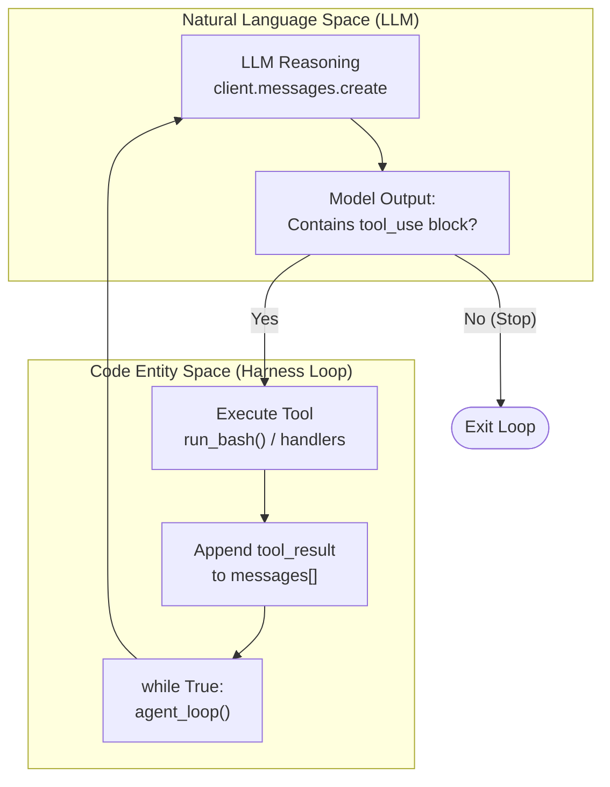

This minimal loop runs across all sessions, serving as the core execution runtime upon which more advanced capabilities are built [s01_agent_loop/README.md:116]().

For details, see [The Agent Loop Pattern](#3.2).

**Sources:** [s01_agent_loop/README.md:28-116]()

---

## 3.3. Tool Dispatch Architecture

The harness connects the model to the real world through a tool dispatch architecture that separates LLM schema declarations from Python implementation handlers [agents/s04_subagent.py:97-102](). 

### Diagram: Bridging Model Intent to Code Execution

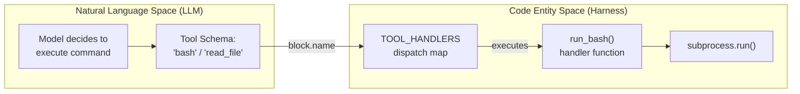

By maintaining a clean separation via dictionaries like `TOOL_HANDLERS`, new tools can be added to the harness without modifying the core agent loop logic.

For details, see [Tool Dispatch Architecture](#3.3).

**Sources:** [agents/s04_subagent.py:46-102]()

---

## 3.4. Security and Path Safety

Because agents possess powerful capabilities such as shell execution and file modification, the harness must enforce strict security boundaries [README.md:77-79](). Two critical mechanisms protect the host environment: path validation (`safe_path`) to prevent workspace breakouts and command filtering to block destructive operations [agents/s04_subagent.py:47-65]().

### Diagram: The Safety Harness

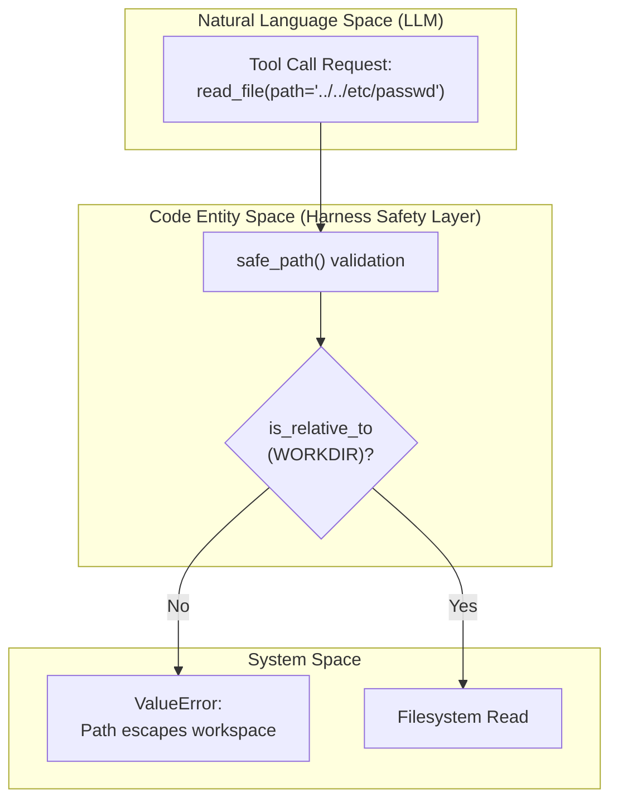

For details, see [Security and Path Safety](#3.4).

**Sources:** [agents/s04_subagent.py:47-65](), [README.md:77-79]()

---

# Page: Philosophy: Agent vs Harness

# Philosophy: Agent vs Harness

<details>
<summary>Relevant source files</summary>

The following files were used as context for generating this wiki page:

- [README-ja.md](README-ja.md)
- [README-zh.md](README-zh.md)
- [README.md](README.md)
- [s01_agent_loop/README.ja.md](s01_agent_loop/README.ja.md)
- [s01_agent_loop/README.md](s01_agent_loop/README.md)

</details>


## Purpose and Scope

This page establishes the fundamental philosophical distinction that underlies the entire `learn-claude-code` architecture: **the model IS the agent**, and everything else is the harness. This principle determines how the codebase is designed, how components are separated, and how trust is allocated between trained intelligence and engineered infrastructure.

Understanding this distinction clarifies why lessons are structured progressively, why the core agent loop remains stable even as capabilities expand, and why engineering effort focuses on building tools and environments rather than attempting to script intelligence with brittle procedural logic.

Sources: [README.md:5-78]()

---

## What an Agent Is: The Trained Model

An agent is a neural network—a Transformer, an RNN, or a trained function—shaped by billions of gradient updates on action-sequence data to perceive an environment, reason about goals, and take actions [README.md:13-18](). Agency is learned through training, not bestowed by external code orchestration [README.md:11-16]().

Title: "The Agent is the Trained Model, Not Surrounding Code"
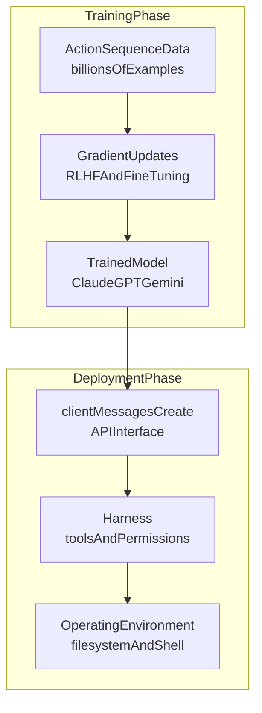
Sources: [README.md:13-32]()

### Historical Evidence

The historical record across reinforcement learning and LLM agent systems confirms that agency originates from the trained model:

| Year | System | Achievement | What Was the Agent? |
|------|--------|-------------|---------------------|
| 2013-2015 | DeepMind DQN | Played 49 Atari games, matched human experts [README.md:21-21]() | Single neural network trained on pixels + scores [README.md:21-21]() |
| 2019 | OpenAI Five | Defeated Dota 2 world champions (OG) 2-0 [README.md:23-23]() | Five neural networks trained through self-play [README.md:23-23]() |
| 2019 | DeepMind AlphaStar | Achieved Grandmaster in StarCraft II (top 0.15%) [README.md:25-25]() | Model trained on game state, not hand-coded strategies [README.md:25-25]() |
| 2019 | Tencent Jueyu | Defeated KPL pros in Honor of Kings 5v5 [README.md:27-27]() | Model trained through self-play [README.md:27-27]() |
| 2024-2025 | Claude / GPT / Gemini | Write code, debug, coordinate in teams [README.md:29-31]() | LLMs trained on human code and reasoning [README.md:29-31]() |

Sources: [README.md:16-32]()

---

## What an Agent Is NOT: Prompt Plumbing

The term "agent" is frequently misappropriated by prompt-plumbing systems—drag-and-drop workflow builders, no-code platforms, and procedural prompt chains that wire LLM API calls together with hardcoded `if-else` routing logic [README.md:33-41](). These systems are brittle and unscalable because they attempt to brute-force intelligence using procedural glue code [README.md:39-41]().

Title: "Prompt Plumbing vs Real Agent Architecture"
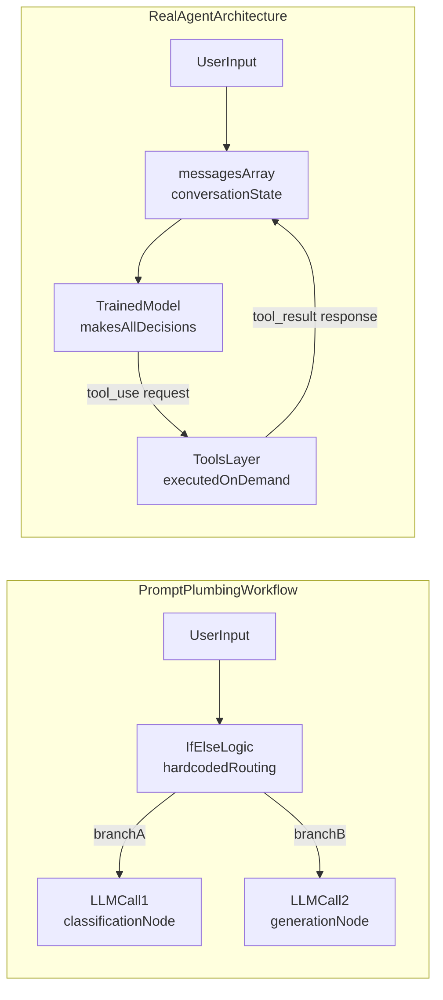
Sources: [README.md:33-43]()

---

## The Harness: Everything Else

When building agent products, engineers build the **harness**—the engineered environment that gives the model tools, knowledge, observation, action interfaces, and permissions [README.md:50-61]().

```
Harness = Tools + Knowledge + Observation + Action Interfaces + Permissions
```

Title: "Five Layers of the Harness"
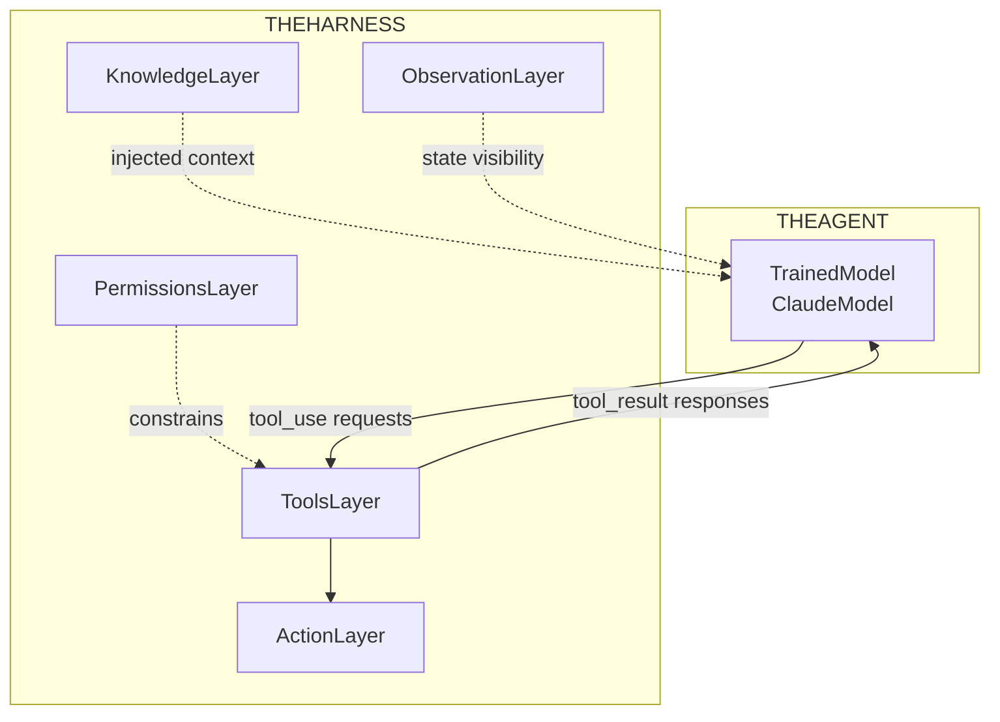

| Layer | Purpose | Codebase Mechanism |
|-------|---------|--------------------|
| **Tools** | Agent's hands to act [README.md:73-74]() | `bash`, `read_file`, `write_file`, `edit_file`, `glob` [README-zh.md:97-97]() |
| **Knowledge** | Domain expertise available on demand [README.md:75-76]() | `skills/` directory, loaded via `SkillLoader` [README-zh.md:98-98]() |
| **Observation** | Environmental state visibility [README.md:58-58]() | Git diffs, error logs, file contents |
| **Action** | Execution mechanisms [README.md:59-59]() | Shell execution, API calls |
| **Permissions** | Safety constraints [README.md:79-80]() | Sandbox validation, deny lists, path safety |

Sources: [README.md:50-65](), [README-zh.md:73-81]()

---

## Architectural Boundaries and Code Mapping

The agent-harness distinction manifests directly in the codebase structure: the agent logic is encapsulated in model API calls, while the harness handles stateless iteration and tool dispatch [s01_agent_loop/README.md:111-116]().

Title: "Natural Language to Code Entity Mapping"
```mermaid
graph TB
    subgraph NaturalLanguage["NaturalLanguageSpace"]
        NL_Agent["The Model / Agent"]
        NL_Loop["The Agent Loop"]
        NL_Dispatch["Tool Dispatch"]
        NL_Execution["Tool Execution"]
    end
    
    subgraph CodeSpace["CodeEntitySpace"]
        CE_API["client.messages.create()"]
        CE_Loop["while True: agent_loop()"]
        CE_Dict["TOOL_HANDLERS dict"]
        CE_Func["run_bash() / run_read()"]
    end
    
    NL_Agent --> CE_API
    NL_Loop --> CE_Loop
    NL_Dispatch --> CE_Dict
    CE_Dict --> CE_Func
    CE_Func -->|"tool_result"| CE_Loop
```
Sources: [README.md:50-65](), [s01_agent_loop/README.md:91-114]()

### The Agent Decision Loop

Title: "Decision Flow in agent_loop"
```mermaid
graph LR
    Messages["messages[]"] --> API["client.messages.create()"]
    API --> Response["response.content"]
    Response --> Check{"contains tool_use?"}
    Check -->|"yes"| Execute["TOOL_HANDLERS[name]()"]
    Execute --> Append["append tool_result"]
    Append --> Messages
    Check -->|"no"| Exit["return / end_turn"]
```
Sources: [s01_agent_loop/README.md:91-114]()

---

## Implications for Harness Engineers

Harness engineers do not implement intelligence; the model supplies that [README.md:68-83](). The harness engineer's role is to build a robust, safe, and observable operational environment:
- **Trust the Model:** Avoid complex procedural decision trees; provide clear tools and let the model determine execution paths [README.md:73-78]().
- **Isolate and Constrain:** Use sandboxing, permissions, and tool boundaries to ensure safe operation [README.md:79-80]().
- **Accumulate Trajectory Data:** Harness execution traces serve as valuable signals for improving future model iterations [README.md:81-82]().

Sources: [README.md:68-84]()

---

# Page: The Agent Loop Pattern

# The Agent Loop Pattern

<details>
<summary>Relevant source files</summary>

The following files were used as context for generating this wiki page:

- [s01_agent_loop/code.py](s01_agent_loop/code.py)
- [s01_agent_loop/images/agent-loop.en.svg](s01_agent_loop/images/agent-loop.en.svg)
- [s01_agent_loop/images/agent-loop.ja.svg](s01_agent_loop/images/agent-loop.ja.svg)
- [s01_agent_loop/images/agent-loop.svg](s01_agent_loop/images/agent-loop.svg)
- [tests/test_agent_loop_boundaries.py](tests/test_agent_loop_boundaries.py)

</details>


This page describes the fundamental agent loop pattern that forms the foundation of every agent in this repository. This is the core pattern that distinguishes real agent architectures from prompt plumbing: a continuous loop where the **model makes all decisions** about when to act and when to stop, while the harness simply executes what the model requests.

The agent loop is the bridge between natural language intelligence (the model) and the real world (tools, files, shell). Understanding this pattern is essential before exploring any advanced mechanisms.

---

## The Fundamental Pattern

Every agent in this repository follows the same four-step loop:

1. **Send** messages (conversation history) to the LLM
2. **Check** for tool calls or response completion
3. **Execute** tools if `tool_use` blocks are present in the response
4. **Append** tool results to messages and loop back to step 1

This pattern repeats until the model decides to stop (returning no tool calls). The model controls the loop—the harness simply implements the pattern.

**Loop Execution Flow:**

```mermaid
flowchart TD
    START["User input appended to history[]"]
    SEND["LLM API call:\nclient.messages.create(\n  messages=messages,\n  tools=TOOLS\n)"]
    CHECK{"tool_use blocks\npresent in response?"}
    EXEC["Execute all tool_use blocks:\nfor block in tool_calls:\n  output = run_bash(block.input['command'])"]
    APPEND["Append tool_result blocks\nto messages[] as user message"]
    RETURN["Return to REPL\n(model has finished)"]
    
    START --> SEND
    SEND --> CHECK
    CHECK -->|"Yes"| EXEC
    CHECK -->|"No"| RETURN
    EXEC --> APPEND
    APPEND --> SEND
```

Sources: [s01_agent_loop/code.py:87-118]()

---

## Why This Pattern Matters

The agent loop embodies the core philosophy of this repository: **the model IS the agent**. The loop does not decide when to call tools, which tools to call, or when to stop. Those decisions belong entirely to the model. The loop's only job is to:

1. Present the conversation state to the model
2. Execute what the model requests
3. Feed results back to the model

This is fundamentally different from "prompt plumbing" architectures that use if-else logic, decision trees, or hardcoded routing to control agent behavior. In those systems, the code makes decisions and the LLM fills in gaps. In this pattern, the LLM makes all decisions and the code executes them.

The consequences of this pattern:

- **Model autonomy**: The model decides its own action sequence based on the task.
- **Extensibility**: Adding new capabilities means adding tools to the `TOOLS` list and dispatch maps, not rewriting the loop [s01_agent_loop/code.py:59-67]().
- **Simplicity**: The loop body remains essentially character-for-character identical across sessions [s01_agent_loop/code.py:87-118]().

Sources: [s01_agent_loop/code.py:1-30]()

---

## The Loop in Code

The minimal implementation of this pattern appears in `s01_agent_loop/code.py`:

```python
def agent_loop(messages: list):
    while True:
        response = client.messages.create(
            model=MODEL, system=SYSTEM, messages=messages,
            tools=TOOLS, max_tokens=8000,
        )

        # Append assistant turn
        messages.append({"role": "assistant", "content": response.content})

        # If the model didn't call a tool, we're done
        tool_calls = [
            block for block in response.content if block.type == "tool_use"
        ]
        if not tool_calls:
            return

        # Execute each tool call, collect results
        results = []
        for block in tool_calls:
            print(f"\033[33m$ {block.input['command']}\033[0m")
            output = run_bash(block.input["command"])
            print(output[:200])
            results.append({
                "type": "tool_result",
                "tool_use_id": block.id,
                "content": output,
            })

        # Feed tool results back, loop continues
        messages.append({"role": "user", "content": results})
```

This exact structure—`while True` → API call → tool check → tool dispatch → append results—appears across the learning track.

Sources: [s01_agent_loop/code.py:87-118]()

---

## Message Flow and State

The `messages` list is the agent's entire conversational memory. It is a Python list of message dictionaries that grows with each turn.

**Message State Evolution:**

```mermaid
flowchart LR
    subgraph "history[] list (Context State)"
        M1["{'role': 'user',\n'content': 'query'}"]
        M2["{'role': 'assistant',\n'content': [text, tool_use]}"]
        M3["{'role': 'user',\n'content': [tool_result]}"]
        M4["{'role': 'assistant',\n'content': [text]}"]
    end
    
    M1 --> M2
    M2 --> M3
    M3 --> M4
```

Each loop iteration:
1. Sends the entire `messages[]` array to the LLM [s01_agent_loop/code.py:89-92]().
2. Appends the assistant's response as a new message [s01_agent_loop/code.py:95]().
3. If the response contains `tool_use` blocks, executes each tool and collects results in a `results` list [s01_agent_loop/code.py:98-114]().
4. Appends all tool results as a single user message [s01_agent_loop/code.py:117]().
5. Repeats until no tool calls are returned [s01_agent_loop/code.py:98-102]().

Sources: [s01_agent_loop/code.py:87-118]()

---

## Tool Dispatch and Execution Within the Loop

When `tool_use` blocks are present in `response.content`, the loop extracts them and executes a tool dispatch sequence.

**Tool Dispatch Sequence:**

```mermaid
flowchart TD
    START["response.content\n(list of blocks)"]
    FILTER["Extract tool_calls:\n[block for block in response.content\n if block.type == 'tool_use']"]
    CHECK{"tool_calls\nempty?"}
    ITER["Iterate tool_calls:\nfor block in tool_calls"]
    CALL["Execute tool:\nrun_bash(block.input['command'])"]
    COLLECT["Collect result:\nresults.append({\n  'type': 'tool_result',\n  'tool_use_id': block.id,\n  'content': output\n})"]
    BATCH["Batch results:\nmessages.append({\n  'role': 'user',\n  'content': results\n})"]
    
    START --> FILTER
    FILTER --> CHECK
    CHECK -->|"Yes (Return)"| RETURN["End agent_loop()"]
    CHECK -->|"No"| ITER
    ITER --> CALL
    CALL --> COLLECT
    COLLECT --> ITER
    ITER -->|"All blocks processed"| BATCH
```

Key aspects of tool execution:
1. **Batching**: All tools in a single assistant response are executed together and returned as a single user message [s01_agent_loop/code.py:105-117]().
2. **Synchronous Execution**: Tools execute sequentially within the loop iteration [s01_agent_loop/code.py:106-114]().
3. **Result Structure**: Each `tool_result` includes the `tool_use_id` to link it back to the specific request block [s01_agent_loop/code.py:110-114]().

Sources: [s01_agent_loop/code.py:87-118]()

---

## The REPL and `agent_loop()` Relationship

`agent_loop()` is not the REPL. It is called by the REPL once per user input. The REPL maintains the persistent `history` list across calls:

**REPL Architecture:**

```mermaid
flowchart TD
    INIT["Initialize history = []"]
    INPUT["Read user query:\ninput('s01 >> ')"]
    USER["history.append({'role': 'user', 'content': query})"]
    CALL["Call agent_loop(history)\n(internal while loop)"]
    PRINT["Print final text response"]
    
    INIT --> INPUT
    INPUT --> USER
    USER --> CALL
    CALL --> PRINT
    PRINT --> INPUT
```

One REPL iteration may trigger many `agent_loop()` internal iterations. The `history` list persists between queries, giving the agent multi-turn memory.

Sources: [s01_agent_loop/code.py:121-142]()

---

# Page: Tool Dispatch Architecture

# Tool Dispatch Architecture

<details>
<summary>Relevant source files</summary>

The following files were used as context for generating this wiki page:

- [agents/s01_agent_loop.py](agents/s01_agent_loop.py)
- [agents/s02_tool_use.py](agents/s02_tool_use.py)
- [agents/s04_subagent.py](agents/s04_subagent.py)
- [s02_tool_use/README.ja.md](s02_tool_use/README.ja.md)
- [s02_tool_use/README.md](s02_tool_use/README.md)
- [s02_tool_use/README.zh.md](s02_tool_use/README.zh.md)
- [s02_tool_use/code.py](s02_tool_use/code.py)

</details>


This page documents the tool dispatch mechanism that connects LLM tool requests to Python handler functions. It covers the two-layer architecture (schemas vs handlers), the `TOOL_HANDLERS` dispatch map, `execute_tool`, and the registration pattern that allows tools to be added without modifying the agent loop.

For the agent loop that invokes this dispatch, see [The Agent Loop Pattern](#3.2). For the security mechanisms applied within handler functions, see [Security and Path Safety](#3.4). For comprehensive tool documentation, see [Documentation Set and Translations](#9.3).

---

## The Two-Layer System

The tool dispatch architecture separates what the LLM sees from what Python executes. This separation enables the agent loop to remain generic while tools are added incrementally.

Title: "Tool Interface and Execution Layers"
```mermaid
graph TB
    subgraph "Layer 1: LLM Interface"
        ToolSchemas["TOOLS array<br/>(JSON schemas)"]
        ToolUseBlock["tool_use content block<br/>{name, input, id}"]
    end
    
    subgraph "Layer 2: Python Execution"
        ToolHandlers["TOOL_HANDLERS dict<br/>{name: handler_fn}"]
        HandlerFn["handler(**input)<br/>returns string"]
    end
    
    LLM["Anthropic client"] -->|generates| ToolUseBlock
    ToolSchemas -.->|informs| LLM
    
    ToolUseBlock -->|dispatch| ToolHandlers
    ToolHandlers -->|lookup| HandlerFn
    HandlerFn -->|output| ToolResult["tool_result block<br/>{tool_use_id, content}"]
    
    ToolResult -->|appended as| UserMsg["user message<br/>role: user"]
```

**The Two Layers:**

| Layer | Purpose | Format | Location |
|-------|---------|--------|----------|
| **Layer 1: Schema** | Describes tools to the LLM | JSON schema (`name`, `description`, `input_schema`) | `TOOLS` array |
| **Layer 2: Handler** | Executes tool logic in Python | Python callable accepting `**kwargs` | `TOOL_HANDLERS` dict |

The LLM only sees Layer 1. The harness only executes Layer 2. The `block.name` field bridges them.

Sources: `[agents/s02_tool_use.py:102-118]()`, `[s02_tool_use/code.py:128-146]()`

---

## Tool Schema Definition

Tool schemas are JSON objects sent to the LLM API via the `tools` parameter in `client.messages.create()`. They define the contract between the model and the harness.

### Schema Structure

Title: "JSON Schema Components"
```mermaid
graph LR
    Schema["Tool Schema Object"]
    
    Schema --> Name["name: string<br/>Identifier for dispatch"]
    Schema --> Desc["description: string<br/>Natural language guidance"]
    Schema --> Input["input_schema: JSON Schema<br/>Parameter specification"]
    
    Input --> Type["type: 'object'"]
    Input --> Props["properties: {param: {type}}"]
    Input --> Req["required: [param_names]"]
```

### Example: The `bash` Tool

`[agents/s02_tool_use.py:109-111]()`

```python
{"name": "bash", "description": "Run a shell command.",
 "input_schema": {"type": "object", "properties": {"command": {"type": "string"}}, "required": ["command"]}},
```

**Schema Components:**

| Field | Purpose | Example |
|-------|---------|---------|
| `name` | Dispatch key, must match `TOOL_HANDLERS` | `"bash"` |
| `description` | Guides LLM when to use tool | `"Run a shell command."` |
| `input_schema` | JSON Schema defining parameters | `{"type": "object", "properties": {...}}` |
| `required` | Mandatory parameters | `["command"]` |

The `name` field is critical—it is the identifier used for dispatch. The LLM generates `tool_use` blocks with this name, and the harness looks it up in `TOOL_HANDLERS`.

Sources: `[agents/s02_tool_use.py:109-118]`, `[s02_tool_use/code.py:128-139]()`

---

## Handler Implementation

Handlers are Python functions that implement tool logic. They must accept keyword arguments matching the tool's `input_schema` and return a string result.

### Handler Function Pattern

Title: "Internal Handler Execution Logic"
```mermaid
graph TB
    Input["block.input<br/>(dict from LLM)"]
    Handler["handler(**kwargs)<br/>Python function"]
    
    Input -->|unpacked as kwargs| Handler
    
    Handler --> Validate["1. Validate inputs"]
    Validate --> Execute["2. Execute operation"]
    Execute --> Format["3. Format output string"]
    Format --> Return["return string<br/>(becomes tool_result.content)"]
    
    Execute -.->|on error| Catch["Exception handling"]
    Catch --> ErrorStr["return 'Error: ...'"]
```

### Example: The `run_bash` Handler

`[agents/s02_tool_use.py:54-66]()`

```python
def run_bash(command: str) -> str:
    dangerous = ["rm -rf /", "sudo", "shutdown", "reboot", "> /dev/"]
    if any(d in command for d in dangerous):
        return "Error: Dangerous command blocked"
    try:
        r = subprocess.run(command, shell=True, cwd=WORKDIR,
                           capture_output=True, text=True, errors="replace",
                           timeout=120)
        out = (r.stdout + r.stderr).strip()
        return out[:50000] if out else "(no output)"
    except subprocess.TimeoutExpired:
        return "Error: Timeout (120s)"
```

**Handler Responsibilities:**

1. **Input validation** — Check parameters, validate paths using `safe_path()` `[agents/s02_tool_use.py:47-51]()`.
2. **Operation execution** — Perform the actual work (file I/O, subprocess, API call).
3. **Error handling** — Catch exceptions, return error strings (never raise exceptions to loop) `[agents/s02_tool_use.py:64-65]()`.
4. **Output formatting** — Return human-readable string, truncate if necessary `[agents/s02_tool_use.py:63-63]()`.

**Critical Rule:** Handlers must never raise exceptions into the agent loop. All errors must be returned as strings so the LLM can read and respond to them.

Sources: `[agents/s02_tool_use.py:47-98]`, `[s02_tool_use/code.py:53-124]()`

---

## The Dispatch Mechanism

The `TOOL_HANDLERS` dictionary maps tool names to handler functions. This is the central dispatch table that connects Layer 1 (schemas) to Layer 2 (handlers).

### Dispatch Dictionary Structure

`[agents/s02_tool_use.py:102-107]()`

```python
TOOL_HANDLERS = {
    "bash":       lambda **kw: run_bash(kw["command"]),
    "read_file":  lambda **kw: run_read(kw["path"], kw.get("limit")),
    "write_file": lambda **kw: run_write(kw["path"], kw["content"]),
    "edit_file":  lambda **kw: run_edit(kw["path"], kw["old_text"], kw["new_text"]),
}
```

### Dispatch Flow in Agent Loop

Title: "Agent Loop Dispatch Sequence"
```mermaid
graph TB
    Response["response from client.messages.create<br/>response.content"]
    
    Response --> Iterate["for block in response.content"]
    Iterate --> CheckType{"block.type == 'tool_use'?"}
    
    CheckType -->|no| Skip["skip (text block)"]
    CheckType -->|yes| Extract["extract:<br/>- block.name<br/>- block.input<br/>- block.id"]
    
    Extract --> Lookup["handler = TOOL_HANDLERS.get(block.name)"]
    Lookup --> CheckHandler{"handler exists?"}
    
    CheckHandler -->|no| Unknown["output = 'Unknown tool: {name}'"]
    CheckHandler -->|yes| Execute["output = handler(**block.input)"]
    
    Unknown --> CreateResult["create tool_result block"]
    Execute --> CreateResult
    
    CreateResult --> Result["{'type': 'tool_result',<br/>'tool_use_id': block.id,<br/>'content': output}"]
    
    Result --> Collect["collect in results array"]
    Collect --> Append["append to messages as user role"]
```

### Code Reference: Dispatch Implementation

`[agents/s02_tool_use.py:130-138]()`

```python
        results = []
        for block in response.content:
            if block.type == "tool_use":
                handler = TOOL_HANDLERS.get(block.name)
                output = handler(**block.input) if handler else f"Unknown tool: {block.name}"
                print(f"> {block.name}:")
                print(output[:200])
                results.append({"type": "tool_result", "tool_use_id": block.id, "content": output})
        messages.append({"role": "user", "content": results})
```

**Dispatch Steps:**

1. **Iterate** over `response.content` blocks `[agents/s02_tool_use.py:131-131]()`.
2. **Filter** for `block.type == "tool_use"` `[agents/s02_tool_use.py:132-132]()`.
3. **Lookup** handler in `TOOL_HANDLERS.get(block.name)` `[agents/s02_tool_use.py:133-133]()`.
4. **Execute** handler with `**block.input` (unpacks dict to kwargs) `[agents/s02_tool_use.py:134-134]()`.
5. **Collect** output in `tool_result` block with matching `tool_use_id` `[agents/s02_tool_use.py:137-137]()`.
6. **Append** all results as a single `user` message `[agents/s02_tool_use.py:138-138]()`.

Sources: `[agents/s02_tool_use.py:121-139]`, `[s02_tool_use/code.py:153-175]()`

---

## The Registration Pattern

Adding a new tool requires two main steps, allowing developers to extend agent capabilities without modifying the core `agent_loop`:

### Registration Steps

Title: "Tool Registration Workflow"
```mermaid
graph LR
    Step1["1. Write handler function<br/>def run_my_tool(param: str) -> str"]
    Step2["2. Add to TOOL_HANDLERS<br/>{'my_tool': run_my_tool}"]
    Step3["3. Add schema to TOOLS<br/>{name, description, input_schema}"]
    
    Step1 --> Step2
    Step2 --> Step3
    Step3 --> Done["Tool registered<br/>LLM can now call it"]
    
    Loop["agent_loop()<br/>(unchanged)"]
    Done -.->|"no modification"| Loop
```

### Example: Adding a New Tool

To add a new tool (such as `glob` in `s02_tool_use/code.py`):

**Step 1: Implement Handler**

`[s02_tool_use/code.py:110-124]()`
```python
def run_glob(pattern: str) -> str:
    import glob as g
    try:
        matches = sorted({
            match for match in g.glob(
                pattern, root_dir=WORKDIR, recursive=True)
            if (WORKDIR / match).resolve().is_relative_to(WORKDIR)
        })
        shown = matches[:200]
        if len(matches) > 200:
            shown.append("... (more matches omitted; narrow the pattern)")
        return "\n".join(shown) if shown else "(no matches)"
    except Exception as e:
        return f"Error: {e}"
```

**Step 2: Register in `TOOL_HANDLERS`**

`[s02_tool_use/code.py:143-146]()`
```python
TOOL_HANDLERS = {
    "bash": run_bash, "read_file": run_read, "write_file": run_write,
    "edit_file": run_edit, "glob": run_glob,
}
```

**Step 3: Define Schema in `TOOLS`**

`[s02_tool_use/code.py:128-139]()`
```python
TOOLS = [
    # ... existing tools ...
    {"name": "glob", "description": "Find files matching a glob pattern; ** matches recursively.",
     "input_schema": {"type": "object", "properties": {"pattern": {"type": "string"}}, "required": ["pattern"]}},
]
```

**The agent loop requires zero changes.** The dispatch mechanism automatically routes the new tool call.

Sources: `[s02_tool_use/code.py:110-146]`, `[s02_tool_use/README.md:26-30]()`

---

## Lambda vs Direct Function Reference

The `TOOL_HANDLERS` dictionary can use lambda wrappers or direct function references to adapt handler functions to the `**kwargs` interface.

### Two Patterns

| Pattern | Example | Use Case |
|---------|---------|----------|
| **Lambda wrapper** | `"bash": lambda **kw: run_bash(kw["command"])` | Adapt specific keyword mapping or parameter selection |
| **Direct reference** | `"glob": run_glob` | Handler accepts parameters matching the schema parameters directly |

**Why Lambdas?**

In `agents/s02_tool_use.py`, lambdas are used to map specific dictionary keys to function arguments:
```python
"read_file": lambda **kw: run_read(kw["path"], kw.get("limit"))
```
`[agents/s02_tool_use.py:104-104]()`

This provides explicit control over parameter passing while maintaining the flexible `**kwargs` dispatch interface used in the loop:
```python
output = handler(**block.input)
```
`[agents/s02_tool_use.py:134-134]()`

Sources: `[agents/s02_tool_use.py:102-107]`, `[s02_tool_use/code.py:143-146]()`

---

## Error Handling in Dispatch

The dispatch mechanism includes graceful degradation for unknown tools and exception handling within handlers.

### Unknown Tool Handling

`[agents/s02_tool_use.py:133-134]()`

```python
handler = TOOL_HANDLERS.get(block.name)
output = handler(**block.input) if handler else f"Unknown tool: {block.name}"
```

If the LLM requests a tool not present in `TOOL_HANDLERS`, the harness returns an error string instead of crashing. This allows the LLM to read the error and potentially correct its tool invocation.

### Exception Handling in Handlers

All handlers follow a defensive exception-catching pattern:

```python
def run_read(path: str, limit: int | None = None) -> str:
    try:
        # operation logic
        return text
    except Exception as e:
        return f"Error: {e}"
```
`[s02_tool_use/code.py:78-85]()`

Exceptions are caught and converted to error strings. This ensures the agent loop never crashes due to tool execution failures—the LLM always receives structured feedback.

Sources: `[agents/s02_tool_use.py:68-76]`, `[s02_tool_use/code.py:78-85]()`

---

## Summary

The tool dispatch architecture implements a clean separation between the LLM interface and Python execution:

- **`TOOLS` array** defines JSON schemas visible to the LLM `[agents/s02_tool_use.py:109-118]()`.
- **`TOOL_HANDLERS` dict** maps tool names to Python functions `[agents/s02_tool_use.py:102-107]()`.
- **`safe_path()` validation** protects filesystem boundaries at the tool level `[agents/s02_tool_use.py:47-51]()`.
- **Registration pattern** allows tools to be added without modifying the agent loop `[s02_tool_use/README.md:26-30]()`.
- **Error handling** ensures graceful degradation on unknown tools or handler failures `[agents/s02_tool_use.py:133-134]()`.

This architecture enables the progressive learning path: subsequent lessons add increasingly sophisticated tools (such as subagents, permissions, skills, memory, and tasks) without ever altering the core dispatch design established in `s02`.

Sources: `[agents/s02_tool_use.py:102-139]`, `[s02_tool_use/code.py:121-175]()`

---

# Page: Security and Path Safety

# Security and Path Safety

<details>
<summary>Relevant source files</summary>

The following files were used as context for generating this wiki page:

- [s03_permission/README.ja.md](s03_permission/README.ja.md)
- [s03_permission/README.md](s03_permission/README.md)
- [s03_permission/README.zh.md](s03_permission/README.zh.md)
- [s04_hooks/README.ja.md](s04_hooks/README.ja.md)
- [s04_hooks/README.md](s04_hooks/README.md)
- [s04_hooks/README.zh.md](s04_hooks/README.zh.md)
- [tests/test_permission_command_words.py](tests/test_permission_command_words.py)
- [tests/test_subprocess_output_encoding.py](tests/test_subprocess_output_encoding.py)

</details>


This document covers the security mechanisms built into the harness layer to constrain agent actions within safe boundaries. These protections operate at the tool implementation level, ensuring that regardless of what the model requests, the harness enforces workspace isolation, blocks dangerous operations, prevents resource exhaustion, and safely handles subprocess encodings.

**Scope**: This page focuses on harness-level safety mechanisms in tool implementations (`safe_path`, `run_bash`, deny lists, regex destructive command detection, output truncation, and encoding safety). For information about the permission pipeline introduced in session 03, see [s03: Permission and s04: Hooks](). For git worktree isolation boundaries, see [Task Isolation with Worktrees]().

---

## The Trust Model: Agent Intelligence vs Harness Boundaries

The `learn-claude-code` architecture embodies a specific trust philosophy: **trust the model's intelligence, but constrain its reach**. The agent (LLM) makes all decisions about which tools to call and when—the harness never overrides these decisions with natural language safety prompts. Instead, the harness enforces security at the **tool implementation boundary** where abstract requests become concrete filesystem or shell operations.

**Harness Security Data Flow**
```mermaid
graph TB
    subgraph "AgentIntelligence"
        Agent["Agent (LLM)<br/>Claude / Model"]
    end
    
    subgraph "HarnessSecurityLayers"
        Tools["TOOL_HANDLERS"]
        SafePath["safe_path()"]
        DenyList["check_deny_list()"]
        Rules["check_rules()"]
        Timeout["subprocess.run()"]
        Truncate["Output Truncation"]
    end
    
    Agent -->|"tool_use request"| Tools
    Tools -->|"invoke handler"| SafePath
    SafePath -->|"validated path"| DenyList
    DenyList -->|"passed command"| Rules
    Rules -->|"safe command"| Timeout
    Timeout -->|"controlled execution"| Truncate
    Truncate -->|"bounded result"| Agent
    
    SafePath -.->|"ValueError"| Agent
    DenyList -.->|"Blocked"| Agent
    Rules -.->|"User Approval"| Agent
```

**Key principle**: The model decides strategy and tactics. The harness enforces physical constraints using code entities like `safe_path()`, `check_deny_list()`, and `check_rules()`.

Sources: [s02_tool_use/code.py:41-59](), [s03_permission/code.py:131-147]()

---

## Path Validation: The `safe_path()` Function

Every file operation passes through the `safe_path()` function, which enforces **workspace boundary isolation**. This function prevents path traversal attacks and ensures agents cannot access files outside the designated working directory.

### Implementation Pattern

**Path Validation Flow**
```mermaid
flowchart LR
    Input["InputPathString"]
    Resolve["Path.resolve()"]
    Check{"is_relative_to(WORKDIR)"}
    Valid["ReturnPathObject"]
    Reject["RaiseValueError"]
    
    Input --> Resolve
    Resolve --> Check
    Check -->|"Yes"| Valid
    Check -->|"No"| Reject
```

The function operates in three steps:
1. Combines the requested path with `WORKDIR` using pathlib's `/` operator [s02_tool_use/code.py:42]().
2. Calls `.resolve()` to expand symlinks and normalize `..` references [s02_tool_use/code.py:42]().
3. Checks if the resolved path is contained within `WORKDIR` boundaries using `is_relative_to` [s02_tool_use/code.py:43-44]().

Sources: [s02_tool_use/code.py:41-45](), [s03_permission/code.py:125-129]()

---

## Permission Pipeline, Deny Lists, and Destructive Commands

Starting in session 03, the harness introduces a three-gate permission pipeline (`check_deny_list`, `check_rules`, and `ask_user`) that sits between the LLM request and tool execution [s03_permission/README.en.md:24]().

### Destructive Command Detection via Regex

To detect shell commands attempting destructive actions (like file deletion), the harness uses a compiled regular expression `DESTRUCTIVE_COMMAND_WORD` alongside keyword checks [s03_permission/README.en.md:62-67]().

```python
DESTRUCTIVE_COMMAND_WORD = re.compile(
    r"(?i)(?:^|[;&|()\n])\s*(?:rm|del)(?=\s|$|[;&|()])"
)
```

This regular expression ensures that commands like `rm file.txt`, `DEL file.txt`, or chained commands (`echo ready && del file.txt`) are correctly flagged as destructive while avoiding false positives on words containing `rm` or `del` as substrings (e.g., `model`, `delimiter`, `echo del file.txt`) [tests/test_permission_command_words.py:91-107]().

Sources: [s03_permission/code.py:60-80](), [tests/test_permission_command_words.py:1-127]()

---

## Output Truncation: Preventing Token Exhaustion

Both file operations and bash commands enforce **hard limits on output length** to prevent a single tool call from consuming the entire context window.

### Truncation Boundaries

**Resource Protection Pipeline**
```mermaid
graph TB
    subgraph "FileReadOperations"
        ReadText["file.read_text()"]
        Lines["SplitIntoLines"]
        LimitCheck{"limit parameter"}
        LineTrunc["TruncateLines"]
        CharTrunc["Truncate50kChars"]
        ReadResult["ReturnResult"]
        
        ReadText --> Lines
        Lines --> LimitCheck
        LimitCheck -->|"Yes"| LineTrunc
        LimitCheck -->|"No"| CharTrunc
        LineTrunc --> CharTrunc
        CharTrunc --> ReadResult
    end
```

Sources: [s02_tool_use/code.py:61-69](), [s02_tool_use/code.py:53-58]()

---

## Subprocess Encoding Safety

When executing shell commands via `run_bash()`, capturing standard output and standard error can fail if the subprocess uses a non-UTF-8 encoding (such as `gbk` on Windows) or emits arbitrary invalid byte sequences [tests/test_subprocess_output_encoding.py:30-49]().

To prevent agents from crashing due to `UnicodeDecodeError`, subprocess text decoding must enforce error fallback policies [tests/test_subprocess_output_encoding.py:96-113]() and handle empty output or timeouts gracefully:

- **Encoding Error Handling**: Subprocess text reads use `errors="replace"` to substitute unparseable bytes with replacement characters (`\ufffd`) rather than raising exceptions [tests/test_subprocess_output_encoding.py:90-93]().
- **Empty Output**: When a command produces no stdout/stderr, `run_bash()` returns `"(no output)"` [tests/test_subprocess_output_encoding.py:59]().
- **Timeouts**: If `subprocess.run()` raises `subprocess.TimeoutExpired`, it catches the exception and returns `"Error: Timeout (120s)"` [tests/test_subprocess_output_encoding.py:62-70]().

Sources: [tests/test_subprocess_output_encoding.py:1-113]()

---

## Security Pattern Consistency Across Sessions

All security mechanisms are established early and propagated through subsequent sessions via hooks and handlers.

| Session | `safe_path()` | Dangerous Cmd Block | Output Truncation | Timeout |
|---------|-------------|---------------------|-------------------|---------|
| s01 | ❌ | ✅ [s01_agent_loop/code.py:66-68]() | ✅ [s01_agent_loop/code.py:73]() | ✅ [s01_agent_loop/code.py:71]() |
| s02 | ✅ [s02_tool_use/code.py:41-45]() | ✅ [s02_tool_use/code.py:49-51]() | ✅ [s02_tool_use/code.py:56, 67]() | ✅ [s02_tool_use/code.py:54]() |
| s04 | ✅ [s04_hooks/code.py:113-116]() | ✅ [s04_hooks/code.py:108-110]() | ✅ [s04_hooks/code.py:125-126]() | ✅ [s04_hooks/code.py:59]() |

Sources: [s01_agent_loop/code.py:65-75](), [s02_tool_use/code.py:41-69](), [s04_hooks/code.py:105-131]()

---

# Page: Learning Path: The Seventeen Lessons

# Learning Path: The Seventeen Lessons

<details>
<summary>Relevant source files</summary>

The following files were used as context for generating this wiki page:

- [README-ja.md](README-ja.md)
- [README-zh.md](README-zh.md)
- [README.md](README.md)
- [s01_agent_loop/README.ja.md](s01_agent_loop/README.ja.md)
- [s01_agent_loop/README.md](s01_agent_loop/README.md)
- [web/src/data/generated/docs.json](web/src/data/generated/docs.json)
- [web/src/data/generated/versions.json](web/src/data/generated/versions.json)

</details>


## Purpose and Scope

This page serves as the high-level parent guide for the 17-lesson progressive course (`s01` through `s17`) in `learn-claude-code`. The curriculum spans from a bare agent loop executing shell commands to an integrated capstone harness, workflow runtime, and autonomous goal loop. 

Because this is a PARENT page, detailed technical breakdowns are delegated to child pages. Below is an overview of the stages, architectural evolution, and code entity mappings that govern the course.

Sources: [`web/src/data/generated/versions.json:1-106](), [`README.md:165-175]()

---

## The Evolution of the Seventeen Lessons

The learning path follows a strict incremental philosophy: each lesson introduces a single harness mechanism without altering the fundamental agent loop pattern. The journey scales from basic tool execution to multi-agent teams, workflow runtimes, and goal-directed termination.

**Title:** "Harness Evolution from Single Loop to Goal Loop"

```mermaid
graph TB
    subgraph Stage1["Core Loop & Tools (s01-s02)"]
        s01["s01: agent_loop"]
        s02["s02: TOOL_HANDLERS"]
        s01 --> s02
    end
    
    subgraph Stage2["Safety & Management (s03-s07)"]
        s03["s03-s04: Permissions & Hooks"]
        s05["s05-s06: Todo & Subagents"]
        s07["s07: Skill Loading"]
        s02 --> s03 --> s05 --> s07
    end
    
    subgraph Stage3["Advanced Infrastructure (s08-s14)"]
        s08["s08: Compaction"]
        s09["s09: Memory"]
        s10["s10: Tasks"]
        s11["s11-s12: Background & Cron"]
        s13["s13: Agent Teams"]
        s14["s14: MCP Plugin"]
        s07 --> s08 --> s09 --> s10 --> s11 --> s13 --> s14
    end

    subgraph Stage4["Capstone & Orchestration (s15-s17)"]
        s15["s15: Integrated Harness"]
        s16["s16: Workflow Runtime"]
        s17["s17: Goal Loop"]
        s14 --> s15 --> s16 --> s17
    end
```

Sources: [`web/src/data/generated/versions.json:1-106](), [`README.md:165-175]()

---

## Bridging Natural Language to Code Entities

To connect agent behaviors expressed in natural language to concrete implementation points, the following diagram maps high-level intents to their corresponding codebase symbols and managers.

**Title:** "Mapping Agent Concepts to Code Entities"

```mermaid
graph LR
    subgraph NL["Natural Language Space"]
        Plan["\"I need a plan and task tracking\""]
        Remember["\"Save this fact for future sessions\""]
        Delegate["\"Spawn a subagent or team member\""]
        Automate["\"Run this task in the background\""]
    end

    subgraph Code["Code Entity Space"]
        TaskManager["TaskManager.add_task()"]
        Memory["write_memory_file()"]
        Subagent["run_subagent()"]
        Background["BackgroundManager"]
    end

    Plan --> TaskManager
    Remember --> Memory
    Delegate --> Subagent
    Automate --> Background
```

Sources: [`web/src/data/generated/versions.json:1-106](), [`web/src/data/generated/docs.json:1-7]()

---

## Lesson Navigation

### 4.1. s01–s02: Agent Loop and Tool Use
Master the foundational `while True` loop that sends messages to the LLM, checks `stop_reason`, and evaluates `tool_use` blocks. `s01` introduces the bare bash loop (`[s01_agent_loop/code.py:87-115]()`), while `s02` expands capabilities using a clean tool dispatch map (`TOOL_HANDLERS`) for file read, write, edit, and glob operations.
For details, see [s01–s02: Agent Loop and Tool Use](#4.1).

Sources: [`web/src/data/generated/versions.json:1-97](), [`s01_agent_loop/code.py:87-115]()

### 4.2. s03–s04: Permission and Hooks
Implement the three-gate permission pipeline (deny list, rules, user approval) protecting destructive commands, paired with the `HOOKS` event registry (`UserPromptSubmit`, `PreToolUse`, `PostToolUse`, `Stop`) enabling non-invasive extension of the runtime.
For details, see [s03–s04: Permission and Hooks](#4.2).

Sources: [`web/src/data/generated/versions.json:1-106](), [`web/src/data/generated/docs.json:1-7]()

### 4.3. s05–s06: TodoWrite and Subagents
Explore self-tracking via `TodoManager` with staleness reminders, alongside task delegation through `run_subagent`, which spawns isolated child message contexts returning structured tool results.
For details, see [s05–s06: TodoWrite and Subagents](#4.3).

Sources: [`web/src/data/generated/versions.json:1-106](), [`web/src/data/generated/docs.json:1-7]()

### 4.4. s07: Skill Loading
Learn the two-layer injection strategy: exposing a compact catalog of available skills in the system prompt, and returning the full body of a requested `SKILL.md` dynamically via the `load_skill` tool result.
For details, see [s07: Skill Loading](#4.4).

Sources: [`web/src/data/generated/versions.json:1-106](), [`web/src/data/generated/docs.json:1-7]()

### 4.5. s08: Context Compaction
Master the four-step compaction pipeline (`tool_result_budget`, `snip_compact`, `micro_compact`, `compact_history`), alongside reactive compaction triggers and tool-pair safety to maintain long session stability.
For details, see [s08: Context Compaction](#4.5).

Sources: [`web/src/data/generated/versions.json:1-106](), [`web/src/data/generated/docs.json:1-7]()

### 4.6. s09: Memory System
Understand persistent memory storage under `.memory/`, utilizing functions like `write_memory_file`, `MEMORY.md` indexing, selective memory retrieval, extraction, and consolidation across sessions.
For details, see [s09: Memory System](#4.6).

Sources: [`web/src/data/generated/versions.json:1-106](), [`web/src/data/generated/docs.json:1-7]()

### 4.7. s10: Task System
Examine the file-backed task graph maintained in `.tasks/`, supporting `blockedBy` dependencies, full CRUD operations, atomic claims, and structured coordination that surpasses basic todo lists.
For details, see [s10: Task System](#4.7).

Sources: [`web/src/data/generated/versions.json:1-106](), [`web/src/data/generated/docs.json:1-7]()

### 4.8. s11–s12: Background Tasks and Cron Scheduler
Handle asynchronous command execution via daemon threads paired with notification queues, and integrate time-triggered task injection through the `CronScheduler`.
For details, see [s11–s12: Background Tasks and Cron Scheduler](#4.8).

Sources: [`web/src/data/generated/versions.json:1-106](), [`web/src/data/generated/docs.json:1-7]()

### 4.9. s13: Agent Teams
Scale from single agents to coordinated multi-agent teams using persistent teammates, JSONL mailboxes, protocol state machines, atomic task claims, and task-bound git worktrees.
For details, see [s13: Agent Teams](#4.9).

Sources: [`web/src/data/generated/versions.json:1-106](), [`web/src/data/generated/docs.json:1-7]()

### 4.10. s14: MCP Plugin
Integrate external Model Context Protocol (MCP) servers, supporting server discovery, unified tool pool assembly, and namespace-prefixed tool dispatch (`mcp__server__tool`).
For details, see [s14: MCP Plugin](#4.10).

Sources: [`web/src/data/generated/versions.json:1-106](), [`web/src/data/generated/docs.json:1-7]()

### 4.11. s15: Integrated Harness
Review the capstone runtime that unifies tasks, worktrees, teams, memory, background scheduling, cron jobs, MCP plugins, and compaction into a single robust agent loop.
For details, see [s15: Integrated Harness](#4.11).

Sources: [`web/src/data/generated/versions.json:1-106](), [`web/src/data/generated/docs.json:1-7]()

### 4.12. s16: Workflow Runtime
Execute deterministic scripted orchestrations featuring resumable journals, multi-phase pipelines, parallel resource budgets, and strict execution run locks.
For details, see [s16: Workflow Runtime](#4.12).

Sources: [`web/src/data/generated/versions.json:1-106](), [`web/src/data/generated/docs.json:1-7]()

### 4.13. s17: Goal Loop
Conclude the curriculum with independent goal evaluation governing loop termination, managed by `GoalController`, `PromptGoalEvaluator`, and handling achieved, deferred, failed, or budget-limited outcomes.
For details, see [s17: Goal Loop](#4.13).

Sources: [`web/src/data/generated/versions.json:1-106](), [`web/src/data/generated/docs.json:1-7]()

---

# Page: s01–s02: Agent Loop and Tool Use

# s01–s02: Agent Loop and Tool Use

<details>
<summary>Relevant source files</summary>

The following files were used as context for generating this wiki page:

- [s01_agent_loop/code.py](s01_agent_loop/code.py)
- [s02_tool_use/README.ja.md](s02_tool_use/README.ja.md)
- [s02_tool_use/README.md](s02_tool_use/README.md)
- [s02_tool_use/README.zh.md](s02_tool_use/README.zh.md)
- [s02_tool_use/code.py](s02_tool_use/code.py)

</details>


This document covers the foundational agent loop pattern and tool dispatch architecture implemented in `s01_agent_loop/code.py` and `s02_tool_use/code.py`. It establishes the minimal harness required to connect a language model to the real world through tool execution, scaling from a single `bash` tool to a modular dispatch map supporting multiple specialized tools.

**Sources:** [s01_agent_loop/code.py:1-142](), [s02_tool_use/code.py:1-182]()

---

## Purpose and Scope

Sessions s01 and s02 establish the core **agent loop pattern** and **tool dispatch architecture** that remain foundational across all subsequent lessons (s01–s17). 

- **s01** introduces the minimal state-machine loop: send messages to the LLM, inspect tool requests, execute commands, append results, and repeat until the model stops [s01_agent_loop/code.py:87-118]().
- **s02** introduces the dispatch pattern (`TOOL_HANDLERS`), showing how the agent loop remains completely unchanged while expanding the tool pool from a single `bash` tool to five specialized tools (`bash`, `read_file`, `write_file`, `edit_file`, `glob`) protected by workspace boundary checks [s02_tool_use/code.py:71-146]().

The repository philosophy posits that "the model IS the agent," while these scripts provide the harness infrastructure.

**Sources:** [s01_agent_loop/code.py:3-30](), [s02_tool_use/code.py:5-22]()

---

## The Agent Loop Pattern

### Conceptual Flow

The agent loop is a stateless cycle from the model's perspective. All state resides in the `messages` array, which grows monotonically with each turn. The model examines this history and decides whether to invoke tools or finish its turn.

```mermaid
graph TB
    User["User sends query"] --> Append1["Append to messages[]<br/>role: 'user'"]
    Append1 --> Loop["while True loop begins"]
    
    Loop --> API["client.messages.create()<br/>model=MODEL, system=SYSTEM, messages=messages, tools=TOOLS"]
    API --> Response["Response object returned"]
    Response --> AppendAsst["Append assistant turn<br/>role: 'assistant', content: response.content"]
    
    AppendAsst --> CheckTool{"Contains tool_use blocks?"}
    
    CheckTool -->|"No"| Return["Return from agent_loop()"]
    
    CheckTool -->|"Yes"| Extract["Extract tool_use blocks<br/>from response.content"]
    Extract --> Execute["For each block: dispatch to handler"]
    Execute --> Collect["Collect tool_result objects<br/>with tool_use_id, content"]
    Collect --> AppendUser["Append to messages[]<br/>role: 'user', content: results"]
    AppendUser --> Loop
```

**Diagram: Core Agent Loop Cycle**

The model makes all control flow decisions via its output tokens. When no `tool_use` blocks are present in the response, the loop terminates [s01_agent_loop/code.py:97-102](), [s02_tool_use/code.py:161-165]().

**Sources:** [s01_agent_loop/code.py:87-118](), [s02_tool_use/code.py:153-176]()

---

## Tool Dispatch Architecture

### From Hardcoded Execution to Dispatch Maps

In s01, tool execution is hardcoded specifically for the `bash` command [s01_agent_loop/code.py:108](). In s02, this is generalized into a dispatch dictionary (`TOOL_HANDLERS`) and a schema array (`TOOLS`) [s02_tool_use/code.py:128-146]().

```mermaid
graph TB
    subgraph "NaturalLanguageSpace"
        NL1["User: Read README.md"]
        NL2["User: Run pytest"]
    end

    subgraph "CodeEntitySpace"
        Tools["TOOLS definition list<br/>[s02_tool_use/code.py:128-139]()"]
        HandlerMap["TOOL_HANDLERS dict<br/>[s02_tool_use/code.py:143-146]()"]
        
        Tools -->|"LLM Tool Call"| HandlerMap
        
        HandlerMap -->|read_file| RunRead["run_read(path, limit)<br/>[s02_tool_use/code.py:78-85]()"]
        HandlerMap -->|bash| RunBash["run_bash(command)<br/>[s02_tool_use/code.py:53-66]()"]
        HandlerMap -->|write_file| RunWrite["run_write(path, content)<br/>[s02_tool_use/code.py:88-95]()"]
        HandlerMap -->|edit_file| RunEdit["run_edit(path, old_text, new_text)<br/>[s02_tool_use/code.py:98-107]()"]
        HandlerMap -->|glob| RunGlob["run_glob(pattern)<br/>[s02_tool_use/code.py:110-123]()"]
    end

    NL1 --> Tools
    NL2 --> Tools
```

**Diagram: Natural Language Space to Code Entity Space for Tool Dispatch**

Adding a new tool requires precisely two additions:
1. A JSON schema definition added to the `TOOLS` list [s02_tool_use/code.py:128-139]().
2. A handler mapping added to the `TOOL_HANDLERS` dictionary [s02_tool_use/code.py:143-146]().

The core `agent_loop` function remains entirely unmodified when adding new tools [s02_tool_use/code.py:153-176]().

**Sources:** [s02_tool_use/code.py:53-146](), [s02_tool_use/code.py:153-176]()

---

## File Tools and Path Safety

### Workspace Boundary Enforcement

While s01's `run_bash` executes shell commands with a basic blocklist for dangerous terms (`rm -rf /`, `sudo`, etc.) [s01_agent_loop/code.py:71-74](), s02 introduces file-specific tools (`read_file`, `write_file`, `edit_file`, `glob`) that must be constrained to the working directory (`WORKDIR`) [s02_tool_use/code.py:44]().

The `safe_path` helper validates that any target path resolves strictly within the current working directory [s02_tool_use/code.py:71-75]():

```python
def safe_path(p: str) -> Path:
    path = (WORKDIR / p).resolve()
    if not path.is_relative_to(WORKDIR):
        raise ValueError(f"Path escapes workspace: {p}")
    return path
```

**Sources:** [s01_agent_loop/code.py:71-74](), [s02_tool_use/code.py:71-75]()

---

## Messages Array Data Flow

### Turn Sequence and State Accumulation

The `messages` array alternates between `user` and `assistant` roles across iterations:

```mermaid
graph TB
    subgraph "Iteration 1"
        M1["messages[0]<br/>role: 'user'<br/>content: 'Read config.py'"] --> M2
        M2["messages[1]<br/>role: 'assistant'<br/>content: [tool_use block]"] --> M3
        M3["messages[2]<br/>role: 'user'<br/>content: [tool_result block]"]
    end

    subgraph "Iteration 2"
        M3 --> M4
        M4["messages[3]<br/>role: 'assistant'<br/>content: [text response]"]
    end
```

**Diagram: Messages Array Growth Pattern**

Each tool-use turn appends an assistant message containing tool call blocks, followed immediately by a user message containing an array of `tool_result` objects referencing each call's unique `tool_use_id` [s02_tool_use/code.py:159-175]().

**Sources:** [s01_agent_loop/code.py:87-118](), [s02_tool_use/code.py:153-176]()

---

# Page: s03–s04: Permission and Hooks

# s03–s04: Permission and Hooks

<details>
<summary>Relevant source files</summary>

The following files were used as context for generating this wiki page:

- [s03_permission/README.ja.md](s03_permission/README.ja.md)
- [s03_permission/README.md](s03_permission/README.md)
- [s03_permission/README.zh.md](s03_permission/README.zh.md)
- [s03_permission/code.py](s03_permission/code.py)
- [s03_permission/images/permission-overview.en.svg](s03_permission/images/permission-overview.en.svg)
- [s03_permission/images/permission-overview.ja.svg](s03_permission/images/permission-overview.ja.svg)
- [s03_permission/images/permission-overview.svg](s03_permission/images/permission-overview.svg)
- [s04_hooks/README.ja.md](s04_hooks/README.ja.md)
- [s04_hooks/README.md](s04_hooks/README.md)
- [s04_hooks/README.zh.md](s04_hooks/README.zh.md)
- [s04_hooks/code.py](s04_hooks/code.py)

</details>


## Purpose and Scope

This page documents the transition from raw tool execution to a secure, extensible harness architecture through lessons `s03_permission` and `s04_hooks`. It covers the implementation of the three-gate permission pipeline (`DENY_LIST`, `PERMISSION_RULES`, and user confirmation) and the event-driven `HOOKS` registry (`UserPromptSubmit`, `PreToolUse`, `PostToolUse`, and `Stop`) that decouples extension logic from the core agent loop.

Sources: [s03_permission/README.md:1-10](), [s04_hooks/README.md:1-10]()

---

## s03: The Permission Pipeline

While file system tools can be constrained using workspace path validation, shell access via `bash` presents significant security risks. Lesson `s03_permission` introduces a three-gate permission pipeline that intercepts tool calls before execution. If a tool call is blocked, execution is aborted, and a denial message is returned directly to the model as a `tool_result`.

### The Three-Gate Architecture

Every tool invocation generated by the LLM passes through three sequential validation gates:

| Gate | Purpose | Implementation | On Match |
| :--- | :--- | :--- | :--- |
| **1. Deny List** | Permanently forbid catastrophic commands. | Simple string containment check against `DENY_LIST` patterns. | Immediate rejection without execution. [s03_permission/README.md:30-30]() |
| **2. Rule Matching** | Identify context-sensitive risks (e.g., workspace escapes, destructive regex words). | Lambda rule evaluators iterating over `PERMISSION_RULES`. [s03_permission/README.md:165-168]() | Hand-off to Gate 3. [s03_permission/README.md:31-31]() |
| **3. User Approval** | Human-in-the-loop interactive confirmation. | CLI prompt (`input("Allow? [y/N] ")`). [s03_permission/README.md:94-98]() | User decides `allow` or `deny`. [s03_permission/README.md:32-32]() |

Sources: [s03_permission/README.md:26-35](), [s03_permission/code.py:143-180]()

### Implementation Details

The pipeline is enforced via `check_permission()`, invoked inside the tool execution loop before handlers are dispatched.

**Diagram: Permission Pipeline Flow**

```mermaid
flowchart TD
    Start["LLM Tool Call"] --> Gate1["check_deny_list(command)"]
    Gate1 -- "Match Found" --> Blocked["Return Deny Message"]
    Gate1 -- "Clear" --> Gate2["check_rules(tool_name, args)"]
    Gate2 -- "No Rule Match" --> Execute["TOOL_HANDLERS[block.name]()"]
    Gate2 -- "Rule Match" --> Gate3["ask_user(tool_name, args, reason)"]
    Gate3 -- "User Denies (n/N)" --> Blocked
    Gate3 -- "User Allows (y/yes)" --> Execute
```

Sources: [s03_permission/README.md:104-120](), [s03_permission/code.py:146-180]()

#### Gate 1: Hard Deny List
```python
DENY_LIST = ["rm -rf /", "sudo", "shutdown", "reboot", "mkfs", "dd if=", "> /dev/sda"]
def check_deny_list(command: str) -> str | None:
    for pattern in DENY_LIST:
        if pattern in command:
            return f"Blocked: '{pattern}' is on the deny list"
    return None
```
Sources: [s03_permission/code.py:146-152]()

#### Gate 2: Rule Matching
```python
PERMISSION_RULES = [
    {"tools": ["read_file", "write_file", "edit_file"],
     "check": lambda args: not (WORKDIR / args.get("path", "")).resolve().is_relative_to(WORKDIR),
     "message": "Writing outside workspace"},
    {"tools": ["bash"],
     "check": lambda args: contains_destructive_command(args.get("command", "")) or
     any(kw in args.get("command", "") for kw in ["rm ", "> /etc/", "chmod 777"]),
     "message": "Potentially destructive command"},
]
```
Sources: [s03_permission/code.py:165-173]()

Sources: [s03_permission/README.md:38-128](), [s03_permission/code.py:143-180]()

---

## s04: The HOOKS Event Registry

As features such as logging, audit trails, and automatic post-processing accumulate, hardcoding checks directly into `agent_loop` causes code bloat. Lesson `s04_hooks` introduces an event registry pattern that allows extension logic to "hang on the loop" without modifying its core structure.

### The Agent Cycle Events

The hook system defines four interception points across the agent execution lifecycle:

| Event Name | Trigger Timing | Typical Use Case |
| :--- | :--- | :--- |
| `UserPromptSubmit` | After user input, before submitting to the LLM. | Input validation, context injection (e.g. injecting `WORKDIR`). [s04_hooks/README.md:48-48]() |
| `PreToolUse` | Before a tool handler executes. | Permission verification, telemetry logging. [s04_hooks/README.md:49-49]() |
| `PostToolUse` | After a tool handler returns its output. | Truncation checks, side-effect triggers (`auto git add`). [s04_hooks/README.md:50-50]() |
| `Stop` | When the model produces no tool calls and the loop is about to exit. | Session summaries, cleanup, or forcing continuation via returned messages. [s04_hooks/README.md:51-51]() |

Sources: [s04_hooks/README.md:44-52](), [s04_hooks/code.py:128-138]()

### Hook Registry and Triggering

The registry is represented by a dictionary mapping event names to lists of callback functions.

```python
HOOKS = {"UserPromptSubmit": [], "PreToolUse": [], "PostToolUse": [], "Stop": []}

def register_hook(event: str, callback):
    HOOKS[event].append(callback)

def trigger_hooks(event: str, *args):
    for callback in HOOKS[event]:
        result = callback(*args)
        if result is not None:  # A non-None return value halts or alters control flow.
            return result
        return None
```
Sources: [s04_hooks/code.py:128-139]()

**Diagram: Hook Dispatch Architecture**

```mermaid
flowchart LR
    subgraph "Registry"
        HooksDict["HOOKS dictionary"]
    end

    Loop["agent_loop"] -- "trigger_hooks('PreToolUse', block)" --> Dispatcher["trigger_hooks()"]
    Dispatcher -- "iterates over" --> HooksDict
    HooksDict -- "callbacks" --> Cb1["permission_hook(block)"]
    HooksDict -- "callbacks" --> Cb2["log_hook(block)"]
    Cb1 -- "returns reason string" --> Dispatcher
    Dispatcher -- "halts execution" --> Loop
```

Sources: [s04_hooks/README.md:59-78](), [s04_hooks/code.py:128-139]()

---

## Code Entity Mapping

To bridge conceptual harness components with concrete implementation artifacts, the following diagrams associate natural language entities with their exact codebase identifiers.

### Diagram: Permission Pipeline Entity Mapping

```mermaid
flowchart TD
    subgraph "Natural Language Space"
        Gate1["Hard Deny List"]
        Gate2["Rule Matcher"]
        Gate3["User CLI Prompt"]
    end

    subgraph "Code Entity Space"
        ListObj["DENY_LIST (list of strings)"]
        RuleList["PERMISSION_RULES (list of dicts)"]
        CheckFn["check_rules(tool_name, args)"]
        PermHook["permission_hook(block)"]
        InputFn["input('Allow? [y/N] ')"]
    end

    Gate1 -.-> ListObj
    Gate2 -.-> RuleList
    Gate2 -.-> CheckFn
    Gate3 -.-> InputFn
    ListObj --> PermHook
    CheckFn --> PermHook
    InputFn --> PermHook
```

Sources: [s03_permission/code.py:146-179](), [s04_hooks/code.py:153-175]()

### Diagram: Hook Registry Entity Mapping

```mermaid
flowchart TD
    subgraph "Natural Language Space"
        EventStore["Event Registry Store"]
        RegMethod["Registration API"]
        TriggerExec["Event Dispatcher"]
    end

    subgraph "Code Entity Space"
        StoreDict["HOOKS = { 'UserPromptSubmit': [], 'PreToolUse': [], 'PostToolUse': [], 'Stop': [] }"]
        ApiFn["register_hook(event, callback)"]
        ExecFn["trigger_hooks(event, *args)"]
        CallbackImpl["permission_hook(), log_hook(), summary_hook()"]
    end

    EventStore -.-> StoreDict
    RegMethod -.-> ApiFn
    TriggerExec -.-> ExecFn
    ApiFn -- "appends to" --> StoreDict
    ExecFn -- "invokes" --> CallbackImpl
```

Sources: [s04_hooks/code.py:128-139](), [s04_hooks/code.py:153]()

---

## Comparison: s03 vs s04 Architecture

| Component | s03 (Hardcoded Pipeline) | s04 (Event Hooks) |
| :--- | :--- | :--- |
| **Permission Integration** | `check_permission(block)` hardcoded directly inside `agent_loop`. [s03_permission/README.md:123-123]() | `permission_hook` registered under `PreToolUse` and triggered via `trigger_hooks()`. [s04_hooks/README.md:105-117]() |
| **Loop Extensibility** | Adding features requires direct modifications to `agent_loop`. [s04_hooks/README.md:15-16]() | Features register custom callbacks via `register_hook()`. [s04_hooks/README.md:53-53]() |
| **Control Flow Modification** | Fixed return paths for blocks. | `Stop` hook can return a string to force loop continuation. [s04_hooks/README.md:80-80]() |

Sources: [s03_permission/README.md:104-128](), [s04_hooks/README.md:187-197]()

---

# Page: s05–s06: TodoWrite and Subagents

# s05–s06: TodoWrite and Subagents

<details>
<summary>Relevant source files</summary>

The following files were used as context for generating this wiki page:

- [s05_todo_write/README.ja.md](s05_todo_write/README.ja.md)
- [s05_todo_write/README.md](s05_todo_write/README.md)
- [s05_todo_write/README.zh.md](s05_todo_write/README.zh.md)
- [s05_todo_write/code.py](s05_todo_write/code.py)
- [s06_subagent/README.ja.md](s06_subagent/README.ja.md)
- [s06_subagent/README.md](s06_subagent/README.md)
- [s06_subagent/README.zh.md](s06_subagent/README.zh.md)
- [s06_subagent/code.py](s06_subagent/code.py)

</details>


## Purpose and Scope

This page covers two foundational harness capabilities implemented in `learn-claude-code`: **TodoManager** self-tracking with staleness reminders (`s05_todo_write/code.py`) and `run_subagent` delegation with isolated conversation histories (`s06_subagent/code.py`). 

**TodoWrite** addresses task drift by enforcing structured planning where agents maintain an in-memory task graph with status markers (`pending`, `in_progress`, `completed`), augmented by a nag reminder counter (`rounds_since_todo`). **Subagents** solve context bloating by spawning independent, nested agent loops with fresh `messages[]` arrays, returning only the final result to the parent conversation.

Sources: [s05_todo_write/code.py:2-25](), [s06_subagent/code.py:2-25]()

---

## TodoWrite Mechanics and TodoManager

As an agent conversation lengthens, tool results saturate the context window and dilute the influence of the system prompt. To prevent the model from losing track of multi-step goals, session `s05` introduces the `TodoManager` class and `todo_write` tool.

```mermaid
graph TD
    NL["Natural Language Space: 'Refactor codebase'"] -->|user_input| AL["s05_todo_write/code.py: agent_loop()"]
    AL -->|tool_use: todo_write| TH["s05_todo_write/code.py: TOOL_HANDLERS['todo_write']"]
    TH -->|calls| RTW["s05_todo_write/code.py: run_todo_write()"]
    RTW -->|validates| TM["s05_todo_write/code.py: TodoManager.update()"]
    TM -->|renders| TR["s05_todo_write/code.py: TodoManager.render()"]
    TR -->|returns| TS["Terminal Output & Tool Result"]
```
**Diagram 1: TodoWrite Architecture Bridging Natural Language to Code Entities**

### Key Components of TodoManager
- **`TodoManager` Class**: Located in `[s05_todo_write/code.py:115-173]()`, it manages an internal list of todo items. 
- **Validation**: `TodoManager.update()` [s05_todo_write/code.py:119-154]() parses incoming lists or JSON/Python literal strings, enforces a limit of 20 items, ensures each item has non-empty content, and guarantees that at most one item has status `in_progress`.
- **Status Markers**: `TodoManager.render()` [s05_todo_write/code.py:156-172]() formats items with `[ ]` (`pending`), `[>]` (`in_progress`), and `[x]` (`completed`).
- **Nag Reminders**: The harness tracks `rounds_since_todo`. If three tool-use rounds pass without a call to `todo_write`, a `<reminder>Update your todos.</reminder>` text block is injected alongside the tool results [s05_todo_write/code.py:218-223]().

Sources: [s05_todo_write/code.py:115-173]()

---

## Subagents and Context Isolation

Session `s06` introduces the `task` tool, which delegates exploratory or self-contained tasks to a subagent running in a separate, fresh message context.

```mermaid
graph TD
    NL2["Natural Language Space: 'Explore log files'"] -->|tool_use: task| PA["s06_subagent/code.py: agent_loop()"]
    PA -->|delegates| RSA["s06_subagent/code.py: run_subagent()"]
    RSA -->|initializes| FM["s06_subagent/code.py: messages = [{'role': 'user', 'content': prompt}]"]
    FM -->|requests| CMC["s06_subagent/code.py: client.messages.create()"]
    CMC -->|executes| ST["s06_subagent/code.py: SUB_TOOLS / SUB_HANDLERS"]
    ST -->|returns| ET["s06_subagent/code.py: extract_text()"]
    ET -->|summary_only| PA
```
**Diagram 2: Subagent Delegation Bridging Natural Language to Code Entities**

### Subagent Implementation Details
- **`run_subagent(prompt: str)`**: Defined in `[s06_subagent/code.py:36-58]()`, it initializes a local `messages` list containing only the user prompt.
- **Iteration Limit**: Runs a bounded loop of up to `30` turns (`range(30)`) to prevent runaway execution [s06_subagent/code.py:39]() before returning a fallback message.
- **Recursion Guard**: Subagents utilize `SUB_TOOLS` which explicitly excludes the `task` tool, limiting delegation strictly to one level [s06_subagent/code.py:34]() and preventing recursive spawning.
- **Filesystem Sharing**: Subagents share the same `WORKDIR` and process environment as the parent loop, meaning file modifications and shell commands operate on the same workspace [s06_subagent/code.py:42]().

Sources: [s06_subagent/code.py:36-58]()

---

## Technical Comparison: TodoWrite vs Subagents

| Feature | TodoWrite (`s05`) | Subagents (`s06`) |
| :--- | :--- | :--- |
| **Primary Purpose** | Plan tracking and preventing task drift | Context window conservation via isolation |
| **State Structure** | Global `TodoManager` instance | Isolated local `messages[]` per sub-loop |
| **Execution Tool** | `todo_write` [s05_todo_write/code.py:177]() | `task` [s06_subagent/code.py:165]() |
| **Inter-loop Communication** | Rendered text string returned to model | Final text summary returned as tool result |
| **Delegation Depth** | N/A | Single level (`SUB_TOOLS` omits `task`) [s06_subagent/code.py:34]() |

Sources: [s05_todo_write/code.py:177](), [s06_subagent/code.py:34](), [s06_subagent/code.py:165]()

---

## Tool Schemas and Dispatch

### TodoWrite Schema
The `todo_write` tool accepts a structured array of task objects validated at runtime:

```json
{
  "name": "todo_write",
  "description": "Create and manage a task list with status tracking.",
  "input_schema": {
    "type": "object",
    "properties": {
      "todos": {
        "type": "array",
        "items": {
          "type": "object",
          "properties": {
            "content": {"type": "string"},
            "status": {"type": "string", "enum": ["pending", "in_progress", "completed"]}
          },
          "required": ["content", "status"]
        }
      }
    },
    "required": ["todos"]
  }
}
```
Sources: [s05_todo_write/code.py:190-210]()

### Subagent Task Schema
The `task` tool exposes subagent delegation to the parent model:

```json
{
  "name": "task",
  "description": "Run a subagent with fresh conversation context and return its final text.",
  "input_schema": {
    "type": "object",
    "properties": {
      "prompt": {"type": "string", "description": "The task description for the subagent."}
    },
    "required": ["prompt"]
  }
}
```
Sources: [s06_subagent/code.py:160-170]()

---

## Security and Workspace Boundary Enforcement

Both sessions inherit security checks from earlier lessons. Path resolution enforces workspace containment via `.resolve().is_relative_to(WORKDIR)` checks for read/write/edit operations [s05_todo_write/code.py:68-75](), [s06_subagent/code.py:70-78](). Destructive shell commands are caught by `permission_hook()` [s05_todo_write/code.py:150-184](), [s06_subagent/code.py:168-202]() to prevent unauthorized system modifications across both parent and subagent executions.

Sources: [s05_todo_write/code.py:68-75](), [s06_subagent/code.py:70-78]()

---

# Page: s07: Skill Loading

# s07: Skill Loading

<details>
<summary>Relevant source files</summary>

The following files were used as context for generating this wiki page:

- [s07_skill_loading/README.ja.md](s07_skill_loading/README.ja.md)
- [s07_skill_loading/README.md](s07_skill_loading/README.md)
- [s07_skill_loading/README.zh.md](s07_skill_loading/README.zh.md)
- [s07_skill_loading/code.py](s07_skill_loading/code.py)
- [tests/test_skill_loading.py](tests/test_skill_loading.py)

</details>


## Purpose and Scope

This page documents the skill loading system introduced in session 7 (`s07`), which implements a two-layer injection strategy for providing domain-specific knowledge to the agent on-demand. This session teaches how to avoid bloating the system prompt by separating skill metadata (always present in the catalog) from skill content (loaded on-demand via `load_skill` returning a `tool_result`).

For information about context management and compression, see [s08: Context Compression](../s08_context_compact/index.md). For the complete skill system deep dive, see [Understanding Skills](../../6/1/index.md).

Sources: [s07_skill_loading/code.py:1-20](), [s07_skill_loading/README.md:1-10]()

---

## The Problem: Token Waste from Upfront Knowledge Loading

When building coding agents, developers often want to provide domain-specific workflows: git conventions, testing patterns, code review checklists, or framework-specific best practices. The naive approach is to dump all this knowledge directly into the system prompt:

- Fixed documents consume input tokens on every LLM call, regardless of relevance [s07_skill_loading/README.md:13-27]().
- Unused specifications crowd out the context window, leaving less room for code, conversation history, and active tool results [s07_skill_loading/README.md:26-27]().

The fundamental issue is that the system prompt is always present, but domain knowledge is conditionally relevant.

Sources: [s07_skill_loading/README.md:13-27](), [s07_skill_loading/README.ja.md:13-27]()

---

## The Solution: Two-Layer Injection Strategy

Session `s07` introduces a two-layer architecture managed by the `SkillLoader` class (`[s07_skill_loading/code.py:53-123]()`):

```
Layer 1 (System Prompt - Always Present):
+----------------------------------------+
| You are a coding agent.                |
| Skills available:                      |
|   - code-review: Review code for bugs  |  ~100 tokens (catalog)
|   - pdf: Process PDF files             |
+----------------------------------------+

Layer 2 (tool_result - On Demand):
+----------------------------------------+
| <skill name="code-review">             |
|   Full review instructions & rules...  |  ~2,000 tokens (full body)
| </skill>                               |
+----------------------------------------+
```

**Key insight:** The agent learns *what knowledge exists* cheaply via the system prompt catalog, then loads *full instructions* only when a task requires it.

Sources: [s07_skill_loading/code.py:3-20](), [s07_skill_loading/README.md:29-42]()

---

## Skills Directory Structure and SKILL.md Format

Skills are stored in a `skills/` directory (`[s07_skill_loading/code.py:46-46]()`) under the working directory. Each skill is contained in its own subdirectory with a `SKILL.md` file.

### Skill Directory Natural Language to Code Entity Space

```mermaid
graph TB
    subgraph "Natural Language Space"
        UserSkillDocs[""SKILL.md Documentation Files""]
        FrontmatterMetadata[""YAML Frontmatter (name & description)""]
    end

    subgraph "Code Entity Space"
        SkillsDir[""SKILLS_DIR = WORKDIR / 'skills'""]
        Loader[""SkillLoader class (s07_skill_loading/code.py:53)""]
        Registry[""self.skills dict (s07_skill_loading/code.py:56)""]
    end

    UserSkillDocs --> SkillsDir
    FrontmatterMetadata --> Loader
    Loader --> Registry
```

Sources: [s07_skill_loading/code.py:46-108](), [s07_skill_loading/README.md:43-56]()

### SKILL.md File Format

Each `SKILL.md` file contains YAML frontmatter delimited by `---` markers, followed by the markdown body instructions:

```markdown
---
name: code-review
description: Review code for bugs, regressions, and missing tests.
---

# Code Review
...
```

Sources: [s07_skill_loading/code.py:60-81](), [tests/test_skill_loading.py:72-82]()

---

## Skill Loading Architecture: `SkillLoader`

The `SkillLoader` class handles scanning, frontmatter parsing, catalog generation, and content retrieval.

### Class Definition and Methods

- `__init__(self, skills_dir: Path)` (`[s07_skill_loading/code.py:53-57]()`): Initializes the loader and executes `self.scan()`.
- `parse_frontmatter(text: str) -> tuple[dict, str]` (`[s07_skill_loading/code.py:60-81]()`): Safely extracts YAML metadata and body text.
- `scan(self)` (`[s07_skill_loading/code.py:83-107]()`): Locates all `*/SKILL.md` files within `skills_dir`, validates paths, and populates `self.skills`.
- `catalog(self) -> str` (`[s07_skill_loading/code.py:109-115]()`): Generates the compact Layer 1 catalog string.
- `load(self, name: str) -> str` (`[s07_skill_loading/code.py:117-123]()`): Returns the full skill content or an error message if unknown.

Sources: [s07_skill_loading/code.py:53-123]()

---

## Layer 1: System Prompt Injection

Layer 1 injects the skill catalog into the system prompt using `SKILL_LOADER.catalog()` (`[s07_skill_loading/code.py:125-134]()`).

```python
def build_system_prompt() -> str:
    return (
        f"You are a coding agent at {WORKDIR}. Use tools to solve tasks. "
        "Act, don't explain.\n\n"
        f"Skills available:\n{SKILL_LOADER.catalog()}\n\n"
        "Use load_skill to read the full instructions when a skill applies."
    )
```

Sources: [s07_skill_loading/code.py:128-134](), [s07_skill_loading/README.md:90-100]()

---

## Layer 2: On-Demand Content Loading

When the model invokes the `load_skill` tool with a specific skill name, the harness retrieves the full body from `SKILL_LOADER.load(name)` and returns it as a `tool_result` message.

Sources: [s07_skill_loading/code.py:117-123](), [s07_skill_loading/README.md:104-116]()

---

## Skill Loading Flow: Agent Loop Integration

The sequence below bridges natural language agent interactions to the underlying `SkillLoader` code entities during execution.

### Skill Loading Execution Flow

```mermaid
sequenceDiagram
    participant User as "User Prompt"
    participant Loop as "agent_loop() / code.py"
    participant LLM as "Anthropic API"
    participant Loader as "SkillLoader (s07_skill_loading/code.py:53)"
    participant Storage as "SKILLS_DIR (skills/*/SKILL.md)"

    Loop->>Loader: SKILL_LOADER = SkillLoader(SKILLS_DIR)
    Loader->>Storage: scan() reads frontmatter & metadata
    Storage-->>Loader: Populate self.skills dict
    
    User->>Loop: "Review this code using code-review skill"
    Loop->>LLM: messages + SYSTEM (catalog from SKILL_LOADER.catalog())
    LLM-->>Loop: tool_use: load_skill(name="code-review")
    
    Loop->>Loader: SKILL_LOADER.load("code-review")
    Loader-->>Loop: Full SKILL.md body string
    
    Loop->>LLM: Append tool_result containing full SKILL.md content
    LLM-->>Loop: Assistant response following skill instructions
```

Sources: [s07_skill_loading/code.py:53-134](), [tests/test_skill_loading.py:67-94]()

---

## Testing Infrastructure

The test suite in `tests/test_skill_loading.py` validates frontmatter parsing, catalog compactness, UTF-8 manifest handling, and security constraints (such as preventing directory traversal via symlinks or relative paths outside `skills/`).

Sources: [tests/test_skill_loading.py:1-191]()

---

# Page: s08: Context Compaction

# s08: Context Compaction

<details>
<summary>Relevant source files</summary>

The following files were used as context for generating this wiki page:

- [s08_context_compact/README.ja.md](s08_context_compact/README.ja.md)
- [s08_context_compact/README.md](s08_context_compact/README.md)
- [s08_context_compact/README.zh.md](s08_context_compact/README.zh.md)
- [s08_context_compact/code.py](s08_context_compact/code.py)
- [s08_context_compact/images/compaction-layers.en.svg](s08_context_compact/images/compaction-layers.en.svg)
- [s08_context_compact/images/compaction-layers.ja.svg](s08_context_compact/images/compaction-layers.ja.svg)
- [s08_context_compact/images/compaction-layers.svg](s08_context_compact/images/compaction-layers.svg)
- [s09_memory/code.py](s09_memory/code.py)
- [tests/test_compaction_tool_pairs.py](tests/test_compaction_tool_pairs.py)
- [tests/test_s08_context_compact.py](tests/test_s08_context_compact.py)
- [web/public/course-assets/s08_context_compact/compaction-layers.en.svg](web/public/course-assets/s08_context_compact/compaction-layers.en.svg)
- [web/public/course-assets/s08_context_compact/compaction-layers.ja.svg](web/public/course-assets/s08_context_compact/compaction-layers.ja.svg)
- [web/public/course-assets/s08_context_compact/compaction-layers.svg](web/public/course-assets/s08_context_compact/compaction-layers.svg)

</details>


## Purpose and Scope

This document details the **four-step context compaction pipeline** implemented in session `s08` (`s08_context_compact/code.py`). The primary objective is to maintain long-running agent sessions ("infinite sessions") within the finite context window constraints of LLM APIs. The design philosophy adheres to the rule of *"cheap first, expensive last"*—prioritizing deterministic, zero-API-cost structural and file-based persistence transformations before invoking LLM-powered summarization or handling reactive API overflow errors.

Sources: [s08_context_compact/README.md:1-15](), [s08_context_compact/code.py:1-37]()

---

## The Four-Step Pipeline Architecture

Before every model call, the agent harness passes the message history through a progressive pipeline designed to shed bytes while preserving semantic intent, tool context, and user constraints.

```mermaid
graph TD
    subgraph NaturalLanguageSpace["Natural Language Space"]
        A["Tool Result Budgeting"] --> B["Structural Snipping"]
        B --> C["Micro Compaction"]
        C --> D["History Summarization"]
    end

    subgraph CodeEntitySpace["Code Entity Space"]
        E["s08_context_compact/code.py:prepare()"] --> F["s08_context_compact/code.py:tool_result_budget()"]
        F --> G["s08_context_compact/code.py:snip_compact()"]
        G --> H["s08_context_compact/code.py:micro_compact()"]
        H --> I["s08_context_compact/code.py:compact_history()"]
    end

    A --- E
    B --- F
    C --- G
    D --- H

    Sources: [s08_context_compact/code.py:1-37](), [s08_context_compact/README.md:48-175]()
```

### Step 1: `tool_result_budget` (Large Output Persistence)
When a model response requests multiple tools concurrently, their completed `tool_result` blocks are grouped into the final user message. When the cumulative size exceeds `200,000` characters, `tool_result_budget` intercepts the payload and writes results exceeding `LARGE_RESULT_CHAR_LIMIT = 30000` to disk under `.task_outputs/tool-results/<tool_use_id>.txt`. The active context retains only a file reference path and a 2,000-character preview.

Sources: [s08_context_compact/code.py:65](), [s08_context_compact/README.md:48-86]()

### Step 2: `snip_compact` (Structural Middle Snipping)
When conversation length exceeds 50 messages, `snip_compact` archives the full history to `.transcripts/` and retains a sliding window of the first 3 messages and the latest 46 messages. An archive marker replaces the middle block, recording the count of stripped messages and the transcript file path.

Sources: [s08_context_compact/README.md:89-116]()

### Step 3: `micro_compact` (Old Result Minimization)
After the first two structural steps, `prepare` evaluates remaining character counts using `estimate_chars()`. If usage exceeds `CONTEXT_CHAR_LIMIT` (default 50,000 characters), `micro_compact` preserves the 3 most recent consumed results and replaces older tool results longer than 120 characters with disk recovery placeholders (`[Earlier tool result saved at ...]`), targeting 80% of the limit. Unread (unseen) tool results are protected by `fit_tool_results` to prevent premature data loss before model consumption.

Sources: [s08_context_compact/code.py:150-154](), [s08_context_compact/README.md:118-143]()

### Step 4: `compact_history` (LLM-Powered Summarization)
If character estimation still exceeds `CONTEXT_CHAR_LIMIT` after micro-compaction, `compact_history` dumps the full transcript to `.transcripts/`, prompts the model for a strict factual status summary of active goals, files, decisions, and constraints, and replaces the entire historical message list with a single compacted summary message referencing the active user request.

Sources: [s08_context_compact/README.md:145-175]()

---

## Reactive Compaction and Error Recovery

Despite character-budget estimation, discrepancies between character lengths and token counts can cause the Anthropic API to reject payloads with a `prompt_too_long` error.

```mermaid
sequenceDiagram
    participant API as "Anthropic API Client"
    participant Loop as "s08_context_compact/code.py:agent_loop()"
    participant Reactive as "s08_context_compact/code.py:reactive_compact()"
    participant Transcripts as ".transcripts/"

    API->>Loop: "HTTP 413 / prompt_too_long"
    Loop->>Reactive: "Trigger reactive_compact(messages, active_request)"
    Reactive->>Transcripts: "Write full transcript JSONL"
    Reactive->>Reactive: "Summarize old history, keep latest 5 messages"
    Reactive->>Loop: "Return [Summary Message, *Recent Tail]"
    Loop->>API: "Retry API request once (MAX_REACTIVE_RETRIES = 1)"

    Sources: [s08_context_compact/README.md:203-221](), [tests/test_compaction_tool_pairs.py:130-193]()
```

When triggered, `reactive_compact` archives the transcript, summarizes older history while preserving the most recent 5 messages, and retries the request exactly once (`MAX_REACTIVE_RETRIES = 1`). Subsequent failures propagate exceptions upward.

Sources: [s08_context_compact/README.md:203-221]()

---

## Tool-Pair Safety and Orphan Protection

A critical invariant across all compaction layers (`snip_compact`, `micro_compact`, and `reactive_compact`) is the prevention of **orphaned tool results**. The Anthropic API rejects message sequences where a `user` message containing a `tool_result` block is not immediately preceded by an `assistant` message containing the corresponding `tool_use` block.

```python
if self.has_tool_use(messages[head_end - 1]):
    while head_end < tail_start and self.is_tool_result(messages[head_end]):
        head_end += 1
```

Harness validation functions (such as `assert_no_orphan_tool_results` in test suites) inspect boundary indices to ensure truncation points adjust dynamically around tool-use/tool-result pairs.

Sources: [s08_context_compact/README.md:97-114](), [tests/test_compaction_tool_pairs.py:119-128]()

---

## Implementation and Code-Entity Mapping

The following reference table maps core compaction harness concepts to their implementing symbols and file locations in the codebase.

| Concept / Role | Code Symbol | File Location |
| :--- | :--- | :--- |
| **Context Compactor Module** | `COMPACTOR` / `prepare()` | `s08_context_compact/code.py` |
| **Character Limit Threshold** | `CONTEXT_CHAR_LIMIT = 50000` | `s08_context_compact/code.py:150` |
| **Large Result Budgeting** | `tool_result_budget()` | `s08_context_compact/code.py` |
| **Structural Middle Snipping** | `snip_compact()` | `s08_context_compact/code.py` |
| **Result Minimization** | `micro_compact()` | `s08_context_compact/code.py` |
| **History Summarization** | `compact_history()` | `s08_context_compact/code.py` |
| **Reactive Recovery** | `reactive_compact()` | `s08_context_compact/code.py` |
| **Tool-Pair Test Suite** | `CompactionToolPairTests` | `tests/test_compaction_tool_pairs.py:142` |

Sources: [s08_context_compact/code.py:1-197](), [tests/test_compaction_tool_pairs.py:142-193]()

---

# Page: s09: Memory System

# s09: Memory System

<details>
<summary>Relevant source files</summary>

The following files were used as context for generating this wiki page:

- [s08_context_compact/code.py](s08_context_compact/code.py)
- [s09_memory/README.ja.md](s09_memory/README.ja.md)
- [s09_memory/README.md](s09_memory/README.md)
- [s09_memory/README.zh.md](s09_memory/README.zh.md)
- [s09_memory/code.py](s09_memory/code.py)
- [s09_memory/images/memory-subsystems.en.svg](s09_memory/images/memory-subsystems.en.svg)
- [s09_memory/images/memory-subsystems.ja.svg](s09_memory/images/memory-subsystems.ja.svg)
- [s09_memory/images/memory-subsystems.svg](s09_memory/images/memory-subsystems.svg)

</details>


## Purpose and Scope

This document covers **s09: Memory System**, which provides persistent, cross-session knowledge for the coding agent. While context compression (s08) handles the short-term continuity of a single session by summarizing history, the Memory System ensures that critical details—such as user preferences, project facts, and recurring feedback—are never lost.

The system utilizes a file-based storage strategy in the `.memory/` directory, employing a "Load-Inject-Extract-Consolidate" lifecycle. This allows the agent to maintain a long-term "personality" and project awareness that survives session restarts and infinite context compactions.

Sources: [s09_memory/code.py:2-25](), [s09_memory/README.en.md:1-8]()

---

## The Core Problem: Lossy Compression vs. Long-term Knowledge

In **s08: Context Compression**, the agent uses `auto_compact` to summarize history when the token limit is reached. While effective for maintaining the current goal, summaries are inherently lossy. A specific instruction like *"Use tabs for indentation, never spaces"* might be compressed into *"User has code style preferences,"* causing the agent to eventually forget the specific technical constraint.

Furthermore, standard agent loops lose all state once the process exits. The Memory System introduces a **Harness Layer** that:
1. Persists across sessions using the filesystem [s09_memory/README.en.md:14-17]().
2. Prevents detail decay by storing facts outside the compactable message history [s09_memory/README.en.md:24-26]().
3. Optimizes context by only injecting relevant memories on-demand [s09_memory/code.py:108-139]().

Sources: [s09_memory/README.en.md:12-17](), [s09_memory/code.py:5-21]()

---

## Memory Architecture & Data Flow

The Memory System bridges the gap between the agent's natural language interactions and the persistent file storage.

### Memory Lifecycle and Data Flow Diagram
```mermaid
graph TB
    subgraph "Natural Language Space (Dialogue)"
        UserPref["'I prefer single quotes for strings'"]
        AgentAck["'I will remember that.'"]
    end

    subgraph "Code Entity Space (System Implementation)"
        Loop["agent_loop<br/>(s09_memory/code.py)"]
        
        subgraph "Memory Subsystems"
            Extract["extract_memories()<br/>(s09_memory/code.py)"]
            Load["load_memories()<br/>(s09_memory/code.py)"]
            Consolidate["consolidate_memories()<br/>(s09_memory/code.py)"]
        end

        subgraph "Persistence Layer (.memory)"
            Index["MEMORY.md (Index)"]
            Files["*.md (Memory Files)"]
        end
    end

    UserPref --> Loop
    Loop -- "After turn ends" --> Extract
    Extract -- "write_memory_file()" --> Files
    Files -- "rebuild_memory_index()" --> Index
    Index -- "Injected in SYSTEM" --> Loop
    Files -- "select_relevant_memories()" --> Load
    Load -- "Injected in USER turn" --> Loop
```

Sources: [s09_memory/code.py:70-87](), [s09_memory/code.py:149-164](), [s09_memory/README.en.md:41-41]()

---

## Storage: Markdown + YAML Frontmatter

Memories are stored as individual Markdown files. This format is human-readable, easily editable, and allows for structured metadata via YAML frontmatter.

### Memory File Structure
Each file includes a `name`, `description`, and `type` parsed through `parse_frontmatter()` [s09_memory/code.py:70-82]().

```markdown
---
name: user-preference-quotes
description: User prefers single quotes for Python strings
type: user
---

The user explicitly requested the use of single quotes (') rather than 
double quotes (") for string literals in Python files.
```

### Memory Types
The system categorizes knowledge into four distinct types (`MEMORY_TYPES`) [s09_memory/code.py:44-44]():

| Type | Purpose | Example |
| :--- | :--- | :--- |
| `user` | Personal preferences and identity | "Prefers tabs over spaces" |
| `feedback` | Instructions on how to perform tasks | "Don't mock the database in tests" |
| `project` | Facts about the current codebase | "Auth rewrite is compliance-driven" |
| `reference` | Locations and lookups | "API docs are at /docs/api.md" |

Sources: [s09_memory/code.py:44-44](), [s09_memory/code.py:70-82](), [s09_memory/README.en.md:28-35]()

---

## The Memory Lifecycle

### Recall and Selection Flow
```mermaid
graph LR
    subgraph "Natural Language Space (Dialogue)"
        Query["User Request:<br/>'What is our auth strategy?'"]
    end

    subgraph "Code Entity Space (System Implementation)"
        Select["select_relevant_memories()<br/>(s09_memory/code.py)"]
        LoadFiles["load_memories()<br/>(s09_memory/code.py)"]
        BuildSys["build_system()<br/>(s09_memory/code.py)"]
    end

    Query --> Select
    Select -- "Top 5 indices" --> LoadFiles
    LoadFiles -- "Read full .md" --> BuildSys
```

### 1. Load & Inject (Two-Path Injection)
Memory is injected into the context using two distinct paths to balance visibility with token efficiency:
* **Path 1: The Index (Global Awareness):** The `MEMORY.md` index (one-line summaries of all memories) is injected into the **SYSTEM** prompt every turn [s09_memory/code.py:165-184](). This makes the agent aware of *what* it knows.
* **Path 2: Relevant Content (Deep Knowledge):** The `load_memories()` function performs a "side-query" to the LLM, comparing the recent conversation against the index to select the top relevant files [s09_memory/code.py:200-250](). The full content of these files is then injected into the current context.

### 2. Extract (Learning)
When a conversation turn ends, the system invokes `extract_memories()` [s09_memory/code.py:200-250](). It analyzes recent dialogue against `should_store_memory()` filters to identify durable facts or preferences [s09_memory/code.py:108-139]().

### 3. Consolidate (Dreaming)
As the number of memory files grows, they may become redundant or contradictory. `consolidate_memories()` triggers once a threshold (`CONSOLIDATE_THRESHOLD = 10`) is reached [s09_memory/code.py:67-67](). The LLM reviews all memories to deduplicate and merge them under a transactional snapshot-rollback safety mechanism.

Sources: [s09_memory/code.py:44-69](), [s09_memory/code.py:108-164](), [s09_memory/README.en.md:77-99]()

---

## Implementation Details

### Key Functions

| Function | File:Lines | Description |
| :--- | :--- | :--- |
| `parse_frontmatter` | [s09_memory/code.py:70-82]() | Extracts YAML frontmatter and markdown body from memory files. |
| `write_memory_file` | [s09_memory/code.py:149-163]() | Writes `.md` file and triggers index rebuild. |
| `rebuild_memory_index` | [s09_memory/code.py:165-184]() | Aggregates all memory frontmatter into `MEMORY.md`. |
| `should_store_memory` | [s09_memory/code.py:108-139]() | Validates candidate memories for persistence and duplicates. |
| `consolidate_memories` | [s09_memory/code.py:200-250]() | Triggers deduplication logic with backup snapshots. |

### The "Side-Query" Pattern
To select relevant memories without bloating the main conversation, selection routines send standalone requests to the LLM containing only the recent dialogue and the memory catalog [s09_memory/code.py:200-250](). This is a critical pattern for maintaining high performance in large-scale agent systems.

Sources: [s09_memory/code.py:70-184](), [s09_memory/README.en.md:83-99]()

---

# Page: s10: Task System

# s10: Task System

<details>
<summary>Relevant source files</summary>

The following files were used as context for generating this wiki page:

- [s10_task_system/README.ja.md](s10_task_system/README.ja.md)
- [s10_task_system/README.md](s10_task_system/README.md)
- [s10_task_system/README.zh.md](s10_task_system/README.zh.md)
- [s10_task_system/code.py](s10_task_system/code.py)
- [s10_task_system/images/task-system-overview.en.svg](s10_task_system/images/task-system-overview.en.svg)
- [s10_task_system/images/task-system-overview.ja.svg](s10_task_system/images/task-system-overview.ja.svg)
- [s10_task_system/images/task-system-overview.svg](s10_task_system/images/task-system-overview.svg)
- [s13_agent_teams/README.ja.md](s13_agent_teams/README.ja.md)
- [s13_agent_teams/README.md](s13_agent_teams/README.md)
- [s13_agent_teams/README.zh.md](s13_agent_teams/README.zh.md)

</details>


## Purpose and Scope
This page documents the persistent task management system implemented in `s10_task_system/code.py`. The task system transitions the harness from a flat, session-scoped checklist (`TodoManager`) to a file-backed Directed Acyclic Graph (DAG) stored in `.tasks/` with explicit `blockedBy` dependencies, atomic updates, and agent ownership.

Sources: [s10_task_system/README.md:5-10](), [s10_task_system/code.py:5-22]()

---

## 1. Overview: TodoWrite vs. Task System
While `TodoManager` (introduced in s05) manages temporary internal checklist steps within an active session, the `TaskStore` manages project-level state across sessions.

| Feature | TodoWrite (s05) | Task System (s10) |
| :--- | :--- | :--- |
| **Storage** | In-process memory | Disk-based JSON files under `.tasks/{id}.json` |
| **Dependencies** | None (flat list) | Explicit `blockedBy` graph |
| **Lifecycle** | Current session only | Cross-session persistence |
| **Coordination** | Implicit single-agent steps | `owner` assignment and claim mechanism |
| **Update Contract** | Replace entire list | Individual record CRUD operations |

Sources: [s10_task_system/README.md:31-43]()

---

## 2. Data Structure and TaskStore Implementation
Tasks are instantiated as `Task` dataclasses and serialized to disk via `TaskStore`. Each task file is named using a runtime-generated identifier matching `TASK_ID_PATTERN` (`task_[0-9a-f]{8}`).

```python
@dataclass
class Task:
    id: str
    subject: str
    description: str
    status: str          # pending | in_progress | completed
    owner: str | None    # Assigned agent identifier
    blockedBy: list[str] # Prerequisite task IDs
```

The `TaskStore` class handles path safety validation to ensure store operations remain within the workspace boundary (`WORKDIR / ".tasks"`), alongside atomic allocations using unique hex tokens (`secrets.token_hex(4)`).

Sources: [s10_task_system/code.py:64-100](), [s10_task_system/code.py:102-125]()

### Natural Language to Code Entity Space: Task Store Architecture
```mermaid
graph TD
    subgraph "Natural Language Space"
        NL1["'Create database schema task'"]
        NL2["'Create API endpoints task'"]
    end

    subgraph "Code Entity Space (s10_task_system/code.py)"
        TC["create_task(subject, description)"]
        TS["TaskStore.create()"]
        SK["Task(id, subject, status='pending', blockedBy=[])"]
    end

    subgraph "Filesystem Space (.tasks)"
        FP[".tasks/task_a1b2c3d4.json"]
    end

    NL1 --> TC
    NL2 --> TC
    TC --> TS
    TS --> SK
    SK -->|"json.dump()"| FP
```
Sources: [s10_task_system/code.py:68-126](), [s10_task_system/code.py:199-200]()

---

## 3. Two-Phase Task Graph Construction
Because language models may emit multiple sibling tool calls in a single response before any tool results return, dependency edges cannot reference IDs created in the same turn. The harness enforces a strict two-phase contract:

1. **Phase 1**: Create all task nodes using `create_task`, which returns runtime-generated IDs.
2. **Phase 2**: Call `update_task` (backed by `TaskStore.update_dependencies`) using those exact IDs to attach prerequisites to `blockedBy`.

```python
def update_task(task_id: str, addBlockedBy: list[str]) -> Task:
    return TASKS.update_dependencies(task_id, addBlockedBy)
```

`TaskStore.update_dependencies` performs strict validation:
* Verifies target task status is `pending` and `owner` is `None`.
* Rejects self-dependencies.
* Validates existence of all dependency IDs.
* Runs a cycle-detection check using transitive traversal (`TaskStore._depends_on`).

Sources: [s10_task_system/code.py:54-59](), [s10_task_system/code.py:127-171](), [s10_task_system/code.py:203-204]()

### Natural Language Space to Code Entity Space: Dependency Graph Resolution
```mermaid
graph TD
    subgraph "Natural Language Space"
        REQ["'Update API task to depend on schema'"]
    end

    subgraph "Code Entity Space (s10_task_system/code.py)"
        UT["update_task(task_id, addBlockedBy)"]
        UD["TaskStore.update_dependencies()"]
        DEP["TaskStore._depends_on(task_id, target_id)"]
    end

    subgraph "Validation & Storage"
        VAL["Cycle & Existence Check"]
        SAV["TaskStore.save()"]
    end

    REQ --> UT
    UT --> UD
    UD --> DEP
    UD --> VAL
    VAL --> SAV
```
Sources: [s10_task_system/code.py:127-171](), [s10_task_system/code.py:203-204]()

---

## 4. Task Lifecycle and State Machine
Tasks transition through three distinct states governed by lifecycle utility functions: `pending`, `in_progress`, and `completed`.

```mermaid
stateDiagram-v2
    [*] --> pending : create_task
    pending --> in_progress : claim_task (if dependencies completed)
    in_progress --> completed : complete_task
    completed --> [*]

    note right of pending
      can_start() validates 
      all blockedBy entries
      are completed
    end note
```

* **`can_start(task_id)`**: Verifies that all prerequisite tasks listed in `blockedBy` have reached `completed` status and their backing JSON files exist.
* **`claim_task(task_id, owner)`**: Sets the task `owner` and transitions status from `pending` to `in_progress` if unblocked.
* **`complete_task(task_id, owner)`**: Validates ownership and `in_progress` status, marks the task `completed`, and scans remaining tasks to identify downstream items newly unblocked by the transition.

Sources: [s10_task_system/README.md:89-145]()

---

## Summary of Task Tools
The harness exposes 6 core task operations to the model handler registry:
* `create_task`: Allocates a new task record in `.tasks/`.
* `update_task`: Appends validated dependency identifiers to `blockedBy`.
* `list_tasks`: Renders summaries of all stored tasks.
* `get_task`: Fetches full JSON metadata and description.
* `claim_task`: Assumes ownership and moves tasks to `in_progress`.
* `complete_task`: Finalizes execution and triggers downstream unblocking.

Sources: [s10_task_system/README.md:29-43](), [s10_task_system/code.py:188-205]()

---

# Page: s11–s12: Background Tasks and Cron Scheduler

# s11–s12: Background Tasks and Cron Scheduler

<details>
<summary>Relevant source files</summary>

The following files were used as context for generating this wiki page:

- [s11_background_tasks/README.md](s11_background_tasks/README.md)
- [s11_background_tasks/code.py](s11_background_tasks/code.py)
- [s12_cron_scheduler/README.md](s12_cron_scheduler/README.md)
- [s12_cron_scheduler/code.py](s12_cron_scheduler/code.py)

</details>


## Purpose and Scope

This page covers the architecture and implementation of asynchronous command execution and time-triggered task scheduling in lessons `s11` and `s12`. These mechanisms enable the agent harness to handle long-running operations without blocking the main event loop and to initiate work automatically based on cron expressions.

- **s11 (Background Tasks)**: Offloads slow shell commands to daemon threads via a `run_in_background` parameter on the `bash` tool, collecting results asynchronously on later turns [s11_background_tasks/README.md:1-28]().
- **s12 (Cron Scheduler)**: Implements persistent time-triggered job scheduling using five-field cron expressions, injecting scheduled prompts into the agent loop when the agent is idle [s12_cron_scheduler/README.md:1-29]().

Sources: [s11_background_tasks/README.md:1-28](), [s12_cron_scheduler/README.md:1-29]()

---

## Background Task Execution (s11)

### The Problem and Solution

Synchronous execution of long-running operations (such as installing dependencies or running full test suites) blocks the agent harness, preventing it from processing subsequent tool calls or model turns [s11_background_tasks/README.md:13-19](). In `s11`, the model explicitly requests background execution by setting the `run_in_background` parameter to `true` in the `bash` tool call [s11_background_tasks/README.md:42-45](). The harness starts a daemon thread, immediately returns a placeholder result, and collects completed results on subsequent turns [s11_background_tasks/README.md:27-36]().

Sources: [s11_background_tasks/README.md:13-36]()

### Background Task Flow

```mermaid
sequenceDiagram
    participant Main as "AgentLoop(Main)"
    participant Tool as "run_bash(run_in_background=True)"
    participant Thread as "DaemonThread"
    participant Queue as "NotificationQueue"

    Main->>Tool: "Execute bash command"
    Tool->>Thread: "Spawn _run_bash_process()"
    Tool-->>Main: "Return bg_id placeholder"
    Note over Main: "Agent loop continues execution..."
    Thread->>Thread: "subprocess.communicate(timeout=120)"
    Thread->>Queue: "Queue completed task result"
    Note over Main: "Next model turn"
    Main->>Queue: "Collect background results"
    Queue-->>Main: "Inject <task_notification>"
```
Sources: [s11_background_tasks/README.md:56-92](), [s11_background_tasks/code.py:83-123]()

### Natural Language to Code Entity Space: Background Tasks

```mermaid
flowchart LR
    subgraph "NaturalLanguageSpace"
        NL1["'Run npm install in background'"]
        NL2["'Run test suite asynchronously'"]
    end

    subgraph "CodeEntitySpace"
        NL1 --> T1["TOOLS bash schema"]
        NL2 --> T1
        T1 --> Param["run_in_background: true"]
        Param --> Checker["should_run_background()"]
        Checker --> Manager["BackgroundManager.start()"]
        Manager --> Thread["threading.Thread(daemon=True)"]
    end

    subgraph "ExecutionRuntime"
        Thread --> Proc["_run_bash_process()"]
        Proc --> Res["_format_bash_result()"]
    end
```
Sources: [s11_background_tasks/README.md:42-81](), [s11_background_tasks/code.py:83-123]()

---

## Cron Scheduler (s12)

### Cron Job Structure and Durable Storage

The cron scheduler enables time-triggered task injection [s12_cron_scheduler/README.md:9-13](). Jobs are defined using `CronJob` data classes containing cron expressions, prompts, recurring flags, and durability settings [s12_cron_scheduler/README.md:36-48](). Durable jobs are persisted to `.scheduled_tasks.json` via atomic file replacement (`os.replace()`) [s12_cron_scheduler/README.md:107-115]().

```python
@dataclass
class CronJob:
    id: str
    cron: str
    prompt: str
    recurring: bool
    durable: bool
    pending_delivery: bool = False
    last_fired: str | None = None
```
Sources: [s12_cron_scheduler/README.md:36-50](), [s12_cron_scheduler/code.py:23-45]()

### Natural Language to Code Entity Space: Cron Scheduler

```mermaid
flowchart LR
    subgraph "NaturalLanguageSpace"
        NL3["'Run tests every day at 9am'"]
        NL4["'Check status every 5 minutes'"]
    end

    subgraph "CodeEntitySpace"
        NL3 --> Tool1["schedule_cron tool"]
        NL4 --> Tool1
        Tool1 --> Val["validate_cron()"]
        Val --> Job["CronJob(cron='0 9 * * *', prompt='run tests')"]
        Job --> Store[".scheduled_tasks.json"]
        Store --> Poll["poll_due_jobs(moment)"]
    end

    subgraph "AgentIdleDelivery"
        Poll --> Queue["cron_queue"]
        Queue --> Processor["queue_processor_loop()"]
        Processor --> AgentTurn["messages.append([Scheduled] prompt)"]
    end
```
Sources: [s12_cron_scheduler/README.md:36-106](), [s12_cron_scheduler/code.py:45-52]()

### Polling and Idle Delivery

The scheduler thread polls local time once per second (`poll_due_jobs`), checking whether any registered job matches the current minute marker without having already fired [s12_cron_scheduler/README.md:64-78](). When due, the job is added to an internal queue [s12_cron_scheduler/README.md:64-67](). The `queue_processor_loop` waits until the agent is idle (acquiring `agent_lock`) before injecting the scheduled prompt as a user message into the conversation history [s12_cron_scheduler/README.md:81-105]().

Sources: [s12_cron_scheduler/README.md:64-105]()

---

# Page: s13: Agent Teams

# s13: Agent Teams

<details>
<summary>Relevant source files</summary>

The following files were used as context for generating this wiki page:

- [agents/s09_agent_teams.py](agents/s09_agent_teams.py)
- [agents/s10_team_protocols.py](agents/s10_team_protocols.py)
- [s10_task_system/README.ja.md](s10_task_system/README.ja.md)
- [s10_task_system/README.md](s10_task_system/README.md)
- [s10_task_system/README.zh.md](s10_task_system/README.zh.md)
- [s13_agent_teams/README.ja.md](s13_agent_teams/README.ja.md)
- [s13_agent_teams/README.md](s13_agent_teams/README.md)
- [s13_agent_teams/README.zh.md](s13_agent_teams/README.zh.md)
- [s13_agent_teams/code.py](s13_agent_teams/code.py)

</details>


## Purpose and Scope

Session 13 consolidates persistent teammates, JSONL mailboxes, coordination protocols, atomic task claims, and task-bound worktrees into a unified multi-agent runtime [`s13_agent_teams/code.py:3-21`](). It scales the harness from single-agent loops to a collaborative team under a Lead agent's control [`s13_agent_teams/README.md:7-9`]().

**Key Concepts**:
*   **Persistent Teammates**: Background execution units that alternate between `WORK` and `IDLE` states across multiple assignments [`s13_agent_teams/code.py:8-10`]().
*   **MessageBus**: File-backed JSONL mailboxes (`.mailboxes/`) providing decoupled communication channels outside model context [s13_agent_teams/README.md:98-102]().
*   **Team Protocols**: Request-response state machines (FSMs) for shutdown handshakes and plan approvals using `request_id` correlation [agents/s10_team_protocols.py:6-47]().
*   **Atomic Task Claims**: Lock-protected task board scanning and claiming to prevent race conditions among concurrent teammates [s13_agent_teams/README.ja.md:196-210]().

**Sources**: [`s13_agent_teams/code.py:3-21`](), [s13_agent_teams/README.md:7-9](), [agents/s10_team_protocols.py:6-47]()

---

## Architecture: MessageBus and JSONL Mailboxes

The `MessageBus` class handles inter-agent communication by writing and reading append-only JSONL files under the mailbox directory [agents/s09_agent_teams.py:83-127]().

### Communication Flow
1.  **Send**: An agent invokes a send mechanism, calling `MessageBus.send()`. This appends a serialized JSON message object to the recipient's `.jsonl` file [agents/s09_agent_teams.py:93-114]().
2.  **Wait / Peek**: Recipients block on or peek into their mailbox using threading conditions (`self._changed.wait()`), avoiding busy-wait polling [s13_agent_teams/README.md:119-131]().
3.  **Drain**: `MessageBus.read_inbox()` reads all messages and clears the inbox file, ensuring each message is processed exactly once [agents/s09_agent_teams.py:116-126]().

### System Mapping: Team Coordination

```mermaid
graph TD
    subgraph "Natural Language Space"
        LeadConcept[""Team Lead""]
        MemberConcept[""Specialist Teammate""]
        MailConcept[""File Mailboxes""]
    end

    subgraph "Code Entity Space"
        LeadLoop["_lead_loop<br/>s13_agent_teams/code.py"]
        TM["TeammateManager<br/>s13_agent_teams/code.py"]
        MB["MessageBus<br/>s13_agent_teams/code.py"]
        
        InboxFile[".mailboxes/lead.jsonl"]
        Config[".team/config.json"]
        
        LeadLoop -- "spawn_teammate()" --> TM
        TM -- "persists" --> Config
        LeadLoop -- "MessageBus.send()" --> MB
        MB -- "appends to" --> InboxFile
    end

    LeadConcept --> LeadLoop
    MemberConcept --> TM
    MailConcept --> MB
```

**Sources**: [agents/s09_agent_teams.py:83-127](), [s13_agent_teams/README.md:98-131]()

---

## Teammate Lifecycle and Runtime

Teammates are managed by `TeammateManager` and executed inside daemon threads running `_teammate_loop` [agents/s09_agent_teams.py:131-180]().

### Lifecycle States
| State | Description |
| :--- | :--- |
| **Working** | Teammate is actively running its agent loop, executing tool calls, or processing an assignment [agents/s09_agent_teams.py:28-31](). |
| **Idle** | Teammate has completed its work, drained its inbox, and is scanning for ready tasks or waiting for messages [s13_agent_teams/README.ja.md:174-192](). |
| **Shutdown** | Teammate has acknowledged a shutdown request and exited its execution thread [agents/s10_team_protocols.py:28](). |

### System Mapping: Runtime Teammate Execution

```mermaid
graph TD
    subgraph "Natural Language Space"
        WorkerConcept[""Background Execution Worker""]
        StateConcept[""Work-Idle State Transition""]
    end

    subgraph "Code Entity Space"
        ThreadFn["threading.Thread<br/>s13_agent_teams/code.py"]
        TeammateLoop["_teammate_loop<br/>s13_agent_teams/code.py"]
        TaskStore["TaskStore / TASKS_DIR<br/>s13_agent_teams/code.py"]
        
        ThreadFn -- "targets" --> TeammateLoop
        TeammateLoop -- "claim_next_task()" --> TaskStore
    end

    WorkerConcept --> ThreadFn
    StateConcept --> TeammateLoop
```

**Sources**: [agents/s09_agent_teams.py:131-180](), [s13_agent_teams/README.md:83-97]()

---

## Team Protocols and FSMs

Session 13 integrates formal coordination protocols using `request_id` correlation to prevent ambiguity in free-text messaging [agents/s10_team_protocols.py:3-48]().

### Protocol State Machine (FSM)

```mermaid
stateDiagram-v2
    [*] --> Pending: request_shutdown() / submit_plan()
    Pending --> Approved: match_response(approve=True)
    Pending --> Rejected: match_response(approve=False)
    Approved --> [*]: Proceed (Terminate / Mutate Files)
    Rejected --> [*]: Abort / Revise Plan
```

### Key Protocols
1.  **Shutdown Protocol**: The Lead sends a `shutdown_request` with a unique `request_id`. The teammate responds with `shutdown_response` before its thread terminates [agents/s10_team_protocols.py:8-28]().
2.  **Plan Approval Protocol**: A teammate submits a plan via `plan_approval`. The Lead reviews it, and mutating tools remain blocked until an `approved` response is recorded [agents/s10_team_protocols.py:30-44]().

**Sources**: [agents/s10_team_protocols.py:3-48]()

---

## Autonomous Task Claiming and Worktrees

Idle teammates do not block on manual assignments; they participate in autonomous task discovery through the shared task board [s13_agent_teams/README.ja.md:174-192]().

### Autonomous Claiming Sequence
1.  **Scan**: Teammates list unclaimed tasks where status is `pending` and `blockedBy` dependencies are fully completed [s13_agent_teams/README.ja.md:197-207]().
2.  **Atomic Claim**: Under `task_store_lock()`, the task status changes to `in_progress`, `owner` is set, and versioning constraints are applied [s13_agent_teams/README.ja.md:209-230]().
3.  **Worktree Binding**: If a task is bound to a git worktree, the execution context (`assignment_cwd`) redirects to that worktree directory to prevent filesystem collisions [s13_agent_teams/README.md:46-47]().

**Sources**: [s13_agent_teams/README.md:45-48](), [s13_agent_teams/README.ja.md:174-230]()

---

## Tools Reference

### Lead Tools
| Tool | Purpose |
| :--- | :--- |
| `spawn_teammate` | Spawns a persistent background agent thread with a specific role and initial task [s13_agent_teams/README.md:81-94](). |
| `send_message` | Sends structured JSON messages or control events to a teammate's inbox [s13_agent_teams/README.md:103-112](). |
| `request_shutdown` | Initiates the graceful shutdown protocol for a teammate [agents/s10_team_protocols.py:14-16](). |
| `review_plan` | Approves or rejects a teammate's pending plan [agents/s10_team_protocols.py:40-42](). |

### Teammate Tools
| Tool | Purpose |
| :--- | :--- |
| `submit_plan` | Submits a proposed execution plan to the Lead for review [agents/s10_team_protocols.py:34-36](). |
| `claim_task` | Atomically claims an available task from the shared task board [s13_agent_teams/README.ja.md:185-191](). |
| `complete_task` | Marks an owned task as completed and unlocks downstream dependencies [s10_task_system/README.md:120-144](). |

**Sources**: [s13_agent_teams/README.md:81-112](), [agents/s10_team_protocols.py:14-44](), [s10_task_system/README.md:120-144]()

---

# Page: s14: MCP Plugin

# s14: MCP Plugin

<details>
<summary>Relevant source files</summary>

The following files were used as context for generating this wiki page:

- [s14_mcp_plugin/README.md](s14_mcp_plugin/README.md)
- [s14_mcp_plugin/code.py](s14_mcp_plugin/code.py)

</details>


The Model Context Protocol (MCP) plugin lesson (`s14_mcp_plugin/code.py`) introduces external tool discovery and unified pool assembly. Rather than relying solely on a closed, hardcoded set of local tools, the agent harness can dynamically connect to MCP servers, discover their tool definitions, and register them into the active tool pool.

Sources: [s14_mcp_plugin/code.py:1-23](), [s14_mcp_plugin/README.md:1-16]()

---

## 1. Purpose and Architecture

The integration follows a client-server architecture where the agent harness discovers tools from external servers at runtime. The implementation provides `MCPClient` as an in-process stand-in for MCP protocols, `connect_mcp()` to establish connections, and `assemble_tool_pool()` to merge base tools with dynamically discovered capabilities.

### Tool Integration and Dispatch Flow

```mermaid
sequenceDiagram
    participant LLM as "Anthropic Model"
    participant Loop as "agent_loop"
    participant Pool as "assemble_tool_pool"
    participant Client as "MCPClient"
    
    LLM->>Loop: "tool_use(mcp__docs__search, {query: 'hooks'})"
    Loop->>Pool: "handlers['mcp__docs__search'](query='hooks')"
    Pool->>Client: "call_tool('search', {query: 'hooks'})"
    Client-->>Pool: "return search_results_string"
    Pool-->>Loop: "tool_result"
    Loop-->>LLM: "append message history"
```

Sources: [s14_mcp_plugin/code.py:163-185](), [s14_mcp_plugin/README.md:33-54]()

---

## 2. Key Components and Code Entities

### `MCPClient` Class

The `MCPClient` class stores discovered tool schemas and maps them to local or in-process invocation handlers.

```python
class MCPClient:
    def __init__(self, name: str):
        self.name = name
        self.tools: list[dict] = []
        self._handlers: dict[str, callable] = {}
```

- `register()` validates tool definitions and ensures all tools have valid handlers [s14_mcp_plugin/code.py:171-182]().
- `call_tool()` executes the requested handler with arguments and catches exceptions to return error strings to the model [s14_mcp_plugin/code.py:183-195]().

Sources: [s14_mcp_plugin/code.py:163-195]()

### Tool Pool Assembly

Before each model iteration, `assemble_tool_pool()` merges `BASE_TOOLS` with all registered MCP tool definitions, prefixing the server tools to prevent namespace collisions.

```mermaid
classDiagram
    class AgentHarness {
        +run_bash()
        +run_read()
        +run_write()
        +run_edit()
        +run_glob()
    }
    class MCPClient {
        +name: str
        +tools: list
        +register()
        +call_tool()
    }
    class ToolPoolAssembler {
        +assemble_tool_pool()
        +connect_mcp()
    }
    
    ToolPoolAssembler --> AgentHarness : "includes BASE_TOOLS"
    ToolPoolAssembler --> MCPClient : "discovers and wraps"
```

Sources: [s14_mcp_plugin/code.py:125-158](), [s14_mcp_plugin/README.md:25-30]()

---

## 3. Naming Convention and Security Policy

### Namespace Prefixing: `mcp__server__tool`

To avoid name collisions across multiple connected servers, all discovered tools are normalized and assigned a structured prefix:

```text
mcp__{server_name}__{tool_name}
```

The harness checks for normalization collisions and enforces a strict naming schema before exposing tools to the model [s14_mcp_plugin/README.md:96-113]().

### Host-Side Permissions

While MCP servers may supply hints (such as read-only flags), authorization is strictly enforced by the host harness policy:

```python
MCP_HOST_POLICY = {
    ("docs", "search"): "allow",
    ("docs", "get_version"): "allow",
    ("deploy", "status"): "allow",
    ("deploy", "trigger"): "confirm",
}
```

Unconfigured external tools default to requiring explicit user confirmation before execution [s14_mcp_plugin/README.md:132-144]().

Sources: [s14_mcp_plugin/README.md:96-144]()

---

## 4. Summary Table: Local Tools vs MCP Tools

| Feature | Local Tools (s01–s04) | MCP Tools (s14) |
| :--- | :--- | :--- |
| **Source** | Hardcoded in `BASE_TOOLS` [s14_mcp_plugin/code.py:125-150]() | Discovered dynamically via `MCPClient` [s14_mcp_plugin/code.py:163-185]() |
| **Naming** | Simple names (`bash`, `read_file`) [s14_mcp_plugin/code.py:125-150]() | Prefixed namespace (`mcp__server__tool`) [s14_mcp_plugin/README.md:96-103]() |
| **Authorization** | Shell & path safety checks [s14_mcp_plugin/code.py:56-123]() | Host-side `MCP_HOST_POLICY` rules [s14_mcp_plugin/README.md:132-144]() |
| **Error Handling** | Caught locally | Returned as error `tool_result` blocks [s14_mcp_plugin/README.md:146-154]() |

Sources: [s14_mcp_plugin/code.py:56-150](), [s14_mcp_plugin/README.md:96-154]()

---

# Page: s15: Integrated Harness

# s15: Integrated Harness

<details>
<summary>Relevant source files</summary>

The following files were used as context for generating this wiki page:

- [s15_integrated_harness/README.ja.md](s15_integrated_harness/README.ja.md)
- [s15_integrated_harness/README.md](s15_integrated_harness/README.md)
- [s15_integrated_harness/README.zh.md](s15_integrated_harness/README.zh.md)
- [s15_integrated_harness/code.py](s15_integrated_harness/code.py)
- [s15_integrated_harness/images/system-architecture.en.svg](s15_integrated_harness/images/system-architecture.en.svg)
- [s15_integrated_harness/images/system-architecture.ja.svg](s15_integrated_harness/images/system-architecture.ja.svg)
- [s15_integrated_harness/images/system-architecture.svg](s15_integrated_harness/images/system-architecture.svg)
- [tests/test_agent_teams_runtime.py](tests/test_agent_teams_runtime.py)
- [tests/test_goal_loop.py](tests/test_goal_loop.py)
- [tests/test_web_scenarios.py](tests/test_web_scenarios.py)
- [tests/test_workflow_goal_lessons.py](tests/test_workflow_goal_lessons.py)
- [web/public/course-assets/s15_integrated_harness/system-architecture.en.svg](web/public/course-assets/s15_integrated_harness/system-architecture.en.svg)
- [web/public/course-assets/s15_integrated_harness/system-architecture.ja.svg](web/public/course-assets/s15_integrated_harness/system-architecture.ja.svg)
- [web/public/course-assets/s15_integrated_harness/system-architecture.svg](web/public/course-assets/s15_integrated_harness/system-architecture.svg)
- [web/src/components/visualizations/index.tsx](web/src/components/visualizations/index.tsx)
- [web/src/data/execution-flows.ts](web/src/data/execution-flows.ts)

</details>


## Purpose and Scope

`s15_integrated_harness/code.py` serves as the capstone runtime of the 17-lesson pedagogical course, merging all preceding mechanisms (s01–s14) into a single, comprehensive harness. While earlier lessons isolate specific capabilities—such as tool dispatch, permissions, memory, tasks, teams, cron scheduling, and Model Context Protocol (MCP) plugins—s15 demonstrates how these components interoperate within a single `while True` agent loop.

**Key capabilities of the s15 integrated harness:**
- **Unified Loop Lifecycle:** Integrates `UserPromptSubmit` hooks, cron message queues, background notifications, and the multi-layer compaction pipeline before every LLM invocation [s15_integrated_harness/code.py:1100-1180]().
- **Advanced Tooling Pool:** Combines 26 built-in filesystem, shell, task, cron, team, worktree, and memory tools with dynamically discovered `mcp__server__tool` endpoints [s15_integrated_harness/README.md:82-93]().
- **Multi-Agent Coordination:** Supports persistent teammate threads with JSONL-based mailboxes, atomic task claiming via `task_store_lock()`, and git worktree isolation [s15_integrated_harness/code.py:135-206]() [s15_integrated_harness/README.md:132-138]().
- **Robust Error Recovery:** Handles API rate limits (429), server overloads (529) with exponential backoff and optional fallback models, context length overflows via reactive compaction, and prompt token escalation [s15_integrated_harness/code.py:64-72]().

Sources: [s15_integrated_harness/code.py:1-19](), [s15_integrated_harness/README.md:7-29]()

---

## System Architecture & Harness vs. Agent

The s15 architecture distinguishes between the **Agent** (Claude, residing in natural language space) and the **Harness** (the Python runtime managing state, permissions, scheduling, and external connectivity).

### Harness vs. Agent Architecture

```mermaid
graph TB
    subgraph "Harness Space (Code Entities)"
        Loop["agent_loop() [s15_integrated_harness/code.py]"]
        
        subgraph "Managers"
            TM["task_store_lock() [s15_integrated_harness/code.py]"]
            WT["Worktree Management [s15_integrated_harness/code.py]"]
            BG["BackgroundManager [s15_integrated_harness/code.py]"]
            Cron["CronScheduler [s15_integrated_harness/code.py]"]
            Bus["MessageBus [s15_integrated_harness/code.py]"]
            MCP["connect_mcp [s15_integrated_harness/code.py]"]
        end
        
        subgraph "Persistence"
            Tasks[".tasks/*.json"]
            Worktrees[".worktrees/"]
            Memory[".memory/MEMORY.md"]
            Inboxes[".team/inbox/*.jsonl"]
        end
        
        subgraph "Extension Points"
            Hooks["trigger_hooks() [s15_integrated_harness/code.py]"]
            Pool["assemble_tool_pool() [s15_integrated_harness/code.py]"]
        end
    end

    subgraph "Natural Language Space (Model)"
        Agent["Claude (The Agent)"]
        SysPrompt["assemble_system_prompt()"]
    end

    Loop <--> Agent
    Loop --> Hooks
    Loop --> Pool
    Pool --> MCP
    Loop --> TM
    Loop --> BG
    Loop --> Cron
    TM <--> Tasks
    WT <--> Worktrees
    Bus <--> Inboxes
    Hooks -.-> SysPrompt
    Memory -.-> SysPrompt
```

Sources: [s15_integrated_harness/code.py:80-150](), [s15_integrated_harness/README.md:33-56]()

---

## The Integrated Agent Loop

The core execution loop follows the standard request-response cycle while incorporating pre-LLM message injections and post-tool execution permission gates.

### Integrated Loop Execution Flow

```mermaid
flowchart TD
    Start["User Input / Cron Trigger"] --> HookUser["trigger_hooks('UserPromptSubmit')"]
    HookUser --> InjectBG["Inject background notifications & cron messages"]
    InjectBG --> Compact["Context Compression Pipeline"]
    Compact --> SysAssemble["assemble_system_prompt()"]
    SysAssemble --> LLMCall["client.messages.create() [with Error Recovery]"]
    
    LLMCall --> StopCheck{"Has tool_use?"}
    
    StopCheck -- "No" --> StopHook["trigger_hooks('Stop')"]
    StopHook --> End["Return to User"]
    
    StopCheck -- "Yes" --> PreTool["trigger_hooks('PreToolUse') + Permission"]
    PreTool --> Dispatch["TOOL_HANDLERS + MCP Dispatch"]
    Dispatch --> PostTool["trigger_hooks('PostToolUse')"]
    PostTool --> Append["Append results to messages"]
    Append --> LLMCall
```

**Key Loop Enhancements:**
1. **Pre-LLM Injection:** Cron scheduled prompts and completed background task notifications are automatically injected into `messages[]` before calling the model [s15_integrated_harness/README.md:64-67]().
2. **Dynamic Tool Pool Assembly:** `assemble_tool_pool()` combines the 26 built-in tools with dynamically connected MCP server tools every round [s15_integrated_harness/README.md:95-100]().
3. **Permission Interception:** Tool execution is guarded by `PreToolUse` hooks rather than hardcoded checks, ensuring consistent logging and security boundaries [s15_integrated_harness/README.md:104-115]().

Sources: [s15_integrated_harness/code.py:1100-1180](), [s15_integrated_harness/README.md:59-75]()

---

## Tooling and Dynamic Dispatch

The s15 harness provides a rich set of 26 built-in tools organized across filesystem operations, single-agent state, durable tasks, cron scheduling, team coordination, and external MCP integration.

### Tool Registry and Handlers

| Category | Tools | Code Implementation |
| :--- | :--- | :--- |
| **Filesystem & Shell** | `bash`, `read_file`, `write_file`, `edit_file`, `glob` | Built-in handlers with path boundary checks [s15_integrated_harness/README.md:82-85]() |
| **Single-Agent** | `todo_write`, `task`, `load_skill`, `compact` | In-memory todo management and skill loading [s15_integrated_harness/README.md:86]() |
| **Durable Tasks** | `create_task`, `update_task`, `list_tasks`, `get_task`, `claim_task`, `complete_task` | File-backed task graph under `.tasks/` [s15_integrated_harness/README.md:87]() |
| **Scheduling & Async** | `schedule_cron`, `list_crons`, `cancel_cron`, background bash | Cron daemon and background daemon threads [s15_integrated_harness/README.md:88]() |
| **Teamwork** | `spawn_teammate`, `list_teammates`, `send_message`, `request_shutdown`, `request_plan`, `review_plan` | Persistent teammate threads & JSONL mailboxes [s15_integrated_harness/README.md:89-90]() |
| **Isolation & Plugins** | `create_worktree`, `connect_mcp` | Git worktree lifecycle and MCP discovery [s15_integrated_harness/README.md:91-92]() |

### Bridging NL Space to Code Entity Space

The association between Natural Language tool invocations and the underlying Python functions and filesystem entities is structured as follows:

```mermaid
graph LR
    subgraph "NL Space (LLM)"
        CallBash["tool_use: bash"]
        CallTask["tool_use: create_task"]
        CallMCP["tool_use: connect_mcp"]
    end

    subgraph "Code Entity Space (Python)"
        HandlerBash["run_bash() [s15_integrated_harness/code.py]"]
        BG["BackgroundManager [s15_integrated_harness/code.py]"]
        HandlerTask["create_task() [s15_integrated_harness/code.py]"]
        MCPClient["connect_mcp() [s15_integrated_harness/code.py]"]
    end

    subgraph "Filesystem Space"
        TasksDir[".tasks/task_*.json"]
        LogsDir[".task_outputs/"]
    end

    CallBash --> HandlerBash
    HandlerBash --> BG
    CallTask --> HandlerTask
    HandlerTask --> TasksDir
    CallMCP --> MCPClient
    BG --> LogsDir
```

Sources: [s15_integrated_harness/code.py:135-206](), [s15_integrated_harness/README.md:82-93]()

---

## Advanced Coordination Mechanisms

### Multi-Layer Context Compression
To support long-running sessions without hitting token ceilings, s15 integrates a multi-step compression pipeline executed prior to LLM calls:
1. **tool_result_budget:** Allocates token budgets for tool outputs and persists large results to disk [s15_integrated_harness/README.md:66]().
2. **snip_compact:** Archives complete conversation history before truncating intermediary turns [s15_integrated_harness/README.md:156]().
3. **micro_compact:** Replaces older read results with placeholders while preserving recent turns [s15_integrated_harness/README.md:157]().
4. **compact_history:** Summarizes historical context when thresholds are exceeded [s15_integrated_harness/README.md:158]().

Sources: [s15_integrated_harness/README.md:151-165]()

### Autonomous Teammate Threads and Worktrees
Teammate threads operate independently alongside the Lead agent:
- **IDLE Polling & Claiming:** Idle teammates check the `MessageBus` for direct instructions and atomically scan unclaimed tasks under `.tasks/` using `task_store_lock()` [s15_integrated_harness/code.py:135-174]() [s15_integrated_harness/README.md:137]().
- **Worktree Binding:** When assigned a task linked to a git worktree, all filesystem operations executed by that teammate are scoped to the designated branch directory [s15_integrated_harness/README.md:183-187]().

Sources: [s15_integrated_harness/code.py:135-206](), [s15_integrated_harness/README.md:132-141](), [tests/test_agent_teams_runtime.py:133-149]()

### Background Tasks and Cron Scheduling
- **CronScheduler:** Runs as a daemon thread evaluating job specifications every second, injecting due prompts into the processing queue [s15_integrated_harness/README.md:178]().
- **Background Execution:** Long-running shell commands tagged with `run_in_background=true` are spawned in daemon threads, immediately returning a placeholder result to the model loop while notifications flow back asynchronously [s15_integrated_harness/README.md:168-175]().

Sources: [s15_integrated_harness/README.md:166-178]()

---

# Page: s16: Workflow Runtime

# s16: Workflow Runtime

<details>
<summary>Relevant source files</summary>

The following files were used as context for generating this wiki page:

- [s15_integrated_harness/code.py](s15_integrated_harness/code.py)
- [s16_workflow_runtime/code.py](s16_workflow_runtime/code.py)
- [tests/test_agent_teams_runtime.py](tests/test_agent_teams_runtime.py)
- [tests/test_goal_loop.py](tests/test_goal_loop.py)
- [tests/test_web_scenarios.py](tests/test_web_scenarios.py)
- [tests/test_workflow_goal_lessons.py](tests/test_workflow_goal_lessons.py)
- [web/src/components/visualizations/index.tsx](web/src/components/visualizations/index.tsx)
- [web/src/data/execution-flows.ts](web/src/data/execution-flows.ts)

</details>


## Purpose and Scope
Section 4.12 covers the **Workflow Runtime** (`s16_workflow_runtime/code.py`), which implements deterministic scripted orchestration for complex agent workflows [s16_workflow_runtime/code.py:1-19](). Unlike free-form agent loops, s16 provides reproducible execution pipelines featuring resumable JSONL journals, parallel execution budgets, semaphore-based concurrency caps, phase tracking, and file/thread-level run locking to prevent execution collisions [s16_workflow_runtime/code.py:35-117]().

Sources: `[s16_workflow_runtime/code.py:1-19]`, `[tests/test_workflow_goal_lessons.py:53-65]()`

---

## 1. Runtime Guards and Identity Management
The workflow runtime establishes strict system limits and deterministic identity allocators to ensure isolated and safe orchestration runs [s16_workflow_runtime/code.py:35-77]().

- **`AGENT_CAP`**: Hard upper bound (`1000`) on `agent()` invocations per run to prevent runaway loops [s16_workflow_runtime/code.py:36]().
- **`CONCURRENCY`**: Parallelism cap (`8`) enforced via an asyncio semaphore for parallel tasks [s16_workflow_runtime/code.py:37]().
- **`STORE`**: Filesystem directory (`.runtime`) where execution snapshots, run locks, and JSONL journals are persisted [s16_workflow_runtime/code.py:38]().
- **`_stable_hash(s)`**: Computes a SHA-256 digest converted to an integer, bypassing Python's process-salted `hash()` function to guarantee consistent caching keys across separate execution and resumption processes [s16_workflow_runtime/code.py:44-47]().
- **`reserve_run_id(meta)`**: Atomically allocates a unique run ID (`wf_{name}_{hex}`) and creates an exclusive lock file via `os.O_CREAT | os.O_EXCL` before any journal truncation can happen [s16_workflow_runtime/code.py:50-66]().

Sources: `[s16_workflow_runtime/code.py:35-77]()`

---

## 2. Concurrency Control and Run Locks
To prevent concurrent modifications or duplicate execution of the same workflow run ID across threads or host processes, s16 implements a dual-layer locking mechanism [s16_workflow_runtime/code.py:84-117]().

- **`_run_locks`**: In-memory dictionary protected by `_run_locks_guard` mapping run IDs to `threading.Lock` instances [s16_workflow_runtime/code.py:84-92]().
- **`workflow_run_lock(run_id)`**: A context manager that acquires both the thread-level lock (`blocking=False`) and a cross-process advisory lock via `fcntl.flock(handle.fileno(), fcntl.LOCK_EX | fcntl.LOCK_NB)` on `{run_id}.lock` [s16_workflow_runtime/code.py:88-117](). Raises `WorkflowInputError` if the workflow run is already active [s16_workflow_runtime/code.py:93-94]().

Title: "Workflow Run Lock Acquisition Flow"
```mermaid
graph TD
    Start["acquire workflow_run_lock(run_id)"] --> CheckThread["Acquire threading.Lock"]
    CheckThread -->|Failed| RaiseErr1["Raise WorkflowInputError"]
    CheckThread -->|Passed| OpenLockFile["Open {run_id}.lock"]
    OpenLockFile --> CheckFile["fcntl.flock(LOCK_EX | LOCK_NB)"]
    CheckFile -->|Blocked| RaiseErr2["Raise WorkflowInputError"]
    CheckFile -->|Success| YieldCtx["Yield Execution Context"]
    YieldCtx --> Cleanup["Release flock and threading.Lock"]

    classDef default fill:none,stroke:#333,stroke-width:2px;
```
Sources: `[s16_workflow_runtime/code.py:84-117]`, `[tests/test_workflow_goal_lessons.py:29-39]()`

---

## 3. Metadata Validation and Permission Gate
Before executing any workflow, metadata and permissions must be validated [s16_workflow_runtime/code.py:120-146]().

- **`validate_meta(meta)`**: Validates that `meta` is a dictionary containing a non-empty `name` matching `WORKFLOW_NAME_RE` (1–64 characters using letters, numbers, `.`, `_`, `-`), a string `description`, and an optional list of non-empty `phases` [s16_workflow_runtime/code.py:120-137]().
- **`check_permission(meta, settings)`**: Integrates with the s03 permission model, verifying whether the workflow `name` appears in the `deny` list of user settings and raising `WorkflowInputError` if blocked [s16_workflow_runtime/code.py:140-146]().

Title: "Metadata Validation to Code Entities"
```mermaid
graph TD
    NL1["User Workflow Definition"] --> Fn1["validate_meta(meta)"]
    Fn1 --> Check1["WORKFLOW_NAME_RE Pattern"]
    Check1 -->|Invalid| Err["WorkflowInputError"]
    Check1 -->|Valid| Fn2["check_permission(meta, settings)"]
    Fn2 --> Check2["Deny List Lookup"]
    Check2 -->|Denied| Err
    Check2 -->|Allowed| Proceed["Proceed to ExecutionState"]

    classDef default fill:none,stroke:#333,stroke-width:2px;
```
Sources: `[s16_workflow_runtime/code.py:120-146]`, `[tests/test_workflow_goal_lessons.py:66-82]()`

---

## 4. Schema Validation (`SimpleJsonSchema`)
The runtime implements a lightweight JSON Schema validator (`SimpleJsonSchema`) to validate structured agent outputs and tool arguments without external heavy dependencies [s16_workflow_runtime/code.py:149-184]().

- **Supported Types**: `object` (with `required` keys and `properties`), `array` (with `items`), `string`, `boolean`, and `number` [s16_workflow_runtime/code.py:159-184]().
- **Enums**: Validates values against explicit `enum` lists [s16_workflow_runtime/code.py:158]().
- **Return Format**: Returns a tuple `(bool, str | None)` indicating success status and an error description on failure [s16_workflow_runtime/code.py:158-182]().

Sources: `[s16_workflow_runtime/code.py:149-184]`, `[tests/test_workflow_goal_lessons.py:75-81]()`

---

## 5. Resumable Journals and State Recovery
Workflows maintain durable progress records in JSONL journal files (`{run_id}.journal.jsonl`), enabling failure recovery and execution resumption [tests/test_workflow_goal_lessons.py:53-65]().

- **`WorkflowJournal`**: Appends step execution records, caching results based on stable hashes of step parameters. When resumed, completed steps return cached outputs instantly without re-invoking underlying models or tools.
- **Argument Verification**: When resuming an existing `run_id`, the runtime validates that the provided arguments match the original invocation snapshot [tests/test_workflow_goal_lessons.py:182-189](). Corrupt journal lines trigger immediate `WorkflowInputError` exceptions [tests/test_workflow_goal_lessons.py:129-138]().

Sources: `[s16_workflow_runtime/code.py:35-184]`, `[tests/test_workflow_goal_lessons.py:53-138]()`

---

## 6. Tool Adapters and Registration
The workflow runtime exposes orchestration capabilities to the agent via standard tool declarations (`WORKFLOW_TOOL`) and handler mappings (`WORKFLOW_HANDLERS`) [tests/test_workflow_goal_lessons.py:140-168]().

- **`Workflow` Tool**: Accepts a `name` and optional `args`, invoking `run_workflow` and returning structured JSON results containing task status, run ID, and execution data [tests/test_workflow_goal_lessons.py:140-168]().

Sources: `[s16_workflow_runtime/code.py:1-184]`, `[tests/test_workflow_goal_lessons.py:140-168]()`

---

# Page: s17: Goal Loop

# s17: Goal Loop

<details>
<summary>Relevant source files</summary>

The following files were used as context for generating this wiki page:

- [s15_integrated_harness/code.py](s15_integrated_harness/code.py)
- [s17_goal_loop/README.md](s17_goal_loop/README.md)
- [s17_goal_loop/code.py](s17_goal_loop/code.py)
- [tests/test_agent_teams_runtime.py](tests/test_agent_teams_runtime.py)
- [tests/test_goal_loop.py](tests/test_goal_loop.py)
- [tests/test_web_scenarios.py](tests/test_web_scenarios.py)
- [tests/test_workflow_goal_lessons.py](tests/test_workflow_goal_lessons.py)
- [web/src/components/visualizations/index.tsx](web/src/components/visualizations/index.tsx)
- [web/src/data/execution-flows.ts](web/src/data/execution-flows.ts)

</details>


## Purpose and Scope

This page documents lesson `s17`, which introduces independent goal evaluation gating loop termination in `learn-claude-code` [s17_goal_loop/code.py:3-8](). In standard agent loops (`s01`–`s16`), a turn terminates when the model finishes calling tools (i.e., returns no `tool_use` blocks) [s17_goal_loop/README.md:15](). While sufficient for conversational queries, complex multi-step tasks require a verification gate: the model may believe a task is complete when criteria are only partially met [s17_goal_loop/README.md:17](). Lesson `s17` adds a session-scoped Stop hook managed by `GoalController` and `PromptGoalEvaluator` to judge completion before allowing the session to exit [s17_goal_loop/code.py:5-8](), [s17_goal_loop/README.md:21-32]().

Sources: `s17_goal_loop/code.py:1-26`, `s17_goal_loop/README.md:1-48`

---

## 1. Conceptual Architecture & System Mapping

The Goal Loop architecture bridges natural language instructions (such as `/goal pytest exits with code 0`) into precise Python runtime structures [s17_goal_loop/code.py:10-13](). 

### Natural Language to Code Entity Space

```mermaid
graph TD
    subgraph "Natural Language Space"
        NL_Goal["/goal command string"]
        NL_Cond["Completion Condition"]
        NL_Eval["Independent Judgment"]
    end

    subgraph "Code Entity Space"
        GC["GoalController"]
        PGE["PromptGoalEvaluator"]
        GS["GoalState"]
        GE["GoalEvaluation"]
    end

    NL_Goal -->|"parsed into"| GS
    NL_Cond -->|"held by"| GC
    NL_Eval -->|"executed by"| PGE
    PGE -->|"returns"| GE
```
*Figure 1: Mapping natural language goal commands to `GoalController`, `PromptGoalEvaluator`, and `GoalState` entities.*

Sources: `s17_goal_loop/code.py:63-77`, `s17_goal_loop/README.md:19-58`, `tests/test_goal_loop.py:75-94`

---

## 2. Evaluation Data Flow

When the worker model completes a turn without issuing tool calls, the execution flow passes through the `GoalController` rather than instantly terminating [s17_goal_loop/README.md:31-47]().

### Goal Evaluation Execution Flow

```mermaid
graph TD
    Start["Worker Model Response"] --> CheckTool{"Contains tool_use?"}
    CheckTool -->|"Yes"| ExecTool["Execute Tool & Append Result"]
    ExecTool --> WorkerCall["Next Worker Turn"]
    CheckTool -->|"No (Turn Ends)"| ActiveGoal{"Active Goal Present?"}
    ActiveGoal -->|"No"| Exit["Allow Exit (achieved)"]
    ActiveGoal -->|"Yes"| BgCheck{"Background Task Running?"}
    BgCheck -->|"Yes"| Defer["Return 'defer' (Keep Active)"]
    BgCheck -->|"No"| Eval["PromptGoalEvaluator.evaluate()"]
    
    Eval --> Decision{"Evaluation Result"}
    Decision -->|"ok = true"| Success["Complete Session (achieved)"]
    Decision -->|"ok = false"| Block["Block Stop: Append Reason to messages[]"]
    Block --> WorkerCall
    Decision -->|"impossible = true"| Fail["Fail Session (impossible)"]
```
*Figure 2: Sequence of checks executed at the end of every worker turn when a goal is active.*

Sources: `s17_goal_loop/code.py:212-290`, `s17_goal_loop/README.md:31-134`, `tests/test_goal_loop.py:96-132`

---

## 3. Key Classes and Implementation Details

The implementation of `s17` is structured around immutable data classes, a dedicated evaluator client, and a controller that gates session termination [s17_goal_loop/code.py:63-290]().

### Data Structures

The state and outcomes of goal evaluation are modeled via dataclasses defined in `s17_goal_loop/code.py` [s17_goal_loop/code.py:63-91]():

- `GoalState`: Tracks the active goal condition string, iteration count, start timestamp, starting token count, and last failure reason [s17_goal_loop/code.py:63-70]().
- `GoalEvaluation`: Represents the output of the evaluator model containing an `ok` boolean, a required explanation `reason`, and an optional `impossible` flag [s17_goal_loop/code.py:72-77]().
- `StopDecision`: Defines the controller's action (`block`, `defer`, `allow`) and associated message [s17_goal_loop/code.py:79-83]().
- `SessionResult`: Wraps the final output text, completion status, and reason [s17_goal_loop/code.py:85-91]().

Sources: `s17_goal_loop/code.py:63-91`

### PromptGoalEvaluator and Transcript Trimming

`PromptGoalEvaluator` is a tool-free model wrapper whose sole responsibility is evaluating the conversation transcript against the goal condition [s17_goal_loop/code.py:212-215](). It reads the conversation via `transcript_text()`, which preserves recent complete messages while trimming oversized content safely [s17_goal_loop/code.py:148-176]() to fit within the evaluator's token limits (`DEFAULT_EVALUATOR_MAX_TOKENS`) [s17_goal_loop/code.py:44]().

The evaluator returns a JSON object parsed and validated by `_parse_json_object()` [s17_goal_loop/code.py:179-210](), ensuring that:
1. `ok` is a strict boolean [s17_goal_loop/code.py:194-195]().
2. `reason` is a non-empty string [s17_goal_loop/code.py:196-197]().
3. `impossible` is a boolean (and cannot be true simultaneously with `ok=True`) [s17_goal_loop/code.py:198-204]().

Sources: `s17_goal_loop/code.py:148-210`, `s17_goal_loop/README.md:51-75`

---

## 4. Outcomes and Edge Cases

`GoalController` manages four distinct outcomes for a session stop attempt:

1. **Achieved (`ok=true`)**: The evaluator confirms the condition has been met. The goal is cleared (`self.active = None`), and the session returns a successful result [s17_goal_loop/README.md:38-46](), [tests/test_goal_loop.py:96-132]().
2. **Blocked / Continued (`ok=false`)**: The condition is unmet. The controller wraps the evaluator's `reason` into a user message, appends it to `messages[]`, and forces the agent loop to continue without user intervention [s17_goal_loop/README.md:39-44](), [tests/test_goal_loop.py:96-132]().
3. **Deferred (`background_running=True`)**: If asynchronous background tasks are still executing, evaluation is deferred to prevent premature judging before tool outputs return [s17_goal_loop/README.md:129-134](), [tests/test_goal_loop.py:196-213]().
4. **Impossible / Failed (`impossible=true`)**: If the evaluator determines the goal cannot be achieved given the environment or constraints, the session terminates with failure status [s17_goal_loop/README.md:75]().

To prevent infinite loops when a goal remains stubbornly unachieved, the controller enforces a maximum stop hook block cap (`DEFAULT_STOP_HOOK_BLOCK_CAP = 8`) [s17_goal_loop/code.py:45]().

Sources: `s17_goal_loop/code.py:43-46`, `s17_goal_loop/README.md:129-143`, `tests/test_goal_loop.py:196-213`

---

# Page: Manager Components Reference

# Manager Components Reference

<details>
<summary>Relevant source files</summary>

The following files were used as context for generating this wiki page:

- [agents/s08_background_tasks.py](agents/s08_background_tasks.py)
- [agents/s_full.py](agents/s_full.py)
- [tests/test_s_full_background.py](tests/test_s_full_background.py)

</details>


## Purpose and Scope

This document provides a high-level technical overview of the manager classes that encapsulate domain-specific functionality across the `learn-claude-code` repository. Each manager handles a specific concern—such as planning, knowledge injection, context compression, task persistence, background execution, or team coordination—and exposes its capabilities through tools or direct integration with the agent loop.

The capstone implementation in `agents/s_full.py` combines all these mechanisms into a single reference agent [agents/s_full.py:1-9]().

---

## Manager Architecture Pattern

Managers integrate with the agent loop through three primary patterns:

```mermaid
graph TB
    subgraph "AgentCore"
        Loop["agent_loop()"]
        Handlers["TOOL_HANDLERS"]
    end
    
    subgraph "DirectIntegration"
        Micro["micro_compact()"]
        Auto["auto_compact()"]
        BgDrain["BG.drain_notifications()"]
        InboxCheck["BUS.read_inbox()"]
    end
    
    subgraph "ToolIntegration"
        TodoHandler["TodoWrite"]
        SkillHandler["load_skill"]
        TaskHandlers["task_*"]
        BgHandlers["background_*"]
        TeamHandlers["teammate_*"]
        BusHandlers["message_*"]
    end
    
    subgraph "ManagerInstances"
        TODO["TodoManager"]
        SKILLS["SkillLoader"]
        TASK_MGR["TaskManager"]
        BG["BackgroundManager"]
        BUS["MessageBus"]
        TEAM["TeammateManager"]
    end
    
    Loop --> Micro
    Loop --> Auto
    Loop --> BgDrain
    Loop --> InboxCheck
    
    Loop --> Handlers
    Handlers --> TodoHandler
    Handlers --> SkillHandler
    Handlers --> TaskHandlers
    Handlers --> BgHandlers
    Handlers --> TeamHandlers
    Handlers --> BusHandlers
    
    TodoHandler --> TODO
    SkillHandler --> SKILLS
    TaskHandlers --> TASK_MGR
    BgHandlers --> BG
    TeamHandlers --> TEAM
    BusHandlers --> BUS
```

1.  **Direct Pre-LLM Integration:** Logic called before every API request to maintain context hygiene or inject async notifications [agents/s08_background_tasks.py:56-115]().
2.  **Tool-Based Integration:** Managers expose capabilities via the `TOOL_HANDLERS` dictionary, which the agent loop dispatches during `tool_use` stops [agents/s08_background_tasks.py:169-176]().
3.  **Composition:** Higher-level managers utilize underlying data structures and message passing primitives to facilitate coordination [agents/s_full.py:400-405]().

Sources: [agents/s_full.py:1-37](), [agents/s08_background_tasks.py:56-115]()

---

## Component Overview

| Component | Page | Primary Purpose | Persistence Location |
| :--- | :--- | :--- | :--- |
| `TodoManager` & `SkillLoader` | [TodoManager and SkillLoader](#5.1) | In-memory checklist & on-demand knowledge | In-memory / `skills/*/SKILL.md` |
| Context Pipeline | [Context Compression Pipeline](#5.2) | Three-layer context management | `.transcripts/*.jsonl` |
| `TaskManager` & Worktrees | [TaskManager and Worktree Binding](#5.3) | Persistent task CRUD & git worktree isolation | `.tasks/` & `.worktrees/` |
| `BackgroundManager` & Cron | [BackgroundManager and CronScheduler](#5.4) | Async command execution & cron scheduling | In-memory / `.scheduled_tasks.json` |
| `TeammateManager` & MessageBus | [TeammateManager and MessageBus](#5.5) | Team lifecycle, mailboxes & protocols | `.team/` |
| Memory System | [Memory System Internals](#5.6) | Persistent knowledge store & extraction | `.memory/` |

---

## Detailed Component Reference

### [TodoManager and SkillLoader](#5.1)
The `TodoManager` maintains an in-memory checklist enforcing strict status validation (`pending`, `in_progress`, `completed`) and limiting active tasks to prevent scope creep [agents/s_full.py:129-164](). The `SkillLoader` handles discovery, frontmatter parsing, and two-layer injection of structured markdown skills. For details, see [TodoManager and SkillLoader](#5.1).

### [Context Compression Pipeline](#5.2)
This system prevents context window overflow through multi-tier compaction: output snippet pruning, micro-compacting old tool interactions, automated threshold-based summarization, and transcript archiving. For details, see [Context Compression Pipeline](#5.2).

### [TaskManager and Worktree Binding](#5.3)
The `TaskManager` provides file-backed task graphs with dependency tracking (`blockedBy`), while worktree binding isolates independent task branches into separate git worktrees. For details, see [TaskManager and Worktree Binding](#5.3).

### [BackgroundManager and CronScheduler](#5.4)
The `BackgroundManager` spawns daemon threads for asynchronous subprocess execution, routing outputs through a thread-safe notification queue [agents/s08_background_tasks.py:56-115](). The `CronScheduler` handles periodic task injection. For details, see [BackgroundManager and CronScheduler](#5.4).

### [TeammateManager and MessageBus](#5.5)
The `TeammateManager` coordinates persistent multi-agent execution, while the `MessageBus` facilitates JSONL-backed mailbox communication, point-to-point messaging, and broadcasts. For details, see [TeammateManager and MessageBus](#5.5).

### [Memory System Internals](#5.6)
The memory system manages long-term persistence under `.memory/`, supporting file writing, index generation (`MEMORY.md`), retrieval scoring, and automatic memory consolidation. For details, see [Memory System Internals](#5.6).

---

## Component Persistence Map

This diagram maps manager code entities to their physical representation on disk.

```mermaid
graph LR
    subgraph "CodeEntitySpace"
        TM["TaskManager"]
        MB["MessageBus"]
        SL["SkillLoader"]
        CP["CompressionPipeline"]
        BG["BackgroundManager"]
        MEM["MemorySystem"]
    end

    subgraph "FilesystemSpace"
        T_FILE[".tasks/task_*.json"]
        I_FILE[".team/inbox/*.jsonl"]
        S_FILE["skills/*/SKILL.md"]
        TR_FILE[".transcripts/*.jsonl"]
        C_FILE[".scheduled_tasks.json"]
        M_FILE[".memory/"]
    end

    TM -- "manages" --> T_FILE
    MB -- "appends/reads" --> I_FILE
    SL -- "parses" --> S_FILE
    CP -- "archives" --> TR_FILE
    BG -- "persists" --> C_FILE
    MEM -- "writes" --> M_FILE
```

Sources: [agents/s_full.py:60-70](), [agents/s08_background_tasks.py:56-115]()

---

# Page: TodoManager and SkillLoader

# TodoManager and SkillLoader

<details>
<summary>Relevant source files</summary>

The following files were used as context for generating this wiki page:

- [agents/s03_todo_write.py](agents/s03_todo_write.py)
- [agents/s05_skill_loading.py](agents/s05_skill_loading.py)
- [s07_skill_loading/code.py](s07_skill_loading/code.py)
- [tests/test_todo_write_string_input.py](tests/test_todo_write_string_input.py)

</details>


## Purpose and Scope

This page provides a technical reference for two foundational manager components in the harness: `TodoManager` and `SkillLoader`. `TodoManager` maintains an in-memory task list with strict validation rules and nag reminders to keep the agent on track. `SkillLoader` handles dynamic skill discovery, YAML frontmatter parsing, and a two-layer injection architecture that exposes skill summaries in the system prompt while deferring full instruction bodies until requested via tool calls.

---

## TodoManager Architecture and Validation

The `TodoManager` class maintains an in-memory list of tasks to help the agent track multi-step execution paths without losing context.

```mermaid
graph TB
    subgraph "Natural Language Space (Agent Loop)"
        Agent["agent_loop()"]
        ToolCall["todo tool_use block"]
    end

    subgraph "Code Entity Space (TodoManager)"
        Manager["TodoManager / run_todo_write()"]
        Update["TodoManager.update(items)"]
        Validate["Validation Logic"]
        Render["TodoManager.render()"]
        Storage["self.items (List)"]
    end
    
    Agent -->|"invokes"| ToolCall
    ToolCall -->|"dispatches"| Update
    Update --> Validate
    Validate -->|"if valid"| Storage
    Storage --> Render
    Render -->|"formatted string result"| Agent
```

**Data Flow**: The agent issues a `todo` tool call containing a list of task objects. The harness dispatches this payload to `TodoManager.update()`, which validates list size (maximum 20 items), ensures text descriptions are present, validates status enums (`pending`, `in_progress`, `completed`), and enforces the constraint that at most one task can be `in_progress` at a time [agents/s03_todo_write.py:58-80](). Once validated, `render()` generates a text summary returned to the agent [agents/s03_todo_write.py:81-92]().

Sources: [agents/s03_todo_write.py:58-92](), [tests/test_todo_write_string_input.py:117-160]()

---

## Nag Reminder Mechanism

To prevent the agent from abandoning its task list during long execution sequences, the harness implements a nag reminder counter.

```mermaid
graph TD
    subgraph "Agent Loop Space"
        LoopStart["Loop Iteration"]
        Response["LLM Response"]
        CheckTodo{"Used 'todo' tool?"}
        Reset["rounds_since_todo = 0"]
        Inc["rounds_since_todo += 1"]
        CheckThreshold{"rounds_since_todo >= 3?"}
        Inject["Append <reminder> to results"]
    end

    LoopStart --> Response
    Response --> CheckTodo
    CheckTodo -->|Yes| Reset
    CheckTodo -->|No| Inc
    Inc --> CheckThreshold
    CheckThreshold -->|Yes| Inject
    CheckThreshold -->|No| LoopStart
    Reset --> LoopStart
```

If the agent completes three consecutive turns without calling the `todo` tool, the harness automatically injects a reminder message into the conversation transcript to prompt progress updates [agents/s03_todo_write.py:165-188]().

Sources: [agents/s03_todo_write.py:165-188]()

---

## SkillLoader Architecture and Discovery

`SkillLoader` discovers specialized domain knowledge packaged as `SKILL.md` files inside the `skills/` directory [s07_skill_loading/code.py:53-108]().

```mermaid
graph TB
    subgraph "Natural Language Space (Agent Loop)"
        Agent["agent_loop()"]
        LoadTool["load_skill(name)"]
    end

    subgraph "Code Entity Space (SkillLoader)"
        Files["skills/*/SKILL.md"]
        Scanner["SkillLoader.scan()"]
        Parser["SkillLoader.parse_frontmatter()"]
        Catalog["SkillLoader.catalog() / get_descriptions()"]
        Storage["self.skills (dict)"]
        Loader["SkillLoader.load(name)"]
    end
    
    Files -->|"glob scan"| Scanner
    Scanner --> Parser
    Parser --> Storage
    Storage --> Catalog
    Catalog -->|"Layer 1: System Prompt"| Agent
    Agent -->|"Layer 2: tool call"| LoadTool
    LoadTool --> Loader
    Loader -->|"full SKILL.md body"| Agent
```

**Data Flow**: On startup, `SkillLoader` scans `skills/` for all `SKILL.md` manifests [s07_skill_loading/code.py:83-89](). It parses YAML frontmatter (extracting `name` and `description`) and separates it from the markdown body [s07_skill_loading/code.py:60-81](). The descriptions are injected into the system prompt (Layer 1) [s07_skill_loading/code.py:128-134](), while the full body is returned on demand when the agent invokes `load_skill` (Layer 2) [s07_skill_loading/code.py:117-123]().

Sources: [s07_skill_loading/code.py:53-125](), [agents/s05_skill_loading.py:64-113]()

---

# Page: Context Compression Pipeline

# Context Compression Pipeline

<details>
<summary>Relevant source files</summary>

The following files were used as context for generating this wiki page:

- [agents/s06_context_compact.py](agents/s06_context_compact.py)
- [s08_context_compact/code.py](s08_context_compact/code.py)
- [s08_context_compact/images/micro-compact.en.svg](s08_context_compact/images/micro-compact.en.svg)
- [s08_context_compact/images/micro-compact.ja.svg](s08_context_compact/images/micro-compact.ja.svg)
- [s09_memory/code.py](s09_memory/code.py)

</details>


## Purpose and Scope

The Context Compression Pipeline is a multi-layered memory management system designed to solve the "finite context window" problem. Without compression, an agent's `messages` list accumulates file contents, shell outputs, and conversation history until the LLM API rejects the request with a `prompt_too_long` error [s08_context_compact/README.en.md:12-20]().

The pipeline implements a "cheap first, expensive last" strategy, using structural pruning, token estimation, transcript archiving, and local text manipulation before resorting to LLM-powered summarization [s08_context_compact/README.en.md:30-32]().

Sources: [s08_context_compact/README.en.md:12-32]()

## System Architecture

The pipeline consists of four primary layers and a reactive error recovery mechanism executed prior to model calls [s08_context_compact/code.py:5-32]().

Title: "FourLayerCompressionPipelineArchitecture"
```mermaid
flowchart TD
    subgraph NaturalLanguageSpace ["Natural Language Space"]
        Summary["Semantic Summary"]
        Transcript["Archived Transcript JSONL"]
    end

    subgraph CodeEntitySpace ["Code Entity Space"]
        Input["Agent Loop Turn"] --> TRB["tool_result_budget()"]
        TRB --> SNIP["snip_compact()"]
        SNIP --> MICRO["micro_compact()"]
        MICRO --> Check{"Tokens > THRESHOLD?"}
        Check -- "Yes" --> AUTO["compact_history()"]
        Check -- "No" --> LLM["Anthropic.messages.create()"]
        AUTO --> Transcript
        AUTO --> Summary
        LLM -- "Error 413 / prompt_too_long" --> REACTIVE["reactive_compact()"]
        REACTIVE --> LLM
    end
```

| Layer | Function Name | Trigger | Mechanism | Cost |
| :--- | :--- | :--- | :--- | :--- |
| **L1** | `snip_compact` | > 50 messages | Trims the middle of the conversation history while preserving boundaries. | 0 API Calls |
| **L2** | `micro_compact` | > 3 tool results | Replaces old tool outputs with one-line placeholders, preserving `read_file`. | 0 API Calls |
| **L3** | `tool_result_budget` | > 200KB results | Persists large outputs to `.task_outputs/tool-results/`, leaving a preview. | 0 API Calls |
| **L4** | `compact_history` | > Token Threshold | LLM generates a summary; archives full transcript to `.transcripts/`. | 1 API Call |

Sources: [s08_context_compact/README.en.md:34-36](), [s08_context_compact/code.py:5-37](), [agents/s06_context_compact.py:6-33]()

## Layer 1: snip_compact (Conversation Trimming)

When the conversation length exceeds a set limit (default 50 messages), `snip_compact` preserves the beginning (initial instructions) and the end (current task), while removing the middle [s08_context_compact/README.en.md:38-42]().

**Implementation Logic:**
- It keeps the first few messages and the recent tail messages [s08_context_compact/README.en.md:48]().
- **Boundary Guard**: It ensures an `assistant(tool_use)` message is never separated from its corresponding `user(tool_result)` message, avoiding orphaned tool results [s08_context_compact/README.en.md:42-55]().

Sources: [s08_context_compact/README.en.md:45-59]()

## Layer 2: micro_compact (Placeholder Replacement)

This layer addresses the accumulation of tool outputs. Even if the message count is low, a single tool result can consume significant context space [s08_context_compact/README.en.md:61-67]().

**Logic:**
- It scans history for `tool_result` blocks within user messages [agents/s06_context_compact.py:75-82]().
- It preserves the most recent `KEEP_RECENT` (default: 3) tool results [s08_context_compact/README.en.md:72-76](), [agents/s06_context_compact.py:65]().
- Older results have their content replaced with a placeholder [agents/s06_context_compact.py:104]().
- **Exception**: `read_file` results are preserved as reference material because compacting them forces the agent to repeatedly re-read files [agents/s06_context_compact.py:66,94-103]().

Sources: [s08_context_compact/README.en.md:74-82](), [agents/s06_context_compact.py:69-105]()

## Layer 3: tool_result_budget (Disk Persistence)

This layer prevents a single large output from overwhelming the context window [s08_context_compact/README.en.md:84-86]().

**Implementation:**
- It evaluates the total size of all `tool_result` blocks in the latest user message [s08_context_compact/README.en.md:95-99]().
- If the total exceeds `max_bytes` (default 200KB), oversized results are written to `.task_outputs/tool-results/` [s08_context_compact/README.en.md:92-106]().
- The active context retains a persistence marker and a preview string [s08_context_compact/README.en.md:92]().

Sources: [s08_context_compact/README.en.md:95-109]()

## Layer 4: compact_history (Semantic Summary & Archiving)

When structural pruning is insufficient and tokens exceed the threshold, the system executes semantic compression via `compact_history` [s08_context_compact/README.en.md:113-117]().

**The Three-Step Process:**
1. **Archive**: The full conversation is serialized to `.transcripts/` in JSONL format [agents/s06_context_compact.py:110-116]().
2. **Summarize**: The LLM client calls `client.messages.create()` with a specialized prompt requesting goals, current state, and key decisions [agents/s06_context_compact.py:122-130]().
3. **Replace**: The entire `messages` list is replaced with a single user message containing the summary and transcript reference path [agents/s06_context_compact.py:135-137]().

Sources: [s08_context_compact/README.en.md:119-131](), [agents/s06_context_compact.py:108-138]()

## Reactive Error Recovery & Token Estimation

If the API returns a `prompt_too_long` error despite pre-emptive checks, `reactive_compact` is invoked to retry once [s08_context_compact/code.py:36]().

**Token Estimation Heuristic:**
To avoid API latency and costs during checks, token count is approximated using character length [agents/s06_context_compact.py:69-71]():
```python
def estimate_tokens(messages: list) -> int:
    """Rough token count: ~4 chars per token."""
    return len(str(messages)) // 4
```

Sources: [s08_context_compact/code.py:33-37](), [agents/s06_context_compact.py:69-71]()

## Code Entity Integration

Title: "CompressionPipelineDataFlowMapping"
```mermaid
graph LR
    subgraph "NaturalLanguageSpace"
        NL1["Conversation Summary"]
        NL2["Transcript JSONL Record"]
    end

    subgraph "CodeEntitySpace"
        CE1["compact_history()"]
        CE2["micro_compact()"]
        CE3["tool_result_budget()"]
        CE4["TRANSCRIPT_DIR: Path"]
        CE5["TOOL_RESULTS_DIR: Path"]
    end

    CE1 -- "produces" --> NL1
    CE1 -- "writes" --> CE4
    CE3 -- "writes" --> CE5
    CE2 -- "updates" --> Messages["messages: list"]
```

**Execution Order in `agent_loop`:**
The order of operations is strictly enforced. `tool_result_budget` must run before `micro_compact` because `micro_compact` overwrites older results with placeholders, which would destroy the full content needed for disk persistence [s08_context_compact/code.py:5-32]().

Sources: [s08_context_compact/code.py:5-32](), [agents/s06_context_compact.py:69-138]()

---

# Page: TaskManager and Worktree Binding

# TaskManager and Worktree Binding

<details>
<summary>Relevant source files</summary>

The following files were used as context for generating this wiki page:

- [agents/s07_task_system.py](agents/s07_task_system.py)
- [agents/s12_worktree_task_isolation.py](agents/s12_worktree_task_isolation.py)
- [s10_task_system/code.py](s10_task_system/code.py)

</details>


## Purpose and Scope

The `TaskManager` and worktree binding systems provide file-backed persistent task management and directory-level isolation for parallel agent execution. Tasks are stored as discrete JSON files in `.tasks/`, ensuring task state survives context compression, process restarts, and session boundaries [agents/s07_task_system.py:6-7] [s10_task_system/code.py:5-9](). Git worktrees establish independent execution lanes bound to specific task IDs, preventing file collisions during parallel multi-agent operations [agents/s12_worktree_task_isolation.py:4-7]().

Sources: [agents/s07_task_system.py:1-23](), [s10_task_system/code.py:1-22](), [agents/s12_worktree_task_isolation.py:1-31]()

---

## Architecture and Code Entity Mapping

This section bridges the natural language concepts of task management and worktree isolation to their concrete Python implementations and filesystem artifacts.

```mermaid
graph TB
    subgraph "Natural Language Space"
        TaskBoard["Persistent Task Board"]
        DepGraph["Dependency Graph (blockedBy)"]
        WorktreeLane["Parallel Worktree Lane"]
    end

    subgraph "Code Entity Space"
        TaskStore["TaskStore (s10_task_system/code.py)"]
        TaskManager["TaskManager (agents/s12_worktree_task_isolation.py)"]
        EventBus["EventBus (agents/s12_worktree_task_isolation.py)"]
    end

    subgraph "Filesystem Space"
        TasksDir[".tasks/task_*.json"]
        WorktreesDir[".worktrees/ directory"]
        EventLog["events.jsonl"]
    end

    TaskBoard --> TaskStore
    DepGraph --> TaskStore
    WorktreeLane --> TaskManager

    TaskStore --> TasksDir
    TaskManager --> WorktreesDir
    EventBus --> EventLog
```
Sources: [s10_task_system/code.py:78-196](), [agents/s12_worktree_task_isolation.py:88-206]()

---

## Task Data Model and Storage

Tasks are serialized as JSON files. In advanced lessons like `s10_task_system`, task IDs use cryptographically secure hexadecimal strings (`task_[0-9a-f]{8}`), while older implementations use auto-incrementing integer IDs [s10_task_system/code.py:64-65]() [agents/s07_task_system.py:57-61]().

| Field | Type | Description |
|-------|------|-------------|
| `id` | `str` / `int` | Unique task identifier (`task_a1b2c3d4` or integer) |
| `subject` | `str` | Short task title |
| `description` | `str` | Detailed task description |
| `status` | `str` | One of `"pending"`, `"in_progress"`, `"completed"` |
| `owner` | `str` | Agent or teammate assigned to the task |
| `blockedBy` | `list` | Prerequisites that must finish before starting |
| `worktree` | `str` | Git worktree name bound to the task |

**Example task file** (`.tasks/task_12.json`):
```json
{
  "id": 12,
  "subject": "Implement auth refactor",
  "description": "Refactor authentication module",
  "status": "in_progress",
  "owner": "agent-1",
  "worktree": "auth-refactor",
  "blockedBy": [],
  "created_at": 1700000000.0,
  "updated_at": 1700003600.0
}
```

Sources: [s10_task_system/code.py:68-76](), [agents/s12_worktree_task_isolation.py:155-166]()

---

## CRUD Operations and Dependency Graph

The task store manages creation, loading, and dependency validation, including cycle detection via `_depends_on()` [s10_task_system/code.py:127-139]().

```mermaid
graph LR
    subgraph "Code Entities"
        Create["TaskStore.create()"]
        Update["TaskStore.update_dependencies()"]
        Check["TaskStore._depends_on()"]
    end

    subgraph "Validation and Storage"
        HexID["Generate task_[0-9a-f]{8}"]
        CycleCheck["Verify DAG and No Cycles"]
        JSONWrite["Write JSON to .tasks/"]
    end

    Create --> HexID --> JSONWrite
    Update --> CycleCheck --> JSONWrite
    Check --> CycleCheck
```

### Dependency Validation and Cascade
When updating dependencies, `update_dependencies()` checks for self-references and transitive cycles (`_depends_on`) [s10_task_system/code.py:141-171](). When a task is marked `completed`, dependency clearance removes the completed task ID from all other tasks' `blockedBy` lists [agents/s07_task_system.py:101-108]().

Sources: [agents/s07_task_system.py:73-108](), [s10_task_system/code.py:102-171]()

---

## Git Worktree Binding and Lifecycle

Tasks act as the control plane while git worktrees provide the execution plane [agents/s12_worktree_task_isolation.py:7-8](). Worktrees establish independent directories and branches for isolated task processing.

```mermaid
graph TD
    subgraph "Control and Execution Planes"
        Task["Task ID (Control Plane)"]
        Worktree["Git Worktree (Execution Plane)"]
    end

    subgraph "TaskManager Methods"
        Bind["bind_worktree(task_id, worktree, owner)"]
        Unbind["unbind_worktree(task_id)"]
    end

    subgraph "Filesystem and Git Actions"
        GitCmd["git worktree add ..."]
        UpdateTask["Update task status to in_progress"]
    end

    Task --> Bind
    Worktree --> Bind
    Bind --> GitCmd
    Bind --> UpdateTask
    Task --> Unbind
```

### Binding Operations
- `bind_worktree(task_id, worktree, owner)`: Associates a worktree name with a task, assigns an owner, and automatically transitions the task status from `"pending"` to `"in_progress"` [agents/s12_worktree_task_isolation.py:189-198]().
- `unbind_worktree(task_id)`: Clears the worktree association from the task record upon worktree cleanup [agents/s12_worktree_task_isolation.py:200-205]().

Sources: [agents/s12_worktree_task_isolation.py:7-15](), [agents/s12_worktree_task_isolation.py:189-205]()

---

## Event Bus and Observability

Lifecycle events involving tasks and worktrees are recorded via an append-only `EventBus` to provide transparency and auditing during multi-task operations [agents/s12_worktree_task_isolation.py:88-113](). Each emitted event captures timestamps, task payloads, and worktree states in a JSONL log file [agents/s12_worktree_task_isolation.py:103-112]().

Sources: [agents/s12_worktree_task_isolation.py:88-124]()

---

# Page: BackgroundManager and CronScheduler

# BackgroundManager and CronScheduler

<details>
<summary>Relevant source files</summary>

The following files were used as context for generating this wiki page:

- [agents/s08_background_tasks.py](agents/s08_background_tasks.py)
- [agents/s_full.py](agents/s_full.py)
- [s11_background_tasks/code.py](s11_background_tasks/code.py)
- [s12_cron_scheduler/code.py](s12_cron_scheduler/code.py)
- [tests/test_s_full_background.py](tests/test_s_full_background.py)

</details>


## Purpose and Scope

The `BackgroundManager` and `CronScheduler` are core infrastructure components that enable asynchronous command execution and time-based task scheduling. Introduced in progressive lessons such as `s11_background_tasks` and `s12_cron_scheduler` (as well as legacy tracks like `agents/s08_background_tasks.py`), these components allow agents to run long-running processes without blocking the main cognitive loop and to schedule deferred or recurring actions via cron expressions.

The `BackgroundManager` manages daemon thread spawning, output collection, process cleanup, and thread-safe notification queues. The `CronScheduler` provides a durable, file-persistent system for executing prompts based on cron specifications, utilizing an independent polling thread to trigger work.

Sources: `[agents/s08_background_tasks.py:3-26]`, `[s11_background_tasks/code.py:3-12]`, `[s12_cron_scheduler/code.py:3-14]`

---

## BackgroundManager Architecture

### Execution Model and Threading

The `BackgroundManager` implements a asynchronous execution model where shell commands or tasks run in daemon threads, allowing the main agent loop to continue processing other inputs or tools.

Title: "Background Manager Execution Flow"
```mermaid
sequenceDiagram
    participant Agent as "Agent Loop (Main Thread)"
    participant BG as "BackgroundManager"
    participant Thread as "Worker Thread (Daemon)"
    participant Queue as "Notification Queue"
    
    Agent->>BG: run(command)
    BG->>Thread: spawn(target=_execute)
    BG-->>Agent: return task_id
    Note over Agent: Agent continues loop
    Thread->>Thread: subprocess.run(command)
    Thread->>BG: update self.tasks[task_id]
    Thread->>Queue: append(notification)
    Note over Agent: Before next LLM call...
    Agent->>BG: drain_notifications()
    BG-->>Agent: list of results
    Agent->>Agent: Inject notification into history
```

Sources: `[agents/s08_background_tasks.py:9-25]`, `[agents/s08_background_tasks.py:56-71]`

### Data Structures and Thread Safety

The manager tracks task state in an internal dictionary while utilizing thread synchronization primitives to manage concurrent updates and notifications safely.

| Field | Type | Description |
| :--- | :--- | :--- |
| `tasks` | `dict` | Maps unique `task_id` strings to state dictionaries (`status`, `result`, `command`). |
| `_notification_queue` | `list` | Ephemeral list accumulating completed task summaries. |
| `_lock` | `threading.Lock` | Synchronizes access to the notification queue across threads. |

Sources: `[agents/s08_background_tasks.py:56-61]`

### Task Lifecycle and Timeouts

Worker threads execute subprocesses under configurable timeouts (defaulting to 300 seconds in background runs), capturing both `stdout` and `stderr`.

*   **`running`**: The background thread is active and the subprocess is executing.
*   **`completed`**: The process finished successfully with an exit code or output.
*   **`timeout`**: A `subprocess.TimeoutExpired` exception occurred.
*   **`error`**: An unhandled exception or operational error occurred during execution.

Sources: `[agents/s08_background_tasks.py:72-96]`, `[tests/test_s_full_background.py:65-77]`

---

## CronScheduler Architecture

The `CronScheduler` introduces temporal autonomy, allowing tasks or agent prompts to be scheduled using standard cron expressions.

### CronJob Persistence and Data Structure

Scheduled jobs are backed by durable storage (`.scheduled_tasks.json`) to survive process restarts and interruptions.

```python
@dataclass
class CronJob:
    id: str
    cron: str          # Cron expression string
    prompt: str        # The instruction or task prompt
    recurring: bool = True
    durable: bool = True
```

Sources: `[s12_cron_scheduler/code.py:23-25]`, `[s12_cron_scheduler/code.py:44-46]`

### Polling and Dispatch Architecture

Title: "Cron Scheduler Polling and Dispatch Flow"
```mermaid
graph TD
    subgraph "Scheduler Layer"
        CronThread["Polling Thread"]
        Parser["Cron Matcher"]
    end
    
    subgraph "Communication Layer"
        CQueue[("Cron Queue / Notification Store")]
    end
    
    subgraph "Agent Layer"
        Processor["Queue Processor"]
        Loop["Agent Loop"]
    end

    CronThread -->|Periodic Check| Parser
    Parser -->|Match Found| CQueue
    CQueue -->|Wake Up| Processor
    Processor -->|Execute| Loop
```

1.  **Polling Thread**: Periodically checks registered jobs against the current local time using cron matching rules.
2.  **Queue**: Decouples temporal trigger logic from the main execution thread.
3.  **Queue Processor**: Injects matching prompts into the agent's message queue when the agent is idle or at turn boundaries.

Sources: `[s12_cron_scheduler/code.py:5-14]`, `[s12_cron_scheduler/code.py:16-25]`

---

## Notification Injection and Drain Flow

Asynchronous events from both background processes and cron schedules must be injected into the conversation history so the model is aware of them on its next turn.

```python
# Notification and cron injection pattern
def drain_notifications(self) -> list:
    with self._lock:
        notifs = list(self._notification_queue)
        self._notification_queue.clear()
    return notifs
```

Sources: `[agents/s08_background_tasks.py:109-115]`, `[tests/test_s_full_background.py:79-162]`

---

## Tool Interface Reference

The background and cron managers expose tool interfaces to the LLM:

| Component | Tool Name | Description |
| :--- | :--- | :--- |
| **Background** | `background_run` | Spawns a long-running shell command in a background thread. |
| **Background** | `check_background` | Polls the status or retrieves output of background tasks. |
| **Cron** | `schedule_cron` | Registers a new recurring or one-time cron job. |
| **Cron** | `list_crons` | Lists all currently active scheduled jobs. |
| **Cron** | `cancel_cron` | Removes a job from the scheduler and storage. |

Sources: `[agents/s08_background_tasks.py:169-176]`, `[s12_cron_scheduler/code.py:123-148]`

---

# Page: TeammateManager and MessageBus

# TeammateManager and MessageBus

<details>
<summary>Relevant source files</summary>

The following files were used as context for generating this wiki page:

- [agents/s09_agent_teams.py](agents/s09_agent_teams.py)
- [agents/s10_team_protocols.py](agents/s10_team_protocols.py)
- [agents/s11_autonomous_agents.py](agents/s11_autonomous_agents.py)

</details>


## Purpose and Scope

The `TeammateManager` and `MessageBus` classes form the multi-agent coordination backbone of the codebase [agents/s09_agent_teams.py:84-131](), enabling persistent, long-running agent teammates that execute in isolated threads and communicate asynchronously via file-based JSONL message queues. Unlike ephemeral subagents (see [s06: Subagents]()) that execute once and return a summary, teammates persist across multiple work cycles, transition between working, idle, and shutdown states, participate in structured request-response protocols, and can autonomously poll and claim tasks from a shared task board.

This page documents the internal architecture of `MessageBus` and `TeammateManager`, detailing JSONL inbox message passing, thread lifecycle management, idle polling cycles, and protocol state validation via request correlation.

**Sources:** [agents/s09_agent_teams.py:84-195](), [agents/s10_team_protocols.py:87-140](), [agents/s11_autonomous_agents.py:86-130]()

---

## MessageBus Implementation and JSONL Inboxes

The `MessageBus` class provides an append-only, file-backed messaging system where each teammate and the team lead have a dedicated `.jsonl` file inside the `.team/inbox/` directory [agents/s09_agent_teams.py:84-128]().

### Message Schema and Validation

Every message sent through the `MessageBus` must conform to valid message types declared in `VALID_MSG_TYPES` [agents/s09_agent_teams.py:74-80]():

| Message Type | Description |
|--------------|-------------|
| `"message"` | Direct point-to-point text message between teammates or lead |
| `"broadcast"` | Message dispatched to all active teammates simultaneously |
| `"shutdown_request"` | Request sent to initiate a graceful teammate shutdown sequence [agents/s10_team_protocols.py:82]() |
| `"shutdown_response"` | Approval or rejection of a pending shutdown request [agents/s10_team_protocols.py:83]() |
| `"plan_approval_response"` | Approval or rejection of a teammate's submitted plan [agents/s10_team_protocols.py:84]() |

### Core Methods

- `send(sender: str, to: str, content: str, msg_type: str = "message", extra: dict = None) -> str`: Validates `msg_type`, constructs a payload containing `type`, `from`, `content`, `timestamp` (and any optional `extra` fields like `request_id`), and appends it atomically as a JSON line to `inbox_dir / f"{to}.jsonl"` [agents/s09_agent_teams.py:89-107]().
- `read_inbox(name: str, clear: bool = True) -> list`: Reads all non-empty lines from `inbox_dir / f"{name}.jsonl"`, parses them into dictionaries, and optionally clears the inbox file after reading (draining it) [agents/s09_agent_teams.py:109-119]().
- `broadcast(sender: str, content: str, teammates: list) -> str`: Iterates through all known teammates, excluding the sender, and invokes `send()` with `msg_type="broadcast"` [agents/s09_agent_teams.py:121-127]().

```mermaid
graph TB
    subgraph "NaturalLanguageSpace"
        LeadModel["TeamLeadModel"] -->|Instructs| SendTool["send_message tool"]
    end

    subgraph "CodeEntitySpace"
        SendTool -->|Invokes| BUS["MessageBus.send(sender, to, content, msg_type, extra)"]
        BUS -->|Validates type in| VMT["VALID_MSG_TYPES"]
        BUS -->|Appends JSONL| InboxFile[(".team/inbox/alice.jsonl")]
        InboxFile -->|Read and drain| ReadInbox["MessageBus.read_inbox(name)"]
        ReadInbox -->|Appends to history| AliceLoop["_teammate_loop"]
    end
```

**Sources:** [agents/s09_agent_teams.py:74-128](), [agents/s10_team_protocols.py:79-137]()

---

## TeammateManager Architecture and Thread Lifecycle

The `TeammateManager` class orchestrates persistent teammates through file-based configuration (`.team/config.json`), thread management (`threading.Thread`), and status tracking [agents/s09_agent_teams.py:131-180]().

### Configuration Persistence

Configuration is stored in `.team/config.json` containing the team name and an array of member records. Each member record tracks `name`, `role`, and `status` (`working`, `idle`, or `shutdown`) [agents/s09_agent_teams.py:139-162]().

```mermaid
stateDiagram-v2
    [*] --> working: spawn(name, role, prompt)
    working --> idle: work cycle complete<br/>OR round limit reached
    idle --> working: message received via BUS.read_inbox()
    idle --> working: unclaimed task claimed
    idle --> shutdown: timeout (60s) OR shutdown_request
    working --> shutdown: shutdown_request<br/>OR loop exception
    shutdown --> [*]
```

### Spawning and Thread Creation

The `spawn()` method checks if the member exists and validates that their current status permits spawning (i.e. `"idle"` or `"shutdown"`). If valid, it updates the status to `"working"`, persists the configuration, and spawns a daemon thread running `_teammate_loop` [agents/s09_agent_teams.py:153-172]().

**Sources:** [agents/s09_agent_teams.py:131-180](), [agents/s11_autonomous_agents.py:173-208]()

---

## Idle Cycles and Autonomous Task Polling

In advanced agent team implementations (such as s11 autonomous agents), teammates do not exit immediately after completing their initial work prompt. Instead, they enter an **idle cycle** when no immediate tool use is pending [agents/s11_autonomous_agents.py:10-30]().

```mermaid
graph TB
    subgraph "CodeEntitySpace"
        WorkPhase["_teammate_loop()<br/>Execute LLM & Tools"] --> CheckStop{"stop_reason<br/>!= tool_use?"}
        CheckStop -->|No| WorkPhase
        CheckStop -->|Yes| EnterIdle["Enter Idle State<br/>(poll every 5s for up to 60s)"]
        
        EnterIdle --> ReadInbox["BUS.read_inbox(name)"]
        ReadInbox --> HasMsg{"Messages found?"}
        HasMsg -->|Yes| ResumeWork["Resume WORK phase"]
        
        HasMsg -->|No| ScanTasks["scan_unclaimed_tasks()<br/>Check .tasks/"]
        ScanTasks --> FoundTask{"Unclaimed pending<br/>task exists?"}
        FoundTask -->|Yes| Claim["claim_task(task_id, name)<br/>Under _claim_lock"]
        Claim --> ResumeWork
        
        FoundTask -->|No| TimeoutCheck{"Idle timeout<br/>>= 60s?"}
        TimeoutCheck -->|No| Wait["time.sleep(5)"] --> ReadInbox
        TimeoutCheck -->|Yes| Shutdown["Terminate thread<br/>Set status: shutdown"]
    end
```

### Autonomous Task Claiming

Idle teammates periodically scan the `.tasks/` directory for pending tasks that have no owner and no unresolved `blockedBy` dependencies [agents/s11_autonomous_agents.py:134-143](). Using `claim_task()`, they atomically acquire ownership under an exclusive threading lock (`_claim_lock`), transition the task to `in_progress`, and resume their work loop [agents/s11_autonomous_agents.py:146-162]().

**Sources:** [agents/s11_autonomous_agents.py:10-30](), [agents/s11_autonomous_agents.py:134-162]()

---

## Protocol State Validation and Correlation

To ensure reliable coordination, multi-agent protocols utilize a `request_id` correlation pattern tracked across asynchronous messages [agents/s10_team_protocols.py:7-48]().

### Protocol Flow: Shutdown and Plan Approval

```mermaid
sequenceDiagram
    participant Lead as "Lead Agent"
    participant Bus as "MessageBus"
    participant TM as "Teammate Thread (alice)"
    
    Lead->>Bus: send(sender="lead", to="alice", content="Shut down", msg_type="shutdown_request", extra={"request_id": "abc"})
    Note over TM: _teammate_loop reads inbox
    TM->>TM: Detect shutdown_request (req_id: abc)
    TM->>Bus: send(sender="alice", to="lead", content="Approved", msg_type="shutdown_response", extra={"request_id": "abc", "approve": true})
    Lead->>Lead: Match request_id "abc"<br/>Transition teammate status -> shutdown
```

### Request Trackers and State Machines

Global dictionaries (`shutdown_requests`, `plan_requests`) synchronized via `_tracker_lock` map each unique `request_id` to its target, sender, and current status (`pending`, `approved`, `rejected`) [agents/s10_team_protocols.py:45-90](). When responses arrive via the `MessageBus`, the harness validates the `request_id` before executing state transitions.

**Sources:** [agents/s10_team_protocols.py:7-90](), [agents/s10_team_protocols.py:355-380]()

---

# Page: Memory System Internals

# Memory System Internals

<details>
<summary>Relevant source files</summary>

The following files were used as context for generating this wiki page:

- [s08_context_compact/code.py](s08_context_compact/code.py)
- [s09_memory/README.ja.md](s09_memory/README.ja.md)
- [s09_memory/README.md](s09_memory/README.md)
- [s09_memory/README.zh.md](s09_memory/README.zh.md)
- [s09_memory/code.py](s09_memory/code.py)
- [s09_memory/images/memory-overview.svg](s09_memory/images/memory-overview.svg)

</details>


## Purpose and Scope
This page covers the technical internals of the `.memory/` persistence layer implemented in `s09_memory/code.py`. The memory system allows the coding agent to accumulate, recall, extract, and consolidate durable cross-session knowledge—such as user preferences, project architectural facts, and process feedback—without polluting the active conversation context.

Sources: `[s09_memory/code.py:1-12]()`, `[s09_memory/README.md:1-16]()`

---

## Architectural Overview and Lifecycle

The memory system operates on a **Load-Inject-Extract-Consolidate** lifecycle. Knowledge is stored as individual Markdown files inside the `.memory/` directory, indexed by `MEMORY.md`, and dynamically recalled or updated based on agent interactions.

**Memory Subsystems and Data Flow**
```mermaid
graph TD
    subgraph "NaturalLanguageSpace"
        UserMsg["User Message (e.g., 'Use tabs not spaces')"]
        AgentResp["Agent Response"]
    end

    subgraph "HarnessLogic"
        extract_memories["extract_memories()"]
        select_relevant_memories["select_relevant_memories()"]
        write_memory_file["write_memory_file()"]
        consolidate_memories["consolidate_memories()"]
    end

    subgraph "CodeEntitySpace"
        MD_Files[".memory/*.md (Individual Memories)"]
        MEMORY_INDEX[".memory/MEMORY.md (Index)"]
    end

    UserMsg --> extract_memories
    AgentResp --> extract_memories
    extract_memories --> write_memory_file
    write_memory_file --> MD_Files
    write_memory_file --> MEMORY_INDEX
    
    MEMORY_INDEX -- "Always Injected" --> SystemPrompt["System Prompt"]
    MD_Files -- "Injected on Demand" --> UserTurn["Current User Turn"]
    
    select_relevant_memories -- "Side-query" --> MD_Files
    MD_Files --> consolidate_memories
    consolidate_memories -- "Rewrite/Prune" --> MD_Files
```
Sources: `[s09_memory/code.py:11-39]()`, `[s09_memory/README.md:34-70]()`

---

## Storage and Data Format

Memories are saved as standalone Markdown files under `.memory/`. Each file contains YAML frontmatter defining its metadata `name`, `description`, and `type` `[s09_memory/code.py:141-148]()`.

### The Four Memory Types
The system categorizes all records into four types `[s09_memory/code.py:44]()`:
| Type | Purpose | Example |
| :--- | :--- | :--- |
| `user` | Persistent identity/preferences | `"User prefers tabs over spaces"` |
| `feedback` | Process-oriented corrections | `"Don't mock the database in integration tests"` |
| `project` | Context about the current work | `"The auth rewrite is compliance-driven"` |
| `reference` | Pointers to locations/resources | `"Pipeline logic is located in src/ingest/"` |

### Persistence Layer Functions
* `memory_slug(name)`: Sanitizes memory names into safe filename slugs using regular expressions `[s09_memory/code.py:84-86]()`.
* `memory_path(filename)`: Validates that memory file paths do not escape the `.memory/` root workspace boundary `[s09_memory/code.py:88-100]()`.
* `write_memory_file(name, mem_type, description, body)`: Writes the formatted memory document to disk and triggers index reconstruction `[s09_memory/code.py:149-163]()`.
* `rebuild_memory_index()`: Scans all `.md` files in `.memory/` (excluding `MEMORY.md`), parses their frontmatter, and rewrites the central `MEMORY.md` index `[s09_memory/code.py:165-184]()`.

Sources: `[s09_memory/code.py:44-184]()`, `[s09_memory/README.md:34-70]()`

---

## Memory Retrieval (Recall)

Loading relevant memory records relies on a two-tier strategy:

1. **Index Path**: `read_memory_index()` reads `MEMORY.md`, which is permanently injected into the system prompt. This gives the agent awareness of existing memories without loading their full texts `[s09_memory/code.py:186-191]()`.
2. **Content Path**: `select_relevant_memories()` queries a lightweight model instance with recent messages and the memory catalog to pick up to 5 relevant indices `[s09_memory/README.md:73-94]()`. If the model call or JSON parsing fails, it falls back to keyword matching.

Loaded memory content is constrained by `RECALL_CHAR_LIMIT` (`20,000` characters) to prevent context saturation `[s09_memory/code.py:66]()`.

Sources: `[s09_memory/code.py:186-210]`, `[s09_memory/README.md:73-94]()`

---

## Memory Maintenance: Extraction and Consolidation

### Extraction
After an agent response completes without pending tool calls, `extract_memories(messages)` analyzes the dialogue and proposes candidate records `[s09_memory/README.md:96-118]()`. 

`should_store_memory(candidate, existing)` acts as the final admission gate, rejecting:
* Records lacking a `persistent` scope `[s09_memory/code.py:112-113]()`.
* Unknown memory types `[s09_memory/code.py:114-115]()`.
* Candidates containing temporary session markers (e.g., `"this session"`, `"current task"`) `[s09_memory/code.py:124-125]()`.
* Duplicates matching existing slugs, descriptions, or bodies `[s09_memory/code.py:130-138]()`.

### Consolidation
When the total memory count reaches `CONSOLIDATE_THRESHOLD` (`10`), `consolidate_memories()` invokes the model to deduplicate, merge, and prune outdated records `[s09_memory/code.py:67]()`. The routine takes an in-memory snapshot of all files before wiping them; if writing the consolidated list fails, it restores the previous state from the snapshot and rebuilds the index `[s09_memory/README.md:120-152]()`.

Sources: `[s09_memory/code.py:67-139]`, `[s09_memory/README.md:96-155]()`

---

## Implementation Mapping

This diagram maps the core functions and classes of the memory system to their corresponding codebase files.

**Code Entity Mapping**
```mermaid
classDiagram
    class MemoryStorage {
        <<Directory>>
        .memory/
        MEMORY.md
    }
    
    class MemoryFunctions {
        <<s09_memory/code.py>>
        write_memory_file(name, type, desc, body)
        rebuild_memory_index()
        read_memory_index()
        select_relevant_memories(messages)
        extract_memories(messages)
        consolidate_memories()
        should_store_memory(candidate, existing)
    }

    class AgentLoop {
        <<s09_memory/code.py>>
        load_memories(messages)
        agent_loop()
    }

    MemoryFunctions ..> MemoryStorage : "writes/reads"
    AgentLoop --> MemoryFunctions : "invokes"
```
Sources: `[s09_memory/code.py:36-199]()`, `[s09_memory/README.md:158-168]()`

---

# Page: Skills System Deep Dive

# Skills System Deep Dive

<details>
<summary>Relevant source files</summary>

The following files were used as context for generating this wiki page:

- [s07_skill_loading/code.py](s07_skill_loading/code.py)

</details>


This page provides a comprehensive guide to the skills system architecture within `learn-claude-code`. The skills system provides the agent with on-demand domain expertise via modular instructions stored in the filesystem, avoiding context window exhaustion.

For detailed technical breakdowns, refer to the child pages:
- [Understanding Skills](#6.1) — What skills are, `SKILL.md` frontmatter, and bundled skills.
- [Two-Layer Injection Strategy](#6.2) — Layer 1 catalog in the system prompt versus Layer 2 full body via `tool_result`, and token economics.
- [Creating Custom Skills](#6.3) — Authoring custom `SKILL.md` files, using agent-builder templates, and registering skills with `SkillLoader`.

---

## 1. Understanding Skills

Skills are modular capability packages stored as subdirectories inside the central `skills/` directory `[s07_skill_loading/code.py:46-46]()`. Each skill directory contains a `SKILL.md` file that defines its name, summary description, and operational instructions `[s07_skill_loading/code.py:89-107]()`.

The `SkillLoader` class scans this directory at startup, parses the YAML frontmatter of each manifest, and maintains an in-memory dictionary of available skills `[s07_skill_loading/code.py:53-108]()`.

For full details on skill anatomy, frontmatter parsing, and the bundled skills (`agent-builder`, `code-review`, `mcp-builder`, `pdf`), see [Understanding Skills](#6.1).

Sources: [s07_skill_loading/code.py:46-46](), [s07_skill_loading/code.py:53-108]()

---

## 2. Two-Layer Injection Strategy

To balance capability breadth with context window efficiency, the harness implements a Two-Layer Injection Strategy. Instead of loading all documentation upfront, the model receives a compact catalog initially and fetches full instructions on demand.

### Layer 1 vs Layer 2 Architecture

```mermaid
flowchart LR
    subgraph "Natural Language Space (LLM)"
        SYS_PROMPT["SYSTEM Prompt\n'Skills available:\n- code-review: ...'"]
        TOOL_CALL["tool_use: load_skill(name='code-review')"]
    end

    subgraph "Code Entity Space (Python)"
        REG["SkillLoader.skills\nDICT[str, dict[str, str]]"]
        SCAN["SkillLoader.scan()"]
        CATALOG["SkillLoader.catalog()"]
        LOAD["SkillLoader.load(name)"]
    end

    SCAN ==>|"Populates"| REG
    SYS_PROMPT -.->|"Populated by"| CATALOG
    CATALOG --- REG
    TOOL_CALL ==>|"Triggers"| LOAD
    LOAD --- REG
```
Sources: [s07_skill_loading/code.py:53-123](), [s07_skill_loading/code.py:128-134]()

For a detailed analysis of token economics, context preservation, and the runtime sequence, see [Two-Layer Injection Strategy](#6.2).

---

## 3. Creating Custom Skills

Extending the agent's expertise requires zero changes to the core agent loop or tool dispatch map. By adding a new directory under `skills/` containing a properly formatted `SKILL.md` file, the `SkillLoader` automatically discovers and incorporates the skill during initialization `[s07_skill_loading/code.py:83-108]`.

Developers can leverage built-in templates and scaffolding scripts (such as `agent-builder`) to structure new capabilities correctly `[s07_skill_loading/code.py:10-15]()`.

For step-by-step instructions on authoring custom skills and registering them with `SkillLoader`, see [Creating Custom Skills](#6.3).

Sources: [s07_skill_loading/code.py:10-15](), [s07_skill_loading/code.py:83-108]()

---

# Page: Understanding Skills

# Understanding Skills

<details>
<summary>Relevant source files</summary>

The following files were used as context for generating this wiki page:

- [s07_skill_loading/README.ja.md](s07_skill_loading/README.ja.md)
- [s07_skill_loading/README.md](s07_skill_loading/README.md)
- [s07_skill_loading/README.zh.md](s07_skill_loading/README.zh.md)
- [skills/agent-builder/references/minimal-agent.py](skills/agent-builder/references/minimal-agent.py)

</details>


This page covers the core architecture of skills in the `learn-claude-code` harness: what skills are, the `SKILL.md` file format specification, YAML frontmatter metadata, and the four bundled skills (`agent-builder`, `code-review`, `mcp-builder`, `pdf`). For details on runtime token injection, see [Two-Layer Injection Strategy](#6.2). For authoring guidelines, see [Creating Custom Skills](#6.3).

Sources: [s07_skill_loading/README.md:1-10]()

## Purpose and Scope

Skills are static, domain-specific knowledge packages that agents load on-demand rather than maintaining in the system prompt permanently. This section examines:
- Conceptual foundations and the token-waste problem in LLM context windows
- The `SKILL.md` anatomy and YAML frontmatter schema
- The four built-in reference skills provided in the repository (`agent-builder`, `code-review`, `mcp-builder`, `pdf`)
- The distinction between static skills and executable tools

Sources: [s07_skill_loading/README.md:12-40]()

## What Are Skills?

Skills are **static knowledge packages** stored as Markdown files. Each skill contains specialized instructions, workflows, or rules for a specific domain (e.g., building agents, reviewing code, writing MCP servers, or parsing PDFs). A skill is *not* executable code; it is reference documentation that the model reads via tool calls to guide its actions.

**The Token Optimization Problem**: Loading all domain guides into the system prompt permanently consumes context-window space and input tokens for every single LLM call. Skills use a two-layer approach: a lightweight catalog in the system prompt, and full file retrieval via `load_skill` only when triggered.

Sources: [s07_skill_loading/README.md:13-27]()

## SKILL.md File Format and Frontmatter

Every skill is structured as a directory containing a `SKILL.md` file, which combines YAML frontmatter with a Markdown instruction body.

```mermaid
graph TB
    subgraph "SKILL_File_Structure"
        A["SKILL.md"] --> B["YAML_Frontmatter<br/>---<br/>name: string<br/>description: string<br/>---"]
        B --> C["Markdown_Body<br/>- Workflows<br/>- Rules<br/>- Examples"]
    end
```
**Diagram: SKILL.md File Structure**

Sources: [s07_skill_loading/README.md:43-54]()

### Metadata Schema

| Field | Type | Required | Description |
|-------|------|----------|-------------|
| `name` | string | No | Unique skill identifier; defaults to parent directory name if omitted. |
| `description` | string | Yes | Short summary displayed in the system prompt catalog during initialization. |

Sources: [s07_skill_loading/README.md:58-81]()

## Bundled Skills Reference

The harness includes four built-in skills located under the `skills/` directory:

1. **`agent-builder`**: Guides agents through creating custom minimal agents and harness extensions, incorporating workflow references like `skills/agent-builder/references/minimal-agent.py` [skills/agent-builder/references/minimal-agent.py:1-149]().
2. **`code-review`**: Provides rigorous code review checklists, error-handling heuristics, and formatting rules.
3. **`mcp-builder`**: Specifications and boilerplate patterns for constructing Model Context Protocol (MCP) servers.
4. **`pdf`**: Workflows for parsing, extracting, and manipulating PDF documents using command-line tools.

Sources: [s07_skill_loading/README.md:47-53]()

## Directory Structure and Discovery Mechanism

The harness discovers skills by scanning the filesystem at startup via the `SkillLoader` class.

```mermaid
graph LR
    subgraph "Code Entity Space"
        A["SkillLoader.scan()"] --> B["pathlib.Path.glob('*/SKILL.md')"]
        B --> C["parse_frontmatter()"]
        C --> D["self.skills[name] dict"]
    end
    subgraph "Filesystem Space"
        E["skills/pdf/SKILL.md"] --> A
        F["skills/code-review/SKILL.md"] --> A
    end
```
**Diagram: Skill Discovery and Registration Flow**

During `SkillLoader.scan()`, each manifest file is read, frontmatter is extracted, and dictionaries are populated for runtime lookups [s07_skill_loading/README.md:58-81]().

Sources: [s07_skill_loading/README.md:58-81]()

## Skills vs Tools Distinction

| Dimension | Skills | Tools |
|-----------|--------|-------|
| **Nature** | Static documentation (`SKILL.md`) | Executable Python functions (`TOOL_HANDLERS`) |
| **Invocation** | Loaded via `load_skill(name)` | Executed directly via `tool_use` blocks |
| **Persistence** | Injected into message history as a `tool_result` | Executed, returning output string to message history |
| **State Impact** | Read-only knowledge for the model | Can mutate workspace files, run shell commands, etc. |

Sources: [s07_skill_loading/README.md:34-40](), [skills/agent-builder/references/minimal-agent.py:67-94]()

## Skill System Architecture

```mermaid
graph TB
    subgraph "Natural Language Space"
        A["User Prompt: 'Review this code'"] --> B["LLM Reads Catalog in SYSTEM"]
    end
    subgraph "Code Entity Space"
        B --> C["load_skill('code-review')"]
        C --> D["SkillLoader.load(name)"]
        D --> E["SKILL_REGISTRY lookup"]
        E --> F["tool_result message appended"]
    end
```
**Diagram: Natural Language Request to Code Execution Mapping**

Sources: [s07_skill_loading/README.md:93-116]()

---

# Page: Two-Layer Injection Strategy

# Two-Layer Injection Strategy

<details>
<summary>Relevant source files</summary>

The following files were used as context for generating this wiki page:

- [s07_skill_loading/code.py](s07_skill_loading/code.py)
- [tests/test_skill_loading.py](tests/test_skill_loading.py)

</details>


This document explains the technical implementation of the two-layer skill injection strategy found in `s07_skill_loading/code.py`. This strategy prevents system prompt bloat by splitting skill knowledge into lightweight metadata (always present in Layer 1) and full instruction content (loaded on-demand via Layer 2).

Sources: [s07_skill_loading/code.py:1-20]()

---

## The Problem: System Prompt Token Waste

Loading all domain knowledge into the system prompt upfront creates massive token waste. Putting everything in the system prompt wastes tokens on unused skills—10 skills at 2000 tokens each consumes 20,000 tokens on every API call, even though most tasks only need a fraction of that knowledge.

| Approach | Tokens Per Call | Tokens Wasted | Cost Impact |
|----------|----------------|---------------|-------------|
| All skills upfront | 20,000 | ~18,000 | High multiplier on every request |
| Two-layer strategy | ~100 per skill (Layer 1) | ~0 | Only pay for what's used |

Sources: [s07_skill_loading/code.py:5-11]()

---

## The Two-Layer Architecture

The solution splits skill knowledge into two distinct layers managed by the `SkillLoader` class:

**Layer 1: Skill Descriptions (System Prompt)**
- Injected via `build_system_prompt()` during startup. [s07_skill_loading/code.py:128-134]()
- Contains only metadata: skill names and one-line descriptions derived from frontmatter or content. [s07_skill_loading/code.py:95-107]()
- Cost: ~100 tokens per skill. [s07_skill_loading/code.py:6]()
- Purpose: Enables the model to know what skills are available for discovery. [s07_skill_loading/code.py:5-7]()

**Layer 2: Skill Content (Tool Result)**
- Injected via `tool_result` after the agent calls the `load_skill` tool. [s07_skill_loading/code.py:17-19]()
- Contains the full `SKILL.md` content, including instructions and workflows. [s07_skill_loading/code.py:117-120]()
- Cost: ~2000 tokens per skill. [s07_skill_loading/code.py:11]()
- Purpose: Provides the actual expertise needed to execute a task. [s07_skill_loading/code.py:17-20]()

### Two-Layer Flow Diagram (Natural Language to Code Entity)

```mermaid
graph TB
    subgraph "Natural Language Space"
        Concept1["Skill Discovery Catalog"]
        Concept2["On-Demand Skill Expertise"]
    end

    subgraph "Code Entity Space"
        Class["SkillLoader"]
        MethodCatalog["SkillLoader.catalog()"]
        MethodLoad["SkillLoader.load()"]
        Prompt["build_system_prompt()"]
        Tool["load_skill tool_result"]
    end

    Concept1 --> Class
    Class --> MethodCatalog
    MethodCatalog --> Prompt
    
    Concept2 --> Class
    Class --> MethodLoad
    MethodLoad --> Tool
```

Sources: [s07_skill_loading/code.py:53-134]()

---

## Layer 1: System Prompt Injection

Layer 1 is implemented by the `SkillLoader` class scanning the `skills/` directory at startup and building a catalog of available capabilities. [s07_skill_loading/code.py:53-115]()

### Skill Discovery and Parsing
The `SkillLoader.scan` method iterates through `SKILLS_DIR`, finds `SKILL.md` files, and parses YAML frontmatter using `SkillLoader.parse_frontmatter`. [s07_skill_loading/code.py:60-107]()

```python
class SkillLoader:
    def __init__(self, skills_dir: Path):
        self.skills_dir = skills_dir
        self.skills: dict[str, dict[str, str]] = {}
        self.scan()
    
    @staticmethod
    def parse_frontmatter(text: str) -> tuple[dict, str]:
        # Parses YAML frontmatter and body
        ...
```
Sources: [s07_skill_loading/code.py:53-82]()

### System Prompt Assembly
The `build_system_prompt` function calls `SKILL_LOADER.catalog()` to generate the summary list and embeds it into the system prompt string. [s07_skill_loading/code.py:109-134]()

```python
def build_system_prompt() -> str:
    return (
        f"You are a coding agent at {WORKDIR}. Use tools to solve tasks. "
        "Act, don't explain.\n\n"
        f"Skills available:\n{SKILL_LOADER.catalog()}\n\n"
        "Use load_skill to read the full instructions when a skill applies."
    )
```
Sources: [s07_skill_loading/code.py:128-134]()

---

## Layer 2: On-Demand Content Loading

Layer 2 is triggered when the model determines it requires detailed instructions for a registered skill.

### load_skill Tool Implementation
The `load_skill` handler retrieves the raw markdown string stored in `SKILL_LOADER.load(name)` and returns it as a tool result. [s07_skill_loading/code.py:117-122]()

```python
    def load(self, name: str) -> str:
        skill = self.skills.get(name)
        if skill:
            return skill["content"]
        available = ", ".join(self.skills) or "none"
        return f"Error: Unknown skill '{name}'. Available: {available}"
```
Sources: [s07_skill_loading/code.py:117-122]()

---

## Implementation Flow: From Discovery to Injection

```mermaid
sequenceDiagram
    participant Startup as "Script Startup"
    participant Loader as "SkillLoader"
    participant FS as "FileSystem (skills)"
    participant LLM as "Anthropic API"
    participant Loop as "Agent Loop"
    
    Note over Startup,FS: Layer 1 Initialization
    Startup->>Loader: SkillLoader(SKILLS_DIR)
    Loader->>FS: scan() -> glob(*/SKILL.md)
    FS-->>Loader: SKILL.md contents + YAML frontmatter
    Startup->>Loader: catalog()
    Loader-->>Startup: Skill names + descriptions
    Startup->>Loop: Initialize SYSTEM prompt with catalog
    
    Note over Loop,LLM: Layer 2 Runtime Execution
    Loop->>LLM: Send messages + SYSTEM
    LLM-->>Loop: tool_use: load_skill(name="code-review")
    Loop->>Loader: load("code-review")
    Loader-->>Loop: Return full SKILL.md content
    Loop->>LLM: Append tool_result (Layer 2 payload)
    LLM-->>Loop: Response guided by full skill instructions
```

Sources: [s07_skill_loading/code.py:53-134](), [tests/test_skill_loading.py:67-94]()

---

## Token Economics Comparison

The two-layer strategy dramatically reduces baseline token consumption by loading expensive instruction sets only when requested.

| Scenario | Layer 1 Only | Layer 1 + 2 | Traditional (All in System) |
|----------|--------------|-------------|----------------------------|
| **Baseline (no skills)** | ~1,000 tokens | ~1,000 tokens | 20,000 tokens |
| **1 skill needed** | ~1,000 tokens | ~3,000 tokens | 20,000 tokens |
| **3 skills needed** | ~1,000 tokens | ~7,000 tokens | 20,000 tokens |

**Key Insight**: The two-layer approach ensures that the model only consumes tokens for skills it is actively utilizing during the conversation session.

Sources: [s07_skill_loading/code.py:5-20]()

---

## Code Entity Reference

The strategy relies on these key code entities:

| Component | File | Lines | Purpose |
|-----------|------|-------|---------|
| `SkillLoader` | `s07_skill_loading/code.py` | 53-123 | Class managing skill discovery, frontmatter parsing, cataloging, and loading. |
| `SkillLoader.parse_frontmatter` | `s07_skill_loading/code.py` | 60-81 | Extracts YAML metadata and markdown body from skill files. |
| `SkillLoader.scan` | `s07_skill_loading/code.py` | 83-107 | Scans filesystem and populates internal skill dictionary. |
| `SkillLoader.catalog` | `s07_skill_loading/code.py` | 109-115 | **Layer 1**: Generates summary list for system prompt. |
| `SkillLoader.load` | `s07_skill_loading/code.py` | 117-122 | **Layer 2**: Retrieves full SKILL.md content on demand. |
| `build_system_prompt` | `s07_skill_loading/code.py` | 128-134 | Assembles final system prompt string containing the skill catalog. |

Sources: [s07_skill_loading/code.py:53-134](), [tests/test_skill_loading.py:67-94]()

---

# Page: Creating Custom Skills

# Creating Custom Skills

<details>
<summary>Relevant source files</summary>

The following files were used as context for generating this wiki page:

- [skills/agent-builder/references/tool-templates.py](skills/agent-builder/references/tool-templates.py)
- [skills/agent-builder/scripts/init_agent.py](skills/agent-builder/scripts/init_agent.py)

</details>


This page covers the practical process of authoring custom `SKILL.md` files, leveraging agent-builder scripts and templates for bootstrapping, and registering new skills with the harness's skill loader architecture. For foundational concepts on what skills are, see [6.1 Understanding Skills](). For details on the architectural rationale behind two-layer injection, see [6.2 Two-Layer Injection Strategy]().

## SKILL.md File Anatomy

Each custom skill is encapsulated in a single `SKILL.md` file containing YAML frontmatter for metadata (Layer 1) and a markdown body for instructions (Layer 2).

### File Structure and Frontmatter

The skill file structure relies on `---` delimiters to separate configuration from content. 

Title: SkillFileAnatomyAndParsing
```mermaid
graph TB
    subgraph "Filesystem"
        SKILL_MD["SKILL.md"]
    end

    subgraph "Code Entity Space"
        PARSER["_parse_frontmatter()"]
        META["meta_dict"]
        BODY["content_string"]
    end

    subgraph "Natural Language Space"
        SYS_PROMPT["SystemPrompt Catalog"]
        TOOL_RES["load_skill ToolResult"]
    end

    SKILL_MD --> PARSER
    PARSER --> META
    PARSER --> BODY
    META -->|"Injected as name/desc"| SYS_PROMPT
    BODY -->|"Returned via load_skill"| TOOL_RES
```

**Key Code Entities:**
- **Frontmatter Parser**: Extracts metadata fields (`name`, `description`, `tags`) [skills/agent-builder/references/tool-templates.py:1]().
- **Body Content**: Contains step-by-step instructions, workflows, and example commands [skills/agent-builder/references/tool-templates.py:1]().

Sources: [skills/agent-builder/references/tool-templates.py:1-51]()

## Using Agent-Builder Scripts and Templates

The `skills/agent-builder/` directory provides utility scripts and templates to bootstrap custom agents and skills with predefined tool sets and safety wrappers.

### Bootstrapping with `init_agent.py`

The scaffold script `skills/agent-builder/scripts/init_agent.py` generates new agent projects across multiple architectural levels (from minimal bash-only agents to fully featured harnesses) [skills/agent-builder/scripts/init_agent.py:3-13]().

Title: AgentInitializationWorkflow
```mermaid
graph LR
    CLI["init_agent.py"] -->|"Args: name, level"| TEMPLATE["TEMPLATES dict"]
    TEMPLATE -->|"Level 0-4"| FILE_OUT["Output Agent File"]
    FILE_OUT -->|"Executes loop"| LOOP["client.messages.create()"]
```

**Key Code Entities:**
- `init_agent.py`: CLI script taking an agent name and optional level parameter [skills/agent-builder/scripts/init_agent.py:15-17]().
- `TEMPLATES`: Dictionary mapping complexity levels (0 to 4) to generated python code strings [skills/agent-builder/scripts/init_agent.py:20-200]().
- `run_bash` / `safe_path`: Core utility functions embedded in generated agents to ensure path safety and command execution guardrails [skills/agent-builder/references/tool-templates.py:141-180]().

Sources: [skills/agent-builder/scripts/init_agent.py:1-185](), [skills/agent-builder/references/tool-templates.py:141-221]()

## Registration and Tool Integration

To make a custom skill discoverable by the harness, it must be placed within the designated directory scanned by the loader, aligning with the `load_skill` tool dispatch mechanism.

### Registration Pipeline

Skills are discovered recursively, parsed, and exposed to the model through dynamic system prompt catalog generation.

Title: SkillRegistrationAndDispatch
```mermaid
sequenceDiagram
    participant FS as "Filesystem (skills)"
    participant SL as "SkillLoader"
    participant LLM as "Claude Model"
    participant AH as "AGENT_LOOP"

    FS->>SL: rglob("SKILL.md")
    SL->>SL: _parse_frontmatter()
    SL->>LLM: Inject Descriptions (Layer 1)
    LLM->>AH: tool_use (load_skill, name)
    AH->>SL: get_content(name)
    SL-->>LLM: Full SKILL.md Body (Layer 2)
```

**Key Code Entities:**
- `SkillLoader`: Manages discovery, parsing, and caching of all `SKILL.md` files [skills/agent-builder/references/tool-templates.py:1]().
- `load_skill`: Tool definition allowing the agent to request full instructions on demand.

Sources: [skills/agent-builder/references/tool-templates.py:1-51]()

## Writing and Validation

When authoring custom skills, ensure conformance with token limits and structural conventions.

### Best Practices for Authoring Skills
1. **Frontmatter Precision**: Keep descriptions under 100 tokens so the system prompt catalog remains concise [skills/agent-builder/references/tool-templates.py:1]().
2. **Actionable Instructions**: Provide concrete code snippets and exact invocation patterns in the markdown body.
3. **Safety Boundaries**: Include checks for workspace isolation using helpers like `safe_path()` [skills/agent-builder/references/tool-templates.py:141-149]().

Sources: [skills/agent-builder/references/tool-templates.py:141-149]()

---

# Page: Multi-Agent Coordination

# Multi-Agent Coordination

<details>
<summary>Relevant source files</summary>

The following files were used as context for generating this wiki page:

- [agents/s08_background_tasks.py](agents/s08_background_tasks.py)
- [agents/s_full.py](agents/s_full.py)
- [s13_agent_teams/code.py](s13_agent_teams/code.py)
- [tests/test_s_full_background.py](tests/test_s_full_background.py)

</details>


## Purpose and Scope

This page covers the multi-agent coordination architecture in `learn-claude-code`, detailing how the execution harness scales from single-agent loops to coordinated teams of persistent agents working across isolated workspaces and shared task boards [s13_agent_teams/code.py:1-21]().

Multi-agent coordination is organized into five core pillars:
- **Evolution**: Transitioning from ephemeral subagents to persistent teammates and automated protocols [agents/s_full.py:30-34]()
- **Communication**: Append-only JSONL mailboxes, message broadcasting, and stateful protocol handshakes [agents/s_full.py:75-76]()
- **Task Claiming**: Autonomous board scanning, idle cycles, and atomic claims under file locks [s13_agent_teams/code.py:70-90]()
- **Worktree Isolation**: Git worktree binding and directory redirection for parallel execution lanes [s13_agent_teams/code.py:64-68]()
- **Shared Task Board**: Filesystem-mediated dependency graphs and status transitions [s13_agent_teams/code.py:57-61]()

For deep technical details, see the child pages linked below.

Sources: [s13_agent_teams/code.py:1-21](), [agents/s_full.py:30-34]()

---

## Architectural Overview

The coordination architecture links control planes (`.tasks/`), communication planes (`.team/inbox/`), and execution planes (`.worktrees/`) through filesystem-based primitives handled by classes like `BackgroundManager` and `Task` structures [agents/s08_background_tasks.py:56-61](), [s13_agent_teams/code.py:113-121]().

### Diagram: System Components to Code Entities

```mermaid
graph TB
    subgraph "Control Plane"
        TaskStore["Task Store<br/>"s13_agent_teams/code.py:70-90"<br/>task_store_lock()"]
        TaskStruct["Task Dataclass<br/>"s13_agent_teams/code.py:113-121"<br/>Task(id, subject, status, owner)"]
    end

    subgraph "Communication Plane"
        Mailbox["JSONL Mailboxes<br/>"s13_agent_teams/code.py:19"<br/>.mailboxes/ and .team/inbox/"]
        MsgTypes["Message Validation<br/>"agents/s_full.py:75-76"<br/>VALID_MSG_TYPES"]
    end

    subgraph "Execution Plane"
        BgMgr["Background Execution<br/>"agents/s08_background_tasks.py:56-115"<br/>BackgroundManager"]
        WorktreeReg["Worktree Registry<br/>"s13_agent_teams/code.py:64-68"<br/>teammate_assignments"]
    end

    TaskStore --> TaskStruct
    Mailbox --> MsgTypes
    BgMgr --> WorktreeReg
```

**Sources**: [agents/s08_background_tasks.py:56-115](), [agents/s_full.py:75-76](), [s13_agent_teams/code.py:64-121]()

---

## Evolution: Subagents to Teams (#7.1)

The harness evolves from single-use execution contexts to long-lived cooperative teams. Early lessons introduce ephemeral subagents via `run_subagent` [agents/s_full.py:166](), which spawn fresh message lists to handle isolated subtasks. Later stages introduce persistent teammates, atomic task assignment, and standardized communication protocols [s13_agent_teams/code.py:8-17]().

For detailed evolution traces and legacy lineages, see [Evolution: Subagents to Teams](#7.1).

Sources: [agents/s_full.py:166](), [s13_agent_teams/code.py:8-17]()

---

## Team Communication and Protocols (#7.2)

Communication between agents relies on file-based JSONL mailboxes stored in `.team/inbox/` [agents/s_full.py:66-67](). Messages are typed using `VALID_MSG_TYPES` (including `message`, `broadcast`, `shutdown_request`, `shutdown_response`, and `plan_approval_response`) to govern coordination flows like graceful shutdowns and plan gates [agents/s_full.py:75-76]().

For detailed message types, broadcast routines, inbox draining, and handshake state machines, see [Team Communication and Protocols](#7.2).

Sources: [agents/s_full.py:66-76]()

---

## Autonomous Task Claiming (#7.3)

Teammates avoid central scheduling bottlenecks by entering an idle cycle when unassigned. During idle phases, agents scan the shared task board (`.tasks/`), identify pending and unblocked items, and execute atomic claim operations protected by advisory file locks (`task_store_lock()`) [s13_agent_teams/code.py:70-90]().

For implementation details on task board scanning, idle timeouts, and self-organization, see [Autonomous Task Claiming](#7.3).

Sources: [s13_agent_teams/code.py:70-90]()

---

## Task Isolation with Worktrees (#7.4)

To prevent file overwrite collisions during concurrent development, tasks can be bound to dedicated git worktrees [s13_agent_teams/code.py:20](). The `teammate_assignments` registry maps each teammate to an execution directory (`assignment_cwd`), ensuring that all tool interactions operate safely within isolated lanes [s13_agent_teams/code.py:64-68]().

For worktree lifecycle management, collision prevention, and cleanup routines, see [Task Isolation with Worktrees](#7.4).

Sources: [s13_agent_teams/code.py:20](), [s13_agent_teams/code.py:64-68]()

---

## Shared Task Board Architecture (#7.5)

Task coordination is mediated by individual JSON files within the `.tasks/` directory [s13_agent_teams/code.py:57-58](). Each `Task` object tracks metadata such as `status`, `owner`, and `blockedBy` dependencies [s13_agent_teams/code.py:113-121](). Dependency validation prevents cycles using graph traversal helpers like `_task_depends_on` [s13_agent_teams/code.py:156-168]().

For graph schemas, status transitions, and filesystem locking mechanisms, see [Shared Task Board Architecture](#7.5).

Sources: [s13_agent_teams/code.py:57-58](), [s13_agent_teams/code.py:113-121](), [s13_agent_teams/code.py:156-168]()

---

# Page: Evolution: Subagents to Teams

# Evolution: Subagents to Teams

<details>
<summary>Relevant source files</summary>

The following files were used as context for generating this wiki page:

- [docs/en/s08-background-tasks.md](docs/en/s08-background-tasks.md)
- [docs/en/s09-agent-teams.md](docs/en/s09-agent-teams.md)
- [s05_todo_write/code.py](s05_todo_write/code.py)
- [s06_subagent/code.py](s06_subagent/code.py)

</details>


## Purpose and Scope

This page traces the architectural evolution of multi-agent coordination across progressive harness lessons and legacy reference tracks: from ephemeral subagents (`s06`), to persistent teammates and communication protocols (`s13` / legacy `agents/s09_agent_teams.py`), up to autonomous task claiming and the legacy `s09–s12` `agents/` lineage. It explains how coordination mechanisms scale from single-context isolation to thread-safe file-mediated messaging and self-organizing teams.

Sources: [s06_subagent/code.py:1-19](), [docs/en/s09-agent-teams.md:1-36]()

---

## Stage 1: Ephemeral Subagents (s06)

### Context Isolation Problem

The subagent pattern solves the problem of context pollution. When a parent agent explores complex subtasks, tool results and intermediate reasoning steps accumulate in the main `messages[]` array, bloating the context window with noise. 

```mermaid
graph TB
    subgraph NaturalLanguage["Ephemeral Subagent Delegation"]
        NL1["Parent Agent Loop"] -->|"spawns for exploration"| NL2["Subagent Fresh Context"]
        NL2 -->|"returns final summary"| NL1
    end
    
    subgraph CodeSpace["Code Entities (s06_subagent/code.py)"]
        CE1["client.messages.create()"] --> CE2["spawn_subagent(prompt: str)"]
        CE2 --> CE3["SUB_TOOLS & SUB_SYSTEM"]
        CE3 --> CE4["extract_text(response)"]
    end
    
    NL1 -.-> CE1
    NL2 -.-> CE2
```
**Diagram: Subagent Delegation Mapping**

### Implementation Details

In `s06_subagent/code.py`, subagents run with a fresh message list, a restricted toolset that excludes recursive subagent spawning, and a summary-only return path.

```python
# From s06_subagent/code.py
def spawn_subagent(prompt: str) -> str:
    sub_messages = [{"role": "user", "content": prompt}]
    for _ in range(30):
        response = client.messages.create(
            model=MODEL, system=SUB_SYSTEM, messages=sub_messages,
            tools=SUB_TOOLS, max_tokens=8000,
        )
        sub_messages.append({"role": "assistant", "content": response.content})
        if response.stop_reason != "tool_use":
            return extract_text(response)
        # Tool dispatch logic executes here...
```

Sources: [s06_subagent/code.py:1-19](), [s06_subagent/code.py:183-201]()

---

## Stage 2: Persistent Teammates and Protocols (s13)

### From Ephemeral to Persistent Teammates

While subagents are disposable and execute synchronously within a single parent turn, advanced multi-agent harnesses (consolidated in `s13` and documented in `agents/s09_agent_teams.py`) introduce persistent teammates. Teammates run in daemon threads, maintain independent execution states, and communicate asynchronously via file-backed JSONL mailboxes.

```mermaid
graph TB
    subgraph NaturalLanguage["Persistent Team Coordination"]
        NL1["Lead Agent"] -->|"delegates via message"| NL2["Teammate Alice"]
        NL2 -->|"async JSONL inbox"| NL3["MessageBus.send() & read_inbox()"]
    end
    
    subgraph CodeSpace["Code Entities (agents/s09_agent_teams.py)"]
        CE1["TeammateManager"] --> CE2["TeammateManager.spawn()"]
        CE2 --> CE3["MessageBus.send()"]
        CE3 --> CE4["MessageBus.read_inbox()"]
    end
    
    NL1 -.-> CE1
    NL2 -.-> CE2
    NL3 -.-> CE4
```
**Diagram: Persistent Team Architecture Mapping**

### Core Components: `TeammateManager` and `MessageBus`

- `TeammateManager`: Manages team rosters stored in `.team/config.json`, spawning daemon threads for each registered teammate (`spawn()`) [docs/en/s09-agent-teams.md:43-64]().
- `MessageBus`: Provides atomic append operations (`send()`) and read-drain cycles (`read_inbox()`) using `.team/inbox/{name}.jsonl` files [docs/en/s09-agent-teams.md:69-84]().

```python
class MessageBus:
    def send(self, sender, to, content, msg_type="message", extra=None):
        msg = {"type": msg_type, "from": sender, "content": content, "timestamp": time.time()}
        if extra:
            msg.update(extra)
        with open(self.dir / f"{to}.jsonl", "a") as f:
            f.write(json.dumps(msg) + "\n")

    def read_inbox(self, name):
        path = self.dir / f"{name}.jsonl"
        if not path.exists(): return "[]"
        msgs = [json.loads(l) for l in path.read_text(encoding="utf-8").strip().splitlines() if l]
        path.write_text("", encoding="utf-8")  # drain
        return json.dumps(msgs, indent=2)
```

Sources: [docs/en/s09-agent-teams.md:43-84]()

---

## Stage 3: Autonomous Claiming and the Legacy Lineage (`s09–s12`)

### Autonomous Task Claiming

As harnesses evolved past explicit manual task assignment, agents gained the ability to autonomously scan shared task boards (`.tasks/`) and claim work items when idle. This shifts multi-agent architectures from command-and-control hierarchies to self-organizing cooperative teams.

### The Legacy `s09–s12` Reference Lineage

The legacy `agents/` reference track established the stepping stones for advanced harness capabilities prior to the 17-lesson modular course consolidation:
- `s09_agent_teams.py`: Introduced persistent teammate threads and JSONL mailboxes.
- `s10_task_system.py`: File-backed task graphs with dependency tracking (`blockedBy`).
- `s11_autonomous_agents.py`: Idle cycles and autonomous task claiming.
- `s12_integrated_harness.py`: Capstone combining memory, tasks, teams, and background workers.

Sources: [docs/en/s09-agent-teams.md:1-36](), [docs/en/s08-background-tasks.md:1-32]()

---

## Key Architectural Differences

| Dimension | Ephemeral Subagents (`s06`) | Persistent Teammates (`s13`) | Autonomous Teams (`s17`) |
|-----------|-----------------------------|------------------------------|--------------------------|
| **Lifecycle** | Spawn → execute → destroy | Persistent daemon threads | Persistent + proactive idle loops |
| **Context** | Fresh `messages[]` per call | Thread-local message history | Thread-local history + task state |
| **Communication** | Return text summary only | Async JSONL mailboxes | Mailboxes + shared task board |
| **Assignment** | Inline parent invocation | Lead agent message passing | Self-directed task claiming |

Sources: [s06_subagent/code.py:5-16](), [docs/en/s09-agent-teams.md:103-113]()

---

# Page: Team Communication and Protocols

# Team Communication and Protocols

<details>
<summary>Relevant source files</summary>

The following files were used as context for generating this wiki page:

- [agents/s09_agent_teams.py](agents/s09_agent_teams.py)
- [agents/s10_team_protocols.py](agents/s10_team_protocols.py)
- [docs/ja/s08-background-tasks.md](docs/ja/s08-background-tasks.md)
- [docs/ja/s09-agent-teams.md](docs/ja/s09-agent-teams.md)
- [docs/zh/s08-background-tasks.md](docs/zh/s08-background-tasks.md)
- [docs/zh/s09-agent-teams.md](docs/zh/s09-agent-teams.md)
- [s15_integrated_harness/code.py](s15_integrated_harness/code.py)
- [tests/test_agent_teams_runtime.py](tests/test_agent_teams_runtime.py)
- [tests/test_goal_loop.py](tests/test_goal_loop.py)
- [tests/test_web_scenarios.py](tests/test_web_scenarios.py)
- [tests/test_workflow_goal_lessons.py](tests/test_workflow_goal_lessons.py)
- [web/src/components/visualizations/index.tsx](web/src/components/visualizations/index.tsx)
- [web/src/data/execution-flows.ts](web/src/data/execution-flows.ts)

</details>


This page details the file-based asynchronous communication system and structured protocol state machines used for multi-agent coordination. It covers the `MessageBus` architecture, JSONL mailbox format, message types, broadcast mechanisms, inbox draining patterns, and strict protocol handshakes like shutdown sequences and plan approvals coordinated via `request_id`.

---

## 1. Core Architecture and JSONL Mailboxes

Multi-agent coordination requires persistent, non-blocking communication channels between agents running in separate threads. The harness solves this via **file-based JSONL mailboxes** located in the team directory, where each agent owns an append-only `.jsonl` file.

```mermaid
graph TB
    subgraph "team_dir / inbox"
        AliceInbox["alice.jsonl"]
        BobInbox["bob.jsonl"]
        LeadInbox["lead.jsonl"]
    end
    
    subgraph "Threads & Code Entities"
        Lead["Lead Agent Thread"]
        Alice["TeammateManager._teammate_loop('alice')"]
        Bob["TeammateManager._teammate_loop('bob')"]
    end
    
    Lead -->|"MessageBus.send()"| AliceInbox
    Alice -->|"MessageBus.send()"| BobInbox
    Bob -->|"MessageBus.send()"| LeadInbox
    
    AliceInbox -->|"MessageBus.read_inbox()"| Alice
    BobInbox -->|"MessageBus.read_inbox()"| Bob
    LeadInbox -->|"MessageBus.read_inbox()"| Lead
```

Sources: [agents/s09_agent_teams.py:84-126](), [agents/s10_team_protocols.py:93-136]()

---

## 2. MessageBus Implementation and Message Types

The `MessageBus` class handles message transmission, validation against allowed message types, and atomic appending.

### Message Validation and Schema

Every message must adhere to `VALID_MSG_TYPES`, which includes standard text communications as well as protocol-level control messages.

| Message Type | Purpose | Code Entity / Context |
|--------------|---------|-----------------------|
| `message` | Normal text communication between agents | `MessageBus.send()` |
| `broadcast` | Dispatched to all active teammates simultaneously | `MessageBus.broadcast()` |
| `shutdown_request` | Initiates graceful shutdown handshake | `TeammateManager` / Protocol FSM |
| `shutdown_response` | Acknowledges or rejects shutdown request | `request_id` correlation tracker |
| `plan_approval_response` | Approves or rejects a submitted agent work plan | `request_id` correlation tracker |

Sources: [agents/s09_agent_teams.py:74-80](), [agents/s10_team_protocols.py:79-85]()

### `MessageBus` Class Methods

```mermaid
classDiagram
    class MessageBus {
        +Path dir
        +__init__(inbox_dir: Path)
        +send(sender: str, to: str, content: str, msg_type: str, extra: dict) str
        +read_inbox(name: str, clear: bool) list
        +broadcast(sender: str, content: str, teammates: list) str
    }
```

Sources: [agents/s09_agent_teams.py:84-126](), [agents/s10_team_protocols.py:93-136]()

---

## 3. Atomic Sends and Inbox Draining

The communication pattern relies on two primitive operations: append-only writing and drain-on-read reading.

```mermaid
sequenceDiagram
    participant Sender as "Sender Agent"
    participant Bus as "MessageBus.send()"
    participant InboxFile as "inbox/{to}.jsonl"
    participant Reader as "MessageBus.read_inbox()"
    
    Sender->>Bus: send("lead", "alice", "Task update", "message")
    Bus->>Bus: Verify msg_type in VALID_MSG_TYPES
    Bus->>InboxFile: open(inbox_path, "a").write(json.dumps(msg) + "\n")
    
    Note over InboxFile: Later in recipient loop...
    
    Reader->>InboxFile: read_text(encoding="utf-8")
    InboxFile-->>Reader: raw jsonl string lines
    Reader->>Reader: json.loads() per line
    Reader->>InboxFile: write_text("", encoding="utf-8") [Drain]
    Reader-->>Receiver: list of message dicts
```

### Key Properties of Draining
- **Zero-Contention Appends:** Using append mode (`"a"`) avoids read-modify-write races across concurrent agent threads.
- **Drain on Read:** `read_inbox()` clears the file content immediately after reading (`path.write_text("", encoding="utf-8")`), ensuring messages are processed exactly once.

Sources: [agents/s09_agent_teams.py:89-125](), [agents/s10_team_protocols.py:99-135]()

---

## 4. Broadcast Mechanism

The `MessageBus.broadcast()` method iterates through all active teammate identifiers, excluding the sender, and routes copies of the broadcast message.

```mermaid
graph TD
    Start["MessageBus.broadcast(sender, content, teammates)"] --> Init["count = 0"]
    Init --> Loop{"For each name in teammates"}
    Loop -->|Name == sender| Skip["Skip sender"]
    Loop -->|Name != sender| Send["send(sender, name, content, 'broadcast')"]
    Send --> Inc["count += 1"]
    Skip --> Loop
    Inc --> Loop
    Loop -->|Done| Return["Return 'Broadcast to {count} teammates'"]
```

Sources: [agents/s09_agent_teams.py:118-125](), [agents/s10_team_protocols.py:128-135]()

---

## 5. Protocol Handshakes and Request Correlation

Advanced multi-agent behaviors (such as graceful shutdown and plan approvals) require bidirectional state machines correlated via unique `request_id` values.

### Shutdown Protocol FSM

```mermaid
graph LR
    Idle["Teammate Working"] -->|shutdown_request with request_id| Pending["Pending Shutdown"]
    Pending -->|shutdown_response (approve=true)| Approved["Status -> 'shutdown' <br/> Thread Stops"]
    Pending -->|shutdown_response (approve=false)| Rejected["Resume Working"]
```

Sources: [agents/s10_team_protocols.py:9-29](), [agents/s10_team_protocols.py:88-90]()

### Plan Approval Protocol FSM

```mermaid
graph LR
    Submit["Teammate plan_approval submit"] --> Review["Lead reviews plan text"]
    Review -->|Approve| Approved["plan_approval_response (approve=true)"]
    Review -->|Reject| Rejected["plan_approval_response (approve=false)"]
```

Sources: [agents/s10_team_protocols.py:30-46](), [agents/s10_team_protocols.py:88-90]()

### Correlation Trackers
Global dictionaries track pending requests thread-safely under `_tracker_lock`:

```python
shutdown_requests = {}
plan_requests = {}
_tracker_lock = threading.Lock()
```

Sources: [agents/s10_team_protocols.py:87-90]()

---

# Page: Autonomous Task Claiming

# Autonomous Task Claiming

<details>
<summary>Relevant source files</summary>

The following files were used as context for generating this wiki page:

- [agents/s11_autonomous_agents.py](agents/s11_autonomous_agents.py)
- [docs/en/s01-the-agent-loop.md](docs/en/s01-the-agent-loop.md)
- [docs/en/s03-todo-write.md](docs/en/s03-todo-write.md)
- [docs/en/s04-subagent.md](docs/en/s04-subagent.md)
- [docs/en/s10-team-protocols.md](docs/en/s10-team-protocols.md)
- [docs/en/s11-autonomous-agents.md](docs/en/s11-autonomous-agents.md)

</details>


This document describes the autonomous task claiming mechanism introduced in session s11, which enables teammates to proactively scan the task board and claim unassigned work without explicit delegation. This transforms passive agents that wait for instructions into self-organizing teams that pull work from a shared backlog.

For information about the broader team coordination system, see [s15: Agent Teams](). For details on the task board structure and dependency management, see [s12: Task System](). For the evolution from subagents to persistent teams, see [7.1 Evolution: Subagents to Teams]().

## Purpose and Scope

Autonomous task claiming addresses a fundamental limitation in the team system: teammates typically only work when explicitly assigned tasks through `spawn_teammate` prompts or when receiving messages. Once they complete their assigned work, they sit idle until manually given new instructions. This creates a coordination bottleneck where the lead agent must constantly monitor and redistribute work [docs/en/s11-autonomous-agents.md:9-16]().

Session s11 introduces the **idle cycle pattern**: after completing assigned work, teammates enter an idle state where they periodically poll for two events:

1. **Inbox messages** from other team members [agents/s11_autonomous_agents.py:277-278]()
2. **Unclaimed tasks** on the shared task board [agents/s11_autonomous_agents.py:285-286]()

If an unclaimed task exists (status `pending`, no owner, not blocked), the agent autonomously claims it and resumes work. This enables teams to self-organize around a shared backlog without central coordination [agents/s11_autonomous_agents.py:35-36]().

**Sources:** [agents/s11_autonomous_agents.py:9-36](), [agents/s11_autonomous_agents.py:216-311](), [docs/en/s11-autonomous-agents.md:9-16]()

## Work-Idle-Scan-Claim Cycle

The autonomous agent lifecycle alternates between two phases: **work** and **idle**. The work phase executes up to 50 LLM turns, while the idle phase polls for new work opportunities.

```mermaid
stateDiagram-v2
    [*] --> Working: spawn()
    Working --> CheckIdle: tool execution
    CheckIdle --> Working: stop_reason != tool_use
    CheckIdle --> IdleTool: agent calls idle tool
    IdleTool --> Idle: set status="idle"
    
    Idle --> PollInbox: every POLL_INTERVAL
    PollInbox --> ResumeWork: messages found
    PollInbox --> ScanTasks: no messages
    
    ScanTasks --> ClaimTask: unclaimed task found
    ClaimTask --> ResumeWork: inject task + identity
    ScanTasks --> ContinuePoll: no tasks
    
    ContinuePoll --> PollInbox: timeout not exceeded
    ContinuePoll --> Shutdown: IDLE_TIMEOUT exceeded
    
    ResumeWork --> Working: set status="working"
    Shutdown --> [*]
```

**Key Transition Points:**

| Transition | File Reference | Description |
|------------|----------------|-------------|
| Work → Idle | [agents/s11_autonomous_agents.py:253-270]() | Agent calls `idle` tool or loop finishes, status set to `"idle"` |
| Idle → Poll | [agents/s11_autonomous_agents.py:274-275]() | Loop for `IDLE_TIMEOUT // POLL_INTERVAL` iterations |
| Poll → Scan | [agents/s11_autonomous_agents.py:285-289]() | Call `scan_unclaimed_tasks()` to check `.tasks/` |
| Scan → Claim | [agents/s11_autonomous_agents.py:291]() | Call `claim_task(task['id'], name)` |
| Claim → Resume | [agents/s11_autonomous_agents.py:297-300]() | Inject task details into messages array |

**Sources:** [agents/s11_autonomous_agents.py:216-311](), [docs/en/s11-autonomous-agents.md:19-46]()

## The `idle` Tool

Teammates signal work completion by calling the `idle` tool, which has no parameters. This tool is only available to teammates, not the lead agent.

**Tool Schema:**

```json
{
  "name": "idle",
  "description": "Signal you are done and wait for messages or tasks.",
  "input_schema": {
    "type": "object",
    "properties": {}
  }
}
```

**Handler Implementations:**

- **Teammate:** [agents/s11_autonomous_agents.py:253-255]() - Sets `idle_requested = True` flag.
- **Lead:** [agents/s11_autonomous_agents.py:379]() - Returns error "Lead does not idle."

The `idle_requested` flag breaks out of the 50-turn work loop at [agents/s11_autonomous_agents.py:269-270](), triggering the transition to idle phase at [agents/s11_autonomous_agents.py:272]().

**Sources:** [agents/s11_autonomous_agents.py:253-270](), [agents/s11_autonomous_agents.py:379](), [agents/s11_autonomous_agents.py:426-433]()

## Task Board Scanning Logic

During the idle phase, agents scan the `.tasks/` directory for claimable tasks. The scanning logic applies three filters to determine eligibility:

```mermaid
flowchart TB
    Start["scan_unclaimed_tasks()"] --> LoadTask["Load task_*.json"]
    LoadTask --> CheckStatus{"task.status == 'pending'?"}
    CheckStatus -->|No| Skip["Skip task"]
    CheckStatus -->|Yes| CheckOwner{"not task.owner?"}
    CheckOwner -->|No| Skip
    CheckOwner -->|Yes| CheckBlocked{"not task.blockedBy?"}
    CheckBlocked -->|No| Skip
    CheckBlocked -->|Yes| Claimable["Task is claimable"]
    
    Skip --> NextTask{"More tasks?"}
    NextTask -->|Yes| LoadTask
    NextTask -->|No| NoWork["Return empty list"]
    
    Claimable --> Claim["claim_task(task_id, owner)"]
    Claim --> UpdateStatus["status → 'in_progress'<br/>owner → agent name"]
    UpdateStatus --> InjectTask["Inject task to messages"]
    InjectTask --> ResumeWork["Resume WORK phase"]
```

**Scanning Implementation:** [agents/s11_autonomous_agents.py:127-136]()

```python
def scan_unclaimed_tasks() -> list:
    TASKS_DIR.mkdir(exist_ok=True)
    unclaimed = []
    for f in sorted(TASKS_DIR.glob("task_*.json")):
        task = json.loads(f.read_text(encoding="utf-8"))
        if (task.get("status") == "pending"
                and not task.get("owner")
                and not task.get("blockedBy")):
            unclaimed.append(task)
    return unclaimed
```

**Claim Operation:** [agents/s11_autonomous_agents.py:139-161]()

```python
def claim_task(task_id: int, owner: str) -> str:
    with _claim_lock:
        path = TASKS_DIR / f"task_{task_id}.json"
        if not path.exists():
            return f"Error: Task {task_id} not found"
        task = json.loads(path.read_text(encoding="utf-8"))
        if existing_owner := task.get("owner"):
            return f"Error: Task {task_id} has already been claimed by {existing_owner}"
        if (status := task.get("status")) != "pending":
            return f"Error: Task {task_id} cannot be claimed because its status is '{status}'"
        if task.get("blockedBy"):
            return f"Error: Task {task_id} is blocked by other task(s) and cannot be claimed yet"
        task["owner"] = owner
        task["status"] = "in_progress"
        path.write_text(json.dumps(task, indent=2), encoding="utf-8")
    return f"Claimed task #{task_id} for {owner}"
```

**Sources:** [agents/s11_autonomous_agents.py:127-161](), [docs/en/s11-autonomous-agents.md:98-107]()

## Identity Re-injection for Compressed Contexts

When agents operate for extended periods, context compression may remove their initial identity information. To prevent confusion after claiming a task from the idle state, the system re-injects identity context if the message history is short [agents/s11_autonomous_agents.py:293-296]().

**Re-injection Logic:** [agents/s11_autonomous_agents.py:293-296]()

```python
if len(messages) <= 3:
    messages.insert(0, make_identity_block(name, role, team_name))
    messages.insert(1, {"role": "assistant", "content": f"I am {name}. Continuing."})
```

**Identity Block:** [agents/s11_autonomous_agents.py:160-164]()

```python
def make_identity_block(name: str, role: str, team_name: str) -> dict:
    return {
        "role": "user",
        "content": f"<identity>You are '{name}', role: {role}, team: {team_name}. Continue your work.</identity>",
    }
```

**Task Injection:** [agents/s11_autonomous_agents.py:297-300]()

```python
messages.append({"role": "user", "content":
    f"<auto-claimed>Task #{task['id']}: {task['subject']}</auto-claimed>"})
messages.append({"role": "assistant", "content": f"Claimed task #{task['id']}. Working on it."})
```

**Sources:** [agents/s11_autonomous_agents.py:160-164](), [agents/s11_autonomous_agents.py:293-300](), [docs/en/s11-autonomous-agents.md:109-118]()

## Polling Configuration

The idle cycle is governed by two constants that control polling behavior:

| Constant | Default | Location | Purpose |
|----------|---------|----------|---------|
| `POLL_INTERVAL` | 5 seconds | [agents/s11_autonomous_agents.py:66]() | Sleep duration between inbox/task checks |
| `IDLE_TIMEOUT` | 60 seconds | [agents/s11_autonomous_agents.py:67]() | Maximum idle time before shutdown |

**Polling Loop:** [agents/s11_autonomous_agents.py:274-275]()

```python
for _ in range(IDLE_TIMEOUT // POLL_INTERVAL):
    time.sleep(POLL_INTERVAL)
    # Check inbox...
    # Scan tasks...
```

With defaults, this yields `60 // 5 = 12` poll iterations before timeout. If no work is found after 12 polls, the agent shuts down at [agents/s11_autonomous_agents.py:309-311]().

**Sources:** [agents/s11_autonomous_agents.py:66-67](), [agents/s11_autonomous_agents.py:274-311]()

## Self-Organization Patterns

Autonomous claiming enables several self-organization patterns that emerge from the shared task board architecture:

```mermaid
flowchart LR
    Lead["Lead Agent"] -->|task_create| TaskBoard[".tasks/ Task Board"]
    
    TaskBoard -.->|scan| AgentAlice["Agent alice<br/>(idle)"]
    TaskBoard -.->|scan| AgentBob["Agent bob<br/>(idle)"]
    TaskBoard -.->|scan| AgentCharlie["Agent charlie<br/>(idle)"]
    
    AgentAlice -->|claim_task| TaskBoard
    AgentBob -->|claim_task| TaskBoard
    AgentCharlie -->|continues polling| TaskBoard
    
    AgentAlice -.->|complete| TaskBoard
    AgentAlice -.->|idle → scan| TaskBoard
    
    TaskBoard -.->|unclaimed task| AgentAlice
    AgentAlice -->|claim_task| TaskBoard
```

**Pattern Characteristics:**

1. **Pull-Based Coordination:** Agents pull work when ready, rather than receiving pushed assignments.
2. **First-Come-First-Served:** Tasks are sorted by filename (`sorted(TASKS_DIR.glob("task_*.json"))`), and the first agent to scan claims the first unclaimed task [agents/s11_autonomous_agents.py:130]().
3. **Concurrency Safety:** The `_claim_lock` threading lock prevents two agents from claiming the same task simultaneously [agents/s11_autonomous_agents.py:83](), [agents/s11_autonomous_agents.py:140]().
4. **Work Continuity:** Agents who complete work quickly claim the next task without lead intervention.

**Sources:** [agents/s11_autonomous_agents.py:83](), [agents/s11_autonomous_agents.py:127-161](), [agents/s11_autonomous_agents.py:285-291]()

## Message Priority vs Task Claiming

The idle loop checks inbox messages **before** scanning for tasks at [agents/s11_autonomous_agents.py:277-284](). This creates a priority hierarchy:

```mermaid
flowchart TB
    Idle["_idle_poll()"] --> CheckInbox{"BUS.read_inbox(name)?"}
    CheckInbox -->|Yes| DrainInbox["Drain all messages<br/>into conversation"]
    DrainInbox --> ResumeWork["Resume WORK phase<br/>to process messages"]
    
    CheckInbox -->|No| ScanTasks["scan_unclaimed_tasks()"]
    ScanTasks --> HasTask{"Claimable<br/>task found?"}
    HasTask -->|Yes| ClaimTask["claim_task()<br/>inject to conversation"]
    HasTask -->|No| ContinuePoll["Continue polling<br/>(next POLL_INTERVAL)"]
    
    ClaimTask --> ResumeWork
    ContinuePoll --> CheckInbox
```

**Inbox Check:** [agents/s11_autonomous_agents.py:277-284]()

```python
inbox = BUS.read_inbox(name)
if inbox:
    for msg in inbox:
        if msg.get("type") == "shutdown_request":
            return False # Triggers shutdown
        messages.append({"role": "user", "content": json.dumps(msg)})
    return True # Triggers resume WORK
```

This ensures that explicit messages (e.g., shutdown requests, direct assignments, coordination) take precedence over opportunistic task claiming.

**Sources:** [agents/s11_autonomous_agents.py:274-302]()

## Integration with Team System

Autonomous claiming integrates with three other systems:

### 1. `TeammateManager` Status Tracking

The `TeammateManager` maintains a `config.json` file at `.team/config.json` with status for each teammate [agents/s11_autonomous_agents.py:172-179]().

**Status Transitions:**

- `_set_status(name, "idle")` at [agents/s11_autonomous_agents.py:272]() when entering idle phase.
- `_set_status(name, "working")` at [agents/s11_autonomous_agents.py:307]() when resuming work.
- `_set_status(name, "shutdown")` at [agents/s11_autonomous_agents.py:310]() on timeout.

**Sources:** [agents/s11_autonomous_agents.py:172-195](), [agents/s11_autonomous_agents.py:272](), [agents/s11_autonomous_agents.py:307-310]()

### 2. Task Dependency Graph

The auto-claim logic respects task dependencies by checking `task.get("blockedBy")` at [agents/s11_autonomous_agents.py:134]() and [agents/s11_autonomous_agents.py:151-152](). Tasks with dependencies are not claimable until the blocking tasks are removed or marked complete.

**Sources:** [agents/s11_autonomous_agents.py:134](), [agents/s11_autonomous_agents.py:151-152]()

### 3. `MessageBus` Shutdown Protocol

The idle loop respects shutdown requests by checking `msg.get("type") == "shutdown_request"` at [agents/s11_autonomous_agents.py:279-280](). Shutdown requests cause `_idle_poll` to return `False`, terminating the agent thread.

**Sources:** [agents/s11_autonomous_agents.py:279-280](), [agents/s11_autonomous_agents.py:308-311]()

## Comparison: s10 vs s11 Teammate Loops

The key difference between s10 and s11 is the addition of the autonomous idle phase:

| Feature | s10 (Protocols) | s11 (Autonomous) |
|---------|-----------------|------------------|
| Work loop | 50 iterations, then exit | 50 iterations, then idle phase |
| Post-work behavior | Status → `"idle"`, thread exits | Status → `"idle"`, enter `_idle_poll()` |
| Task discovery | None (manual assignment) | `scan_unclaimed_tasks()` every 5s |
| Auto-claiming | Not implemented | Implemented at [agents/s11_autonomous_agents.py:139]() |
| Idle timeout | N/A | `IDLE_TIMEOUT` (60s) before shutdown |
| Identity re-injection | Not implemented | `make_identity_block()` for short contexts |

**s11 Teammate Loop:** [agents/s11_autonomous_agents.py:216-311]() - Work phase + idle phase with polling.

**Sources:** [agents/s11_autonomous_agents.py:216-311](), [docs/en/s11-autonomous-agents.md:122-130]()

---

# Page: Task Isolation with Worktrees

# Task Isolation with Worktrees

<details>
<summary>Relevant source files</summary>

The following files were used as context for generating this wiki page:

- [agents/s12_worktree_task_isolation.py](agents/s12_worktree_task_isolation.py)
- [docs/zh/s01-the-agent-loop.md](docs/zh/s01-the-agent-loop.md)
- [docs/zh/s04-subagent.md](docs/zh/s04-subagent.md)
- [docs/zh/s12-worktree-task-isolation.md](docs/zh/s12-worktree-task-isolation.md)
- [s15_integrated_harness/code.py](s15_integrated_harness/code.py)
- [tests/test_agent_teams_runtime.py](tests/test_agent_teams_runtime.py)
- [tests/test_goal_loop.py](tests/test_goal_loop.py)
- [tests/test_web_scenarios.py](tests/test_web_scenarios.py)
- [tests/test_workflow_goal_lessons.py](tests/test_workflow_goal_lessons.py)
- [web/src/components/visualizations/index.tsx](web/src/components/visualizations/index.tsx)
- [web/src/data/execution-flows.ts](web/src/data/execution-flows.ts)

</details>


## Purpose and Scope

This page covers task isolation using Git worktrees and directory-level redirection in the `learn-claude-code` codebase. It details how tasks act as the control plane while worktrees serve as the execution plane, how `assignment_cwd` redirection routes file operations to isolated teammate directories, and how collision prevention and cleanup mechanisms operate [agents/s12_worktree_task_isolation.py:1-31](), [s15_integrated_harness/code.py:140-174]().

Sources: [agents/s12_worktree_task_isolation.py:1-31](), [s15_integrated_harness/code.py:1-19]()

---

## The Problem: Shared Directory Conflicts & Parallel Lanes

Up through early lessons, all agents operate inside a single working directory (`WORKDIR`). When multiple agents or teammates run concurrently and edit the same files, their changes mix, causing uncommitted cross-pollution and preventing clean rollbacks [docs/en/s12-worktree-task-isolation.md:9-11](). 

The task board (`.tasks/`) tracks *what* work needs to be done, but lacks an execution environment constraint [docs/en/s12-worktree-task-isolation.md:13-13](). Task isolation solves this by assigning each task its own Git worktree—a separate checkout tied to a dedicated branch [docs/en/s12-worktree-task-isolation.md:11-13]().

As expressed in the module design principle: **"Isolate by directory, coordinate by task ID."** [agents/s12_worktree_task_isolation.py:30-30]()

Sources: [agents/s12_worktree_task_isolation.py:1-31](), [docs/en/s12-worktree-task-isolation.md:9-13]()

---

## Git Worktree Binding to Tasks

The control plane (`TaskManager`) and execution plane (`WorktreeManager`) are linked via two-way references: task files store a `worktree` attribute, while worktree registry entries store a `task_id` [agents/s12_worktree_task_isolation.py:189-198](), [agents/s12_worktree_task_isolation.py:231-232]().

```mermaid
graph TD
    subgraph "Control_Plane_Code"
        TM["TaskManager._load(task_id)"] --> BIND["bind_worktree(task_id, worktree)"]
        BIND --> TFILE["Task JSON File (.tasks/task_N.json)"]
    end

    subgraph "Execution_Plane_Code"
        WM["WorktreeManager.create(name, task_id)"] --> GIT["_run_git(['worktree', 'add', ...])"]
        GIT --> INDEX["index.json (.worktrees/index.json)"]
    end

    WM --> TM
    TFILE -.->|"worktree name"| INDEX
    INDEX -.->|"task_id"| TFILE
```

Sources: [agents/s12_worktree_task_isolation.py:122-217](), [agents/s12_worktree_task_isolation.py:283-335]()

---

## `assignment_cwd` Redirection

In advanced multi-agent runtime environments (such as integrated teams and the capstone harness), agents and teammates are allocated specific tasks and isolated directories via `teammate_assignments` [s15_integrated_harness/code.py:148-150]().

Every filesystem tool resolves its current working directory dynamically through this assignment registry using `task_store_lock` serialization [s15_integrated_harness/code.py:154-174]().

```mermaid
graph LR
    subgraph "Runtime_Registry_Space"
        TA["teammate_assignments[owner]"] --> CWD["{'task_id': str, 'cwd': Path}"]
    end

    subgraph "Filesystem_Tool_Dispatch"
        TOOL["read_file / write_file / edit_file"] --> RESOLVE["Resolve working directory via teammate_assignments"]
        RESOLVE --> TARGET["Execute inside isolated assignment_cwd"]
    end

    TA --> RESOLVE
```

Sources: [s15_integrated_harness/code.py:140-174]()

---

## Collision Prevention and Cleanup

To prevent destructive collisions and ensure clean teardowns, the harness enforces strict name validations, dangerous command blocklists, and atomic lifecycle transitions [agents/s12_worktree_task_isolation.py:277-281](), [agents/s12_worktree_task_isolation.py:368-470]().

- **Name Validation:** `_validate_name()` enforces regex constraints (`^[A-Za-z0-9._-]{1,40}$`) before invoking any Git subprocess [agents/s12_worktree_task_isolation.py:277-281]().
- **Event Logging:** `EventBus` records append-only lifecycle events into `.worktrees/events.jsonl` (e.g., `worktree.create.before`, `worktree.create.after`, `worktree.remove.after`) [agents/s12_worktree_task_isolation.py:89-112]().
- **Teardown & Keep Actions:** `WorktreeManager.remove()` supports `complete_task=True`, which automatically updates the task status to completed and unbinds the worktree in a single atomic step [agents/s12_worktree_task_isolation.py:393-470](). Alternatively, `WorktreeManager.keep()` preserves the directory state for later inspection [agents/s12_worktree_task_isolation.py:460-470]().

Sources: [agents/s12_worktree_task_isolation.py:277-470](), [docs/en/s12-worktree-task-isolation.md:77-96]()

---

# Page: Shared Task Board Architecture

# Shared Task Board Architecture

<details>
<summary>Relevant source files</summary>

The following files were used as context for generating this wiki page:

- [docs/en/s02-tool-use.md](docs/en/s02-tool-use.md)
- [docs/en/s05-skill-loading.md](docs/en/s05-skill-loading.md)
- [docs/en/s07-task-system.md](docs/en/s07-task-system.md)
- [docs/ja/s05-skill-loading.md](docs/ja/s05-skill-loading.md)
- [docs/ja/s07-task-system.md](docs/ja/s07-task-system.md)
- [docs/zh/s05-skill-loading.md](docs/zh/s05-skill-loading.md)
- [docs/zh/s07-task-system.md](docs/zh/s07-task-system.md)
- [docs/zh/s11-autonomous-agents.md](docs/zh/s11-autonomous-agents.md)
- [s10_task_system/code.py](s10_task_system/code.py)

</details>


This page documents the shared task board architecture: the `.tasks/` filesystem-based coordination plane, the `TaskStore` class that manages it, dependency graph structures with `blockedBy` relationships, status state machine transitions, cycle detection semantics, and multi-agent coordination patterns.

---

## Overview

The shared task board is a flat directory of JSON files at `.tasks/` that serves as the coordination plane for multi-agent systems. Each `task_<8_hex>.json` file represents one persistent task, independent of any agent's conversation context. This filesystem-based architecture provides:

1. **Persistence across context compression** — tasks survive compression because they live on disk, not in `messages[]` [s10_task_system/code.py:5-9]()
2. **Multi-agent coordination** — multiple agents access the same `.tasks/` directory [s10_task_system/code.py:64]()
3. **Dependency ordering & cycle detection** — `blockedBy` fields create a directed acyclic graph (DAG) enabling topological task execution and cycle prevention [s10_task_system/code.py:10-17](), [s10_task_system/code.py:127-164]()
4. **Atomic allocation & uniqueness** — cryptographic hex tokens prevent race conditions during concurrent task creation [s10_task_system/code.py:108-125]()

Sources: [s10_task_system/code.py:1-22](), [docs/en/s07-task-system.md:1-22]()

---

## Storage Layout & Task Schema

**Diagram: On-Disk Layout of the Task Board**

```mermaid
graph TD
    ROOT["WORKDIR/"]
    TASKS[".tasks/"]
    T1["task_a1b2c3d4.json"]
    T2["task_e5f6a7b8.json"]
    T3["task_11223344.json"]

    ROOT --> TASKS
    TASKS --> T1
    TASKS --> T2
    TASKS --> T3
```

Sources: [s10_task_system/code.py:5-9](), [s10_task_system/code.py:64-65]()

Each task file is named using the pattern `task_[0-9a-f]{8}.json` [s10_task_system/code.py:65](). The `TaskStore` class validates paths to ensure they never escape the workspace [s10_task_system/code.py:78-97]().

### Task Schema

| Field | Type | Description |
| :--- | :--- | :--- |
| `id` | `str` | Unique runtime-generated identifier matching `^task_[0-9a-f]{8}$` [s10_task_system/code.py:65](), [s10_task_system/code.py:69]() |
| `subject` | `str` | Non-empty short title summarizing the task [s10_task_system/code.py:71](), [s10_task_system/code.py:103]() |
| `description` | `str` | Optional detailed description of the task requirements [s10_task_system/code.py:72]() |
| `status` | `str` | State machine value: `"pending"`, `"in_progress"`, or `"completed"` [s10_task_system/code.py:73](), [s10_task_system/code.py:184]() |
| `owner` | `str | None` | Identifier of the agent claiming the task, or `None` [s10_task_system/code.py:74]() |
| `blockedBy` | `list[str]` | List of prerequisite task IDs that must complete first [s10_task_system/code.py:75]() |

Sources: [s10_task_system/code.py:68-76](), [docs/en/s07-task-system.md:17-21]()

---

## Task Status State Machine

**Diagram: Task Status Transitions**

```mermaid
stateDiagram-v2
    [*] --> pending : "TaskStore.create()"
    pending --> in_progress : "TaskManager status update / claim"
    in_progress --> completed : "TaskStore status update to completed"
    completed --> [*]
```

Sources: [s10_task_system/code.py:21](), [s10_task_system/code.py:184]()

The `TaskStore.load()` method strictly validates task status upon reading from disk, raising a `ValueError` if an unknown status is encountered [s10_task_system/code.py:184-185]().

---

## Dependency Graph, Cycle Detection, and Topological Ordering

Tasks form a directed acyclic graph (DAG) via `blockedBy` fields. `TaskStore` protects the integrity of this graph by inspecting transitive dependencies during updates [s10_task_system/code.py:127-164]().

**Diagram: Dependency Validation and Cycle Detection in `TaskStore`**

```mermaid
flowchart TB
    subgraph "TaskStore.update_dependencies"
        LOAD["task = self.load(task_id)<br/>check status == 'pending' and owner is None"]
        VAL["validate dependencies:<br/>- not self-dependent<br/>- dependency exists"]
        CYC["_depends_on(dependency, task_id)<br/>Check transitive paths"]
        SAVE["task.blockedBy.extend(...)<br/>self.save(task)"]
    end

    LOAD --> VAL
    VAL --> CYC
    CYC -->|"Cycle Detected!"| ERR["raise ValueError('Dependency cycle detected')"]
    CYC -->|"Valid DAG"| SAVE
```

Sources: [s10_task_system/code.py:127-171]()

### Transitive Cycle Detection (`_depends_on`)

Before appending new items to `blockedBy`, `TaskStore.update_dependencies()` calls `_depends_on(dependency, task_id)` to traverse existing edges and ensure adding the dependency does not create a circular reference [s10_task_system/code.py:127-164]().

Sources: [s10_task_system/code.py:127-164](), [docs/en/s07-task-system.md:30-45]()

---

## Filesystem-Mediated Multi-Agent Coordination

Because all task state resides in `.tasks/` on the filesystem, multiple separate agent processes or threads can coordinate without a centralized database server.

**Diagram: Tool Dispatch to `TaskStore` Methods**

```mermaid
graph LR
    subgraph "Tool Dispatch"
        TC["task_create"]
        TU["task_update"]
        TL["task_list"]
        TG["task_get"]
    end

    subgraph "TaskStore Class"
        CREATE["TaskStore.create()"]
        UPDATE["TaskStore.update_dependencies()"]
        LIST["TaskStore.list()"]
        LOAD["TaskStore.load()"]
    end

    TC --> CREATE
    TU --> UPDATE
    TL --> LIST
    TG --> LOAD
```

Sources: [s10_task_system/code.py:179-204](), [docs/en/s07-task-system.md:99-106]()

### Task Management API Functions

| Function | Underlying Method | Purpose |
| :--- | :--- | :--- |
| `create_task(subject, description)` | `TaskStore.create()` | Allocates a new JSON task record with a unique hex ID [s10_task_system/code.py:102](), [s10_task_system/code.py:199]() |
| `update_task(task_id, addBlockedBy)` | `TaskStore.update_dependencies()` | Validates and adds prerequisites to a pending task [s10_task_system/code.py:141](), [s10_task_system/code.py:203]() |

Sources: [s10_task_system/code.py:199-204](), [docs/en/s07-task-system.md:54-106]()

---

## Persistence and Context Resilience

The task board acts as the external long-term memory for agents. When compaction routines run in response to token budget constraints, conversation transcripts may be summarized or truncated, but the task graph on disk remains fully intact [docs/en/s07-task-system.md:13](), [docs/en/s07-task-system.md:119](). Agents recover their position simply by listing or querying `.tasks/` via tool execution.

Sources: [s10_task_system/code.py:5-9](), [docs/en/s07-task-system.md:111-120]()

---

# Page: Web Learning Platform

# Web Learning Platform

<details>
<summary>Relevant source files</summary>

The following files were used as context for generating this wiki page:

- [web/src/app/page.tsx](web/src/app/page.tsx)
- [web/vercel.json](web/vercel.json)

</details>


The Web Learning Platform is an interactive Next.js application located under `web/` that provides visualizations, step-through diagrams, and course documentation for the `learn-claude-code` repository [web/vercel.json:1-20](), [web/src/app/page.tsx:1-5](). It serves as the graphical companion to the Python session scripts, helping users grasp complex agent loops, multi-agent coordination, and harness architectures.

```mermaid
graph TD
    subgraph "Code Entity Space"
        SNN["sNN_* / code.py"]
        EXTRACT["extract-content.ts"]
    end

    subgraph "Natural Language Space"
        DOCS["docs.json / versions.json"]
        UI["Next.js App /en/ /zh/ /ja/"]
    end

    SNN -->|"Parsed by"| EXTRACT
    EXTRACT -->|"Outputs"| DOCS
    DOCS -->|"Rendered in"| UI
```
Sources: [web/vercel.json:1-20](), [web/src/app/page.tsx:1-5]()

---

## 8.1 Content Generation Pipeline

The content generation pipeline is responsible for turning raw lesson files (`code.py`, `README.md` across various locales) into structured JSON assets (`docs.json` and `versions.json`) consumed by the web platform [web/vercel.json:1-20](), [web/src/app/page.tsx:1-5](). This decoupled approach ensures that runtime rendering is fast and relies on pre-compiled artifacts rather than disk-scanning markdown or python files on every request.

For details, see [Content Generation Pipeline](#8.1).

Sources: [web/vercel.json:1-20](), [web/src/app/page.tsx:1-5]()

---

## 8.2 Visualizations and Execution Flows

The web platform features specialized interactive components and architectural diagrams driven by `EXECUTION_FLOWS` metadata [web/vercel.json:1-20](), [web/src/app/page.tsx:1-5](). These components illustrate step-by-step message flows, tool dispatch execution, and state transitions across lessons.

For details, see [Visualizations and Execution Flows](#8.2).

Sources: [web/vercel.json:1-20](), [web/src/app/page.tsx:1-5]()

---

## 8.3 Site Layout, i18n and Deployment

The site is built using Next.js App Router conventions, supporting localized paths (`en`, `zh`, `ja`), shared navigation layouts, and production configurations handled via `vercel.json` [web/vercel.json:1-20](), [web/src/app/page.tsx:1-5](). Root requests are redirected seamlessly to language-specific entry points [web/src/app/page.tsx:1-5]().

```mermaid
graph TD
    subgraph "Code Entity Space"
        VERCEL["vercel.json"]
        PAGE["src/app/page.tsx"]
    end

    subgraph "Natural Language Space"
        REDIRECT["Root Redirect"]
        ROUTE["App Router Locale Routes"]
    end

    VERCEL -->|"Defines host redirects"| REDIRECT
    PAGE -->|"Redirects root to /en/"| ROUTE
```
Sources: [web/vercel.json:1-20](), [web/src/app/page.tsx:1-5]()

For details, see [Site Layout, i18n and Deployment](#8.3).

Sources: [web/vercel.json:1-20](), [web/src/app/page.tsx:1-5]()

---

# Page: Content Generation Pipeline

# Content Generation Pipeline

<details>
<summary>Relevant source files</summary>

The following files were used as context for generating this wiki page:

- [web/scripts/extract-content.ts](web/scripts/extract-content.ts)
- [web/src/data/generated/docs.json](web/src/data/generated/docs.json)
- [web/src/data/generated/versions.json](web/src/data/generated/versions.json)

</details>


## Purpose and Scope

The content generation pipeline is responsible for transforming raw pedagogical source material—consisting of lesson directories `sNN_*/` containing Python source code (`code.py`), multilingual markdown documentation (`README.md`, `README.zh.md`, `README.ja.md`), and accompanying asset diagrams (`images/`)—into structured, pre-bundled JSON datasets (`docs.json` and `versions.json`) consumed by the Next.js interactive web learning platform (`web/`) [web/scripts/extract-content.ts:1-58](). This script, executed at build time, eliminates runtime file-system overhead on the client and structures metadata for course navigation, tool tracking, and code inspection.

Sources: `web/scripts/extract-content.ts:1-58]()`

## Pipeline Architecture and Data Flow

The extraction script `web/scripts/extract-content.ts` acts as an offline build tool. It reads the repository root for directories matching the `sNN_*` pattern, extracts metadata, classes, functions, tool declarations, copies asset images to the public directory, and writes normalized JSON payloads to `web/src/data/generated/`.

Diagram Title: "Extraction Pipeline Data Flow from Repository to Generated Artifacts"
```mermaid
graph TD
    subgraph NaturalLanguageSpace ["Natural Language Space"]
        RepoRoot["RepoRoot_sNN"] --> ReadMe["ReadMeFiles_md_zh_ja"]
        RepoRoot --> CodePy["code_py"]
        RepoRoot --> ImagesDir["images_dir"]
    end

    subgraph CodeEntitySpace ["Code Entity Space"]
        ExtractScript["extract-content_ts"] --> ListChapters["listRootChapters"]
        ExtractScript --> ExtractTools["extractTools"]
        ExtractScript --> ExtractFuncs["extractFunctions"]
        ExtractScript --> ExtractClasses["extractClasses"]
    end

    subgraph GeneratedArtifacts ["Generated JSON Artifacts"]
        DocsJson["docs_json"]
        VersionsJson["versions_json"]
        PublicAssets["public_course_assets"]
    end

    ReadMe --> DocsJson
    CodePy --> ExtractTools
    CodePy --> ExtractFuncs
    CodePy --> ExtractClasses
    ExtractTools --> VersionsJson
    ExtractFuncs --> VersionsJson
    ExtractClasses --> VersionsJson
    ImagesDir --> PublicAssets
```
Sources: `web/scripts/extract-content.ts:1-221]()`

## Chapter Discovery and Parsing Mechanics

The pipeline discovers chapters by scanning the repository root for directories matching the regular expression `/^s\d{2}_/` [web/scripts/extract-content.ts:42-58](). For each valid directory containing a `code.py` file, it performs static analysis using regular expressions rather than full AST parsing, ensuring resilience against syntax variations or partial execution states.

### Core Parsing Functions
- `listRootChapters()`: Scans `REPO_ROOT` for `sNN_*` directories and verifies the presence of `code.py` [web/scripts/extract-content.ts:42-58]().
- `extractClasses()`: Scans source lines for class declarations matching `^class\s+(\w+)` and determines block boundaries [web/scripts/extract-content.ts:60-90]().
- `extractFunctions()`: Detects sync and async function definitions using the regex `/^(async\s+)?def\s+(\w+)\((.*?)\)/` [web/scripts/extract-content.ts:92-109]().
- `extractTools()`: Locates tool definition assignments (`TOOLS`, `BASE_TOOLS`, etc.) and extracts tool names via `"name": "([\w-]+)"` patterns, parsing bracket/brace bodies robustly with quote- and comment-aware scanners [web/scripts/extract-content.ts:111-178]().

Diagram Title: "Static Analysis Mapping in Code Entity Space"
```mermaid
graph TD
    subgraph CodeEntitySpace ["Code Entity Space Parsers"]
        SourceLines["code_py_lines"] --> ExtractFuncs["extractFunctions"]
        SourceLines --> ExtractClasses["extractClasses"]
        SourceLines --> ExtractTools["extractTools"]
        
        ExtractFuncs --> FuncMeta["FunctionsMetadata_sig_line"]
        ExtractClasses --> ClassMeta["ClassesMetadata_bounds"]
        ExtractTools --> ToolMeta["ToolsList_array"]
    end

    subgraph GeneratedArtifacts ["Output Artifacts"]
        FuncMeta --> VersionsJson["versions_json"]
        ClassMeta --> VersionsJson
        ToolMeta --> VersionsJson
    end
```
Sources: `web/scripts/extract-content.ts:60-178]()`

## Output Generation: `docs.json` and `versions.json`

Once extraction and asset copying are complete, the pipeline compiles two principal JSON structures:

1. **`versions.json`**: Contains version metadata, line counts (LOC) computed via `countLoc()`, registered tool sets, newly introduced tools, core additions, key insights, classes, functions, full source code strings, and image references [web/src/data/generated/versions.json:1-3833]().
2. **`docs.json`**: Consolidates multilingual markdown files (`README.md`, `README.zh.md`, `README.ja.md`) associated with each lesson, extracting titles and formatting content blocks for site rendering [web/src/data/generated/docs.json:1-308]() [web/src/data/generated/versions.json:1-3833]().

### Summary of Extracted Metadata Fields

| Field Name | Type | Description |
|------------|------|-------------|
| `id` | `string` | Version identifier (e.g. `"s01"`) parsed from directory or filename [web/scripts/extract-content.ts:29-40]() |
| `filename` | `string` | Relative path to the lesson source file (`s01_agent_loop/code.py`) [web/src/data/generated/versions.json:1-38](). |
| `loc` | `number` | Source lines of code excluding comments and blank lines [web/scripts/extract-content.ts:180-185](). |
| `tools` | `string[]` | Array of tools available in the lesson [web/src/data/generated/versions.json:1-38](). |
| `functions` | `Object[]` | List of functions with name, signature, and starting line [web/scripts/extract-content.ts:92-109](). |
| `source` | `string` | Full text content of `code.py` included for in-browser inspection [web/src/data/generated/versions.json:1-38](). |

Sources: `web/scripts/extract-content.ts:29-185]()`, `web/src/data/generated/versions.json:1-3833]()`, `web/src/data/generated/docs.json:1-308]()`

---

# Page: Visualizations and Execution Flows

# Visualizations and Execution Flows

<details>
<summary>Relevant source files</summary>

The following files were used as context for generating this wiki page:

- [web/src/components/architecture/execution-flow.tsx](web/src/components/architecture/execution-flow.tsx)
- [web/src/components/architecture/message-flow.tsx](web/src/components/architecture/message-flow.tsx)
- [web/src/components/visualizations/s09-memory.tsx](web/src/components/visualizations/s09-memory.tsx)

</details>


This page details the implementation, data flow, and architecture of the interactive visualization components within the `learn-claude-code` web platform (`web/src/`). It covers the execution flow rendering engine, message-flow timelines, per-lesson stepped visualizations (such as the s09 memory system), and how natural language concepts map to concrete codebase entities.

---

## 1. Execution Flow Engine Architecture

The execution flow engine renders interactive node-and-edge graphs for different course lessons and architectures. Located in `web/src/components/architecture/execution-flow.tsx`, it dynamically computes node bounds, handles multi-line wrapping, and routes complex paths including loopbacks and step buses.

### Core Functions and Metrics
- **`getNodeMetrics`**: Calculates dynamic node widths and heights based on text length and node type (`start`, `process`, `decision`, `subprocess`, `end`) [web/src/components/architecture/execution-flow.tsx:49-74]().
- **`getEdgePath`**: Evaluates edge relationships to produce SVG cubic bezier paths. It detects loop-back conditions (`isLoopBack`) and step routing (`shouldUseStepRoute`) to route edges cleanly around node boundaries [web/src/components/architecture/execution-flow.tsx:133-181]().
- **`getFlowForVersion`**: Fetches the structured node and edge metadata corresponding to a specific course version or lesson [web/src/components/architecture/execution-flow.tsx:5]().

### Mermaid: Execution Flow Rendering Pipeline
```mermaid
graph TD
    A["getFlowForVersion"] --> B["FlowNode and FlowEdge Data"]
    B --> C["getNodeMetrics"]
    C --> D["Compute Width and Height"]
    D --> E["getEdgePath"]
    E --> F["Route Edge: Straight / Bezier / LoopBack / StepBus"]
    F --> G["Render SVG Paths and Framer-Motion Nodes"]
```
Sources: `web/src/components/architecture/execution-flow.tsx`

---

## 2. Message Flow Pipeline Component

The `MessageFlow` component (`web/src/components/architecture/message-flow.tsx`) models the turn-by-turn evolution of the `messages[]` array during an agent execution loop. It animates discrete message roles transitioning from the user prompt through assistant reasoning, tool invocation, and tool results.

### Data Model and State Control
- **`FLOW_STEPS`**: An ordered array defining the lifecycle of a multi-turn conversation containing alternating roles (`user`, `assistant`, `tool_call`, `tool_result`) [web/src/components/architecture/message-flow.tsx:6-15]().
- **Timer Management**: Uses a self-scheduling `useEffect` hook (`step` function) with distinct delays (800ms during progression, 1500ms when holding at completion) to advance the visible slice of `messages[]` without state drift [web/src/components/architecture/message-flow.tsx:21-36]().
- **`framer-motion` Integration**: Renders incoming message badges with layout animations, opacity fades, and scaling transitions (`initial={{ opacity: 0, scale: 0.6 }}`) [web/src/components/architecture/message-flow.tsx:50-55]().

### Mermaid: Message Flow Loop Sequence
```mermaid
graph TD
    A["Initial State len=0"] --> B["User Prompt Added"]
    B --> C["Assistant Tool Call"]
    C --> D["Tool Result Appended"]
    D --> E["Assistant Final Response"]
    E --> F["Reset Cycle After Delay"]
    F --> A
```
Sources: `web/src/components/architecture/message-flow.tsx`

---

## 3. Per-Lesson Stepped Visualizations: Memory System (`s09`)

Per-lesson visualizations provide step-by-step interactive breakdowns of complex modules. The s09 memory system visualization (`web/src/components/visualizations/s09-memory.tsx`) guides users through persistent memory management.

### Key Components and State Flow
- **`MemoryFile` Interface**: Defines structured memory entries with `id`, `type` (`feedback`, `project`, `reference`), `title`, `filename`, `description`, and `body` [web/src/components/visualizations/s09-memory.tsx:11-19]().
- **`STEPS` Constant**: An 8-phase instructional progression moving from user input through memory extraction, `MEMORY.md` catalog updates, selective retrieval, and context injection [web/src/components/visualizations/s09-memory.tsx:49-82]().
- **Visual Surfaces**: Utilizes sub-components like `Surface`, `CatalogRow`, and `MemoryDetail` wrapped in `framer-motion` `AnimatePresence` for fluid transitions between memory states [web/src/components/visualizations/s09-memory.tsx:90-199]().

### Mermaid: Memory Lifecycle in `s09`
```mermaid
graph TD
    A["User Input Turn"] --> B["Memory Extraction"]
    B --> C["Write Markdown File in .memory/"]
    C --> D["Update MEMORY.md Catalog"]
    D --> E["Future Request Arrives"]
    E --> F["Catalog Selection"]
    F --> G["Inject Relevant Memory into Reading Stack"]
```
Sources: `web/src/components/visualizations/s09-memory.tsx`

---

## 4. Natural Language to Code Entity Mapping

To bridge conceptual explanations with actual implementation files, the architecture diagrams below map visualization abstractions directly to their corresponding codebase symbols and modules.

### Diagram: Execution Flow Mapping to Codebase
```mermaid
graph TD
    subgraph "Visual Space"
        VS1["Execution Flow Canvas"]
        VS2["Message Flow Ticker"]
        VS3["Memory System Stepper"]
    end

    subgraph "Code Entity Space"
        CE1["web/src/components/architecture/execution-flow.tsx"]
        CE2["web/src/components/architecture/message-flow.tsx"]
        CE3["web/src/components/visualizations/s09-memory.tsx"]
        CE4["s09_memory/code.py"]
    end

    VS1 --> CE1
    VS2 --> CE2
    VS3 --> CE3
    CE3 -.->|"Mirrors logic"| CE4
```
Sources: `web/src/components/architecture/execution-flow.tsx`, `web/src/components/architecture/message-flow.tsx`, `web/src/components/visualizations/s09-memory.tsx`

### Diagram: Tool Dispatch and Message Flow Entity Binding
```mermaid
graph TD
    subgraph "Client / UI Tier"
        UI["MessageFlow Component web/src/components/architecture/message-flow.tsx"]
    end

    subgraph "Python Harness Tier"
        LP["Agent Loop s01_agent_loop/code.py"]
        DM["Tool Dispatch Map s02_tool_use/code.py"]
        MM["Memory Manager s09_memory/code.py"]
    end

    UI -->|"Simulates messages[] array"| LP
    LP -->|"Dispatches tool_use"| DM
    LP -->|"Invokes extract_memories"| MM
```
Sources: `web/src/components/architecture/message-flow.tsx`, `web/src/components/architecture/execution-flow.tsx`

---

# Page: Site Layout, i18n and Deployment

# Site Layout, i18n and Deployment

<details>
<summary>Relevant source files</summary>

The following files were used as context for generating this wiki page:

- [web/src/components/layout/header.tsx](web/src/components/layout/header.tsx)
- [web/src/i18n/messages/en.json](web/src/i18n/messages/en.json)
- [web/src/i18n/messages/ja.json](web/src/i18n/messages/ja.json)
- [web/src/i18n/messages/zh.json](web/src/i18n/messages/zh.json)
- [web/src/lib/constants.ts](web/src/lib/constants.ts)
- [web/vercel.json](web/vercel.json)

</details>


## Purpose and Scope
This page details the structural layout, internationalization (i18n) catalogs, core configuration constants, and deployment infrastructure of the Next.js interactive learning platform located under the `web/` directory of the `learn-claude-code` codebase. It covers the implementation of the sticky header component, responsive navigation, multi-language support (English, Chinese, Japanese), version metadata constants (`VERSION_META`, `VERSION_ORDER`, `LAYERS`), and production routing rules defined in `vercel.json`.

---

## 1. Site Layout and Navigation Architecture

The site layout is built around a sticky header component (`Header`) that provides persistent access to global navigation routes, locale switching, dark mode toggling, and repository links [web/src/components/layout/header.tsx:22-48](). 

The navigation structure defines desktop and mobile routes through the `NAV_ITEMS` constant array, mapping keys to paths such as `/timeline`, `/compare`, and `/layers` [web/src/components/layout/header.tsx:10-14](). State management handles mobile drawer toggling (`mobileOpen`), theme synchronization (`dark` mode stored in `localStorage`), and client-side mounting status (`mounted`) [web/src/components/layout/header.tsx:26-40]().

```mermaid
title "Navigation and Layout Component Architecture"
graph TD
    subgraph "NaturalLanguageSpace"
        A["StickyHeaderComponent"] --> B["GlobalNavigation"]
        A --> C["LocaleSwitchButton"]
        A --> D["ThemeToggleButton"]
    end
    subgraph "CodeEntitySpace"
        E["Header() function\nweb/src/components/layout/header.tsx:22-165"] --> F["NAV_ITEMS constant\nweb/src/components/layout/header.tsx:10-14"]
        E --> G["switchLocale() function\nweb/src/components/layout/header.tsx:42-45"]
        E --> H["toggleDark() function\nweb/src/components/layout/header.tsx:35-40"]
    end
    B -.-> E
    C -.-> G
    D -.-> H
```

Sources: [web/src/components/layout/header.tsx:10-165]()

---

## 2. Internationalization (i18n) Catalogs

The web platform supports three locales: English (`en`), Chinese (`zh`), and Japanese (`ja`), configured via JSON message catalogs in `web/src/i18n/messages/`. 

Each catalog contains structured namespaces for metadata, navigation, home page copy, version session details, simulation controls, timeline stats, architectural layers, version comparisons, diff metrics, session titles, layer labels, and concept visualizations.

| Namespace | Key Structure | Purpose |
| :--- | :--- | :--- |
| `meta` | `title`, `description` | Page title and SEO description metadata |
| `nav` | `home`, `timeline`, `compare`, `layers`, `github` | Header navigation link labels |
| `home` | `hero_title`, `hero_subtitle`, `start`, `core_pattern` | Landing page hero and pedagogical summaries |
| `version` | `loc`, `tools`, `tutorial`, `simulator`, `architecture` | Lesson view tabs and metric labels |
| `sessions` | `s01` through `s17` | Progressive lesson titles across all 17 versions |
| `viz` | `s01` through `s17` | Concept visualization diagram titles |

```mermaid
title "i18n Message Catalog Loading Flow"
graph TD
    subgraph "NaturalLanguageSpace"
        A["UserLocaleSelection"] --> B["PathnameReplacement"]
    end
    subgraph "CodeEntitySpace"
        C["switchLocale()\nweb/src/components/layout/header.tsx:42-45"] --> D["LOCALES array\nweb/src/components/layout/header.tsx:16-20"]
        D --> E["Messages Catalogs\nen.json / zh.json / ja.json"]
    end
    B -.-> C
```

Sources: [web/src/components/layout/header.tsx:16-45](), [web/src/i18n/messages/en.json:1-86](), [web/src/i18n/messages/zh.json:1-86](), [web/src/i18n/messages/ja.json:1-86]()

---

## 3. Configuration Constants and Version Metadata

Global curriculum parameters are centralized in `web/src/lib/constants.ts`. This file defines `VERSION_ORDER` (an ordered tuple of session IDs from `s01` to `s17`), `LEARNING_PATH`, and `VERSION_META` which records metadata for each lesson including title, subtitle, core addition, key insight, architectural layer classification, and previous version pointers [web/src/lib/constants.ts:3-171]().

Additionally, `LAYERS` groups versions into five distinct architectural concerns: Tools & Execution (`tools`), Planning & Control (`planning`), Memory Management (`memory`), Concurrency & Scheduling (`concurrency`), and Multi-Agent Platform (`collaboration`) [web/src/lib/constants.ts:173-204]().

```mermaid
title "Curriculum Constants and Metadata Mapping"
graph TD
    subgraph "NaturalLanguageSpace"
        A["CurriculumTimeline"] --> B["LayerClassification"]
    end
    subgraph "CodeEntitySpace"
        C["VERSION_ORDER\nweb/src/lib/constants.ts:3-21"] --> D["VERSION_META\nweb/src/lib/constants.ts:27-171"]
        D --> E["LAYERS constant\nweb/src/lib/constants.ts:173-204"]
    end
    A -.-> C
    B -.-> E
```

Sources: [web/src/lib/constants.ts:3-204]()

---

## 4. Vercel Deployment and Routing Configuration

Deployment and edge routing rules are controlled via `web/vercel.json`. The configuration specifies domain redirection policies and default locale routing:

```json
{
  "redirects": [
    {
      "source": "/:path(.*)",
      "has": [{ "type": "host", "value": "learn-claude-agents.vercel.app" }],
      "destination": "https://learn.shareai.run/:path",
      "permanent": true
    },
    {
      "source": "/",
      "destination": "/en",
      "permanent": false
    }
  ]
}
```

* **Canonical Domain Migration:** Redirects legacy host `learn-claude-agents.vercel.app` permanently (`301`) to the canonical production domain `https://learn.shareai.run/` [web/vercel.json:2-13]().
* **Locale Root Fallback:** Redirects root requests (`/`) temporarily (`302`) to the default English locale (`/en`) [web/vercel.json:14-19]().

Sources: [web/vercel.json:1-20]()

---

# Page: Reference

# Reference

<details>
<summary>Relevant source files</summary>

The following files were used as context for generating this wiki page:

- [README-ja.md](README-ja.md)
- [README-zh.md](README-zh.md)
- [README.md](README.md)
- [s01_agent_loop/README.ja.md](s01_agent_loop/README.ja.md)
- [s01_agent_loop/README.md](s01_agent_loop/README.md)

</details>


## Purpose and Scope

This page serves as the high-level technical reference portal for the `learn-claude-code` codebase. It outlines the core configuration boundaries, tool schema definitions, documentation conventions, and testing infrastructures that support the 17-lesson progressive course and legacy tracks. 

As a parent page, this document provides a structural summary of the repository's reference specifications. For deep technical implementations, schemas, and instructions, refer to the dedicated child pages linked below.

- For environment settings, API endpoints, and ignore rules, see [Environment Variables and Configuration](#9.1).
- For complete parameter listings of bash, file I/O, task, memory, and MCP tools, see [Tool Schemas Reference](#9.2).
- For essay structures, translation synchronization, and localization guidelines, see [Documentation Set and Translations](#9.3).
- For the `pytest` test harness and CI/CD pipelines, see [Testing Infrastructure](#9.4).

Sources: [README.md:1-12](), [s01_agent_loop/README.md:1-12]()

---

## Configuration and Environment Mapping

The harness relies on external environment configuration to establish model bindings, API tokens, and base paths. Initialization sequences read keys from the local environment to instantiate clients and secure workspaces.

**Diagram: Natural Language Space to Code Entity Space for Configuration**

```mermaid
graph TB
    UserConfig[""UserProvidedEnvironment""] --> EnvFile[".env.example"]
    EnvFile --> DotEnv[".env"]
    
    subgraph "Code Entity Space"
        LoadEnv["load_dotenv()"]
        GetEnv["os.environ['MODEL_ID']"]
        AuthClient["anthropic.Anthropic()"]
    end
    
    DotEnv --> LoadEnv
    LoadEnv --> GetEnv
    GetEnv --> AuthClient
```

Sources: [s01_agent_loop/README.md:124-131]()

---

## Tool Dispatch and Schema Architecture

The harness delegates execution through defined tool schemas and handler dispatch mappings. Each lesson extends the base capabilities—ranging from basic bash execution (`run_bash`) to specialized task graphs and Model Context Protocol (MCP) integrations.

**Diagram: Natural Language Space to Code Entity Space for Tool Dispatch**

```mermaid
graph LR
    UserPrompt[""ModelToolRequest""] --> ToolSchema["TOOLS[]"]
    
    subgraph "Code Entity Space"
        Loop["agent_loop()"]
        Dispatcher["TOOL_HANDLERS{}"]
        BashExecutor["run_bash()"]
        FileReader["run_read()"]
    end
    
    ToolSchema --> Loop
    Loop --> Dispatcher
    Dispatcher -->|"bash"| BashExecutor
    Dispatcher -->|"read_file"| FileReader
```

Sources: [s01_agent_loop/README.md:43-115]()

---

## Sub-Topics and Child Pages

### 9.1 Environment Variables and Configuration

Configuration parameters govern model selection (`MODEL_ID`), API authentication (`ANTHROPIC_AUTH_TOKEN`, `ANTHROPIC_API_KEY`), and network routing (`ANTHROPIC_BASE_URL`). Repository hygiene is maintained through strict `.gitignore` patterns preventing secret leakage.

For details, see [Environment Variables and Configuration](#9.1).

Sources: [s01_agent_loop/README.md:124-131]()

### 9.2 Tool Schemas Reference

The harness exposes a growing suite of tools across lessons `s01` through `s17`. These include foundational file operations (`read_file`, `write_file`, `edit_file`, `glob`), planning constructs (`todo_write`), task engines (`task_*`), skill loaders (`load_skill`), compaction handlers (`compact`), background daemons (`background_*`), and team/MCP protocols.

For details, see [Tool Schemas Reference](#9.2).

Sources: [README.md:96-108]()

### 9.3 Documentation Set and Translations

The documentation structure includes multilingual lesson guides (`README.md`, `README.zh.md`, `README.ja.md`) and architectural essays across the curriculum. Translation workflows enforce synchronization rules and formatting standards defined in project contribution guidelines.

For details, see [Documentation Set and Translations](#9.3).

Sources: [README.md:1-2](), [s01_agent_loop/README.md:1-3]()

### 9.4 Testing Infrastructure

Automated validation is powered by `pytest` test suites located under `tests/`. These cover foundational smoke tests, compaction behaviors, agent team runtimes, goal loops, and web scenario integrations, orchestrated via GitHub Actions CI workflows.

For details, see [Testing Infrastructure](#9.4).

Sources: [s01_agent_loop/README.md:127-136]()

---

# Page: Environment Variables and Configuration

# Environment Variables and Configuration

<details>
<summary>Relevant source files</summary>

The following files were used as context for generating this wiki page:

- [.env.example](.env.example)
- [.gitignore](.gitignore)
- [requirements.txt](requirements.txt)

</details>


This page provides a complete reference for all environment variables used to configure the agent harness, detailing settings from [.env.example]() and artifact exclusion patterns from [.gitignore](). These configurations control API connectivity, model selection, provider compatibility, and workspace runtime isolation across all course lessons.

## Configuration Loading Architecture

The harness relies on `python-dotenv` [requirements.txt:2]() to load configuration from a local `.env` file into the process environment. This enables seamless switching between Anthropic and compatible third-party providers without modifying codebase source files [.env.example:8-30]().

### Configuration Flow and Client Initialization

**Diagram: Natural Language Space to Code Entity Space — Configuration Loading Pipeline**

```mermaid
graph TB
    subgraph "NaturalLanguageSpace"
        UserConfig["User Environment Configuration\n(.env file or shell variables)"]
        ProviderSelection["Provider Selection\n(Anthropic vs Compatible Endpoints)"]
    end

    subgraph "CodeEntitySpace"
        EnvFile[".env\n[.env.example:3-6]()"]
        LoadDotenv["load_dotenv(override=True)\n[requirements.txt:2]()"]
        OsEnviron["os.environ\n(Runtime Environment)"]
        ConditionalPop["os.environ.pop('ANTHROPIC_AUTH_TOKEN', None)\n[agents/s05_skill_loading.py:49-50]()"]
        ClientInit["client = Anthropic(base_url=os.getenv('ANTHROPIC_BASE_URL'))\n[agents/s05_skill_loading.py:53]()"]
        ModelConst["MODEL = os.environ['MODEL_ID']\n[agents/s05_skill_loading.py:54]()"]
    end

    UserConfig --> EnvFile
    EnvFile --> LoadDotenv
    LoadDotenv --> OsEnviron
    OsEnviron --> ConditionalPop
    ConditionalPop --> ClientInit
    OsEnviron --> ModelConst
```

Sources: [.env.example:1-30](), [requirements.txt:2](), [agents/s05_skill_loading.py:47-54]()

---

## Environment Variable Reference

### ANTHROPIC_API_KEY

| Property | Value |
|----------|-------|
| **Required** | Yes [.env.example:1-3]() |
| **Format** | String starting with `sk-ant-` [.env.example:3]() |
| **Default** | None |
| **Purpose** | Authenticates HTTP requests sent to the Anthropic API or compatible providers [.env.example:1-3]() |

The Anthropic Python client library reads `ANTHROPIC_API_KEY` automatically from `os.environ`. When using custom base URLs, this variable may serve as the bearer token or authentication header for third-party endpoints [.env.example:8-30]().

Sources: [.env.example:1-3](), [requirements.txt:1]()

---

### MODEL_ID

| Property | Value |
|----------|-------|
| **Required** | Yes [.env.example:5-6]() |
| **Format** | Provider-specific model string [.env.example:6, 17-21]() |
| **Default** | None — missing key raises a `KeyError` [.env.example:5-6]() |
| **Purpose** | Identifies the LLM passed to `client.messages.create` [.env.example:6]() |

The codebase expects `MODEL_ID` to be present in `os.environ` [.env.example:5-6](). It is typically assigned to a module-level constant (e.g., `MODEL = os.environ["MODEL_ID"]`) [agents/s05_skill_loading.py:54](). Selected models must support tool use (`tool_use` stop reason) for agent loops to execute correctly.

Sources: [.env.example:5-30](), [agents/s05_skill_loading.py:54]()

---

### ANTHROPIC_BASE_URL

| Property | Value |
|----------|-------|
| **Required** | No [.env.example:8-9]() |
| **Format** | Valid HTTPS URL [.env.example:36-75]() |
| **Default** | `https://api.anthropic.com` [.env.example:16]() |
| **Purpose** | Redirects API traffic to proxies or Anthropic-compatible endpoints [.env.example:8-30]() |

When `ANTHROPIC_BASE_URL` is set, the harness removes `ANTHROPIC_AUTH_TOKEN` from the runtime environment to prevent header conflicts [agents/s05_skill_loading.py:49-50](). Compatible providers listed in [.env.example]() include MiniMax, GLM (Zhipu), Kimi (Moonshot), and DeepSeek [.env.example:17-21]().

Sources: [.env.example:8-77](), [agents/s05_skill_loading.py:49-50]()

---

## Provider Compatibility and Settings

The [.env.example]() file provides pre-configured templates for international and China mainland endpoints [.env.example:33-77](). 

### Provider Configuration Matrix

| Provider | Region | Sample `MODEL_ID` | Sample `ANTHROPIC_BASE_URL` |
|----------|--------|-------------------|-----------------------------|
| Anthropic | Global | `claude-sonnet-4-6` [.env.example:16]() | `https://api.anthropic.com` (Default) [.env.example:9, 16]() |
| MiniMax | International / China | `MiniMax-M3` [.env.example:37, 60]() | `https://api.minimax.io/anthropic` [.env.example:36]() |
| GLM (Zhipu) | International / China | `glm-5.2` [.env.example:43, 66]() | `https://api.z.ai/api/anthropic` [.env.example:42]() |
| Kimi (Moonshot) | International / China | `kimi-k2.7-code` [.env.example:47, 70]() | `https://api.moonshot.ai/anthropic` [.env.example:46]() |
| DeepSeek | Global | `deepseek-v4-pro` [.env.example:53, 76]() | `https://api.deepseek.com/anthropic` [.env.example:52, 75]() |

Note that Anthropic-compatible providers may differ in parameters, thinking defaults, content blocks, and tool-use history requirements [.env.example:25-30]().

Sources: [.env.example:11-77]()

---

## Workspace Artifact Management and .gitignore Conventions

The harness generates numerous runtime artifacts, caches, and persistent state directories during agent execution. The [.gitignore]() file defines explicit exclusion rules to keep version control clean [.gitignore:1-235]().

### Artifact Routing and GitIgnore Mapping

**Diagram: Natural Language Space to Code Entity Space — Workspace Artifacts & .gitignore**

```mermaid
graph TB
    subgraph "NaturalLanguageSpace"
        UserWorkspace["Local Agent Execution\n(Memory, Tasks, Worktrees, Transcripts)"]
        VersionControl["Git Version Control\n(Repository Tracking)"]
    end

    subgraph "CodeEntitySpace"
        MemoryDir[".memory/\n[.gitignore:196]()"]
        TasksDir[".tasks/\n[.gitignore:198]()"]
        WorktreesDir[".worktrees/\n[.gitignore:201]()"]
        TranscriptsDir[".transcripts/\n[.gitignore:192]()"]
        RuntimeDir[".runtime/\n[.gitignore:193]()"]
        EnvLocal[".env / .env*.local\n[.gitignore:138, 230]()"]
        GitIgnorePattern[".gitignore Rules\n[.gitignore:1-235]()"]
    end

    UserWorkspace --> MemoryDir
    UserWorkspace --> TasksDir
    UserWorkspace --> WorktreesDir
    UserWorkspace --> TranscriptsDir
    UserWorkspace --> RuntimeDir
    UserWorkspace --> EnvLocal
    
    MemoryDir --> GitIgnorePattern
    TasksDir --> GitIgnorePattern
    WorktreesDir --> GitIgnorePattern
    TranscriptsDir --> GitIgnorePattern
    RuntimeDir --> GitIgnorePattern
    EnvLocal --> GitIgnorePattern
    
    GitIgnorePattern --> VersionControl
```

### Key Ignored Artifact Categories

1. **Environment & Secrets:** `.env`, `.envrc`, `.env*.local` [.gitignore:138-139, 230]() preventing accidental credential commits.
2. **Runtime Memory & State:** `.memory/`, `.tasks/`, `.task_outputs/`, `.teams/`, `.mailboxes/`, `.worktrees/`, `.scheduled_tasks.json` [.gitignore:196-202]() storing multi-agent communication, persistent memory, and task graphs.
3. **Transcripts & Logs:** `.transcripts/`, `analysis/`, `htmlcov/`, `*.log` [.gitignore:40, 59, 192, 234]() recording compression logs and test runs.
4. **Web UI Artifacts:** `web/node_modules/`, `web/.next/`, `web/out/`, `.vercel` [.gitignore:226-229]() produced by the Next.js learning platform.

Sources: [.gitignore:1-235]()

---

## Common Configuration Issues

### KeyError: MODEL_ID

- **Symptom:** Agent execution terminates immediately with a `KeyError: 'MODEL_ID'`.
- **Cause:** The `MODEL_ID` variable is missing from `.env` or the shell environment, and the harness performs a hard dictionary lookup `os.environ["MODEL_ID"]` [agents/s05_skill_loading.py:54]().
- **Solution:** Populate `MODEL_ID` in your local `.env` file following [.env.example:6]().

### Credential Conflict with Custom Base URLs

- **Symptom:** Authentication failures when setting `ANTHROPIC_BASE_URL`.
- **Cause:** Retaining `ANTHROPIC_AUTH_TOKEN` alongside a custom endpoint can cause header collision.
- **Solution:** The initialization script automatically calls `os.environ.pop('ANTHROPIC_AUTH_TOKEN', None)` when `ANTHROPIC_BASE_URL` is detected [agents/s05_skill_loading.py:49-50](). Ensure no conflicting variables are exported in your active shell.

Sources: [.env.example:8-30](), [agents/s05_skill_loading.py:47-54]()

---

# Page: Tool Schemas Reference

# Tool Schemas Reference

<details>
<summary>Relevant source files</summary>

The following files were used as context for generating this wiki page:

- [agents/s08_background_tasks.py](agents/s08_background_tasks.py)
- [agents/s_full.py](agents/s_full.py)
- [s02_tool_use/code.py](s02_tool_use/code.py)
- [s15_integrated_harness/code.py](s15_integrated_harness/code.py)
- [tests/test_agent_teams_runtime.py](tests/test_agent_teams_runtime.py)
- [tests/test_goal_loop.py](tests/test_goal_loop.py)
- [tests/test_s_full_background.py](tests/test_s_full_background.py)
- [tests/test_web_scenarios.py](tests/test_web_scenarios.py)
- [tests/test_workflow_goal_lessons.py](tests/test_workflow_goal_lessons.py)
- [web/src/components/visualizations/index.tsx](web/src/components/visualizations/index.tsx)
- [web/src/data/execution-flows.ts](web/src/data/execution-flows.ts)

</details>


## Purpose and Scope

This page provides a comprehensive technical reference for the tool schemas used across the `learn-claude-code` repository. It details the JSON schemas provided to the LLM, the parameters they accept, and the underlying Python functions that implement their logic. The system follows the "The Model is the Agent" philosophy, where the harness provides tools to bridge Natural Language Space and the local execution environment.

Sources: [s15_integrated_harness/code.py:1-19](), [agents/s_full.py:1-37]()

---

## Master Reference Table

The following table summarizes the core tools across foundational and background execution lessons.

| Tool Name | Category | Handler Function / Dispatch | Key Source |
|-----------|----------|----------------------------|------------|
| `bash` | Core | `run_bash()` | [s02_tool_use/code.py:53-66](), [agents/s_full.py:86-97]() |
| `read_file` | Core | `run_read()` | [s02_tool_use/code.py:78-86](), [agents/s_full.py:98-105]() |
| `write_file` | Core | `run_write()` | [s02_tool_use/code.py:88-96](), [agents/s_full.py:106-114]() |
| `edit_file` | Core | `run_edit()` | [s02_tool_use/code.py:98-107](), [agents/s_full.py:115-126]() |
| `glob` | Core | `run_glob()` | [s02_tool_use/code.py:110-124]() |
| `background_run` | Background | `BG.run()` | [agents/s08_background_tasks.py:62-71]() |
| `check_background` | Background | `BG.check()` | [agents/s08_background_tasks.py:97-107]() |

Sources: [s02_tool_use/code.py:128-146](), [agents/s08_background_tasks.py:169-176]()

---

## Diagrams

### Progression of Tool Introduction

**Diagram: Progression of Tool Introduction**

```mermaid
graph TD
    s01["s01_agent_loop"] --> bash["bash"]
    s02["s02_tool_use"] --> read_file["read_file"]
    s02 --> write_file["write_file"]
    s02 --> edit_file["edit_file"]
    s02 --> glob["glob"]
    s08["s08_background_tasks"] --> background_run["background_run"]
    s08 --> check_background["check_background"]
    s15["s15_integrated_harness"] --> mcp_tools["mcp__server__tool"]
```

Sources: [s02_tool_use/code.py:128-139](), [agents/s08_background_tasks.py:178-182]()

### Tool Dispatch Architecture

**Diagram: TOOL_HANDLERS Mapping**

```mermaid
graph LR
    subgraph "NaturalLanguageSpace"
        decision["LLM_tool_use"]
    end

    subgraph "HarnessDispatch"
        direction TB
        h_bash["'bash'"]
        h_read["'read_file'"]
        h_bg["'background_run'"]
    end

    subgraph "CodeEntitySpace"
        f_bash["run_bash()"]
        f_read["run_read()"]
        f_bg["BG.run()"]
    end

    decision --> h_bash
    decision --> h_read
    decision --> h_bg

    h_bash --> f_bash
    h_read --> f_read
    h_bg --> f_bg
```

Sources: [s02_tool_use/code.py:143-146](), [agents/s08_background_tasks.py:169-176]()

---

## Core File System Tools

These tools provide the primary interface for the agent to interact with the local filesystem, protected by workspace boundary checks (`safe_path`).

Sources: [s02_tool_use/code.py:71-75](), [agents/s_full.py:80-84]()

### `bash`
Executes shell commands in a blocking subprocess with pattern-based safety filters.
- Input Schema Property: `command` (string, required)
- Implementation: Uses `subprocess.run` with output truncation and timeouts.

Sources: [s02_tool_use/code.py:53-66](), [s02_tool_use/code.py:129-130]()

### `read_file`
Reads contents from workspace files with optional line limiting.
- Input Schema Properties: `path` (string, required), `limit` (integer, optional)

Sources: [s02_tool_use/code.py:78-86](), [s02_tool_use/code.py:131-132]()

### `write_file`
Writes full text content to a designated file path, creating parent directories as needed.
- Input Schema Properties: `path` (string, required), `content` (string, required)

Sources: [s02_tool_use/code.py:88-96](), [s02_tool_use/code.py:133-134]()

### `edit_file`
Performs surgical search-and-replace text modifications on existing files.
- Input Schema Properties: `path` (string, required), `old_text` (string, required), `new_text` (string, required)

Sources: [s02_tool_use/code.py:98-107](), [s02_tool_use/code.py:135-136]()

### `glob`
Finds files matching recursive glob patterns within the workspace.
- Input Schema Property: `pattern` (string, required)

Sources: [s02_tool_use/code.py:110-124](), [s02_tool_use/code.py:137-138]()

Sources: [s02_tool_use/code.py:53-146]()

---

## Background and Asynchronous Tools

### `background_run`
Spawns long-running shell commands in background daemon threads via `BackgroundManager`, returning a task ID immediately without blocking the agent loop.
- Input Schema Property: `command` (string, required)
- Implementation: Managed by `BackgroundManager.run()` and monitored via notification queues.

Sources: [agents/s08_background_tasks.py:62-71](), [agents/s08_background_tasks.py:174]()

### `check_background`
Inspects the status and output of a specific background task or lists all active/completed background jobs.
- Input Schema Property: `task_id` (string, optional)
- Implementation: Handled by `BackgroundManager.check()`.

Sources: [agents/s08_background_tasks.py:97-107](), [agents/s08_background_tasks.py:175]()

Sources: [agents/s08_background_tasks.py:56-116]()

---

# Page: Documentation Set and Translations

# Documentation Set and Translations

<details>
<summary>Relevant source files</summary>

The following files were used as context for generating this wiki page:

- [CONTRIBUTING.md](CONTRIBUTING.md)
- [docs/en/s02-tool-use.md](docs/en/s02-tool-use.md)
- [docs/en/s05-skill-loading.md](docs/en/s05-skill-loading.md)
- [docs/en/s06-context-compact.md](docs/en/s06-context-compact.md)
- [docs/en/s07-task-system.md](docs/en/s07-task-system.md)
- [docs/ja/s02-tool-use.md](docs/ja/s02-tool-use.md)
- [docs/ja/s05-skill-loading.md](docs/ja/s05-skill-loading.md)
- [docs/ja/s06-context-compact.md](docs/ja/s06-context-compact.md)
- [docs/zh/s06-context-compact.md](docs/zh/s06-context-compact.md)

</details>


## Purpose and Scope
This page details the documentation infrastructure, multilingual lesson essays (`docs/en`, `docs/zh`, `docs/ja`), per-lesson README files (`README.md`, `.zh`, `.ja`), and the strict translation and synchronization conventions established in `CONTRIBUTING.md`. It covers how pedagogical concepts map to code implementations and how multilingual documentation is maintained across the repository.

Sources: `CONTRIBUTING.md:1-43`, `docs/en/s02-tool-use.md:1-100`

---

## 1. Documentation Architecture and File Sets

The documentation set in `learn-claude-code` serves a dual purpose: architectural explanation of harness engineering principles and practical tutorials for each progressive lesson. The repository maintains two distinct documentation layers:
1. **Legacy Essays (`docs/en`, `docs/zh`, `docs/ja`)**: Comprehensive markdown essays detailing specific concepts from the legacy `agents/` track (e.g., tool usage, skill loading, context compaction, and task graphs).
2. **Per-Lesson READMEs (`sNN_*/README.md`)**: Localized guides accompanying each chapter in the current 17-lesson progressive course (`sNN_*`).

```mermaid
graph TD
    "DocRoot"["Documentation Set"] --> "LegacyDocs"["docs/ (en, zh, ja)"]
    "DocRoot" --> "CourseDocs"["sNN_*/ (README.md, .zh, .ja)"]
    "LegacyDocs" --> "SkillDoc"["docs/en/s05-skill-loading.md"]
    "LegacyDocs" --> "CompactDoc"["docs/zh/s06-context-compact.md"]
    "LegacyDocs" --> "TaskDoc"["docs/en/s07-task-system.md"]
```
Sources: `CONTRIBUTING.md:1-43`, `docs/en/s05-skill-loading.md:1-109`, `docs/en/s06-context-compact.md:1-125`, `docs/en/s07-task-system.md:1-132`

---

## 2. Multilingual Lesson Essays (`docs/en`, `docs/zh`, `docs/ja`)

The essays housed under `docs/` provide deep technical explanations broken down into **Problem**, **Solution**, **How It Works**, **What Changed From Previous Lesson**, and **Try It** sections. 

### Skill Loading Documentation
The skill loading essay (`docs/en/s05-skill-loading.md`, `docs/ja/s05-skill-loading.md`) explains the two-layer injection strategy. Layer 1 places skill descriptions in the system prompt, while Layer 2 loads the full `SKILL.md` body dynamically via `load_skill` tool results.

```mermaid
graph TD
    "NaturalLangSkill"["docs/en/s05-skill-loading.md"] --> "ParserFunc"["SkillLoader._parse_frontmatter()"]
    "NaturalLangLoader"["docs/ja/s05-skill-loading.md"] --> "GetContentFunc"["SkillLoader.get_content()"]
    "SkillLoaderClass"["class SkillLoader"] --> "SkillDir"["skills/*/SKILL.md"]
```
Sources: `docs/en/s05-skill-loading.md:1-109`, `docs/ja/s05-skill-loading.md:1-109`

### Context Compaction Documentation
The context compression essay (`docs/en/s06-context-compact.md`, `docs/zh/s06-context-compact.md`, `docs/ja/s06-context-compact.md`) outlines the three-tier compaction strategy (`micro_compact`, `auto_compact`, and manual `compact` tool execution) designed to maintain infinite session lengths.

Sources: `docs/en/s06-context-compact.md:1-125`, `docs/zh/s06-context-compact.md:1-125`, `docs/ja/s06-context-compact.md:1-125`

---

## 3. Translation and Synchronization Conventions (`CONTRIBUTING.md`)

To maintain consistency across English, Chinese, and Japanese documentation, `CONTRIBUTING.md` enforces strict contribution rules regarding file synchronization and scope.

### Contribution Rules for Documentation and Code
- **Three-Language Synchronization**: Any change to a chapter's `code.py` or README file must be mirrored across all three language versions (`.md`, `.zh`, `.ja`), ensuring code blocks remain identical.
- **Minimal Teaching Code**: Documentation and sample code must avoid adding production hardening, defensive parsing, or heavy abstraction layers unless the specific lesson covers those topics.
- **Targeting Active Files**: Contributions must target the active course files (`sNN_topic/`) rather than legacy mirrors.

```mermaid
graph TD
    "PRSubmission"["Contributor Pull Request"] --> "SyncValidation"["CONTRIBUTING.md:9"]
    "SyncValidation" --> "CodeMirror"["sNN_*/code.py"]
    "SyncValidation" --> "ReadmeEn"["sNN_*/README.md"]
    "SyncValidation" --> "ReadmeZh"["sNN_*/README.zh"]
    "SyncValidation" --> "ReadmeJa"["sNN_*/README.ja"]
```
Sources: `CONTRIBUTING.md:1-35`

---

## 4. Content Structure and Lesson Essay Layout

The table below summarizes the key lesson essays mapped to their underlying architectural components and code implementations:

| Essay Path | Core Topic | Key Code Entity / Function | Primary Data Structure |
|------------|------------|----------------------------|------------------------|
| `docs/en/s02-tool-use.md` | Tool Dispatch & Sandboxing | `safe_path()`, `TOOL_HANDLERS` | Dispatch Dictionary |
| `docs/en/s05-skill-loading.md` | On-Demand Skills | `SkillLoader`, `get_content()` | Markdown Frontmatter |
| `docs/en/s06-context-compact.md` | Three-Layer Compaction | `micro_compact()`, `auto_compact()` | Message Transcript List |
| `docs/en/s07-task-system.md` | File-Based Task Graph | `TaskManager`, `_clear_dependency()` | JSON Task DAG (`blockedBy`) |

Sources: `docs/en/s02-tool-use.md:1-100`, `docs/en/s05-skill-loading.md:1-109`, `docs/en/s06-context-compact.md:1-125`, `docs/en/s07-task-system.md:1-132`

---

# Page: Testing Infrastructure

# Testing Infrastructure

<details>
<summary>Relevant source files</summary>

The following files were used as context for generating this wiki page:

- [.github/workflows/ci.yml](.github/workflows/ci.yml)
- [.github/workflows/test.yml](.github/workflows/test.yml)
- [s15_integrated_harness/code.py](s15_integrated_harness/code.py)
- [tests/test_agent_loop_boundaries.py](tests/test_agent_loop_boundaries.py)
- [tests/test_agent_teams_runtime.py](tests/test_agent_teams_runtime.py)
- [tests/test_agents_smoke.py](tests/test_agents_smoke.py)
- [tests/test_goal_loop.py](tests/test_goal_loop.py)
- [tests/test_readline_prompts.py](tests/test_readline_prompts.py)
- [tests/test_web_scenarios.py](tests/test_web_scenarios.py)
- [tests/test_workflow_goal_lessons.py](tests/test_workflow_goal_lessons.py)
- [web/src/components/visualizations/index.tsx](web/src/components/visualizations/index.tsx)
- [web/src/data/execution-flows.ts](web/src/data/execution-flows.ts)

</details>


The testing infrastructure of the `learn-claude-code` repository is designed to ensure the architectural, syntactic, and logical integrity of the progressive course lessons under `s01_*` through `s17_*`, the legacy `agents/` track, and the interactive web scenarios. Utilizing `pytest` as the primary test runner, the suite under `tests/` verifies everything from static compilation and Readline escape safety to complex multi-agent team coordination, context compaction invariants, deterministic workflow runtimes, and goal-loop evaluation [tests/test_agents_smoke.py:1-23](), [tests/test_agent_teams_runtime.py:133-149](), [tests/test_workflow_goal_lessons.py:53-64](), [tests/test_goal_loop.py:96-132](), [tests/test_web_scenarios.py:28-68]().

## Overview of Test Suites

The test suite is organized into functional modules covering different layers of the harness:

| Test File | Scope | Primary Objective |
| :--- | :--- | :--- |
| `tests/test_agents_smoke.py` | `agents/` | Verifies static syntax compilation for legacy agent scripts [tests/test_agents_smoke.py:17-20](). |
| `tests/test_readline_prompts.py` | `s*/code.py`, `agents/*.py` | Ensures ANSI escape sequences in CLI prompts use zero-width Readline markers (`\x01` and `\x02`) [tests/test_readline_prompts.py:52-84](). |
| `tests/test_agent_loop_boundaries.py` | Lesson loop implementations | Tests UTF-8 text tool input/output safety and glob wildcard matching [tests/test_agent_loop_boundaries.py:166-201](). |
| `tests/test_compaction_tool_pairs.py` | `s08`, `s09`, `s15` | Validates that compaction algorithms never orphan tool results from their tool uses [tests/test_compaction_tool_pairs.py:10-15](). |
| `tests/test_agent_teams_runtime.py` | `s13`, `s15` | Exercises task claiming, locks, teammate assignment release, and worktree integration [tests/test_agent_teams_runtime.py:134-149](). |
| `tests/test_workflow_goal_lessons.py` | `s16`, `s17` | Tests journal resumption, execution budgets, and `GoalController` evaluation flows [tests/test_workflow_goal_lessons.py:53-64](), [tests/test_goal_loop.py:96-132](). |
| `tests/test_web_scenarios.py` | `web/src/data/scenarios/` | Validates that web UI scenario steps align with actual backend runtime contracts [tests/test_web_scenarios.py:28-68](). |

Sources: [tests/test_agents_smoke.py:1-23](), [tests/test_readline_prompts.py:1-84](), [tests/test_agent_loop_boundaries.py:1-201](), [tests/test_agent_teams_runtime.py:1-188](), [tests/test_workflow_goal_lessons.py:1-202](), [tests/test_web_scenarios.py:1-191]()

---

## Smoke Testing and Structural Verification

Structural tests guarantee that all course scripts parse correctly and that CLI interactions do not corrupt terminal rendering buffers.

### Static Compilation (`test_agents_smoke.py`)
The smoke test suite scans the `agents/` directory and compiles each script using `py_compile.compile()` with `doraise=True`, ensuring syntax errors or missing dependencies are caught immediately [tests/test_agents_smoke.py:9-19]().

```mermaid
graph TD
    subgraph "Code Entity Space"
        A["AGENTS_DIR (Path)"] --> B["AGENT_FILES (glob *.py)"]
        B --> C["test_agent_scripts_compile(agent_path)"]
        C --> D["py_compile.compile(doraise=True)"]
    end
    subgraph "Verification Outcome"
        D --> E["Syntax Validated"]
    end
```
Sources: [tests/test_agents_smoke.py:9-20]()

### Readline Prompt Safety (`test_readline_prompts.py`)
Because interactive lessons use colored CLI prompts (e.g., `PROMPT` and `READLINE_PROMPT`), Readline can miscalculate cursor positioning when wrapping lines unless ANSI escape sequences are enclosed in zero-width markers (`\x01` and `\x02`). `tests/test_readline_prompts.py` parses AST assignments across all lessons to verify conformance [tests/test_readline_prompts.py:52-84]().

```mermaid
graph LR
    subgraph "Natural Language Space"
        L1["CLI User Prompt Rendering"]
    end
    subgraph "Code Entity Space"
        P1["tests/test_readline_prompts.py"]
        P2["string_assignments(tree)"]
        P3["test_colored_input_prompts_mark_ansi_as_zero_width()"]
        P1 --> P2 --> P3
    end
    L1 --> P3
```
Sources: [tests/test_readline_prompts.py:1-84]()

---

## Compaction and Boundary Testing

The test suite thoroughly validates edge cases in tool execution, encoding safety, and context compaction.

### UTF-8 Encoding & Tool Boundaries (`test_agent_loop_boundaries.py`)
Tests such as `test_text_tools_use_utf8_for_non_ascii_content` ensure that `read_file`, `write_file`, and `edit_file` handle multibyte UTF-8 characters correctly across all supporting session runtimes [tests/test_agent_loop_boundaries.py:166-189](). Similarly, glob expansion tests verify that `**/*.py` recursive patterns evaluate properly [tests/test_agent_loop_boundaries.py:191-201]().

### Compaction Tool-Pair Integrity (`test_compaction_tool_pairs.py`)
Context compression pipelines (`snip_compact`, `reactive_compact`) modify conversation histories to free up token budget. If a `tool_result` message is preserved while its corresponding `tool_use` assistant message is deleted, the Anthropic API rejects the payload with an orphaned tool result error. The test suite dynamically loads session runtimes (`s08_context_compact`, `s09_memory`, `s15_integrated_harness`) using `importlib.util` and asserts that tool pairs remain intact [tests/test_compaction_tool_pairs.py:11-66]().

```mermaid
graph TD
    subgraph "Natural Language Space"
        M1["Assistant: tool_use (id: 'tool_1')"]
        M2["User: tool_result (id: 'tool_1')"]
    end
    subgraph "Code Entity Space"
        S08["s08_context_compact/code.py"]
        S15["s15_integrated_harness/code.py"]
        FUNC["snip_compact() / reactive_compact()"]
        ASSERT["assert_no_orphan_tool_results()"]
        
        S08 & S15 --> FUNC
        FUNC --> ASSERT
    end
    M1 & M2 --> ASSERT
```
Sources: [tests/test_compaction_tool_pairs.py:11-135](), [tests/test_agent_loop_boundaries.py:1-201]()

---

## Runtime and Multi-Agent Tests

Advanced harness features—such as durable task systems, workflow journals, and goal evaluation loops—are verified through dedicated integration test modules.

### Agent Teams Runtime (`test_agent_teams_runtime.py`)
`tests/test_agent_teams_runtime.py` loads downstream lessons like `s13_agent_teams/code.py` and `s15_integrated_harness/code.py` in temporary directories to test atomic task claims, dependency ordering (`blockedBy`), teammate assignment tracking (`teammate_assignments`), and assignment release flows [tests/test_agent_teams_runtime.py:1-149]().

### Workflow Runtime & Goal Loops (`test_workflow_goal_lessons.py`, `test_goal_loop.py`)
- **Workflows (`s16`)**: Validates journaling resumption (`WorkflowJournal`), input validation against unsafe artifact names, execution budgets (`Budget`), and workflow run locks [tests/test_workflow_goal_lessons.py:53-202]().
- **Goal Loop (`s17`)**: Tests `GoalController` and `PromptGoalEvaluator` interactions, ensuring unmet goals automatically trigger subsequent agent turns until achieved, deferred, or limited by turn caps [tests/test_goal_loop.py:96-219]().

```mermaid
graph TD
    subgraph "Natural Language Space"
        G1["User Prompt: /goal verify test suite"]
    end
    subgraph "Code Entity Space"
        S17["s17_goal_loop/code.py"]
        CTRL["GoalController"]
        EVAL["PromptGoalEvaluator.evaluate()"]
        S17 --> CTRL --> EVAL
    end
    G1 --> CTRL
```
Sources: [tests/test_workflow_goal_lessons.py:1-202](), [tests/test_goal_loop.py:1-219]()

---

## Web Scenario Verification

Interactive lessons on the web learning platform are backed by recorded or serialized execution scenarios under `web/src/data/scenarios/`. The test suite in `tests/test_web_scenarios.py` inspects these JSON scenarios to guarantee they conform to backend code rules [tests/test_web_scenarios.py:1-191]().

For example, `test_s10_scenario_builds_the_task_graph_in_two_phases` confirms task creation and subsequent `update_task` calls reference valid generated IDs [tests/test_web_scenarios.py:28-68](). `test_s15_runtime_discovers_and_dispatches_mcp_tools` initializes `s15_integrated_harness/code.py` to confirm MCP server connection and tool namespace expansion (`mcp__deploy__status`) [tests/test_web_scenarios.py:166-185]().

Sources: [tests/test_web_scenarios.py:1-191]()

---

## GitHub Actions CI Workflows

Automated CI runs on every push and pull request to the `main` branch via GitHub Actions workflows under `.github/workflows/` [.github/workflows/test.yml:1-7](), [.github/workflows/ci.yml:1-7]().

### 1. Python Smoke & Test Workflow (`.github/workflows/test.yml`)
- **Environment**: `ubuntu-latest` running Python `3.11` [.github/workflows/test.yml:10-20]().
- **Steps**: Installs dependencies (`requirements.txt`, `pytest`) and runs `python -m pytest tests -q` [.github/workflows/test.yml:22-26]().

### 2. Web Build and Type Check (`.github/workflows/ci.yml`)
- **Environment**: Node.js `20` running inside the `web/` directory [.github/workflows/ci.yml:10-25]().
- **Steps**: Runs `npm ci`, TypeScript type checking (`npx tsc --noEmit`), and production compilation (`npm run build`) [.github/workflows/ci.yml:27-34]().

Sources: [.github/workflows/test.yml:1-27](), [.github/workflows/ci.yml:1-34]()

---

## Running Tests Locally

Developers can execute the test suite locally without needing an live Anthropic API key, as core test suites mock out client transport and environment parameters [tests/test_compaction_tool_pairs.py:43](), [tests/test_agent_teams_runtime.py:45-53]():

1. **Install Dependencies**:
   ```bash
   pip install -r requirements.txt pytest
   ```

2. **Run All Python Tests**:
   ```bash
   python -m pytest tests
   ```

3. **Run Specific Test Modules**:
   ```bash
   pytest tests/test_agent_teams_runtime.py -v
   pytest tests/test_goal_loop.py -v
   ```

Sources: [tests/test_agent_teams_runtime.py:1-188](), [tests/test_goal_loop.py:1-219]()

---

# Page: Glossary

# Glossary

<details>
<summary>Relevant source files</summary>

The following files were used as context for generating this wiki page:

- [README-ja.md](README-ja.md)
- [README-zh.md](README-zh.md)
- [README.md](README.md)
- [agents/s08_background_tasks.py](agents/s08_background_tasks.py)
- [agents/s_full.py](agents/s_full.py)
- [s01_agent_loop/README.ja.md](s01_agent_loop/README.ja.md)
- [s01_agent_loop/README.md](s01_agent_loop/README.md)
- [s08_context_compact/README.ja.md](s08_context_compact/README.ja.md)
- [s08_context_compact/README.md](s08_context_compact/README.md)
- [s08_context_compact/README.zh.md](s08_context_compact/README.zh.md)
- [tests/test_compaction_tool_pairs.py](tests/test_compaction_tool_pairs.py)
- [tests/test_s_full_background.py](tests/test_s_full_background.py)

</details>


This page defines codebase-specific terms, jargon, and architectural concepts used throughout the `learn-claude-code` repository. It provides technical detail on how these concepts are implemented in the harness and how they relate to the underlying model's agency.

## Core Definitions

### Agent vs. Harness
The fundamental philosophy of this repository is that **the model is the agent** [README.md:8-13](). The "Agent" is the trained neural network capable of reasoning and decision-making. The "Harness" is the surrounding Python infrastructure that provides the model with an environment to operate in [README.md:50-60]().

| Term | Responsibility | Code Entities |
| :--- | :--- | :--- |
| **Agent** | Decision making, reasoning, tool selection | `Anthropic` client, `MODEL_ID` |
| **Harness** | Tool execution, file I/O, context management, safety | `TOOL_HANDLERS`, `TaskManager`, `safe_path` |

**Sources:** [README.md:1-78](), [README-zh.md:1-79](), [README-ja.md:1-79]()

### The Agent Loop
The fundamental while-loop pattern that powers all sessions. It continues as long as the model's `stop_reason` is `tool_use` [s01_agent_loop/README.md:30-33](). In each iteration, the harness sends the current `messages` to the LLM, parses the requested tool calls, executes them via `TOOL_HANDLERS`, and appends the `tool_result` back to the history [s01_agent_loop/README.md:91-114]().

**Sources:** [s01_agent_loop/README.md:24-114](), [s01_agent_loop/README.zh.md:24-114](), [s01_agent_loop/README.ja.md:24-114]()

### tool_use / tool_result
These are specific message block types used in the Anthropic Messages API to enable tool interaction.
*   `tool_use`: A block within an assistant's response indicating the model wants to call a tool. It contains the tool's `name` and `input` parameters [s01_agent_loop/README.md:60-62]().
*   `tool_result`: A block within a user's message containing the output of a tool execution. It includes the `tool_use_id` to link back to the original tool call and the `content` of the result [s01_agent_loop/README.md:76-79]().

**Sources:** [s01_agent_loop/README.md:59-80](), [s01_agent_loop/README.zh.md:59-80](), [s01_agent_loop/README.ja.md:59-80]()

## Architectural Components

### Tool Dispatch Architecture
The mechanism for mapping LLM tool requests to Python functions. It consists of two parts:
1.  **Tool Definitions (`TOOLS`)**: JSON schemas that describe the tool's name, description, and input parameters to the model [agents/s08_background_tasks.py:178-182]().
2.  **Tool Handlers (`TOOL_HANDLERS`)**: A dictionary mapping tool names to executable Python functions [agents/s08_background_tasks.py:169-176]().

**Sources:** [agents/s08_background_tasks.py:169-182]()

### Hooks
A system for registering and executing custom functions at specific points in the agent's lifecycle. This allows for extending agent behavior without modifying the core agent loop. Examples include `UserPromptSubmit`, `PreToolUse`, `PostToolUse`, and `Stop` hooks.

### Deny List
A security mechanism, primarily implemented in `run_bash`, that explicitly blocks dangerous shell commands (e.g., `rm -rf /`, `sudo`, `shutdown`) to prevent the agent from executing destructive operations [agents/s_full.py:87-89]().

**Sources:** [agents/s_full.py:87-89]()

### Context Compression Pipeline
A multi-layer strategy to manage the finite context window of the LLM, enabling "infinite" sessions [s08_context_compact/README.md:6-8]().

1.  **snip_compact**: Trims the middle of the conversation history while preserving the first few messages (initial context) and the most recent turns. It archives the removed messages to `.transcripts/` [s08_context_compact/README.md:90-111]().
2.  **micro_compact**: Replaces the content of older `tool_result` blocks with a one-line placeholder to save tokens. Before replacement, the full content is saved to disk, and the placeholder includes a recovery path [s08_context_compact/README.md:119-138]().
3.  **tool_result_budget**: Persists large tool outputs (e.g., big file reads) to disk in `.task_outputs/tool-results/`, leaving only a preview and a marker in the context [s08_context_compact/README.md:48-84]().
4.  **compact_history**: A full LLM-generated summary that replaces the entire message history when token thresholds are exceeded. This involves an additional model call to summarize the conversation [s08_context_compact/README.md:145-172]().
5.  **Reactive Compact**: An emergency trim triggered if the API returns a `prompt_too_long` error. It saves the transcript, summarizes older history, and retains only the most recent messages [s08_context_compact/README.md:203-220]().

**Sources:** [s08_context_compact/README.md:34-220](), [s08_context_compact/README.zh.md:32-220](), [s08_context_compact/README.ja.md:32-220]()

### active_request
The current user prompt or goal that the agent is working on. This is explicitly passed to the agent loop and compaction functions to ensure it is preserved and highlighted, especially during `compact_history` [s08_context_compact/README.md:166-172]().

**Sources:** [s08_context_compact/README.md:166-172](), [s08_context_compact/README.zh.md:166-172](), [s08_context_compact/README.ja.md:166-172]()

### Orphaned Tool Result
A `tool_result` message that does not have a preceding `tool_use` message from the assistant. This can happen if compaction logic incorrectly separates a `tool_use`/`tool_result` pair, leading to an invalid API request [s08_context_compact/README.md:112-113](). The `snip_compact` and `reactive_compact` functions are designed to prevent this by protecting these pairs [s08_context_compact/README.md:101-105]().

**Sources:** [s08_context_compact/README.md:101-113](), [s08_context_compact/README.zh.md:101-113](), [s08_context_compact/README.ja.md:101-113](), [tests/test_compaction_tool_pairs.py:119-128]()

### MEMORY.md
A special Markdown file within the `.memory/` directory that serves as an index or summary of the agent's long-term memories. It often contains YAML frontmatter for metadata and links to more detailed memory files.

### blockedBy
A field in a task's metadata (e.g., in a `.tasks/*.json` file) that specifies dependencies on other tasks. A task cannot be started or completed if it is `blockedBy` another incomplete task.

### Worktree Binding
The practice of associating a Git worktree with a specific task. This allows agents to work on multiple tasks in parallel, each in its isolated environment, preventing conflicts and ensuring task-specific context.

### MessageBus
A component responsible for handling inter-agent communication, primarily through a file-based inbox system. It manages sending, receiving, and broadcasting messages between teammates [agents/s_full.py:147-151]().

**Sources:** [agents/s_full.py:147-151](), [tests/test_s_full_background.py:147-151]()

### ProtocolState
The current state of a multi-agent communication protocol, often used in team coordination to manage complex interactions like plan approvals or shutdown handshakes. It ensures agents follow a predefined sequence of communication.

### GoalController
A component responsible for evaluating the agent's progress towards a defined goal. It determines if a goal has been `achieved`, needs to be `deferred`, has `failed`, or if a `limit` has been reached, influencing the agent loop's termination.

### MCP Tool Pool
Refers to the collection of tools discovered and made available through the Model Context Protocol (MCP). MCP allows agents to dynamically discover and integrate tools from external services, forming a unified tool pool.

### Skill Catalog
A list of available skills (specialized knowledge or capabilities) that the agent can load on demand. This catalog is typically injected into the system prompt, allowing the model to know what skills are available without loading their full content into context [README-zh.md:98]().

**Sources:** [README-zh.md:98](), [README-ja.md:98]()

### Drain
The process of retrieving all pending notifications or messages from a queue or inbox. For example, `drain_notifications` in `BackgroundManager` retrieves all completed background task results [agents/s08_background_tasks.py:109-114](). Similarly, `MessageBus.read_inbox` drains messages from an agent's inbox.

**Sources:** [agents/s08_background_tasks.py:109-114](), [tests/test_s_full_background.py:91-92]()

### Plan Gate
A mechanism in multi-agent systems where a proposed plan from one agent requires approval (e.g., from a user or another agent) before execution. This acts as a control point to prevent unintended actions.

## Diagrams

### Natural Language to Code Entity Mapping: Context Compaction
This diagram illustrates how the natural language concept of "Context Compaction" maps to the specific functions and files within the codebase.

```mermaid
graph TD
    subgraph "Natural Language Space"
        NL["Context Compaction"]
    end

    subgraph "Code Entity Space"
        C["CompactionManager.prepare()"]
        TRB["CompactionManager.tool_result_budget()"]
        SC["CompactionManager.snip_compact()"]
        MC["CompactionManager.micro_compact()"]
        CH["CompactionManager.compact_history()"]
        RC["CompactionManager.reactive_compact()"]
        EF["CompactionManager.estimate_chars()"]
        PGO["CompactionManager.persist_large_output()"]
        WTR["CompactionManager.write_transcript()"]
        SH["CompactionManager.summarize_history()"]
    end

    subgraph "Filesystem Space"
        F1[".task_outputs/tool-results/"]
        F2[".transcripts/"]
    end

    NL --> C
    C --> TRB
    C --> SC
    C --> EF
    C --> MC
    C --> CH
    C --> RC

    TRB --> PGO
    MC --> PGO
    SC --> WTR
    CH --> WTR
    CH --> SH
    RC --> WTR
    RC --> SH

    PGO --> F1
    WTR --> F2
```
**Sources:** [s08_context_compact/README.md:184-193](), [s08_context_compact/README.zh.md:184-193](), [s08_context_compact/README.ja.md:184-193]()

### Data Flow: Multi-Agent Coordination
This diagram bridges the concept of "Team Communication" to the `MessageBus` implementation and teammate thread spawning.

"Team Coordination Flow"
```mermaid
graph LR
    subgraph "Agent A (Leader)"
        A1["Tool: send_message"]
    end

    subgraph "Harness (MessageBus)"
        B1["MessageBus.send()"]
        B2["/mailboxes/AgentB.jsonl"]
    end

    subgraph "Agent B (Teammate)"
        C1["spawn_teammate_thread()"]
        C2["Tool: check_inbox"]
        C3["MessageBus.read_inbox()"]
    end

    A1 --> B1
    B1 --> B2
    B2 -.-> C3
    C1 --> C2
    C2 --> C3
```
**Sources:** [agents/s_full.py:75-76](), [agents/s_full.py:75-76]()

## Technical Terms Table

| Term | Implementation | Description |
| :--- | :--- | :--- |
| **Safe Path** | `safe_path(p)` | Validates that a file path is within the `WORKDIR` to prevent directory traversal attacks [agents/s_full.py:80-84](). |
| **Dangerous Command** | `run_bash` check | A blacklist of commands (e.g., `rm -rf /`, `sudo`) blocked by the harness [agents/s_full.py:87-89](). |
| **Stop Reason** | `response.stop_reason` | The API field indicating why the model stopped (e.g., `tool_use` or `end_turn`) [s01_agent_loop/README.md:30-33](). |
| **Task Board** | `.tasks/` directory | Persistent JSON files representing the state of the project, surviving context compression. |
| **Dream** | `consolidate_memories` | The background process of merging, deduplicating, and pruning persistent memory files. |
| **Todo Nag** | `TodoManager.render()` | A mechanism to append the current todo list to every prompt, ensuring the agent stays on task [agents/s_full.py:148-158](). |

**Sources:** [agents/s_full.py:80-158](), [s01_agent_loop/README.md:30-33]()