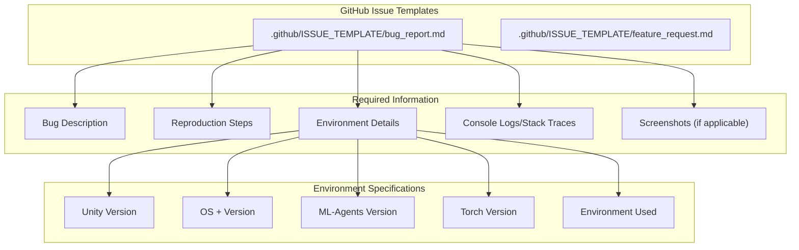
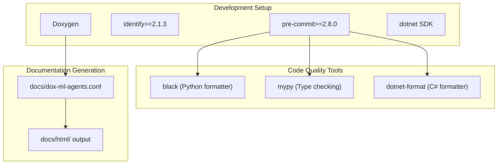
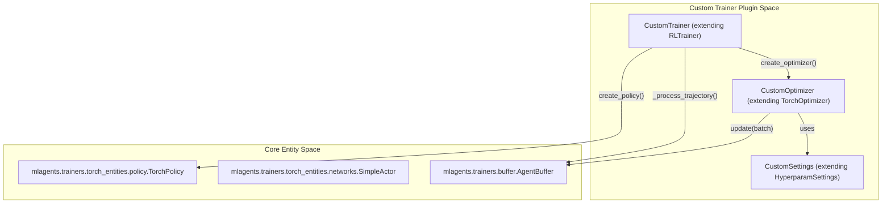
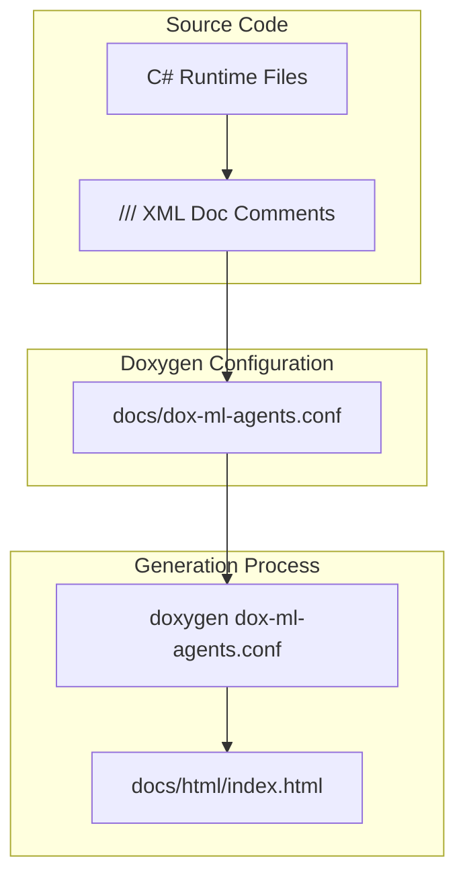

<!-- source: DeepWiki mcp.deepwiki.com · repo Unity-Technologies/ml-agents · page 6.4 Contributing and Development · fetched 2026-10-30 -->

# Contributing and Development

<details>
<summary>Relevant source files</summary>

The following files were used as context for generating this wiki page:

- [.github/ISSUE_TEMPLATE/bug_report.md](.github/ISSUE_TEMPLATE/bug_report.md)
- [.github/ISSUE_TEMPLATE/feature_request.md](.github/ISSUE_TEMPLATE/feature_request.md)
- [.pre-commit-search-and-replace.yaml](.pre-commit-search-and-replace.yaml)
- [SURVEY.md](SURVEY.md)
- [com.unity.ml-agents/CONTRIBUTING.md](com.unity.ml-agents/CONTRIBUTING.md)
- [docs/API-Reference.md](docs/API-Reference.md)
- [docs/Background-PyTorch.md](docs/Background-PyTorch.md)
- [docs/CONTRIBUTING.md](docs/CONTRIBUTING.md)
- [docs/Python-Custom-Trainer-Plugin.md](docs/Python-Custom-Trainer-Plugin.md)
- [docs/Python-LLAPI-Documentation.md](docs/Python-LLAPI-Documentation.md)
- [docs/Python-On-Off-Policy-Trainer-Documentation.md](docs/Python-On-Off-Policy-Trainer-Documentation.md)
- [docs/Python-Optimizer-Documentation.md](docs/Python-Optimizer-Documentation.md)
- [docs/Training-Plugins.md](docs/Training-Plugins.md)
- [docs/Tutorial-Custom-Trainer-Plugin.md](docs/Tutorial-Custom-Trainer-Plugin.md)
- [docs/dox-ml-agents.conf](docs/dox-ml-agents.conf)
- [docs/doxygen/Readme.md](docs/doxygen/Readme.md)
- [localized_docs/KR/docs/Installation-Anaconda-Windows.md](localized_docs/KR/docs/Installation-Anaconda-Windows.md)
- [localized_docs/KR/docs/Installation.md](localized_docs/KR/docs/Installation.md)
- [localized_docs/TR/docs/Installation.md](localized_docs/TR/docs/Installation.md)
- [markdown-link-check.fast.json](markdown-link-check.fast.json)
- [markdown-link-check.full.json](markdown-link-check.full.json)
- [ml-agents-plugin-examples/README.md](ml-agents-plugin-examples/README.md)
- [ml-agents-plugin-examples/mlagents_plugin_examples/__init__.py](ml-agents-plugin-examples/mlagents_plugin_examples/__init__.py)
- [ml-agents-plugin-examples/mlagents_plugin_examples/example_stats_writer.py](ml-agents-plugin-examples/mlagents_plugin_examples/example_stats_writer.py)
- [ml-agents-plugin-examples/mlagents_plugin_examples/tests/__init__.py](ml-agents-plugin-examples/mlagents_plugin_examples/tests/__init__.py)
- [ml-agents-plugin-examples/setup.py](ml-agents-plugin-examples/setup.py)
- [ml-agents/mlagents/plugins/__init__.py](ml-agents/mlagents/plugins/__init__.py)
- [ml-agents/mlagents/plugins/stats_writer.py](ml-agents/mlagents/plugins/stats_writer.py)
- [ml-agents/mlagents/trainers/tests/results/ppo/run_logs/training_status.json](ml-agents/mlagents/trainers/tests/results/ppo/run_logs/training_status.json)
- [ml-agents/pydoc-config.yaml](ml-agents/pydoc-config.yaml)
- [utils/validate_meta_files.py](utils/validate_meta_files.py)

</details>


This page provides comprehensive guidance for contributing to the ML-Agents Toolkit, covering bug reporting, feature requests, development setup, code quality standards, the trainer plugin system, and the CI/CD pipeline. This documentation is intended for developers who want to contribute code, documentation, or report issues.

## Bug Reporting Process

The ML-Agents project uses GitHub Issues for bug tracking with a structured template system. Bug reports must include specific environment information and reproduction steps. Note that the team is unable to help reproduce bugs with custom environments; issues should be reproduced with example environments [ .github/ISSUE_TEMPLATE/bug_report.md:33-33]().

### Bug Report Template Structure



Sources: [.github/ISSUE_TEMPLATE/bug_report.md:1-34]()

## Feature Request Process

Feature requests follow a structured template that requires clear problem definition and solution description.

### Feature Request Requirements

The feature request template requires:
- **Problem Description**: Clear articulation of the issue being addressed.
- **Proposed Solution**: Detailed description of the desired functionality.
- **Alternative Solutions**: Consideration of other approaches.
- **Additional Context**: Supporting information and use cases.

Sources: [.github/ISSUE_TEMPLATE/feature_request.md:1-21]()

## Development Environment Setup

The ML-Agents development environment requires specific tools and configurations for code quality, testing, and documentation generation.

### Development Tools and Dependencies



Sources: [com.unity.ml-agents/CONTRIBUTING.md:54-75](), [docs/API-Reference.md:1-21]()

## Code Quality Standards

The project enforces strict code quality standards through automated tools and configuration files.

### Code Style and Formatting
- **Python**: Formatted using `black` [com.unity.ml-agents/CONTRIBUTING.md:69-70]().
- **C#**: Formatted using `dotnet-format` [com.unity.ml-agents/CONTRIBUTING.md:72-74]().
- **Type Annotations**: We use `mypy` for static type checking. New or refactored code must include type annotations [com.unity.ml-agents/CONTRIBUTING.md:78-89]().

### Metadata Validation
Unity projects require `.meta` files for all assets. The script `utils/validate_meta_files.py` ensures that every non-meta file has a corresponding `.meta` file and vice-versa [utils/validate_meta_files.py:57-67]().

### Pre-commit Hook Configuration

To execute checks locally, run:
```bash
pip install pre-commit>=2.8.0
pip install identify>=2.1.3
pre-commit run --all-files
```
Sources: [com.unity.ml-agents/CONTRIBUTING.md:54-60](), [.pre-commit-search-and-replace.yaml:1-9]()

## Trainer Plugin System

ML-Agents provides an extensible plugin system to define custom trainers, optimizers, and stats writers. This allows users to implement new RL algorithms (like A2C or DQN) and integrate them with the `mlagents-learn` CLI [docs/Python-Custom-Trainer-Plugin.md:3-8]().

### Custom Trainer Implementation Flow



### Key Plugin Interfaces

1.  **Trainer and Optimizer**: Users can extend `OnPolicyTrainer` or `OffPolicyTrainer` [docs/Tutorial-Custom-Trainer-Plugin.md:12-13](). Custom optimizers must implement the `update` method which calculates losses from an `AgentBuffer` [docs/Tutorial-Custom-Trainer-Plugin.md:134-142]().
2.  **StatsWriter**: Receives information from the training process (e.g., rewards). Registered via the `mlagents.stats_writer` entry point [docs/Training-Plugins.md:46-59]().
3.  **Registration**: Plugins are registered via `entry_points` in `setup.py`. For example, `ML_AGENTS_STATS_WRITER` is a constant for `mlagents.stats_writer` [docs/Training-Plugins.md:19-29]().

### StatsWriter Plugin Discovery
The `mlagents.plugins.stats_writer.register_stats_writer_plugins` function uses `importlib.metadata` to find and load external plugins, falling back to default writers (Tensorboard, Console, Gauge) if none are found [ml-agents/mlagents/plugins/stats_writer.py:32-63]().

Sources: [docs/Tutorial-Custom-Trainer-Plugin.md:12-142](), [docs/Training-Plugins.md:1-60](), [ml-agents/mlagents/plugins/stats_writer.py:13-29]()

## Documentation Generation

The project uses Doxygen for API reference generation from C# code comments.

### API Documentation Workflow



The Doxygen configuration is specified in `docs/dox-ml-agents.conf` [docs/API-Reference.md:10-13](). The generated files are placed in `docs/html/`, which is ignored by Git [docs/API-Reference.md:15-17]().

Sources: [docs/API-Reference.md:1-21](), [docs/dox-ml-agents.conf:1-48]()

## Pull Request Requirements

All contributions must follow the established pull request process.

### Pull Request Checklist
- **Detailed Description**: Explain changes and the problem solved [com.unity.ml-agents/CONTRIBUTING.md:35]().
- **Testing**: Include unit tests and a summary of validation performed [com.unity.ml-agents/CONTRIBUTING.md:36-38]().
- **CLA**: Contributors must acknowledge the Contributor License Agreement via CLA Assistant [com.unity.ml-agents/CONTRIBUTING.md:90-94]().
- **CI**: All PRs run continuous integration; all tests must pass before merging [com.unity.ml-agents/CONTRIBUTING.md:51-51]().

### Branch Strategy
- **Main Branch**: The `main` branch corresponds to the most recent version of the project, which may be ahead of the latest release [com.unity.ml-agents/CONTRIBUTING.md:28-30]().

Sources: [com.unity.ml-agents/CONTRIBUTING.md:1-98](), [docs/CONTRIBUTING.md:1-36]()

## Communication Channels

| Channel | Purpose | Link/Contact |
|---------|---------|------|
| GitHub Issues | Bug reports, feature requests | [Issues Page](https://github.com/Unity-Technologies/ml-agents/issues) |
| Unity Forum | Community support, sharing environments | [ML-Agents Forum](https://forum.unity.com/forums/ml-agents.453) |
| Email | Direct inquiries, CLA questions | ml-agents@unity3d.com |

**Note**: Environment contributions are not accepted directly into the toolkit; please share them on the Unity Forum [com.unity.ml-agents/CONTRIBUTING.md:43-47]().

Sources: [com.unity.ml-agents/CONTRIBUTING.md:16-24](), [SURVEY.md:1-5]()

---

