# Page: ML-Agents Overview

# ML-Agents Overview

<details>
<summary>Relevant source files</summary>

The following files were used as context for generating this wiki page:

- [com.unity.ml-agents/CHANGELOG.md](com.unity.ml-agents/CHANGELOG.md)
- [com.unity.ml-agents/Runtime/Academy.cs](com.unity.ml-agents/Runtime/Academy.cs)
- [com.unity.ml-agents/package.json](com.unity.ml-agents/package.json)
- [docs/Background-Machine-Learning.md](docs/Background-Machine-Learning.md)
- [docs/Background-Unity.md](docs/Background-Unity.md)
- [docs/FAQ.md](docs/FAQ.md)
- [docs/Getting-Started.md](docs/Getting-Started.md)
- [docs/Learning-Environment-Create-New.md](docs/Learning-Environment-Create-New.md)
- [docs/Learning-Environment-Design-Agents.md](docs/Learning-Environment-Design-Agents.md)
- [docs/Learning-Environment-Design.md](docs/Learning-Environment-Design.md)
- [docs/Learning-Environment-Examples.md](docs/Learning-Environment-Examples.md)
- [docs/Learning-Environment-Executable.md](docs/Learning-Environment-Executable.md)
- [docs/ML-Agents-Overview.md](docs/ML-Agents-Overview.md)
- [docs/ML-Agents-Toolkit-Documentation.md](docs/ML-Agents-Toolkit-Documentation.md)
- [docs/Readme.md](docs/Readme.md)
- [docs/Training-Configuration-File.md](docs/Training-Configuration-File.md)
- [docs/Training-ML-Agents.md](docs/Training-ML-Agents.md)
- [localized_docs/RU/README.md](localized_docs/RU/README.md)
- [localized_docs/TR/README.md](localized_docs/TR/README.md)
- [localized_docs/TR/docs/Getting-Started.md](localized_docs/TR/docs/Getting-Started.md)
- [ml-agents-envs/mlagents_envs/__init__.py](ml-agents-envs/mlagents_envs/__init__.py)
- [ml-agents/mlagents/trainers/__init__.py](ml-agents/mlagents/trainers/__init__.py)
- [utils/validate_versions.py](utils/validate_versions.py)

</details>


The Unity ML-Agents Toolkit is a comprehensive framework that enables Unity environments to serve as training grounds for machine learning agents. This document provides an architectural overview of the toolkit, covering the core Unity SDK components, Python training system, and communication infrastructure that bridges game environments with machine learning algorithms.

For specific implementation details of Unity components, see [Unity SDK Components](#2). For Python training system internals, see [Python Training System](#3). For communication protocol details, see [Unity-Python Communication](#4).

## System Architecture

ML-Agents implements a distributed architecture where Unity provides the simulation environment while Python handles the machine learning algorithms. The system operates through a client-server model connected via gRPC communication.

### Overall System Design

```mermaid
graph TB
    subgraph "Unity Environment (C#)"
        [Academy] --> [Agent]
        [Agent] --> [BehaviorParameters]
        [Agent] --> [ISensor]
        [Agent] --> [IActuator]
        [BehaviorParameters] --> [ModelRunner]
        [Academy] --> [RpcCommunicator]
    end
    
    subgraph "Python Training Environment"
        [mlagents-learn] --> [TrainerController]
        [TrainerController] --> [Trainers]
        [TrainerController] --> [SubprocessEnvManager]
        [SubprocessEnvManager] --> [UnityEnvironment]
    end
    
    [RpcCommunicator] <== "gRPC / Protobuf" ==> [UnityEnvironment]
    
    subgraph "Local Inference"
        [ModelRunner] -. "Sentis/ONNX" .-> [TrainedModel]
    end
```

Sources: [com.unity.ml-agents/Runtime/Academy.cs:13-67](), [com.unity.ml-agents/Runtime/Agent.cs:1-50](), [ml-agents/mlagents/trainers/learn.py:1-40](), [docs/ML-Agents-Overview.md:35-65]()

### Core Component Relationships

The ML-Agents architecture follows a hierarchical pattern where the `Academy` manages the global training environment, `Agent` instances implement individual behaviors, and various supporting components handle observations, actions, and communication.

```mermaid
graph TB
    subgraph "Agent Logic [Agent.cs]"
        [Agent] --> [CollectObservations]
        [Agent] --> [OnActionReceived]
        [Agent] --> [OnEpisodeBegin]
    end
    
    subgraph "Decision Flow [BehaviorParameters.cs]"
        [BehaviorParameters] --> [HeuristicPolicy]
        [BehaviorParameters] --> [SentisPolicy]
        [BehaviorParameters] --> [RemotePolicy]
    end
    
    subgraph "Sensor System [ISensor.cs]"
        [VectorSensor]
        [RayPerceptionSensor]
        [CameraSensor]
    end

    [Agent] -- "Uses" --> [BehaviorParameters]
    [Agent] -- "Populates" --> [VectorSensor]
```

Sources: [docs/Learning-Environment-Design-Agents.md:44-84](), [com.unity.ml-agents/Runtime/Academy.cs:165-180](), [com.unity.ml-agents/Runtime/Agent.cs:200-533]()

## Key Components

### Academy
The `Academy` class serves as the central coordinator for the ML-Agents system. It operates as a singleton that manages environment stepping, communicator connections, and global training state. As of version 4.0.0, it supports Unity 6000.0+ and integrates with the latest Sentis inference engine [com.unity.ml-agents/package.json:1-12]().

| Component | Purpose | Key Methods |
|-----------|---------|-------------|
| `Academy` | Global environment management | `EnvironmentStep()`, `LazyInitialize()` [com.unity.ml-agents/Runtime/Academy.cs:43-132]() |
| `AcademyFixedUpdateStepper` | Internal helper to step Academy | `FixedUpdate()` [com.unity.ml-agents/Runtime/Academy.cs:31-46]() |
| `StatsRecorder` | Metrics collection | `Add()`, statistics recording |

Sources: [com.unity.ml-agents/Runtime/Academy.cs:40-160]()

### Agent
The `Agent` class represents individual learning entities. Each agent observes its environment via `CollectObservations`, receives actions through `OnActionReceived`, and provides rewards to guide the learning process [docs/Learning-Environment-Design-Agents.md:66-84]().

- **OnEpisodeBegin()**: Called to reset the environment for a new training cycle [docs/Learning-Environment-Create-New.md:136-150]().
- **Heuristic()**: Allows manual control of the agent for debugging or player-controlled behavior [docs/Learning-Environment-Design-Agents.md:78-83]().
- **RequestDecision()**: Triggers the observation-decision-action cycle [docs/Learning-Environment-Design-Agents.md:105-120]().

Sources: [com.unity.ml-agents/Runtime/Agent.cs:206-600](), [docs/Learning-Environment-Design-Agents.md:1-100]()

### Communication Infrastructure

ML-Agents uses gRPC for communication between Unity and Python. The system follows semantic versioning on the communication protocol to ensure compatibility.

- **API Version**: Current protocol version is `1.5.0` [com.unity.ml-agents/Runtime/Academy.cs:104-104]().
- **Port Configuration**: Default Editor training port is `5004`, or specified via `--mlagents-port` [com.unity.ml-agents/Runtime/Academy.cs:112-114]().
- **Side Channels**: Used for non-RL data exchange, such as environment parameters or engine configuration [com.unity.ml-agents/Runtime/Academy.cs:10-10]().

Sources: [com.unity.ml-agents/Runtime/Academy.cs:68-115]()

## Training vs Inference Modes

The toolkit supports two primary operational modes:

### Training Mode
Driven by the Python `mlagents-learn` utility.
1. The `Academy` connects to the Python process via an `ICommunicator` [com.unity.ml-agents/Runtime/Academy.cs:162-162]().
2. Training metrics are monitored via **TensorBoard** [docs/Training-ML-Agents.md:91-95]().
3. Supports algorithms like **PPO**, **SAC**, and **MA-POCA** for cooperative multi-agent scenarios [docs/Training-Configuration-File.md:24-31]().

### Inference Mode  
Uses trained models locally within Unity.
1. Employs the **Unity Inference Engine** (Sentis) for cross-platform model execution [com.unity.ml-agents/package.json:8-8]().
2. Loads `.onnx` model files exported after training [docs/Training-ML-Agents.md:96-99]().
3. Managed by `ModelRunner` to handle tensor execution [com.unity.ml-agents/Runtime/Academy.cs:165-165]().

Sources: [docs/Training-ML-Agents.md:39-105](), [com.unity.ml-agents/CHANGELOG.md:14-25]()

## Package Structure

The ML-Agents Toolkit is modularized into several components:

| Package | Language | Purpose |
|---------|----------|---------|
| `com.unity.ml-agents` | C# | Core Unity SDK for Agent/Academy logic [com.unity.ml-agents/package.json:2-6](). |
| `mlagents` | Python | Training algorithms (PPO, SAC, etc.) and CLI [ml-agents/mlagents/trainers/__init__.py:1-6](). |
| `mlagents_envs` | Python | API for interacting with Unity environments [ml-agents-envs/mlagents_envs/__init__.py:1-6](). |

**Current Versions (v4.0.3):**
- Unity Package: `4.0.3` [com.unity.ml-agents/package.json:4-4]()
- Minimum Unity Version: `6000.0` [com.unity.ml-agents/package.json:5-5]()
- Sentis Dependency: `2.6.1` [com.unity.ml-agents/package.json:8-8]()

Sources: [com.unity.ml-agents/package.json:1-16](), [com.unity.ml-agents/CHANGELOG.md:8-15]()

---

# Page: Key Components and Structure

# Key Components and Structure

<details>
<summary>Relevant source files</summary>

The following files were used as context for generating this wiki page:

- [DevProject/Packages/manifest.json](DevProject/Packages/manifest.json)
- [DevProject/Packages/packages-lock.json](DevProject/Packages/packages-lock.json)
- [DevProject/ProjectSettings/EditorBuildSettings.asset](DevProject/ProjectSettings/EditorBuildSettings.asset)
- [DevProject/ProjectSettings/ProjectVersion.txt](DevProject/ProjectSettings/ProjectVersion.txt)
- [PerformanceProject/Packages/packages-lock.json](PerformanceProject/Packages/packages-lock.json)
- [Project/Packages/manifest.json](Project/Packages/manifest.json)
- [Project/Packages/packages-lock.json](Project/Packages/packages-lock.json)
- [Project/ProjectSettings/ProjectVersion.txt](Project/ProjectSettings/ProjectVersion.txt)
- [com.unity.ml-agents.tests/package.json](com.unity.ml-agents.tests/package.json)
- [com.unity.ml-agents/CHANGELOG.md](com.unity.ml-agents/CHANGELOG.md)
- [com.unity.ml-agents/Editor/Unity.ML-Agents.Editor.asmdef](com.unity.ml-agents/Editor/Unity.ML-Agents.Editor.asmdef)
- [com.unity.ml-agents/Runtime/Academy.cs](com.unity.ml-agents/Runtime/Academy.cs)
- [com.unity.ml-agents/Runtime/Actuators/IActionReceiver.cs](com.unity.ml-agents/Runtime/Actuators/IActionReceiver.cs)
- [com.unity.ml-agents/Runtime/Actuators/IDiscreteActionMask.cs](com.unity.ml-agents/Runtime/Actuators/IDiscreteActionMask.cs)
- [com.unity.ml-agents/Runtime/Agent.cs](com.unity.ml-agents/Runtime/Agent.cs)
- [com.unity.ml-agents/Runtime/Communicator.meta](com.unity.ml-agents/Runtime/Communicator.meta)
- [com.unity.ml-agents/Runtime/Communicator/GrpcExtensions.cs.meta](com.unity.ml-agents/Runtime/Communicator/GrpcExtensions.cs.meta)
- [com.unity.ml-agents/Runtime/Communicator/ICommunicator.cs.meta](com.unity.ml-agents/Runtime/Communicator/ICommunicator.cs.meta)
- [com.unity.ml-agents/Runtime/Communicator/RpcCommunicator.cs.meta](com.unity.ml-agents/Runtime/Communicator/RpcCommunicator.cs.meta)
- [com.unity.ml-agents/Runtime/Demonstrations/DemonstrationRecorder.cs](com.unity.ml-agents/Runtime/Demonstrations/DemonstrationRecorder.cs)
- [com.unity.ml-agents/Runtime/Grpc/AssemblyInfo.cs](com.unity.ml-agents/Runtime/Grpc/AssemblyInfo.cs)
- [com.unity.ml-agents/Runtime/Grpc/AssemblyInfo.cs.meta](com.unity.ml-agents/Runtime/Grpc/AssemblyInfo.cs.meta)
- [com.unity.ml-agents/Runtime/Grpc/Unity.ML-Agents.CommunicatorObjects.asmdef](com.unity.ml-agents/Runtime/Grpc/Unity.ML-Agents.CommunicatorObjects.asmdef)
- [com.unity.ml-agents/Runtime/Unity.ML-Agents.asmdef](com.unity.ml-agents/Runtime/Unity.ML-Agents.asmdef)
- [com.unity.ml-agents/package.json](com.unity.ml-agents/package.json)
- [docs/Installation-Anaconda-Windows.md](docs/Installation-Anaconda-Windows.md)
- [docs/Installation.md](docs/Installation.md)
- [docs/Migrating.md](docs/Migrating.md)
- [docs/Training-on-Amazon-Web-Service.md](docs/Training-on-Amazon-Web-Service.md)
- [docs/Training-on-Microsoft-Azure.md](docs/Training-on-Microsoft-Azure.md)
- [ml-agents-envs/README.md](ml-agents-envs/README.md)
- [ml-agents-envs/mlagents_envs/__init__.py](ml-agents-envs/mlagents_envs/__init__.py)
- [ml-agents/README.md](ml-agents/README.md)
- [ml-agents/mlagents/trainers/__init__.py](ml-agents/mlagents/trainers/__init__.py)
- [utils/validate_versions.py](utils/validate_versions.py)

</details>


This page describes the core architectural components of the Unity ML-Agents Toolkit and how they interact to enable machine learning training in Unity environments. It covers the Unity C# SDK components, Python training system, and communication protocols that form the foundation of the ML-Agents architecture.

## System Architecture Overview

The ML-Agents Toolkit consists of three main layers: the Unity simulation environment, a communication bridge, and the Python training system. The Unity side handles simulation, observation collection, and action execution, while Python manages the machine learning algorithms and training orchestration.

### High-Level System Architecture

```mermaid
graph TB
    subgraph "Unity Environment"
        Academy["Academy<br/>(Singleton)"]
        Agent["Agent<br/>(MonoBehaviour)"]
        BehaviorParameters["BehaviorParameters<br/>(Component)"]
        Sensors["Sensors<br/>(ISensor)"]
        Actuators["Actuators<br/>(IActuator)"]
        ModelRunner["ModelRunner<br/>(Inference Engine)"]
    end
    
    subgraph "Communication Layer"
        ICommunicator["ICommunicator<br/>(Interface)"]
        RpcCommunicator["RpcCommunicator<br/>(gRPC Implementation)"]
        SideChannels["SideChannels<br/>(Non-RL Data)"]
    end
    
    subgraph "Python Training System"
        mlagents_learn["mlagents-learn<br/>(CLI Entry Point)"]
        mlagents_envs["mlagents_envs<br/>(Environment API)"]
        TrainerController["TrainerController<br/>(Training Orchestration)"]
        Trainers["Trainers<br/>(PPO, SAC, POCA)"]
    end
    
    Academy --> Agent
    Agent --> BehaviorParameters
    Agent --> Sensors
    Agent --> Actuators
    BehaviorParameters --> ModelRunner
    
    Academy --> ICommunicator
    ICommunicator --> RpcCommunicator
    RpcCommunicator --> SideChannels
    
    RpcCommunicator <--> mlagents_envs
    mlagents_envs <--> mlagents_learn
    mlagents_learn --> TrainerController
    TrainerController --> Trainers
    
    ModelRunner -.-> "Sentis ONNX Model"
    Trainers -.-> "PyTorch Checkpoint"
```

Sources: [com.unity.ml-agents/Runtime/Academy.cs:16-24](), [com.unity.ml-agents/Runtime/Agent.cs:110-162](), [docs/Installation.md:3-16]()

## Unity SDK Core Components

The Unity SDK provides the foundational components for creating ML-Agents environments within Unity scenes. These components handle agent lifecycle, observation collection, action execution, and communication with the Python training system.

### Agent and Academy Relationship

The `Academy` acts as a singleton orchestrator, while `Agent` instances represent individual actors. The communication version (currently `1.5.0`) ensures compatibility between the Unity simulation and Python trainers.

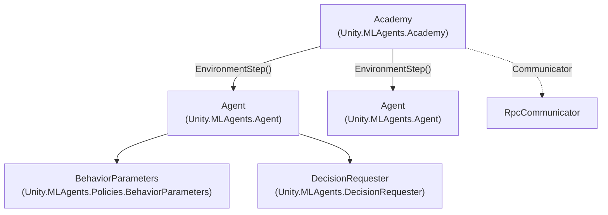

Sources: [com.unity.ml-agents/Runtime/Academy.cs:104-132](), [com.unity.ml-agents/Runtime/Academy.cs:31-46](), [com.unity.ml-agents/Runtime/Agent.cs:110-150]()

### Core Unity Components

| Component | Purpose | Key Symbols |
|-----------|---------|----------------------|
| `Academy` | Singleton orchestrator managing simulation stepping and communication. | `Academy.Instance`, `Academy.EnvironmentStep()`, `Academy.Communicator` |
| `Agent` | Base class for actors that observe, decide, and act. | `Agent.CollectObservations()`, `Agent.OnActionReceived()`, `Agent.EndEpisode()` |
| `AgentInfo` | Struct containing agent state, rewards, and status for communication. | `AgentInfo.reward`, `AgentInfo.done`, `AgentInfo.storedActions` |
| `BehaviorParameters` | Defines how the agent makes decisions (Heuristic, Inference, or Default). | `BehaviorType`, `Model`, `BrainParameters` |
| `ModelRunner` | Manages neural network inference using the Unity Inference Engine (Sentis). | `ModelRunner.DecideAction()`, `ModelRunner.PutObservations()` |

Sources: [com.unity.ml-agents/Runtime/Academy.cs:66-132](), [com.unity.ml-agents/Runtime/Agent.cs:19-88](), [com.unity.ml-agents/Runtime/Agent.cs:110-162](), [com.unity.ml-agents/package.json:7-12]()

### Observation and Action Flow

Agents use `ISensor` implementations for observations and `IActuator` implementations for actions. The `AgentVectorActuator` is a specialized wrapper for standard vector actions.

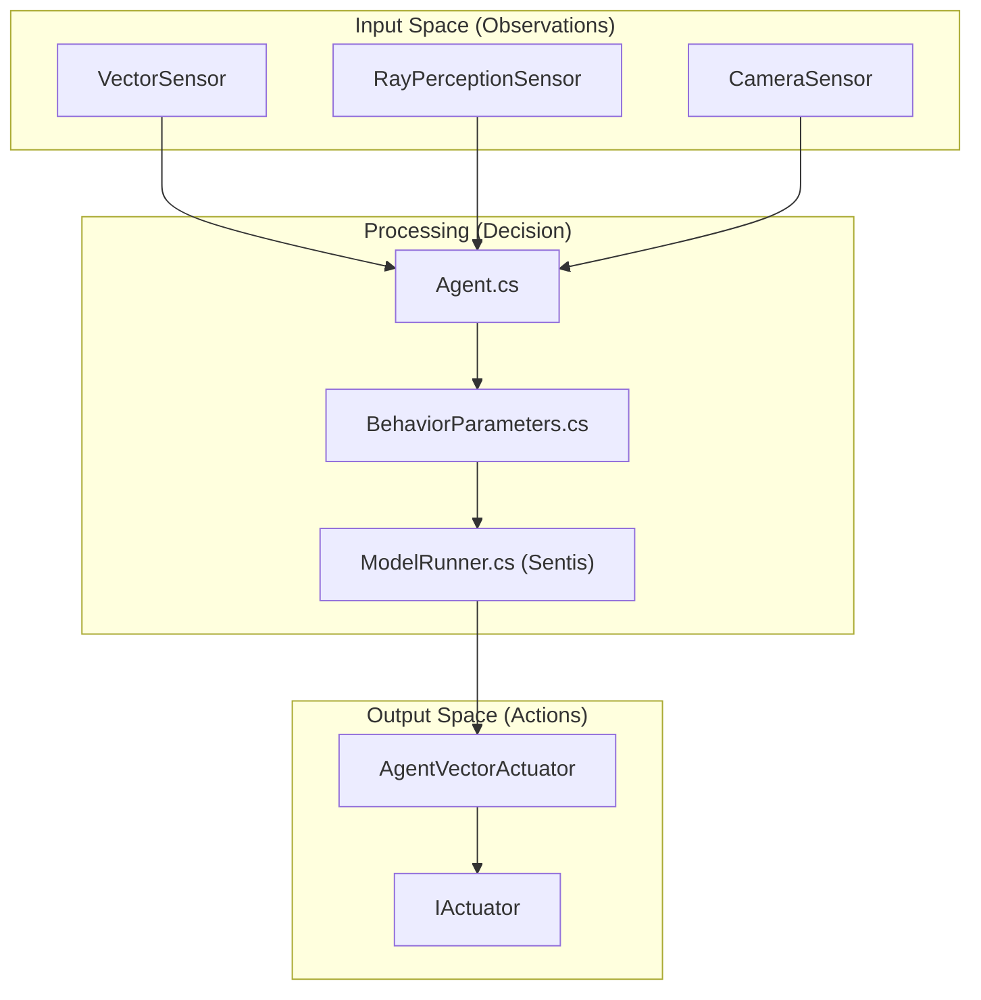

Sources: [com.unity.ml-agents/Runtime/Agent.cs:94-107](), [com.unity.ml-agents/Runtime/Agent.cs:121-133](), [com.unity.ml-agents/Runtime/Agent.cs:327-353]()

## Python Training System

The Python side consists of two primary packages: `mlagents` (containing the trainers) and `mlagents_envs` (the communication interface).

### Package Structure

| Package | Purpose | Minimum Version |
|---------|---------|-----------------|
| `com.unity.ml-agents` | Unity C# SDK | 4.0.3 |
| `mlagents` | Python Training Algorithms (PPO, SAC, etc.) | 1.2.0.dev0 |
| `mlagents_envs` | Python API for Unity communication | 1.2.0.dev0 |

Sources: [com.unity.ml-agents/package.json:4-5](), [ml-agents/mlagents/trainers/__init__.py:2](), [ml-agents-envs/mlagents_envs/__init__.py:2](), [docs/Installation.md:9-16]()

## Communication Infrastructure

The `ICommunicator` interface abstracts the bridge between Unity and Python. The toolkit uses gRPC for high-performance messaging.

### Key Workflows

#### Training Workflow (Unity-Python Loop)
1. `Academy` triggers a step via `AcademyFixedUpdateStepper`.
2. `Agent` collects observations through `ISensor.Write()`.
3. `RpcCommunicator` sends `AgentInfo` (including rewards and observations) to the Python trainer.
4. Python trainer (e.g., `PPOTrainer`) processes data and returns actions.
5. `Agent` receives actions via `OnActionReceived(ActionBuffers)`.

Sources: [com.unity.ml-agents/Runtime/Academy.cs:31-46](), [com.unity.ml-agents/Runtime/Agent.cs:19-56](), [com.unity.ml-agents/Runtime/Agent.cs:156-157]()

#### Inference Workflow (Local)
1. `Agent` collects observations.
2. `BehaviorParameters` identifies the `Model` (ONNX).
3. `ModelRunner` executes the model using `Unity.InferenceEngine` (Sentis).
4. Actions are applied directly within the Unity simulation without Python involvement.

Sources: [com.unity.ml-agents/Runtime/Agent.cs:134-143](), [com.unity.ml-agents/package.json:8](), [com.unity.ml-agents/CHANGELOG.md:14]()

## Versioning and Compatibility
The toolkit adheres to semantic versioning for the communication protocol (`k_ApiVersion = "1.5.0"`). Major version changes in the C# package (e.g., from 3.x to 4.x) often correspond to significant Unity engine requirements, such as the transition to Unity 6000.0 and the Sentis inference engine.

Sources: [com.unity.ml-agents/Runtime/Academy.cs:104-110](), [com.unity.ml-agents/CHANGELOG.md:34-38](), [docs/Migrating.md:21-24]()

---

# Page: Unity SDK Components

# Unity SDK Components

<details>
<summary>Relevant source files</summary>

The following files were used as context for generating this wiki page:

- [Project/Assets/ML-Agents/Examples/SharedAssets/Scripts/ModelOverrider.cs](Project/Assets/ML-Agents/Examples/SharedAssets/Scripts/ModelOverrider.cs)
- [com.unity.ml-agents/CHANGELOG.md](com.unity.ml-agents/CHANGELOG.md)
- [com.unity.ml-agents/Editor/BehaviorParametersEditor.cs](com.unity.ml-agents/Editor/BehaviorParametersEditor.cs)
- [com.unity.ml-agents/Runtime/Academy.cs](com.unity.ml-agents/Runtime/Academy.cs)
- [com.unity.ml-agents/Runtime/Actuators/IActionReceiver.cs](com.unity.ml-agents/Runtime/Actuators/IActionReceiver.cs)
- [com.unity.ml-agents/Runtime/Actuators/IDiscreteActionMask.cs](com.unity.ml-agents/Runtime/Actuators/IDiscreteActionMask.cs)
- [com.unity.ml-agents/Runtime/Agent.cs](com.unity.ml-agents/Runtime/Agent.cs)
- [com.unity.ml-agents/Runtime/Communicator/CommunicatorFactory.cs](com.unity.ml-agents/Runtime/Communicator/CommunicatorFactory.cs)
- [com.unity.ml-agents/Runtime/Demonstrations/DemonstrationRecorder.cs](com.unity.ml-agents/Runtime/Demonstrations/DemonstrationRecorder.cs)
- [com.unity.ml-agents/Runtime/Integrations/Match3/Match3Sensor.cs](com.unity.ml-agents/Runtime/Integrations/Match3/Match3Sensor.cs)
- [com.unity.ml-agents/Runtime/Policies/BehaviorParameters.cs](com.unity.ml-agents/Runtime/Policies/BehaviorParameters.cs)
- [com.unity.ml-agents/Runtime/Policies/BrainParameters.cs](com.unity.ml-agents/Runtime/Policies/BrainParameters.cs)
- [com.unity.ml-agents/Runtime/Sensors/Reflection/ObservableAttribute.cs](com.unity.ml-agents/Runtime/Sensors/Reflection/ObservableAttribute.cs)
- [com.unity.ml-agents/Runtime/SideChannels/SideChannelManager.cs](com.unity.ml-agents/Runtime/SideChannels/SideChannelManager.cs)
- [com.unity.ml-agents/Runtime/Timer.cs](com.unity.ml-agents/Runtime/Timer.cs)
- [com.unity.ml-agents/package.json](com.unity.ml-agents/package.json)
- [docs/Installation-Anaconda-Windows.md](docs/Installation-Anaconda-Windows.md)
- [docs/Installation.md](docs/Installation.md)
- [docs/Migrating.md](docs/Migrating.md)
- [docs/Training-on-Amazon-Web-Service.md](docs/Training-on-Amazon-Web-Service.md)
- [docs/Training-on-Microsoft-Azure.md](docs/Training-on-Microsoft-Azure.md)
- [ml-agents-envs/README.md](ml-agents-envs/README.md)
- [ml-agents-envs/mlagents_envs/__init__.py](ml-agents-envs/mlagents_envs/__init__.py)
- [ml-agents/README.md](ml-agents/README.md)
- [ml-agents/mlagents/trainers/__init__.py](ml-agents/mlagents/trainers/__init__.py)
- [utils/validate_versions.py](utils/validate_versions.py)

</details>


The Unity ML-Agents SDK provides the core C# components for creating reinforcement learning environments within Unity. These components handle agent behavior, observation collection, action execution, and integration with external training systems. This page provides an overview of the main components and their relationships.

## Unity SDK Architecture

The ML-Agents Unity SDK is structured around several key components that work together to create a complete learning environment:

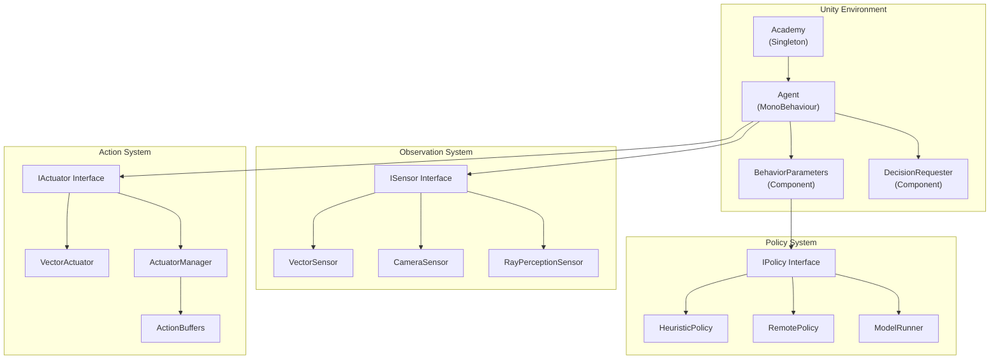

Sources:
- [com.unity.ml-agents/Runtime/Academy.cs:49-67]()
- [com.unity.ml-agents/Runtime/Agent.cs:110-162]()
- [com.unity.ml-agents/package.json:1-16]()

## Component Categories

The Unity SDK components are organized into four main categories, each covered in detail in the following sections:

### Academy and Training Environment
The `Academy` singleton orchestrates the entire ML-Agents environment, managing the simulation loop, episode lifecycle, and coordination between agents and external training processes. It provides the foundation for all ML-Agents functionality.

**Key Components:**
- `Academy` - Central coordinator and singleton [com.unity.ml-agents/Runtime/Academy.cs:66-67]()
- `AcademyFixedUpdateStepper` - Helper class to step the Academy during `FixedUpdate` phase [com.unity.ml-agents/Runtime/Academy.cs:31-46]()
- `ICommunicator` - Interface for managing communication between Unity and Python [com.unity.ml-agents/Runtime/Academy.cs:162-162]()

For detailed information, see [Academy and Training Environment](#2.1).

### Agent and Behavior Parameters  
The `Agent` class is the core component that transforms Unity GameObjects into intelligent agents. The `BehaviorParameters` component configures how agents make decisions and interact with their environment.

**Key Components:**
- `Agent` - Main component for implementing agent logic [com.unity.ml-agents/Runtime/Agent.cs:110-113]()
- `BehaviorParameters` - Configuration for agent behavior and decision-making [com.unity.ml-agents/Runtime/Agent.cs:134-135]()
- `AgentInfo` - Struct containing agent state like rewards, done flags, and actions [com.unity.ml-agents/Runtime/Agent.cs:19-20]()

For detailed information, see [Agent and Behavior Parameters](#2.2).

### Sensors and Observations
The sensor system provides agents with information about their environment through various observation types. All sensors implement the `ISensor` interface and can be combined to create rich observation spaces.

**Key Components:**
- `VectorSensor` - Numerical observations [com.unity.ml-agents/Runtime/Agent.cs:124-125]()
- `CameraSensor` - Visual observations from cameras [com.unity.ml-agents/Runtime/Agent.cs:123-123]()
- `RayPerceptionSensor` - Raycast-based observations [com.unity.ml-agents/Runtime/Agent.cs:124-124]()

For detailed information, see [Sensors and Observations](#2.3).

### Inference and Model Running
The inference system handles loading and running trained neural network models within Unity using the **Sentis** inference engine.

**Key Components:**
- `ModelRunner` - Manages the execution of neural network models [com.unity.ml-agents/Runtime/Academy.cs:165-165]()
- `ModelOverrider` - Utility class to allow the `ModelAsset` file for an agent to be overridden during inference [Project/Assets/ML-Agents/Examples/SharedAssets/Scripts/ModelOverrider.cs:24-25]()

For detailed information, see [Inference and Model Running](#2.4).

Sources:
- [com.unity.ml-agents/Runtime/Academy.cs:49-166]()
- [com.unity.ml-agents/Runtime/Agent.cs:110-162]()
- [com.unity.ml-agents/CHANGELOG.md:14-14]()

## Unity SDK Integration

The Unity SDK components integrate with Unity's GameObject system through MonoBehaviour components and interfaces. The following diagram shows how these components work together in the Unity editor:

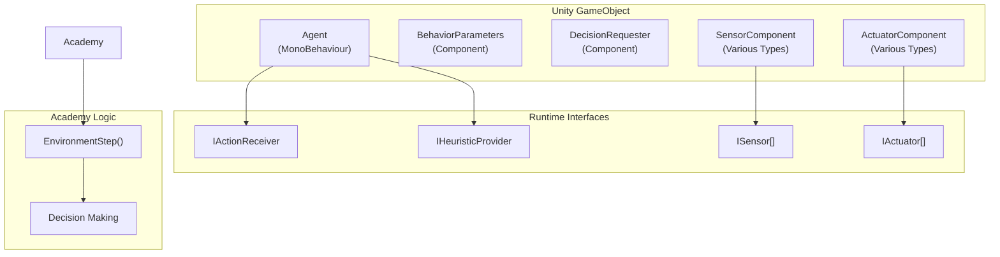

Sources:
- [com.unity.ml-agents/Runtime/Agent.cs:110-157]()
- [com.unity.ml-agents/Runtime/Academy.cs:31-46]()
- [com.unity.ml-agents/Runtime/Academy.cs:43-43]()

## Core Interfaces and Data Structures

The Unity SDK is built around several key interfaces that provide a consistent API for ML-Agents functionality:

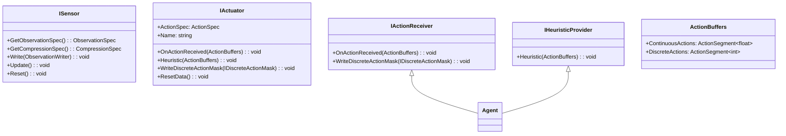

These interfaces define the contracts for:
- **`ISensor`** - How observations are collected and provided to agents [docs/Migrating.md:79-118]()
- **`IActuator`** - How actions are processed and executed by agents [docs/Migrating.md:74-76]()
- **`IActionReceiver`** - Interface for components that receive actions [com.unity.ml-agents/Runtime/Agent.cs:96-96]()
- **`ActionBuffers`** - Container for continuous and discrete action data [com.unity.ml-agents/Runtime/Agent.cs:24-24]()

Sources:
- [com.unity.ml-agents/Runtime/Agent.cs:19-88]()
- [docs/Migrating.md:34-122]()

## Package Structure and Dependencies

The Unity ML-Agents SDK is distributed as a Unity package (`com.unity.ml-agents`) with the following key dependencies:

- **Sentis** (`com.unity.ai.inference`): The neural network inference engine [com.unity.ml-agents/package.json:8-8]()
- **Unity Modules**: Includes `imageconversion`, `jsonserialize`, and `physics` [com.unity.ml-agents/package.json:9-11]()

As of version 4.0.0, the extension package `com.unity.ml-agents.extensions` was merged into the main package [com.unity.ml-agents/CHANGELOG.md:39-39]().

Sources:
- [com.unity.ml-agents/package.json:1-16]()
- [com.unity.ml-agents/CHANGELOG.md:34-40]()

## Getting Started

To begin using the Unity ML-Agents SDK components:

1. **Install Unity**: Version 6000.0 or later is required [docs/Installation.md:34-34]().
2. **Install the Package**: Add `com.unity.ml-agents` via the Package Manager [docs/Installation.md:92-98]().
3. **Implement an Agent**: Subclass the `Agent` class and implement `CollectObservations` and `OnActionReceived` [com.unity.ml-agents/Runtime/Agent.cs:115-132]().

**Basic Agent Setup Example:**
```csharp
public class MyAgent : Agent
{
    public override void OnEpisodeBegin() { /* Reset logic */ }
    
    public override void CollectObservations(VectorSensor sensor)
    {
        sensor.AddObservation(this.transform.localPosition);
    }
    
    public override void OnActionReceived(ActionBuffers actionBuffers)
    {
        // Use actionBuffers.ContinuousActions or actionBuffers.DiscreteActions
    }
}
```

For detailed information on each component category, refer to the specific sections:
- [Academy and Training Environment](#2.1)
- [Agent and Behavior Parameters](#2.2)
- [Sensors and Observations](#2.3)
- [Inference and Model Running](#2.4)

Sources:
- [docs/Installation.md:21-32]()
- [com.unity.ml-agents/Runtime/Agent.cs:115-157]()

---

# Page: Academy and Training Environment

# Academy and Training Environment

<details>
<summary>Relevant source files</summary>

The following files were used as context for generating this wiki page:

- [Project/Assets/ML-Agents/Examples/SharedAssets/Scripts/ModelCarousel.cs](Project/Assets/ML-Agents/Examples/SharedAssets/Scripts/ModelCarousel.cs)
- [Project/Assets/ML-Agents/Examples/SharedAssets/Scripts/ModelCarousel.cs.meta](Project/Assets/ML-Agents/Examples/SharedAssets/Scripts/ModelCarousel.cs.meta)
- [com.unity.ml-agents/CHANGELOG.md](com.unity.ml-agents/CHANGELOG.md)
- [com.unity.ml-agents/Runtime/Academy.cs](com.unity.ml-agents/Runtime/Academy.cs)
- [com.unity.ml-agents/Runtime/Areas/TrainingAreaReplicator.cs](com.unity.ml-agents/Runtime/Areas/TrainingAreaReplicator.cs)
- [com.unity.ml-agents/Runtime/Communicator/GrpcExtensions.cs](com.unity.ml-agents/Runtime/Communicator/GrpcExtensions.cs)
- [com.unity.ml-agents/Runtime/Communicator/ICommunicator.cs](com.unity.ml-agents/Runtime/Communicator/ICommunicator.cs)
- [com.unity.ml-agents/Runtime/Communicator/RpcCommunicator.cs](com.unity.ml-agents/Runtime/Communicator/RpcCommunicator.cs)
- [com.unity.ml-agents/Runtime/DecisionRequester.cs](com.unity.ml-agents/Runtime/DecisionRequester.cs)
- [com.unity.ml-agents/Runtime/Demonstrations/DemonstrationWriter.cs](com.unity.ml-agents/Runtime/Demonstrations/DemonstrationWriter.cs)
- [com.unity.ml-agents/Runtime/Sensors/BoxOverlapChecker.cs](com.unity.ml-agents/Runtime/Sensors/BoxOverlapChecker.cs)
- [com.unity.ml-agents/Runtime/Sensors/GridSensorBase.cs](com.unity.ml-agents/Runtime/Sensors/GridSensorBase.cs)
- [com.unity.ml-agents/Runtime/Sensors/GridSensorComponent.cs](com.unity.ml-agents/Runtime/Sensors/GridSensorComponent.cs)
- [com.unity.ml-agents/Runtime/Sensors/IGridPerception.cs](com.unity.ml-agents/Runtime/Sensors/IGridPerception.cs)
- [com.unity.ml-agents/Runtime/Sensors/IGridPerception.cs.meta](com.unity.ml-agents/Runtime/Sensors/IGridPerception.cs.meta)
- [com.unity.ml-agents/Runtime/Sensors/OneHotGridSensor.cs](com.unity.ml-agents/Runtime/Sensors/OneHotGridSensor.cs)
- [com.unity.ml-agents/package.json](com.unity.ml-agents/package.json)
- [ml-agents-envs/mlagents_envs/__init__.py](ml-agents-envs/mlagents_envs/__init__.py)
- [ml-agents-envs/mlagents_envs/environment.py](ml-agents-envs/mlagents_envs/environment.py)
- [ml-agents/mlagents/trainers/__init__.py](ml-agents/mlagents/trainers/__init__.py)
- [utils/validate_versions.py](utils/validate_versions.py)

</details>


This document covers the Academy singleton pattern, environment orchestration, and episode management within the Unity ML-Agents Toolkit. The Academy serves as the central coordinator for training environments, managing the lifecycle of agents, communication with Python trainers, and the synchronization of environment steps.

## Academy Singleton Pattern

The `Academy` class implements a thread-safe lazy singleton pattern using `Lazy<Academy>` [com.unity.ml-agents/Runtime/Academy.cs:117-132](). It serves as the central orchestrator for all ML-Agents functionality within a Unity environment. The Academy instance is typically initialized the first time it is accessed, often by the first `Agent` initialized in a scene [com.unity.ml-agents/Runtime/Academy.cs:52-54]().

### Academy Initialization and Versioning
At initialization, the Academy attempts to connect to a Python training process through an `ICommunicator` [com.unity.ml-agents/Runtime/Academy.cs:56-57](). It maintains several critical version strings to ensure compatibility:
*   `k_ApiVersion`: The communication protocol version (currently "1.5.0") [com.unity.ml-agents/Runtime/Academy.cs:104]().
*   `k_PackageVersion`: The Unity package version (currently "4.0.3") [com.unity.ml-agents/Runtime/Academy.cs:110]().

### Code Entity Space: Academy Structure
The following diagram associates natural language concepts with specific code entities in the `Academy` class.

Title: Academy Singleton Structure
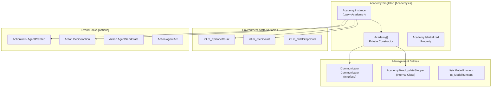
**Sources:** [com.unity.ml-agents/Runtime/Academy.cs:26-172](), [com.unity.ml-agents/Runtime/Academy.cs:250-266]()

## Environment Orchestration

The Academy orchestrates environment execution through the `EnvironmentStep()` function [com.unity.ml-agents/Runtime/Academy.cs:577](). This method ensures all agents operate in lockstep, which is essential for deterministic training.

### Step Execution Sequence
The step sequence is triggered either automatically by `AcademyFixedUpdateStepper.FixedUpdate()` [com.unity.ml-agents/Runtime/AcademyFixedUpdateStepper.cs:33-45]() or manually.

| Sequence Order | Event/Method | Code Responsibility |
| :--- | :--- | :--- |
| 1 | `AgentPreStep` | Triggered for components like `DecisionRequester` to call `RequestDecision()` [com.unity.ml-agents/Runtime/DecisionRequester.cs:97-113](). |
| 2 | `AgentIncrementStep` | Increments internal step counters for all active agents. |
| 3 | `DecideAction` | Agents determine their next action via Heuristic, Inference, or External Policy. |
| 4 | `AgentSendState` | Agents collect observations from `ISensor` implementations [com.unity.ml-agents/Runtime/Academy.cs:605](). |
| 5 | `AgentAct` | Agents apply actions through `IActuator` implementations. |
| 6 | `Communicator.Exchange()` | Sends observations to Python and receives new actions [com.unity.ml-agents/Runtime/Academy.cs:614](). |

Title: Step Orchestration Flow
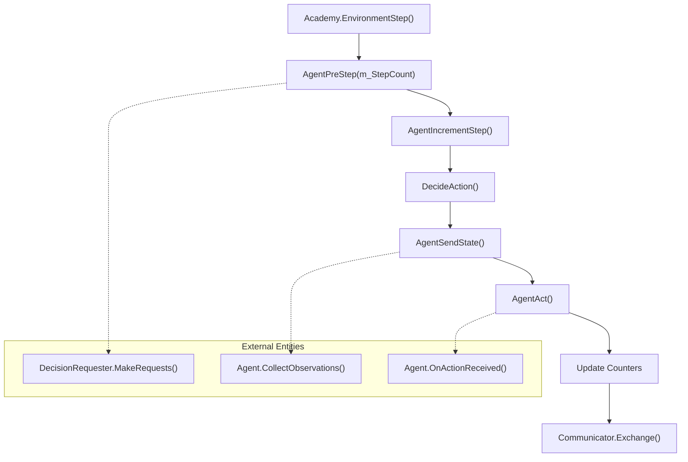
**Sources:** [com.unity.ml-agents/Runtime/Academy.cs:577-618](), [com.unity.ml-agents/Runtime/DecisionRequester.cs:97-113]()

## Episode Management

The Academy manages the global episode lifecycle. An episode count is incremented each time the environment is reset [com.unity.ml-agents/Runtime/Academy.cs:148-150]().

*   **Step Counting**: The Academy tracks `m_StepCount` (steps in current episode) and `m_TotalStepCount` (total simulation steps) [com.unity.ml-agents/Runtime/Academy.cs:152-160]().
*   **Forced Resets**: The `ForcedFullReset()` method [com.unity.ml-agents/Runtime/Academy.cs:520]() triggers the `AgentForceReset` event, causing all agents to reset their state and call `OnEpisodeBegin()`.
*   **Python-Driven Resets**: When the Python trainer sends a `RESET` command, the `RpcCommunicator` triggers the `ResetCommandReceived` event, which the Academy handles to re-initialize the environment [com.unity.ml-agents/Runtime/Communicator/RpcCommunicator.cs:28]().

**Sources:** [com.unity.ml-agents/Runtime/Academy.cs:148-160](), [com.unity.ml-agents/Runtime/Academy.cs:520-530](), [com.unity.ml-agents/Runtime/Communicator/RpcCommunicator.cs:25-30]()

## Communication and Compatibility

The Academy acts as the Unity-side handshake manager for the gRPC connection established by `RpcCommunicator`.

### Compatibility Checks
During initialization, the Academy verifies that the Python `API_VERSION` matches the Unity `k_ApiVersion`.
*   Major versions must match exactly [com.unity.ml-agents/Runtime/Communicator/RpcCommunicator.cs:87-90]().
*   If the major version is 0 (beta), the minor version must also match [com.unity.ml-agents/Runtime/Communicator/RpcCommunicator.cs:80-86]().
*   Python-side checks are performed in `UnityEnvironment._check_communication_compatibility` [ml-agents-envs/mlagents_envs/environment.py:91-117]().

### Capabilities Negotiation
The Academy stores `TrainerCapabilities` received from the Python trainer [com.unity.ml-agents/Runtime/Academy.cs:215](). These capabilities define if the trainer supports features like:
*   `MultiAgentGroups`: Support for `groupId` rewards [com.unity.ml-agents/Runtime/Communicator/GrpcExtensions.cs:75]().
*   `HybridActions`: Support for both continuous and discrete actions [com.unity.ml-agents/Runtime/Communicator/GrpcExtensions.cs:175]().

**Sources:** [com.unity.ml-agents/Runtime/Communicator/RpcCommunicator.cs:73-97](), [ml-agents-envs/mlagents_envs/environment.py:55-68](), [com.unity.ml-agents/Runtime/Communicator/GrpcExtensions.cs:71-105]()

## Automatic Stepping System

The Academy provides an automatic stepping mechanism through the `AcademyFixedUpdateStepper` component.

*   **FixedUpdate Hook**: The stepper calls `Academy.Instance.EnvironmentStep()` inside Unity's `FixedUpdate` phase [com.unity.ml-agents/Runtime/Academy.cs:31-46]().
*   **Ownership Check**: To prevent leaks during "Fast Enter Play Mode" or multiple scene loads, the stepper verifies it is the "owner" via `IsStepperOwner(this)` before stepping [com.unity.ml-agents/Runtime/Academy.cs:37]().
*   **Toggleable**: Automatic stepping can be disabled via `Academy.Instance.AutomaticSteppingEnabled = false` if the developer wishes to manually call `EnvironmentStep()` [com.unity.ml-agents/Runtime/Academy.cs:301-316]().

**Sources:** [com.unity.ml-agents/Runtime/Academy.cs:31-46](), [com.unity.ml-agents/Runtime/Academy.cs:301-316](), [com.unity.ml-agents/CHANGELOG.md:11]()

---

# Page: Agent and Behavior Parameters

# Agent and Behavior Parameters

<details>
<summary>Relevant source files</summary>

The following files were used as context for generating this wiki page:

- [Project/Assets/ML-Agents/Examples/Basic/Scripts/BasicActuatorComponent.cs](Project/Assets/ML-Agents/Examples/Basic/Scripts/BasicActuatorComponent.cs)
- [Project/Assets/ML-Agents/Examples/SharedAssets/Scripts/ModelOverrider.cs](Project/Assets/ML-Agents/Examples/SharedAssets/Scripts/ModelOverrider.cs)
- [com.unity.ml-agents/Editor/BehaviorParametersEditor.cs](com.unity.ml-agents/Editor/BehaviorParametersEditor.cs)
- [com.unity.ml-agents/Runtime/Actuators/ActionSpec.cs](com.unity.ml-agents/Runtime/Actuators/ActionSpec.cs)
- [com.unity.ml-agents/Runtime/Actuators/ActuatorComponent.cs](com.unity.ml-agents/Runtime/Actuators/ActuatorComponent.cs)
- [com.unity.ml-agents/Runtime/Actuators/ActuatorManager.cs](com.unity.ml-agents/Runtime/Actuators/ActuatorManager.cs)
- [com.unity.ml-agents/Runtime/Actuators/IActionReceiver.cs](com.unity.ml-agents/Runtime/Actuators/IActionReceiver.cs)
- [com.unity.ml-agents/Runtime/Actuators/IActuator.cs](com.unity.ml-agents/Runtime/Actuators/IActuator.cs)
- [com.unity.ml-agents/Runtime/Actuators/IDiscreteActionMask.cs](com.unity.ml-agents/Runtime/Actuators/IDiscreteActionMask.cs)
- [com.unity.ml-agents/Runtime/Actuators/VectorActuator.cs](com.unity.ml-agents/Runtime/Actuators/VectorActuator.cs)
- [com.unity.ml-agents/Runtime/Agent.cs](com.unity.ml-agents/Runtime/Agent.cs)
- [com.unity.ml-agents/Runtime/Communicator/CommunicatorFactory.cs](com.unity.ml-agents/Runtime/Communicator/CommunicatorFactory.cs)
- [com.unity.ml-agents/Runtime/Demonstrations/DemonstrationRecorder.cs](com.unity.ml-agents/Runtime/Demonstrations/DemonstrationRecorder.cs)
- [com.unity.ml-agents/Runtime/Integrations/Match3/Match3Sensor.cs](com.unity.ml-agents/Runtime/Integrations/Match3/Match3Sensor.cs)
- [com.unity.ml-agents/Runtime/Policies/BehaviorParameters.cs](com.unity.ml-agents/Runtime/Policies/BehaviorParameters.cs)
- [com.unity.ml-agents/Runtime/Policies/BrainParameters.cs](com.unity.ml-agents/Runtime/Policies/BrainParameters.cs)
- [com.unity.ml-agents/Runtime/Policies/HeuristicPolicy.cs](com.unity.ml-agents/Runtime/Policies/HeuristicPolicy.cs)
- [com.unity.ml-agents/Runtime/Sensors/IBuiltInSensor.cs](com.unity.ml-agents/Runtime/Sensors/IBuiltInSensor.cs)
- [com.unity.ml-agents/Runtime/Sensors/Reflection/ObservableAttribute.cs](com.unity.ml-agents/Runtime/Sensors/Reflection/ObservableAttribute.cs)
- [com.unity.ml-agents/Runtime/Sensors/SensorShapeValidator.cs](com.unity.ml-agents/Runtime/Sensors/SensorShapeValidator.cs)
- [com.unity.ml-agents/Runtime/SideChannels/SideChannelManager.cs](com.unity.ml-agents/Runtime/SideChannels/SideChannelManager.cs)
- [com.unity.ml-agents/Runtime/SideChannels/TrainingAnalyticsSideChannel.cs](com.unity.ml-agents/Runtime/SideChannels/TrainingAnalyticsSideChannel.cs)
- [com.unity.ml-agents/Runtime/Timer.cs](com.unity.ml-agents/Runtime/Timer.cs)
- [docs/Installation-Anaconda-Windows.md](docs/Installation-Anaconda-Windows.md)
- [docs/Installation.md](docs/Installation.md)
- [docs/Migrating.md](docs/Migrating.md)
- [docs/Training-on-Amazon-Web-Service.md](docs/Training-on-Amazon-Web-Service.md)
- [docs/Training-on-Microsoft-Azure.md](docs/Training-on-Microsoft-Azure.md)
- [ml-agents-envs/README.md](ml-agents-envs/README.md)
- [ml-agents/README.md](ml-agents/README.md)

</details>


This page explains the core components for creating intelligent agents in the ML-Agents toolkit: the `Agent` class and the `BehaviorParameters` component. These components work together to enable agents to observe their environment, make decisions, and take actions.

## Agent Class Overview

The `Agent` class is the foundational component for creating autonomous entities. It provides the lifecycle hooks for initialization, observation collection, and action execution.

### Agent Class Structure

The `Agent` class implements several key interfaces to facilitate communication between the Unity simulation and the policy (whether remote Python, local inference, or heuristic).

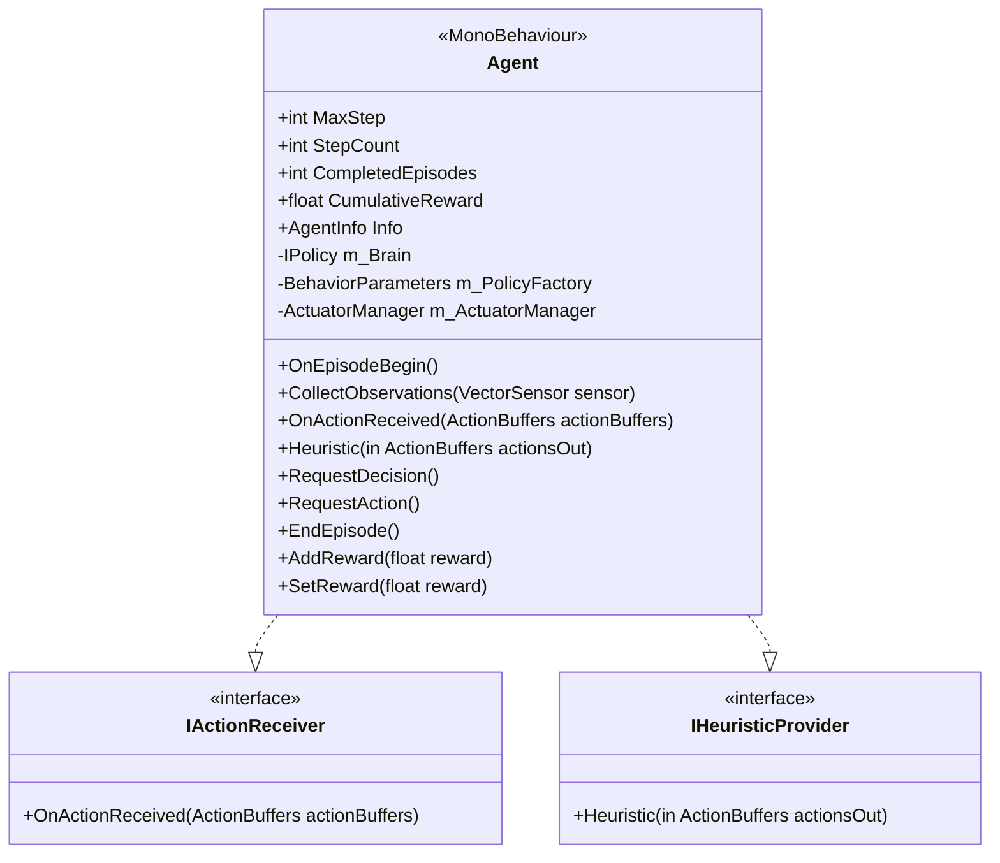
Sources: [com.unity.ml-agents/Runtime/Agent.cs:110-165](), [com.unity.ml-agents/Runtime/Agent.cs:272-360]()

### Key Agent Methods

- **`OnEpisodeBegin()`**: Called when an episode starts, typically used to reset the agent and its environment [com.unity.ml-agents/Runtime/Agent.cs:517-521]().
- **`CollectObservations(VectorSensor sensor)`**: Used to collect vector observations. The agent calls this before making a decision [com.unity.ml-agents/Runtime/Agent.cs:453-457]().
- **`OnActionReceived(ActionBuffers actionBuffers)`**: Receives the actions chosen by the policy and applies them to the agent [com.unity.ml-agents/Runtime/Agent.cs:419-423]().
- **`Heuristic(in ActionBuffers actionsOut)`**: Defines manual control logic for the agent when the behavior type is set to heuristic [com.unity.ml-agents/Runtime/Agent.cs:1071-1075]().
- **`RequestDecision()`**: Manually signals that the agent should collect observations and request a new action [com.unity.ml-agents/Runtime/Agent.cs:1115-1135]().
- **`EndEpisode()`**: Signals the end of the current episode and triggers a reset [com.unity.ml-agents/Runtime/Agent.cs:1278-1290]().

## Behavior Parameters Component

The `BehaviorParameters` component defines how an agent makes decisions. It configures the observation/action space and determines which policy type is active.

### Configuration and Data Flow

The `BehaviorParameters` component acts as a factory that generates the appropriate `IPolicy` implementation at runtime based on the `BehaviorType` and environment state.

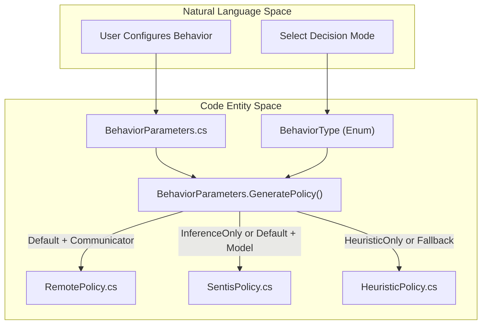
Sources: [com.unity.ml-agents/Runtime/Policies/BehaviorParameters.cs:72-135](), [com.unity.ml-agents/Runtime/Policies/BehaviorParameters.cs:229-263]()

### Behavior Types

The `BehaviorType` enum defines three primary modes:
1. **`Default`**: Attempts to use a remote process (Python) for training. If unavailable, it falls back to local inference (ONNX model). If no model is provided, it falls back to the heuristic [com.unity.ml-agents/Runtime/Policies/BehaviorParameters.cs:16-21]().
2. **`HeuristicOnly`**: Always uses the `Heuristic()` method implemented in the Agent class [com.unity.ml-agents/Runtime/Policies/BehaviorParameters.cs:23-26]().
3. **`InferenceOnly`**: Always uses the assigned neural network model for decision-making [com.unity.ml-agents/Runtime/Policies/BehaviorParameters.cs:28-32]().

## Decision-Making Modes

Decisions can be triggered either automatically or manually.

### DecisionRequester

The `DecisionRequester` component is a utility that automatically calls `Agent.RequestDecision()` at a fixed step interval.

- **`DecisionPeriod`**: The frequency (in Academy steps) at which a decision is requested [com.unity.ml-agents/Runtime/DecisionRequester.cs:20-22]().
- **`TakeActionsBetweenDecisions`**: If true, the agent repeats the last action during steps where no new decision is requested [com.unity.ml-agents/Runtime/DecisionRequester.cs:28-30]().

### Model Overriding

During inference or validation, the `ModelOverrider` utility allows developers to swap the `.onnx` model at runtime via command-line arguments. This is often used in automated testing or evaluation pipelines.

| Flag | Purpose |
|------|---------|
| `--mlagents-override-model-directory` | Path to the directory containing override models [Project/Assets/ML-Agents/Examples/SharedAssets/Scripts/ModelOverrider.cs:27]() |
| `--mlagents-quit-after-episodes` | Quits the application after a specific number of episodes [Project/Assets/ML-Agents/Examples/SharedAssets/Scripts/ModelOverrider.cs:29]() |

Sources: [Project/Assets/ML-Agents/Examples/SharedAssets/Scripts/ModelOverrider.cs:24-32]()

## Action Buffers and Spec

Actions are passed to the agent via the `ActionBuffers` struct, which contains segments for both continuous and discrete actions.

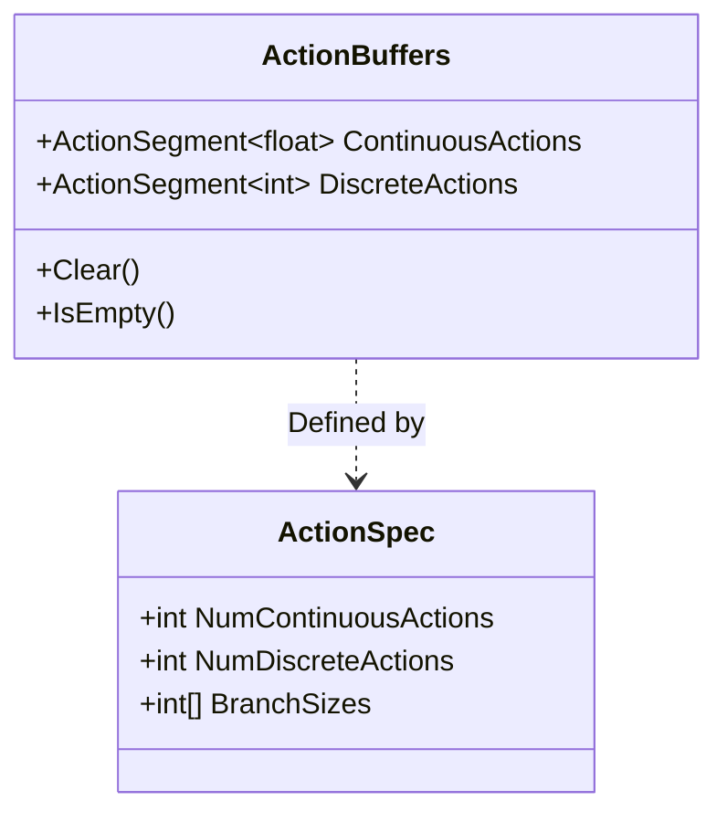
Sources: [com.unity.ml-agents/Runtime/Actuators/IActionReceiver.cs:11-26](), [com.unity.ml-agents/Runtime/Actuators/ActionSpec.cs:11-30]()

### Discrete Action Masking
For discrete control, agents can prohibit specific actions using `IDiscreteActionMask`. In version 2.x+, the API uses `SetActionEnabled(branch, index, bool)` to toggle action availability [docs/Migrating.md:50-73]().

## Agent Lifecycle Flow

The following diagram illustrates the interaction between the Unity Engine, the Agent component, and the Policy implementation during a simulation step.

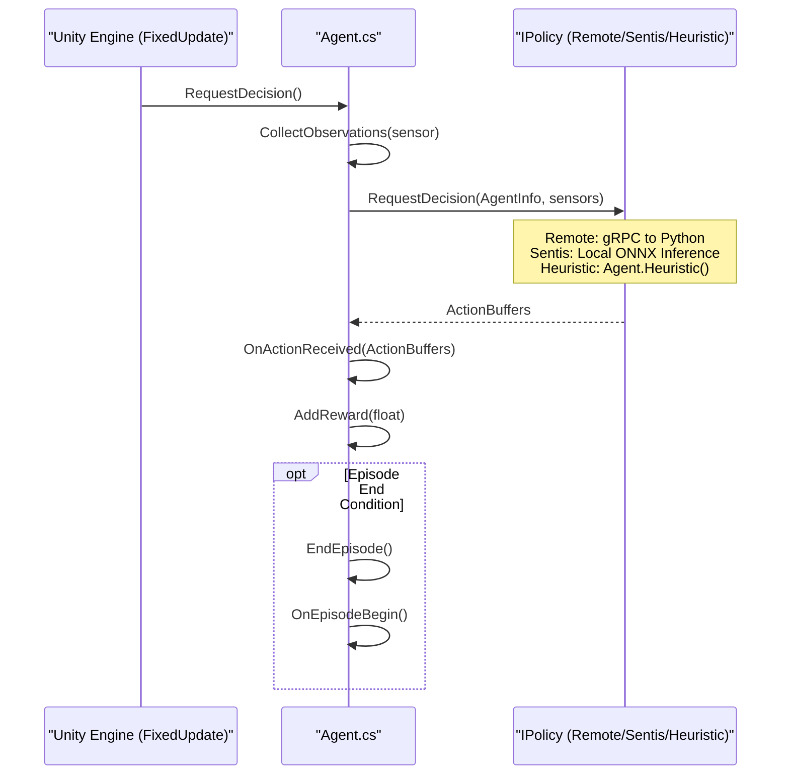
Sources: [com.unity.ml-agents/Runtime/Agent.cs:1115-1135](), [com.unity.ml-agents/Runtime/Agent.cs:1278-1290](), [com.unity.ml-agents/Runtime/Policies/RemotePolicy.cs:60-75]()

## Summary Table: Behavior Parameters

| Parameter | Type | Description |
|-----------|------|-------------|
| `BehaviorName` | `string` | Base name for the behavior, used for model matching [com.unity.ml-agents/Runtime/Policies/BehaviorParameters.cs:146-150]() |
| `Model` | `ModelAsset` | The ONNX model used for inference [com.unity.ml-agents/Runtime/Policies/BehaviorParameters.cs:105-109]() |
| `InferenceDevice` | `InferenceDevice` | Whether to run inference on CPU or GPU [com.unity.ml-agents/Runtime/Policies/BehaviorParameters.cs:119-123]() |
| `DeterministicInference` | `bool` | Whether to use deterministic action selection [com.unity.ml-agents/Runtime/Policies/BehaviorParameters.cs:188-192]() |
| `UseChildSensors` | `bool` | Automatically find sensors in child objects [com.unity.ml-agents/Runtime/Policies/BehaviorParameters.cs:174-178]() |

Sources: [com.unity.ml-agents/Runtime/Policies/BehaviorParameters.cs:72-192]()

---

# Page: Sensors and Observations

# Sensors and Observations

<details>
<summary>Relevant source files</summary>

The following files were used as context for generating this wiki page:

- [Project/Assets/ML-Agents/Examples/SharedAssets/Scripts/ModelCarousel.cs](Project/Assets/ML-Agents/Examples/SharedAssets/Scripts/ModelCarousel.cs)
- [Project/Assets/ML-Agents/Examples/SharedAssets/Scripts/ModelCarousel.cs.meta](Project/Assets/ML-Agents/Examples/SharedAssets/Scripts/ModelCarousel.cs.meta)
- [Project/Assets/ML-Agents/Examples/SharedAssets/Scripts/SensorBase.cs](Project/Assets/ML-Agents/Examples/SharedAssets/Scripts/SensorBase.cs)
- [com.unity.ml-agents/Editor/CameraSensorComponentEditor.cs](com.unity.ml-agents/Editor/CameraSensorComponentEditor.cs)
- [com.unity.ml-agents/Editor/RayPerceptionSensorComponentBaseEditor.cs](com.unity.ml-agents/Editor/RayPerceptionSensorComponentBaseEditor.cs)
- [com.unity.ml-agents/Editor/RenderTextureSensorComponentEditor.cs](com.unity.ml-agents/Editor/RenderTextureSensorComponentEditor.cs)
- [com.unity.ml-agents/Editor/VectorSensorComponentEditor.cs](com.unity.ml-agents/Editor/VectorSensorComponentEditor.cs)
- [com.unity.ml-agents/Runtime/Areas/TrainingAreaReplicator.cs](com.unity.ml-agents/Runtime/Areas/TrainingAreaReplicator.cs)
- [com.unity.ml-agents/Runtime/Grpc/CommunicatorObjects/AgentInfo.cs](com.unity.ml-agents/Runtime/Grpc/CommunicatorObjects/AgentInfo.cs)
- [com.unity.ml-agents/Runtime/IMultiAgentGroup.cs](com.unity.ml-agents/Runtime/IMultiAgentGroup.cs)
- [com.unity.ml-agents/Runtime/IMultiAgentGroup.cs.meta](com.unity.ml-agents/Runtime/IMultiAgentGroup.cs.meta)
- [com.unity.ml-agents/Runtime/MultiAgentGroupIdCounter.cs](com.unity.ml-agents/Runtime/MultiAgentGroupIdCounter.cs)
- [com.unity.ml-agents/Runtime/MultiAgentGroupIdCounter.cs.meta](com.unity.ml-agents/Runtime/MultiAgentGroupIdCounter.cs.meta)
- [com.unity.ml-agents/Runtime/SensorHelper.cs](com.unity.ml-agents/Runtime/SensorHelper.cs)
- [com.unity.ml-agents/Runtime/Sensors/BoxOverlapChecker.cs](com.unity.ml-agents/Runtime/Sensors/BoxOverlapChecker.cs)
- [com.unity.ml-agents/Runtime/Sensors/BufferSensor.cs](com.unity.ml-agents/Runtime/Sensors/BufferSensor.cs)
- [com.unity.ml-agents/Runtime/Sensors/BufferSensorComponent.cs](com.unity.ml-agents/Runtime/Sensors/BufferSensorComponent.cs)
- [com.unity.ml-agents/Runtime/Sensors/CameraSensor.cs](com.unity.ml-agents/Runtime/Sensors/CameraSensor.cs)
- [com.unity.ml-agents/Runtime/Sensors/CameraSensorComponent.cs](com.unity.ml-agents/Runtime/Sensors/CameraSensorComponent.cs)
- [com.unity.ml-agents/Runtime/Sensors/CompressionSpec.cs](com.unity.ml-agents/Runtime/Sensors/CompressionSpec.cs)
- [com.unity.ml-agents/Runtime/Sensors/GridSensorBase.cs](com.unity.ml-agents/Runtime/Sensors/GridSensorBase.cs)
- [com.unity.ml-agents/Runtime/Sensors/GridSensorComponent.cs](com.unity.ml-agents/Runtime/Sensors/GridSensorComponent.cs)
- [com.unity.ml-agents/Runtime/Sensors/IGridPerception.cs](com.unity.ml-agents/Runtime/Sensors/IGridPerception.cs)
- [com.unity.ml-agents/Runtime/Sensors/IGridPerception.cs.meta](com.unity.ml-agents/Runtime/Sensors/IGridPerception.cs.meta)
- [com.unity.ml-agents/Runtime/Sensors/ISensor.cs](com.unity.ml-agents/Runtime/Sensors/ISensor.cs)
- [com.unity.ml-agents/Runtime/Sensors/OneHotGridSensor.cs](com.unity.ml-agents/Runtime/Sensors/OneHotGridSensor.cs)
- [com.unity.ml-agents/Runtime/Sensors/RayPerceptionSensor.cs](com.unity.ml-agents/Runtime/Sensors/RayPerceptionSensor.cs)
- [com.unity.ml-agents/Runtime/Sensors/RayPerceptionSensorComponentBase.cs](com.unity.ml-agents/Runtime/Sensors/RayPerceptionSensorComponentBase.cs)
- [com.unity.ml-agents/Runtime/Sensors/Reflection/BoolReflectionSensor.cs](com.unity.ml-agents/Runtime/Sensors/Reflection/BoolReflectionSensor.cs)
- [com.unity.ml-agents/Runtime/Sensors/Reflection/FloatReflectionSensor.cs](com.unity.ml-agents/Runtime/Sensors/Reflection/FloatReflectionSensor.cs)
- [com.unity.ml-agents/Runtime/Sensors/Reflection/IntReflectionSensor.cs](com.unity.ml-agents/Runtime/Sensors/Reflection/IntReflectionSensor.cs)
- [com.unity.ml-agents/Runtime/Sensors/Reflection/QuaternionReflectionSensor.cs](com.unity.ml-agents/Runtime/Sensors/Reflection/QuaternionReflectionSensor.cs)
- [com.unity.ml-agents/Runtime/Sensors/Reflection/ReflectionSensorBase.cs](com.unity.ml-agents/Runtime/Sensors/Reflection/ReflectionSensorBase.cs)
- [com.unity.ml-agents/Runtime/Sensors/Reflection/Vector2ReflectionSensor.cs](com.unity.ml-agents/Runtime/Sensors/Reflection/Vector2ReflectionSensor.cs)
- [com.unity.ml-agents/Runtime/Sensors/Reflection/Vector3ReflectionSensor.cs](com.unity.ml-agents/Runtime/Sensors/Reflection/Vector3ReflectionSensor.cs)
- [com.unity.ml-agents/Runtime/Sensors/Reflection/Vector4ReflectionSensor.cs](com.unity.ml-agents/Runtime/Sensors/Reflection/Vector4ReflectionSensor.cs)
- [com.unity.ml-agents/Runtime/Sensors/RenderTextureSensor.cs](com.unity.ml-agents/Runtime/Sensors/RenderTextureSensor.cs)
- [com.unity.ml-agents/Runtime/Sensors/RenderTextureSensorComponent.cs](com.unity.ml-agents/Runtime/Sensors/RenderTextureSensorComponent.cs)
- [com.unity.ml-agents/Runtime/Sensors/StackingSensor.cs](com.unity.ml-agents/Runtime/Sensors/StackingSensor.cs)
- [com.unity.ml-agents/Runtime/Sensors/VectorSensor.cs](com.unity.ml-agents/Runtime/Sensors/VectorSensor.cs)
- [com.unity.ml-agents/Runtime/Sensors/VectorSensorComponent.cs](com.unity.ml-agents/Runtime/Sensors/VectorSensorComponent.cs)
- [com.unity.ml-agents/Runtime/SimpleMultiAgentGroup.cs](com.unity.ml-agents/Runtime/SimpleMultiAgentGroup.cs)
- [com.unity.ml-agents/Runtime/SimpleMultiAgentGroup.cs.meta](com.unity.ml-agents/Runtime/SimpleMultiAgentGroup.cs.meta)

</details>


This document details the ML-Agents sensor system, which provides the mechanism for agents to collect observations from their environment. Sensors are the primary interface between Unity GameObjects and the ML-Agents training pipeline, converting environmental data into structured observations that can be processed by machine learning algorithms.

## Core Sensor Architecture

The ML-Agents sensor system is built around a flexible interface-based architecture that allows for different types of observations while maintaining a consistent API for the training pipeline.

### ISensor Interface and Observation Specifications

The `ISensor` interface defines the contract for all sensors. Each sensor must implement methods for writing observations, providing metadata about the observation space, and handling sensor lifecycle events.

```mermaid
graph TD
    subgraph "Code Entity Space: com.unity.ml-agents/Runtime/Sensors/"
        ISensor["ISensor Interface"]
        VectorSensor["VectorSensor"]
        CameraSensor["CameraSensor"]
        RayPerceptionSensor["RayPerceptionSensor"]
        BufferSensor["BufferSensor"]
        StackingSensor["StackingSensor"]
        ObservationSpec["ObservationSpec"]
        ObservationWriter["ObservationWriter"]
    end

    ISensor ---|implements| VectorSensor
    ISensor ---|implements| CameraSensor
    ISensor ---|implements| RayPerceptionSensor
    ISensor ---|implements| BufferSensor
    ISensor ---|implements| StackingSensor
    
    ISensor -->|returns| ObservationSpec
    ISensor -->|Write() to| ObservationWriter
```
**Sensor Interface Architecture**

The `ObservationSpec` defines the structure of observations, including shape and `DimensionProperty` flags like `TranslationalEquivariance` or `VariableSize` [com.unity.ml-agents/Runtime/Sensors/ISensor.cs:10-33]().

Sources: [com.unity.ml-agents/Runtime/Sensors/ISensor.cs:54-104](), [com.unity.ml-agents/Runtime/Sensors/VectorSensor.cs:10-18]()

### Sensor Component System

Unity's component-based architecture is bridged to the sensor system through `SensorComponent` classes that create `ISensor` instances.

```mermaid
graph TD
    subgraph "Unity Inspector / GameObject"
        VC["VectorSensorComponent"]
        CC["CameraSensorComponent"]
        RC["RayPerceptionSensorComponentBase"]
        BC["BufferSensorComponent"]
        GC["GridSensorComponent"]
    end

    subgraph "Runtime Code Entities"
        VS["VectorSensor"]
        CS["CameraSensor"]
        RS["RayPerceptionSensor"]
        BS["BufferSensor"]
        GS["GridSensorBase"]
    end

    VC -->|CreateSensors()| VS
    CC -->|CreateSensors()| CS
    RC -->|CreateSensors()| RS
    BC -->|CreateSensors()| BS
    GC -->|CreateSensors()| GS
```
**Component to Sensor Mapping**

Sources: [com.unity.ml-agents/Runtime/Sensors/VectorSensorComponent.cs:1-40](), [com.unity.ml-agents/Runtime/Sensors/BufferSensorComponent.cs:50-54](), [com.unity.ml-agents/Runtime/Sensors/GridSensorComponent.cs:11-15]()

## Sensor Types

### VectorSensor
The `VectorSensor` handles numerical observations. It stores observations as a `List<float>` and provides methods like `AddObservation()` for various Unity types (Vector3, Quaternion, etc.) [com.unity.ml-agents/Runtime/Sensors/VectorSensor.cs:137-194](). It handles padding or truncation if the number of observations added does not match the expected `observationSize` [com.unity.ml-agents/Runtime/Sensors/VectorSensor.cs:41-66]().

Sources: [com.unity.ml-agents/Runtime/Sensors/VectorSensor.cs:10-123]()

### CameraSensor
The `CameraSensor` captures visual observations from a Unity `Camera`. It renders the camera view to a `Texture2D` via `ObservationToTexture()` [com.unity.ml-agents/Runtime/Sensors/CameraSensor.cs:134-165]() and writes the result to an `ObservationWriter` [com.unity.ml-agents/Runtime/Sensors/CameraSensor.cs:103-110](). It supports PNG compression [com.unity.ml-agents/Runtime/Sensors/CameraSensor.cs:88-96]().

Sources: [com.unity.ml-agents/Runtime/Sensors/CameraSensor.cs:10-61]()

### RayPerceptionSensor
The `RayPerceptionSensor` performs physics-based raycasting. It uses `RayPerceptionInput` to define ray lengths, angles, and detectable tags [com.unity.ml-agents/Runtime/Sensors/RayPerceptionSensor.cs:28-81](). It supports both 2D and 3D casting types [com.unity.ml-agents/Runtime/Sensors/RayPerceptionSensor.cs:12-23]().

Sources: [com.unity.ml-agents/Runtime/Sensors/RayPerceptionSensor.cs:143-200]()

### BufferSensor
The `BufferSensor` allows observing a variable number of entities. It maintains an internal `m_ObservationBuffer` and allows appending observations until `m_MaxNumObs` is reached [com.unity.ml-agents/Runtime/Sensors/BufferSensor.cs:47-65](). This is particularly useful for environments with a dynamic number of objects.

Sources: [com.unity.ml-agents/Runtime/Sensors/BufferSensor.cs:8-32]()

### GridSensor
The `GridSensorComponent` creates a grid-based observation of the environment. It uses `IGridPerception` to detect objects within a defined `GridSize` and `CellScale` [com.unity.ml-agents/Runtime/Sensors/GridSensorComponent.cs:34-66](). It can be configured to rotate with the agent [com.unity.ml-agents/Runtime/Sensors/GridSensorComponent.cs:69-77]().

Sources: [com.unity.ml-agents/Runtime/Sensors/GridSensorComponent.cs:11-150]()

## Observation Data Flow

Observations are collected and written to the training pipeline through the `ObservationWriter`.

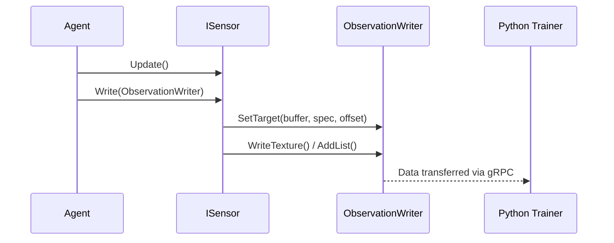
**Observation Writing Sequence**

### StackingSensor
The `StackingSensor` wraps another sensor to provide temporal context. It maintains a circular buffer `m_StackedObservations` [com.unity.ml-agents/Runtime/Sensors/StackingSensor.cs:39-43](). When `Write()` is called, it first updates the current index with the wrapped sensor's latest data and then writes the saved observations from oldest to newest [com.unity.ml-agents/Runtime/Sensors/StackingSensor.cs:119-156]().

Sources: [com.unity.ml-agents/Runtime/Sensors/StackingSensor.cs:19-74]()

### RenderTextureSensor
The `RenderTextureSensor` captures visual data from a `RenderTexture` rather than a live `Camera`. It converts the `RenderTexture` to a `Texture2D` using `ObservationToTexture()` [com.unity.ml-agents/Runtime/Sensors/RenderTextureSensor.cs:108-116]() before writing to the `ObservationWriter` [com.unity.ml-agents/Runtime/Sensors/RenderTextureSensor.cs:75-83]().

Sources: [com.unity.ml-agents/Runtime/Sensors/RenderTextureSensor.cs:9-48]()

## Advanced Sensor Features

### Reflection-Based Sensors
The toolkit includes specialized sensors for reflecting class properties:
- `ReflectionSensorBase` provides a foundation for reflecting values [com.unity.ml-agents/Runtime/Sensors/Reflection/ReflectionSensorBase.cs:1-20]().
- Specific implementations exist for `Vector3`, `Quaternion`, `float`, `int`, and `bool` [com.unity.ml-agents/Runtime/Sensors/Reflection/Vector3ReflectionSensor.cs:1-10](), [com.unity.ml-agents/Runtime/Sensors/Reflection/FloatReflectionSensor.cs:1-10]().

### Compression and Optimization
- **Compression**: Sensors provide a `CompressionSpec` [com.unity.ml-agents/Runtime/Sensors/ISensor.cs:92-96](). Visual sensors typically use `SensorCompressionType.PNG` [com.unity.ml-agents/Runtime/Sensors/CameraSensor.cs:93-95]().
- **Batched Raycasts**: `RayPerceptionSensor` can use Unity's Job System for batched raycasting to improve performance [com.unity.ml-agents/Runtime/Sensors/RayPerceptionSensor.cs:78-80]().

Sources: [com.unity.ml-agents/Runtime/Sensors/RayPerceptionSensorComponentBase.cs:152-165](), [com.unity.ml-agents/Runtime/Sensors/CompressionSpec.cs:1-10]()

---

# Page: Inference and Model Running

# Inference and Model Running

<details>
<summary>Relevant source files</summary>

The following files were used as context for generating this wiki page:

- [Project/Assets/ML-Agents/Examples/SharedAssets/Scripts/ModelOverrider.cs](Project/Assets/ML-Agents/Examples/SharedAssets/Scripts/ModelOverrider.cs)
- [com.unity.ml-agents/Editor/BehaviorParametersEditor.cs](com.unity.ml-agents/Editor/BehaviorParametersEditor.cs)
- [com.unity.ml-agents/Runtime/Analytics/AnalyticsUtils.cs](com.unity.ml-agents/Runtime/Analytics/AnalyticsUtils.cs)
- [com.unity.ml-agents/Runtime/Analytics/Events.cs](com.unity.ml-agents/Runtime/Analytics/Events.cs)
- [com.unity.ml-agents/Runtime/Analytics/InferenceAnalytics.cs](com.unity.ml-agents/Runtime/Analytics/InferenceAnalytics.cs)
- [com.unity.ml-agents/Runtime/Analytics/TrainingAnalytics.cs](com.unity.ml-agents/Runtime/Analytics/TrainingAnalytics.cs)
- [com.unity.ml-agents/Runtime/Communicator/CommunicatorFactory.cs](com.unity.ml-agents/Runtime/Communicator/CommunicatorFactory.cs)
- [com.unity.ml-agents/Runtime/Inference/ApplierImpl.cs](com.unity.ml-agents/Runtime/Inference/ApplierImpl.cs)
- [com.unity.ml-agents/Runtime/Inference/GeneratorImpl.cs](com.unity.ml-agents/Runtime/Inference/GeneratorImpl.cs)
- [com.unity.ml-agents/Runtime/Inference/ModelRunner.cs](com.unity.ml-agents/Runtime/Inference/ModelRunner.cs)
- [com.unity.ml-agents/Runtime/Inference/TensorApplier.cs](com.unity.ml-agents/Runtime/Inference/TensorApplier.cs)
- [com.unity.ml-agents/Runtime/Inference/TensorGenerator.cs](com.unity.ml-agents/Runtime/Inference/TensorGenerator.cs)
- [com.unity.ml-agents/Runtime/Inference/TensorNames.cs](com.unity.ml-agents/Runtime/Inference/TensorNames.cs)
- [com.unity.ml-agents/Runtime/Inference/TensorProxy.cs](com.unity.ml-agents/Runtime/Inference/TensorProxy.cs)
- [com.unity.ml-agents/Runtime/Integrations/Match3/Match3Sensor.cs](com.unity.ml-agents/Runtime/Integrations/Match3/Match3Sensor.cs)
- [com.unity.ml-agents/Runtime/Policies/BehaviorParameters.cs](com.unity.ml-agents/Runtime/Policies/BehaviorParameters.cs)
- [com.unity.ml-agents/Runtime/Policies/BrainParameters.cs](com.unity.ml-agents/Runtime/Policies/BrainParameters.cs)
- [com.unity.ml-agents/Runtime/Policies/RemotePolicy.cs](com.unity.ml-agents/Runtime/Policies/RemotePolicy.cs)
- [com.unity.ml-agents/Runtime/Sensors/ObservationWriter.cs](com.unity.ml-agents/Runtime/Sensors/ObservationWriter.cs)
- [com.unity.ml-agents/Runtime/Sensors/Reflection/ObservableAttribute.cs](com.unity.ml-agents/Runtime/Sensors/Reflection/ObservableAttribute.cs)
- [com.unity.ml-agents/Runtime/SideChannels/SideChannelManager.cs](com.unity.ml-agents/Runtime/SideChannels/SideChannelManager.cs)
- [com.unity.ml-agents/Runtime/Timer.cs](com.unity.ml-agents/Runtime/Timer.cs)

</details>


This page details how trained neural network models are loaded, managed, and executed for real-time inference within the Unity environment. It focuses on the `ModelRunner` orchestration, the transition to the Unity Sentis inference engine, and the utilities provided for model deployment and validation.

## Core Inference Architecture

The inference system bridges Unity simulation data (observations) with neural network execution. It is designed to handle multiple agents sharing the same model by batching their observations into tensors.

### System Entity Mapping

The following diagram maps high-level inference concepts to the specific classes and files implementing them in the codebase.

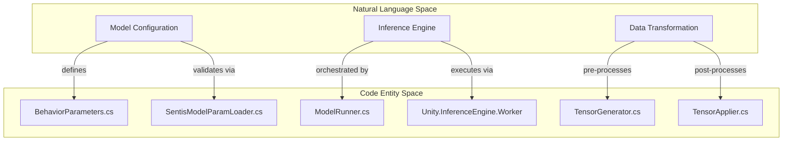

**Sources:** [com.unity.ml-agents/Runtime/Policies/BehaviorParameters.cs:72-109](), [com.unity.ml-agents/Runtime/Inference/ModelRunner.cs:16-56](), [com.unity.ml-agents/Runtime/Inference/TensorGenerator.cs:19-42](), [com.unity.ml-agents/Runtime/Inference/TensorApplier.cs:16-30]()

### Primary Components

| Component | Role | File Reference |
| :--- | :--- | :--- |
| `BehaviorParameters` | Inspector-facing component to assign `ModelAsset` and `InferenceDevice`. | [com.unity.ml-agents/Runtime/Policies/BehaviorParameters.cs:72-73]() |
| `ModelRunner` | Manages the lifecycle of the Sentis `Worker` and orchestrates the inference loop. | [com.unity.ml-agents/Runtime/Inference/ModelRunner.cs:16-17]() |
| `TensorGenerator` | Converts `ISensor` observations and agent state into `Tensor` inputs for the model. | [com.unity.ml-agents/Runtime/Inference/TensorGenerator.cs:19-20]() |
| `TensorApplier` | Maps model output tensors back to `ActionBuffers` for the `Agent` to execute. | [com.unity.ml-agents/Runtime/Inference/TensorApplier.cs:16-17]() |
| `SentisModelParamLoader` | Validates that the loaded model's inputs/outputs match the Agent's sensors/actuators. | [com.unity.ml-agents/Editor/BehaviorParametersEditor.cs:159-162]() |

## Sentis Inference Integration

ML-Agents utilizes the **Unity Sentis** engine (replacing the legacy Barracuda engine) for cross-platform neural network execution.

### Worker Initialization
The `ModelRunner` initializes a Sentis `Worker` based on the `InferenceDevice` selected in the `BehaviorParameters`.

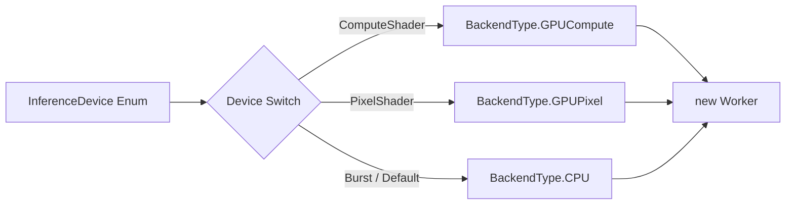

**Sources:** [com.unity.ml-agents/Runtime/Inference/ModelRunner.cs:92-108](), [com.unity.ml-agents/Runtime/Policies/BehaviorParameters.cs:112-123]()

### Model Validation
Before execution, the `SentisModelParamLoader` performs compatibility checks between the Unity Agent configuration and the ONNX model file. It verifies:
- **Observation Space**: Matches the number and shape of sensors [com.unity.ml-agents/Editor/BehaviorParametersEditor.cs:118-128]().
- **Action Space**: Matches the `ActionSpec` (continuous and discrete branches) [com.unity.ml-agents/Editor/BehaviorParametersEditor.cs:159-162]().
- **API Version**: Ensures the model was exported with a compatible version of the ML-Agents exporter [com.unity.ml-agents/Runtime/Inference/ModelRunner.cs:79-82]().

## Data Flow and Tensor Management

The inference loop follows a strict "Prepare -> Execute -> Fetch" pattern.

### The Inference Loop
1. **Observation Gathering**: `ModelRunner.PutObservations` collects data from all agents sharing the same behavior [com.unity.ml-agents/Runtime/Inference/ModelRunner.cs:173-186]().
2. **Input Generation**: `TensorGenerator` iterates through registered `IGenerator` implementations (e.g., `ObservationGenerator`, `RecurrentInputGenerator`) to populate Sentis tensors [com.unity.ml-agents/Runtime/Inference/TensorGenerator.cs:65-92]().
3. **Execution**: The `Worker.Execute` method (or implicit execution via output fetching) runs the forward pass [com.unity.ml-agents/Runtime/Inference/ModelRunner.cs:108]().
4. **Action Application**: `TensorApplier` processes outputs. For discrete actions, this may involve stochastic sampling or deterministic selection [com.unity.ml-agents/Runtime/Inference/TensorApplier.cs:51-54]().

### Observation Writing
The `ObservationWriter` provides a unified interface for sensors to write data directly into `TensorProxy` objects, minimizing memory copies during inference preparation [com.unity.ml-agents/Runtime/Sensors/ObservationWriter.cs:13-18]().

**Sources:** [com.unity.ml-agents/Runtime/Inference/ModelRunner.cs:142-171](), [com.unity.ml-agents/Runtime/Inference/GeneratorImpl.cs:15-42](), [com.unity.ml-agents/Runtime/Sensors/ObservationWriter.cs:72-79]()

## Model Deployment Utilities

### ModelOverrider
The `ModelOverrider` is a utility component used primarily in automated testing and validation (e.g., Yamato CI). It allows a build to override an Agent's internal model with an external ONNX file via command-line arguments.

**Key Command Line Flags:**
- `--mlagents-override-model-directory`: Path to the directory containing new models [Project/Assets/ML-Agents/Examples/SharedAssets/Scripts/ModelOverrider.cs:27]().
- `--mlagents-override-model-extension`: Specifies `nn` or `onnx` [Project/Assets/ML-Agents/Examples/SharedAssets/Scripts/ModelOverrider.cs:28]().
- `--mlagents-quit-after-episodes`: Terminates the application after a set number of evaluations [Project/Assets/ML-Agents/Examples/SharedAssets/Scripts/ModelOverrider.cs:29]().

### Inference Analytics
ML-Agents tracks model performance and configuration via the `InferenceAnalytics` system. When a model is set, it gathers metadata such as memory size, weight size, and the number of layers to help Unity improve the Sentis engine and ML-Agents toolkit [com.unity.ml-agents/Runtime/Analytics/InferenceAnalytics.cs:73-80]().

**Sources:** [Project/Assets/ML-Agents/Examples/SharedAssets/Scripts/ModelOverrider.cs:130-164](), [com.unity.ml-agents/Runtime/Analytics/InferenceAnalytics.cs:119-130](), [com.unity.ml-agents/Runtime/Analytics/Events.cs:24-52]()

---

# Page: Python Training System

# Python Training System

<details>
<summary>Relevant source files</summary>

The following files were used as context for generating this wiki page:

- [.pre-commit-config.yaml](.pre-commit-config.yaml)
- [docs/Using-Virtual-Environment.md](docs/Using-Virtual-Environment.md)
- [ml-agents-envs/mlagents_envs/registry/binary_utils.py](ml-agents-envs/mlagents_envs/registry/binary_utils.py)
- [ml-agents-envs/setup.py](ml-agents-envs/setup.py)
- [ml-agents/mlagents/trainers/cli_utils.py](ml-agents/mlagents/trainers/cli_utils.py)
- [ml-agents/mlagents/trainers/learn.py](ml-agents/mlagents/trainers/learn.py)
- [ml-agents/mlagents/trainers/settings.py](ml-agents/mlagents/trainers/settings.py)
- [ml-agents/mlagents/trainers/tests/test_learn.py](ml-agents/mlagents/trainers/tests/test_learn.py)
- [ml-agents/mlagents/trainers/tests/test_settings.py](ml-agents/mlagents/trainers/tests/test_settings.py)
- [ml-agents/mlagents/trainers/tests/test_trainer_controller.py](ml-agents/mlagents/trainers/tests/test_trainer_controller.py)
- [ml-agents/mlagents/trainers/tests/test_trainer_util.py](ml-agents/mlagents/trainers/tests/test_trainer_util.py)
- [ml-agents/mlagents/trainers/trainer_controller.py](ml-agents/mlagents/trainers/trainer_controller.py)
- [ml-agents/setup.py](ml-agents/setup.py)
- [utils/validate_release_links.py](utils/validate_release_links.py)

</details>


The Python Training System is the core training infrastructure of the ML-Agents toolkit, responsible for orchestrating reinforcement learning training sessions. This system provides the command-line interface, configuration management, training loop coordination, and environment management for training ML agents in Unity environments.

For information about the Unity SDK components that interact with this system, see [Unity SDK Components](#2). For details about specific training algorithms and policies, see [Trainers and Algorithms](#3.2) and [Policies and Optimization](#3.3).

## System Architecture

The Python Training System follows a layered architecture with clear separation of concerns, managed primarily by the `mlagents-learn` entry point which delegates to specialized managers.

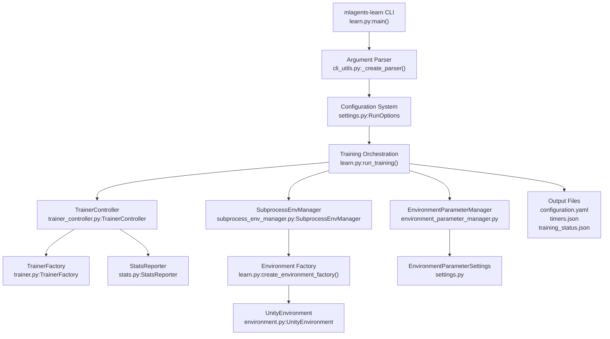

Sources: [ml-agents/mlagents/trainers/learn.py:59-134](), [ml-agents/mlagents/trainers/cli_utils.py:63-193](), [ml-agents/mlagents/trainers/settings.py:758-848](), [ml-agents/mlagents/trainers/trainer_controller.py:34-70]()

## CLI Entry Point

The `mlagents-learn` command serves as the primary entry point for training sessions. It is defined as a console script in `setup.py` and maps to `mlagents.trainers.learn:main`.

```mermaid
graph LR
    Console["mlagents-learn command"]
    Entry["learn.py:main()"]
    RunCLI["run_cli()"]
    Parse["parse_command_line()"]
    RunOptions["RunOptions.from_argparse()"]
    
    Console --> Entry
    Entry --> RunCLI
    RunCLI --> Parse
    Parse --> RunOptions
    RunOptions --> Training["run_training()"]
```

The command-line interface supports extensive configuration options defined in `cli_utils.py`:

| Category | Key Options | Purpose |
|----------|-------------|---------|
| Environment | `--env`, `--num-envs`, `--num-areas` | Unity environment configuration [ml-agents/mlagents/trainers/cli_utils.py:71-180]() |
| Training | `--run-id`, `--resume`, `--initialize-from` | Training session control [ml-agents/mlagents/trainers/cli_utils.py:88-130]() |
| Inference | `--inference`, `--deterministic` | Model evaluation mode [ml-agents/mlagents/trainers/cli_utils.py:95-152]() |
| Engine | `--no-graphics`, `--env-args` | Unity engine settings [ml-agents/mlagents/trainers/cli_utils.py:182-192]() |

Sources: [ml-agents/setup.py:79-81](), [ml-agents/mlagents/trainers/learn.py:51-56](), [ml-agents/mlagents/trainers/cli_utils.py:63-193]()

## Configuration System

The configuration system is built around the `RunOptions` class, which aggregates all training parameters using the `attr` and `cattr` libraries for structured data management.

```mermaid
graph TD
    RunOptions["RunOptions<br/>settings.py:RunOptions"]
    
    RunOptions --> Behaviors["behaviors: TrainerSettings.DefaultTrainerDict"]
    RunOptions --> EnvSettings["env_settings: EnvironmentSettings"]
    RunOptions --> CheckpointSettings["checkpoint_settings: CheckpointSettings"]
    RunOptions --> EngineSettings["engine_settings: EngineSettings"]
    RunOptions --> TorchSettings["torch_settings: TorchSettings"]
    RunOptions --> EnvParams["environment_parameters: Dict[str, EnvironmentParameterSettings]"]
    
    Behaviors --> TrainerSettings["TrainerSettings<br/>hyperparameters<br/>network_settings<br/>reward_signals"]
    
    EnvSettings --> EnvPath["env_path: str"]
    EnvSettings --> NumEnvs["num_envs: int"]
    EnvSettings --> Seed["seed: int"]
    
    CheckpointSettings --> RunID["run_id: str"]
    CheckpointSettings --> Resume["resume: bool"]
    CheckpointSettings --> WriteDir["write_path: str"]
```

Configuration can be loaded from YAML files or command-line arguments. The `settings.py` file contains logic for deep merging and validating these settings. For details on configuration structure, see [Training Configuration Files](#5.2).

Sources: [ml-agents/mlagents/trainers/settings.py:758-848](), [ml-agents/mlagents/trainers/settings.py:38-68](), [ml-agents/mlagents/trainers/cli_utils.py:25-61]()

## Training Orchestration

The `run_training()` function in `learn.py` coordinates the setup and execution of the training session. It instantiates the `TrainerController`, which manages the main training loop.

```mermaid
graph TD
    RunTraining["run_training()<br/>learn.py:59-144"]
    
    RunTraining --> Setup["Setup Phase<br/>lines 66-134"]
    Setup --> Validation["validate_existing_directories()"]
    Setup --> StatsWriters["register_stats_writer_plugins()"]
    Setup --> EnvFactory["create_environment_factory()"]
    Setup --> EnvManager["SubprocessEnvManager()"]
    Setup --> ParamManager["EnvironmentParameterManager()"]
    Setup --> TrainerFactory["TrainerFactory()"]
    Setup --> TrainerController["TrainerController()"]
    
    RunTraining --> Execute["Execution Phase<br/>lines 137-144"]
    Execute --> StartLearning["tc.start_learning(env_manager)"]
    Execute --> Cleanup["finally block"]
    
    Cleanup --> CloseEnv["env_manager.close()"]
    Cleanup --> WriteConfig["write_run_options()"]
    Cleanup --> WriteTimers["write_timing_tree()"]
    Cleanup --> WriteStatus["write_training_status()"]
```

For details on the execution phase and the inner loop, see [Training Pipeline](#3.1).

Sources: [ml-agents/mlagents/trainers/learn.py:59-144](), [ml-agents/mlagents/trainers/trainer_controller.py:168-192]()

## Environment Management

The system supports running multiple Unity instances in parallel via `SubprocessEnvManager`. The `create_environment_factory` ensures each instance is properly configured with unique seeds and ports.

```mermaid
graph LR
    Factory["create_environment_factory()<br/>learn.py:175-205"]
    
    Factory --> Config["Environment Configuration<br/>env_path, no_graphics, seed, etc."]
    Config --> UnityEnvFactory["create_unity_environment()<br/>inner function"]
    
    UnityEnvFactory --> WorkerID["worker_id offset"]
    UnityEnvFactory --> EnvSeed["env_seed = seed + worker_id"]
    UnityEnvFactory --> UnityEnv["UnityEnvironment()<br/>mlagents_envs.environment"]
```

For details on how Python interacts with the Unity executable, see [Environment Management](#3.5).

Sources: [ml-agents/mlagents/trainers/learn.py:175-205](), [ml-agents/mlagents/trainers/learn.py:111-111]()

## Parameter Management

The `EnvironmentParameterManager` handles dynamic environment parameters and curriculum learning. It tracks training progress to determine when to advance to the next "lesson" in a curriculum.

```mermaid
graph TD
    ParamManager["EnvironmentParameterManager<br/>environment_parameter_manager.py"]
    
    ParamManager --> Init["__init__(settings, run_seed, restore)"]
    ParamManager --> CurrentSamplers["get_current_samplers()"]
    ParamManager --> UpdateLessons["update_lessons(progress)"]
    
    UpdateLessons --> CompletionCriteria["Check completion_criteria"]
    CompletionCriteria --> LessonAdvancement["Advance to next lesson"]
```

Supported randomization samplers include `UniformSettings`, `GaussianSettings`, and `MultiRangeUniformSettings` defined in `settings.py`.

Sources: [ml-agents/mlagents/trainers/learn.py:112-114](), [ml-agents/mlagents/trainers/settings.py:516-595](), [ml-agents/mlagents/trainers/trainer_controller.py:104-105]()

## Key Workflows

### Training Session Startup
1. **CLI Parsing**: `parse_command_line` processes arguments and loads YAML configs [ml-agents/mlagents/trainers/learn.py:51-56]().
2. **Resource Validation**: `validate_existing_directories` checks for existing models to prevent accidental overwrites [ml-agents/mlagents/trainers/learn.py:75-80]().
3. **Factory Initialization**: `TrainerFactory` and environment factories are prepared [ml-agents/mlagents/trainers/learn.py:116-125]().
4. **Loop Execution**: `TrainerController.start_learning` enters the training loop [ml-agents/mlagents/trainers/trainer_controller.py:168-172]().

### Output Management
Upon completion or interruption, the system persists the final state:
- **Models**: Saved via `Trainer.save_model()` called by `TrainerController` [ml-agents/mlagents/trainers/trainer_controller.py:72-81]().
- **Status**: `training_status.json` tracks global training state [ml-agents/mlagents/trainers/learn.py:160-161]().
- **Timers**: `timers.json` provides a hierarchical breakdown of performance [ml-agents/mlagents/trainers/learn.py:164-173]().

Sources: [ml-agents/mlagents/trainers/learn.py:137-144](), [ml-agents/mlagents/trainers/trainer_controller.py:72-82](), [ml-agents/mlagents/trainers/learn.py:16-19]()

---

# Page: Training Pipeline

# Training Pipeline

<details>
<summary>Relevant source files</summary>

The following files were used as context for generating this wiki page:

- [ml-agents-envs/mlagents_envs/envs/unity_pettingzoo_base_env.py](ml-agents-envs/mlagents_envs/envs/unity_pettingzoo_base_env.py)
- [ml-agents/mlagents/trainers/agent_processor.py](ml-agents/mlagents/trainers/agent_processor.py)
- [ml-agents/mlagents/trainers/cli_utils.py](ml-agents/mlagents/trainers/cli_utils.py)
- [ml-agents/mlagents/trainers/environment_parameter_manager.py](ml-agents/mlagents/trainers/environment_parameter_manager.py)
- [ml-agents/mlagents/trainers/exception.py](ml-agents/mlagents/trainers/exception.py)
- [ml-agents/mlagents/trainers/learn.py](ml-agents/mlagents/trainers/learn.py)
- [ml-agents/mlagents/trainers/settings.py](ml-agents/mlagents/trainers/settings.py)
- [ml-agents/mlagents/trainers/stats.py](ml-agents/mlagents/trainers/stats.py)
- [ml-agents/mlagents/trainers/tests/mock_brain.py](ml-agents/mlagents/trainers/tests/mock_brain.py)
- [ml-agents/mlagents/trainers/tests/test_agent_processor.py](ml-agents/mlagents/trainers/tests/test_agent_processor.py)
- [ml-agents/mlagents/trainers/tests/test_env_param_manager.py](ml-agents/mlagents/trainers/tests/test_env_param_manager.py)
- [ml-agents/mlagents/trainers/tests/test_learn.py](ml-agents/mlagents/trainers/tests/test_learn.py)
- [ml-agents/mlagents/trainers/tests/test_settings.py](ml-agents/mlagents/trainers/tests/test_settings.py)
- [ml-agents/mlagents/trainers/tests/test_stats.py](ml-agents/mlagents/trainers/tests/test_stats.py)
- [ml-agents/mlagents/trainers/tests/test_trainer_controller.py](ml-agents/mlagents/trainers/tests/test_trainer_controller.py)
- [ml-agents/mlagents/trainers/tests/test_trainer_util.py](ml-agents/mlagents/trainers/tests/test_trainer_util.py)
- [ml-agents/mlagents/trainers/trainer_controller.py](ml-agents/mlagents/trainers/trainer_controller.py)

</details>


This page details the main training loop orchestrated by `learn.py` and `TrainerController`, focusing on how the Python training components execute the core training pipeline. For information about the Unity-side components such as the Agent and Academy, see [Unity SDK Components](#2).

The training pipeline represents the execution flow from the `mlagents-learn` command through the main training loop, experience collection, policy updates, and model saving.

## Training Pipeline Overview

The ML-Agents training pipeline is orchestrated by two main components: `learn.py` which handles setup and orchestration, and `TrainerController` which manages the main training loop. The pipeline executes in the following sequence:

1.  **Entry Point**: `mlagents-learn` CLI command invokes `learn.py` via the `parser` defined in `cli_utils.py`.
2.  **Setup Phase**: Environment creation, trainer factory setup, and parameter management in `run_training()`.
3.  **Training Loop**: `TrainerController.start_learning()` executes the main training loop.
4.  **Experience Processing**: Agent experiences are collected by `AgentProcessor` and organized into trajectories.
5.  **Policy Updates**: Trainers (e.g., `PPOTrainer`) update policies based on collected experiences.
6.  **Model Persistence**: Trained models are saved as checkpoints and exported to ONNX.

### Core Training Pipeline Architecture

```mermaid
flowchart TD
    subgraph "Entry Point [learn.py]"
        parse_command_line["parse_command_line()"]
        run_training["run_training()"]
    end

    subgraph "Setup Phase [learn.py]"
        create_env_factory["create_environment_factory()"]
        subprocess_env_manager["SubprocessEnvManager"]
        trainer_factory["TrainerFactory"]
        env_param_manager["EnvironmentParameterManager"]
    end

    subgraph "Training Orchestration [trainer_controller.py]"
        trainer_controller["TrainerController"]
        start_learning["start_learning()"]
        advance_method["advance()"]
        reset_env_if_ready["reset_env_if_ready()"]
    end

    subgraph "Experience Processing [agent_processor.py]"
        agent_processor["AgentProcessor"]
        trajectory_queue["AgentManagerQueue[Trajectory]"]
    end

    subgraph "Policy Updates [ppo/sac/torch_entities]"
        ppo_trainer["PPOTrainer"]
        sac_trainer["SACTrainer"]
        torch_policy["TorchPolicy"]
    end

    parse_command_line --> run_training
    run_training --> create_env_factory
    run_training --> subprocess_env_manager
    run_training --> trainer_factory
    run_training --> env_param_manager
    run_training --> trainer_controller
    
    trainer_controller --> start_learning
    start_learning --> advance_method
    advance_method --> reset_env_if_ready
    
    advance_method --> agent_processor
    agent_processor --> trajectory_queue
    
    trajectory_queue --> ppo_trainer
    trajectory_queue --> sac_trainer
    ppo_trainer --> torch_policy
    sac_trainer --> torch_policy
```

Sources:
- [ml-agents/mlagents/trainers/learn.py:51-134]()
- [ml-agents/mlagents/trainers/trainer_controller.py:168-201]()
- [ml-agents/mlagents/trainers/agent_processor.py:36-89]()

## Main Training Loop Components

### TrainerController

The `TrainerController` class serves as the central orchestrator. It implements the main training loop in `start_learning()` and coordinates all training activities across different behavior types.

Key methods and responsibilities:
- `start_learning(env_manager)`: Entry point for the training loop [ml-agents/mlagents/trainers/trainer_controller.py:168-179]().
- `advance(env_manager)`: Drives the environment forward and triggers trainer updates [ml-agents/mlagents/trainers/trainer_controller.py:230-252]().
- `_create_trainer_and_manager()`: Dynamically instantiates trainers and links them to environment managers [ml-agents/mlagents/trainers/trainer_controller.py:115-159]().
- `_save_models()`: Iterates through all active trainers to save their current state [ml-agents/mlagents/trainers/trainer_controller.py:72-81]().

```mermaid
classDiagram
    class TrainerController {
        +trainers: Dict[str, Trainer]
        +trainer_factory: TrainerFactory
        +param_manager: EnvironmentParameterManager
        +start_learning(env_manager)
        +advance(env_manager)
        +_create_trainer_and_manager(env_manager, behavior_id)
        +_save_models()
    }
    
    class EnvManager {
        +get_steps()
        +process_steps(step_infos)
        +set_agent_manager(id, manager)
    }
    
    class Trainer {
        +advance()
        +save_model()
        +create_policy(id, spec)
    }
    
    TrainerController --> Trainer : manages
    TrainerController --> EnvManager : orchestrates
```

Sources:
- [ml-agents/mlagents/trainers/trainer_controller.py:34-69]()
- [ml-agents/mlagents/trainers/trainer_controller.py:115-159]()
- [ml-agents/mlagents/trainers/trainer_controller.py:168-201]()

### Experience Processing Pipeline

Agent experiences are collected via `AgentProcessor`, which maintains buffers for each agent and groups them into `Trajectory` objects once a `max_trajectory_length` or terminal state is reached.

1.  **Experience Collection**: `AgentProcessor.add_experiences()` is called during `TrainerController.advance()` with the latest `DecisionSteps` and `TerminalSteps` [ml-agents/mlagents/trainers/agent_processor.py:90-102]().
2.  **Trajectory Assembly**: When a trajectory is complete, it is put into an `AgentManagerQueue` [ml-agents/mlagents/trainers/agent_processor.py:206-215]().
3.  **Trainer Consumption**: Trainers subscribe to these queues to pull trajectories for buffer updates [ml-agents/mlagents/trainers/trainer_controller.py:155-155]().

Sources:
- [ml-agents/mlagents/trainers/agent_processor.py:36-89]()
- [ml-agents/mlagents/trainers/agent_processor.py:90-158]()
- [ml-agents/mlagents/trainers/trainer_controller.py:150-156]()

## Training Setup and Configuration

The pipeline starts with `learn.py`, which initializes the environment and trainers based on `RunOptions`.

### Setup Phase Code Flow

```mermaid
flowchart TD
    subgraph "Configuration [settings.py]"
        RunOptions["RunOptions.from_argparse()"]
        TrainerSettings["TrainerSettings"]
    end
    
    subgraph "Initialization [learn.py]"
        create_env_factory["create_environment_factory()"]
        SubprocessEnvManager["SubprocessEnvManager"]
        TrainerFactory["TrainerFactory"]
    end
    
    subgraph "Execution [trainer_controller.py]"
        TC_init["TrainerController()"]
        start_learning["tc.start_learning()"]
    end
    
    RunOptions --> TrainerSettings
    TrainerSettings --> create_env_factory
    create_env_factory --> SubprocessEnvManager
    SubprocessEnvManager --> TC_init
    TrainerFactory --> TC_init
    TC_init --> start_learning
```

The `run_training()` function in `learn.py` performs the following:
- Validates directories and handles resume/initialization logic [ml-agents/mlagents/trainers/learn.py:75-90]().
- Configures global `StatsReporter` with writers (TensorBoard, Console, etc.) [ml-agents/mlagents/trainers/learn.py:92-95]().
- Creates the `SubprocessEnvManager` to handle parallel environment instances [ml-agents/mlagents/trainers/learn.py:111-111]().
- Instantiates the `TrainerFactory` which is responsible for creating specific trainer types (PPO, SAC, etc.) [ml-agents/mlagents/trainers/learn.py:116-125]().

Sources:
- [ml-agents/mlagents/trainers/learn.py:59-134]()
- [ml-agents/mlagents/trainers/settings.py:127-140]()

## Environment Parameter Management

The `EnvironmentParameterManager` manages curriculum learning and parameter randomization. It tracks training progress and updates environment parameters via side channels.

- **Curriculum Learning**: Lessons are updated based on rewards and step counts in `update_lessons()` [ml-agents/mlagents/trainers/environment_parameter_manager.py:80-122]().
- **Parameter Sampling**: Supports various sampling strategies like `UniformSettings` and `GaussianSettings` defined in `settings.py` [ml-agents/mlagents/trainers/settings.py:254-325]().

Sources:
- [ml-agents/mlagents/trainers/environment_parameter_manager.py:18-45]()
- [ml-agents/mlagents/trainers/trainer_controller.py:208-227]()

## Statistics and Monitoring

The `StatsReporter` and `StatsWriter` classes handle logging and monitoring.

- **StatsReporter**: A singleton-like class that aggregates statistics across trainers [ml-agents/mlagents/trainers/stats.py:22-45]().
- **Writers**: Multiple writers can be registered, including `ConsoleWriter` for CLI output and `TensorboardWriter` for visual tracking [ml-agents/mlagents/trainers/stats.py:131-197]().
- **Aggregation**: Supports different methods like `AVERAGE`, `SUM`, and `MOST_RECENT` [ml-agents/mlagents/trainers/stats.py:42-73]().

Sources:
- [ml-agents/mlagents/trainers/stats.py:79-130]()
- [ml-agents/mlagents/trainers/stats.py:157-197]()

## Training Termination and Output

When training completes or is interrupted, `learn.py` ensures all resources are cleaned up and final artifacts are saved.

- **Final Save**: `TrainerController._save_models()` is called to write the final neural network state [ml-agents/mlagents/trainers/trainer_controller.py:72-81]().
- **Artifacts**:
    - `configuration.yaml`: The exact configuration used for the run [ml-agents/mlagents/trainers/learn.py:146-158]().
    - `timers.json`: Hierarchical timing information for performance profiling [ml-agents/mlagents/trainers/learn.py:164-172]().
    - `training_status.json`: Progress tracking for resuming training [ml-agents/mlagents/trainers/learn.py:160-161]().

Sources:
- [ml-agents/mlagents/trainers/learn.py:137-144]()
- [ml-agents/mlagents/trainers/trainer_controller.py:180-201]()

---

# Page: Trainers and Algorithms

# Trainers and Algorithms

<details>
<summary>Relevant source files</summary>

The following files were used as context for generating this wiki page:

- [docs/Python-Custom-Trainer-Plugin.md](docs/Python-Custom-Trainer-Plugin.md)
- [docs/Python-LLAPI-Documentation.md](docs/Python-LLAPI-Documentation.md)
- [docs/Python-On-Off-Policy-Trainer-Documentation.md](docs/Python-On-Off-Policy-Trainer-Documentation.md)
- [docs/Python-Optimizer-Documentation.md](docs/Python-Optimizer-Documentation.md)
- [docs/Training-Plugins.md](docs/Training-Plugins.md)
- [docs/Tutorial-Custom-Trainer-Plugin.md](docs/Tutorial-Custom-Trainer-Plugin.md)
- [localized_docs/KR/docs/Installation-Anaconda-Windows.md](localized_docs/KR/docs/Installation-Anaconda-Windows.md)
- [localized_docs/KR/docs/Installation.md](localized_docs/KR/docs/Installation.md)
- [localized_docs/TR/docs/Installation.md](localized_docs/TR/docs/Installation.md)
- [ml-agents-plugin-examples/README.md](ml-agents-plugin-examples/README.md)
- [ml-agents-plugin-examples/mlagents_plugin_examples/__init__.py](ml-agents-plugin-examples/mlagents_plugin_examples/__init__.py)
- [ml-agents-plugin-examples/mlagents_plugin_examples/example_stats_writer.py](ml-agents-plugin-examples/mlagents_plugin_examples/example_stats_writer.py)
- [ml-agents-plugin-examples/mlagents_plugin_examples/tests/__init__.py](ml-agents-plugin-examples/mlagents_plugin_examples/tests/__init__.py)
- [ml-agents-plugin-examples/setup.py](ml-agents-plugin-examples/setup.py)
- [ml-agents/mlagents/plugins/__init__.py](ml-agents/mlagents/plugins/__init__.py)
- [ml-agents/mlagents/plugins/stats_writer.py](ml-agents/mlagents/plugins/stats_writer.py)
- [ml-agents/mlagents/trainers/ghost/trainer.py](ml-agents/mlagents/trainers/ghost/trainer.py)
- [ml-agents/mlagents/trainers/poca/trainer.py](ml-agents/mlagents/trainers/poca/trainer.py)
- [ml-agents/mlagents/trainers/ppo/trainer.py](ml-agents/mlagents/trainers/ppo/trainer.py)
- [ml-agents/mlagents/trainers/sac/trainer.py](ml-agents/mlagents/trainers/sac/trainer.py)
- [ml-agents/mlagents/trainers/tests/results/ppo/run_logs/training_status.json](ml-agents/mlagents/trainers/tests/results/ppo/run_logs/training_status.json)
- [ml-agents/mlagents/trainers/tests/test_rl_trainer.py](ml-agents/mlagents/trainers/tests/test_rl_trainer.py)
- [ml-agents/mlagents/trainers/tests/test_trainers.py](ml-agents/mlagents/trainers/tests/test_trainers.py)
- [ml-agents/mlagents/trainers/trainer/rl_trainer.py](ml-agents/mlagents/trainers/trainer/rl_trainer.py)
- [ml-agents/mlagents/trainers/trainer/trainer.py](ml-agents/mlagents/trainers/trainer/trainer.py)
- [ml-agents/pydoc-config.yaml](ml-agents/pydoc-config.yaml)

</details>


This document explains the trainer implementations and machine learning algorithms in the ML-Agents Python training system. It covers the specific algorithm implementations (PPO, SAC, POCA), their architectural relationships, and the plugin system for extensibility.

## Trainer Architecture Overview

The ML-Agents training system uses a hierarchical trainer architecture where algorithm-specific trainers inherit from base classes that provide common functionality like reward signal processing and checkpointing.

### Trainer Class Hierarchy

```mermaid
graph TB
    Trainer["Trainer<br/>(mlagents.trainers.trainer.trainer.Trainer)"]
    RLTrainer["RLTrainer<br/>(mlagents.trainers.trainer.rl_trainer.RLTrainer)"]
    OnPolicyTrainer["OnPolicyTrainer<br/>(mlagents.trainers.trainer.on_policy_trainer.OnPolicyTrainer)"]
    OffPolicyTrainer["OffPolicyTrainer<br/>(mlagents.trainers.trainer.off_policy_trainer.OffPolicyTrainer)"]
    
    PPOTrainer["PPOTrainer<br/>(mlagents.trainers.ppo.trainer.PPOTrainer)"]
    SACTrainer["SACTrainer<br/>(mlagents.trainers.sac.trainer.SACTrainer)"]
    POCATrainer["POCATrainer<br/>(mlagents.trainers.poca.trainer.POCATrainer)"]
    GhostTrainer["GhostTrainer<br/>(mlagents.trainers.ghost.trainer.GhostTrainer)"]
    
    Trainer --> RLTrainer
    Trainer --> GhostTrainer
    RLTrainer --> OnPolicyTrainer
    RLTrainer --> OffPolicyTrainer
    OnPolicyTrainer --> PPOTrainer
    OnPolicyTrainer --> POCATrainer
    OffPolicyTrainer --> SACTrainer
    
    GhostTrainer -.-> PPOTrainer
    GhostTrainer -.-> SACTrainer
    GhostTrainer -.-> POCATrainer
```

**Sources:** [ml-agents/mlagents/trainers/trainer/trainer.py:19-184](), [ml-agents/mlagents/trainers/trainer/rl_trainer.py:35-306](), [ml-agents/mlagents/trainers/ppo/trainer.py:29-60](), [ml-agents/mlagents/trainers/sac/trainer.py:30-64](), [ml-agents/mlagents/trainers/ghost/trainer.py:28-65]()

### Core Components Association

| Natural Language concept | Code Entity | File Path |
| :--- | :--- | :--- |
| **PPO Trainer** | `PPOTrainer` | [mlagents/trainers/ppo/trainer.py:29]() |
| **SAC Trainer** | `SACTrainer` | [mlagents/trainers/sac/trainer.py:30]() |
| **POCA Trainer** | `POCATrainer` | [mlagents/trainers/poca/trainer.py:30]() |
| **Self-Play Wrapper** | `GhostTrainer` | [mlagents/trainers/ghost/trainer.py:28]() |
| **Optimizer Base** | `TorchOptimizer` | [mlagents/trainers/optimizer/torch_optimizer.py:17]() |
| **Checkpointing** | `ModelCheckpointManager` | [mlagents/trainers/policy/checkpoint_manager.py:12]() |

**Sources:** [ml-agents/mlagents/trainers/ppo/trainer.py:29-30](), [ml-agents/mlagents/trainers/sac/trainer.py:30-34](), [ml-agents/mlagents/trainers/poca/trainer.py:30-31](), [ml-agents/mlagents/trainers/ghost/trainer.py:28-40](), [ml-agents/mlagents/trainers/trainer/rl_trainer.py:10-13]()

## PPO (Proximal Policy Optimization) Trainer

PPO is an on-policy algorithm that uses a clipped surrogate objective to prevent large policy updates, making training more stable.

### PPO Implementation Details
The `PPOTrainer` manages the training loop for PPO. It processes trajectories by calculating value and advantage targets using Generalized Advantage Estimation (GAE) [mlagents/trainers/ppo/trainer.py:68-74]().

- **Advantage Calculation**: Uses `get_gae` with hyperparameters like `lambd` and `gamma` [mlagents/trainers/ppo/trainer.py:135-141]().
- **Update Buffer**: Processed trajectories are converted to `AgentBuffer` and appended to the `update_buffer` for the optimizer [mlagents/trainers/ppo/trainer.py:161]().
- **Optimizer**: `TorchPPOOptimizer` handles the clipped objective and entropy regularization [mlagents/trainers/ppo/optimizer_torch.py:17]().

**Sources:** [ml-agents/mlagents/trainers/ppo/trainer.py:68-171](), [ml-agents/mlagents/trainers/ppo/optimizer_torch.py:17-17]()

## SAC (Soft Actor-Critic) Trainer

SAC is an off-policy algorithm that maximizes expected return while also maximizing entropy, promoting exploration.

### SAC Implementation Details
The `SACTrainer` inherits from `OffPolicyTrainer` [mlagents/trainers/sac/trainer.py:30]().

- **Replay Buffer**: SAC relies on a replay buffer; `SACTrainer` handles loading and saving this buffer across sessions [mlagents/trainers/sac/trainer.py:168]().
- **Trajectory Processing**: Unlike PPO, SAC doesn't calculate advantages during trajectory processing. It evaluates reward functions and value estimates primarily for reporting [mlagents/trainers/sac/trainer.py:102-129]().
- **Normalization**: Updates actor and critic normalization based on trajectory data [mlagents/trainers/sac/trainer.py:98-100]().

**Sources:** [ml-agents/mlagents/trainers/sac/trainer.py:30-143](), [ml-agents/mlagents/trainers/sac/trainer.py:168-168]()

## POCA (Partially Observable Centralized Actor) Trainer

POCA is a multi-agent algorithm that uses a centralized critic to train agents that may only have partial local observations.

### POCA Implementation Details
The `POCATrainer` processes trajectories with centralized baseline estimates [mlagents/trainers/poca/trainer.py:30-31]().

- **Centralized Value Estimates**: Calls `get_trajectory_and_baseline_value_estimates` to get global critic values [mlagents/trainers/poca/trainer.py:92-99]().
- **Lambda Returns**: Computes `lambda_return` and subtracts the baseline estimate to calculate `local_advantage` [mlagents/trainers/poca/trainer.py:153-161]().
- **Group Rewards**: Specifically tracks `collected_group_rewards` separate from individual environment rewards [mlagents/trainers/poca/trainer.py:68]().

**Sources:** [ml-agents/mlagents/trainers/poca/trainer.py:30-170](), [ml-agents/mlagents/trainers/poca/trainer.py:68-68]()

## Ghost Trainer and Self-Play

The `GhostTrainer` acts as a wrapper for adversarial games (teams in opposition) using a self-play mechanism [mlagents/trainers/ghost/trainer.py:28-30]().

- **Ghosting**: While one team learns, the other team is "ghosted," executing fixed policies from snapshots [mlagents/trainers/ghost/trainer.py:31-33]().
- **Snapshots**: Maintains `policy_snapshots` to be used as fixed policies [mlagents/trainers/ghost/trainer.py:116]().
- **ELO Rating**: The `GhostController` coordinates trainers and calculates ELO to track relative skill [mlagents/trainers/ghost/trainer.py:38-39]().
- **Training Team Rotation**: The learning team ID is cycled throughout the run to ensure all behaviors improve [mlagents/trainers/ghost/trainer.py:127-132]().

**Sources:** [ml-agents/mlagents/trainers/ghost/trainer.py:28-40](), [ml-agents/mlagents/trainers/ghost/trainer.py:116-132]()

## Trainer Plugin System

ML-Agents supports extending the training suite with custom algorithms (e.g., A2C, DQN) through a plugin system using Python entry points [docs/Python-Custom-Trainer-Plugin.md:3-8]().

### Custom Trainer Implementation Flow

```mermaid
graph LR
    subgraph "Plugin Registration"
        SetupPy["setup.py<br/>(entry_points)"]
        LearnCLI["mlagents-learn"]
    end

    subgraph "Custom Code Space"
        CustomTrainer["YourCustomTrainer<br/>(inherits RLTrainer)"]
        CustomOptimizer["CustomOptimizer<br/>(inherits TorchOptimizer)"]
        CustomSettings["CustomSettings<br/>(inherits TrainerSettings)"]
    end

    SetupPy --> LearnCLI
    LearnCLI --> CustomTrainer
    CustomTrainer --> CustomOptimizer
    CustomTrainer --> CustomSettings
```

**Sources:** [docs/Tutorial-Custom-Trainer-Plugin.md:12-62](), [docs/Training-Plugins.md:19-28](), [docs/Python-Custom-Trainer-Plugin.md:19-33]()

### Implementation Requirements
To implement a custom trainer, developers must:
1. **Extend Base Classes**: Inherit from `OnPolicyTrainer` or `OffPolicyTrainer` [docs/Tutorial-Custom-Trainer-Plugin.md:12]().
2. **Implement Abstract Methods**:
    - `create_policy`: Define the network architecture (e.g., using `SimpleActor`) [docs/Tutorial-Custom-Trainer-Plugin.md:19-44]().
    - `create_optimizer`: Define the learning logic [docs/Tutorial-Custom-Trainer-Plugin.md:54-59]().
    - `_process_trajectory`: Handle advantage and return calculations [docs/Tutorial-Custom-Trainer-Plugin.md:61-108]().
    - `_update_policy`: Execute the optimization step [docs/Tutorial-Custom-Trainer-Plugin.md:61]().
3. **Register Entry Point**: Define the plugin in `setup.py` under the `mlagents.stats_writer` or trainer-specific entry points [docs/Training-Plugins.md:19-28]().

**Sources:** [docs/Tutorial-Custom-Trainer-Plugin.md:12-108](), [docs/Training-Plugins.md:19-28]()

---

# Page: Policies and Optimization

# Policies and Optimization

<details>
<summary>Relevant source files</summary>

The following files were used as context for generating this wiki page:

- [Project/Assets/ML-Agents/Examples/Match3/Scripts/Match3Board.cs](Project/Assets/ML-Agents/Examples/Match3/Scripts/Match3Board.cs)
- [Project/Assets/ML-Agents/Examples/Match3/Scripts/Match3Drawer.cs](Project/Assets/ML-Agents/Examples/Match3/Scripts/Match3Drawer.cs)
- [Project/Assets/ML-Agents/Examples/Match3/Scripts/Match3ExampleActuatorComponent.cs](Project/Assets/ML-Agents/Examples/Match3/Scripts/Match3ExampleActuatorComponent.cs)
- [com.unity.ml-agents/Runtime/Integrations/Match3/Match3Actuator.cs](com.unity.ml-agents/Runtime/Integrations/Match3/Match3Actuator.cs)
- [com.unity.ml-agents/Runtime/Integrations/Match3/Match3ActuatorComponent.cs](com.unity.ml-agents/Runtime/Integrations/Match3/Match3ActuatorComponent.cs)
- [ml-agents-trainer-plugin/mlagents_trainer_plugin/dqn/dqn_optimizer.py](ml-agents-trainer-plugin/mlagents_trainer_plugin/dqn/dqn_optimizer.py)
- [ml-agents/mlagents/torch_utils/cpu_utils.py](ml-agents/mlagents/torch_utils/cpu_utils.py)
- [ml-agents/mlagents/torch_utils/torch.py](ml-agents/mlagents/torch_utils/torch.py)
- [ml-agents/mlagents/trainers/model_saver/model_saver.py](ml-agents/mlagents/trainers/model_saver/model_saver.py)
- [ml-agents/mlagents/trainers/model_saver/torch_model_saver.py](ml-agents/mlagents/trainers/model_saver/torch_model_saver.py)
- [ml-agents/mlagents/trainers/optimizer/torch_optimizer.py](ml-agents/mlagents/trainers/optimizer/torch_optimizer.py)
- [ml-agents/mlagents/trainers/poca/optimizer_torch.py](ml-agents/mlagents/trainers/poca/optimizer_torch.py)
- [ml-agents/mlagents/trainers/policy/checkpoint_manager.py](ml-agents/mlagents/trainers/policy/checkpoint_manager.py)
- [ml-agents/mlagents/trainers/policy/policy.py](ml-agents/mlagents/trainers/policy/policy.py)
- [ml-agents/mlagents/trainers/policy/torch_policy.py](ml-agents/mlagents/trainers/policy/torch_policy.py)
- [ml-agents/mlagents/trainers/ppo/optimizer_torch.py](ml-agents/mlagents/trainers/ppo/optimizer_torch.py)
- [ml-agents/mlagents/trainers/sac/optimizer_torch.py](ml-agents/mlagents/trainers/sac/optimizer_torch.py)
- [ml-agents/mlagents/trainers/tests/test_torch_utils.py](ml-agents/mlagents/trainers/tests/test_torch_utils.py)
- [ml-agents/mlagents/trainers/tests/test_training_status.py](ml-agents/mlagents/trainers/tests/test_training_status.py)
- [ml-agents/mlagents/trainers/tests/torch_entities/test_attention.py](ml-agents/mlagents/trainers/tests/torch_entities/test_attention.py)
- [ml-agents/mlagents/trainers/torch_entities/components/reward_providers/gail_reward_provider.py](ml-agents/mlagents/trainers/torch_entities/components/reward_providers/gail_reward_provider.py)
- [ml-agents/mlagents/trainers/torch_entities/networks.py](ml-agents/mlagents/trainers/torch_entities/networks.py)
- [ml-agents/mlagents/trainers/torch_entities/utils.py](ml-agents/mlagents/trainers/torch_entities/utils.py)
- [ml-agents/mlagents/trainers/training_status.py](ml-agents/mlagents/trainers/training_status.py)

</details>


This document covers the policy and optimization systems in ML-Agents, focusing on the PyTorch-based neural network policies and their associated optimizers. The policy system handles action selection and evaluation during both training and inference, while the optimization system manages gradient-based learning algorithms that update policy parameters.

## Policy System Architecture

The policy system in ML-Agents provides an abstraction layer for neural network-based decision making. The base `Policy` class defines the interface, while `TorchPolicy` implements PyTorch-specific functionality for neural network policies.

### Policy Class Hierarchy

```mermaid
classDiagram
    class Policy {
        <<abstract>>
        +behavior_spec: BehaviorSpec
        +network_settings: NetworkSettings
        +memory_dict: Dict[str, np.ndarray]
        +get_action(decision_requests: DecisionSteps) ActionInfo
        +save_memories(agent_ids: List[GlobalAgentId], memory_matrix: np.ndarray)
        +retrieve_memories(agent_ids: List[GlobalAgentId]) np.ndarray
        +increment_step(n_steps)
        +get_current_step()
    }
    
    class TorchPolicy {
        +actor: nn.Module
        +global_step: GlobalSteps
        +evaluate(decision_requests: DecisionSteps, global_agent_ids: List[str]) Dict[str, Any]
        +get_action(decision_requests: DecisionSteps, worker_id: int) ActionInfo
        +load_weights(values: List[np.ndarray])
        +get_weights() List[np.ndarray]
    }
    
    Policy <|-- TorchPolicy
```

The `Policy` base class handles memory management for recurrent networks (LSTMs) and provides the core interface for action selection. `TorchPolicy` extends this with PyTorch-specific implementations, managing the `actor` network and `GlobalSteps` counter.

**Sources:** [ml-agents/mlagents/trainers/policy/policy.py:21-147](), [ml-agents/mlagents/trainers/policy/torch_policy.py:20-62]()

### TorchPolicy Implementation

The `TorchPolicy` class serves as the bridge between the trainer system and neural network actors. It manages the actor network, global step tracking, and memory handling for recurrent policies.

```mermaid
graph TB
    subgraph "TorchPolicy Components"
        TP["TorchPolicy"]
        ACT["actor: actor_cls"]
        GS["global_step: GlobalSteps"]
        MD["memory_dict: Dict[GlobalAgentId, np.ndarray]"]
    end
    
    subgraph "Core Methods"
        EVAL["evaluate()"]
        GA["get_action()"]
        LW["load_weights()"]
        GW["get_weights()"]
    end
    
    subgraph "External Interfaces"
        DS["DecisionSteps"]
        AI["ActionInfo"]
        BS["BehaviorSpec"]
    end
    
    TP --> ACT
    TP --> GS
    TP --> MD
    
    TP --> EVAL
    TP --> GA
    TP --> LW
    TP --> GW
    
    EVAL --> DS
    GA --> AI
    GA --> DS
    
    ACT --> BS
```

The policy evaluation process involves extracting observations and action masks via `_extract_masks`, converting them to tensors, and passing them through `actor.get_action_and_stats`. The `evaluate` method handles this process with `torch.no_grad()` for inference efficiency.

**Sources:** [ml-agents/mlagents/trainers/policy/torch_policy.py:71-115](), [ml-agents/mlagents/trainers/policy/torch_policy.py:117-143]()

## Optimization System Architecture

The optimization system implements gradient-based learning algorithms. The base `TorchOptimizer` class provides common functionality like reward signal management and behavioral cloning (BC) integration.

### Optimizer Class Hierarchy

```mermaid
classDiagram
    class Optimizer {
        <<abstract>>
        +reward_signals: Dict[str, RewardProvider]
        +update(batch: AgentBuffer, num_sequences: int) Dict[str, float]
    }
    
    class TorchOptimizer {
        +policy: TorchPolicy
        +trainer_settings: TrainerSettings
        +bc_module: Optional[BCModule]
        +critic: nn.Module
        +update_reward_signals(batch: AgentBuffer) Dict[str, float]
        +get_trajectory_value_estimates() Tuple
    }
    
    class TorchPPOOptimizer {
        +hyperparameters: PPOSettings
        +optimizer: torch.optim.Adam
        +decay_learning_rate: DecayedValue
        +update(batch: AgentBuffer, num_sequences: int) Dict[str, float]
    }
    
    class TorchSACOptimizer {
        +hyperparameters: SACSettings
        +q_network: PolicyValueNetwork
        +target_network: ValueNetwork
        +policy_optimizer: torch.optim.Adam
    }
    
    class TorchPOCAOptimizer {
        +hyperparameters: POCASettings
        +critic: POCAValueNetwork
        +optimizer: torch.optim.Adam
    }
    
    Optimizer <|-- TorchOptimizer
    TorchOptimizer <|-- TorchPPOOptimizer
    TorchOptimizer <|-- TorchSACOptimizer
    TorchOptimizer <|-- TorchPOCAOptimizer
```

**Sources:** [ml-agents/mlagents/trainers/optimizer/torch_optimizer.py:23-44](), [ml-agents/mlagents/trainers/ppo/optimizer_torch.py:35-98](), [ml-agents/mlagents/trainers/sac/optimizer_torch.py:44-180](), [ml-agents/mlagents/trainers/poca/optimizer_torch.py:53-178]()

### Algorithm-Specific Optimizers

#### PPO Optimizer
The PPO optimizer implements Proximal Policy Optimization. It manages a `ValueNetwork` for state value estimation and uses `ModelUtils.trust_region_policy_loss` and `ModelUtils.trust_region_value_loss` to compute the clipped surrogate objective.

```mermaid
graph TB
    subgraph "PPO Components"
        PPO["TorchPPOOptimizer"]
        VN["_critic: ValueNetwork"]
        ADAM["optimizer: torch.optim.Adam"]
        SET["hyperparameters: PPOSettings"]
    end
    
    subgraph "Loss Logic"
        PL["ModelUtils.trust_region_policy_loss"]
        VL["ModelUtils.trust_region_value_loss"]
        EL["ModelUtils.masked_mean(entropy)"]
    end
    
    PPO --> VN
    PPO --> ADAM
    PPO --> SET
    PPO --> PL
    PPO --> VL
    PPO --> EL
```

**Sources:** [ml-agents/mlagents/trainers/ppo/optimizer_torch.py:58-64](), [ml-agents/mlagents/trainers/ppo/optimizer_torch.py:165-179]()

#### SAC Optimizer
The SAC optimizer implements Soft Actor-Critic. It uses a `PolicyValueNetwork` which contains two Q-networks (`q1_network`, `q2_network`) to mitigate overestimation bias. It also manages a `target_network` for stable value estimation via `ModelUtils.soft_update`.

**Sources:** [ml-agents/mlagents/trainers/sac/optimizer_torch.py:45-70](), [ml-agents/mlagents/trainers/sac/optimizer_torch.py:170-175]()

## Policy-Optimizer Integration

The policy and optimizer communicate primarily through the `AgentBuffer`. The optimizer pulls experiences from the buffer and applies gradients to the `actor` network housed within the `TorchPolicy`.

### Training Update Flow

```mermaid
sequenceDiagram
    participant T as Trainer
    participant O as TorchPPOOptimizer
    participant P as TorchPolicy
    participant A as Actor (nn.Module)
    participant C as Critic (ValueNetwork)
    
    T->>O: update(batch, num_sequences)
    O->>P: get_current_step()
    O->>A: get_stats(obs, actions, masks, memories)
    O->>C: critic_pass(obs, value_memories)
    Note over O: Compute policy_loss & value_loss
    O->>O: optimizer.zero_grad()
    O->>O: loss.backward()
    O->>O: optimizer.step()
    O->>P: increment_step(n_steps)
    O->>T: return update_stats
```

**Sources:** [ml-agents/mlagents/trainers/ppo/optimizer_torch.py:100-197](), [ml-agents/mlagents/trainers/policy/torch_policy.py:161-167]()

## Neural Network Components

### Observation Encoding
ML-Agents uses `ObservationEncoder` to process various sensor inputs. It utilizes `ModelUtils.create_input_processors` to generate encoders for vector, visual, and goal-based observations. If variable-length observations are present, it employs `ResidualSelfAttention` (RSA).

**Sources:** [ml-agents/mlagents/trainers/torch_entities/networks.py:33-63](), [ml-agents/mlagents/trainers/torch_entities/networks.py:100-146]()

### Recurrent Memory
When `NetworkSettings.memory` is configured, policies use `LSTM` modules.
- `TorchPolicy` handles actor memory via `save_memories` and `retrieve_memories`.
- `TorchOptimizer` handles critic memory via `_evaluate_by_sequence`, which processes trajectories sequence-by-sequence to capture intermediate hidden states.

**Sources:** [ml-agents/mlagents/trainers/policy/policy.py:50-69](), [ml-agents/mlagents/trainers/optimizer/torch_optimizer.py:66-133]()

### Model Saving and Export
The `TorchModelSaver` manages the persistence of both `TorchPolicy` and `TorchOptimizer` states.
- `save_checkpoint`: Saves a `.pt` PyTorch file and exports a `.onnx` file using `ModelSerializer`.
- `initialize_or_load`: Restores model weights and global steps from a provided path.

**Sources:** [ml-agents/mlagents/trainers/model_saver/torch_model_saver.py:49-65](), [ml-agents/mlagents/trainers/model_saver/torch_model_saver.py:72-84]()

## Device and Performance
The toolkit utilizes a centralized device configuration via `mlagents.torch_utils.torch`.
- `set_torch_config`: Detects CUDA availability or respects `TorchSettings`.
- `get_num_threads_to_use`: Automatically scales CPU threads (typically 1-4) based on available cores and container limits (cgroups).

**Sources:** [ml-agents/mlagents/torch_utils/torch.py:42-67](), [ml-agents/mlagents/torch_utils/cpu_utils.py:6-13]()

---

# Page: Experience Collection and Buffers

# Experience Collection and Buffers

<details>
<summary>Relevant source files</summary>

The following files were used as context for generating this wiki page:

- [ml-agents-envs/mlagents_envs/base_env.py](ml-agents-envs/mlagents_envs/base_env.py)
- [ml-agents-envs/mlagents_envs/rpc_utils.py](ml-agents-envs/mlagents_envs/rpc_utils.py)
- [ml-agents/mlagents/trainers/agent_processor.py](ml-agents/mlagents/trainers/agent_processor.py)
- [ml-agents/mlagents/trainers/buffer.py](ml-agents/mlagents/trainers/buffer.py)
- [ml-agents/mlagents/trainers/demo_loader.py](ml-agents/mlagents/trainers/demo_loader.py)
- [ml-agents/mlagents/trainers/stats.py](ml-agents/mlagents/trainers/stats.py)
- [ml-agents/mlagents/trainers/tests/dummy_config.py](ml-agents/mlagents/trainers/tests/dummy_config.py)
- [ml-agents/mlagents/trainers/tests/mock_brain.py](ml-agents/mlagents/trainers/tests/mock_brain.py)
- [ml-agents/mlagents/trainers/tests/simple_test_envs.py](ml-agents/mlagents/trainers/tests/simple_test_envs.py)
- [ml-agents/mlagents/trainers/tests/test_agent_processor.py](ml-agents/mlagents/trainers/tests/test_agent_processor.py)
- [ml-agents/mlagents/trainers/tests/test_buffer.py](ml-agents/mlagents/trainers/tests/test_buffer.py)
- [ml-agents/mlagents/trainers/tests/test_demo_loader.py](ml-agents/mlagents/trainers/tests/test_demo_loader.py)
- [ml-agents/mlagents/trainers/tests/test_stats.py](ml-agents/mlagents/trainers/tests/test_stats.py)
- [ml-agents/mlagents/trainers/tests/test_trajectory.py](ml-agents/mlagents/trainers/tests/test_trajectory.py)
- [ml-agents/mlagents/trainers/trajectory.py](ml-agents/mlagents/trainers/trajectory.py)
- [ml-agents/tests/yamato/scripts/run_gym.py](ml-agents/tests/yamato/scripts/run_gym.py)
- [ml-agents/tests/yamato/scripts/run_llapi.py](ml-agents/tests/yamato/scripts/run_llapi.py)

</details>


This document covers the ML-Agents experience collection and buffer management system, which is responsible for gathering agent experiences from the Unity environment and organizing them into efficient data structures for training algorithms. The system handles the transformation of raw environment observations, actions, and rewards into structured trajectories that can be consumed by reinforcement learning trainers.

## Core Data Structures

The experience collection system is built around several key data structures that represent different levels of agent experience data.

### AgentBuffer and AgentBufferField

The `AgentBuffer` class serves as the primary container for storing agent experiences during training. It implements a dictionary-like interface where keys represent different types of data (observations, actions, rewards, etc.) and values are `AgentBufferField` objects containing the actual data sequences.

Title: AgentBuffer Architecture
```mermaid
graph TB
    AgentBuffer["AgentBuffer (MutableMapping)"]
    AgentBufferField["AgentBufferField (list)"]
    BufferKey["BufferKey (Enum)"]
    ObservationKeyPrefix["ObservationKeyPrefix (Enum)"]
    RewardSignalKeyPrefix["RewardSignalKeyPrefix (Enum)"]
    
    AgentBuffer --> AgentBufferField
    AgentBuffer --> BufferKey
    AgentBuffer --> ObservationKeyPrefix
    AgentBuffer --> RewardSignalKeyPrefix
    
    BufferKey --> ACTION_MASK["ACTION_MASK"]
    BufferKey --> CONTINUOUS_ACTION["CONTINUOUS_ACTION"] 
    BufferKey --> DISCRETE_ACTION["DISCRETE_ACTION"]
    BufferKey --> DONE["DONE"]
    BufferKey --> ENVIRONMENT_REWARDS["ENVIRONMENT_REWARDS"]
    BufferKey --> MEMORY["MEMORY"]
    BufferKey --> ADVANTAGES["ADVANTAGES"]
    BufferKey --> DISCOUNTED_RETURNS["DISCOUNTED_RETURNS"]
    
    AgentBufferField --> numpy_arrays["List[np.ndarray]<br/>Sequential data"]
```

**AgentBuffer Key Features:**
- Implements `MutableMapping` interface for dictionary-like access [ml-agents/mlagents/trainers/buffer.py:254-255]().
- Supports both simple keys (`BufferKey`) and composite keys for observations and reward signals [ml-agents/mlagents/trainers/buffer.py:70-72]().
- Provides batch sampling via `sample_mini_batch()` [ml-agents/mlagents/trainers/buffer.py:419-443]().
- Handles serialization to HDF5 format via `save_to_file()` and `load_from_file()` [ml-agents/mlagents/trainers/buffer.py:481-522]().

**AgentBufferField Operations:**
- `get_batch()`: Retrieve sequences with optional padding for sequential (LSTM) training [ml-agents/mlagents/trainers/buffer.py:142-185]().
- `padded_to_batch()`: Convert to numpy arrays with padding for variable-length group data [ml-agents/mlagents/trainers/buffer.py:223-252]().
- `resequence_and_append()`: Reorganizes data from one buffer into another using a specific training length [ml-agents/mlagents/trainers/buffer.py:336-357]().

Sources: [ml-agents/mlagents/trainers/buffer.py:25-522]().

### Experience and Trajectory Data Structures

The system uses two primary data structures to represent agent experiences at different granularities:

Title: Trajectory and Experience Classes
```mermaid
graph TB
    AgentExperience["AgentExperience (NamedTuple)"]
    AgentStatus["AgentStatus (NamedTuple)"]
    Trajectory["Trajectory (NamedTuple)"]
    
    AgentExperience --> obs["obs: List[np.ndarray]"]
    AgentExperience --> reward["reward: float"]
    AgentExperience --> done["done: bool"]
    AgentExperience --> action["action: ActionTuple"]
    AgentExperience --> action_probs["action_probs: LogProbsTuple"]
    AgentExperience --> action_mask["np.ndarray"]
    AgentExperience --> prev_action["np.ndarray"]
    AgentExperience --> interrupted["bool"]
    AgentExperience --> memory["np.ndarray"]
    AgentExperience --> group_status["List[AgentStatus]"]
    AgentExperience --> group_reward["float"]
    
    Trajectory --> steps["steps: List[AgentExperience]"]
    Trajectory --> next_obs["next_obs: List[np.ndarray]"]
    Trajectory --> next_group_obs["next_group_obs: List[List[np.ndarray]]"]
    Trajectory --> agent_id["str"]
    Trajectory --> behavior_id["str"]
    
    AgentStatus --> simple_obs["obs: List[np.ndarray]"]
    AgentStatus --> simple_reward["float"]
    AgentStatus --> simple_action["ActionTuple"]
    AgentStatus --> simple_done["bool"]
```

**AgentExperience** contains the complete information for a single agent timestep, including policy outputs (`action_probs`), memory for RNNs, and group information for multi-agent scenarios [ml-agents/mlagents/trainers/trajectory.py:26-44]().

**Trajectory** represents a sequence of agent experiences from episode start to termination or maximum trajectory length, plus bootstrap observations (`next_obs`) for value estimation [ml-agents/mlagents/trainers/trajectory.py:136-144]().

Sources: [ml-agents/mlagents/trainers/trajectory.py:14-144]().

## Experience Collection Flow

The experience collection process transforms raw environment steps into structured trajectories through a multi-stage pipeline.

### AgentProcessor and Trajectory Management

The `AgentProcessor` class serves as the core component responsible for accumulating agent experiences and converting them into trajectories.

Title: AgentProcessor Data Flow
```mermaid
graph LR
    DecisionSteps["DecisionSteps (mlagents_envs.base_env)"]
    TerminalSteps["TerminalSteps (mlagents_envs.base_env)"]
    ActionInfo["ActionInfo (mlagents.trainers.action_info)"]
    
    AgentProcessor["AgentProcessor.add_experiences()"]
    
    exp_buffers["_experience_buffers<br/>Dict[GlobalAgentId, List[AgentExperience]]"]
    
    traj_queue["AgentManagerQueue[Trajectory]"]
    
    DecisionSteps --> AgentProcessor
    TerminalSteps --> AgentProcessor
    ActionInfo --> AgentProcessor
    
    AgentProcessor --> exp_buffers
    AgentProcessor --> traj_queue
    
    exp_buffers --> traj_complete["Trajectory Complete<br/>(max_trajectory_length or done)"]
    traj_complete --> traj_queue
```

**Key Processing Steps:**
1. **Experience Buffering**: `add_experiences()` processes `DecisionSteps` and `TerminalSteps` from the environment [ml-agents/mlagents/trainers/agent_processor.py:90-102]().
2. **Step Processing**: `_process_step()` creates `AgentExperience` objects and appends them to per-agent buffers [ml-agents/mlagents/trainers/agent_processor.py:228-293]().
3. **Trajectory Creation**: When the `max_trajectory_length` is reached or an agent terminates, `_create_trajectory()` is called [ml-agents/mlagents/trainers/agent_processor.py:313-351]().
4. **Queue Distribution**: Completed trajectories are put into `_trajectory_queues` for trainers to consume [ml-agents/mlagents/trainers/agent_processor.py:349-351]().

Sources: [ml-agents/mlagents/trainers/agent_processor.py:36-351]().

## Buffer Management and Operations

The buffer system provides operations for managing training data across different algorithm requirements.

### Buffer Key System

ML-Agents uses a hierarchical key system to organize data. `AgentBufferKey` is a Union of `BufferKey` (Enum), `ObservationKeyPrefix` tuples, and `RewardSignalKeyPrefix` tuples [ml-agents/mlagents/trainers/buffer.py:70-72]().

**Key Mapping Utility:**
- `ObsUtil.get_name_at(index)`: Generates a key for current observations [ml-agents/mlagents/trainers/trajectory.py:48-52]().
- `ObsUtil.get_name_at_next(index)`: Generates a key for next observations [ml-agents/mlagents/trainers/trajectory.py:55-59]().
- `RewardSignalUtil`: Provides static methods to generate keys for specific reward signals (e.g., `rewards_key`, `value_estimates_key`) [ml-agents/mlagents/trainers/buffer.py:75-95]().

Sources: [ml-agents/mlagents/trainers/buffer.py:25-96](), [ml-agents/mlagents/trainers/trajectory.py:46-80]().

### Batch Processing and Sampling

The `AgentBuffer` class provides methods to extract data for neural network training:

- **`make_mini_batch(start, end)`**: Extracts a slice of data across all fields in the buffer [ml-agents/mlagents/trainers/buffer.py:397-417]().
- **`sample_mini_batch(batch_size, sequence_length)`**: Randomly samples indices and retrieves sequences of a specific length, essential for training recurrent models [ml-agents/mlagents/trainers/buffer.py:419-443]().
- **`resequence_and_append(target_buffer, batch_size, training_length)`**: Used to move data from a raw trajectory buffer into a trainer's update buffer while enforcing sequence lengths [ml-agents/mlagents/trainers/buffer.py:336-357]().

Sources: [ml-agents/mlagents/trainers/buffer.py:336-443]().

## Statistics and Reporting

During collection, statistics are reported using the `StatsReporter` class.

- **`StatsReporter.add_stat(key, value)`**: Records a single scalar value [ml-agents/mlagents/trainers/stats.py:261-274]().
- **`StatsWriter`**: Abstract class for writing statistics to various sinks [ml-agents/mlagents/trainers/stats.py:79-129]().
- **`TensorboardWriter`**: Writes statistics to TensorBoard event files [ml-agents/mlagents/trainers/stats.py:293-376]().
- **`ConsoleWriter`**: Logs summary statistics (Mean Reward, Step, Time) to the terminal [ml-agents/mlagents/trainers/stats.py:157-217]().

Sources: [ml-agents/mlagents/trainers/stats.py:79-376]().

## Demonstration Loading

The `demo_loader.py` module facilitates loading experiences from `.demo` files into `AgentBuffer` objects for imitation learning.

- **`load_demonstration(file_path)`**: Parses protobuf-encoded demonstration files [ml-agents/mlagents/trainers/demo_loader.py:174-210]().
- **`make_demo_buffer(pair_infos, behavior_spec, sequence_length)`**: Converts protobuf agent/action pairs into a training-ready `AgentBuffer` [ml-agents/mlagents/trainers/demo_loader.py:25-101]().

Sources: [ml-agents/mlagents/trainers/demo_loader.py:25-143]().

---

# Page: Environment Management

# Environment Management

<details>
<summary>Relevant source files</summary>

The following files were used as context for generating this wiki page:

- [docs/Package-Settings.md](docs/Package-Settings.md)
- [docs/Python-Gym-API.md](docs/Python-Gym-API.md)
- [docs/Python-PettingZoo-API.md](docs/Python-PettingZoo-API.md)
- [docs/Unity-Environment-Registry.md](docs/Unity-Environment-Registry.md)
- [ml-agents-envs/colabs/Colab_PettingZoo.ipynb](ml-agents-envs/colabs/Colab_PettingZoo.ipynb)
- [ml-agents-envs/mlagents_envs/base_env.py](ml-agents-envs/mlagents_envs/base_env.py)
- [ml-agents-envs/mlagents_envs/registry/__init__.py](ml-agents-envs/mlagents_envs/registry/__init__.py)
- [ml-agents-envs/mlagents_envs/registry/base_registry_entry.py](ml-agents-envs/mlagents_envs/registry/base_registry_entry.py)
- [ml-agents-envs/mlagents_envs/registry/unity_env_registry.py](ml-agents-envs/mlagents_envs/registry/unity_env_registry.py)
- [ml-agents-envs/mlagents_envs/rpc_utils.py](ml-agents-envs/mlagents_envs/rpc_utils.py)
- [ml-agents/mlagents/trainers/action_info.py](ml-agents/mlagents/trainers/action_info.py)
- [ml-agents/mlagents/trainers/env_manager.py](ml-agents/mlagents/trainers/env_manager.py)
- [ml-agents/mlagents/trainers/simple_env_manager.py](ml-agents/mlagents/trainers/simple_env_manager.py)
- [ml-agents/mlagents/trainers/subprocess_env_manager.py](ml-agents/mlagents/trainers/subprocess_env_manager.py)
- [ml-agents/mlagents/trainers/tests/dummy_config.py](ml-agents/mlagents/trainers/tests/dummy_config.py)
- [ml-agents/mlagents/trainers/tests/simple_test_envs.py](ml-agents/mlagents/trainers/tests/simple_test_envs.py)
- [ml-agents/mlagents/trainers/tests/test_subprocess_env_manager.py](ml-agents/mlagents/trainers/tests/test_subprocess_env_manager.py)
- [ml-agents/tests/yamato/scripts/run_gym.py](ml-agents/tests/yamato/scripts/run_gym.py)
- [ml-agents/tests/yamato/scripts/run_llapi.py](ml-agents/tests/yamato/scripts/run_llapi.py)

</details>


The Environment Management system provides an abstraction layer for managing multiple Unity environments during training. This system handles parallel environment execution, worker process coordination, and communication between the Python training pipeline and Unity simulation environments.

For information about the base environment interface and step data structures, see [Unity-Python Communication](#4). For details about the training pipeline that consumes environment data, see [Training Pipeline](#3.1).

## Architecture Overview

The environment management system uses a manager-worker pattern to coordinate multiple Unity environments running in separate processes. The `EnvManager` abstraction allows the training system to interact with environments without knowing whether they run locally or in subprocesses.

Title: Environment Management Architecture
```mermaid
graph TB
    subgraph "Training Process"
        TC["TrainerController"]
        EM["EnvManager"]
        AP["AgentProcessor"]
    end
    
    subgraph "Environment Management"
        SEM["SubprocessEnvManager"]
        EW1["UnityEnvWorker[0]"]
        EW2["UnityEnvWorker[1]"]
        EWN["UnityEnvWorker[n]"]
    end
    
    subgraph "Unity Processes"
        UE1["UnityEnvironment[0]"]
        UE2["UnityEnvironment[1]"]
        UEN["UnityEnvironment[n]"]
    end
    
    TC --> EM
    EM --> AP
    SEM --> EW1
    SEM --> EW2
    SEM --> EWN
    EW1 --> UE1
    EW2 --> UE2
    EWN --> UEN
    
    SEM -.-> |"implements"| EM
```

**Sources:** [ml-agents/mlagents/trainers/subprocess_env_manager.py:246-547](), [ml-agents/mlagents/trainers/env_manager.py:39-158]()

## Core Components

### EnvManager Base Class

The `EnvManager` abstract base class defined in [ml-agents/mlagents/trainers/env_manager.py:39-158]() defines the interface for environment management. It maintains collections of policies and agent managers, and provides methods for stepping environments and processing results.

Title: EnvManager Class Hierarchy
```mermaid
classDiagram
    class EnvManager {
        +policies: Dict[BehaviorName, Policy]
        +agent_managers: Dict[BehaviorName, AgentManager]
        +first_step_infos: List[EnvironmentStep]
        +set_policy(brain_name, policy)
        +set_agent_manager(brain_name, manager)
        +get_steps() List[EnvironmentStep]
        +process_steps(step_infos) int
        +reset(config) int
        +close()
        +_step()* List[EnvironmentStep]
        +_reset_env(config)* List[EnvironmentStep]
        +training_behaviors* Dict[BehaviorName, BehaviorSpec]
    }
    
    class SubprocessEnvManager {
        +env_workers: List[UnityEnvWorker]
        +step_queue: Queue
        +workers_alive: int
        +env_factory: Callable
        +_step() List[EnvironmentStep]
        +_reset_env(config) List[EnvironmentStep]
        +_queue_steps()
        +_restart_failed_workers(failure)
    }
    
    class SimpleEnvManager {
        +env: BaseEnv
        +env_params: EnvironmentParametersChannel
        +previous_step: EnvironmentStep
        +_step() List[EnvironmentStep]
        +_reset_env(config) List[EnvironmentStep]
    }
    
    EnvManager <|-- SubprocessEnvManager
    EnvManager <|-- SimpleEnvManager
```

**Sources:** [ml-agents/mlagents/trainers/env_manager.py:39-158](), [ml-agents/mlagents/trainers/subprocess_env_manager.py:246-547](), [ml-agents/mlagents/trainers/simple_env_manager.py:13-85]()

### EnvironmentStep Data Structure

The `EnvironmentStep` namedtuple defined in [ml-agents/mlagents/trainers/env_manager.py:24-37]() encapsulates all data from a single environment step, including observations, actions, and worker metadata.

| Field | Type | Description |
|-------|------|-------------|
| `current_all_step_result` | `AllStepResult` | Decision and terminal steps for all behaviors [ml-agents/mlagents/trainers/env_manager.py:18-25]() |
| `worker_id` | `int` | Identifier for the worker process [ml-agents/mlagents/trainers/env_manager.py:26-26]() |
| `brain_name_to_action_info` | `Dict[BehaviorName, ActionInfo]` | Actions taken by policies [ml-agents/mlagents/trainers/env_manager.py:27-27]() |
| `environment_stats` | `EnvironmentStats` | Performance metrics from the environment [ml-agents/mlagents/trainers/env_manager.py:28-28]() |

**Sources:** [ml-agents/mlagents/trainers/env_manager.py:24-37]()

## Worker Process Architecture

The `SubprocessEnvManager` implements parallel environment execution using worker processes that communicate via pipes and queues. Each worker runs a Unity environment and responds to commands from the main process.

Title: Subprocess Worker Data Flow
```mermaid
graph TB
    subgraph "Main Process"
        SEM["SubprocessEnvManager"]
        SQ["step_queue: Queue"]
        TakeStep["_take_step()"]
        QueueSteps["_queue_steps()"]
    end
    
    subgraph "Worker Process 0"
        W0["worker()"]
        UE0["UnityEnvironment"]
        PC0["parent_conn"]
        CC0["child_conn"]
    end
    
    subgraph "Worker Process 1"
        W1["worker()"]
        UE1["UnityEnvironment"]
        PC1["parent_conn"]
        CC1["child_conn"]
    end
    
    SEM --> SQ
    SEM --> TakeStep
    SEM --> QueueSteps
    
    SEM <--> PC0
    PC0 <--> CC0
    CC0 <--> W0
    W0 <--> UE0
    
    SEM <--> PC1
    PC1 <--> CC1
    CC1 <--> W1
    W1 <--> UE1
    
    W0 --> SQ
    W1 --> SQ
```

**Sources:** [ml-agents/mlagents/trainers/subprocess_env_manager.py:79-297](), [ml-agents/mlagents/trainers/subprocess_env_manager.py:116-244]()

### UnityEnvWorker

The `UnityEnvWorker` class [ml-agents/mlagents/trainers/subprocess_env_manager.py:79-114]() represents a worker process that runs a Unity environment. It maintains the process handle, connection objects, and state tracking for the worker.

Title: Worker Communication Entities
```mermaid
classDiagram
    class UnityEnvWorker {
        +process: Process
        +worker_id: int
        +conn: Connection
        +previous_step: EnvironmentStep
        +previous_all_action_info: Dict[str, ActionInfo]
        +waiting: bool
        +closed: bool
        +send(cmd, payload)
        +recv() EnvironmentResponse
        +request_close()
    }
    
    class EnvironmentCommand {
        <<enumeration>>
        STEP
        BEHAVIOR_SPECS
        ENVIRONMENT_PARAMETERS
        RESET
        CLOSE
        ENV_EXITED
        CLOSED
        TRAINING_STARTED
    }
    
    class EnvironmentRequest {
        +cmd: EnvironmentCommand
        +payload: Any
    }
    
    class EnvironmentResponse {
        +cmd: EnvironmentCommand
        +worker_id: int
        +payload: Any
    }
    
    UnityEnvWorker --> EnvironmentCommand
    UnityEnvWorker --> EnvironmentRequest
    UnityEnvWorker --> EnvironmentResponse
```

**Sources:** [ml-agents/mlagents/trainers/subprocess_env_manager.py:79-114](), [ml-agents/mlagents/trainers/subprocess_env_manager.py:51-77]()

## Communication and Data Flow

The environment management system coordinates training steps through a request-response pattern. The main process queues actions to workers and collects environment observations through a shared queue.

Title: Environment Step Sequence
```mermaid
sequenceDiagram
    participant TC as TrainerController
    participant SEM as SubprocessEnvManager
    participant W as UnityEnvWorker
    participant UE as UnityEnvironment
    
    TC->>SEM: get_steps()
    SEM->>SEM: _queue_steps()
    SEM->>W: send(STEP, action_info)
    W->>UE: set_actions(brain_name, actions)
    W->>UE: step()
    UE->>W: get_steps(brain_name)
    W->>SEM: step_queue.put(StepResponse)
    SEM->>SEM: _postprocess_steps()
    SEM->>TC: List[EnvironmentStep]
    TC->>SEM: process_steps()
    SEM->>SEM: _process_step_infos()
```

**Sources:** [ml-agents/mlagents/trainers/subprocess_env_manager.py:406-432](), [ml-agents/mlagents/trainers/subprocess_env_manager.py:299-306](), [ml-agents/mlagents/trainers/subprocess_env_manager.py:509-547]()

### Step Processing Pipeline

The `_step()` method [ml-agents/mlagents/trainers/subprocess_env_manager.py:406-432]() coordinates environment stepping across all workers:

1. **Queue Actions**: Send action commands to non-waiting workers via `_queue_steps()` [ml-agents/mlagents/trainers/subprocess_env_manager.py:410-410]().
2. **Collect Responses**: Poll the step queue for completed worker responses [ml-agents/mlagents/trainers/subprocess_env_manager.py:412-423]().
3. **Handle Failures**: Restart failed workers through `_restart_failed_workers()` [ml-agents/mlagents/trainers/subprocess_env_manager.py:425-425]().
4. **Postprocess**: Merge timer data and update worker state via `_postprocess_steps()` [ml-agents/mlagents/trainers/subprocess_env_manager.py:431-431]().

**Sources:** [ml-agents/mlagents/trainers/subprocess_env_manager.py:406-432]()

## Error Handling and Recovery

The system implements robust error handling to recover from worker failures without stopping training. When a worker crashes (e.g., throwing `UnityEnvironmentException`), the system restarts it and resets all environments to maintain training consistency.

### Worker Restart Logic

Title: Crash Recovery Workflow
```mermaid
graph TB
    StepQueue["step_queue.get()"]
    CheckCmd{"cmd == ENV_EXITED?"}
    DrainQueue["_drain_step_queue()"]
    CheckQuota{"_worker_has_restart_quota()?"}
    CreateWorker["create_worker()"]
    ResetAll["reset(env_parameters)"]
    RaiseException["raise exception"]
    
    StepQueue --> CheckCmd
    CheckCmd -->|Yes| DrainQueue
    CheckCmd -->|No| StepQueue
    DrainQueue --> CheckQuota
    CheckQuota -->|Yes| CreateWorker
    CheckQuota -->|No| RaiseException
    CreateWorker --> ResetAll
```

**Sources:** [ml-agents/mlagents/trainers/subprocess_env_manager.py:307-329](), [ml-agents/mlagents/trainers/subprocess_env_manager.py:355-390]()

### Restart Rate Limiting

The system tracks restart timestamps and enforces limits to prevent infinite restart loops:

- **Lifetime Limit**: Maximum total restarts per worker (`max_lifetime_restarts`).
- **Rate Limit**: Maximum restarts within a time window (`restarts_rate_limit_n`, `restarts_rate_limit_period_s`).

**Sources:** [ml-agents/mlagents/trainers/subprocess_env_manager.py:376-404]()

## Configuration and Lifecycle Management

### Environment Factory Pattern

The `SubprocessEnvManager` uses a factory function to create environment instances in worker processes. The factory is serialized with `cloudpickle` to support complex environment configurations [ml-agents/mlagents/trainers/subprocess_env_manager.py:124-126]().

```python
env_factory: Callable[[int, List[SideChannel]], UnityEnvironment]
```

**Sources:** [ml-agents/mlagents/trainers/subprocess_env_manager.py:249-251](), [ml-agents/mlagents/trainers/subprocess_env_manager.py:273-297]()

### Side Channel Management

Workers support side channels for environment configuration:

| Channel | Purpose |
|---------|---------|
| `EnvironmentParametersChannel` | Runtime parameter updates [ml-agents/mlagents/trainers/subprocess_env_manager.py:127-127]() |
| `EngineConfigurationChannel` | Unity engine settings [ml-agents/mlagents/trainers/subprocess_env_manager.py:137-138]() |
| `StatsSideChannel` | Performance metrics collection [ml-agents/mlagents/trainers/subprocess_env_manager.py:140-140]() |
| `TrainingAnalyticsSideChannel` | Training analytics (worker 0 only) [ml-agents/mlagents/trainers/subprocess_env_manager.py:142-143]() |

**Sources:** [ml-agents/mlagents/trainers/subprocess_env_manager.py:127-173]()

### Environment Parameter Updates

The `set_env_parameters()` method broadcasts parameter changes to all workers through the `EnvironmentParametersChannel` [ml-agents/mlagents/trainers/subprocess_env_manager.py:449-457](). Parameters can be static values or `ParameterRandomizationSettings` for curriculum learning [ml-agents/mlagents/trainers/simple_env_manager.py:60-61]().

**Sources:** [ml-agents/mlagents/trainers/subprocess_env_manager.py:449-457](), [ml-agents/mlagents/trainers/simple_env_manager.py:50-61]()

---

# Page: Unity-Python Communication

# Unity-Python Communication

<details>
<summary>Relevant source files</summary>

The following files were used as context for generating this wiki page:

- [com.unity.ml-agents/Runtime/Communicator/GrpcExtensions.cs](com.unity.ml-agents/Runtime/Communicator/GrpcExtensions.cs)
- [com.unity.ml-agents/Runtime/Communicator/ICommunicator.cs](com.unity.ml-agents/Runtime/Communicator/ICommunicator.cs)
- [com.unity.ml-agents/Runtime/Communicator/RpcCommunicator.cs](com.unity.ml-agents/Runtime/Communicator/RpcCommunicator.cs)
- [com.unity.ml-agents/Runtime/DecisionRequester.cs](com.unity.ml-agents/Runtime/DecisionRequester.cs)
- [com.unity.ml-agents/Runtime/Demonstrations/DemonstrationWriter.cs](com.unity.ml-agents/Runtime/Demonstrations/DemonstrationWriter.cs)
- [com.unity.ml-agents/Runtime/Grpc/CommunicatorObjects/Observation.cs](com.unity.ml-agents/Runtime/Grpc/CommunicatorObjects/Observation.cs)
- [ml-agents-envs/mlagents_envs/communicator.py](ml-agents-envs/mlagents_envs/communicator.py)
- [ml-agents-envs/mlagents_envs/communicator_objects/observation_pb2.py](ml-agents-envs/mlagents_envs/communicator_objects/observation_pb2.py)
- [ml-agents-envs/mlagents_envs/communicator_objects/observation_pb2.pyi](ml-agents-envs/mlagents_envs/communicator_objects/observation_pb2.pyi)
- [ml-agents-envs/mlagents_envs/communicator_objects/unity_to_external_pb2.py](ml-agents-envs/mlagents_envs/communicator_objects/unity_to_external_pb2.py)
- [ml-agents-envs/mlagents_envs/communicator_objects/unity_to_external_pb2_grpc.py](ml-agents-envs/mlagents_envs/communicator_objects/unity_to_external_pb2_grpc.py)
- [ml-agents-envs/mlagents_envs/env_utils.py](ml-agents-envs/mlagents_envs/env_utils.py)
- [ml-agents-envs/mlagents_envs/environment.py](ml-agents-envs/mlagents_envs/environment.py)
- [ml-agents-envs/mlagents_envs/exception.py](ml-agents-envs/mlagents_envs/exception.py)
- [ml-agents-envs/mlagents_envs/mock_communicator.py](ml-agents-envs/mlagents_envs/mock_communicator.py)
- [ml-agents-envs/mlagents_envs/rpc_communicator.py](ml-agents-envs/mlagents_envs/rpc_communicator.py)
- [protobuf-definitions/README.md](protobuf-definitions/README.md)
- [protobuf-definitions/make_for_win.bat](protobuf-definitions/make_for_win.bat)
- [protobuf-definitions/proto/mlagents_envs/communicator_objects/observation.proto](protobuf-definitions/proto/mlagents_envs/communicator_objects/observation.proto)

</details>


This document explains the gRPC-based communication system that enables Unity environments to exchange data with Python training processes in the ML-Agents Toolkit. This covers the protocol implementation, message types, and data flow between Unity and Python processes.

For information about the overall system architecture, see [ML-Agents Overview](#1). For details about the Python training system, see [Python Training System](#3).

## Communication Architecture Overview

The ML-Agents communication system uses gRPC to enable bidirectional data exchange between Unity environments and Python training processes. The `RpcCommunicator` serves as the primary Unity-side implementation, while the `ICommunicator` interface defines the contract for external communication.

```mermaid
graph TB
    subgraph "Unity Environment [com.unity.ml-agents/Runtime/]"
        Academy["Academy [Academy.cs]<br/>Orchestrates Communication"]
        Agent["Agent [Agent.cs]<br/>Generates Observations"]
        RpcComm["RpcCommunicator [Communicator/RpcCommunicator.cs]<br/>gRPC Client"]
        GrpcExt["GrpcExtensions [Communicator/GrpcExtensions.cs]<br/>Protobuf Conversion"]
    end
    
    subgraph "Communication Protocol [mlagents_envs/communicator_objects/]"
        gRPC["gRPC Protocol<br/>UnityToExternalProto"]
        Protobuf["Protobuf Messages<br/>UnityRLInput/Output"]
    end
    
    subgraph "Python Training Process [ml-agents-envs/mlagents_envs/]"
        UnityEnv["UnityEnvironment [environment.py]<br/>Python API"]
        RpcCommPy["RpcCommunicator [rpc_communicator.py]<br/>gRPC Server"]
    end
    
    Academy --> RpcComm
    Agent --> GrpcExt
    RpcComm --> gRPC
    GrpcExt --> Protobuf
    
    gRPC --> RpcCommPy
    Protobuf --> RpcCommPy
    RpcCommPy --> UnityEnv
```

**Sources:** [com.unity.ml-agents/Runtime/Communicator/RpcCommunicator.cs:25-54](), [com.unity.ml-agents/Runtime/Communicator/ICommunicator.cs:130-180](), [ml-agents-envs/mlagents_envs/environment.py:55-68](), [ml-agents-envs/mlagents_envs/rpc_communicator.py:34-52]()

## gRPC Protocol Implementation

The `RpcCommunicator` class implements the Unity-side gRPC client that connects to the Python training process. On the Python side, `mlagents_envs.rpc_communicator.RpcCommunicator` acts as the server. This reversal (Unity as client, Python as server) allows for easier environment management in containerized or distributed settings.

For details, see [gRPC and Protobuf Layer](#4.1).

```mermaid
graph TB
    subgraph "RpcCommunicator (C#) [RpcCommunicator.cs]"
        Client["UnityToExternalProtoClient<br/>m_Client"]
        InitC["Initialize()<br/>Handshake"]
        PutObs["PutObservations()<br/>Send State"]
        GetAct["GetActions()<br/>Receive Actions"]
    end
    
    subgraph "RpcCommunicator (Python) [rpc_communicator.py]"
        Server["grpc.server<br/>ThreadPoolExecutor"]
        Servicer["UnityToExternalServicerImplementation<br/>Exchange()"]
        Pipe["multiprocessing.Pipe<br/>Sync with Main Process"]
    end
    
    Client -- "gRPC Call" --> Servicer
    Servicer -- "Data" --> Pipe
```

**Sources:** [com.unity.ml-agents/Runtime/Communicator/RpcCommunicator.cs:51-54](), [com.unity.ml-agents/Runtime/Communicator/RpcCommunicator.cs:106-154](), [ml-agents-envs/mlagents_envs/rpc_communicator.py:21-32](), [ml-agents-envs/mlagents_envs/rpc_communicator.py:53-75]()

## Message Types and Data Conversion

The `GrpcExtensions` class provides conversion utilities between Unity C# objects and protobuf messages. This enables seamless serialization of agent observations, actions, and metadata for transmission over gRPC.

```mermaid
graph LR
    subgraph "Unity Entities"
        AgentInfo["AgentInfo<br/>reward, done, groupId"]
        ActionSpec["ActionSpec<br/>Continuous/Discrete sizes"]
    end
    
    subgraph "Protobuf Mapping [GrpcExtensions.cs]"
        ToInfoProto["ToAgentInfoProto()<br/>line 71"]
        ToPairProto["ToInfoActionPairProto()<br/>line 42"]
        ToProtoSpec["ToActionSpecProto()<br/>line 196"]
    end
    
    subgraph "Generated Protobuf"
        AgentInfoProto["AgentInfoProto"]
        AgentActionProto["AgentActionProto"]
    end
    
    AgentInfo --> ToInfoProto
    ToInfoProto --> AgentInfoProto
    ActionSpec --> ToProtoSpec
```

**Sources:** [com.unity.ml-agents/Runtime/Communicator/GrpcExtensions.cs:42-65](), [com.unity.ml-agents/Runtime/Communicator/GrpcExtensions.cs:71-105](), [com.unity.ml-agents/Runtime/Communicator/GrpcExtensions.cs:196-218]()

## Initialization and Handshake Protocol

The communication system follows a specific initialization sequence. Unity sends a `UnityRLInitializationOutputProto` containing its capabilities and versions. Python responds with a `UnityRLInitializationInputProto` which includes the RNG seed and environment configuration.

```mermaid
sequenceDiagram
    participant Unity as RpcCommunicator (C#)
    participant Python as RpcCommunicator (Python)
    
    Note over Unity, Python: Initialization Handshake
    Unity->>Python: UnityRLInitializationOutput (Version, Capabilities)
    Python->>Unity: UnityRLInitializationInput (Seed, NumAreas)
    
    Note over Unity, Python: Compatibility Check
    Unity->>Unity: CheckCommunicationVersionsAreCompatible()
```

**Sources:** [com.unity.ml-agents/Runtime/Communicator/RpcCommunicator.cs:106-154](), [com.unity.ml-agents/Runtime/Communicator/RpcCommunicator.cs:73-97](), [ml-agents-envs/mlagents_envs/environment.py:120-129]()

## Side Channel Communication

Side channels provide an auxiliary communication mechanism for exchanging non-RL data like environment parameters, engine configuration, and statistics. These are handled outside the standard observation/action loop.

For details, see [Side Channels](#4.2).

```mermaid
graph TB
    subgraph "Unity Side"
        SC_C["SideChannelManager<br/>com.unity.ml-agents"]
    end
    
    subgraph "Python Side"
        SC_P["SideChannelManager<br/>mlagents_envs.side_channel"]
    end
    
    SC_C -- "SideChannelMessageProto" --> SC_P
```

**Sources:** [ml-agents-envs/mlagents_envs/environment.py:12-14](), [com.unity.ml-agents/Runtime/Communicator/RpcCommunicator.cs:17-20]()

## Communication API Versioning

The system maintains compatibility through semantic versioning. Both sides verify the `API_VERSION` during the handshake.

| Version | Key Feature Support |
|---------|---------------------|
| 1.0.0   | Initial version |
| 1.3.0   | Hybrid actions (Continuous + Discrete) |
| 1.5.0   | Variable length observations and Multi-agent groups |

**Sources:** [ml-agents-envs/mlagents_envs/environment.py:55-68](), [com.unity.ml-agents/Runtime/Communicator/RpcCommunicator.cs:73-97]()

## Protobuf Maintenance

When the communication protocol changes, the protobuf definitions must be updated and regenerated for both C# and Python.

*   **Definitions:** Located in `protobuf-definitions/proto/`.
*   **Generation:** Use `make.sh` (Linux/Mac) or `make_for_win.bat` (Windows).
*   **Requirements:** `protoc`, `grpcio-tools`, and `Grpc.Tools`.

For details, see [gRPC and Protobuf Layer](#4.1).

**Sources:** [protobuf-definitions/README.md:1-43](), [protobuf-definitions/make_for_win.bat:1-44]()

---

# Page: gRPC and Protobuf Layer

# gRPC and Protobuf Layer

<details>
<summary>Relevant source files</summary>

The following files were used as context for generating this wiki page:

- [com.unity.ml-agents/Runtime/Communicator/GrpcExtensions.cs](com.unity.ml-agents/Runtime/Communicator/GrpcExtensions.cs)
- [com.unity.ml-agents/Runtime/Communicator/ICommunicator.cs](com.unity.ml-agents/Runtime/Communicator/ICommunicator.cs)
- [com.unity.ml-agents/Runtime/Communicator/RpcCommunicator.cs](com.unity.ml-agents/Runtime/Communicator/RpcCommunicator.cs)
- [com.unity.ml-agents/Runtime/Communicator/UnityRLCapabilities.cs](com.unity.ml-agents/Runtime/Communicator/UnityRLCapabilities.cs)
- [com.unity.ml-agents/Runtime/DecisionRequester.cs](com.unity.ml-agents/Runtime/DecisionRequester.cs)
- [com.unity.ml-agents/Runtime/Demonstrations/DemonstrationWriter.cs](com.unity.ml-agents/Runtime/Demonstrations/DemonstrationWriter.cs)
- [com.unity.ml-agents/Runtime/Grpc/CommunicatorObjects/Capabilities.cs](com.unity.ml-agents/Runtime/Grpc/CommunicatorObjects/Capabilities.cs)
- [com.unity.ml-agents/Runtime/Grpc/CommunicatorObjects/Observation.cs](com.unity.ml-agents/Runtime/Grpc/CommunicatorObjects/Observation.cs)
- [ml-agents-envs/mlagents_envs/communicator.py](ml-agents-envs/mlagents_envs/communicator.py)
- [ml-agents-envs/mlagents_envs/communicator_objects/capabilities_pb2.py](ml-agents-envs/mlagents_envs/communicator_objects/capabilities_pb2.py)
- [ml-agents-envs/mlagents_envs/communicator_objects/capabilities_pb2.pyi](ml-agents-envs/mlagents_envs/communicator_objects/capabilities_pb2.pyi)
- [ml-agents-envs/mlagents_envs/communicator_objects/observation_pb2.py](ml-agents-envs/mlagents_envs/communicator_objects/observation_pb2.py)
- [ml-agents-envs/mlagents_envs/communicator_objects/observation_pb2.pyi](ml-agents-envs/mlagents_envs/communicator_objects/observation_pb2.pyi)
- [ml-agents-envs/mlagents_envs/communicator_objects/unity_to_external_pb2.py](ml-agents-envs/mlagents_envs/communicator_objects/unity_to_external_pb2.py)
- [ml-agents-envs/mlagents_envs/communicator_objects/unity_to_external_pb2_grpc.py](ml-agents-envs/mlagents_envs/communicator_objects/unity_to_external_pb2_grpc.py)
- [ml-agents-envs/mlagents_envs/env_utils.py](ml-agents-envs/mlagents_envs/env_utils.py)
- [ml-agents-envs/mlagents_envs/environment.py](ml-agents-envs/mlagents_envs/environment.py)
- [ml-agents-envs/mlagents_envs/exception.py](ml-agents-envs/mlagents_envs/exception.py)
- [ml-agents-envs/mlagents_envs/mock_communicator.py](ml-agents-envs/mlagents_envs/mock_communicator.py)
- [ml-agents-envs/mlagents_envs/rpc_communicator.py](ml-agents-envs/mlagents_envs/rpc_communicator.py)
- [protobuf-definitions/README.md](protobuf-definitions/README.md)
- [protobuf-definitions/make_for_win.bat](protobuf-definitions/make_for_win.bat)
- [protobuf-definitions/proto/mlagents_envs/communicator_objects/capabilities.proto](protobuf-definitions/proto/mlagents_envs/communicator_objects/capabilities.proto)
- [protobuf-definitions/proto/mlagents_envs/communicator_objects/observation.proto](protobuf-definitions/proto/mlagents_envs/communicator_objects/observation.proto)

</details>


The gRPC and Protobuf layer provides the low-level communication infrastructure between the Unity simulation (C#) and the Python training process. This layer ensures that complex simulation data, such as high-dimensional observations and multi-agent actions, are serialized efficiently and transmitted across a network socket with minimal overhead.

## System Architecture

The communication follows a client-server model where the **Python process acts as the gRPC Server** and the **Unity process acts as the gRPC Client** [ml-agents-envs/mlagents_envs/rpc_communicator.py:37-37](). This design allows the Python trainer to manage multiple Unity environment instances (workers) by assigning unique ports to each [ml-agents-envs/mlagents_envs/rpc_communicator.py:40-46]().

### Communication Data Flow
The following diagram illustrates the lifecycle of a single simulation step and the code entities involved in the exchange.

**Diagram: Step Exchange Data Flow**
```mermaid
graph TD
    subgraph "Unity (C# Client)"
        A["Academy"] -- "Request Decisions" --> B["RpcCommunicator.DecideBatch()"]
        B -- "Serialize AgentInfo" --> C["GrpcExtensions.ToAgentInfoProto()"]
        C -- "Call gRPC" --> D["UnityToExternalProtoClient.Exchange()"]
    end

    subgraph "Python (Servicer)"
        D -- "Network Socket" --> E["UnityToExternalServicerImplementation.Exchange()"]
        E -- "Pipe" --> F["RpcCommunicator.exchange()"]
        F -- "Process Actions" --> G["Trainer/Policy"]
    end

    G -- "UnityRLInputProto" --> F
    F -- "Return Message" --> D
    D -- "Deserialize Actions" --> H["RpcCommunicator.GetActions()"]
    H -- "Apply to Agents" --> I["Agent.WriteActionMask()"]
```
Sources: [com.unity.ml-agents/Runtime/Communicator/RpcCommunicator.cs:171-171](), [com.unity.ml-agents/Runtime/Communicator/GrpcExtensions.cs:71-71](), [ml-agents-envs/mlagents_envs/rpc_communicator.py:29-31](), [ml-agents-envs/mlagents_envs/rpc_communicator.py:135-146]()

## Key Components

### RpcCommunicator (C# and Python)
The `RpcCommunicator` implements the `ICommunicator` interface on both sides, serving as the primary gateway for data exchange.

*   **C# Implementation**: Responsible for gathering observations from sensors and mapping them to protobuf messages via `PutObservations` [com.unity.ml-agents/Runtime/Communicator/RpcCommunicator.cs:164-164](). It manages the gRPC `Channel` and `UnityToExternalProtoClient` [com.unity.ml-agents/Runtime/Communicator/RpcCommunicator.cs:52-53]().
*   **Python Implementation**: Inherits from `Communicator` and manages the `grpc.server` instance [ml-agents-envs/mlagents_envs/rpc_communicator.py:34-51](). It uses a `multiprocessing.Pipe` to bridge the gRPC servicer thread with the main training loop [ml-agents-envs/mlagents_envs/rpc_communicator.py:23-23]().

### GrpcExtensions (C#)
This utility class contains extension methods for converting native Unity objects into Protobuf messages.
*   **ToAgentInfoProto**: Converts `AgentInfo` (rewards, completion status, IDs) into `AgentInfoProto` [com.unity.ml-agents/Runtime/Communicator/GrpcExtensions.cs:71-105]().
*   **ToProto (BrainParameters)**: Maps brain configurations, including action space types and sizes, to `BrainParametersProto` [com.unity.ml-agents/Runtime/Communicator/GrpcExtensions.cs:136-157]().
*   **Capabilities Mapping**: Handles the negotiation of feature support (e.g., Hybrid Actions, Multi-Agent Groups) between the trainer and the C# SDK [com.unity.ml-agents/Runtime/Communicator/GrpcExtensions.cs:175-180]().

### Protobuf Message Hierarchy
The communication is encapsulated in a `UnityMessageProto` which contains headers and payloads [com.unity.ml-agents/Runtime/Communicator/ICommunicator.cs:117-124]().

| Message Level | Components | Purpose |
| :--- | :--- | :--- |
| **Header** | Status Codes (200, 400) | Indicates success or shutdown signals [ml-agents-envs/mlagents_envs/rpc_communicator.py:129-154](). |
| **UnityOutput** | `UnityRLOutputProto`, `UnityRLInitializationOutputProto` | Data sent from Unity to Python (Observations, Rewards) [com.unity.ml-agents/Runtime/Communicator/ICommunicator.cs:119-121](). |
| **UnityInput** | `UnityRLInputProto`, `UnityRLInitializationInputProto` | Data sent from Python to Unity (Actions, RNG Seeds) [com.unity.ml-agents/Runtime/Communicator/ICommunicator.cs:122-124](). |

Sources: [com.unity.ml-agents/Runtime/Communicator/RpcCommunicator.cs:25-26](), [ml-agents-envs/mlagents_envs/rpc_communicator.py:128-131](), [com.unity.ml-agents/Runtime/Communicator/ICommunicator.cs:11-68]()

## Protocol Versioning and Compatibility

ML-Agents uses semantic versioning for the communication API to ensure compatibility between different versions of the Unity package and the Python library.
*   **API_VERSION**: The current protocol version (e.g., "1.5.0") [ml-agents-envs/mlagents_envs/environment.py:68-68]().
*   **Compatibility Check**: During initialization, the system compares the major and minor versions. If the major versions mismatch, a `UnityEnvironmentException` is raised [ml-agents-envs/mlagents_envs/environment.py:91-117]().
*   **Capability Flags**: Features like `variableLengthObservation` or `multiAgentGroups` are toggled based on the `UnityRLCapabilitiesProto` exchanged during the handshake [ml-agents-envs/mlagents_envs/environment.py:120-129]().

Sources: [ml-agents-envs/mlagents_envs/environment.py:82-88](), [com.unity.ml-agents/Runtime/Communicator/RpcCommunicator.cs:73-97]()

## Regenerating Protobuf Files

When the protocol definitions (`.proto` files) change, the C# and Python source files must be regenerated.

### Requirements
*   `protobuf 3.19.6` [protobuf-definitions/README.md:7-7]()
*   `grpcio-tools 1.48.2` [protobuf-definitions/README.md:8-8]()
*   `Grpc.Tools 1.14.1` (NuGet package) [protobuf-definitions/README.md:9-9]()

### Regeneration Steps
1.  **Environment Setup**: Install dependencies via pip and download `Grpc.Tools` using NuGet [protobuf-definitions/README.md:17-39]().
2.  **Execution**: Run the provided scripts from the `protobuf-definitions` directory:
    *   **Windows**: `make_for_win.bat` [protobuf-definitions/README.md:47-47]()
    *   **Linux/Mac**: `make.sh` [protobuf-definitions/README.md:47-47]()
3.  **Post-Processing**: Ensure the generated `UnityToExternalGrpc.cs` includes platform preprocessor directives (`#if UNITY_EDITOR || UNITY_STANDALONE`) to prevent compilation errors on unsupported platforms [protobuf-definitions/README.md:49-60]().
4.  **Reinstall**: Reinstall the Python packages in editable mode to apply changes:
    ```bash
    pip install -e ml-agents-envs
    pip install -e ml-agents
    ```
    [protobuf-definitions/README.md:62-72]()

**Diagram: Protobuf Regeneration Pipeline**
```mermaid
graph LR
    subgraph "Definitions"
        P1[".proto files"]
    end

    subgraph "Tools"
        T1["protoc"]
        T2["grpc_csharp_plugin"]
        T3["grpc_python_plugin"]
    end

    subgraph "Generated Code"
        C1["C# CommunicatorObjects"]
        P2["Python communicator_objects"]
    end

    P1 --> T1
    T1 -- "csharp_out" --> C1
    T1 -- "python_out" --> P2
    T2 --> C1
    T3 --> P2
```
Sources: [protobuf-definitions/make_for_win.bat:24-34](), [protobuf-definitions/README.md:43-48]()

---

# Page: Side Channels

# Side Channels

<details>
<summary>Relevant source files</summary>

The following files were used as context for generating this wiki page:

- [DevProject/ProjectSettings/ProjectSettings.asset](DevProject/ProjectSettings/ProjectSettings.asset)
- [com.unity.ml-agents/Editor/EditorUtilities.cs](com.unity.ml-agents/Editor/EditorUtilities.cs)
- [com.unity.ml-agents/Runtime/EnvironmentParameters.cs](com.unity.ml-agents/Runtime/EnvironmentParameters.cs)
- [com.unity.ml-agents/Runtime/SideChannels/EngineConfigurationChannel.cs](com.unity.ml-agents/Runtime/SideChannels/EngineConfigurationChannel.cs)
- [com.unity.ml-agents/Runtime/SideChannels/FloatPropertiesChannel.cs](com.unity.ml-agents/Runtime/SideChannels/FloatPropertiesChannel.cs)
- [com.unity.ml-agents/Runtime/SideChannels/IncomingMessage.cs](com.unity.ml-agents/Runtime/SideChannels/IncomingMessage.cs)
- [com.unity.ml-agents/Runtime/SideChannels/IncomingMessage.cs.meta](com.unity.ml-agents/Runtime/SideChannels/IncomingMessage.cs.meta)
- [com.unity.ml-agents/Runtime/SideChannels/OutgoingMessage.cs](com.unity.ml-agents/Runtime/SideChannels/OutgoingMessage.cs)
- [com.unity.ml-agents/Runtime/SideChannels/OutgoingMessage.cs.meta](com.unity.ml-agents/Runtime/SideChannels/OutgoingMessage.cs.meta)
- [com.unity.ml-agents/Runtime/SideChannels/RawBytesChannel.cs](com.unity.ml-agents/Runtime/SideChannels/RawBytesChannel.cs)
- [com.unity.ml-agents/Runtime/SideChannels/SideChannel.cs](com.unity.ml-agents/Runtime/SideChannels/SideChannel.cs)
- [com.unity.ml-agents/Runtime/SideChannels/StatsSideChannel.cs](com.unity.ml-agents/Runtime/SideChannels/StatsSideChannel.cs)
- [com.unity.ml-agents/Runtime/StatsRecorder.cs](com.unity.ml-agents/Runtime/StatsRecorder.cs)
- [docs/Custom-SideChannels.md](docs/Custom-SideChannels.md)
- [ml-agents-envs/mlagents_envs/side_channel/__init__.py](ml-agents-envs/mlagents_envs/side_channel/__init__.py)
- [ml-agents-envs/mlagents_envs/side_channel/default_training_analytics_side_channel.py](ml-agents-envs/mlagents_envs/side_channel/default_training_analytics_side_channel.py)
- [ml-agents-envs/mlagents_envs/side_channel/engine_configuration_channel.py](ml-agents-envs/mlagents_envs/side_channel/engine_configuration_channel.py)
- [ml-agents-envs/mlagents_envs/side_channel/float_properties_channel.py](ml-agents-envs/mlagents_envs/side_channel/float_properties_channel.py)
- [ml-agents-envs/mlagents_envs/side_channel/incoming_message.py](ml-agents-envs/mlagents_envs/side_channel/incoming_message.py)
- [ml-agents-envs/mlagents_envs/side_channel/outgoing_message.py](ml-agents-envs/mlagents_envs/side_channel/outgoing_message.py)
- [ml-agents-envs/mlagents_envs/side_channel/raw_bytes_channel.py](ml-agents-envs/mlagents_envs/side_channel/raw_bytes_channel.py)
- [ml-agents-envs/mlagents_envs/side_channel/side_channel.py](ml-agents-envs/mlagents_envs/side_channel/side_channel.py)
- [ml-agents-envs/mlagents_envs/side_channel/stats_side_channel.py](ml-agents-envs/mlagents_envs/side_channel/stats_side_channel.py)

</details>


Side channels provide a mechanism for sending and receiving data between Unity and Python that exists outside of the standard machine learning loop (observations, actions, and rewards) [com.unity.ml-agents/Runtime/SideChannels/SideChannel.cs:7-10](). This system is essential for exchanging complex data structures, environment configurations, or statistics that are not directly related to a specific agent's RL policy [docs/Custom-SideChannels.md:3-7]().

## System Architecture

The Side Channel system relies on mirrored implementations in both Unity (C#) and Python. Every side channel is identified by a unique `Guid` (C#) or `UUID` (Python), which must match on both sides to establish a communication link [com.unity.ml-agents/Runtime/SideChannels/SideChannel.cs:25-30](), [ml-agents-envs/mlagents_envs/side_channel/side_channel.py:20-21]().

### Communication Flow
Data is exchanged via byte arrays. Messages are queued and then processed during the simulation step [com.unity.ml-agents/Runtime/SideChannels/SideChannel.cs:21-23]().

**Unity to Python Flow:**
1.  Unity side creates an `OutgoingMessage` [com.unity.ml-agents/Runtime/SideChannels/OutgoingMessage.cs:11-12]().
2.  Data is written to the message (e.g., `WriteFloat32`, `WriteString`) [com.unity.ml-agents/Runtime/SideChannels/OutgoingMessage.cs:56-65]().
3.  The message is queued via `QueueMessageToSend(msg)` [com.unity.ml-agents/Runtime/SideChannels/SideChannel.cs:64-67]().
4.  The Python side receives the message in `on_message_received(msg)` [ml-agents-envs/mlagents_envs/side_channel/side_channel.py:32-38]().

**Python to Unity Flow:**
1.  Python side creates an `OutgoingMessage` [ml-agents-envs/mlagents_envs/side_channel/outgoing_message.py:1-5]().
2.  The message is queued via `queue_message_to_send(msg)` [ml-agents-envs/mlagents_envs/side_channel/side_channel.py:24-29]().
3.  Unity side receives the message in `OnMessageReceived(IncomingMessage msg)` [com.unity.ml-agents/Runtime/SideChannels/SideChannel.cs:58-58]().

### Data Entity Mapping
The following diagram illustrates the relationship between high-level side channel concepts and their corresponding code entities.

**Side Channel Entity Map**
```mermaid
graph TD
    subgraph "Unity Engine Space"
        U_SC["SideChannel (Abstract Class)"] -- "identifies by" --> U_GUID["ChannelId (Guid)"]
        U_MGR["SideChannelManager"] -- "manages" --> U_SC
        U_OUT["OutgoingMessage"] -- "serializes to" --> U_BYTES["byte[]"]
        U_IN["IncomingMessage"] -- "deserializes from" --> U_BYTES
    end

    subgraph "Python Environment Space"
        P_SC["SideChannel (ABC)"] -- "identifies by" --> P_UUID["channel_id (UUID)"]
        P_OUT["OutgoingMessage"] -- "serializes to" --> P_BYTES["bytearray"]
        P_IN["IncomingMessage"] -- "deserializes from" --> P_BYTES
    end

    U_BYTES <== "gRPC Bridge" ==> P_BYTES
    U_GUID <== "Must Match" ==> P_UUID
```
Sources: [com.unity.ml-agents/Runtime/SideChannels/SideChannel.cs:19-34](), [ml-agents-envs/mlagents_envs/side_channel/side_channel.py:11-46](), [docs/Custom-SideChannels.md:14-47]()

---

## Built-in Side Channels

ML-Agents provides several pre-implemented side channels for common tasks.

### EngineConfigurationChannel
Used to modify Unity engine attributes from Python, such as screen resolution, time scale, and frame rate [com.unity.ml-agents/Runtime/SideChannels/EngineConfigurationChannel.cs:7-9]().

| Property | Description | Code Constant |
| :--- | :--- | :--- |
| **Screen Resolution** | Sets width and height of the display [ml-agents-envs/mlagents_envs/side_channel/engine_configuration_channel.py:71-72](). | `ConfigurationType.ScreenResolution` |
| **Quality Level** | Sets the Unity quality settings level [com.unity.ml-agents/Runtime/SideChannels/EngineConfigurationChannel.cs:43-45](). | `ConfigurationType.QualityLevel` |
| **Time Scale** | Multiplier for simulation time (DeltaTime) [ml-agents-envs/mlagents_envs/side_channel/engine_configuration_channel.py:74-76](). | `ConfigurationType.TimeScale` |
| **Target Frame Rate** | Desired rendering frame rate [com.unity.ml-agents/Runtime/SideChannels/EngineConfigurationChannel.cs:60-62](). | `ConfigurationType.TargetFrameRate` |

Sources: [com.unity.ml-agents/Runtime/SideChannels/EngineConfigurationChannel.cs:11-18](), [ml-agents-envs/mlagents_envs/side_channel/engine_configuration_channel.py:36-41]()

### FloatPropertiesChannel
Provides a key-value store of string-to-float properties. This is often used for dynamic environment parameterization (e.g., changing gravity or speed during training) [com.unity.ml-agents/Runtime/SideChannels/FloatPropertiesChannel.cs:6-11]().

*   **Unity side:** Allows registering callbacks that trigger when a specific property is updated from Python via `RegisterCallback(key, action)` [com.unity.ml-agents/Runtime/SideChannels/FloatPropertiesChannel.cs:83-86]().
*   **Python side:** Updated via `set_property(key, value)` [ml-agents-envs/mlagents_envs/side_channel/float_properties_channel.py:29-39]().

Sources: [com.unity.ml-agents/Runtime/SideChannels/FloatPropertiesChannel.cs:11-13](), [ml-agents-envs/mlagents_envs/side_channel/float_properties_channel.py:6-11]()

### StatsSideChannel
Facilitates sending custom metrics from Unity to Python for reporting in TensorBoard or trainer gauges [com.unity.ml-agents/Runtime/StatsRecorder.cs:34-37](). It supports various `StatAggregationMethod` types:
*   `Average`: Mean of values in a summary period [com.unity.ml-agents/Runtime/StatsRecorder.cs:13-13]().
*   `Sum`: Total of values [com.unity.ml-agents/Runtime/StatsRecorder.cs:25-25]().
*   `MostRecent`: Only the latest value [com.unity.ml-agents/Runtime/StatsRecorder.cs:20-20]().
*   `Histogram`: Distribution of values [com.unity.ml-agents/Runtime/StatsRecorder.cs:30-30]().

Sources: [com.unity.ml-agents/Runtime/StatsRecorder.cs:8-31](), [ml-agents-envs/mlagents_envs/side_channel/stats_side_channel.py:28-32]()

---

## Custom Side Channels

Users can implement their own side channels to handle specialized data.

### Implementation Requirements
1.  **Unique ID:** Both C# and Python classes must share the same UUID [docs/Custom-SideChannels.md:23-26]().
2.  **Message Handling:**
    *   Implement `OnMessageReceived` (Unity) and `on_message_received` (Python) to deserialize incoming data [docs/Custom-SideChannels.md:19-21](), [docs/Custom-SideChannels.md:40-42]().
    *   Data must be read in the exact order it was written to the `OutgoingMessage` [docs/Custom-SideChannels.md:20-21]().
3.  **Registration:**
    *   Unity: Call `SideChannelManager.RegisterSideChannel(myChannel)` [com.unity.ml-agents/Runtime/SideChannels/SideChannel.cs:14-15]().
    *   Python: Pass the channel instance into the `UnityEnvironment` constructor [docs/Custom-SideChannels.md:60-63]().

### Implementation Diagram
The following diagram demonstrates the internal data flow of a custom side channel implementation.

**Custom Side Channel Data Flow**
```mermaid
sequenceDiagram
    participant U_Code as Unity Logic
    participant U_SC as CustomSideChannel (C#)
    participant U_Out as OutgoingMessage (C#)
    participant Bridge as gRPC Bridge
    participant P_SC as CustomSideChannel (Py)
    participant P_In as IncomingMessage (Py)

    U_Code->>U_SC: Call CustomSendMethod(data)
    U_SC->>U_Out: WriteString(data)
    U_SC->>U_SC: QueueMessageToSend(U_Out)
    Note over U_SC: Message stored in MessageQueue
    
    Bridge->>U_SC: Poll MessageQueue
    U_SC-->>Bridge: byte[]
    Bridge->>P_SC: on_message_received(msg)
    P_SC->>P_In: read_string()
    P_In-->>P_SC: string data
```
Sources: [com.unity.ml-agents/Runtime/SideChannels/SideChannel.cs:36-67](), [docs/Custom-SideChannels.md:108-197]()

### RawBytesChannel Example
The `RawBytesChannel` is a minimal implementation used for general research, allowing the exchange of raw byte arrays without high-level serialization [ml-agents-envs/mlagents_envs/side_channel/raw_bytes_channel.py:6-10]().

*   **Python:** `send_raw_data(data: bytearray)` queues the message [ml-agents-envs/mlagents_envs/side_channel/raw_bytes_channel.py:32-39]().
*   **Unity:** `OnMessageReceived` stores the bytes in a list for later retrieval [ml-agents-envs/mlagents_envs/side_channel/raw_bytes_channel.py:16-22]().

Sources: [ml-agents-envs/mlagents_envs/side_channel/raw_bytes_channel.py:1-40]()

---

# Page: Project Setup and Usage

# Project Setup and Usage

<details>
<summary>Relevant source files</summary>

The following files were used as context for generating this wiki page:

- [.pre-commit-config.yaml](.pre-commit-config.yaml)
- [com.unity.ml-agents/Documentation~/Examples-setup.md](com.unity.ml-agents/Documentation~/Examples-setup.md)
- [com.unity.ml-agents/Documentation~/Examples.md](com.unity.ml-agents/Documentation~/Examples.md)
- [com.unity.ml-agents/Documentation~/Get-Started.md](com.unity.ml-agents/Documentation~/Get-Started.md)
- [com.unity.ml-agents/Documentation~/Inference-Engine.md](com.unity.ml-agents/Documentation~/Inference-Engine.md)
- [com.unity.ml-agents/Documentation~/Installation.md](com.unity.ml-agents/Documentation~/Installation.md)
- [com.unity.ml-agents/Documentation~/Learning-Environment-Examples.md](com.unity.ml-agents/Documentation~/Learning-Environment-Examples.md)
- [com.unity.ml-agents/Documentation~/ML-Agents-Overview.md](com.unity.ml-agents/Documentation~/ML-Agents-Overview.md)
- [com.unity.ml-agents/Documentation~/Migrating.md](com.unity.ml-agents/Documentation~/Migrating.md)
- [com.unity.ml-agents/Documentation~/Python-Gym-API.md](com.unity.ml-agents/Documentation~/Python-Gym-API.md)
- [com.unity.ml-agents/Documentation~/Sample.md](com.unity.ml-agents/Documentation~/Sample.md)
- [com.unity.ml-agents/Documentation~/TableOfContents.md](com.unity.ml-agents/Documentation~/TableOfContents.md)
- [com.unity.ml-agents/Documentation~/index.md](com.unity.ml-agents/Documentation~/index.md)
- [com.unity.ml-agents/Runtime/Actuators/IActionReceiver.cs](com.unity.ml-agents/Runtime/Actuators/IActionReceiver.cs)
- [com.unity.ml-agents/Runtime/Actuators/IDiscreteActionMask.cs](com.unity.ml-agents/Runtime/Actuators/IDiscreteActionMask.cs)
- [com.unity.ml-agents/Runtime/Agent.cs](com.unity.ml-agents/Runtime/Agent.cs)
- [com.unity.ml-agents/Runtime/Demonstrations/DemonstrationRecorder.cs](com.unity.ml-agents/Runtime/Demonstrations/DemonstrationRecorder.cs)
- [docs/Installation-Anaconda-Windows.md](docs/Installation-Anaconda-Windows.md)
- [docs/Installation.md](docs/Installation.md)
- [docs/Migrating.md](docs/Migrating.md)
- [docs/Training-on-Amazon-Web-Service.md](docs/Training-on-Amazon-Web-Service.md)
- [docs/Training-on-Microsoft-Azure.md](docs/Training-on-Microsoft-Azure.md)
- [docs/Using-Virtual-Environment.md](docs/Using-Virtual-Environment.md)
- [ml-agents-envs/README.md](ml-agents-envs/README.md)
- [ml-agents-envs/mlagents_envs/registry/binary_utils.py](ml-agents-envs/mlagents_envs/registry/binary_utils.py)
- [ml-agents-envs/setup.py](ml-agents-envs/setup.py)
- [ml-agents/README.md](ml-agents/README.md)
- [ml-agents/setup.py](ml-agents/setup.py)
- [utils/validate_release_links.py](utils/validate_release_links.py)

</details>


This document provides a comprehensive guide for setting up and using the ML-Agents toolkit. It covers Python package installation, Unity package setup, CLI tool usage, and development environment configuration.

For information about training configuration and parameters, see [Training Configuration Files](#5.2). For details about the CI/CD testing pipeline, see [Testing and CI/CD](#5.3).

## Python Environment Setup

The ML-Agents toolkit consists of two main Python packages that must be installed in the correct order. The minimum supported version is Python 3.10.12 [docs/Migrating.md:7-9]().

### Package Dependencies

```mermaid
graph TD
    mlagents["mlagents<br/>Main Training Package"]
    mlagents_envs["mlagents_envs<br/>Environment Interface"]
    pytorch["PyTorch>=2.1.1,<=2.8.0"]
    grpc["grpcio>=1.11.0,<=1.53.2"]
    tensorboard["tensorboard>=2.14"]
    numpy["numpy>=1.23.5,<1.24.0"]
    onnx["onnx==1.15.0"]
    
    mlagents --> mlagents_envs
    mlagents --> pytorch
    mlagents --> tensorboard
    mlagents --> onnx
    mlagents_envs --> grpc
    mlagents_envs --> numpy
```

### Installation Process

The standard installation requires Python 3.10.12 [docs/Installation.md:40-42](). It is highly recommended to use a virtual environment like `conda` or `venv` [docs/Using-Virtual-Environment.md:1-13]().

```bash
# Recommended environment creation
conda create -n mlagents python=3.10.12 && conda activate mlagents

# Install packages from PyPi
python -m pip install mlagents==1.1.0
```

The `mlagents` package provides several CLI entry points defined in [ml-agents/setup.py:79-85]():

| Command | Purpose | Code Reference |
|---------|---------|----------------|
| `mlagents-learn` | Main training CLI | `mlagents.trainers.learn:main` |
| `mlagents-run-experiment` | Experiment runner | `mlagents.trainers.run_experiment:main` |
| `mlagents-push-to-hf` | HuggingFace upload | `mlagents.utils.push_to_hf:main` |
| `mlagents-load-from-hf` | HuggingFace download | `mlagents.utils.load_from_hf:main` |

**Sources:** [ml-agents/setup.py:56-78](), [ml-agents-envs/setup.py:55-66](), [docs/Installation.md:21-32]()

### Development Installation

For development or modifying the source code, install packages in editable mode from a cloned repository [docs/Installation.md:57-64]():

```bash
git clone --branch release_22 https://github.com/Unity-Technologies/ml-agents.git
cd ml-agents
python -m pip install -e ./ml-agents-envs
python -m pip install -e ./ml-agents
```

**Sources:** [docs/Installation.md:141-158](), [ml-agents/setup.py:38-54]()

## Unity Package Installation

The Unity ML-Agents C# SDK is distributed as the `com.unity.ml-agents` package [docs/Installation.md:5-8]().

### Package Structure

```mermaid
graph LR
    UPM["Unity Package Manager"]
    MLAgents["com.unity.ml-agents"]
    Academy["Unity.MLAgents.Academy"]
    Agent["Unity.MLAgents.Agent"]
    Sensors["Unity.MLAgents.Sensors"]
    Actuators["Unity.MLAgents.Actuators"]
    
    UPM --> MLAgents
    MLAgents --> Academy
    MLAgents --> Agent
    MLAgents --> Sensors
    MLAgents --> Actuators
```

### Installation Methods

The official version of Unity supported is **6000.0** or later [docs/Migrating.md:21-24]().

1. **Package Manager Registry**: Search for `com.unity.ml-agents` in the Unity Package Manager [docs/Installation.md:94-98]().
2. **Local Disk**: Navigate to `Window` -> `Package Manager`, select `Add package from disk...`, and point to `com.unity.ml-agents/package.json` [docs/Installation.md:103-114]().

**Sources:** [docs/Installation.md:34-38](), [com.unity.ml-agents/Runtime/Agent.cs:13-113]()

## CLI Tools and Usage

### Main Training Command

The primary interface for training is `mlagents-learn`. On Windows, if using visual observations, training is typically done in headless mode [docs/Training-on-Microsoft-Azure.md:62-64]().

```bash
mlagents-learn <trainer-config-file> --env=<environment-name> --run-id=<run-id>
```

### Command Flow

```mermaid
graph TD
    CLI["mlagents-learn CLI"]
    TrainerController["mlagents.trainers.trainer_controller.TrainerController"]
    EnvManager["mlagents_envs.envs.subprocess_env_manager.SubprocessEnvManager"]
    Unity["UnityEnvironment"]
    
    CLI --> TrainerController
    TrainerController --> EnvManager
    EnvManager --> Unity
    
    Unity --> EnvManager
    EnvManager --> TrainerController
    TrainerController --> CLI
```

### Plugin System

The toolkit includes a plugin system for extending statistics and trainer types [ml-agents/setup.py:86-93]():

- `ML_AGENTS_STATS_WRITER`: Handles how training metrics are logged (e.g., TensorBoard).
- `ML_AG_TRAINER_TYPE`: Allows registration of custom RL algorithms.

**Sources:** [ml-agents/setup.py:79-93](), [docs/Training-on-Microsoft-Azure.md:75-80]()

## Development Environment Setup

### Pre-commit Hooks

The project uses `pre-commit` to ensure code quality across Python and C# [ .pre-commit-config.yaml:1-5]().

```mermaid
graph TD
    PreCommit["Pre-commit Hooks"]
    Black["Black (Python Formatter)"]
    MyPy["MyPy (Type Checker)"]
    Flake8["Flake8 (Linter)"]
    DotNet["dotnet-format (C# Formatter)"]
    
    PreCommit --> Black
    PreCommit --> MyPy
    PreCommit --> Flake8
    PreCommit --> DotNet
```

### Code Quality Tools

| Tool | Purpose | Files | Code Reference |
|------|---------|-------|----------------|
| `black` | Python formatting | `*.py` | [.pre-commit-config.yaml:2-11]() |
| `mypy` | Static typing | `ml-agents/` | [.pre-commit-config.yaml:13-27]() |
| `flake8` | Style linting | `*.py` | [.pre-commit-config.yaml:28-38]() |
| `dotnet format` | C# formatting | `*.cs` | [.pre-commit-config.yaml:95-100]() |

**Sources:** [.pre-commit-config.yaml:1-141]()

## Cloud and Specialized Setup

### Amazon Web Services (AWS)
Instructions exist for using a pre-configured AMI (`ami-016ff5559334f8619`) or configuring a custom EC2 instance with X Server for visual observations [docs/Training-on-Amazon-Web-Service.md:9-22]().

### Microsoft Azure
Training can be performed on N-Series GPU VMs or via Azure Container Instances (ACI). Headless mode requires the `--no-graphics` flag [docs/Training-on-Microsoft-Azure.md:12-22](), [docs/Training-on-Microsoft-Azure.md:62-64]().

### Demonstration Recording
For Imitation Learning, the `DemonstrationRecorder` component must be attached to an `Agent` in Unity to record `.demo` files [com.unity.ml-agents/Runtime/Demonstrations/DemonstrationRecorder.cs:11-26]().

**Sources:** [docs/Training-on-Amazon-Web-Service.md:51-60](), [docs/Training-on-Microsoft-Azure.md:1-10](), [com.unity.ml-agents/Runtime/Demonstrations/DemonstrationRecorder.cs:112-126]()

## Binary Environment Management

### Environment Registry

The toolkit includes a binary utility system for downloading and managing Unity environments programmatically.

```mermaid
graph TD
    Registry["mlagents_envs.registry"]
    Download["download_and_extract_zip"]
    Validate["validate_environment_path"]
    BinaryPath["get_local_binary_path"]
    
    Registry --> BinaryPath
    BinaryPath --> Download
    Download --> Validate
```

### Binary Utilities

The `binary_utils.py` module provides platform-specific path resolution [ml-agents-envs/mlagents_envs/registry/binary_utils.py:27-40]():
- **Linux**: Appends `.x86_64`
- **Windows**: Appends `.exe`
- **macOS**: Appends `.app`

**Sources:** [ml-agents-envs/mlagents_envs/registry/binary_utils.py:27-104]()

---

# Page: Installation and Configuration

# Installation and Configuration

<details>
<summary>Relevant source files</summary>

The following files were used as context for generating this wiki page:

- [.pre-commit-config.yaml](.pre-commit-config.yaml)
- [DevProject/Packages/manifest.json](DevProject/Packages/manifest.json)
- [DevProject/Packages/packages-lock.json](DevProject/Packages/packages-lock.json)
- [DevProject/ProjectSettings/EditorBuildSettings.asset](DevProject/ProjectSettings/EditorBuildSettings.asset)
- [DevProject/ProjectSettings/ProjectVersion.txt](DevProject/ProjectSettings/ProjectVersion.txt)
- [PerformanceProject/Packages/packages-lock.json](PerformanceProject/Packages/packages-lock.json)
- [Project/Packages/manifest.json](Project/Packages/manifest.json)
- [Project/Packages/packages-lock.json](Project/Packages/packages-lock.json)
- [Project/ProjectSettings/ProjectVersion.txt](Project/ProjectSettings/ProjectVersion.txt)
- [com.unity.ml-agents.tests/package.json](com.unity.ml-agents.tests/package.json)
- [com.unity.ml-agents/Documentation~/Examples-setup.md](com.unity.ml-agents/Documentation~/Examples-setup.md)
- [com.unity.ml-agents/Documentation~/Examples.md](com.unity.ml-agents/Documentation~/Examples.md)
- [com.unity.ml-agents/Documentation~/Get-Started.md](com.unity.ml-agents/Documentation~/Get-Started.md)
- [com.unity.ml-agents/Documentation~/Inference-Engine.md](com.unity.ml-agents/Documentation~/Inference-Engine.md)
- [com.unity.ml-agents/Documentation~/Installation.md](com.unity.ml-agents/Documentation~/Installation.md)
- [com.unity.ml-agents/Documentation~/Learning-Environment-Examples.md](com.unity.ml-agents/Documentation~/Learning-Environment-Examples.md)
- [com.unity.ml-agents/Documentation~/ML-Agents-Overview.md](com.unity.ml-agents/Documentation~/ML-Agents-Overview.md)
- [com.unity.ml-agents/Documentation~/Migrating.md](com.unity.ml-agents/Documentation~/Migrating.md)
- [com.unity.ml-agents/Documentation~/Python-Gym-API.md](com.unity.ml-agents/Documentation~/Python-Gym-API.md)
- [com.unity.ml-agents/Documentation~/Sample.md](com.unity.ml-agents/Documentation~/Sample.md)
- [com.unity.ml-agents/Documentation~/TableOfContents.md](com.unity.ml-agents/Documentation~/TableOfContents.md)
- [com.unity.ml-agents/Documentation~/index.md](com.unity.ml-agents/Documentation~/index.md)
- [com.unity.ml-agents/Runtime/Actuators/IActionReceiver.cs](com.unity.ml-agents/Runtime/Actuators/IActionReceiver.cs)
- [com.unity.ml-agents/Runtime/Actuators/IDiscreteActionMask.cs](com.unity.ml-agents/Runtime/Actuators/IDiscreteActionMask.cs)
- [com.unity.ml-agents/Runtime/Agent.cs](com.unity.ml-agents/Runtime/Agent.cs)
- [com.unity.ml-agents/Runtime/Demonstrations/DemonstrationRecorder.cs](com.unity.ml-agents/Runtime/Demonstrations/DemonstrationRecorder.cs)
- [docs/Installation-Anaconda-Windows.md](docs/Installation-Anaconda-Windows.md)
- [docs/Installation.md](docs/Installation.md)
- [docs/Migrating.md](docs/Migrating.md)
- [docs/Training-on-Amazon-Web-Service.md](docs/Training-on-Amazon-Web-Service.md)
- [docs/Training-on-Microsoft-Azure.md](docs/Training-on-Microsoft-Azure.md)
- [docs/Using-Virtual-Environment.md](docs/Using-Virtual-Environment.md)
- [ml-agents-envs/README.md](ml-agents-envs/README.md)
- [ml-agents-envs/mlagents_envs/registry/binary_utils.py](ml-agents-envs/mlagents_envs/registry/binary_utils.py)
- [ml-agents-envs/setup.py](ml-agents-envs/setup.py)
- [ml-agents/README.md](ml-agents/README.md)
- [ml-agents/setup.py](ml-agents/setup.py)
- [utils/validate_release_links.py](utils/validate_release_links.py)

</details>


This document covers the installation and configuration of the ML-Agents Toolkit, including Python package setup, Unity package installation, development environment configuration, and validation procedures. For information about training configuration files and parameters, see [Training Configuration Files](#5.2). For testing and CI/CD pipeline details, see [Testing and CI/CD](#5.3).

## Python Package Installation

The ML-Agents Toolkit consists of two main Python packages that must be installed in a specific environment to ensure compatibility.

### Package Architecture

```mermaid
graph TD
    subgraph "Python Packages"
        mlagents["mlagents<br/>Main Training Package"]
        mlagents_envs["mlagents_envs<br/>Environment Interface"]
        
        mlagents --> mlagents_envs
    end
    
    subgraph "Dependencies (setup.py)"
        torch["torch>=2.1.1,<=2.8.0"]
        grpcio["grpcio>=1.11.0,<=1.53.2"]
        numpy["numpy>=1.23.5,<1.24.0"]
        tensorboard["tensorboard>=2.14"]
        onnx["onnx==1.15.0"]
        pyyaml["pyyaml>=3.1.0"]
        protobuf["protobuf>=3.6,<3.21"]
    end
    
    subgraph "Console Scripts (entry_points)"
        mlagents_learn["mlagents-learn"]
        mlagents_run["mlagents-run-experiment"]
        mlagents_push["mlagents-push-to-hf"]
        mlagents_load["mlagents-load-from-hf"]
    end
    
    mlagents --> torch
    mlagents --> grpcio
    mlagents --> numpy
    mlagents --> tensorboard
    mlagents --> onnx
    mlagents_envs --> grpcio
    mlagents_envs --> numpy
    mlagents_envs --> pyyaml
    mlagents_envs --> protobuf
    
    mlagents --> mlagents_learn
    mlagents --> mlagents_run
    mlagents --> mlagents_push
    mlagents --> mlagents_load
```

Sources: [ml-agents/setup.py:56-93](), [ml-agents-envs/setup.py:55-65]()

### Installation Commands

The toolkit requires Python 3.10.12 for optimal compatibility [docs/Installation.md:40-42](). It is highly recommended to use a virtual environment via Conda or Mamba [docs/Installation.md:46-48]().

```bash
# Create and activate environment
conda create -n mlagents python=3.10.12 && conda activate mlagents

# (Windows Only) Install CUDA-enabled PyTorch first
pip3 install torch~=2.2.1 --index-url https://download.pytorch.org/whl/cu121

# Install from local source (cloned repository)
pip3 install -e ./ml-agents-envs
pip3 install -e ./ml-agents
```

Sources: [docs/Installation.md:50-55](), [docs/Installation.md:146-148](), [docs/Training-on-Amazon-Web-Service.md:74-75]()

### Version Compatibility

The toolkit enforces strict versioning between the environment interface and the trainers.

| Component | Requirement | Source |
|-----------|-------------|--------|
| Python | `>=3.10.1, <=3.10.12` | [ml-agents/setup.py:78]() |
| mlagents | `VERSION` (e.g., 1.1.0) | [ml-agents/setup.py:9]() |
| mlagents_envs | `=={VERSION}` | [ml-agents/setup.py:60]() |

## Unity Package Installation

The Unity side uses the Unity Package Manager (UPM) and requires Unity 6000.0 or later for the current release [docs/Installation.md:34-34]().

### Package Structure

```mermaid
graph TD
    subgraph "Unity Package Manager"
        manifest["manifest.json"]
        lock["packages-lock.json"]
    end
    
    subgraph "com.unity.ml-agents"
        Runtime["Runtime/"]
        Agent["Agent.cs"]
        Academy["Academy.cs"]
        BehaviorParameters["BehaviorParameters.cs"]
    end
    
    subgraph "External Dependencies"
        inference["com.unity.ai.inference"]
        physics["com.unity.modules.physics"]
    end
    
    manifest --> com_unity_ml_agents["com.unity.ml-agents"]
    com_unity_ml_agents --> Agent
    com_unity_ml_agents --> Academy
    com_unity_ml_agents --> BehaviorParameters
    com_unity_ml_agents --> inference
    com_unity_ml_agents --> physics
```

Sources: [DevProject/Packages/manifest.json:1-22](), [Project/Packages/packages-lock.json:117-126]()

### Installation Methods

1. **Package Manager Registry**: Search for "ML-Agents" in the Package Manager UI. Ensure "Preview Packages" is enabled in Advanced settings [docs/Installation.md:94-98]().
2. **Local Installation (Development)**: Add the package from disk by selecting the `package.json` in the `com.unity.ml-agents` folder [docs/Installation.md:103-114]().
3. **Manual Manifest Edit**: Add the local path to `Packages/manifest.json`:
   ```json
   "com.unity.ml-agents": "file:../../com.unity.ml-agents"
   ```
   Sources: [DevProject/Packages/manifest.json:7-7]()

## Development Environment Setup

### Pre-commit Configuration

The project uses `pre-commit` to maintain code quality across C# and Python.

```mermaid
graph TD
    subgraph "pre-commit Pipeline"
        config[".pre-commit-config.yaml"]
        
        subgraph "Python Quality"
            black["black (Formatting)"]
            flake8["flake8 (Linting)"]
            mypy["mypy (Type Check)"]
        end
        
        subgraph "C# Quality"
            dotnet_format["dotnet format (Whitespace)"]
        end
        
        subgraph "Internal Validators"
            val_ver["validate_versions.py"]
            val_init["validate_inits.py"]
            val_links["validate_release_links.py"]
        end
        
        config --> black
        config --> flake8
        config --> mypy
        config --> dotnet_format
        config --> val_ver
        config --> val_init
        config --> val_links
    end
```

Sources: [.pre-commit-config.yaml:1-141]()

### Release Validation

The utility `validate_release_links.py` ensures that all documentation links and version strings match the current release tag [utils/validate_release_links.py:11-26]().

## Environment Configuration

### Binary Executable Management

The toolkit includes utilities for handling compiled Unity environments across different platforms.

| Platform | Executable Extension | Path Resolution Logic |
|----------|----------------------|-----------------------|
| Linux | `.x86_64` | Appends extension to binary name |
| macOS | `.app` | Treats as a directory/bundle |
| Windows | `.exe` | Appends extension to binary name |

Sources: [ml-agents-envs/mlagents_envs/registry/binary_utils.py:82-89]()

### Cloud Training Configuration

While primarily developed for local use, the toolkit supports cloud instances.

*   **AWS**: Uses EC2 p2.xlarge instances with X Server enabled for visual observations [docs/Training-on-Amazon-Web-Service.md:11-15]().
*   **Azure**: Supports "Headless Mode" builds for Linux. When running headless, the `--no-graphics` flag must be appended to the `mlagents-learn` command [docs/Training-on-Microsoft-Azure.md:46-62]().

## Migration and Upgrading

When moving between versions, specific API changes must be addressed:

*   **Python**: Minimum version is now 3.10.12 [docs/Migrating.md:8-9]().
*   **Unity**: Official support is for Unity 6000.0 [docs/Migrating.md:22-22]().
*   **API Replacements**:
    *   `Agent.Heuristic(float[] actionsOut)` → `Agent.Heuristic(in ActionBuffers actionsOut)` [docs/Migrating.md:40-40]().
    *   `SensorComponent.CreateSensor()` → `CreateSensors()` (returns array) [docs/Migrating.md:121-121]().

Sources: [docs/Migrating.md:1-121]()

---

# Page: Training Configuration Files

# Training Configuration Files

<details>
<summary>Relevant source files</summary>

The following files were used as context for generating this wiki page:

- [Project/Assets/ML-Agents/Examples/SharedAssets/Scripts/CollisionCallbacks.cs](Project/Assets/ML-Agents/Examples/SharedAssets/Scripts/CollisionCallbacks.cs)
- [Project/Assets/ML-Agents/Examples/SharedAssets/Scripts/CollisionCallbacks.cs.meta](Project/Assets/ML-Agents/Examples/SharedAssets/Scripts/CollisionCallbacks.cs.meta)
- [Project/Assets/ML-Agents/Examples/Sorter/Prefabs/Area.prefab](Project/Assets/ML-Agents/Examples/Sorter/Prefabs/Area.prefab)
- [Project/Assets/ML-Agents/Examples/Sorter/Scripts/NumberTile.cs](Project/Assets/ML-Agents/Examples/Sorter/Scripts/NumberTile.cs)
- [Project/Assets/ML-Agents/Examples/Sorter/TFModels/Sorter.onnx](Project/Assets/ML-Agents/Examples/Sorter/TFModels/Sorter.onnx)
- [Project/Assets/ML-Agents/Examples/Sorter/TFModels/Sorter.onnx.meta](Project/Assets/ML-Agents/Examples/Sorter/TFModels/Sorter.onnx.meta)
- [config/imitation/Crawler.yaml](config/imitation/Crawler.yaml)
- [config/imitation/Hallway.yaml](config/imitation/Hallway.yaml)
- [config/imitation/PushBlock.yaml](config/imitation/PushBlock.yaml)
- [config/poca/PushBlockCollab.yaml](config/poca/PushBlockCollab.yaml)
- [config/ppo/3DBall.yaml](config/ppo/3DBall.yaml)
- [config/ppo/3DBallHard.yaml](config/ppo/3DBallHard.yaml)
- [config/ppo/3DBall_randomize.yaml](config/ppo/3DBall_randomize.yaml)
- [config/ppo/Basic.yaml](config/ppo/Basic.yaml)
- [config/ppo/FoodCollector.yaml](config/ppo/FoodCollector.yaml)
- [config/ppo/Hallway.yaml](config/ppo/Hallway.yaml)
- [config/ppo/PushBlock.yaml](config/ppo/PushBlock.yaml)
- [config/ppo/Pyramids.yaml](config/ppo/Pyramids.yaml)
- [config/ppo/Sorter_curriculum.yaml](config/ppo/Sorter_curriculum.yaml)
- [config/ppo/WallJump_curriculum.yaml](config/ppo/WallJump_curriculum.yaml)
- [config/sac/Pyramids.yaml](config/sac/Pyramids.yaml)
- [ml-agents/mlagents/trainers/cli_utils.py](ml-agents/mlagents/trainers/cli_utils.py)
- [ml-agents/mlagents/trainers/learn.py](ml-agents/mlagents/trainers/learn.py)
- [ml-agents/mlagents/trainers/settings.py](ml-agents/mlagents/trainers/settings.py)
- [ml-agents/mlagents/trainers/tests/test_learn.py](ml-agents/mlagents/trainers/tests/test_learn.py)
- [ml-agents/mlagents/trainers/tests/test_settings.py](ml-agents/mlagents/trainers/tests/test_settings.py)
- [ml-agents/mlagents/trainers/tests/test_trainer_controller.py](ml-agents/mlagents/trainers/tests/test_trainer_controller.py)
- [ml-agents/mlagents/trainers/tests/test_trainer_util.py](ml-agents/mlagents/trainers/tests/test_trainer_util.py)
- [ml-agents/mlagents/trainers/trainer_controller.py](ml-agents/mlagents/trainers/trainer_controller.py)

</details>


Training configuration files are YAML files that define the parameters and settings for the ML-Agents training process. These files are parsed by the `parse_command_line()` function in `learn.py` and converted into a `RunOptions` object that contains all configuration settings. The configuration allows you to customize how your agents learn, including the learning algorithm, neural network architecture, reward signals, and environmental parameters.

## Configuration File Structure and Usage

Training configuration files are YAML files that contain a hierarchical structure of parameters. The most basic configuration file defines behavior names and their associated trainer settings.

### Workflow Integration

The configuration file is the primary entry point for the training pipeline. It is loaded via `mlagents.trainers.cli_utils.load_config` and structured into typed objects using the `cattr` library.

```mermaid
flowchart TB
    subgraph "Configuration Sources"
        YAML["YAML Config File"]
        CLI["Command Line Arguments"]
    end

    subgraph "Training Setup [mlagents.trainers.learn]"
        Parser["parse_command_line()"]
        Options["RunOptions Object"]
        Factory["TrainerFactory"]
    end

    subgraph "Training Execution [mlagents.trainers.trainer_controller]"
        Controller["TrainerController"]
        Trainers["Trainers (PPO/SAC/POCA)"]
        EnvParamMgr["EnvironmentParameterManager"]
    end

    YAML --> Parser
    CLI --> Parser
    Parser --> Options
    Options --> Factory
    Options --> EnvParamMgr
    Factory --> Controller
    EnvParamMgr --> Controller
    Controller --> Trainers
```

Sources: [ml-agents/mlagents/trainers/learn.py:51-56](), [ml-agents/mlagents/trainers/learn.py:116-134](), [ml-agents/mlagents/trainers/cli_utils.py:63-69]()

### Using Configuration Files

To use a configuration file with ML-Agents, you specify it as an argument to the `mlagents-learn` command. The `RunOptions` class handles the merging of CLI arguments and YAML settings, ensuring that command line flags (like `--resume` or `--force`) take precedence.

```bash
mlagents-learn config/ppo/3DBall.yaml --env=3DBall --run-id=3DBallRun
```

Sources: [ml-agents/mlagents/trainers/learn.py:51-56](), [ml-agents/mlagents/trainers/settings.py:25-26](), [ml-agents/mlagents/trainers/tests/test_learn.py:123-152]()

## Configuration File Schema

The configuration is mapped to the `RunOptions` class, which aggregates several sub-settings classes.

```mermaid
classDiagram
    class RunOptions {
        +behaviors: Dict[str, TrainerSettings]
        +env_settings: EnvironmentSettings
        +engine_settings: EngineSettings
        +checkpoint_settings: CheckpointSettings
        +environment_parameters: Dict[str, EnvironmentParameterSettings]
    }
    
    class TrainerSettings {
        +trainer_type: str
        +hyperparameters: HyperparamSettings
        +network_settings: NetworkSettings
        +reward_signals: Dict[RewardSignalType, RewardSignalSettings]
        +init_path: str
        +keep_checkpoints: int
        +max_steps: int
        +time_horizon: int
        +summary_freq: int
    }
    
    class NetworkSettings {
        +normalize: bool
        +hidden_units: int
        +num_layers: int
        +vis_encode_type: EncoderType
        +memory: MemorySettings
    }
    
    class RewardSignalSettings {
        +gamma: float
        +strength: float
        +network_settings: NetworkSettings
    }
    
    RunOptions *-- TrainerSettings : contains
    TrainerSettings *-- NetworkSettings : configures
    TrainerSettings *-- RewardSignalSettings : defines
```

Sources: [ml-agents/mlagents/trainers/settings.py:91-96](), [ml-agents/mlagents/trainers/settings.py:117-142](), [ml-agents/mlagents/trainers/settings.py:454-507]()

### Core Components

*   **Behaviors**: Maps a `Behavior Name` (set in the Unity Editor's `Behavior Parameters` component) to a `TrainerSettings` object [ml-agents/mlagents/trainers/settings.py:454-507]().
*   **Hyperparameters**: Algorithm-specific settings. For PPO/POCA, if `beta_schedule` or `epsilon_schedule` are omitted, they default to the `learning_rate_schedule` [ml-agents/mlagents/trainers/settings.py:48-58]().
*   **Network Settings**: Defines the architecture of the policy. Supports recurrent neural networks via the `memory` field (using `MemorySettings`) [ml-agents/mlagents/trainers/settings.py:117-134]().

## Common Trainer Parameters

These settings are defined in `TrainerSettings` and apply across most algorithms.

| Parameter | Description | Implementation Class |
|-----------|-------------|----------------------|
| `trainer_type` | Algorithm to use (`ppo`, `sac`, `poca`) | `TrainerSettings` |
| `max_steps` | Total simulation steps before training ends | `TrainerSettings` |
| `time_horizon` | Steps to collect per agent before updating | `TrainerSettings` |
| `summary_freq` | Frequency of stats reporting to TensorBoard | `TrainerSettings` |
| `keep_checkpoints` | Number of `.pt` model files to retain | `TrainerSettings` |
| `hidden_units` | Neurons per fully connected layer | `NetworkSettings` |
| `vis_encode_type` | Encoder for visual observations (e.g., `resnet`, `nature_cnn`) | `NetworkSettings` |

Sources: [ml-agents/mlagents/trainers/settings.py:117-142](), [ml-agents/mlagents/trainers/settings.py:454-507](), [config/ppo/Sorter_curriculum.yaml:1-25]()

## Trainer-Specific Hyperparameters

### PPO (Proximal Policy Optimization)
PPO uses `OnPolicyHyperparamSettings`. Key parameters include `beta` (entropy regularization), `epsilon` (policy update clipping), and `lambd` (GAE smoothing) [ml-agents/mlagents/trainers/settings.py:165-167]().

### SAC (Soft Actor-Critic)
SAC uses `OffPolicyHyperparamSettings`. It includes unique fields like `buffer_init_steps` (random actions before training) and `save_replay_buffer` (persisting experience across runs) [ml-agents/mlagents/trainers/settings.py:170-177]().

### MA-POCA
Designed for multi-agent groups. It shares many parameters with PPO but is orchestrated to handle group-based rewards and credit assignment [config/poca/PushBlockCollab.yaml:1-12]().

## Reward Signals

Reward signals are configured as a dictionary where the key is the `RewardSignalType` (extrinsic, gail, curiosity, or rnd). Each signal can have its own `network_settings` to override the global policy network settings [ml-agents/mlagents/trainers/settings.py:180-211]().

```yaml
reward_signals:
  extrinsic:
    gamma: 0.99
    strength: 1.0
  curiosity:
    gamma: 0.99
    strength: 0.02
    network_settings:
      hidden_units: 256
```

Sources: [ml-agents/mlagents/trainers/settings.py:180-211](), [ml-agents/mlagents/trainers/settings.py:241-245]()

## Environment Parameters and Curriculum

The `environment_parameters` section allows for dynamic adjustment of Unity global variables via `EnvironmentParametersChannel` [ml-agents/mlagents/trainers/settings.py:30-32]().

### Curriculum Learning
Curriculum is managed by `EnvironmentParameterManager`. It tracks "lessons" based on `completion_criteria` (measurements like `progress` or `reward`). When a threshold is met, the parameter value is updated [ml-agents/mlagents/trainers/settings.py:534-565]().

```mermaid
graph LR
    subgraph "Unity Side"
        Env["UnityEnvironment"]
    end
    subgraph "Python Side"
        EPM["EnvironmentParameterManager"]
        TC["TrainerController"]
    end
    TC -- "get_current_samplers()" --> EPM
    EPM -- "side_channel.set_parameter()" --> Env
```

Sources: [ml-agents/mlagents/trainers/environment_parameter_manager.py:104-105](), [ml-agents/mlagents/trainers/trainer_controller.py:104-105](), [config/ppo/Sorter_curriculum.yaml:26-102]()

### Parameter Randomization
Parameters can be sampled from distributions:
*   **Uniform**: `UniformSettings` (min/max) [ml-agents/mlagents/trainers/settings.py:351-360]().
*   **Gaussian**: `GaussianSettings` (mean/std) [ml-agents/mlagents/trainers/settings.py:363-372]().
*   **MultiRangeUniform**: `MultiRangeUniformSettings` (list of intervals) [ml-agents/mlagents/trainers/settings.py:375-385]().

Sources: [ml-agents/mlagents/trainers/settings.py:338-385]()

---

# Page: Testing and CI/CD

# Testing and CI/CD

<details>
<summary>Relevant source files</summary>

The following files were used as context for generating this wiki page:

- [.github/workflows/colab.yml](.github/workflows/colab.yml)
- [.github/workflows/lock.yml](.github/workflows/lock.yml)
- [.github/workflows/nightly.yml](.github/workflows/nightly.yml)
- [.github/workflows/pre-commit.yml](.github/workflows/pre-commit.yml)
- [.github/workflows/publish_docs.yaml](.github/workflows/publish_docs.yaml)
- [.github/workflows/publish_pypi.yaml](.github/workflows/publish_pypi.yaml)
- [.github/workflows/publish_pypi_python_api.yaml](.github/workflows/publish_pypi_python_api.yaml)
- [.github/workflows/pytest.yml](.github/workflows/pytest.yml)
- [.github/workflows/validate_catalog.yaml](.github/workflows/validate_catalog.yaml)
- [.yamato/com.unity.ml-agents-coverage.yml](.yamato/com.unity.ml-agents-coverage.yml)
- [.yamato/com.unity.ml-agents-pack.yml](.yamato/com.unity.ml-agents-pack.yml)
- [.yamato/com.unity.ml-agents-performance.yml](.yamato/com.unity.ml-agents-performance.yml)
- [.yamato/com.unity.ml-agents-promotion.yml](.yamato/com.unity.ml-agents-promotion.yml)
- [.yamato/com.unity.ml-agents-publish.yml](.yamato/com.unity.ml-agents-publish.yml)
- [.yamato/com.unity.ml-agents-test.yml](.yamato/com.unity.ml-agents-test.yml)
- [.yamato/compressed-sensor-test.yml](.yamato/compressed-sensor-test.yml)
- [.yamato/coverage_tests.metafile](.yamato/coverage_tests.metafile)
- [.yamato/generated-scripts/infrastructure-instability-detection-linux.sh](.yamato/generated-scripts/infrastructure-instability-detection-linux.sh)
- [.yamato/generated-scripts/infrastructure-instability-detection-mac.sh](.yamato/generated-scripts/infrastructure-instability-detection-mac.sh)
- [.yamato/generated-scripts/infrastructure-instability-detection-win.cmd](.yamato/generated-scripts/infrastructure-instability-detection-win.cmd)
- [.yamato/gym-interface-test.yml](.yamato/gym-interface-test.yml)
- [.yamato/protobuf-generation-test.yml](.yamato/protobuf-generation-test.yml)
- [.yamato/pytest-gpu.yml](.yamato/pytest-gpu.yml)
- [.yamato/python-ll-api-test.yml](.yamato/python-ll-api-test.yml)
- [.yamato/standalone-build-test.yml](.yamato/standalone-build-test.yml)
- [.yamato/standalone-build-webgl-test.yml](.yamato/standalone-build-webgl-test.yml)
- [.yamato/test_versions.metafile](.yamato/test_versions.metafile)
- [.yamato/training-int-tests.yml](.yamato/training-int-tests.yml)
- [.yamato/wrench/api-validation-jobs.yml](.yamato/wrench/api-validation-jobs.yml)
- [.yamato/wrench/package-pack-jobs.yml](.yamato/wrench/package-pack-jobs.yml)
- [.yamato/wrench/preview-a-p-v.yml](.yamato/wrench/preview-a-p-v.yml)
- [.yamato/wrench/promotion-jobs.yml](.yamato/wrench/promotion-jobs.yml)
- [.yamato/wrench/publish-trigger.yml](.yamato/wrench/publish-trigger.yml)
- [.yamato/wrench/recipe-regeneration.yml](.yamato/wrench/recipe-regeneration.yml)
- [.yamato/wrench/validation-jobs.yml](.yamato/wrench/validation-jobs.yml)
- [.yamato/wrench/wrench_config.json](.yamato/wrench/wrench_config.json)
- [PerformanceProject/ProjectSettings/PackageManagerSettings.asset](PerformanceProject/ProjectSettings/PackageManagerSettings.asset)
- [Project/Assets/ML-Agents/Editor/Tests/StandaloneBuildTest.cs](Project/Assets/ML-Agents/Editor/Tests/StandaloneBuildTest.cs)
- [ml-agents/tests/yamato/standalone_build_tests.py](ml-agents/tests/yamato/standalone_build_tests.py)
- [ml-agents/tests/yamato/training_int_tests.py](ml-agents/tests/yamato/training_int_tests.py)
- [ml-agents/tests/yamato/yamato_utils.py](ml-agents/tests/yamato/yamato_utils.py)
- [test_requirements.txt](test_requirements.txt)

</details>


This page provides a comprehensive overview of the testing infrastructure and continuous integration/continuous deployment (CI/CD) pipeline used in the ML-Agents toolkit. It covers the testing architecture, test types, CI/CD configuration, and how tests are executed in the automated pipeline.

## Overview of Testing Architecture

ML-Agents employs a comprehensive testing strategy that spans both the Unity C# SDK and Python training system. The testing architecture is designed to validate individual components, integration between components, and end-to-end workflows to ensure reliability and prevent regressions.

### Test Types

```mermaid
flowchart TD
    subgraph "Yamato Test Jobs"
        UnitTests["com.unity.ml-agents-test.yml"]
        StandaloneBuildTests["standalone-build-test.yml"]
        TrainingIntTests["training-int-tests.yml"]
        CoverageTests["com.unity.ml-agents-coverage.yml"]
        ProtobufTests["protobuf-generation-test.yml"]
        PytestGPU["pytest-gpu.yml"]
        GymInterfaceTests["gym-interface-test.yml"]
        LLAPITests["python-ll-api-test.yml"]
        CompressedSensorTests["compressed-sensor-test.yml"]
        WebGLTests["standalone-build-webgl-test.yml"]
    end

    subgraph "Test Execution"
        UnitTests --> UpmCI["upm-ci package test"]
        StandaloneBuildTests --> StandaloneBuildTestsPy["standalone_build_tests.py"]
        TrainingIntTests --> TrainingIntTestsPy["training_int_tests.py"]
        CoverageTests --> CodeCoverage["Unity Code Coverage"]
        PytestGPU --> PytestRunner["pytest -m 'not slow'"]
    end

    subgraph "Test Platforms"
        LinuxVM["Unity::VM (ml-agents/ubuntu-ci:v1.0.1)"]
        MacVM["Unity::VM::osx (package-ci/macos-13:v4)"]
        WinVM["Unity::VM (package-ci/win11:v4)"]
        GPUVM["Unity::VM::GPU (ml-agents/ubuntu-ci:v1.0.1)"]
    end

    UnitTests --> LinuxVM
    UnitTests --> MacVM
    UnitTests --> WinVM
    StandaloneBuildTests --> LinuxVM
    PytestGPU --> GPUVM
```

Sources: [.yamato/com.unity.ml-agents-test.yml:1-144](), [.yamato/standalone-build-test.yml:1-43](), [.yamato/training-int-tests.yml:1-43](), [.yamato/protobuf-generation-test.yml:1-45](), [.yamato/pytest-gpu.yml:1-34]()

#### Unity Package Tests (`com.unity.ml-agents-test.yml`)
Tests Unity packages using `upm-ci package test` across multiple editor versions and platforms:
- Editor versions: 6000.0 (Project and DevProject) and `trunk` [.yamato/com.unity.ml-agents-test.yml:3-12]()
- Platforms: Windows (win11:v4), macOS (macos-13:v4), Linux (ubuntu-ci:v1.0.1) [.yamato/com.unity.ml-agents-test.yml:14-26]()
- Packages: `com.unity.ml-agents` [.yamato/com.unity.ml-agents-test.yml:29-30]()

#### Standalone Build Tests (`standalone-build-test.yml`)
Uses `standalone_build_tests.py` to build and test Unity players:
- Builds scenes: Basic, Match3, WallJump, TestGridCompressed, TestTextureCompressed [.yamato/standalone-build-test.yml:20-24]()
- Tests on Linux platform with different build targets [.yamato/standalone-build-test.yml:19]()
- Executes `Unity.MLAgents.StandaloneBuildTest.BuildStandalonePlayerOSX` method via `yamato_utils.py` [ml-agents/tests/yamato/yamato_utils.py:64]()

#### Training Integration Tests (`training-int-tests.yml`)
Runs `training_int_tests.py` to validate the complete training pipeline:
- Uses `run_training()` and `run_inference()` functions [ml-agents/tests/yamato/training_int_tests.py:21-180]()
- Tests model generation with overridden configs (batch_size=10, buffer_size=10, max_steps=100) [ml-agents/tests/yamato/training_int_tests.py:71-75]()
- Validates ONNX model export and inference functionality [ml-agents/tests/yamato/training_int_tests.py:96-118]()

#### Python Tests (`pytest-gpu.yml`)
Executes Python unit tests using pytest:
- Runs `pytest -m "not slow"` on GPU-enabled agents [.yamato/pytest-gpu.yml:4-21]()
- Tests PyTorch CUDA availability [.yamato/pytest-gpu.yml:15-20]()
- Validates Python package functionality [.yamato/pytest-gpu.yml:21]()

#### GitHub Actions Workflows
In addition to Yamato, GitHub Actions are used for public PR validation:
- **pre-commit** (`pre-commit.yml`): Runs linting, markdown link checks, and meta-file validation [.github/workflows/pre-commit.yml:1-76]()
- **pytest** (`pytest.yml`): Runs Python unit tests with coverage reporting across Python 3.10.x [.github/workflows/pytest.yml:32-86]()
- **nightly** (`nightly.yml`): Scheduled full test suite runs, including "slow" markers [.github/workflows/nightly.yml:4-80]()

## CI/CD Pipeline

ML-Agents uses a custom CI/CD system called Yamato, which is configured through YAML files in the `.yamato` directory. The pipeline automatically builds, tests, and potentially releases ML-Agents based on code changes.

### Pipeline Workflow

```mermaid
flowchart TD
    PR["Pull Request"] --> |"Triggers"| CI["CI Pipeline"]
    Schedule["Scheduled Run"] --> |"Triggers"| CI
    
    subgraph "CI Pipeline"
        PackageStep["Package ML-Agents"]
        TestStep["Run Tests"]
        CoverageStep["Calculate Coverage"]
        ArtifactsStep["Collect Artifacts"]
    end
    
    CI --> PackageStep
    PackageStep --> TestStep
    TestStep --> CoverageStep
    TestStep --> ArtifactsStep
    
    subgraph "Test Execution"
        UnitTests["Unit Tests"]
        IntegrationTests["Integration Tests"]
        BuildTests["Standalone Build Tests"]
        PythonTests["Python Tests"]
    end
    
    TestStep --> UnitTests
    TestStep --> IntegrationTests
    TestStep --> BuildTests
    TestStep --> PythonTests
    
    subgraph "Test Matrix"
        EditorVersions["Unity Editor Versions"]
        Platforms["OS Platforms"]
        TestConfigs["Test Configurations"]
    end
    
    UnitTests --> TestMatrix
    IntegrationTests --> TestMatrix
    BuildTests --> TestMatrix
    PythonTests --> TestMatrix
    
    TestMatrix --> EditorVersions
    TestMatrix --> Platforms
    TestMatrix --> TestConfigs
    
    ArtifactsStep --> Models["Trained Models"]
    ArtifactsStep --> TestResults["Test Results"]
    ArtifactsStep --> BuildArtifacts["Build Artifacts"]
    ArtifactsStep --> LogFiles["Log Files"]
    
    CoverageStep --> CoverageReport["Coverage Report"]
```

Sources: [.yamato/com.unity.ml-agents-test.yml:34-53](), [.yamato/training-int-tests.yml:18-32](), [.yamato/standalone-build-test.yml:25-34]()

### CI Configuration

The CI/CD pipeline is defined in several YAML files that use metadata files for configuration:

1. **Main test configuration** [.yamato/com.unity.ml-agents-test.yml:1-144]()
   - Uses `coverage_tests.metafile` for test matrix configuration [.yamato/com.unity.ml-agents-test.yml:1]()
   - Executes `upm-ci package test` with `--warnings-as-errors` flag [.yamato/com.unity.ml-agents-test.yml:78]()
   - Depends on `com.unity.ml-agents-pack.yml#pack` job [.yamato/com.unity.ml-agents-test.yml:84]()

2. **Test version matrix** [.yamato/test_versions.metafile:1-12]()
   - Defines `test_editors`: 6000.0 (gym), 6000.0 (sensor), trunk (llapi) [.yamato/test_versions.metafile:5-12]()
   - Assigns specialized tests to specific editor versions.

3. **Standalone build tests** [.yamato/standalone-build-test.yml:1-43]()
   - Executes `standalone_build_tests.py` with `--build-target=linux` [.yamato/standalone-build-test.yml:19]()
   - Tests scenes: Basic.unity, Match3.unity, WallJump.unity, TestGridCompressed.unity, TestTextureCompressed.unity [.yamato/standalone-build-test.yml:20-24]()
   - Uses `unity-downloader-cli` for Unity editor setup [.yamato/standalone-build-test.yml:18]()

4. **Training integration tests** [.yamato/training-int-tests.yml:1-43]()
   - Runs `training_int_tests.py` for end-to-end training validation [.yamato/training-int-tests.yml:17]()
   - Depends on standalone build tests for test executables [.yamato/training-int-tests.yml:19]()

5. **Protobuf Generation** [.yamato/protobuf-generation-test.yml:1-45]()
   - Validates that `CommunicatorObjects` protocol definitions are up to date [.yamato/protobuf-generation-test.yml:25-28]()
   - Installs `Grpc.Tools` via nuget to regenerate files and checks for git diffs [.yamato/protobuf-generation-test.yml:15-28]()

### Test Triggers

Tests are triggered based on specific events using Yamato's trigger system:

1. **Pull Request Triggers**
   - Target branches: `main`, `develop`, or `release.+` pattern [.yamato/training-int-tests.yml:23-25]()
   - File change filters to run only relevant tests [.yamato/training-int-tests.yml:27-31]()
   - Excludes draft PRs and documentation-only changes (`**/*.md`) [.yamato/training-int-tests.yml:26,32]()

2. **Scheduled Triggers**
   - Daily runs: `all_package_tests` runs daily on `develop` branch [.yamato/com.unity.ml-agents-test.yml:56-58]()
   - Nightly GitHub Action: Runs at 7 AM UTC [.github/workflows/nightly.yml:4-5]()

3. **Platform-specific Triggers**
   - Linux tests run on all qualifying pull requests [.yamato/com.unity.ml-agents-test.yml:94-103]()
   - Pytest GPU runs on push to main/develop branches [.yamato/pytest-gpu.yml:25-27]()

## Key Test Components and Implementation

The test system comprises numerous Python and C# components that work together to validate ML-Agents functionality.

### Python Test Framework

```mermaid
classDiagram
    class yamato_utils {
        +get_unity_executable_path() str
        +get_base_path() str
        +get_base_output_path() str
        +run_standalone_build(base_path, verbose, output_path, scene_path, build_target) int
        +find_executables(root_dir) List[str]
        +init_venv(mlagents_python_version, extra_packages) None
        +checkout_csharp_version(csharp_version) None
        +undo_git_checkout() None
        +override_config_file(src_path, dest_path, overrides) None
    }
    
    class standalone_build_tests {
        +main(scene_path, build_target) None
    }
    
    class training_int_tests {
        +run_training(python_version, csharp_version) bool
        +run_inference(env_path, output_path, model_extension) bool
        +main() None
    }
    
    class StandaloneBuildTest {
        +BuildStandalonePlayerOSX() void
    }
    
    standalone_build_tests --> yamato_utils : uses
    training_int_tests --> yamato_utils : uses
    standalone_build_tests --> StandaloneBuildTest : invokes via subprocess
```

The Python test framework consists of several key components:

**Core Utilities** (`yamato_utils.py`):
- `get_unity_executable_path()`: Locates Unity executable from unity-downloader-cli [ml-agents/tests/yamato/yamato_utils.py:9-17]()
- `run_standalone_build()`: Executes Unity in batch mode with `BuildStandalonePlayerOSX` [ml-agents/tests/yamato/yamato_utils.py:33-101]()
- `init_venv()`: Sets up Python virtual environment with mlagents packages [ml-agents/tests/yamato/yamato_utils.py:125-154]()
- `override_config_file()`: Modifies YAML training configs for testing [ml-agents/tests/yamato/yamato_utils.py:184-199]()

**Training Testing** (`training_int_tests.py`):
- `run_training()`: Executes `mlagents-learn` with test configurations [ml-agents/tests/yamato/training_int_tests.py:21-118]()
- `run_inference()`: Validates model loading and episode execution [ml-agents/tests/yamato/training_int_tests.py:121-179]()
- Uses `override_config_file()` to set `batch_size=10`, `buffer_size=10`, `max_steps=100` [ml-agents/tests/yamato/training_int_tests.py:71-75]()

Sources: [ml-agents/tests/yamato/yamato_utils.py:1-201](), [ml-agents/tests/yamato/training_int_tests.py:1-200]()

### Standalone Build Testing

Standalone builds represent how users deploy trained agents. The `yamato_utils.py` script facilitates this by invoking a specific C# method:

1. Uses a Unity editor in batch mode to build player executables [ml-agents/tests/yamato/yamato_utils.py:58-65]()
2. Maps short names like `linux` to official Unity `BuildTarget` enums like `StandaloneLinux64` [ml-agents/tests/yamato/yamato_utils.py:49-56]()
3. Verifies that the build output exists and moves it to the artifacts folder [ml-agents/tests/yamato/yamato_utils.py:89-94]()

Sources: [ml-agents/tests/yamato/yamato_utils.py:33-101]()

### Model Override System

Testing inference requires loading generated models into a player. The `training_int_tests.py` script validates this via `run_inference()`:

- Locates the player executable using `find_executables()` [ml-agents/tests/yamato/training_int_tests.py:123]()
- Passes CLI arguments to the Unity player to override the model directory [ml-agents/tests/yamato/training_int_tests.py:142-143]()
- Configures the player to quit after 1 episode or a specific timeout [ml-agents/tests/yamato/training_int_tests.py:145-150]()
- Parses `3DBall_timers.json` to verify that cumulative rewards were recorded [ml-agents/tests/yamato/training_int_tests.py:164-175]()

Sources: [ml-agents/tests/yamato/training_int_tests.py:121-179]()

## Code Coverage and Quality

ML-Agents enforces code quality through automated coverage measurements and linting.

### Coverage Requirements

The code coverage system is configured through `com.unity.ml-agents-test.yml`:

| Package | Assembly Pattern | Minimum Coverage |
|---------|------------------|------------------|
| com.unity.ml-agents | Unity.ML-Agents | 72% [.yamato/com.unity.ml-agents-test.yml:31]() |

### Linting and Formatting

Python code quality is enforced through GitHub Actions using `pre-commit`:

- **pre-commit** (`pre-commit.yml`): Runs linting across all files [.github/workflows/pre-commit.yml:46-48]()
- **markdown-link-check**: Validates documentation links [.github/workflows/pre-commit.yml:49-67]()
- **validate-meta-files**: Ensures Unity `.meta` files are correct [.github/workflows/pre-commit.yml:68-75]()

Python dependencies for testing are managed via `test_requirements.txt` and `test_constraints_version.txt` [.github/workflows/pytest.yml:43-44]().

## Running Tests Locally

Developers can run the same tests locally that are run in CI. 

**Running Python Tests**:
```bash
# Run pytest locally
pytest -v -m "not slow"
```

**Running Integration Tests**:
```bash
# Run training integration tests
python -m ml-agents.tests.yamato.training_int_tests
```

**Running Low-Level API Tests**:
```bash
# Run LL-API tests against a built environment
python ml-agents/tests/yamato/scripts/run_llapi.py --env=artifacts/testPlayer-Basic
```

Sources: [ml-agents/tests/yamato/training_int_tests.py:182-199](), [.yamato/python-ll-api-test.yml:18-21]()

## Conclusion

The ML-Agents testing and CI/CD infrastructure ensures code quality and prevents regressions through:
- Comprehensive test coverage across multiple platforms and Unity versions.
- Automated testing on pull requests and scheduled runs.
- End-to-end validation of the training and inference pipeline.
- Rigorous check of protocol buffers and standalone build integrity.

---

# Page: Advanced Topics

# Advanced Topics

<details>
<summary>Relevant source files</summary>

The following files were used as context for generating this wiki page:

- [docs/FAQ.md](docs/FAQ.md)
- [docs/Getting-Started.md](docs/Getting-Started.md)
- [docs/Learning-Environment-Create-New.md](docs/Learning-Environment-Create-New.md)
- [docs/Learning-Environment-Design-Agents.md](docs/Learning-Environment-Design-Agents.md)
- [docs/Learning-Environment-Design.md](docs/Learning-Environment-Design.md)
- [docs/Learning-Environment-Examples.md](docs/Learning-Environment-Examples.md)
- [docs/Learning-Environment-Executable.md](docs/Learning-Environment-Executable.md)
- [docs/ML-Agents-Overview.md](docs/ML-Agents-Overview.md)
- [docs/Readme.md](docs/Readme.md)
- [docs/Training-Configuration-File.md](docs/Training-Configuration-File.md)
- [docs/Training-ML-Agents.md](docs/Training-ML-Agents.md)
- [ml-agents/mlagents/trainers/ghost/trainer.py](ml-agents/mlagents/trainers/ghost/trainer.py)
- [ml-agents/mlagents/trainers/poca/trainer.py](ml-agents/mlagents/trainers/poca/trainer.py)
- [ml-agents/mlagents/trainers/ppo/trainer.py](ml-agents/mlagents/trainers/ppo/trainer.py)
- [ml-agents/mlagents/trainers/sac/trainer.py](ml-agents/mlagents/trainers/sac/trainer.py)
- [ml-agents/mlagents/trainers/tests/test_rl_trainer.py](ml-agents/mlagents/trainers/tests/test_rl_trainer.py)
- [ml-agents/mlagents/trainers/tests/test_trainers.py](ml-agents/mlagents/trainers/tests/test_trainers.py)
- [ml-agents/mlagents/trainers/trainer/rl_trainer.py](ml-agents/mlagents/trainers/trainer/rl_trainer.py)
- [ml-agents/mlagents/trainers/trainer/trainer.py](ml-agents/mlagents/trainers/trainer/trainer.py)

</details>


This document covers advanced features and specialized use cases in the Unity ML-Agents Toolkit. It's intended for users who are already familiar with the basics of training ML-Agents and want to explore more sophisticated techniques and configurations.

## Example Environments and Multi-Agent Training

The ML-Agents Toolkit provides over 17 example environments that highlight various features of the toolkit [docs/Readme.md:26-26](). These environments serve as templates for new designs or benchmarks for reinforcement learning algorithms [docs/Learning-Environment-Examples.md:5-9]().

### Cooperative and Adversarial Patterns

Multi-agent scenarios are categorized into cooperative and adversarial patterns:

- **Adversarial (Self-Play)**: Agents are divided into teams using `BehaviorParameters.TeamId`. The `GhostTrainer` manages self-play by keeping snapshots of past policies to act as opponents [ml-agents/mlagents/trainers/ghost/trainer.py:28-40]().
- **Cooperative (MA-POCA)**: Uses the `SimpleMultiAgentGroup` API to group agents. The MA-POCA trainer (Multi-Agent Post-hoc Attention) allows agents to work together towards a shared goal even if agents are added or removed during the episode [docs/ML-Agents-Overview.md:92-102]().

**Multi-Agent Coordination Architecture**
```mermaid
graph TD
    subgraph "Unity Side"
        Agent1["Agent (Team 0)"]
        Agent2["Agent (Team 0)"]
        Agent3["Agent (Team 1)"]
        Group["SimpleMultiAgentGroup"]
    end

    subgraph "Python Side"
        POCA["POCATrainer (Cooperative)"]
        Ghost["GhostTrainer (Adversarial)"]
    end

    Agent1 --> Group
    Agent2 --> Group
    Group --> POCA
    Agent3 --> Ghost
    Ghost --> PPO["Wrapped PPOTrainer"]
```

For details, see [Example Environments and Multi-Agent Training](#6.1).

Sources: [docs/Learning-Environment-Design-Agents.md:38-41](), [ml-agents/mlagents/trainers/ghost/trainer.py:28-40](), [docs/ML-Agents-Overview.md:92-102]().

## Docker and Cloud Training

Training can be scaled by moving from the Unity Editor to standalone builds running in Docker containers or cloud infrastructure.

### Docker Containers
Docker provides a consistent environment for training, especially useful for headless servers. The `mlagents-learn` command supports a `--no-graphics` flag for these environments [docs/FAQ.md:47-51]().

### Cloud Infrastructure
Users can train on AWS, Azure, or Google Cloud Platform by deploying Docker images. This allows for:
- **Concurrent Instances**: Training using multiple parallel Unity instances to speed up experience collection [docs/Training-ML-Agents.md:25-25]().
- **Remote Monitoring**: Accessing training progress via TensorBoard hosted on the cloud instance.

For details, see [Docker and Cloud Training](#6.2).

Sources: [docs/FAQ.md:47-51](), [docs/Training-ML-Agents.md:25-25]().

## Analytics and Monitoring

ML-Agents includes a robust system for tracking metrics through the `StatsReporter` and `StatsRecorder` classes.

### Metric Tracking Pipeline
The `StatsReporter` in Python collects data from the trainers (PPO, SAC, etc.) and writes them to TensorBoard summaries [ml-agents/mlagents/trainers/ppo/trainer.py:103-107]().

**Analytics Data Flow**
```mermaid
graph TD
    Unity["Academy.StatsRecorder"] -- "SideChannel" --> Python["Trainer.stats_reporter"]
    Trainer["PPOTrainer/SACTrainer"] -- "add_stat()" --> Python
    Python -- "write_stats()" --> TB["TensorBoard (.tfevents)"]
    Python -- "CSVWriter" --> CSV["results/run_id/run_logs"]
```

### Key Metrics
| Category | Metric Name | Source |
| :--- | :--- | :--- |
| **Environment** | `Cumulative Reward` | [ml-agents/mlagents/trainers/trainer/rl_trainer.py:80-80]() |
| **Policy** | `Value Estimate` | [ml-agents/mlagents/trainers/ppo/trainer.py:103-106]() |
| **Self-Play** | `ELO` | [ml-agents/mlagents/trainers/ghost/trainer.py:81-82]() |

For details, see [Analytics and Monitoring](#6.3).

Sources: [ml-agents/mlagents/trainers/ppo/trainer.py:103-107](), [ml-agents/mlagents/trainers/ghost/trainer.py:81-82](), [docs/Training-ML-Agents.md:91-95]().

## Contributing and Development

The toolkit is designed to be extensible, allowing developers to add custom algorithms and sensors.

### Trainer Plugin System
The `Trainer` class serves as the base for all algorithms. Developers can implement new trainers by extending `RLTrainer` or `OnPolicyTrainer`/`OffPolicyTrainer` [ml-agents/mlagents/trainers/tests/test_rl_trainer.py:21-21]().

### Testing and Quality
The codebase includes a suite of unit tests for both the Unity SDK and Python trainers. For example, `test_rl_trainer.py` validates the advance of the training loop and checkpoint saving [ml-agents/mlagents/trainers/tests/test_rl_trainer.py:97-114]().

For details, see [Contributing and Development](#6.4).

Sources: [ml-agents/mlagents/trainers/tests/test_rl_trainer.py:21-63](), [docs/Readme.md:32-32]().

---

# Page: Example Environments and Multi-Agent Training

# Example Environments and Multi-Agent Training

<details>
<summary>Relevant source files</summary>

The following files were used as context for generating this wiki page:

- [Project/Assets/ML-Agents/Examples/3DBall/Scripts/Ball3DAgent.cs](Project/Assets/ML-Agents/Examples/3DBall/Scripts/Ball3DAgent.cs)
- [Project/Assets/ML-Agents/Examples/3DBall/Scripts/Ball3DHardAgent.cs](Project/Assets/ML-Agents/Examples/3DBall/Scripts/Ball3DHardAgent.cs)
- [Project/Assets/ML-Agents/Examples/Crawler/Prefabs/Crawler.prefab](Project/Assets/ML-Agents/Examples/Crawler/Prefabs/Crawler.prefab)
- [Project/Assets/ML-Agents/Examples/Crawler/Scripts/CrawlerAgent.cs](Project/Assets/ML-Agents/Examples/Crawler/Scripts/CrawlerAgent.cs)
- [Project/Assets/ML-Agents/Examples/Crawler/TFModels/Crawler.onnx](Project/Assets/ML-Agents/Examples/Crawler/TFModels/Crawler.onnx)
- [Project/Assets/ML-Agents/Examples/DungeonEscape/Scripts/DungeonEscapeEnvController.cs](Project/Assets/ML-Agents/Examples/DungeonEscape/Scripts/DungeonEscapeEnvController.cs)
- [Project/Assets/ML-Agents/Examples/DungeonEscape/Scripts/PushAgentEscape.cs](Project/Assets/ML-Agents/Examples/DungeonEscape/Scripts/PushAgentEscape.cs)
- [Project/Assets/ML-Agents/Examples/FoodCollector/Scripts/FoodCollectorAgent.cs](Project/Assets/ML-Agents/Examples/FoodCollector/Scripts/FoodCollectorAgent.cs)
- [Project/Assets/ML-Agents/Examples/GridWorld/Scripts/GridAgent.cs](Project/Assets/ML-Agents/Examples/GridWorld/Scripts/GridAgent.cs)
- [Project/Assets/ML-Agents/Examples/Hallway/Scripts/HallwayAgent.cs](Project/Assets/ML-Agents/Examples/Hallway/Scripts/HallwayAgent.cs)
- [Project/Assets/ML-Agents/Examples/PushBlock/Scripts/PushAgentBasic.cs](Project/Assets/ML-Agents/Examples/PushBlock/Scripts/PushAgentBasic.cs)
- [Project/Assets/ML-Agents/Examples/PushBlock/Scripts/PushAgentCollab.cs](Project/Assets/ML-Agents/Examples/PushBlock/Scripts/PushAgentCollab.cs)
- [Project/Assets/ML-Agents/Examples/PushBlock/Scripts/PushBlockEnvController.cs](Project/Assets/ML-Agents/Examples/PushBlock/Scripts/PushBlockEnvController.cs)
- [Project/Assets/ML-Agents/Examples/PushBlockWithInput/Scripts/PushBlockWithInputAgentBasic.cs](Project/Assets/ML-Agents/Examples/PushBlockWithInput/Scripts/PushBlockWithInputAgentBasic.cs)
- [Project/Assets/ML-Agents/Examples/PushBlockWithInput/Scripts/PushBlockWithInputPlayerController.cs](Project/Assets/ML-Agents/Examples/PushBlockWithInput/Scripts/PushBlockWithInputPlayerController.cs)
- [Project/Assets/ML-Agents/Examples/Pyramids/Scripts/PyramidAgent.cs](Project/Assets/ML-Agents/Examples/Pyramids/Scripts/PyramidAgent.cs)
- [Project/Assets/ML-Agents/Examples/SharedAssets/Scripts/JointDriveController.cs](Project/Assets/ML-Agents/Examples/SharedAssets/Scripts/JointDriveController.cs)
- [Project/Assets/ML-Agents/Examples/Soccer/Prefabs/SoccerFieldTwos.prefab](Project/Assets/ML-Agents/Examples/Soccer/Prefabs/SoccerFieldTwos.prefab)
- [Project/Assets/ML-Agents/Examples/Soccer/Prefabs/StrikersVsGoalieField.prefab](Project/Assets/ML-Agents/Examples/Soccer/Prefabs/StrikersVsGoalieField.prefab)
- [Project/Assets/ML-Agents/Examples/Soccer/Scenes/SoccerTwos.unity](Project/Assets/ML-Agents/Examples/Soccer/Scenes/SoccerTwos.unity)
- [Project/Assets/ML-Agents/Examples/Soccer/Scenes/StrikersVsGoalie.unity](Project/Assets/ML-Agents/Examples/Soccer/Scenes/StrikersVsGoalie.unity)
- [Project/Assets/ML-Agents/Examples/Soccer/Scripts/AgentSoccer.cs](Project/Assets/ML-Agents/Examples/Soccer/Scripts/AgentSoccer.cs)
- [Project/Assets/ML-Agents/Examples/Soccer/Scripts/SoccerBallController.cs](Project/Assets/ML-Agents/Examples/Soccer/Scripts/SoccerBallController.cs)
- [Project/Assets/ML-Agents/Examples/Soccer/Scripts/SoccerEnvController.cs](Project/Assets/ML-Agents/Examples/Soccer/Scripts/SoccerEnvController.cs)
- [Project/Assets/ML-Agents/Examples/Soccer/Scripts/SoccerEnvController.cs.meta](Project/Assets/ML-Agents/Examples/Soccer/Scripts/SoccerEnvController.cs.meta)
- [Project/Assets/ML-Agents/Examples/Soccer/TFModels/SoccerTwos.onnx](Project/Assets/ML-Agents/Examples/Soccer/TFModels/SoccerTwos.onnx)
- [Project/Assets/ML-Agents/Examples/Sorter/Scripts/SorterAgent.cs](Project/Assets/ML-Agents/Examples/Sorter/Scripts/SorterAgent.cs)
- [Project/Assets/ML-Agents/Examples/Walker/Scripts/WalkerAgent.cs](Project/Assets/ML-Agents/Examples/Walker/Scripts/WalkerAgent.cs)
- [Project/Assets/ML-Agents/Examples/WallJump/Scripts/WallJumpAgent.cs](Project/Assets/ML-Agents/Examples/WallJump/Scripts/WallJumpAgent.cs)
- [Project/Assets/ML-Agents/Examples/Worm/Scripts/WormAgent.cs](Project/Assets/ML-Agents/Examples/Worm/Scripts/WormAgent.cs)
- [com.unity.ml-agents/Runtime/Grpc/CommunicatorObjects/AgentInfo.cs](com.unity.ml-agents/Runtime/Grpc/CommunicatorObjects/AgentInfo.cs)
- [com.unity.ml-agents/Runtime/IMultiAgentGroup.cs](com.unity.ml-agents/Runtime/IMultiAgentGroup.cs)
- [com.unity.ml-agents/Runtime/IMultiAgentGroup.cs.meta](com.unity.ml-agents/Runtime/IMultiAgentGroup.cs.meta)
- [com.unity.ml-agents/Runtime/MultiAgentGroupIdCounter.cs](com.unity.ml-agents/Runtime/MultiAgentGroupIdCounter.cs)
- [com.unity.ml-agents/Runtime/MultiAgentGroupIdCounter.cs.meta](com.unity.ml-agents/Runtime/MultiAgentGroupIdCounter.cs.meta)
- [com.unity.ml-agents/Runtime/Sensors/BufferSensor.cs](com.unity.ml-agents/Runtime/Sensors/BufferSensor.cs)
- [com.unity.ml-agents/Runtime/Sensors/BufferSensorComponent.cs](com.unity.ml-agents/Runtime/Sensors/BufferSensorComponent.cs)
- [com.unity.ml-agents/Runtime/SimpleMultiAgentGroup.cs](com.unity.ml-agents/Runtime/SimpleMultiAgentGroup.cs)
- [com.unity.ml-agents/Runtime/SimpleMultiAgentGroup.cs.meta](com.unity.ml-agents/Runtime/SimpleMultiAgentGroup.cs.meta)
- [docs/FAQ.md](docs/FAQ.md)
- [docs/Getting-Started.md](docs/Getting-Started.md)
- [docs/Learning-Environment-Create-New.md](docs/Learning-Environment-Create-New.md)
- [docs/Learning-Environment-Design-Agents.md](docs/Learning-Environment-Design-Agents.md)
- [docs/Learning-Environment-Design.md](docs/Learning-Environment-Design.md)
- [docs/Learning-Environment-Examples.md](docs/Learning-Environment-Examples.md)
- [docs/Learning-Environment-Executable.md](docs/Learning-Environment-Executable.md)
- [docs/ML-Agents-Overview.md](docs/ML-Agents-Overview.md)
- [docs/Readme.md](docs/Readme.md)
- [docs/Training-Configuration-File.md](docs/Training-Configuration-File.md)
- [docs/Training-ML-Agents.md](docs/Training-ML-Agents.md)

</details>


This document showcases the example environments included with ML-Agents and explains multi-agent training patterns, specifically focusing on implementation via `SimpleMultiAgentGroup` and algorithms like MA-POCA.

## Overview of Example Environments

ML-Agents includes a comprehensive set of example environments that demonstrate various training scenarios. These environments serve as learning resources and templates for developing custom training logic.

### Environment Categories

ML-Agents example environments can be categorized by their agent interaction patterns:

```mermaid
flowchart TD
    subgraph "Example Environment Categories"
        SingleAgent["Single Agent Environments"]
        MultiAgent["Multi-Agent Environments"]
        Competitive["Competitive Environments"]
        Cooperative["Cooperative Environments"]
        
        subgraph SingleExamples["Single Agent Examples"]
            Ball3D["3DBall - Balance Task"]
            Walker["Walker - Locomotion"]
            Crawler["Crawler - Multi-limb Control"]
            WallJump["WallJump - Navigation"]
        end
        
        subgraph MultiExamples["Multi-Agent Examples"]
            Soccer["Soccer - Team Competition"]
            FoodCollector["FoodCollector - Resource Competition"]
            PushBlockCollab["PushBlock Collaborative"]
            DungeonEscape["Dungeon Escape - Coordination"]
        end
        
        SingleAgent --> SingleExamples
        MultiAgent --> MultiExamples
        Competitive --> Soccer
        Competitive --> FoodCollector
        Cooperative --> PushBlockCollab
        Cooperative --> DungeonEscape
    end
```

Sources:
- [docs/Learning-Environment-Examples.md:23-176]()
- [Project/Assets/ML-Agents/Examples/Soccer/Scripts/AgentSoccer.cs:1-217]()
- [Project/Assets/ML-Agents/Examples/FoodCollector/Scripts/FoodCollectorAgent.cs:1-272]()

## Single-Agent Example Environments

### 3DBall: Balance Control
The 3DBall environment demonstrates a balance control task where an agent must balance a ball on a platform by rotating the platform.

**Implementation Details:**
- **Class:** `Ball3DAgent` extends `Agent` [Project/Assets/ML-Agents/Examples/3DBall/Scripts/Ball3DAgent.cs:11-11]()
- **Observations:** 8 variables (rotation of cube, position/velocity of ball) [docs/Learning-Environment-Examples.md:55-57]()
- **Actions:** 2 continuous actions (X and Z rotation) [docs/Learning-Environment-Examples.md:59-60]()
- **Reward:** +0.1 for every step the ball remains on head; -1.0 if it falls [docs/Learning-Environment-Examples.md:51-53]()

### Walker and Crawler: Locomotion
These environments focus on physics-based locomotion using joint drives.

- **Walker:** Bipedal movement where the `WalkerAgent` must move towards a target [Project/Assets/ML-Agents/Examples/Walker/Scripts/WalkerAgent.cs:13-13]().
- **Crawler:** A four-legged creature. The `CrawlerAgent` uses `JointDriveController` to manage body parts and joint physics [Project/Assets/ML-Agents/Examples/Crawler/Scripts/CrawlerAgent.cs:15-15]().

Sources:
- [docs/Learning-Environment-Examples.md:43-77]()
- [docs/Learning-Environment-Examples.md:171-176]()
- [Project/Assets/ML-Agents/Examples/SharedAssets/Scripts/JointDriveController.cs:1-187]()

## Multi-Agent Training Patterns

ML-Agents supports complex multi-agent scenarios, ranging from zero-sum competition to team-based cooperation.

### Cooperative Training with SimpleMultiAgentGroup
For cooperative scenarios, agents are often grouped to share rewards or be treated as a single entity for episode management. The `SimpleMultiAgentGroup` class is the primary utility for this.

**Key Functions:**
- `RegisterAgent(Agent agent)`: Adds an agent to the group [com.unity.ml-agents/Runtime/SimpleMultiAgentGroup.cs:40-50]().
- `AddGroupReward(float reward)`: Distributes a reward to all agents currently in the group [com.unity.ml-agents/Runtime/SimpleMultiAgentGroup.cs:72-82]().
- `EndGroupEpisode()`: Ends the episode for all agents in the group simultaneously [com.unity.ml-agents/Runtime/SimpleMultiAgentGroup.cs:110-120]().

### Soccer Environment: Competitive Team Play
The Soccer environment demonstrates team-based competition (2v2) where agents must coordinate within a team to score while defending.

**Environment Architecture:**
```mermaid
flowchart TD
    subgraph "Soccer Environment (Code Entities)"
        Controller["SoccerEnvController"]
        BlueGroup["SimpleMultiAgentGroup (Blue)"]
        PurpleGroup["SimpleMultiAgentGroup (Purple)"]
        
        subgraph Agents["Soccer Agents"]
            A1["AgentSoccer (Striker)"]
            A2["AgentSoccer (Goalie)"]
        end
        
        Controller -->|"Manages"| BlueGroup
        Controller -->|"Manages"| PurpleGroup
        BlueGroup -->|"Contains"| A1
        PurpleGroup -->|"Contains"| A2
        
        A1 -->|"Calls"| AddReward["Agent.AddReward()"]
        Controller -->|"Calls"| AddGroupReward["SimpleMultiAgentGroup.AddGroupReward()"]
    end
```

**Implementation Details:**
- **Roles:** Agents are assigned roles (Striker or Goalie) in `AgentSoccer.Initialize()` [Project/Assets/ML-Agents/Examples/Soccer/Scripts/AgentSoccer.cs:51-96]().
- **Group Rewards:** When a goal is scored, the `SoccerEnvController` uses `AddGroupReward` to reward the scoring team and penalize the conceding team [Project/Assets/ML-Agents/Examples/Soccer/Scripts/SoccerEnvController.cs:98-114]().

Sources:
- [Project/Assets/ML-Agents/Examples/Soccer/Scripts/SoccerEnvController.cs:1-137]()
- [com.unity.ml-agents/Runtime/SimpleMultiAgentGroup.cs:1-135]()

## MA-POCA (Multi-Agent Post-Adversarial Critical Architecture)

MA-POCA is a centralized-critic trainer designed for cooperative multi-agent tasks where agents may be added or removed during an episode.

### Training Configuration
To use MA-POCA, the `trainer_type` must be set to `poca` in the YAML configuration [docs/Training-Configuration-File.md:31-31]().

**Key MA-POCA Parameters:**

| Setting | Description |
| :--- | :--- |
| `trainer_type` | Set to `poca` [docs/Training-Configuration-File.md:31-31]() |
| `time_horizon` | Steps to collect before adding to buffer (default 64) [docs/Training-Configuration-File.md:33-33]() |
| `max_steps` | Total steps for the training run [docs/Training-Configuration-File.md:34-34]() |

### Self-Play for Competitive Scenarios
For competitive environments like Soccer, **Self-Play** allows agents to train against past versions of themselves. This is configured in the YAML file under the `self_play` section [docs/Training-Configuration-File.md:18-18]().

**Self-Play Mechanism:**
1. The trainer maintains a pool of past policy snapshots.
2. During training, the agent's opponent is sampled from this pool.
3. This ensures the agent learns to counter a variety of strategies rather than over-fitting to a single opponent [docs/ML-Agents-Overview.md:23-23]().

Sources:
- [docs/ML-Agents-Overview.md:23-26]()
- [docs/Training-Configuration-File.md:1-40]()

## Implementation Best Practices

### Agent Specialization
In multi-agent tasks, specialized behaviors are achieved through role-based initialization. For example, in `AgentSoccer`, strikers and goalies receive different movement speeds and existential rewards:

```csharp
// Position-based behavior configuration in AgentSoccer.cs
if (position == Position.Goalie)
{
    m_LateralSpeed = 1.0f;
    m_ForwardSpeed = 1.0f;
    AddReward(m_Existential); // Bonus for staying in game
}
else if (position == Position.Striker)
{
    m_LateralSpeed = 0.3f;
    m_ForwardSpeed = 1.3f;
    AddReward(-m_Existential); // Penalty to encourage scoring
}
```
Sources: [Project/Assets/ML-Agents/Examples/Soccer/Scripts/AgentSoccer.cs:76-90]()

### Variable Length Observations
Environments like `FoodCollector` often use `BufferSensor` to handle a variable number of visible entities (e.g., multiple food items or enemies).

**BufferSensor Pattern:**
- **Class:** `BufferSensor` allows observing a variable number of entities [com.unity.ml-agents/Runtime/Sensors/BufferSensor.cs:8-8]().
- **Usage:** Agents call `AppendObservation()` for each entity in range up to a maximum limit [com.unity.ml-agents/Runtime/Sensors/BufferSensor.cs:47-65]().

Sources:
- [com.unity.ml-agents/Runtime/Sensors/BufferSensor.cs:1-123]()
- [docs/Learning-Environment-Design-Agents.md:23-24]()

### Multi-Agent Data Flow

The following diagram illustrates how data flows from individual Unity agents through the grouping logic to the Python trainer.

```mermaid
sequenceDiagram
    participant A as Agent (Unity)
    participant G as SimpleMultiAgentGroup
    participant C as Academy/Communicator
    participant P as POCA Trainer (Python)

    A->>G: RegisterAgent()
    A->>C: CollectObservations()
    G->>C: Group Rewards / Termination
    C->>P: Send Protobuf (AgentInfo)
    P->>P: Update Centralized Critic
    P->>C: Send Actions
    C->>A: OnActionReceived()
```

Sources:
- [com.unity.ml-agents/Runtime/SimpleMultiAgentGroup.cs:40-50]()
- [docs/Learning-Environment-Design.md:27-40]()
- [com.unity.ml-agents/Runtime/Grpc/CommunicatorObjects/AgentInfo.cs:1-100]()

Sources:
- [docs/Learning-Environment-Design-Agents.md:1-105]()
- [docs/Training-ML-Agents.md:1-141]()
- [docs/ML-Agents-Overview.md:1-110]()
- [com.unity.ml-agents/Runtime/SimpleMultiAgentGroup.cs:1-135]()
- [Project/Assets/ML-Agents/Examples/Soccer/Scripts/SoccerEnvController.cs:1-137]()

---

# Page: Docker and Cloud Training

# Docker and Cloud Training

<details>
<summary>Relevant source files</summary>

The following files were used as context for generating this wiki page:

- [Dockerfile](Dockerfile)
- [colab/Colab_UnityEnvironment_1_Run.ipynb](colab/Colab_UnityEnvironment_1_Run.ipynb)
- [colab/Colab_UnityEnvironment_2_Train.ipynb](colab/Colab_UnityEnvironment_2_Train.ipynb)
- [colab/Colab_UnityEnvironment_3_SideChannel.ipynb](colab/Colab_UnityEnvironment_3_SideChannel.ipynb)
- [colab/Colab_UnityEnvironment_4_SB3VectorEnv.ipynb](colab/Colab_UnityEnvironment_4_SB3VectorEnv.ipynb)
- [com.unity.ml-agents/README.md](com.unity.ml-agents/README.md)
- [com.unity.ml-agents/README.md.meta](com.unity.ml-agents/README.md.meta)
- [com.unity.ml-agents/Runtime/Actuators/IActionReceiver.cs](com.unity.ml-agents/Runtime/Actuators/IActionReceiver.cs)
- [com.unity.ml-agents/Runtime/Actuators/IDiscreteActionMask.cs](com.unity.ml-agents/Runtime/Actuators/IDiscreteActionMask.cs)
- [com.unity.ml-agents/Runtime/Agent.cs](com.unity.ml-agents/Runtime/Agent.cs)
- [com.unity.ml-agents/Runtime/Demonstrations/DemonstrationRecorder.cs](com.unity.ml-agents/Runtime/Demonstrations/DemonstrationRecorder.cs)
- [docs/Installation-Anaconda-Windows.md](docs/Installation-Anaconda-Windows.md)
- [docs/Installation.md](docs/Installation.md)
- [docs/Migrating.md](docs/Migrating.md)
- [docs/Training-on-Amazon-Web-Service.md](docs/Training-on-Amazon-Web-Service.md)
- [docs/Training-on-Microsoft-Azure.md](docs/Training-on-Microsoft-Azure.md)
- [docs/Using-Docker.md](docs/Using-Docker.md)
- [docs/Using-Tensorboard.md](docs/Using-Tensorboard.md)
- [docs/images/docker_build_settings.png](docs/images/docker_build_settings.png)
- [docs/images/unity_linux_build_support.png](docs/images/unity_linux_build_support.png)
- [docs/images/unity_package_json.png](docs/images/unity_package_json.png)
- [docs/images/unity_package_manager_window.png](docs/images/unity_package_manager_window.png)
- [ml-agents-envs/README.md](ml-agents-envs/README.md)
- [ml-agents/README.md](ml-agents/README.md)

</details>


This page provides a technical guide for using Docker containers and cloud platforms with the ML-Agents toolkit. While Docker provides isolation and dependency management, cloud platforms enable large-scale distributed training. This document covers Docker-based workflows, TensorBoard monitoring, and cloud training on AWS/Azure.

## Docker Support and Configuration

ML-Agents provides a Docker-based solution primarily for users who wish to avoid local Python/PyTorch dependency management or need to run training in isolated environments.

### Docker Container Architecture

The `Dockerfile` provided in the repository sets up a complete Linux-based training environment.

```mermaid
flowchart TD
    subgraph "Docker Container Architecture"
        direction TB
        BaseImage["nvidia/cuda:10.2-cudnn7-devel-ubuntu18.04"]
        Deps["apt-get install: wget, curl, xvfb, xorg"]
        PythonEnv["pip install: torch, setuptools"]
        
        subgraph "Code Entities"
            MLAgentsEnvs["ml-agents-envs (Python Package)"]
            MLAgents["ml-agents (Python Package)"]
        end

        BaseImage --> Deps
        Deps --> PythonEnv
        PythonEnv --> MLAgentsEnvs
        MLAgentsEnvs --> MLAgents
        
        MLAgents --> LearnCLI["mlagents-learn CLI"]
    end
    
    subgraph "Data Flow"
        Volume["/unity-volume (Bind Mount)"]
        Volume -->|"Input: trainer_config.yaml\nInput: Linux Executable"| LearnCLI
        LearnCLI -->|"Output: .onnx models\nOutput: TensorBoard logs"| Volume
    end
```
Sources: [Dockerfile:1-29](), [docs/Using-Docker.md:37-48]()

### Building and Running the Container

The workflow requires building the Unity environment for the Linux platform to ensure compatibility with the container's kernel.

1.  **Unity Build**: Target Platform `Linux`, Architecture `x86_64`. [docs/Using-Docker.md:58-69]()
2.  **Build Image**:
    `docker build -t <image-name> .` [docs/Using-Docker.md:79-81]()
3.  **Execute Training**:
    The container uses `mlagents-learn` as its primary entry point. It requires mounting a local directory (e.g., `unity-volume`) to share the executable and configuration.

```bash
docker run -it --name mlagents-container \
           --mount type=bind,source="$(pwd)"/unity-volume,target=/unity-volume \
           -p 5005:5005 -p 6006:6006 \
           <image-name>:latest \
           /unity-volume/trainer_config.yaml \
           --env=/unity-volume/<env-name> \
           --train --run-id=<run-id>
```
Sources: [docs/Using-Docker.md:92-136]()

### Headless Rendering with Xvfb
Since Docker containers often lack a physical display, ML-Agents uses `Xvfb` (X virtual framebuffer) to perform rendering for visual observations. This allows agents with `CameraSensor` or `RayPerceptionSensor` to function without a GPU-attached monitor. [docs/Using-Docker.md:9-15](), [Dockerfile:11-13]()

## Cloud Training on AWS and Azure

Training in the cloud allows for high-performance GPU instances (e.g., NVIDIA Tesla K80/V100) and long-running sessions.

### Amazon Web Services (AWS)
AWS training typically involves EC2 instances. ML-Agents provides guidance for using the Deep Learning AMI (Ubuntu).

**X Server Configuration for Visual Observations:**
To use visual observations on AWS, an X Server must be started to provide a rendering target for the Unity Engine.

```bash
# Start X Server
sudo /usr/bin/X :0 &
export DISPLAY=:0
```
Sources: [docs/Training-on-Amazon-Web-Service.md:20-49](), [docs/Training-on-Amazon-Web-Service.md:92-109]()

### Microsoft Azure
Azure support includes Virtual Machines (N-Series for GPU) and Azure Container Instances (ACI).

**Headless Mode Requirements:**
When running on Azure in headless mode, the `--no-graphics` flag must be appended to the `mlagents-learn` command to ensure the Unity executable runs without a display. [docs/Training-on-Microsoft-Azure.md:62-64]()

```mermaid
sequenceDiagram
    participant Dev as Developer Machine
    participant Azure as Azure VM / ACI
    participant TB as TensorBoard

    Dev->>Dev: Build Unity Linux (Headless)
    Dev->>Azure: Upload Build + trainer_config.yaml
    Azure->>Azure: mlagents-learn config.yaml --env=build --no-graphics
    Azure->>Azure: Generate logs in /results
    TB->>Azure: Connect to Port 6006
    Azure-->>TB: Stream training metrics
```
Sources: [docs/Training-on-Microsoft-Azure.md:42-48](), [docs/Training-on-Microsoft-Azure.md:76-81](), [docs/Training-on-Microsoft-Azure.md:106-111]()

## TensorBoard Monitoring

TensorBoard is the primary tool for monitoring training progress, providing real-time visualization of rewards, losses, and policy metrics.

### Key Metrics
| Metric | Code/Tag | Description |
| :--- | :--- | :--- |
| **Cumulative Reward** | `Environment/Cumulative Reward` | Mean reward per episode; should increase over time. |
| **Policy Loss** | `Losses/Policy Loss` | Magnitude of policy updates; should stabilize. |
| **Entropy** | `Policy/Entropy` | Measure of decision randomness; should slowly decrease. |
| **Value Estimate** | `Policy/Value Estimate` | Agent's prediction of future rewards. |

Sources: [docs/Using-Tensorboard.md:38-121]()

### Custom Metrics via StatsRecorder
Developers can send custom C# metrics to TensorBoard using the `StatsRecorder` class accessed via the `Academy` singleton.

```csharp
// Example of recording a custom metric in Unity
var statsRecorder = Academy.Instance.StatsRecorder;
statsRecorder.Add("Custom/MyMetric", 1.0f);
```
Sources: [docs/Using-Tensorboard.md:130-137]()

### Docker TensorBoard Execution
To monitor a training session running inside a container, use `docker exec` to launch the TensorBoard server on the mapped port (6006).

```bash
docker exec -it <container-name> tensorboard --logdir /unity-volume/results --host 0.0.0.0
```
Sources: [docs/Using-Docker.md:147-160]()

## Implementation Details and Data Flow

The `mlagents-learn` entry point in the `mlagents` package orchestrates the communication between the Python trainers and the Unity environment (running inside Docker or the Cloud).

```mermaid
flowchart LR
    subgraph "Python Process (mlagents-learn)"
        TC["TrainerController"]
        TP["TorchPolicy"]
        SR["StatsWriter / TensorBoard"]
    end

    subgraph "Unity Process (Linux Build)"
        AC["Academy"]
        AG["Agent"]
        BC["RpcCommunicator"]
    end

    AG -->|"Observations/Rewards"| BC
    BC -->|"gRPC / Protobuf"| TC
    TC -->|"Optimize"| TP
    TC -->|"Log Stats"| SR
    TP -->|"Actions"| TC
    TC -->|"gRPC / Protobuf"| BC
    BC -->|"Execute Actions"| AG
```
Sources: [ml-agents/README.md:1-12](), [com.unity.ml-agents/Runtime/Agent.cs:119-157](), [docs/Using-Docker.md:118-123]()

### Graceful Termination
When training in Docker or Cloud environments, it is critical to use `SIGINT` (Ctrl+C) to stop the process. This triggers the `TrainerController` to save the current model as an `.onnx` file before the environment shuts down. [docs/Using-Docker.md:165-177](), [docs/Training-on-Microsoft-Azure.md:62-64]()

Sources:
- `docs/Using-Docker.md`
- `docs/Training-on-Amazon-Web-Service.md`
- `docs/Training-on-Microsoft-Azure.md`
- `docs/Using-Tensorboard.md`
- `Dockerfile`
- `com.unity.ml-agents/Runtime/Agent.cs`
- `ml-agents/README.md`

---

# Page: Analytics and Monitoring

# Analytics and Monitoring

<details>
<summary>Relevant source files</summary>

The following files were used as context for generating this wiki page:

- [com.unity.ml-agents/Runtime/Analytics/AnalyticsUtils.cs](com.unity.ml-agents/Runtime/Analytics/AnalyticsUtils.cs)
- [com.unity.ml-agents/Runtime/Analytics/Events.cs](com.unity.ml-agents/Runtime/Analytics/Events.cs)
- [com.unity.ml-agents/Runtime/Analytics/InferenceAnalytics.cs](com.unity.ml-agents/Runtime/Analytics/InferenceAnalytics.cs)
- [com.unity.ml-agents/Runtime/Analytics/TrainingAnalytics.cs](com.unity.ml-agents/Runtime/Analytics/TrainingAnalytics.cs)
- [com.unity.ml-agents/Runtime/Policies/RemotePolicy.cs](com.unity.ml-agents/Runtime/Policies/RemotePolicy.cs)
- [com.unity.ml-agents/Runtime/StatsRecorder.cs](com.unity.ml-agents/Runtime/StatsRecorder.cs)
- [docs/Profiling-Python.md](docs/Profiling-Python.md)
- [ml-agents-envs/mlagents_envs/side_channel/stats_side_channel.py](ml-agents-envs/mlagents_envs/side_channel/stats_side_channel.py)
- [ml-agents-envs/mlagents_envs/timers.py](ml-agents-envs/mlagents_envs/timers.py)
- [ml-agents/mlagents/trainers/agent_processor.py](ml-agents/mlagents/trainers/agent_processor.py)
- [ml-agents/mlagents/trainers/stats.py](ml-agents/mlagents/trainers/stats.py)
- [ml-agents/mlagents/trainers/tests/mock_brain.py](ml-agents/mlagents/trainers/tests/mock_brain.py)
- [ml-agents/mlagents/trainers/tests/test_agent_processor.py](ml-agents/mlagents/trainers/tests/test_agent_processor.py)
- [ml-agents/mlagents/trainers/tests/test_stats.py](ml-agents/mlagents/trainers/tests/test_stats.py)

</details>


This document covers the analytics and monitoring system within the ML-Agents toolkit, which tracks usage patterns, model deployments, and training configurations. It also details the Python-side `StatsReporter` pipeline for monitoring training metrics like rewards, entropy, and ELO via TensorBoard and console output.

## Overview

The ML-Agents monitoring system consists of two main branches:
1.  **Unity Client Analytics**: Telemetry data regarding model deployment and environment initialization, sent to Unity's analytics backend.
2.  **Training Metrics (StatsReporter)**: Real-time training data (e.g., Cumulative Reward) processed on the Python side and dispatched to TensorBoard, the console, or custom writers.

```mermaid
graph TB
    subgraph "Unity Client"
        IA["InferenceAnalytics"]
        TA["TrainingAnalytics"]
        SR_Unity["StatsRecorder (C#)"]
    end
    
    subgraph "Communication Layer"
        SSC["StatsSideChannel"]
        RC["RpcCommunicator"]
    end
    
    subgraph "Python Training Side"
        SR_Py["StatsReporter (Python)"]
        AP["AgentProcessor"]
        SW["StatsWriter (Abstract)"]
    end
    
    subgraph "Outputs"
        TB["TensorboardWriter"]
        CW["ConsoleWriter"]
        GW["GaugeWriter"]
        EA["EditorAnalytics (Cloud)"]
    end
    
    IA --> EA
    TA --> EA
    SR_Unity -- "SideChannel" --> SSC
    SSC --> SR_Py
    AP -- "add_stat" --> SR_Py
    SR_Py --> SW
    SW --> TB
    SW --> CW
    SW --> GW
```

**Monitoring System Architecture**

Sources: [com.unity.ml-agents/Runtime/Analytics/InferenceAnalytics.cs:25-80](), [ml-agents/mlagents/trainers/stats.py:79-114](), [com.unity.ml-agents/Runtime/StatsRecorder.cs:41-79](), [ml-agents-envs/mlagents_envs/side_channel/stats_side_channel.py:28-63]()

## Python Stats Pipeline

The Python-side `StatsReporter` is the central hub for all training metrics. It aggregates values over time and distributes them to multiple `StatsWriter` implementations.

### StatsReporter and StatsSummary
The `StatsReporter` maintains a collection of `StatsWriter` objects. When `add_stat` is called, it updates internal distributions. Periodically, `write_stats` is called to aggregate these distributions into a `StatsSummary` and pass them to writers. [ml-agents/mlagents/trainers/stats.py:22-68]()

**Aggregation Methods:**
Defined in `StatsAggregationMethod`, these determine how multiple values in a summary window are reduced:
- `AVERAGE`: Mean of all values.
- `SUM`: Total sum of values.
- `MOST_RECENT`: The last value received.
- `HISTOGRAM`: Full distribution (used by TensorBoard).

Sources: [ml-agents-envs/mlagents_envs/side_channel/stats_side_channel.py:10-21](), [ml-agents/mlagents/trainers/stats.py:42-72]()

### StatsWriter Implementations
Writers handle the actual output of aggregated data:

| Class | Output Destination | Behavior |
| :--- | :--- | :--- |
| `TensorboardWriter` | `.tfevents` files | Uses `torch.utils.tensorboard.SummaryWriter` to log scalars and text. [ml-agents/mlagents/trainers/stats.py:246-300]() |
| `ConsoleWriter` | Terminal / Logs | Prints formatted strings including Step, Time, Mean Reward, and ELO. [ml-agents/mlagents/trainers/stats.py:157-197]() |
| `GaugeWriter` | Timer Gauges | Sanitizes keys (replacing `/` with `.`) and writes to internal timers. [ml-agents/mlagents/trainers/stats.py:131-155]() |

Sources: [ml-agents/mlagents/trainers/stats.py:131-300]()

## Metric Collection Points

Metrics enter the `StatsReporter` from two primary sources:

### 1. AgentProcessor (Internal Metrics)
The `AgentProcessor` automatically reports training-specific metrics during the trajectory collection loop.
- **Policy/Entropy**: Reported whenever a policy generates actions. [ml-agents/mlagents/trainers/agent_processor.py:104-109]()
- **Environment/Cumulative Reward**: Calculated at the end of an episode and reported via the reporter. [ml-agents/mlagents/trainers/agent_processor.py:210-225]()

### 2. StatsSideChannel (Custom User Metrics)
Users can report custom metrics from Unity using the `StatsRecorder`.
- **Unity side**: `StatsRecorder.Add("MyMetric", 1.0f)` sends data through the `StatsSideChannel`. [com.unity.ml-agents/Runtime/StatsRecorder.cs:67-73]()
- **Python side**: `StatsSideChannel.on_message_received` parses the key, value, and aggregation type, which the `AgentManager` then pushes to the `StatsReporter`. [ml-agents-envs/mlagents_envs/side_channel/stats_side_channel.py:41-52]()

Sources: [ml-agents/mlagents/trainers/agent_processor.py:81-112](), [com.unity.ml-agents/Runtime/StatsRecorder.cs:41-55]()

## Unity Inference Analytics

The `InferenceAnalytics` class monitors how models are deployed in the Unity Editor. It captures metadata about the neural network and the agent's configuration.

```mermaid
graph LR
    subgraph "Unity Editor"
        MA["ModelAsset"]
        SMI["SentisModelInfo"]
        IA["InferenceAnalytics"]
    end
    
    subgraph "Metadata Collected"
        BN["BehaviorName (Hashed)"]
        MH["ModelHash"]
        TWS["TotalWeightSizeBytes"]
        ID["InferenceDevice (CPU/GPU)"]
    end
    
    MA --> IA
    IA --> SMI
    IA --> BN
    IA --> MH
    IA --> TWS
    IA --> ID
```

**Inference Analytics Metadata Collection**

- **Privacy**: The `BehaviorName` is hashed using `AnalyticsUtils.Hash` with a vendor key to prevent PII leakage. [com.unity.ml-agents/Runtime/Analytics/InferenceAnalytics.cs:133]()
- **Model Details**: The system calculates the `TotalWeightSizeBytes` by iterating through the Sentis model constants, mimicking the Sentis inspector's logic. [com.unity.ml-agents/Runtime/Analytics/InferenceAnalytics.cs:180-196]()

Sources: [com.unity.ml-agents/Runtime/Analytics/InferenceAnalytics.cs:119-171](), [com.unity.ml-agents/Runtime/Analytics/Events.cs:24-52]()

## Training Analytics

`TrainingAnalytics` tracks the lifecycle of a training session. It generates a unique `TrainingSessionGuid` per session to correlate events. [com.unity.ml-agents/Runtime/Analytics/TrainingAnalytics.cs:37-66]()

### Key Events
1.  **TrainingEnvironmentInitialized**: Sent once per session. Includes `MLAgentsVersion`, `PythonVersion`, and `TorchVersion`. [com.unity.ml-agents/Runtime/Analytics/Events.cs:181-205]()
2.  **RemotePolicyInitialized**: Sent when a `RemotePolicy` is first used. Captures the `ActionSpec` and `ObservationSpecs` used for training. [com.unity.ml-agents/Runtime/Analytics/TrainingAnalytics.cs:126-160]()
3.  **TrainingBehaviorInitialized**: Captures the trainer configuration (e.g., whether GAIL or Curiosity is enabled). [com.unity.ml-agents/Runtime/Analytics/TrainingAnalytics.cs:188-215]()

Sources: [com.unity.ml-agents/Runtime/Analytics/TrainingAnalytics.cs:24-123](), [com.unity.ml-agents/Runtime/Analytics/Events.cs:153-178]()

## Performance Profiling

In addition to stats, the toolkit includes a hierarchical timer system for Python profiling.
- **Usage**: Developers use the `@timed` decorator or `hierarchical_timer` context manager. [docs/Profiling-Python.md:17-34]()
- **Output**: Timers are saved as `{run_id}_timers.json` in the summaries directory. This JSON includes `total`, `self`, and `count` for each code block. [docs/Profiling-Python.md:40-54]()
- **Parallelism**: The system handles subprocesses (e.g., `SubprocessEnvManager`) by aggregating timers from child processes back to the main process. [docs/Profiling-Python.md:57-66]()

Sources: [docs/Profiling-Python.md:1-73](), [ml-agents-envs/mlagents_envs/timers.py:1-50]()

---

# Page: Contributing and Development

# Contributing and Development

<details>
<summary>Relevant source files</summary>

The following files were used as context for generating this wiki page:

- [.github/ISSUE_TEMPLATE/bug_report.md](.github/ISSUE_TEMPLATE/bug_report.md)
- [.github/ISSUE_TEMPLATE/feature_request.md](.github/ISSUE_TEMPLATE/feature_request.md)
- [.pre-commit-search-and-replace.yaml](.pre-commit-search-and-replace.yaml)
- [SURVEY.md](SURVEY.md)
- [com.unity.ml-agents/CONTRIBUTING.md](com.unity.ml-agents/CONTRIBUTING.md)
- [docs/API-Reference.md](docs/API-Reference.md)
- [docs/Background-PyTorch.md](docs/Background-PyTorch.md)
- [docs/CONTRIBUTING.md](docs/CONTRIBUTING.md)
- [docs/Python-Custom-Trainer-Plugin.md](docs/Python-Custom-Trainer-Plugin.md)
- [docs/Python-LLAPI-Documentation.md](docs/Python-LLAPI-Documentation.md)
- [docs/Python-On-Off-Policy-Trainer-Documentation.md](docs/Python-On-Off-Policy-Trainer-Documentation.md)
- [docs/Python-Optimizer-Documentation.md](docs/Python-Optimizer-Documentation.md)
- [docs/Training-Plugins.md](docs/Training-Plugins.md)
- [docs/Tutorial-Custom-Trainer-Plugin.md](docs/Tutorial-Custom-Trainer-Plugin.md)
- [docs/dox-ml-agents.conf](docs/dox-ml-agents.conf)
- [docs/doxygen/Readme.md](docs/doxygen/Readme.md)
- [localized_docs/KR/docs/Installation-Anaconda-Windows.md](localized_docs/KR/docs/Installation-Anaconda-Windows.md)
- [localized_docs/KR/docs/Installation.md](localized_docs/KR/docs/Installation.md)
- [localized_docs/TR/docs/Installation.md](localized_docs/TR/docs/Installation.md)
- [markdown-link-check.fast.json](markdown-link-check.fast.json)
- [markdown-link-check.full.json](markdown-link-check.full.json)
- [ml-agents-plugin-examples/README.md](ml-agents-plugin-examples/README.md)
- [ml-agents-plugin-examples/mlagents_plugin_examples/__init__.py](ml-agents-plugin-examples/mlagents_plugin_examples/__init__.py)
- [ml-agents-plugin-examples/mlagents_plugin_examples/example_stats_writer.py](ml-agents-plugin-examples/mlagents_plugin_examples/example_stats_writer.py)
- [ml-agents-plugin-examples/mlagents_plugin_examples/tests/__init__.py](ml-agents-plugin-examples/mlagents_plugin_examples/tests/__init__.py)
- [ml-agents-plugin-examples/setup.py](ml-agents-plugin-examples/setup.py)
- [ml-agents/mlagents/plugins/__init__.py](ml-agents/mlagents/plugins/__init__.py)
- [ml-agents/mlagents/plugins/stats_writer.py](ml-agents/mlagents/plugins/stats_writer.py)
- [ml-agents/mlagents/trainers/tests/results/ppo/run_logs/training_status.json](ml-agents/mlagents/trainers/tests/results/ppo/run_logs/training_status.json)
- [ml-agents/pydoc-config.yaml](ml-agents/pydoc-config.yaml)
- [utils/validate_meta_files.py](utils/validate_meta_files.py)

</details>


This page provides comprehensive guidance for contributing to the ML-Agents Toolkit, covering bug reporting, feature requests, development setup, code quality standards, the trainer plugin system, and the CI/CD pipeline. This documentation is intended for developers who want to contribute code, documentation, or report issues.

## Bug Reporting Process

The ML-Agents project uses GitHub Issues for bug tracking with a structured template system. Bug reports must include specific environment information and reproduction steps. Note that the team is unable to help reproduce bugs with custom environments; issues should be reproduced with example environments [ .github/ISSUE_TEMPLATE/bug_report.md:33-33]().

### Bug Report Template Structure

```mermaid
graph TB
    subgraph "GitHub Issue Templates"
        BugTemplate[".github/ISSUE_TEMPLATE/bug_report.md"]
        FeatureTemplate[".github/ISSUE_TEMPLATE/feature_request.md"]
    end
    
    subgraph "Required Information"
        Description["Bug Description"]
        ReproSteps["Reproduction Steps"]
        Environment["Environment Details"]
        Logs["Console Logs/Stack Traces"]
        Screenshots["Screenshots (if applicable)"]
    end
    
    subgraph "Environment Specifications"
        UnityVersion["Unity Version"]
        OSVersion["OS + Version"]
        MLAgentsVersion["ML-Agents Version"]
        TorchVersion["Torch Version"]
        TestEnvironment["Environment Used"]
    end
    
    BugTemplate --> Description
    BugTemplate --> ReproSteps
    BugTemplate --> Environment
    BugTemplate --> Logs
    BugTemplate --> Screenshots
    
    Environment --> UnityVersion
    Environment --> OSVersion
    Environment --> MLAgentsVersion
    Environment --> TorchVersion
    Environment --> TestEnvironment
```

Sources: [.github/ISSUE_TEMPLATE/bug_report.md:1-34]()

## Feature Request Process

Feature requests follow a structured template that requires clear problem definition and solution description.

### Feature Request Requirements

The feature request template requires:
- **Problem Description**: Clear articulation of the issue being addressed.
- **Proposed Solution**: Detailed description of the desired functionality.
- **Alternative Solutions**: Consideration of other approaches.
- **Additional Context**: Supporting information and use cases.

Sources: [.github/ISSUE_TEMPLATE/feature_request.md:1-21]()

## Development Environment Setup

The ML-Agents development environment requires specific tools and configurations for code quality, testing, and documentation generation.

### Development Tools and Dependencies

```mermaid
graph TB
    subgraph "Development Setup"
        PreCommit["pre-commit>=2.8.0"]
        Identify["identify>=2.1.3"]
        Doxygen["Doxygen"]
        DotNet["dotnet SDK"]
    end
    
    subgraph "Code Quality Tools"
        Black["black (Python formatter)"]
        MyPy["mypy (Type checking)"]
        DotNetFormat["dotnet-format (C# formatter)"]
    end
    
    subgraph "Documentation Generation"
        DoxygenConf["docs/dox-ml-agents.conf"]
        HTMLDocs["docs/html/ output"]
    end
    
    PreCommit --> Black
    PreCommit --> MyPy
    PreCommit --> DotNetFormat
    
    Doxygen --> DoxygenConf
    DoxygenConf --> HTMLDocs
```

Sources: [com.unity.ml-agents/CONTRIBUTING.md:54-75](), [docs/API-Reference.md:1-21]()

## Code Quality Standards

The project enforces strict code quality standards through automated tools and configuration files.

### Code Style and Formatting
- **Python**: Formatted using `black` [com.unity.ml-agents/CONTRIBUTING.md:69-70]().
- **C#**: Formatted using `dotnet-format` [com.unity.ml-agents/CONTRIBUTING.md:72-74]().
- **Type Annotations**: We use `mypy` for static type checking. New or refactored code must include type annotations [com.unity.ml-agents/CONTRIBUTING.md:78-89]().

### Metadata Validation
Unity projects require `.meta` files for all assets. The script `utils/validate_meta_files.py` ensures that every non-meta file has a corresponding `.meta` file and vice-versa [utils/validate_meta_files.py:57-67]().

### Pre-commit Hook Configuration

To execute checks locally, run:
```bash
pip install pre-commit>=2.8.0
pip install identify>=2.1.3
pre-commit run --all-files
```
Sources: [com.unity.ml-agents/CONTRIBUTING.md:54-60](), [.pre-commit-search-and-replace.yaml:1-9]()

## Trainer Plugin System

ML-Agents provides an extensible plugin system to define custom trainers, optimizers, and stats writers. This allows users to implement new RL algorithms (like A2C or DQN) and integrate them with the `mlagents-learn` CLI [docs/Python-Custom-Trainer-Plugin.md:3-8]().

### Custom Trainer Implementation Flow

```mermaid
graph TD
    subgraph "Custom Trainer Plugin Space"
        TrainerClass["CustomTrainer (extending RLTrainer)"]
        OptimizerClass["CustomOptimizer (extending TorchOptimizer)"]
        SettingsClass["CustomSettings (extending HyperparamSettings)"]
    end

    subgraph "Core Entity Space"
        TorchPolicy["mlagents.trainers.torch_entities.policy.TorchPolicy"]
        SimpleActor["mlagents.trainers.torch_entities.networks.SimpleActor"]
        AgentBuffer["mlagents.trainers.buffer.AgentBuffer"]
    end

    TrainerClass -- "create_policy()" --> TorchPolicy
    TrainerClass -- "create_optimizer()" --> OptimizerClass
    OptimizerClass -- "uses" --> SettingsClass
    TrainerClass -- "_process_trajectory()" --> AgentBuffer
    OptimizerClass -- "update(batch)" --> AgentBuffer
```

### Key Plugin Interfaces

1.  **Trainer and Optimizer**: Users can extend `OnPolicyTrainer` or `OffPolicyTrainer` [docs/Tutorial-Custom-Trainer-Plugin.md:12-13](). Custom optimizers must implement the `update` method which calculates losses from an `AgentBuffer` [docs/Tutorial-Custom-Trainer-Plugin.md:134-142]().
2.  **StatsWriter**: Receives information from the training process (e.g., rewards). Registered via the `mlagents.stats_writer` entry point [docs/Training-Plugins.md:46-59]().
3.  **Registration**: Plugins are registered via `entry_points` in `setup.py`. For example, `ML_AGENTS_STATS_WRITER` is a constant for `mlagents.stats_writer` [docs/Training-Plugins.md:19-29]().

### StatsWriter Plugin Discovery
The `mlagents.plugins.stats_writer.register_stats_writer_plugins` function uses `importlib.metadata` to find and load external plugins, falling back to default writers (Tensorboard, Console, Gauge) if none are found [ml-agents/mlagents/plugins/stats_writer.py:32-63]().

Sources: [docs/Tutorial-Custom-Trainer-Plugin.md:12-142](), [docs/Training-Plugins.md:1-60](), [ml-agents/mlagents/plugins/stats_writer.py:13-29]()

## Documentation Generation

The project uses Doxygen for API reference generation from C# code comments.

### API Documentation Workflow

```mermaid
graph TB
    subgraph "Source Code"
        CSFiles["C# Runtime Files"]
        DocComments["/// XML Doc Comments"]
    end
    
    subgraph "Doxygen Configuration"
        DoxygenConf["docs/dox-ml-agents.conf"]
    end
    
    subgraph "Generation Process"
        DoxygenCmd["doxygen dox-ml-agents.conf"]
        HTMLOutput["docs/html/index.html"]
    end
    
    CSFiles --> DocComments
    DocComments --> DoxygenConf
    DoxygenConf --> DoxygenCmd
    DoxygenCmd --> HTMLOutput
```

The Doxygen configuration is specified in `docs/dox-ml-agents.conf` [docs/API-Reference.md:10-13](). The generated files are placed in `docs/html/`, which is ignored by Git [docs/API-Reference.md:15-17]().

Sources: [docs/API-Reference.md:1-21](), [docs/dox-ml-agents.conf:1-48]()

## Pull Request Requirements

All contributions must follow the established pull request process.

### Pull Request Checklist
- **Detailed Description**: Explain changes and the problem solved [com.unity.ml-agents/CONTRIBUTING.md:35]().
- **Testing**: Include unit tests and a summary of validation performed [com.unity.ml-agents/CONTRIBUTING.md:36-38]().
- **CLA**: Contributors must acknowledge the Contributor License Agreement via CLA Assistant [com.unity.ml-agents/CONTRIBUTING.md:90-94]().
- **CI**: All PRs run continuous integration; all tests must pass before merging [com.unity.ml-agents/CONTRIBUTING.md:51-51]().

### Branch Strategy
- **Main Branch**: The `main` branch corresponds to the most recent version of the project, which may be ahead of the latest release [com.unity.ml-agents/CONTRIBUTING.md:28-30]().

Sources: [com.unity.ml-agents/CONTRIBUTING.md:1-98](), [docs/CONTRIBUTING.md:1-36]()

## Communication Channels

| Channel | Purpose | Link/Contact |
|---------|---------|------|
| GitHub Issues | Bug reports, feature requests | [Issues Page](https://github.com/Unity-Technologies/ml-agents/issues) |
| Unity Forum | Community support, sharing environments | [ML-Agents Forum](https://forum.unity.com/forums/ml-agents.453) |
| Email | Direct inquiries, CLA questions | ml-agents@unity3d.com |

**Note**: Environment contributions are not accepted directly into the toolkit; please share them on the Unity Forum [com.unity.ml-agents/CONTRIBUTING.md:43-47]().

Sources: [com.unity.ml-agents/CONTRIBUTING.md:16-24](), [SURVEY.md:1-5]()

---

# Page: Glossary

# Glossary

<details>
<summary>Relevant source files</summary>

The following files were used as context for generating this wiki page:

- [com.unity.ml-agents/CHANGELOG.md](com.unity.ml-agents/CHANGELOG.md)
- [com.unity.ml-agents/Runtime/Academy.cs](com.unity.ml-agents/Runtime/Academy.cs)
- [com.unity.ml-agents/Runtime/Communicator/GrpcExtensions.cs](com.unity.ml-agents/Runtime/Communicator/GrpcExtensions.cs)
- [com.unity.ml-agents/Runtime/Communicator/ICommunicator.cs](com.unity.ml-agents/Runtime/Communicator/ICommunicator.cs)
- [com.unity.ml-agents/Runtime/Communicator/RpcCommunicator.cs](com.unity.ml-agents/Runtime/Communicator/RpcCommunicator.cs)
- [com.unity.ml-agents/Runtime/DecisionRequester.cs](com.unity.ml-agents/Runtime/DecisionRequester.cs)
- [com.unity.ml-agents/Runtime/Demonstrations/DemonstrationWriter.cs](com.unity.ml-agents/Runtime/Demonstrations/DemonstrationWriter.cs)
- [com.unity.ml-agents/package.json](com.unity.ml-agents/package.json)
- [docs/FAQ.md](docs/FAQ.md)
- [docs/Getting-Started.md](docs/Getting-Started.md)
- [docs/Glossary.md](docs/Glossary.md)
- [docs/Learning-Environment-Create-New.md](docs/Learning-Environment-Create-New.md)
- [docs/Learning-Environment-Design-Agents.md](docs/Learning-Environment-Design-Agents.md)
- [docs/Learning-Environment-Design.md](docs/Learning-Environment-Design.md)
- [docs/Learning-Environment-Examples.md](docs/Learning-Environment-Examples.md)
- [docs/Learning-Environment-Executable.md](docs/Learning-Environment-Executable.md)
- [docs/ML-Agents-Overview.md](docs/ML-Agents-Overview.md)
- [docs/Readme.md](docs/Readme.md)
- [docs/Training-Configuration-File.md](docs/Training-Configuration-File.md)
- [docs/Training-ML-Agents.md](docs/Training-ML-Agents.md)
- [ml-agents-envs/mlagents_envs/__init__.py](ml-agents-envs/mlagents_envs/__init__.py)
- [ml-agents-envs/mlagents_envs/environment.py](ml-agents-envs/mlagents_envs/environment.py)
- [ml-agents/mlagents/trainers/__init__.py](ml-agents/mlagents/trainers/__init__.py)
- [ml-agents/mlagents/trainers/cli_utils.py](ml-agents/mlagents/trainers/cli_utils.py)
- [ml-agents/mlagents/trainers/ghost/trainer.py](ml-agents/mlagents/trainers/ghost/trainer.py)
- [ml-agents/mlagents/trainers/learn.py](ml-agents/mlagents/trainers/learn.py)
- [ml-agents/mlagents/trainers/poca/trainer.py](ml-agents/mlagents/trainers/poca/trainer.py)
- [ml-agents/mlagents/trainers/ppo/trainer.py](ml-agents/mlagents/trainers/ppo/trainer.py)
- [ml-agents/mlagents/trainers/sac/trainer.py](ml-agents/mlagents/trainers/sac/trainer.py)
- [ml-agents/mlagents/trainers/settings.py](ml-agents/mlagents/trainers/settings.py)
- [ml-agents/mlagents/trainers/tests/test_learn.py](ml-agents/mlagents/trainers/tests/test_learn.py)
- [ml-agents/mlagents/trainers/tests/test_rl_trainer.py](ml-agents/mlagents/trainers/tests/test_rl_trainer.py)
- [ml-agents/mlagents/trainers/tests/test_settings.py](ml-agents/mlagents/trainers/tests/test_settings.py)
- [ml-agents/mlagents/trainers/tests/test_trainer_controller.py](ml-agents/mlagents/trainers/tests/test_trainer_controller.py)
- [ml-agents/mlagents/trainers/tests/test_trainer_util.py](ml-agents/mlagents/trainers/tests/test_trainer_util.py)
- [ml-agents/mlagents/trainers/tests/test_trainers.py](ml-agents/mlagents/trainers/tests/test_trainers.py)
- [ml-agents/mlagents/trainers/trainer/rl_trainer.py](ml-agents/mlagents/trainers/trainer/rl_trainer.py)
- [ml-agents/mlagents/trainers/trainer/trainer.py](ml-agents/mlagents/trainers/trainer/trainer.py)
- [ml-agents/mlagents/trainers/trainer_controller.py](ml-agents/mlagents/trainers/trainer_controller.py)
- [utils/validate_versions.py](utils/validate_versions.py)

</details>


This page provides definitions for the core terminology, technical jargon, and domain-specific concepts used within the Unity ML-Agents Toolkit. It serves as a reference for onboarding engineers to map abstract Reinforcement Learning (RL) concepts to their specific implementations in the C# and Python codebases.

## Core Architectural Concepts

The toolkit is divided into the Unity SDK (C#) and the Trainer (Python). The following terms describe the high-level bridge between these two domains.

| Term | Definition | Code Pointer |
| :--- | :--- | :--- |
| **Academy** | A singleton that orchestrates the simulation step and manages the connection to the Python communicator. | [com.unity.ml-agents/Runtime/Academy.cs:66-67]() |
| **Agent** | The base class for any Unity GameObject that perceives observations and performs actions. | [com.unity.ml-agents/Runtime/Agent.cs]() (Implicit in [docs/Learning-Environment-Design-Agents.md:44-49]()) |
| **Behavior** | A unique identifier for a set of Agents that share the same observation and action spaces. | [ml-agents/mlagents/trainers/behavior_id_utils.py:28-28]() |
| **Communicator** | The interface responsible for sending observations/rewards to Python and receiving actions/commands back via gRPC. | [com.unity.ml-agents/Runtime/Communicator/ICommunicator.cs]() |
| **Side Channel** | A communication bridge for sending non-RL data (like environment configurations or custom stats) between Unity and Python. | [com.unity.ml-agents/Runtime/SideChannels/SideChannel.cs]() |

**Sources:** [com.unity.ml-agents/Runtime/Academy.cs:49-67](), [docs/Learning-Environment-Design-Agents.md:44-56](), [ml-agents/mlagents/trainers/behavior_id_utils.py:28-28]()

---

## Unity SDK Terms (C#)

These terms relate to the components living inside the Unity Engine that define the simulation logic.

### Sensor & Observation
*   **Vector Observation**: A feature vector of floats representing the state of the world [docs/Learning-Environment-Design-Agents.md:91-96]().
*   **Sensor**: A component that implements `ISensor` to produce observations (e.g., `RayPerceptionSensor`, `CameraSensor`) [docs/Learning-Environment-Design-Agents.md:11-11]().
*   **Stacking**: The process of concatenating observations from previous time steps to provide the agent with temporal information [docs/Learning-Environment-Design-Agents.md:15-15]().

### Action & Actuator
*   **ActionBuffers**: A container for both `ContinuousActions` and `DiscreteActions` sent to an agent [com.unity.ml-agents/Runtime/Agent.cs]() (Referenced in [docs/Learning-Environment-Create-New.md:132-132]()).
*   **Actuator**: A component implementing `IActuator` that translates numerical actions from the brain into physical movements or logic in Unity [docs/Learning-Environment-Design-Agents.md:31-31]().
*   **Action Masking**: A feature for discrete actions that allows the environment to tell the agent which actions are currently invalid [docs/Learning-Environment-Design-Agents.md:30-30]().

### Decision Making
*   **Decision Requester**: A component that automatically calls `Agent.RequestDecision()` at a fixed step interval [com.unity.ml-agents/Runtime/DecisionRequester.cs]().
*   **Heuristic**: A manual implementation of a policy (e.g., keyboard input) used for debugging or player control [docs/Learning-Environment-Design-Agents.md:78-83]().

**Sources:** [docs/Learning-Environment-Design-Agents.md:1-43](), [docs/Learning-Environment-Create-New.md:113-132](), [com.unity.ml-agents/Runtime/Academy.cs:104-110]()

---

## Python Trainer Terms

These terms relate to the `mlagents` Python package and the machine learning algorithms.

### Training Infrastructure
*   **TrainerController**: The main loop that coordinates environment stepping and trainer updates [ml-agents/mlagents/trainers/trainer_controller.py:34-34]().
*   **EnvManager**: Abstract layer for managing one or multiple Unity instances (e.g., `SubprocessEnvManager`) [ml-agents/mlagents/trainers/subprocess_env_manager.py:27-27]().
*   **Trajectory**: A sequence of steps (observations, actions, rewards) collected from an agent until a terminal state or time horizon is reached [ml-agents/mlagents/trainers/trajectory.py]() (Referenced in [ml-agents/mlagents/trainers/ppo/trainer.py:68-74]()).

### Algorithms (Trainers)
*   **PPO (Proximal Policy Optimization)**: An on-policy reinforcement learning algorithm [ml-agents/mlagents/trainers/ppo/trainer.py:29-30]().
*   **SAC (Soft Actor-Critic)**: An off-policy reinforcement learning algorithm [ml-agents/mlagents/trainers/sac/trainer.py]().
*   **MA-POCA (Multi-Agent Posthumous Credit Assignment)**: An algorithm for cooperative multi-agent training [ml-agents/mlagents/trainers/poca/trainer.py]().
*   **GhostTrainer**: Implementation for Self-Play where an agent trains against past versions of itself [ml-agents/mlagents/trainers/ghost/trainer.py]().

**Sources:** [ml-agents/mlagents/trainers/learn.py:13-36](), [ml-agents/mlagents/trainers/trainer_controller.py:34-63](), [ml-agents/mlagents/trainers/ppo/trainer.py:29-63]()

---

## Entity Mapping Diagrams

### Diagram 1: Unity to Python Communication Bridge
This diagram maps the C# communication entities to their Python counterparts via the gRPC layer.

```mermaid
graph LR
    subgraph "Unity Environment (C#)"
        A["Academy.cs"] -- "uses" --> B["ICommunicator.cs"]
        B -- "implementation" --> C["RpcCommunicator.cs"]
        D["SideChannel.cs"] -- "registers to" --> A
    end

    subgraph "gRPC / Protobuf"
        C -- "sends UnityMessage" --> E["GrpcExtensions.cs"]
    end

    subgraph "Python Trainer"
        E -- "received by" --> F["UnityEnvironment"]
        F -- "steps" --> G["EnvManager"]
        G -- "managed by" --> H["TrainerController.py"]
    end
```
**Sources:** [com.unity.ml-agents/Runtime/Academy.cs:162-162](), [com.unity.ml-agents/Runtime/Communicator/RpcCommunicator.cs](), [ml-agents/mlagents/trainers/trainer_controller.py:168-175](), [ml-agents-envs/mlagents_envs/environment.py]()

### Diagram 2: Trainer Logic Flow
This diagram associates Reinforcement Learning concepts with the specific Python classes and functions that handle them.

```mermaid
graph TD
    subgraph "Data Collection"
        A["EnvManager.step()"] --> B["Trajectory.py"]
        B -- "queued in" --> C["AgentManager.trajectory_queue"]
    end

    subgraph "Training Loop (TrainerController.py)"
        C -- "consumed by" --> D["Trainer.advance()"]
        D -- "calls" --> E["PPOTrainer._process_trajectory()"]
    end

    subgraph "Optimization (Torch)"
        E -- "computes GAE" --> F["trainer_utils.get_gae()"]
        F -- "updates" --> G["TorchPPOOptimizer"]
        G -- "backprops" --> H["SharedActorCritic (networks.py)"]
    end
```
**Sources:** [ml-agents/mlagents/trainers/trainer_controller.py:115-156](), [ml-agents/mlagents/trainers/ppo/trainer.py:68-161](), [ml-agents/mlagents/trainers/ppo/trainer.py:22-22]()

---

## Domain Jargon Table

| Jargon | Definition | Reference |
| :--- | :--- | :--- |
| **Brain** | (Legacy) Now referred to as **Behavior Name**. Represents the logic that maps observations to actions. | [ml-agents/mlagents/trainers/behavior_id_utils.py]() |
| **Lesson** | A specific stage in **Curriculum Learning** where environment parameters are fixed. | [ml-agents/mlagents/trainers/learn.py:173-173]() |
| **Reward Signal** | A module (e.g., Extrinsic, Curiosity, GAIL) that provides scalar values to the trainer to encourage specific behaviors. | [ml-agents/mlagents/trainers/ppo/trainer.py:112-118]() |
| **Run ID** | A unique string identifier for a specific training session, used to name folders for models and logs. | [ml-agents/mlagents/trainers/learn.py:130-130]() |
| **Time Horizon** | The number of steps an agent takes before the collected experiences are processed by the trainer. | [ml-agents/mlagents/trainers/trainer_controller.py:147-147]() |

**Sources:** [ml-agents/mlagents/trainers/learn.py:59-145](), [ml-agents/mlagents/trainers/ppo/trainer.py:108-122](), [docs/Training-ML-Agents.md:63-83]()