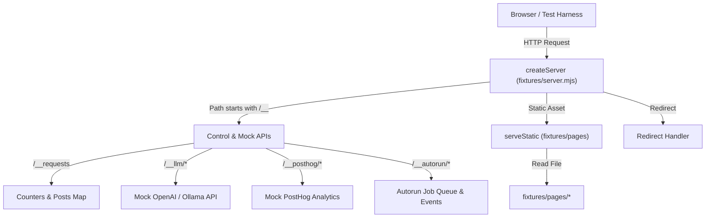

<!-- source: DeepWiki mcp.deepwiki.com · repo nanobrowser/nanobrowser · page 10.2 Fixture Pages and Local Server · fetched 2026-10-29 -->

# Fixture Pages and Local Server

<details>
<summary>Relevant source files</summary>

The following files were used as context for generating this wiki page:

- [fixtures/pages/d-overlay.html](fixtures/pages/d-overlay.html)
- [fixtures/pages/g-enrich.html](fixtures/pages/g-enrich.html)
- [fixtures/server.mjs](fixtures/server.mjs)
- [src/background/scenarios/set-g.ts](src/background/scenarios/set-g.ts)

</details>


## Overview and Purpose

The Nanobrowser test and automation harness relies on a deterministic local server (`fixtures/server.mjs`) and a suite of dedicated test web pages (`fixtures/pages/*`) [fixtures/server.mjs:1-40](). These components provide a fully isolated, reproducible web environment for running background checks, unit tests, and headless browser scenarios without depending on external web services or live APIs. 

The local server operates using only native Node.js modules (`node:http`, `node:fs/promises`, `node:path`, `node:events`) [fixtures/server.mjs:36-39]() and listens across multiple loopback addresses simultaneously (`localhost`, `127.0.0.1`, and `[::1]`) [fixtures/server.mjs:1-7]() to simulate cross-origin and cross-site frame hierarchies.

Sources: `fixtures/server.mjs:1-40`

---

## The Local Fixture Server Architecture (`fixtures/server.mjs`)

The server is structured around a central HTTP request handler that routes requests based on path and method [fixtures/server.mjs:105-108](). It supports static file serving, redirection tracking, form submission inspection, delayed responses, and mock APIs for LLMs, PostHog analytics, and autorun state coordination [fixtures/server.mjs:8-35]().

### Title: Server Routing and Mock Architecture

*Diagram 1: Natural Language Space to Code Entity Space mapping the test harness components (`fixtures/server.mjs`, `fixtures/pages/*`, `src/background/scenarios/*`).*

Sources: `fixtures/server.mjs:1-110`

### Multi-Origin Loopback Binding and Routing

By binding to loopback interfaces on port `8787` (configurable via `FIXTURE_PORT`), the server exposes the same static assets across distinct origins [fixtures/server.mjs:1-7, 41]():
- `http://localhost:8787`: Main test origin.
- `http://127.0.0.1:8787`: Secondary site used to test cross-site frame isolation, security boundaries, and blocked site policies [fixtures/server.mjs:5]().
- `http://[::1]:8787`: Tertiary site used for deeply nested cross-site frame configurations [fixtures/server.mjs:6]().

Incoming requests are tracked using request counters (`counters` Map) indexed by `host method path`, excluding internal `/__` administrative routes [fixtures/server.mjs:53-70]().

Sources: `fixtures/server.mjs:1-70`

### Mock Backend Endpoints

The server implements several specialized endpoints to support end-to-end browser control scenarios:
- **Static Content**: `GET /<file>` resolves to `fixtures/pages/<file>` or defaults to `index.html`, returning proper MIME types defined in `TYPES` [fixtures/server.mjs:9-9, 44-51, 92-103]().
- **Redirection**: `GET /redirect?to=<url>` issues a `302` redirect, counting each hop [fixtures/server.mjs:10]().
- **Form Inspection**: `POST /submit` accepts form posts, parses bodies, and records submissions [fixtures/server.mjs:11, 55]().
- **Latency Testing**: `GET /api/slow?ms=<n>` delays responses for up to `30,000` ms [fixtures/server.mjs:12]().
- **Mock LLM Endpoints**: `POST /__llm/v1/chat/completions`, `GET /__llm/v1/models`, and transcription routes emulate OpenAI-compatible streaming models and Ollama endpoints [fixtures/server.mjs:18-29]().
- **Mock Telemetry**: `POST /__posthog/i/v0/e/` intercepts analytics payloads, supporting injected failure states (`{ fail: n }`) to verify retry logic [fixtures/server.mjs:30-33]().

Sources: `fixtures/server.mjs:8-35`

---

## Deterministic Test Web Pages (`fixtures/pages/*`)

Test pages located in `fixtures/pages/` are engineered with inline script hooks (e.g., `window.hits = []`, `window.clicks = {}`) that allow test scenarios and checks to verify whether specific automation actions (such as clicks, text entries, form submissions, or dialog handlers) actually reached the DOM or were intercepted by browser control guards [fixtures/pages/g-enrich.html:1-45](), [fixtures/pages/d-overlay.html:1-41]().

### Title: Scenario Assertion Pipeline
```mermaid
graph TD
    Scenario["Scenario Runner (src/background/scenarios/*)"] -->|Evaluate JS / Call Tool| Browser["Headless Browser Tab"]
    Browser -->|Loads Fixture Page| Page["fixtures/pages/*"]
    Page -->|User Action / DOM Event| HitTracker["window.hits / window.clicks"]
    Scenario -->|Read State via evaluate()| HitTracker
    HitTracker -->|Assert Expected Outcomes| Verdict["Scenario Outcome (PASS/FAIL)"]
```
*Diagram 2: Data flow and assertion pipeline between scenarios, fixture pages, and DOM tracking variables.*

Sources: `fixtures/pages/g-enrich.html:1-45`, `fixtures/pages/d-overlay.html:1-41`, `src/background/scenarios/set-g.ts:1-55`

### Enrichment and Permission Pages (`g-enrich.html` and `g-handover.html`)
`fixtures/pages/g-enrich.html` exercises the browser control layer's classifier enrichments—such as sign-in forms, one-time passcode inputs, saved credit card selectors, permission grants, and comment textareas [fixtures/pages/g-enrich.html:1-45](). Each interactive element triggers a `hit(what)` call that pushes identifiers into `window.hits`, allowing test assertions to confirm whether events successfully propagated to the underlying web page or were withheld by safety policies [fixtures/pages/g-enrich.html:9-11]().

Sources: `fixtures/pages/g-enrich.html:1-45`

### Overlay and Shadow DOM Pages (`d-overlay.html`)
`fixtures/pages/d-overlay.html` verifies that UI elements drawn dynamically by the extension over the viewport (such as the page glow border) do not interfere with page perception, outline generation, or hit testing [fixtures/pages/d-overlay.html:1-43](), [src/background/scenarios/drawn-over-pages.ts:1-10](). 

The fixture page script implements `window.addOverlay()` to inject an overlay container with `pointer-events: none`, `aria-hidden="true"`, and a closed shadow root containing visual gradient borders [fixtures/pages/d-overlay.html:43-63](). It also implements `window.fadeFor(ms)` to simulate continuous DOM mutations and opacity transitions during active automation runs [fixtures/pages/d-overlay.html:64-70]().

Sources: `fixtures/pages/d-overlay.html:1-73`, `src/background/scenarios/drawn-over-pages.ts:1-20`

---

## Integration with Scenarios and Checks

Fixture pages are driven by scenario definitions in `src/background/scenarios/` [src/background/scenarios/set-g.ts:1-25](), [src/background/scenarios/drawn-over-pages.ts:1-15](). These scenarios configure mock browser sessions, execute browser control commands, and inspect execution outcomes and page side-effects [src/background/scenarios/set-g.ts:26-55]().

### Scenario Permission and Handover Testing (`set-g.ts`)
`src/background/scenarios/set-g.ts` defines scenarios (such as `G-6.3-pay-button`, `G-6.3-enter-pay-form`, and `G-6.3-prompt-dialog`) that test the browser control layer's handover policies for consequential actions like financial transactions [src/background/scenarios/set-g.ts:77-178](). 

```typescript
// Example helper structure for agent sessions in set-g.ts
export async function agentSession(
  ctx: ScenarioContext,
  url: string,
  config: SessionConfig = {},
): Promise<{
  session: Session;
  tabId: number;
  call: (tool: string, args?: Record<string, unknown>) => Promise<Result>;
}> { ... }
```
*[src/background/scenarios/set-g.ts:26-45]()*.

Using `agentSession`, scenarios instantiate a controller with specific handover configurations and blocked site lists, navigate to `g-handover.html`, execute actions against specific element refs or semantic roles, and verify that `USER_STEP` errors are correctly triggered without dispatching events to the page (`hits.length === 0`) [src/background/scenarios/set-g.ts:35-90]().

Sources: `src/background/scenarios/set-g.ts:1-90`

### Overlay Interference Validation (`drawn-over-pages.ts`)
`src/background/scenarios/drawn-over-pages.ts` validates that overlay elements do not corrupt perception snapshots or trigger `OBSCURED` errors during click and type dispatch [src/background/scenarios/drawn-over-pages.ts:1-75](). 

Scenarios such as `D-overlay-outline` confirm that snapshots generated with and over the overlay match identically (ignoring internal element IDs) [src/background/scenarios/drawn-over-pages.ts:24-40](), while `D-overlay-clicks` verifies that pointer events successfully pass through pointer-events-none boundaries to reach underlying form controls [src/background/scenarios/drawn-over-pages.ts:42-75]().

Sources: `src/background/scenarios/drawn-over-pages.ts:1-102`

---

