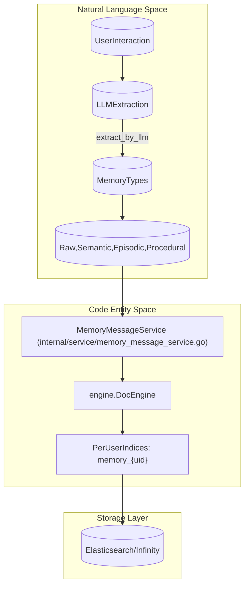
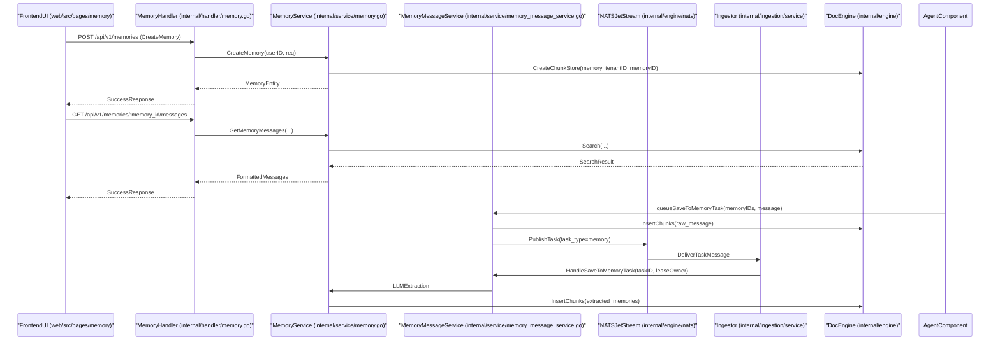

<!-- source: DeepWiki mcp.deepwiki.com · repo infiniflow/ragflow · page 10 Memory System · fetched 2026-10-29 -->

# Memory System

Relevant source files

The following files were used as context for generating this wiki page:

- [internal/dao/memory.go](internal/dao/memory.go)
- [internal/handler/memory.go](internal/handler/memory.go)
- [internal/service/memory.go](internal/service/memory.go)
- [internal/service/memory_extractor.go](internal/service/memory_extractor.go)
- [internal/service/memory_extractor_test.go](internal/service/memory_extractor_test.go)
- [internal/service/memory_message_service.go](internal/service/memory_message_service.go)
- [internal/service/memory_message_service_test.go](internal/service/memory_message_service_test.go)
- [internal/service/memory_message_test.go](internal/service/memory_message_test.go)

The **Memory System** in RAGFlow provides a persistent, searchable storage layer for agentic workflows and chats. Unlike standard conversation history, which is ephemeral or bounded by context window limits, the Memory System treats dialogue turns and extracted insights as structured data. It enables agents to maintain long-term state, recall prior interactions across sessions, and classify information into cognitive categories (raw, semantic, episodic, and procedural).

### System Overview

The memory subsystem bridges the LLM's "Natural Language Space" to the "Code Entity Space" by mapping conversation turns into vector-searchable documents stored in specialized indices. The entire subsystem is implemented in Go within the backend engine (`internal/service/memory.go` [internal/service/memory.go:17-43](), `internal/service/memory_message_service.go` [internal/service/memory_message_service.go:104-124]()).

Title: "MemorySystemArchitecture"

Sources: [internal/service/memory.go:17-43](), [internal/handler/memory.go:38-44](), [internal/service/memory_message_service.go:104-124]()

---

### Memory Types, Extraction and Storage

RAGFlow categorizes memory into four distinct types: raw, semantic, episodic, and procedural. These are represented as bit flags defined in `internal/dao/memory.go` [internal/dao/memory.go:31-37](). When a message is processed via `queueSaveToMemoryTask` in `internal/service/memory_message_service.go` [internal/service/memory_message_service.go:161-190](), the system persists raw dialogue and queues asynchronous extraction tasks.

The asynchronous extraction worker (`internal/service/memory_extractor.go`) claims durable memory tasks via `HandleSaveToMemoryTask` [internal/service/memory_extractor.go:133-163](), invokes the LLM using prompt templates assembled by `PromptAssembler` [internal/service/memory.go:108-187](), and stores the parsed structures back into the document store.

For deep technical details on the four memory types, queue-driven processing, message indices, and storage backends, see [Memory Types, Extraction and Storage](#10.1).

Sources: [internal/service/memory.go:108-187](), [internal/service/memory_message_service.go:161-190](), [internal/dao/memory.go:31-37](), [internal/service/memory_extractor.go:133-163]()

---

### Memory Management UI and API

The system exposes REST API endpoints via `MemoryHandler` (`internal/handler/memory.go`) [internal/handler/memory.go:38-56]() alongside a React-based frontend interface for managing agent states. Users can configure parameters such as memory size limits (`MemorySizeLimit = 5242880` bytes) [internal/service/memory.go:48-50](), forgetting policies (`ForgettingPolicyFIFO`) [internal/service/memory.go:83-88](), and tenant access permissions (`me`, `team`, `all`) [internal/service/memory.go:56-67]().

Title: "MemoryConfigurationAndStorageFlow"

Sources: [internal/handler/memory.go:38-56](), [internal/service/memory.go:45-88](), [internal/dao/memory.go:103-112](), [internal/service/memory_message_service.go:104-124](), [internal/service/memory_extractor.go:133-163]()

For complete documentation on REST API routes, frontend settings, message tables, and how chats and agents attach memories, see [Memory Management UI and API](#10.2).

Sources: [internal/handler/memory.go:38-56](), [internal/service/memory.go:45-88](), [internal/dao/memory.go:103-112](), [internal/service/memory_message_service.go:104-124]()

---

