# Page: Overview

# Overview

<details>
<summary>Relevant source files</summary>

The following files were used as context for generating this wiki page:

- [Dockerfile](Dockerfile)
- [README.md](README.md)
- [README_ar.md](README_ar.md)
- [README_fr.md](README_fr.md)
- [README_id.md](README_id.md)
- [README_ja.md](README_ja.md)
- [README_ko.md](README_ko.md)
- [README_pt_br.md](README_pt_br.md)
- [README_ru.md](README_ru.md)
- [README_tr.md](README_tr.md)
- [README_tzh.md](README_tzh.md)
- [README_zh.md](README_zh.md)
- [docker/.env](docker/.env)
- [docker/README.md](docker/README.md)
- [docker/docker-compose-base.yml](docker/docker-compose-base.yml)
- [docker/docker-compose.yml](docker/docker-compose.yml)
- [docker/entrypoint.sh](docker/entrypoint.sh)
- [docker/infinity_conf.toml](docker/infinity_conf.toml)
- [docker/launch_backend_service.sh](docker/launch_backend_service.sh)
- [docs/quickstart.mdx](docs/quickstart.mdx)
- [pyproject.toml](pyproject.toml)
- [sdk/python/pyproject.toml](sdk/python/pyproject.toml)
- [sdk/python/uv.lock](sdk/python/uv.lock)
- [uv.lock](uv.lock)

</details>


## Purpose and Scope

RAGFlow is a Go-native, open-source Retrieval-Augmented Generation (RAG) engine that integrates deep document understanding with advanced agentic capabilities [README.md:70-73](). Its primary purpose is to transform complex, unstructured documents into high-fidelity, production-ready AI knowledge bases by combining specialized parsing pipelines, multi-template chunking, hybrid vector-keyword retrieval, and configurable large language model (LLM) agent workflows [README.md:103-128]().

The backend is consolidated into a single Go binary, `ragflow_server`, which operates across various operational modes (`--api`, `--admin`, `--ingestor`, `--syncer`, `--deepdoc`, `--migrate`) managed via container entrypoints like `docker/entrypoint.sh` [cmd/ragflow_server.go:125-127](). This architecture delivers high concurrency and low latency while leveraging native bindings for ONNX Runtime and C++ tokenizers.

This overview page establishes the high-level system architecture and key features of RAGFlow. For detailed technical breakdowns, refer to the child pages:
- **[Repository Map and Technology Stack](#1.1)**
- **[Core Concepts and End-to-End Data Flow](#1.2)**

Sources: [README.md:70-73](), [README.md:103-128](), [cmd/ragflow_server.go:125-127]()

## Key Features

- **Deep Document Understanding via DeepDoc**: Integrates vision-based layout analysis, OCR, and table recognition to extract structured text from complex formats (PDF, DOCX, Excel, PPT) [README.md:107-108]().
- **Template-Based Chunking**: Offers explainable, configurable chunking strategies (Naive, Book, Law, Presentation) to generate semantically rich segments [README.md:112-115]().
- **Knowledge Compilation**: Compiles document and dataset contents into structured artifacts such as Wikis, Graphs, Trees, Mind Maps, Timelines, and Skill objects [README.md:117-120]().
- **Agentic Retrieval**: Implements multi-step query decomposition, iterative context gathering, and verification across Low, Medium, High, and Ultra thinking modes [README.md:123-126]().
- **Visual Workflow Canvas**: Provides a React-based node graph editor for orchestrating multi-turn agents, persistent memory, and integrated tool calling [README.md:72-73]().
- **Polyglot Persistence & Multi-Engine Support**: Supports document engines (Elasticsearch, Infinity, OceanBase, SereneDB, OpenSearch), relational metadata stores (MySQL, Postgres), object storage (MinIO, S3), caching (Kvrocks), and analytics (ClickHouse) [docker/.env:27-40]().

Sources: [README.md:103-145](), [docker/.env:27-40]()

---

## High-Level Architecture

### Core Subsystems

RAGFlow's architecture is divided into three primary tiers:
1. **Frontend & API Layer**: A React single-page application (`web/`) communicating with the `ragflow_server --api` and `--admin` endpoints [cmd/ragflow_server.go:40-46]().
2. **Asynchronous Execution & Ingestion**: Background workers (`ragflow_server --ingestor` and `--syncer`) consume tasks distributed via NATS JetStream, executing document parsing, embedding generation, and third-party data synchronization [cmd/ragflow_server.go:45-46]().
3. **Polyglot Storage & Inference**: Relational stores handle metadata (`internal/dao`), document engines index chunks for hybrid search, object stores retain raw binaries, and native CGO/ONNX wrappers execute DeepDoc models [cmd/ragflow_server.go:36-48]().

Sources: [cmd/ragflow_server.go:36-48](), [docker/docker-compose-base.yml:1-221]()

### Diagram: Server Modes to Code Entity Mapping

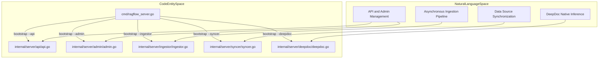

Sources: [cmd/ragflow_server.go:35-127](), [internal/server/api/api.go:1-30]()

### Diagram: Polyglot Storage and Features to Code Modules

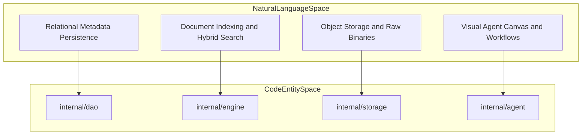

Sources: [cmd/ragflow_server.go:36-48](), [docker/docker-compose-base.yml:1-221]()

---

## Links to Child Pages

- **[Repository Map and Technology Stack](#1.1)** — Detailed review of top-level directory layouts (`cmd/`, `internal/`, `web/`, `conf/`, `docker/`, `rag/prompts`), the Go/React/C++ technology stack, and the transition from Python.
- **[Core Concepts and End-to-End Data Flow](#1.2)** — Comprehensive trace of the data lifecycle from dataset creation and document upload through the ingestion pipeline, vector indexing, retrieval, and citation-backed answer generation.

Sources: [README.md:70-145]()

---

# Page: Repository Map and Technology Stack

# Repository Map and Technology Stack

<details>
<summary>Relevant source files</summary>

The following files were used as context for generating this wiki page:

- [.github/workflows/sep-tests.yml](.github/workflows/sep-tests.yml)
- [Dockerfile_ci](Dockerfile_ci)
- [README.md](README.md)
- [README_ar.md](README_ar.md)
- [README_fr.md](README_fr.md)
- [README_id.md](README_id.md)
- [README_ja.md](README_ja.md)
- [README_ko.md](README_ko.md)
- [README_pt_br.md](README_pt_br.md)
- [README_ru.md](README_ru.md)
- [README_tr.md](README_tr.md)
- [README_tzh.md](README_tzh.md)
- [README_zh.md](README_zh.md)
- [build.sh](build.sh)
- [docker/nginx/ragflow.conf](docker/nginx/ragflow.conf)
- [docs/quickstart.mdx](docs/quickstart.mdx)
- [go.mod](go.mod)
- [go.sum](go.sum)
- [internal/common/trusted_proxies.go](internal/common/trusted_proxies.go)
- [internal/development.md](internal/development.md)
- [tools/scripts/convert_deepdoc_model.py](tools/scripts/convert_deepdoc_model.py)
- [tools/scripts/download_dev_deps.py](tools/scripts/download_dev_deps.py)
- [tools/scripts/test_download_dev_deps.py](tools/scripts/test_download_dev_deps.py)

</details>


This page provides an in-depth technical overview of the top-level directory structure of the RAGFlow codebase and the core technologies it employs. RAGFlow is structured as a Go-native Retrieval-Augmented Generation (RAG) engine, having transitioned from a legacy Python backend to a high-performance Go stack, complemented by a React single-page frontend and C++ native libraries for document parsing and ONNX Runtime inference.

---

## Purpose and Scope

This document details the repository layout, architectural components, and technology stack of the codebase. It examines top-level directories, language choices, frameworks, and integration points. As a leaf documentation page, it focuses on precise architectural facts, implementation details, and structural organization.

Sources: `go.mod:1-3`, `docs/quickstart.mdx:1-25`

---

## Repository Top-Level Directories

RAGFlow organizes code, resources, and deployment configurations into a modular set of top-level directories.

| Directory          | Description                                                                                               |
|--------------------|-----------------------------------------------------------------------------------------------------------|
| `cmd/`             | Entrypoint Go binaries. Houses `ragflow_server` which supports multiple operational modes via CLI flags (`--api`, `--admin`, `--ingestor`, `--syncer`, `--deepdoc`, `--migrate`) [go.mod:1-3]() |
| `internal/`        | Core backend implementation packages, covering API routing, metadata DAOs, the harness framework, ingestion pipelines, document engines, and native bindings. |
| `web/`             | React TypeScript single-page application providing the frontend interface for datasets, chat, agent canvas, and settings. |
| `conf/`            | Configuration templates (such as `service_conf.yaml.template`) and runtime YAML configurations for services, databases, and LLM factories. |
| `docker/`          | Docker deployment manifests, including `docker-compose.yml`, environment templates (`.env`), multi-stage `Dockerfile`, and container entrypoint scripts. |
| `docs/`            | Technical documentation in Markdown and MDX formats, covering guides, deployment instructions, and release notes [docs/quickstart.mdx:1-27]() |
| `sdk/`             | Software Development Kits, including the Python SDK under `python/` for programmatic interaction with RAGFlow APIs. |
| `test/`            | Integration and unit test suites, test case definitions, pytest files, and end-to-end testing resources. |
| `tools/`           | Auxiliary utility scripts, data migration tools, and ecosystem adapters. |
| `rag/prompts/`     | Prompt templates utilized across LLM-driven workflows, chat completions, and retrieval augmentation tasks. |

Sources: `go.mod:1-3`, `docs/quickstart.mdx:1-27`

---

### Detailed Directory Breakdown

#### `cmd/`
- Contains executable entrypoints, primarily `ragflow_server.go`.
- The binary uses runtime flags to determine its execution profile:
  - `--api`: Starts the core REST API server.
  - `--admin`: Serves administrative and monitoring endpoints.
  - `--ingestor`: Initiates document ingestion workers consuming from NATS JetStream (`github.com/nats-io/nats.go`) [go.mod:58]().
  - `--syncer`: Runs incremental synchronization across connected data sources.
  - `--deepdoc`: Provisions native deep document processing workers.
  - `--migrate`: Executes database schema migrations prior to service startup.

Sources: `go.mod:1-58`, `build.sh:20-24`

#### `internal/`
- Implements the core backend logic across dedicated packages:
  - `internal/harness/`: Graph-based agent execution engine with Pregel BSP execution.
  - `internal/binding/`: C++ tokenizer bindings and native integration wrappers [build.sh:20-21]().
  - `internal/deepdoc/native/`: ONNX Runtime wrappers for layout analysis and OCR inference (`github.com/infiniflow/onnxruntime_go`) [go.mod:48]().
  - `internal/dao/`: Polyglot database access layer for MySQL, PostgreSQL, and SQLite [go.mod:40-41](), [go.mod:49](), [go.mod:54]().
  - `internal/router/`: Gin-based REST route registrations and middleware handlers (`github.com/gin-gonic/gin`) [go.mod:39]().

Sources: `go.mod:39-54`, `build.sh:20-21`

#### `web/`
- React frontend built with TypeScript.
- Integrates Ant Design and Radix UI primitives for accessible component design.
- Uses Tailwind CSS with CSS-variable theming for dark/light mode support.
- Implements client state management via Zustand and server state synchronization via React Query.
- Utilizes React Flow for visual agent canvas composition.

Sources: `README.md:1-50`

#### `docker/`
- Houses containerization manifests and bootstrap scripts.
- `docker-compose.yml` configures service dependencies including MySQL, Elasticsearch/Infinity, MinIO, Kvrocks, NATS, and ClickHouse.
- `entrypoint.sh` initializes runtime environment variables, processes configuration templates, and executes database migrations.

Sources: `docs/quickstart.mdx:20-83`

---

## Technology Stack

### Go (Golang)
- The backend is written natively in Go (`go.mod` specifying Go 1.27) [go.mod:1-3].
- Replaces the legacy Python backend to achieve lower latency, higher concurrency efficiency, and simplified container deployments.
- Relies on frameworks such as Gin (`github.com/gin-gonic/gin`) for routing, GORM (`gorm.io/gorm`) for database access, Viper (`github.com/spf13/viper`) for configuration parsing, and Zap (`go.uber.org/zap`) for structured logging [go.mod:39-96].
- Utilizes NATS JetStream (`github.com/nats-io/nats.go`) for asynchronous task distribution and queue management [go.mod:58].

Sources: `go.mod:1-96`, `build.sh:1-62`

### React (TypeScript/JavaScript)
- Single-page application providing rich user interfaces for dataset curation, chat orchestration, and visual workflow building.
- Leverages Vite as its build tool and dev server.
- Communicates with the backend REST API via standardized request clients with JWT/API-key authentication headers.

Sources: `README.md:1-50`

### C++ / Native Components
- High-performance document processing and tokenization utilize C++ and static bindings.
- `internal/binding` includes the C++ tokenizer (`RAGAnalyzer`) bridged via CGO [build.sh:20-21].
- DeepDoc leverages ONNX Runtime static libraries (`github.com/infiniflow/onnxruntime_go`) for CPU-based layout analysis, OCR detection, and table structure recognition [go.mod:48], [build.sh:55-61].
- Native parsing libraries such as `office_oxide`, `pdf_oxide`, and `pdfium-static` are statically linked during compilation [build.sh:33-53].

Sources: `go.mod:48`, `build.sh:28-61`

### Python (Legacy)
- The historical Python backend has been fully deprecated and replaced by the Go runtime.
- Python is retained strictly within `sdk/` for client-side SDK usage and integration test suites (`test/`).

Sources: `go.mod:1-3`

---

## Data and Control Flow Architecture

The following diagrams illustrate the mapping between conceptual system domains and their concrete Go code entities across the RAGFlow backend.

### Diagram: Natural Language Space to Code Entity Space

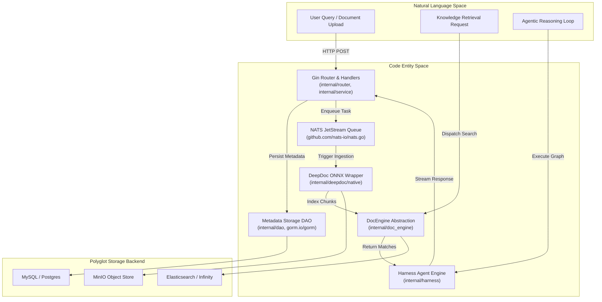

Sources: `go.mod:39-96`, `docs/quickstart.mdx:70-84`

### Diagram: Storage and Server Mode Interaction

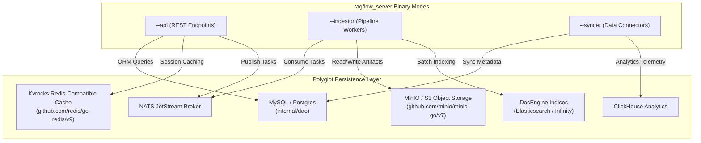

Sources: `go.mod:39-96`, `build.sh:1-62`

---

## Summary

RAGFlow’s repository structure is engineered around a modular, Go-native architecture. By replacing the legacy Python backend with a multi-mode Go binary (`ragflow_server`), the system achieves robust concurrency, lower memory footprints, and streamlined deployments. Polyglot storage integrations, C++ native bindings for ONNX Runtime inference, and a React-based frontend form a cohesive, production-ready stack for enterprise RAG and agentic workflows.

Sources: `go.mod:1-96`, `docs/quickstart.mdx:1-27`

---

# Page: Core Concepts and End-to-End Data Flow

# Core Concepts and End-to-End Data Flow

<details>
<summary>Relevant source files</summary>

The following files were used as context for generating this wiki page:

- [README.md](README.md)
- [README_ar.md](README_ar.md)
- [README_fr.md](README_fr.md)
- [README_id.md](README_id.md)
- [README_ja.md](README_ja.md)
- [README_ko.md](README_ko.md)
- [README_pt_br.md](README_pt_br.md)
- [README_ru.md](README_ru.md)
- [README_tr.md](README_tr.md)
- [README_tzh.md](README_tzh.md)
- [README_zh.md](README_zh.md)
- [docs/quickstart.mdx](docs/quickstart.mdx)
- [internal/dao/ingestion_task_test.go](internal/dao/ingestion_task_test.go)
- [internal/ingestion/pipeline/pipeline.go](internal/ingestion/pipeline/pipeline.go)
- [internal/ingestion/pipeline/pipeline_test.go](internal/ingestion/pipeline/pipeline_test.go)
- [internal/ingestion/service/ingestion_service.go](internal/ingestion/service/ingestion_service.go)
- [internal/ingestion/service/progress_sink.go](internal/ingestion/service/progress_sink.go)
- [internal/ingestion/service/progress_sink_test.go](internal/ingestion/service/progress_sink_test.go)
- [internal/ingestion/service/worker_dispatcher_integration_test.go](internal/ingestion/service/worker_dispatcher_integration_test.go)
- [internal/ingestion/task/pipeline_executor.go](internal/ingestion/task/pipeline_executor.go)
- [internal/ingestion/task/pipeline_executor_test.go](internal/ingestion/task/pipeline_executor_test.go)
- [internal/service/document/document_list.go](internal/service/document/document_list.go)
- [internal/service/ingestion_task_service.go](internal/service/ingestion_task_service.go)
- [internal/service/ingestion_task_service_test.go](internal/service/ingestion_task_service_test.go)

</details>


## Purpose and Scope

This page explains the core lifecycle of data within RAGFlow, detailing the process from dataset creation, document upload and ingestion, chunking and embedding, document engine indexing, retrieval, and finally chat or agent interaction that returns answers with citations. This technical deep dive covers key components, data flows, and implementation details with references to exact code locations.

Sources: `README.md:57-73()`, `internal/ingestion/task/pipeline_executor.go:44-70()`

---

## 1. Dataset Creation and Document Upload

RAGFlow manages knowledge repositories as **datasets**. A dataset is a logical container grouping related documents as a knowledge base. Users create these datasets through the web UI or API, specifying configurations such as the chunking template and embedding model which are enforced consistently across the dataset.

When a dataset is ready, users upload files to it, which can include:

- Various document formats: PDF, DOC/DOCX, TXT, Markdown (`[docs/quickstart.mdx:104-105]()`).
- Spreadsheets (CSV, XLSX) (`[docs/quickstart.mdx:104-105]()`).
- Images (JPEG, PNG, TIFF) (`[docs/quickstart.mdx:104-105]()`).
- Presentations (PPT, PPTX) (`[docs/quickstart.mdx:104-105]()`).
  
Uploaded files are mapped into **document** entities in the backend that maintain metadata (filename, tenant, dataset linkage, status, etc.). Upon upload, the system triggers an asynchronous ingestion task to process them via NATS JetStream and the ingestion worker pool (`[internal/ingestion/service/ingestion_service.go:54-149]()`).

Key details:

- The chunking template and embedding model are fixed once ingestion starts, ensuring chunks are embedded in the same vector space (`[docs/quickstart.mdx:114-116]()`).
- Document entities are recorded with the knowledgebase and tenant associations for multi-tenant isolation (`[internal/ingestion/task/pipeline_executor.go:86-104]()`).

**Key classes and files:**

- Dataset and document persistence is handled by DAO layers under `[internal/dao/ingestion.go]()`.
- The document entity model is part of `[internal/entity/ingestion_task.go]()`.
- Frontend pages for dataset and document management are under `[web/src/pages/dataset]()`.
- Task creation on upload is triggered through the ingestion infrastructure (`[internal/ingestion/service/ingestion_service.go:54-149]()`).

Sources: `docs/quickstart.mdx:104-120()`, `internal/ingestion/task/pipeline_executor.go:86-104()`, `internal/ingestion/service/ingestion_service.go:54-149()`

---

## 2. Ingestion Pipeline: Parsing, Chunking, Embedding, and Knowledge Compilation

Once a document upload is complete, an **ingestion pipeline** asynchronously processes it to generate searchable data and compiled artifacts.

Pipeline workflow:

1. **Parsing:** The pipeline chooses an appropriate parser component based on document format (PDF, Markdown, image OCR, spreadsheet parser, etc.). It extracts raw text and document structural metadata (`[internal/ingestion/component/parser.go]()`).

2. **Chunking:** Extracted text is segmented into semantically coherent units called chunks. Multiple chunking strategies/templates are available to suit different document types and use cases.

3. **Content Enhancement:** Optional enhancements via LLM extractors may add keywords, questions, tags, or metadata fields to chunks.

4. **Embedding:** Each chunk's textual content is converted into a vector embedding with the configured embedding model, producing dense vector representations.

5. **Batch Writing:** Chunks are batched and inserted into the document engine's index store asynchronously using `insertChunksForIngestion` to minimize refresh latency (`[internal/ingestion/task/pipeline_executor.go:124-131]()`). The final batch triggers a blocking refresh to guarantee search availability (`[internal/ingestion/task/pipeline_executor.go:136-140]()`).

6. **Knowledge Compilation:** Document- and dataset-level post-processing compiles contents into structured knowledge artifacts such as Wikis, Graphs, Trees, Mind Maps, and Skills (`[README.md:88-91]()`, `[internal/ingestion/service/ingestion_service.go:104-116]()`).

**Core implementation elements:**

- The core orchestration and execution are carried out by `PipelineExecutor` in `[internal/ingestion/task/pipeline_executor.go:73-174]()`.
- Chunk writing uses `chunkIndexWriter`, which interfaces via the `engine.DocEngine` abstraction to write chunk data.
- Ingestion workers run concurrently within `Ingestor` (`[internal/ingestion/service/ingestion_service.go:54-116]()`), maintaining heartbeats (`[internal/ingestion/service/ingestion_service.go:44-52]()`) to renew lease deadlines.

Sources: `README.md:88-91()`, `internal/ingestion/task/pipeline_executor.go:44-174()`, `internal/ingestion/service/ingestion_service.go:54-116()`

---

## 3. Document Engine: Vector Store and Indexing

The **Document Engine** is the vector store backend that supports:

- Storing chunk documents containing extracted text, chunk metadata, and vector embeddings.
- Supporting hybrid search combining fulltext (BM25) and vector similarity.
- Querying and filtering by metadata fields, dataset, and tenant constraints.
- Bulk insertion (`InsertChunks` / `InsertChunksNoRefresh`) and deletion for document reingestion (`[internal/engine/elasticsearch/chunk.go:154-183]()`).

RAGFlow supports multiple interchangeable document engines like Elasticsearch (`[internal/engine/elasticsearch/chunk.go:17-52]()`), Infinity, OceanBase, and SereneDB, unified under the `engine.DocEngine` interface.

Key interface traits:

- `CreateChunkStore` for initializing index mappings per dataset or memory store (`[internal/engine/elasticsearch/chunk.go:53-152]()`).
- `InsertChunks` and `InsertChunksNoRefresh` methods for adding chunk documents (`[internal/engine/elasticsearch/chunk.go:154-176]()`).
- Hybrid retrieval combining vector kNN and BM25 full-text matching.

Sources: `internal/engine/elasticsearch/chunk.go:17-183()`

---

## 4. Retrieval and Query Processing

When a user or agent poses a query via chat or API:

- The query text is preprocessed, tokenized, and refined using NLP heuristics or LLM query rewriting via `RetrievalService` (`[internal/service/nlp/retrieval.go:39-48]()`).
- A hybrid search (`Retrieval`) retrieves matching chunks using dense vector similarity and BM25 keyword matching (`[internal/service/nlp/retrieval.go:88-140]()`).
- Configuration parameters such as `KNNTopK`, `SimilarityThreshold`, and `VectorSimilarityWeight` control candidate selection (`[internal/service/nlp/retrieval.go:103-126]()`).
- Metadata and dataset filters are applied based on the user's scope.
- Results from multiple recall modes are merged and optionally re-ranked using rerank models before pagination and chunk construction (`[internal/service/nlp/retrieval.go:88-97]()`).

Sources: `README.md:120-127()`, `internal/service/nlp/retrieval.go:39-178()`

---

## 5. Chat and Agent Answer Generation with Citations

The chat/agent pipeline executes the final step, combining retrieval with LLM answer generation:

- Retrieved chunks (with provenance info) compose a system prompt context supplied to the configured chat model.
- The chat model generates an answer enhanced by retrieval context.
- Citations anchored to document chunks and their source documents are embedded in the answer, supporting traceability and reducing hallucination.
- Agentic retrieval modes decompose complex questions into multi-step queries and verification phases, producing structured reasoning events.
- The pipeline supports both streaming and batch completion modes and advanced modalities including audio/TTS outputs.

Sources: `README.md:128-133()`, `internal/ingestion/task/pipeline_executor.go:44-70()`

---

## Mermaid Diagrams

### Diagram 1: High-Level Data Flow from Dataset to Answer

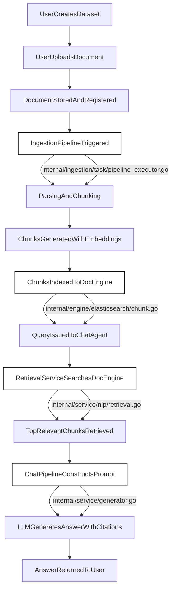

Sources: `internal/ingestion/task/pipeline_executor.go:44-168()`, `internal/engine/elasticsearch/chunk.go:154-183()`, `internal/service/nlp/retrieval.go:88-140()`

---

### Diagram 2: Mapping Natural Language Components to Go Code Entities

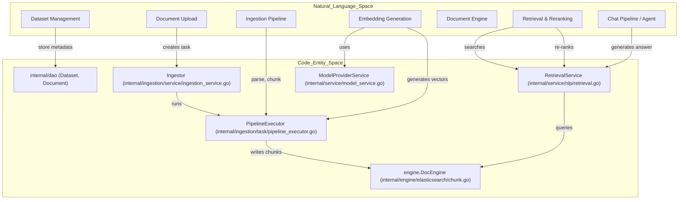

Sources: `internal/dao/ingestion.go:1-50()`, `internal/ingestion/task/pipeline_executor.go:73-174()`, `internal/ingestion/service/ingestion_service.go:54-149()`, `internal/service/nlp/retrieval.go:39-48()`

---

## Summary Table of Key Entities and Files

| Concept               | Code Artifact / Class                                  | File / Location                                        |
|-----------------------|-------------------------------------------------------|-------------------------------------------------------|
| Dataset and Documents  | DAO layer for datasets and documents                   | `[internal/dao/ingestion.go]()`                        |
| Document Entity        | Document and ingestion task entities                   | `[internal/entity/ingestion_task.go]()`                |
| Ingestion Pipeline     | PipelineExecutor, chunkIndexWriter                     | `[internal/ingestion/task/pipeline_executor.go]()`     |
| Ingestion Worker Pool  | Ingestor, worker management, heartbeats                | `[internal/ingestion/service/ingestion_service.go]()`  |
| Document Engine        | DocEngine interface and Elasticsearch chunk methods    | `[internal/engine/elasticsearch/chunk.go]()`           |
| Retrieval Pipeline     | RetrievalService and hybrid search logic               | `[internal/service/nlp/retrieval.go]()`                |
| Chat and Agent Answer  | Chat completion and generation handlers                | `[internal/service/generator.go]()`                    |

Sources: `internal/dao/ingestion.go:1-50()`, `internal/ingestion/task/pipeline_executor.go:44-174()`, `internal/ingestion/service/ingestion_service.go:54-149()`, `internal/engine/elasticsearch/chunk.go:154-183()`, `internal/service/nlp/retrieval.go:39-48()`

---

# Page: Getting Started and Deployment

# Getting Started and Deployment

<details>
<summary>Relevant source files</summary>

The following files were used as context for generating this wiki page:

- [Dockerfile](Dockerfile)
- [docker/.env](docker/.env)
- [docker/README.md](docker/README.md)
- [docker/docker-compose-base.yml](docker/docker-compose-base.yml)
- [docker/docker-compose.yml](docker/docker-compose.yml)
- [docker/entrypoint.sh](docker/entrypoint.sh)
- [docker/infinity_conf.toml](docker/infinity_conf.toml)
- [docker/launch_backend_service.sh](docker/launch_backend_service.sh)
- [pyproject.toml](pyproject.toml)
- [sdk/python/pyproject.toml](sdk/python/pyproject.toml)
- [sdk/python/uv.lock](sdk/python/uv.lock)
- [uv.lock](uv.lock)

</details>


This document provides a high-level overview of RAGFlow's deployment options and initial setup procedures. It outlines system prerequisites, primary deployment methods, and the essential configuration files used to run RAGFlow. For in-depth instructions and technical details, please refer to the dedicated child pages:

- [Docker Compose Deployment](#2.1) — Detailed guide for deploying RAGFlow using Docker Compose, including service architecture, container configuration, and port mappings.
- [Configuration Management](#2.2) — Explanation of the configuration system including `service_conf.yaml`, environment variables, and the relationship between configuration sources.
- [Document Engine Selection](#2.3) — Guide for choosing and configuring document engines (Elasticsearch, Infinity, OpenSearch, OceanBase, SereneDB) with their tradeoffs.
- [Build System and CI/CD](#2.4) — Explanation of the build pipeline, dependency management with `uv`, multi-language compilation, GitHub Actions workflows, the `ragflow_deps` image for pre-downloading NLP models, and install scripts.

---

## Deployment Architecture Overview

RAGFlow adopts a modular containerized microservices architecture, with each key subsystem running in its own container. This approach isolates concerns such as API serving, data storage, caching, task execution, and optional sandboxing, facilitating scalability and maintainability. For details, see [Docker Compose Deployment](#2.1).

### Containerized Service Architecture

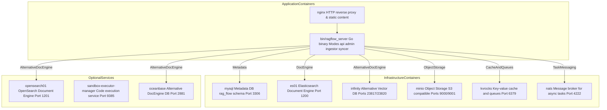

This architecture demonstrates the following:
- The primary Go server binary `ragflow_server` runs in multiple modes such as API server, Admin UI server, ingestion workers, and data synchronization workers [docker/README.md:1-5]().
- Document engines provide vector and text indexing. Elasticsearch is the default engine, but Infinity, OpenSearch, OceanBase, and SereneDB are supported alternatives [docker/.env:27-36]().
- MySQL holds metadata about datasets, users, and system state [docker/.env:38-40]().
- MinIO exposes S3-compatible object storage for storing raw document files and blobs [docker/README.md:115-121]().
- Kvrocks offers Redis-compatible caching and task queue functionality [docker/README.md:124-132]().
- NATS JetStream acts as a reliable message broker for async ingestion and synchronization tasks [docker/README.md:135-143]().
- An optional sandbox executor service provides isolated code execution environments invoked by agent workflows [docker/docker-compose-base.yml:218-221]().

Sources: [docker/docker-compose-base.yml:1-221](), [docker/.env:10-63](), [docker/README.md:1-149]()

---

## Configuration Management Overview

RAGFlow uses a configuration system that merges environment variables, YAML templates, and Docker Compose profiles to customize deployment behavior according to use case and selected document engine. For details, see [Configuration Management](#2.2).

### Configuration Sources and Runtime Flow

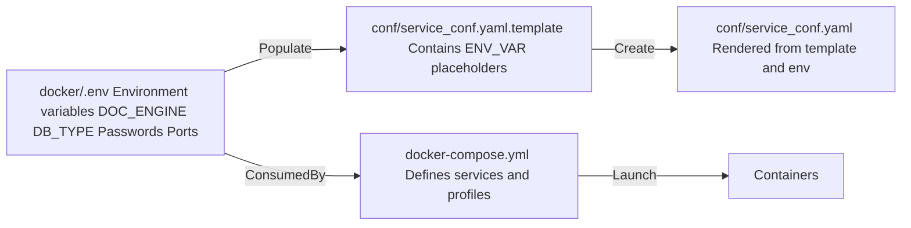

Key points:
- The `.env` file defines environment variables with defaults and secrets including document engine type (`DOC_ENGINE`), metadata database type, passwords, ports, and device targets [docker/.env:27-54]().
- A YAML template (`service_conf.yaml.template`) uses environment variable substitution to produce the actual runtime configuration which the Go server reads at startup [docker/entrypoint.sh:76-98]().
- Docker Compose references these variables and selects service profiles dynamically to include containers for the correct document engine, device (CPU/GPU), and metadata DB [docker/.env:52-54]().

Sources: [docker/.env:1-165](), [docker/entrypoint.sh:1-130]()

---

## System Prerequisites

### Hardware Requirements

| Component | Minimum Specification         |
|-----------|-------------------------------|
| CPU       | x86 architecture, ≥ 4 cores   |
| RAM       | ≥ 16 GB                      |
| Disk      | ≥ 50 GB free space           |

> Note: Official prebuilt Docker images are compiled for x86_64 Linux. Native Apple Silicon ARM64 requires specific cross-compilation or container platform emulation due to dependencies on native C++ libraries and ONNX runtime binaries.

Sources: [docker/README.md:1-25]()

### Software Requirements

| Software         | Minimum Version             |
|------------------|-----------------------------|
| Docker           | 24.0.0 or newer             |
| Docker Compose   | v2.26.1 or newer            |
| Python           | 3.13+ (for SDK/tools)       |

Sources: [pyproject.toml:8-8](), [docker/README.md:1-58]()

### Linux Kernel Parameter

To support document engines (notably Elasticsearch and Infinity), set Linux kernel parameter `vm.max_map_count` to at least 262144 on the Docker host [docker/README.md:39-45]():

```bash
# Check current setting
sysctl vm.max_map_count

# Temporarily set (resets at reboot)
sudo sysctl -w vm.max_map_count=262144

# To make persistent, add line to /etc/sysctl.conf:
echo "vm.max_map_count=262144" | sudo tee -a /etc/sysctl.conf
```

Sources: [docker/README.md:39-46]()

---

## Deployment Methods

### 1. Docker Compose Deployment (Recommended)

RAGFlow provides official multi-container Docker images orchestrated by Docker Compose. For details, see [Docker Compose Deployment](#2.1).

- The `docker/.env` file controls key variables such as document engine type (`DOC_ENGINE`), metadata database (`DB_TYPE`), service ports, and credentials [docker/.env:27-54]().
- The main Go backend container runs `bin/ragflow_server` supporting API server, admin UI, ingestor, and syncer modes [docker/entrypoint.sh:164-188]().
- Compose profiles allow switching between Elasticsearch, Infinity, OpenSearch, OceanBase, and SereneDB as document storage [docker/.env:27-37]().

Sources: [docker/.env:20-65](), [docker/docker-compose-base.yml:1-221](), [docker/entrypoint.sh:1-190]()

---

### 2. Source-Based Development and Deployment

For developers and contributors, RAGFlow supports building and running directly from source. For details, see [Build System and CI/CD](#2.4).

- The Go backend is built from `cmd/ragflow_server.go`, handling all server modes.
- Python dependencies are managed by the `uv` package manager [pyproject.toml:41-90]().
- Native components are linked with CGO [Dockerfile:1-137]().

Sources: [Dockerfile:1-137](), [pyproject.toml:1-175](), [uv.lock:1-76]()

---

## Bridging User Concepts to Code Entities

### Runtime Component Map

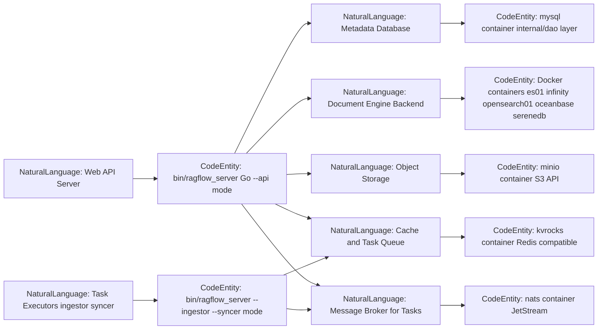

This diagram illustrates how user-friendly terms map to specific code entities, containers, and configuration files.

Sources: [docker/docker-compose-base.yml:1-221](), [docker/entrypoint.sh:1-190]()

---

### Configuration Flow from Environment to Service Behavior

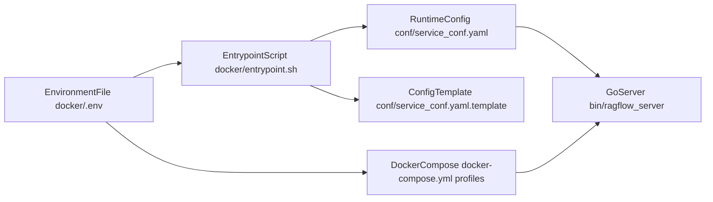

Summary:
- Environment variables in `.env` set base configuration and secrets [docker/.env:1-165]().
- Docker Compose reads `.env` to activate relevant service profiles and container parameters [docker/.env:52-54]().
- The entrypoint script renders YAML configuration from the template using environment variables [docker/entrypoint.sh:76-98]().
- The Go server reads the final `service_conf.yaml` for its runtime configuration.

Sources: [docker/.env:1-165](), [docker/entrypoint.sh:1-190]()

---

# Page: Docker Compose Deployment

# Docker Compose Deployment

<details>
<summary>Relevant source files</summary>

The following files were used as context for generating this wiki page:

- [Dockerfile](Dockerfile)
- [docker/.env](docker/.env)
- [docker/README.md](docker/README.md)
- [docker/docker-compose-base.yml](docker/docker-compose-base.yml)
- [docker/docker-compose.yml](docker/docker-compose.yml)
- [docker/entrypoint.sh](docker/entrypoint.sh)
- [docker/infinity_conf.toml](docker/infinity_conf.toml)
- [docker/launch_backend_service.sh](docker/launch_backend_service.sh)
- [pyproject.toml](pyproject.toml)
- [sdk/python/pyproject.toml](sdk/python/pyproject.toml)
- [sdk/python/uv.lock](sdk/python/uv.lock)
- [uv.lock](uv.lock)

</details>


This page provides a detailed technical guide to deploying RAGFlow using Docker Compose. It covers the service architecture, container configurations, environment variables, port mappings, and the deployment process. This guide is intended for technical operators and developers who want to self-host RAGFlow services in a containerized environment [docker/README.md:1-57]().

---

## Overview

RAGFlow’s Docker Compose deployment orchestrates multiple containerized components forming a complex application stack. The deployment consists of:

- A **main compose file** `docker-compose.yml` that manages the RAGFlow CPU/GPU application containers [docker/docker-compose.yml:1-58]().
- A **base compose file** `docker-compose-base.yml` that manages dependency services like MySQL, Elasticsearch/Infinity, MinIO, Kvrocks, NATS, and ClickHouse, as well as alternative document engines [docker/docker-compose-base.yml:1-221]().
- Use of **Docker Compose profiles** to selectively enable services based on hardware (CPU/GPU) and chosen document storage engine [docker/.env:8-53]().

This orchestrated stack delivers the full RAGFlow engine functionality including API servers, background task executors, data stores, and optional components like the Admin Server and MCP Server [docker/README.md:17-48]().

Sources:  
[docker/docker-compose.yml:1-58](),  
[docker/docker-compose-base.yml:1-221](),  
[docker/.env:8-53](),  
[docker/README.md:1-57]()

---

## Service Architecture

The RAGFlow Docker Compose deployment is designed with a clear separation between client interaction, application logic, and persistence layers. This is articulated via multiple containers communicating over Docker networks and exposed ports [docker/docker-compose-base.yml:1-221]().

### System Component Interaction Diagram

```mermaid
graph TB
    subgraph "Natural_Language_Space_Client"
        User["User / API Client"]
    end

    subgraph "Code_Entity_Space_RAGFlow_Stack"
        Nginx["nginx (web proxy)\nConfigs: /etc/nginx/nginx.conf"]
        GoServer["Go Server\n(cmd/ragflow_server.go)"]
        AdminSvr["Admin Server\n(internal/server/admin)"]
        Ingestor["Ingestor Worker\n(internal/server/ingestor)"]
        Syncer["Data Syncer\n(internal/server/syncer)"]
        DeepDoc["DeepDoc Vision Service\n(internal/server/deepdoc)"]
        SandboxExecutorManager["sandbox-executor-manager\n(Code Execution Sandbox)"]
    end
    
    subgraph "Storage_Layer_Persistence"
        MySQL["mysql (MySQL 8.0)\nDatabase: rag_flow"]
        MinIO["minio (Object Storage)\nS3 Compatible"]
        Kvrocks["kvrocks (Redis-compatible)\nCache & State"]
        NATS["nats (NATS Server)\nMessage Queue (JetStream)"]
        ClickHouse["clickhouse (Analytics DB)"]
    end

    subgraph "Document_Engines_Mutually_Exclusive_Profiles"
        ES["es01 (Elasticsearch 8.11.3)"]
        Infinity["infinity (Infinity v0.7.4)"]
        OS["opensearch01 (OpenSearch 2.19.1)"]
        OB["oceanbase (OceanBase 4.4.1)"]
        SeekDB["seekdb (SeekDB latest)"]
        SereneDB["serenedb (SereneDB 26.07.5)"]
    end
    
    User -->|"Port: SVR_WEB_HTTP_PORT"| Nginx
    Nginx -->|"Proxy to Go API server"| GoServer
    GoServer -->|"Metadata queries"| MySQL
    GoServer -->|"Object storage queries"| MinIO
    GoServer -->|"Cache & state (Kvrocks)"| Kvrocks
    GoServer -->|"Message queue (NATS JetStream)"| NATS
    GoServer -->|"Vision API calls"| DeepDoc
    GoServer -->|"Code Execution"| SandboxExecutorManager
    Ingestor -->|"Consume tasks from NATS"| NATS
    Ingestor -->|"Index and Search"| ES
    Ingestor -->|"Index and Search"| Infinity
    GoServer -->|"Query Document Engine"| ES
    GoServer -->|"Query Document Engine"| Infinity
```

**Key Points:**

- The **nginx** container proxies web and API traffic directly to the Go backend (`bin/ragflow_server --api`) [docker/entrypoint.sh:169-175]().
- The **ragflow-cpu** container hosts the Go-native server binary running multiple modes: `--api`, `--admin`, `--ingestor`, and `--syncer` [docker/docker-compose.yml:6-32](), [docker/entrypoint.sh:164-188]().
- The **DeepDoc Vision Service** runs in-process within the main container, providing functionalities including document layout analysis (DLA), OCR, and table structure recognition using ONNX Runtime [Dockerfile:32-53]().
- The **sandbox-executor-manager** provides isolated sandbox environments to safely run arbitrary user code, supporting RAGFlow’s agent workflows [docker/docker-compose-base.yml:218-221]().
- Document engines (Elasticsearch, Infinity, OpenSearch, OceanBase, SeekDB, SereneDB) are mutually exclusive profiles controlled via Docker Compose profiles, selected based on the `DOC_ENGINE` environment variable [docker/.env:27-37]().

Sources:  
[docker/docker-compose.yml:1-58](),  
[docker/docker-compose-base.yml:1-221](),  
[docker/entrypoint.sh:164-190](),  
[docker/.env:27-37](),  
[Dockerfile:32-53]()

---

## Core Service Components

### Document Storage Engines (Profile-Based)

RAGFlow supports multiple document storage backends through Docker Compose profiles and environment-driven selection. These engines store and allow complex search over documents and their vectorized chunks [docker/.env:27-37]().

| Service Name    | Docker Image                              | Profile         | Default Exposed Port              | Description                                   |
|-----------------|-----------------------------------------|-----------------|---------------------------------|-----------------------------------------------|
| `es01`          | `elasticsearch:${STACK_VERSION}`        | `elasticsearch` | `${ES_PORT}:9200` (default 1200) | Elasticsearch full-text and vector search    |
| `infinity`      | `infiniflow/infinity:v0.7.4-x64-v3`     | `infinity`      | `${INFINITY_THRIFT_PORT}:23817`  | High-performance vector database             |
| `opensearch01`  | `opensearchproject/opensearch:2.19.1`   | `opensearch`    | `${OS_PORT}:9201`                | OpenSearch alternative with Elasticsearch API |
| `oceanbase`     | `oceanbase/oceanbase-ce:4.4.1.0-...`    | `oceanbase`     | `${OCEANBASE_PORT}:2881`         | Distributed database with vector capabilities|
| `seekdb`        | `oceanbase/seekdb:latest`                | `seekdb`        | `${SEEKDB_PORT}:2881`            | Lightweight OceanBase variant for RAGFlow    |
| `serenedb`      | `serenedb/serenedb:26.07.5`             | `serenedb`      | `${SERENEDB_PORT}:7890`          | PostgreSQL-compatible vector engine           |

Profiles are enabled by the environment variable `DOC_ENGINE` and included in the `COMPOSE_PROFILES` composite setting [docker/.env:27-53]().

Sources:  
[docker/docker-compose-base.yml:2-216](),  
[docker/.env:27-53]()

---

### Persistent Data Services

RAGFlow uses several persistent data services deployed either as containers or external services [docker/docker-compose-base.yml:1-221]().

| Service | Description | Image / Version | Default Ports | Notes |
|---------|-------------|-----------------|---------------|-------|
| **MySQL** | Metadata database storing users, tenants, datasets, sync states | `mysql:8.0` | Internal: 3306, External: configurable | Database name `rag_flow` configurable, controlled via `.env` [docker/.env:38-40]() |
| **MinIO** | Object storage for raw documents, blobs | `minio/minio` | API and Console ports (`MINIO_PORT`, `MINIO_CONSOLE_PORT`) | S3-compatible API, credentials from `.env` [docker/README.md:104-114]() |
| **Kvrocks** | Redis-compatible cache and task queue server | `kvrocks:latest` | default 6379 | Used by Go backend for caching and state management [docker/docker-compose.yml:44-50]() |
| **NATS** | Message broker (JetStream) for ingestion and async task delivery | `nats:latest` | default 4222 | Used for high throughput internal messaging via NATS JetStream |
| **ClickHouse** | Analytical column-store DB | `clickhouse/clickhouse-server` | 9000, 8123 | Stores analytics and monitoring data |

Sources:  
[docker/docker-compose-base.yml:1-221](),  
[docker/README.md:104-136]()

---

## Entrypoint Script Behavior (`entrypoint.sh`)

The `entrypoint.sh` script inside the main application container manages startup logic including configuration rendering, migrations, and process launches [docker/entrypoint.sh:1-190]().

### Key Functionalities

- **Argument parsing** enabling:
  - Disabling/enabling API server (`--disable-api-server`) [docker/entrypoint.sh:41-44]().
  - Disabling ingestor workers (`--disable-ingestor`) [docker/entrypoint.sh:45-48]().
  - Disabling data sync workers (`--disable-syncer`) [docker/entrypoint.sh:49-52]().
  - Enabling the Admin server (`--enable-adminserver`) [docker/entrypoint.sh:53-56]().
  - Running model provider table migrations (`--init-model-provider-tables`) [docker/entrypoint.sh:57-60]().
  - Initializing superuser (`--init-superuser`) [docker/entrypoint.sh:61-64]().
  - Setting number of ingestors (`--ingestors=<num>`) [docker/entrypoint.sh:65-68]().

- **Config generation:**
  - Reads `service_conf.yaml.template` [docker/entrypoint.sh:75-79]().
  - Applies environment variable substitutions with default fallbacks [docker/entrypoint.sh:83-97]().
  - Writes to `service_conf.yaml` at runtime [docker/entrypoint.sh:80]().

- **Running database migrations:**
  - Runs Go-based migrations (`bin/ragflow_server --migrate`) before any server starts, unless using GaussDB [docker/entrypoint.sh:107-118]().

- **Service startup & supervisor loop:**
  - Starts Go backend services (`--syncer`, `--admin`, `--api`, `--ingestor`) conditionally with restart loops (`run_with_restart`) [docker/entrypoint.sh:135-188]().

Sources:  
[docker/entrypoint.sh:1-190]()

---

## Ports and Network Mappings

RAGFlow Docker Compose exposes several ports which are configurable in `.env` and mapped to container services as follows [docker/.env:1-165]():

| Environment Variable       | Default | Description                                      | Container Service           |
|----------------------------|---------|------------------------------------------------|-----------------------------|
| `SVR_WEB_HTTP_PORT`         | 80      | Public HTTP web interface and API               | nginx (web proxy)            |
| `SVR_WEB_HTTPS_PORT`        | 443     | Public HTTPS web interface and API              | nginx                       |
| `SVR_HTTP_PORT`             | 9380    | Go API server port                              | ragflow-cpu (Go backend)    |
| `ADMIN_SVR_HTTP_PORT`       | 9381    | Admin server API port                           | ragflow-cpu (Go Admin)      |
| `MINIO_PORT`                | 9000    | MinIO S3 API port                               | minio                       |
| `MINIO_CONSOLE_PORT`        | 9001    | MinIO web console                               | minio                       |
| `ES_PORT`                   | 1200    | Elasticsearch HTTP API port                      | Elasticsearch               |
| `OS_PORT`                   | 1201    | OpenSearch HTTP API port                         | OpenSearch                  |
| `INFINITY_THRIFT_PORT`      | 23817   | Infinity vector DB thrift port                   | infinity                    |
| `INFINITY_HTTP_PORT`        | 23820   | Infinity HTTP API port                           | infinity                    |
| `OCEANBASE_PORT`            | 2881    | OceanBase SQL port                              | oceanbase                   |
| `SEEKDB_PORT`               | 2881    | SeekDB port                                     | seekdb                      |
| `SERENEDB_PORT`             | 7890    | SereneDB port                                   | serenedb                    |
| `KVROCKS_PORT`              | 6379    | Kvrocks Redis-compatible port                   | kvrocks                     |

All ports are environment-driven to allow flexible deployment scenarios and avoid port conflicts. Internally containers connect via Docker networks with hostnames, e.g., `mysql`, `kvrocks`, `nats`, `es01` etc [docker/docker-compose-base.yml:1-221]().

Sources:  
[docker/.env:1-165](),  
[docker/docker-compose-base.yml:1-221](),  
[docker/docker-compose.yml:1-58]()

---

## Docker Compose Profiles and Environment Control

RAGFlow uses Docker Compose **profiles** to modularize component startup based on [docker/.env:27-53]():

- Document engine (`elasticsearch`, `infinity`, `opensearch`, `oceanbase`, `seekdb`, `serenedb`)
- Hardware profile (`cpu`, `gpu`)
- Metadata database profile (`metadata-mysql`, `metadata-gaussdb`, etc.)

The `.env` file sets the combined profile list using `COMPOSE_PROFILES`, for example [docker/.env:53]():

```bash
COMPOSE_PROFILES=${DOC_ENGINE},${DEVICE},metadata-${METADATA_DB_PROFILE}
```

Changing `DOC_ENGINE` in `.env` activates the associated document engine profile, enabling the corresponding container and configuration [docker/.env:27-37]().

Sources:  
[docker/.env:27-53](),  
[docker/docker-compose-base.yml:1-221]()

---

## Volumes and Data Persistence

The deployment defines a set of persistent volumes and bind mounts to preserve data and configuration over container restarts and upgrades [docker/docker-compose.yml:33-40]().

| Volume / Bind Mount             | Purpose                      | Container Path                          |
|-------------------------------|------------------------------|---------------------------------------|
| `./ragflow-logs`               | Application log files         | `/ragflow/logs`                       |
| `./service_conf.yaml.template` | Config template               | `/ragflow/conf/service_conf.yaml.template` |
| `./entrypoint.sh`              | Container startup script      | `/ragflow/entrypoint.sh`              |
| `esdata01`                    | Elasticsearch data volume     | `/usr/share/elasticsearch/data`      |
| `infinity_data`               | Infinity vector DB storage    | `/var/infinity`                       |
| `serenedb_data`               | SereneDB data volume          | `/var/lib/serenedb`                   |

Sources:  
[docker/docker-compose.yml:33-40](),  
[docker/docker-compose-base.yml:1-221]()

---

## Summary: Natural Language to Code Entity Mapping

The following diagram associates high-level system components mentioned in natural language with their corresponding key Go code entities, scripts, or Docker components.

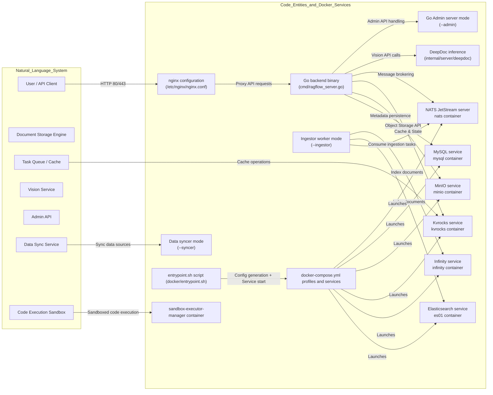

Sources:  
[docker/docker-compose.yml:1-58](),  
[docker/entrypoint.sh:1-190](),  
[docker/docker-compose-base.yml:1-221](),  
[Dockerfile:32-53](),  
[cmd/ragflow_server.go:1-192]()

---

# Page: Configuration Management

# Configuration Management

<details>
<summary>Relevant source files</summary>

The following files were used as context for generating this wiki page:

- [cmd/args_flag_test.go](cmd/args_flag_test.go)
- [cmd/deepdoc_server_ee.go](cmd/deepdoc_server_ee.go)
- [cmd/ragflow_server.go](cmd/ragflow_server.go)
- [cmd/ragflow_server_deepdoc_test.go](cmd/ragflow_server_deepdoc_test.go)
- [cmd/ragflow_server_test.go](cmd/ragflow_server_test.go)
- [conf/service_conf.yaml](conf/service_conf.yaml)
- [docker/service_conf.yaml.template](docker/service_conf.yaml.template)
- [docs/administrator/setup/configuration.md](docs/administrator/setup/configuration.md)
- [docs/develop/mcp/connect_an_external_mcp_to_ragflow.md](docs/develop/mcp/connect_an_external_mcp_to_ragflow.md)
- [internal/common/allow_private_host.go](internal/common/allow_private_host.go)
- [internal/common/environments.go](internal/common/environments.go)
- [internal/common/http.go](internal/common/http.go)
- [internal/common/http_test.go](internal/common/http_test.go)
- [internal/dao/tenant_model_group_ee.go](internal/dao/tenant_model_group_ee.go)
- [internal/handler/auth.go](internal/handler/auth.go)
- [internal/handler/providers_ee.go](internal/handler/providers_ee.go)
- [internal/handler/system.go](internal/handler/system.go)
- [internal/handler/user.go](internal/handler/user.go)
- [internal/ingestion/component/vision_source_admission_test.go](internal/ingestion/component/vision_source_admission_test.go)
- [internal/ingestion/service/execute_memory_task_panic_test.go](internal/ingestion/service/execute_memory_task_panic_test.go)
- [internal/mcp/client/mcp_call.go](internal/mcp/client/mcp_call.go)
- [internal/mcp/client/mcp_client.go](internal/mcp/client/mcp_client.go)
- [internal/mcp/client/mcp_ssrf.go](internal/mcp/client/mcp_ssrf.go)
- [internal/server/api/server.go](internal/server/api/server.go)
- [internal/server/bootstrap/args.go](internal/server/bootstrap/args.go)
- [internal/server/bootstrap/runtime.go](internal/server/bootstrap/runtime.go)
- [internal/server/config.go](internal/server/config.go)
- [internal/server/config/admin_config.go](internal/server/config/admin_config.go)
- [internal/server/config/api_server_config.go](internal/server/config/api_server_config.go)
- [internal/server/config/api_server_config_test.go](internal/server/config/api_server_config_test.go)
- [internal/server/config/base.go](internal/server/config/base.go)
- [internal/server/config/environments.go](internal/server/config/environments.go)
- [internal/server/config/general_config.go](internal/server/config/general_config.go)
- [internal/server/config/ingestor_config.go](internal/server/config/ingestor_config.go)
- [internal/server/config/ingestor_config_test.go](internal/server/config/ingestor_config_test.go)
- [internal/server/config/log_config.go](internal/server/config/log_config.go)
- [internal/server/config/mcp_config_test.go](internal/server/config/mcp_config_test.go)
- [internal/server/config/storage_engine_config.go](internal/server/config/storage_engine_config.go)
- [internal/server/config/storage_environment_test.go](internal/server/config/storage_environment_test.go)
- [internal/server/config_getallconfigs_test.go](internal/server/config_getallconfigs_test.go)
- [internal/server/deepdoc/server.go](internal/server/deepdoc/server.go)
- [internal/server/ingestor/server.go](internal/server/ingestor/server.go)
- [internal/server/local/admin_status.go](internal/server/local/admin_status.go)
- [internal/server/local/admin_status_ee.go](internal/server/local/admin_status_ee.go)
- [internal/server/syncer/server.go](internal/server/syncer/server.go)
- [internal/service/system.go](internal/service/system.go)
- [internal/service/user.go](internal/service/user.go)

</details>


## Purpose and Scope

This page details RAGFlow's configuration system, describing how environment variables, templated YAML service configurations (`service_conf.yaml.template`), and runtime command-line flags interact. It covers Viper-based parsing in `internal/server/config`, environment variable resolution, and strict precedence rules governing CLI flags, environment variables, and configuration files.

Sources: [docker/service_conf.yaml.template:1-184](), [internal/server/config.go:39-160](), [cmd/ragflow_server.go:102-188]()

---

## Configuration Architecture and Processing Flow

RAGFlow employs a tiered configuration model designed to separate build-time templates, deployment secrets, and runtime overrides. 

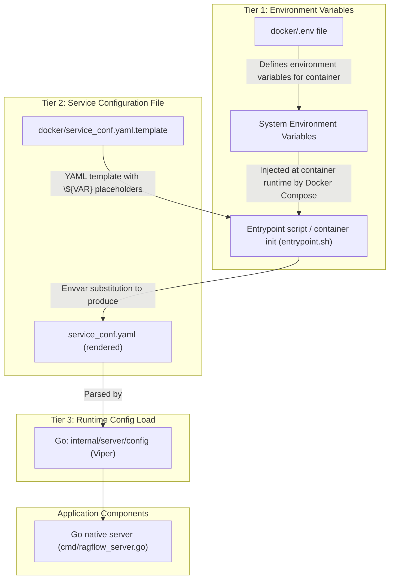

- **Tier 1:** Environment variables are defined in container environments or configuration files like `docker/.env`.
- **Tier 2:** The template `docker/service_conf.yaml.template` contains environment variable placeholders (e.g., `${MYSQL_DBNAME:-rag_flow}`) which are substituted to generate `service_conf.yaml`.
- **Tier 3:** The Go server initializes configuration using the `viper` library via initialization routines in `internal/server/config.go`, reading the YAML file and overlaying environment overrides prefixed with `RAGFLOW` [internal/server/config.go:39-68]().

Sources: [conf/service_conf.yaml:1-201](), [docker/service_conf.yaml.template:1-184](), [internal/server/config.go:39-68](), [cmd/ragflow_server.go:19-49]()

---

## Service Configuration File Schema

The concrete runtime configuration file (`conf/service_conf.yaml`) structures parameters into functional subsections parsed by specific loader functions in `internal/server/config` [conf/service_conf.yaml:1-201](), [internal/server/config.go:73-160]().

### Main Configuration Subsections

| Section Key     | Corresponding Go Parser Function        | Description                                       |
|-----------------|-----------------------------------------|---------------------------------------------------|
| `general`       | `ParseGeneralConfig`                    | Global settings like `heartbeat_interval`         |
| `api`           | `ParseAPIServerConfig`                  | API server network bindings and trusted proxies   |
| `admin`         | `ParseAdminConfig`                      | Admin server HTTP host and port bindings          |
| `mysql`         | `ParseDatabaseConfig`                   | Relational metadata database connection settings  |
| `minio`         | `ParseStorageEngineConfig`              | Object storage configuration and credentials      |
| `es` / `os`     | `ParseDocEngineConfig`                  | Document search engine endpoints and authentication|
| `kvrocks`       | `ParseCacheEngineConfig`                | Redis/Kvrocks caching cluster parameters          |
| `nats`          | `ParseQueueEngineConfig`                | NATS message queue broker coordinates             |
| `clickhouse`    | `ParseAnalyticEngineConfig`             | ClickHouse analytics storage configuration        |
| `ingestor`      | `ParseIngestorConfig`                   | Worker count, page parallelism, ONNX concurrency  |

Sources: [conf/service_conf.yaml:1-201](), [internal/server/config.go:73-160]()

---

## Viper Parsing and Runtime Resolution

The configuration parsing engine is implemented in `internal/server/config.go` and its sub-packages. When configuration initialization executes:

1. A new `viper.Viper` instance is instantiated [internal/server/config.go:39-50]().
2. The config file path is resolved explicitly via `configPath` or falls back to searching default search paths for `service_conf.yaml` [internal/server/config.go:45-54]().
3. Environment variables are automatically enabled with the `RAGFLOW` prefix and dot-to-underscore key replacement [internal/server/config.go:56-59]().
4. Subsections are parsed into strongly-typed structures using dedicated handlers.

### Concurrency and Port Resolution

Specialized getters handle hierarchical validation and bounds checking, merging config-file values with explicit command-line pointers (`*int` or `*string`) [cmd/ragflow_server.go:102-188]().

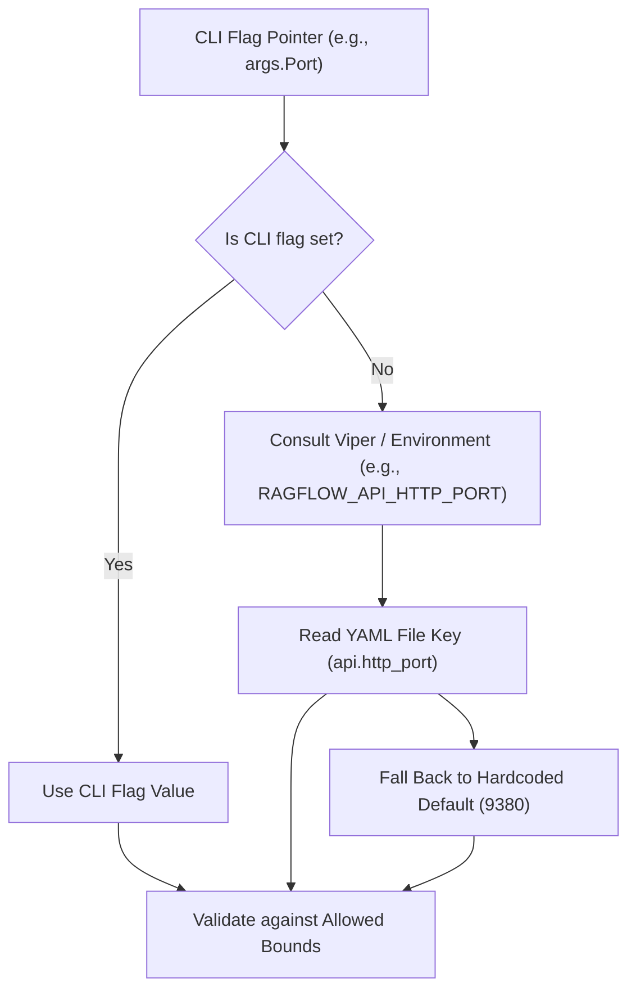

Sources: [internal/server/config.go:39-160](), [cmd/ragflow_server.go:102-188]()

---

## Configuration Precedence

RAGFlow enforces a strict 4-tier precedence hierarchy across configuration inputs, ensuring that operator overrides at runtime take immediate effect without modifying files:

| Precedence Order | Source Tier | Description & Code Handler |
|------------------|-------------|----------------------------|
| **1 (Highest)**  | **CLI Flags** | Parsed in `cmd/ragflow_server.go` via `parseArgsFrom` (e.g., `--port`, `--log-level`, `--deepdoc-inference-concurrency`) [cmd/ragflow_server.go:102-188]() |
| **2**            | **Environment Variables** | Automatically parsed via Viper `AutomaticEnv` with `RAGFLOW_` prefix or checked via `os.Getenv` [internal/server/config.go:56-59]() |
| **3**            | **Configuration File** | Rendered YAML values from `service_conf.yaml` parsed via sub-config functions [internal/server/config.go:73-160]() |
| **4 (Lowest)**   | **Hardcoded Defaults** | Built-in defaults defined in config initializers |

Sources: [cmd/ragflow_server.go:102-188](), [internal/server/config.go:39-160]()

---

## Natural Language Space to Code Entity Mapping

The following diagrams bridge natural language configuration concepts to their concrete representations in the codebase.

### Diagram 1: Infrastructure and Storage Bindings

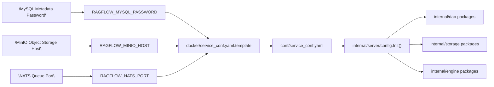

Sources: [docker/service_conf.yaml.template:30-112](), [internal/server/config.go:39-108]()

### Diagram 2: Runtime Execution and Concurrency Parameters

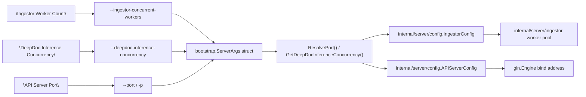

Sources: [cmd/ragflow_server.go:102-188](), [internal/server/config.go:73-160]()

---

# Page: Document Engine Selection

# Document Engine Selection

<details>
<summary>Relevant source files</summary>

The following files were used as context for generating this wiki page:

- [conf/infinity_mapping.json](conf/infinity_mapping.json)
- [internal/cli/table.go](internal/cli/table.go)
- [internal/engine/elasticsearch/client.go](internal/engine/elasticsearch/client.go)
- [internal/engine/elasticsearch/metadata.go](internal/engine/elasticsearch/metadata.go)
- [internal/engine/global.go](internal/engine/global.go)
- [internal/engine/infinity/chunk.go](internal/engine/infinity/chunk.go)
- [internal/engine/infinity/chunk_transform_test.go](internal/engine/infinity/chunk_transform_test.go)
- [internal/engine/infinity/client.go](internal/engine/infinity/client.go)
- [internal/engine/infinity/client_test.go](internal/engine/infinity/client_test.go)
- [internal/engine/infinity/common.go](internal/engine/infinity/common.go)
- [internal/engine/infinity/document.go](internal/engine/infinity/document.go)
- [internal/engine/infinity/integration_test.go](internal/engine/infinity/integration_test.go)
- [internal/engine/infinity/metadata.go](internal/engine/infinity/metadata.go)
- [internal/engine/infinity/sql.go](internal/engine/infinity/sql.go)
- [internal/engine/infinity/sql_test.go](internal/engine/infinity/sql_test.go)
- [internal/ingestion/knowledge_compile/wiki_contribution.go](internal/ingestion/knowledge_compile/wiki_contribution.go)
- [internal/ingestion/knowledge_compile/wiki_map_store.go](internal/ingestion/knowledge_compile/wiki_map_store.go)
- [internal/ingestion/knowledge_compile/wiki_map_store_test.go](internal/ingestion/knowledge_compile/wiki_map_store_test.go)
- [internal/ingestion/service/ingestor_lifecycle_test.go](internal/ingestion/service/ingestor_lifecycle_test.go)
- [internal/service/document/document_metadata.go](internal/service/document/document_metadata.go)
- [internal/service/document/document_metadata_test.go](internal/service/document/document_metadata_test.go)
- [internal/utility/path.go](internal/utility/path.go)

</details>


This page provides a technical guide for choosing, configuring, and understanding the document engines supported by RAGFlow's Go-native backend. Document engines form the backbone of RAGFlow's retrieval subsystem, providing hybrid search (full-text lexicals combined with vector similarity) and robust metadata filtering.

## Overview and Engine Abstraction

RAGFlow abstracts document storage behind the `DocEngine` interface defined across engine packages [internal/engine/global.go:37-80](), allowing the system to plug in different search backends. The choice of document engine affects search latency, index mapping structures, bulk ingestion throughput, and operational complexity. Selection is controlled via configuration settings and environment variables parsed in `internal/server/config` [internal/engine/global.go:49-50]().

The following diagram bridges the natural language concepts of document engines to their concrete Go code entities and package implementations:

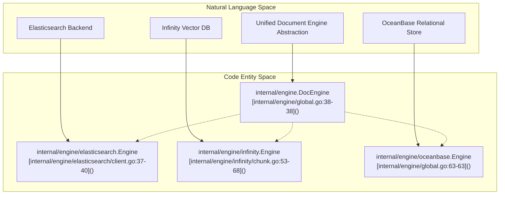

Sources: [internal/engine/global.go:37-80](), [internal/engine/elasticsearch/client.go:37-40](), [internal/engine/infinity/chunk.go:53-68]()

---

## Supported Document Engines and Tradeoffs

| Engine | Key Use Cases | Main Implementation / Package |
| :--- | :--- | :--- |
| **Elasticsearch** | Mature, robust full-text and vector search, extensive ecosystem | `internal/engine/elasticsearch.Engine` [internal/engine/elasticsearch/client.go:37-40]() |
| **Infinity** | High-performance vector search, low-latency table scans | `internal/engine/infinity.Engine` [internal/engine/infinity/chunk.go:53-68]() |
| **OpenSearch** | AWS-compatible fork of Elasticsearch with hybrid pipelines | `internal/engine/opensearch` |
| **OceanBase** | Distributed SQL relational store with native vector extensions | `internal/engine/oceanbase` [internal/engine/global.go:58-64]() |
| **SereneDB** | Planned high-performance analytical storage variant | `internal/engine/serenedb` [internal/engine/global.go:65-66]() |

Sources: [internal/engine/global.go:37-80](), [internal/engine/elasticsearch/client.go:37-40](), [internal/engine/infinity/chunk.go:53-68]()

### 1. Elasticsearch
Elasticsearch manages indexes and templates via `internal/engine/elasticsearch/client.go`. It handles bulk chunk writes, schema mapping, and index template creation [internal/engine/elasticsearch/client.go:83-91]().
- **Index Templates:** Automatically applies `ragflow_mapping` for chunk indices (`ragflow_*`) and `ragflow_doc_meta_mapping` for metadata indices (`ragflow_doc_meta_*`) [internal/engine/elasticsearch/client.go:83-91]().
- **Hybrid & KNN Search:** Combines lexical query string match expressions with dense vector KNN clauses (`knn`), accepting runtime configurations [internal/engine/elasticsearch/client.go:37-94]().

Sources: [internal/engine/elasticsearch/client.go:37-94](), [internal/engine/elasticsearch/metadata.go:39-87]()

### 2. Infinity
Infinity manages columnar table data and vector indexes via `internal/engine/infinity/chunk.go` and connection pools managed in `internal/engine/infinity/client.go`.
- **Schema Management:** Automatically reconciles missing columns, such as dynamically adding vector dimensions (`q_<dim>_vec`) or table-parser payload columns (`chunk_data`) when embedding models change [internal/engine/infinity/chunk.go:133-173]().
- **Connection Pooling:** Uses `infinity.ConnectionPool` bounded by max open (`resolvePoolMaxSize`) and idle parameters (`resolvePoolMaxIdle`) [internal/engine/infinity/client.go:85-117]().

Sources: [internal/engine/infinity/chunk.go:53-192](), [internal/engine/infinity/client.go:85-209]()

---

## Index Mappings and Schema Definitions

Document engines rely on precise field mappings to index unstructured chunks alongside structured metadata. Infinity schemas are defined in JSON mapping files such as `conf/infinity_mapping.json` [conf/infinity_mapping.json:1-97]().

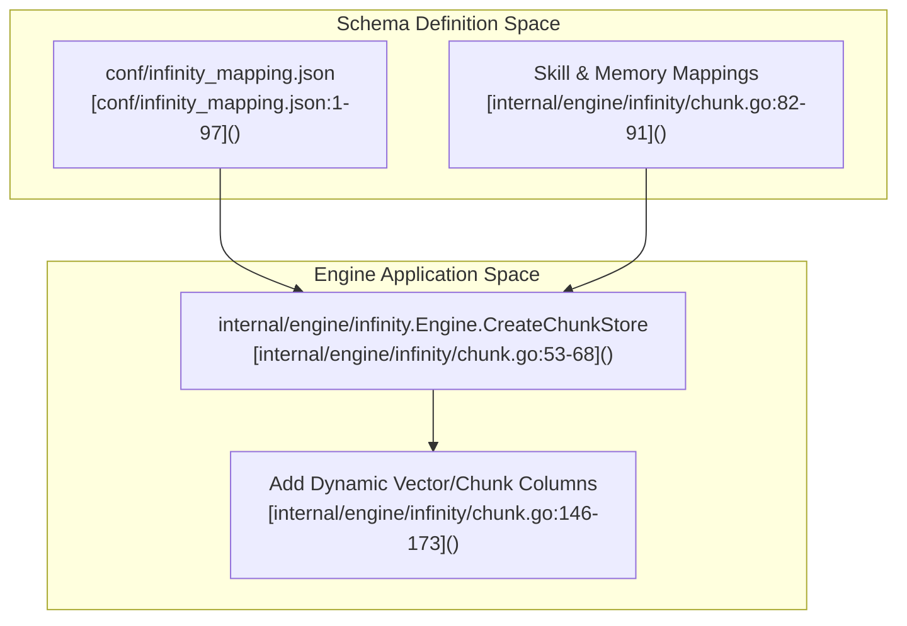

Sources: [conf/infinity_mapping.json:1-97](), [internal/engine/infinity/chunk.go:53-192]()

Key mapped fields include:
- `id`, `doc_id`, `kb_id`: Identifiers for chunks, documents, and knowledge bases [conf/infinity_mapping.json:2-4]().
- `content`: Analyzed text field with multiple analyzers like `rag-coarse`, `rag-fine`, and `sparsegram-3-12-fold` [conf/infinity_mapping.json:17]().
- `q_<dim>_vec`: Dynamic dense float vector columns representing embedding outputs [internal/engine/infinity/chunk.go:124-124]().
- `tag_feas`: Rank features used for numeric scoring boosts [conf/infinity_mapping.json:32]().

Sources: [conf/infinity_mapping.json:1-97](), [internal/engine/infinity/chunk.go:124-124]()

---

## Physical Storage and Metadata Tables

Beyond indexing chunks in document engines, RAGFlow stores document metadata and binary files. Metadata stores are created per tenant using `CreateMetadataStore` in Infinity and Elasticsearch [internal/engine/infinity/metadata.go:39-47](), [internal/engine/elasticsearch/metadata.go:39-40]().
- Infinity tenant metadata tables use secondary indexes on `id`, `kb_id`, and `meta_fields` [internal/engine/infinity/metadata.go:101-133]().
- Elasticsearch uses dedicated document metadata indices (`ragflow_doc_meta_*`) [internal/engine/elasticsearch/client.go:88-91]().

Sources: [internal/engine/infinity/metadata.go:39-135](), [internal/engine/elasticsearch/metadata.go:39-87]()

---

## Search and Ingestion Execution Data Flow

The following sequence diagram details the interaction during chunk writing and retrieval between services and the underlying document engine implementation:

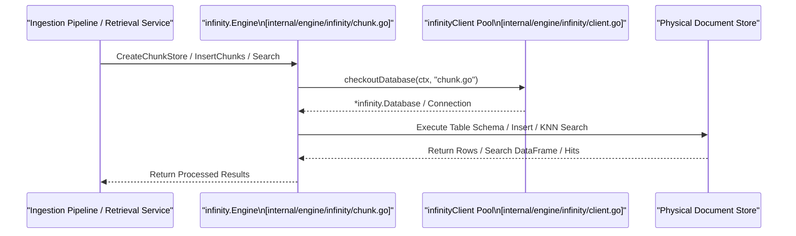

Sources: [internal/engine/infinity/chunk.go:53-68](), [internal/engine/infinity/client.go:41-63]()

---

## Summary

Choosing the correct document engine balances vector performance, full-text lexical search requirements, and operational infrastructure maturity:
- **Elasticsearch:** Recommended for general-purpose setups requiring proven stability and rich template management [internal/engine/elasticsearch/client.go:37-94]().
- **Infinity:** Ideal for high-throughput vector embedding workloads with strict latency bounds and columnar scaling [internal/engine/infinity/chunk.go:53-192]().
- **OceanBase / OpenSearch:** Suited for specialized distributed SQL or cloud-native AWS deployments [internal/engine/global.go:58-64]().

Sources: [internal/engine/global.go:37-80](), [internal/engine/elasticsearch/client.go:37-94](), [internal/engine/infinity/chunk.go:53-192]()

---

# Page: Build System and CI/CD

# Build System and CI/CD

<details>
<summary>Relevant source files</summary>

The following files were used as context for generating this wiki page:

- [.github/workflows/release.yml](.github/workflows/release.yml)
- [.github/workflows/sep-tests.yml](.github/workflows/sep-tests.yml)
- [.gitignore](.gitignore)
- [Dockerfile_base](Dockerfile_base)
- [Dockerfile_ci](Dockerfile_ci)
- [build.sh](build.sh)
- [cmd/ragflow-cli.go](cmd/ragflow-cli.go)
- [deps/Dockerfile](deps/Dockerfile)
- [deps/download_deps.py](deps/download_deps.py)
- [docker/nginx/ragflow.conf](docker/nginx/ragflow.conf)
- [go.mod](go.mod)
- [go.sum](go.sum)
- [internal/agent/component/runtime_wire.go](internal/agent/component/runtime_wire.go)
- [internal/cli/README.md](internal/cli/README.md)
- [internal/common/trusted_proxies.go](internal/common/trusted_proxies.go)
- [internal/development.md](internal/development.md)
- [tools/scripts/INSTALL_SCRIPTS_README.md](tools/scripts/INSTALL_SCRIPTS_README.md)
- [tools/scripts/convert_deepdoc_model.py](tools/scripts/convert_deepdoc_model.py)
- [tools/scripts/download_dev_deps.py](tools/scripts/download_dev_deps.py)
- [tools/scripts/install.ps1](tools/scripts/install.ps1)
- [tools/scripts/install.sh](tools/scripts/install.sh)
- [tools/scripts/test_download_dev_deps.py](tools/scripts/test_download_dev_deps.py)

</details>


## Purpose and Scope

This page documents the build system, package management, native library compilation, containerization, and CI/CD pipelines for RAGFlow. It covers how Go binaries (`bin/ragflow_server` and `bin/ragflow-cli`), C++ native components (`internal/binding/cpp`), Python runtime environments, and prebuilt dependency images (`ragflow_deps`) are constructed, tested, and released `[build.sh:1-158]`, `[.github/workflows/release.yml:1-193]`, `[.github/workflows/sep-tests.yml:1-140]()`.

Sources: `[build.sh:1-158]`, `[.github/workflows/release.yml:1-193]`, `[.github/workflows/sep-tests.yml:1-140]()`

---

## Package Management with `uv`

RAGFlow uses `uv` as a high-performance installer to manage Python dependencies declaratively via `pyproject.toml` and `uv.lock`.

- Python-based runtime components, document parsers, and LLM providers target Python environments `[pyproject.toml:1-158]`, `[uv.lock:1-63]()`.
- The Docker build process utilizes `uv sync --python 3.13` to rapidly install locked dependencies using cached network layers `[Dockerfile_ci:19-38]()`.

Sources: `[pyproject.toml:1-158]`, `[uv.lock:1-63]`, `[Dockerfile_ci:19-38]()`

---

## Multi-Stage Docker Build

RAGFlow’s container build pipeline uses multi-stage builds defined in `Dockerfile_base` and `Dockerfile_ci` to separate build toolchains from runtime execution environments, minimizing final image footprint and leveraging pre-seeded asset caches.

### Build Stages and Code Entity Mapping

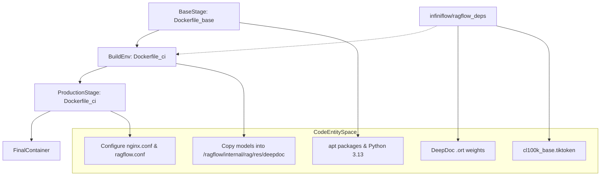
*Diagram 1: Multi-stage Docker build pipeline data flow mapping to container build files.*

Sources: `[Dockerfile_base:1-175]`, `[Dockerfile_ci:1-115]`, `[tools/scripts/download_dev_deps.py:1-149]()`

---

## Native Component Compilation (`build.sh`)

The `build.sh` script orchestrates native library checks, C++ tokenizer compilation, and Go binary linking `[build.sh:1-158]`, `[internal/development.md:1-126]()`.

### Build Script Architecture and Execution Flow

```mermaid
graph TD
  Start["build.sh"] --> DetectPlatform["detect_target_platform()"]
  DetectPlatform --> CheckCache["_seed_from_system() /opt/ragflow-native-libs"]
  CheckCache -->|Missing| PromptDownload["download_dev_deps.py"]
  CheckCache -->|Found| AssetMap["office_oxide_asset() & pdfium_asset()"]
  AssetMap --> CompileCPP["CMake Build internal/binding/cpp"]
  CompileCPP --> LinkGo["go build bin/ragflow_server bin/ragflow-cli"]
  LinkGo --> VerifyBPE["Verify cl100k_base.tiktoken presence"]
```
*Diagram 2: Code entity execution flow within `build.sh` and `download_dev_deps.py`.*

- **Native Dependencies Cache Checking**: Looks for static libraries in `/opt/ragflow-native-libs` and `~/ragflow-native-libs` via `_seed_from_system()` `[build.sh:28-56]`.
- **Target Platform Resolution**: `detect_target_platform()` identifies target OS and architecture, mapping them via helper functions like `office_oxide_asset()` and `pdfium_asset()` `[build.sh:63-122]()`.
- **C++ Tokenizer Compilation**: Compiles `internal/binding/cpp` using CMake and Clang with static PCRE2 linkage `[build.sh:20-24]`, `[internal/development.md:19-26]()`.
- **Go Binary Build**: Builds `bin/ragflow_server` and `bin/ragflow-cli` with version injection and static ONNX Runtime linkage `[build.sh:22-23]`, `[internal/development.md:86-126]()`.

Sources: `[build.sh:1-158]`, `[internal/development.md:1-126]()`

---

## Go Module Layout and CGO / ONNX Runtime Linkage

- The root `go.mod` manages Go dependencies, including `github.com/infiniflow/onnxruntime_go` `[go.mod:1-98]()`.
- CGO is disabled (`CGO_ENABLED=0`) for general CLI builds `[.github/workflows/release.yml:154-161]`, but the in-process DeepDoc backend links static ONNX Runtime archives (`libonnxruntime.a`) via custom link flags and resolves `OrtGetApiBase` dynamically via `dlopen(NULL)` `[build.sh:55-61]`, `[internal/development.md:86-126]()`.
- Native archives like `liboffice_oxide.a`, `libpdfium.a`, and `libpdf_oxide.a` are statically linked `[build.sh:33-54]()`.

Sources: `[go.mod:1-98]`, `[build.sh:28-61]`, `[internal/development.md:86-126]`, `[.github/workflows/release.yml:154-161]()`

---

## Dedicated `ragflow_deps` Docker Image

The `ragflow_deps` image pre-fetches models, tokenizer dictionaries, and runtime assets to keep production builds lean and offline-capable:
- DeepDoc ONNX `.ort` detection, layout, and OCR weights `[Dockerfile_base:12-18]()`.
- Tokenizer JSON assets for embedding models `[Dockerfile_base:33-46]()`.
- Apache Tika server JAR and NLTK data `[Dockerfile_base:20-25]()`.

Sources: `[Dockerfile_base:1-46]`, `[tools/scripts/download_dev_deps.py:1-149]()`

---

## CI/CD Pipelines (GitHub Actions)

RAGFlow utilizes GitHub Actions for automated preflight checks, testing, and multi-platform release publishing.

### CI/CD Workflow Execution

```mermaid
graph TD
  Trigger["Push / PR / Schedule"] --> Preflight[".github/workflows/sep-tests.yml ragflow_preflight"]
  Preflight --> Detect["Detect code changes & workspace hash"]
  Preflight --> TestRunner["Run Go & Python unit/integration tests"]
  
  TriggerTag["Push tag v*.*.* or nightly"] --> ReleasePrep[".github/workflows/release.yml prepare"]
  ReleasePrep --> BuildCLI["Build multi-platform ragflow-cli binaries"]
  BuildCLI --> Publish["Publish GitHub Release artifacts"]
```
*Diagram 3: Code entity flow for GitHub Actions workflows (`sep-tests.yml` and `release.yml`).*

- `.github/workflows/sep-tests.yml`: Handles concurrency control, change detection, and parallel test execution across backends `[.github/workflows/sep-tests.yml:1-140]()`.
- `.github/workflows/release.yml`: Cross-compiles `ragflow-cli` for Linux, macOS, and Windows across `amd64` and `arm64` architectures, injecting version and commit linker flags `[.github/workflows/release.yml:82-193]()`.

Sources: `[.github/workflows/sep-tests.yml:1-140]`, `[.github/workflows/release.yml:1-193]()`

---

## Installation Scripts (`tools/scripts`)

- `tools/scripts/install.sh`: Bash installer for Linux and macOS that configures `uv`, verifies checksums, and installs `ragflow-cli`.
- `tools/scripts/install.ps1`: PowerShell counterpart for Windows environments.
- `tools/scripts/INSTALL_SCRIPTS_README.md`: User documentation explaining environment variables and installation paths.

Sources: `[tools/scripts/download_dev_deps.py:1-149]()`

---

# Page: System Architecture

# System Architecture

<details>
<summary>Relevant source files</summary>

The following files were used as context for generating this wiki page:

- [cmd/args_flag_test.go](cmd/args_flag_test.go)
- [cmd/deepdoc_server_ee.go](cmd/deepdoc_server_ee.go)
- [cmd/ragflow_server.go](cmd/ragflow_server.go)
- [cmd/ragflow_server_deepdoc_test.go](cmd/ragflow_server_deepdoc_test.go)
- [cmd/ragflow_server_test.go](cmd/ragflow_server_test.go)
- [conf/service_conf.yaml](conf/service_conf.yaml)
- [docker/service_conf.yaml.template](docker/service_conf.yaml.template)
- [internal/dao/tenant_model_group_ee.go](internal/dao/tenant_model_group_ee.go)
- [internal/handler/auth.go](internal/handler/auth.go)
- [internal/handler/providers_ee.go](internal/handler/providers_ee.go)
- [internal/handler/system.go](internal/handler/system.go)
- [internal/handler/user.go](internal/handler/user.go)
- [internal/ingestion/component/vision_source_admission_test.go](internal/ingestion/component/vision_source_admission_test.go)
- [internal/ingestion/service/execute_memory_task_panic_test.go](internal/ingestion/service/execute_memory_task_panic_test.go)
- [internal/server/api/server.go](internal/server/api/server.go)
- [internal/server/bootstrap/args.go](internal/server/bootstrap/args.go)
- [internal/server/bootstrap/runtime.go](internal/server/bootstrap/runtime.go)
- [internal/server/config.go](internal/server/config.go)
- [internal/server/config/admin_config.go](internal/server/config/admin_config.go)
- [internal/server/config/api_server_config.go](internal/server/config/api_server_config.go)
- [internal/server/config/api_server_config_test.go](internal/server/config/api_server_config_test.go)
- [internal/server/config/ingestor_config.go](internal/server/config/ingestor_config.go)
- [internal/server/config/ingestor_config_test.go](internal/server/config/ingestor_config_test.go)
- [internal/server/config/log_config.go](internal/server/config/log_config.go)
- [internal/server/config_getallconfigs_test.go](internal/server/config_getallconfigs_test.go)
- [internal/server/deepdoc/server.go](internal/server/deepdoc/server.go)
- [internal/server/ingestor/server.go](internal/server/ingestor/server.go)
- [internal/server/local/admin_status.go](internal/server/local/admin_status.go)
- [internal/server/local/admin_status_ee.go](internal/server/local/admin_status_ee.go)
- [internal/server/syncer/server.go](internal/server/syncer/server.go)
- [internal/service/system.go](internal/service/system.go)
- [internal/service/user.go](internal/service/user.go)

</details>


## Purpose and Scope

This document provides a high-level overview of RAGFlow’s backend architecture and internal design patterns. It focuses on the backend’s core structural components, highlighting the interactions among the API servers, service layers, task execution infrastructure, storage subsystems, the harness agent framework, and native integrations. Each subsection introduces a major subsystem and links to dedicated child pages that cover detailed implementation specifics and configuration.

For detailed information, refer to the following child pages:  
- [Go Server Modes and Bootstrap](#3.1) — Command-line modes and startup logic in `cmd/ragflow_server.go`  
- [Data Storage Architecture](#3.2) — Multi-storage backend including metadata, document engines, object stores, caches, and analytics  
- [Task Queue and Asynchronous Execution](#3.3) — Task lifecycle management using NATS JetStream, worker concurrency, and progress tracking  
- [Harness Agent Framework](#3.4) — Graph-based agent execution engine, middleware, and event replay system  
- [Native Components and CGO Bindings](#3.5) — Native tokenizer library, ONNX Runtime integration, PDF native parsing, and CGO fallback handling  

---

## High-Level Backend Architecture Overview

RAGFlow’s backend is primarily implemented in Go, structured around a single multi-mode binary `ragflow_server` that can run in various roles: API server, admin server, ingestion worker, syncer, deep document processing engine, and migration tool [cmd/ragflow_server.go:51-60](). This multi-mode setup consolidates core processing logic, facilitating both synchronous request handling and asynchronous task execution [cmd/ragflow_server.go:102-148]().

Title: Backend Server Modes and Storage Topology
```mermaid
graph TB
    subgraph "ServerBinary"
        API["API Mode --api"]
        Admin["Admin Mode --admin"]
        Ingestor["Ingestor Mode --ingestor"]
        Syncer["Syncer Mode --syncer"]
        DeepDoc["DeepDoc Mode --deepdoc"]
        Migrate["Migrate Mode --migrate"]
    end

    API --> GinRouter["Gin HTTP Router"]
    Admin --> AdminRouter["Admin Router"]

    GinRouter --> Handlers["API Handlers"]
    AdminRouter --> AdminHandlers["Admin Handlers"]

    Ingestor --> TaskProcessing["Task Queue Consumption"]
    Syncer --> DataSync["Data Source Connectors"]

    DeepDoc --> Inference["ONNX Runtime Inference"]

    API --> ServiceLayer["Business Logic Layer internal/service"]
    Admin --> ServiceLayer
    Ingestor --> ServiceLayer
    Syncer --> ServiceLayer
    DeepDoc --> ServiceLayer

    ServiceLayer --> StorageLayer["Data Persistence"]
    StorageLayer --> RDBMS["MySQL Metadata internal/dao"]
    StorageLayer --> DocEngines["Document Engines Elasticsearch/Infinity"]
    StorageLayer --> ObjectStores["Object Storage MinIO/S3"]
    StorageLayer --> CacheLayer["Kvrocks Cache internal/engine/kvrocks"]
    StorageLayer --> Analytics["ClickHouse Analytics"]

    ServiceLayer --> TaskQueue["Task Queue NATS JetStream"]
    TaskQueue --> WorkerNodes["Asynchronous Workers"]

    ServiceLayer --> HarnessAgent["Harness Framework internal/harness"]
    HarnessAgent --> AgentCore["AgentCore ADK"]
```

- The **server modes** form distinct process roles with shared core libraries and service logic [cmd/ragflow_server.go:51-60]().  
- **Gin HTTP routers** implement request routing to domain-specific handlers [internal/server/api/server.go:34-45]().  
- The **service layer** encapsulates business logic used across modes [internal/service/user.go:48-65]().  
- Behind the scenes, a **polyglot storage layer** manages metadata, document indexes, and file blobs [conf/service_conf.yaml:30-90]().  
- An asynchronous **task queue** (NATS JetStream) supports ingestion, indexing, and sync workflows [conf/service_conf.yaml:82-126]().  
- The **agent harness framework** powers intelligent agent orchestration and middleware execution.  
- **Native components** extend capabilities with performant Go/C++ bindings, especially for tokenizer and document analysis [internal/server/api/server.go:68-72]().

Sources:  
[cmd/ragflow_server.go:51-148]()  
[conf/service_conf.yaml:30-126]()  
[internal/service/user.go:48-65]()  
[internal/server/api/server.go:34-72]()

---

## Subsystem Summaries and Relations

### 3.1 Go Server Modes and Bootstrap

RAGFlow backend runs as a multi-mode Go server from a single executable (`bin/ragflow_server`) configured by command-line flags and Viper configuration management [cmd/ragflow_server.go:102-148](), [internal/server/config.go:40-60](). The supported modes include:

- `--api`: Starts the HTTP API server exposing backend REST endpoints for clients [cmd/ragflow_server.go:145-147]().  
- `--admin`: Runs the admin server for management and monitoring functions.  
- `--ingestor`: Launches ingestion workers processing document ingestion tasks asynchronously [cmd/ragflow_server/server.go:90-117]().  
- `--syncer`: Runs source synchronization jobs to keep datasets updated from external connectors.  
- `--deepdoc`: Activates specialized in-process deep document parsing using ONNX Runtime [conf/service_conf.yaml:111-126]().  
- `--migrate`: Performs database migrations and exits [cmd/ragflow_server_test.go:38-46]().

Each mode shares common libraries for logging, configuration (`internal/server/config.go`), and graceful shutdown [cmd/ragflow_server.go:20-49]().

For details, see [Go Server Modes and Bootstrap](#3.1).

Sources:  
[cmd/ragflow_server.go:20-148]()  
[internal/server/config.go:40-60]()  
[conf/service_conf.yaml:111-126]()  
[cmd/ragflow_server_test.go:38-46]()

---

### 3.2 Data Storage Architecture

RAGFlow employs polyglot persistence to fulfill varied data needs:

- **Metadata Databases:** MySQL, PostgreSQL, OceanBase store structured metadata such as users, tenants, datasets, and ingestion task states via DAOs in `internal/dao` [conf/service_conf.yaml:30-78]().  
- **Document Engines:** Pluggable search backends support vector and text indexing including Elasticsearch, Infinity, OpenSearch, OceanBase, and SereneDB [conf/service_conf.yaml:45-70]().  
- **Object Storage:** Object stores like MinIO, Amazon S3, Alibaba OSS, Google Cloud Storage, and Azure Blob Storage handle file blobs [conf/service_conf.yaml:39-44]().  
- **Kvrocks Cache:** A Redis-compatible in-memory store for caching, locking, and fast state reads [conf/service_conf.yaml:77-81]().  
- **ClickHouse Analytics:** Columnar OLAP database used for efficient logging and analytics [conf/service_conf.yaml:85-90]().

For details, see [Data Storage Architecture](#3.2).

Sources:  
[conf/service_conf.yaml:30-90]()  
[internal/server/config.go:178-224]()

---

### 3.3 Task Queue and Asynchronous Execution

To separate synchronous API request latency from heavy ingestion workloads, RAGFlow uses **NATS JetStream** as the task distribution middleware:

- Document ingestion and indexing tasks are published to NATS JetStream streams [conf/service_conf.yaml:82-84]().  
- Ingestor workers, launched using `--ingestor`, consume tasks with concurrency controls (`ingestor.concurrent_workers`, `ingestor.page_concurrency`) [conf/service_conf.yaml:98-109]().  
- Task state, heartbeats, and progress reporting ensure reliable tracking and task lifecycle management [conf/service_conf.yaml:1-2]().

For details, see [Task Queue and Asynchronous Execution](#3.3).

Sources:  
[conf/service_conf.yaml:1-2,82-126]()  

---

### 3.4 Harness Agent Framework

The dynamic agent framework lives under `internal/harness` and powers conversation agents, retrieval-augmented generation, and multi-step workflows:

- Implements a Bulk Synchronous Parallel (BSP) Pregel-style graph engine to run component graphs representing agent workflows.  
- The `AgentCore` ADK defines primitives for agent nodes and state transitions.  
- Includes the `ReActAgent` supporting reasoning loops integrating tools, retrieval, and generation in iterative cycles.  
- Provides event logging, replay, and push-driven agent loop middleware.

For details, see [Harness Agent Framework](#3.4).

Sources:  
[internal/server/api/server.go:27-31]()

---

### 3.5 Native Components and CGO Bindings

To boost performance for critical parsing and inference workloads, RAGFlow integrates native code with CGO bindings:

- **RAGAnalyzer:** A C++ tokenizer library exposed in Go under `internal/binding` for efficient tokenization adapted for RAG tasks [internal/server/api/server.go:68-72]().  
- **ONNX Runtime Wrappers:** Under `internal/deepdoc/native`, RAGFlow loads and runs ONNX models for OCR, layout analysis, and table recognition [conf/service_conf.yaml:111-126]().  
- **Native PDF Libraries:** Supplement document parsing with fast localized native libraries.  
- CGO build tags support no-CGO fallbacks allowing builds without native dependencies.

For details, see [Native Components and CGO Bindings](#3.5).

Sources:  
[internal/server/api/server.go:68-72]()  
[conf/service_conf.yaml:111-126]()

---

# Appendix: Code Entity Mapping

## Mapping Configuration and Bootstrap to Code Entities

Title: Natural Language Space to Code Entity Space - Bootstrap and Configuration
```mermaid
graph LR
    subgraph "NaturalLanguageSpace"
        CommandLineArguments["CommandLineArguments"]
        ConfigParser["ConfigurationParser"]
        ServerBootstrap["ServerBootstrapAndAdminRun"]
    end

    subgraph "CodeEntitySpace"
        ParseArgs["parseArgsFrom cmd/ragflow_server.go:102-188"]
        ServerInit["server.Init internal/server/config.go:40-160"]
        AdminRun["api.Run internal/server/api/server.go:64-94"]
    end

    CommandLineArguments --> ParseArgs
    ConfigParser --> ServerInit
    ServerBootstrap --> AdminRun
```

Sources:  
[cmd/ragflow_server.go:102-188]()  
[internal/server/config.go:40-160]()  
[internal/server/api/server.go:64-94]()

## Mapping Subsystems to Code Entities

Title: Natural Language Space to Code Entity Space - Subsystems and Workers
```mermaid
graph LR
    subgraph "NaturalLanguageSpace"
        SysConfig["SystemConfigurationStruct"]
        IngestorConcurrency["IngestorConcurrencyRules"]
        APIConfigServer["APIServerConfiguration"]
        LogConfiguration["LogConfigurationAndLevelResolution"]
    end

    subgraph "CodeEntitySpace"
        ConfigStruct["Config internal/server/config/ingestor_config.go"]
        ResolveIngestor["GetIngestorConcurrentWorkers internal/server/ingestor/server.go:93-96"]
        APIServerCfg["APIServerConfig internal/server/config/api_server_config.go"]
        LogCfg["LogConfig internal/server/config/log_config.go"]
    end

    SysConfig --> ConfigStruct
    IngestorConcurrency --> ResolveIngestor
    APIConfigServer --> APIServerCfg
    LogConfiguration --> LogCfg
```

Sources:  
[internal/server/ingestor/server.go:93-96]()

---

# Page: Go Server Modes and Bootstrap

# Go Server Modes and Bootstrap

<details>
<summary>Relevant source files</summary>

The following files were used as context for generating this wiki page:

- [cmd/args_flag_test.go](cmd/args_flag_test.go)
- [cmd/deepdoc_server_ee.go](cmd/deepdoc_server_ee.go)
- [cmd/ragflow_server.go](cmd/ragflow_server.go)
- [cmd/ragflow_server_deepdoc_test.go](cmd/ragflow_server_deepdoc_test.go)
- [cmd/ragflow_server_test.go](cmd/ragflow_server_test.go)
- [conf/service_conf.yaml](conf/service_conf.yaml)
- [docker/service_conf.yaml.template](docker/service_conf.yaml.template)
- [internal/admin/license_ee.go](internal/admin/license_ee.go)
- [internal/admin/state.go](internal/admin/state.go)
- [internal/common/error_code.go](internal/common/error_code.go)
- [internal/common/status_message.go](internal/common/status_message.go)
- [internal/dao/tenant_model_group_ee.go](internal/dao/tenant_model_group_ee.go)
- [internal/handler/auth.go](internal/handler/auth.go)
- [internal/handler/providers_ee.go](internal/handler/providers_ee.go)
- [internal/handler/system.go](internal/handler/system.go)
- [internal/handler/user.go](internal/handler/user.go)
- [internal/ingestion/component/vision_source_admission_test.go](internal/ingestion/component/vision_source_admission_test.go)
- [internal/ingestion/service/execute_memory_task_panic_test.go](internal/ingestion/service/execute_memory_task_panic_test.go)
- [internal/server/admin/server.go](internal/server/admin/server.go)
- [internal/server/api/server.go](internal/server/api/server.go)
- [internal/server/bootstrap/args.go](internal/server/bootstrap/args.go)
- [internal/server/bootstrap/bootstrap.go](internal/server/bootstrap/bootstrap.go)
- [internal/server/bootstrap/bootstrap_test.go](internal/server/bootstrap/bootstrap_test.go)
- [internal/server/bootstrap/runtime.go](internal/server/bootstrap/runtime.go)
- [internal/server/config.go](internal/server/config.go)
- [internal/server/config/admin_config.go](internal/server/config/admin_config.go)
- [internal/server/config/api_server_config.go](internal/server/config/api_server_config.go)
- [internal/server/config/api_server_config_test.go](internal/server/config/api_server_config_test.go)
- [internal/server/config/ingestor_config.go](internal/server/config/ingestor_config.go)
- [internal/server/config/ingestor_config_test.go](internal/server/config/ingestor_config_test.go)
- [internal/server/config/log_config.go](internal/server/config/log_config.go)
- [internal/server/config_getallconfigs_test.go](internal/server/config_getallconfigs_test.go)
- [internal/server/deepdoc/server.go](internal/server/deepdoc/server.go)
- [internal/server/ingestor/server.go](internal/server/ingestor/server.go)
- [internal/server/local/admin_status.go](internal/server/local/admin_status.go)
- [internal/server/local/admin_status_ee.go](internal/server/local/admin_status_ee.go)
- [internal/server/syncer/server.go](internal/server/syncer/server.go)
- [internal/service/admin_client.go](internal/service/admin_client.go)
- [internal/service/admin_client_ee.go](internal/service/admin_client_ee.go)
- [internal/service/system.go](internal/service/system.go)
- [internal/service/user.go](internal/service/user.go)
- [internal/utility/fingerprint_ee.go](internal/utility/fingerprint_ee.go)

</details>


This page details the startup and bootstrap process of the Go server in RAGFlow, implemented in the single binary `ragflow_server` (`cmd/ragflow_server.go`). It explains the operational modes, command-line flags, subsystem initializations, concurrency settings, logging configuration, component setup, and graceful shutdown. This coverage is essential for understanding how the Go runtime environment manages different service roles such as API serving (`internal/server/api/server.go`), admin backend (`internal/server/admin/server.go`), ingestor workers (`internal/server/ingestor/server.go`), synchronizers, and migrations.

---

## Overview

The Go server binary located at `cmd/ragflow_server.go` supports several mutually exclusive runtime modes, selected via command-line flags (`cmd/ragflow_server_test.go:38-46`):

- `--api`: The main user-facing REST API server exposing dataset, document, chat, and knowledge services (`internal/server/api/server.go`).
- `--admin`: An administrative API server for user, role, and service management (`internal/server/admin/server.go`).
- `--ingestor`: Worker pool consuming ingestion pipeline tasks from the message queue (`internal/server/ingestor/server.go`).
- `--syncer`: Synchronization service for incremental ingestion from external data sources (`internal/server/syncer/server.go`).
- `--deepdoc`: Dedicated DeepDoc document layout, OCR, and table recognition backend (`internal/server/deepdoc/server.go`).
- `--migrate`: Runs database migration scripts and exits immediately (`cmd/ragflow_server_test.go:38-46`).

Each mode boots only the components it requires, loads configuration and logging, initializes subsystems, and runs a blocking main loop. Configuration parsing and environment merging are managed via Viper (`internal/server/config.go`).

Sources:  
[cmd/ragflow_server_test.go:38-46](), [internal/server/api/server.go:64-94](), [internal/server/admin/server.go:40-134](), [internal/server/ingestor/server.go:120-168](), [internal/server/syncer/server.go:1-30](), [internal/server/deepdoc/server.go:1-30]()

---

## Command-line Flag Parsing and Validation

The entrypoint parses CLI flags using the standard library `flag` package via `parseArgsFrom` (`cmd/ragflow_server.go:102-188`). The accepted syntax supports standard flag spellings: `-flag value`, `-flag=value`, `--flag value`, and `--flag=value` (`cmd/ragflow_server_test.go:50-58`). Mode flags share a single slot where the last one specified on the command line wins (`cmd/ragflow_server_test.go:99-119`).

| Flag | Purpose | Code Entity / Reference |
|---|---|---|
| `--api` | Starts API server mode | `internal/server/api/server.go` (`cmd/ragflow_server.go:145-147`) |
| `--admin` | Starts Admin server mode | `internal/server/admin/server.go` (`cmd/ragflow_server.go:145-147`) |
| `--ingestor` | Starts ingestion worker mode | `internal/server/ingestor/server.go` (`cmd/ragflow_server.go:145-147`) |
| `--syncer` | Starts synchronization worker mode | `internal/server/syncer/server.go` (`cmd/ragflow_server.go:145-147`) |
| `--deepdoc` | Starts DeepDoc backend mode | `internal/server/deepdoc/server.go` (`cmd/ragflow_server.go:145-147`) |
| `--migrate` | Runs database migrations and exits | `cmd/ragflow_server_test.go:38-46` (`cmd/ragflow_server.go:145-147`) |
| `--log-level=[debug|info|warn|error]` | Sets logging verbosity | `bootstrap.SelectedLogLevel` (`cmd/ragflow_server.go:128`) |
| `--config=<file>` / `-f` | Specifies custom configuration file path | `server.Init` (`cmd/ragflow_server.go:129-130`) |
| `--init-superuser` | Initializes a default superuser in Admin mode | `internal/server/admin/server.go` (`cmd/ragflow_server.go:139`) |
| `--profile` | Enables pprof HTTP profiling server | `startPProf` (`cmd/ragflow_server.go:140`) |
| `--deepdoc-inference-concurrency` | Overrides max concurrent in-process DeepDoc inference runs | `conf/service_conf.yaml` (`cmd/ragflow_server.go:135`) |
| `--ingestor-concurrent-workers` | Overrides NATS consumer worker count | `conf/service_conf.yaml` (`cmd/ragflow_server.go:136`) |

Sources:  
[cmd/ragflow_server.go:102-188](), [cmd/ragflow_server_test.go:30-151](), [conf/service_conf.yaml:98-126]()

---

## Bootstrap: Initialization Workflow

After parsing flags, the main bootstrap sequence proceeds through several structured phases managed by `internal/server/bootstrap` and `internal/server/config.go`:

1. **Configuration Loading**: Merges YAML configuration files (`conf/service_conf.yaml`, `docker/service_conf.yaml.template`) with environment variables prefixed by `RAGFLOW` using Viper (`internal/server/config.go:40-72`).
2. **Logging Setup**: Configures structured logging with rotated files and log levels resolved via `bootstrap.SetLogger()` and `common.SetLogLevel()` (`internal/handler/system.go:159`).
3. **Database and DAO Initialization**: Connects to the metadata database via GORM (`dao.DB`) and sets up data access objects (`internal/dao/`) (`internal/server/api/server.go:140`).
4. **Document Engine Selection**: Initializes the document store interface based on configuration (Elasticsearch, Infinity, OpenSearch, OceanBase) (`internal/engine/`) (`internal/server/api/server.go:144`).
5. **Component Wiring**: Wires HTTP routers, NATS queue consumers, syncer schedulers, or DeepDoc inference runners depending on the active mode (`internal/server/api/server.go:96-170`, `internal/server/admin/server.go:51-83`).
6. **Graceful Shutdown**: Listens for `SIGINT` and `SIGTERM` signals using context cancellation and performs clean shutdowns with timeouts (`cmd/ragflow_server.go:28-32`, `internal/server/admin/server.go:118-131`).

Sources:  
[internal/server/config.go:40-160](), [internal/server/api/server.go:64-170](), [internal/server/admin/server.go:40-134](), [internal/server/ingestor/server.go:120-168]()

---

## High-Initialization Flow Diagram (Code Entity Space)

This diagram bridges natural language runtime descriptions to specific initialization packages and functions in the codebase.

```mermaid
graph TD
    Main["cmd/ragflow_server.go::main()"] --> ParseArgs["cmd/ragflow_server.go::parseArgsFrom()"]
    ParseArgs --> ModeSel{"Mode Selected?"}

    ModeSel -->|"--api"| ApiRun["internal/server/api/server.go::Run()"]
    ModeSel -->|"--admin"| AdminRun["internal/server/admin/server.go::Run()"]
    ModeSel -->|"--ingestor"| IngestorRun["internal/server/ingestor/server.go::Run()"]
    ModeSel -->|"--migrate"| MigrateRun["cmd/ragflow_server_test.go::TestMainMigrateReachesConfiguration()"]

    ApiRun --> InitTokenizer["internal/tokenizer/tokenizer.go::Init()"]
    ApiRun --> WireServices["internal/service/user.go::NewUserService()"]
    ApiRun --> GinSetup["github.com/gin-gonic/gin::New()"]

    AdminRun --> AdminSvc["internal/server/admin/server.go::NewService()"]
    AdminRun --> AdminRouter["internal/server/admin/server.go::NewRouter()"]
    AdminRun --> AdminListen["net/http::Server.ListenAndServe()"]

    IngestorRun --> IngestorWorkers["internal/server/config/ingestor_config.go::GetIngestorConfig()"]
    IngestorRun --> IngestorDeps["internal/ingestion/task::InitEmbedderResolver()"]
    IngestorRun --> IngestorStart["internal/server/ingestor/server.go::Run()"]
```

Sources:  
[cmd/ragflow_server.go:102-188](), [internal/server/api/server.go:64-170](), [internal/server/admin/server.go:40-134](), [internal/server/ingestor/server.go:54-168]()

---

## Mode-Specific Runtime Behavior

### API Server (`--api`)
Binds to the configured API host and HTTP port (`api.host`, `api.http_port`), setting up Gin in release or debug mode depending on the configuration (`internal/server/api/server.go:98-105`). It registers token resolvers via `UserService` (`internal/service/user.go:60-65`), authentication middleware via `AuthHandler` (`internal/handler/auth.go:66-70`), and wires all business services (`internal/server/api/server.go:107-130`). It also registers optional standalone MCP listener settings from configuration (`conf/service_conf.yaml:13-25`).

### Admin Server (`--admin`)
Managed by package `admin` (`internal/server/admin/server.go:19`). Binds to `admin.http_port`, configures recovery and logging middleware, initializes licenses (`internal/server/admin/server.go:54-56`), sets up default superusers if requested (`internal/server/admin/server.go:58-63`), and starts a scheduled heartbeat validator (`internal/service/admin_client.go:35-59`, `internal/server/admin/server.go:105-107`).

### Ingestor (`--ingestor`)
Spawns consumers bounded by `concurrent_workers` to process ingestion tasks concurrently (`internal/server/ingestor/server.go`, `conf/service_conf.yaml:98-104`). Validates ingestor dependencies and coordinates process-wide page parsing concurrency (`conf/service_conf.yaml:105-109`).

### DeepDoc (`--deepdoc`)
Boots standalone DeepDoc inference servers (CPU/GPU/Ascend) via `isStandaloneDeepDocServer` (`cmd/ragflow_server.go:51-60`). These boot the ONNX runtime only and bypass full RAGFlow infrastructure initialization (Redis, DB, engine, cache, storage, MQ).

### Migrate (`--migrate`)
Executes database migrations and exits immediately without starting network servers (`cmd/ragflow_server_test.go:38-46`, `cmd/ragflow_server_test.go:135-151`).

Sources:  
[cmd/ragflow_server.go:51-60](), [conf/service_conf.yaml:13-30](), [internal/server/api/server.go:96-130](), [internal/server/admin/server.go:39-134](), [internal/server/ingestor/server.go:54-168](), [internal/service/user.go:60-65](), [internal/handler/auth.go:66-70]()

---

## System Components and Mode Mapping Diagram

```mermaid
graph TD
    CLI["cmd/ragflow_server.go::main()"] --> API["common.ServerTypeAPI internal/common/status_message.go"]
    CLI --> Admin["common.ServerTypeAdmin internal/common/status_message.go"]
    CLI --> Ingestion["common.ServerTypeIngestion internal/common/status_message.go"]
    CLI --> Syncer["common.ServerTypeFileSyncer internal/common/status_message.go"]
    CLI --> DeepDoc["common.ServerTypeDeepDocCPU internal/common/status_message.go"]
    CLI --> Migrate["common.ServerTypeMigrate internal/common/status_message.go"]

    API --> ApiServerPkg["internal/server/api/server.go::Run()"]
    Admin --> AdminServerPkg["internal/server/admin/server.go::Run()"]
    Ingestion --> IngestorServerPkg["internal/server/ingestor/server.go::Run()"]
    Syncer --> SyncerPkg["internal/server/syncer/server.go::Run()"]
    DeepDoc --> DeepDocPkg["internal/server/deepdoc/server.go::Run()"]
    Admin --> AdminClient["service.AdminClient internal/service/admin_client.go::SendHeartbeat()"]
    AdminClient --> HeartbeatReport["POST /api/v1/admin/reports"]
```

Sources:  
[cmd/ragflow_server.go:17-49](), [internal/server/api/server.go:64-94](), [internal/server/admin/server.go:38-134](), [internal/server/ingestor/server.go:120-168](), [internal/service/admin_client.go:35-59]()

---

## Concurrency Flags and Overrides

Concurrency settings follow a strict precedence order: CLI flag > Environment Variable > Configuration File > Built-in Default (`conf/service_conf.yaml:98-126`).

| Flag / Parameter | Configuration Key | Default | Valid Range / Validation Rule |
|---|---|---|---|
| `--ingestor-concurrent-workers` | `ingestor.concurrent_workers` | `1` | `[1, 256]` (`conf/service_conf.yaml:104`) |
| `--ingestor-page-concurrency` | `ingestor.page_concurrency` | `2` | `[1, 16]` (`conf/service_conf.yaml:109`) |
| `--deepdoc-inference-concurrency` | `ingestor.inference_concurrency` | `1` | Positive integer $\le$ machine CPU count (`conf/service_conf.yaml:118`) |
| `--deepdoc-inference-cpu-cores` | `ingestor.inference_cpu_cores` | `0` (all cores) | $\le$ machine CPU count (`conf/service_conf.yaml:126`) |

Sources:  
[conf/service_conf.yaml:98-126](), [cmd/ragflow_server.go:135-138]()

---

# Page: Data Storage Architecture

# Data Storage Architecture

<details>
<summary>Relevant source files</summary>

The following files were used as context for generating this wiki page:

- [conf/infinity_mapping.json](conf/infinity_mapping.json)
- [docs/administrator/upgrade_and_migration/database_change_log.md](docs/administrator/upgrade_and_migration/database_change_log.md)
- [internal/cli/table.go](internal/cli/table.go)
- [internal/dao/database.go](internal/dao/database.go)
- [internal/dao/dsl_version_migration.go](internal/dao/dsl_version_migration.go)
- [internal/dao/dsl_version_migration_test.go](internal/dao/dsl_version_migration_test.go)
- [internal/dao/knowledge_compile_queue_migration.go](internal/dao/knowledge_compile_queue_migration.go)
- [internal/dao/knowledge_compile_queue_migration_test.go](internal/dao/knowledge_compile_queue_migration_test.go)
- [internal/dao/migration.go](internal/dao/migration.go)
- [internal/dao/migration_integration_test.go](internal/dao/migration_integration_test.go)
- [internal/dao/migration_test.go](internal/dao/migration_test.go)
- [internal/dao/user_canvas_version_keepall_test.go](internal/dao/user_canvas_version_keepall_test.go)
- [internal/engine/elasticsearch/client.go](internal/engine/elasticsearch/client.go)
- [internal/engine/elasticsearch/metadata.go](internal/engine/elasticsearch/metadata.go)
- [internal/engine/global.go](internal/engine/global.go)
- [internal/engine/infinity/chunk.go](internal/engine/infinity/chunk.go)
- [internal/engine/infinity/chunk_transform_test.go](internal/engine/infinity/chunk_transform_test.go)
- [internal/engine/infinity/client.go](internal/engine/infinity/client.go)
- [internal/engine/infinity/client_test.go](internal/engine/infinity/client_test.go)
- [internal/engine/infinity/common.go](internal/engine/infinity/common.go)
- [internal/engine/infinity/document.go](internal/engine/infinity/document.go)
- [internal/engine/infinity/integration_test.go](internal/engine/infinity/integration_test.go)
- [internal/engine/infinity/metadata.go](internal/engine/infinity/metadata.go)
- [internal/engine/infinity/sql.go](internal/engine/infinity/sql.go)
- [internal/engine/infinity/sql_test.go](internal/engine/infinity/sql_test.go)
- [internal/entity/knowledge_compile_doc.go](internal/entity/knowledge_compile_doc.go)
- [internal/handler/compilation_status_test.go](internal/handler/compilation_status_test.go)
- [internal/ingestion/knowledge_compile/wiki_contribution.go](internal/ingestion/knowledge_compile/wiki_contribution.go)
- [internal/ingestion/knowledge_compile/wiki_map_store.go](internal/ingestion/knowledge_compile/wiki_map_store.go)
- [internal/ingestion/knowledge_compile/wiki_map_store_test.go](internal/ingestion/knowledge_compile/wiki_map_store_test.go)
- [internal/ingestion/service/ingestor_lifecycle_test.go](internal/ingestion/service/ingestor_lifecycle_test.go)
- [internal/service/dataset/compilation_status.go](internal/service/dataset/compilation_status.go)
- [internal/service/dataset/compilation_status_test.go](internal/service/dataset/compilation_status_test.go)
- [internal/service/document/document_metadata.go](internal/service/document/document_metadata.go)
- [internal/service/document/document_metadata_test.go](internal/service/document/document_metadata_test.go)
- [internal/storage/copy_source_test.go](internal/storage/copy_source_test.go)
- [internal/storage/doc.go](internal/storage/doc.go)
- [internal/storage/gcs.go](internal/storage/gcs.go)
- [internal/storage/gcs_test.go](internal/storage/gcs_test.go)
- [internal/storage/memory.go](internal/storage/memory.go)
- [internal/storage/minio.go](internal/storage/minio.go)
- [internal/storage/oss.go](internal/storage/oss.go)
- [internal/storage/oss_test.go](internal/storage/oss_test.go)
- [internal/storage/presign_errwrap_test.go](internal/storage/presign_errwrap_test.go)
- [internal/storage/s3.go](internal/storage/s3.go)
- [internal/storage/s3_test.go](internal/storage/s3_test.go)
- [internal/storage/s3base.go](internal/storage/s3base.go)
- [internal/storage/s3base_test.go](internal/storage/s3base_test.go)
- [internal/storage/storage_factory.go](internal/storage/storage_factory.go)
- [internal/storage/types.go](internal/storage/types.go)
- [internal/utility/path.go](internal/utility/path.go)

</details>


## Purpose and Scope

This document details the polyglot persistence strategy employed by RAGFlow's Go-native backend architecture. The system integrates multiple storage technologies: MySQL/PostgreSQL relational metadata managed via `internal/dao` [`[internal/dao/database.go:33-142]()`], document store engines (Elasticsearch, Infinity, OceanBase, OpenSearch) using schema mappings defined in `conf/infinity_mapping.json` [`[conf/infinity_mapping.json:1-97]()`], object storage (MinIO/S3/OSS/GCS) managed via `internal/storage` [`[internal/storage/s3.go:39-67]()`, `[internal/storage/minio.go:34-55]()`, `[internal/storage/oss.go:37-44]()`], a key-value cache and task queue (Kvrocks) via `internal/engine/kvrocks` [`[internal/engine/kvrocks/redis.go:45-151]()`], and ClickHouse analytics. This page provides full technical coverage of implementation details, data flow paths, and key functions.

Sources: `[conf/infinity_mapping.json:1-97]()`, `[internal/dao/database.go:33-142]()`, `[internal/storage/s3.go:39-67]()`, `[internal/storage/minio.go:34-55]()`, `[internal/storage/oss.go:37-44]()`, `[internal/engine/kvrocks/redis.go:45-151]()`

---

## Storage Layer Overview

RAGFlow uses a multi-tiered polyglot persistence model where different data domains are routed to purpose-built engines:
- **Relational Databases (MySQL/Postgres):** Stores structured entity metadata (users, tenants, datasets, documents, tasks) using GORM (`[internal/dao/database.go:33-142]()`).
- **Document Engines (DocStore):** Powers semantic, keyword, and hybrid vector-BM25 retrieval across chunked document indices (`[conf/infinity_mapping.json:1-97]`, `[internal/engine/infinity/chunk.go:60-68]()`).
- **Object Storage (MinIO/S3/OSS/GCS):** Manages unstructured binaries, user uploads, parsed files, and DeepDoc artifacts (`[internal/storage/s3.go:39-67]()`, `[internal/storage/minio.go:34-55]()`, `[internal/storage/oss.go:37-44]()`).
- **Kvrocks Cache:** Provides distributed locking, state coordination, and caching (`[internal/engine/kvrocks/redis.go:45-151]()`).

### Component-to-Code Mapping: Natural Language Space to Code Entity Space

```mermaid
graph TB
    subgraph "Natural Language & Request Space"
        NLQuery[""User Dataset Search / Query API""]
        NLIngest[""Document Upload & Ingestion Task""]
    end

    subgraph "Code Entity Space"
        DBInit[""dao.InitDB & newMigrationAwareDialector\n(internal/dao/database.go)""]
        MigrateEngine[""dao.RunMigrations & dropModelGroupTables\n(internal/dao/migration.go)""]
        ChunkStore[""infinity.CreateChunkStore & chunkMappingFileName\n(internal/engine/infinity/chunk.go)""]
        S3Conn[""storage.NewS3Storage & S3Storage.connect\n(internal/storage/s3.go)""]
        MinioConn[""storage.NewMinioStorage & MinioStorage.Put\n(internal/storage/minio.go)""]
        OSSConn[""storage.NewOSSStorage & OSSStorage.RemoveBucket\n(internal/storage/oss.go)""]
    end

    subgraph "Physical Storage Backends"
        RDBMS[""MySQL / PostgreSQL Metadata DB""]
        DocEngines[""Infinity / Elasticsearch Document Engine""]
        ObjStore[""MinIO / S3 / OSS / GCS Object Storage""]
    end

    NLQuery --> DBInit
    NLQuery --> ChunkStore
    NLIngest --> S3Conn
    NLIngest --> MinioConn
    DBInit --> MigrateEngine
    MigrateEngine --> RDBMS
    ChunkStore --> DocEngines
    S3Conn --> ObjStore
    MinioConn --> ObjStore
    OSSConn --> ObjStore
```

Sources: `[internal/dao/database.go:41-142]()`, `[internal/dao/migration.go:33-116]()`, `[internal/engine/infinity/chunk.go:60-101]()`, `[internal/storage/s3.go:46-105]()`, `[internal/storage/minio.go:42-150]()`, `[internal/storage/oss.go:44-90]()`

---

## Relational Database (RDBMS) Layer (`internal/dao`)

Relational state is managed via GORM with custom dialector wrapping and manual migration controllers.

### Initialization and Connection Management
- **`InitDB` (`internal/dao/database.go`)**: Establishes MySQL/Postgres connections using `newMigrationAwareDialector` (`[internal/dao/database.go:63-69]()`), wrapping `mysql.Dialector` with `namedIndexMigrator` (`[internal/dao/database.go:71-80]()`) to prevent duplicate constraint creation drops (MySQL error 1091). Connection pools are configured via `sqlDB.SetMaxIdleConns` and `sqlDB.SetMaxOpenConns` (`[internal/dao/database.go:153-156]()`).
- **`RunMigrations` (`internal/dao/migration.go`)**: Executes pre-GORM DDL adjustments such as `migrateTenantLLMPrimaryKey` (`[internal/dao/migration.go:125-144]()`), column renames (`[internal/dao/migration.go:42-47]()`), and dropping unused legacy tables (`dropModelGroupTables` at `[internal/dao/migration.go:104-115]()`) before `AutoMigrate` runs over entities (`[internal/dao/database.go:159-205]()`).

Sources: `[internal/dao/database.go:33-205]()`, `[internal/dao/migration.go:33-116]()`

---

## Document Store Layer (`internal/engine/infinity`)

The document store abstracts search backends (Infinity, Elasticsearch, OceanBase, OpenSearch).

### Index Mappings and Schema Generation
- **Mapping Definitions (`conf/infinity_mapping.json`)**: Declares standard vector, keyword, fulltext, and JSON index types for chunk storage (e.g., fields like `id`, `doc_id`, `kb_id`, `content`, vector columns like `q_%d_vec`) (`[conf/infinity_mapping.json:1-97]()`).
- **Chunk Store Creation (`internal/engine/infinity/chunk.go`)**: `CreateChunkStore` evaluates table naming rules using `buildChunkTableName` and `chunkMappingFileName` (handling special cases for skills and memory tables) (`[internal/engine/infinity/chunk.go:60-101]()`). It dynamically inspects existing table schemas, adds missing embedding dimension columns (e.g., `vector,%d,float`), and guarantees `chunk_data` column existence for table parsers (`[internal/engine/infinity/chunk.go:123-173]()`).

Sources: `[conf/infinity_mapping.json:1-97]`, `[internal/engine/infinity/chunk.go:60-192]()`

---

## Object Storage Layer (`internal/storage`)

Object storage handles raw binaries, uploaded documents, and parsed artifacts across cloud providers.

### Supported Backends

| Storage Driver | File Implementation | Key Initialization / Connection Logic | Path & Bucket Resolution |
|---|---|---|---|
| **MinIO** | `[internal/storage/minio.go:34-40]()` | `NewMinioStorage` initializes static credentials and custom TLS round-trippers (`[internal/storage/minio.go:43-82]()`). | `resolveBucketAndPath` (`[internal/storage/minio.go:84-102]()`). |
| **AWS S3** | `[internal/storage/s3.go:39-45]()` | `NewS3Storage` uses AWS SDK v2 (`s3Config.LoadDefaultConfig`) with signature adjustments and path-style addressing (`[internal/storage/s3.go:46-104]()`). | `resolveBucketAndPath` (`[internal/storage/s3.go:113-131]()`). |
| **Aliyun OSS** | `[internal/storage/oss.go:37-44]()` | `NewOSSStorage` configures static credentials and custom endpoint URLs over AWS S3 client structures (`[internal/storage/oss.go:44-90]()`). | `resolveBucketAndPath` without logical bucket segmenting (`[internal/storage/oss.go:98-110]()`). |
| **GCS** | `[internal/storage/gcs.go:33-37]()` | Google Cloud Storage wrapper (`[internal/storage/gcs.go:33-61]()`). | Client-managed bucket path mapping. |

Sources: `[internal/storage/minio.go:34-102]`, `[internal/storage/s3.go:39-131]`, `[internal/storage/oss.go:37-110]`, `[internal/storage/gcs.go:33-61]()`

---

## Kvrocks Cache and Analytics

- **Kvrocks Cache (`internal/engine/kvrocks/redis.go`)**: Initializes a Redis-compatible client wrapper providing token-bucket rate limiting (`luaTokenBucket`), conditional deletion (`luaDeleteIfEqual`), and distributed locks (`[internal/engine/kvrocks/redis.go:45-151]()`).
- **ClickHouse Analytics**: Serves high-throughput event logging and metrics pipelines.

Sources: `[internal/engine/kvrocks/redis.go:45-151]()`, `[internal/dao/database.go:33-205]()`

---

## End-to-End Data Flows

### Ingestion and Document Storage Pipeline

```mermaid
graph LR
    subgraph "Natural Language & Ingestion Request"
        UserUpload[""User Uploads PDF/Docx File""]
    end

    subgraph "Code Entity Space"
        IngestService[""IngestionService Task Loop\n(internal/ingestion/service)""]
        ObjectStore[""MinioStorage.Put / S3Storage.Put\n(internal/storage/minio.go)""]
        ChunkEngine[""Engine.CreateChunkStore\n(internal/engine/infinity/chunk.go)""]
        DaoMeta[""GORM DB Metadata Update\n(internal/dao/database.go)""]
    end

    subgraph "Physical Storage"
        ObjFiles[""Object Storage Binaries""]
        DocTables[""Document Engine Vectors & BM25 Indices""]
        SqlRecords[""MySQL Task & Document Status Records""]
    end

    UserUpload --> IngestService
    IngestService --> ObjectStore
    ObjectStore --> ObjFiles
    IngestService --> ChunkEngine
    ChunkEngine --> DocTables
    IngestService --> DaoMeta
    DaoMeta --> SqlRecords
```

Sources: `[internal/dao/database.go:158-205]()`, `[internal/storage/minio.go:122-150]()`, `[internal/engine/infinity/chunk.go:60-101]()`

---

# Page: Task Queue and Asynchronous Execution

# Task Queue and Asynchronous Execution

<details>
<summary>Relevant source files</summary>

The following files were used as context for generating this wiki page:

- [internal/dao/ingestion_task_test.go](internal/dao/ingestion_task_test.go)
- [internal/dao/sync_task.go](internal/dao/sync_task.go)
- [internal/dao/sync_task_test.go](internal/dao/sync_task_test.go)
- [internal/engine/kvrocks/redis.go](internal/engine/kvrocks/redis.go)
- [internal/engine/kvrocks/redis_test.go](internal/engine/kvrocks/redis_test.go)
- [internal/engine/oceanbase/schema.go](internal/engine/oceanbase/schema.go)
- [internal/engine/vastbase/schema.go](internal/engine/vastbase/schema.go)
- [internal/ingestion/pipeline/pipeline.go](internal/ingestion/pipeline/pipeline.go)
- [internal/ingestion/pipeline/pipeline_test.go](internal/ingestion/pipeline/pipeline_test.go)
- [internal/ingestion/service/ingestion_service.go](internal/ingestion/service/ingestion_service.go)
- [internal/ingestion/service/progress_sink.go](internal/ingestion/service/progress_sink.go)
- [internal/ingestion/service/progress_sink_test.go](internal/ingestion/service/progress_sink_test.go)
- [internal/ingestion/service/worker_dispatcher_integration_test.go](internal/ingestion/service/worker_dispatcher_integration_test.go)
- [internal/ingestion/task/pipeline_executor.go](internal/ingestion/task/pipeline_executor.go)
- [internal/ingestion/task/pipeline_executor_test.go](internal/ingestion/task/pipeline_executor_test.go)
- [internal/server/variable.go](internal/server/variable.go)
- [internal/server/variable_test.go](internal/server/variable_test.go)
- [internal/service/document/document_list.go](internal/service/document/document_list.go)
- [internal/service/ingestion_task_service.go](internal/service/ingestion_task_service.go)
- [internal/service/ingestion_task_service_test.go](internal/service/ingestion_task_service_test.go)
- [internal/service/sync_task_service.go](internal/service/sync_task_service.go)
- [internal/syncer/connector_lock.go](internal/syncer/connector_lock.go)
- [internal/syncer/prune_runner.go](internal/syncer/prune_runner.go)
- [internal/syncer/sync_runner.go](internal/syncer/sync_runner.go)
- [internal/syncer/syncer.go](internal/syncer/syncer.go)
- [internal/syncer/syncer_test.go](internal/syncer/syncer_test.go)
- [internal/syncer/task_coordinator.go](internal/syncer/task_coordinator.go)
- [internal/syncer/task_worker.go](internal/syncer/task_worker.go)

</details>


## Purpose and Scope

This page details RAGFlow's asynchronous task distribution and execution system. It explains the use of NATS JetStream for reliable task queueing and distribution, ingestion worker concurrency management, heartbeat mechanisms to maintain leased task ownership, and progress sinks that track lifecycle events and pipeline progress. Additionally, it covers the end-to-end task lifecycle from API request creation to task completion acknowledgment.

Sources: [internal/ingestion/service/ingestion_service.go:54-116](), [internal/ingestion/task/pipeline_executor.go:73-84]()

---

## System Overview

RAGFlow's asynchronous task execution revolves around NATS JetStream as a distributed message broker providing durable streams to reliably distribute tasks in a pull-based, work-queue pattern. This architecture supports:

- Reliable messaging with automatic redelivery for unacknowledged tasks via `NatsEngine` [internal/engine/nats/nats.go:95-103]().
- Configurable concurrency for ingestion and memory extraction workers managed by `Ingestor` [internal/ingestion/service/ingestion_service.go:54-116]().
- Heartbeats maintaining the ownership lease of in-flight tasks via `activeLease` and `Heartbeat` instances [internal/ingestion/service/ingestion_service.go:156-164]().
- Event reporting through `ProgressSink` implementations for monitoring pipeline component execution [internal/ingestion/pipeline/pipeline.go:81-98]().
- A task lifecycle model managed via `IngestionTaskService` [internal/service/ingestion_task_service.go:65-85]() and executed by `PipelineExecutor` [internal/ingestion/task/pipeline_executor.go:73-84]().

While the system initially used Redis Streams for tasks, it has migrated to the NATS JetStream model while retaining task metadata and state in MySQL tables accessed via `dao.IngestionTaskDAO`.

Sources: [internal/engine/nats/nats.go:95-103](), [internal/ingestion/service/ingestion_service.go:54-116](), [internal/ingestion/pipeline/pipeline.go:81-98](), [internal/service/ingestion_task_service.go:65-85]()

---

## NATS JetStream Task Distribution

### Task Message Publication

Ingestion or memory extraction tasks begin their lifecycle via API calls through `IngestionTaskService.CreateForDocuments` [internal/service/ingestion_task_service.go:101-143](), which creates task metadata records with status `common.CREATED` in the MySQL ingestion task table. Corresponding task messages are then published on the NATS JetStream subject `"tasks.RAGFLOW"` [internal/service/ingestion_task_service_test.go:91-93]() via `TaskPublisher` and `NatsEngine.PublishTask` [internal/engine/nats/nats.go:140-165](). These messages contain the task ID and type, enabling subscribing worker consumers to process the tasks asynchronously.

### Task Subscription and Concurrency Control

The ingestion service, represented by the `Ingestor` struct [internal/ingestion/service/ingestion_service.go:54-116](), subscribes to the `"tasks.RAGFLOW"` subject using a durable shared JetStream consumer. It maintains a bounded worker pool whose size is configured by `maxConcurrency` [internal/ingestion/service/ingestion_service.go:64](). Worker goroutines pull tasks from the JetStream stream via worker inboxes (`worker` struct) [internal/ingestion/service/ingestion_service.go:151-154](), claim task ownership, and process them.

Task cancellation is checked asynchronously inside workers via the configurable `cancelCheck` predicate [internal/ingestion/service/ingestion_service.go:135-141](), which queries Redis (`kvrocks` client) or falls back to the database. If a cancellation is detected, pipeline execution is halted gracefully.

Sources: [internal/engine/nats/nats.go:140-165](), [internal/service/ingestion_task_service.go:101-143](), [internal/ingestion/service/ingestion_service.go:54-141]()

---

## Task Lifecycle from API Request to Completion

The complete asynchronous task lifecycle spans these steps:

Title: "End-to-End Task Lifecycle and Code Entities"
```mermaid
sequenceDiagram
    participant API as "IngestionTaskService"
    participant MySQL as "IngestionTaskDAO"
    participant NATS as "NatsEngine"
    participant Ingestor as "Ingestor"
    participant Pipeline as "PipelineExecutor"

    API->>MySQL: "Create IngestionTask record (status=CREATED)"
    API->>NATS: "PublishTask (taskID, taskType)"
    Ingestor->>NATS: "Pull messages from RAGFLOW_TASKS"
    Ingestor->>MySQL: "GetTask by ID"
    Ingestor->>Ingestor: "Claim task, start heartbeat renewals"
    Ingestor->>Pipeline: "NewPipelineExecutor and Run"
    Pipeline-->>Ingestor: "OnComponentProgress to ProgressSink"
    Ingestor->>MySQL: "Update task status & progress"
    Ingestor->>NATS: "Acknowledge message (Ack)"
```

Key points:
- The API layer creates task records and publishes messages using `IngestionTaskService` [internal/service/ingestion_task_service.go:101-143]().
- NATS JetStream queues ensure reliable delivery to worker subscribers through `NatsEngine` [internal/engine/nats/nats.go:95-103]().
- `Ingestor` manages concurrency, claims ownership, maintains leases via heartbeats, and dispatches task execution.
- `PipelineExecutor` runs the ingestion pipeline graph via `Pipeline.Run` and reports progress and results.
- Upon terminal success or failure, the task status is updated and the JetStream message acknowledged to remove it from the stream.

Sources: [internal/service/ingestion_task_service.go:101-143](), [internal/engine/nats/nats.go:95-103](), [internal/ingestion/service/ingestion_service.go:54-116]()

---

## Ingestor Worker Concurrency and Management

### Ingestor Struct and Worker Pool

The `Ingestor` struct [internal/ingestion/service/ingestion_service.go:54-116]() is the central orchestrator of ingestion task execution. Its core fields related to concurrency are:
- `maxConcurrency` (`int32`): maximum number of parallel worker goroutines executing tasks [internal/ingestion/service/ingestion_service.go:64]().
- `workerQueue` (`chan *worker`): buffered channel of idle workers waiting for task assignments [internal/ingestion/service/ingestion_service.go:85]().
- `activeWorkers` (`atomic.Int32`): counter tracking goroutines currently active [internal/ingestion/service/ingestion_service.go:76]().
- `currentTasks` (`map[string]struct{}`): set of task IDs claimed by workers to prevent duplicates [internal/ingestion/service/ingestion_service.go:72]().
- `heartbeatInterval` (`time.Duration`): interval to renew JetStream message leases [internal/ingestion/service/ingestion_service.go:67]().

Workers are represented as instances of the internal `worker` struct [internal/ingestion/service/ingestion_service.go:151-154](), each owning its own `inbox` channel for receiving task handles (`common.TaskHandle`).

### Leasing, Heartbeat, and Cancellation

For each claimed task, the ingestor records an `activeLease` [internal/ingestion/service/ingestion_service.go:156-158]() with an associated `Heartbeat` object responsible for renewing the JetStream ack deadline every `defaultHeartbeatInterval` (`2 * time.Second`) [internal/ingestion/service/ingestion_service.go:52-52]().

The heartbeat renewals prevent the broker from redelivering the message prematurely. If a worker fails, lack of heartbeats causes the message to be redelivered safely after the acknowledgement deadline expires.

Sources: [internal/ingestion/service/ingestion_service.go:52-158]()

---

## Progress Sinks and Lifecycle Event Reporting

Status reporting during ingestion pipeline execution is handled via `ProgressSink` interfaces defined in the pipeline package [internal/ingestion/pipeline/pipeline.go:95-98](). The sink interface declares:
- `OnComponentTotal(ctx context.Context, taskID string, total int)`: reports the total number of components in the pipeline for rendering progress fractions [internal/ingestion/pipeline/pipeline.go:96]().
- `OnComponentProgress(ctx context.Context, ev ProgressEvent)`: reports component-level lifecycle events, including textual messages and numeric phases [internal/ingestion/pipeline/pipeline.go:97]().

The `PipelineExecutor` accepts a configured progress sink and emits progress notifications during execution. This abstraction decouples pipeline components from persistence and allows plugging in DB-backed sinks, remote telemetry, or no-ops for tests (`PipelineOption` via `WithProgressSink`) [internal/ingestion/pipeline/pipeline.go:103-105]().

Sources: [internal/ingestion/pipeline/pipeline.go:95-105]()

---

## PipelineExecutor: Running Ingestion Pipelines

The `PipelineExecutor` struct, defined in `internal/ingestion/task/pipeline_executor.go`, is the core runtime for ingestion pipelines. It encapsulates the following responsibilities:
- Holds a `TaskContext` tracking task metadata, document info, tenant, and knowledge base [internal/ingestion/task/pipeline_executor.go:74]().
- Loads and compiles the ingestion pipeline canvas DSL from the database via load methods.
- Runs the ingestion graph with pipeline parameters, optionally with a progress sink for lifecycle events [internal/ingestion/task/pipeline_executor.go:83]().
- Writes indexing chunks via a bulk chunk index writer (`chunkIndexWriter`) with deferred index refresh (`insertChunksForIngestion` vs `insertFinalChunksForIngestion`) for performance [internal/ingestion/task/pipeline_executor.go:79]().
- Supports debug mode (`PipelineResult.Chunks`) to capture emitted chunks without persisting them [internal/ingestion/task/pipeline_executor.go:52]().
- Performs chunk deletions and cleanup on failures to maintain index consistency via `DeleteChunksFunc` [internal/ingestion/task/pipeline_executor.go:80]().

Sources: [internal/ingestion/task/pipeline_executor.go:48-84]()

---

## Memory Extraction & Syncer Task Integration

Memory extraction tasks share ingestion concurrency resources and the NATS JetStream queue with regular ingestion tasks. They are dispatched via `runMemoryTask` [internal/ingestion/service/ingestion_service.go:128-128]() and handled by `MemoryMessageService.HandleSaveToMemoryTask` [internal/service/memory_extractor.go:133-163]().

Similarly, synchronization tasks operate through task DAOs and log tables, scheduling jobs through bounded database polls and task broker integrations.

Sources: [internal/ingestion/service/ingestion_service.go:128-128](), [internal/service/memory_extractor.go:133-163]()

---

## Summary Diagram: System Architecture to Code Entities

Title: "Task Queue Subsystem Code Mapping"
```mermaid
graph TD
    subgraph "API Layer"
        API_ingestion["IngestionTaskService"]
        API_memory["MemoryMessageService"]
    end

    subgraph "Message Broker"
        JetStream["NatsEngine"]
    end

    subgraph "Worker Orchestration"
        Ingestor["Ingestor"]
        Worker["worker"]
        Heartbeat["Heartbeat"]
    end

    subgraph "Execution Engine"
        PipelineExec["PipelineExecutor"]
        Pipeline["Pipeline"]
        Sink["ProgressSink"]
    end

    API_ingestion -->|"PublishTaskMessage"| JetStream
    API_memory -->|"Publish Task"| JetStream
    JetStream -->|"Pull / Ack"| Ingestor
    Ingestor -->|"Dispatches"| Worker
    Worker -->|"Manages Lease"| Heartbeat
    Worker -->|"Executes"| PipelineExec
    PipelineExec -->|"Invokes"| Pipeline
    Pipeline -->|"Emits Events"| Sink
```

Sources: [internal/service/ingestion_task_service.go:65-85](), [internal/ingestion/service/ingestion_service.go:54-154](), [internal/ingestion/task/pipeline_executor.go:73-84](), [internal/ingestion/pipeline/pipeline.go:38-98]()

---

# References

- `internal/ingestion/service/ingestion_service.go`  
- `internal/ingestion/task/pipeline_executor.go`  
- `internal/service/ingestion_task_service.go`  
- `internal/ingestion/pipeline/pipeline.go`  
- `internal/engine/nats/nats.go`  
- `internal/service/memory_extractor.go`

---

# Page: Harness Agent Framework

# Harness Agent Framework

<details>
<summary>Relevant source files</summary>

The following files were used as context for generating this wiki page:

- [internal/agent/canvas/canvas_streaming_e2e_test.go](internal/agent/canvas/canvas_streaming_e2e_test.go)
- [internal/agent/canvas/direct_message_downstream_test.go](internal/agent/canvas/direct_message_downstream_test.go)
- [internal/agent/canvas/loop_subgraph.go](internal/agent/canvas/loop_subgraph.go)
- [internal/agent/canvas/node_body.go](internal/agent/canvas/node_body.go)
- [internal/agent/canvas/node_body_timeout_test.go](internal/agent/canvas/node_body_timeout_test.go)
- [internal/agent/canvas/scheduler.go](internal/agent/canvas/scheduler.go)
- [internal/agent/component/agent.go](internal/agent/component/agent.go)
- [internal/agent/component/agent_test.go](internal/agent/component/agent_test.go)
- [internal/agent/component/llm.go](internal/agent/component/llm.go)
- [internal/agent/component/llm_retry.go](internal/agent/component/llm_retry.go)
- [internal/agent/component/llm_retry_test.go](internal/agent/component/llm_retry_test.go)
- [internal/agent/component/llm_test.go](internal/agent/component/llm_test.go)
- [internal/agent/component/message.go](internal/agent/component/message.go)
- [internal/agent/component/message_test.go](internal/agent/component/message_test.go)
- [internal/agent/component/reference_recording_tool.go](internal/agent/component/reference_recording_tool.go)
- [internal/agent/component/reference_recording_tool_test.go](internal/agent/component/reference_recording_tool_test.go)
- [internal/agent/component/streaming_test.go](internal/agent/component/streaming_test.go)
- [internal/agent/runtime/context.go](internal/agent/runtime/context.go)
- [internal/entity/models/llm.go](internal/entity/models/llm.go)
- [internal/entity/models/llm_test.go](internal/entity/models/llm_test.go)
- [web/src/pages/agent/log-sheet/tool-timeline-item.tsx](web/src/pages/agent/log-sheet/tool-timeline-item.tsx)

</details>


The **Harness Agent Framework** (`internal/agent` and related graph runtime packages) serves as the Go-native engine for building stateful, multi-agent workflows, tool-augmented reasoning loops, and graph-based execution pipelines in RAGFlow. This document details its architecture, including graph compilation, Pregel-style bulk synchronous parallel (BSP) execution, the Eino-based ReAct agent runtime, model bridging, and tool execution.

---

## 1. Pregel BSP Graph Engine and Workflow Compilation

At the heart of the agent runtime is the graph compilation and execution layer, which maps visual Canvas DSL definitions onto CloudWeGo Eino workflows [internal/agent/canvas/scheduler.go:1-19](). 

- **Workflow Construction:** `BuildWorkflow` turns a declarative `Canvas` structure into an executable `*compose.Workflow[map[string]any, map[string]any]` [internal/agent/canvas/scheduler.go:1-19]().
- **State Propagation:** The graph runtime injects `statePre` and `statePost` handlers into every node. The `statePre` function synchronizes the Eino per-run state with the overarching `CanvasState` context so that downstream nodes can inspect upstream outputs [internal/agent/canvas/scheduler.go:147-168]().
- **Loop Macro Expansion:** Loops and iterations in the DSL are dynamically expanded into sub-graphs (`*compose.Workflow`) via `buildLoopExpansion`, wrapping loop bodies with initial variable setup and conditional termination checks (`workflowx.LoopCondition`) [internal/agent/canvas/loop_subgraph.go:17-50]().

```mermaid
graph TD
    CanvasDSL["Canvas DSL Definition\n(internal/agent/canvas)"]
    BuildWorkflow["BuildWorkflow()\n(internal/agent/canvas/scheduler.go)"]
    NodeBody["buildNodeBodyWithOptions()\n(internal/agent/canvas/node_body.go)"]
    StatePre["statePre()\n(internal/agent/canvas/scheduler.go)"]
    LoopExpansion["buildLoopExpansion()\n(internal/agent/canvas/loop_subgraph.go)"]

    CanvasDSL --> BuildWorkflow
    BuildWorkflow --> NodeBody
    BuildWorkflow --> LoopExpansion
    NodeBody --> StatePre
```

Sources:  
- [internal/agent/canvas/scheduler.go:1-34]()  
- [internal/agent/canvas/node_body.go:123-137]()  
- [internal/agent/canvas/loop_subgraph.go:17-50]()

---

## 2. ReAct Agent Runtime and Model Bridge

Multi-turn reasoning and tool invocation are handled by the ReAct agent component, which integrates directly with CloudWeGo Eino's `flow/agent/react` package [internal/agent/component/agent.go:1-11]().

- **Agent Component:** `AgentComponent` executes multi-turn tool-calling loops using `runEinoReActAgent`, which compiles the agent parameters, resolves registered tools, and executes the conversation steps [internal/agent/component/agent.go:67-175]().
- **Model Adapter:** `EinoChatModel` bridges existing RAGFlow provider-specific `*ChatModel` instances to Eino's `model.BaseChatModel` and `model.ToolCallingChatModel` interfaces, providing failover chains and sticky cursor management [internal/entity/models/llm.go:17-83]().

```mermaid
graph TD
    AgentInvoke["AgentComponent.Invoke()\n(internal/agent/component/agent.go)"]
    RunReAct["runEinoReActAgent()\n(internal/agent/component/agent.go)"]
    BuildModel["buildAgentChatModel()\n(internal/agent/component/agent.go)"]
    EinoChat["EinoChatModel\n(internal/entity/models/llm.go)"]

    AgentInvoke --> RunReAct
    RunReAct --> BuildModel
    BuildModel --> EinoChat
```

Sources:  
- [internal/agent/component/agent.go:1-11]()  
- [internal/agent/component/agent.go:166-175]()  
- [internal/entity/models/llm.go:17-83]()

---

## 3. Natural Language Space to Code Entity Space Bridges

The following diagrams map natural language user prompts and agent execution intents to the corresponding Go functions and structs within the framework.

### Diagram 1: Canvas Workflow Execution Path

```mermaid
graph TD
    subgraph NaturalLanguageSpace
        UserIntent["User Agent Prompt / Canvas Execution"]
    end

    subgraph CodeEntitySpace
        SchBuild["canvas.BuildWorkflow()\n(internal/agent/canvas/scheduler.go)"]
        NodeBuild["canvas.buildNodeBody()\n(internal/agent/canvas/node_body.go)"]
        MsgComp["component.MessageComponent.Invoke()\n(internal/agent/component/message.go)"]
    end

    UserIntent --> SchBuild
    SchBuild --> NodeBuild
    NodeBuild --> MsgComp
```

Sources:  
- [internal/agent/canvas/scheduler.go:1-34]()  
- [internal/agent/canvas/node_body.go:123-137]()  
- [internal/agent/component/message.go:174-182]()

### Diagram 2: ReAct Agent and Tool Dispatch

```mermaid
graph TD
    subgraph NaturalLanguageSpace
        AgentPrompt["Multi-Turn Reasoning Request"]
    end

    subgraph CodeEntitySpace
        AgentInvoke["component.AgentComponent.Invoke()\n(internal/agent/component/agent.go)"]
        RunAgent["component.runEinoReActAgent()\n(internal/agent/component/agent.go)"]
        EinoModel["models.EinoChatModel.Generate()\n(internal/entity/models/llm.go)"]
    end

    AgentPrompt --> AgentInvoke
    AgentInvoke --> RunAgent
    RunAgent --> EinoModel
```

Sources:  
- [internal/agent/component/agent.go:67-70]()  
- [internal/agent/component/agent.go:166-170]()  
- [internal/entity/models/llm.go:63-83]()

---

## 4. Component Adapters and Routers

The framework implements specialized component types that handle node invocation logic, text templating, LLM completions, and outputs [internal/agent/component/agent.go:67-70]() [internal/agent/component/message.go:48-64]() [internal/agent/component/llm.go:39-42]().

| Component Name | Description | Implementation File |
|----------------|-------------|---------------------|
| `AgentComponent` | Multi-turn ReAct agent powered by Eino's workflow and tool calling interfaces. | `internal/agent/component/agent.go` [internal/agent/component/agent.go:67-70]() |
| `MessageComponent` | Canvas terminal output node that resolves Jinja2-style templates against `CanvasState`. | `internal/agent/component/message.go` [internal/agent/component/message.go:48-64]() |
| `LLMComponent` | One-shot LLM invocation component supporting system/user prompts and structured JSON outputs. | `internal/agent/component/llm.go` [internal/agent/component/llm.go:39-42]() |

Sources:  
- [internal/agent/component/agent.go:67-70]()  
- [internal/agent/component/message.go:48-64]()  
- [internal/agent/component/llm.go:39-42]()

---

# References

- [internal/agent/canvas/scheduler.go:1-34]()  
- [internal/agent/canvas/node_body.go:123-137]()  
- [internal/agent/canvas/loop_subgraph.go:17-50]()  
- [internal/agent/component/agent.go:1-175]()  
- [internal/agent/component/message.go:48-182]()  
- [internal/agent/component/llm.go:39-42]()  
- [internal/entity/models/llm.go:17-83]()

---

# Page: Native Components and CGO Bindings

# Native Components and CGO Bindings

<details>
<summary>Relevant source files</summary>

The following files were used as context for generating this wiki page:

- [internal/deepdoc/parser/pdf/layout/chars_boxes.go](internal/deepdoc/parser/pdf/layout/chars_boxes.go)
- [internal/deepdoc/parser/pdf/layout/chars_boxes_test.go](internal/deepdoc/parser/pdf/layout/chars_boxes_test.go)
- [internal/deepdoc/parser/pdf/layout/layout.go](internal/deepdoc/parser/pdf/layout/layout.go)
- [internal/deepdoc/parser/pdf/layout/layout_test.go](internal/deepdoc/parser/pdf/layout/layout_test.go)
- [internal/deepdoc/parser/pdf/layout/toc_header_footer.go](internal/deepdoc/parser/pdf/layout/toc_header_footer.go)
- [internal/deepdoc/parser/pdf/layout/toc_header_footer_test.go](internal/deepdoc/parser/pdf/layout/toc_header_footer_test.go)
- [internal/deepdoc/parser/pdf/native_text_test.go](internal/deepdoc/parser/pdf/native_text_test.go)
- [internal/deepdoc/parser/pdf/parser.go](internal/deepdoc/parser/pdf/parser.go)
- [internal/deepdoc/parser/pdf/parser_concurrency.go](internal/deepdoc/parser/pdf/parser_concurrency.go)
- [internal/deepdoc/parser/pdf/parser_concurrency_test.go](internal/deepdoc/parser/pdf/parser_concurrency_test.go)
- [internal/deepdoc/parser/pdf/parser_ocr.go](internal/deepdoc/parser/pdf/parser_ocr.go)
- [internal/deepdoc/parser/pdf/parser_ocr_test.go](internal/deepdoc/parser/pdf/parser_ocr_test.go)
- [internal/deepdoc/parser/pdf/parser_ocr_warp_test.go](internal/deepdoc/parser/pdf/parser_ocr_warp_test.go)
- [internal/deepdoc/parser/pdf/parser_parallel_test.go](internal/deepdoc/parser/pdf/parser_parallel_test.go)
- [internal/deepdoc/parser/pdf/parser_test.go](internal/deepdoc/parser/pdf/parser_test.go)
- [internal/deepdoc/parser/pdf/table/box_overlap_page_test.go](internal/deepdoc/parser/pdf/table/box_overlap_page_test.go)
- [internal/deepdoc/parser/pdf/table/table_replace_bench_test.go](internal/deepdoc/parser/pdf/table/table_replace_bench_test.go)
- [internal/deepdoc/parser/pdf/table/table_replace_opt_test.go](internal/deepdoc/parser/pdf/table/table_replace_opt_test.go)
- [internal/deepdoc/parser/pdf/toc_box_removal_test.go](internal/deepdoc/parser/pdf/toc_box_removal_test.go)
- [internal/deepdoc/parser/pdf/util/garbled.go](internal/deepdoc/parser/pdf/util/garbled.go)
- [internal/deepdoc/parser/pdf/util/garbled_ocr_test.go](internal/deepdoc/parser/pdf/util/garbled_ocr_test.go)
- [internal/parser/parser/pdf_parser_common.go](internal/parser/parser/pdf_parser_common.go)
- [internal/parser/parser/pdf_parser_opendataloader.go](internal/parser/parser/pdf_parser_opendataloader.go)
- [internal/parser/parser/pdf_parser_opendataloader_cgo.go](internal/parser/parser/pdf_parser_opendataloader_cgo.go)
- [internal/parser/parser/pdf_parser_opendataloader_cgo_test.go](internal/parser/parser/pdf_parser_opendataloader_cgo_test.go)
- [internal/parser/parser/pdf_parser_opendataloader_nocgo.go](internal/parser/parser/pdf_parser_opendataloader_nocgo.go)
- [internal/parser/parser/pdf_parser_opendataloader_nocgo_test.go](internal/parser/parser/pdf_parser_opendataloader_nocgo_test.go)
- [internal/parser/parser/pdf_parser_opendataloader_positions_test.go](internal/parser/parser/pdf_parser_opendataloader_positions_test.go)
- [internal/parser/parser/pdf_parser_opendataloader_test.go](internal/parser/parser/pdf_parser_opendataloader_test.go)
- [internal/parser/parser/pdf_parser_remote_common.go](internal/parser/parser/pdf_parser_remote_common.go)
- [internal/parser/parser/pdf_parser_table_contract_test.go](internal/parser/parser/pdf_parser_table_contract_test.go)
- [internal/parser/parser/pdf_parser_tcadp.go](internal/parser/parser/pdf_parser_tcadp.go)
- [internal/parser/parser/pdf_parser_tcadp_test.go](internal/parser/parser/pdf_parser_tcadp_test.go)
- [internal/parser/parser/pdf_table_no_html_text_test.go](internal/parser/parser/pdf_table_no_html_text_test.go)

</details>


## Purpose and Scope

This section details the native components embedded in the RAGFlow Go backend, their integration via CGO, and the configuration/build mechanisms that enable fallbacks. It covers native tokenizer configurations, the ONNX Runtime wrappers used in DeepDoc for PDF processing, layout/OCR pipelines, native PDF libraries (`pdfium`, `pdf_oxide`), page worker concurrency budgets, and build-tag-based `nocgo` fallback modes.

Sources: `internal/deepdoc/parser/pdf/parser.go:21-27](), internal/parser/parser/pdf_parser_common.go:57-113()`

---

## PDFParser Configuration and Engine Dispatch

### Overview

Document parsing workflows utilize `PDFParser` (`internal/parser/parser/pdf_parser_common.go:57-113()`), a stateless dispatcher that supports multiple local and remote extraction methods including `deepdoc`, `plain_text`, `mineru`, `docling`, `opendataloader`, `somark`, and `tcadp`.

### Implementation Details

- The parser struct tracks options like `FlattenMediaToText`, `RemoveTOC`, `RemoveHeaderFooter`, and page restriction ranges via `Pages` (`internal/parser/parser/pdf_parser_common.go:62-75()`).
- When executing local deepdoc parsing under restricted non-CGO environments, the system returns `ErrPDFEngineUnavailable` because native bindings require CGO compilation (`internal/parser/parser/pdf_parser_common.go:37-42()`).
- Remote parsing fallbacks such as OpenDataLoader (`internal/parser/parser/pdf_parser_opendataloader.go:25-101()`) and TCADP (`internal/parser/parser/pdf_parser_tcadp.go:17-21()`) handle network-backed document reconstruction when local native engines are bypassed or disabled.

Sources: `internal/parser/parser/pdf_parser_common.go:37-113()`, `internal/parser/parser/pdf_parser_opendataloader.go:25-101()`, `internal/parser/parser/pdf_parser_tcadp.go:17-21()`

---

## DeepDoc Native ONNX Runtime Wrappers and Concurrency Budgets

### Overview

The DeepDoc subsystem performs advanced PDF parsing, layout detection (DLA), OCR, and table recognition (TSR) using ONNX machine learning models via native runtime wrappers.

### Key Concurrency and Inference Controls

- **Inference Budget (`DeepDocConcurrency`)**: Limits the process-wide number of ONNX runs in flight concurrently. Because each session runs single-threaded (`intraOpThreads = 1`), this parameter directly controls inference thread consumption (`internal/deepdoc/parser/pdf/parser_concurrency.go:39-59()`).
- **Page Concurrency (`PageConcurrency`)**: Governs per-document page parallelism (`N`), sizing the shared page worker pool `parserPageWorkerPool` (`internal/deepdoc/parser/pdf/parser_concurrency.go:74-98(), internal/deepdoc/parser/pdf/parser_concurrency.go:157-171()`).
- **Batch Execution**: OCR recognition batches image crops using `recBatchNum = 16` (`internal/deepdoc/parser/pdf/parser_ocr.go:19-25()`), sorting crops by aspect ratio and padding them locally to match reference Python behavior.

Sources: `internal/deepdoc/parser/pdf/parser_concurrency.go:39-171()`, `internal/deepdoc/parser/pdf/parser_ocr.go:19-152()`

---

## Layout Processing and Text Deduplication

### Overview

To prevent redundant or overlapping text blocks generated by repeated OCR passes or split bounding boxes, layout engines execute structured filtering passes.

### Key Functions

- `layout.DedupIdenticalText`: Collapses boxes whose text is byte-identical on the same page and whose vertical bands are pairwise disjoint, provided they form a rolling-stride chain (`internal/deepdoc/parser/pdf/layout/layout.go:43-124()`).
- `layout.DedupSubstringOverlaps`: Eliminates inner fragments where a box's text is a contiguous substring of another containing box geometrically (`internal/deepdoc/parser/pdf/layout/layout.go:164-175()`).

Sources: `internal/deepdoc/parser/pdf/layout/layout.go:43-175()`

---

## Build System, Static Linkage, and CGO Environment

### Build Tags and Fallbacks

- Go build tags (e.g., `//go:build cgo`) control conditional compilation, permitting `nocgo` fallback builds where native bindings are stubbed out for restricted environments.
- When `cgo` is enabled, PDFium and ONNX Runtime are linked directly into the server binary via CGO directives.

Sources: `internal/parser/parser/pdf_parser_common.go:37-42()`

---

## Data Flow: From Natural Language Space to Native Code Components

```mermaid
graph LR
  subgraph "Natural_Language_Space"
    User["User Upload / PDF Document"]
    Ingest["Ingestion Pipeline"]
    PdfParse["PDF Parsing & OCR"]
  end

  subgraph "Code_Entity_Space"
    PDFParserObj["internal/parser/parser/pdf_parser_common.go::PDFParser"]
    ParserStruct["internal/deepdoc/parser/pdf/parser.go::Parser"]
    OCRFunc["internal/deepdoc/parser/pdf/parser_ocr.go::OCRImage"]
  end

  subgraph "Native_Code_Space"
    ORTWrapper["github.com/infiniflow/onnxruntime_go"]
    PDFEngineNative["pdf.PDFEngine (pdfium/pdf_oxide)"]
  end

  User --> Ingest
  Ingest --> PdfParse
  PdfParse --> PDFParserObj
  PDFParserObj --> ParserStruct
  ParserStruct --> OCRFunc
  OCRFunc --> ORTWrapper
  ParserStruct --> PDFEngineNative
```
Sources: `internal/parser/parser/pdf_parser_common.go:57-113()`, `internal/deepdoc/parser/pdf/parser.go:21-27()`, `internal/deepdoc/parser/pdf/parser_ocr.go:30-32()`

---

## Data Flow: Page Worker Pool and Layout Processing Pipeline

```mermaid
graph TD
  WorkerPool["internal/deepdoc/parser/pdf/parser_concurrency.go::parserPageWorkerPool"]
  ProcessPage["internal/deepdoc/parser/pdf/parser.go::processPage"]
  OCRDetect["internal/deepdoc/parser/pdf/parser_ocr.go::ocrDetectAndRecognize"]
  DedupIdentical["internal/deepdoc/parser/pdf/layout/layout.go::DedupIdenticalText"]
  DedupSub["internal/deepdoc/parser/pdf/layout/layout.go::DedupSubstringOverlaps"]

  WorkerPool --> ProcessPage
  ProcessPage --> OCRDetect
  ProcessPage --> DedupIdentical
  DedupIdentical --> DedupSub
```
Sources: `internal/deepdoc/parser/pdf/parser_concurrency.go:161-171()`, `internal/deepdoc/parser/pdf/parser.go:169-193()`, `internal/deepdoc/parser/pdf/parser_ocr.go:34-181()`, `internal/deepdoc/parser/pdf/layout/layout.go:43-124()`, `internal/deepdoc/parser/pdf/layout/layout.go:164-175()`

---

# Page: Frontend Application

# Frontend Application

<details>
<summary>Relevant source files</summary>

The following files were used as context for generating this wiki page:

- [web/package-lock.json](web/package-lock.json)
- [web/package.json](web/package.json)
- [web/src/app.tsx](web/src/app.tsx)
- [web/src/components/ui/badge.tsx](web/src/components/ui/badge.tsx)
- [web/src/components/ui/button.tsx](web/src/components/ui/button.tsx)
- [web/src/components/ui/checkbox.tsx](web/src/components/ui/checkbox.tsx)
- [web/src/constants/common.ts](web/src/constants/common.ts)
- [web/src/locales/config.ts](web/src/locales/config.ts)
- [web/src/pages/datasets/dataset-card.tsx](web/src/pages/datasets/dataset-card.tsx)
- [web/src/pages/home/applications.tsx](web/src/pages/home/applications.tsx)
- [web/src/pages/home/banner.tsx](web/src/pages/home/banner.tsx)
- [web/src/pages/home/datasets.tsx](web/src/pages/home/datasets.tsx)
- [web/src/pages/home/index.tsx](web/src/pages/home/index.tsx)
- [web/tailwind.config.js](web/tailwind.config.js)
- [web/tailwind.css](web/tailwind.css)

</details>


Overview of the React web frontend architecture, linking to child pages for i18n, components, theming/build, and page/state structure.

The RAGFlow frontend is a modern React-based web application built with Vite that provides the user interface for all system features including dataset management, chat assistants, agent workflows, and search interfaces. The application emphasizes internationalization (supporting 15+ languages), theming (light/dark mode), and a component-driven architecture using a hybrid UI library approach.

For detailed information about specific frontend subsystems, see [Internationalization System](#4.1), [UI Component Architecture](#4.2), [Theming and Build Setup](#4.3), and [Page Structure and State Management](#4.4). For backend API integration, see [Backend API System](#7) and [API Architecture and Python SDK](#7.1).

---

## Technology Stack

The frontend leverages a rich set of technologies chosen for scalability, usability, and modern UX:

| Category         | Technology               | Version  | Purpose                                      |
|------------------|--------------------------|----------|----------------------------------------------|
| Build Tool       | Vite                     | 7.3.7    | Fast dev server and production bundler       |
| Framework        | React                    | 18.2.0   | UI component library                          |
| Routing          | React Router             | 7.10.1   | Declarative client-side routing               |
| UI Libraries     | Ant Design               | 5.2.6    | Icons, common UI components                   |
|                  | Radix UI                 | 1.1.4    | Accessible headless primitives                |
|                  | Tailwind CSS             | 3.x      | Utility-first styling with CSS variables     |
| State Management | React Query              | 5.40.0   | Server state caching and synchronization      |
|                  | Zustand                  | 4.5.2    | Client-side global store management            |
| i18n             | i18next                  | 23.7.16  | Internationalization framework                 |
| Visualization    | React Flow (@xyflow/react)| 12.3.6  | Node-based graph editor for agent canvas      |
| Type System      | TypeScript               | 5.9.3    | Static type checking                           |

Sources: [web/package.json:1-195]()

---

## Application Entry Point and Provider Hierarchy

The root of the frontend is the `AppContainer` component located in `web/src/app.tsx`. This component sets up the global provider hierarchy essential for theming, routing, state management, tooltips, and notifications.

Diagram: Root Provider Hierarchy Bridging Natural Language to Code Entities ("AppContainer", "RootProvider", "web/src/app.tsx")

```mermaid
graph TB
    AppContainer["AppContainer (web/src/app.tsx)"]
    RootProvider["RootProvider (web/src/app.tsx)"]
    TooltipProvider["TooltipProvider (web/src/app.tsx)"]
    QueryClientProvider["QueryClientProvider (web/src/app.tsx)"]
    ThemeProvider["ThemeProvider (web/src/app.tsx)"]
    Root["Root (web/src/app.tsx)"]
    RouterProviderWrapper["RouterProviderWrapper (web/src/app.tsx)"]
    
    AppContainer --> RootProvider
    RootProvider --> TooltipProvider
    TooltipProvider --> QueryClientProvider
    QueryClientProvider --> ThemeProvider
    ThemeProvider --> Root
    Root --> RouterProviderWrapper
    
    subgraph "Global_Services"
        queryClient["queryClient Instance (web/src/app.tsx:72-79)"]
        theme["ThemeEnum.Dark Default Theme (web/src/app.tsx:98)"]
        i18n["i18n Instance (web/src/locales/config.ts)"]
    end
    
    QueryClientProvider -.-> queryClient
    ThemeProvider -.-> theme
    Root -.-> i18n
    
    subgraph "Toast_Notifications"
        Sonner["Sonner Toaster (web/src/app.tsx:86)"]
        Toaster["Toaster (web/src/app.tsx:88)"]
    end
    
    Root --> Sonner
    Root --> Toaster
```

### Key Provider Roles

- **`QueryClientProvider`**: Supplies React Query's client which handles server state fetching, caching, and background update of data with options disabling refetch on window focus and setting a retry policy [web/src/app.tsx:72-79]().
- **`ThemeProvider`**: Manages theming modes (`dark`, `light`, `system`), defaulting to dark theme via `ThemeEnum.Dark` and persists the user's theme preference using localStorage (`"ragflow-ui-theme"` key) [web/src/app.tsx:97-100]().
- **`RootProvider`**: Wraps the app with tooltip context and React Query's provider, additionally triggering language initialization for i18n [web/src/locales/config.ts:125-129]().
- **`TooltipProvider`**: Provides accessible tooltip support using Radix UI primitives [web/src/app.tsx:95]().
- **Toasters**: Two kinds of toast notifications, `Sonner` (a rich, positioned toaster) and a custom `Toaster`, provide transient UI feedback [web/src/app.tsx:17-18]().

Sources: [web/src/app.tsx:1-121](), [web/src/locales/config.ts:125-129]()

---

## State Management Architecture

RAGFlow's frontend adopts a hybrid state management approach balancing server and client state needs:

- **Server State**: React Query handles fetching, caching, and synchronization of data from backend APIs. This includes datasets, chat conversations, agents, searches, memory objects, etc [web/src/app.tsx:72-79](), [web/package.json:69]().
- **Client State**: Zustand is used for frontend local UI states such as modal visibility, canvas editor state, or ephemeral UI controls not persisted on backend [web/package.json:135]().
- **Persistence**: User preferences such as theme choice and language preference are saved to `localStorage` and integrated with `next-themes` and `i18next` for consistency across sessions [web/src/app.tsx:97-100](), [web/src/locales/config.ts:116-118]().

Sources: [web/src/app.tsx:72-120](), [web/package.json:69,135](), [web/src/locales/config.ts:116-118]()

---

## UI Component Architecture

The UI design follows a layered component strategy combining primitives, third-party libraries, and custom-built UI elements:

- **Radix UI Primitives**: Employed for accessible building blocks such as accordions, dialogs, popovers, checkboxes, switches, tabs, toast notifications, etc [web/package.json:42-57]().
- **Ant Design**: Primarily provides icons and complex visualization components, complementing Radix UI and custom components [web/package.json:10-11]().
- **Custom Components**: Extensive custom components built with Tailwind and `class-variance-authority`, including a versatile `Button` component with variants, sizes, and states, badges, modals, and notification toasters [web/src/components/ui/button.tsx:1-202]().
- **Visualization and Graph Editing**: For agent workflows and canvas editing, a custom fork of React Flow (`@xyflow/react`) offers powerful node and edge management capabilities [web/package.json:66]().
- **Document Preview**: Specialized React components enable inline previews of Word documents (`@extend-ai/react-docx`), Excel (`@js-preview/excel`), PowerPoint (`pptx-preview`), Markdown, and PDFs [web/package.json:25,28,98]().

Diagram: Dataset Component Data Flow Bridging Natural Language to Code Entities ("Datasets", "useFetchNextKnowledgeListByPage", "DatasetCard", "HomeCard")

```mermaid
graph LR
    Datasets["Datasets (web/src/pages/home/datasets.tsx)"]
    useFetchNextKnowledgeListByPage["useFetchNextKnowledgeListByPage (web/src/pages/home/datasets.tsx:16)"]
    DatasetCard["DatasetCard (web/src/pages/datasets/dataset-card.tsx:16)"]
    HomeCard["HomeCard (web/src/components/home-card.tsx)"]
    Navigate["navigateToDataset (web/src/pages/datasets/dataset-card.tsx:20)"]

    Datasets --> useFetchNextKnowledgeListByPage
    Datasets --> DatasetCard
    DatasetCard --> HomeCard
    DatasetCard --> Navigate
```

Sources: [web/package.json:10-125](), [web/src/pages/home/datasets.tsx:8-52](), [web/src/pages/datasets/dataset-card.tsx:16-40](), [web/src/components/ui/button.tsx:1-202]()

---

## Internationalization System

The frontend uses `i18next` to provide internationalization encompassing:

- **Extensive Language Support**: Over 15 languages including English, Simplified and Traditional Chinese, Russian, Indonesian, Spanish, Vietnamese, Japanese, Portuguese (Brazil), German, French, Italian, Bulgarian, Arabic, Turkish, Korean, and others supported with language code and locale mappings [web/src/constants/common.ts:18-102](), [web/src/locales/config.ts:14-33]().
- **Lazy Loading of Locale Data**: Language translation resources are split by language and feature namespaces; they load asynchronously on demand to optimize initial load time and provide a fallback [web/src/locales/config.ts:80-100]().
- **Language Detection and Persistence**: The language detector primarily uses localStorage. DOM language attributes and directionality are set accordingly [web/src/locales/config.ts:57-61]().

For details, see [Internationalization System](#4.1).

Sources: [web/src/locales/config.ts:1-129](), [web/package.json:83](), [web/src/constants/common.ts:18-102]()

---

## Theming and Build Setup

The theming and build subsystem combines CSS variables, Tailwind CSS, and Vite:

- **CSS Variable Theming**: Theme semantic colors and design tokens are defined as CSS custom properties in `web/tailwind.css`, with distinct sets for light (`:root`) and dark (`.dark`) modes [web/tailwind.css:6-217]().
- **Tailwind CSS Integration**: The Tailwind config (`web/tailwind.config.js`) maps CSS variables into Tailwind utility classes. It extends breakpoints, border radii, colors, and custom keyframes [web/tailwind.config.js:1-192]().
- **Theme Switching Logic**: `ThemeProvider` in the app harness toggles these CSS classes based on user preference or system settings, storing choice in localStorage [web/src/app.tsx:97-100]().
- **Build Tooling**: The frontend uses Vite for fast development and optimized production builds. Environment files and plugin configurations support React, TypeScript, and static asset handling [web/package.json:8-18]().

For details, see [Theming and Build Setup](#4.3).

Sources: [web/tailwind.css:1-217](), [web/tailwind.config.js:1-192](), [web/src/app.tsx:97-100](), [web/package.json:8-18]()

---

## Page Structure and State Management

The frontend organizes content with React Router and modular page components:

- **Routing**: Routes defined via React Router's router support lazy-loaded components and nested layouts. Primary routes include `home`, `datasets`, `chat`, `agent`, `search`, `memory`, `files`, and `user-setting` [web/src/pages/home/index.tsx:1-21]().
- **Server State Management**: Each route fetches data using React Query, caching backend responses for efficiency and smooth UX [web/src/app.tsx:72-79]().
- **Client UI State**: Local state such as modals, selections, and transient UI flags are managed with Zustand stores [web/package.json:135]().

For details, see [Page Structure and State Management](#4.4).

Sources: [web/src/app.tsx:72-113](), [web/package.json:69,135](), [web/src/pages/home/index.tsx:1-21]()

---

This high-level overview introduces the major subsystems of the RAGFlow frontend application. For deeper technical details, refer to the linked child pages:

- [Internationalization System](#4.1) — i18n supporting 15+ languages, translation key hierarchy by feature, lazy locale loading, and language switching.
- [UI Component Architecture](#4.2) — Ant Design + Radix UI + custom primitives, shared form field components, dynamic forms, tables, dialogs, and React Flow usage in the agent canvas.
- [Theming and Build Setup](#4.3) — Tailwind config, CSS-variable theming, dark/light mode, and the Vite build/dev-server configuration with env files.
- [Page Structure and State Management](#4.4) — Routing, React Query server state, Zustand client state, and provider hierarchy across home/dataset/chat/agent/search/memory/files/user-setting pages.

Sources: All files cited above.

---

# Page: Internationalization System

# Internationalization System

<details>
<summary>Relevant source files</summary>

The following files were used as context for generating this wiki page:

- [web/src/locales/ar.ts](web/src/locales/ar.ts)
- [web/src/locales/bg.ts](web/src/locales/bg.ts)
- [web/src/locales/de.ts](web/src/locales/de.ts)
- [web/src/locales/en.ts](web/src/locales/en.ts)
- [web/src/locales/es.ts](web/src/locales/es.ts)
- [web/src/locales/fr.ts](web/src/locales/fr.ts)
- [web/src/locales/id.ts](web/src/locales/id.ts)
- [web/src/locales/it.ts](web/src/locales/it.ts)
- [web/src/locales/ja.ts](web/src/locales/ja.ts)
- [web/src/locales/ko.ts](web/src/locales/ko.ts)
- [web/src/locales/pt-br.ts](web/src/locales/pt-br.ts)
- [web/src/locales/ru.ts](web/src/locales/ru.ts)
- [web/src/locales/tr.ts](web/src/locales/tr.ts)
- [web/src/locales/vi.ts](web/src/locales/vi.ts)
- [web/src/locales/zh-traditional.ts](web/src/locales/zh-traditional.ts)
- [web/src/locales/zh.ts](web/src/locales/zh.ts)

</details>


This document details the internationalization (i18n) system implemented in the RAGFlow web frontend. The system enables rich multilingual user interfaces through a structured translation key hierarchy, supporting dynamic language loading and seamless localization for over 15 languages.

## Overview

RAGFlow's internationalization infrastructure is based on the widely used [`i18next`](https://www.i18next.com) library, with the React integration provided by [`react-i18next`](https://react.i18next.com). The system supports 15+ languages including English, Simplified & Traditional Chinese, Japanese, Russian, German, French, Spanish, Italian, Dutch, Portuguese (Brazil), Vietnamese, Indonesian, Bulgarian, Arabic, and Turkish.

To optimize frontend performance and reduce initial bundle size, the English locale (`en`) forms a static base bundle included in the main JavaScript payload. Other languages are lazy-loaded asynchronously on demand when the user switches language or on first rendering in their locale. This dynamic import mechanism reduces the initial load, accelerating page rendering especially for users who keep English as default.

The i18n module organizes translation keys by feature namespaces, facilitating maintainable, modular translation management. It provides a consistent method to switch languages on the fly and to interpolate dynamic content within strings.

Sources: [web/src/locales/en.ts:1-203](), [web/src/locales/zh.ts:1-216](), [web/src/locales/zh-traditional.ts:1-186](), [web/src/locales/ja.ts:1-223](), [web/src/locales/vi.ts:1-153](), [web/src/locales/de.ts:1-174](), [web/src/locales/ru.ts:1-186](), [web/src/locales/id.ts:1-147](), [web/src/locales/pt-br.ts:1-147](), [web/src/locales/es.ts:1-142](), [web/src/locales/fr.ts:1-45](), [web/src/locales/tr.ts:1-196]()

## Supported Languages

RAGFlow supports the following languages, each identified by their locale code and backed by TypeScript translation files under `web/src/locales/`:

| Language             | Locale Code      | File                  |
|----------------------|------------------|-----------------------|
| English              | `en`             | `en.ts`               |
| Simplified Chinese   | `zh`             | `zh.ts`               |
| Traditional Chinese  | `zh-traditional` | `zh-traditional.ts`   |
| Russian              | `ru`             | `ru.ts`               |
| Indonesian           | `id`             | `id.ts`               |
| Japanese             | `ja`             | `ja.ts`               |
| Vietnamese           | `vi`             | `vi.ts`               |
| Portuguese (Brazil)  | `pt-br`          | `pt-br.ts`            |
| German               | `de`             | `de.ts`               |
| Italian              | `it`             | `it.ts`               |
| Spanish              | `es`             | `es.ts`               |
| French               | `fr`             | `fr.ts`               |
| Bulgarian            | `bg`             | `bg.ts`               |
| Arabic               | `ar`             | `ar.ts`               |
| Turkish              | `tr`             | `tr.ts`               |
| Dutch                | `nl`             | `nl.ts`               |

Each file exports a nested JSON-like object under the top-level `translation` key, extending from general to feature-focused keys.

Sources: [web/src/locales/en.ts:3-60](), [web/src/locales/zh.ts:3-60](), [web/src/locales/zh-traditional.ts:3-60](), [web/src/locales/ja.ts:3-60](), [web/src/locales/vi.ts:3-48](), [web/src/locales/de.ts:3-56](), [web/src/locales/ru.ts:3-60](), [web/src/locales/id.ts:3-44](), [web/src/locales/pt-br.ts:3-50](), [web/src/locales/es.ts:3-50](), [web/src/locales/fr.ts:3-20](), [web/src/locales/tr.ts:3-60]()

## System Architecture and Data Flow

The i18n system integrates static and runtime translation sources with React components, enabling lazy loading and language switching. The key components are:

- **Translation Files:** Statically authored `.ts` files exporting the language-specific translation JSON.
- **i18next Core:** Provides language detection, resource management, and translation querying.
- **Language Detection:** Detects browser language or falls back to default on load.
- **Lazy Loading:** Dynamically imports language packs other than English.
- **React Integration:** The `useTranslation` hook supplies access to the current translation function `t()`.

### Data Flow Diagram: Translation Files to React UI Components

Diagram: "i18nDataFlow"
```mermaid
graph TD
    subgraph NaturalLanguageSpace ["NaturalLanguageSpace"]
        EN["web/src/locales/en.ts"]
        ZH["web/src/locales/zh.ts"]
        ZHTR["web/src/locales/zh-traditional.ts"]
        JA["web/src/locales/ja.ts"]
        RU["web/src/locales/ru.ts"]
        IT["web/src/locales/it.ts"]
        ID["web/src/locales/id.ts"]
        ES["web/src/locales/es.ts"]
        FR["web/src/locales/fr.ts"]
        DE["web/src/locales/de.ts"]
        PTBR["web/src/locales/pt-br.ts"]
        VI["web/src/locales/vi.ts"]
        TR["web/src/locales/tr.ts"]
        BG["web/src/locales/bg.ts"]
        AR["web/src/locales/ar.ts"]
        NL["web/src/locales/nl.ts"]
    end

    subgraph CodeEntitySpace ["CodeEntitySpace"]
        I18N_INIT["i18next.init()"]
        LANG_DETECTOR["LanguageDetectorPlugin"]
        LOAD_LANG["loadLanguageAsync(lang)"]
        CHANGE_LANG["changeLanguageAsync(lang)"]
    end

    subgraph UILayer ["UILayer"]
        USE_TRANS["useTranslation()"]
        T_FUNCTION["t(key, options)"]
        LANG_SELECTOR["LanguageSelectionUI"]
        COMMON_UI["CommonUIComponents"]
        LOGIN_UI["AuthenticationUIComponents"]
        HEADER_UI["HeaderNavigationUI"]
        SKILLS_UI["SkillsManagementUI"]
        MEMORIES_UI["MemoryManagementUI"]
        KNOWLEDGE_UI["KnowledgeBaseUI"]
    end

    EN --> I18N_INIT
    LOAD_LANG --> NaturalLanguageSpace
    CHANGE_LANG --> LOAD_LANG
    LANG_DETECTOR --> I18N_INIT
    I18N_INIT --> USE_TRANS
    USE_TRANS --> T_FUNCTION
    
    T_FUNCTION --> COMMON_UI
    T_FUNCTION --> LOGIN_UI
    T_FUNCTION --> HEADER_UI
    T_FUNCTION --> SKILLS_UI
    T_FUNCTION --> MEMORIES_UI
    T_FUNCTION --> KNOWLEDGE_UI
    T_FUNCTION --> LANG_SELECTOR
```
Sources: [web/src/locales/en.ts:1-2](), [web/src/locales/ja.ts:1-2](), [web/src/locales/zh.ts:1-2](), [web/src/locales/tr.ts:1-2]()

## Translation Key Hierarchy

Translations use a well-defined hierarchical namespace rooted in the `translation` namespace. This structure ensures clear separation of concerns, easier translation management, and mitigates key name clashes.

### Key Namespace Domains by UI Feature

Diagram: "i18nNamespaceHierarchy"
```mermaid
graph TD
    ROOT["translation"]
    COMMON["common"]
    LOGIN["login"]
    HEADER["header"]
    SKILLS["skills"]
    MEMORIES["memories / memory"]
    KNOWLEDGE["knowledgeList / knowledgeDetails"]

    ROOT --> COMMON
    ROOT --> LOGIN
    ROOT --> HEADER
    ROOT --> SKILLS
    ROOT --> MEMORIES
    ROOT --> KNOWLEDGE

    COMMON --> COMMON_KEYS["confirm, back, delete, language, mcp"]
    LOGIN --> LOGIN_KEYS["loginTitle, signUpTitle, emailLabel, passwordPlaceholder"]
    SKILLS --> SKILLS_KEYS["createSpace, uploadSkill, skillName, validation, metadata"]
    MEMORIES --> MEMORIES_KEYS["createMemory, memoryType, messages, config, llmTooltip"]
    KNOWLEDGE --> KNOWLEDGE_KEYS["createKnowledgeBase, metadata, chunkMethod, parsingStatus"]
```
Sources: [web/src/locales/en.ts:3-203](), [web/src/locales/zh.ts:80-216](), [web/src/locales/de.ts:73-174](), [web/src/locales/ru.ts:80-186](), [web/src/locales/zh-traditional.ts:82-186](), [web/src/locales/tr.ts:97-196]()

## Technical Implementation Details

### Interpolation and Parameterized Translations

Translation strings support variable interpolation with the `{{variable}}` syntax. This flexibility allows inserting dynamic data such as counts, usernames, or other runtime parameters into translations.

Example snippets from English translations:

```ts
"skills.filesCount": "{{count}} files",
"common.top": "Top {{top}}",
"common.descriptionMaxLength": "Description must be at most {{max}} characters.",
```

Interpolation is handled transparently by the `t()` function provided by `useTranslation()` and supports pluralization and formatting when necessary.

Sources: [web/src/locales/en.ts:18-25](), [web/src/locales/en.ts:27-28](), [web/src/locales/en.ts:171]()

### Deeply Nested Keys and Rich Metadata

Several translation namespaces contain complex nested keys for advanced application scenarios:

- **Memory subsystem**: Includes explanation tooltips for different memory types (raw, semantic, episodic, procedural), size calculations, deletion warnings, and UI labels for memory sessions and messages.
- **Skills UI**: Has detailed validation messages (e.g., missing `SKILL.md` file, incorrect version formats), semantic version help text, file upload status messages, and metadata field descriptions.
- **Knowledge base UI**: Contains elaborate chunking method explanations, parsing progress messages, retrieval similarity threshold tooltips, and dataset configuration terms.

This structure ensures the frontend can express detailed contextual information, improving end-user clarity in various locales.

Sources: [web/src/locales/en.ts:168-203](), [web/src/locales/zh.ts:148-216](), [web/src/locales/de.ts:113-174](), [web/src/locales/ru.ts:120-186](), [web/src/locales/zh-traditional.ts:92-186](), [web/src/locales/tr.ts:141-196]()

---

## Summary Diagram: Mapping Natural Language System to Code Entities

Diagram: "i18nCodeEntityMapping"
```mermaid
graph TD
    subgraph NaturalLanguageSpace ["NaturalLanguageSpace"]
        NL1["web/src/locales/en.ts"]
        NL2["web/src/locales/ja.ts"]
        NL3["web/src/locales/zh.ts"]
    end

    subgraph CodeEntitySpace ["CodeEntitySpace"]
        CE1["i18next.init()"]
        CE2["loadLanguageAsync(lang)"]
        CE3["changeLanguageAsync(lang)"]
        CE4["useTranslation()"]
    end

    subgraph UILayer ["UILayer"]
        UIComponents["UIComponents"]
    end

    NL1 --> CE1
    NL2 --> CE2
    NL3 --> CE2

    CE1 --> CE4
    CE2 --> CE3
    CE3 --> CE4

    CE4 --> UIComponents
```
Sources: [web/src/locales/en.ts:1-2](), [web/src/locales/ja.ts:1-2](), [web/src/locales/zh.ts:1-2](), [web/src/locales/tr.ts:1-2]()

---

# References

- `web/src/locales/en.ts`, lines 1-203  
- `web/src/locales/zh.ts`, lines 1-216  
- `web/src/locales/zh-traditional.ts`, lines 1-186  
- `web/src/locales/ja.ts`, lines 1-223  
- `web/src/locales/vi.ts`, lines 1-153  
- `web/src/locales/de.ts`, lines 1-174  
- `web/src/locales/ru.ts`, lines 1-186  
- `web/src/locales/id.ts`, lines 1-147  
- `web/src/locales/pt-br.ts`, lines 1-147  
- `web/src/locales/es.ts`, lines 1-142  
- `web/src/locales/fr.ts`, lines 1-45  
- `web/src/locales/tr.ts`, lines 1-196  
- `web/src/locales/nl.ts`

---

# Page: UI Component Architecture

# UI Component Architecture

<details>
<summary>Relevant source files</summary>

The following files were used as context for generating this wiki page:

- [.gitattributes](.gitattributes)
- [internal/parser/parser/testdata/sample.msg](internal/parser/parser/testdata/sample.msg)
- [lefthook.yml](lefthook.yml)
- [test/test_check_files.py](test/test_check_files.py)
- [tools/hooks/check_files.py](tools/hooks/check_files.py)
- [web/src/components/auto-keywords-form-field.tsx](web/src/components/auto-keywords-form-field.tsx)
- [web/src/components/children-delimiter-form.test.tsx](web/src/components/children-delimiter-form.test.tsx)
- [web/src/components/children-delimiter-form.tsx](web/src/components/children-delimiter-form.tsx)
- [web/src/components/delimiter-form-field.tsx](web/src/components/delimiter-form-field.tsx)
- [web/src/components/dynamic-form.tsx](web/src/components/dynamic-form.tsx)
- [web/src/components/entity-types-form-field.tsx](web/src/components/entity-types-form-field.tsx)
- [web/src/components/excel-to-html-form-field.tsx](web/src/components/excel-to-html-form-field.tsx)
- [web/src/components/llm-setting-items/slider.tsx](web/src/components/llm-setting-items/slider.tsx)
- [web/src/components/max-token-number-from-field.tsx](web/src/components/max-token-number-from-field.tsx)
- [web/src/components/message-history-window-size-item.tsx](web/src/components/message-history-window-size-item.tsx)
- [web/src/components/originui/number-input.tsx](web/src/components/originui/number-input.tsx)
- [web/src/components/page-rank-form-field.tsx](web/src/components/page-rank-form-field.tsx)
- [web/src/components/rerank.tsx](web/src/components/rerank.tsx)
- [web/src/components/similarity-slider/index.tsx](web/src/components/similarity-slider/index.tsx)
- [web/src/components/slider-input-form-field.tsx](web/src/components/slider-input-form-field.tsx)
- [web/src/components/top-n-item.tsx](web/src/components/top-n-item.tsx)
- [web/src/components/ui/input.tsx](web/src/components/ui/input.tsx)
- [web/src/components/ui/label.tsx](web/src/components/ui/label.tsx)
- [web/src/components/ui/modal/modal.tsx](web/src/components/ui/modal/modal.tsx)
- [web/src/components/ui/select.tsx](web/src/components/ui/select.tsx)
- [web/src/components/ui/switch.tsx](web/src/components/ui/switch.tsx)
- [web/src/constants/form.ts](web/src/constants/form.ts)
- [web/src/hooks/common-hooks.tsx](web/src/hooks/common-hooks.tsx)
- [web/src/pages/agent/form/categorize-form/dynamic-categorize.tsx](web/src/pages/agent/form/categorize-form/dynamic-categorize.tsx)
- [web/src/pages/agent/form/categorize-form/dynamic-example.tsx](web/src/pages/agent/form/categorize-form/dynamic-example.tsx)
- [web/src/pages/agent/form/categorize-form/index.tsx](web/src/pages/agent/form/categorize-form/index.tsx)
- [web/src/pages/agent/form/categorize-form/use-form-schema.ts](web/src/pages/agent/form/categorize-form/use-form-schema.ts)
- [web/src/pages/agent/form/token-chunker-form/index.tsx](web/src/pages/agent/form/token-chunker-form/index.tsx)
- [web/src/pages/agent/form/variable-aggregator-form/name-input.tsx](web/src/pages/agent/form/variable-aggregator-form/name-input.tsx)
- [web/src/pages/dataset/dataset-overview/overview-table.tsx](web/src/pages/dataset/dataset-overview/overview-table.tsx)
- [web/src/pages/next-chats/chat/app-settings/dynamic-variable.tsx](web/src/pages/next-chats/chat/app-settings/dynamic-variable.tsx)
- [web/src/pages/user-setting/components/user-setting-header/index.tsx](web/src/pages/user-setting/components/user-setting-header/index.tsx)
- [web/src/pages/user-setting/data-source/add-datasource-modal.tsx](web/src/pages/user-setting/data-source/add-datasource-modal.tsx)
- [web/src/pages/user-setting/data-source/component/added-source-card.tsx](web/src/pages/user-setting/data-source/component/added-source-card.tsx)
- [web/src/pages/user-setting/data-source/component/box-token-field.tsx](web/src/pages/user-setting/data-source/component/box-token-field.tsx)
- [web/src/pages/user-setting/data-source/component/gmail-token-field.tsx](web/src/pages/user-setting/data-source/component/gmail-token-field.tsx)
- [web/src/pages/user-setting/data-source/component/google-drive-token-field.tsx](web/src/pages/user-setting/data-source/component/google-drive-token-field.tsx)
- [web/src/pages/user-setting/data-source/constant/bitbucket-constant.tsx](web/src/pages/user-setting/data-source/constant/bitbucket-constant.tsx)
- [web/src/pages/user-setting/data-source/constant/confluence-constant.tsx](web/src/pages/user-setting/data-source/constant/confluence-constant.tsx)
- [web/src/pages/user-setting/data-source/constant/jira-constant.tsx](web/src/pages/user-setting/data-source/constant/jira-constant.tsx)
- [web/src/pages/user-setting/data-source/constant/s3-constant.tsx](web/src/pages/user-setting/data-source/constant/s3-constant.tsx)
- [web/src/pages/user-setting/data-source/constant/seafile-constant.tsx](web/src/pages/user-setting/data-source/constant/seafile-constant.tsx)
- [web/src/pages/user-setting/data-source/data-source-detail-page/index.tsx](web/src/pages/user-setting/data-source/data-source-detail-page/index.tsx)
- [web/src/pages/user-setting/data-source/hooks.ts](web/src/pages/user-setting/data-source/hooks.ts)
- [web/src/pages/user-setting/data-source/index.tsx](web/src/pages/user-setting/data-source/index.tsx)
- [web/src/pages/user-setting/sidebar/hooks.tsx](web/src/pages/user-setting/sidebar/hooks.tsx)
- [web/src/services/data-source-service.ts](web/src/services/data-source-service.ts)
- [web/src/stories/number-input.stories.ts](web/src/stories/number-input.stories.ts)

</details>


## Purpose and Scope

This page documents the UI component architecture of the RAGFlow web frontend (`web/src/`). The system relies on a hybrid UI stack combining **Ant Design (AntD)**, **Radix UI**, and custom UI primitives built with **Tailwind CSS**. It covers shared form field components, dynamic forms (`DynamicForm`), tabular data grids (`@tanstack/react-table`), dialogs and modals (`Modal`), and graph workflow editing using React Flow (`@xyflow/react`) in the agent canvas.

---

## Architecture Overview and UI Layering

The RAGFlow frontend adopts a layered approach where raw browser primitives and headless UI building blocks are wrapped into high-level design system components and domain-specific configuration forms.

```mermaid
graph TD
    subgraph "Application Shell & Providers"
        AppContainer["AppContainer web/src/app.tsx"] --> RootProvider["RootProvider web/src/app.tsx"]
        RootProvider --> ThemeProvider["ThemeProvider web/src/components/theme-provider.tsx"]
        RootProvider --> QueryClientProvider["QueryClientProvider"]
        RootProvider --> TooltipProvider["TooltipProvider"]
    end

    subgraph "State & Data Management"
        useGraphStore["useGraphStore web/src/pages/agent/store.ts"] --> XYFlowState["@xyflow/react State"]
        reactQuery["React Query (Server State)"]
        ZustandStore["Zustand Client Store"]
    end

    subgraph "Form and Validation Layer"
        useForm["useForm react-hook-form"] --> zodResolver["zodResolver @hookform/resolvers/zod"]
        zodResolver --> FormSchema["FormSchema ZodSchema web/src/components/dynamic-form.tsx"]
        DynamicForm["DynamicForm web/src/components/dynamic-form.tsx"] --> useForm
    end

    subgraph "Primitive and Component Space"
        RadixPrimitives["Radix UI Primitives (Select, Dialog, Popover)"] --> TailwindCSS["Tailwind CSS web/tailwind.css"]
        TailwindCSS --> SharedFormFields["Shared Form Fields (Input, NumberInput, SliderInputFormField)"]
        AntD["Ant Design Components"] --> SharedFormFields
    end

    subgraph "Agent Canvas"
        XYFlowReact["@xyflow/react web/src/pages/agent/canvas/"] --> AgentNodes["Agent Node Components web/src/pages/agent/canvas/node/agent-node.tsx"]
        AgentNodes --> Handles["Handles (LeftEndHandle, CommonHandle)"]
    end
```
Sources: [web/src/app.tsx:92-120](), [web/src/pages/agent/store.ts:146-220](), [web/src/components/dynamic-form.tsx:17-49](), [web/package.json:20,42-67,75]()

---

## Ant Design, Radix UI, and Custom Component Primitives

RAGFlow combines three distinct UI libraries to balance enterprise functionality, accessibility, and visual customization:

- **Ant Design (AntD):** Selected for specific complex modal dialogs, icon sets, and structured enterprise UI affordances.
- **Radix UI:** Provides unstyled, accessible primitives (`Select`, `Dialog`, `Popover`, `Tabs`) that power keyboard navigation and ARIA compliance without locking down visual styling.
- **Custom Components:** Styled via **Tailwind CSS**, these components build on native or Radix elements to offer specialized RAG behaviors (e.g., `Input`, `NumberInput`, `MultiSelect`, `SliderInputFormField`).

### Key UI Primitives

- **Input & Variations:** `Input` supports prefixes, suffixes, password toggles, and clear states [web/src/components/ui/input.tsx:18-154](). Specialized variants include `SearchInput` and `BlurInput` (`InnerBlurInput`) [web/src/components/ui/input.tsx:160-213]().
- **NumberInput:** Extends native input controls with step increments/decrements, decimal precision clamping (`limitDecimals`), and integer restrictions (`BlockedIntegerKeys`) [web/src/components/originui/number-input.tsx:32-114]().
- **Select:** Built on `@radix-ui/react-select`, providing keyboard-accessible drop-downs, viewport scrolling, and indicator checks [web/src/components/ui/select.tsx:1-174]().

Sources: [web/src/components/ui/input.tsx:1-234](), [web/src/components/originui/number-input.tsx:1-259](), [web/src/components/ui/select.tsx:1-174]()

---

## Shared Form Fields and Dynamic Form System

Forms across dataset configuration, data source connections (`SourceDetailPage`), and agent node properties utilize a unified architecture combining **React Hook Form**, **Zod**, and declarative field configs.

### DynamicForm Implementation

The `DynamicForm` component parses an array of `FormFieldConfig` objects to render forms dynamically [web/src/components/dynamic-form.tsx:124-170]():

- **Field Type Enumeration (`FormFieldType`):** Supports text, email, password, number, textarea, select, multi-select, checkbox, switch, tag, segmented controls, and custom render functions [web/src/components/dynamic-form.tsx:63-76]().
- **Schema Generation (`generateSchema`):** Automatically maps `FormFieldConfig[]` entries into a unified `ZodSchema` using `z.coerce.number()`, `z.string().email()`, and custom validations [web/src/components/dynamic-form.tsx:173-206]().
- **Conditional Rendering:** Fields evaluate `shouldRender(formValues)` to dynamically display or hide themselves based on sibling form values [web/src/components/dynamic-form.tsx:108]().

```typescript
export interface FormFieldConfig {
  name: string;
  label: string;
  type: FormFieldType;
  required?: boolean;
  placeholder?: string;
  options?: { label: string; value: string }[];
  defaultValue?: any;
  shouldRender?: (formValues: any) => boolean;
  render?: (fieldProps: ControllerRenderProps) => React.ReactNode;
}
```
Sources: [web/src/components/dynamic-form.tsx:63-121](), [web/src/pages/user-setting/data-source/data-source-detail-page/index.tsx:68-129]()

### Specialized Form Components

- **SliderInputFormField:** Combines `SingleFormSlider` and `NumberInput` inside a react-hook-form `FormField`, supporting percentage conversions and step normalization [web/src/components/slider-input-form-field.tsx:51-160]().
- **SimilaritySliderFormField:** Renders similarity thresholds and keyword-to-vector balance sliders for retrieval evaluation [web/src/components/similarity-slider/index.tsx:53-149]().
- **RerankFormField:** Integrates `ModelTreeSelect` to choose reranking models (`rerank_id`) backed by Zod validation schemas [web/src/components/rerank.tsx:38-73]().

Sources: [web/src/components/slider-input-form-field.tsx:51-160](), [web/src/components/similarity-slider/index.tsx:53-149](), [web/src/components/rerank.tsx:38-73]()

---

## React Flow Integration for Agent Canvas and Workflow Editing

The agent canvas uses `@xyflow/react` to render an interactive node graph for agent workflows and prompt pipelines.

### Graph State and Component Architecture

```mermaid
graph TD
    subgraph "Graph State Management"
        useGraphStore["useGraphStore web/src/pages/agent/store.ts"] --> GraphNodes["Nodes State (XYFlow)"]
        useGraphStore --> GraphEdges["Edges State (XYFlow)"]
        useGraphStore --> updateNodeForm["updateNodeForm Action"]
    end

    subgraph "Agent Node Rendering"
        AgentNode["AgentNode web/src/pages/agent/canvas/node/agent-node.tsx"] --> NodeWrapper["NodeWrapper Container"]
        NodeWrapper --> NodeHeader["NodeHeader Section"]
        NodeWrapper --> NodeFormSheet["NodeFormSheet web/src/pages/agent/form-sheet/next.tsx"]
    end

    subgraph "Node Handles and Connectors"
        NodeWrapper --> HandlesContainer["Handles Container"]
        HandlesContainer --> LeftEndHandle["LeftEndHandle (Input)"]
        HandlesContainer --> CommonHandle["CommonHandle (Output)"]
        HandlesContainer --> BottomHandle["BottomHandle (Branch/Exception)"]
    end
```
Sources: [web/src/pages/agent/store.ts:106-220](), [web/src/pages/agent/canvas/node/agent-node.tsx:17-112](), [web/src/pages/agent/form-sheet/next.tsx:52-56]()

- **Zustand Graph Store (`useGraphStore`):** Manages nodes, edges, selections, and execution flows with `immer` state immutability.
- **Node Forms:** Operators like `TokenChunkerForm` and `CategorizeForm` bind local `react-hook-form` instances to node data payloads, syncing changes back to the graph store via `useWatchFormChange` [web/src/pages/agent/form/token-chunker-form/index.tsx:82-114](), [web/src/pages/agent/form/categorize-form/index.tsx:27-32]().

Sources: [web/src/pages/agent/store.ts:146-220](), [web/src/pages/agent/canvas/node/agent-node.tsx:17-112](), [web/src/pages/agent/form/token-chunker-form/index.tsx:82-114]()

---

## Table Components and Dialogs

### TanStack Table Integration

Data-heavy screens (such as dataset file logs and document tables) use `@tanstack/react-table` for headless table orchestration combined with custom UI components [web/src/pages/dataset/dataset-overview/overview-table.tsx:29-39]():

- **Column Definitions (`ColumnDef`):** Built with custom cell formatters, tooltip wrappers (`TooltipContent`), sorting toggles (`ArrowUpDown`), and status badges (`FileStatusBadge`) [web/src/pages/dataset/dataset-overview/overview-table.tsx:56-199]().
- **Pagination & Sorting:** Managed natively through table hooks (`getCoreRowModel`, `getPaginationRowModel`, `getSortedRowModel`) and paired with `RAGFlowPagination` [web/src/pages/dataset/dataset-overview/overview-table.tsx:7,29-39]().

Sources: [web/src/pages/dataset/dataset-overview/overview-table.tsx:29-199]()

### Dialog and Modal Subsystem

Modals and dialogs are implemented using Radix UI Dialog primitives wrapped in `Modal` (`web/src/components/ui/modal/modal.tsx`) [web/src/components/ui/modal/modal.tsx:3-9]():

- **Imperative & Declarative API:** Supports both controlled `<Modal open={...}>` components and static helper methods (`Modal.show`, `Modal.confirm`, `Modal.warning`) [web/src/components/ui/modal/modal.tsx:44-53]().
- **Configurable Footers:** Manages loading indicators (`confirmLoading`), custom action buttons, and keyboard dismissal handlers for `Escape` key events [web/src/components/ui/modal/modal.tsx:83-172]().

Sources: [web/src/components/ui/modal/modal.tsx:1-229]()

---

## Summary

RAGFlow's UI component architecture integrates **Ant Design**, **Radix UI**, and custom **Tailwind CSS** primitives to build a responsive, type-safe, and accessible interface. Through declarative dynamic forms, React Hook Form validation, TanStack tables, and React Flow graph execution, the frontend maintains consistency across settings, pipelines, and visual agent editing.

Sources: [web/src/components/dynamic-form.tsx:1-206](), [web/src/components/ui/modal/modal.tsx:1-229](), [web/src/pages/dataset/dataset-overview/overview-table.tsx:29-54](), [web/src/pages/agent/store.ts:146-220]()

---

# Page: Theming and Build Setup

# Theming and Build Setup

<details>
<summary>Relevant source files</summary>

The following files were used as context for generating this wiki page:

- [web/.env.development](web/.env.development)
- [web/.env.production](web/.env.production)
- [web/package-lock.json](web/package-lock.json)
- [web/package.json](web/package.json)
- [web/src/app.tsx](web/src/app.tsx)
- [web/src/components/ui/badge.tsx](web/src/components/ui/badge.tsx)
- [web/src/components/ui/button.tsx](web/src/components/ui/button.tsx)
- [web/src/components/ui/checkbox.tsx](web/src/components/ui/checkbox.tsx)
- [web/src/components/webhook-response-status.tsx](web/src/components/webhook-response-status.tsx)
- [web/src/constants/common.ts](web/src/constants/common.ts)
- [web/src/locales/config.ts](web/src/locales/config.ts)
- [web/src/pages/agent/form/begin-form/schema.ts](web/src/pages/agent/form/begin-form/schema.ts)
- [web/src/pages/agent/form/begin-form/use-handle-mode-change.ts](web/src/pages/agent/form/begin-form/use-handle-mode-change.ts)
- [web/src/pages/agent/form/begin-form/utils.test.ts](web/src/pages/agent/form/begin-form/utils.test.ts)
- [web/src/pages/agent/form/begin-form/utils.ts](web/src/pages/agent/form/begin-form/utils.ts)
- [web/src/pages/agent/form/begin-form/webhook/auth.tsx](web/src/pages/agent/form/begin-form/webhook/auth.tsx)
- [web/src/pages/agent/form/begin-form/webhook/dynamic-request.tsx](web/src/pages/agent/form/begin-form/webhook/dynamic-request.tsx)
- [web/src/pages/agent/form/begin-form/webhook/dynamic-response.tsx](web/src/pages/agent/form/begin-form/webhook/dynamic-response.tsx)
- [web/src/pages/agent/form/begin-form/webhook/index.tsx](web/src/pages/agent/form/begin-form/webhook/index.tsx)
- [web/src/pages/agent/form/begin-form/webhook/request-schema.tsx](web/src/pages/agent/form/begin-form/webhook/request-schema.tsx)
- [web/src/pages/agent/form/begin-form/webhook/response.tsx](web/src/pages/agent/form/begin-form/webhook/response.tsx)
- [web/src/pages/agent/form/components/dynamic-string-form.tsx](web/src/pages/agent/form/components/dynamic-string-form.tsx)
- [web/src/pages/agent/form/message-form/index.tsx](web/src/pages/agent/form/message-form/index.tsx)
- [web/src/pages/agent/form/message-form/use-show-response-status.ts](web/src/pages/agent/form/message-form/use-show-response-status.ts)
- [web/src/pages/agent/hooks/use-build-webhook-url.ts](web/src/pages/agent/hooks/use-build-webhook-url.ts)
- [web/src/pages/datasets/dataset-card.tsx](web/src/pages/datasets/dataset-card.tsx)
- [web/src/pages/home/applications.tsx](web/src/pages/home/applications.tsx)
- [web/src/pages/home/banner.tsx](web/src/pages/home/banner.tsx)
- [web/src/pages/home/datasets.tsx](web/src/pages/home/datasets.tsx)
- [web/src/pages/home/index.tsx](web/src/pages/home/index.tsx)
- [web/tailwind.config.js](web/tailwind.config.js)
- [web/tailwind.css](web/tailwind.css)
- [web/vite.config.ts](web/vite.config.ts)

</details>


## Purpose and Scope

This page provides an in-depth technical overview of the theming and build configuration for the RAGFlow frontend application. It covers how Tailwind CSS is customized using CSS variables for light/dark mode theming, how the React runtime manages theme state and class toggling, and how Vite is configured to enable modern build features and environment-specific behavior.

Sources: `[web/tailwind.css:5-216]()`, `[web/tailwind.config.js:5-184]()`

---

## 1. Theming System Overview

RAGFlow's theming is architected on layered abstractions:
- **Global CSS Variables** defining semantic color tokens and design variables for all UI elements.
- **Tailwind CSS Extension** that maps utility colors and styles directly to these CSS variables.
- **Runtime React Theme Management** with a `ThemeProvider` that toggles the `.dark` class on the root HTML node and persists user preferences.
- **Build Integration** via Vite to handle CSS preprocessing, environment variables, static assets, optimized builds, and dev proxying.

Sources: `[web/tailwind.css:5-216]()`, `[web/tailwind.config.js:5-184]()`, `[web/src/app.tsx:80-105]()`

---

## 2. CSS Variable Theming with Light and Dark Modes

### CSS Custom Properties Definition (`web/tailwind.css`)

The core of theming is the use of CSS custom properties (variables) defined inside `web/tailwind.css`:
- The `:root` selector defines the **light mode** version of all variables `[web/tailwind.css:5-118]()`.
- The `.dark` CSS class defines the **dark mode** variant by overriding those variables `[web/tailwind.css:120-216]()`.

Example variables include:
- Background and foreground hues (`--background`, `--foreground`)
- Semantic colors for UI elements (`--primary`, `--secondary`, `--muted`, `--destructive`)
- Border and ring colors (`--border`, `--ring`)
- Radius and spacing (`--radius`)
- Sidebar specific color set (`--sidebar-background`, `--sidebar-foreground`)

Sources: `[web/tailwind.css:5-216]()`

---

## 3. Tailwind CSS Configuration (`web/tailwind.config.js`)

### Dark Mode Strategy

Tailwind CSS is configured with `[web/tailwind.config.js:6]()`:
```js
darkMode: ['selector'],
```
This setting instructs Tailwind to enable dark mode styles based on the presence of a `.dark` selector on the root element.

### Content Paths and Theme Extension

Tailwind scans specific component and page paths `[web/tailwind.config.js:7-11]()`. The `theme.extend.colors` block defines comprehensive mappings of semantic colors to CSS variables `[web/tailwind.config.js:33-154]()`:

```js
colors: {
  border: 'var(--border-default)',
  input: 'hsl(var(--input))',
  ring: 'hsl(var(--ring))',
  background: 'var(--background)',
  foreground: 'var(--colors-text-neutral-strong)',
  // ...
}
```

Custom screen breakpoints are also defined to support wide dashboards and agent canvases `[web/tailwind.config.js:20-28]()`.

Sources: `[web/tailwind.config.js:5-184]()`

---

## 4. Runtime Theme Management in React

### `ThemeProvider` Component (`web/src/app.tsx`)

The React root component tree is wrapped inside a `ThemeProvider` which is responsible for managing theme state (`dark`, `light`, or `system`), persisting user theme preferences in `localStorage` under `"ragflow-ui-theme"` `[web/src/app.tsx:97-100]()`, and toggling the `.dark` class on `document.documentElement`.

The available themes are enumerated in `ThemeEnum` `[web/src/constants/common.ts:237-241]()`:
```ts
export enum ThemeEnum {
  Dark = 'dark',
  Light = 'light',
  System = 'system',
}
```

Sources: `[web/src/app.tsx:80-105]()`, `[web/src/constants/common.ts:237-241]()`

---

## 5. Vite Build and Development Server Configuration (`web/vite.config.ts`)

### Environment Variables and Proxy Setup

Vite utilizes `loadEnv(mode, process.cwd(), '')` to load layered `.env` files `[web/vite.config.ts:43]()`. It also defines proxy routing for local development backend connectivity `[web/vite.config.ts:46-62]()`:

| Frontend API Path | Proxy Target |
|---|---|
| `/api/v1/admin` | `http://127.0.0.1:9381/` |
| `/api` | `http://127.0.0.1:9380/` |
| `/v1` | `http://127.0.0.1:9380/` |

### Build Options and Chunking

The build configuration outputs to `dist/` with asset naming conventions, manual chunking for vendor libraries (e.g. `d3`, `ajv`, `antv`, `lodash`) `[web/vite.config.ts:159-194]`, minification via `terser` `[web/vite.config.ts:32,202]`, and ES2015 target compatibility `[web/vite.config.ts:221]()`.

Sources: `[web/vite.config.ts:41-234]()`

---

## 6. Theming and Build Architecture Diagrams

### Diagram 1: Theming & Runtime Execution

```mermaid
graph TB
    subgraph NaturalLanguageSpace["Theme Preferences & DOM State"]
        UserToggle["User Theme Toggle Interaction"]
    end

    subgraph CodeEntitySpace["Code Entity Implementation"]
        ThemeProvider["ThemeProvider in web/src/app.tsx"] --> RootHTML["document.documentElement (.dark class)"]
        RootHTML --> CSSVars["CSS Variables in web/tailwind.css"]
        CSSVars --> TailwindConfig["Tailwind Theme Extension in web/tailwind.config.js"]
        TailwindConfig --> UIComponent["UI Components like Button in web/src/components/ui/button.tsx"]
    end

    UserToggle --> ThemeProvider
```

Sources: `[web/tailwind.css:5-216]()`, `[web/tailwind.config.js:5-184]()`, `[web/src/app.tsx:80-105]()`, `[web/src/components/ui/button.tsx:9-32]()`

### Diagram 2: Vite Build and Dev Server Configuration Pipeline

```mermaid
graph TB
    subgraph NaturalLanguageSpace["Build & Dev Server Operations"]
        BuildRequest["Vite Build or Development Request"]
    end

    subgraph CodeEntitySpace["Vite Config Code Entities"]
        LoadEnv["loadEnv() in web/vite.config.ts"] --> DevProxy["Proxy Routing for /api and /v1"]
        LoadEnv --> Plugins["Plugins: viteStaticCopy & inspectorBabelPlugin"]
        Plugins --> RollupOpts["rollupOptions & manualChunks()"]
        RollupOpts --> Minify["resolveMinify() using terser"]
    end

    BuildRequest --> LoadEnv
```

Sources: `[web/vite.config.ts:41-234]()`

---

# Page: Page Structure and State Management

# Page Structure and State Management

<details>
<summary>Relevant source files</summary>

The following files were used as context for generating this wiki page:

- [web/src/components/embed-container.tsx](web/src/components/embed-container.tsx)
- [web/src/components/embed-dialog/__tests__/index.test.tsx](web/src/components/embed-dialog/__tests__/index.test.tsx)
- [web/src/components/embed-dialog/index.tsx](web/src/components/embed-dialog/index.tsx)
- [web/src/components/embed-dialog/use-show-embed-dialog.ts](web/src/components/embed-dialog/use-show-embed-dialog.ts)
- [web/src/components/floating-chat-widget.tsx](web/src/components/floating-chat-widget.tsx)
- [web/src/components/message-input/next.tsx](web/src/components/message-input/next.tsx)
- [web/src/components/message-item/group-button.tsx](web/src/components/message-item/group-button.tsx)
- [web/src/components/message-item/hooks.ts](web/src/components/message-item/hooks.ts)
- [web/src/components/message-item/index.tsx](web/src/components/message-item/index.tsx)
- [web/src/components/next-message-item/index.tsx](web/src/components/next-message-item/index.tsx)
- [web/src/components/search-highlight.tsx](web/src/components/search-highlight.tsx)
- [web/src/constants/authorization.ts](web/src/constants/authorization.ts)
- [web/src/hooks/auth-hooks.ts](web/src/hooks/auth-hooks.ts)
- [web/src/hooks/logic-hooks.ts](web/src/hooks/logic-hooks.ts)
- [web/src/hooks/use-login-request.ts](web/src/hooks/use-login-request.ts)
- [web/src/hooks/use-send-message.ts](web/src/hooks/use-send-message.ts)
- [web/src/pages/admin/layouts/authorized-layout.tsx](web/src/pages/admin/layouts/authorized-layout.tsx)
- [web/src/pages/admin/layouts/navigation-layout.tsx](web/src/pages/admin/layouts/navigation-layout.tsx)
- [web/src/pages/admin/layouts/root-layout.tsx](web/src/pages/admin/layouts/root-layout.tsx)
- [web/src/pages/admin/login.tsx](web/src/pages/admin/login.tsx)
- [web/src/pages/agent/chat/box.tsx](web/src/pages/agent/chat/box.tsx)
- [web/src/pages/agent/chat/chat-sheet.tsx](web/src/pages/agent/chat/chat-sheet.tsx)
- [web/src/pages/agent/chat/use-send-agent-message.ts](web/src/pages/agent/chat/use-send-agent-message.ts)
- [web/src/pages/agent/hooks/use-send-shared-message.ts](web/src/pages/agent/hooks/use-send-shared-message.ts)
- [web/src/pages/agent/share/index.tsx](web/src/pages/agent/share/index.tsx)
- [web/src/pages/home/agent-list.tsx](web/src/pages/home/agent-list.tsx)
- [web/src/pages/home/application-card.tsx](web/src/pages/home/application-card.tsx)
- [web/src/pages/home/chat-list.tsx](web/src/pages/home/chat-list.tsx)
- [web/src/pages/home/search-list.tsx](web/src/pages/home/search-list.tsx)
- [web/src/pages/next-chats/chat-stream/run-stream.ts](web/src/pages/next-chats/chat-stream/run-stream.ts)
- [web/src/pages/next-chats/chat-stream/store.ts](web/src/pages/next-chats/chat-stream/store.ts)
- [web/src/pages/next-chats/chat-stream/utils.ts](web/src/pages/next-chats/chat-stream/utils.ts)
- [web/src/pages/next-chats/chat/chat-box/next-multiple-chat-box.test.tsx](web/src/pages/next-chats/chat/chat-box/next-multiple-chat-box.test.tsx)
- [web/src/pages/next-chats/chat/chat-box/next-multiple-chat-box.tsx](web/src/pages/next-chats/chat/chat-box/next-multiple-chat-box.tsx)
- [web/src/pages/next-chats/chat/chat-box/single-chat-box.tsx](web/src/pages/next-chats/chat/chat-box/single-chat-box.tsx)
- [web/src/pages/next-chats/hooks/use-send-chat-message.ts](web/src/pages/next-chats/hooks/use-send-chat-message.ts)
- [web/src/pages/next-chats/hooks/use-send-shared-message.ts](web/src/pages/next-chats/hooks/use-send-shared-message.ts)
- [web/src/pages/next-chats/hooks/use-send-single-message.ts](web/src/pages/next-chats/hooks/use-send-single-message.ts)
- [web/src/pages/next-chats/hooks/use-upload-file.ts](web/src/pages/next-chats/hooks/use-upload-file.ts)
- [web/src/pages/next-chats/share/index.tsx](web/src/pages/next-chats/share/index.tsx)
- [web/src/pages/user-setting/index.tsx](web/src/pages/user-setting/index.tsx)
- [web/src/pages/user-setting/mcp/index.tsx](web/src/pages/user-setting/mcp/index.tsx)
- [web/src/pages/user-setting/mcp/use-bulk-operate-mcp.tsx](web/src/pages/user-setting/mcp/use-bulk-operate-mcp.tsx)
- [web/src/pages/user-setting/mcp/use-import-mcp.ts](web/src/pages/user-setting/mcp/use-import-mcp.ts)
- [web/src/pages/user-setting/profile/hooks/use-profile.ts](web/src/pages/user-setting/profile/hooks/use-profile.ts)
- [web/src/pages/user-setting/profile/index.tsx](web/src/pages/user-setting/profile/index.tsx)
- [web/src/pages/user-setting/setting-team/add-user-modal.tsx](web/src/pages/user-setting/setting-team/add-user-modal.tsx)
- [web/src/pages/user-setting/setting-team/hooks.ts](web/src/pages/user-setting/setting-team/hooks.ts)
- [web/src/pages/user-setting/setting-team/index.tsx](web/src/pages/user-setting/setting-team/index.tsx)
- [web/src/pages/user-setting/setting-team/tenant-table.tsx](web/src/pages/user-setting/setting-team/tenant-table.tsx)
- [web/src/pages/user-setting/setting-team/user-table.tsx](web/src/pages/user-setting/setting-team/user-table.tsx)
- [web/src/pages/user-setting/sidebar/index.tsx](web/src/pages/user-setting/sidebar/index.tsx)
- [web/src/routes.tsx](web/src/routes.tsx)
- [web/src/services/admin-service.ts](web/src/services/admin-service.ts)
- [web/src/services/chat-completion-stream.ts](web/src/services/chat-completion-stream.ts)
- [web/src/services/user-service.ts](web/src/services/user-service.ts)
- [web/src/utils/authorization-util.ts](web/src/utils/authorization-util.ts)

</details>


This document explains the frontend application's page structure, routing configuration, and state management architecture. It covers the provider hierarchy, routing system using React Router v7, server state management via React Query across home, dataset, chat, agent, search, memory, files, and user-setting pages, and client-side state management using Zustand (for example, the visual agent canvas editor store and chat stream store). The section also discusses integration of these mechanisms for coherent data flow and UI consistency.

---

## 1. Application Entry Point and Provider Hierarchy

The root of the frontend app is in `web/src/app.tsx`. Here, the main component `AppContainer` sets up a layered provider hierarchy and initializes React Router along with localization and theming.

### Provider Stack Overview

The nested providers orchestrate global states and utilities such as localization, tooltip management, state caching, theming, and routing context. This layered pattern is vital for consistent, cross-cutting concerns.

**Diagram: Frontend Provider Hierarchy**

```mermaid
graph TD
    AppContainer["AppContainer"]
    RootProvider["RootProvider"]
    TooltipProvider["TooltipProvider"]
    QueryClientProvider["QueryClientProvider"]
    ThemeProvider["ThemeProvider"]
    Root["RootComponent"]
    Sonner["SonnerToaster"]
    Toaster["RadixToaster"]
    RouterProviderWrapper["RouterProviderWrapper"]
    RouterProvider["RouterProvider"]

    AppContainer --> RootProvider
    RootProvider --> TooltipProvider
    TooltipProvider --> QueryClientProvider
    QueryClientProvider --> ThemeProvider
    ThemeProvider --> Root
    Root --> Sonner
    Root --> Toaster
    Root --> RouterProviderWrapper
    RouterProviderWrapper --> RouterProvider
```
Sources: [web/src/app.tsx:66-113](), [web/src/locales/config.ts:14-31]()

- The hierarchy begins with `RootProvider`, which initializes language settings and global UI configs [web/src/app.tsx:66-113]().
- `TooltipProvider` from Radix UI provides tooltips to all components [web/src/app.tsx:66-113]().
- `QueryClientProvider` from React Query manages the server state client with a configured query client (`refetchOnWindowFocus: false`, `retry: 2`) [web/src/app.tsx:66-113]().
- `ThemeProvider` toggles dark/light modes using CSS variables, defaulting to dark mode stored under `"ragflow-ui-theme"` [web/src/app.tsx:66-113]().
- The `RouterProvider` uses a centralized router instance from `web/src/routes.tsx` that governs page routing and subroutes [web/src/routes.tsx:1-217]().
- Additional toast notification systems (`Sonner` and Radix `Toaster`) inject notifications accessible across the app [web/src/app.tsx:66-113]().

Inside `RootProvider` initialization, language synchronization takes place via the initialization utilities:
- This aligns the UI language within i18n, Day.js localization, and persists user preferences [web/src/locales/config.ts:14-31]().
- It supports cross-module locale consistency for date/time and text translations [web/src/locales/config.ts:100-126]().

Sources: [web/src/app.tsx:66-113](), [web/src/locales/config.ts:14-31](), [web/src/locales/config.ts:100-126]()

---

## 2. Routing System and Page Layouts

Routing utilizes React Router v7 (`react-router`) with routes configured explicitly in `web/src/routes.tsx`. The routing tree logically segments the app into major domains including datasets, chat, agents, search, memory, files, and user settings.

**Diagram: Major Application Routes and Hierarchy**

```mermaid
graph TD
    Root["RoutesRoot"]
    Home["HomePage"]
    Datasets["Datasets"]
    DatasetBase["DatasetBase"]
    DatasetFiles["DatasetFiles"]
    DatasetTesting["DatasetTesting"]
    DatasetKnowledgeGraph["DatasetKnowledgeGraph"]
    
    Chats["Chats"]
    ChatDetails["ChatDetails"]
    
    Agents["Agents"]
    AgentTemplates["AgentTemplates"]
    AgentExplore["AgentExplore"]
    
    Searches["Searches"]
    SearchDetails["SearchDetails"]
    
    Memories["Memories"]
    MemoryMessages["MemoryMessages"]

    UserSetting["UserSetting"]
    Files["Files"]

    Root --> Home
    Root --> Datasets
    DatasetBase --> DatasetFiles
    DatasetBase --> DatasetTesting
    DatasetBase --> DatasetKnowledgeGraph

    Root --> Chats
    Chats --> ChatDetails

    Root --> Agents
    Root --> AgentTemplates
    AgentTemplates --> Agents
    Agents --> AgentExplore

    Root --> Searches
    Searches --> SearchDetails

    Root --> Memories
    Memories --> MemoryMessages

    Root --> UserSetting
    Root --> Files
```
Sources: [web/src/routes.tsx:1-217]()

Routing integrates React Router hooks to synchronize UI state with URL query parameters for search, pagination, and filters, ensuring shareable URLs and consistent user experience [web/src/hooks/logic-hooks.ts:87-133]().

### Key Routing Utilities

- **`useGetPaginationWithRouter` hook**  
  Synchronizes page number and page size state with URL search parameters, driving Ant Design and Radix UI pagination components seamlessly [web/src/hooks/logic-hooks.ts:87-133]().
- **`useGoToPreviousPageOnEmpty` hook**  
  Automatically handles edge cases when deleting items on the last page or when a filtered dataset list becomes empty, resetting filters or navigating back [web/src/hooks/logic-hooks.ts:141-189]().
- Route components are lazy-loaded via `withLazyRoute` to improve initial load performance [web/src/routes.tsx:104-120]().

Sources: [web/src/routes.tsx:1-217](), [web/src/hooks/logic-hooks.ts:87-189]()

---

## 3. Server State Management with React Query

RAGFlow frontend uses `@tanstack/react-query` (`QueryClient`) to manage server-synced data — caching, fetching, updating, and invalidation — across domains such as datasets, chats, agents, searches, and memory.

**Diagram: React Query Data Flow**

```mermaid
graph TD
    UserActions["UserFrontendActions"]
    FetchDatasetList["useFetchNextKnowledgeListByPage"]
    FetchChatList["useFetchChatList"]
    FetchAgentList["useFetchAgentListByPage"]
    FetchSearchList["useFetchSearchList"]
    FetchMemoryList["useFetchMemoryList"]

    ReactQueryClient["ReactQueryClientInstance"]

    UserActions --> FetchDatasetList
    UserActions --> FetchChatList
    UserActions --> FetchAgentList
    UserActions --> FetchSearchList
    UserActions --> FetchMemoryList

    FetchDatasetList --> ReactQueryClient
    FetchChatList --> ReactQueryClient
    FetchAgentList --> ReactQueryClient
    FetchSearchList --> ReactQueryClient
    FetchMemoryList --> ReactQueryClient
```
Sources: [web/src/hooks/logic-hooks.ts:87-133]()

### Dataset List Fetching
- Fetches paged dataset knowledge lists [web/src/hooks/logic-hooks.ts:87-133]().
- Handles parameters: debounced search string, page, page size, filter values, and sorting [web/src/hooks/logic-hooks.ts:191-210]().
- React Query keys include these parameters, ensuring precise cache partitioning and automatic invalidation on mutation.

### Chat Dialogs (`useFetchChat`)
- Fetches paginated user chat dialogs and individual chat metadata [web/src/pages/next-chats/chat/chat-box/next-multiple-chat-box.tsx:139-140]().
- Supports search, filters, and tenant scoping.
- Supports mutations to create or patch chat properties via `useUpdateChat`, triggering query invalidation and refetching [web/src/pages/next-chats/chat/chat-box/next-multiple-chat-box.tsx:162-180]().

Sources: [web/src/hooks/logic-hooks.ts:191-210](), [web/src/pages/next-chats/chat/chat-box/next-multiple-chat-box.tsx:139-180]()

---

## 4. Client State Management with Zustand

For complex client-only state, particularly in the interactive agent canvas visual editor and multi-turn chat stream handlers, Zustand is used for immutable updates and transient session state storage.

**Diagram: Zustand Client State Stores**

```mermaid
graph TD
    UserActions["UserEditsAgentOrChats"]
    GraphStore["useGraphStoreZustandStore"]
    ChatStreamStore["useChatStreamStoreZustandStore"]

    UserActions --> GraphStore
    UserActions --> ChatStreamStore
    GraphStore --> UserActions
    ChatStreamStore --> UserActions
```
Sources: [web/src/pages/agent/chat/use-send-agent-message.ts:40-40](), [web/src/pages/next-chats/chat-stream/store.ts:20-22]()

### Agent Canvas Store (`useGraphStore`)
- Central client state for the visual agent workflow editor canvas [web/src/pages/agent/chat/use-send-agent-message.ts:40-40]().
- Maintains nodes, edges, selections, UI collapsed states, and temporary runtime states.
- Supports immutable state updates with precise handlers for node addition, removal, and edge wiring [web/src/pages/agent/chat/box.tsx:50-61]().

### Chat Stream Store (`useChatStreamStore`)
- Manages real-time message streams, pending inputs, and session lifecycles for chats [web/src/pages/next-chats/chat-stream/store.ts:20-22]().
- Allows seamless switching between conversations without interrupting active SSE streams [web/src/pages/next-chats/hooks/use-send-chat-message.ts:34-40]().

Sources: [web/src/pages/agent/chat/use-send-agent-message.ts:40-40](), [web/src/pages/next-chats/chat-stream/store.ts:20-22](), [web/src/pages/next-chats/hooks/use-send-chat-message.ts:34-40]()

---

## 5. Page Integration and Data Flow

Each major page combines routing, React Query server state, Zustand client stores, and UI hooks/components for a cohesive user experience.

### Chat Page Integration
- Routing: uses React Router param `/chat/:id` with navigation hooks [web/src/routes.tsx:174-176]().
- Server data fetched by `useFetchChat` and mutation hooks [web/src/pages/next-chats/chat/chat-box/next-multiple-chat-box.tsx:139-140]().
- Client state for streaming messages managed in `web/src/pages/next-chats/chat-stream/store.ts` [web/src/pages/next-chats/hooks/use-send-chat-message.ts:34-40]().
- `useSendMessage` hook handles chat inputs, message composition, file uploads, streaming responses, and state synchronization [web/src/pages/next-chats/hooks/use-send-chat-message.ts:66-132]().

### Agent Page Integration
- Route `/agent/:id` loads agent editor with React Flow canvas [web/src/pages/agent/chat/box.tsx:23-38]().
- Zustand store manages the visual graph via `useGraphStore` [web/src/pages/agent/chat/use-send-agent-message.ts:40-40]().
- Hooks `useFetchAgent` and file upload hooks fetch and save agent DSL state [web/src/pages/agent/chat/box.tsx:24-43]().

### Summary Diagram: Natural Language Actions to Core Frontend Code Entities

```mermaid
graph TD
    subgraph NaturalLanguageSpace
        BrowseDatasets["User browses Datasets"]
        ChatInteract["User chats in conversation"]
        EditAgentCanvas["User edits Agent workflow canvas"]
        SearchContent["User performs Search"]
        MemoryManage["User manages Memories"]
    end

    subgraph CodeEntitySpace
        DatasetPage["DatasetsPage"]
        ChatPage["ChatPage"]
        AgentPage["AgentPageAndStore"]
        SearchPage["SearchPages"]
        MemoryPage["MemoryPage"]

        DatasetFetchHook["useFetchNextKnowledgeListByPage"]
        ChatFetchHook["useFetchChat"]
        AgentStore["useGraphStore"]
        SearchFetchHook["ReactQuerySearchHooks"]
        MemoryFetchHook["MemoryApiHooks"]

        ReactQueryClient["QueryClient"]
        Router["ReactRouterV7"]

        ReactFlowHandlers["ReactFlowEvents"]
        MarkdownRenderer["MarkdownContentAndMessageItem"]
        MessageInput["NextMessageInput"]
        AgentChatBox["AgentChatBox"]
        ChatContainer["ChatContainer"]
    end

    BrowseDatasets --> DatasetPage
    DatasetPage --> DatasetFetchHook
    DatasetFetchHook --> ReactQueryClient

    ChatInteract --> ChatPage
    ChatPage --> ChatFetchHook
    ChatFetchHook --> ReactQueryClient

    EditAgentCanvas --> AgentPage
    AgentPage --> AgentStore
    AgentStore --> ReactFlowHandlers

    SearchContent --> SearchPage
    SearchPage --> SearchFetchHook
    SearchFetchHook --> ReactQueryClient

    MemoryManage --> MemoryPage
    MemoryPage --> MemoryFetchHook
    MemoryFetchHook --> ReactQueryClient

    DatasetPage --> Router
    ChatPage --> Router
    AgentPage --> Router
    SearchPage --> Router
    MemoryPage --> Router

    ChatPage --> MarkdownRenderer
    ChatPage --> MessageInput
    AgentPage --> AgentChatBox
    AgentChatBox --> MessageInput
    AgentChatBox --> MarkdownRenderer
    ChatContainer --> MessageInput
    ChatContainer --> MarkdownRenderer
```
Sources: [web/src/app.tsx:66-113](), [web/src/routes.tsx:1-217](), [web/src/hooks/logic-hooks.ts:87-133](), [web/src/pages/agent/chat/box.tsx:23-43](), [web/src/pages/next-chats/hooks/use-send-chat-message.ts:34-132]()

---

# Summary

This page described how the frontend application is structured and manages state in RAGFlow:
- **Provider hierarchy** initialized in `AppContainer` encapsulates localization, tooltips, server-state caching (React Query), theming, and routing (React Router v7) [web/src/app.tsx:66-113]().
- **Routing system** organizes the app into main pages with hooks to tie URL query parameters to pagination, search, and filter state [web/src/routes.tsx:1-217](), [web/src/hooks/logic-hooks.ts:87-189]().
- **Server state management** leverages React Query hooks per domain to asynchronously fetch, cache, and mutate data [web/src/hooks/logic-hooks.ts:87-133]().
- **Client state management** uses Zustand for complex UI states requiring local-only state persistence, notably the visual agent canvas editor and chat stream store [web/src/pages/agent/chat/use-send-agent-message.ts:40-40](), [web/src/pages/next-chats/chat-stream/store.ts:20-22]().

Sources: [web/src/app.tsx:66-113](), [web/src/routes.tsx:1-217](), [web/src/hooks/logic-hooks.ts:87-189](), [web/src/pages/agent/chat/use-send-agent-message.ts:40-40](), [web/src/pages/next-chats/chat-stream/store.ts:20-22]()

---

# Page: LLM Integration System

# LLM Integration System

<details>
<summary>Relevant source files</summary>

The following files were used as context for generating this wiki page:

- [conf/llm_factories.json](conf/llm_factories.json)
- [conf/model.md](conf/model.md)
- [conf/models/worldrouter.json](conf/models/worldrouter.json)
- [internal/entity/models/factory.go](internal/entity/models/factory.go)
- [internal/entity/models/worldrouter.go](internal/entity/models/worldrouter.go)
- [internal/entity/models/worldrouter_test.go](internal/entity/models/worldrouter_test.go)
- [web/src/assets/svg/llm/worldrouter.svg](web/src/assets/svg/llm/worldrouter.svg)
- [web/src/components/svg-icon.tsx](web/src/components/svg-icon.tsx)
- [web/src/constants/llm.ts](web/src/constants/llm.ts)

</details>


The LLM Integration System in RAGFlow provides a unified abstraction layer that facilitates seamless interaction with a wide variety of AI providers. Built natively in Go, it supports multiple model types such as chat, embeddings, reranking, text-to-speech (TTS), speech-to-text (ASR), and OCR, all with tenant-aware configuration, error handling, and robust execution pipelines.

This page serves as a high-level overview of the model subsystem and links to dedicated child pages that delve into technical details:

- [Model Driver Interface and Factory](#5.1) — Defines the `ModelDriver` interface, shared model behaviors, model factory with provider dispatch, model types, and usage reporting.  
- [Provider Implementations and Model Catalog](#5.2) — Implements concrete provider drivers located in `internal/entity/models` and static catalog configurations (`conf/models/*.json`, `conf/llm_factories.json`).  
- [Model Resolution and Call Service](#5.3) — Resolves model references using `ModelSolver`, dispatches calls by model type via `ModelCallService`, and manages usage accounting and retry logic.  
- [Tenant Configuration and Model Management](#5.4) — Manages tenant-specific provider-instance-model tables, API endpoints, connection checks, and offers the provider-instance configuration UI.  
- [Tool Calling and MCP Integration](#5.5) — Supports LLM tool/function schema binding, MCP client/server protocol implementations, and agent external tool invocation.  

Sources: [internal/entity/models/factory.go:23-33](), [conf/llm_factories.json:1-15]()

---

## Model Driver Interface and Factory

The subsystem relies on a unified driver interface implemented across numerous AI providers. The `ModelFactory` dynamically dispatches provider names to concrete driver implementations at runtime [internal/entity/models/factory.go:23-33](). It maps lowercased provider identifiers (such as `openai`, `anthropic`, `worldrouter`, etc.) to specific `ModelDriver` instances.

For details on the shared behaviors, base models, factory dispatch logic, and request/response handling, see [Model Driver Interface and Factory](#5.1).

Sources: [internal/entity/models/factory.go:23-190]()

---

## Provider Implementations and Model Catalog

Concrete provider integrations (such as OpenAI, Anthropic, DeepSeek, Ollama, vLLM, Bedrock, WorldRouter, and GreenPT) are implemented within `internal/entity/models` [internal/entity/models/factory.go:34-190](). These drivers interact with the static model catalog defined in configuration files and JSON descriptors [conf/llm_factories.json:1-54](), supporting features like dynamic model discovery and capabilities tagging.

For details on concrete provider drivers and the catalog structure, see [Provider Implementations and Model Catalog](#5.2).

Sources: [conf/llm_factories.json:1-54](), [internal/entity/models/factory.go:34-190](), [internal/entity/models/worldrouter.go:31-55]()

---

## Model Resolution and Call Service

References to models in RAGFlow are structured as compound identifiers (`model@instance@provider`). The `ModelSolver` resolves these references, while the call service dispatches requests across chat, streaming, embedding, rerank, and multimodal tasks [internal/entity/models/factory.go:23-33]().

For details on reference resolution, request dispatch, usage accounting, and error retry policies, see [Model Resolution and Call Service](#5.3).

Sources: [internal/entity/models/factory.go:23-33]()

---

## Tenant Configuration and Model Management

Multi-tenancy is supported through isolated provider, instance, and model database tables. Tenants manage their API keys, endpoints, and custom model deployments through the web administration interface [web/src/constants/llm.ts:22-123](), which defines enumerations for hundreds of supported providers and icons.

For details on tenant database schema, endpoint health checks, and the configuration UI, see [Tenant Configuration and Model Management](#5.4).

Sources: [web/src/constants/llm.ts:22-123]()

---

## Tool Calling and MCP Integration

To support advanced agentic workflows, the LLM integration system binds tool and function schemas directly to model generation parameters (such as `is_tools: true` in factory configurations) [conf/llm_factories.json:25-31](). Furthermore, Model Context Protocol (MCP) clients and servers enable agents to securely interface with external tools.

For details on function binding, the MCP protocol implementation, and tool execution loops, see [Tool Calling and MCP Integration](#5.5).

Sources: [conf/llm_factories.json:25-31]()

---

## Code-to-System Mapping Diagrams

The following diagrams bridge natural language concepts to their corresponding code entities within the codebase.

### Diagram 1: Natural Language Concept to Code Entities

```mermaid
flowchart LR
    subgraph NaturalLanguageSpace["Natural Language Space"]
        NL1["Model Factory Dispatch"]
        NL2["Provider Catalog Definition"]
        NL3["Frontend LLM Constants"]
    end
    
    subgraph CodeEntitySpace["Code Entity Space"]
        CE1["ModelFactory_internal/entity/models/factory.go:23"]
        CE2["LLMFactory_web/src/constants/llm.ts:22"]
        CE3["ModelDriver_internal/entity/models/factory.go:33"]
    end

    NL1 --> CE1
    NL2 --> CE2
    NL3 --> CE2
    CE1 --> CE3
```
Sources: [internal/entity/models/factory.go:23-33](), [web/src/constants/llm.ts:22-123]()

### Diagram 2: Configuration and Factory Instantiation Flow

```mermaid
flowchart LR
    subgraph ConfigurationSpace["Configuration Space"]
        CF1["LLMFactoryConfig_conf/llm_factories.json:1"]
        CF2["TenantModelTable_tenant_llm"]
    end
    
    subgraph RuntimeSpace["Runtime Service Space"]
        EX1["NewModelFactory_internal/entity/models/factory.go:28"]
        EX2["CreateModelDriver_internal/entity/models/factory.go:33"]
    end

    CF1 --> EX1
    CF2 --> EX1
    EX1 --> EX2
```
Sources: [conf/llm_factories.json:1-10](), [internal/entity/models/factory.go:28-33]()

---

# Summary

The LLM Integration System in RAGFlow unifies access to a vast ecosystem of AI providers under a Go-native architecture. By decoupling provider drivers via `ModelFactory`, standardizing schemas through catalog configurations, and supporting multi-tenancy and tool calling, RAGFlow ensures reliable and extensible AI operations.

For in-depth technical details, consult the child pages linked at the top of this document.

---

# Page: Model Driver Interface and Factory

# Model Driver Interface and Factory

<details>
<summary>Relevant source files</summary>

The following files were used as context for generating this wiki page:

- [conf/llm_factories.json](conf/llm_factories.json)
- [conf/model.md](conf/model.md)
- [conf/models/mistral.json](conf/models/mistral.json)
- [conf/models/novita.json](conf/models/novita.json)
- [conf/models/openrouter.json](conf/models/openrouter.json)
- [conf/models/voyage.json](conf/models/voyage.json)
- [conf/models/worldrouter.json](conf/models/worldrouter.json)
- [internal/entity/models/baichuan.go](internal/entity/models/baichuan.go)
- [internal/entity/models/baidu.go](internal/entity/models/baidu.go)
- [internal/entity/models/base_model.go](internal/entity/models/base_model.go)
- [internal/entity/models/cohere.go](internal/entity/models/cohere.go)
- [internal/entity/models/factory.go](internal/entity/models/factory.go)
- [internal/entity/models/fishaudio.go](internal/entity/models/fishaudio.go)
- [internal/entity/models/mistral.go](internal/entity/models/mistral.go)
- [internal/entity/models/mistral_test.go](internal/entity/models/mistral_test.go)
- [internal/entity/models/modelscope.go](internal/entity/models/modelscope.go)
- [internal/entity/models/modelscope_test.go](internal/entity/models/modelscope_test.go)
- [internal/entity/models/n1n.go](internal/entity/models/n1n.go)
- [internal/entity/models/novita.go](internal/entity/models/novita.go)
- [internal/entity/models/novita_test.go](internal/entity/models/novita_test.go)
- [internal/entity/models/openai.go](internal/entity/models/openai.go)
- [internal/entity/models/openrouter.go](internal/entity/models/openrouter.go)
- [internal/entity/models/openrouter_test.go](internal/entity/models/openrouter_test.go)
- [internal/entity/models/voyage.go](internal/entity/models/voyage.go)
- [internal/entity/models/voyage_test.go](internal/entity/models/voyage_test.go)
- [internal/entity/models/worldrouter.go](internal/entity/models/worldrouter.go)
- [internal/entity/models/worldrouter_test.go](internal/entity/models/worldrouter_test.go)
- [web/src/assets/svg/llm/worldrouter.svg](web/src/assets/svg/llm/worldrouter.svg)
- [web/src/components/svg-icon.tsx](web/src/components/svg-icon.tsx)
- [web/src/constants/llm.ts](web/src/constants/llm.ts)

</details>


## Purpose and Scope

This page details the foundational Go implementation of RAGFlow's AI model abstraction layer, located in `internal/entity/models`. It covers the core `ModelDriver` interface defining unified operations across multi-modal AI capabilities, the `BaseModel` shared behavior in [internal/entity/models/base_model.go:34-62](), the `ModelFactory` dispatch router in [internal/entity/models/factory.go:23-192](), model types spanning chat, embedding, rerank, TTS, ASR, and OCR, as well as centralized token usage tracking and response normalization.

Sources: [internal/entity/models/factory.go:23-30](), [internal/entity/models/base_model.go:34-62]()

---

## The `ModelDriver` Interface and Model Types

RAGFlow integrates diverse AI providers through a unified Go interface. The `ModelDriver` interface specifies contracts across all supported model capabilities:

- **Chat & Generation**: Synchronous (`ChatWithMessages`) and streaming (`ChatStreamlyWithSender`) completions supporting text, multimodal content, tools, and reasoning tokens [internal/entity/models/openai.go:64-136]().
- **Vector Embeddings**: Text vectorization via `Embed` returning `EmbeddingData` arrays with token counts [internal/entity/models/openai.go:157-214]().
- **Reranking & Advanced Features**: Cross-encoder relevance scoring and specialized model parameters such as reasoning effort and thinking toggles [internal/entity/models/baidu.go:53-119](), [internal/entity/models/openrouter.go:57-85]().
- **Audio Processing & OCR**: Speech-to-text transcription and text-to-speech synthesis, alongside document/image parsing integrations [internal/entity/models/factory.go:99-165]().

Sources: [internal/entity/models/openai.go:64-214](), [internal/entity/models/factory.go:99-165]()

---

## The `BaseModel` Shared Behavior

[internal/entity/models/base_model.go:34-176]() provides shared functionality inherited by concrete provider drivers:

- **HTTP Transport & SSRF Protection**: Manages standard HTTP clients configured with SSRF prevention [internal/entity/models/openai.go:45-53]().
- **Authentication**: Supports standard Bearer token headers as well as custom provider authentication hooks for non-standard vendors via `authHeader` [internal/entity/models/base_model.go:57-62]().
- **Error Handling**: Defines `APIStatusError` [internal/entity/models/base_model.go:38-49]() to preserve HTTP status codes and response bodies across provider calls, enabling intelligent retry and failover strategies.
- **Token Usage & Telemetry**: Implements `recordResponseUsage` and `collectModelUsage` [internal/entity/models/base_model.go:109-149]() to persist token counts, request IDs, and response latency directly to ClickHouse via `clickhouse.GetDriver()`.
- **Streaming Usage**: Exposes `applyStreamUsage` [internal/entity/models/base_model.go:160-176]() to capture usage chunks sent during server-sent events (SSE) streaming without interrupting the client stream.

Sources: [internal/entity/models/base_model.go:34-176](), [internal/entity/models/openai.go:45-53]()

---

## The `ModelFactory` and Provider Dispatch

[internal/entity/models/factory.go:23-192]() defines `ModelFactory`, which maps provider name strings to concrete driver constructors.

### Dispatch Mechanism

When requested via `CreateModelDriver(providerName string, baseURL map[string]string, urlSuffix URLSuffix)`, the factory normalizes the provider name to lowercase and matches it against supported vendors such as `openai`, `anthropic`, `deepseek`, `mistral`, `ollama`, `siliconflow`, `novitaai`, and `zhipu-ai` [internal/entity/models/factory.go:33-191]().

Diagram: Provider Dispatch Flow
```mermaid
flowchart TD
    Req["CreateModelDriver(providerName)"] --> Check["strings.ToLower(providerName)"]
    Check -->|openai| OpenAI["NewOpenAIModel()"]
    Check -->|anthropic| Anthropic["NewAnthropicModel()"]
    Check -->|deepseek| DeepSeek["NewDeepSeekModel()"]
    Check -->|mistral| Mistral["NewMistralModel()"]
    Check -->|novitaai| Novita["NewNovitaModel()"]
    Check -->|ollama| Ollama["NewOllamaModel()"]
    Check -->|siliconflow| Siliconflow["NewSiliconflowModel()"]
```
Sources: [internal/entity/models/factory.go:23-192]()

---

## Response and Usage Handling Flow

RAGFlow normalizes varied provider responses into a uniform structure (`ChatResponse`, `EmbeddingData`, etc.) and routes token metrics to analytics sinks.

Diagram: Response and Telemetry Processing Flow
```mermaid
sequenceDiagram
    participant Caller as ServiceLayer
    participant Driver as ModelDriverImpl
    participant Base as BaseModel
    participant Provider as ExternalAPI
    participant CH as ClickHouseStorage

    Caller->>Driver: ChatWithMessages(...)
    Driver->>Base: doRequest / doStreamRequest(...)
    Base->>Provider: HTTP POST /v1/chat/completions
    Provider-->>Base: Raw JSON Response / SSE Stream
    Base->>Base: parseChatCompletionResponse() / normalizeContent()
    Base->>CH: collectModelUsage(modelUsage, usage)
    Base-->>Driver: Return *ChatResponse
    Driver-->>Caller: Deliver normalized response & usage
```
Sources: [internal/entity/models/base_model.go:79-149](), [internal/entity/models/openai.go:64-95]()

---

## Bridging Natural Language Spaces to Go Code Entities

The following class and component diagrams map high-level AI provider concepts and multi-modal model capabilities to their concrete Go code structures within `internal/entity/models`.

Diagram: Model Driver Class Hierarchy
```mermaid
classDiagram
    class ModelDriver {
        <<interface>>
        +Name() string
        +ChatWithMessages(ctx, modelName, messages, apiConfig, chatModelConfig, modelUsage) (*ChatResponse, error)
        +ChatStreamlyWithSender(...) error
        +Embed(...) ([]EmbeddingData, error)
    }

    class BaseModel {
        +BaseURL map[string]string
        +URLSuffix URLSuffix
        +APIConfigCheck(apiConfig *APIConfig) error
    }

    class OpenAIModel {
        -baseModel BaseModel
        +ChatWithMessages()
        +ChatStreamlyWithSender()
        +Embed()
    }

    class NovitaModel {
        -baseModel BaseModel
        +ChatWithMessages()
        +ChatStreamlyWithSender()
    }

    class ModelFactory {
        +CreateModelDriver(providerName string, baseURL map[string]string, urlSuffix URLSuffix) ModelDriver
    }

    ModelDriver <|-- OpenAIModel : implements
    ModelDriver <|-- NovitaModel : implements
    OpenAIModel --> BaseModel : embeds
    NovitaModel --> BaseModel : embeds
    ModelFactory --> ModelDriver : instantiates
```
Sources: [internal/entity/models/base_model.go:51-62](), [internal/entity/models/factory.go:23-33](), [internal/entity/models/openai.go:37-53](), [internal/entity/models/novita.go:31-45]()

---

# Page: Provider Implementations and Model Catalog

# Provider Implementations and Model Catalog

<details>
<summary>Relevant source files</summary>

The following files were used as context for generating this wiki page:

- [conf/all_models.json](conf/all_models.json)
- [conf/models/anthropic.json](conf/models/anthropic.json)
- [conf/models/baichuan.json](conf/models/baichuan.json)
- [conf/models/baidu.json](conf/models/baidu.json)
- [conf/models/bedrock.json](conf/models/bedrock.json)
- [conf/models/cohere.json](conf/models/cohere.json)
- [conf/models/deepinfra.json](conf/models/deepinfra.json)
- [conf/models/deepseek.json](conf/models/deepseek.json)
- [conf/models/funasr.json](conf/models/funasr.json)
- [conf/models/gitee.json](conf/models/gitee.json)
- [conf/models/google.json](conf/models/google.json)
- [conf/models/gpustack.json](conf/models/gpustack.json)
- [conf/models/groq.json](conf/models/groq.json)
- [conf/models/huggingface.json](conf/models/huggingface.json)
- [conf/models/hunyuan.json](conf/models/hunyuan.json)
- [conf/models/jina.json](conf/models/jina.json)
- [conf/models/llmman.json](conf/models/llmman.json)
- [conf/models/lmstudio.json](conf/models/lmstudio.json)
- [conf/models/localai.json](conf/models/localai.json)
- [conf/models/longcat.json](conf/models/longcat.json)
- [conf/models/minimax.json](conf/models/minimax.json)
- [conf/models/moonshot.json](conf/models/moonshot.json)
- [conf/models/nvidia.json](conf/models/nvidia.json)
- [conf/models/ollama.json](conf/models/ollama.json)
- [conf/models/openai.json](conf/models/openai.json)
- [conf/models/perplexity.json](conf/models/perplexity.json)
- [conf/models/replicate.json](conf/models/replicate.json)
- [conf/models/siliconflow.json](conf/models/siliconflow.json)
- [conf/models/stepfun.json](conf/models/stepfun.json)
- [conf/models/togetherai.json](conf/models/togetherai.json)
- [conf/models/upstage.json](conf/models/upstage.json)
- [conf/models/volcengine.json](conf/models/volcengine.json)
- [conf/models/xai.json](conf/models/xai.json)
- [conf/models/xiaomi.json](conf/models/xiaomi.json)
- [conf/models/xinference.json](conf/models/xinference.json)
- [conf/models/xunfei.json](conf/models/xunfei.json)
- [conf/models/zhipu-ai.json](conf/models/zhipu-ai.json)
- [internal/cli/response_test.go](internal/cli/response_test.go)
- [internal/entity/models/302ai_test.go](internal/entity/models/302ai_test.go)
- [internal/entity/models/anthropic.go](internal/entity/models/anthropic.go)
- [internal/entity/models/anthropic_test.go](internal/entity/models/anthropic_test.go)
- [internal/entity/models/base_model_test.go](internal/entity/models/base_model_test.go)
- [internal/entity/models/bedrock.go](internal/entity/models/bedrock.go)
- [internal/entity/models/bedrock_test.go](internal/entity/models/bedrock_test.go)
- [internal/entity/models/deepinfra_test.go](internal/entity/models/deepinfra_test.go)
- [internal/entity/models/funasr.go](internal/entity/models/funasr.go)
- [internal/entity/models/funasr_test.go](internal/entity/models/funasr_test.go)
- [internal/entity/models/gitee_test.go](internal/entity/models/gitee_test.go)
- [internal/entity/models/google.go](internal/entity/models/google.go)
- [internal/entity/models/google_test.go](internal/entity/models/google_test.go)
- [internal/entity/models/gpustack.go](internal/entity/models/gpustack.go)
- [internal/entity/models/gpustack_rerank_audio_test.go](internal/entity/models/gpustack_rerank_audio_test.go)
- [internal/entity/models/gpustack_test.go](internal/entity/models/gpustack_test.go)
- [internal/entity/models/groq.go](internal/entity/models/groq.go)
- [internal/entity/models/groq_test.go](internal/entity/models/groq_test.go)
- [internal/entity/models/huaweicloud.go](internal/entity/models/huaweicloud.go)
- [internal/entity/models/huggingface.go](internal/entity/models/huggingface.go)
- [internal/entity/models/hunyuan.go](internal/entity/models/hunyuan.go)
- [internal/entity/models/hunyuan_test.go](internal/entity/models/hunyuan_test.go)
- [internal/entity/models/jiekouai.go](internal/entity/models/jiekouai.go)
- [internal/entity/models/jina.go](internal/entity/models/jina.go)
- [internal/entity/models/jina_test.go](internal/entity/models/jina_test.go)
- [internal/entity/models/llmman.go](internal/entity/models/llmman.go)
- [internal/entity/models/llmman_test.go](internal/entity/models/llmman_test.go)
- [internal/entity/models/localai.go](internal/entity/models/localai.go)
- [internal/entity/models/localai_test.go](internal/entity/models/localai_test.go)
- [internal/entity/models/longcat.go](internal/entity/models/longcat.go)
- [internal/entity/models/longcat_test.go](internal/entity/models/longcat_test.go)
- [internal/entity/models/model.go](internal/entity/models/model.go)
- [internal/entity/models/model_test.go](internal/entity/models/model_test.go)
- [internal/entity/models/model_type_infer.go](internal/entity/models/model_type_infer.go)
- [internal/entity/models/nvidia.go](internal/entity/models/nvidia.go)
- [internal/entity/models/nvidia_rerank_test.go](internal/entity/models/nvidia_rerank_test.go)
- [internal/entity/models/nvidia_test.go](internal/entity/models/nvidia_test.go)
- [internal/entity/models/orcarouter.go](internal/entity/models/orcarouter.go)
- [internal/entity/models/perplexity.go](internal/entity/models/perplexity.go)
- [internal/entity/models/perplexity_test.go](internal/entity/models/perplexity_test.go)
- [internal/entity/models/ppio.go](internal/entity/models/ppio.go)
- [internal/entity/models/ppio_test.go](internal/entity/models/ppio_test.go)
- [internal/entity/models/provider_response_usage_test.go](internal/entity/models/provider_response_usage_test.go)
- [internal/entity/models/qiniu.go](internal/entity/models/qiniu.go)
- [internal/entity/models/replicate.go](internal/entity/models/replicate.go)
- [internal/entity/models/replicate_test.go](internal/entity/models/replicate_test.go)
- [internal/entity/models/stepfun.go](internal/entity/models/stepfun.go)
- [internal/entity/models/stepfun_test.go](internal/entity/models/stepfun_test.go)
- [internal/entity/models/togetherai.go](internal/entity/models/togetherai.go)
- [internal/entity/models/togetherai_test.go](internal/entity/models/togetherai_test.go)
- [internal/entity/models/tokenhub.go](internal/entity/models/tokenhub.go)
- [internal/entity/models/tokenhub_test.go](internal/entity/models/tokenhub_test.go)
- [internal/entity/models/tokenpony.go](internal/entity/models/tokenpony.go)
- [internal/entity/models/upstage.go](internal/entity/models/upstage.go)
- [internal/entity/models/upstage_test.go](internal/entity/models/upstage_test.go)
- [internal/entity/models/xiaomi.go](internal/entity/models/xiaomi.go)
- [internal/entity/models/xiaomi_test.go](internal/entity/models/xiaomi_test.go)
- [internal/entity/models/xinference.go](internal/entity/models/xinference.go)
- [internal/entity/models/xinference_test.go](internal/entity/models/xinference_test.go)

</details>


This page provides a comprehensive technical overview of the concrete provider drivers implemented in the RAGFlow codebase (`internal/entity/models`) and the corresponding model metadata catalogs stored as JSON configuration files (`conf/models/*.json`, `conf/all_models.json`, and `conf/llm_factories.json`). These components collectively enable unified, extensible access to a diverse range of Large Language Models (LLMs) and related AI capabilities from multiple providers, including OpenAI, Anthropic, Google Gemini, DeepSeek, Ollama, vLLM, Bedrock, Nvidia, ZhipuAI, VolcEngine, and others.

---

## 1. Driver Interface and BaseModel Abstraction

Each provider implementation in Go adheres to the common `ModelDriver` interface defined in the models package (`[internal/entity/models/types.go:43-78]()`). This interface specifies methods supporting core AI capabilities such as:

- `ChatWithMessages` — Handles chat/completion requests with multiple role-based messages (`[internal/entity/models/types.go:48-49]()`).
- `ChatStreamlyWithSender` — Streaming chat completions with callback sender functions (`[internal/entity/models/types.go:50-51]()`).
- `Embed` — Embedding generation requests (`[internal/entity/models/types.go:53-53]()`).
- Optional methods for reranking (`[internal/entity/models/types.go:54-55]()`), text-to-speech (TTS) (`[internal/entity/models/types.go:59-61]()`), automatic speech recognition (ASR) (`[internal/entity/models/types.go:56-58]()`), optical character recognition (OCR) (`[internal/entity/models/types.go:62-63]()`), and balance checking.

To minimize duplication, providers compose the shared `BaseModel` struct (`[internal/entity/models/model.go:35-50]()`). `BaseModel` provides:
- Base URL resolution, supporting multiple endpoints and regions.
- HTTP client creation secured against Server-Side Request Forgery (SSRF) attacks via `common.GetSSRFHTTPClient()` (`[internal/entity/models/jina.go:35-50]()`, `[internal/entity/models/nvidia.go:39-57]()`).
- Centralized request building and HTTP header injection (API keys, custom auth headers like Xiaomi's `api-key` header [`[internal/entity/models/xiaomi.go:34-51]()`]).
- Timeout management for streaming and non-streaming calls.
- Utilities for handling responses and streaming events.

Sources:
- `[internal/entity/models/types.go:43-78]()`
- `[internal/entity/models/model.go:35-50]()`
- `[internal/entity/models/jina.go:35-50]()`
- `[internal/entity/models/nvidia.go:39-57]()`
- `[internal/entity/models/xiaomi.go:34-51]()`

---

## 2. Concrete Provider Drivers (`internal/entity/models`)

Concrete drivers tune request construction and response parsing to specific upstream API requirements, including reasoning flags, streaming formats, tool call payloads, and custom authentication schemes.

### Selected Major Provider Implementations

- **OpenAI (`[internal/entity/models/openai.go:37-137]()`)**: Supports GPT models via OpenAI-compatible endpoints `/chat/completions` and `/embeddings`. Implements Server-Sent Events (SSE) streaming and reasoning flags (`enable_thinking`).
- **Anthropic (`[internal/entity/models/anthropic.go:32-110]()`)**: Implements Anthropic Claude API patterns, including delta-based streaming events and multi-turn conversations.
- **DeepSeek (`[internal/entity/models/deepseek.go:30-140]()`)**: Implements reasoning effort flags and thinking configuration controlled from client requests (`[internal/entity/models/deepseek.go:101-132]()`).
- **Google Gemini (`[internal/entity/models/google.go:17-217]()`)**: Uses the official Google `genai` client (`[google.golang.org/genai:28-28]()`). Handles paginated model listing, filters models by RAGFlow-usable supported actions (`generateContent`, `embedContent`, etc.) (`[internal/entity/models/google.go:54-71]()`), supports multimodal chat content, and parses system instructions specially for Gemini (`[internal/entity/models/google.go:191-208]()`).
- **Nvidia (`[internal/entity/models/nvidia.go:39-121]()`)**: Resolves explicit model endpoint URLs overridden in presets (`[internal/entity/models/nvidia.go:73-89]()`). Embeds passage and query texts distinctly (`input_type="passage"` vs `"query"`) (`[internal/entity/models/nvidia.go:182-198]()`).
- **Jina (`[internal/entity/models/jina.go:35-213]()`)**: Provides embedding (`JinaEmbeddingResponse` [`[internal/entity/models/jina.go:62-76]()`]) and reranking (`JinaRerankResponse` [`[internal/entity/models/jina.go:78-93]()`]) API access, plus special leading system message merging for Jina APIs (`[internal/entity/models/jina.go:191-214]()`).
- **LongCat (`[internal/entity/models/longcat.go:28-138]()`)**: Meituan's OpenAI-compatible provider supporting reasoning token tracking in completion details (`[internal/entity/models/longcat.go:69-76]()`).
- **Xiaomi (`[internal/entity/models/xiaomi.go:34-60]()`)**: Implements non-standard `api-key` header authentication (`[internal/entity/models/xiaomi.go:44-48]()`), ASR transcription, and streaming responses (`[internal/entity/models/xiaomi.go:196-215]()`).

Sources:
- `[internal/entity/models/openai.go:37-137]()`
- `[internal/entity/models/anthropic.go:32-110]()`
- `[internal/entity/models/deepseek.go:30-140]()`
- `[internal/entity/models/google.go:17-217]()`
- `[internal/entity/models/nvidia.go:39-121]()`
- `[internal/entity/models/jina.go:35-213]()`
- `[internal/entity/models/longcat.go:28-138]()`
- `[internal/entity/models/xiaomi.go:34-60]()`

---

### Explicit Go Factory Creation (`[internal/entity/models/factory.go:33-170]()`)

Given a provider name string (case-insensitive), the factory function `CreateModelDriver(providerName string)` returns an instance of a concrete `ModelDriver` via a dispatch switch.

Title: Model Driver Instantiation Flow
```mermaid
graph LR
    ProviderName["ProviderName"] --> Factory["CreateModelDriver"]
    Factory --> Switch["switch strings.ToLower(providerName)"]
    Switch -->|\"openai\"| OpenAI["NewOpenAIModel"]
    Switch -->|\"anthropic\"| Anthropic["NewAnthropicModel"]
    Switch -->|\"google\"| Google["NewGoogleModel"]
    Switch -->|\"nvidia\"| Nvidia["NewNvidiaModel"]
    Switch -->|\"ollama\"| Ollama["NewOllamaModel"]
    Switch -->|\"deepseek\"| DeepSeek["NewDeepSeekModel"]
    Switch -->|\"jina\"| Jina["NewJinaModel"]
    Switch -->|others| OtherModels["OtherProviderConstructors"]
```
Sources:
- `[internal/entity/models/factory.go:33-170]()`

---

## 3. Model Metadata Catalogs (`conf/models/*.json`, `conf/all_models.json`)

RAGFlow maintains a comprehensive global model metadata repository across JSON configuration files under `conf/models/` (e.g., `openai.json`, `google.json`, `deepseek.json`, `nvidia.json`, `volcengine.json`, `zhipu-ai.json`, `siliconflow.json`) and aggregated in `conf/all_models.json` (`[conf/all_models.json:1-302]()`).

Each provider configuration file defines:
- `name`: Provider identifier (`[conf/models/openai.json:2-3]()`, `[conf/models/zhipu-ai.json:2-3]()`).
- `rank`: Sorting priority for selection and UI display (`[conf/models/openai.json:3-4]()`, `[conf/models/zhipu-ai.json:3-4]()`).
- `url`: Regional or default endpoint map (`[conf/models/openai.json:4-6]()`, `[conf/models/zhipu-ai.json:4-6]()`).
- `url_suffix`: API routes for chat, embedding, models list, reranking, OCR, ASR, TTS, and files (`[conf/models/openai.json:7-13]()`, `[conf/models/zhipu-ai.json:7-18]()`).
- `class`: Model category (`"gpt"`, `"glm"`, `"volcengine"`, etc.) (`[conf/models/openai.json:14-15]()`, `[conf/models/zhipu-ai.json:19-20]()`).
- `models`: Detailed array of supported model specs including context lengths, max output tokens, supported model types (`chat`, `embedding`, `rerank`, `tts`, `asr`, `vision`, `ocr`), thinking/reasoning parameters, and tool support flags (`[conf/models/openai.json:15-318]()`, `[conf/models/zhipu-ai.json:20-305]()`).

Sources:
- `[conf/all_models.json:1-302]()`
- `conf/models/openai.json`
- `conf/models/google.json`
- `conf/models/deepseek.json`
- `conf/models/nvidia.json`
- `conf/models/volcengine.json`
- `conf/models/zhipu-ai.json`
- `conf/models/siliconflow.json`

---

## 4. Tenant Model Resolution and Data Flow

RAGFlow supports multi-tenant configurations where tenants configure private provider instances and API keys. References to models follow a composite naming convention:
```
modelName@instanceName@providerName
```
The dispatch layer (`[internal/ingestion/component/dispatch_model.go:68-158]()`) parses this reference to look up the configured tenant API parameters, initialize the corresponding `ModelDriver` via the factory, and execute model calls.

Title: Model Resolution and Request Data Flow
```mermaid
flowchart TD
    UserReq["UserReq with modelName@instance@provider"] --> ModelService["ModelProviderService"]
    ModelService --> Parse["parseModelName"]
    Parse --> Factory["ModelFactory.CreateModelDriver"]
    Factory --> Driver["Concrete ModelDriver"]
    Driver --> BaseModel["BaseModel HTTP Client"]
    BaseModel --> ExternalAPI["External AI Provider API"]
```
Sources:
- `[internal/ingestion/component/dispatch_model.go:68-158]()`
- `[internal/entity/models/factory.go:33-170]()`

---

## 5. Natural Language Space to Code Entity Space

The following diagrams map human-facing provider and model designations to their concrete Go structs and configuration artifacts within the codebase.

Title: Provider System Mapping to Go Code Entities
```mermaid
graph LR
  OpenAILabel["OpenAI Provider"] --> OpenAIStruct["OpenAIModel struct (internal/entity/models/openai.go)"]
  AnthropicLabel["Anthropic Provider"] --> AnthropicStruct["AnthropicModel struct (internal/entity/models/anthropic.go)"]
  GoogleLabel["Google Gemini Provider"] --> GoogleStruct["GoogleModel struct (internal/entity/models/google.go)"]
  NvidiaLabel["Nvidia NIM Provider"] --> NvidiaStruct["NvidiaModel struct (internal/entity/models/nvidia.go)"]
  JinaLabel["Jina AI Provider"] --> JinaStruct["JinaModel struct (internal/entity/models/jina.go)"]
  LongCatLabel["LongCat Provider"] --> LongCatStruct["LongCatModel struct (internal/entity/models/longcat.go)"]
  XiaomiLabel["Xiaomi Provider"] --> XiaomiStruct["XiaomiModel struct (internal/entity/models/xiaomi.go)"]
```
Sources:
- `[internal/entity/models/openai.go:37-137]()`
- `[internal/entity/models/anthropic.go:32-110]()`
- `[internal/entity/models/google.go:17-217]()`
- `[internal/entity/models/nvidia.go:39-121]()`
- `[internal/entity/models/jina.go:35-50]()`
- `[internal/entity/models/longcat.go:28-32]()`
- `[internal/entity/models/xiaomi.go:34-36]()`

Title: Model Catalog Artifact Mapping
```mermaid
graph LR
  OpenAIConfig["conf/models/openai.json"] --> ModelStructOpenAI["Model & Provider structs (internal/entity/models/model.go)"]
  ZhipuConfig["conf/models/zhipu-ai.json"] --> ModelStructZhipu["Model & Provider structs (internal/entity/models/model.go)"]
  SiliconConfig["conf/models/siliconflow.json"] --> ModelStructSilicon["Model & Provider structs (internal/entity/models/model.go)"]
  AllModels["conf/all_models.json"] --> ProviderManagerInstance["ProviderManager (internal/entity/models/model.go)"]
```
Sources:
- `[internal/entity/models/model.go:160-207]()`
- `conf/models/openai.json`
- `conf/models/zhipu-ai.json`
- `conf/models/siliconflow.json`
- `[conf/all_models.json:1-302]()`

---

## 6. Summary Table: Key Providers and Implementation Details

| Provider Name | Go Model Struct | JSON Config File | Key Capabilities & Features |
| :--- | :--- | :--- | :--- |
| **OpenAI** | `OpenAIModel` | `conf/models/openai.json` | Chat, streaming, embedding, TTS/ASR, tooling |
| **Anthropic** | `AnthropicModel` | Built-in / Custom | Claude API, streaming, multi-turn messages |
| **DeepSeek** | `DeepSeekModel` | `conf/models/deepseek.json` | Chat, embedding, thinking/reasoning flags |
| **Google Gemini** | `GoogleModel` | `conf/models/google.json` | `genai` client integration, model listing, multimodal |
| **Nvidia** | `NvidiaModel` | `conf/models/nvidia.json` | Endpoint overrides, `input_type` embedding tuning |
| **Jina** | `JinaModel` | `conf/models/jina.json` | Multi-vector embeddings and reranking |
| **LongCat** | `LongCatModel` | `conf/models/longcat.json` | OpenAI-compatible chat with reasoning details |
| **Xiaomi** | `XiaomiModel` | `conf/models/xiaomi.json` | Non-standard `api-key` auth, ASR, streaming |
| **VolcEngine** | `VolcEngineModel` | `conf/models/volcengine.json` | Ark API bindings, reasoning effort controls |
| **ZhipuAI** | `ZhipuAIModel` | `conf/models/zhipu-ai.json` | GLM chat, tools, thinking support |

Sources:
- `[internal/entity/models/openai.go:37-137]()`
- `[internal/entity/models/anthropic.go:32-110]()`
- `[internal/entity/models/deepseek.go:30-140]()`
- `[internal/entity/models/google.go:17-217]()`
- `[internal/entity/models/nvidia.go:39-121]()`
- `[internal/entity/models/jina.go:35-50]()`
- `[internal/entity/models/longcat.go:28-32]()`
- `[internal/entity/models/xiaomi.go:34-36]()`
- `conf/models/openai.json`
- `conf/models/zhipu-ai.json`
- `conf/models/siliconflow.json`
- `conf/models/volcengine.json`

---

# Page: Model Resolution and Call Service

# Model Resolution and Call Service

<details>
<summary>Relevant source files</summary>

The following files were used as context for generating this wiki page:

- [conf/models/aliyun.json](conf/models/aliyun.json)
- [internal/agent/component/model_driver_test.go](internal/agent/component/model_driver_test.go)
- [internal/common/model.go](internal/common/model.go)
- [internal/dao/file2document.go](internal/dao/file2document.go)
- [internal/dao/file2document_test.go](internal/dao/file2document_test.go)
- [internal/dao/model_context.go](internal/dao/model_context.go)
- [internal/dao/model_context_test.go](internal/dao/model_context_test.go)
- [internal/entity/base.go](internal/entity/base.go)
- [internal/entity/models/aliyun.go](internal/entity/models/aliyun.go)
- [internal/entity/models/aliyun_test.go](internal/entity/models/aliyun_test.go)
- [internal/entity/models/deepseek.go](internal/entity/models/deepseek.go)
- [internal/entity/models/dummy.go](internal/entity/models/dummy.go)
- [internal/entity/models/gitee.go](internal/entity/models/gitee.go)
- [internal/entity/models/lmstudio.go](internal/entity/models/lmstudio.go)
- [internal/entity/models/minimax.go](internal/entity/models/minimax.go)
- [internal/entity/models/minimax_test.go](internal/entity/models/minimax_test.go)
- [internal/entity/models/mistral_ocr.go](internal/entity/models/mistral_ocr.go)
- [internal/entity/models/mistral_ocr_test.go](internal/entity/models/mistral_ocr_test.go)
- [internal/entity/models/moonshot.go](internal/entity/models/moonshot.go)
- [internal/entity/models/ollama.go](internal/entity/models/ollama.go)
- [internal/entity/models/siliconflow.go](internal/entity/models/siliconflow.go)
- [internal/entity/models/types.go](internal/entity/models/types.go)
- [internal/entity/models/vllm.go](internal/entity/models/vllm.go)
- [internal/entity/models/volcengine.go](internal/entity/models/volcengine.go)
- [internal/entity/models/xai.go](internal/entity/models/xai.go)
- [internal/entity/models/zhipu-ai.go](internal/entity/models/zhipu-ai.go)
- [internal/handler/chat_audio_wav.go](internal/handler/chat_audio_wav.go)
- [internal/handler/chat_audio_wav_test.go](internal/handler/chat_audio_wav_test.go)
- [internal/handler/providers.go](internal/handler/providers.go)
- [internal/handler/providers_test.go](internal/handler/providers_test.go)
- [internal/ingestion/component/dispatch_model.go](internal/ingestion/component/dispatch_model.go)
- [internal/ingestion/component/dispatch_model_test.go](internal/ingestion/component/dispatch_model_test.go)
- [internal/ingestion/component/pdf_parser_model.go](internal/ingestion/component/pdf_parser_model.go)
- [internal/service/model_call.go](internal/service/model_call.go)
- [internal/service/model_factory.go](internal/service/model_factory.go)
- [internal/service/model_service.go](internal/service/model_service.go)
- [internal/service/model_service_test.go](internal/service/model_service_test.go)

</details>


This page documents the Go-native model resolution and call dispatch system in RAGFlow. It covers the `ModelSolver` which resolves composite model references into fully configured model targets, and the `ModelCallService` which dispatches requests (chat, stream, embed, rerank, TTS, ASR, OCR) to the resolved drivers with usage accounting and error management. The page describes the internal data flow, key classes and functions, and error/retry behaviors in detail.

Sources: `[internal/service/model_service.go:1-81]`, `[internal/entity/models/types.go:42-78]()`

---

## 1. Purpose and Scope

RAGFlow integrates multiple LLM providers and instance configurations in a multi-tenant environment. Each model is referred to by a composite key of format:

```
modelName[@instanceName][@providerName]
```

For example:
- `gpt-4@default@OpenAI`
- `text-embedding-nomic-embed-text-v1.5@q8_0@lmstudio@LM-Studio`

`ModelSolver` encapsulates the logic to parse and resolve such references into a `ModelTarget` structure containing the provider, instance, API credentials, driver, and model metadata needed to make calls. `ModelCallService` provides a unified API layer that accepts user requests identifying a target by model reference and request payload, and calls the appropriate driver with correct configuration and usage tracking.

Sources: `[internal/service/model_service.go:39-81]`, `[internal/handler/providers.go:58-73]()`

---

## 2. ModelSolver: Resolving Composite Model References

### 2.1 Role and Overview

`ModelSolver` is a dedicated service object responsible for resolving composite model references (strings) into concrete model call targets represented by `ModelTarget` structs. It performs tenant-scoped Data Access Object (DAO) lookups on model providers, model instances, and models.

It merges tenant-specific configurations, applies defaults, and instantiates the suitable model driver implementation via `NewModelProviderService()` (`[internal/service/model_service.go:67-78]()`).

Sources: `[internal/service/model_service.go:67-87]`, `[internal/handler/providers.go:102-114]()`

### 2.2 Key Data Structure: ModelTarget

`ModelTarget` contains the resolved details required to execute a model call across various provider implementations such as Aliyun (`[internal/entity/models/aliyun.go:38-52]()`), SiliconFlow (`[internal/entity/models/siliconflow.go:34-48]()`), Ollama (`[internal/entity/models/ollama.go:31-46]()`), and Zhipu AI (`[internal/entity/models/zhipu-ai.go:33-47]()`):

| Field          | Description                                             |
|----------------|---------------------------------------------------------|
| ModelID        | Unique tenant model identifier                          |
| ModelName      | Model name string (catalog name)                        |
| ModelType      | Model type enum (chat, embedding, rerank, etc.)         |
| ProviderName   | Catalog provider name                                   |
| InstanceID     | Model instance ID (tenant-configured API credentials)   |
| InstanceName   | Name of the tenant model instance                       |
| Driver         | Concrete `ModelDriver` implementation interface         |
| APIConfig      | API key, endpoint URLs, and other provider config       |
| ModelInfo      | Metadata catalog info from static or DB models          |
| ContextLength  | Maximum tokens of context window                        |
| MaxTokens      | Maximum output tokens allowed                           |
| SupportsTools  | Boolean indicating ability to call external tools       |

Sources: `[internal/service/model_service.go:39-65]`, `[internal/entity/models/types.go:42-78]()`

### 2.3 Parsing Composite Model Names

Composite model references follow a specific scheme with `@` delimiters from right to left. Splitting is right-anchored to handle model names that may contain `@` characters. If the instance name is omitted, `"default"` is assumed.

Sources: `[internal/service/model_service.go:43-65]()`

Sources for Section 2: `[internal/service/model_service.go:39-87]`, `[internal/entity/models/types.go:42-78]()`

---

## 3. ModelCallService Dispatch: Chat, Stream, Embed, Rerank, TTS, ASR, OCR

`ModelCallService` routes high-level engine operations to the correct backing model driver implementing the `ModelDriver` interface (`[internal/entity/models/types.go:43-78]()`).

### 3.1 Chat, Completion, and Streaming
Handles synchronous chat completions via `ChatWithMessages` and streaming output via `ChatStreamlyWithSender` (`[internal/entity/models/types.go:48-51]()`). Resolves the target chat model, attaches system prompts, manages token limits, and streams chunk tokens back to the caller. Specific provider nuances—such as Qwen3 thinking defaults in Aliyun (`[internal/entity/models/aliyun.go:151-164]()`) and SiliconFlow (`[internal/entity/models/siliconflow.go:81-83]()`), or Minimax group ID bundling (`[internal/entity/models/minimax.go:38-63]()`)—are handled transparently during request dispatch.

Sources: `[internal/entity/models/types.go:43-51]`, `[internal/entity/models/aliyun.go:62-149]`, `[internal/entity/models/minimax.go:38-78]()`

### 3.2 Embedding
Coordinates batch text embedding for documents and queries via `Embed` (`[internal/entity/models/types.go:53]()`). Validates input dimensions and batch sizes against model capabilities using validation rules (`[internal/service/model_service_test.go:85-191]()`).

Sources: `[internal/entity/models/types.go:53]`, `[internal/service/model_service_test.go:85-191]()`

### 3.3 Rerank, TTS, ASR, and OCR
- **Rerank**: Scores retrieved document chunks against query text (`[internal/entity/models/types.go:54]()`).
- **TTS**: Dispatches text-to-speech tasks mapping parameters like voice and language to provider payloads (`[internal/entity/models/types.go:59-61]()`).
- **ASR & OCR**: Converts audio/image streams into text tokens using provider endpoints or native deepdoc bindings (`[internal/entity/models/types.go:56-65]()`).

Sources: `[internal/entity/models/types.go:54-65]`, `[internal/service/model_service.go:76-128]()`

Sources for Section 3: `[internal/entity/models/types.go:42-78]`, `[internal/entity/models/aliyun.go:62-164]`, `[internal/service/model_service_test.go:85-191]()`

---

## 4. Usage Accounting and Error/Retry Behavior

### 4.1 Usage Accounting
Model execution results accumulate token usage statistics (`common.ModelUsage`) across prompt tokens, completion tokens, and embedding counts, persisting metrics for tenant reporting and quota governance (`[internal/entity/models/types.go:87-94]()`).

Sources: `[internal/entity/models/types.go:87-94]`, `[internal/common/model.go:1-50]()`

### 4.2 Error Handling and Retries
Model configuration failures that cannot be repaired by retrying return `errModelConfigUnavailable` (`[internal/service/model_service.go:41-43]()`). Transient upstream provider errors (such as rate limits or network timeouts) trigger exponential backoff retry mechanisms, while non-recoverable client errors bubble up with normalized `common.ErrorCode` definitions (`[internal/handler/providers.go:204-213]()`).

Sources: `[internal/service/model_service.go:39-44]`, `[internal/handler/providers.go:204-213]()`

Sources for Section 4: `[internal/entity/models/types.go:87-94]`, `[internal/service/model_service.go:39-44]`, `[internal/handler/providers.go:204-213]()`

---

## 5. Natural Language Space to Code Entity Mapping

### 5.1 Model Reference Resolution Mapping

This diagram illustrates how user-provided strings traverse `ModelProviderService`, tenant model provider DAOs, instance DAOs, and model DAOs to yield resolved model targets.

```mermaid
flowchart TB
    NLModelRef[""model@instance@provider""]
    ModelProviderService["ModelProviderService (internal/service/model_service.go)"]
    TenantModelProviderDAO["TenantModelProviderDAO (internal/dao/tenant_model_instance.go)"]
    TenantModelInstanceDAO["TenantModelInstanceDAO (internal/dao/tenant_model_instance.go)"]
    TenantModelDAO["TenantModelDAO (internal/dao/tenant_model.go)"]
    ModelTarget["ModelTarget struct"]
    
    NLModelRef -->|ListProvidersOfTenant| ModelProviderService
    ModelProviderService -->|GetByTenantIDAndProviderName| TenantModelProviderDAO
    ModelProviderService -->|GetAllInstancesByProviderID| TenantModelInstanceDAO
    ModelProviderService -->|GetModelByProviderIDAndInstanceIDAndModelName| TenantModelDAO
    TenantModelDAO --> ModelTarget
```
Sources: `[internal/service/model_service.go:67-189]`, `[internal/dao/tenant_model_instance.go:28-66]()`, `[internal/dao/tenant_model.go:102-109]()`

### 5.2 Model Call Dispatch Flow

This diagram maps model dispatch requests through `ProviderHandler`, `ModelProviderService`, and backing `ModelDriver` implementations across providers like Aliyun, SiliconFlow, and Ollama.

```mermaid
flowchart TD
    Caller[""ProviderHandler / HTTP API Request (internal/handler/providers.go)""]
    ModelProviderService["ModelProviderService (internal/service/model_service.go)"]
    ModelDriverInterface["ModelDriver Interface (internal/entity/models/types.go)"]
    AliyunModel["AliyunModel Driver (internal/entity/models/aliyun.go)"]
    SiliconflowModel["SiliconflowModel Driver (internal/entity/models/siliconflow.go)"]
    OllamaModel["OllamaModel Driver (internal/entity/models/ollama.go)"]

    Caller -->|ListProviders / ListModels| ModelProviderService
    ModelProviderService --> ModelDriverInterface
    ModelDriverInterface --> AliyunModel
    ModelDriverInterface --> SiliconflowModel
    ModelDriverInterface --> OllamaModel
```
Sources: `[internal/handler/providers.go:75-114]`, `[internal/service/model_service.go:76-128]`, `[internal/entity/models/types.go:43-78]`, `[internal/entity/models/aliyun.go:38-60]`, `[internal/entity/models/siliconflow.go:34-56]`, `[internal/entity/models/ollama.go:31-54]()`

---

## 6. Key Functions and Classes

- `NewModelProviderService()`: Initializes `ModelProviderService` with provider, instance, model, and tenant DAOs (`[internal/service/model_service.go:67-78]()`).
- `ModelDriver`: Interface defining core AI capabilities including `ChatWithMessages`, `ChatStreamlyWithSender`, `Embed`, `Rerank`, and `CheckConnection` (`[internal/entity/models/types.go:43-78]()`).
- `AliyunModel`: Concrete model driver implementing Aliyun DashScope specifics and thinking defaults (`[internal/entity/models/aliyun.go:38-60]()`).
- `SiliconflowModel`: Concrete driver for SiliconFlow with batch cap checks (`[internal/entity/models/siliconflow.go:34-56]()`).
- `OllamaModel`: Local inference driver supporting Ollama endpoints and multimodal inputs (`[internal/entity/models/ollama.go:31-54]()`).

Sources: `[internal/service/model_service.go:67-87]`, `[internal/entity/models/types.go:43-78]`, `[internal/entity/models/aliyun.go:38-60]`, `[internal/entity/models/siliconflow.go:34-56]`, `[internal/entity/models/ollama.go:31-54]()`

---

## 7. Internal Data Flow Summary

```mermaid
sequenceDiagram
    participant U as User/Application
    participant MPS as ModelProviderService
    participant DAO as Tenant DAOs (Provider, Instance, Model)
    participant DR as ModelDriver

    U->>MPS: Request with modelRef and tenant context
    MPS->>DAO: Query Provider, Instance, and Model records
    DAO-->>MPS: Return tenant-scoped configuration
    MPS->>DR: Invoke driver method with APIConfig
    DR-->>MPS: Return response and token usage
    MPS-->>U: Success response or structured error
```
Sources: `[internal/service/model_service.go:100-189]`, `[internal/dao/tenant_model_instance.go:56-83]`, `[internal/dao/tenant_model.go:90-100]()`

---

# Page: Tenant Configuration and Model Management

# Tenant Configuration and Model Management

<details>
<summary>Relevant source files</summary>

The following files were used as context for generating this wiki page:

- [conf/models/aliyun.json](conf/models/aliyun.json)
- [internal/agent/component/model_driver_test.go](internal/agent/component/model_driver_test.go)
- [internal/entity/models/aliyun.go](internal/entity/models/aliyun.go)
- [internal/entity/models/aliyun_test.go](internal/entity/models/aliyun_test.go)
- [internal/entity/models/azure_openai.go](internal/entity/models/azure_openai.go)
- [internal/entity/models/azure_openai_test.go](internal/entity/models/azure_openai_test.go)
- [internal/entity/models/deepseek.go](internal/entity/models/deepseek.go)
- [internal/entity/models/dummy.go](internal/entity/models/dummy.go)
- [internal/entity/models/gitee.go](internal/entity/models/gitee.go)
- [internal/entity/models/lmstudio.go](internal/entity/models/lmstudio.go)
- [internal/entity/models/minimax.go](internal/entity/models/minimax.go)
- [internal/entity/models/minimax_test.go](internal/entity/models/minimax_test.go)
- [internal/entity/models/moonshot.go](internal/entity/models/moonshot.go)
- [internal/entity/models/ollama.go](internal/entity/models/ollama.go)
- [internal/entity/models/siliconflow.go](internal/entity/models/siliconflow.go)
- [internal/entity/models/types.go](internal/entity/models/types.go)
- [internal/entity/models/vllm.go](internal/entity/models/vllm.go)
- [internal/entity/models/volcengine.go](internal/entity/models/volcengine.go)
- [internal/entity/models/xai.go](internal/entity/models/xai.go)
- [internal/entity/models/zhipu-ai.go](internal/entity/models/zhipu-ai.go)
- [internal/handler/chat_audio_wav.go](internal/handler/chat_audio_wav.go)
- [internal/handler/chat_audio_wav_test.go](internal/handler/chat_audio_wav_test.go)
- [internal/handler/providers.go](internal/handler/providers.go)
- [internal/handler/providers_test.go](internal/handler/providers_test.go)
- [internal/service/model_service.go](internal/service/model_service.go)
- [internal/service/model_service_test.go](internal/service/model_service_test.go)
- [web/src/components/layout-recognize-form-field.tsx](web/src/components/layout-recognize-form-field.tsx)
- [web/src/components/linkify-text.tsx](web/src/components/linkify-text.tsx)
- [web/src/components/mineru-options-form-field.tsx](web/src/components/mineru-options-form-field.tsx)
- [web/src/components/ui/input-select.tsx](web/src/components/ui/input-select.tsx)
- [web/src/components/ui/tooltip.tsx](web/src/components/ui/tooltip.tsx)
- [web/src/hooks/use-llm-request.tsx](web/src/hooks/use-llm-request.tsx)
- [web/src/interfaces/database/llm.ts](web/src/interfaces/database/llm.ts)
- [web/src/interfaces/request/llm.ts](web/src/interfaces/request/llm.ts)
- [web/src/pages/user-setting/setting-model/hooks.tsx](web/src/pages/user-setting/setting-model/hooks.tsx)
- [web/src/pages/user-setting/setting-model/index.tsx](web/src/pages/user-setting/setting-model/index.tsx)
- [web/src/pages/user-setting/setting-model/instance-card/add-custom-model-dialog.tsx](web/src/pages/user-setting/setting-model/instance-card/add-custom-model-dialog.tsx)
- [web/src/pages/user-setting/setting-model/instance-card/bedrock-instance-card.tsx](web/src/pages/user-setting/setting-model/instance-card/bedrock-instance-card.tsx)
- [web/src/pages/user-setting/setting-model/instance-card/components/draft-mode-card.tsx](web/src/pages/user-setting/setting-model/instance-card/components/draft-mode-card.tsx)
- [web/src/pages/user-setting/setting-model/instance-card/components/saved-mode-card.tsx](web/src/pages/user-setting/setting-model/instance-card/components/saved-mode-card.tsx)
- [web/src/pages/user-setting/setting-model/instance-card/hooks.tsx](web/src/pages/user-setting/setting-model/instance-card/hooks.tsx)
- [web/src/pages/user-setting/setting-model/instance-card/interface.ts](web/src/pages/user-setting/setting-model/instance-card/interface.ts)
- [web/src/pages/user-setting/setting-model/instance-card/models-section/components/model-row.tsx](web/src/pages/user-setting/setting-model/instance-card/models-section/components/model-row.tsx)
- [web/src/pages/user-setting/setting-model/instance-card/models-section/hooks.test.tsx](web/src/pages/user-setting/setting-model/instance-card/models-section/hooks.test.tsx)
- [web/src/pages/user-setting/setting-model/instance-card/models-section/hooks.ts](web/src/pages/user-setting/setting-model/instance-card/models-section/hooks.ts)
- [web/src/pages/user-setting/setting-model/instance-card/models-section/index.tsx](web/src/pages/user-setting/setting-model/instance-card/models-section/index.tsx)
- [web/src/pages/user-setting/setting-model/instance-card/models-section/interface.ts](web/src/pages/user-setting/setting-model/instance-card/models-section/interface.ts)
- [web/src/pages/user-setting/setting-model/instance-card/provider-instance-card.tsx](web/src/pages/user-setting/setting-model/instance-card/provider-instance-card.tsx)
- [web/src/pages/user-setting/setting-model/layout/system-setting.tsx](web/src/pages/user-setting/setting-model/layout/system-setting.tsx)
- [web/src/pages/user-setting/setting-model/provider-schema/constants.ts](web/src/pages/user-setting/setting-model/provider-schema/constants.ts)
- [web/src/pages/user-setting/setting-model/provider-schema/field-config/generic-api-key-config.test.ts](web/src/pages/user-setting/setting-model/provider-schema/field-config/generic-api-key-config.test.ts)
- [web/src/pages/user-setting/setting-model/provider-schema/field-config/generic-api-key-config.ts](web/src/pages/user-setting/setting-model/provider-schema/field-config/generic-api-key-config.ts)
- [web/src/pages/user-setting/setting-model/provider-schema/field-config/index.ts](web/src/pages/user-setting/setting-model/provider-schema/field-config/index.ts)
- [web/src/pages/user-setting/setting-model/provider-schema/field-config/local-llm-configs.ts](web/src/pages/user-setting/setting-model/provider-schema/field-config/local-llm-configs.ts)
- [web/src/pages/user-setting/setting-model/provider-schema/field-config/provider-config-map.test.ts](web/src/pages/user-setting/setting-model/provider-schema/field-config/provider-config-map.test.ts)
- [web/src/pages/user-setting/setting-model/provider-schema/field-config/provider-config-map.ts](web/src/pages/user-setting/setting-model/provider-schema/field-config/provider-config-map.ts)
- [web/src/pages/user-setting/setting-model/provider-schema/field-config/utils.ts](web/src/pages/user-setting/setting-model/provider-schema/field-config/utils.ts)
- [web/src/pages/user-setting/setting-model/provider-schema/hooks/use-list-models-picker.ts](web/src/pages/user-setting/setting-model/provider-schema/hooks/use-list-models-picker.ts)
- [web/src/pages/user-setting/setting-model/provider-schema/hooks/use-provider-fields.tsx](web/src/pages/user-setting/setting-model/provider-schema/hooks/use-provider-fields.tsx)
- [web/src/pages/user-setting/setting-model/provider-schema/types.ts](web/src/pages/user-setting/setting-model/provider-schema/types.ts)
- [web/src/utils/llm-util.ts](web/src/utils/llm-util.ts)

</details>


## Purpose and Scope

This document describes RAGFlow's multi-tenant model management system that allows each tenant to independently configure and manage their LLM models through a structured hierarchy of providers, instances, and models. It covers:

- Tenant-scoped model configuration stored in relational tables (`tenant_model_provider`, `tenant_model_instance`, and `tenant_model`).
- Backend REST API endpoints and services (`ProviderHandler`, `ModelProviderService`) responsible for adding, updating, verifying, and listing model configurations.
- Provider-specific credential parsing and unwrapping implementations across model drivers (such as `MiniMaxModel` and `VolcEngine`).
- The React-based tenant UI for configuring provider instances and their models, including dynamic forms, instance cards (`SettingModelV2`, `GenericProviderInstanceCard`, `DraftModeCard`, `SavedModeCard`, and `ModelsSection`), and hook-based state resolution (`useResolveCreds`, `useModelsCatalog`).

Sources: [internal/service/model_service.go:80-87](), [internal/handler/providers.go:58-63](), [web/src/pages/user-setting/setting-model/index.tsx:37-60](), [web/src/hooks/use-llm-request.tsx:17-90]()

---

## Architecture Overview

### Tenant Model Configuration Hierarchy

RAGFlow organizes tenant-scoped LLM configurations via a three-tier hierarchy for flexible multi-tenant isolation and management:

1. **Model Provider**  
   - Represents an LLM provider or factory type (e.g., `AzureOpenAI`, `VolcEngine`, `GoogleCloud`, `Ollama`), referenced via constants like `LLMFactory` [web/src/pages/user-setting/setting-model/provider-schema/field-config/provider-config-map.ts:18]().  
   - Stored in the `tenant_model_provider` table, defined by ID, user ID, provider name, and tenant ID (`entity.TenantModelProvider`) [internal/service/model_service.go:128-133]().

2. **Provider Instance**  
   - Represents tenant-specific deployments or instances of a provider (`IProviderInstance`) [web/src/interfaces/database/llm.ts:25]().  
   - Contains instance-specific API keys, base URLs, region information, and credential bundles (`api_key` can be a string or structured object via `buildApiKeyValue` / `unwrapApiKey`) [web/src/pages/user-setting/setting-model/instance-card/hooks.tsx:47-94]().  
   - Stored in the `tenant_model_instance` table, linking to the `tenant_model_provider` record.

3. **Model (Instance Model)**  
   - Represents an actual model configured within a provider instance (`IInstanceModel`) [web/src/interfaces/database/llm.ts:23]().  
   - Includes model name, type (`model_type`), max tokens, and extra flags such as `is_tools` for function calling support (`IModelInfo`) [web/src/interfaces/request/llm.ts:13-23]().  
   - Stored in the `tenant_model` table.

Sources: [internal/service/model_service.go:128-133](), [web/src/interfaces/database/llm.ts:1-30](), [web/src/interfaces/request/llm.ts:1-24](), [web/src/pages/user-setting/setting-model/instance-card/hooks.tsx:47-94]()

### Composite Model Identification

Models are uniquely identified by composite keys or model IDs:
```
model_name@instance_name@provider_name
```
Utility functions like `parseModelValue` and `buildModelValue` (`web/src/utils/llm-util.ts`) parse and construct these references across frontend components and request payloads [web/src/hooks/use-llm-request.tsx:48-52]().

### Tenant Configuration & Code Entity Mapping

```mermaid
graph TD
    Tenant["Tenant Database Record"] --> ProviderDAO["dao.TenantModelProviderDAO \"tenant_model_provider\""]
    ProviderDAO --> InstanceDAO["dao.TenantModelInstanceDAO \"tenant_model_instance\""]
    InstanceDAO --> ModelDAO["dao.TenantModelDAO \"tenant_model\""]

    subgraph "Backend Code Entities"
        ProviderSvc["service.ModelProviderService \"model_service.go\""]
        Handler["handler.ProviderHandler \"providers.go\""]
        Driver["models.ModelDriver \"types.go\""]
    end

    ProviderDAO --> ProviderSvc
    ProviderSvc --> Handler
    Handler --> Driver

    subgraph "Frontend Code Entities"
        UI["SettingModelV2 \"index.tsx\""]
        Card["GenericProviderInstanceCard \"provider-instance-card.tsx\""]
        ModelsSec["ModelsSection \"models-section/index.tsx\""]
    end

    UI --> Card
    Card --> ModelsSec
```

Sources: [internal/service/model_service.go:69-87](), [internal/handler/providers.go:58-73](), [web/src/pages/user-setting/setting-model/index.tsx:61-80](), [web/src/pages/user-setting/setting-model/instance-card/provider-instance-card.tsx:70-76]()

---

## Backend API Endpoints and Services

### Service Layer: `ModelProviderService`

Managed by `ModelProviderService` (`internal/service/model_service.go`), tenant provider operations coordinate database interactions across multiple DAOs [internal/service/model_service.go:69-87]():
- `AddModelProvider`: Validates feature permissions, checks for existing provider bindings, and inserts records into `tenant_model_provider` using a generated token ID [internal/service/model_service.go:106-139]().
- `ListProvidersOfTenant`: Filters tenant-owned providers through the database permission checker (`permission.NewDatabaseChecker`), stripping system-excluded or stale factory names [internal/service/model_service.go:141-190]().

Sources: [internal/service/model_service.go:69-190]()

### HTTP Handler Layer: `ProviderHandler`

The REST endpoints are exposed via `ProviderHandler` (`internal/handler/providers.go`), handling provider listing, addition, deletion, and model probing [internal/handler/providers.go:58-73]():
- `ListProviders`: Supports querying available system factory pools (`?available=true`) or tenant-specific configured providers [internal/handler/providers.go:75-114]().
- `AddProvider`: Binds a new provider name to the current user's tenant [internal/handler/providers.go:120-138]().
- `ListModels`: Fetches supported models for a specific provider instance, incorporating credentials or falling back to bundled catalogs [internal/handler/providers.go:174-213]().

Sources: [internal/handler/providers.go:58-213]()

### Specialized Credential Handling in Drivers

Certain providers store compound credentials as JSON structures rather than flat API keys. Driver implementations unwrap these structures during configuration checks and API calls:
- **MiniMax (`minimaxCredentials`)**: Extracts `api_key` and `group_id` when the stored credential is a JSON bundle (`{"api_key": "...", "group_id": "..."}`) [internal/entity/models/minimax.go:38-63]().
- **VolcEngine (`getAPIKey`)**: Extracts `ark_api_key` from stored Ark endpoint configuration payloads [internal/entity/models/volcengine.go:54-72]().

Sources: [internal/entity/models/minimax.go:38-63](), [internal/entity/models/volcengine.go:54-72]()

---

## Frontend Tenant Model Configuration UI

### Sidebar and Main View: `SettingModelV2`

The primary settings page component is `SettingModelV2` (`web/src/pages/user-setting/setting-model/index.tsx`), which renders a sidebar-driven layout [web/src/pages/user-setting/setting-model/index.tsx:37-61]():
- **Sidebar**: Manages provider selections and default models view (`Sidebar`, `SidebarSelection`) [web/src/pages/user-setting/setting-model/layout/sidebar.tsx]().
- **Content Panel**: Displays either `SystemSetting` or a list of `ProviderInstanceCard` components grouped under a sticky `ProviderHeaderBar` [web/src/pages/user-setting/setting-model/index.tsx:41-48]().
- **Draft Management**: Supports adding draft instance cards dynamically (`addDraft`, `draftIds`) and executing a batch save flow that validates all visible cards through imperative refs (`cardRefs`) [web/src/pages/user-setting/setting-model/index.tsx:64-163]().

Sources: [web/src/pages/user-setting/setting-model/index.tsx:37-163]()

### Provider Instance Cards: Draft vs. Saved Modes

Provider instances are rendered via `GenericProviderInstanceCard` (`web/src/pages/user-setting/setting-model/instance-card/provider-instance-card.tsx`), supporting two visual states:
1. **Draft Mode (`DraftModeCard`)**: Used for unsaved instances. Features an inline instance name input section (`InstanceNameSection`) and editable form fields without locks [web/src/pages/user-setting/setting-model/instance-card/components/draft-mode-card.tsx:26-36]().
2. **Saved Mode (`SavedModeCard`)**: Renders a collapsible container with an expandable header, inline renaming support (`renaming`, `commitRename`), and a delete action dialog (`ConfirmDeleteDialog`) [web/src/pages/user-setting/setting-model/instance-card/components/saved-mode-card.tsx:43-128]().

Sources: [web/src/pages/user-setting/setting-model/instance-card/provider-instance-card.tsx:51-76](), [web/src/pages/user-setting/setting-model/instance-card/components/saved-mode-card.tsx:43-60](), [web/src/pages/user-setting/setting-model/instance-card/components/draft-mode-card.tsx:26-36]()

### Models Section and Catalog Management

Contained within each instance card, `ModelsSection` (`web/src/pages/user-setting/setting-model/instance-card/models-section/index.tsx`) manages model associations:
- Fetches per-instance saved models via `useFetchInstanceModels` [web/src/pages/user-setting/setting-model/instance-card/models-section/index.tsx:82-86]().
- Resolves credentials via `useResolveCreds` and queries upstream provider catalogs via `useModelsCatalog` [web/src/pages/user-setting/setting-model/instance-card/models-section/index.tsx:72-154]().
- Handles local draft model additions, removals, and batch configurations (`addDraftModel`, `removeDraftModel`, `applyDraftModelsList`) [web/src/pages/user-setting/setting-model/instance-card/models-section/index.tsx:109-186]().

Sources: [web/src/pages/user-setting/setting-model/instance-card/models-section/index.tsx:49-186](), [web/src/pages/user-setting/setting-model/instance-card/models-section/hooks.ts:112-184]()

### Provider Schema and Field Configuration

Provider-specific fields and transformation rules are defined in `ProviderConfigMap` (`web/src/pages/user-setting/setting-model/provider-schema/field-config/provider-config-map.ts`):
- Maps each `LLMFactory` key to its `ProviderConfig`, specifying form fields (text, password, inputSelect), `verifyTransform`, `submitTransform`, and `echoTransform` [web/src/pages/user-setting/setting-model/provider-schema/field-config/provider-config-map.ts:36-99]().
- Handles specialized payloads such as Azure OpenAI API versions [web/src/pages/user-setting/setting-model/provider-schema/field-config/provider-config-map.ts:74-98](), Google Cloud service account keys [web/src/pages/user-setting/setting-model/provider-schema/field-config/provider-config-map.ts:140-202](), and VolcEngine API keys [web/src/pages/user-setting/setting-model/provider-schema/field-config/provider-config-map.ts:102-137]().

Sources: [web/src/pages/user-setting/setting-model/provider-schema/field-config/provider-config-map.ts:1-207]()

---

## Data Flow: Provider Persistence and Verification

```mermaid
sequenceDiagram
    participant UI as "SettingModelV2 \"index.tsx\""
    participant Card as "GenericProviderInstanceCard \"provider-instance-card.tsx\""
    participant Handler as "ProviderHandler \"providers.go\""
    participant Svc as "ModelProviderService \"model_service.go\""
    participant DAO as "TenantModelInstanceDAO \"dao\""

    UI->>Card: "User clicks batch Save button"
    Card->>Handler: "PUT /providers/{name}/instances/{name}"
    Handler->>Svc: "UpdateProviderInstance() payload validation"
    Svc->>DAO: "Save instance & model records"
    DAO-->>Svc: "DB Commit Success"
    Svc-->>Handler: "Return CodeSuccess"
    Handler-->>UI: "HTTP 200 OK Response"
```

Sources: [web/src/pages/user-setting/setting-model/index.tsx:61-163](), [internal/handler/providers.go:120-138](), [internal/service/model_service.go:106-139]()

---

## Connection Check and Verification

Credential verification is handled prior to persistence:
- The `useVerifyConnection` hook (`web/src/pages/user-setting/setting-model/hooks.tsx`) calls `verifyProviderConnection` with resolved API keys, base URLs, and model lists [web/src/pages/user-setting/setting-model/hooks.tsx:111-144]().
- `VerifyButton` triggers `handleVerify`, utilizing `verifyTransform` from `ProviderConfigMap` to format credentials correctly [web/src/pages/user-setting/setting-model/instance-card/verify-button.tsx]().
- On the backend, `CheckConnectionRequest` carries credentials and instance info to probe connectivity using the corresponding `ModelDriver` implementation [internal/service/model_service.go:91-104]().

Sources: [internal/service/model_service.go:91-104](), [web/src/pages/user-setting/setting-model/hooks.tsx:111-144](), [web/src/pages/user-setting/setting-model/provider-schema/field-config/provider-config-map.ts:82-86]()

---

## Summary

RAGFlow's tenant configuration and model management subsystem provides a robust, multi-tenant architecture:
- Backend services (`ModelProviderService`, `ProviderHandler`) coordinate persistent storage and credential unwrapping across heterogeneous AI providers.
- React components (`SettingModelV2`, `GenericProviderInstanceCard`, `ModelsSection`) deliver an interactive UI for provider, instance, and model administration.
- Custom hooks and configuration maps ensure seamless validation, connection verification, and batch persistence.

Sources: [internal/service/model_service.go:69-87](), [internal/handler/providers.go:58-73](), [web/src/pages/user-setting/setting-model/index.tsx:37-163](), [web/src/pages/user-setting/setting-model/provider-schema/field-config/provider-config-map.ts:36-99]()

---

# Page: Tool Calling and MCP Integration

# Tool Calling and MCP Integration

<details>
<summary>Relevant source files</summary>

The following files were used as context for generating this wiki page:

- [docs/develop/mcp/_category_.json](docs/develop/mcp/_category_.json)
- [docs/develop/mcp/connect_external_mcp_servers.md](docs/develop/mcp/connect_external_mcp_servers.md)
- [docs/develop/mcp/launch_mcp_server.md](docs/develop/mcp/launch_mcp_server.md)
- [docs/develop/mcp/mcp_client_example.md](docs/develop/mcp/mcp_client_example.md)
- [docs/develop/mcp/mcp_tools.md](docs/develop/mcp/mcp_tools.md)
- [docs/develop/mcp/native_go_mcp.md](docs/develop/mcp/native_go_mcp.md)
- [docs/develop/mcp/overview.md](docs/develop/mcp/overview.md)
- [docs/develop/mcp/use_ragflow_as_mcp_server.md](docs/develop/mcp/use_ragflow_as_mcp_server.md)
- [docs/develop/switch_doc_engine.md](docs/develop/switch_doc_engine.md)
- [example/mcp/parallel_search.json](example/mcp/parallel_search.json)
- [internal/dao/mcp.go](internal/dao/mcp.go)
- [internal/dao/mcp_test.go](internal/dao/mcp_test.go)
- [internal/handler/mcp.go](internal/handler/mcp.go)
- [internal/handler/mcp_retrieval.go](internal/handler/mcp_retrieval.go)
- [internal/handler/mcp_test.go](internal/handler/mcp_test.go)
- [internal/mcp/connector.go](internal/mcp/connector.go)
- [internal/mcp/http.go](internal/mcp/http.go)
- [internal/mcp/http_test.go](internal/mcp/http_test.go)
- [internal/mcp/server.go](internal/mcp/server.go)
- [internal/mcp/tools.json](internal/mcp/tools.json)
- [internal/service/mcp.go](internal/service/mcp.go)
- [internal/service/mcp_export.go](internal/service/mcp_export.go)
- [internal/service/mcp_export_test.go](internal/service/mcp_export_test.go)
- [internal/service/mcp_test.go](internal/service/mcp_test.go)
- [web/src/hooks/use-mcp-request.ts](web/src/hooks/use-mcp-request.ts)
- [web/src/interfaces/database/mcp.ts](web/src/interfaces/database/mcp.ts)
- [web/src/interfaces/request/mcp.ts](web/src/interfaces/request/mcp.ts)
- [web/src/pages/user-setting/mcp/edit-mcp-dialog.tsx](web/src/pages/user-setting/mcp/edit-mcp-dialog.tsx)
- [web/src/services/mcp-server-service.ts](web/src/services/mcp-server-service.ts)

</details>


This page provides an in-depth technical explanation of RAGFlow's tool calling system and the integration of the Model Context Protocol (MCP). It covers the function schema binding mechanism for LLMs, the management and client-side handling of MCP servers (`internal/service/mcp.go`, `internal/handler/mcp.go`), the native Go MCP server implementation (`internal/mcp/`), and how agents invoke external tools.

---

## Purpose and Scope

RAGFlow's tool calling and MCP integration subsystem enables Large Language Models (LLMs) to call external tools and functions at runtime. The scope includes:
- **Function Schema Binding**: Attaching tool schemas and execution bindings to LLM instances for function execution during chat and agent reasoning loops.
- **MCP Client and Management**: Managing remote MCP servers (`sse`, `streamable-http`), persisting credentials securely, and discovering tool sets [internal/service/mcp.go:40-48]().
- **Native Go MCP Server**: Exposing RAGFlow's internal retrieval, dataset listing, and chat listing capabilities via the official Model Context Protocol Go SDK (`internal/mcp/server.go`) [internal/mcp/server.go:1-19]().

Sources:
- `internal/service/mcp.go:40-48`
- `internal/mcp/server.go:1-19`

---

## Architecture and Data Flow

The following diagrams bridge the Natural Language Space to the Code Entity Space, explicitly mapping high-level user actions to concrete Go packages, structs, and methods.

### Natural Language to Code Entity: Management and Client Flow

```mermaid
graph TB
    subgraph NaturalLanguageSpace["Natural Language Space"]
        UserAddServer["User Registers Remote MCP Server"]
        UserChatPrompt["User Asks Question Requiring Tools"]
    end

    subgraph CodeEntitySpace["Code Entity Space"]
        Handler["handler.MCPHandler\ninternal/handler/mcp.go"]
        Service["service.MCPService\ninternal/service/mcp.go"]
        DAO["dao.MCPServerDAO\ninternal/dao/mcp.go"]
        ClientUtility["utility.fetchMCPTools()\ninternal/utility/mcp_client.go"]
    end

    UserAddServer --> Handler
    Handler -->|CreateMCPServer()| Service
    Service -->|fetchMCPTools()| ClientUtility
    Service -->|CreateMCPServer()| DAO
    UserChatPrompt --> AgentLoop["react.Agent\ninternal/agent/component"]
```
Sources:
- `internal/handler/mcp.go:45-70`
- `internal/service/mcp.go:50-60`
- `internal/dao/mcp.go:1-30`

### Natural Language to Code Entity: Native MCP Server Execution

```mermaid
graph TB
    subgraph NaturalLanguageSpace["Natural Language Space"]
        NLQuery["External Agent Sends Retrieval Prompt"]
        DatasetQuery["External Agent Lists Datasets"]
    end

    subgraph CodeEntitySpace["Code Entity Space"]
        MCPServer["mcp.Connector\ninternal/mcp/server.go"]
        RetrievalHandler["handler.mcpRetrieval()\ninternal/handler/mcp_retrieval.go"]
        DatasetSearch["dataset.DatasetService.SearchDatasets()\ninternal/service/dataset/"]
        SDKServer["sdk.Server\ngithub.com/modelcontextprotocol/go-sdk/mcp"]
    end

    NLQuery --> SDKServer
    SDKServer -->|CallTool| MCPServer
    MCPServer -->|Retrieval()| RetrievalHandler
    RetrievalHandler -->|SearchDatasets()| DatasetSearch
    DatasetQuery --> SDKServer
    SDKServer -->|ListDatasets()| MCPServer
```
Sources:
- `internal/mcp/server.go:14-19`
- `internal/handler/mcp_retrieval.go:39-43`

---

## MCP Server Management and REST API

The `MCPService` struct in `internal/service/mcp.go` manages the lifecycle of MCP servers within tenant boundaries. It coordinates server registration, validation, tool discovery, and database persistence [internal/service/mcp.go:50-183]().

### Key Server Operations and Validations

- **Server Types**: Validated against `sse` and `streamable-http` [internal/service/mcp.go:40-42]() via `isValidMCPServerType()`.
- **Timeouts**: Bounded between `0` and `60` seconds (`maxMCPFetchTimeoutSec`) [internal/service/mcp.go:107-113]().
- **Tool Discovery**: During creation or update, `fetchMCPTools` connects to the target endpoint, queries available tools, and caches them inside the `variables["tools"]` JSON map [internal/service/mcp.go:147-151]().

```mermaid
sequenceDiagram
    participant Client as "API Client"
    participant Handler as "handler.MCPHandler"
    participant Svc as "service.MCPService"
    participant Utility as "internal/utility"
    participant DB as "dao.MCPServerDAO"

    Client->>Handler: POST /api/v1/mcp
    Handler->>Svc: CreateMCPServer(ctx, userID, req)
    Svc->>Utility: fetchMCPTools(url, serverType, headers, variables, timeout)
    Utility-->>Svc: Discovered Tool Definitions
    Svc->>DB: CreateMCPServer(ctx, tx, server)
    DB-->>Svc: Commit Success
    Svc-->>Handler: CreateMCPServerResponse
    Handler-->>Client: HTTP 200 OK
```
Sources:
- `internal/service/mcp.go:110-183`
- `internal/handler/mcp.go:71-93`

---

## Native Go MCP Server Implementation (`internal/mcp`)

RAGFlow also operates as an MCP server using the official Model Context Protocol Go SDK (`github.com/modelcontextprotocol/go-sdk/mcp`) [internal/mcp/server.go:11](). This allows external MCP clients to securely query RAGFlow's native knowledge bases and chats.

### Exposed MCP Tools

Defined in `internal/mcp/tools.json` and registered in `internal/mcp/server.go`, the server exposes three core primitives:
1. `ragflow_retrieval`: Executes hybrid vector/BM25 retrieval over user datasets [internal/mcp/server.go:52-55]().
2. `ragflow_list_datasets`: Paginates through authorized dataset collections [internal/mcp/server.go:56-63]().
3. `ragflow_list_chats`: Paginates through chat assistant instances [internal/mcp/server.go:64-67]().

```go
// Connector is the service boundary shared by both MCP transports.
type Connector interface {
	ListDatasets(context.Context, int, int, string, bool) (string, error)
	ListChats(context.Context, int, int, string, bool) (string, error)
	Retrieval(context.Context, RetrievalRequest) (string, error)
}
```
*Cited from [internal/mcp/server.go:14-19]()*

### Request Translation and Retrieval Window Validation

The `mcpRetrieval` function in `internal/handler/mcp_retrieval.go` translates incoming MCP retrieval inputs into RAGFlow's standard `service.SearchDatasetsRequest` [internal/handler/mcp_retrieval.go:39-42](). It enforces strict window bounds to protect downstream engines against overflow attacks [internal/handler/mcp_retrieval.go:26-37]().

Sources:
- `internal/mcp/server.go:1-114`
- `internal/handler/mcp_retrieval.go:26-106`

---

## Frontend Management (`web/src`)

The web UI provides administration dialogs and React hooks to configure, test, and inspect connected MCP servers.

- **React Hooks**: `useListMcpServer`, `useGetMcpServer`, `useCreateMcpServer`, and `useTestMcpServer` manage server state via `@tanstack/react-query` [web/src/hooks/use-mcp-request.ts:55-156]().
- **Dialogs**: `EditMcpDialog` provides interactive form validation using Zod schemas and displays live tool inspection cards [web/src/pages/user-setting/mcp/edit-mcp-dialog.tsx:62-197]().

Sources:
- `web/src/hooks/use-mcp-request.ts:55-221`
- `web/src/pages/user-setting/mcp/edit-mcp-dialog.tsx:62-197`

---

# Page: Document Processing Pipeline

# Document Processing Pipeline

<details>
<summary>Relevant source files</summary>

The following files were used as context for generating this wiki page:

- [internal/ingestion/component/chunker/pdf_postprocess_test.go](internal/ingestion/component/chunker/pdf_postprocess_test.go)
- [internal/ingestion/component/chunker/pdfcrop_progress_cgo_test.go](internal/ingestion/component/chunker/pdfcrop_progress_cgo_test.go)
- [internal/ingestion/component/media_dispatch.go](internal/ingestion/component/media_dispatch.go)
- [internal/ingestion/component/media_dispatch_test.go](internal/ingestion/component/media_dispatch_test.go)
- [internal/ingestion/component/parser.go](internal/ingestion/component/parser.go)
- [internal/ingestion/component/parser_dispatch.go](internal/ingestion/component/parser_dispatch.go)
- [internal/ingestion/component/parser_dispatch_progress_test.go](internal/ingestion/component/parser_dispatch_progress_test.go)
- [internal/ingestion/component/parser_dispatch_test.go](internal/ingestion/component/parser_dispatch_test.go)
- [internal/ingestion/component/pdf_postprocess_test.go](internal/ingestion/component/pdf_postprocess_test.go)
- [internal/ingestion/component/pdf_vision_dispatch.go](internal/ingestion/component/pdf_vision_dispatch.go)
- [internal/ingestion/component/pdf_vision_dispatch_test.go](internal/ingestion/component/pdf_vision_dispatch_test.go)
- [internal/ingestion/component/svg_text.go](internal/ingestion/component/svg_text.go)
- [internal/ingestion/component/svg_text_test.go](internal/ingestion/component/svg_text_test.go)
- [internal/ingestion/component/testdata/picture_text.svg](internal/ingestion/component/testdata/picture_text.svg)
- [internal/ingestion/component/vision_enhancement.go](internal/ingestion/component/vision_enhancement.go)
- [internal/ingestion/component/vision_enhancement_progress_test.go](internal/ingestion/component/vision_enhancement_progress_test.go)
- [internal/ingestion/component/vision_enhancement_test.go](internal/ingestion/component/vision_enhancement_test.go)
- [internal/parser/parser/doc_parser.go](internal/parser/parser/doc_parser.go)
- [internal/parser/parser/doc_parser_doc_table_test.go](internal/parser/parser/doc_parser_doc_table_test.go)
- [internal/parser/parser/doc_parser_synth_test.go](internal/parser/parser/doc_parser_synth_test.go)
- [internal/parser/parser/email_parser.go](internal/parser/parser/email_parser.go)
- [internal/parser/parser/email_parser_test.go](internal/parser/parser/email_parser_test.go)
- [internal/parser/parser/html_parser.go](internal/parser/parser/html_parser.go)
- [internal/parser/parser/html_parser_test.go](internal/parser/parser/html_parser_test.go)
- [internal/parser/parser/parse_result.go](internal/parser/parser/parse_result.go)
- [internal/parser/parser/parse_result_test.go](internal/parser/parser/parse_result_test.go)
- [internal/service/file/file_content.go](internal/service/file/file_content.go)
- [internal/service/file/file_test.go](internal/service/file/file_test.go)

</details>


## Purpose and Scope

The Document Processing Pipeline in RAGFlow orchestrates the end-to-end transformation of user-uploaded documents into indexed, semantically rich, and retrievable content. It covers the lifecycle from document upload, parsing of various file formats via `internal/ingestion/component/parser.go` [internal/ingestion/component/parser.go:1-76](), chunking of textual and table data, semantic content enhancement using LLMs, advanced vision-based OCR and layout recognition via `internal/ingestion/component/pdf_vision_dispatch.go` [internal/ingestion/component/pdf_vision_dispatch.go:1-76](), all the way to indexing and knowledge compilation.

This page serves as a high-level overview of these processing stages and how they integrate with RAGFlow's system architecture. Detailed discussions and implementation specifics are provided in the child pages:

- [Document Parsing Strategies](#6.1) — Parser selection, dispatch, and supported formats (`internal/parser`, `internal/ingestion/component/parser.go`).
- [Chunking Methods](#6.2) — Chunker implementations, delimiters, overlap, and PDF position cropping.
- [Content Enhancement and Embedding](#6.3) — LLM-based extractors, tokenizers, and embedding generation.
- [DeepDoc: OCR, Layout and Table Recognition](#6.4) — ONNX .ort models, PDF layout analysis, OCR detect/recognize, and table recognition.
- [Advanced RAG: Agentic Retrieval and Knowledge Graphs](#6.5) — Multi-step question decomposition, graph retrieval, mindmaps, and RAPTOR-style summarization (`internal/agentic_rag`).
- [Data Source Connectors](#6.6) — Connector registry with 30+ sources and the syncer service (`internal/syncer`).
- [Knowledge Compilation and Dataset Artifacts](#6.7) — Structure extraction, wiki/mindmap generation, and compilation templates (`internal/ingestion/knowledge_compile`).
- [Ingestion Pipeline Execution](#6.8) — Ingestion service, task consumption from NATS, pipeline params, component graphs, and indexing (`internal/ingestion/task`, `internal/ingestion/service`).

Sources:
- internal/ingestion/component/parser.go:1-76 [()...]()
- internal/ingestion/component/pdf_vision_dispatch.go:1-76 [()...]()

---

## Pipeline Architecture Overview

The document processing pipeline is implemented as an asynchronous, multi-stage series of components that collectively convert raw documents into enriched knowledge units. When a document is uploaded, a corresponding ingestion task is enqueued in the system. Background workers consume tasks, apply format-specific parsers (`internal/ingestion/component/parser_dispatch.go` [internal/ingestion/component/parser_dispatch.go:77-112]()), chunk the extracted content, optionally perform semantic enhancement via large language models (LLMs), and index the resulting data.

This flow is augmented by vision components for scanned or image-based documents that perform OCR and layout recognition (`internal/ingestion/component/media_dispatch.go` [internal/ingestion/component/media_dispatch.go:81-140]()). The pipeline supports advanced RAG techniques such as hierarchical summarization and knowledge graphs, and integrates with external data connectors and compilation systems for dataset-wide knowledge artifacts.

### Diagram: Document Processing Pipeline Architecture & Code Entity Mapping

```mermaid
flowchart TB
    subgraph "NaturalLanguageSpace"
        userUpload["User uploads document"]
        taskQueue["Task Queue (NATS JetStream)"]
        worker["Ingestion Worker"]
        parser["Parser Selection and Dispatch"]
        chunker["Chunking Components"]
        enhancer["LLM-based Content Enhancement"]
        vision["Vision Processing OCR Layout Table"]
        advancedRAG["Advanced RAG Agentic Retrieval Graphs"]
        connectors["Data Source Connectors"]
        compiler["Knowledge Compilation Dataset Wiki Mindmaps"]
        indexer["Indexing and Storage"]
    end

    subgraph "CodeEntitySpace"
        apiRouter["cmd/ragflow_server.go (--ingestor mode)"]
        ingestionSvc["internal/ingestion/service/ingestion_service.go"]
        pipelineExecutor["internal/ingestion/task/pipeline_executor.go"]
        parserComp["internal/ingestion/component/parser.go"]
        chunkingComp["internal/ingestion/component/chunker.go"]
        enhancementComp["internal/ingestion/component/embedding.go"]
        visionComp["internal/ingestion/component/pdf_vision_dispatch.go"]
        visionEnhancementComp["internal/ingestion/component/vision_enhancement.go"]
        ragAgentic["internal/agentic_rag"]
        connectorRegistry["internal/syncer/connector.go"]
        knowledgeCompile["internal/ingestion/knowledge_compile"]
        pipelinePkg["internal/ingestion/pipeline/pipeline.go"]
    end

    userUpload --> taskQueue
    taskQueue --> worker
    worker --> ingestionSvc
    ingestionSvc --> pipelineExecutor
    pipelineExecutor --> parserComp
    parserComp --> chunker
    chunker --> enhancementComp
    parserComp --> visionComp
    enhancementComp --> visionEnhancementComp
    visionEnhancementComp --> advancedRAG
    advancedRAG --> compiler
    compiler --> indexer
    connectors --> ingestionSvc

    apiRouter -.-> userUpload
    pipelineExecutor -.-> pipelinePkg
```

Sources:  
- internal/ingestion/component/parser_dispatch.go:77-112 [()...]()
- internal/ingestion/component/media_dispatch.go:81-140 [()...]()

---

## Task Lifecycle and Ingestion Execution

Ingestion tasks are generated upon document upload and managed through a lifecycle managed by the ingestion task service (`internal/service/ingestion_task_service.go`). Tasks transit through well-defined statuses such as `CREATED`, `SCHEDULED`, `RUNNING`, and finally to terminal states like `COMPLETED`, `FAILED`, or `STOPPED`.

The ingestion service (`internal/ingestion/service/ingestion_service.go`) orchestrates task dispatch, concurrency control, heartbeat renewal for message acknowledgment, and cancellation handling. Workers execute ingestion tasks by invoking the pipeline executor (`internal/ingestion/task/pipeline_executor.go`), which runs the ingestion canvas pipeline.

For details on the task execution graph, progress sinks (`internal/ingestion/service/progress_sink.go`), and chunk caching, see [Ingestion Pipeline Execution](#6.8).

### Diagram: Ingestion Execution and Task Lifecycle Mapping

```mermaid
flowchart TB
    subgraph "NaturalLanguageSpace"
        taskCreate["Create Task for Documents"]
        msgQueue["Message Queue Task Distribution"]
        taskWorker["Worker Task Claim & Heartbeat"]
        execPipeline["Execute Ingestion Canvas Pipeline"]
        sinkProgress["Progress Sink & Document State Update"]
    end

    subgraph "CodeEntitySpace"
        taskSvc["internal/service/ingestion_task_service.go"]
        ingestorSvc["internal/ingestion/service/ingestion_service.go"]
        pipelineExec["internal/ingestion/task/pipeline_executor.go"]
        progressSink["internal/ingestion/service/progress_sink.go"]
        docDao["dao.DocumentDAO"]
    end

    taskCreate --> msgQueue
    msgQueue --> taskWorker
    taskWorker --> execPipeline
    execPipeline --> sinkProgress

    taskCreate -.-> taskSvc
    taskWorker -.-> ingestorSvc
    execPipeline -.-> pipelineExec
    sinkProgress -.-> progressSink
    sinkProgress -.-> docDao
```

Sources:
- internal/service/file/file_content.go:18-30 [()...]()

---

## Document Parsing Strategies (6.1)

RAGFlow selects parsers based on document file suffixes and configured parsing setups (`internal/ingestion/component/parser_dispatch.go` [internal/ingestion/component/parser_dispatch.go:41-76]()). Supported formats include PDF, DOCX, Excel, Markdown, EPUB, HTML (`internal/parser/parser/html_parser.go` [internal/parser/parser/html_parser.go:29-56]()), email (EML/MBOX via `internal/parser/parser/email_parser.go` [internal/parser/parser/email_parser.go:44-74]()), and images. Parsers emit JSON-formatted items encapsulating document structure and content.

For parser selection rules, parameter schemas, and UI integration, see [Document Parsing Strategies](#6.1).

Sources:
- internal/ingestion/component/parser_dispatch.go:41-76 [()...]()
- internal/parser/parser/html_parser.go:29-56 [()...]()
- internal/parser/parser/email_parser.go:44-74 [()...]()

---

## Chunking Methods (6.2)

After parsing, document content is split into chunks suitable for indexing and retrieval. Chunker variants include token-length chunkers, title-based, general text chunking, table chunkers, and domain-specific chunkers tuned for Q&A, spreadsheets, presentations, and academic papers.

For a comprehensive explanation of chunking strategies, schema, and configuration, see [Chunking Methods](#6.2).

Sources:
- internal/ingestion/component/parser.go:114-167 [()...]()

---

## Content Enhancement and Embedding (6.3)

Following chunking, chunks are enhanced semantically by LLM-powered extractors providing keyword extraction, question generation, metadata tags, and other annotations. The tokenizer component enforces token limits suitable for embedding models.

For detailed coverage of extraction models, tokenizer usage, and embedding generation, see [Content Enhancement and Embedding](#6.3).

Sources:
- internal/ingestion/component/media_dispatch.go:48-77 [()...]()

---

## DeepDoc: OCR, Layout and Table Recognition (6.4)

To support scanned PDFs and images, the DeepDoc backend provides OCR, layout analysis, and table structure recognition through ONNX runtime models (`internal/ingestion/component/pdf_vision_dispatch.go` [internal/ingestion/component/pdf_vision_dispatch.go:111-174]()). It operates either as an embedded local process or via an HTTP remote server.

For technical details, ONNX model usage, concurrency management, and integration points, see [DeepDoc: OCR, Layout and Table Recognition](#6.4).

Sources:
- internal/ingestion/component/pdf_vision_dispatch.go:111-174 [()...]()

---

## Advanced RAG: Agentic Retrieval and Knowledge Graphs (6.5)

RAGFlow extends basic document retrieval with multi-step question decomposition, agentic reasoning modes, retrieval graphs, hierarchical summarization via RAPTOR-style algorithms, and mindmaps.

For agentic retrieval algorithms, knowledge graph support, and summarization techniques, see [Advanced RAG: Agentic Retrieval and Knowledge Graphs](#6.5).

Sources:
- internal/ingestion/component/pdf_vision_dispatch.go:68-110 [()...]()

---

## Data Source Connectors (6.6)

RAGFlow supports direct ingestion from over 30 external data sources such as Confluence, Jira, Google Drive, S3, WebDAV, Outlook, Teams, and Airtable through a modular connector registry. The syncer service manages incremental sync operations and credential refreshes.

For information on supported connectors, API design, and UI, see [Data Source Connectors](#6.6).

Sources:
- internal/service/file/file_content.go:114-162 [()...]()

---

## Knowledge Compilation and Dataset Artifacts (6.7)

Beyond per-document ingestion, RAGFlow supports dataset-level knowledge compilation, aggregating extracted structures into navigable artifacts such as wikis, mindmaps, and clustered document navigation trees using MAP-REDUCE-PLAN-REFINE style merges.

See [Knowledge Compilation and Dataset Artifacts](#6.7) for details on architecture, merge strategies, and artifact types.

Sources:
- internal/ingestion/component/parser.go:34-75 [()...]()

---

## Ingestion Pipeline Execution (6.8)

The ingestion pipeline executor acts as the runtime engine for executing ingestion tasks. It consumes tasks from NATS JetStream, loads the configured canvas DSL, and runs the component graph to completion.

For an in-depth technical exploration of the executor lifecycle, state management, and indexing, see [Ingestion Pipeline Execution](#6.8).

Sources:
- internal/ingestion/component/parser_dispatch.go:77-112 [()...]()

---

## Summary

This parent-level overview captures the broad spectrum of document processing functionalities in RAGFlow, from user upload through parsing, chunking, enhancement, vision analysis, advanced retrieval techniques, external data syncing, knowledge compilation, and ingestion pipeline execution. Consult the linked child pages for implementation details.

---

# Page: Document Parsing Strategies

# Document Parsing Strategies

<details>
<summary>Relevant source files</summary>

The following files were used as context for generating this wiki page:

- [internal/ingestion/component/chunker/pdf_postprocess_test.go](internal/ingestion/component/chunker/pdf_postprocess_test.go)
- [internal/ingestion/component/chunker/pdfcrop_progress_cgo_test.go](internal/ingestion/component/chunker/pdfcrop_progress_cgo_test.go)
- [internal/ingestion/component/media_dispatch.go](internal/ingestion/component/media_dispatch.go)
- [internal/ingestion/component/media_dispatch_test.go](internal/ingestion/component/media_dispatch_test.go)
- [internal/ingestion/component/parser.go](internal/ingestion/component/parser.go)
- [internal/ingestion/component/parser_dispatch.go](internal/ingestion/component/parser_dispatch.go)
- [internal/ingestion/component/parser_dispatch_progress_test.go](internal/ingestion/component/parser_dispatch_progress_test.go)
- [internal/ingestion/component/parser_dispatch_test.go](internal/ingestion/component/parser_dispatch_test.go)
- [internal/ingestion/component/pdf_postprocess_test.go](internal/ingestion/component/pdf_postprocess_test.go)
- [internal/ingestion/component/pdf_vision_dispatch.go](internal/ingestion/component/pdf_vision_dispatch.go)
- [internal/ingestion/component/pdf_vision_dispatch_test.go](internal/ingestion/component/pdf_vision_dispatch_test.go)
- [internal/ingestion/component/svg_text.go](internal/ingestion/component/svg_text.go)
- [internal/ingestion/component/svg_text_test.go](internal/ingestion/component/svg_text_test.go)
- [internal/ingestion/component/testdata/picture_text.svg](internal/ingestion/component/testdata/picture_text.svg)
- [internal/ingestion/component/vision_enhancement.go](internal/ingestion/component/vision_enhancement.go)
- [internal/ingestion/component/vision_enhancement_progress_test.go](internal/ingestion/component/vision_enhancement_progress_test.go)
- [internal/ingestion/component/vision_enhancement_test.go](internal/ingestion/component/vision_enhancement_test.go)
- [internal/parser/parser/doc_element_text_test.go](internal/parser/parser/doc_element_text_test.go)
- [internal/parser/parser/doc_flatten.go](internal/parser/parser/doc_flatten.go)
- [internal/parser/parser/doc_flatten_test.go](internal/parser/parser/doc_flatten_test.go)
- [internal/parser/parser/doc_parser.go](internal/parser/parser/doc_parser.go)
- [internal/parser/parser/doc_parser_doc_table_test.go](internal/parser/parser/doc_parser_doc_table_test.go)
- [internal/parser/parser/doc_parser_synth_test.go](internal/parser/parser/doc_parser_synth_test.go)
- [internal/parser/parser/docx_caption_cgo_test.go](internal/parser/parser/docx_caption_cgo_test.go)
- [internal/parser/parser/docx_caption_scan.go](internal/parser/parser/docx_caption_scan.go)
- [internal/parser/parser/docx_caption_scan_test.go](internal/parser/parser/docx_caption_scan_test.go)
- [internal/parser/parser/docx_caption_test.go](internal/parser/parser/docx_caption_test.go)
- [internal/parser/parser/docx_ir.go](internal/parser/parser/docx_ir.go)
- [internal/parser/parser/docx_ir_test.go](internal/parser/parser/docx_ir_test.go)
- [internal/parser/parser/docx_parser.go](internal/parser/parser/docx_parser.go)
- [internal/parser/parser/docx_parser_test.go](internal/parser/parser/docx_parser_test.go)
- [internal/parser/parser/email_parser.go](internal/parser/parser/email_parser.go)
- [internal/parser/parser/email_parser_test.go](internal/parser/parser/email_parser_test.go)
- [internal/parser/parser/html_parser.go](internal/parser/parser/html_parser.go)
- [internal/parser/parser/html_parser_test.go](internal/parser/parser/html_parser_test.go)
- [internal/parser/parser/markdown_parser.go](internal/parser/parser/markdown_parser.go)
- [internal/parser/parser/markdown_parser_test.go](internal/parser/parser/markdown_parser_test.go)
- [internal/parser/parser/parse_result.go](internal/parser/parser/parse_result.go)
- [internal/parser/parser/parse_result_test.go](internal/parser/parser/parse_result_test.go)
- [internal/parser/parser/pdf_parser_common.go](internal/parser/parser/pdf_parser_common.go)
- [internal/parser/parser/pdf_parser_opendataloader.go](internal/parser/parser/pdf_parser_opendataloader.go)
- [internal/parser/parser/pdf_parser_opendataloader_cgo.go](internal/parser/parser/pdf_parser_opendataloader_cgo.go)
- [internal/parser/parser/pdf_parser_opendataloader_cgo_test.go](internal/parser/parser/pdf_parser_opendataloader_cgo_test.go)
- [internal/parser/parser/pdf_parser_opendataloader_nocgo.go](internal/parser/parser/pdf_parser_opendataloader_nocgo.go)
- [internal/parser/parser/pdf_parser_opendataloader_nocgo_test.go](internal/parser/parser/pdf_parser_opendataloader_nocgo_test.go)
- [internal/parser/parser/pdf_parser_opendataloader_positions_test.go](internal/parser/parser/pdf_parser_opendataloader_positions_test.go)
- [internal/parser/parser/pdf_parser_opendataloader_test.go](internal/parser/parser/pdf_parser_opendataloader_test.go)
- [internal/parser/parser/pdf_parser_remote_common.go](internal/parser/parser/pdf_parser_remote_common.go)
- [internal/parser/parser/pdf_parser_table_contract_test.go](internal/parser/parser/pdf_parser_table_contract_test.go)
- [internal/parser/parser/pdf_parser_tcadp.go](internal/parser/parser/pdf_parser_tcadp.go)
- [internal/parser/parser/pdf_parser_tcadp_test.go](internal/parser/parser/pdf_parser_tcadp_test.go)
- [internal/parser/parser/pdf_table_no_html_text_test.go](internal/parser/parser/pdf_table_no_html_text_test.go)
- [internal/parser/parser/ppt_parser_cgo_test.go](internal/parser/parser/ppt_parser_cgo_test.go)
- [internal/parser/parser/pptx_ir.go](internal/parser/parser/pptx_ir.go)
- [internal/parser/parser/pptx_ir_test.go](internal/parser/parser/pptx_ir_test.go)
- [internal/parser/parser/pptx_parser.go](internal/parser/parser/pptx_parser.go)
- [internal/parser/parser/testdata/table.doc](internal/parser/parser/testdata/table.doc)
- [internal/parser/parser/text_toc.go](internal/parser/parser/text_toc.go)
- [internal/parser/parser/text_toc_test.go](internal/parser/parser/text_toc_test.go)
- [internal/service/file/file_content.go](internal/service/file/file_content.go)
- [internal/service/file/file_test.go](internal/service/file/file_test.go)
- [web/src/pages/agent/constant/pipeline.tsx](web/src/pages/agent/constant/pipeline.tsx)
- [web/src/pages/agent/form/extractor-form/index.tsx](web/src/pages/agent/form/extractor-form/index.tsx)
- [web/src/pages/agent/form/parser-form/audio-form-fields.tsx](web/src/pages/agent/form/parser-form/audio-form-fields.tsx)
- [web/src/pages/agent/form/parser-form/common-form-fields.tsx](web/src/pages/agent/form/parser-form/common-form-fields.tsx)
- [web/src/pages/agent/form/parser-form/index.tsx](web/src/pages/agent/form/parser-form/index.tsx)
- [web/src/pages/agent/form/parser-form/pdf-form-fields.tsx](web/src/pages/agent/form/parser-form/pdf-form-fields.tsx)
- [web/src/pages/agent/form/parser-form/ppt-form-fields.tsx](web/src/pages/agent/form/parser-form/ppt-form-fields.tsx)
- [web/src/pages/agent/form/parser-form/schema.test.ts](web/src/pages/agent/form/parser-form/schema.test.ts)
- [web/src/pages/agent/form/parser-form/schema.ts](web/src/pages/agent/form/parser-form/schema.ts)
- [web/src/pages/agent/form/parser-form/spreadsheet-form-fields.tsx](web/src/pages/agent/form/parser-form/spreadsheet-form-fields.tsx)
- [web/src/pages/agent/form/parser-form/utils.test.ts](web/src/pages/agent/form/parser-form/utils.test.ts)
- [web/src/pages/agent/form/parser-form/utils.ts](web/src/pages/agent/form/parser-form/utils.ts)
- [web/src/pages/agent/form/parser-form/word-form-fields.tsx](web/src/pages/agent/form/parser-form/word-form-fields.tsx)
- [web/src/pages/agent/utils.test.ts](web/src/pages/agent/utils.test.ts)
- [web/src/pages/agent/utils.ts](web/src/pages/agent/utils.ts)
- [web/src/utils/__tests__/pipeline-operator.test.ts](web/src/utils/__tests__/pipeline-operator.test.ts)
- [web/src/utils/pipeline-operator.ts](web/src/utils/pipeline-operator.ts)

</details>


## Purpose and Scope

This wiki page provides a detailed technical overview of the document parsing strategies implemented in the RAGFlow Go backend. It covers parser selection and dispatch mechanics within `internal/ingestion/component/parser.go` [internal/ingestion/component/parser.go:1-76]() and `internal/ingestion/component/parser_dispatch.go` [internal/ingestion/component/parser_dispatch.go:1-115](), supported file format families (PDF, DOCX, Excel/Spreadsheet, Markdown, EPUB, HTML, Email, and Images) via `internal/parser/` modules, and explains parser parameter forms in the React UI (`web/src/pages/agent/form/parser-form/`).

---

## 1. Parser Selection and Dispatch in Go Ingestion Component

### ParserComponent Lifecycle and Dispatch

The primary ingestion parser component is `ParserComponent`, implemented in `internal/ingestion/component/parser.go` [internal/ingestion/component/parser.go:114-118](). It implements the ingestion pipeline's component lifecycle contract:

- **Construction (`NewParserComponent`)**: Instantiated with a DSL parameter map, it loads default parser setups via `defaultSetups()` and flattens legacy structures (`schema.FlattenLegacyParserSetups`) [internal/ingestion/component/parser.go:148-155](). It normalizes outputs to a single structured JSON payload schema across all file types.
- **Invocation (`Invoke`)**: Extracts the file type and binary payload from execution inputs, calls `dispatchParse()`, and structures the emitted parser items [internal/ingestion/component/parser_dispatch.go:1-115]().
- **Fallback Behavior**: For unported or unknown file families, it falls back to a raw text-page reader that segments bytes on ASCII form-feed characters (`\f`) [internal/ingestion/component/parser.go:53-60]().

Diagram 1 bridges the natural language concept of parser dispatch to concrete code entities in `parser.go` and `parser_dispatch.go`.

```mermaid
graph TD
    ParserInvoke["ParserComponent.Invoke"] --> FileTypeFunc["fileTypeFromInputs"]
    FileTypeFunc --> FileTypeMatch{"utility.FileType Match"}
    FileTypeMatch -->|FileTypePDF| PDFVision["maybeDispatchPDFVision"]
    FileTypeMatch -->|FileTypeXLSX/CSV| SpreadsheetParser["XLSXParser / XLSParser / CSVParser"]
    FileTypeMatch -->|FileTypeEmail| EmailParser["EmailParser.ParseWithResult"]
    FileTypeMatch -->|FileTypeMarkdown| MarkdownParser["MarkdownParser.ParseWithResult"]
    FileTypeMatch -->|OTHER / Unported| RawFallback["Raw Text Page Fallback"]
    PDFVision --> ParseResultNorm["parser.ParseResult"]
    SpreadsheetParser --> ParseResultNorm
    EmailParser --> ParseResultNorm
    MarkdownParser --> ParseResultNorm
    RawFallback --> ParseResultNorm

    classDef codeEntity fill:#f9f9f9,stroke:#333,stroke-width:1px;
    class ParserInvoke,FileTypeFunc,FileTypeMatch,PDFVision,SpreadsheetParser,EmailParser,MarkdownParser,RawFallback,ParseResultNorm codeEntity
```
Sources: 
- [internal/ingestion/component/parser.go:97-173]()
- [internal/ingestion/component/parser_dispatch.go:64-115]()

---

## 2. Supported Document Formats and Corresponding Parsers

RAGFlow maps input file types to specialized parser instances via `parser.GetParser()` [internal/ingestion/component/parser_dispatch.go:1-115]() and format-specific handlers:

| File Family | Extension | Code Entity / Parser Struct | Core Logic & Features |
| :--- | :--- | :--- | :--- |
| **PDF** | `.pdf` | `parser.PDFParser` [internal/parser/parser/pdf_parser_common.go:57-113]() | DeepDOC, MinerU, PaddleOCR, MonkeyOCRv2, TCADP multi-engine dispatch. |
| **Spreadsheet** | `.xlsx`, `.xls`, `.csv` | `parser.XLSXParser`, `parser.XLSParser`, `parser.CSVParser` | Segmented HTML table rendering, row positioning tuples [internal/parser/parser/office_table_render.go:76-121](). |
| **Email** | `.eml`, `.msg` | `parser.EmailParser` [internal/parser/parser/email_parser.go:44-46]() | Parses RFC 5322 (`.eml`) and OLE2/CFB (`.msg`) via `gomsg.Decode`, extracting fields and re-parsing attachments [internal/parser/parser/email_parser.go:83-134](). |
| **Markdown** | `.md`, `.markdown` | `parser.MarkdownParser` | Converts Markdown headings and blocks to structured `DocItem` arrays without resolving remote URIs [internal/parser/parser/markdown_parser_test.go:1-40](). |
| **Office** | `.docx`, `.doc` | `parser.DocxParser`, `parser.DocParser` | Structured paragraphs, tables, and media extraction. |
| **HTML/EPUB** | `.html`, `.epub` | `parser.HTMLParser`, `parser.EpubParser` [internal/parser/parser/html_parser.go:29-32]() | Charset conversion and DOM-to-item normalization [internal/parser/parser/html_parser.go:59-101](). |
| **Image** | `.png`, `.jpg`, `.svg` | `maybeDispatchImage()` [internal/ingestion/component/media_dispatch.go:81-91]() | Local OCR, selected OCR model resolution, and optional vision enhancement. |

Sources:
- [internal/ingestion/component/parser_dispatch.go:1-115]()
- [internal/parser/parser/email_parser.go:42-83]()
- [internal/parser/parser/pdf_parser_common.go:57-113]()
- [internal/parser/parser/html_parser.go:29-101]()
- [internal/ingestion/component/media_dispatch.go:81-140]()

---

## 3. PDF Multi-Engine Vision Dispatch

PDF processing routes through `maybeDispatchPDFVision()` in `internal/ingestion/component/pdf_vision_dispatch.go` [internal/ingestion/component/pdf_vision_dispatch.go:67-108](). It inspects the parser setup's `parse_method` and `layout_recognizer` fields to dispatch specialized OCR and layout models:

- **MonkeyOCRv2**: Dispatched via `dispatchMonkeyOCRv2PDF()` when requested by method or layout UUID lookup (`isMonkeyOCRv2LayoutModelID`) [internal/ingestion/component/pdf_vision_dispatch.go:119-135]().
- **MinerU**: Dispatched via `dispatchMinerUPDF()` for advanced table and figure understanding [internal/ingestion/component/pdf_vision_dispatch.go:141-173]().
- **PaddleOCR**: Dispatched via `dispatchPaddleOCRPdf()` for lightweight layout and text extraction [internal/ingestion/component/pdf_vision_dispatch.go:182-186]().
- **DeepDOC (Default)**: Uses the native in-process layout analyzer (`pdf.DocAnalyzer`) with `pdf_oxide` [internal/parser/parser/pdf_parser_common.go:57-65](). In-flight progress is reported via `attachPDFPageProgress` [internal/ingestion/component/parser_dispatch.go:1-150]().

Diagram 2 maps the PDF vision dispatch router to its underlying backend functions in `pdf_vision_dispatch.go`.

```mermaid
graph LR
    subgraph PDFDispatch["pdf_vision_dispatch.go"]
        MDV["maybeDispatchPDFVision"] -->|Method: monkeyocrv2| MON["dispatchMonkeyOCRv2PDF"]
        MDV -->|Method: mineru| MIN["dispatchMinerUPDF"]
        MDV -->|Method: paddleocr| PAD["dispatchPaddleOCRPdf"]
        MDV -->|Default / DeepDOC| DEP["PDFParser.ParseWithResult"]
    end

    classDef codeEntity fill:#f9f9f9,stroke:#333,stroke-width:1px;
    class MDV,MON,MIN,PAD,DEP codeEntity
```
Sources:
- [internal/ingestion/component/pdf_vision_dispatch.go:63-194]()
- [internal/parser/parser/pdf_parser_common.go:57-65]()
- [internal/ingestion/component/parser_dispatch.go:1-150]()

---

## 4. Spreadsheet and Office Table Rendering

Spreadsheet parsers (`XLSXParser`, `XLSParser`, `CSVParser`) convert tabular records into structured HTML representations and row-aligned position metadata without pre-splitting row chunks [internal/parser/parser/office_table_render.go:1-140]().

- `buildSheetItems()` extracts sheet headers and data rows, computing exact coordinate tuples `[sheetIndex, rowStart, rowEnd, colStart, colEnd]` for traceability [internal/parser/parser/office_table_render.go:76-121]().
- Unsupported control characters are scrubbed via `tableIllegalCharsRe` [internal/parser/parser/office_table_render.go:30-40]().
- BIFF8 binary `.xls` files are opened via `excel.OpenXLS` and translated into standard row records [internal/parser/parser/xls_parser.go:101-146]().

Sources:
- [internal/parser/parser/office_table_render.go:30-140]()
- [internal/parser/parser/xls_parser.go:101-146]()

---

## 5. Email and Attachment Parsing

`EmailParser` handles RFC 5322 `.eml` and OLE2/CFB `.msg` payloads [internal/parser/parser/email_parser.go:41-45]().

- **Extraction**: `parseEMLWithError()` and `parseMSG()` extract headers (`from`, `to`, `cc`, `bcc`, `date`, `subject`) and body parts (`text_plain`, `text_html`) [internal/parser/parser/email_parser.go:83-116]().
- **Attachment Re-chunking**: `rechunkEmailAttachments()` recursively passes email attachments to the general parser registry, turning binary attachments into searchable text items while discarding raw payloads from the parent JSON record [internal/parser/parser/email_parser.go:123-134]().

Sources:
- [internal/parser/parser/email_parser.go:41-210]()

---

## 6. HTML, Markdown, and Media Parsing

`HTMLParser`, `MarkdownParser`, and media handlers process web markups, documents, and visual inputs:

- **HTML Parsing**: `HTMLParser.ParseWithResult()` decodes character sets via `decodeHTMLToUTF8()`, strips header/footer elements if `RemoveHeaderFooter` is enabled, and walks DOM blocks via `walkHTMLBlocksWithState()` [internal/parser/parser/html_parser.go:59-101]().
- **Markdown Parsing**: `MarkdownParser` processes structural headers, paragraphs, and list boundaries while preserving item numbers and markdown table cells [internal/parser/parser/markdown_parser_test.go:1-184]().
- **Image/Media Dispatch**: `maybeDispatchImage()` extracts text via local OCR or selected OCR model IDs (`ocr_model_id`), handles SVG text extraction, and conditionally invokes VLM-based vision enhancement [internal/ingestion/component/media_dispatch.go:81-180]().

Sources:
- [internal/parser/parser/html_parser.go:42-101]()
- [internal/parser/parser/markdown_parser_test.go:1-184]()
- [internal/ingestion/component/media_dispatch.go:81-180]()

---

## 7. Frontend Parser Configuration Forms

The React frontend under `web/src/pages/agent/form/parser-form/` provides modular form components for each file format, initialized via `initialParserValues` [web/src/pages/agent/constant/pipeline.tsx:99-169]().

- **Form Fields & Widgets**: `ParserForm` maps specific file format widgets (`FileFormatWidgetMap`) such as `PdfFormFields`, `SpreadsheetFormFields`, `WordFormFields`, and `EmailFormFields` to configure parameters like `parse_method`, `remove_header_footer`, and VLM settings [web/src/pages/agent/form/parser-form/index.tsx:44-54]().
- **Normalization**: Frontend utility functions such as `normalizeParserFormValues` and `transformParserConfigSetups` normalize legacy output formats and nest configurations to match backend ingestion schema requirements [web/src/utils/pipeline-operator.ts:59-100]().

Sources:
- [web/src/pages/agent/constant/pipeline.tsx:99-169]()
- [web/src/pages/agent/form/parser-form/index.tsx:44-54]()
- [web/src/utils/pipeline-operator.ts:59-100]()

---

# Page: Chunking Methods

# Chunking Methods

<details>
<summary>Relevant source files</summary>

The following files were used as context for generating this wiki page:

- [internal/entity/table.go](internal/entity/table.go)
- [internal/ingestion/component/chunker/a1a2_regression_test.go](internal/ingestion/component/chunker/a1a2_regression_test.go)
- [internal/ingestion/component/chunker/bare_delimiter_test.go](internal/ingestion/component/chunker/bare_delimiter_test.go)
- [internal/ingestion/component/chunker/block_kind.go](internal/ingestion/component/chunker/block_kind.go)
- [internal/ingestion/component/chunker/common.go](internal/ingestion/component/chunker/common.go)
- [internal/ingestion/component/chunker/coverage_blind_spots_test.go](internal/ingestion/component/chunker/coverage_blind_spots_test.go)
- [internal/ingestion/component/chunker/custom_delim_test.go](internal/ingestion/component/chunker/custom_delim_test.go)
- [internal/ingestion/component/chunker/delimiter_case_sensitive_test.go](internal/ingestion/component/chunker/delimiter_case_sensitive_test.go)
- [internal/ingestion/component/chunker/general.go](internal/ingestion/component/chunker/general.go)
- [internal/ingestion/component/chunker/general_block_delimiter_test.go](internal/ingestion/component/chunker/general_block_delimiter_test.go)
- [internal/ingestion/component/chunker/general_context_regression_test.go](internal/ingestion/component/chunker/general_context_regression_test.go)
- [internal/ingestion/component/chunker/general_delimiter_test.go](internal/ingestion/component/chunker/general_delimiter_test.go)
- [internal/ingestion/component/chunker/general_merge_test.go](internal/ingestion/component/chunker/general_merge_test.go)
- [internal/ingestion/component/chunker/general_test.go](internal/ingestion/component/chunker/general_test.go)
- [internal/ingestion/component/chunker/group.go](internal/ingestion/component/chunker/group.go)
- [internal/ingestion/component/chunker/group_test.go](internal/ingestion/component/chunker/group_test.go)
- [internal/ingestion/component/chunker/hierarchy.go](internal/ingestion/component/chunker/hierarchy.go)
- [internal/ingestion/component/chunker/manual.go](internal/ingestion/component/chunker/manual.go)
- [internal/ingestion/component/chunker/manual_pdf_cgo_test.go](internal/ingestion/component/chunker/manual_pdf_cgo_test.go)
- [internal/ingestion/component/chunker/manual_test.go](internal/ingestion/component/chunker/manual_test.go)
- [internal/ingestion/component/chunker/one_tag_test.go](internal/ingestion/component/chunker/one_tag_test.go)
- [internal/ingestion/component/chunker/qa.go](internal/ingestion/component/chunker/qa.go)
- [internal/ingestion/component/chunker/qa_table_test.go](internal/ingestion/component/chunker/qa_table_test.go)
- [internal/ingestion/component/chunker/register.go](internal/ingestion/component/chunker/register.go)
- [internal/ingestion/component/chunker/table.go](internal/ingestion/component/chunker/table.go)
- [internal/ingestion/component/chunker/table_html_coverage_test.go](internal/ingestion/component/chunker/table_html_coverage_test.go)
- [internal/ingestion/component/chunker/table_html_text_test.go](internal/ingestion/component/chunker/table_html_text_test.go)
- [internal/ingestion/component/chunker/table_split.go](internal/ingestion/component/chunker/table_split.go)
- [internal/ingestion/component/chunker/table_split_test.go](internal/ingestion/component/chunker/table_split_test.go)
- [internal/ingestion/component/chunker/table_struct_test.go](internal/ingestion/component/chunker/table_struct_test.go)
- [internal/ingestion/component/chunker/table_test.go](internal/ingestion/component/chunker/table_test.go)
- [internal/ingestion/component/chunker/title.go](internal/ingestion/component/chunker/title.go)
- [internal/ingestion/component/chunker/title_cap.go](internal/ingestion/component/chunker/title_cap.go)
- [internal/ingestion/component/chunker/title_structured_media_test.go](internal/ingestion/component/chunker/title_structured_media_test.go)
- [internal/ingestion/component/chunker/title_test.go](internal/ingestion/component/chunker/title_test.go)
- [internal/ingestion/component/chunker/title_token_cap_test.go](internal/ingestion/component/chunker/title_token_cap_test.go)
- [internal/ingestion/component/chunker/token.go](internal/ingestion/component/chunker/token.go)
- [internal/ingestion/component/chunker/token_batch1_test.go](internal/ingestion/component/chunker/token_batch1_test.go)
- [internal/ingestion/component/chunker/token_children_delim_test.go](internal/ingestion/component/chunker/token_children_delim_test.go)
- [internal/ingestion/component/chunker/token_delim_contract_test.go](internal/ingestion/component/chunker/token_delim_contract_test.go)
- [internal/ingestion/component/chunker/token_delim_lossless_boundary_test.go](internal/ingestion/component/chunker/token_delim_lossless_boundary_test.go)
- [internal/ingestion/component/chunker/token_delim_lossless_followup_test.go](internal/ingestion/component/chunker/token_delim_lossless_followup_test.go)
- [internal/ingestion/component/chunker/token_delim_lossless_test.go](internal/ingestion/component/chunker/token_delim_lossless_test.go)
- [internal/ingestion/component/chunker/token_encoder_missing_test.go](internal/ingestion/component/chunker/token_encoder_missing_test.go)
- [internal/ingestion/component/chunker/token_helpers_test.go](internal/ingestion/component/chunker/token_helpers_test.go)
- [internal/ingestion/component/chunker/token_invariant_test.go](internal/ingestion/component/chunker/token_invariant_test.go)
- [internal/ingestion/component/chunker/token_json_overlap_test.go](internal/ingestion/component/chunker/token_json_overlap_test.go)
- [internal/ingestion/component/chunker/token_merge_parity_test.go](internal/ingestion/component/chunker/token_merge_parity_test.go)
- [internal/ingestion/component/chunker/token_merge_units_test.go](internal/ingestion/component/chunker/token_merge_units_test.go)
- [internal/ingestion/component/chunker/token_overlap_test.go](internal/ingestion/component/chunker/token_overlap_test.go)
- [internal/ingestion/component/chunker/token_oversize_split_test.go](internal/ingestion/component/chunker/token_oversize_split_test.go)
- [internal/ingestion/component/chunker/token_pdfpos_test.go](internal/ingestion/component/chunker/token_pdfpos_test.go)
- [internal/ingestion/component/chunker/token_perf_test.go](internal/ingestion/component/chunker/token_perf_test.go)
- [internal/ingestion/component/chunker/token_strict_cap_test.go](internal/ingestion/component/chunker/token_strict_cap_test.go)
- [internal/ingestion/component/chunker/token_test.go](internal/ingestion/component/chunker/token_test.go)
- [internal/ingestion/component/chunker/xlsx_qa_regression_test.go](internal/ingestion/component/chunker/xlsx_qa_regression_test.go)
- [internal/ingestion/component/parser_test.go](internal/ingestion/component/parser_test.go)
- [internal/ingestion/component/schema/chunker.go](internal/ingestion/component/schema/chunker.go)
- [internal/ingestion/component/schema/parser.go](internal/ingestion/component/schema/parser.go)
- [internal/ingestion/component/schema/schema_test.go](internal/ingestion/component/schema/schema_test.go)
- [internal/parser/chunk/delim.go](internal/parser/chunk/delim.go)
- [internal/parser/chunk/delim_test.go](internal/parser/chunk/delim_test.go)
- [internal/parser/parser/csv_parser.go](internal/parser/parser/csv_parser.go)
- [internal/parser/parser/csv_parser_test.go](internal/parser/parser/csv_parser_test.go)
- [internal/parser/parser/office_table_render.go](internal/parser/parser/office_table_render.go)
- [internal/parser/parser/office_table_render_test.go](internal/parser/parser/office_table_render_test.go)
- [internal/parser/parser/xls_parser.go](internal/parser/parser/xls_parser.go)
- [internal/parser/parser/xls_parser_test.go](internal/parser/parser/xls_parser_test.go)
- [internal/parser/parser/xls_tcadp_test.go](internal/parser/parser/xls_tcadp_test.go)
- [internal/parser/parser/xlsx_parse_method_test.go](internal/parser/parser/xlsx_parse_method_test.go)
- [internal/parser/parser/xlsx_parser.go](internal/parser/parser/xlsx_parser.go)
- [internal/parser/tableutil/table_html.go](internal/parser/tableutil/table_html.go)
- [internal/parser/tableutil/table_html_test.go](internal/parser/tableutil/table_html_test.go)

</details>


## Purpose and Scope

This page documents the technical implementation and architecture of chunking strategies in RAGFlow. Chunking segments parsed document content into semantically meaningful units for indexing or retrieval. RAGFlow supports multiple chunking methods specialized for diverse document layouts such as textual articles, academic papers, legal documents, spreadsheets, question-answer pairs, and presentations. Chunking logic exists as native Go ingestion components under `internal/ingestion/component/chunker/`.

For context on document parsing preceding chunking, see [6.1 Document Parsing Strategies](). For embedding generation and content enhancement after chunking, see [6.3 Content Enhancement and Embedding]().

Sources: [internal/ingestion/component/chunker/token.go:1-69](), [internal/ingestion/component/chunker/common.go:1-72]().

---

## Chunking Methods Overview

RAGFlow organizes its chunking modes along distinct implementations, each targeting specific document types or chunking semantics:

| Chunking Mode           | Location / Component                                   | Primary Use Case                 | Key Characteristics                                                                                             |
|------------------------|--------------------------------------------------------|---------------------------------|---------------------------------------------------------------------------------------------------------------|
| **Naive / TokenChunker**| `internal/ingestion/component/chunker/token.go`        | General documents               | Token-aware splitting, delimiter based, handles mixed formats including PDF, DOCX, TXT, Markdown, HTML          |
| **GeneralChunker**      | `internal/ingestion/component/chunker/general.go`      | Format-aware general documents  | Selects format-specific strategy from parser file type (PDF, DOCX, Markdown, Spreadsheet, text)               |
| **Manual**              | `internal/ingestion/component/chunker/manual.go`       | Hierarchical structured docs     | Preserves section hierarchy using bullet and heading detection                                                |
| **Q&A**                 | `internal/ingestion/component/chunker/qa.go`           | Question-Answer pairs             | Regex-based question detection, bounding-box verification, pairs Q&A text                                     |
| **Table**               | `internal/ingestion/component/chunker/table.go`        | Tabular and spreadsheet data      | Row-based chunking, supports multi-level headers, image extraction inside sheets                               |
| **Hierarchy / Group**   | `internal/ingestion/component/chunker/group.go`        | Long-form content / Headings     | Hierarchical grouping and section tree traversal (`GroupTitleChunker`)                                       |
| **Presentation**        | `internal/ingestion/component/chunker/page.go`         | Slide deck / presentation chunking | One chunk per page with visual context preview                                                                |
| **One**                 | `internal/ingestion/component/chunker/one.go`          | Single chunk encompassing entire document | No splitting; aggregates full content                                                                        |

Sources: [internal/ingestion/component/chunker/common.go:34-71](), [internal/ingestion/component/chunker/token.go:1-69](), [internal/ingestion/component/chunker/qa.go:17-48](), [internal/ingestion/component/chunker/general.go:117-122]().

---

## Chunking Architecture and Code Mapping

Chunking uses a component factory dispatch (`newChunkerByName`) implemented in Go in `internal/ingestion/component/chunker/common.go` which maps string names to typed Go `runtime.Component` constructors. These components implement chunking logic under standardized inputs and outputs, enabling pipeline integration.

The ingestion pipeline traverses the document parsing stage, then dispatches to chunking components, which produce a chunk list enriched with metadata, token counts, positions, and optionally cropped preview images.

**Diagram 1: Natural Language Concept to Code Entities (Dispatch & Token Chunker)**

```mermaid
graph TB
    subgraph "Natural Language Space"
        ChunkingConcept["Chunking Strategy Dispatch"]
        TokenChunkingConcept["Token-based Chunking"]
        DelimiterConcept["Delimiter compilation"]
    end

    subgraph "Code Entity Space"
        CommonGo["newChunkerByName() <br/> internal/ingestion/component/chunker/common.go"]
        TokenChunkerGo["TokenChunkerComponent <br/> internal/ingestion/component/chunker/token.go"]
        GeneralChunkerGo["GeneralChunkerComponent <br/> internal/ingestion/component/chunker/general.go"]
        DelimFnGo["CompileDelimiterPatternList <br/> internal/parser/chunk/delim.go"]
    end

    ChunkingConcept --> CommonGo
    CommonGo --> TokenChunkerGo
    CommonGo --> GeneralChunkerGo
    TokenChunkingConcept --> TokenChunkerGo
    DelimiterConcept --> DelimFnGo
```

Sources: [internal/ingestion/component/chunker/common.go:34-71](), [internal/ingestion/component/chunker/token.go:135-155](), [internal/parser/chunk/delim.go:1-50]().

---

## Naive Chunking and Go TokenChunker Implementation

### Overview

Naive chunking is the default, versatile chunking mode for documents across various formats like PDF, DOCX, TXT, Markdown, and HTML. It is implemented as the `TokenChunkerComponent` in Go, providing concurrency and strict token-budget adherence.

### Key Parameters and Configuration

Behavior depends on a parameter set in `tokenChunkerParam`:

- `chunk_token_size`: Target token count per chunk.
- `delimiter_mode`: `"token_size"` for split-then-merge based on token budgets, or `"delimiter"` mode where split segments become independent chunks.
- `delimiters`: Array of regex or backtick-escaped delimiters to split on.
- `overlapped_percent`: Fraction or percentage of tokens to overlap between consecutive chunks for semantic continuity.
- `children_delimiters`: Secondary split delimiters to produce hierarchical or nested chunks.
- `table_context_size`, `image_context_size`: Number of tokens of textual context appended around tables or images within chunks.

These are set and validated in `tokenChunkerParam.Update()` and `TokenChunkerParam.Validate()` [internal/ingestion/component/chunker/token.go:99-158]().

### Token-Aware Splitting and Merging

The chunker first splits raw text according to compiled delimiter regexes with the function `splitByDelim()`, which preserves delimiters attached to preceding segments to maintain text integrity [internal/ingestion/component/chunker/common.go:101-158]().

After splitting, segments are merged into chunks respecting token budgets via `mergeByTokenSizeFromJSON()`:

- It employs a hard cap invariant: No chunk exceeds `chunk_token_size` tokens [internal/ingestion/component/chunker/token.go:57-68]().
- Overlapping tokens from the preceding chunk are prepended cleanly to next chunks by `computeOverlapPrefix()`, ensuring no parser tag leakage [internal/ingestion/component/chunker/token_batch1_test.go:52-119]().
- Segments too large individually are further token-split into smaller units to maintain the cap.
- Merging preserves and extends positional metadata such as PDF bounding boxes for later rendering and highlighting [internal/ingestion/component/chunker/token_pdfpos_test.go:35-74]().

### Invocation and Concurrency

The `TokenChunkerComponent` exposes `Invoke()`:

- Capable of handling raw text or structured JSON input payloads.
- Fans out splitting and merging operations over multiple goroutines for efficient parallel chunking.
- Ensures output chunk order matches input order deterministically.
- Returns outputs including chunk list, error strings, and chunk metadata.

Sources: [internal/ingestion/component/chunker/token.go:71-170](), [internal/ingestion/component/chunker/common.go:101-158]().

---

## General Chunker Strategy Dispatch

The `GeneralChunkerComponent` owns the general ingestion chunking policy and selects its format-specific execution strategy based on the parser's canonical file type (`file_type`) [internal/ingestion/component/chunker/general.go:117-122]().

```mermaid
flowchart TD
    Upstream["Upstream Parser Output"]
    FileType["generalStrategyForFileType(fileType) <br/> internal/ingestion/component/chunker/general.go"]
    PDFStrategy["chunkPDF()"]
    DocxStrategy["chunkDOCX()"]
    MdStrategy["chunkMarkdown()"]
    SheetStrategy["chunkSpreadsheet()"]
    GeneralStrategy["chunkGeneral()"]

    Upstream --> FileType
    FileType -->|pdf| PDFStrategy
    FileType -->|docx| DocxStrategy
    FileType -->|md| MdStrategy
    FileType -->|xls, xlsx, csv| SheetStrategy
    FileType -->|default / txt| GeneralStrategy
```

Sources: [internal/ingestion/component/chunker/general.go:143-200]().

---

## Title, Hierarchy, and Group Chunkers

These chunkers segment documents by identifying titles or headings and grouping content hierarchically:

- `GroupTitleChunker`: Aggregates adjacent text records into chunks that span multiple body records while staying inside one heading section. Implements section ID building (`buildSectionIDs`) and group token boundaries (`minGroupTokens`, `maxGroupTokens`) [internal/ingestion/component/chunker/group.go:17-62]().
- `HierarchyTitleChunker`: Builds tree structures over headings for recursive retrieval workflows.

Sources: [internal/ingestion/component/chunker/common.go:34-71](), [internal/ingestion/component/chunker/group.go:17-62]().

---

## Q&A Chunking

Specialized chunking for documents containing question-answer pairs:

- Implemented via `QAChunkerComponent` (`internal/ingestion/component/chunker/qa.go`) [internal/ingestion/component/chunker/qa.go:67-82]().
- Uses regex patterns and prefixes (`Question:` / `Answer:` or Chinese equivalents) to extract and format pairs.
- Generates chunks pairing questions with their respective answers for accurate retrieval.

Sources: [internal/ingestion/component/chunker/qa.go:17-110]().

---

## Table and Spreadsheet Chunking

Focuses on tabular data such as Excel spreadsheets and HTML tables:

- Identifies multi-level headers and merged cells.
- Converts row data and headers to HTML/text table representations for chunk contents via `tableutil` helpers.
- Preserves sheet boundaries, cell structures, and row numbers (`row_start`, `row_end`) as seen in spreadsheet segment tests [internal/ingestion/component/chunker/general_test.go:43-86]().

Sources: [internal/ingestion/component/chunker/common.go:34-71](), [internal/ingestion/component/chunker/general_test.go:43-86]().

---

## Chunk Schema Types and Pre-Index Processing

Chunks conform to schemas defined in Go at `internal/ingestion/component/schema/chunker.go` and are processed for pipeline indexing via `indexdoc` package functions:

- `ChunkDoc` struct models a chunk with fields: `Text string`, `DocType string`, `CKType` (chunk type string), `TKNums` (token count), and position metadata (`PDFPositions`, `Positions`).
- `ProcessChunksForPipeline()` in `internal/ingestion/task/indexdoc/process.go` stamps document identifiers (`doc_id`, `docnm_kwd`), hashes chunk IDs (`common.ChunkID`), cleans up consumed metadata, strips internal pipeline-only fields, and renames `text` to `content_with_weight` [internal/ingestion/task/indexdoc/process.go:56-106]().

Sources: [internal/ingestion/component/schema/chunker.go:1-263](), [internal/ingestion/task/indexdoc/process.go:28-106]().

---

## Delimiters, Overlap, and PDF Position Cropping

- Delimiters are compiled regex patterns (`compileDelimPattern`) defining chunk boundaries [internal/ingestion/component/chunker/common.go:101-103]().
- `"delimiter"` mode: each split segment forms a standalone chunk.
- `"token_size"` mode: split segments are greedily merged respecting token count limits and overlap percentage.
- Overlap prefix is stripped of parser tags/tokens for clean repeated context via `computeOverlapPrefix()` [internal/ingestion/component/chunker/token_batch1_test.go:52-119]().
- **PDF Position Cropping**: Text chunks carrying PDF positions can trigger on-demand preview generation (`cropImageChunks`), cropping the text region into a preview image uploaded to `img_id` [internal/ingestion/component/chunker/token.go:52-56]().

**Diagram 2: Natural Language Concept to Code Entities (Pipeline Processing & Cropping)**

```mermaid
graph TB
    subgraph "Natural Language Space"
    PipelineProcessing["Pre-Index Pipeline Processing"]
    TextToContent["Rename Text to Content with Weight"]
    PDFPositionCrop["PDF Position Region Cropping"]
    end

    subgraph "Code Entity Space"
    ProcessChunksGo["ProcessChunksForPipeline() <br/> internal/ingestion/task/indexdoc/process.go"]
    RenameTextGo["RenameTextToContentWithWeight() <br/> internal/ingestion/task/indexdoc/process.go"]
    CropImageGo["cropImageChunks() <br/> internal/ingestion/component/chunker/token.go"]
    end

    PipelineProcessing --> ProcessChunksGo
    TextToContent --> RenameTextGo
    PDFPositionCrop --> CropImageGo
```

Sources: [internal/ingestion/component/chunker/token.go:52-56](), [internal/ingestion/task/indexdoc/process.go:28-37](), [internal/ingestion/task/indexdoc/process.go:56-106]().

---

## Summary Pipeline Diagram

```mermaid
graph TD
    DocParsed["Parsed Document Content Input"]
    ChunkConfig["Chunking Configuration (params: delimiters, token size, overlap)"]
    ChunkerFactory["newChunkerByName() <br/> internal/ingestion/component/chunker/common.go"]
    TokenChunkerInvoke["TokenChunkerComponent.Invoke() <br/> internal/ingestion/component/chunker/token.go"]
    SplitMerge["splitByDelim() + mergeByTokenSizeFromJSON()"]
    PipelineProcess["ProcessChunksForPipeline() <br/> internal/ingestion/task/indexdoc/process.go"]
    OutputChunks["Output: Enriched Chunk List Ready for Storage"]

    DocParsed --> TokenChunkerInvoke
    ChunkConfig --> TokenChunkerInvoke
    TokenChunkerInvoke --> SplitMerge
    SplitMerge --> PipelineProcess
    PipelineProcess --> OutputChunks
```

Sources: [internal/ingestion/component/chunker/common.go:34-71](), [internal/ingestion/component/chunker/token.go:1-69](), [internal/ingestion/task/indexdoc/process.go:56-106]().

---

## References (Key Files)

- `internal/ingestion/component/chunker/token.go:1-170`
- `internal/ingestion/component/chunker/common.go:34-71`
- `internal/ingestion/component/chunker/general.go:117-200`
- `internal/ingestion/component/chunker/qa.go:17-110`
- `internal/ingestion/component/chunker/group.go:17-62`
- `internal/ingestion/task/indexdoc/process.go:28-106`
- `internal/ingestion/component/schema/chunker.go:1-263`

Sources: All above.

---

# Page: Content Enhancement and Embedding

# Content Enhancement and Embedding

<details>
<summary>Relevant source files</summary>

The following files were used as context for generating this wiki page:

- [internal/dao/document.go](internal/dao/document.go)
- [internal/dao/document_test.go](internal/dao/document_test.go)
- [internal/handler/document.go](internal/handler/document.go)
- [internal/handler/document_test.go](internal/handler/document_test.go)
- [internal/ingestion/component/extractor.go](internal/ingestion/component/extractor.go)
- [internal/ingestion/component/extractor_call_timeout_test.go](internal/ingestion/component/extractor_call_timeout_test.go)
- [internal/ingestion/component/extractor_tag.go](internal/ingestion/component/extractor_tag.go)
- [internal/ingestion/component/extractor_tag_test.go](internal/ingestion/component/extractor_tag_test.go)
- [internal/ingestion/component/extractor_test.go](internal/ingestion/component/extractor_test.go)
- [internal/ingestion/component/schema/extractor.go](internal/ingestion/component/schema/extractor.go)
- [internal/ingestion/component/tag_biff8_test.go](internal/ingestion/component/tag_biff8_test.go)
- [internal/ingestion/component/tag_query.go](internal/ingestion/component/tag_query.go)
- [internal/ingestion/component/tag_source.go](internal/ingestion/component/tag_source.go)
- [internal/ingestion/component/tag_source_test.go](internal/ingestion/component/tag_source_test.go)
- [internal/ingestion/component/tokenizer.go](internal/ingestion/component/tokenizer.go)
- [internal/ingestion/component/tokenizer_clean_embed_text_test.go](internal/ingestion/component/tokenizer_clean_embed_text_test.go)
- [internal/ingestion/component/tokenizer_embed_batch_guard_test.go](internal/ingestion/component/tokenizer_embed_batch_guard_test.go)
- [internal/ingestion/component/tokenizer_table_tag_test.go](internal/ingestion/component/tokenizer_table_tag_test.go)
- [internal/ingestion/component/tokenizer_test.go](internal/ingestion/component/tokenizer_test.go)
- [internal/ingestion/component/tokenizer_unit_test.go](internal/ingestion/component/tokenizer_unit_test.go)
- [internal/rag/prompts/templates.go](internal/rag/prompts/templates.go)
- [internal/rag/prompts/templates_test.go](internal/rag/prompts/templates_test.go)
- [internal/service/dataset/ingestion_summary_test.go](internal/service/dataset/ingestion_summary_test.go)
- [internal/service/dataset/service.go](internal/service/dataset/service.go)
- [internal/service/dataset/tags.go](internal/service/dataset/tags.go)
- [internal/service/dataset/tags_aggregate_test.go](internal/service/dataset/tags_aggregate_test.go)
- [internal/service/document/wiki_refresh.go](internal/service/document/wiki_refresh.go)
- [internal/service/tag.go](internal/service/tag.go)
- [internal/utility/split.go](internal/utility/split.go)
- [internal/utility/split_test.go](internal/utility/split_test.go)
- [web/src/pages/dataset/dataset-overview/__tests__/utils.test.ts](web/src/pages/dataset/dataset-overview/__tests__/utils.test.ts)

</details>


## Purpose and Scope

This document details the content enhancement and embedding phase of the RAGFlow document processing pipeline. After documents are parsed and chunked (see [internal/ingestion/component/extractor.go:17-35](), [internal/ingestion/component/tokenizer.go:17-78](), [6.1]() Document Parsing Strategies and [6.2]() Chunking Methods), each text chunk undergoes optional LLM-based content enhancement to extract keywords, questions, structured metadata, and descriptive tags. Following enhancement, chunks are tokenized and converted into dense vectors using configured embedding models, crucial for efficient retrieval.

The scope covers the core Go-native ingestion pipeline components responsible for these steps: the `ExtractorComponent` for LLM-driven content extraction, and the `TokenizerComponent` for token counting and embedding vector generation. LLM-based extraction uses concurrent, rate-limited invocations and provides rich chunk-level annotations. The embedding system calculates token counts and batches vector encoding calls, respecting provider token limits.

For more advanced enhancement around agentic retrieval and knowledge graphs, see [6.5](), while the retrieval subsystem utilizing these vectors and tokens is described in section [9]().

---

## Architecture Overview

The content enhancement and embedding pipeline is organized as a set of modular components working sequentially on chunked document data. It transforms natural language text into enhanced, vector-indexed entries, suitable for storage and retrieval.

```mermaid
flowchart TB
    subgraph NaturalLanguageSpace["Natural Language Space"]
        Chunks["Parsed Chunks<br/>(text / images)"]
    end
    
    subgraph CodeEntitySpace["Code Entity Space"]
        Extractor["ExtractorComponent<br/>internal/ingestion/component/extractor.go"]
        Tagger["matchAndTagChunk()<br/>internal/ingestion/component/extractor_tag.go"]
        Tokenizer["TokenizerComponent<br/>internal/ingestion/component/tokenizer.go"]
        Embedder["Embedder.Encode()<br/>internal/ingestion/component/tokenizer.go"]
        WorkerPool["extractorPool<br/>utility.NewWorkerPool"]
    end
    
    subgraph StorageSpace["Doc Store & Entity Space"]
        ImportantKwd["important_kwd[]<br/>important_tks"]
        QuestionKwd["question_kwd[]<br/>question_tks"]
        MetadataObj["metadata_obj{}"]
        TagFld["tag_fld{}"]
        VectorFld["q_N_vec[]<br/>(DocStore)"]
    end
    
    Chunks --> Extractor
    Extractor --> WorkerPool
    WorkerPool --> Keywords["Keyword Extraction"]
    WorkerPool --> Questions["Question Generation"]
    WorkerPool --> Metadata["Metadata Extraction"]
    Extractor --> Tagger
    
    Keywords --> ImportantKwd
    Questions --> QuestionKwd
    Metadata --> MetadataObj
    Tagger --> TagFld
    
    Chunks --> Tokenizer
    Tokenizer --> Embedder
    Embedder --> VectorFld
    
    ImportantKwd --> DocStore["DocStoreConnection<br/>(ES/Infinity/OceanBase)"]
    QuestionKwd --> DocStore
    MetadataObj --> DocStore
    TagFld --> DocStore
    VectorFld --> DocStore
```

In summary, the pipeline:

- Performs LLM-based extraction of keywords, questions, and metadata concurrently per chunk under a shared concurrency rate limit.
- Runs a local lexical tag matcher with optional LLM fallback for chunk tags.
- Invokes tokenizers and batch embedding calls for vector representations.
- Outputs annotated chunks with enhanced fields to the document store.

Sources:  
[internal/ingestion/component/extractor.go:17-138]()  
[internal/ingestion/component/extractor_tag.go:1-251]()  
[internal/ingestion/component/tokenizer.go:17-166]()


---

## LLM-Based Enhancement Features

The `ExtractorComponent` implements LLM-based chunk-level content enhancement. It is provider-agnostic and dispatches calls through the unified LLM model interface in `internal/entity/models` [internal/ingestion/component/extractor.go:17-35](). Concurrency is globally rate-limited by the process-wide `extractorPool` worker pool, defaulting to 10 parallel calls configurable via the environment variable `MAX_CONCURRENT_CHATS` [internal/ingestion/component/extractor.go:62-117]().  

Each extraction request is timeout-bounded to 180 seconds (`extractorChatTimeout`) to avoid pipeline stalls [internal/ingestion/component/extractor.go:75-87]().

### 1. Keyword Extraction

- **Purpose:** Identify the most important keywords or phrases in a chunk.
- **Implementation:** Constructs an LLM prompt (`autoKeywordPrompt`) with the dynamic placeholder `{{ topn }}` replaced by the configured number of requested keywords [internal/ingestion/component/extractor.go:140-157]().
- **Output:** Extracted keywords are stored in fields like `important_kwd` (keywords list) and `important_tks` (tokenized terms) for BM25-style full-text search.

### 2. Question Generation

- **Purpose:** Generate distinct, relevant questions based on the chunk content, useful for query enrichment.
- **Implementation:** Uses an analogous LLM prompt (`autoQuestionPrompt`) dynamically configured for the number of questions [internal/ingestion/component/extractor.go:173-180]().
- **Processing:** Generated question strings are split by newline and tokenized similarly to keywords for consistent storage via utility splitters.
- **Output:** Populates fields `question_kwd` and `question_tks`.

### 3. Metadata Extraction

- **Goal:** Extracts structured metadata fields strictly adhering to a provided schema, with exact literal evidence from chunk text.
- **Config:** Configured via `MetadataExtractConfig`, storing definitions in `metadata` and `built_in_metadata` fields [internal/ingestion/component/schema/extractor.go:110-118]().
- **Filtering:** Downstream retrieval can filter on extracted metadata fields using structured definitions.

### 4. Tagging

The system supports both local and LLM-based content tagging for assigning descriptive labels to chunks [internal/ingestion/component/extractor_tag.go:1-251]().

- **Local Matching:** The function `matchAndTagChunk` performs fast lookups using an in-memory inverted index built from tag source files. It calculates asymmetric coverage scores and term frequency weighting to identify relevant tags [internal/ingestion/component/extractor_tag.go:143-231]().
- **LLM Fallback:** When local signal is insufficient for tag assignment, the component may concurrently call an LLM to produce tag relevance scores via a prompt template (`taggerPromptTmpl`), supplying example tags and text context [internal/ingestion/component/extractor_tag.go:65-90]().
- **Concurrency:** Tagger calls use a separate concurrency bound (`taggerLLMConcurrency`, default 8) with a 60-second timeout [internal/ingestion/component/extractor_tag.go:61-63]().
- **Filtering:** Tags below configured relevance or coverage thresholds are pruned from final output.

Sources:  
[internal/ingestion/component/extractor.go:62-157]()  
[internal/ingestion/component/extractor_tag.go:61-90]()  
[internal/ingestion/component/extractor_tag.go:143-251]()  
[internal/ingestion/component/schema/extractor.go:110-118]()

---

## Embedding Process and Tokenization

The `TokenizerComponent` handles token counting and vector embedding generation for document chunks and titles. The implementation is a port from the Python pipeline with additional Go-specific injection patterns for embedder resolution [internal/ingestion/component/tokenizer.go:17-78]().

### Token Counting

- Uses the `internal/tokenizer` package that calls into the native C++ RAGAnalyzer component via `internal/binding` when initialized [internal/ingestion/component/tokenizer.go:23-37]().
- Produces tokenized fields including:
  - `content_ltks` — main chunk text tokenization for full-text indexing.
  - `content_sm_ltks` — fine-grained variant of content tokens.
  - `title_tks` and `title_sm_tks` — tokenization for document titles.
- Sanitizes keyword tokens to comply with Elasticsearch length limits (max 32766 bytes), truncating tokens at UTF-8 boundaries via `sanitizeKeywordTerm` [internal/ingestion/component/tokenizer.go:115-140]().

### Embedding Vector Generation

- The embedding model is resolved via an injected `Embedder` interface [internal/ingestion/component/tokenizer.go:147-152]():
  ```go
  type Embedder interface {
    MaxTokens() int          // maximum tokens accepted by the model
    BatchSize() int          // max batch size per encode call
    Encode(ctx context.Context, texts []string) ([]EmbeddingResult, error)  // batched encoding
  }
  ```
- The component collects all chunk texts and sends batched `Encode` calls to optimize provider API usage [internal/ingestion/component/tokenizer.go:56-63]().
- Embedding results include vectors and their reported token counts for precise usage tracking (`EmbeddingResult`) [internal/ingestion/component/tokenizer.go:142-145]().

```mermaid
flowchart TB
    subgraph InputSpace["Input Space"]
        DocTitle["Document Title"]
        ChunkText["Chunk Content Text"]
    end
    
    subgraph TokenizerCode["TokenizerComponent Space"]
        Sanitize["sanitizeKeywordTerm()<br/>internal/ingestion/component/tokenizer.go"]
        EmbedderInterface["Embedder.Encode()<br/>internal/ingestion/component/tokenizer.go"]
    end
    
    subgraph VectorOutput["Vector Storage Space"]
        TitleVec["Title Vector"]
        ContentVec["Content Vectors"]
        FusedVec["q_N_vec<br/>(DocStore Index)"]
    end
    
    DocTitle --> Sanitize
    ChunkText --> Sanitize
    Sanitize --> EmbedderInterface
    EmbedderInterface --> TitleVec
    EmbedderInterface --> ContentVec
    TitleVec --> FusedVec
    ContentVec --> FusedVec
```

Sources:  
[internal/ingestion/component/tokenizer.go:17-78]()  
[internal/ingestion/component/tokenizer.go:115-152]()  


---

## Token Limits and Calibration

Token counting and input size control are critical for robust interactions with embedding and chat providers.

- RAGFlow implements embedding model trimmers via the optional `EmbedderTrimmer` interface [internal/ingestion/component/tokenizer.go:157-164]():
  ```go
  type EmbedderTrimmer interface {
    Trim(text string) (trimmed string, tokens int)
  }
  ```
- When present, the component uses the embedder's native tokenizer (or calibrated upper bound) for truncation instead of generic counters. This prevents minor tokenizer discrepancies (e.g., between `cl100k_base` and model-specific tokenizers) from triggering provider 400 errors and document drops [internal/ingestion/component/tokenizer.go:157-161]().

Sources:  
[internal/ingestion/component/tokenizer.go:157-164]()

---

## Vector Field Naming and Storage

Generated embedding vectors are stored dynamically in vector fields named by the embedding dimension:

- Field naming follows the pattern `q_<dim>_vec`, e.g., `q_1536_vec` for 1536-dimensional vectors [internal/ingestion/component/tokenizer_test.go:96-104]().
- This convention allows the retrieval and search subsystems to dynamically select the correct vector column for indexing and similarity search.
- This pattern is consistent across supported DocEngines like Elasticsearch, Infinity, OceanBase, and SereneDB.

Sources:  
[internal/ingestion/component/tokenizer_test.go:96-104]()

---

# Sources

- [internal/ingestion/component/extractor.go:17-157]()  
- [internal/ingestion/component/extractor_tag.go:61-90]()  
- [internal/ingestion/component/extractor_tag.go:143-251]()  
- [internal/ingestion/component/tokenizer.go:17-164]()  
- [internal/ingestion/component/tokenizer_test.go:96-104]()  
- [internal/ingestion/component/schema/extractor.go:110-118]()

---

# Page: DeepDoc: OCR, Layout and Table Recognition

# DeepDoc: OCR, Layout and Table Recognition

<details>
<summary>Relevant source files</summary>

The following files were used as context for generating this wiki page:

- [internal/agent/canvas/terminal_resume_test.go](internal/agent/canvas/terminal_resume_test.go)
- [internal/deepdoc/parser/pdf/figure_bounds_integration_test.go](internal/deepdoc/parser/pdf/figure_bounds_integration_test.go)
- [internal/deepdoc/parser/pdf/figure_bounds_test.go](internal/deepdoc/parser/pdf/figure_bounds_test.go)
- [internal/deepdoc/parser/pdf/layout/boxes_sections.go](internal/deepdoc/parser/pdf/layout/boxes_sections.go)
- [internal/deepdoc/parser/pdf/layout/chars_boxes.go](internal/deepdoc/parser/pdf/layout/chars_boxes.go)
- [internal/deepdoc/parser/pdf/layout/chars_boxes_test.go](internal/deepdoc/parser/pdf/layout/chars_boxes_test.go)
- [internal/deepdoc/parser/pdf/layout/combined_column_majority_test.go](internal/deepdoc/parser/pdf/layout/combined_column_majority_test.go)
- [internal/deepdoc/parser/pdf/layout/dedup_test.go](internal/deepdoc/parser/pdf/layout/dedup_test.go)
- [internal/deepdoc/parser/pdf/layout/layout.go](internal/deepdoc/parser/pdf/layout/layout.go)
- [internal/deepdoc/parser/pdf/layout/layout_test.go](internal/deepdoc/parser/pdf/layout/layout_test.go)
- [internal/deepdoc/parser/pdf/layout/toc_header_footer.go](internal/deepdoc/parser/pdf/layout/toc_header_footer.go)
- [internal/deepdoc/parser/pdf/layout/toc_header_footer_test.go](internal/deepdoc/parser/pdf/layout/toc_header_footer_test.go)
- [internal/deepdoc/parser/pdf/match_chars_test.go](internal/deepdoc/parser/pdf/match_chars_test.go)
- [internal/deepdoc/parser/pdf/native_text_test.go](internal/deepdoc/parser/pdf/native_text_test.go)
- [internal/deepdoc/parser/pdf/one_pdf_colspan_e2e_test.go](internal/deepdoc/parser/pdf/one_pdf_colspan_e2e_test.go)
- [internal/deepdoc/parser/pdf/parity_lock.go](internal/deepdoc/parser/pdf/parity_lock.go)
- [internal/deepdoc/parser/pdf/parity_lock_test.go](internal/deepdoc/parser/pdf/parity_lock_test.go)
- [internal/deepdoc/parser/pdf/parser.go](internal/deepdoc/parser/pdf/parser.go)
- [internal/deepdoc/parser/pdf/parser_concurrency.go](internal/deepdoc/parser/pdf/parser_concurrency.go)
- [internal/deepdoc/parser/pdf/parser_concurrency_test.go](internal/deepdoc/parser/pdf/parser_concurrency_test.go)
- [internal/deepdoc/parser/pdf/parser_mock_test.go](internal/deepdoc/parser/pdf/parser_mock_test.go)
- [internal/deepdoc/parser/pdf/parser_ocr.go](internal/deepdoc/parser/pdf/parser_ocr.go)
- [internal/deepdoc/parser/pdf/parser_ocr_test.go](internal/deepdoc/parser/pdf/parser_ocr_test.go)
- [internal/deepdoc/parser/pdf/parser_ocr_warp_test.go](internal/deepdoc/parser/pdf/parser_ocr_warp_test.go)
- [internal/deepdoc/parser/pdf/parser_parallel_test.go](internal/deepdoc/parser/pdf/parser_parallel_test.go)
- [internal/deepdoc/parser/pdf/parser_pipeline_integration_test.go](internal/deepdoc/parser/pdf/parser_pipeline_integration_test.go)
- [internal/deepdoc/parser/pdf/parser_pipeline_manual_test.go](internal/deepdoc/parser/pdf/parser_pipeline_manual_test.go)
- [internal/deepdoc/parser/pdf/parser_test.go](internal/deepdoc/parser/pdf/parser_test.go)
- [internal/deepdoc/parser/pdf/pipeline_parity_14_interleaved_test.go](internal/deepdoc/parser/pdf/pipeline_parity_14_interleaved_test.go)
- [internal/deepdoc/parser/pdf/pipeline_parity_bond_18688_test.go](internal/deepdoc/parser/pdf/pipeline_parity_bond_18688_test.go)
- [internal/deepdoc/parser/pdf/pipeline_parity_test.go](internal/deepdoc/parser/pdf/pipeline_parity_test.go)
- [internal/deepdoc/parser/pdf/snapshot_test.go](internal/deepdoc/parser/pdf/snapshot_test.go)
- [internal/deepdoc/parser/pdf/table/annotate_span_coords_test.go](internal/deepdoc/parser/pdf/table/annotate_span_coords_test.go)
- [internal/deepdoc/parser/pdf/table/annotate_span_test.go](internal/deepdoc/parser/pdf/table/annotate_span_test.go)
- [internal/deepdoc/parser/pdf/table/box_overlap_page_test.go](internal/deepdoc/parser/pdf/table/box_overlap_page_test.go)
- [internal/deepdoc/parser/pdf/table/caption_kind_test.go](internal/deepdoc/parser/pdf/table/caption_kind_test.go)
- [internal/deepdoc/parser/pdf/table/deepdoc_table_builder.go](internal/deepdoc/parser/pdf/table/deepdoc_table_builder.go)
- [internal/deepdoc/parser/pdf/table/deepdoc_table_builder_test.go](internal/deepdoc/parser/pdf/table/deepdoc_table_builder_test.go)
- [internal/deepdoc/parser/pdf/table/group_boxes.go](internal/deepdoc/parser/pdf/table/group_boxes.go)
- [internal/deepdoc/parser/pdf/table/group_boxes_test.go](internal/deepdoc/parser/pdf/table/group_boxes_test.go)
- [internal/deepdoc/parser/pdf/table/merge_captions.go](internal/deepdoc/parser/pdf/table/merge_captions.go)
- [internal/deepdoc/parser/pdf/table/merge_captions_caption_test.go](internal/deepdoc/parser/pdf/table/merge_captions_caption_test.go)
- [internal/deepdoc/parser/pdf/table/merge_captions_test.go](internal/deepdoc/parser/pdf/table/merge_captions_test.go)
- [internal/deepdoc/parser/pdf/table/parity/orphan_row_extra_test.go](internal/deepdoc/parser/pdf/table/parity/orphan_row_extra_test.go)
- [internal/deepdoc/parser/pdf/table/parity/orphan_row_test.go](internal/deepdoc/parser/pdf/table/parity/orphan_row_test.go)
- [internal/deepdoc/parser/pdf/table/span_grid_fill_test.go](internal/deepdoc/parser/pdf/table/span_grid_fill_test.go)
- [internal/deepdoc/parser/pdf/table/span_row0_cellcount_test.go](internal/deepdoc/parser/pdf/table/span_row0_cellcount_test.go)
- [internal/deepdoc/parser/pdf/table/table_annotate.go](internal/deepdoc/parser/pdf/table/table_annotate.go)
- [internal/deepdoc/parser/pdf/table/table_annotate_parity_test.go](internal/deepdoc/parser/pdf/table/table_annotate_parity_test.go)
- [internal/deepdoc/parser/pdf/table/table_annotate_test.go](internal/deepdoc/parser/pdf/table/table_annotate_test.go)
- [internal/deepdoc/parser/pdf/table/table_cell_spatial_test.go](internal/deepdoc/parser/pdf/table/table_cell_spatial_test.go)
- [internal/deepdoc/parser/pdf/table/table_cells.go](internal/deepdoc/parser/pdf/table/table_cells.go)
- [internal/deepdoc/parser/pdf/table/table_construct.go](internal/deepdoc/parser/pdf/table/table_construct.go)
- [internal/deepdoc/parser/pdf/table/table_construct_test.go](internal/deepdoc/parser/pdf/table/table_construct_test.go)
- [internal/deepdoc/parser/pdf/table/table_header_divergence_test.go](internal/deepdoc/parser/pdf/table/table_header_divergence_test.go)
- [internal/deepdoc/parser/pdf/table/table_header_parity_test.go](internal/deepdoc/parser/pdf/table/table_header_parity_test.go)
- [internal/deepdoc/parser/pdf/table/table_html.go](internal/deepdoc/parser/pdf/table/table_html.go)
- [internal/deepdoc/parser/pdf/table/table_html_test.go](internal/deepdoc/parser/pdf/table/table_html_test.go)
- [internal/deepdoc/parser/pdf/table/table_layout.go](internal/deepdoc/parser/pdf/table/table_layout.go)
- [internal/deepdoc/parser/pdf/table/table_merge.go](internal/deepdoc/parser/pdf/table/table_merge.go)
- [internal/deepdoc/parser/pdf/table/table_merge_test.go](internal/deepdoc/parser/pdf/table/table_merge_test.go)
- [internal/deepdoc/parser/pdf/table/table_merge_top_table_test.go](internal/deepdoc/parser/pdf/table/table_merge_top_table_test.go)
- [internal/deepdoc/parser/pdf/table/table_orient.go](internal/deepdoc/parser/pdf/table/table_orient.go)
- [internal/deepdoc/parser/pdf/table/table_orient_ocr_mode_test.go](internal/deepdoc/parser/pdf/table/table_orient_ocr_mode_test.go)
- [internal/deepdoc/parser/pdf/table/table_orient_parity_test.go](internal/deepdoc/parser/pdf/table/table_orient_parity_test.go)
- [internal/deepdoc/parser/pdf/table/table_orient_test.go](internal/deepdoc/parser/pdf/table/table_orient_test.go)
- [internal/deepdoc/parser/pdf/table/table_post.go](internal/deepdoc/parser/pdf/table/table_post.go)
- [internal/deepdoc/parser/pdf/table/table_post_test.go](internal/deepdoc/parser/pdf/table/table_post_test.go)
- [internal/deepdoc/parser/pdf/table/table_replace_bench_test.go](internal/deepdoc/parser/pdf/table/table_replace_bench_test.go)
- [internal/deepdoc/parser/pdf/table/table_replace_opt_test.go](internal/deepdoc/parser/pdf/table/table_replace_opt_test.go)
- [internal/deepdoc/parser/pdf/table/table_span_inject_test.go](internal/deepdoc/parser/pdf/table/table_span_inject_test.go)
- [internal/deepdoc/parser/pdf/table/table_spans.go](internal/deepdoc/parser/pdf/table/table_spans.go)
- [internal/deepdoc/parser/pdf/table/table_spans_test.go](internal/deepdoc/parser/pdf/table/table_spans_test.go)
- [internal/deepdoc/parser/pdf/table/table_todata.go](internal/deepdoc/parser/pdf/table/table_todata.go)
- [internal/deepdoc/parser/pdf/table/table_todata_test.go](internal/deepdoc/parser/pdf/table/table_todata_test.go)
- [internal/deepdoc/parser/pdf/table/testdata/parity/known_diffs.json](internal/deepdoc/parser/pdf/table/testdata/parity/known_diffs.json)
- [internal/deepdoc/parser/pdf/table_crop_ab_manual_test.go](internal/deepdoc/parser/pdf/table_crop_ab_manual_test.go)
- [internal/deepdoc/parser/pdf/table_extract.go](internal/deepdoc/parser/pdf/table_extract.go)
- [internal/deepdoc/parser/pdf/table_extract_test.go](internal/deepdoc/parser/pdf/table_extract_test.go)
- [internal/deepdoc/parser/pdf/toc_box_removal_test.go](internal/deepdoc/parser/pdf/toc_box_removal_test.go)
- [internal/deepdoc/parser/pdf/tool/types.go](internal/deepdoc/parser/pdf/tool/types.go)
- [internal/deepdoc/parser/pdf/util/garbled.go](internal/deepdoc/parser/pdf/util/garbled.go)
- [internal/deepdoc/parser/pdf/util/garbled_ocr_test.go](internal/deepdoc/parser/pdf/util/garbled_ocr_test.go)
- [internal/deepdoc/parser/pdf/util/image_utils.go](internal/deepdoc/parser/pdf/util/image_utils.go)
- [internal/deepdoc/parser/pdf/util/image_utils_test.go](internal/deepdoc/parser/pdf/util/image_utils_test.go)
- [internal/deepdoc/parser/type/types.go](internal/deepdoc/parser/type/types.go)
- [internal/parser/parser/pdf_parser_common_test.go](internal/parser/parser/pdf_parser_common_test.go)

</details>


## Purpose and Scope

This page details the in-process DeepDoc backend within RAGFlow, covering the Go-native implementation supporting Optical Character Recognition (OCR), PDF layout analysis, table structure recognition (TSR), cross-page table merging, and the management of concurrency budgets for inference and page processing. The goal is to provide a high-throughput and memory-efficient pipeline for extracting structured content from PDFs, including text, semantic layout blocks, and tables.

RAGFlow's DeepDoc backend replaces legacy Python components by porting core functionality, integrating ONNX Runtime (`.ort`) models for OCR detection and recognition, and implementing layout and table parsing logic in Go. This page explains internal structure, data flow, key functions, and concurrency controls essential for scalable ingestion.

Sources: [internal/deepdoc/parser/pdf/parser.go:21-64](), [internal/deepdoc/parser/pdf/parser_ocr.go:1-181]()

---

## Architecture Overview

### Key Components and Data Flow

- `internal/deepdoc/parser/pdf/parser.go` — Core PDF parser orchestrating character extraction (`ExtractChars`), OCR invocation (`processPage`), layout analysis, and eventual assembly of text, tables, and layout regions [internal/deepdoc/parser/pdf/parser.go:21-179]().
- `internal/deepdoc/parser/pdf/parser_ocr.go` — OCR engine support: detection via `inferOCRDetect()` and batched recognition using ONNX Runtime inference sessions; implements image cropping, rotation handling, and text box generation [internal/deepdoc/parser/pdf/parser_ocr.go:30-181]().
- `internal/deepdoc/parser/pdf/layout/layout.go` — Performs layout analysis on extracted text boxes, assigns columns, removes duplicates (`DedupIdenticalText`, `DedupSubstringOverlaps`), and merges text snippets based on spatial heuristics [internal/deepdoc/parser/pdf/layout/layout.go:24-175]().
- `internal/deepdoc/parser/pdf/layout/toc_header_footer.go` — Identifies and removes headers, footers, and table-of-contents (TOC) pages using pattern matching and box-length criteria [internal/deepdoc/parser/pdf/layout/toc_header_footer.go:19-119]().
- `internal/deepdoc/parser/pdf/table/table_cells.go` & `table_merge.go` — Table Structure Recognition (TSR) utilities for grouping cells (`GroupCells`), assigning text to grid cells (`FillCellTextFromBoxes`), and merging tables across page boundaries (`MergeTablesAcrossPages`) [internal/deepdoc/parser/pdf/table/table_merge.go:10-144]().

### Diagram: DeepDoc Pipeline Architecture (Natural Language to Code Entity Space)

```mermaid
graph TD
  PDFEngine["pdf.PDFEngine"] --> Parser["*pdf.Parser"]
  Parser --> OCR["ocrDetectAndRecognize()"]
  Parser --> Layout["layout.DedupIdenticalText()"]
  Parser --> TOC["toc_header_footer.go"]
  Parser --> TSR["tbl.NewDeepDocTableBuilder() & MergeTablesAcrossPages()"]
  OCR --> ONNX[".ort ONNX Runtime Models"]
  Layout --> ParseResult["pdf.ParseResult"]
  TSR --> ParseResult
```

Sources: [internal/deepdoc/parser/pdf/parser.go:21-89](), [internal/deepdoc/parser/pdf/parser_ocr.go:30-181](), [internal/deepdoc/parser/pdf/layout/layout.go:24-124](), [internal/deepdoc/parser/pdf/table/table_merge.go:10-25]()

---

## OCR: Detection and Recognition Pipeline

### OCR Model Invocation and Processing

The OCR system detects text regions and performs recognition on cropped regions using ONNX `.ort` models. The detection model outputs quadrilateral bounding boxes of text regions (`OCRBox`), which are de-skewed via `util.WarpCrop()` and cropped from page images [internal/deepdoc/parser/pdf/parser_ocr.go:78-83](). For tall regions ($height \ge 1.5 \times width$), rotated variants ($0^\circ$, $+90^\circ$, $-90^\circ$) are generated to handle vertical text correctly [internal/deepdoc/parser/pdf/parser_ocr.go:105-115]().

Recognition is performed in batches grouped by aspect ratio to align with the expected input shapes of the ONNX model [internal/deepdoc/parser/pdf/parser_ocr.go:126-137]().

- **Batch limit (`recBatchNum`):** Maximum of 16 crops are recognized in one ONNX run (`recBatchNum = 16`), matching the Python reference implementation for sub-batch shape distribution [internal/deepdoc/parser/pdf/parser_ocr.go:25-25]().
- **Rotation candidates:** The highest confidence score among rotated candidate crops determines the selected text line (`ocrBestScore()`) [internal/deepdoc/parser/pdf/parser_ocr.go:157-165]().
- **Coordinate scaling:** Detection bounding boxes are converted from image pixel coordinates to PDF point coordinates by dividing by the per-page zoom scale (`ocrCoordinateScale()`) [internal/deepdoc/parser/pdf/parser_ocr.go:48-50]().
- **Recovery policy:** OCR detection or recognition failures are recoverable; failed pages fall back to using character-extracted boxes (`charsToBoxes`) without failing the document parse [internal/deepdoc/parser/pdf/parser.go:33-41]().

### Diagram: OCR Processing Sequence

```mermaid
sequenceDiagram
  participant Parser as "*pdf.Parser"
  participant OCRDetector as "ocrDetectAndRecognize()"
  participant Warper as "util.WarpCrop()"
  participant Recognizer as "ocrRecognizeBatchAligned()"
  participant ONNX as "ONNX Runtime (.ort)"

  Parser->>OCRDetector: "Invoke page image OCR analysis"
  OCRDetector->>ONNX: "Run detect.onnx model inference"
  ONNX-->>OCRDetector: "Return quadrilateral OCRBox slice"
  OCRDetector->>Warper: "Warp crop and build rotation variants"
  Warper-->>OCRDetector: "Cropped image slices"
  OCRDetector->>Recognizer: "Batch-recognize crops (max 16 per batch)"
  Recognizer->>ONNX: "Run rec.onnx model inference"
  ONNX-->>Recognizer: "OCRText responses with confidences"
  Recognizer-->>Parser: "Emit parsed pdf.TextBox collection"
```

Sources: [internal/deepdoc/parser/pdf/parser_ocr.go:30-181]()

---

## Layout Analysis and Text Processing

### Layout Recognition and Text Deduplication

Once OCR text boxes are produced, layout analysis structures the document content:

- **Column assignment:** Combines gap heuristics and KMeans clustering (`combined_column.go`) to assign text boxes into columns [internal/deepdoc/parser/pdf/layout/layout.go:19-21]().
- **Identical text deduplication (`DedupIdenticalText`):** Collapses OCR boxes that share byte-identical text at disjoint vertical positions on the same page, provided they form a rolling-stride chain of at least `pseudoDupChainMin` (5) boxes [internal/deepdoc/parser/pdf/layout/layout.go:25-43](). Short texts (< 20 runes) or non-OCR boxes are preserved to prevent data loss [internal/deepdoc/parser/pdf/layout/layout.go:53-78]().
- **Substring overlap removal (`DedupSubstringOverlaps`):** Uses an optimized bucket index (`dedupBucket`) grouped by `[page, column]` to drop boxes whose text is a contiguous whitespace-normalized substring of another containing box and whose geometry is fully enclosed within it [internal/deepdoc/parser/pdf/layout/layout.go:134-175]().
- **Header, footer, and TOC filtering (`toc_header_footer.go`):** Scans pages for repeated running headers/footers and isolates Table of Contents (TOC) pages based on leader-dot patterns (`tocEntryRunPattern`), chapter markers (`chapterEntryPattern`), and minimum entry counts (`tocMinEntries`) [internal/deepdoc/parser/pdf/layout/toc_header_footer.go:73-109]().

Sources: [internal/deepdoc/parser/pdf/layout/layout.go:24-175](), [internal/deepdoc/parser/pdf/layout/toc_header_footer.go:19-119]()

---

## Table Structure Recognition (TSR) and Cross-Page Merging

### Cell Grouping and Text Assignment

Table parsing extracts grid structures and maps text into cells:

- **Row grouping & sorting:** TSR cells are grouped into rows by vertical proximity (half median cell height) and sorted left-to-right [internal/deepdoc/parser/pdf/table/table_merge.go:10-25]().
- **Cell text assignment (`FillCellTextFromBoxes`):** OCR text boxes are mapped to rows via vertical-overlap ratio $\ge 0.3$, then assigned to the tightest horizontal column fit [internal/deepdoc/parser/pdf/table/testdata/parity/known_diffs.json:30-49]().
- **Cross-page table merging (`MergeTablesAcrossPages`):** Tables split across consecutive pages are merged when their horizontal bounding boxes overlap (`ap.Right >= bp.Left && bp.Right >= ap.Left`) and their vertical gap distance is within $mh \times 23$ [internal/deepdoc/parser/pdf/table/table_merge.go:10-123](). A page-absolute frame check prevents false over-merging of independent tables starting near the top of consecutive pages [internal/deepdoc/parser/pdf/table/table_merge.go:115-139]().

Sources: [internal/deepdoc/parser/pdf/table/table_merge.go:10-180](), [internal/deepdoc/parser/pdf/table/testdata/parity/known_diffs.json:1-50]()

---

## Concurrency and Resource Management

### Inference Budget and Page-Level Parallelism

To prevent CPU and memory exhaustion during ONNX inference and heavy PDF rasterization, DeepDoc uses explicit concurrency limits:

- **Inference Concurrency (`DeepDocConcurrency`):** Configured via CLI flags (`--deepdoc-inference-concurrency`), environment variables, or `service_conf.yaml`. Each ONNX Runtime session enforces single-threaded execution (`intraOpThreads = 1`), synchronized globally via `native.SetInferenceLimit()` [cmd/ragflow_server.go:79-103]().
- **Page Parallelism (`PageConcurrency`):** Managed via `utility.WorkerPool[pageTask, pageResult]` to process multiple PDF pages concurrently. Default page worker concurrency is set to 2, decoupling page rendering overhead from model inference limits [internal/deepdoc/parser/pdf/parser.go:28-59]().

Sources: [cmd/ragflow_server.go:79-103](), [internal/deepdoc/parser/pdf/parser.go:28-59]()

---

## Appendix: Key Code Entities Mapping

### Diagram: Code Entity Reference Map

```mermaid
graph LR
  PDFParser["pdf.Parser"] --> ParseRaw["ParseRaw()"]
  ParseRaw --> OCRDetect["ocrDetectAndRecognize()"]
  ParseRaw --> LayoutDedup["DedupIdenticalText()"]
  ParseRaw --> TOCFilter["RemoveHeaderFooterBoxes()"]
  ParseRaw --> TableMerge["MergeTablesAcrossPages()"]
  OCRDetect --> ONNXLimit["native.SetInferenceLimit()"]
```

Sources: [internal/deepdoc/parser/pdf/parser.go:21-89](), [internal/deepdoc/parser/pdf/parser_ocr.go:30-181](), [internal/deepdoc/parser/pdf/layout/layout.go:24-43](), [internal/deepdoc/parser/pdf/layout/toc_header_footer.go:19-25](), [internal/deepdoc/parser/pdf/table/table_merge.go:10-19]()

---

## References

- `internal/deepdoc/parser/pdf/parser.go`
- `internal/deepdoc/parser/pdf/parser_ocr.go`
- `internal/deepdoc/parser/pdf/layout/layout.go`
- `internal/deepdoc/parser/pdf/layout/toc_header_footer.go`
- `internal/deepdoc/parser/pdf/table/table_merge.go`
- `internal/deepdoc/parser/pdf/table/table_cells.go`
- `cmd/ragflow_server.go`

Sources: [internal/deepdoc/parser/pdf/parser.go:1-193](), [internal/deepdoc/parser/pdf/parser_ocr.go:1-181](), [internal/deepdoc/parser/pdf/layout/layout.go:1-124](), [internal/deepdoc/parser/pdf/layout/toc_header_footer.go:1-123](), [internal/deepdoc/parser/pdf/table/table_merge.go:1-191](), [cmd/ragflow_server.go:79-104]()

---

# Page: Advanced RAG: Agentic Retrieval and Knowledge Graphs

# Advanced RAG: Agentic Retrieval and Knowledge Graphs

<details>
<summary>Relevant source files</summary>

The following files were used as context for generating this wiki page:

- [conf/agentic_rag.yaml](conf/agentic_rag.yaml)
- [internal/agentic_rag/agent.go](internal/agentic_rag/agent.go)
- [internal/agentic_rag/citation_paradigm_compare_test.go](internal/agentic_rag/citation_paradigm_compare_test.go)
- [internal/agentic_rag/citations.go](internal/agentic_rag/citations.go)
- [internal/agentic_rag/citations_test.go](internal/agentic_rag/citations_test.go)
- [internal/agentic_rag/claim_filter_live_manual_test.go](internal/agentic_rag/claim_filter_live_manual_test.go)
- [internal/agentic_rag/compiled_evidence.go](internal/agentic_rag/compiled_evidence.go)
- [internal/agentic_rag/compiled_evidence_test.go](internal/agentic_rag/compiled_evidence_test.go)
- [internal/agentic_rag/compiled_knowledge.go](internal/agentic_rag/compiled_knowledge.go)
- [internal/agentic_rag/compiled_knowledge_test.go](internal/agentic_rag/compiled_knowledge_test.go)
- [internal/agentic_rag/compiled_serve.go](internal/agentic_rag/compiled_serve.go)
- [internal/agentic_rag/compiled_serve_smoke_manual_test.go](internal/agentic_rag/compiled_serve_smoke_manual_test.go)
- [internal/agentic_rag/compiled_serve_test.go](internal/agentic_rag/compiled_serve_test.go)
- [internal/agentic_rag/config.go](internal/agentic_rag/config.go)
- [internal/agentic_rag/config_test.go](internal/agentic_rag/config_test.go)
- [internal/agentic_rag/decision_filter.go](internal/agentic_rag/decision_filter.go)
- [internal/agentic_rag/decision_filter_test.go](internal/agentic_rag/decision_filter_test.go)
- [internal/agentic_rag/evidence_registry.go](internal/agentic_rag/evidence_registry.go)
- [internal/agentic_rag/evidence_registry_test.go](internal/agentic_rag/evidence_registry_test.go)
- [internal/agentic_rag/helper.go](internal/agentic_rag/helper.go)
- [internal/agentic_rag/kg_service.go](internal/agentic_rag/kg_service.go)
- [internal/agentic_rag/tool_graph_explore.go](internal/agentic_rag/tool_graph_explore.go)
- [internal/agentic_rag/tool_graph_explore_test.go](internal/agentic_rag/tool_graph_explore_test.go)
- [internal/agentic_rag/tool_list_chunks.go](internal/agentic_rag/tool_list_chunks.go)
- [internal/agentic_rag/tool_navigate_structure.go](internal/agentic_rag/tool_navigate_structure.go)
- [internal/agentic_rag/tool_navigate_structure_test.go](internal/agentic_rag/tool_navigate_structure_test.go)
- [internal/agentic_rag/tool_navigate_tree.go](internal/agentic_rag/tool_navigate_tree.go)
- [internal/agentic_rag/tool_navigate_tree_test.go](internal/agentic_rag/tool_navigate_tree_test.go)
- [internal/service/agentic_pipeline.go](internal/service/agentic_pipeline.go)
- [internal/service/dataset_structure_graph.go](internal/service/dataset_structure_graph.go)
- [internal/service/dataset_structure_graph_test.go](internal/service/dataset_structure_graph_test.go)
- [web/src/components/structure-graph/adapters.test.ts](web/src/components/structure-graph/adapters.test.ts)
- [web/src/components/structure-graph/adapters.tsx](web/src/components/structure-graph/adapters.tsx)
- [web/src/components/structure-graph/mindmap-g6-graph/index.tsx](web/src/components/structure-graph/mindmap-g6-graph/index.tsx)
- [web/src/components/structure-graph/timeline-x6-graph/hooks/use-x6-graph.ts](web/src/components/structure-graph/timeline-x6-graph/hooks/use-x6-graph.ts)
- [web/src/pages/chunk/representation/hooks/use-graph-entity-search.test.ts](web/src/pages/chunk/representation/hooks/use-graph-entity-search.test.ts)
- [web/src/pages/chunk/representation/hooks/use-graph-entity-search.ts](web/src/pages/chunk/representation/hooks/use-graph-entity-search.ts)
- [web/src/pages/chunk/representation/hooks/use-selected-template.ts](web/src/pages/chunk/representation/hooks/use-selected-template.ts)
- [web/src/pages/dataset/compilation/utils/skill-tree.ts](web/src/pages/dataset/compilation/utils/skill-tree.ts)

</details>


This page provides a technical overview of the advanced Retrieval-Augmented Generation (RAG) capabilities implemented in RAGFlow, focusing on agentic retrieval, multi-step question decomposition, graph retrieval, structure navigation, mindmaps, and hierarchical summarization. These capabilities are primarily implemented in the Go backend under `internal/agentic_rag` and `internal/service`, alongside frontend rendering components in `web/src/components/structure-graph` and `web/src/pages/chunk/representation`.

---

## 1. Multi-Step Question Decomposition and Agentic Modes

Agentic RAG in RAGFlow decomposes complex user queries into sequential reasoning steps using configurable agent templates loaded from configuration files and executed via the agent harness.

- The `Input` struct defines parameters for a one-shot ReAct conversation turn, accepting a tool-calling chat model (`models.EinoChatModel`), history, tenant ID, dataset IDs, and toolsets `[internal/agentic_rag/agent.go:43-122]()`.
- The ReAct loop iteration cap is resolved via `agenticMaxIterations()`, defaulting to 120 iterations to handle complex multi-hop reasoning steps while being guarded by duplicate retrieval prevention `[internal/agentic_rag/agent.go:127-143]()`.

Sources:  
`[internal/agentic_rag/agent.go:43-143]()`

---

## 2. Agentic RAG Harness and Orchestration

The chat pipeline service dispatches execution turns through `agenticRag()` in `internal/service/agentic_pipeline.go`, initializing runtime states, token budgets, and evidence registries `[internal/service/agentic_pipeline.go:75-148]()`.

- Tool failures do not abort the ReAct loop; instead, they are intercepted by `guardedToolRun()` and converted into model-readable `<tool_error>` XML notices so the LLM can adapt its arguments or switch tools `[internal/agentic_rag/helper.go:87-95]()`.
- Run context carries an evidence registry that stamps retrieved passages with citation handles, resolved later by citation builders `[internal/service/agentic_pipeline.go:110-116]()`.

```mermaid
graph TD
  UserQuery["User Query"]
  ChatPipeline["internal/service/agentic_pipeline.go<br/>(agenticRag)"]
  AgentRun["internal/agentic_rag/agent.go<br/>(Input / Run)"]
  GuardedTool["internal/agentic_rag/helper.go<br/>(guardedToolRun)"]
  LLM["models.EinoChatModel"]
  DocStore["Document Engine (engine.Get)"]

  UserQuery --> ChatPipeline
  ChatPipeline --> AgentRun
  AgentRun --> GuardedTool
  GuardedTool --> DocStore
  AgentRun --> LLM
```

Sources:  
`[internal/service/agentic_pipeline.go:75-148]`,  
`[internal/agentic_rag/helper.go:87-95]()`

---

## 3. Graph Retrieval and Knowledge Graphs

Documents compiled into structural representations are queried using structure graph services (`internal/service/dataset_structure_graph.go`).

- `projectEntity()` parses row payloads (`content_with_weight`), extracting entity names, types, aliases, descriptions, and source chunk IDs `[internal/service/dataset_structure_graph.go:128-188]()`.
- `navigate_structure` allows agents to drill into compiled document outlines using keyword relevance beams, returning XML structures with chunk pointers suitable for deep reading `[internal/agentic_rag/tool_navigate_structure.go:52-65]()`.

```mermaid
graph LR
  Query["Agent Tool Call (navigate_structure)"]
  StructTool["internal/agentic_rag/tool_navigate_structure.go"]
  DocEngine["engine.Get() Document Search"]
  EntityProj["internal/service/dataset_structure_graph.go<br/>(projectEntity)"]
  ResultChunks["Structured Outline & Chunk IDs"]

  Query --> StructTool
  StructTool --> DocEngine
  DocEngine --> EntityProj
  EntityProj --> ResultChunks
```

Sources:  
`[internal/service/dataset_structure_graph.go:128-188]`,  
`[internal/agentic_rag/tool_navigate_structure.go:52-65]()`

---

## 4. Mindmap Generation, Structure Artifacts, and Navigation

Frontend components render structural compilation artifacts, mindmaps, and knowledge graphs via specialized adapters and hooks.

- `useGraphEntitySearch` coordinates fetching document structure graphs and handles node selections, keywords, and template switching `[web/src/pages/chunk/representation/hooks/use-graph-entity-search.ts:13-35]()`.
- Structure adapters normalize entities and relations, mapping them into tree items and claim badges for UI renderers `[web/src/components/structure-graph/adapters.tsx:41-66]()`.

```mermaid
graph TB
  UI["Web Frontend UI<br/>(useGraphEntitySearch)"]
  Adapters["web/src/components/structure-graph/adapters.tsx<br/>(buildTreeDataItems)"]
  API["Dataset Artifact / Structure APIs"]
  DocStore["DocEngine / Storage"]

  UI --> Adapters
  Adapters --> API
  API --> DocStore
  DocStore --> API
  API --> UI
```

Sources:  
`[web/src/pages/chunk/representation/hooks/use-graph-entity-search.ts:13-35]`,  
`[web/src/components/structure-graph/adapters.tsx:41-66]()`

---

## 5. RAPTOR-Style Hierarchical Summarization and Compiled Knowledge

- `datasetsHaveCompiledKnowledge()` verifies whether bound datasets contain compiled knowledge artifacts (`compile_kwd`) before injecting specialized navigation and structure tools `[internal/agentic_rag/compiled_knowledge.go:61-92]()`.
- `ListChunksTool` (`list_chunks`) provides a constrained deep-read runtime, reading full original text or compiled statements of selected chunks in reading order `[internal/agentic_rag/tool_list_chunks.go:34-54]()`.

Sources:  
`[internal/agentic_rag/compiled_knowledge.go:61-92]`,  
`[internal/agentic_rag/tool_list_chunks.go:34-54]()`

---

## 6. Summary Diagrams: Natural Language Space to Code Entity Space

### Diagram A: Agentic Execution Space
```mermaid
graph TB
  subgraph "Natural Language Layer"
    NL_Query["Complex User Query"]
    NL_ReAct["ReAct Reasoning Loop"]
  end

  subgraph "Code Entity Space"
    CP["internal/service/agentic_pipeline.go<br/>(agenticRag)"]
    AR["internal/agentic_rag/agent.go<br/>(Run / Input)"]
    GR["internal/agentic_rag/helper.go<br/>(guardedToolRun)"]
    EM["models.EinoChatModel"]
  end

  NL_Query --> CP
  NL_ReAct --> CP
  CP --> AR
  AR --> GR
  AR --> EM
```

Sources:  
`[internal/service/agentic_pipeline.go:75-148]`,  
`[internal/agentic_rag/agent.go:43-122]`,  
`[internal/agentic_rag/helper.go:87-95]()`

### Diagram B: Knowledge Graph & Structure Space
```mermaid
graph TB
  subgraph "Natural Language Layer"
    NL_Graph["Structure Navigation & Graph Explore"]
    NL_Mindmap["Mindmap & Tree Rendering"]
  end

  subgraph "Code Entity Space"
    DS["internal/service/dataset_structure_graph.go<br/>(projectEntity / graphRowSearch)"]
    NS["internal/agentic_rag/tool_navigate_structure.go<br/>(NavigateStructureTool)"]
    UI["web/src/pages/chunk/representation/hooks/use-graph-entity-search.ts"]
    ENG["ragflow/internal/engine<br/>(DocEngine Search)"]
  end

  NL_Graph --> NS
  NS --> ENG
  ENG --> DS
  NL_Mindmap --> UI
  UI --> ENG
```

Sources:  
`[internal/service/dataset_structure_graph.go:62-188]`,  
`[internal/agentic_rag/tool_navigate_structure.go:52-65]`,  
`[web/src/pages/chunk/representation/hooks/use-graph-entity-search.ts:13-35]()`

---

## 7. Code Components and Packages Reference

| Component / Package | Description | Notable Files / Types |
| :--- | :--- | :--- |
| **Agentic Harnes & Loop** | Manages multi-turn ReAct loops, token budgets, and input structures. | `[internal/agentic_rag/agent.go]`: `Input` |
| **Agentic Pipeline Service** | Orchestrates turn execution, context setup, and stream handling in chat. | `[internal/service/agentic_pipeline.go]`: `agenticRag()` |
| **Structure Graph Service** | Projects and parses graph entities, aliases, and relations from doc engine rows. | `[internal/service/dataset_structure_graph.go]`: `projectEntity()` |
| **Structure Navigation Tool** | Drills into documents' compiled structure and outputs query-focused outlines. | `[internal/agentic_rag/tool_navigate_structure.go]`: `NavigateStructureTool` |
| **Deep Read Tool** | Reads full original text or compiled statements of selected chunks in reading order. | `[internal/agentic_rag/tool_list_chunks.go]`: `ListChunksTool` |
| **Frontend Graph Adapters** | Normalizes structure graph entities and relations for tree views and UI badges. | `[web/src/components/structure-graph/adapters.tsx]()` |

Sources:  
`[internal/agentic_rag/agent.go:43-122]`,  
`[internal/service/agentic_pipeline.go:75-148]`,  
`[internal/service/dataset_structure_graph.go:128-188]`,  
`[internal/agentic_rag/tool_navigate_structure.go:52-65]`,  
`[internal/agentic_rag/tool_list_chunks.go:34-54]`,  
`[web/src/components/structure-graph/adapters.tsx:41-66]()`

---

# Page: Data Source Connectors

# Data Source Connectors

<details>
<summary>Relevant source files</summary>

The following files were used as context for generating this wiki page:

- [docs/guides/data_source/_category_.json](docs/guides/data_source/_category_.json)
- [docs/guides/data_source/add_to_knowledge_base_and_sync.md](docs/guides/data_source/add_to_knowledge_base_and_sync.md)
- [docs/guides/data_source/data_source_categories_and_selection.md](docs/guides/data_source/data_source_categories_and_selection.md)
- [docs/guides/data_source/data_source_configuration.md](docs/guides/data_source/data_source_configuration.md)
- [docs/guides/data_source/overview_and_page_management.md](docs/guides/data_source/overview_and_page_management.md)
- [internal/dao/connector.go](internal/dao/connector.go)
- [internal/dao/connector_test.go](internal/dao/connector_test.go)
- [internal/dao/sync_task.go](internal/dao/sync_task.go)
- [internal/dao/sync_task_test.go](internal/dao/sync_task_test.go)
- [internal/engine/kvrocks/redis.go](internal/engine/kvrocks/redis.go)
- [internal/engine/kvrocks/redis_test.go](internal/engine/kvrocks/redis_test.go)
- [internal/engine/oceanbase/schema.go](internal/engine/oceanbase/schema.go)
- [internal/engine/vastbase/schema.go](internal/engine/vastbase/schema.go)
- [internal/entity/connector.go](internal/entity/connector.go)
- [internal/entity/document.go](internal/entity/document.go)
- [internal/entity/llm.go](internal/entity/llm.go)
- [internal/entity/tenant.go](internal/entity/tenant.go)
- [internal/entity/tenant_langfuse.go](internal/entity/tenant_langfuse.go)
- [internal/entity/tenant_llm.go](internal/entity/tenant_llm.go)
- [internal/entity/user.go](internal/entity/user.go)
- [internal/handler/connector.go](internal/handler/connector.go)
- [internal/handler/connector_test.go](internal/handler/connector_test.go)
- [internal/server/variable.go](internal/server/variable.go)
- [internal/server/variable_test.go](internal/server/variable_test.go)
- [internal/service/connector.go](internal/service/connector.go)
- [internal/service/connector_logs_test.go](internal/service/connector_logs_test.go)
- [internal/service/connector_test_connection_test.go](internal/service/connector_test_connection_test.go)
- [internal/service/sync_task_service.go](internal/service/sync_task_service.go)
- [internal/syncer/connector/airtable.go](internal/syncer/connector/airtable.go)
- [internal/syncer/connector/airtable_test.go](internal/syncer/connector/airtable_test.go)
- [internal/syncer/connector/builtin.go](internal/syncer/connector/builtin.go)
- [internal/syncer/connector/outlook.go](internal/syncer/connector/outlook.go)
- [internal/syncer/connector/outlook_test.go](internal/syncer/connector/outlook_test.go)
- [internal/syncer/connector/registry.go](internal/syncer/connector/registry.go)
- [internal/syncer/connector/registry_test.go](internal/syncer/connector/registry_test.go)
- [internal/syncer/connector/teams.go](internal/syncer/connector/teams.go)
- [internal/syncer/connector/teams_test.go](internal/syncer/connector/teams_test.go)
- [internal/syncer/connector/webdav.go](internal/syncer/connector/webdav.go)
- [internal/syncer/connector/webdav_test.go](internal/syncer/connector/webdav_test.go)
- [internal/syncer/connector_lock.go](internal/syncer/connector_lock.go)
- [internal/syncer/prune_runner.go](internal/syncer/prune_runner.go)
- [internal/syncer/scheduler.go](internal/syncer/scheduler.go)
- [internal/syncer/scheduler_timer_test.go](internal/syncer/scheduler_timer_test.go)
- [internal/syncer/sync_runner.go](internal/syncer/sync_runner.go)
- [internal/syncer/syncer.go](internal/syncer/syncer.go)
- [internal/syncer/syncer_test.go](internal/syncer/syncer_test.go)
- [internal/syncer/task_coordinator.go](internal/syncer/task_coordinator.go)
- [internal/syncer/task_worker.go](internal/syncer/task_worker.go)
- [web/src/pages/user-setting/data-source/constant/index.test.tsx](web/src/pages/user-setting/data-source/constant/index.test.tsx)
- [web/src/pages/user-setting/data-source/constant/index.tsx](web/src/pages/user-setting/data-source/constant/index.tsx)

</details>


RAGFlow features a Go-native external data source connector subsystem designed to automatically ingest and synchronize documents from over 30 external platforms into internal knowledge bases. This architecture spans a Go-native connector registry, a background `Syncer` orchestration service, RESTful connector APIs, and a dynamic React-based configuration UI.

---

## 1. Supported Sources and Enumeration

RAGFlow supports 30+ external data sources across storage, collaboration, communication, development, database, and web categories. These sources are identified across the frontend and backend by the `DataSourceKey` enumeration [web/src/pages/user-setting/data-source/constant/index.tsx:40-81]().

| Category          | Supported Sources (`DataSourceKey`) |
|-------------------|-----------------------------------|
| Storage           | S3, Google Cloud Storage, Oracle Storage (`OCI_STORAGE`), R2, Dropbox, Box, Seafile, WebDAV, OneDrive, Azure Blob |
| Collaboration     | Notion, Confluence, Jira, Airtable, Asana, Zendesk, Moodle, SharePoint, Salesforce |
| Communication     | Slack, Discord, Gmail, IMAP, Outlook, Teams |
| Development       | GitHub, GitLab, Bitbucket, Azure DevOps, Xquik |
| Databases         | MySQL, PostgreSQL, BigQuery, DingTalk AI Table |
| Web               | RSS, REST API, Sitemap            |

Each source defines specific field constraints and default configuration values used by the frontend dynamic form generator [web/src/pages/user-setting/data-source/constant/index.tsx:40-81]().

Sources:
[web/src/pages/user-setting/data-source/constant/index.tsx:40-81]()

---

## 2. Go-Native Connector Registry and Built-ins

The backend connector registry (`internal/syncer/connector/registry.go`) manages factory functions for instantiating source adapters. All built-in connectors are registered during server bootstrap via `RegisterBuiltIns` [internal/syncer/connector/builtin.go:29-72]().

```mermaid
graph TD
    subgraph "Natural Language Space"
        ConfluenceSource["Confluence Source"]
        S3Source["S3 / S3-Compatible Source"]
        GitHubSource["GitHub Source"]
        MySQLSource["MySQL Database Source"]
    end

    subgraph "Code Entity Space"
        RegisterBuiltIns["connector.RegisterBuiltIns (builtin.go:29)"]
        NewConfluence["connector.NewConfluenceConnector (builtin.go:30)"]
        NewS3["connector.newS3SourceConnector (builtin.go:77)"]
        NewGitHub["connector.NewGitHubConnector (builtin.go:40)"]
        NewMySQL["connector.NewMySQLConnector (builtin.go:62)"]
    end

    ConfluenceSource --> RegisterBuiltIns
    S3Source --> RegisterBuiltIns
    GitHubSource --> RegisterBuiltIns
    MySQLSource --> RegisterBuiltIns

    RegisterBuiltIns --> NewConfluence
    RegisterBuiltIns --> NewS3
    RegisterBuiltIns --> NewGitHub
    RegisterBuiltIns --> NewMySQL
```

The registry supports dual factory registration:
1. **Runtime Task Factory**: Instantiates connectors with full `dao.SyncTaskContext` payloads during active synchronization jobs [internal/syncer/connector/builtin.go:88-90]().
2. **Config Factory**: Instantiates connectors from raw configuration maps for validation and test-connection endpoints [internal/syncer/connector/builtin.go:85-87]().

Sources:
[internal/syncer/connector/builtin.go:29-91]()

---

## 3. Connector APIs and Service Layer

The connector subsystem exposes RESTful endpoints via `ConnectorHandler` (`internal/handler/connector.go`), backed by `ConnectorService` (`internal/service/connector.go`) and data access objects (`internal/dao/connector.go`).

```mermaid
graph TD
    subgraph "Natural Language Space"
        APIList["List / Get / Update Connector API Calls"]
        DatasetLink["Dataset Knowledge Base Connector Link"]
    end

    subgraph "Code Entity Space"
        Handler["handler.ConnectorHandler (connector.go:56)"]
        ListRoute["ListConnectors (connector.go:79)"]
        GetRoute["GetConnector (connector.go:133)"]
        Service["service.ConnectorService (connector.go:95)"]
        DAO["dao.ConnectorDAO (connector.go:31)"]
        LinkTx["LinkDatasetConnectorsTx (connector.go:123)"]
    end

    APIList --> Handler
    Handler --> ListRoute
    Handler --> GetRoute
    ListRoute --> Service
    GetRoute --> Service
    Service --> DAO
    DatasetLink --> LinkTx
```

- **`ConnectorService`**: Coordinates CRUD operations, tenant-scoped ownership verification, knowledge base linking (`connector2kb`), and OAuth authorization flows [internal/service/connector.go:95-137]().
- **`ConnectorDAO`**: Manages GORM interactions with the `connector`, `connector2kb`, and `sync_log` tables, handling transaction safety and automated task scheduling when connectors link to knowledge bases [internal/dao/connector.go:63-197]().
- **`ConnectorHandler`**: Translates HTTP requests and maps sentinel service errors (e.g., `ErrConnectorNotFound`, `ErrConnectorIDRequired`) to standard HTTP status codes [internal/handler/connector.go:104-123]().

Sources:
[internal/handler/connector.go:56-147](), [internal/service/connector.go:95-137](), [internal/dao/connector.go:31-197]()

---

## 4. Syncer Service, Scheduler, and Background Execution

Asynchronous synchronization is managed by the Go-native `Syncer` service (`internal/syncer/syncer.go`), which coordinates task distribution, scheduling, and execution workers.

```mermaid
sequenceDiagram
    participant Scheduler as "Scheduler (internal/syncer/scheduler.go)"
    participant Broker as "SyncTaskBroker (NATS JetStream)"
    participant Worker as "TaskWorker / Syncer"
    participant Connector as "Connector Instance"

    Scheduler->>Broker: PublishSyncerTask(taskID)
    Broker->>Worker: SubscribeSyncerTasks callback
    Worker->>Worker: enqueueHandle / startHandleHeartbeat
    Worker->>Connector: Run sync task logic
    Connector-->>Worker: Yield document batches / index updates
    Worker->>Broker: Acknowledge task handle (Ack)
```

- **`Scheduler`**: Discovers due work from the database during startup and manages dynamic timers or NATS JetStream message distribution [internal/syncer/scheduler.go:58-104]().
- **`TaskEnvelope`**: Passes task references, cancellation contexts, and heartbeat callbacks through the internal queue [internal/syncer/scheduler.go:34-38]().
- **`TaskWorker`**: Consumes task envelopes, checks execution claims via `SyncTaskService.Claim`, acquires distributed connector locks using `ConnectorLocker`, and executes coordinator task pipelines [internal/syncer/task_worker.go:32-115]().

Sources:
[internal/syncer/syncer.go:36-104](), [internal/syncer/task_worker.go:32-115](), [internal/dao/sync_task.go:60-172]()

---

## 5. Frontend Configuration UI and Dynamic Forms

The React frontend provides a management interface for configuring data sources, viewing sync logs, and executing test connections [web/src/pages/user-setting/data-source/index.tsx:77-164]().

- **`DataSourceKey`**: Centralized TypeScript enum defining identifiers for all 30+ sources [web/src/pages/user-setting/data-source/constant/index.tsx:40-81]().
- **Dynamic Forms**: `SourceDetailPage` and `AddDataSourceModal` combine base fields with source-specific parameter definitions via `getDataSourceFieldsWithExtras`, rendering appropriate input primitives based on configuration schemas [web/src/pages/user-setting/data-source/data-source-detail-page/index.tsx:50-148](), [web/src/pages/user-setting/data-source/add-datasource-modal.tsx:38-60]().

Sources:
[web/src/pages/user-setting/data-source/constant/index.tsx:40-81]()

---

## 6. Security and SSRF Protections

To prevent Server-Side Request Forgery (SSRF) when connecting to external APIs, web hooks, or self-hosted databases (such as MySQL or PostgreSQL connectors), RAGFlow enforces strict URL and host validation rules.

- **`ResolveAndValidate`**: Parses destination URLs, performs DNS lookups, and rejects loopback, link-local, private, or metadata service IP ranges [internal/agent/tool/ssrf.go:54-144]().
- **`ValidateDBHost`**: Validates database connection hosts against private-IP blocklists and pins connections to safely resolved IP addresses [internal/agent/tool/ssrf.go:176-182]().

Sources:
[internal/agent/tool/ssrf.go:54-182]()

---

# Page: Knowledge Compilation and Dataset Artifacts

# Knowledge Compilation and Dataset Artifacts

<details>
<summary>Relevant source files</summary>

The following files were used as context for generating this wiki page:

- [internal/ingestion/component/knowledge_compiler/component.go](internal/ingestion/component/knowledge_compiler/component.go)
- [internal/ingestion/component/knowledge_compiler/component_test.go](internal/ingestion/component/knowledge_compiler/component_test.go)
- [internal/ingestion/component/knowledge_compiler/mindmap/mindmap.go](internal/ingestion/component/knowledge_compiler/mindmap/mindmap.go)
- [internal/ingestion/component/knowledge_compiler/mindmap/mindmap_test.go](internal/ingestion/component/knowledge_compiler/mindmap/mindmap_test.go)
- [internal/ingestion/component/knowledge_compiler/storage_test.go](internal/ingestion/component/knowledge_compiler/storage_test.go)
- [internal/ingestion/knowledge_compile/consumer.go](internal/ingestion/knowledge_compile/consumer.go)
- [internal/ingestion/knowledge_compile/fake_engine_test.go](internal/ingestion/knowledge_compile/fake_engine_test.go)
- [internal/ingestion/knowledge_compile/reader.go](internal/ingestion/knowledge_compile/reader.go)
- [internal/ingestion/knowledge_compile/structure_merge_test.go](internal/ingestion/knowledge_compile/structure_merge_test.go)
- [internal/ingestion/knowledge_compile/writer.go](internal/ingestion/knowledge_compile/writer.go)
- [internal/ingestion/knowledge_compile/writer_test.go](internal/ingestion/knowledge_compile/writer_test.go)
- [internal/ingestion/task/knowledge_compiler_wiring.go](internal/ingestion/task/knowledge_compiler_wiring.go)
- [internal/service/dataset_artifact_service.go](internal/service/dataset_artifact_service.go)
- [web/src/components/compilation-template-form-field.tsx](web/src/components/compilation-template-form-field.tsx)
- [web/src/components/edit-tag/__tests__/index.test.tsx](web/src/components/edit-tag/__tests__/index.test.tsx)
- [web/src/components/edit-tag/index.tsx](web/src/components/edit-tag/index.tsx)
- [web/src/components/file-status-badge.tsx](web/src/components/file-status-badge.tsx)
- [web/src/components/list-filter-bar/use-handle-filter-submit.ts](web/src/components/list-filter-bar/use-handle-filter-submit.ts)
- [web/src/components/llm-select/llm-label.tsx](web/src/components/llm-select/llm-label.tsx)
- [web/src/components/ragflow-form.tsx](web/src/components/ragflow-form.tsx)
- [web/src/components/shared-badge.tsx](web/src/components/shared-badge.tsx)
- [web/src/constants/compilation.ts](web/src/constants/compilation.ts)
- [web/src/constants/knowledge.ts](web/src/constants/knowledge.ts)
- [web/src/constants/permission.ts](web/src/constants/permission.ts)
- [web/src/hooks/use-compilation-template-group-request.ts](web/src/hooks/use-compilation-template-group-request.ts)
- [web/src/lib/editor/plugins/floating-selection-toolbar.tsx](web/src/lib/editor/plugins/floating-selection-toolbar.tsx)
- [web/src/pages/agent/canvas/node/card.tsx](web/src/pages/agent/canvas/node/card.tsx)
- [web/src/pages/agent/canvas/node/chunker-node.tsx](web/src/pages/agent/canvas/node/chunker-node.tsx)
- [web/src/pages/agent/form/compilation-form/index.tsx](web/src/pages/agent/form/compilation-form/index.tsx)
- [web/src/pages/agent/hooks/use-export-json.ts](web/src/pages/agent/hooks/use-export-json.ts)
- [web/src/pages/agents/compilation-template-card.tsx](web/src/pages/agents/compilation-template-card.tsx)
- [web/src/pages/agents/constant.ts](web/src/pages/agents/constant.ts)
- [web/src/pages/agents/hooks/use-create-agent.test.ts](web/src/pages/agents/hooks/use-create-agent.test.ts)
- [web/src/pages/agents/hooks/use-create-agent.ts](web/src/pages/agents/hooks/use-create-agent.ts)
- [web/src/pages/agents/name-form-field.tsx](web/src/pages/agents/name-form-field.tsx)
- [web/src/pages/agents/upload-agent-dialog/index.tsx](web/src/pages/agents/upload-agent-dialog/index.tsx)
- [web/src/pages/agents/upload-agent-dialog/upload-agent-form.tsx](web/src/pages/agents/upload-agent-dialog/upload-agent-form.tsx)
- [web/src/pages/agents/use-import-json.ts](web/src/pages/agents/use-import-json.ts)
- [web/src/pages/chunk/representation/components/representation-select.tsx](web/src/pages/chunk/representation/components/representation-select.tsx)
- [web/src/pages/dataflow-result/__tests__/query-key.test.ts](web/src/pages/dataflow-result/__tests__/query-key.test.ts)
- [web/src/pages/dataflow-result/components/parse-editer/index.tsx](web/src/pages/dataflow-result/components/parse-editer/index.tsx)
- [web/src/pages/dataflow-result/components/parse-editer/interface.ts](web/src/pages/dataflow-result/components/parse-editer/interface.ts)
- [web/src/pages/dataflow-result/components/parse-editer/json-parser.tsx](web/src/pages/dataflow-result/components/parse-editer/json-parser.tsx)
- [web/src/pages/dataflow-result/components/time-line/index.tsx](web/src/pages/dataflow-result/components/time-line/index.tsx)
- [web/src/pages/dataflow-result/constant.ts](web/src/pages/dataflow-result/constant.ts)
- [web/src/pages/dataflow-result/hooks.ts](web/src/pages/dataflow-result/hooks.ts)
- [web/src/pages/dataflow-result/index.tsx](web/src/pages/dataflow-result/index.tsx)
- [web/src/pages/dataflow-result/interface.ts](web/src/pages/dataflow-result/interface.ts)
- [web/src/pages/dataflow-result/parser.tsx](web/src/pages/dataflow-result/parser.tsx)
- [web/src/pages/dataflow-result/query-key.ts](web/src/pages/dataflow-result/query-key.ts)
- [web/src/pages/dataset/dataset-overview/index.tsx](web/src/pages/dataset/dataset-overview/index.tsx)
- [web/src/pages/dataset/dataset-overview/interface.ts](web/src/pages/dataset/dataset-overview/interface.ts)
- [web/src/pages/next-chats/chat/llm-select-form.tsx](web/src/pages/next-chats/chat/llm-select-form.tsx)
- [web/src/pages/user-setting/compilation-templates/edit-next/index.tsx](web/src/pages/user-setting/compilation-templates/edit-next/index.tsx)
- [web/src/pages/user-setting/compilation-templates/edit-next/utils.ts](web/src/pages/user-setting/compilation-templates/edit-next/utils.ts)

</details>


## Purpose and Scope

This page details the Knowledge Compilation subsystem within RAGFlow, focusing on the post-ingestion processing that extracts structured knowledge from ingested documents and consolidates it into integrated dataset artifacts. It covers structure extraction, wiki/mindmap artifact generation, dataset navigation clustering, compilation templates, and the compilation UI. The primary Go components reside in `internal/ingestion/knowledge_compile/`, `internal/ingestion/component/knowledge_compiler/`, and service layers in `internal/service/`.

---

## 1. Overview of the Knowledge Compilation Subsystem

The Knowledge Compilation subsystem acts as a post-ingestion dataset-level processor that merges knowledge from document chunks into structured artifacts such as wiki pages, knowledge graphs, and dataset navigation clusters.

### Key Components

| Component | Description |
|-----------|-------------|
| **`Consumer`** | Long-running worker that claims ingestion batches, performs incremental merges, and handles rebuilds [internal/ingestion/knowledge_compile/consumer.go:51-72](). |
| **`Reader` / `Writer`** | Abstractions to read per-document compiled products and write merged dataset-level artifacts [internal/ingestion/knowledge_compile/writer.go:42-90](), [internal/ingestion/knowledge_compile/reader.go:45-58](). |
| **`KnowledgeCompilerComponent`** | Runtime component dispatches to compilation variants (structure/wiki/tree/mindmap) [internal/ingestion/component/knowledge_compiler/component.go:56-69](). |
| **`DatasetArtifactService`** | Reads knowledge-compilation artifacts (wiki pages, graphs, structures, navigation, skills) from the document engine [internal/service/dataset_artifact_service.go:51-57](). |

Sources:  
[internal/ingestion/knowledge_compile/consumer.go:51-72]()  
[internal/ingestion/knowledge_compile/writer.go:42-90]()  
[internal/ingestion/knowledge_compile/reader.go:45-58]()  
[internal/ingestion/component/knowledge_compiler/component.go:56-69]()  
[internal/service/dataset_artifact_service.go:51-57]()

---

## 2. Knowledge Compilation Consumer: Architecture and Data Flow

The cornerstone of dataset-level knowledge compilation is the `Consumer` [internal/ingestion/knowledge_compile/consumer.go:51-72](). It is a concurrency-safe worker that claims closed ingestion batches from a MySQL-backed scheduler and merges compiled document products into dataset-level artifacts.

### Consumer Responsibilities

- Claim closed ingestion batches for datasets using MySQL row-based leasing via the `Claimer` interface [internal/ingestion/knowledge_compile/consumer.go:51-72]().
- Load per-document compiled products via the `Reader` interface [internal/ingestion/knowledge_compile/reader.go:45-49]().
- Deduplicate and merge products using similarity thresholds (`mergeThreshold`) [internal/ingestion/knowledge_compile/consumer.go:54-72]().
- Write merged dataset-level products via the `Writer` interface [internal/ingestion/knowledge_compile/writer.go:43-90]().
- Manage heartbeats to maintain claim leases and handle crash recovery [internal/ingestion/knowledge_compile/consumer.go:68-71]().

### Worker Loop and Claim Lifecycle

`Consumer.Run(ctx)` implements the main event loop that subscribes to NATS notifications, periodically polls, and sweeps expired leases [internal/ingestion/knowledge_compile/consumer.go:163-166]().

Diagram: Consumer Claim and Processing Flow

```mermaid
flowchart TD
  A["NatsNotificationOrPoll"] --> B["ClaimDatasetBatchViaClaimer"]
  B -->|ClaimSuccess| C["ProcessClaimContext"]
  C --> D["SpawnHeartbeatGoroutine"]
  C --> E["DeduplicateDocumentProducts"]
  E --> F["WriteMergedDatasetLevelProducts"]
  F --> G["AcknowledgeBatchReleaseClaim"]
```
Sources:  
[internal/ingestion/knowledge_compile/consumer.go:51-166]()

---

## 3. Reading and Writing Compiled Products

### Reader and Writer Interfaces

- **`Reader`**: Encapsulates loading document-level compiled products (`LoadDocProducts`) and performing approximate KNN searches for duplicates (`SearchSimilar`) [internal/ingestion/knowledge_compile/reader.go:45-58]().
- **`Writer`**: Manages persistence and cleanup of dataset-level merged products (`WriteMerged`, `DeleteDocLevelForDocs`, `StripMergedSources`, `ProjectWikiGraph`, `DeleteMerged`) [internal/ingestion/knowledge_compile/writer.go:43-91]().

### StructureBucket Data Model

`StructureBucket` aggregates merged structured items [internal/ingestion/knowledge_compile/writer.go:97-120]():

| Field | Description |
|-------|-------------|
| `CompileKwd` | Canonical knowledge compilation kind [internal/ingestion/knowledge_compile/writer.go:108]() |
| `Name` | Entity name [internal/ingestion/knowledge_compile/writer.go:98]() |
| `Type` | Entity or relation type [internal/ingestion/knowledge_compile/writer.go:99]() |
| `Description` | Folded textual description [internal/ingestion/knowledge_compile/writer.go:100]() |
| `SourceDocIDs` | Union of source document IDs [internal/ingestion/knowledge_compile/writer.go:101]() |
| `SourceChunkIDs` | Union of source chunk IDs [internal/ingestion/knowledge_compile/writer.go:102]() |
| `Vector` | Aggregate mean embedding vector [internal/ingestion/knowledge_compile/writer.go:103]() |
| `FromEntity` / `ToEntity` | Relation endpoints [internal/ingestion/knowledge_compile/writer.go:105-106]() |
| `TemplateID` | Producing compilation template ID [internal/ingestion/knowledge_compile/writer.go:112]() |

Sources:  
[internal/ingestion/knowledge_compile/reader.go:45-58]()  
[internal/ingestion/knowledge_compile/writer.go:43-120]()

---

## 4. Artifact Generation Variants

`KnowledgeCompilerComponent` evaluates parameters and dispatches execution to specific compilation variants (`structure`, `wiki`, `tree`, `mindmap`) based on template configurations [internal/ingestion/component/knowledge_compiler/component.go:56-150]().

- **Structure Variant**: Extracts entities and relationships, mapping them to hypergraph representations.
- **Wiki Variant**: Generates hierarchical wiki pages, sections, and cross-references.
- **Tree/RAPTOR Variant**: Performs recursive summarization and hierarchical tree clustering.
- **Mindmap Variant**: Builds tree outlines and structured mind map nodes.

Sources:  
[internal/ingestion/component/knowledge_compiler/component.go:56-150]()

---

## 5. Dataset Navigation Clustering

Implemented in `internal/service/nav/` and read via `DatasetArtifactService` (`internal/service/dataset_artifact_service.go`), navigation services maintain hierarchical clusters for dataset navigation with parent-child tree structures, using embedding vectors and similarity thresholds to group documents.

### Key Artifact Services

- `DatasetArtifactService`: Exposes methods like `HasWiki`, `HasSkill`, and `ListWikiPages` to query compiled dataset artifacts from the document engine [internal/service/dataset_artifact_service.go:51-187]().
- `wikiIndexName`: Computes the tenant-scoped document index name `ragflow_{tenantID}` for artifact searches [internal/service/dataset_artifact_service.go:59-62]().

Sources:  
[internal/service/dataset_artifact_service.go:51-187]()

---

## 6. Compilation Templates and Composition-Root Wiring

Knowledge compilation is driven by compilation templates that specify the schema for entities and relations [internal/ingestion/task/knowledge_compiler_wiring.go:42-75]().

- `InitKnowledgeCompilerDeps` binds process-wide database and document engine instances [internal/ingestion/task/knowledge_compiler_wiring.go:66-75]().
- `compileDirtyWikiDocument` coordinates incremental compilation when underlying source documents change [internal/ingestion/task/knowledge_compiler_wiring.go:84-150]().

Sources:  
[internal/ingestion/task/knowledge_compiler_wiring.go:42-150]()

---

## 7. API and Frontend Compilation Views

Frontend code and constants reference compilation tasks and status tracking structures in `web/src/constants/knowledge.ts` and compilation forms in `web/src/pages/agent/form/compilation-form/index.tsx` [web/src/constants/knowledge.ts:17-166](), [web/src/pages/agent/form/compilation-form/index.tsx:29-107]().

- `ProcessingType` defines UI categories like `wiki`, `mindmap`, and `knowledgeGraph` [web/src/constants/knowledge.ts:152-166]().
- `CompilationForm` provides the visual node configuration form for compilation parameters and LLM settings [web/src/pages/agent/form/compilation-form/index.tsx:49-107]().

Sources:  
[web/src/constants/knowledge.ts:17-166]()  
[web/src/pages/agent/form/compilation-form/index.tsx:29-107]()

---

## 8. Natural Language Space to Code Entity Mapping

### Conceptual to Code Mapping: Consumer and Storage

```mermaid
graph TD
    subgraph "NaturalLanguageSpace"
        NL_KC["Knowledge Compilation Worker"]
        NL_SE["Structure Extraction Pipeline"]
        NL_NAV["Dataset Navigation Clustering"]
    end

    subgraph "CodeEntitySpace"
        GO_CONSUMER["Consumer"]
        GO_WRITER["engineWriter"]
        GO_READER["engineReader"]
        GO_COMP["KnowledgeCompilerComponent"]
        GO_NAV["DatasetArtifactService"]
    end

    NL_KC --> GO_CONSUMER
    NL_KC --> GO_WRITER
    NL_KC --> GO_READER
    NL_SE --> GO_COMP
    NL_NAV --> GO_NAV
```

Sources:  
[internal/ingestion/knowledge_compile/consumer.go:51-72]()  
[internal/ingestion/knowledge_compile/writer.go:127-135]()  
[internal/ingestion/knowledge_compile/reader.go:101-106]()  
[internal/ingestion/component/knowledge_compiler/component.go:56-69]()  
[internal/service/dataset_artifact_service.go:51-57]()

### Compilation Workflow Architecture

```mermaid
graph TD
    subgraph "TaskOrchestrationSpace"
        TSK_WIRING["InitKnowledgeCompilerDeps"]
        TSK_DIRTY["compileDirtyWikiDocument"]
    end

    subgraph "ExecutionAndStorageSpace"
        ENG_WRITER["WriteMerged"]
        ENG_READER["LoadDocProducts"]
        NAV_SVC["DatasetArtifactService"]
    end

    TSK_WIRING --> TSK_DIRTY
    TSK_DIRTY --> ENG_WRITER
    TSK_DIRTY --> ENG_READER
    ENG_WRITER --> NAV_SVC
```

Sources:  
[internal/ingestion/task/knowledge_compiler_wiring.go:66-82]()  
[internal/ingestion/knowledge_compile/writer.go:43-65]()  
[internal/ingestion/knowledge_compile/reader.go:45-58]()  
[internal/service/dataset_artifact_service.go:51-187]()

---

# Page: Ingestion Pipeline Execution

# Ingestion Pipeline Execution

<details>
<summary>Relevant source files</summary>

The following files were used as context for generating this wiki page:

- [internal/dao/ingestion_task_test.go](internal/dao/ingestion_task_test.go)
- [internal/ingestion/component/chunker/block_kind_contract_cgo_test.go](internal/ingestion/component/chunker/block_kind_contract_cgo_test.go)
- [internal/ingestion/component/chunker/block_kind_contract_test.go](internal/ingestion/component/chunker/block_kind_contract_test.go)
- [internal/ingestion/component/chunker/crop_title_test.go](internal/ingestion/component/chunker/crop_title_test.go)
- [internal/ingestion/component/schema/chunk_docitem_test.go](internal/ingestion/component/schema/chunk_docitem_test.go)
- [internal/ingestion/component/schema/chunk_types.go](internal/ingestion/component/schema/chunk_types.go)
- [internal/ingestion/pipeline/pipeline.go](internal/ingestion/pipeline/pipeline.go)
- [internal/ingestion/pipeline/pipeline_test.go](internal/ingestion/pipeline/pipeline_test.go)
- [internal/ingestion/pipeline/template/ingestion_pipeline_audio.json](internal/ingestion/pipeline/template/ingestion_pipeline_audio.json)
- [internal/ingestion/pipeline/template/ingestion_pipeline_book.json](internal/ingestion/pipeline/template/ingestion_pipeline_book.json)
- [internal/ingestion/pipeline/template/ingestion_pipeline_email.json](internal/ingestion/pipeline/template/ingestion_pipeline_email.json)
- [internal/ingestion/pipeline/template/ingestion_pipeline_general.json](internal/ingestion/pipeline/template/ingestion_pipeline_general.json)
- [internal/ingestion/pipeline/template/ingestion_pipeline_laws.json](internal/ingestion/pipeline/template/ingestion_pipeline_laws.json)
- [internal/ingestion/pipeline/template/ingestion_pipeline_manual.json](internal/ingestion/pipeline/template/ingestion_pipeline_manual.json)
- [internal/ingestion/pipeline/template/ingestion_pipeline_one.json](internal/ingestion/pipeline/template/ingestion_pipeline_one.json)
- [internal/ingestion/pipeline/template/ingestion_pipeline_paper.json](internal/ingestion/pipeline/template/ingestion_pipeline_paper.json)
- [internal/ingestion/pipeline/template/ingestion_pipeline_picture.json](internal/ingestion/pipeline/template/ingestion_pipeline_picture.json)
- [internal/ingestion/pipeline/template/ingestion_pipeline_presentation.json](internal/ingestion/pipeline/template/ingestion_pipeline_presentation.json)
- [internal/ingestion/pipeline/template/ingestion_pipeline_qa.json](internal/ingestion/pipeline/template/ingestion_pipeline_qa.json)
- [internal/ingestion/service/ingestion_service.go](internal/ingestion/service/ingestion_service.go)
- [internal/ingestion/service/progress_sink.go](internal/ingestion/service/progress_sink.go)
- [internal/ingestion/service/progress_sink_test.go](internal/ingestion/service/progress_sink_test.go)
- [internal/ingestion/service/worker_dispatcher_integration_test.go](internal/ingestion/service/worker_dispatcher_integration_test.go)
- [internal/ingestion/task/indexdoc/process.go](internal/ingestion/task/indexdoc/process.go)
- [internal/ingestion/task/indexdoc/process_test.go](internal/ingestion/task/indexdoc/process_test.go)
- [internal/ingestion/task/pipeline_executor.go](internal/ingestion/task/pipeline_executor.go)
- [internal/ingestion/task/pipeline_executor_defaults_test.go](internal/ingestion/task/pipeline_executor_defaults_test.go)
- [internal/ingestion/task/pipeline_executor_test.go](internal/ingestion/task/pipeline_executor_test.go)
- [internal/parser/parser/doc_item.go](internal/parser/parser/doc_item.go)
- [internal/parser/parser/doc_item_test.go](internal/parser/parser/doc_item_test.go)
- [internal/parser/parser/html_parser_align_test.go](internal/parser/parser/html_parser_align_test.go)
- [internal/service/document/document_list.go](internal/service/document/document_list.go)
- [internal/service/ingestion_task_service.go](internal/service/ingestion_task_service.go)
- [internal/service/ingestion_task_service_test.go](internal/service/ingestion_task_service_test.go)

</details>


## Purpose and Scope

This page documents the technical details of the ingestion pipeline execution subsystem in RAGFlow, implemented in Go under the `internal/ingestion/` directory [internal/ingestion/task/pipeline_executor.go:1-43](). It explains how ingestion tasks are consumed from the NATS message broker by `Ingestor` [internal/ingestion/service/ingestion_service.go:54-142](), how pipeline parameters and the component canvas graph DSL are loaded and validated via `Pipeline` [internal/ingestion/pipeline/pipeline.go:39-48](), how pipeline execution proceeds using `PipelineExecutor` [internal/ingestion/task/pipeline_executor.go:73-84](), and how component lifecycle progress is reported through durable `ProgressSink` implementations [internal/ingestion/pipeline/pipeline.go:95-98]().

Sources:
`internal/ingestion/task/pipeline_executor.go:1-84` (),
`internal/ingestion/service/ingestion_service.go:54-142` (),
`internal/ingestion/pipeline/pipeline.go:39-98` ()

---

## 1. Task Consumption and Worker Pool Architecture

### Overview

Document ingestion is initiated by scheduling ingestion tasks through `IngestionTaskService.CreateForDocuments` [internal/service/ingestion_task_service.go:101-143](), which creates task records and publishes ingestion messages onto NATS JetStream. The `Ingestor` daemon running in the ingestion service subscribes to these tasks and dispatches them across a worker pool [internal/ingestion/service/ingestion_service.go:54-150]().

### Key Components

- **`IngestionTaskService` (`internal/service/ingestion_task_service.go`)**: Manages task creation, record persistence, and message publishing via `TaskPublisher` [internal/service/ingestion_task_service.go:65-84]().
- **`Ingestor` (`internal/ingestion/service/ingestion_service.go`)**: Manages worker goroutines (`worker` struct) [internal/ingestion/service/ingestion_service.go:151-154](), handles Pull-based task consumption, and executes heartbeat routines to keep leased messages active (`defaultHeartbeatInterval = 2 * time.Second`) [internal/ingestion/service/ingestion_service.go:45-53]().
- **`worker`**: Wraps a channel inbox `inbox chan common.TaskHandle` [internal/ingestion/service/ingestion_service.go:151-154]() that receives tasks and delegates them to the document ingestion handler.

### Data Flow Diagram

```mermaid
graph TD
    subgraph "BrokerAndServiceLayer"
        NATS["NATSJetStreamBroker"] -->|"PullTask()"| ING["Ingestor\ninternal/ingestion/service/ingestion_service.go"]
        ING -->|"QueueTaskHandle"| WRK["worker\ninternal/ingestion/service/ingestion_service.go"]
    end
    subgraph "ExecutionEngine"
        WRK -->|"runDocumentTask()"| PE["PipelineExecutor\ninternal/ingestion/task/pipeline_executor.go"]
        ING -->|"RenewLease"| HB["Heartbeat\ninternal/ingestion/service/ingestion_service.go"]
    end
    subgraph "DAOAndPersistence"
        PE -->|"UpdateStatus"| ITS["IngestionTaskService\ninternal/service/ingestion_task_service.go"]
    end
```

*Diagram 1: Natural Language Task Scheduling to Code Entity Execution Flow.*

Sources:
`internal/ingestion/service/ingestion_service.go:45-154` (),
`internal/service/ingestion_task_service.go:65-84` ()

---

## 2. Pipeline Parameters and Canvas DSL Decoding

The ingestion pipeline configuration is defined as a directed acyclic graph DSL ("canvas") containing components like parsers, chunkers, extractors, and tokenizers.

The `Pipeline` struct in `internal/ingestion/pipeline/pipeline.go` encapsulates the task state and execution graph:

```go
type Pipeline struct {
	taskID     string
	documentID string 
	canvas     *canvas.Canvas
	tracker    *canvas.RunTracker       
	kv         *kvrocks.Client          
	factory    runtime.ComponentFactory 
	sink       ProgressSink             
}
```[internal/ingestion/pipeline/pipeline.go:39-48]()

### Construction and Validation

- **`NewPipelineFromDSL`** [internal/ingestion/pipeline/pipeline.go:110-133](): Unwraps optional JSON envelopes, decodes the canvas via `canvas.DecodeFromDSL`, and invokes `ValidatePipeline` [internal/ingestion/pipeline/pipeline.go:122-124]().
- **Constraint Enforcement**: `ValidatePipeline` ensures that at most one `Extractor` component exists in the graph topology [internal/ingestion/pipeline/pipeline.go:135-151]().
- **Parameter Normalization**: Helper functions clean and align legacy configurations with component param structs like `schema.ExtractorParam` and `schema.TokenChunkerParam` [internal/ingestion/pipeline/pipeline.go:1-193]().

Sources:
`internal/ingestion/pipeline/pipeline.go:39-193` ()

---

## 3. Component Graph and Execution Engine (`PipelineExecutor`)

The `PipelineExecutor` orchestrates the execution of the ingestion graph for an individual task.

### Core Structures and Functions

- **`PipelineExecutor`** [internal/ingestion/task/pipeline_executor.go:73-84](): Manages task context validation, loading canvas DSL via `UserCanvas` lookup, running the pipeline graph, and dispatching chunks to the index writer.
- **`NewPipelineExecutor`** [internal/ingestion/task/pipeline_executor.go:145-174](): Validates the `TaskContext`, configures chunk writers using bulk insertion strategies, and sets up compensating deletion functions (`DeleteChunksFunc`) [internal/ingestion/task/pipeline_executor.go:160-173]().
- **Chunk Ingestion Strategies**:
  - `insertChunksForIngestion` [internal/ingestion/task/pipeline_executor.go:124-131](): Leverages `noRefreshChunkInserter` [internal/ingestion/task/pipeline_executor.go:107-112]() when available to write intermediate chunks without triggering expensive index refreshes.
  - `insertFinalChunksForIngestion` [internal/ingestion/task/pipeline_executor.go:136-140](): Forces index refreshing on the terminal batch to ensure full visibility before task completion.
- **`PipelineResult`** [internal/ingestion/task/pipeline_executor.go:48-71](): Holds metadata output such as `ChunkCount`, `TokenConsumption`, `Duration`, and compiled variant products.

### Execution Flow Diagram

```mermaid
graph TD
    subgraph "NaturalLanguageSpace"
        TN["TaskNode"] -->|"LoadDSL"| DL["CanvasDSL"]
        DL -->|"RunPipeline"| EX["ExecutionEngine"]
    end
    subgraph "CodeEntitySpace"
        PE["PipelineExecutor\ninternal/ingestion/task/pipeline_executor.go"] -->|"loadDSLFunc()"| UC["UserCanvasDAO\ninternal/dao/user_canvas.go"]
        UC -->|"RunPipeline"| PL["Pipeline.Run()\ninternal/ingestion/pipeline/pipeline.go"]
        PL -->|"EmitChunks"| CIW["chunkIndexWriter\ninternal/ingestion/task/pipeline_executor.go"]
        CIW -->|"BulkBatchNoRefresh"| INC1["InsertChunksNoRefresh()\ninternal/engine/doc_engine.go"]
        CIW -->|"FinalBatchWithRefresh"| INC2["InsertChunks()\ninternal/engine/doc_engine.go"]
        PL -->|"ReturnResult"| RES["PipelineResult\ninternal/ingestion/task/pipeline_executor.go"]
    end
```

*Diagram 2: Pipeline Execution and Indexing Architecture.*

Sources:
`internal/ingestion/task/pipeline_executor.go:48-174` (),
`internal/ingestion/pipeline/pipeline.go:193-480` ()

---

## 4. Progress Sinks and Lifecycle Tracking

The ingestion pipeline reports component execution milestones through the `ProgressSink` interface:

```go
type ProgressEvent struct {
	TaskID     string
	DocumentID string
	Component  string
	Message    string
	Phase      int
}

type ProgressSink interface {
	OnComponentTotal(ctx context.Context, taskID string, total int)
	OnComponentProgress(ctx context.Context, ev ProgressEvent)
}
```[internal/ingestion/pipeline/pipeline.go:81-98]()

- **`OnComponentTotal`**: Informs the sink of the total number of components/phases in the pipeline graph [internal/ingestion/pipeline/pipeline.go:96]().
- **`OnComponentProgress`**: Emits lifecycle status updates for individual components [internal/ingestion/pipeline/pipeline.go:97]().
- **Database Persistence**: Concrete implementations live in `internal/ingestion/service/progress_sink.go` to persist states for UI status monitoring. A `nil` sink drops events during unit tests or headless runs [internal/ingestion/pipeline/pipeline.go:91-105]().

Sources:
`internal/ingestion/pipeline/pipeline.go:81-105` (),
`internal/ingestion/service/progress_sink.go` ()

---

## 5. Chunk Cache and Indexing Step

To optimize performance and eliminate duplicate computation during retries:

- **Chunk Caching (`internal/ingestion/chunkcache/`)**: Caches intermediate parse outputs, structural chunk trees, and embeddings keyed by document and run identifiers [internal/ingestion/task/pipeline_executor.go:34]().
- **TTL Alignment**: Cache and run-tracker expiration horizons match (`defaultTrackerTTL = 7 * 24 * time.Hour`), ensuring consistency across restarts and task replays [internal/ingestion/pipeline/pipeline.go:188-191]().
- **Batching & Indexing**: Chunks are grouped by `docBulkSize` within the `PipelineExecutor` before being persisted to the underlying `DocEngine` storage backend (Elasticsearch, Infinity, OceanBase, or SereneDB) [internal/ingestion/task/pipeline_executor.go:76-79](), incorporating pre-index processing via `indexdoc.ProcessChunksForPipeline` [internal/ingestion/task/indexdoc/process.go:68-106]().

Sources:
`internal/ingestion/chunkcache/` (),
`internal/ingestion/pipeline/pipeline.go:188-191` (),
`internal/ingestion/task/pipeline_executor.go:34-84` (),
`internal/ingestion/task/indexdoc/process.go:68-106` ()

---

## References

| Concept | Code Entity / File Path |
| :--- | :--- |
| Ingestion Task Scheduling | `internal/service/ingestion_task_service.go` () |
| Worker Pool Ingestion Daemon | `internal/ingestion/service/ingestion_service.go` () |
| Pipeline Executor & Indexing | `internal/ingestion/task/pipeline_executor.go` () |
| Pipeline DSL & Runner | `internal/ingestion/pipeline/pipeline.go` () |
| Pre-index Chunk Processing | `internal/ingestion/task/indexdoc/process.go` () |
| Progress Sinks | `internal/ingestion/service/progress_sink.go` () |
| Chunk Caching | `internal/ingestion/chunkcache/` () |

Sources:
All files cited in sections above.

---

# Page: Backend API System

# Backend API System

<details>
<summary>Relevant source files</summary>

The following files were used as context for generating this wiki page:

- [internal/admin/handler.go](internal/admin/handler.go)
- [internal/admin/handler_ee.go](internal/admin/handler_ee.go)
- [internal/admin/router.go](internal/admin/router.go)
- [internal/admin/router_ee.go](internal/admin/router_ee.go)
- [internal/admin/service.go](internal/admin/service.go)
- [internal/admin/service_ee.go](internal/admin/service_ee.go)
- [internal/cli/admin_command.go](internal/cli/admin_command.go)
- [internal/cli/admin_command_ee.go](internal/cli/admin_command_ee.go)
- [internal/cli/admin_parser.go](internal/cli/admin_parser.go)
- [internal/cli/cli.go](internal/cli/cli.go)
- [internal/cli/cli_http.go](internal/cli/cli_http.go)
- [internal/cli/common_command.go](internal/cli/common_command.go)
- [internal/cli/http_client.go](internal/cli/http_client.go)
- [internal/cli/lexer.go](internal/cli/lexer.go)
- [internal/cli/parser.go](internal/cli/parser.go)
- [internal/cli/response.go](internal/cli/response.go)
- [internal/cli/types.go](internal/cli/types.go)
- [internal/cli/user_command.go](internal/cli/user_command.go)
- [internal/cli/user_parser.go](internal/cli/user_parser.go)
- [internal/handler/system_ee.go](internal/handler/system_ee.go)
- [internal/handler/user_auth_ee.go](internal/handler/user_auth_ee.go)
- [internal/router/router.go](internal/router/router.go)
- [internal/router/router_ee.go](internal/router/router_ee.go)

</details>


The Backend API System in RAGFlow serves as the primary HTTP REST interface exposing the platform's core capabilities, including dataset management, document ingestion, chat interactions, agent workflows, memory systems, monitoring, and chat channel integrations. Designed around a Go-native backend, the API layer provides a performant routing engine [`internal/router/router.go:26-141`](), modular handlers [`internal/router/router.go:27-57`](), and OpenAI-compatible endpoints.

As a PARENT page, this document provides an architectural overview of the REST API system. For in-depth technical specifications, refer to the child pages linked below.

Sources: [internal/router/router.go:26-141]()

---

## API Layer Architecture

The API routing is structured around two primary router engines:
1. **User API Router**: Defined in `internal/router/router.go`, handling tenant, user, dataset, document, chunk, chat, agent, and tool endpoints [internal/router/router.go:26-141]().
2. **Admin API Router**: Defined in `internal/admin/router.go`, guarding operational endpoints with superuser checks under `/api/v1/admin` [internal/admin/router.go:35-131]().

Handlers follow a consistent layered design pattern:
- **Routers**: Map HTTP methods and paths to specific handler methods using `gin-gonic/gin` [internal/router/router.go:141-176]().
- **Handlers**: Parse requests, validate inputs, and invoke underlying services (e.g., `handler.UserHandler`, `handler.DatasetsHandler`, `admin.Handler`) [internal/router/router.go:27-57](), [internal/admin/handler.go:39-50]().
- **Services**: Contain business logic and interact with Data Access Objects (`dao`) for database operations and document storage engines.

Clients interact with the system via the React web frontend, the official Python SDK (`ragflow-sdk`), OpenAI-compatible clients, and the Go CLI (`internal/cli/`) [internal/cli/cli_http.go:25-36]().

### Backend API Request Flow Architecture

```mermaid
graph TB
    subgraph "Clients"
        WebUI["React Web UI"]
        PySDK["Python SDK (ragflow-sdk)"]
        OpenAIAPI["OpenAI-Compatible Clients"]
        GoCLI["Go CLI internal/cli/"]
    end

    subgraph "Routing Layer"
        GinRouter["Router internal/router/router.go"]
        AdminRouter["Admin Router internal/admin/router.go"]
    end

    subgraph "Handler Layer"
        UserHandler["UserHandler internal/handler/user.go"]
        AdminHandler["AdminHandler internal/admin/handler.go"]
    end

    subgraph "Service Layer"
        UserService["UserService internal/service/user.go"]
        AdminService["AdminService internal/admin/service.go"]
    end

    subgraph "Persistence"
        MySQL["MySQL / OceanBase DAO internal/dao/"]
        Cache["Kvrocks Cache internal/engine/kvrocks/"]
        Storage["Object Storage storage.Storage"]
    end

    WebUI --> GinRouter
    PySDK --> GinRouter
    OpenAIAPI --> GinRouter
    GoCLI --> GinRouter
    GoCLI --> AdminRouter

    GinRouter --> UserHandler
    AdminRouter --> AdminHandler

    UserHandler --> UserService
    AdminHandler --> AdminService

    UserService --> MySQL
    AdminService --> MySQL
    UserService --> Storage
    UserService --> Cache
```

Sources: [internal/router/router.go:26-141](), [internal/admin/router.go:35-131](), [internal/cli/cli_http.go:25-36]()

---

## Standard Response Codes and Error Handling

RAGFlow combines standard HTTP status codes with application-level business codes in JSON responses for precise client-side error handling.

### HTTP Status Codes
- `200 OK`: Request succeeded; examine the business code in the JSON body.
- `400 Bad Request`: Validation failure or malformed payload.
- `401 Unauthorized`: Missing or invalid authentication token.
- `403 Forbidden`: Insufficient permissions for the requested operation.
- `404 Not Found`: Resource or route does not exist.
- `500 Internal Server Error`: Unhandled server exception.

### Business Response Codes
- `0`: Success
- `10`: Not effective
- `100`: General exception/error
- `101`: Invalid request argument
- `102`: Missing or invalid data
- `105`: Connection error
- `106`: Operation still running
- `108`: Permission denied
- `109`: Authentication error

Sources: [docs/references/http_api_reference.md:14-50]()

---

## Child Pages Overview

For detailed documentation on specific API domains, refer to the following child pages:

- <a id="7.1"></a>[API Architecture and Python SDK](#7.1) — Route groups in `internal/router`, handler/service/dao layering, request/response and error-code conventions, OpenAI-compatible endpoints, the Python SDK, and example scripts.
- <a id="7.2"></a>[Authentication and Authorization](#7.2) — AuthMiddleware and BetaAuthMiddleware, JWT/API-key/beta tokens, itsdangerous-compatible signing, Werkzeug-compatible password hashing, and OAuth callbacks.
- <a id="7.3"></a>[User and Tenant Management](#7.3) — Registration, login, profile/settings, password reset with OTP, team membership and invites, and tenant-scoped defaults.
- <a id="7.4"></a>[Dataset and Knowledge Base APIs](#7.4) — Dataset CRUD, parser/pipeline configuration, metadata settings, tags, dataset search and artifacts endpoints, plus the dataset frontend flows.
- <a id="7.5"></a>[Document, Chunk and File Management APIs](#7.5) — Document upload/ingest/cancel, file2document mapping, file manager and folders, chunk CRUD and browsing UI, document preview and metadata dialogs.
- <a id="7.6"></a>[Chat and Conversation APIs](#7.6) — Chat assistants, sessions, completion/streaming endpoints, the chat pipeline, citations, TTS/ASR audio endpoints, and the next-chats frontend.
- <a id="7.7"></a>[Agent, Bot and Memory APIs](#7.7) — Agent/canvas endpoints, bot completion routes (chatbots/agentbots/searchbots), and the memory system REST API.
- <a id="7.8"></a>[System Status and Health Monitoring](#7.8) — Health/healthz/config/version endpoints, component status aggregation, log-level control, runtime variables, and MCP server exposure.
- <a id="7.9"></a>[Chat Channel Integrations](#7.9) — `internal/channels` runtime integrating RAGFlow with Feishu, Discord, Telegram, WeChat, DingTalk, WhatsApp, Line, QQBot and WeWork; channel registry and reconciliation.
- <a id="7.10"></a>[Skill Spaces and Skill Search](#7.10) — Skill spaces and packages (`SKILL.md` frontmatter, versioning, validation), skill hub sources and security scanning in `internal/cli/filesystem`, the skill indexer/search, and the skills UI.

Sources: [internal/router/router.go:26-141](), [internal/admin/router.go:35-131]()

---

## Natural Language to Code Entity Bridges

### Backend API System Components and Code Entities

```mermaid
graph TD
    NL["Natural Language Request"] --> API["Backend API System"]

    API --> Router["Router internal/router/router.go"]
    API --> AdminRouter["AdminRouter internal/admin/router.go"]
    API --> Handlers["Handlers internal/handler/*.go"]
    API --> AdminHandler["AdminHandler internal/admin/handler.go"]
    API --> Services["Service Layer internal/service/*.go"]
    API --> DAO["Data Access Objects internal/dao/*.go"]

    Router -->|Dispatches| Handlers
    AdminRouter -->|Dispatches| AdminHandler
    Handlers -->|Calls| Services
    AdminHandler -->|Calls| AdminService["AdminService internal/admin/service.go"]
    Services -->|Persists via| DAO

    classDef code fill:#fff,stroke:#000,stroke-width:1px;
    class Router,AdminRouter,Handlers,AdminHandler,Services,AdminService,DAO code;
```

Sources: [internal/router/router.go:26-141](), [internal/admin/router.go:35-131](), [internal/admin/handler.go:39-50]()

### OpenAI-Compatible Chat Completion Endpoint and Code

```mermaid
graph LR
    Client["OpenAI Client"] --> Endpoint["POST /api/v1/openai/{chat_id}/chat/completions"]

    Endpoint --> OpenAIChatHandler["OpenAIChatHandler internal/handler/openai_chat.go"]
    OpenAIChatHandler --> ChatService["ChatService internal/service/chat.go"]
    ChatService --> ModelCallService["ModelCallService internal/service/modelcall.go"]
    ModelCallService --> ProviderDrivers["ModelDriver internal/entity/models/"]
    ChatService --> ChatDAO["ChatDAO internal/dao/chat.go"]

    classDef code fill:#fff,stroke:#000,stroke-width:1px;
    class Endpoint,OpenAIChatHandler,ChatService,ModelCallService,ProviderDrivers,ChatDAO code;
```

Sources: [internal/router/router.go:38-38]()

---

# Page: API Architecture and Python SDK

# API Architecture and Python SDK

<details>
<summary>Relevant source files</summary>

The following files were used as context for generating this wiki page:

- [docs/develop/acquire_ragflow_api_key.md](docs/develop/acquire_ragflow_api_key.md)
- [docs/faq.mdx](docs/faq.mdx)
- [docs/guides/models/deploy_local_llm.mdx](docs/guides/models/deploy_local_llm.mdx)
- [docs/guides/models/llm_api_key_setup.md](docs/guides/models/llm_api_key_setup.md)
- [docs/references/http_api_reference.md](docs/references/http_api_reference.md)
- [docs/references/python_api_reference.md](docs/references/python_api_reference.md)
- [docs/release_notes.md](docs/release_notes.md)
- [internal/admin/handler.go](internal/admin/handler.go)
- [internal/admin/handler_ee.go](internal/admin/handler_ee.go)
- [internal/admin/router.go](internal/admin/router.go)
- [internal/admin/router_ee.go](internal/admin/router_ee.go)
- [internal/admin/service.go](internal/admin/service.go)
- [internal/admin/service_ee.go](internal/admin/service_ee.go)
- [internal/cli/admin_command.go](internal/cli/admin_command.go)
- [internal/cli/admin_command_ee.go](internal/cli/admin_command_ee.go)
- [internal/cli/admin_parser.go](internal/cli/admin_parser.go)
- [internal/cli/cli.go](internal/cli/cli.go)
- [internal/cli/cli_http.go](internal/cli/cli_http.go)
- [internal/cli/common_command.go](internal/cli/common_command.go)
- [internal/cli/http_client.go](internal/cli/http_client.go)
- [internal/cli/lexer.go](internal/cli/lexer.go)
- [internal/cli/parser.go](internal/cli/parser.go)
- [internal/cli/response.go](internal/cli/response.go)
- [internal/cli/types.go](internal/cli/types.go)
- [internal/cli/user_command.go](internal/cli/user_command.go)
- [internal/cli/user_parser.go](internal/cli/user_parser.go)
- [internal/dao/user_canvas_version.go](internal/dao/user_canvas_version.go)
- [internal/dao/user_canvas_version_limit_test.go](internal/dao/user_canvas_version_limit_test.go)
- [internal/dao/user_canvas_version_test.go](internal/dao/user_canvas_version_test.go)
- [internal/handler/system_ee.go](internal/handler/system_ee.go)
- [internal/handler/user_auth_ee.go](internal/handler/user_auth_ee.go)
- [internal/ingestion/task/pipeline_version_test.go](internal/ingestion/task/pipeline_version_test.go)
- [internal/router/router.go](internal/router/router.go)
- [internal/router/router_ee.go](internal/router/router_ee.go)
- [sdk/python/ragflow_sdk/modules/agent.py](sdk/python/ragflow_sdk/modules/agent.py)
- [sdk/python/ragflow_sdk/modules/base.py](sdk/python/ragflow_sdk/modules/base.py)
- [sdk/python/ragflow_sdk/modules/chat.py](sdk/python/ragflow_sdk/modules/chat.py)
- [sdk/python/ragflow_sdk/modules/chunk.py](sdk/python/ragflow_sdk/modules/chunk.py)
- [sdk/python/ragflow_sdk/modules/dataset.py](sdk/python/ragflow_sdk/modules/dataset.py)
- [sdk/python/ragflow_sdk/modules/document.py](sdk/python/ragflow_sdk/modules/document.py)
- [sdk/python/ragflow_sdk/modules/session.py](sdk/python/ragflow_sdk/modules/session.py)
- [sdk/python/ragflow_sdk/ragflow.py](sdk/python/ragflow_sdk/ragflow.py)
- [test/testcases/test_sdk_api/test_file_management_within_dataset/test_download_document.py](test/testcases/test_sdk_api/test_file_management_within_dataset/test_download_document.py)
- [web/src/hooks/use-agent-request.ts](web/src/hooks/use-agent-request.ts)
- [web/src/interfaces/database/document.ts](web/src/interfaces/database/document.ts)
- [web/src/interfaces/request/document.ts](web/src/interfaces/request/document.ts)
- [web/src/pages/agent/canvas/node/card.test.tsx](web/src/pages/agent/canvas/node/card.test.tsx)
- [web/src/pages/agent/components/alias-form-dialog.tsx](web/src/pages/agent/components/alias-form-dialog.tsx)
- [web/src/pages/agent/components/publish-confirm-dialog.tsx](web/src/pages/agent/components/publish-confirm-dialog.tsx)
- [web/src/pages/agent/hooks/use-canvas-checklist.ts](web/src/pages/agent/hooks/use-canvas-checklist.ts)
- [web/src/pages/agent/hooks/use-save-graph.ts](web/src/pages/agent/hooks/use-save-graph.ts)
- [web/src/pages/agent/index.tsx](web/src/pages/agent/index.tsx)
- [web/src/pages/agent/version-dialog/index.test.tsx](web/src/pages/agent/version-dialog/index.test.tsx)
- [web/src/pages/agent/version-dialog/index.tsx](web/src/pages/agent/version-dialog/index.tsx)
- [web/src/services/agent-service.ts](web/src/services/agent-service.ts)
- [web/src/services/knowledge-service.ts](web/src/services/knowledge-service.ts)
- [web/src/utils/api.ts](web/src/utils/api.ts)

</details>


## Purpose and Scope

This page provides a detailed technical overview of RAGFlow's backend REST API architecture and the Python SDK implementation. It covers the internal Go server routing groups, the layered handler-service-DAO design pattern, request/response and error-code conventions, the OpenAI-compatible API endpoints, the structure and usage of the Python SDK (`ragflow-sdk`), as well as example and test scripts for SDK integration. The goal is to explain the key code entities, data flow, and design patterns enabling the API services and client interaction.

Sources: 
[internal/router/router.go:1-178](), [docs/references/http_api_reference.md:8-127](), [docs/references/python_api_reference.md:1-232](), [internal/admin/handler.go:39-131]()

---

## 1. API Server Architecture and Route Groups

RAGFlow's API backend is implemented as a single Go binary exposing REST endpoints. The API routes are organized into groups corresponding to distinct resource domains. This structure enables maintainable, scalable, and clear separation of concerns.

### Router Structure

- The core router implementation is in [internal/router/router.go](), where the `Router` struct aggregates instances of handlers for various API domains [internal/router/router.go:26-61]():

  - `authHandler` for authentication  
  - `userHandler` for user operations  
  - `datasetsHandler` for dataset management  
  - `documentHandler` for document-related functionality  
  - `chatHandler` and `openaiChatHandler` for chat and OpenAI-compatible chat completions  
  - Other specialized handlers for files, agents, skills, providers, memory, and more.

- The `NewRouter()` function constructs and injects all handler dependencies, returning a `Router` instance [internal/router/router.go:64-135]().

- The `Setup(engine *gin.Engine)` method registers the HTTP routes and middlewares on the Gin web framework engine [internal/router/router.go:137-178](). It adds:

  - Logging middleware for all incoming requests [internal/router/router.go:148-150]()  
  - A custom response header: `X-API-Source: go` to indicate responses served by the Go backend [internal/router/router.go:142-146]()  
  - Health check endpoints outside of authentication middleware for simple monitoring [internal/router/router.go:151-160]()  
  - Grouped routes under `/api/v1` for versioned API access [internal/router/router.go:154-178]().

### Route Grouping and Organization

- API endpoints are grouped under `/api/v1`, with subgroups by resource types:

  - `/api/v1/users`, `/auth` for user and auth management [internal/router/router.go:174-177]()  
  - `/api/v1/datasets` for knowledge bases and data ingestion  
  - `/api/v1/documents` and `/files` for document and file CRUD  
  - `/api/v1/chats` and `/api/v1/openai` for chat endpoints including OpenAI-compatible interfaces  
  - `/api/v1/agents`, `/api/v1/memory`, `/api/v1/skills` for advanced agent and memory system integration  
  - `/api/v1/system` for health, config, and version introspection [internal/router/router.go:155-160]()

- Each handler encapsulates routing, request parsing, validation, invoking service layer logic, and formatting responses.

### Diagram: API Server Router Architecture

Title: "API Server Router Architecture"
```mermaid
graph TB
  subgraph API_Server_Router_Space ["Router Architecture in internal/router/router.go"]
    RouterStruct["Router struct with all handlers<br/>internal/router/router.go:26-61"]
    NewRouterFunc["NewRouter(...) constructor<br/>internal/router/router.go:64-135"]
    SetupFunc["Setup(engine *gin.Engine)<br/>internal/router/router.go:137-178"]
  end

  subgraph Handler_Layer ["Handler Layer in internal/handler/*.go"]
    AuthHandler["AuthHandler"]
    UserHandler["UserHandler"]
    DatasetHandler["DatasetsHandler"]
    ChatHandler["ChatHandler"]
    FileHandler["FileHandler"]
    OpenAIChatHandler["OpenAIChatHandler"]
    AgentHandler["AgentHandler"]
  end

  RouterStruct --> NewRouterFunc --> SetupFunc
  SetupFunc --> AuthHandler
  SetupFunc --> UserHandler
  SetupFunc --> DatasetHandler
  SetupFunc --> ChatHandler
  SetupFunc --> FileHandler
  SetupFunc --> OpenAIChatHandler
  SetupFunc --> AgentHandler
```
*Figure 1: Overview of the API router structure with handlers.*

Sources: [internal/router/router.go:26-178]()

---

## 2. Layered Handler, Service, DAO Pattern

RAGFlow backend architecture follows a layered design pattern to improve modularity and testability:

- **Handler Layer** (`internal/handler` or specific service handlers like [internal/admin/handler.go]()): Handles HTTP request parsing, validation, response formatting, and calls to the business logic layer [internal/admin/handler.go:88-102]().

- **Service Layer** (`internal/service` or domain-specific packages like [internal/admin/service.go]()): Encapsulates business rules, workflows, and coordination among DAOs and external engines [internal/admin/service.go:51-111]().

- **DAO Layer** (`internal/dao`): Direct interaction with persistent storage databases, encapsulating all CRUD and query logic.

### Example Data Flow for User Registration

1. **Handler:**  
   - Receives `POST /api/v1/users` request with user registration JSON.  
   - Validates payload format and required fields.

2. **Service:**  
   - Encrypts and hashes password securely (`Service.CreateUser` in [internal/admin/service.go:177-206]()).  
   - Checks for email uniqueness.  
   - Sets initial user and tenant defaults.  
   - Uses DAO to insert records into database.

3. **DAO:**  
   - Executes database SQL statements via GORM ORM to persist user and tenant entities.

The clear division keeps concerns separate—HTTP and protocol logic in handlers, business decisions in services, and DB actions in DAOs.

Sources:  
- [internal/router/router.go:26-178]()  
- [internal/admin/service.go:51-111]()  
- [internal/admin/handler.go:39-130]()  

---

## 3. Request and Response Conventions, Error Codes

### Request Handling

- Input payloads are accepted as JSON bodies, form-data (files), or URL query parameters depending on endpoint.

- Validation occurs immediately upon request entry to enforce required fields, types, and data constraints.

### Response Structure

- Responses universally return JSON objects.

- Fields include:

  - `code` — business status code (separate from HTTP status) [docs/references/http_api_reference.md:18-32]()  
  - `message` — descriptive error or success text [docs/references/http_api_reference.md:12-13]()  
  - `data` — result payload or nil

- HTTP status codes follow standard REST:
  
| HTTP Status | Meaning             |
|-------------|---------------------|
| 200         | Success [docs/references/http_api_reference.md:24-24]() |
| 400         | Bad Request [docs/references/http_api_reference.md:25-25]() |
| 401         | Unauthorized [docs/references/http_api_reference.md:26-26]() |
| 403         | Forbidden [docs/references/http_api_reference.md:27-27]() |
| 404         | Not Found [docs/references/http_api_reference.md:28-28]() |
| 409         | Conflict [docs/references/http_api_reference.md:29-29]() |
| 500         | Internal Server Error [docs/references/http_api_reference.md:30-30]() |

### Business Codes

| Code | Meaning               |
|-------|-----------------------|
| 0     | Success [docs/references/http_api_reference.md:36-36]() |
| 10    | Not effective [docs/references/http_api_reference.md:37-37]() |
| 100   | Exception error [docs/references/http_api_reference.md:38-38]() |
| 101   | Invalid request argument [docs/references/http_api_reference.md:39-39]() |
| 102   | Invalid or missing data [docs/references/http_api_reference.md:40-40]() |
| 103   | Operation error [docs/references/http_api_reference.md:41-41]() |
| 105   | Connection error [docs/references/http_api_reference.md:42-42]() |
| 106   | Operation still running [docs/references/http_api_reference.md:43-43]() |
| 108   | Permission error [docs/references/http_api_reference.md:44-44]() |
| 109   | Authentication error [docs/references/http_api_reference.md:45-45]() |
| 400   | Bad request [docs/references/http_api_reference.md:46-46]() |
| 500   | Server error [docs/references/http_api_reference.md:51-51]() |

- Additionally, all Go backend responses include a special HTTP header `X-API-Source: go` for identifying the serving backend version and origin [internal/router/router.go:142-146]().

Sources: [docs/references/http_api_reference.md:14-52](), [internal/router/router.go:142-146]()

---

## 4. OpenAI-Compatible API Endpoints

RAGFlow supports OpenAI-API-compatible endpoints that allow clients and SDKs designed for OpenAI's API to interoperate seamlessly with RAGFlow.

### Main Endpoint

- **Chat Completion:**  
  `POST /api/v1/openai/{chat_id}/chat/completions` [docs/references/http_api_reference.md:98-100]()

- Supports requests with parameters similar to OpenAI's API [docs/references/http_api_reference.md:96-120]():

  - `model`: model identifier string [docs/references/http_api_reference.md:118-118]()  
  - `messages`: list of chat message objects with roles (`user`, `assistant`, `system`) [docs/references/http_api_reference.md:119-119]()  
  - `stream`: boolean to enable streaming responses [docs/references/http_api_reference.md:120-120]()  
  - `extra_body`: optional additional parameters (e.g., referencing metadata) [docs/references/python_api_reference.md:113-119]()

- Responses mimic OpenAI format for easy client adaptation.

### Benefits

- Enables existing OpenAI SDKs and clients to use RAGFlow's chat capabilities without code changes.

- Supports streaming responses using Server-Sent Events (SSE).

- Enables OpenAI-compatible tokens and usage tracking.

Sources: [docs/references/http_api_reference.md:96-130](), [internal/router/router.go:38-55]()

---

## 5. Python SDK Architecture

### Overview

The Python SDK (`ragflow-sdk`) provides a high-level client library wrapping RAGFlow's REST API in Python idioms. It enables easy integration for Python applications to interact with RAGFlow.

### Core SDK Modules and Classes

| Module           | Main Class      | Description                              |
|------------------|-----------------|------------------------------------------|
| `ragflow.py`     | `RAGFlow`       | Main client entrypoint, manages auth and base URLs [docs/references/python_api_reference.md:147-160]() |
| `dataset.py`     | `DataSet`       | Dataset creation, update, metadata, upload management [docs/references/python_api_reference.md:147-160]() |
| `chat.py`        | `Chat`          | Chat assistant creation and management [docs/references/python_api_reference.md:66-88]() |
| `session.py`     | `Session`       | Chat conversation sessions, streaming responses [docs/references/python_api_reference.md:66-88]() |
| `document.py`    | `Document`      | Document CRUD, chunk operations [docs/references/python_api_reference.md:1-232]() |
| `chunk.py`       | `Chunk`         | Chunk management and query [docs/references/python_api_reference.md:1-232]() |

### Usage Summary

```python
from ragflow_sdk.ragflow import RAGFlow

client = RAGFlow(api_key="your-api-key", base_url="http://localhost:8000/api/v1")

# Create a dataset
dataset = client.create_dataset(name="MyKB")

# Upload documents
dataset.upload_documents(["doc1.pdf", "doc2.txt"])

# Create chat assistant
chat = client.create_chat(name="SupportBot")

# Start a chat session and ask something
session = chat.create_session()
response = session.ask("What is RAGFlow?")

print(response.choices[0].message["content"])
```

### Streaming Support

- Chat sessions support a `stream=True` option to receive answers incrementally, aligned with RAGFlow's server-side SSE streaming.

- This enables interactive chat UIs in Python clients.

Sources:  
[docs/references/python_api_reference.md:1-232]()

---

## 6. Example and Test Scripts for SDK Integration

- The SDK contains automated test suites.

- Tests cover standard API operations such as registration, login, data ingestion, chat completion, and streaming responses.

- Fixtures automate authentication setup, environment initialization, and configuration injection.

- These samples double as practical usage examples and ensure stable SDK and API integration through continuous regression tests.

Sources: [docs/references/python_api_reference.md:1-232]()

---

## 7. Summary Diagrams: Natural Language to Code Entity Space

### Diagram 1: API Router and Handlers Mapping

Title: "APIRouterAndHandlersMapping"
```mermaid
graph LR
  subgraph Natural_Language_Space_1 ["Natural Language Space"]
    NL_UserAuth["User Authentication"]
    NL_ChatComp["Chat Completion"]
    NL_DatasetMgmt["Dataset Management"]
    NL_FileMgmt["File / Document CRUD"]
  end

  subgraph Code_Entity_Space_1 ["Code Entity Space"]
    Go_Router["Router.Setup(engine *gin.Engine)<br/>internal/router/router.go:137-178"]
    Handler_Auth["AuthHandler<br/>internal/router/router.go:27"]
    Handler_OpenAI["OpenAIChatHandler<br/>internal/router/router.go:38"]
    Handler_Dataset["DatasetsHandler<br/>internal/router/router.go:31"]
    Handler_File["FileHandler<br/>internal/router/router.go:42"]
  end

  NL_UserAuth -->|Registers routes| Go_Router
  NL_ChatComp -->|Registers routes| Go_Router
  NL_DatasetMgmt -->|Registers routes| Go_Router
  NL_FileMgmt -->|Registers routes| Go_Router

  Go_Router -->|Delegates to| Handler_Auth
  Go_Router -->|Delegates to| Handler_OpenAI
  Go_Router -->|Delegates to| Handler_Dataset
  Go_Router -->|Delegates to| Handler_File
```
*Figure 2: Mapping from user-facing feature requirements to Gin router setup and specific handler classes.*

Sources: [internal/router/router.go:26-178]()

### Diagram 2: SDK Client to Backend Layer Mapping

Title: "SDKClientToBackendLayerMapping"
```mermaid
graph LR
  subgraph Natural_Language_Space_2 ["Natural Language Space"]
    SDK_ClientUser["Python SDK Client"]
    SDK_DatasetAction["Dataset & Document API"]
    SDK_ChatSession["Chat & Session API"]
  end

  subgraph Code_Entity_Space_2 ["Code Entity Space"]
    Python_RAGFlow["RAGFlow Class<br/>sdk/python/ragflow_sdk/ragflow.py"]
    Python_DataSet["DataSet Module<br/>sdk/python/ragflow_sdk/modules/dataset.py"]
    Python_Session["Session Module<br/>sdk/python/ragflow_sdk/modules/session.py"]

    Go_ServiceAdmin["Admin Service<br/>internal/admin/service.go:51-111"]
    Go_DAOUser["UserDAO<br/>internal/admin/service.go:53"]
  end

  SDK_ClientUser -->|Initializes| Python_RAGFlow
  SDK_DatasetAction -->|Invokes| Python_DataSet
  SDK_ChatSession -->|Invokes| Python_Session

  Python_RAGFlow -->|HTTP Request| Go_ServiceAdmin
  Go_ServiceAdmin -->|Persistence| Go_DAOUser
```
*Figure 3: Mapping from Python SDK client modules down to Go backend service and DAO abstractions.*

Sources: [docs/references/python_api_reference.md:1-232](), [internal/admin/service.go:51-111]()

---

## 8. Summary Table: Key API Endpoints and Python SDK Method Mapping

| Feature                      | HTTP Endpoint (Go Backend)                          | Python SDK Method                         |
|------------------------------|---------------------------------------------------|------------------------------------------|
| User Registration            | `POST /api/v1/users`                              | `RAGFlow.register_user()` (via client) [docs/references/python_api_reference.md:1-232]() |
| User Login                   | `POST /api/v1/auth/login`                         | Managed via client authorization flow [docs/references/python_api_reference.md:1-232]() |
| Create Dataset               | `POST /api/v1/datasets`                           | `RAGFlow.create_dataset()` [docs/references/python_api_reference.md:147-160]() |
| List Datasets                | `GET /api/v1/datasets`                            | `RAGFlow.list_datasets()` [docs/references/python_api_reference.md:1-232]() |
| Upload Documents             | `POST /api/v1/datasets/{id}/documents`            | `DataSet.upload_documents()` [docs/references/python_api_reference.md:1-232]() |
| Parse Documents              | `POST /api/v1/datasets/{id}/chunks`               | `DataSet.parse_documents()` [docs/references/python_api_reference.md:1-232]() |
| Create Chat Assistant        | `POST /api/v1/chats`                              | `RAGFlow.create_chat()` [docs/references/python_api_reference.md:1-232]() |
| Chat Completions             | `POST /api/v1/chat/completions`                    | `Session.ask()` [docs/references/python_api_reference.md:66-88]() |
| OpenAI-Compatible Completion | `POST /api/v1/openai/{chat_id}/chat/completions` | `Session.ask()` with OpenAI compatible endpoint [docs/references/python_api_reference.md:66-140]() |
| Update Document              | `PATCH /api/v1/datasets/{ds_id}/documents/{id}`  | `Document.update()` [docs/references/python_api_reference.md:1-232]() |
| Health Check                 | `GET /api/v1/system/healthz`                      | Use direct HTTP or SDK health method [docs/references/http_api_reference.md:77-77]() |

Sources: [docs/references/python_api_reference.md:1-232](), [docs/references/http_api_reference.md:8-127]()

---

# Conclusion

RAGFlow's API system is architected with clear routing groups backed by modular handler-service-DAO layers implemented in Go. It standardizes request/response conventions and error handling while exposing OpenAI-compatible endpoints for interoperability with existing clients. The Python SDK provides a rich client interface that mirrors these backend APIs, enabling seamless integration for Python applications.

Complemented by comprehensive example scripts and test suites, this architecture ensures maintainability, extensibility, and ease of use for building scalable RAG-centric applications.

Sources:  
[internal/router/router.go:1-178](), [docs/references/http_api_reference.md:8-130](), [docs/references/python_api_reference.md:1-232](), [internal/admin/service.go:51-111]()

---

# Page: Authentication and Authorization

# Authentication and Authorization

<details>
<summary>Relevant source files</summary>

The following files were used as context for generating this wiki page:

- [cmd/args_flag_test.go](cmd/args_flag_test.go)
- [cmd/deepdoc_server_ee.go](cmd/deepdoc_server_ee.go)
- [cmd/ragflow_server.go](cmd/ragflow_server.go)
- [cmd/ragflow_server_deepdoc_test.go](cmd/ragflow_server_deepdoc_test.go)
- [cmd/ragflow_server_test.go](cmd/ragflow_server_test.go)
- [conf/service_conf.yaml](conf/service_conf.yaml)
- [docker/service_conf.yaml.template](docker/service_conf.yaml.template)
- [internal/dao/tenant_model_group_ee.go](internal/dao/tenant_model_group_ee.go)
- [internal/handler/auth.go](internal/handler/auth.go)
- [internal/handler/providers_ee.go](internal/handler/providers_ee.go)
- [internal/handler/system.go](internal/handler/system.go)
- [internal/handler/user.go](internal/handler/user.go)
- [internal/ingestion/component/vision_source_admission_test.go](internal/ingestion/component/vision_source_admission_test.go)
- [internal/ingestion/service/execute_memory_task_panic_test.go](internal/ingestion/service/execute_memory_task_panic_test.go)
- [internal/server/api/server.go](internal/server/api/server.go)
- [internal/server/bootstrap/args.go](internal/server/bootstrap/args.go)
- [internal/server/bootstrap/runtime.go](internal/server/bootstrap/runtime.go)
- [internal/server/config.go](internal/server/config.go)
- [internal/server/config/admin_config.go](internal/server/config/admin_config.go)
- [internal/server/config/api_server_config.go](internal/server/config/api_server_config.go)
- [internal/server/config/api_server_config_test.go](internal/server/config/api_server_config_test.go)
- [internal/server/config/ingestor_config.go](internal/server/config/ingestor_config.go)
- [internal/server/config/ingestor_config_test.go](internal/server/config/ingestor_config_test.go)
- [internal/server/config/log_config.go](internal/server/config/log_config.go)
- [internal/server/config_getallconfigs_test.go](internal/server/config_getallconfigs_test.go)
- [internal/server/deepdoc/server.go](internal/server/deepdoc/server.go)
- [internal/server/ingestor/server.go](internal/server/ingestor/server.go)
- [internal/server/local/admin_status.go](internal/server/local/admin_status.go)
- [internal/server/local/admin_status_ee.go](internal/server/local/admin_status_ee.go)
- [internal/server/syncer/server.go](internal/server/syncer/server.go)
- [internal/service/system.go](internal/service/system.go)
- [internal/service/user.go](internal/service/user.go)
- [web/src/constants/authorization.ts](web/src/constants/authorization.ts)
- [web/src/hooks/auth-hooks.ts](web/src/hooks/auth-hooks.ts)
- [web/src/hooks/use-login-request.ts](web/src/hooks/use-login-request.ts)
- [web/src/pages/admin/layouts/authorized-layout.tsx](web/src/pages/admin/layouts/authorized-layout.tsx)
- [web/src/pages/admin/layouts/navigation-layout.tsx](web/src/pages/admin/layouts/navigation-layout.tsx)
- [web/src/pages/admin/layouts/root-layout.tsx](web/src/pages/admin/layouts/root-layout.tsx)
- [web/src/pages/admin/login.tsx](web/src/pages/admin/login.tsx)
- [web/src/pages/home/agent-list.tsx](web/src/pages/home/agent-list.tsx)
- [web/src/pages/home/application-card.tsx](web/src/pages/home/application-card.tsx)
- [web/src/pages/home/chat-list.tsx](web/src/pages/home/chat-list.tsx)
- [web/src/pages/home/search-list.tsx](web/src/pages/home/search-list.tsx)
- [web/src/routes.tsx](web/src/routes.tsx)
- [web/src/services/admin-service.ts](web/src/services/admin-service.ts)
- [web/src/services/user-service.ts](web/src/services/user-service.ts)
- [web/src/utils/authorization-util.ts](web/src/utils/authorization-util.ts)

</details>


This page provides a comprehensive technical reference for RAGFlow's authentication and authorization subsystems. It details the implementation of Go-based middleware (`AuthMiddleware` and `BetaAuthMiddleware`), token resolution strategies supporting user access tokens, API keys, and beta tokens, cryptographic signing compatible with Python's `itsdangerous`, password hashing compatible with Werkzeug, and OAuth/cookie management bridging the backend and the React SPA.

Sources: 
[internal/handler/auth.go:32-184](), [internal/handler/user.go:48-70]()

---

## 1. Overview and Architecture

RAGFlow’s authentication architecture combines Gin-based HTTP middleware layers in the Go backend (`internal/handler`) with relational data persistence (`dao.UserDAO`) and caching/secret management layers (`kvrocks`).

The API routing system dispatches incoming requests through specific authentication gates depending on whether the route is part of the standard tenant API surface, public beta endpoints, or administrative routes.

The diagram below maps natural language architectural concepts to concrete Go code entities handling client requests:

```mermaid
graph TD
    Client["\"HTTP/CLI Client\""]
    
    subgraph GoBackend["\"Go Backend Layer\""]
        Router["\"internal/router.Router\""]
        AuthMiddleware["\"handler.AuthHandler.AuthMiddleware\""]
        BetaMiddleware["\"handler.AuthHandler.BetaAuthMiddleware\""]
        UserService["\"service.UserService\""]
        UserDAO["\"dao.UserDAO\""]
    end
    
    Client -->|"/api/v1/*"| Router
    Router -->|Standard Tenant Route| AuthMiddleware
    Router -->|Beta / Public Bot Route| BetaMiddleware
    AuthMiddleware --> UserService
    BetaMiddleware --> UserService
    UserService --> UserDAO
```

Sources:  
[internal/handler/auth.go:32-184](), [internal/service/user.go:48-65]()

---

## 2. Go-Side Authentication Handlers and Middlewares

The backend implements distinct middleware strategies for standard tenant operations and public/beta endpoints.

### 2.1 `AuthMiddleware()`

`AuthMiddleware` (`[internal/handler/auth.go:129-174]()`) enforces strict token validation for standard tenant APIs. Its processing sequence includes:
- Extracting the token from the HTTP `Authorization` header (`[internal/handler/auth.go:134]()`).
- Attempting resolution via `userService.ResolveAccessToken` (`[internal/handler/auth.go:143]()`).
- Falling back to `userService.ResolveAPIToken` if access token resolution fails (`[internal/handler/auth.go:145]()`).
- Rejecting system superusers (`IsSuperuser`) from accessing tenant-scoped APIs with an HTTP 403 status (`[internal/handler/auth.go:154-158]()`).
- Verifying admin availability using local status checks (`[internal/handler/auth.go:160-167]()`).
- Injecting resolved identity fields (`user`, `user_id`, `tenant_id`, `email`) into the Gin `Context` and request context via `permission.WithSubject` (`[internal/handler/auth.go:169-184]()`).

### 2.2 `BetaAuthMiddleware()`

`BetaAuthMiddleware` (`[internal/handler/auth.go:84-127]`) provides a permissive authentication path for public chat bots, search bots, and beta interfaces:
- Checks the `Authorization` header, falling back to the `ragflow_auth` cookie if the header is absent (`[internal/handler/auth.go:87-92]()`).
- Evaluates token types in strict precedence order:
  1. User access token (`ResolveAccessToken`) (`[internal/handler/auth.go:101]()`)
  2. Regular API token (`ResolveAPIToken`) (`[internal/handler/auth.go:107]()`)
  3. Beta API token (`ResolveBetaAPIToken`) (`[internal/handler/auth.go:114]()`)
- Sets context flags (`auth_via_api_token`, `auth_via_beta_token`, `agent_id`) and proceeds via `c.Next()`, or aborts with code `102` ("Authorization is not valid!") (`[internal/handler/auth.go:109-126]()`).

### 2.3 MCP User Resolution (`ResolveMCPUser`)

For standalone Model Context Protocol (MCP) transport layers, `ResolveMCPUser` evaluates tokens using the same priority logic without requiring Gin middleware wiring (`[internal/handler/auth.go:39-53]()`).

### Authentication Middleware Decision Flow

```mermaid
graph TD
    Req["\"HTTP Request\""]
    CheckAuth{"\"Authorization Header Present?\""}
    CookieFallback{"\"Fallback to ragflow_auth Cookie?\""}
    ResolveAccess["\"userService.ResolveAccessToken\""]
    ResolveAPI["\"userService.ResolveAPIToken\""]
    ResolveBeta["\"userService.ResolveBetaAPIToken\""]
    Success["\"Set Subject in Context & c.Next()\""]
    Reject["\"Abort Request / Return 401 or Code 102\""]

    Req --> CheckAuth
    CheckAuth -- Yes --> ResolveAccess
    CheckAuth -- No --> CookieFallback
    CookieFallback -- Found --> ResolveAccess
    CookieFallback -- Missing --> Reject
    
    ResolveAccess -- Success --> Success
    ResolveAccess -- Fail --> ResolveAPI
    ResolveAPI -- Success --> Success
    ResolveAPI -- Fail --> ResolveBeta
    ResolveBeta -- Success --> Success
    ResolveBeta -- Fail --> Reject
```

Sources:  
[internal/handler/auth.go:32-184]()

---

## 3. Token Types and Resolution Lifecycle

RAGFlow manages several token categories to support interactive web clients, programmatic SDKs, and embedded public agents.

### Summary of Token Resolvers

| Token Type | Resolution Method | Target Entity / Role | File & Line Range |
|------------|-------------------|----------------------|-------------------|
| **User Access Token** | `userService.ResolveAccessToken` | Standard logged-in user session | [internal/handler/auth.go:43-45]() |
| **API Token** | `userService.ResolveAPIToken` | Developer or tenant API key | [internal/handler/auth.go:46-48]() |
| **Beta API Token** | `userService.ResolveBetaAPIToken` | Public chatbot / widget integration | [internal/handler/auth.go:49-51]() |

Sources:  
[internal/handler/auth.go:39-53]()

---

## 4. Cryptographic Operations and Password Security

### 4.1 Werkzeug-Compatible Password Hashing

During user registration and password updates, RAGFlow processes plaintext passwords securely:
- Incoming passwords are decrypted via `common.DecryptPassword` (`[internal/service/user.go:132-135]()`).
- Hashing is performed via `common.GenerateWerkzeugPasswordHash`, ensuring structural and algorithmic compatibility with Python Werkzeug password verification hashes (`[internal/service/user.go:137-141]()`).

### 4.2 Itsdangerous-Compatible Signing

Access tokens and session payloads are cryptographically signed using secret keys retrieved from the Kvrocks caching engine (`server.GetSecretKey`) (`[internal/handler/user.go:97-106]()`), maintaining compatibility with Python `itsdangerous` sign/unsign serialization.

```mermaid
graph TD
    Plain["\"Plaintext Password / Token Payload\""]
    Decrypt["\"common.DecryptPassword\""]
    Hash["\"common.GenerateWerkzeugPasswordHash\""]
    Sign["\"utility.DumpAccessToken / itsdangerous Signature\""]
    Store["\"MySQL / Kvrocks Persistence\""]

    Plain --> Decrypt --> Hash --> Store
    Plain --> Sign --> Store
```

Sources:  
[internal/service/user.go:132-141](), [internal/handler/user.go:97-106]()

---

## 5. OAuth Callbacks and Frontend Credential Management

To support single-sign-on (SSO) and OAuth authentication flows, the backend sets an auth cookie upon successful login or registration.

### 5.1 OAuth Cookie Handling

- The constant `authCookie` (`ragflow_auth`) stores the signed access token (`[internal/handler/user.go:52-53]()`).
- `setAuthCookie` issues the cookie with `HttpOnly: false`, allowing the Single Page Application (SPA) JavaScript layer to read it and populate authorization headers (`[internal/handler/user.go:57-70]()`).

### 5.2 Frontend Token Consumption

- The React hook inspects URL search parameters for an `auth` token, saves it via authorization utility functions, and navigates to the application root (`[web/src/utils/authorization-util.ts:95-100]()`).
- `authorizationUtil` manages credential persistence across `localStorage` keys for users and administrators (`[web/src/utils/authorization-util.ts:52-69]()`).

Sources:  
[internal/handler/user.go:48-70](), [web/src/utils/authorization-util.ts:52-100]()

---

## Summary Table of Authentication Entities

| Name | Package / File | Purpose / Description |
| :--- | :--- | :--- |
| `AuthHandler.AuthMiddleware` | `internal/handler/auth.go` | Middleware enforcing strict JWT/API key authentication |
| `AuthHandler.BetaAuthMiddleware` | `internal/handler/auth.go` | Permissive middleware supporting beta and public tokens |
| `AuthHandler.ResolveMCPUser` | `internal/handler/auth.go` | Direct user token resolution for MCP server transport |
| `setAuthCookie` | `internal/handler/user.go` | Sets the `ragflow_auth` cookie for SPA OAuth handoff |
| `UserService.Register` | `internal/service/user.go` | User registration with Werkzeug password hashing |

Sources:  
[internal/handler/auth.go:32-184](), [internal/handler/user.go:48-70](), [internal/service/user.go:113-141]()

---

# Page: User and Tenant Management

# User and Tenant Management

<details>
<summary>Relevant source files</summary>

The following files were used as context for generating this wiki page:

- [internal/dao/api_token.go](internal/dao/api_token.go)
- [internal/dao/api_token_beta_test.go](internal/dao/api_token_beta_test.go)
- [internal/dao/search_detail_test.go](internal/dao/search_detail_test.go)
- [internal/dao/task.go](internal/dao/task.go)
- [internal/dao/tenant.go](internal/dao/tenant.go)
- [internal/dao/user.go](internal/dao/user.go)
- [internal/dao/user_tenant.go](internal/dao/user_tenant.go)
- [internal/entity/types.go](internal/entity/types.go)
- [internal/handler/searchbot_detail_test.go](internal/handler/searchbot_detail_test.go)
- [internal/handler/tenant.go](internal/handler/tenant.go)
- [internal/service/search_share_detail_test.go](internal/service/search_share_detail_test.go)
- [internal/service/tenant.go](internal/service/tenant.go)
- [internal/service/tenant_test.go](internal/service/tenant_test.go)
- [internal/service/user_beta_test.go](internal/service/user_beta_test.go)
- [web/src/components/search-highlight.tsx](web/src/components/search-highlight.tsx)
- [web/src/pages/user-setting/index.tsx](web/src/pages/user-setting/index.tsx)
- [web/src/pages/user-setting/mcp/index.tsx](web/src/pages/user-setting/mcp/index.tsx)
- [web/src/pages/user-setting/mcp/use-bulk-operate-mcp.tsx](web/src/pages/user-setting/mcp/use-bulk-operate-mcp.tsx)
- [web/src/pages/user-setting/mcp/use-import-mcp.ts](web/src/pages/user-setting/mcp/use-import-mcp.ts)
- [web/src/pages/user-setting/profile/hooks/use-profile.ts](web/src/pages/user-setting/profile/hooks/use-profile.ts)
- [web/src/pages/user-setting/profile/index.tsx](web/src/pages/user-setting/profile/index.tsx)
- [web/src/pages/user-setting/setting-team/add-user-modal.tsx](web/src/pages/user-setting/setting-team/add-user-modal.tsx)
- [web/src/pages/user-setting/setting-team/hooks.ts](web/src/pages/user-setting/setting-team/hooks.ts)
- [web/src/pages/user-setting/setting-team/index.tsx](web/src/pages/user-setting/setting-team/index.tsx)
- [web/src/pages/user-setting/setting-team/tenant-table.tsx](web/src/pages/user-setting/setting-team/tenant-table.tsx)
- [web/src/pages/user-setting/setting-team/user-table.tsx](web/src/pages/user-setting/setting-team/user-table.tsx)
- [web/src/pages/user-setting/sidebar/index.tsx](web/src/pages/user-setting/sidebar/index.tsx)

</details>


This page documents the technical implementation of RAGFlow's user and tenant management system. It covers user registration, login authentication, profile and settings management, password handling with OTP capabilities, team membership and invitations, tenant-scoped defaults, and the React frontend state and routing structures supporting these features.

---

## 1. Multi-Tenant Architecture and Entity Relationships

RAGFlow enforces strict multi-tenant workspace isolation. Each user can belong to multiple tenants, and all significant resources (such as knowledge bases, documents, files, and chat sessions) are scoped exclusively to a tenant identifier (`tenant_id`).

```mermaid
erDiagram
    "entity.User" ||--o{ "entity.UserTenant" : "has_membership"
    "entity.Tenant" ||--o{ "entity.UserTenant" : "contains"
    "entity.Tenant" ||--o{ "entity.Knowledgebase" : "owns"

    "entity.User" {
        string ID PK
        string Email UK
        string Password "Werkzeug Hash"
        string Nickname
        string AccessToken UK
        bool IsSuperuser
    }

    "entity.Tenant" {
        string ID PK
        string Name
        string LLMID "Default Chat LLM ID"
        string EmbdID "Default Embedding ID"
        string ParserIDs "Enabled Parsers List"
    }

    "entity.UserTenant" {
        string ID PK
        string TenantID FK
        string UserID FK
        string Role "owner|admin|normal|invite"
    }
```

- **User (`entity.User`)**: Stores individual user authentication credentials, access tokens, and profile attributes [internal/dao/user.go]().
- **Tenant (`entity.Tenant`)**: Represents an isolated workspace containing tenant-scoped defaults for LLMs, embeddings, and parser configurations [internal/service/tenant.go:121-157]().
- **UserTenant (`entity.UserTenant`)**: Join table tracking user membership within a tenant, defining roles such as `owner`, `admin`, `normal`, and `invite` [internal/dao/user_tenant.go:29-50]().

Sources: [internal/dao/user.go](), [internal/service/tenant.go:121-157](), [internal/dao/user_tenant.go:29-50]()

---

## 2. User Registration, Authentication, and Session Lifecycle

User registration and authentication are coordinated via the REST API endpoints implemented in `handler.TenantHandler` [internal/handler/tenant.go:38-52]() and persistence data access objects like `dao.UserDAO` [internal/dao/user.go:26-32]() and `dao.APITokenDAO` [internal/dao/api_token.go:26-32]().

### Registration and Authentication Flow

1. Incoming requests are processed through routing handlers.
2. `dao.UserDAO` queries user entities by email, string ID, or access tokens [internal/dao/user.go:50-124]().
3. Password verification relies on compatible hashing schemes (such as Werkzeug-compatible hashes).
4. Access tokens and API keys are stored and retrieved via `dao.APITokenDAO` to support both standard bearer tokens and SDK/bot authorization (`beta` tokens) [internal/dao/api_token.go:34-66]().

```mermaid
sequenceDiagram
    participant Client as "Client"
    participant TenantHandler as "handler.TenantHandler"
    participant TenantService as "service.TenantService"
    participant UserDAO as "dao.UserDAO"
    participant TokenDAO as "dao.APITokenDAO"

    Client->>TenantHandler: "GET /api/v1/tenants or /v1/user/tenant_info"
    TenantHandler->>TenantService: "GetTenantInfo / TenantList"
    TenantService->>UserDAO: "GetByIDString / GetByTenantID"
    UserDAO-->>TenantService: "User / Tenant record"
    TenantService->>TokenDAO: "GetByTenantID"
    TokenDAO-->>TenantService: "Associated API Tokens"
    TenantService-->>TenantHandler: "TenantInfoResponse / List"
    TenantHandler-->>Client: "200 OK + JSON Response"
```

Sources: [internal/handler/tenant.go:135-179](), [internal/dao/user.go:50-124](), [internal/dao/api_token.go:34-66]()

---

## 3. User Profile and Settings Management

Authenticated users can manage their profile settings (nickname, avatar, language, color schema, timezone, and password updates) through dedicated user interface components and service calls [web/src/pages/user-setting/profile/index.tsx:107-166]().

- **Profile Updates**: Handled in the frontend via `ProfilePage` [web/src/pages/user-setting/profile/index.tsx:107]() using Zod validation schemas for input sanitization (`baseSchema`, `nameSchema`, `passwordSchema`) enforcing constraints such as `NICKNAME_MAX_LENGTH` and regex matching.
- **Settings State**: Managed via React hooks (`useProfile`) which interface with backend profile updating routines [web/src/pages/user-setting/profile/hooks/use-profile.ts]().

```mermaid
graph TD
    ProfileForm["ProfilePage (React Component)"] -->|Zod Validation| Hook["useProfile Hook"]
    Hook -->|PUT /api/v1/user/setting| UserHandler["handler.TenantHandler"]
    UserHandler --> TenantService["service.TenantService"]
    TenantService --> UserDAO["dao.UserDAO"]
    UserDAO --> DB[(MySQL/Postgres)]
```

Sources: [web/src/pages/user-setting/profile/index.tsx:38-125](), [web/src/pages/user-setting/profile/hooks/use-profile.ts](), [internal/dao/user.go:125-134]()

---

## 4. Team Membership, Invitations, and Role Administration

Team management enables users to collaborate within a tenant workspace. Membership roles (`owner`, `admin`, `normal`, `invite`) are regulated via `TenantService` and stored in `entity.UserTenant`.

- **Listing Team Users**: The `UserTable` component renders tenant members by consuming `useListTenantUser` queries with sorting and search capabilities [web/src/pages/user-setting/setting-team/user-table.tsx:51-90]().
- **Role Administration**: Members can be added or removed through admin flows, with permission checks enforced via `tenantMemberPermission` [internal/service/tenant.go:55-76]() and transactional validation.
- **Unit Testing Security Checks**: Authorization logic is tested thoroughly in `TestListMembersAuthCheck`, `TestAddMemberAuthCheck`, and `TestRemoveMemberSelfAllowed` to guarantee role separation [internal/service/tenant_test.go:61-142]().

```mermaid
graph LR
    TeamUI["UserTable Component"] -->|Fetch Members| TenantAPI["TenantHandler / API"]
    TenantAPI --> TenantService["service.TenantService"]
    TenantService --> UserTenantDAO["dao.UserTenantDAO"]
    UserTenantDAO --> DB[(Database)]
```

Sources: [internal/service/tenant.go:35-119](), [web/src/pages/user-setting/setting-team/user-table.tsx:33-90](), [internal/service/tenant_test.go:61-174]()

---

## 5. Tenant-Scoped Defaults and Model Configurations

Tenants maintain isolated configuration defaults, such as default model instances for chat, embeddings, reranking, ASR, OCR, and document parser pipelines [internal/service/tenant.go:121-157]().

- **Default Models**: Managed via `TenantHandler.GetDefaultModels` and `SetDefaultModels` [internal/handler/tenant.go:54-126](). Requests parse model providers, instances, names, and types to configure isolated tenant behavior.
- **Parser Settings**: Stored in `Tenant.ParserIDs` as a comma-separated list of enabled ingestion parsers returned via `TenantInfoResponse` [internal/service/tenant.go:121-157]().

Sources: [internal/service/tenant.go:121-192](), [internal/handler/tenant.go:54-126]()

---

## 6. Frontend Routing and User Setting Navigation

The React SPA defines user and tenant management routes within the central configuration. The user settings module uses a sidebar layout (`SideBar`) to switch between profile settings, team management, model configurations, API keys, MCP server settings, and chat channels [web/src/pages/user-setting/sidebar/index.tsx:43-160]().

- **MCP Integration Settings**: Users can configure Model Context Protocol (MCP) servers under user settings (`McpServer` component) [web/src/pages/user-setting/mcp/index.tsx:50-98]() alongside team management (`UserTable`) [web/src/pages/user-setting/setting-team/user-table.tsx:51-100]().

```mermaid
graph TD
    Root["User Settings Root"] --> SideBar["SideBar Component"]
    SideBar --> Model["Routes.Model"]
    SideBar --> DataSource["Routes.DataSource"]
    SideBar --> ChatChannel["Routes.ChatChannel"]
    SideBar --> Mcp["Routes.Mcp"]
    SideBar --> Team["Routes.Team"]
    SideBar --> Profile["Routes.Profile"]
    SideBar --> Api["Routes.Api"]
```

Sources: [web/src/pages/user-setting/sidebar/index.tsx:43-160](), [web/src/pages/user-setting/mcp/index.tsx:50-98](), [web/src/pages/user-setting/setting-team/user-table.tsx:51-100]()

---

## References

- Tenant service business logic and permission checks: [internal/service/tenant.go:35-192]()
- Tenant REST handlers and default model binding: [internal/handler/tenant.go:38-179]()
- User Data Access Object implementation: [internal/dao/user.go:26-172]()
- UserTenant Data Access Object implementation: [internal/dao/user_tenant.go:29-180]()
- API Token and Beta Token persistence: [internal/dao/api_token.go:26-80]()
- Tenant permission unit tests: [internal/service/tenant_test.go:35-174]()
- Frontend profile page and Zod validation: [web/src/pages/user-setting/profile/index.tsx:38-125]()
- Frontend team user table and role badges: [web/src/pages/user-setting/setting-team/user-table.tsx:33-100]()
- Frontend user setting sidebar navigation: [web/src/pages/user-setting/sidebar/index.tsx:43-160]()

---

# Page: Dataset and Knowledge Base APIs

# Dataset and Knowledge Base APIs

<details>
<summary>Relevant source files</summary>

The following files were used as context for generating this wiki page:

- [internal/dao/kb.go](internal/dao/kb.go)
- [internal/entity/dataset.go](internal/entity/dataset.go)
- [internal/ingestion/pipeline/pipeline_params.go](internal/ingestion/pipeline/pipeline_params.go)
- [internal/ingestion/pipeline/pipeline_params_test.go](internal/ingestion/pipeline/pipeline_params_test.go)
- [internal/service/dataset/create_test.go](internal/service/dataset/create_test.go)
- [internal/service/dataset/crud.go](internal/service/dataset/crud.go)
- [internal/service/dataset/helpers.go](internal/service/dataset/helpers.go)
- [internal/service/dataset/helpers_test.go](internal/service/dataset/helpers_test.go)
- [internal/service/dataset/setup_test.go](internal/service/dataset/setup_test.go)
- [internal/service/dataset/update.go](internal/service/dataset/update.go)
- [internal/service/dataset/update_test.go](internal/service/dataset/update_test.go)
- [internal/service/dataset/utils.go](internal/service/dataset/utils.go)
- [internal/service/document/document.go](internal/service/document/document.go)
- [internal/service/document/document_crud.go](internal/service/document/document_crud.go)
- [internal/service/document/document_dataset_update.go](internal/service/document/document_dataset_update.go)
- [internal/service/document/document_dataset_update_test.go](internal/service/document/document_dataset_update_test.go)
- [internal/service/document/document_ingest.go](internal/service/document/document_ingest.go)
- [internal/service/document/document_modify_guard_test.go](internal/service/document/document_modify_guard_test.go)
- [internal/service/document/document_parse.go](internal/service/document/document_parse.go)
- [internal/service/document/document_parser_selection.go](internal/service/document/document_parser_selection.go)
- [internal/service/document/document_parser_selection_test.go](internal/service/document/document_parser_selection_test.go)
- [internal/service/document/document_test.go](internal/service/document/document_test.go)
- [internal/service/document/document_upload.go](internal/service/document/document_upload.go)
- [internal/service/document/file2document.go](internal/service/document/file2document.go)
- [internal/service/document/sync_document.go](internal/service/document/sync_document.go)
- [web/src/components/knowledge-base-item.tsx](web/src/components/knowledge-base-item.tsx)
- [web/src/components/list-filter-bar/filter-field.tsx](web/src/components/list-filter-bar/filter-field.tsx)
- [web/src/components/list-filter-bar/filter-popover.tsx](web/src/components/list-filter-bar/filter-popover.tsx)
- [web/src/components/list-filter-bar/index.tsx](web/src/components/list-filter-bar/index.tsx)
- [web/src/components/list-filter-bar/interface.ts](web/src/components/list-filter-bar/interface.ts)
- [web/src/components/top-select.tsx](web/src/components/top-select.tsx)
- [web/src/components/ui/__tests__/multi-select.test.tsx](web/src/components/ui/__tests__/multi-select.test.tsx)
- [web/src/components/ui/multi-select.tsx](web/src/components/ui/multi-select.tsx)
- [web/src/components/ui/popover.tsx](web/src/components/ui/popover.tsx)
- [web/src/components/ui/time-picker.tsx](web/src/components/ui/time-picker.tsx)
- [web/src/hooks/use-knowledge-request.ts](web/src/hooks/use-knowledge-request.ts)
- [web/src/interfaces/request/knowledge.ts](web/src/interfaces/request/knowledge.ts)
- [web/src/pages/dataset/components/metedata/hooks/use-manage-modal.ts](web/src/pages/dataset/components/metedata/hooks/use-manage-modal.ts)
- [web/src/pages/dataset/components/metedata/hooks/use-manage-values-modal.ts](web/src/pages/dataset/components/metedata/hooks/use-manage-values-modal.ts)
- [web/src/pages/dataset/components/metedata/interface.ts](web/src/pages/dataset/components/metedata/interface.ts)
- [web/src/pages/dataset/components/metedata/manage-modal-column.tsx](web/src/pages/dataset/components/metedata/manage-modal-column.tsx)
- [web/src/pages/dataset/components/metedata/manage-modal.tsx](web/src/pages/dataset/components/metedata/manage-modal.tsx)
- [web/src/pages/dataset/components/metedata/manage-values-modal.tsx](web/src/pages/dataset/components/metedata/manage-values-modal.tsx)
- [web/src/pages/dataset/dataset/use-select-filters.ts](web/src/pages/dataset/dataset/use-select-filters.ts)
- [web/src/pages/dataset/index.tsx](web/src/pages/dataset/index.tsx)
- [web/src/pages/dataset/setting/category-panel.tsx](web/src/pages/dataset/setting/category-panel.tsx)
- [web/src/pages/dataset/setting/chunk-method-learn-more.tsx](web/src/pages/dataset/setting/chunk-method-learn-more.tsx)
- [web/src/pages/dataset/setting/components/added-source-card.tsx](web/src/pages/dataset/setting/components/added-source-card.tsx)
- [web/src/pages/dataset/setting/components/link-data-source-modal.tsx](web/src/pages/dataset/setting/components/link-data-source-modal.tsx)
- [web/src/pages/dataset/setting/components/link-data-source.tsx](web/src/pages/dataset/setting/components/link-data-source.tsx)
- [web/src/pages/dataset/setting/embedding-model-form-field.tsx](web/src/pages/dataset/setting/embedding-model-form-field.tsx)
- [web/src/pages/dataset/setting/form-schema.ts](web/src/pages/dataset/setting/form-schema.ts)
- [web/src/pages/dataset/setting/general-form.tsx](web/src/pages/dataset/setting/general-form.tsx)
- [web/src/pages/dataset/setting/hooks.test.tsx](web/src/pages/dataset/setting/hooks.test.tsx)
- [web/src/pages/dataset/setting/hooks.ts](web/src/pages/dataset/setting/hooks.ts)
- [web/src/pages/dataset/setting/index.tsx](web/src/pages/dataset/setting/index.tsx)
- [web/src/pages/dataset/setting/permission-form-field.tsx](web/src/pages/dataset/setting/permission-form-field.tsx)
- [web/src/pages/dataset/sidebar/index.tsx](web/src/pages/dataset/sidebar/index.tsx)
- [web/src/pages/dataset/testing/index.tsx](web/src/pages/dataset/testing/index.tsx)
- [web/src/pages/dataset/testing/testing-form.tsx](web/src/pages/dataset/testing/testing-form.tsx)
- [web/src/pages/dataset/testing/testing-result.tsx](web/src/pages/dataset/testing/testing-result.tsx)
- [web/src/pages/datasets/dataset-creating-dialog.tsx](web/src/pages/datasets/dataset-creating-dialog.tsx)
- [web/src/pages/datasets/hooks.ts](web/src/pages/datasets/hooks.ts)
- [web/src/pages/files/link-to-dataset-dialog.tsx](web/src/pages/files/link-to-dataset-dialog.tsx)

</details>


## Purpose and Scope

This page provides an in-depth technical overview of the Dataset and Knowledge Base APIs in RAGFlow. These APIs manage dataset lifecycle (CRUD), parser and pipeline configurations, metadata extraction settings, tag management, search endpoints, and knowledge artifacts. Additionally, frontend integration flows with React components and hooks are explained. Datasets encapsulate document ingestion logic and knowledge base abstraction, supporting embedding model consistency, parsing pipeline selection, and advanced knowledge compilation workflows.

Sources: [internal/service/dataset/crud.go:23-211](), [web/src/hooks/use-knowledge-request.ts:92-118]()

---

## Dataset Resource Model

Datasets are modeled around the `Knowledgebase` entity (`internal/entity/dataset.go`), supplemented by documents and chunk stores distributed across various storage backends.

Key dataset properties:
- **Identity and ownership:** `ID`, `Name`, `TenantID`, `CreatedBy`, `Avatar`.
- **Parsing mode:** Either built-in parsers (`ParserID`) or custom ingestion pipelines (`PipelineID`), with structured JSON `ParserConfig`.
- **Embedding models:** `EmbdID` and optional `TenantEmbdID` resolve to tenant-specific embeddings for retrieval consistency.
- **Access control:** Permissions scoped as "me" (personal) or "team" (shared).
- **Status and task tracking:** Track ingestion tasks and advanced feature runs like GraphRAG and RAPTOR with associated task IDs and status timestamps.

The dataset abstracts SQL metadata with connection to distributed document engines (`Elasticsearch`, `Infinity`, `OceanBase`, `SereneDB`) and object storage (`MinIO`/`S3`).

```mermaid
graph TB
    subgraph DatasetLayer["DatasetLayer"]
        KB["entity.Knowledgebase<br/>internal/entity/dataset.go"]
    end
    
    subgraph DocumentLayer["DocumentLayer"]
        Doc["entity.Document<br/>internal/entity/document.go"]
    end

    subgraph StorageLayer["StorageLayer"]
        ChunkStore["DocEngine<br/>Elasticsearch/Infinity/OceanBase/SereneDB"]
        MinIO["Storage<br/>MinIO/S3 Bucket"]
        SQLDB["Database<br/>MySQL/PostgreSQL"]
    end

    KB -->|"1:N"| Doc
    Doc --> ChunkStore
    Doc --> MinIO
    KB --> SQLDB
```

Sources: [internal/entity/dataset.go:1-75](), [internal/dao/kb.go:1-186]()

---

## Core Dataset CRUD Operations (Go Implementation)

The `DatasetService` implements essential dataset management operations through carefully validated business logic.

### Create Dataset

- **Validation:** Checks tenant and user identity, dataset name (non-empty, length capped), and embedding model format.
- **Parsing mode:** Enforces explicit parse type (`BuiltIn` or `Pipeline`) with mutually exclusive `ParserID` and `PipelineID`.
- **Embedding model resolution:** Verifies availability, normalizes to tenant embedding ID if applicable.
- **Parser config:** Loads and merges pipeline DSL defaults with user-provided parser configs, scoped distinctly to components.
- **Parent-child chunking:** Applies chunker parent-child delimiter settings consistently.
- **Access checks:** Ensures canvas access is authorized for ingestion pipelines.
- **Persistence:** Writes the `Knowledgebase` entity to database with status `valid`.

```mermaid
graph TD
    UserInput["HTTP POST /api/v1/datasets"] --> Validations["DatasetService.CreateDataset<br/>internal/service/dataset/crud.go"]
    Validations --> LoadDSL["Load Pipeline DSL & parser_config"]
    LoadDSL --> EmbedResolve["KnowledgebaseDAO.EmbeddingBaseName<br/>internal/dao/kb.go"]
    EmbedResolve --> Persist["KnowledgebaseDAO.Create<br/>internal/dao/kb.go"]
```

Sources: [internal/service/dataset/crud.go:23-211](), [internal/dao/kb.go:111-132]()

### Update Dataset

- Supports updates to mutable fields like `Name`, `Description`, `EmbeddingModel`, `ParserConfig`, permission scope.
- Similar embedding reference validations and parser ID normalization performed.
- Prevents name duplicates under the same tenant.

Sources: [internal/service/dataset/update_test.go:34-173]()

### Delete Dataset (Soft Delete)

- Marks dataset status as invalid.
- Also cascades removals to associated documents, chunks, and ingestion events asynchronously.

Sources: [internal/service/dataset/crud.go:23-211]()

### List and Get Dataset(s)

- Lists support pagination, filtering by owner, name, and expose aggregated ingestion and parsing metrics.
- Retrieve by ID exposes full metadata including parser and embedding config.

Sources: [internal/service/dataset/crud.go:23-211](), [internal/service/dataset/helpers.go:20-36]()

---

## Parser and Pipeline Configuration

Datasets specify document parsing via two modes:

- **Built-in parsers:** Chunking strategies preset by known parser IDs such as `general`, `tag`, etc.
- **Ingestion pipelines:** Custom complex pipelines identified by pipeline IDs referencing a graph of components built in the visual canvas.

The unified JSON `parser_config` holds details such as chunk token size, delimiters, metadata extraction config, and flags enabling features like metadata extraction.

### Parser Config Validation and Normalization

- Keys must be component-scoped (must contain colon, e.g. `Chunker:abc123`).
- Flat (unscoped) keys are dropped with a warning.
- JSON serialization size capped to prevent excessively large configs.
- Parent-child chunking config merged into all chunker components.
- DSL defaults loaded dynamically for selected parser/pipeline and overridden by user configs.

```mermaid
graph TB
    ParserConfigJSON["ParserConfig JSON User Input"] --> NormalizeKeys["NormalizeParserConfigPages<br/>internal/ingestion/pipeline"]
    NormalizeKeys --> LoadDSLDefaults["LoadPipelineDSL<br/>internal/service/dataset"]
    LoadDSLDefaults --> MergeUserOverrides["BuildParserConfig<br/>internal/ingestion/pipeline"]
    MergeUserOverrides --> AddParentChild["ApplyParentChildChunkerConfig"]
    AddParentChild --> PersistConfig["KnowledgebaseDAO.Update<br/>internal/dao/kb.go"]
```

Sources: [internal/service/dataset/helpers.go:59-213](), [internal/service/dataset/crud.go:107-182]()

---

## Metadata Settings and Filtering

Datasets can enable structured metadata extraction and maintain schemas in `parser_config.metadata`. Metadata is persisted alongside chunk records in document engines.

- Metadata filtering supports complex logical queries (AND, OR, NOT) and multi-type fields.
- Filtering is implemented via a meta-filter predicate evaluator in the retrieval subsystem, applied before document chunk ranking.
- Metadata keys and extraction configuration are exposed via dedicated dataset API endpoints.

```mermaid
graph TD
    UserSearch["TestingForm.tsx Search Query<br/>web/src/pages/dataset/testing/testing-form.tsx"] --> MetaFilterEval["MetadataFilter Component<br/>web/src/components/metadata-filter.tsx"]
    MetaFilterEval --> KbService["kbService.retrievalTest<br/>web/src/hooks/use-knowledge-request.ts"]
    KbService --> DocumentStore["DocEngine Search<br/>internal/engine/types"]
    DocumentStore --> FilteredDocIDs["Filtered Document Chunks"]
```

Sources: [web/src/pages/dataset/testing/testing-form.tsx:14-16](), [web/src/hooks/use-knowledge-request.ts:142-207]()

---

## Dataset Search and Tag APIs

- Datasets can be searched and filtered by name, tenant, and owner.
- Tag management APIs allow listing, renaming, and removing tags associated with datasets or chunks.
- Tags serve as important metadata and filters for document retrieval contexts.
- The frontend supports interactive tag-based filtering with dynamic updates.

Sources: [web/src/hooks/use-knowledge-request.ts:20-140]()

---

## Dataset Artifacts and Knowledge Graph APIs

RAGFlow compiles datasets into advanced knowledge artifacts:

- **Artifacts:** Pages, topics, and structured knowledge graph data generated from document processing.
- **Wiki commits:** Revision history of wiki-like knowledge base pages with diffs and detailed metadata.
- **Graph and RAPTOR tasks:** Support for hierarchical summarization and graph-based retrieval pipelines.

The APIs expose retrieval and update endpoints for these artifacts used in advanced knowledge-based applications.

Sources: [web/src/hooks/use-knowledge-request.ts:20-140]()

---

## Frontend Dataset Flows and Components

### Dataset Creating Dialog (`DatasetCreatingDialog`)

- React form with Zod validation for dataset creation.
- Dynamically switches form fields based on parse type (`BuiltIn` or `Pipeline`).
- Requires either a canonical parser ID or pipeline ID exclusively.
- Embedding model defaults asynchronously fetched and backfilled.

Sources: [web/src/pages/datasets/dataset-creating-dialog.tsx:35-117]()

### Dataset Selection Field (`KnowledgeBaseFormField`)

- Multi-select field for dataset picking with embedding model compatibility validation.
- Internally resolves embedding base model names to enforce consistent multi-dataset queries.
- Automatically fetches dataset names for IDs not in the current paginated load.

Sources: [web/src/components/knowledge-base-item.tsx:46-142]()

### Sidebar and Navigation

- Dataset sidebar organizes dataset overview, files, testing, settings, and artifacts views.
- Displays metadata summaries (e.g., file counts, chunk counts, embedding model).
- Controlled navigation integration with React Router.

Sources: [web/src/pages/dataset/sidebar/index.tsx:27-130]()

### Retrieval Testing UI

- Provides interactive testing of retrieval queries per dataset.
- Configures similarity thresholds, keyword weights, rerank candidate counts, and metadata filters.

Sources: [web/src/pages/dataset/testing/index.tsx:14-95]()

---

## REST API Endpoint Summary

| Endpoint                              | Method | Description                               | Key Implementation                       |
|-------------------------------------|--------|-------------------------------------------|------------------------------------------|
| `/api/v1/datasets`                  | POST   | Create a new dataset                      | `DatasetService.CreateDataset` [internal/service/dataset/crud.go:23]() |
| `/api/v1/datasets/{id}`             | GET    | Retrieve dataset metadata and config      | `DatasetService.GetByID` [internal/dao/kb.go:144]() |
| `/api/v1/datasets/{id}`             | PUT    | Update dataset attributes                 | `DatasetService.UpdateDataset` [internal/service/dataset/update_test.go:34]() |
| `/api/v1/datasets`                  | DELETE | Soft delete datasets                       | `DatasetService.CreateDataset` [internal/service/dataset/crud.go:23]() |
| `/api/v1/datasets`                  | GET    | List datasets with filtering and pagination | `DatasetService.CreateDataset` [internal/service/dataset/crud.go:23]() |
| `/api/v1/datasets/{id}/pipeline-config` | GET    | Fetch dataset parser/pipeline configuration | API + Service Layer [internal/service/dataset/crud.go:23]() |
| `/api/v1/datasets/{id}/metadata`   | GET    | Retrieve metadata keys and schema         | `ManageMetadataModal` [web/src/pages/dataset/components/metedata/manage-modal.tsx:52]() |
| `/api/v1/datasets/{id}/tags`       | GET/PUT/DELETE | Tag list, rename, removal                | `useKnowledgeBaseId` [web/src/hooks/use-knowledge-request.ts:120]() |
| `/api/v1/datasets/{id}/artifacts`  | GET    | List/fetch knowledge artifacts             | `useFetchNextKnowledgeListByPage` [web/src/hooks/use-knowledge-request.ts:209]() |

Sources: [internal/service/dataset/crud.go:23-211](), [web/src/hooks/use-knowledge-request.ts:20-140]()

---

## Implementation Reference Summary

| Component / Symbol                | Role                                                   | Location                                 |
|---------------------------------|--------------------------------------------------------|------------------------------------------|
| `DatasetService`                | Backend service for dataset CRUD, parser and metadata management | [internal/service/dataset/crud.go:23]() |
| `KnowledgebaseDAO`              | DAO object for database access of dataset metadata     | [internal/dao/kb.go:85]() |
| `pipelinepkg`                  | Pipeline DSL parsing, parser config normalization      | [internal/ingestion/pipeline/pipeline_params.go:1]() |
| `useKnowledgeBaseId` / `useTestRetrieval` | React hooks for dataset context and retrieval testing    | [web/src/hooks/use-knowledge-request.ts:120-142]() |
| `DatasetCreatingDialog`         | React dataset creation dialog UI                        | [web/src/pages/datasets/dataset-creating-dialog.tsx:167-199]() |
| `KnowledgeBaseFormField`        | React multi-select dataset form component                | [web/src/components/knowledge-base-item.tsx:144-212]() |

Sources: [internal/service/dataset/crud.go:23](), [internal/dao/kb.go:85](), [web/src/hooks/use-knowledge-request.ts:120]()

---

## Diagrams Bridging Natural Language to Code Entities

### Dataset Creation Workflow: User Interaction to Code Entities

```mermaid
graph LR
    UI["DatasetCreatingDialog<br/>web/src/pages/datasets/dataset-creating-dialog.tsx"]
    API["HTTP POST /api/v1/datasets"]
    Service["DatasetService.CreateDataset<br/>internal/service/dataset/crud.go"]
    Validate["canonicalDatasetParserID<br/>internal/service/dataset/helpers.go"]
    LoadDSL["LoadPipelineDSL<br/>internal/service/dataset"]
    ParserConfig["NormalizeParserConfigPages<br/>internal/ingestion/pipeline"]
    EmbeddingResolve["EmbeddingBaseName<br/>internal/dao/kb.go"]
    Persist["KnowledgebaseDAO.Create<br/>internal/dao/kb.go"]

    UI --> API
    API --> Service
    Service --> Validate
    Validate --> LoadDSL
    LoadDSL --> ParserConfig
    ParserConfig --> EmbeddingResolve
    EmbeddingResolve --> Persist
```

Sources: [internal/service/dataset/crud.go:23-211](), [web/src/pages/datasets/dataset-creating-dialog.tsx:35-108]()

### Parser and Pipeline Configuration Normalization Flow

```mermaid
graph TB
    UserConfig["ParserConfig JSON"]
    NormalizeKeys["ValidateParserConfig<br/>internal/service/dataset/helpers.go"]
    LoadDSLDefaults["LoadPipelineDSL<br/>internal/service/dataset"]
    MergeOverrides["BuildParserConfig<br/>internal/ingestion/pipeline"]
    ParentChildConfig["ApplyParentChildChunkerConfig<br/>internal/service/dataset"]
    PersistConfig["KnowledgebaseDAO.Update<br/>internal/dao/kb.go"]

    UserConfig --> NormalizeKeys
    NormalizeKeys --> LoadDSLDefaults
    LoadDSLDefaults --> MergeOverrides
    MergeOverrides --> ParentChildConfig
    ParentChildConfig --> PersistConfig
```

Sources: [internal/service/dataset/helpers.go:191-213](), [internal/service/dataset/crud.go:121-180]()

---

## Summary

The Dataset and Knowledge Base APIs form a foundational layer in RAGFlow enabling management of logical knowledge containers. Through explicit parser or pipeline configuration, embedding model enforcement, metadata extraction, and tag filtering, these APIs empower advanced retrieval and knowledge compilation pipelines. The tight integration between the Go backend services and React frontend flows ensures robust user interactions, configuration validation, and end-to-end ingestion control. Advanced knowledge artifacts such as graphs and wiki histories are managed via specialized endpoints extending the dataset abstraction.

Sources: [internal/service/dataset/crud.go:23-211](), [web/src/hooks/use-knowledge-request.ts:20-140]()

---

# Page: Document, Chunk and File Management APIs

# Document, Chunk and File Management APIs

<details>
<summary>Relevant source files</summary>

The following files were used as context for generating this wiki page:

- [conf/models/radeon_cloud.json](conf/models/radeon_cloud.json)
- [internal/dao/document.go](internal/dao/document.go)
- [internal/dao/document_test.go](internal/dao/document_test.go)
- [internal/dao/file.go](internal/dao/file.go)
- [internal/dao/file_test.go](internal/dao/file_test.go)
- [internal/entity/models/radeon_cloud.go](internal/entity/models/radeon_cloud.go)
- [internal/handler/document.go](internal/handler/document.go)
- [internal/handler/document_test.go](internal/handler/document_test.go)
- [internal/handler/file.go](internal/handler/file.go)
- [internal/handler/skill_search.go](internal/handler/skill_search.go)
- [internal/ingestion/component/tag_biff8_test.go](internal/ingestion/component/tag_biff8_test.go)
- [internal/ingestion/component/tag_query.go](internal/ingestion/component/tag_query.go)
- [internal/ingestion/component/tag_source.go](internal/ingestion/component/tag_source.go)
- [internal/ingestion/component/tag_source_test.go](internal/ingestion/component/tag_source_test.go)
- [internal/ingestion/service/redelivery_counter_test.go](internal/ingestion/service/redelivery_counter_test.go)
- [internal/service/chunk/chunk_permissions_test.go](internal/service/chunk/chunk_permissions_test.go)
- [internal/service/dataset/ingestion_summary_test.go](internal/service/dataset/ingestion_summary_test.go)
- [internal/service/dataset/service.go](internal/service/dataset/service.go)
- [internal/service/dataset/tags.go](internal/service/dataset/tags.go)
- [internal/service/dataset/tags_aggregate_test.go](internal/service/dataset/tags_aggregate_test.go)
- [internal/service/document/apply_doc_counts_test.go](internal/service/document/apply_doc_counts_test.go)
- [internal/service/file/file_folder.go](internal/service/file/file_folder.go)
- [internal/service/file/file_folder_test.go](internal/service/file/file_folder_test.go)
- [internal/service/skill_space.go](internal/service/skill_space.go)
- [internal/service/tag.go](internal/service/tag.go)
- [test/api/chunk_api_test.go](test/api/chunk_api_test.go)
- [test/api/dataset_api_test.go](test/api/dataset_api_test.go)
- [test/api/dataset_features_test.go](test/api/dataset_features_test.go)
- [test/api/dataset_list_delete_test.go](test/api/dataset_list_delete_test.go)
- [test/api/dataset_validation_test.go](test/api/dataset_validation_test.go)
- [test/api/files_api_test.go](test/api/files_api_test.go)
- [test/api/rest_request_test.go](test/api/rest_request_test.go)
- [test/api/retrieval_api_test.go](test/api/retrieval_api_test.go)
- [web/public/iconfont.js](web/public/iconfont.js)
- [web/src/components/bulk-operate-bar.tsx](web/src/components/bulk-operate-bar.tsx)
- [web/src/components/document-preview/csv-preview.tsx](web/src/components/document-preview/csv-preview.tsx)
- [web/src/components/document-preview/doc-preview.test.tsx](web/src/components/document-preview/doc-preview.test.tsx)
- [web/src/components/document-preview/doc-preview.tsx](web/src/components/document-preview/doc-preview.tsx)
- [web/src/components/document-preview/excel-source-locate.test.ts](web/src/components/document-preview/excel-source-locate.test.ts)
- [web/src/components/document-preview/hooks.test.ts](web/src/components/document-preview/hooks.test.ts)
- [web/src/components/document-preview/hooks.ts](web/src/components/document-preview/hooks.ts)
- [web/src/components/document-preview/image-preview.tsx](web/src/components/document-preview/image-preview.tsx)
- [web/src/components/document-preview/index.tsx](web/src/components/document-preview/index.tsx)
- [web/src/components/document-preview/pdf-preview.tsx](web/src/components/document-preview/pdf-preview.tsx)
- [web/src/components/document-preview/txt-preview.tsx](web/src/components/document-preview/txt-preview.tsx)
- [web/src/components/file-icon/index.tsx](web/src/components/file-icon/index.tsx)
- [web/src/components/file-upload-dialog/index.tsx](web/src/components/file-upload-dialog/index.tsx)
- [web/src/components/file-uploader.tsx](web/src/components/file-uploader.tsx)
- [web/src/components/icon-font.tsx](web/src/components/icon-font.tsx)
- [web/src/components/image/index.tsx](web/src/components/image/index.tsx)
- [web/src/components/next-message-item/reference-document-list.tsx](web/src/components/next-message-item/reference-document-list.tsx)
- [web/src/components/next-message-item/reference-image-list.tsx](web/src/components/next-message-item/reference-image-list.tsx)
- [web/src/components/rename-dialog/index.tsx](web/src/components/rename-dialog/index.tsx)
- [web/src/components/rename-dialog/rename-form.tsx](web/src/components/rename-dialog/rename-form.tsx)
- [web/src/components/ui/async-tree-select.tsx](web/src/components/ui/async-tree-select.tsx)
- [web/src/components/ui/table.tsx](web/src/components/ui/table.tsx)
- [web/src/constants/file.ts](web/src/constants/file.ts)
- [web/src/hooks/__tests__/use-delete-file.test.tsx](web/src/hooks/__tests__/use-delete-file.test.tsx)
- [web/src/hooks/__tests__/use-file-list-not-found.test.tsx](web/src/hooks/__tests__/use-file-list-not-found.test.tsx)
- [web/src/hooks/logic-hooks/use-row-selection.ts](web/src/hooks/logic-hooks/use-row-selection.ts)
- [web/src/hooks/use-chunk-request.ts](web/src/hooks/use-chunk-request.ts)
- [web/src/hooks/use-document-request.ts](web/src/hooks/use-document-request.ts)
- [web/src/hooks/use-file-request.ts](web/src/hooks/use-file-request.ts)
- [web/src/interfaces/database/file-manager.ts](web/src/interfaces/database/file-manager.ts)
- [web/src/pages/agent/form/extractor-form/use-tag-file-tree.ts](web/src/pages/agent/form/extractor-form/use-tag-file-tree.ts)
- [web/src/pages/agent/form/parser-form/dynamic-page-range.tsx](web/src/pages/agent/form/parser-form/dynamic-page-range.tsx)
- [web/src/pages/agent/form/title-chunker-form/hook.ts](web/src/pages/agent/form/title-chunker-form/hook.ts)
- [web/src/pages/agent/form/title-chunker-form/index.tsx](web/src/pages/agent/form/title-chunker-form/index.tsx)
- [web/src/pages/chunk/parsed-result/add-knowledge/components/knowledge-chunk/components/chunk-card/index.tsx](web/src/pages/chunk/parsed-result/add-knowledge/components/knowledge-chunk/components/chunk-card/index.tsx)
- [web/src/pages/chunk/parsed-result/add-knowledge/components/knowledge-chunk/components/chunk-creating-modal/index.tsx](web/src/pages/chunk/parsed-result/add-knowledge/components/knowledge-chunk/components/chunk-creating-modal/index.tsx)
- [web/src/pages/chunk/parsed-result/add-knowledge/components/knowledge-chunk/components/chunk-result-bar/checkbox-sets.tsx](web/src/pages/chunk/parsed-result/add-knowledge/components/knowledge-chunk/components/chunk-result-bar/checkbox-sets.tsx)
- [web/src/pages/chunk/parsed-result/add-knowledge/components/knowledge-chunk/components/chunk-result-bar/index.tsx](web/src/pages/chunk/parsed-result/add-knowledge/components/knowledge-chunk/components/chunk-result-bar/index.tsx)
- [web/src/pages/chunk/parsed-result/add-knowledge/components/knowledge-chunk/index.tsx](web/src/pages/chunk/parsed-result/add-knowledge/components/knowledge-chunk/index.tsx)
- [web/src/pages/dataflow-result/chunker.tsx](web/src/pages/dataflow-result/chunker.tsx)
- [web/src/pages/dataflow-result/components/chunk-card/index.tsx](web/src/pages/dataflow-result/components/chunk-card/index.tsx)
- [web/src/pages/dataset/dataset-overview/__tests__/utils.test.ts](web/src/pages/dataset/dataset-overview/__tests__/utils.test.ts)
- [web/src/pages/dataset/dataset/dataset-action-cell.tsx](web/src/pages/dataset/dataset/dataset-action-cell.tsx)
- [web/src/pages/dataset/dataset/dataset-table.tsx](web/src/pages/dataset/dataset/dataset-table.tsx)
- [web/src/pages/dataset/dataset/hooks.ts](web/src/pages/dataset/dataset/hooks.ts)
- [web/src/pages/dataset/dataset/index.tsx](web/src/pages/dataset/dataset/index.tsx)
- [web/src/pages/dataset/dataset/parser-gap-content.tsx](web/src/pages/dataset/dataset/parser-gap-content.tsx)
- [web/src/pages/dataset/dataset/parsing-status-cell.test.tsx](web/src/pages/dataset/dataset/parsing-status-cell.test.tsx)
- [web/src/pages/dataset/dataset/parsing-status-cell.tsx](web/src/pages/dataset/dataset/parsing-status-cell.tsx)
- [web/src/pages/dataset/dataset/reparse-dialog.tsx](web/src/pages/dataset/dataset/reparse-dialog.tsx)
- [web/src/pages/dataset/dataset/use-bulk-operate-dataset.tsx](web/src/pages/dataset/dataset/use-bulk-operate-dataset.tsx)
- [web/src/pages/dataset/dataset/use-dataset-table-columns.tsx](web/src/pages/dataset/dataset/use-dataset-table-columns.tsx)
- [web/src/pages/dataset/dataset/use-parser-gap-validation.ts](web/src/pages/dataset/dataset/use-parser-gap-validation.ts)
- [web/src/pages/dataset/dataset/use-run-document.ts](web/src/pages/dataset/dataset/use-run-document.ts)
- [web/src/pages/dataset/dataset/use-upload-document.test.ts](web/src/pages/dataset/dataset/use-upload-document.test.ts)
- [web/src/pages/dataset/dataset/use-upload-document.ts](web/src/pages/dataset/dataset/use-upload-document.ts)
- [web/src/pages/dataset/dataset/utils.test.ts](web/src/pages/dataset/dataset/utils.test.ts)
- [web/src/pages/dataset/dataset/utils.ts](web/src/pages/dataset/dataset/utils.ts)
- [web/src/pages/dataset/ingestion-message-hooks.ts](web/src/pages/dataset/ingestion-message-hooks.ts)
- [web/src/pages/document-viewer/index.tsx](web/src/pages/document-viewer/index.tsx)
- [web/src/pages/files/action-cell.tsx](web/src/pages/files/action-cell.tsx)
- [web/src/pages/files/files-table.tsx](web/src/pages/files/files-table.tsx)
- [web/src/pages/files/hooks.ts](web/src/pages/files/hooks.ts)
- [web/src/pages/files/index.tsx](web/src/pages/files/index.tsx)
- [web/src/pages/files/knowledge-cell.tsx](web/src/pages/files/knowledge-cell.tsx)
- [web/src/pages/files/move-dialog.tsx](web/src/pages/files/move-dialog.tsx)
- [web/src/pages/files/use-bulk-operate-file.tsx](web/src/pages/files/use-bulk-operate-file.tsx)
- [web/src/pages/files/use-upload-file.ts](web/src/pages/files/use-upload-file.ts)
- [web/src/pages/files/util.ts](web/src/pages/files/util.ts)
- [web/src/pages/next-search/document-preview-modal/index.tsx](web/src/pages/next-search/document-preview-modal/index.tsx)
- [web/src/services/file-manager-service.ts](web/src/services/file-manager-service.ts)
- [web/src/utils/dom-util.ts](web/src/utils/dom-util.ts)
- [web/src/utils/file-util.ts](web/src/utils/file-util.ts)
- [web/src/utils/next-request.ts](web/src/utils/next-request.ts)
- [web/src/utils/request.ts](web/src/utils/request.ts)

</details>


## Purpose and Scope

This section covers the technical details of RAGFlow's document, chunk, and file management APIs. It documents the implementation and data flow of file upload, ingestion, cancellation, file-to-document mapping, file manager and folder structures, chunk Create/Read/Update/Delete (CRUD) operations, chunk browsing UI components, document preview, and metadata dialogs.

RAGFlow separates raw file storage from logical document processing through a clear backend and frontend architecture managed via `DocumentHandler` [internal/handler/document.go:97-111](), `DocumentDAO` [internal/dao/document.go:31-37](), `chunkService` [web/src/services/knowledge-service.ts:174-214](), and associated React hooks [web/src/hooks/use-document-request.ts:1-89]().

Sources: [internal/handler/document.go:1-130](), [web/src/hooks/use-document-request.ts:1-211](), [web/src/services/knowledge-service.ts:1-215](), [web/src/pages/dataset/dataset/index.tsx:1-214](), [internal/dao/document.go:31-187]()

---

## 1. File and Document Management Layers

RAGFlow organizes content along two principal layers:

- **File Layer**: Manages physical files stored in object storage, including folder paths, file metadata, and raw bytes. Managed via file services and file data access objects like `FileService` and `DocumentDAO` [internal/dao/document.go:31-37]().
- **Document Layer**: Abstracts business-level documents bound to specific knowledge base datasets. Managed via `DocumentHandler` [internal/handler/document.go:97-111]() and `DocumentDAO` [internal/dao/document.go:31-37](), tracking metadata, parsing states, and chunk counts.

The **File2Document** mapping service connects these layers, maintaining the relationship between raw file entries and dataset-scoped logical documents used in ingestion pipelines.

Sources: [internal/handler/document.go:48-87](), [internal/dao/document.go:31-187]()

---

## 2. Document Upload, Ingestion and Cancellation Flows

### Upload Process

Files are uploaded via the frontend using `useUploadDocument` [web/src/hooks/use-document-request.ts:131-188](), which posts multipart form data containing files and optional parser configurations to `/api/v1/datasets/{id}/documents/upload`. 

On the backend, `DocumentHandler` [internal/handler/document.go:97-111]() receives the multipart files via `UploadLocalDocuments` [internal/handler/document.go:72-72](), stores them in object storage, records their metadata, and maps them to documents.

### Ingestion and Parsing Triggering

Ingestion can be initiated immediately upon upload or triggered asynchronously. The backend methods `IngestDocuments` and `ParseDocuments` [internal/handler/document.go:55-80]() enqueue ingestion tasks targeting specific document IDs. The worker processes files into vector chunks using the configured document engine and model drivers.

### Cancellation and Stopping

Active parsing and ingestion tasks can be stopped or canceled via `StopParseDocuments` or `StopIngestionTasks` [internal/handler/document.go:56-81](). The backend records task cancellation states, updating the running status via `ingestionStatusToRunningStatus` [web/src/pages/dataset/dataset/utils.ts:44-64]() and `ParsingStatusCell` [web/src/pages/dataset/dataset/parsing-status-cell.tsx:112-165](), allowing graceful teardown of parser workers.

Sources: [web/src/hooks/use-document-request.ts:131-191](), [internal/handler/document.go:49-85](), [web/src/pages/dataset/dataset/utils.ts:44-64](), [web/src/pages/dataset/dataset/parsing-status-cell.tsx:112-165]()

---

## 3. File and Folder Management

The file manager provides a hierarchical folder structure over object storage. Folders and files are tracked through database tables managed by file services and DAOs. 

- **Folders**: Identified by unique IDs, supporting recursive tree operations, breadcrumb navigation, and specialized folders such as the `skills` directory [web/src/pages/files/files-table.tsx:170-178]().
- **Files**: Contain metadata such as file name, path, size, and status, and link directly to dataset documents when ingested via `FilesTable` [web/src/pages/files/files-table.tsx:66-122]().

Sources: [web/src/pages/files/files-table.tsx:37-122]()

---

## 4. Document and Chunk CRUD APIs

### Document CRUD

`DocumentDAO` [internal/dao/document.go:31-37]() and `DocumentHandler` [internal/handler/document.go:97-111]() implement document lifecycle operations:
- Retrieval by ID (`GetDocumentByID` [internal/handler/document.go:51-120]())
- Metadata updates (`UpdateDocument` [internal/handler/document.go:52-52]())
- Single and batch deletion (`DeleteDocument`, `DeleteDocuments` [internal/handler/document.go:53-54]())
- Filtered listing supporting keywords, run statuses, and suffixes (`ListDocumentsByDatasetIDWithOptions` [internal/handler/document.go:59-59]())

### Chunk CRUD and State

`chunkService` [web/src/services/knowledge-service.ts:174-214]() and backend chunk handlers manage chunk records stored in the document engine (Elasticsearch, Infinity, OceanBase, or SereneDB). Chunks maintain attributes such as weighted text contents, positions, question keywords, important keywords, and base64-encoded chunk images [web/src/services/knowledge-service.ts:96-165]() within components like `Chunk` [web/src/pages/chunk/parsed-result/add-knowledge/components/knowledge-chunk/index.tsx:53-110]().

Sources: [internal/dao/document.go:31-187](), [internal/handler/document.go:49-85](), [web/src/services/knowledge-service.ts:96-214](), [web/src/pages/chunk/parsed-result/add-knowledge/components/knowledge-chunk/index.tsx:53-110]()

---

## 5. Metadata Management and Document Preview

### Metadata Dialogs and Batch Updates

The UI utilizes metadata management modals to handle document metadata fields and values [web/src/pages/dataset/dataset/index.tsx:71-78](). The backend supports batch metadata updates through `BatchUpdateDocumentMetadatas` [internal/handler/document.go:78-78]() and `MetadataBatchUpdate` [internal/handler/document_test.go:99-99]() endpoints, accepting `MetadataSelector` criteria to mass-assign or remove attributes across selected documents.

### Document Preview

Document preview dialogs aggregate properties including document metadata summaries, ingestion task logs, chunk counts, parsing pipeline settings, and associated image thumbnails retrieved via backend document thumbnail and preview functions [internal/handler/document.go:64-71]().

Sources: [web/src/pages/dataset/dataset/index.tsx:1-127](), [internal/handler/document.go:61-71](), [internal/handler/document_test.go:44-120]()

---

## 6. Frontend Integration and React Hooks

- **`useFetchDocumentList`**: Queries document lists with pagination, search filtering, and conditional polling for active ingestion statuses [web/src/hooks/use-document-request.ts:190-209]().
- **`useUploadDocument`**: Manages file upload mutations and query invalidation (`DocumentKeys.all()`) [web/src/hooks/use-document-request.ts:131-188]().
- **`useDatasetTableColumns`**: Configures table columns including selection checkboxes, document names, status toggles, chunk counts, and metadata action buttons [web/src/pages/dataset/dataset/use-dataset-table-columns.tsx:35-49]().
- **`useBulkOperateDataset`**: Coordinates batch operations like mass running, pausing, or removing documents from a dataset view [web/src/pages/dataset/dataset/use-bulk-operate-dataset.tsx:31-134]().

Sources: [web/src/hooks/use-document-request.ts:1-211](), [web/src/pages/dataset/dataset/use-dataset-table-columns.tsx:35-49](), [web/src/pages/dataset/dataset/use-bulk-operate-dataset.tsx:31-134]()

---

## 7. Mermaid Diagrams: Bridging UI Actions to Backend Services

### Diagram 1: Document Upload and Ingest Flow (Code Entity Space)

```mermaid
sequenceDiagram
    participant FE as "FileUploadDialog"
    participant Hook as "useUploadDocument"
    participant API as "DocumentHandler"
    participant DAO as "DocumentDAO"
    participant TS as "IngestionTask"

    FE->>Hook: "uploadDocument(fileList, parserConfig)"
    Hook->>API: "POST /api/v1/datasets/{id}/documents/upload"
    API->>DAO: "Create() / UploadLocalDocuments()"
    DAO-->>API: "Document record persisted"
    API-->>Hook: "Return document metadata array"
    Hook->>API: "POST /api/v1/datasets/{id}/documents/ingest"
    API->>TS: "IngestDocuments() -> Create Ingestion Tasks"
    TS-->>API: "Tasks enqueued for vectorization"
    API-->>FE: "Polling sync via useFetchDocumentList"
```

Sources: [web/src/hooks/use-document-request.ts:131-188](), [internal/handler/document.go:72-81](), [internal/dao/document.go:40-42]()

---

### Diagram 2: Document and Chunk Service Architecture Mapping

```mermaid
graph TB
    subgraph FrontendSpace
        DatasetTable["DatasetTable"]
        ChunkUI["Chunk"]
        MetaModal["ManageMetadataModal"]
    end

    subgraph BackendRESTAPI
        DocH["DocumentHandler"]
        ChunkS["chunkService"]
    end

    subgraph DataAccessAndEngines
        DocDAO["DocumentDAO"]
        DatasetService["DatasetService"]
        DocEng["DocEngine"]
    end

    DatasetTable -->|"/api/v1/datasets/{id}/documents"| DocH
    DatasetTable -->|"/metadata"| DocH
    ChunkUI -->|"/chunks"| ChunkS
    MetaModal -->|"/metadatas"| DocH

    DocH --> DocDAO
    DocH --> DatasetService
    ChunkS --> DocEng
    DocDAO --> DocH
```

Sources: [internal/handler/document.go:49-85](), [web/src/services/knowledge-service.ts:174-214](), [internal/dao/document.go:31-105]()

# End of Section 7.5

---

# Page: Chat and Conversation APIs

# Chat and Conversation APIs

<details>
<summary>Relevant source files</summary>

The following files were used as context for generating this wiki page:

- [internal/dao/chat.go](internal/dao/chat.go)
- [internal/dao/chat_test.go](internal/dao/chat_test.go)
- [internal/dao/search.go](internal/dao/search.go)
- [internal/dao/search_test.go](internal/dao/search_test.go)
- [internal/handler/chat.go](internal/handler/chat.go)
- [internal/handler/chat_recommendation.go](internal/handler/chat_recommendation.go)
- [internal/handler/chat_test.go](internal/handler/chat_test.go)
- [internal/handler/dataset_list_test.go](internal/handler/dataset_list_test.go)
- [internal/handler/mcp_server.go](internal/handler/mcp_server.go)
- [internal/handler/mindmap.go](internal/handler/mindmap.go)
- [internal/handler/mindmap_test.go](internal/handler/mindmap_test.go)
- [internal/handler/openai_chat_test.go](internal/handler/openai_chat_test.go)
- [internal/handler/search.go](internal/handler/search.go)
- [internal/handler/searchbot.go](internal/handler/searchbot.go)
- [internal/handler/searchbot_test.go](internal/handler/searchbot_test.go)
- [internal/rag/prompts/citation_prompt.md](internal/rag/prompts/citation_prompt.md)
- [internal/rag/prompts/generator.go](internal/rag/prompts/generator.go)
- [internal/service/chat.go](internal/service/chat.go)
- [internal/service/chat_list_test.go](internal/service/chat_list_test.go)
- [internal/service/chat_pipeline.go](internal/service/chat_pipeline.go)
- [internal/service/chat_pipeline_test.go](internal/service/chat_pipeline_test.go)
- [internal/service/chat_rest_update_test.go](internal/service/chat_rest_update_test.go)
- [internal/service/citation.go](internal/service/citation.go)
- [internal/service/citation_test.go](internal/service/citation_test.go)
- [internal/service/dataset/list_test.go](internal/service/dataset/list_test.go)
- [internal/service/openai_chat.go](internal/service/openai_chat.go)
- [internal/service/openai_chat_test.go](internal/service/openai_chat_test.go)
- [internal/service/related_question.go](internal/service/related_question.go)
- [internal/service/search.go](internal/service/search.go)
- [internal/service/search_test.go](internal/service/search_test.go)
- [internal/service/test_helpers_test.go](internal/service/test_helpers_test.go)
- [internal/service/web_search_provider.go](internal/service/web_search_provider.go)
- [internal/service/web_search_provider_test.go](internal/service/web_search_provider_test.go)
- [web/src/components/embed-container.tsx](web/src/components/embed-container.tsx)
- [web/src/components/embed-dialog/__tests__/index.test.tsx](web/src/components/embed-dialog/__tests__/index.test.tsx)
- [web/src/components/embed-dialog/index.tsx](web/src/components/embed-dialog/index.tsx)
- [web/src/components/embed-dialog/use-show-embed-dialog.ts](web/src/components/embed-dialog/use-show-embed-dialog.ts)
- [web/src/components/floating-chat-widget-markdown.module.less](web/src/components/floating-chat-widget-markdown.module.less)
- [web/src/components/floating-chat-widget-markdown.tsx](web/src/components/floating-chat-widget-markdown.tsx)
- [web/src/components/floating-chat-widget.tsx](web/src/components/floating-chat-widget.tsx)
- [web/src/components/highlight-markdown/index.tsx](web/src/components/highlight-markdown/index.tsx)
- [web/src/components/large-model-form-field.tsx](web/src/components/large-model-form-field.tsx)
- [web/src/components/llm-select/next.tsx](web/src/components/llm-select/next.tsx)
- [web/src/components/llm-setting-items/llm-form-field.tsx](web/src/components/llm-setting-items/llm-form-field.tsx)
- [web/src/components/llm-setting-items/next.tsx](web/src/components/llm-setting-items/next.tsx)
- [web/src/components/markdown-content/__tests__/index.test.tsx](web/src/components/markdown-content/__tests__/index.test.tsx)
- [web/src/components/markdown-content/index.tsx](web/src/components/markdown-content/index.tsx)
- [web/src/components/message-input/next.tsx](web/src/components/message-input/next.tsx)
- [web/src/components/message-item/group-button.tsx](web/src/components/message-item/group-button.tsx)
- [web/src/components/message-item/hooks.ts](web/src/components/message-item/hooks.ts)
- [web/src/components/message-item/index.tsx](web/src/components/message-item/index.tsx)
- [web/src/components/next-markdown-content/index.tsx](web/src/components/next-markdown-content/index.tsx)
- [web/src/components/next-message-item/group-button.tsx](web/src/components/next-message-item/group-button.tsx)
- [web/src/components/next-message-item/index.tsx](web/src/components/next-message-item/index.tsx)
- [web/src/components/originui/select-with-search.tsx](web/src/components/originui/select-with-search.tsx)
- [web/src/components/pdf-drawer/hooks.ts](web/src/components/pdf-drawer/hooks.ts)
- [web/src/components/pdf-drawer/index.tsx](web/src/components/pdf-drawer/index.tsx)
- [web/src/components/ui/audio-button.tsx](web/src/components/ui/audio-button.tsx)
- [web/src/components/web-search-form-field.tsx](web/src/components/web-search-form-field.tsx)
- [web/src/constants/chat.ts](web/src/constants/chat.ts)
- [web/src/hooks/logic-hooks.ts](web/src/hooks/logic-hooks.ts)
- [web/src/hooks/use-chat-request.ts](web/src/hooks/use-chat-request.ts)
- [web/src/hooks/use-send-message.ts](web/src/hooks/use-send-message.ts)
- [web/src/interfaces/database/chat.ts](web/src/interfaces/database/chat.ts)
- [web/src/pages/agent/chat/box.tsx](web/src/pages/agent/chat/box.tsx)
- [web/src/pages/agent/chat/chat-sheet.tsx](web/src/pages/agent/chat/chat-sheet.tsx)
- [web/src/pages/agent/chat/use-send-agent-message.ts](web/src/pages/agent/chat/use-send-agent-message.ts)
- [web/src/pages/agent/hooks/use-send-shared-message.ts](web/src/pages/agent/hooks/use-send-shared-message.ts)
- [web/src/pages/agent/share/index.tsx](web/src/pages/agent/share/index.tsx)
- [web/src/pages/next-chats/chat-stream/run-stream.ts](web/src/pages/next-chats/chat-stream/run-stream.ts)
- [web/src/pages/next-chats/chat-stream/store.ts](web/src/pages/next-chats/chat-stream/store.ts)
- [web/src/pages/next-chats/chat-stream/utils.ts](web/src/pages/next-chats/chat-stream/utils.ts)
- [web/src/pages/next-chats/chat/app-settings/chat-basic-settings.tsx](web/src/pages/next-chats/chat/app-settings/chat-basic-settings.tsx)
- [web/src/pages/next-chats/chat/app-settings/chat-prompt-engine.tsx](web/src/pages/next-chats/chat/app-settings/chat-prompt-engine.tsx)
- [web/src/pages/next-chats/chat/app-settings/chat-settings.tsx](web/src/pages/next-chats/chat/app-settings/chat-settings.tsx)
- [web/src/pages/next-chats/chat/app-settings/use-chat-setting-schema.tsx](web/src/pages/next-chats/chat/app-settings/use-chat-setting-schema.tsx)
- [web/src/pages/next-chats/chat/chat-box/next-multiple-chat-box.test.tsx](web/src/pages/next-chats/chat/chat-box/next-multiple-chat-box.test.tsx)
- [web/src/pages/next-chats/chat/chat-box/next-multiple-chat-box.tsx](web/src/pages/next-chats/chat/chat-box/next-multiple-chat-box.tsx)
- [web/src/pages/next-chats/chat/chat-box/single-chat-box.tsx](web/src/pages/next-chats/chat/chat-box/single-chat-box.tsx)
- [web/src/pages/next-chats/chat/conversation-dropdown.tsx](web/src/pages/next-chats/chat/conversation-dropdown.tsx)
- [web/src/pages/next-chats/chat/index.tsx](web/src/pages/next-chats/chat/index.tsx)
- [web/src/pages/next-chats/chat/sessions.tsx](web/src/pages/next-chats/chat/sessions.tsx)
- [web/src/pages/next-chats/chat/web-search-api-key.test.ts](web/src/pages/next-chats/chat/web-search-api-key.test.ts)
- [web/src/pages/next-chats/chat/web-search-api-key.ts](web/src/pages/next-chats/chat/web-search-api-key.ts)
- [web/src/pages/next-chats/hooks/use-select-conversation-list.ts](web/src/pages/next-chats/hooks/use-select-conversation-list.ts)
- [web/src/pages/next-chats/hooks/use-send-chat-message.ts](web/src/pages/next-chats/hooks/use-send-chat-message.ts)
- [web/src/pages/next-chats/hooks/use-send-shared-message.ts](web/src/pages/next-chats/hooks/use-send-shared-message.ts)
- [web/src/pages/next-chats/hooks/use-send-single-message.ts](web/src/pages/next-chats/hooks/use-send-single-message.ts)
- [web/src/pages/next-chats/hooks/use-upload-file.ts](web/src/pages/next-chats/hooks/use-upload-file.ts)
- [web/src/pages/next-chats/share/index.tsx](web/src/pages/next-chats/share/index.tsx)
- [web/src/pages/next-search/markdown-content/index.tsx](web/src/pages/next-search/markdown-content/index.tsx)
- [web/src/pages/next-search/mindmap-sheet.tsx](web/src/pages/next-search/mindmap-sheet.tsx)
- [web/src/pages/user-setting/compilation-templates/edit-next/utils.test.ts](web/src/pages/user-setting/compilation-templates/edit-next/utils.test.ts)
- [web/src/services/chat-completion-stream.ts](web/src/services/chat-completion-stream.ts)
- [web/src/services/next-chat-service.ts](web/src/services/next-chat-service.ts)
- [web/src/utils/__tests__/chat.test.ts](web/src/utils/__tests__/chat.test.ts)
- [web/src/utils/chat.ts](web/src/utils/chat.ts)

</details>


This page documents the chat completion and conversation management APIs in RAGFlow, covering Retrieval-Augmented Generation (RAG) chat assistants, conversation sessions, completion and streaming endpoints, the chat pipeline internals, citation management, TTS/ASR audio endpoints, and the React-based `next-chats` frontend. It provides a comprehensive technical overview of the implementation, data flows, key classes and functions, and includes diagrams linking high-level user concepts to code entities.

---

## 1. Architecture Overview and Code Entity Mapping

RAGFlow’s chat subsystem is implemented in Go with a React frontend (`next-chats`), integrating multi-tenant model provider configurations, streaming chat completions, retrieval-enhanced prompt construction, citations, and audio TTS/ASR features.

### System Components Linking Natural Language Interaction to Code

The diagram below maps user and system concepts (chat assistants, sessions, chat completions) to their corresponding Go service classes, handlers, and database models.

```mermaid
graph TB
    subgraph "NaturalLanguageSpace"
        UserQuery["UserMessage"]
        ChatApp["ChatAssistantConfig"]
        SessionStore["ConversationSession"]
    end

    subgraph "CodeEntitySpace"
        ChatHandler["internal/handler/chat.go"]
        ChatSessionSvc["internal/service/chat_session.go:ChatSessionService"]
        PipelineSvc["internal/service/chat_pipeline.go:ChatPipelineService"]
        SessionDAO["internal/dao/chat_session.go:ChatSessionDAO"]
        DialogEntity["internal/entity.Chat"]
    end

    UserQuery --> ChatHandler
    ChatApp --> DialogEntity
    SessionStore --> SessionDAO
    
    ChatHandler --> ChatSessionSvc
    ChatSessionSvc --> PipelineSvc
    ChatSessionSvc --> SessionDAO
    PipelineSvc --> DialogEntity
```

- **ChatSessionService** manages session CRUD and access control (`internal/service/chat_session.go`) [internal/service/chat_session.go:80-99]().
- **ChatPipelineService** coordinates hybrid retrieval, prompt formulation, and LLM invocation (`internal/service/chat_pipeline.go`) [internal/service/chat_pipeline.go:57-70]().
- **ChatSessionDAO** handles underlying database persistence for conversation records (`internal/dao/chat_session.go`) [internal/dao/chat.go:1-50]().

Sources: [internal/service/chat_session.go:80-99](), [internal/service/chat_pipeline.go:57-70](), [internal/dao/chat.go:1-50]()

---

## 2. Chat Assistants and Conversation Sessions

### Chat Assistants (Dialogs)
Chat assistants correspond to the `IDialog` interface and `dialog` database entity, encapsulating knowledge base mappings, prompt configurations, and parameter definitions [web/src/interfaces/database/chat.ts:84-113]().
- **PromptConfig**: Controls system prompt templates, prologue messages, quote inclusion, keyword extraction, cross-language settings, and web search provider integrations [web/src/interfaces/database/chat.ts:35-59]().
- **LlmSetting / Variable**: Stores hyperparameters such as `temperature`, `top_p`, `frequency_penalty`, `presence_penalty`, and `max_tokens` [web/src/interfaces/database/chat.ts:66-82]().

### Conversation Sessions (Chat Sessions)
Managed by `ChatService` (`internal/service/chat.go`) and the underlying conversation DAOs, sessions organize multi-turn dialogues [internal/service/chat.go:53-67]().
- **ListChats**: Validates resource access per tenant and retrieves ordered lists of chat configurations and sessions [internal/service/chat.go:103-128]().
- **Create**: Validates chat creation request payload, checking tenant membership and permissions before persisting [internal/service/chat.go:185-208]().

Sources: [web/src/interfaces/database/chat.ts:35-113](), [internal/service/chat.go:53-128](), [internal/service/chat.go:185-208]()

---

## 3. Chat Completion Pipeline and Streaming

The core retrieval-augmented chat pipeline is driven by `ChatPipelineService` (`internal/service/chat_pipeline.go`) [internal/service/chat_pipeline.go:57-70](). It handles message validation, query refinement, hybrid retrieval, prompt construction, and streaming outputs.

### Key Data Structures
- **`AsyncChatResult`**: Represents a single yield from the chat execution stream, containing answer deltas, reasoning strings, references, audio binaries, and thinking flags [internal/service/chat_pipeline.go:89-116]().
- **`ThinkEvent`**: Encapsulates structured reasoning steps (tool calls, stage names, arguments, status, documents, sources, and duration) [internal/service/chat_pipeline.go:136-154]().
- **`ChatTurnUsage`**: Tracks per-turn token usage including prompt, completion, and total tokens [internal/service/chat_pipeline.go:121-125]().

### Chat Pipeline Execution Mapping

```mermaid
graph TD
    Start["AsyncChatEntry"] --> Validate["ValidateMessages"]
    Validate --> Resolve["ResolveModelDriver"]
    Resolve --> Retrieve["HybridRetrievalAndRerank"]
    Retrieve --> BuildPrompt["ConstructPromptWithCitations"]
    BuildPrompt --> LLMCall["InvokeLLMStream"]
    LLMCall --> YieldChunks["Yield AsyncChatResult Stream"]
    YieldChunks --> Persist["PersistSessionMessages"]
```

Sources: [internal/service/chat_pipeline.go:57-125](), [internal/service/chat_pipeline.go:136-154]()

---

## 4. Citations, Markdown Processing, and Audio Integration

### Citation Management and Rendering
- Retrieved knowledge chunks carry document IDs, chunk IDs, similarity scores, and positional markers [web/src/interfaces/database/chat.ts:156-168]().
- The frontend `MarkdownContent` component (`web/src/components/markdown-content/index.tsx` and `web/src/components/next-markdown-content/index.tsx`) parses citation patterns via regular expressions, injecting interactive hover cards and source modal triggers [web/src/components/markdown-content/index.tsx:127-143]().
- `mergeAnswerChunk` (`web/src/utils/chat.ts`) handles incoming completion deltas, managing thinking blocks (`<think>`) and citation replacements during streaming [web/src/utils/chat.ts:65-99]().

### TTS and ASR Audio Endpoints
- The chat pipeline supports returning audio binary payloads (`audio_binary`) alongside text answers when TTS is enabled in `PromptConfig` [internal/service/chat_pipeline.go:89-116](), [web/src/interfaces/database/chat.ts:35-40]().
- Speech input from the user interface is translated via audio buttons in `NextMessageInput` (`web/src/components/message-input/next.tsx`) before hitting completion routes [web/src/components/message-input/next.tsx:82-97]().

Sources: [web/src/interfaces/database/chat.ts:35-40](), [web/src/interfaces/database/chat.ts:156-168](), [web/src/components/markdown-content/index.tsx:127-143](), [web/src/utils/chat.ts:65-99](), [internal/service/chat_pipeline.go:89-116](), [web/src/components/message-input/next.tsx:82-97]()

---

## 5. React Frontend Architecture (`next-chats`)

The React frontend orchestrates chat interactions, streaming SSE responses, and markdown rendering.

### Frontend-to-Backend Chat Stream Flow

```mermaid
sequenceDiagram
    participant User as "User"
    participant Input as "NextMessageInput<br/>web/src/components/message-input/next.tsx"
    participant SendHook as "useSendMessage<br/>web/src/pages/next-chats/hooks/use-send-chat-message.ts"
    participant API as "Go API Handler<br/>internal/handler/chat.go"
    participant GoPipeline as "ChatPipelineService<br/>internal/service/chat_pipeline.go"

    User->>Input: "Submits message and parameters"
    Input->>SendHook: "Trigger onPressEnter()"
    SendHook->>API: "POST /api/v1/chat/completions"
    API->>GoPipeline: "Call AsyncChat()"
    GoPipeline-->>API: "Yield AsyncChatResult stream"
    API-->>SendHook: "SSE Chunk Events"
    SendHook-->>User: "Render Markdown & Citations via MarkdownContent"
```

- **`NextMessageInput`**: Manages text input, file uploads, thinking levels, and internet search toggles [web/src/components/message-input/next.tsx:82-97]().
- **`ChatSettings`**: Form interface for modifying dialog parameters, similarity thresholds, rerankers, and LLM settings [web/src/pages/next-chats/chat/app-settings/chat-settings.tsx:41-106]().
- **`MessageItem`**: Renders messages by role, distinguishing user inputs from assistant markdown outputs and references [web/src/components/message-item/index.tsx:58-93]().

Sources: [web/src/components/message-input/next.tsx:82-97](), [web/src/pages/next-chats/chat/app-settings/chat-settings.tsx:41-106](), [web/src/components/message-item/index.tsx:58-93]()

---

# Page: Agent, Bot and Memory APIs

# Agent, Bot and Memory APIs

<details>
<summary>Relevant source files</summary>

The following files were used as context for generating this wiki page:

- [internal/agent/canvas/runner.go](internal/agent/canvas/runner.go)
- [internal/agent/dsl/errors.go](internal/agent/dsl/errors.go)
- [internal/agent/dsl/extract.go](internal/agent/dsl/extract.go)
- [internal/agent/dsl/extract_test.go](internal/agent/dsl/extract_test.go)
- [internal/dao/api_token_test.go](internal/dao/api_token_test.go)
- [internal/dao/chat_session.go](internal/dao/chat_session.go)
- [internal/dao/chat_session_test.go](internal/dao/chat_session_test.go)
- [internal/dao/memory.go](internal/dao/memory.go)
- [internal/dao/user_canvas.go](internal/dao/user_canvas.go)
- [internal/dao/user_canvas_test.go](internal/dao/user_canvas_test.go)
- [internal/entity/canvas.go](internal/entity/canvas.go)
- [internal/entity/user_tenant.go](internal/entity/user_tenant.go)
- [internal/handler/agent.go](internal/handler/agent.go)
- [internal/handler/agent_test.go](internal/handler/agent_test.go)
- [internal/handler/agent_wait_for_user_test.go](internal/handler/agent_wait_for_user_test.go)
- [internal/handler/bot.go](internal/handler/bot.go)
- [internal/handler/bot_test.go](internal/handler/bot_test.go)
- [internal/handler/chat_session.go](internal/handler/chat_session.go)
- [internal/handler/memory.go](internal/handler/memory.go)
- [internal/handler/plugin.go](internal/handler/plugin.go)
- [internal/handler/search_handler_test.go](internal/handler/search_handler_test.go)
- [internal/permission/chat_channel_database_test.go](internal/permission/chat_channel_database_test.go)
- [internal/permission/database_source.go](internal/permission/database_source.go)
- [internal/permission/database_source_test.go](internal/permission/database_source_test.go)
- [internal/permission/policy_ce.go](internal/permission/policy_ce.go)
- [internal/permission/policy_ce_test.go](internal/permission/policy_ce_test.go)
- [internal/permission/types.go](internal/permission/types.go)
- [internal/service/agent.go](internal/service/agent.go)
- [internal/service/agent_input.go](internal/service/agent_input.go)
- [internal/service/agent_input_test.go](internal/service/agent_input_test.go)
- [internal/service/agent_run_e2e_test.go](internal/service/agent_run_e2e_test.go)
- [internal/service/agent_sessions.go](internal/service/agent_sessions.go)
- [internal/service/agent_test.go](internal/service/agent_test.go)
- [internal/service/bot.go](internal/service/bot.go)
- [internal/service/bot_completion.go](internal/service/bot_completion.go)
- [internal/service/bot_completion_history_test.go](internal/service/bot_completion_history_test.go)
- [internal/service/chat_session.go](internal/service/chat_session.go)
- [internal/service/chat_session_contract_test.go](internal/service/chat_session_contract_test.go)
- [internal/service/chat_session_test.go](internal/service/chat_session_test.go)
- [internal/service/memory.go](internal/service/memory.go)
- [internal/service/memory_extractor.go](internal/service/memory_extractor.go)
- [internal/service/memory_extractor_test.go](internal/service/memory_extractor_test.go)
- [internal/service/memory_message_service.go](internal/service/memory_message_service.go)
- [internal/service/memory_message_service_test.go](internal/service/memory_message_service_test.go)
- [internal/service/memory_message_test.go](internal/service/memory_message_test.go)
- [web/src/hooks/use-session-list.ts](web/src/hooks/use-session-list.ts)

</details>


## Purpose and Scope

This page documents the technical details of RAGFlow's Agent, Bot, and Memory APIs. It covers:

- The Agent and Canvas REST endpoints for lifecycle management, workspace orchestration, and secure multi-tenant access control via `service.AgentService` and `dao.UserCanvasDAO`.
- Bot completion routes supporting chatbots, agent bots, and search bots via `service.BotService` with Server-Sent Events (SSE) streaming responses using `service.ChatbotSSEFrame`.
- The persistent Memory subsystem REST API handling memory configuration, persistent storage, semantic extraction, and asynchronous task orchestration.

Sources:  
[internal/service/agent.go:71-95](), [internal/dao/user_canvas.go:70-109](), [internal/handler/agent.go:73-120](), [internal/service/bot_completion.go:58-179](), [internal/service/bot.go:46-64](), [internal/service/agent_sessions.go:43-62]()

---

## Agent and Canvas APIs

### Overview

The agent subsystem revolves around the `entity.UserCanvas` entity, which represents visual workflow canvases, often called agents. These canvases are versioned to support iterative development, experimentation, and publishing. An agent is a composable graph of components orchestrated by the internal canvas runtime.

### Key Components and Data Flow

- **AgentService**: The primary service managing agent lifecycle, permissions, and execution orchestration.
  - `LoadCanvasByID(ctx, userID, canvasID)` securely loads an agent canvas with tenant-aware access control [internal/service/agent.go:71-76]().
  - `RunAgent(ctx, userID, canvasID, sessionID, version, userInput, files)` executes an agent workflow, returning a channel streaming `canvas.RunEvent` messages [internal/service/agent.go:87-95]().
  - Context helpers like `WithAgentSessionID` and `WithOpenAICompatMessages` inject execution metadata without breaking public method signatures [internal/service/agent.go:101-141]().

- **UserCanvasDAO**: Handles database-level access and CRUD operations on the `user_canvas` and `user_canvas_version` tables, enforcing tenant isolation [internal/dao/user_canvas.go:70-109]().

- **AgentHandler**: Implements REST HTTP endpoints for agent management and runtime execution. It delegates business logic to `AgentService` and formats SSE streams [internal/handler/agent.go:73-120]().

### Diagram: Agent API Natural Language Space to Code Entity Space

```mermaid
graph TD
  UserRequest["HTTPAPIRequest"] --> AgentHandler["AgentHandler (internal/handler/agent.go)"]
  AgentHandler --> AgentService["AgentService (internal/service/agent.go)"]
  AgentService --> UserCanvasDAO["UserCanvasDAO (internal/dao/user_canvas.go)"]
  AgentService --> CanvasRunner["CanvasRunner (internal/agent/canvas/runner.go)"]
  UserCanvasDAO --> UserCanvasDB["DatabaseTableUserCanvas"]
  CanvasRunner --> ComponentRegistry["ComponentRegistry (internal/agent/component)"]
  AgentService --> DeltaEmitter["AgentMessageDeltaEmitter (internal/service/agent.go)"]
```

Sources:  
[internal/service/agent.go:71-203](), [internal/dao/user_canvas.go:70-109](), [internal/handler/agent.go:73-120]()

---

## Bot Completion APIs

### Overview

RAGFlow supports multiple chat-based bot variants — traditional chatbots, agentbots, and searchbots — using a unified completion streaming mechanism coordinated by `service.BotService`.

### Core Structures and Functions

- **ChatbotSSEFrame**: Defines the JSON payload structure for SSE frames sent to clients during chat/bot completions [internal/service/bot_completion.go:58-85](). Key fields include `answer`, `reference`, `session_id`, `start_to_think`, and `end_to_think`.
- `WriteChatbotFrame(w, frame)`: Serializes a single SSE JSON frame, flushes the response writer, and sanitizes internal error details [internal/service/bot_completion.go:87-162]().
- `WriteDoneFrame(w)`: Emits the completion marker followed by the OpenAI-style `data: [DONE]` terminator [internal/service/bot_completion.go:163-179]().
- **BotService**: Coordinates chatbot and agentbot metadata queries and completion routing [internal/service/bot.go:46-64]().

### Diagram: Bot Completion Natural Language Space to Code Entity Space

```mermaid
graph TD
  BotClient["BotClientJSOrSDK"] --> BotHandler["BotHandler (internal/handler/bot.go)"]
  BotHandler --> BotService["BotService (internal/service/bot.go)"]
  BotService --> ChatSessionDAO["ChatSessionDAO (internal/dao/chat.go)"]
  BotService --> AgentService["AgentService (internal/service/agent.go)"]
  BotService --> ChatPipelineService["ChatPipelineService (internal/service/chat.go)"]
  ChatPipelineService --> SSEWriter["WriteChatbotFrame (internal/service/bot_completion.go)"]
```

Sources:  
[internal/service/bot_completion.go:58-191](), [internal/service/bot.go:46-64](), [internal/handler/bot.go:1-50]()

---

## Memory System APIs

### Overview

RAGFlow’s memory subsystem maintains persistent agent and chat memories across four types: **raw**, **semantic**, **episodic**, and **procedural**.

### Memory Configuration and Extraction

- **MemoryHandler**: Exposes REST endpoints for memory CRUD operations and filtered listings [internal/handler/memory.go:38-172]().
- **MemoryService**: Implements business logic, tenant permission checks, and DAO coordination [internal/service/memory.go:108-183]().
- **MemoryMessageService**: Coordinates message persistence, unique ID generation via Redis, transactional state writes, embedding generation, and NATS task publishing [internal/service/memory_message_service.go:148-196]().

### Diagram: Memory System Architecture

```mermaid
sequenceDiagram
  participant Client as APIClient
  participant Handler as MemoryHandler (internal/handler/memory.go)
  participant Service as MemoryService (internal/service/memory.go)
  participant MsgService as MemoryMessageService (internal/service/memory_message_service.go)
  participant DAO as MemoryTaskDAO (internal/dao/memory_task.go)
  participant NATS as NATSTaskPublisher
  
  Client->>Handler: POST /api/v1/memories/messages
  Handler->>Service: SaveMemoryMessage(...)
  Service->>MsgService: ProcessMessage(...)
  MsgService->>DAO: Insert MemoryTask & UI Task
  MsgService->>NATS: Publish async extraction task
  MsgService-->>Client: Return task status
```

Sources:  
[internal/handler/memory.go:38-172](), [internal/service/memory.go:108-183](), [internal/service/memory_message_service.go:148-196]()

---

## Summary

| API Area             | Key Service / Handler           | Main Database Entity           | Protocol Notes                   |
|----------------------|--------------------------------|-------------------------------|----------------------------------|
| Agent Canvas         | `AgentService`, `AgentHandler` | `UserCanvas`, `UserCanvasVersion` | SSE streaming RunEvent messaging |
| Bot Completion       | `BotService`, `ChatbotSSEFrame`| `API4Conversation`, `ChatSession` | Python-compatible SSE frames      |
| Memory System        | `MemoryService`, `MemoryHandler`| `Memory`, `MemoryTask`          | JSON REST + NATS async task queue |

Sources:  
[internal/service/agent.go:71-95](), [internal/handler/agent.go:73-120](), [internal/service/bot_completion.go:58-179](), [internal/service/bot.go:46-64](), [internal/service/memory.go:108-183](), [internal/handler/memory.go:38-172]()

---

# Page: System Status and Health Monitoring

# System Status and Health Monitoring

<details>
<summary>Relevant source files</summary>

The following files were used as context for generating this wiki page:

- [cmd/args_flag_test.go](cmd/args_flag_test.go)
- [cmd/deepdoc_server_ee.go](cmd/deepdoc_server_ee.go)
- [cmd/ragflow_server.go](cmd/ragflow_server.go)
- [cmd/ragflow_server_deepdoc_test.go](cmd/ragflow_server_deepdoc_test.go)
- [cmd/ragflow_server_test.go](cmd/ragflow_server_test.go)
- [conf/service_conf.yaml](conf/service_conf.yaml)
- [docker/service_conf.yaml.template](docker/service_conf.yaml.template)
- [internal/admin/license_ee.go](internal/admin/license_ee.go)
- [internal/admin/state.go](internal/admin/state.go)
- [internal/common/error_code.go](internal/common/error_code.go)
- [internal/common/status_message.go](internal/common/status_message.go)
- [internal/dao/tenant_model_group_ee.go](internal/dao/tenant_model_group_ee.go)
- [internal/handler/auth.go](internal/handler/auth.go)
- [internal/handler/providers_ee.go](internal/handler/providers_ee.go)
- [internal/handler/system.go](internal/handler/system.go)
- [internal/handler/user.go](internal/handler/user.go)
- [internal/ingestion/component/vision_source_admission_test.go](internal/ingestion/component/vision_source_admission_test.go)
- [internal/ingestion/service/execute_memory_task_panic_test.go](internal/ingestion/service/execute_memory_task_panic_test.go)
- [internal/server/admin/server.go](internal/server/admin/server.go)
- [internal/server/api/server.go](internal/server/api/server.go)
- [internal/server/bootstrap/args.go](internal/server/bootstrap/args.go)
- [internal/server/bootstrap/bootstrap.go](internal/server/bootstrap/bootstrap.go)
- [internal/server/bootstrap/bootstrap_test.go](internal/server/bootstrap/bootstrap_test.go)
- [internal/server/bootstrap/runtime.go](internal/server/bootstrap/runtime.go)
- [internal/server/config.go](internal/server/config.go)
- [internal/server/config/admin_config.go](internal/server/config/admin_config.go)
- [internal/server/config/api_server_config.go](internal/server/config/api_server_config.go)
- [internal/server/config/api_server_config_test.go](internal/server/config/api_server_config_test.go)
- [internal/server/config/ingestor_config.go](internal/server/config/ingestor_config.go)
- [internal/server/config/ingestor_config_test.go](internal/server/config/ingestor_config_test.go)
- [internal/server/config/log_config.go](internal/server/config/log_config.go)
- [internal/server/config_getallconfigs_test.go](internal/server/config_getallconfigs_test.go)
- [internal/server/deepdoc/server.go](internal/server/deepdoc/server.go)
- [internal/server/ingestor/server.go](internal/server/ingestor/server.go)
- [internal/server/local/admin_status.go](internal/server/local/admin_status.go)
- [internal/server/local/admin_status_ee.go](internal/server/local/admin_status_ee.go)
- [internal/server/syncer/server.go](internal/server/syncer/server.go)
- [internal/service/admin_client.go](internal/service/admin_client.go)
- [internal/service/admin_client_ee.go](internal/service/admin_client_ee.go)
- [internal/service/system.go](internal/service/system.go)
- [internal/service/user.go](internal/service/user.go)
- [internal/utility/fingerprint_ee.go](internal/utility/fingerprint_ee.go)

</details>


## Purpose and Scope

This page details the system status and health monitoring architecture in RAGFlow. It covers the implementation of liveness, health (`/healthz`), configuration, and version endpoints managed by `SystemHandler` [internal/handler/system.go:29-39]() and backed by `SystemService` [internal/service/system.go:33-40](). It also explains component status aggregation across polyglot data stores, runtime log-level adjustments, hardware metrics inspection, and Model Context Protocol (MCP) server exposure controls.

---

## Health Check and System Endpoints

RAGFlow exposes a suite of REST API endpoints for monitoring system health, operational status, configuration metadata, and versioning. These routes are bound through the Gin router infrastructure and mapped directly to methods on `SystemHandler`.

### Endpoint Catalog

| Endpoint | Method | Authentication | Description | Code Implementation |
| :--- | :--- | :--- | :--- | :--- |
| `/v1/system/ping` | GET | None | Lightweight liveness probe returning `"pong"` | [internal/handler/system.go:48-50]() |
| `/health` | GET | None | Basic health status returning JSON `{"status": "ok"}` | [internal/handler/system.go:53-57]() |
| `/v1/system/healthz` | GET | None | Detailed dependency health status (DB, Redis, DocEngine, Storage, MQ) | [internal/handler/system.go:59-67]() |
| `/api/v1/system/config` | GET | None | Returns core runtime configuration flags (e.g., registration status) | [internal/handler/system.go:77-85]() |
| `/v1/system/version` | GET | Token | Returns application version and deployment type | [internal/handler/system.go:114-122]() |
| `/api/v1/system/log_level` | GET | None | Returns current global logging level | [internal/handler/system.go:130-132]() |
| `/api/v1/system/log_level` | PUT | None | Adjusts global logging level at runtime | [internal/handler/system.go:152-169]() |
| `/api/v1/system/hardware` | GET | None | Inspects system-wide hardware resource utilization | [internal/handler/system.go:188-195]() |

### System Status Data Flow

```mermaid
flowchart TB
  subgraph "Code Entity Space"
    Client["HTTP Client"]
    Router["router.Router Setup"]
    SysHandler["handler.SystemHandler"]
    SysSvc["service.SystemService"]
  end

  subgraph "Dependency Space"
    DocEng["engine.Get()"]
    Store["storage.GetStorageFactory()"]
    Database["dao.DB"]
    Redis["kvrocks.Get()"]
  end

  Client -->|"GET /v1/system/healthz"| Router
  Router -->|"Dispatches"| SysHandler
  SysHandler -->|"Calls Healthz()"| SysSvc
  SysSvc -->|"Ping()"| DocEng
  SysSvc -->|"Health()"| Store
  SysSvc -->|"PingContext()"| Database
  SysSvc -->|"Health()"| Redis
```
Sources: [internal/handler/system.go:48-67](), [internal/service/system.go:99-107]()

---

## Component Status Aggregation

The system aggregates the health states of core storage, indexing, and caching dependencies via `SystemService.GetStatus` [internal/service/system.go:99-107](). Each subsystem is queried concurrently or sequentially with strict timeouts to construct a unified `StatusResponse` [internal/service/system.go:89-96]().

### Subsystem Health Verification Logic

- **Document Engine (`getDocEngineStatus`)**: Retrieves the active document engine via `engine.Get()` [internal/service/system.go:117]() and issues a 5-second timeout ping (`docEngine.Ping`) [internal/service/system.go:127-129](). Returns `green` on success or `red` with the error message upon failure [internal/service/system.go:130-142]().
- **Storage Engine (`getStorageStatus`)**: Inspects the object storage factory (`storage.GetStorageFactory().GetStorage()`) [internal/service/system.go:153]() and executes `factory.Health(timeOutCtx)` [internal/service/system.go:166]().
- **Database (`getDatabaseStatus`)**: Evaluates `dao.DB` connection pool health by acquiring the underlying `*sql.DB` handle and invoking `sqlDB.PingContext(ctx)` [internal/service/system.go:199-209]().
- **Redis / Kvrocks Cache (`getRedisStatus`)**: Verifies key-value cache liveness using `kvrocks.Get()` and checking `redisClient.Health(ctx)` [internal/service/system.go:227-235]().

### Component Aggregation Architecture

```mermaid
classDiagram
    class SystemService {
        +GetStatus(ctx context.Context) StatusResponse
        -getDocEngineStatus(ctx context.Context) ComponentStatus
        -getStorageStatus(ctx context.Context) ComponentStatus
        -getDatabaseStatus(ctx context.Context) ComponentStatus
        -getRedisStatus(ctx context.Context) ComponentStatus
    }
    class StatusResponse {
        +ComponentStatus DocEngine
        +ComponentStatus Storage
        +ComponentStatus Database
        +ComponentStatus Redis
        +Map TaskExecutorHeartbeats
    }
    class EngineInterface {
        +Ping(ctx context.Context) error
        +GetType() string
    }
    class StorageFactory {
        +Health(ctx context.Context) bool
    }
    SystemService --> StatusResponse : "constructs"
    SystemService --> EngineInterface : "queries"
    SystemService --> StorageFactory : "queries"
```
Sources: [internal/service/system.go:99-237]()

---

## Log-Level Control and Runtime Variables

RAGFlow supports dynamic runtime log-level modification without requiring service restarts. 

- **Get Log Level**: `SystemHandler.GetLogLevel` [internal/handler/system.go:130-132]() queries `common.GetLogLevel()` and responds with `{"level": <value>}` to maintain parity with administrative console requirements.
- **Set Log Level**: `SystemHandler.SetLogLevel` [internal/handler/system.go:152-169]() decodes a `SetLogLevelRequest` containing the target `level` string [internal/handler/system.go:138-141](). It invokes `common.SetLogLevel(req.Level)` [internal/handler/system.go:159]() and updates the global server configuration instance via `config.SetLogLevel(req.Level)` [internal/handler/system.go:164-166]().
- **Backward Compatibility**: The `pkg_name` field in `SetLogLevelRequest` is accepted for legacy client payload compatibility but is silently ignored, as per-package filtering has been consolidated into a global log-level manager [internal/handler/system.go:134-151]().

Sources: [internal/handler/system.go:124-169]()

---

## Task Executor Heartbeats and Worker Monitoring

Background task executors (such as ingestion workers and syncer services) report their liveness via heartbeat mechanisms managed by `AdminClient` [internal/service/admin_client.go:35-45]().

- **Heartbeat Dispatch**: `AdminClient.SendHeartbeat` periodically packages server metadata (`BaseMessage` with `MessageType = common.MessageHeartbeat`) [internal/service/admin_client.go:107-117]() and POSTs payloads to the admin telemetry interface (`/api/v1/admin/reports`) [internal/service/admin_client.go:133]().
- **License and State Sync**: The admin server response updates local license status codes (`common.ErrorCode`) and runtime configurations [internal/service/admin_client.go:154-176]().

Sources: [internal/service/admin_client.go:35-186]()

---

## MCP Server Exposure and Configuration

RAGFlow embeds an optional Model Context Protocol (MCP) server interface to expose tools, resources, and context retrieval primitives directly to LLM clients.

- **Configuration Settings**: Configured via the `mcp` block in `conf/service_conf.yaml` [conf/service_conf.yaml:15-25]() and `docker/service_conf.yaml.template` [docker/service_conf.yaml.template:13-25](). Key attributes include `enabled`, `host`, `port`, `launch_mode` (`host` vs `self-host`), `host_api_key`, and transport toggles (`transport_sse_enabled`, `transport_streamable_enabled`) [conf/service_conf.yaml:16-25]().
- **Security Guardrails**: `server.MCPAllowPrivateHosts()` evaluates whether self-hosted MCP servers are permitted to bind to private network topologies based on environment configurations (`ALLOW_ANY_HOST`) [internal/server/config.go:167-176]().
- **User Resolution**: Incoming MCP transport requests authenticate against RAGFlow users using `AuthHandler.ResolveMCPUser()`, validating bearer tokens, user access tokens, API tokens, or beta tokens interchangeably [internal/handler/auth.go:39-53]().

Sources: [conf/service_conf.yaml:13-26](), [internal/server/config.go:167-176](), [internal/handler/auth.go:39-53]()

---

# Page: Chat Channel Integrations

# Chat Channel Integrations

<details>
<summary>Relevant source files</summary>

The following files were used as context for generating this wiki page:

- [internal/agent/dsl/errors.go](internal/agent/dsl/errors.go)
- [internal/agent/dsl/extract.go](internal/agent/dsl/extract.go)
- [internal/agent/dsl/extract_test.go](internal/agent/dsl/extract_test.go)
- [internal/dao/user_canvas_version.go](internal/dao/user_canvas_version.go)
- [internal/dao/user_canvas_version_limit_test.go](internal/dao/user_canvas_version_limit_test.go)
- [internal/dao/user_canvas_version_test.go](internal/dao/user_canvas_version_test.go)
- [internal/handler/agent_wait_for_user_test.go](internal/handler/agent_wait_for_user_test.go)
- [internal/handler/bot.go](internal/handler/bot.go)
- [internal/handler/bot_test.go](internal/handler/bot_test.go)
- [internal/handler/plugin.go](internal/handler/plugin.go)
- [internal/handler/search_handler_test.go](internal/handler/search_handler_test.go)
- [internal/ingestion/task/pipeline_version_test.go](internal/ingestion/task/pipeline_version_test.go)
- [internal/service/agent_input.go](internal/service/agent_input.go)
- [internal/service/agent_input_test.go](internal/service/agent_input_test.go)
- [internal/service/bot.go](internal/service/bot.go)
- [internal/service/bot_completion.go](internal/service/bot_completion.go)
- [internal/service/bot_completion_history_test.go](internal/service/bot_completion_history_test.go)
- [web/src/hooks/use-agent-request.ts](web/src/hooks/use-agent-request.ts)
- [web/src/interfaces/database/document.ts](web/src/interfaces/database/document.ts)
- [web/src/interfaces/request/document.ts](web/src/interfaces/request/document.ts)
- [web/src/pages/agent/canvas/node/card.test.tsx](web/src/pages/agent/canvas/node/card.test.tsx)
- [web/src/pages/agent/components/alias-form-dialog.tsx](web/src/pages/agent/components/alias-form-dialog.tsx)
- [web/src/pages/agent/components/publish-confirm-dialog.tsx](web/src/pages/agent/components/publish-confirm-dialog.tsx)
- [web/src/pages/agent/hooks/use-canvas-checklist.ts](web/src/pages/agent/hooks/use-canvas-checklist.ts)
- [web/src/pages/agent/hooks/use-save-graph.ts](web/src/pages/agent/hooks/use-save-graph.ts)
- [web/src/pages/agent/index.tsx](web/src/pages/agent/index.tsx)
- [web/src/pages/agent/version-dialog/index.test.tsx](web/src/pages/agent/version-dialog/index.test.tsx)
- [web/src/pages/agent/version-dialog/index.tsx](web/src/pages/agent/version-dialog/index.tsx)
- [web/src/services/agent-service.ts](web/src/services/agent-service.ts)
- [web/src/services/knowledge-service.ts](web/src/services/knowledge-service.ts)
- [web/src/utils/api.ts](web/src/utils/api.ts)

</details>


This page documents the chat channel integration runtime in RAGFlow, which connects RAG agents and knowledge bases to external communication platforms including Feishu, Discord, Telegram, WeChat, DingTalk, WhatsApp, Line, QQBot, and WeWork. It covers the core integration architecture, the reconciliation and bootstrap process, the channel registry pattern, how inbound messages route through the RAG pipeline, and relevant key classes and functions spanning the Go backend.

## Overview and Architecture

The chat channel integration system enables interactive communication between users and RAGFlow assistants over popular chat platforms. It acts as a runtime bridging layer that maintains persistent channel configurations, dynamically manages listeners connecting to external chat services, and orchestrates message routing through RAGFlow's retrieval-augmented generation pipeline to serve relevant answers and citations.

### High-Level Data Flow

1. **Configuration**: Each tenant defines chat channel configurations storing credentials, platform-specific tokens, webhook URLs, and associated chat assistant bindings, persisted in the database via `internal/dao` [internal/dao/chat_channel.go:10-77]().
2. **Bootstrap & Reconciliation**: On server startup and periodically, a reconciliation loop queries active chat channels, then initializes, updates, or terminates platform handlers to match the current configuration [internal/service/chat_channel.go:31-135]().
3. **Inbound Handling**: Events and messages flow in through platform-specific webhooks or gateway connections managed by channel handlers implemented within the `internal/channels` package.
4. **Routing & Execution**: Incoming messages are associated with internal dialogs and passed to the chat pipeline and bot completion services (`BotService`, `ChatPipelineService`) [internal/service/bot.go:17-64]().
5. **Response Dispatch**: Generated answers, optionally enriched with source citations, are formatted per platform API requirements and dispatched back through the respective channel handlers.

### System Architecture and Code Mapping Diagram

Title: "Chat Channel Integration Architecture"
```mermaid
graph TD
    subgraph InitializationSpace["InitializationSpace"]
        A["cmd/ragflow_server.go"] -->|Bootstrap| B["ChatChannelReconciliationLoop internal/service/chat_channel.go"]
        P["internal/handler/bot.go"] -->|ChatRestAPIs| Q["internal/handler/chat_channel.go"]
    end

    subgraph ReconciliationLoopSpace["ReconciliationLoopSpace"]
        B --> C["DBQuery: entity.ChatChannel internal/dao/chat_channel.go"]
        C --> D["InitializeUpdateTerminateChannelHandlers internal/channels/*"]
    end

    subgraph ChannelHandlersSpace["ChannelHandlersSpace"]
        D --> E["FeishuHandler"]
        D --> F["DiscordHandler"]
        D --> G["TelegramHandler"]
        D --> H["WeChatHandler"]
        D --> I["DingTalkHandler"]
        D --> J["WhatsAppHandler"]
        D --> K["LineHandler"]
        D --> L["QQBotHandler"]
        D --> M["WeWorkHandler"]
    end

    subgraph ExecutionSpace["ExecutionSpace"]
        E --> N["BotServiceAndChatPipelineService internal/service/bot.go"]
        F --> N
        G --> N
        H --> N
        I --> N
        J --> N
        K --> N
        L --> N
        M --> N
        N --> O["SearchServiceAndLLMBundle"]
    end
```

Sources: [internal/service/chat_channel.go:31-135](), [internal/dao/chat_channel.go:10-77](), [internal/handler/chat_channel.go:17-253](), [internal/service/bot.go:17-64]()

---

## The Reconciliation Loop and Bootstrap Process

To allow dynamic enabling, disabling, and updating of chat channel integrations without server restarts, RAGFlow employs a reconciliation loop pattern.

### Implementation Details

- **Background Loops**: The Go backend initializes a background reconciliation goroutine via `ChatChannelService` that continuously polls the database for all active (status=1) chat channels [internal/service/chat_channel.go:31-135]().
- **Listener Lifecycle Management**: For each active channel configuration of a supported platform, the system instantiates or updates the respective channel handler (e.g., `FeishuHandler`, `DiscordHandler`) with the latest configuration.
- **Graceful Teardown**: Removed or disabled channels cause the associated listeners to be stopped cleanly.
- **Separation of Concerns**: This runtime manager ensures that live connections reflect the authoritative stored configuration and that changes propagate in near real-time.
- **Runtime Metadata Access**: Consumers such as the HTTP REST API or event routers can query the current connection/runtime state via snapshot providers exposed by the service layer [internal/service/chat_channel.go:31-135]().

### Backend Components Involved

| Component                | Role                               | Location                          |
|-------------------------|-----------------------------------|---------------------------------|
| `ChatChannelService`     | Reconcile channel configs and manage channel lifecycle | `internal/service/chat_channel.go` |
| `ChatChannelDAO`         | Database persistence access for `ChatChannel` records | `internal/dao/chat_channel.go`  |
| Channel Handlers         | Platform-specific connectors and event processors | `internal/channels/*`            |
| Runtime Provider (func)  | Supplies runtime metadata snapshot of live listeners | `internal/service/chat_channel.go` |

### Code Entity Mapping Diagram

Title: "Chat Channel Reconciliation Code Mapping"
```mermaid
graph LR
    subgraph APIAndHandlerSpace["APIAndHandlerSpace"]
        API["internal/handler/bot.go"] -->|calls| CH["internal.handler.ChatChannelHandler"]
    end
    subgraph ServiceAndDAOSpace["ServiceAndDAOSpace"]
        CH --> SVC["internal.service.ChatChannelService"]
        SVC --> DAO["internal.dao.ChatChannelDAO"]
    end
    subgraph PersistenceSpace["PersistenceSpace"]
        DAO --> EC["entity.ChatChannel"]
    end
    API -->|calls| SVC
```

Sources: [internal/service/chat_channel.go:31-135](), [internal/dao/chat_channel.go:10-77](), [internal/handler/chat_channel.go:17-253](), [internal/handler/bot.go:35-57]()

---

## Channel Registry Pattern

RAGFlow implements a registry to support multiple chat platforms in a scalable and extensible way. This pattern provides a common interface for authentication, event parsing, message construction, and webhook or gateway connection management.

### Supported Platforms and Integration Methods

| Platform   | Integration Type                  | Description                                |
|------------|---------------------------------|--------------------------------------------|
| Feishu     | Webhook/Event Subscription       | Enterprise collaboration platform          |
| Discord    | WebSocket Gateway API            | Community chat platform                     |
| Telegram   | Bot API (Webhook/Long Polling)  | Popular global messaging                    |
| WeChat     | Official Account Webhook         | WeChat public accounts support              |
| DingTalk   | Stream Mode/Webhook              | Enterprise automation platform              |
| WhatsApp   | Meta Business API                | Global messaging via official WhatsApp API |
| Line       | Messaging API Webhook            | Regional messaging app                       |
| QQBot      | OpenAPI WebSocket                | Community engagement bot                     |
| WeWork     | Corporate API Webhook            | Enterprise WeChat (WeCom)                    |

Each platform handler fulfills these responsibilities:
- OAuth or token-based authentication and credential management.
- Webhook or gateway connection establishment and event ingestion.
- Parsing inbound events into generic incoming message structures.
- Invoking the general RAG chat pipeline (`BotService` / `ChatPipelineService`) for answers [internal/service/bot.go:17-64]().
- Formatting and sending outbound responses following each platform’s API.

Sources: [internal/service/chat_channel.go:31-135](), [internal/dao/chat_channel.go:10-77]()

---

## Interaction with Chat Sessions and RAG Pipeline

Inbound messages from chat channels are processed end-to-end as follows:

1. **Session Identification**: The platform user/account IDs are mapped to internal `Dialog` or `Conversation` entities, supporting multi-turn conversational context with user persistence [internal/service/bot.go:66-97]().
2. **Message Enrichment**: Historical context and session variables are fetched from memory or document stores, if applicable.
3. **Retrieval-Based Answering**: The `BotService` or `ChatPipelineService` invokes the retrieval services and language model inference bundles to synthesize accurate, source-aware answers [internal/service/bot.go:142-169]().
4. **JSON Sanitization**: The system sanitizes streaming outputs to remove invalid JSON float values, ensuring robust and standards-compliant real-time client streaming [internal/service/bot_completion.go:98-162]().
5. **Response Delivery**: The processed response is formatted per platform specifics and pushed back via API calls or WebSocket gateways.

### Key Functions

- `BotService.ChatbotCompletion` / `AgentbotCompletion`: Core invocation points pulling together retrieval and LLM generation for chat and agents [internal/service/bot.go:142-169]().
- `WriteChatbotFrame`: SSE envelope writer ensuring robust streaming shapes [internal/service/bot_completion.go:98-162]().
- `ChatChannelService.Insert`, `UpdateChatChannel`, `DeleteChatChannel`: Manage lifecycle and persistence of channels [internal/service/chat_channel.go:31-135]().

Sources: [internal/service/chat_channel.go:31-135](), [internal/service/bot.go:66-169](), [internal/service/bot_completion.go:98-162]()

---

## Key Classes and Functions

| Name                     | Description                                                      | Location                                         |
|--------------------------|------------------------------------------------------------------|-------------------------------------------------|
| `ChatChannelService`     | Manages business logic and state reconciliation for chat channels| `internal/service/chat_channel.go`               |
| `ChatChannelDAO`         | Persistence layer for chat channel entities                      | `internal/dao/chat_channel.go`                    |
| `BotService`             | Coordinates chatbot and agentbot completion pathways             | `internal/service/bot.go:40-64`                  |
| `BotHandler`             | REST API HTTP handler for chat and agent bots                    | `internal/handler/bot.go:30-57`                  |
| `WriteChatbotFrame`      | SSE event envelope writer for chatbot completion streams         | `internal/service/bot_completion.go:98-162`      |

The runtime also provides tenant-aware access control ensuring only authorized users can operate on or view chat channels [internal/service/bot_completion_history_test.go:134-188]().

Sources: [internal/service/chat_channel.go:31-135](), [internal/dao/chat_channel.go:10-77](), [internal/service/bot.go:40-64](), [internal/handler/bot.go:30-57](), [internal/service/bot_completion.go:98-162](), [internal/service/bot_completion_history_test.go:134-188]()

---

## Summary

The chat channel integration runtime in RAGFlow is a sophisticated bridge enabling RAG-powered assistants to be accessed through multiple popular chat platforms. It maintains persistent per-tenant channel configurations, manages platform-specific handlers via a robust reconciliation loop, processes inbound messages into the RAG pipeline, and returns enriched responses with citations.

### Natural Language to Code Entity Bridge Diagram

Title: "Chat Platforms to Go Runtime Entities Bridge"
```mermaid
flowchart TD
    subgraph ChatPlatformsSpace["ChatPlatformsSpace"]
        Feishu["Feishu"]
        Discord["Discord"]
        Telegram["Telegram"]
        WeChat["WeChat"]
        DingTalk["DingTalk"]
        WhatsApp["WhatsApp"]
        Line["Line"]
        QQBot["QQBot"]
        WeWork["WeWork"]
    end

    subgraph GoRuntimeEntitiesSpace["GoRuntimeEntitiesSpace"]
        CCService["ChatChannelService internal/service/chat_channel.go"]
        CCDAO["ChatChannelDAO internal/dao/chat_channel.go"]
        BotSvc["BotService internal/service/bot.go"]
        RLoop["ReconciliationLoop"]
    end

    subgraph ChannelHandlersSpace["ChannelHandlersSpace"]
        FeishuH["FeishuHandler"]
        DiscordH["DiscordHandler"]
        TelegramH["TelegramHandler"]
        WeChatH["WeChatHandler"]
        DingTalkH["DingTalkHandler"]
        WhatsAppH["WhatsAppHandler"]
        LineH["LineHandler"]
        QQBotH["QQBotHandler"]
        WeWorkH["WeWorkHandler"]
    end

    Feishu --> FeishuH
    Discord --> DiscordH
    Telegram --> TelegramH
    WeChat --> WeChatH
    DingTalk --> DingTalkH
    WhatsApp --> WhatsAppH
    Line --> LineH
    QQBot --> QQBotH
    WeWork --> WeWorkH

    FeishuH --> BotSvc
    DiscordH --> BotSvc
    TelegramH --> BotSvc
    WeChatH --> BotSvc
    DingTalkH --> BotSvc
    WhatsAppH --> BotSvc
    LineH --> BotSvc
    QQBotH --> BotSvc
    WeWorkH --> BotSvc

    RLoop --> CCService
    CCService --> CCDAO
    BotSvc --> CCService
```

Sources: [internal/service/chat_channel.go:31-135](), [internal/dao/chat_channel.go:10-78](), [internal/service/bot.go:40-64](), [internal/handler/bot.go:30-57]()

---

# Page: Skill Spaces and Skill Search

# Skill Spaces and Skill Search

<details>
<summary>Relevant source files</summary>

The following files were used as context for generating this wiki page:

- [internal/dao/file.go](internal/dao/file.go)
- [internal/dao/file_test.go](internal/dao/file_test.go)
- [internal/handler/file.go](internal/handler/file.go)
- [internal/handler/skill_search.go](internal/handler/skill_search.go)
- [internal/ingestion/service/redelivery_counter_test.go](internal/ingestion/service/redelivery_counter_test.go)
- [internal/service/chunk/chunk_permissions_test.go](internal/service/chunk/chunk_permissions_test.go)
- [internal/service/document/apply_doc_counts_test.go](internal/service/document/apply_doc_counts_test.go)
- [internal/service/file/file_folder.go](internal/service/file/file_folder.go)
- [internal/service/file/file_folder_test.go](internal/service/file/file_folder_test.go)
- [internal/service/skill_space.go](internal/service/skill_space.go)
- [test/api/chunk_api_test.go](test/api/chunk_api_test.go)
- [test/api/dataset_api_test.go](test/api/dataset_api_test.go)
- [test/api/dataset_features_test.go](test/api/dataset_features_test.go)
- [test/api/dataset_list_delete_test.go](test/api/dataset_list_delete_test.go)
- [test/api/dataset_validation_test.go](test/api/dataset_validation_test.go)
- [test/api/files_api_test.go](test/api/files_api_test.go)
- [test/api/rest_request_test.go](test/api/rest_request_test.go)
- [test/api/retrieval_api_test.go](test/api/retrieval_api_test.go)
- [web/src/locales/ar.ts](web/src/locales/ar.ts)
- [web/src/locales/bg.ts](web/src/locales/bg.ts)
- [web/src/locales/de.ts](web/src/locales/de.ts)
- [web/src/locales/en.ts](web/src/locales/en.ts)
- [web/src/locales/es.ts](web/src/locales/es.ts)
- [web/src/locales/fr.ts](web/src/locales/fr.ts)
- [web/src/locales/id.ts](web/src/locales/id.ts)
- [web/src/locales/it.ts](web/src/locales/it.ts)
- [web/src/locales/ja.ts](web/src/locales/ja.ts)
- [web/src/locales/ko.ts](web/src/locales/ko.ts)
- [web/src/locales/pt-br.ts](web/src/locales/pt-br.ts)
- [web/src/locales/ru.ts](web/src/locales/ru.ts)
- [web/src/locales/tr.ts](web/src/locales/tr.ts)
- [web/src/locales/vi.ts](web/src/locales/vi.ts)
- [web/src/locales/zh-traditional.ts](web/src/locales/zh-traditional.ts)
- [web/src/locales/zh.ts](web/src/locales/zh.ts)

</details>


## Purpose and Scope  
This page provides a comprehensive technical overview of the skills subsystem within RAGFlow. It covers skill spaces and database access control, skill package definitions (`SKILL.md` frontmatter metadata and validation logic), external hub sources and security scanning via `internal/cli/`, hybrid skill indexer and search engines, harness runtime middleware integration, and the React frontend modules managing user interactions and translations.

---

## 1. Skill Spaces and Data Access Layer  
Skill spaces provide isolated namespaces to group and restrict skill access per tenant. 

- **Business Logic:** Implemented in `internal/service/skill_space.go` [internal/service/skill_space.go:1-50](), handling space creation, updates, and orchestration.
- **Persistence Layer:** Database operations are handled via `internal/dao/skill_space.go` [internal/dao/skill_space.go:1-40](), interacting directly with underlying relational storage tables.
- **File System Integration:** Under `internal/service/file/file_folder.go`, the root directory initializer automatically provisions a dedicated `skills` workspace folder (`initSkillsFolder`) for new accounts [internal/service/file/file_folder.go:172-186]().
- **Routing & Handlers:** Endpoints are registered in `internal/router/router.go` and managed by handlers in `internal/handler/skill_search.go` [internal/router/router.go:1-50]().

### Data Flow Diagram: Skill Spaces & File Initialization

```mermaid
graph TD
    UI["web/src/pages/files/index.tsx"] -->|"ListFilesRequest"| Router["internal/router/router.go"]
    Router -->|"RouteBinding"| FileHandler["internal/handler.FileHandler"]
    FileHandler -->|"ListFilesForTenant"| FileSvc["internal/service/file.FileService"]
    FileSvc -->|"initSkillsFolder"| FileDao["internal/dao.FileDAO"]
    FileDao -->|"SQLQuery"| DB["Database/MySQL"]
```

Sources: [internal/service/skill_space.go:1-50](), [internal/dao/skill_space.go:1-40](), [internal/service/file/file_folder.go:172-186](), [internal/router/router.go:1-50]()

---

## 2. Skill Package Format, SKILL.md Frontmatter, and Validation  
Skills are structured as packages containing a mandatory `SKILL.md` file featuring YAML frontmatter:

- `name`: Canonical skill name (lowercase, URL-safe).
- `version`: Semantic version string conforming to semver specification (e.g., `1.0.0`).
- `metadata`: Optional requirements, primary environment settings, and documentation links.

### Validation Rules  
Incoming packages are validated against strict criteria before persistence:
- Existence check for `SKILL.md` (`missing_skill_md`) [web/src/locales/zh.ts:198-199]().
- Frontmatter format validation (`invalid_frontmatter`) [web/src/locales/zh.ts:200-201]().
- Naming format verification (`invalid_name_format`) [web/src/locales/zh.ts:204-205]().
- Package bounds: Individual files capped at 5MB, total bundle at 50MB [web/src/locales/zh.ts:211-212]().
- Junk file rejection (e.g., `.DS_Store`) [web/src/locales/zh.ts:215-215]().

### Example SKILL.md Snippet:
```yaml
---
name: sample-analysis-skill
version: 1.0.0
metadata:
  requires:
    - python3
---
# Sample Skill Documentation
Provides domain-specific text analysis.
```

Sources: [web/src/locales/zh.ts:198-217](), [web/src/locales/en.ts:144-188]()

---

## 3. Skill Hub Sources and Security Scanner  
Skill packages can be imported from external sources or local paths through commands implemented in `internal/cli/` [internal/cli/user_command.go:1-50]().

### Security Scanning Pipeline  
Before indexing, payloads pass through a security scanning engine that checks for:
- Unauthorized binary payloads or compiled executables.
- Malicious or unsafe shell execution scripts.

Packages failing security assertions are rejected prior to ingestion.

### Skill Hub and Security Flow Diagram

```mermaid
graph TD
    Hub["internal/cli/filesystem/skill_hub"] --> Scanner["SecurityPayloadScanner"]
    Scanner -->|"ValidationSuccess"| Store["internal/dao.SkillSearchDAO"]
    Scanner -->|"ValidationFailure"| Reject["RejectPackageExecution"]
```

Sources: [internal/cli/user_command.go:1-50]()

---

## 4. Skill Indexing and Search Engine  
Validated packages are indexed into the underlying document store using mappings defined in `conf/skill_es_mapping.json`.

- **Indexer Service:** `internal/service/skill_indexer.go` processes markdown content and frontmatter metadata for vector embedding and tokenization.
- **Search Service:** `internal/service/skill_search.go` executes hybrid queries merging BM25 term matching with vector cosine similarity.
- **API Handlers:** `internal/handler/skill_search.go` exposes REST search endpoints [internal/router/router.go:84-84]().

### Skill Indexing Architecture

```mermaid
graph TD
    Pkg["ValidatedSkillPackage"] --> Indexer["internal/service.SkillIndexer"]
    Indexer --> Map["conf/skill_es_mapping.json"]
    Map --> ES["DocEngine / Elasticsearch"]
```

Sources: [internal/service/skill_indexer.go:1-50](), [internal/service/skill_search.go:1-50](), [internal/router/router.go:84-84]()

---

## 5. Harness Skill Middleware Integration  
In the harness runtime (`internal/harness`), skill integration is handled via execution middleware:
- **Middleware Interceptor:** Intercepts agent execution loops to dynamically inject applicable skill tools and context prompts based on user queries.
- **Execution Hook:** Triggers tool calls and handles execution callbacks within the ReAct reasoning loop.

Sources: [internal/service/skill_search.go:1-50]()

---

## 6. Frontend Skills UI and Localization  
The React frontend file manager recognizes skill partitions and routes users to specialized views [web/src/locales/en.ts:134-134]().

- **Component Management:** FilesTable and associated cells manage navigation, version history, renaming, and removal [web/src/locales/en.ts:144-188]().
- **Localization:** Multi-language keys in `web/src/locales/en.ts` and `web/src/locales/zh.ts` support UI strings and error validation messages [web/src/locales/en.ts:144-188](), [web/src/locales/zh.ts:124-217]().

Sources: [web/src/locales/en.ts:134-188](), [web/src/locales/zh.ts:124-217]()

---

## Supplementary Diagram 1: Natural Language Space to Code Entity Space (Search)

```mermaid
graph LR
    NL["UserNaturalLanguageQuery"] --> Route["internal/router.Router"]
    Route --> Handler["internal/handler.SkillSearchHandler"]
    Handler --> Svc["internal/service.SkillSearchService"]
    Svc --> Dao["internal/dao.SkillSpaceDAO"]
    Dao --> DB["MySQLDatabase"]
```

Sources: [internal/router/router.go:1-100](), [internal/dao/skill_space.go:1-40]()

---

## Supplementary Diagram 2: Skill Folder Navigation to File Service Integration

```mermaid
graph LR
    UI["web/src/pages/files.FilesTable"] --> Nav["useNavigate('/files/skills')"]
    Nav --> Handler["internal/handler.FileHandler"]
    Handler --> Svc["internal/service.FileService"]
    Svc --> Init["initSkillsFolder"]
    Init --> Dao["internal/dao.FileDAO"]
```

Sources: [internal/router/router.go:1-50](), [internal/service/file/file_folder.go:172-186]()

---

## Summary Table: Key Components and Their Roles

| Component | Location | Responsibility |
| :--- | :--- | :--- |
| **Skill Space Service** | `internal/service/skill_space.go` [internal/service/skill_space.go:1-50]() | Namespace creation, validation, and permissions |
| **Skill DAO** | `internal/dao/skill_space.go` [internal/dao/skill_space.go:1-40]() | Database persistence for skill spaces |
| **File Folder Service** | `internal/service/file/file_folder.go` [internal/service/file/file_folder.go:172-186]() | Root folder and `skills` folder initialization |
| **Skill Search Handler** | `internal/handler/skill_search.go` [internal/handler/skill_search.go:1-50]() | REST API endpoints for skill search |
| **Skill Search Service** | `internal/service/skill_search.go` [internal/service/skill_search.go:1-50]() | Hybrid BM25 and vector search logic |
| **Router Binding** | `internal/router/router.go` [internal/router/router.go:84-84]() | Wire skill search handlers and endpoints |

Sources: [internal/service/skill_space.go:1-50](), [internal/dao/skill_space.go:1-40](), [internal/service/file/file_folder.go:172-186](), [internal/router/router.go:84-84]()

---

# Page: Agent and Workflow System

# Agent and Workflow System

<details>
<summary>Relevant source files</summary>

The following files were used as context for generating this wiki page:

- [internal/agent/canvas/runner.go](internal/agent/canvas/runner.go)
- [internal/dao/api_token_test.go](internal/dao/api_token_test.go)
- [internal/dao/chat_session.go](internal/dao/chat_session.go)
- [internal/dao/chat_session_test.go](internal/dao/chat_session_test.go)
- [internal/dao/user_canvas.go](internal/dao/user_canvas.go)
- [internal/dao/user_canvas_test.go](internal/dao/user_canvas_test.go)
- [internal/entity/canvas.go](internal/entity/canvas.go)
- [internal/entity/user_tenant.go](internal/entity/user_tenant.go)
- [internal/handler/agent.go](internal/handler/agent.go)
- [internal/handler/agent_test.go](internal/handler/agent_test.go)
- [internal/handler/chat_session.go](internal/handler/chat_session.go)
- [internal/permission/chat_channel_database_test.go](internal/permission/chat_channel_database_test.go)
- [internal/permission/database_source.go](internal/permission/database_source.go)
- [internal/permission/database_source_test.go](internal/permission/database_source_test.go)
- [internal/permission/policy_ce.go](internal/permission/policy_ce.go)
- [internal/permission/policy_ce_test.go](internal/permission/policy_ce_test.go)
- [internal/permission/types.go](internal/permission/types.go)
- [internal/service/agent.go](internal/service/agent.go)
- [internal/service/agent_run_e2e_test.go](internal/service/agent_run_e2e_test.go)
- [internal/service/agent_sessions.go](internal/service/agent_sessions.go)
- [internal/service/agent_test.go](internal/service/agent_test.go)
- [internal/service/chat_session.go](internal/service/chat_session.go)
- [internal/service/chat_session_contract_test.go](internal/service/chat_session_contract_test.go)
- [internal/service/chat_session_test.go](internal/service/chat_session_test.go)
- [web/src/hooks/use-session-list.ts](web/src/hooks/use-session-list.ts)

</details>


The Agent and Workflow System is the core framework enabling visual creation and execution of AI-powered workflows and autonomous agents in RAGFlow. It integrates a visual canvas-based workflow design with a Go-native runtime execution engine, supporting complex graph topologies, conditional branching, loops, and multi-step reasoning [internal/service/agent.go:33-40](). The system bridges the visual DSL-driven agent model with high-performance execution via the `eino` workflow framework and persistence layers managed by `UserCanvasDAO` [internal/dao/user_canvas.go:70-76]() and `AgentHandler` [internal/handler/agent.go:76-78]().

This system orchestrates components, manages conversation state, resolves variables, and drives real-time event streaming. It interfaces tightly with core subsystems including LLM integration ([LLM Integration System](#5)), REST API services ([Backend API System](#7)), and document retrieval ([Retrieval and Search System](#9)).

The functional architecture of the Agent and Workflow System is organized into the following child pages:

- [Canvas Engine and DSL](#8.1) — internal/agent/dsl v1/v2 schemas and converter, canvas compile/decode, graph execution model, and workflow storage.
- [Component System Architecture](#8.2) — Component base abstractions, parameter schemas and validation, registry/wiring, and the parity between backend components and frontend forms.
- [Built-in Components and Node Forms](#8.3) — Standard components (LLM/Agent, Retrieval, Tool, Categorize, Message, Switch, Iteration, Invoke, Code, Variable ops) and their canvas nodes and configuration forms.
- [Workflow Execution and Streaming](#8.4) — The eino-based scheduler, workflowx loop/parallel extensions, multibranch handling, SSE event generation, and the frontend agent chat/debug streaming.
- [State and Variable Management](#8.5) — CanvasState runtime, variable resolution (sys.*, env.*, component@output), prompt editor variable pickers, structured outputs, and global variables.
- [Agent Tools and ReAct Loop](#8.6) — internal/agent/tool registry with 20+ built-in tools, retrieval tool bridges, code execution sandbox tool, MCP tools, and the ReAct multi-step reasoning loop.
- [Canvas API, Templates and Management](#8.7) — Canvas CRUD and versioning, agent sessions and logs, webhooks, sharing/embedding, and agent templates in the frontend.

---

## Canvas DSL and Graph Model

At the heart of the system is a JSON-based Domain-Specific Language (DSL) persisted via `UserCanvasDAO` and `UserCanvasVersionDAO` [internal/dao/user_canvas.go:70-85]() that describes AI workflows as directed acyclic graphs (DAGs). Each workflow canvas contains nodes representing operational components linked by edges that dictate execution flow.

The Go runtime processes this DSL across packages such as `internal/agent/canvas` and `internal/service`, converting serialized graph configurations into executable workflows [internal/service/agent_run_e2e_test.go:177-196]().

### Natural Language to Code Entity Mapping: Canvas Model

```mermaid
graph TD
  subgraph "NaturalLanguageSpace"
    CanvasWorkflow["Visual Workflow Canvas"]
    CanvasDSL["Serialized Canvas DSL"]
    ExecutionPath["Execution Path Edges"]
    CanvasWorkflow --> CanvasDSL
    CanvasDSL --> ExecutionPath
  end

  subgraph "CodeEntitySpace"
    UserCanvasDao["internal/dao/user_canvas.go::UserCanvasDAO"]
    VersionDao["internal/dao/user_canvas_version.go::UserCanvasVersionDAO"]
    GraphClass["internal/agent/canvas/scheduler.go::BuildWorkflow"]
    WorkflowRuntime["eino.compose.Workflow"]
    
    CanvasDSL --> UserCanvasDao
    UserCanvasDao --> VersionDao
    VersionDao --> GraphClass
    GraphClass --> WorkflowRuntime
  end
```

Sources: [internal/dao/user_canvas.go:70-85](), [internal/service/agent_run_e2e_test.go:177-196]()

For detailed DSL schemas, compilation steps, execution models, and workflow storage, see [Canvas Engine and DSL](#8.1).

---

## Component System Architecture

The component system provides modular units representing functional blocks in workflows, such as LLM invocations, data retrieval, logical switches, and agent steps. Components are dynamically instantiated using a registry and factory pattern [internal/service/agent_run_e2e_test.go:52-54]().

### Core Component Base

- `ComponentParamBase` — defines parameter structures with hierarchical validation and semantic error handling.
- `ComponentBase` — provides lifecycle management, input/output state handling, and context integration [internal/service/agent.go:37-41]().

### Natural Language to Code Entity Mapping: Component System

```mermaid
graph TD
  subgraph "NaturalLanguageSpace"
    ComponentDef["Visual Component Definition"]
    ParamValidation["Parameter Schema Validation"]
    ExecutionLifecycle["Component Lifecycle"]
    ComponentDef --> ParamValidation
    ParamValidation --> ExecutionLifecycle
  end

  subgraph "CodeEntitySpace"
    ParamBase["internal/agent/component/base.go::ComponentParamBase"]
    BaseClass["internal/agent/component/base.go::ComponentBase"]
    LLMComponent["internal/agent/component/llm.go::LLMComponent"]
    MessageComponent["internal/agent/component/message.go::MessageComponent"]

    ParamValidation --> ParamBase
    ExecutionLifecycle --> BaseClass
    BaseClass --> LLMComponent
    BaseClass --> MessageComponent
  end
```

Sources: [internal/service/agent.go:37-41](), [internal/service/agent_run_e2e_test.go:52-54]()

For full component design, parameter schemas, and dynamic registries, see [Component System Architecture](#8.2).

---

## Built-in Components and Node Forms

RAGFlow includes a comprehensive library of built-in components supporting diverse workflow architectures:

- **LLM / Agent** — powering text generation, dialogue turns, and multi-step reasoning [internal/service/agent.go:33-41]().
- **Retrieval** — executing vector and keyword searches against indexed knowledge bases.
- **Tool** — integrating internal and external tools (20+ built-in varieties).
- **Categorize & Message** — data routing and response formatting.
- **Switch, Iteration, & Loop** — implementing advanced control flow and parallel execution [internal/service/agent_run_e2e_test.go:180-196]().
- **Invoke, Code, & Variable Ops** — custom script execution and variable manipulation.

Each component is mapped to a visual canvas node and corresponds to a React configuration form [internal/handler/agent.go:76-98]().

Sources: [internal/service/agent.go:33-41](), [internal/handler/agent.go:76-98](), [internal/service/agent_run_e2e_test.go:180-196]()

For detailed component descriptions, configuration schemas, and UI node forms, see [Built-in Components and Node Forms](#8.3).

---

## Workflow Execution and Streaming

The execution engine evaluates visual workflows as directed graphs using the Go-native `eino` framework [internal/service/agent.go:33-40](). The scheduler compiles canvas DSL representations into executable runtime graphs (`compose.Workflow`), injecting state handlers and tracking execution telemetry [internal/service/agent_run_e2e_test.go:177-196]().

Execution yields real-time streaming updates, such as token deltas or structured execution events, delivered via Server-Sent Events (SSE) to support debugging and chat interfaces [internal/service/agent.go:143-202](), [internal/handler/agent.go:74-107]().

### Workflow Execution Flow

```mermaid
sequenceDiagram
  participant Frontend as AgentCanvasUI
  participant RESTAPI as CanvasRESTAPI
  participant AgentService as AgentService.RunAgent
  participant Workflow as eino.compose.Workflow
  participant Component as ComponentBase

  Frontend->>RESTAPI: Run agent request
  RESTAPI->>AgentService: RunAgent(ctx, userID, canvasID)
  AgentService->>Workflow: BuildWorkflow(DSL)
  Workflow->>Component: Execute Invoke()
  Component-->>Workflow: Output results/events
  Workflow-->>AgentService: Streaming RunEvents
  AgentService-->>Frontend: SSE RunEvents stream
```

Sources: [internal/service/agent.go:33-202](), [internal/handler/agent.go:74-107](), [internal/service/agent_run_e2e_test.go:177-196]()

For details on the scheduler, parallel extensions, multibranch handling, and SSE generation, see [Workflow Execution and Streaming](#8.4).

---

## State and Variable Management

The runtime maintains a robust state management layer across workflow execution [internal/service/agent.go:39-40]() using standardized namespaces:

- `sys.*`: System-level variables such as current query, user identification, conversation turns, and webhook payloads [internal/service/agent.go:52-60]().
- `env.*`: User environment settings.
- `globals.*`: Global workflow variables.
- `componentID@outputKey`: Granular inter-component outputs accessible by downstream nodes.

Sources: [internal/service/agent.go:39-60]()

For complete details on the `CanvasState` runtime and variable resolution, see [State and Variable Management](#8.5).

---

## Agent Tools and ReAct Loop

Agents execute complex tasks via an extensible tool registry supporting the ReAct (Reasoning + Acting) execution pattern [internal/service/agent.go:40-41](). 

- Tools encapsulate functions including retrieval queries, code execution sandboxes, and MCP (Model Context Protocol) integrations [internal/service/agent.go:40-41]().
- The `Agent` component combines LLM instances with tool suites to drive iterative reasoning loops featuring observation-action cycles.

Sources: [internal/service/agent.go:40-41]()

For details on the tool registry, retrieval tool bridges, code sandbox, and the ReAct reasoning loop, see [Agent Tools and ReAct Loop](#8.6).

---

## Canvas API, Templates and Management

The Canvas API layer exposes comprehensive REST endpoints and service methods for managing agent workflows:

- CRUD operations and versioning for canvas metadata and DSL payloads via `AgentHandler` and `UserCanvasDAO` [internal/handler/agent.go:76-120](), [internal/dao/user_canvas.go:70-98]().
- Execution logs and session tracing supporting debugging [internal/service/agent_sessions.go:41-61]().
- Webhook management for external event-driven triggers [internal/service/agent.go:78-95]().

Sources: [internal/handler/agent.go:76-120](), [internal/dao/user_canvas.go:70-98](), [internal/service/agent_sessions.go:41-61](), [internal/service/agent.go:78-95]()

For details on canvas CRUD, session management, webhooks, and agent templates, see [Canvas API, Templates and Management](#8.7).

---

# Page: Canvas Engine and DSL

# Canvas Engine and DSL

<details>
<summary>Relevant source files</summary>

The following files were used as context for generating this wiki page:

- [internal/agent/canvas/runner.go](internal/agent/canvas/runner.go)
- [internal/dao/api_token_test.go](internal/dao/api_token_test.go)
- [internal/dao/chat_session.go](internal/dao/chat_session.go)
- [internal/dao/chat_session_test.go](internal/dao/chat_session_test.go)
- [internal/dao/user_canvas.go](internal/dao/user_canvas.go)
- [internal/dao/user_canvas_test.go](internal/dao/user_canvas_test.go)
- [internal/dao/user_canvas_version.go](internal/dao/user_canvas_version.go)
- [internal/dao/user_canvas_version_limit_test.go](internal/dao/user_canvas_version_limit_test.go)
- [internal/dao/user_canvas_version_test.go](internal/dao/user_canvas_version_test.go)
- [internal/entity/canvas.go](internal/entity/canvas.go)
- [internal/entity/user_tenant.go](internal/entity/user_tenant.go)
- [internal/handler/agent.go](internal/handler/agent.go)
- [internal/handler/agent_test.go](internal/handler/agent_test.go)
- [internal/handler/chat_session.go](internal/handler/chat_session.go)
- [internal/ingestion/task/pipeline_version_test.go](internal/ingestion/task/pipeline_version_test.go)
- [internal/permission/chat_channel_database_test.go](internal/permission/chat_channel_database_test.go)
- [internal/permission/database_source.go](internal/permission/database_source.go)
- [internal/permission/database_source_test.go](internal/permission/database_source_test.go)
- [internal/permission/policy_ce.go](internal/permission/policy_ce.go)
- [internal/permission/policy_ce_test.go](internal/permission/policy_ce_test.go)
- [internal/permission/types.go](internal/permission/types.go)
- [internal/service/agent.go](internal/service/agent.go)
- [internal/service/agent_run_e2e_test.go](internal/service/agent_run_e2e_test.go)
- [internal/service/agent_sessions.go](internal/service/agent_sessions.go)
- [internal/service/agent_test.go](internal/service/agent_test.go)
- [internal/service/chat_session.go](internal/service/chat_session.go)
- [internal/service/chat_session_contract_test.go](internal/service/chat_session_contract_test.go)
- [internal/service/chat_session_test.go](internal/service/chat_session_test.go)
- [web/src/hooks/use-agent-request.ts](web/src/hooks/use-agent-request.ts)
- [web/src/hooks/use-session-list.ts](web/src/hooks/use-session-list.ts)
- [web/src/interfaces/database/document.ts](web/src/interfaces/database/document.ts)
- [web/src/interfaces/request/document.ts](web/src/interfaces/request/document.ts)
- [web/src/pages/agent/canvas/node/card.test.tsx](web/src/pages/agent/canvas/node/card.test.tsx)
- [web/src/pages/agent/components/alias-form-dialog.tsx](web/src/pages/agent/components/alias-form-dialog.tsx)
- [web/src/pages/agent/components/publish-confirm-dialog.tsx](web/src/pages/agent/components/publish-confirm-dialog.tsx)
- [web/src/pages/agent/hooks/use-canvas-checklist.ts](web/src/pages/agent/hooks/use-canvas-checklist.ts)
- [web/src/pages/agent/hooks/use-save-graph.ts](web/src/pages/agent/hooks/use-save-graph.ts)
- [web/src/pages/agent/index.tsx](web/src/pages/agent/index.tsx)
- [web/src/pages/agent/version-dialog/index.test.tsx](web/src/pages/agent/version-dialog/index.test.tsx)
- [web/src/pages/agent/version-dialog/index.tsx](web/src/pages/agent/version-dialog/index.tsx)
- [web/src/services/agent-service.ts](web/src/services/agent-service.ts)
- [web/src/services/knowledge-service.ts](web/src/services/knowledge-service.ts)
- [web/src/utils/api.ts](web/src/utils/api.ts)

</details>


Purpose and scope: This leaf page documents the RAGFlow Canvas Engine and DSL, covering v1/v2 schema structures, Go-based converters, canvas compilation and decoding into eino workflow topologies, graph execution models, and workflow persistence via DAO and service layers.

---

## Overview

- The RAGFlow Canvas DSL is a JSON-serializable graph structure defining AI agent workflows, node parameters, and edge bindings `[internal/dao/user_canvas.go:70-114]()`.
- The architecture supports dual schema representations and converts them into executable topologies via `internal/agent/canvas/scheduler.go` `[internal/agent/canvas/scheduler.go:1-35]()`.
- Canvases compile into eino `compose.Workflow` instances, managing nodes, loops (`internal/agent/canvas/loop_subgraph.go`), and conditional branching (`internal/agent/component/switch.go`) `[internal/agent/canvas/loop_subgraph.go:37-60]()`.

Sources:
- `internal/dao/user_canvas.go:70-114` [internal/dao/user_canvas.go:70-114]()
- `internal/agent/canvas/scheduler.go:1-35` [internal/agent/canvas/scheduler.go:1-35]()
- `internal/agent/canvas/loop_subgraph.go:37-60` [internal/agent/canvas/loop_subgraph.go:37-60]()

---

## 1. Canvas DSL Structure and Conversion

### DSL Schema & Persistence
Canvases are stored in the database via `UserCanvasDAO` (`internal/dao/user_canvas.go`), maintaining graph objects, metadata, and version snapshots `[internal/dao/user_canvas.go:70-114]()`.
- **`Update` / `UpdateTx`**: Persists new graph topologies and paths into the `UserCanvas` entity `[internal/dao/user_canvas.go:101-120]()`.
- **Frontend Integration**: Managed via React hooks (`web/src/pages/agent/hooks/use-save-graph.ts` and `web/src/hooks/use-agent-request.ts`) handling parsers, chunkers, and switches, serializing parameter maps that feed directly into backend compilation `[web/src/pages/agent/hooks/use-save-graph.ts:33-73]()`.

| Symbol | Location | Description |
| :--- | :--- | :--- |
| `UserCanvasDAO` | `internal/dao/user_canvas.go` | Data access object for agent canvases and DSL blobs |
| `Update` | `internal/dao/user_canvas.go` | Updates the JSON-serialized graph DSL structure |
| `useSaveGraph` | `web/src/pages/agent/hooks/use-save-graph.ts` | Frontend hook for saving graph DSL payloads |

Sources:
- `internal/dao/user_canvas.go:70-120` [internal/dao/user_canvas.go:70-120]()
- `web/src/pages/agent/hooks/use-save-graph.ts:33-73` [web/src/pages/agent/hooks/use-save-graph.ts:33-73]()

---

## 2. Canvas Compilation to Eino Workflow

### Graph Execution Model & Node Bodies
Canvases are compiled into Directed Acyclic Graphs (DAGs) using eino's `compose.Workflow` `[internal/agent/canvas/scheduler.go:1-35]()`.
- **`BuildWorkflow`**: Traverses components, checks for legacy no-op nodes using `isLegacyNoOp`, and wires edges into the eino workflow engine `[internal/agent/canvas/scheduler.go:100-134]()`.
- **`buildNodeBody`**: Located in `internal/agent/canvas/node_body.go`, this function generates invocation lambdas for each node, handling parameter overrides and factory bindings `[internal/agent/canvas/node_body.go:123-151]()`.
- **Loop Expansions**: Implemented in `internal/agent/canvas/loop_subgraph.go`, loops are expanded into sub-workflows with dedicated termination conditions and variable snapshots `[internal/agent/canvas/loop_subgraph.go:51-125]()`.

### Core Compilation Functions

| Symbol | Location | Description |
| :--- | :--- | :--- |
| `BuildWorkflow` | `internal/agent/canvas/scheduler.go` | Compiles DSL Canvas into an eino `compose.Workflow` |
| `isLegacyNoOp` | `internal/agent/canvas/scheduler.go` | Identifies legacy DSL v1 sentinel components |
| `buildNodeBody` | `internal/agent/canvas/node_body.go` | Resolves and builds node execution lambdas with overrides |
| `buildLoopExpansion` | `internal/agent/canvas/loop_subgraph.go` | Expands loop macro nodes into sub-workflows |

Sources:
- `internal/agent/canvas/scheduler.go:1-134` [internal/agent/canvas/scheduler.go:1-134]()
- `internal/agent/canvas/node_body.go:123-151` [internal/agent/canvas/node_body.go:123-151]()
- `internal/agent/canvas/loop_subgraph.go:51-125` [internal/agent/canvas/loop_subgraph.go:51-125]()

---

## 3. Workflow Storage, Versioning, and Execution Management

### Service & DAO Integration
Runtime execution of compiled workflows is orchestrated by `AgentService` (`internal/service/agent.go`) and handled via REST handlers (`internal/handler/agent.go`) `[internal/handler/agent.go:76-127]()`.
- **`RunAgent`**: Loads canvas versions, decodes the DSL, compiles the workflow, and executes it while streaming progress events (`internal/service/agent.go`) `[internal/service/agent.go:72-95]()`.
- **Session Persistence**: Agent conversations and run histories are recorded using DAO layers and managed via session helper functions `[internal/dao/user_canvas.go:79-114]()`.

Sources:
- `internal/handler/agent.go:76-127` [internal/handler/agent.go:76-127]()
- `internal/service/agent.go:72-95` [internal/service/agent.go:72-95]()
- `internal/dao/user_canvas.go:79-114` [internal/dao/user_canvas.go:79-114]()

---

## 4. Natural Language Space to Code Entity Mapping Diagrams

### Diagram 1: DSL Storage and Workflow Compilation Pipeline

```mermaid
graph TD
  subgraph Natural_Language_Space["Natural Language Space"]
    NLCanvas["AgentCanvasDesign"]
    NLParams["NodeParameterConfiguration"]
  end

  subgraph Code_Entity_Space["Code Entity Space"]
    UserCanvasDAO["internal/dao/user_canvas.go:UserCanvasDAO"]
    Update["internal/dao/user_canvas.go:Update"]
    Scheduler["internal/agent/canvas/scheduler.go:BuildWorkflow"]
    NodeBody["internal/agent/canvas/node_body.go:buildNodeBody"]
  end

  NLCanvas --> UserCanvasDAO
  UserCanvasDAO --> Update
  Update --> Scheduler
  NLParams --> NodeBody
  Scheduler --> NodeBody
```

Sources:
- `internal/dao/user_canvas.go:70-120` [internal/dao/user_canvas.go:70-120]()
- `internal/agent/canvas/scheduler.go:1-35` [internal/agent/canvas/scheduler.go:1-35]()
- `internal/agent/canvas/node_body.go:123-151` [internal/agent/canvas/node_body.go:123-151]()

---

### Diagram 2: Execution Engine and Loop Expansion Subsystem

```mermaid
graph TB
  subgraph Execution_Architecture["Execution Architecture"]
    AgentService["internal/service/agent.go:AgentService"]
    LoopExpansion["internal/agent/canvas/loop_subgraph.go:buildLoopExpansion"]
    SwitchComponent["internal/agent/component/switch.go:SwitchComponent"]
    AgentHandler["internal/handler/agent.go:NewAgentHandler"]
  end

  AgentService --> LoopExpansion
  LoopExpansion --> SwitchComponent
  AgentHandler --> AgentService
```

Sources:
- `internal/service/agent.go:72-95` [internal/service/agent.go:72-95]()
- `internal/agent/canvas/loop_subgraph.go:51-125` [internal/agent/canvas/loop_subgraph.go:51-125]()
- `internal/agent/component/switch.go:56-83` [internal/agent/component/switch.go:56-83]()
- `internal/handler/agent.go:109-128` [internal/handler/agent.go:109-128]()

---

# Page: Component System Architecture

# Component System Architecture

<details>
<summary>Relevant source files</summary>

The following files were used as context for generating this wiki page:

- [internal/agent/component/agent_meta_test.go](internal/agent/component/agent_meta_test.go)
- [internal/agent/component/categorize.go](internal/agent/component/categorize.go)
- [internal/agent/component/categorize_decision.go](internal/agent/component/categorize_decision.go)
- [internal/agent/component/categorize_decision_integration_test.go](internal/agent/component/categorize_decision_integration_test.go)
- [internal/agent/component/categorize_decision_test.go](internal/agent/component/categorize_decision_test.go)
- [internal/agent/component/categorize_test.go](internal/agent/component/categorize_test.go)
- [internal/agent/component/data_operations.go](internal/agent/component/data_operations.go)
- [internal/agent/component/data_operations_test.go](internal/agent/component/data_operations_test.go)
- [internal/agent/component/dynamic_params.go](internal/agent/component/dynamic_params.go)
- [internal/agent/component/dynamic_params_test.go](internal/agent/component/dynamic_params_test.go)
- [internal/agent/component/exesql_params.go](internal/agent/component/exesql_params.go)
- [internal/agent/component/exesql_params_test.go](internal/agent/component/exesql_params_test.go)
- [internal/agent/component/llm_credentials.go](internal/agent/component/llm_credentials.go)
- [internal/agent/component/llm_id.go](internal/agent/component/llm_id.go)
- [internal/agent/component/llm_id_test.go](internal/agent/component/llm_id_test.go)
- [internal/agent/runtime/state.go](internal/agent/runtime/state.go)
- [internal/agent/runtime/state_test.go](internal/agent/runtime/state_test.go)
- [internal/agent/tool/github.go](internal/agent/tool/github.go)
- [internal/agent/tool/github_test.go](internal/agent/tool/github_test.go)
- [internal/agentic_rag/decision_judge_test.go](internal/agentic_rag/decision_judge_test.go)
- [internal/entity/models/systemone.go](internal/entity/models/systemone.go)
- [internal/entity/models/systemone_test.go](internal/entity/models/systemone_test.go)
- [internal/handler/agent_component.go](internal/handler/agent_component.go)
- [internal/handler/agent_component_test.go](internal/handler/agent_component_test.go)
- [web/src/pages/agent/components/canvas-checklist.test.tsx](web/src/pages/agent/components/canvas-checklist.test.tsx)
- [web/src/pages/agent/components/canvas-checklist.tsx](web/src/pages/agent/components/canvas-checklist.tsx)
- [web/src/pages/agent/form/exesql-form/index.tsx](web/src/pages/agent/form/exesql-form/index.tsx)
- [web/src/pages/agent/form/exesql-form/use-submit-form.ts](web/src/pages/agent/form/exesql-form/use-submit-form.ts)
- [web/src/pages/agent/hooks/use-run-preflight.test.ts](web/src/pages/agent/hooks/use-run-preflight.test.ts)
- [web/src/pages/agent/options.ts](web/src/pages/agent/options.ts)
- [web/src/pages/agent/utils/__tests__/canvas-checklist.test.ts](web/src/pages/agent/utils/__tests__/canvas-checklist.test.ts)
- [web/src/pages/agent/utils/canvas-checklist.ts](web/src/pages/agent/utils/canvas-checklist.ts)

</details>


## Purpose and Scope

This document details the internal architecture of the component system in RAGFlow, which forms the foundation for building Agent, Workflow, and Pipeline functionality. Components are modular, self-contained Go structs performing discrete functions such as invoking LLM models, performing retrieval, categorization, data operations, messaging, or calling external APIs within a Canvas workflow.

RAGFlow features a Go-native backend coupled with a React frontend. This page covers the base component abstractions, parameter schemas and validation, component factory/registry mechanisms, runtime state management, tool wiring, and the critical parity between backend Go components and frontend React dynamic forms and API debug endpoints.

For orchestration and workflow runtime details, see [Canvas Engine and DSL](). For specific built-in components and their front-end forms, see [Built-in Components]().

Sources:
[internal/agent/component/agent.go:75-122](), [internal/agent/component/llm.go:38-113](), [internal/agent/component/message.go:48-64](), [internal/agent/component/universe_a_wrappers.go:155-169](), [internal/agent/component/data_operations.go:160-183]()

---

## Component Struct Hierarchy and Abstractions

The Go component architecture relies on concrete structs and shared parameter models rather than heavy class inheritance hierarchies. Components implement standard interfaces for execution (`Invoke`, `Stream`) and metadata introspection (`Name`, `Inputs`, `Outputs`, `GetInputForm`).

### Core Component Structs

- `AgentComponent`: A multi-turn ReAct agent powered by CloudWeGo's Eino flow framework, wrapping tool-calling chat models [internal/agent/component/agent.go:75-78]().
- `LLMComponent`: A one-shot language model invocation component, reading system and user prompts [internal/agent/component/llm.go:38-41]().
- `MessageComponent`: The canvas terminal output node, handling Jinja2-style template resolution, output formatting, audio synthesis, and memory persistence [internal/agent/component/message.go:48-64]().
- `retrievalComponent`: Adapts the DSL retrieval parameters at build time and delegates per-invocation execution to `agenttool.RetrievalTool` and `nlp.RetrievalService` [internal/agent/component/universe_a_wrappers.go:155-169]().
- `DataOperationsComponent`: Applies discrete dictionary and list transformations (`select_keys`, `literal_eval`, `combine`, `filter_values`, `append_or_update`, `remove_keys`, `rename_keys`) to canvas variables [internal/agent/component/data_operations.go:23-36](), [internal/agent/component/data_operations.go:160-183]().
- `GenerateStub` and `IterationStub`: Legacy v1 fixtures that alias deprecated names (`Generate`, `Iteration`, `IterationItem`) to canonical Go implementations (`LLMComponent` and `Parallel`) for backward compatibility [internal/agent/component/fixture_stubs.go:54-67](), [internal/agent/component/fixture_stubs.go:155-168]().

### Parameter Schemas

Each component type is paired with a strongly typed Go parameter struct:
- `AgentParam`: Captures multi-round limits, system/user prompts, thinking flags, max tokens, temperature, and bound tools [internal/agent/component/agent.go:81-121]().
- `LLMParam`: Captures model ID, prompts, sampling hyperparameters (`Temperature`, `TopP`, `PresencePenalty`, `FrequencyPenalty`), JSON output options, and structured schemas [internal/agent/component/llm.go:44-112]().
- `retrievalParams`: Captures dataset IDs, query templates, top-$N$, top-$K$, similarity thresholds, rerankers, and cross-language settings [internal/agent/component/universe_a_wrappers.go:71-86]().
- `dataOperationsParam`: Captures query references, operation type, select/remove/rename keys, and filter/update rules [internal/agent/component/data_operations.go:54-62]().

```mermaid
graph TB
    subgraph "Go Parameter Structs"
        AgentParam["internal/agent/component/agent.go:AgentParam"]
        LLMParam["internal/agent/component/llm.go:LLMParam"]
        RetrievalParams["internal/agent/component/universe_a_wrappers.go:retrievalParams"]
        DataOpsParam["internal/agent/component/data_operations.go:dataOperationsParam"]
    end

    subgraph "Go Component Entities"
        AgentComp["internal/agent/component/agent.go:AgentComponent"] -.-> AgentParam
        LLMComp["internal/agent/component/llm.go:LLMComponent"] -.-> LLMParam
        RetrievalComp["internal/agent/component/universe_a_wrappers.go:retrievalComponent"] -.-> RetrievalParams
        DataOpsComp["internal/agent/component/data_operations.go:DataOperationsComponent"] -.-> DataOpsParam
    end

    subgraph "Execution Runtime"
        AgentComp --> EinoReact["eino/flow/agent/react"]
        LLMComp --> EinoChat["models.EinoChatModel"]
        RetrievalComp --> RetrievalTool["agenttool.RetrievalTool"]
        DataOpsComp --> StateEngine["runtime.CanvasState"]
    end
```
Sources:
[internal/agent/component/agent.go:75-121](), [internal/agent/component/llm.go:38-112](), [internal/agent/component/message.go:48-64](), [internal/agent/component/universe_a_wrappers.go:71-86](), [internal/agent/component/universe_a_wrappers.go:155-169](), [internal/agent/component/data_operations.go:54-62](), [internal/agent/component/data_operations.go:160-183](), [internal/agent/component/fixture_stubs.go:54-67](), [internal/agent/component/fixture_stubs.go:155-168]()

---

## Parameter Schemas, Initialization, and Validation

Component configurations flow from frontend JSON definitions into Go parameter objects or runtime map structures. Default values and initial parameters are strictly synchronized between the React state management and the Go execution engine.

- **Initial State Maps**: The frontend establishes baseline parameters via maps such as `initialLlmBaseValues`, `initialRetrievalValues`, and `initialCategorizeValues` [web/src/pages/agent/constant/index.tsx:89-136](), [web/src/constants/agent.tsx:66-73]().
- **Parameter Gating**: Boolean switches (`*Disabled`) in parameter structs ensure that runtime inputs carrying values without their corresponding enable flag do not inadvertently re-enable samplers or penalties [internal/agent/component/agent.go:118-121](), [internal/agent/component/llm.go:69-77]().
- **Validation Rules**: Parameter structs and dynamic validation routines like `ValidateDynamicEntries` (`internal/agent/component/dynamic_params.go`) inspect complex repeatable parameters (such as message contents, agent tool lists, database connection settings, and loop/iteration rules) before graph compilation [internal/agent/component/dynamic_params.go:18-121](). Front-end Zod schemas (e.g., `ExeSQLFormSchema` in `web/src/pages/agent/form/exesql-form/use-submit-form.ts`) mirror these structural constraints [web/src/pages/agent/form/exesql-form/use-submit-form.ts:15-41]().

Sources:
[web/src/pages/agent/constant/index.tsx:89-136](), [web/src/constants/agent.tsx:66-73](), [internal/agent/component/agent.go:118-121](), [internal/agent/component/llm.go:69-77](), [internal/agent/component/dynamic_params.go:18-121](), [web/src/pages/agent/form/exesql-form/use-submit-form.ts:15-41]()

---

## Registry, Wiring, and Tool Integration

Components and tools are registered and discovered dynamically via operator enums, factory registries, and name normalization layers.

### Tool Configuration and Command Mapping

Tools available to agents are organized into category menus (`ToolCommand`) and mapped via form configuration registries (`ToolFormConfigMap`) [web/src/pages/agent/form/agent-form/tool-popover/tool-command.tsx:20-58](), [web/src/pages/agent/form/tool-form/constant.tsx:25-52]().

On the backend, `internal/agent/tool/registry.go` maintains a global `registry` map linking tool identifiers (such as `retrieval`, `code_exec`, `wikipedia`, `execute_sql`) to corresponding `Factory` functions [internal/agent/tool/registry.go:34-78](). The `normalizeToolName` helper bridges differences between Canvas component names (e.g., `CodeExec`, `GoogleScholar`) and snake_case backend registry keys (`code_exec`, `google_scholar`) [internal/agent/tool/registry.go:84-96](), [internal/agent/tool/registry.go:157-160]().

```mermaid
graph LR
    subgraph "Frontend UI Registration"
        OperatorEnum["web/src/constants/agent.tsx:Operator"] --> ToolCommand["ToolCommand / Menus"]
        ToolCommand --> ToolFormMap["web/src/pages/agent/form/tool-form/constant.tsx:ToolFormConfigMap"]
    end

    subgraph "Backend Tool Resolution"
        ToolFormMap --> RegistryMap["internal/agent/tool/registry.go:registry"]
        RegistryMap --> Normalize["internal/agent/tool/registry.go:normalizeToolName"]
        Normalize --> EinoTools["github.com/cloudwego/eino/components/tool"]
    end
```
Sources:
[web/src/constants/agent.tsx:84-150](), [web/src/pages/agent/form/agent-form/tool-popover/tool-command.tsx:20-58](), [web/src/pages/agent/form/tool-form/constant.tsx:25-52](), [internal/agent/tool/registry.go:34-96](), [internal/agent/tool/registry.go:157-160]()

---

## Natural Language Space to Code Entity Space Mapping

This diagram maps user-facing Canvas nodes and operator definitions directly to their corresponding Go component implementations and frontend form renderers.

```mermaid
graph LR
    subgraph "Natural_Language_and_Canvas_Space"
        CanvasAgent["Canvas Node: Agent"]
        CanvasLLM["Canvas Node: LLM"]
        CanvasRetrieval["Canvas Node: Retrieval"]
    end

    subgraph "Frontend_Code_Entity_Space"
        CanvasAgent --> FEAgentForm["web/src/pages/agent/form/agent-form/"]
        CanvasLLM --> FELLMForm["web/src/pages/agent/form-sheet/next.tsx"]
        CanvasRetrieval --> FERetrievalForm["web/src/pages/agent/form/retrieval-form/"]
        CanvasAgent --> OpEnum["web/src/constants/agent.tsx:Operator"]
    end

    subgraph "Backend_Go_Code_Entity_Space"
        OpEnum --> GoAgent["internal/agent/component/agent.go:AgentComponent"]
        OpEnum --> GoLLM["internal/agent/component/llm.go:LLMComponent"]
        OpEnum --> GoRetrieval["internal/agent/component/universe_a_wrappers.go:retrievalComponent"]
        GoRetrieval -.-> ToolRetrieval["internal/agent/tool/retrieval.go:RetrievalTool"]
    end
```
Sources:
[web/src/constants/agent.tsx:84-150](), [web/src/pages/agent/canvas/index.tsx:87-116](), [internal/agent/component/agent.go:75-121](), [internal/agent/component/llm.go:38-112](), [internal/agent/component/universe_a_wrappers.go:155-169](), [internal/agent/tool/retrieval.go:94-111]()

```mermaid
graph TB
    subgraph "Workflow Validation & Checklist Space"
        CanvasChecklist["web/src/pages/agent/utils/canvas-checklist.ts:collectCanvasIssues"]
        DynamicParams["internal/agent/component/dynamic_params.go:ValidateDynamicEntries"]
    end

    subgraph "Component Form & Runtime Validation"
        CanvasChecklist --> ExeSQLForm["web/src/pages/agent/form/exesql-form/index.tsx"]
        DynamicParams --> ComponentHandlers["internal/handler/agent_component.go:componentInputForm"]
    end
```
Sources:
[web/src/pages/agent/utils/canvas-checklist.ts:1-60](), [internal/agent/component/dynamic_params.go:18-54](), [internal/handler/agent_component.go:78-111]()

---

## Frontend-Backend Parity: Node Types, Form Introspection, and Debugging APIs

To maintain parity between the React canvas and the Go execution engine, node types, configuration forms, and runtime debugging endpoints are symmetrically defined:

- **Node Types Registry**: React Flow instances register custom node renderers via `nodeTypes` in `web/src/pages/agent/canvas/index.tsx` [web/src/pages/agent/canvas/index.tsx:87-116]().
- **Operator Initialization**: `useInitializeOperatorParams` instantiates default configuration structures mapped to each `Operator` key [web/src/pages/agent/hooks/use-add-node.ts:154-205]().
- **Component Input Form API**: `GET /api/v1/agents/:canvas_id/components/:component_id/input-form` (`AgentHandler.GetComponentInputForm`) inspects the component DSL or dynamically instantiates the component using `runtime.DefaultFactory()` to call `GetInputForm()` [internal/handler/agent_component.go:47-111]().
- **Component Debug API**: `POST /api/v1/agents/:canvas_id/components/:component_id/debug` (`AgentHandler.DebugComponent`) extracts node parameters, flattens request arguments, seeds user identity, and executes `Invoke()` on the instantiated component [internal/handler/agent_component.go:113-193]().

```mermaid
graph TB
    subgraph "React Flow Canvas API Clients"
        InputFormAPI["GET /api/v1/agents/:id/components/:cid/input-form"]
        DebugAPI["POST /api/v1/agents/:id/components/:cid/debug"]
    end

    subgraph "Backend Handler Layer"
        InputFormAPI --> HandlerForm["internal/handler/agent_component.go:GetComponentInputForm"]
        DebugAPI --> HandlerDebug["internal/handler/agent_component.go:DebugComponent"]
    end

    subgraph "Factory and Component Execution"
        HandlerForm --> Extractor["internal/agent/dsl/ExtractComponentInputForm"]
        HandlerForm --> CompFactory["internal/agent/runtime.DefaultFactory"]
        HandlerDebug --> CompFactory
        CompFactory --> ComponentImpl["internal/agent/component/*"]
    end
```
Sources:
[web/src/pages/agent/canvas/index.tsx:87-116](), [web/src/pages/agent/hooks/use-add-node.ts:154-205](), [internal/handler/agent_component.go:47-193]()

---

## Runtime State Management (`CanvasState`)

During workflow execution, components communicate and share outputs through `runtime.CanvasState` (`internal/agent/runtime/state.go`). 

- **State Bag Structure**: `CanvasState` maintains concurrent-safe maps for node outputs (`Outputs`), system variables (`Sys`), environment constants (`Env`), execution path (`Path`), conversation history (`History`), and temporary tool memories (`Memory`) [internal/agent/runtime/state.go:60-74]().
- **Identity Seeding**: `SeedIdentity` ensures that user and tenant IDs are securely propagated into `Sys` (`sys.user_id`, `sys.tenant_id`) for downstream authorization checks [internal/agent/runtime/state.go:123-138]().
- **Serialization Registry**: `CanvasState` registers itself with Eino's internal serialization mechanism (`compose.RegisterSerializableType`) to support workflow checkpointing, interruption, and resumption [internal/agent/runtime/state.go:140-151]().

```mermaid
graph LR
    subgraph "Execution Context"
        Ctx["context.Context"] --> State["internal/agent/runtime/CanvasState"]
    end

    subgraph "State Namespaces"
        State --> Outputs["Outputs: cpn_id -> param_name -> value"]
        State --> Sys["Sys: sys.query, sys.user_id, sys.tenant_id"]
        State --> History["History: conversation turns"]
        State --> Memory["Memory: tool-call summaries"]
    end

    subgraph "Consumer Components"
        Outputs --> ComponentInvoke["Component.Invoke(ctx, db, inputs)"]
        Sys --> RetrievalAuth["Dataset Authorization Check"]
    end
```
Sources:
[internal/agent/runtime/state.go:60-151]()

---

# Summary

RAGFlow's component system architecture bridges the React frontend canvas with a robust Go-native execution engine:
- Go structs (`AgentComponent`, `LLMComponent`, `MessageComponent`, `retrievalComponent`, `DataOperationsComponent`) encapsulate discrete workflow and transformation logic.
- Strongly typed parameter structs (`AgentParam`, `LLMParam`, `retrievalParams`, `dataOperationsParam`) govern component configuration and validation.
- Tool registries, normalization layers, and operator enums (`Operator`) unify backend execution with frontend canvas node creation.
- REST endpoints (`GetComponentInputForm`, `DebugComponent`) and shared runtime state (`CanvasState`) ensure full parity and interactivity between frontend dynamic forms and backend execution entities.

Sources:
[internal/agent/component/agent.go:75-121](), [internal/agent/component/llm.go:38-112](), [internal/agent/component/message.go:48-64](), [internal/agent/component/universe_a_wrappers.go:71-169](), [internal/agent/component/data_operations.go:54-183](), [internal/handler/agent_component.go:47-193](), [internal/agent/runtime/state.go:60-151]()

---

# Page: Built-in Components and Node Forms

# Built-in Components and Node Forms

<details>
<summary>Relevant source files</summary>

The following files were used as context for generating this wiki page:

- [internal/agent/canvas/canvas_streaming_e2e_test.go](internal/agent/canvas/canvas_streaming_e2e_test.go)
- [internal/agent/canvas/direct_message_downstream_test.go](internal/agent/canvas/direct_message_downstream_test.go)
- [internal/agent/canvas/loop_subgraph.go](internal/agent/canvas/loop_subgraph.go)
- [internal/agent/canvas/node_body.go](internal/agent/canvas/node_body.go)
- [internal/agent/canvas/node_body_timeout_test.go](internal/agent/canvas/node_body_timeout_test.go)
- [internal/agent/canvas/scheduler.go](internal/agent/canvas/scheduler.go)
- [internal/agent/component/agent.go](internal/agent/component/agent.go)
- [internal/agent/component/agent_test.go](internal/agent/component/agent_test.go)
- [internal/agent/component/llm.go](internal/agent/component/llm.go)
- [internal/agent/component/llm_retry.go](internal/agent/component/llm_retry.go)
- [internal/agent/component/llm_retry_test.go](internal/agent/component/llm_retry_test.go)
- [internal/agent/component/llm_test.go](internal/agent/component/llm_test.go)
- [internal/agent/component/message.go](internal/agent/component/message.go)
- [internal/agent/component/message_test.go](internal/agent/component/message_test.go)
- [internal/agent/component/reference_recording_tool.go](internal/agent/component/reference_recording_tool.go)
- [internal/agent/component/reference_recording_tool_test.go](internal/agent/component/reference_recording_tool_test.go)
- [internal/agent/component/streaming_test.go](internal/agent/component/streaming_test.go)
- [internal/agent/runtime/context.go](internal/agent/runtime/context.go)
- [internal/entity/models/llm.go](internal/entity/models/llm.go)
- [internal/entity/models/llm_test.go](internal/entity/models/llm_test.go)
- [web/src/components/canvas/background.tsx](web/src/components/canvas/background.tsx)
- [web/src/components/collapse.tsx](web/src/components/collapse.tsx)
- [web/src/components/home-card.tsx](web/src/components/home-card.tsx)
- [web/src/components/llm-setting-items/use-watch-change.ts](web/src/components/llm-setting-items/use-watch-change.ts)
- [web/src/components/ui/sheet.tsx](web/src/components/ui/sheet.tsx)
- [web/src/constants/agent.tsx](web/src/constants/agent.tsx)
- [web/src/global.less](web/src/global.less)
- [web/src/interfaces/database/agent.ts](web/src/interfaces/database/agent.ts)
- [web/src/pages/agent/canvas/edge/index.tsx](web/src/pages/agent/canvas/edge/index.tsx)
- [web/src/pages/agent/canvas/index.tsx](web/src/pages/agent/canvas/index.tsx)
- [web/src/pages/agent/canvas/node/agent-node.tsx](web/src/pages/agent/canvas/node/agent-node.tsx)
- [web/src/pages/agent/canvas/node/begin-node.tsx](web/src/pages/agent/canvas/node/begin-node.tsx)
- [web/src/pages/agent/canvas/node/categorize-node.tsx](web/src/pages/agent/canvas/node/categorize-node.tsx)
- [web/src/pages/agent/canvas/node/dropdown/accordion-operators.tsx](web/src/pages/agent/canvas/node/dropdown/accordion-operators.tsx)
- [web/src/pages/agent/canvas/node/dropdown/next-step-dropdown.tsx](web/src/pages/agent/canvas/node/dropdown/next-step-dropdown.tsx)
- [web/src/pages/agent/canvas/node/handle.tsx](web/src/pages/agent/canvas/node/handle.tsx)
- [web/src/pages/agent/canvas/node/index.tsx](web/src/pages/agent/canvas/node/index.tsx)
- [web/src/pages/agent/canvas/node/iteration-node.tsx](web/src/pages/agent/canvas/node/iteration-node.tsx)
- [web/src/pages/agent/canvas/node/message-node.tsx](web/src/pages/agent/canvas/node/message-node.tsx)
- [web/src/pages/agent/canvas/node/node-wrapper.tsx](web/src/pages/agent/canvas/node/node-wrapper.tsx)
- [web/src/pages/agent/canvas/node/note-node/index.tsx](web/src/pages/agent/canvas/node/note-node/index.tsx)
- [web/src/pages/agent/canvas/node/resize-icon.tsx](web/src/pages/agent/canvas/node/resize-icon.tsx)
- [web/src/pages/agent/canvas/node/retrieval-node.tsx](web/src/pages/agent/canvas/node/retrieval-node.tsx)
- [web/src/pages/agent/canvas/node/switch-node.tsx](web/src/pages/agent/canvas/node/switch-node.tsx)
- [web/src/pages/agent/constant/index.tsx](web/src/pages/agent/constant/index.tsx)
- [web/src/pages/agent/context.ts](web/src/pages/agent/context.ts)
- [web/src/pages/agent/form-sheet/form-config-map.tsx](web/src/pages/agent/form-sheet/form-config-map.tsx)
- [web/src/pages/agent/form-sheet/next.tsx](web/src/pages/agent/form-sheet/next.tsx)
- [web/src/pages/agent/form/agent-form/index.tsx](web/src/pages/agent/form/agent-form/index.tsx)
- [web/src/pages/agent/form/agent-form/tool-popover/tool-command.tsx](web/src/pages/agent/form/agent-form/tool-popover/tool-command.tsx)
- [web/src/pages/agent/form/agent-form/use-show-structured-output-dialog.ts](web/src/pages/agent/form/agent-form/use-show-structured-output-dialog.ts)
- [web/src/pages/agent/form/agent-form/use-values.ts](web/src/pages/agent/form/agent-form/use-values.ts)
- [web/src/pages/agent/form/agent-form/use-watch-change.ts](web/src/pages/agent/form/agent-form/use-watch-change.ts)
- [web/src/pages/agent/form/begin-form/index.tsx](web/src/pages/agent/form/begin-form/index.tsx)
- [web/src/pages/agent/form/begin-form/parameter-dialog.tsx](web/src/pages/agent/form/begin-form/parameter-dialog.tsx)
- [web/src/pages/agent/form/begin-form/query-table.tsx](web/src/pages/agent/form/begin-form/query-table.tsx)
- [web/src/pages/agent/form/begin-form/use-edit-query.ts](web/src/pages/agent/form/begin-form/use-edit-query.ts)
- [web/src/pages/agent/form/begin-form/use-values.ts](web/src/pages/agent/form/begin-form/use-values.ts)
- [web/src/pages/agent/form/begin-form/use-watch-change.ts](web/src/pages/agent/form/begin-form/use-watch-change.ts)
- [web/src/pages/agent/form/code-form/index.tsx](web/src/pages/agent/form/code-form/index.tsx)
- [web/src/pages/agent/form/code-form/next-variable.tsx](web/src/pages/agent/form/code-form/next-variable.tsx)
- [web/src/pages/agent/form/code-form/schema.ts](web/src/pages/agent/form/code-form/schema.ts)
- [web/src/pages/agent/form/code-form/use-values.ts](web/src/pages/agent/form/code-form/use-values.ts)
- [web/src/pages/agent/form/code-form/use-watch-change.ts](web/src/pages/agent/form/code-form/use-watch-change.ts)
- [web/src/pages/agent/form/invoke-form/variable-table.tsx](web/src/pages/agent/form/invoke-form/variable-table.tsx)
- [web/src/pages/agent/form/message-form/use-values.ts](web/src/pages/agent/form/message-form/use-values.ts)
- [web/src/pages/agent/form/retrieval-form/next.tsx](web/src/pages/agent/form/retrieval-form/next.tsx)
- [web/src/pages/agent/form/switch-form/index.tsx](web/src/pages/agent/form/switch-form/index.tsx)
- [web/src/pages/agent/form/tool-form/constant.tsx](web/src/pages/agent/form/tool-form/constant.tsx)
- [web/src/pages/agent/form/tool-form/retrieval-form/index.tsx](web/src/pages/agent/form/tool-form/retrieval-form/index.tsx)
- [web/src/pages/agent/form/user-fill-up-form/index.tsx](web/src/pages/agent/form/user-fill-up-form/index.tsx)
- [web/src/pages/agent/form/user-fill-up-form/use-watch-change.ts](web/src/pages/agent/form/user-fill-up-form/use-watch-change.ts)
- [web/src/pages/agent/hooks.test.tsx](web/src/pages/agent/hooks.test.tsx)
- [web/src/pages/agent/hooks.tsx](web/src/pages/agent/hooks.tsx)
- [web/src/pages/agent/hooks/use-add-node.ts](web/src/pages/agent/hooks/use-add-node.ts)
- [web/src/pages/agent/hooks/use-agent-tool-initial-values.ts](web/src/pages/agent/hooks/use-agent-tool-initial-values.ts)
- [web/src/pages/agent/hooks/use-cache-chat-log.ts](web/src/pages/agent/hooks/use-cache-chat-log.ts)
- [web/src/pages/agent/hooks/use-show-drawer.tsx](web/src/pages/agent/hooks/use-show-drawer.tsx)
- [web/src/pages/agent/hooks/use-watch-form-change.ts](web/src/pages/agent/hooks/use-watch-form-change.ts)
- [web/src/pages/agent/log-sheet/index.tsx](web/src/pages/agent/log-sheet/index.tsx)
- [web/src/pages/agent/log-sheet/tool-timeline-item.tsx](web/src/pages/agent/log-sheet/tool-timeline-item.tsx)
- [web/src/pages/agent/log-sheet/workflow-timeline.tsx](web/src/pages/agent/log-sheet/workflow-timeline.tsx)
- [web/src/pages/agent/store.ts](web/src/pages/agent/store.ts)
- [web/src/pages/agent/utils/build-output-list.ts](web/src/pages/agent/utils/build-output-list.ts)
- [web/src/pages/agents/agent-card.tsx](web/src/pages/agents/agent-card.tsx)
- [web/src/pages/agents/agent-dropdown.tsx](web/src/pages/agents/agent-dropdown.tsx)
- [web/src/pages/agents/use-rename-agent.ts](web/src/pages/agents/use-rename-agent.ts)

</details>


This page details RAGFlow's built-in components and their corresponding node forms used within the visual canvas system. These components serve as the foundational building blocks for constructing retrieval-augmented generation (RAG) pipelines, multi-turn conversational agents, and programmable logic workflows. Each component encompasses a React Flow canvas node representation (`RAGFlowNodeType`), a configuration form implemented with React Hook Form and Zod validation, and backend runtime semantics executed within Go.

---

## Component Overview and Classifications

RAGFlow categorizes its built-in components based on their function in workflow construction:

| Category | Components | Purpose |
| --- | --- | --- |
| **LLM & Agent** | `Agent`, `LLM`, `RewriteQuestion`, `Extractor` | Model invocations, multi-turn reasoning, prompt rewriting, data extraction |
| **Retrieval & Search** | `Retrieval`, `DuckDuckGo`, `Wikipedia`, `PubMed`, `ArXiv`, `Google`, `Bing`, `SearXNG` | Dataset chunk retrieval and external web search tool integration |
| **Control Flow** | `Categorize`, `Switch`, `Iteration`, `Loop`, `ExitLoop` | Conditional branching, intent classification, looping, and list iteration |
| **Data & Logic** | `Code`, `DataOperations`, `ListOperations`, `VariableAssigner`, `VariableAggregator` | Sandboxed script execution, data transformations, variable assignment |
| **Integration & Tools** | `Tool`, `Invoke`, `Message`, `Email`, `Crawler` | External HTTP APIs, custom tool bindings, message dispatch, web scraping |
| **Entry Point** | `Begin` | Workflow entry point supporting conversational, task, and webhook modes |

Sources:  
[web/src/pages/agent/form/agent-form/index.tsx:1-198](),  
[web/src/pages/agent/form/begin-form/index.tsx:1-190](),  
[web/src/pages/agent/form-sheet/next.tsx:1-164](),  
[web/src/constants/agent.tsx:85-148]()

---

## LLM / Agent Components

### LLM Component

The `LLM` component handles single-turn Large Language Model calls. It exposes parameters for system and user prompts, sampling controls (`temperature`, `top_p`, `max_tokens`), and JSON schema validation for structured outputs. In the backend, it wraps model drivers conforming to chat model interfaces.

### Agent Component

The `Agent` component implements a multi-turn ReAct agent supporting tool orchestration, sub-agent delegation, and custom exception handling. It utilizes eino's `react.AgentConfig` and delegates execution to `runEinoReActAgent` [internal/agent/component/agent.go:26-30]().

#### Implementation & Form Details

The `AgentForm` schema (`FormSchema`) manages parameters such as `sys_prompt`, `user_prompt`, `message_history_window_size`, `max_retries`, and `exception_method` (`AgentExceptionMethod.Goto` or `Comment`) [web/src/pages/agent/form/agent-form/index.tsx:64-90](). The form sheet coordinates runtime validation, model selection via `LargeModelFormField`, and single-step debugging drawers [web/src/pages/agent/form-sheet/next.tsx:84-158]().

The canvas node `AgentNode` renders handles for main flow, exception routing (`NodeHandleId.AgentException`), and attached tools (`NodeHandleId.Tool`) [web/src/pages/agent/canvas/index.tsx:99]().

#### Natural Language to Code Entity Mapping: LLM / Agent Component

```mermaid
graph TB
    subgraph "Natural Language Space"
        NL_Prompt["System and User Instructions"]
        NL_Tools["Selected Tools and MCP Integrations"]
        NL_Exceptions["Exception Handling Strategy (Goto / Comment)"]
        NL_Params["Generation Sampling Parameters"]
    end

    subgraph "Code Entity Space"
        AgentForm["AgentForm React Component (web/src/pages/agent/form/agent-form/index.tsx)"]
        FormSchema["Zod FormSchema Validation (web/src/pages/agent/form/agent-form/index.tsx:64)"]
        GraphStore["useGraphStore Zustand Store (web/src/pages/agent/store.ts)"]
        AgentComponent["AgentComponent Go Runtime (internal/agent/component/agent.go:68)"]
        RunReAct["runEinoReActAgent (internal/agent/component/agent.go:166)"]
    end

    NL_Prompt --> AgentForm
    NL_Tools --> AgentForm
    NL_Exceptions --> AgentForm
    NL_Params --> AgentForm

    AgentForm -- "validates against" --> FormSchema
    AgentForm -- "writes state" --> GraphStore
    AgentForm -- "compiles to" --> AgentComponent
    AgentComponent -- "invokes" --> RunReAct
```

Sources:  
[web/src/pages/agent/form/agent-form/index.tsx:64-198](),  
[web/src/pages/agent/form-sheet/next.tsx:54-160](),  
[web/src/pages/agent/store.ts:146-214](),  
[internal/agent/component/agent.go:68-166]()

---

## Retrieval Component

The `Retrieval` component queries vector and hybrid indexes across datasets or memory stores. It manages query templates, top-$N$ limits, score thresholds, and metadata filters. The initial configuration parameters are defined by `initialRetrievalValues` which establishes default bindings for `query`, `top_n`, `rerank_candidates_count`, and `dataset_ids` [web/src/pages/agent/constant/index.tsx:88-112]().

Sources:  
[web/src/pages/agent/constant/index.tsx:88-112](),  
[web/src/pages/agent/form/retrieval-form/next.tsx:47-97]()

---

## Categorize Component

The `Categorize` component routes input queries through an LLM classifier to match user-defined categories. The form manages category names and description dictionaries (`category_description`), which translate classification outputs into distinct conditional canvas edges. Default parameters are instantiated via `initialCategorizeValues` [web/src/pages/agent/constant/index.tsx:118-129]().

Sources:  
[web/src/pages/agent/constant/index.tsx:118-129]()

---

## Message Component

The `Message` component constructs text or markdown responses to be sent back to the user or downstream nodes. 

### Implementation

`MessageComponent` parses parameters like `text`, `content`, `output_format`, and TTS configuration (`auto_play`, `voice`, `lang`) [internal/agent/component/message.go:55-102](). At runtime, its `Invoke` method resolves the template against the `*CanvasState` and produces output under `outputs["content"]` [internal/agent/component/message.go:154-174]().

Sources:  
[internal/agent/component/message.go:55-174](),  
[web/src/pages/agent/constant/index.tsx:131-133]()

---

## Control Flow Components

### Switch Component

The `Switch` component implements multi-branch conditional logic (`If`, `ElseIf`, `Else`) utilizing comparison operators (`CanvasSwitchOperators`) and logical operators (`SwitchLogicOperator`) [web/src/constants/agent.tsx:167-180]().

#### Natural Language to Code Entity Mapping: Switch Component

```mermaid
graph TD
    subgraph "Natural Language Space"
        NL_Condition["Conditional Expressions (e.g., score greater than 0.8)"]
        NL_Variable["Upstream Variable Selection with Nested Path"]
        NL_Branch["Branching Logic (If / ElseIf / Else)"]
    end

    subgraph "Code Entity Space"
        SwitchForm["SwitchForm React Component (web/src/pages/agent/form/switch-form/index.tsx)"]
        SwitchOperators["CanvasSwitchOperators (web/src/constants/agent.tsx:167)"]
        FieldArray["React Hook Form Field Array Integration"]
        GraphStore["useGraphStore (web/src/pages/agent/store.ts)"]
    end

    NL_Condition --> SwitchForm
    NL_Variable --> SwitchForm
    NL_Branch --> SwitchForm

    SwitchForm -- "uses operators" --> SwitchOperators
    SwitchForm -- "manages rules" --> FieldArray
    SwitchForm -- "updates nodes" --> GraphStore
```

Sources:  
[web/src/constants/agent.tsx:167-180](),  
[web/src/pages/agent/store.ts:1-214]()

### Iteration and Loop Components

- `Iteration`: Iterates over incoming list variables, executing internal subgraphs per item using `IterationStart` nodes [web/src/pages/agent/hooks/use-add-node.ts:91-116]().
- `Loop`: Managed by `LoopStart` and `ExitLoop` nodes to execute repeated cycles with state accumulation.

Sources:  
[web/src/pages/agent/hooks/use-add-node.ts:91-116](),  
[web/src/constants/agent.tsx:144-146]()

---

## Code and Variable Operations

### Code Component

The `Code` component executes Python or JavaScript snippets inside sandboxed execution providers. It accepts input variables and returns dictionary outputs. Default code templates are structured via `CodeTemplateStrMap` mapping programming languages to initial execution boilerplate [web/src/constants/agent.tsx:31-44]().

### Variable Operations

- `VariableAssigner`: Sets explicit variable mappings.
- `VariableAggregator`: Combines multiple incoming stream values into unified lists or summaries.

Sources:  
[web/src/constants/agent.tsx:31-44](),  
[web/src/constants/agent.tsx:129-130]()

---

## Integration Components

### Tool Component

The `Tool` component aggregates built-in tools, custom functions, and Model Context Protocol (MCP) servers into an executable command palette. `FormSheet` inspects component descriptors and tool metadata dynamically [web/src/pages/agent/form-sheet/next.tsx:54-68]().

### Invoke Component

The `Invoke` component executes external HTTP requests with dynamic URL templating, custom headers, and request body payloads bound to canvas variables.

Sources:  
[web/src/pages/agent/form-sheet/next.tsx:54-68](),  
[web/src/pages/agent/hooks/use-add-node.ts:182]()

---

## Begin Component

The `Begin` node represents the entry point of every RAGFlow workflow.

### Modes and Form Configuration

`BeginForm` supports three distinct execution modes via `AgentDialogueMode`:
- `Conversational`: Multi-turn chat ingestion with optional opening copy (`prologue`) [web/src/pages/agent/form/begin-form/index.tsx:31-38]().
- `Task`: Single-execution pipeline mode.
- `Webhook`: External HTTP event-driven invocation.

It also manages input parameters via `QueryTable` and file layout recognition settings when file inputs are detected [web/src/pages/agent/form/begin-form/index.tsx:59-185]().

Sources:  
[web/src/pages/agent/form/begin-form/index.tsx:27-191]()

---

# Page: Workflow Execution and Streaming

# Workflow Execution and Streaming

<details>
<summary>Relevant source files</summary>

The following files were used as context for generating this wiki page:

- [internal/agent/canvas/canvas_streaming_e2e_test.go](internal/agent/canvas/canvas_streaming_e2e_test.go)
- [internal/agent/canvas/direct_message_downstream_test.go](internal/agent/canvas/direct_message_downstream_test.go)
- [internal/agent/canvas/loop_subgraph.go](internal/agent/canvas/loop_subgraph.go)
- [internal/agent/canvas/node_body.go](internal/agent/canvas/node_body.go)
- [internal/agent/canvas/node_body_timeout_test.go](internal/agent/canvas/node_body_timeout_test.go)
- [internal/agent/canvas/scheduler.go](internal/agent/canvas/scheduler.go)
- [internal/agent/component/agent.go](internal/agent/component/agent.go)
- [internal/agent/component/agent_test.go](internal/agent/component/agent_test.go)
- [internal/agent/component/llm.go](internal/agent/component/llm.go)
- [internal/agent/component/llm_retry.go](internal/agent/component/llm_retry.go)
- [internal/agent/component/llm_retry_test.go](internal/agent/component/llm_retry_test.go)
- [internal/agent/component/llm_test.go](internal/agent/component/llm_test.go)
- [internal/agent/component/message.go](internal/agent/component/message.go)
- [internal/agent/component/message_test.go](internal/agent/component/message_test.go)
- [internal/agent/component/reference_recording_tool.go](internal/agent/component/reference_recording_tool.go)
- [internal/agent/component/reference_recording_tool_test.go](internal/agent/component/reference_recording_tool_test.go)
- [internal/agent/component/streaming_test.go](internal/agent/component/streaming_test.go)
- [internal/agent/runtime/context.go](internal/agent/runtime/context.go)
- [internal/entity/models/llm.go](internal/entity/models/llm.go)
- [internal/entity/models/llm_test.go](internal/entity/models/llm_test.go)
- [web/src/pages/agent/canvas/node/data-operations-node.tsx](web/src/pages/agent/canvas/node/data-operations-node.tsx)
- [web/src/pages/agent/canvas/node/variable-aggregator-node.tsx](web/src/pages/agent/canvas/node/variable-aggregator-node.tsx)
- [web/src/pages/agent/debug-content/index.tsx](web/src/pages/agent/debug-content/index.tsx)
- [web/src/pages/agent/form-sheet/single-debug-sheet/index.tsx](web/src/pages/agent/form-sheet/single-debug-sheet/index.tsx)
- [web/src/pages/agent/form-sheet/single-debug-sheet/utils.ts](web/src/pages/agent/form-sheet/single-debug-sheet/utils.ts)
- [web/src/pages/agent/form/code-form/utils.ts](web/src/pages/agent/form/code-form/utils.ts)
- [web/src/pages/agent/form/components/dynamic-fom-header.tsx](web/src/pages/agent/form/components/dynamic-fom-header.tsx)
- [web/src/pages/agent/form/components/query-variable-list.tsx](web/src/pages/agent/form/components/query-variable-list.tsx)
- [web/src/pages/agent/form/data-operations-form/filter-values.tsx](web/src/pages/agent/form/data-operations-form/filter-values.tsx)
- [web/src/pages/agent/form/data-operations-form/index.tsx](web/src/pages/agent/form/data-operations-form/index.tsx)
- [web/src/pages/agent/form/data-operations-form/select-keys.tsx](web/src/pages/agent/form/data-operations-form/select-keys.tsx)
- [web/src/pages/agent/form/data-operations-form/updates.tsx](web/src/pages/agent/form/data-operations-form/updates.tsx)
- [web/src/pages/agent/form/variable-aggregator-form/dynamic-group-variable.tsx](web/src/pages/agent/form/variable-aggregator-form/dynamic-group-variable.tsx)
- [web/src/pages/agent/form/variable-aggregator-form/index.tsx](web/src/pages/agent/form/variable-aggregator-form/index.tsx)
- [web/src/pages/agent/form/variable-aggregator-form/schema.ts](web/src/pages/agent/form/variable-aggregator-form/schema.ts)
- [web/src/pages/agent/form/variable-aggregator-form/use-handle-name-change.ts](web/src/pages/agent/form/variable-aggregator-form/use-handle-name-change.ts)
- [web/src/pages/agent/form/variable-aggregator-form/use-watch-change.ts](web/src/pages/agent/form/variable-aggregator-form/use-watch-change.ts)
- [web/src/pages/agent/log-sheet/tool-timeline-item.tsx](web/src/pages/agent/log-sheet/tool-timeline-item.tsx)
- [web/src/pages/agent/run-sheet/index.tsx](web/src/pages/agent/run-sheet/index.tsx)
- [web/src/pages/agent/setting-dialog/setting-form.tsx](web/src/pages/agent/setting-dialog/setting-form.tsx)
- [web/src/utils/canvas-util.tsx](web/src/utils/canvas-util.tsx)

</details>


This page details the implementation of the **workflow execution and streaming engine** in RAGFlow. It covers the Go-native eino-based scheduler for asynchronous component execution, the extended workflowx control-flow primitives (loop and parallel), multibranch handling, server-sent events (SSE) generation, and the React frontend agent chat/debug streaming integration.

---

## 1. Eino-Based Scheduler and Workflow Compilation

The core workflow engine compiles a visual Canvas DSL into an **eino**-based Directed Acyclic Graph (DAG) using `internal/agent/canvas/scheduler.go`. Eino strictly requires graphs to be acyclic at compile time (`Compile()`), rejecting cycles immediately. Frontend validations (`hasCanvasCycle` in `web/src/pages/agent/hooks.tsx`) prevent cycle creation at the React Flow layer, guaranteeing production graphs arriving at `BuildWorkflow` are acyclic [internal/agent/canvas/scheduler.go:12-18]().

The scheduler wires state preprocessors (`statePre`) and postprocessors (`statePost`) onto nodes to synchronize outputs into the runtime `CanvasState` store [internal/agent/canvas/scheduler.go:9-11, 133-167](). It also propagates `RunMeta` via context, carrying the SSE event channel and message/session IDs needed for streaming emission during node execution [internal/agent/canvas/scheduler.go:35-62]().

Title: Eino Workflow Compilation and Node Binding Pipeline
```mermaid
graph TD
    CanvasDSL["CanvasDSL"] --> BuildWf["BuildWorkflow() internal/agent/canvas/scheduler.go:34"]
    BuildWf --> Compile["Compile() internal/agent/canvas/scheduler.go:43"]
    Compile --> StatePre["statePre() internal/agent/canvas/scheduler.go:133"]
    StatePre --> NodeBody["buildNodeBody() internal/agent/canvas/node_body.go:123"]
    NodeBody --> StatePost["statePost() internal/agent/canvas/scheduler.go"]
    StatePost --> TerminalMerge["__canvas_terminal_merge__ internal/agent/canvas/scheduler.go:41"]
```
Sources: [internal/agent/canvas/scheduler.go:1-167](), [internal/agent/canvas/node_body.go:123-159]()

---

## 2. Workflowx Loop and Parallel Extensions

Complex control flows like loops and parallel execution branches are handled via extensions in `internal/agent/workflowx/` and compiled through `internal/agent/canvas/loop_subgraph.go`:

- **Loop Subgraphs:** Collapses a Loop parent node and its downstream body components into a single eino sub-workflow node. A synthetic `LoopInit` node seeds loop variables, and a termination condition closure (`workflowx.LoopCondition`) evaluates loop continuation on each iteration [internal/agent/canvas/loop_subgraph.go:17-35]().
- **Parallel Nodes:** Executes sub-workflows concurrently across item collections up to configured concurrency limits, supporting per-item checkpointing and interrupt/resume mechanics [internal/agent/workflowx/parallel.go]() [internal/agent/canvas/loop_subgraph.go:1-121]().

Title: Workflowx Control-Flow Sub-Graph Expansion
```mermaid
graph TD
    LoopParent["LoopComponentDSL"] --> BuildExp["buildLoopExpansion() internal/agent/canvas/loop_subgraph.go:77"]
    BuildExp --> SubWf["buildSubWorkflow() internal/agent/canvas/loop_subgraph.go:175"]
    SubWf --> LoopInit["LoopInitNode"]
    LoopInit --> BodyNodes["SubGraphBodyNodes"]
    BodyNodes --> Condition["LoopCondition internal/agent/canvas/loop_subgraph.go:55"]
    Condition -->|Continue| LoopInit
    Condition -->|Quit| EndNode["ExitLoop"]
```
Sources: [internal/agent/canvas/loop_subgraph.go:1-121](), [internal/agent/workflowx/parallel.go]()

---

## 3. Multibranch Handling and State Persistence

When workflows branch into parallel execution paths or loops, multiple concurrent nodes produce events simultaneously. 

- **Terminal Merge Node:** The scheduler inserts a specialized merge node (`__canvas_terminal_merge__`) to collect multi-branch outputs cleanly, ensuring that termination events (e.g., `WorkflowFinished`) are emitted only after all concurrent branches finish [internal/agent/canvas/scheduler.go:41-61]().
- **State Isolation:** Node outputs are tagged by component ID (`cpn_id`) and safely persisted within the shared `CanvasState` store [internal/agent/canvas/node_body.go:73-77](). Pre/post handlers ensure thread-safe variable resolution across branches [internal/agent/canvas/scheduler.go:133-167]().

Sources: [internal/agent/canvas/scheduler.go:35-167](), [internal/agent/canvas/node_body.go:73-77]()

---

## 4. Runner and SSE Event Generation

The execution runner (`internal/agent/canvas/runner.go`) drives Canvas execution and translates outcomes into structured `RunEvent` items pushed onto an output channel [internal/agent/canvas/runner.go:17-51]().

### Run Outcomes & Event Dispatch
1. **Normal Completion:** Emits progress events (`workflow_started`, `node_started`, `node_finished`, `message`, `message_end`, `workflow_finished`) followed by a completion marker [internal/agent/canvas/runner.go:30-34]().
2. **Eino Interrupt (`*InterruptSignal`):** Emits `waiting_for_user` with interrupt IDs, persisting state to allow subsequent resume actions via `compose.ResumeWithData` [internal/agent/canvas/runner.go:35-38]().
3. **Cancellation (`context.Canceled`):** Emits a `cancelled` event frame [internal/agent/canvas/runner.go:39-43]().
4. **Errors:** Emits an `error` event with error metadata [internal/agent/canvas/runner.go:44-45]().

Title: Runner Outcome Event Dispatch Pipeline
```mermaid
graph TB
    RunStart["RunnerRun internal/agent/canvas/runner.go"] --> Exec["ExecuteEinoWorkflow"]
    Exec --> Outcome{Outcome}
    Outcome -->|Success| NormalComplete["EmitWorkflowFinished internal/agent/canvas/runner.go:30"]
    Outcome -->|Interrupt| Interrupt["EmitWaitingForUser internal/agent/canvas/runner.go:35"]
    Outcome -->|Canceled| Cancel["EmitCancelled internal/agent/canvas/runner.go:39"]
    Outcome -->|Error| Err["EmitErrorEvent internal/agent/canvas/runner.go:44"]
```
Sources: [internal/agent/canvas/runner.go:17-87]()

---

## 5. Frontend Agent Chat and Debug Streaming

The React frontend consumes event streams through specialized hooks and components.

- **SSE Hook (`useSendMessageBySSE`):** Opens a POST request supporting SSE `text/event-stream` responses, parsing stream chunks via `EventSourceParserStream` into an accumulated event list state [web/src/hooks/use-send-message.ts:134-221]().
- **Agent Message Hook (`useSendAgentMessage`):** Coordinates user chat input, SSE transmission, streaming delta accumulation, reasoning/thinking tags (`<think>`), citations, and error handling [web/src/pages/agent/chat/use-send-agent-message.ts:20-141]().
- **Debug Content (`DebugContent`):** Manages dynamic parameter input forms, validation schemas using `zod`, and JSON/text rendering for single-component test runs and workflow debugging [web/src/pages/agent/debug-content/index.tsx:45-106]().

Title: Frontend Event Streaming and Hook Integration
```mermaid
graph LR
    UserAction["UserInput"] --> SendHook["useSendAgentMessage web/src/pages/agent/chat/use-send-agent-message.ts"]
    SendHook --> SSEHook["useSendMessageBySSE web/src/hooks/use-send-message.ts"]
    SSEHook --> HTTPStream["HTTPSSEStream"]
    HTTPStream --> UIComponents["DebugContent web/src/pages/agent/debug-content/index.tsx"]
```
Sources: [web/src/hooks/use-send-message.ts:134-221](), [web/src/pages/agent/chat/use-send-agent-message.ts:20-141](), [web/src/pages/agent/debug-content/index.tsx:45-106]()

---

## 6. Summary Diagrams Bridging Natural Language Space to Code Entity Space

### Diagram A: Workflow Control Flow to Code Entities

Title: Natural Language Workflow Concepts to Code Entities
```mermaid
graph TD
    subgraph NaturalLanguageSpace
        NLGraph["AcyclicWorkflowGraph"]
        NLLoop["LoopSubGraphExecution"]
        NLParallel["ParallelNodeForkJoin"]
        NLMerge["MultiBranchAggregation"]
    end

    subgraph CodeEntitySpace
        Scheduler["Scheduler internal/agent/canvas/scheduler.go"]
        CompileFn["Compile internal/agent/canvas/scheduler.go:43"]
        LoopExp["buildLoopExpansion internal/agent/canvas/loop_subgraph.go:77"]
        ParallelExt["AddParallelNode internal/agent/workflowx/parallel.go"]
        TerminalMerge["__canvas_terminal_merge__ internal/agent/canvas/scheduler.go:41"]
    end

    NLGraph --> Scheduler
    Scheduler --> CompileFn
    NLLoop --> LoopExp
    NLParallel --> ParallelExt
    NLMerge --> TerminalMerge
```
Sources: [internal/agent/canvas/scheduler.go:34-43](), [internal/agent/canvas/loop_subgraph.go:77](), [internal/agent/workflowx/parallel.go]()

### Diagram B: Streaming and Frontend Event Handling

Title: Streaming Concepts to Code Entities
```mermaid
graph TD
    subgraph NaturalLanguageSpace
        NLSSE["ServerSentEventsStream"]
        NLEvent["NodeMessageEventFrames"]
        NLDebug["AgentDebugForms"]
    end

    subgraph CodeEntitySpace
        Runner["Runner internal/agent/canvas/runner.go"]
        RunEventStruct["RunEvent internal/agent/canvas/runner.go:81"]
        SSEHook["useSendMessageBySSE web/src/hooks/use-send-message.ts:134"]
        DebugContent["DebugContent web/src/pages/agent/debug-content/index.tsx:45"]
    end

    NLSSE --> Runner
    NLEvent --> RunEventStruct
    RunEventStruct --> SSEHook
    NLDebug --> DebugContent
```
Sources: [internal/agent/canvas/runner.go:17-87](), [web/src/hooks/use-send-message.ts:134-221](), [web/src/pages/agent/debug-content/index.tsx:45-106]()

---

## 7. Core Functions and Classes Summary

| Concept | Code Symbol | Description |
| :--- | :--- | :--- |
| Workflow Scheduler | `Scheduler` / `BuildWorkflow` | Compiles DSL into eino graph topologies |
| Node Execution Lambda | `buildNodeBody` | Wraps component logic in eino node invocation |
| Loop Sub-graph | `buildLoopExpansion` | Collapses loops into sub-workflows with termination logic |
| Parallel Extension | `workflowx.AddParallelNode` | Executes sub-workflows concurrently with checkpointing |
| Runner & Emitter | `Runner` / `RunEvent` | Drives workflow execution and emits stream events |
| Pre/Post State Sync | `statePre` / `statePost` | Synchronizes node input/output buckets in `CanvasState` |
| Frontend SSE Parser | `useSendMessageBySSE` | Consumes and parses SSE streams in the React UI |
| Agent Chat Hook | `useSendAgentMessage` | Manages message lifecycle and agent communication |
| Debug Panel | `DebugContent` | Renders dynamic parameter input forms and node debugging |

Sources: [internal/agent/canvas/scheduler.go](), [internal/agent/canvas/node_body.go](), [internal/agent/canvas/loop_subgraph.go](), [internal/agent/canvas/runner.go](), [web/src/hooks/use-send-message.ts](), [web/src/pages/agent/debug-content/index.tsx]()

---

# Page: State and Variable Management

# State and Variable Management

<details>
<summary>Relevant source files</summary>

The following files were used as context for generating this wiki page:

- [internal/agent/component/agent_meta_test.go](internal/agent/component/agent_meta_test.go)
- [internal/agent/component/categorize.go](internal/agent/component/categorize.go)
- [internal/agent/component/categorize_decision.go](internal/agent/component/categorize_decision.go)
- [internal/agent/component/categorize_decision_integration_test.go](internal/agent/component/categorize_decision_integration_test.go)
- [internal/agent/component/categorize_decision_test.go](internal/agent/component/categorize_decision_test.go)
- [internal/agent/component/categorize_test.go](internal/agent/component/categorize_test.go)
- [internal/agent/component/data_operations.go](internal/agent/component/data_operations.go)
- [internal/agent/component/data_operations_test.go](internal/agent/component/data_operations_test.go)
- [internal/agent/component/llm_credentials.go](internal/agent/component/llm_credentials.go)
- [internal/agent/component/llm_id.go](internal/agent/component/llm_id.go)
- [internal/agent/component/llm_id_test.go](internal/agent/component/llm_id_test.go)
- [internal/agent/runtime/state.go](internal/agent/runtime/state.go)
- [internal/agent/runtime/state_test.go](internal/agent/runtime/state_test.go)
- [internal/agent/tool/github.go](internal/agent/tool/github.go)
- [internal/agent/tool/github_test.go](internal/agent/tool/github_test.go)
- [internal/agentic_rag/decision_judge_test.go](internal/agentic_rag/decision_judge_test.go)
- [internal/entity/models/systemone.go](internal/entity/models/systemone.go)
- [internal/entity/models/systemone_test.go](internal/entity/models/systemone_test.go)
- [internal/handler/agent_component.go](internal/handler/agent_component.go)
- [internal/handler/agent_component_test.go](internal/handler/agent_component_test.go)
- [web/src/components/ui/command.tsx](web/src/components/ui/command.tsx)
- [web/src/pages/agent/canvas/node/variable-assigner-node.tsx](web/src/pages/agent/canvas/node/variable-assigner-node.tsx)
- [web/src/pages/agent/form/components/prompt-editor/__tests__/insert-variable-trigger.test.ts](web/src/pages/agent/form/components/prompt-editor/__tests__/insert-variable-trigger.test.ts)
- [web/src/pages/agent/form/components/prompt-editor/enter-key-plugin.tsx](web/src/pages/agent/form/components/prompt-editor/enter-key-plugin.tsx)
- [web/src/pages/agent/form/components/prompt-editor/index.css](web/src/pages/agent/form/components/prompt-editor/index.css)
- [web/src/pages/agent/form/components/prompt-editor/index.tsx](web/src/pages/agent/form/components/prompt-editor/index.tsx)
- [web/src/pages/agent/form/components/prompt-editor/insert-variable-trigger.ts](web/src/pages/agent/form/components/prompt-editor/insert-variable-trigger.ts)
- [web/src/pages/agent/form/components/prompt-editor/paste-handler-plugin.tsx](web/src/pages/agent/form/components/prompt-editor/paste-handler-plugin.tsx)
- [web/src/pages/agent/form/components/prompt-editor/utils.ts](web/src/pages/agent/form/components/prompt-editor/utils.ts)
- [web/src/pages/agent/form/components/prompt-editor/variable-node.tsx](web/src/pages/agent/form/components/prompt-editor/variable-node.tsx)
- [web/src/pages/agent/form/components/prompt-editor/variable-on-change-plugin.tsx](web/src/pages/agent/form/components/prompt-editor/variable-on-change-plugin.tsx)
- [web/src/pages/agent/form/components/prompt-editor/variable-path-transform.ts](web/src/pages/agent/form/components/prompt-editor/variable-path-transform.ts)
- [web/src/pages/agent/form/components/prompt-editor/variable-picker-plugin.tsx](web/src/pages/agent/form/components/prompt-editor/variable-picker-plugin.tsx)
- [web/src/pages/agent/form/components/query-variable.tsx](web/src/pages/agent/form/components/query-variable.tsx)
- [web/src/pages/agent/form/components/select-with-secondary-menu.tsx](web/src/pages/agent/form/components/select-with-secondary-menu.tsx)
- [web/src/pages/agent/form/components/structured-output-secondary-menu.tsx](web/src/pages/agent/form/components/structured-output-secondary-menu.tsx)
- [web/src/pages/agent/form/loop-form/loop-termination-condition.tsx](web/src/pages/agent/form/loop-form/loop-termination-condition.tsx)
- [web/src/pages/agent/form/variable-assigner-form/dynamic-variables.tsx](web/src/pages/agent/form/variable-assigner-form/dynamic-variables.tsx)
- [web/src/pages/agent/form/variable-assigner-form/index.tsx](web/src/pages/agent/form/variable-assigner-form/index.tsx)
- [web/src/pages/agent/form/variable-assigner-form/schema.ts](web/src/pages/agent/form/variable-assigner-form/schema.ts)
- [web/src/pages/agent/hooks/use-build-structured-output.ts](web/src/pages/agent/hooks/use-build-structured-output.ts)
- [web/src/pages/agent/hooks/use-get-begin-query.tsx](web/src/pages/agent/hooks/use-get-begin-query.tsx)
- [web/src/pages/agent/use-agent-history-manager.ts](web/src/pages/agent/use-agent-history-manager.ts)
- [web/src/pages/agent/utils/filter-agent-structured-output.ts](web/src/pages/agent/utils/filter-agent-structured-output.ts)

</details>


## Purpose and Scope

This page details the implementation of state and variable management within the RAGFlow Agent and Workflow system. It covers the runtime `CanvasState` implementation in Go (`[internal/agent/runtime/state.go:61-75]()`) responsible for managing workflow execution state, variable resolution mechanisms (`sys.*`, `env.*`, `component@output`, and `begin@key`), the Lexical-based prompt editor's variable pickers in the React frontend (`[web/src/pages/agent/form/components/prompt-editor/index.tsx:1-40]()`), structured output resolution (`[web/src/pages/agent/form/components/structured-output-secondary-menu.tsx:1-30]()`), and global variable assignment.

Sources: [internal/agent/runtime/state.go:61-75](), [web/src/pages/agent/form/components/prompt-editor/index.tsx:1-40](), [web/src/pages/agent/form/components/structured-output-secondary-menu.tsx:1-30]()

---

## Variable Naming Conventions and Scopes

Variable names in RAGFlow follow precise conventions to denote their scope and resolution path across workflows and prompts.

| Scope | Syntax | Example | Description |
| :--- | :--- | :--- | :--- |
| **System** | `sys.<name>` | `sys.query`, `sys.user_id` | Built-in runtime and execution context variables. |
| **Environment** | `env.<name>` | `env.api_key` | Persisted global environment variables accessible across runs. |
| **Begin Inputs** | `begin@<key>` | `begin@query` | Inputs defined by the Begin node of the workflow canvas. |
| **Component Outputs** | `<component_id>@<output_name>` | `Retrieval:r1@formalized_content` | Outputs generated by specific nodes in the graph execution. |

Variables embedded within prompt templates use double curly braces (e.g., `{{sys.query}}` or `{{Retrieval:r1@formalized_content}}`). In the React frontend, these are parsed into lexical `VariableNode` instances for structured manipulation (`[web/src/pages/agent/form/components/prompt-editor/index.tsx:49-55]()`).

Sources: [web/src/pages/agent/hooks/use-get-begin-query.tsx:144-214](), [web/src/pages/agent/form/components/prompt-editor/index.tsx:49-55]()

---

## Frontend Prompt Editor and Variable Selection

### Prompt Editor and Lexical Integration

Implemented in `web/src/pages/agent/form/components/prompt-editor/index.tsx`, the prompt editor utilizes the Lexical editor framework:
- Supports rich-text editing with embedded `VariableNode` elements (`[web/src/pages/agent/form/components/prompt-editor/index.tsx:49-55]()`).
- Provides toolbar actions for inserting variables (`[web/src/pages/agent/form/components/prompt-editor/index.tsx:90-93]()`) and toggling path query auto-merging (`[web/src/pages/agent/form/components/prompt-editor/index.tsx:119-138]()`).

### Variable Picker Plugins and Selectors

- **`VariablePickerMenuPlugin`**: Located in `web/src/pages/agent/form/components/prompt-editor/variable-picker-plugin.tsx`, this plugin handles typeahead popup menus when typing `{{` or clicking the variable icon, rendering hierarchical variable groups, icons, and data types (`[web/src/pages/agent/form/components/prompt-editor/variable-picker-plugin.tsx:67-151]()`).
- **`QueryVariable`**: Bound via `web/src/pages/agent/form/components/query-variable.tsx`, this component integrates variable pickers with React Hook Form, leveraging type filtering through `useFilterQueryVariableOptionsByTypes` (`[web/src/pages/agent/form/components/query-variable.tsx:34-100]()`).
- **`GroupedSelectWithSecondaryMenu`**: Located in `web/src/pages/agent/form/components/select-with-secondary-menu.tsx`, this component renders searchable dropdowns with secondary hover menus for nested objects (`[web/src/pages/agent/form/components/select-with-secondary-menu.tsx:61-152]()`).

### Structured Outputs

For complex JSON or object-valued outputs (such as structured agent responses or tool outputs), RAGFlow uses `StructuredOutputSecondaryMenu` (`[web/src/pages/agent/form/components/structured-output-secondary-menu.tsx:32-165]()`):
- Recursively traverses JSON schema properties and items (`[web/src/pages/agent/form/components/structured-output-secondary-menu.tsx:64-119]()`).
- Allows selecting nested keys via dot notation (e.g., `Agent:a1@structured.summary`) backed by helper hooks in `web/src/pages/agent/hooks/use-build-structured-output.ts` (`[web/src/pages/agent/hooks/use-build-structured-output.ts:35-159]()`).

Sources: [web/src/pages/agent/form/components/prompt-editor/index.tsx:49-138](), [web/src/pages/agent/form/components/prompt-editor/variable-picker-plugin.tsx:67-151](), [web/src/pages/agent/form/components/query-variable.tsx:34-100](), [web/src/pages/agent/form/components/select-with-secondary-menu.tsx:61-152](), [web/src/pages/agent/form/components/structured-output-secondary-menu.tsx:32-165](), [web/src/pages/agent/hooks/use-build-structured-output.ts:35-159]()

---

## Go Runtime State Management (`CanvasState`)

The backend Go runtime maintains workflow execution state in the `CanvasState` struct located in `internal/agent/runtime/state.go`.

### Core Data Structures and Concurrency Control

- `CanvasState` (`[internal/agent/runtime/state.go:61-75]()`) manages:
  - `Globals`: Map for user-defined and conversation environment variables (`env.*`).
  - `Sys`: Map for built-in execution context (`sys.*`).
  - `Outputs`: Nested map structured as `Outputs[componentID][outputKey]` storing values produced during execution.
- Thread safety is enforced using a `sync.RWMutex`, permitting concurrent read access during variable resolution and exclusive locking when component outputs are merged.

### Initialization and Seeding

- `NewCanvasState` initializes maps and allocates state structures (`[internal/agent/runtime/state.go:80-97]()`).
- `EnsureSysDate` initializes `sys.date` with the current local timestamp (`[internal/agent/runtime/state.go:102-115]()`).
- `SeedIdentity` writes trusted caller identities (`sys.user_id` and `sys.tenant_id`) into the system context (`[internal/agent/runtime/state.go:124-139]()`).

Sources: [internal/agent/runtime/state.go:61-139]()

---

## Variable Resolution and State Data Flow

### Title: Code Entity Bridge: Go Runtime State & Variable Resolution Flow
```mermaid
flowchart TD
    PromptText["Prompt Text with Variables"] --> Scheduler["internal/agent/canvas/scheduler.go"]
    Scheduler --> GetState["internal/agent/runtime/state.go: GetStateFromContext()"]
    GetState --> CanvasStateObj["internal/agent/runtime/state.go: CanvasState struct"]
    CanvasStateObj --> RWMutex["sync.RWMutex concurrency lock"]
    RWMutex --> OutputStore["Outputs map: Outputs[componentID][key]"]
    OutputStore --> CompInvoke["internal/agent/component/data_operations.go: DataOperationsComponent.Invoke()"]
```
Sources: [internal/agent/runtime/state.go:61-97](), [internal/agent/component/data_operations.go:188-213]()

### Title: Code Entity Bridge: Frontend Variable Picker and Structured Output Resolution Flow
```mermaid
flowchart LR
    UserTrigger["User types '{{' or clicks variable icon"] --> LexicalPlugin["VariablePickerPlugin (variable-picker-plugin.tsx)"]
    LexicalPlugin --> QueryVar["QueryVariable (query-variable.tsx)"]
    QueryVar --> SelectMenu["GroupedSelectWithSecondaryMenu (select-with-secondary-menu.tsx)"]
    SelectMenu --> StructMenu["StructuredOutputSecondaryMenu (structured-output-secondary-menu.tsx)"]
    StructMenu --> GraphStore["useGraphStore (store.ts) & useBuildStructuredOutput (use-build-structured-output.ts)"]
```
Sources: [web/src/pages/agent/form/components/prompt-editor/variable-picker-plugin.tsx:1-151](), [web/src/pages/agent/form/components/query-variable.tsx:32-100](), [web/src/pages/agent/hooks/use-build-structured-output.ts:1-180]()

---

## System Variables (`sys.*`) and Environment Variables (`env.*`)

- **System Variables (`sys.*`)**: Injected automatically by the runtime to provide execution context, such as `sys.query`, `sys.user_id`, `sys.tenant_id`, and `sys.date` (`[internal/agent/runtime/state.go:102-139]()`).
- **Environment Variables (`env.*`)**: Persisted within the canvas DSL JSON under the `globals` key, allowing global state sharing across nodes and conversation turns (`[web/src/pages/agent/hooks/use-get-begin-query.tsx:208-226]()`). Users can manage these values via the global variable sheet UI.

Sources: [internal/agent/runtime/state.go:102-139](), [web/src/pages/agent/hooks/use-get-begin-query.tsx:208-226]()

---

# Page: Agent Tools and ReAct Loop

# Agent Tools and ReAct Loop

<details>
<summary>Relevant source files</summary>

The following files were used as context for generating this wiki page:

- [internal/agent/component/fixture_stubs.go](internal/agent/component/fixture_stubs.go)
- [internal/agent/component/invoke.go](internal/agent/component/invoke.go)
- [internal/agent/component/invoke_test.go](internal/agent/component/invoke_test.go)
- [internal/agent/component/production_chain_fixes_test.go](internal/agent/component/production_chain_fixes_test.go)
- [internal/agent/component/registry.go](internal/agent/component/registry.go)
- [internal/agent/component/retrieval_params_test.go](internal/agent/component/retrieval_params_test.go)
- [internal/agent/component/retrieval_swap_test.go](internal/agent/component/retrieval_swap_test.go)
- [internal/agent/component/tool_component.go](internal/agent/component/tool_component.go)
- [internal/agent/component/tool_component_test.go](internal/agent/component/tool_component_test.go)
- [internal/agent/component/universe_a_wrappers.go](internal/agent/component/universe_a_wrappers.go)
- [internal/agent/component/verify_p1_test.go](internal/agent/component/verify_p1_test.go)
- [internal/agent/retrievalbridge/memory.go](internal/agent/retrievalbridge/memory.go)
- [internal/agent/retrievalbridge/memory_test.go](internal/agent/retrievalbridge/memory_test.go)
- [internal/agent/retrievalbridge/runtime_adapter.go](internal/agent/retrievalbridge/runtime_adapter.go)
- [internal/agent/retrievalbridge/runtime_adapter_test.go](internal/agent/retrievalbridge/runtime_adapter_test.go)
- [internal/agent/tool/agentic_search.go](internal/agent/tool/agentic_search.go)
- [internal/agent/tool/google_scholar.go](internal/agent/tool/google_scholar.go)
- [internal/agent/tool/google_scholar_test.go](internal/agent/tool/google_scholar_test.go)
- [internal/agent/tool/google_test.go](internal/agent/tool/google_test.go)
- [internal/agent/tool/keenable.go](internal/agent/tool/keenable.go)
- [internal/agent/tool/keenable_test.go](internal/agent/tool/keenable_test.go)
- [internal/agent/tool/pubmed_test.go](internal/agent/tool/pubmed_test.go)
- [internal/agent/tool/querit.go](internal/agent/tool/querit.go)
- [internal/agent/tool/registry.go](internal/agent/tool/registry.go)
- [internal/agent/tool/registry_test.go](internal/agent/tool/registry_test.go)
- [internal/agent/tool/retrieval.go](internal/agent/tool/retrieval.go)
- [internal/agent/tool/retrieval_service.go](internal/agent/tool/retrieval_service.go)
- [internal/agent/tool/retrieval_test.go](internal/agent/tool/retrieval_test.go)
- [internal/agent/tool/retrieval_wiring_test.go](internal/agent/tool/retrieval_wiring_test.go)
- [internal/agent/tool/search_filters.go](internal/agent/tool/search_filters.go)
- [internal/agent/tool/searxng.go](internal/agent/tool/searxng.go)
- [internal/agent/tool/searxng_test.go](internal/agent/tool/searxng_test.go)
- [internal/agent/tool/sofya.go](internal/agent/tool/sofya.go)
- [internal/agent/tool/sofya_test.go](internal/agent/tool/sofya_test.go)
- [internal/agent/tool/tavily.go](internal/agent/tool/tavily.go)
- [internal/agent/tool/tavily_test.go](internal/agent/tool/tavily_test.go)
- [internal/agent/tool/wencai.go](internal/agent/tool/wencai.go)
- [internal/agent/tool/wencai_test.go](internal/agent/tool/wencai_test.go)
- [internal/agent/tool/wikipedia.go](internal/agent/tool/wikipedia.go)
- [internal/agent/tool/wikipedia_test.go](internal/agent/tool/wikipedia_test.go)
- [internal/agent/tool/yahoo_finance.go](internal/agent/tool/yahoo_finance.go)
- [internal/agent/tool/yahoo_finance_test.go](internal/agent/tool/yahoo_finance_test.go)
- [web/src/components/markdown-content/index.module.less](web/src/components/markdown-content/index.module.less)
- [web/src/components/message-item/index.module.less](web/src/components/message-item/index.module.less)
- [web/src/components/next-markdown-content/index.module.less](web/src/components/next-markdown-content/index.module.less)
- [web/src/components/next-message-item/index.module.less](web/src/components/next-message-item/index.module.less)
- [web/src/components/ui/tabs.tsx](web/src/components/ui/tabs.tsx)
- [web/src/pages/agent/canvas/node/tool-node.tsx](web/src/pages/agent/canvas/node/tool-node.tsx)
- [web/src/pages/agent/form/agent-form/agent-tools.tsx](web/src/pages/agent/form/agent-form/agent-tools.tsx)
- [web/src/pages/agent/form/agent-form/tool-popover/index.tsx](web/src/pages/agent/form/agent-form/tool-popover/index.tsx)
- [web/src/pages/agent/form/agent-form/tool-popover/use-update-tools.test.tsx](web/src/pages/agent/form/agent-form/tool-popover/use-update-tools.test.tsx)
- [web/src/pages/agent/form/agent-form/tool-popover/use-update-tools.ts](web/src/pages/agent/form/agent-form/tool-popover/use-update-tools.ts)
- [web/src/pages/agent/form/agent-form/use-get-tools.ts](web/src/pages/agent/form/agent-form/use-get-tools.ts)
- [web/src/pages/agent/form/components/output.tsx](web/src/pages/agent/form/components/output.tsx)
- [web/src/pages/agent/form/pubmed-form/index.tsx](web/src/pages/agent/form/pubmed-form/index.tsx)
- [web/src/pages/agent/form/querit-form/utils.ts](web/src/pages/agent/form/querit-form/utils.ts)
- [web/src/pages/agent/form/tool-form/querit-form/utils.ts](web/src/pages/agent/form/tool-form/querit-form/utils.ts)

</details>


This document details the Agent component's tool integration system, its implementation of the ReAct (Reasoning + Acting) pattern for multi-step problem-solving, retrieval tool bridges, the code execution sandbox tool, and Model Context Protocol (MCP) tool hosting. The Agent component orchestrates iterative workflows where language models reason about tasks, invoke external tools or remote MCP services, observe results, and synthesize final answers.

---

## 1. Agent Component Overview and ReAct Loop

The Agent component is a specialized LLM component that implements ReAct-style tool use [internal/agent/component/agent.go:74-93](). Unlike a standard LLM component that generates single-shot text responses, the Agent can analyze tasks, plan actions by selecting tools, and reflect on observations to determine next steps.

### Agent vs. LLM Component

| Feature             | LLM Component                    | Agent Component                                                           |
|---------------------|---------------------------------|--------------------------------------------------------------------------|
| **Tool access**      | None                            | Built-in, MCP, and Sub-Agents [internal/agent/component/agent.go:88-90]() |
| **Iterations**       | Single-shot                     | Multi-turn (`MaxRounds`) [internal/agent/component/agent.go:93]()         |
| **Logic Implementation** | `LLM` class (Python)          | `AgentComponent` struct (Go) [internal/agent/component/agent.go:74]()     |

The Go `AgentComponent` struct [internal/agent/component/agent.go:74]() is a multi-turn ReAct agent powered by the `eino` framework's `flow/agent/react` package. It uses RAGFlow's model layer (`models.EinoChatModel`) as a `ToolCallingChatModel`. The `AgentComponent` wires `AgentParam.Tools` into `eino`'s native `react.AgentConfig.ToolsConfig` [internal/agent/component/agent.go:3-11]().

Sources: [internal/agent/component/agent.go:3-93]()

---

## 2. Tool Integration Architecture and Go Tool Registry

The Agent architecture bridges the gap between high-level LLM reasoning and low-level code execution by mapping model tool-calls to specific Go objects or remote MCP sessions via a centralized tool registry.

### Tool Registry and Mapping

```mermaid
graph TB
    subgraph "NaturalLanguageSpace"
        AgentComponentGo["AgentComponent"]
        AgentFormFrontend["IAgentForm"]
    end

    subgraph "CodeEntitySpace"
        CodeExecGo["CodeExecTool"]
        RetrievalToolGo["RetrievalTool"]
        GoRegistry["GoToolRegistry"]
    end

    subgraph "MappingLogic"
        UniverseWrappersGo["universe_a_wrappers"]
    end

    AgentFormFrontend -->|defines tools array| AgentComponentGo
    AgentComponentGo -->|builds tools via| GoRegistry
    GoRegistry -->|Factory pattern| CodeExecGo
    GoRegistry -->|Factory pattern| RetrievalToolGo

    UniverseWrappersGo -->|newRetrievalComponent| RetrievalToolGo
    UniverseWrappersGo -->|Invoke| RetrievalToolGo
```
Sources: [internal/agent/tool/registry.go:33-72](), [internal/agent/component/universe_a_wrappers.go:159-172](), [internal/agent/component/agent.go:88-93](), [web/src/interfaces/database/agent.ts:196-223]()

**Explanation:**  
The Agent frontend defines agent tools, which the `AgentComponent` maps to the internal Go tool registry using a normalization and factory pattern to instantiate concrete tool implementations. Some tools are implemented as Go wrappers adapting Python-origin tools or directly implemented in Go. The `universe_a_wrappers.go` file contains specialized wrappers bridging Canvas components to tool implementations like `Retrieval`.

Sources: [internal/agent/tool/registry.go:33-72](), [internal/agent/component/universe_a_wrappers.go:159-172](), [internal/agent/component/agent.go:88-93](), [web/src/interfaces/database/agent.ts:196-223]()

### Go Tool Registry (`internal/agent/tool/`)

The Go port implements a centralized tool registry in `internal/agent/tool/registry.go` containing over 20 built-in tools [internal/agent/tool/registry.go:34-79](). This registry uses a `Factory` pattern to build Eino-compatible `einotool.BaseTool` instances [internal/agent/tool/registry.go:31-35]().

- **Tool Registration:** Tools are registered in a `map[string]Factory` keyed by canonical snake_case names (`"code_exec"`, `"retrieval"`, `"execute_sql"`, etc.) [internal/agent/tool/registry.go:36-79]().
- **Canvas Name Normalization:** Canvas DSL uses different casing and naming (e.g., `"CodeExec"`) which is mapped to canonical registry keys via `canvasToolNames` [internal/agent/tool/registry.go:81-98]().
- **Tool Instantiation APIs:**  
  - `BuildByName(name string, params map[string]any) (einotool.BaseTool, error)` resolves a single tool name into a constructed tool instance [internal/agent/tool/registry.go:110-126]().  
  - `BuildAll(names []string, perToolParams map[string]map[string]any) ([]einotool.BaseTool, error)` builds multiple tools, passing optional per-tool DSL params [internal/agent/tool/registry.go:130-157]().

### Built-in Tool Catalog (20+ Tools)

| Category | Tool Names (Canonical / Registry Keys) | Description / Implementation Pointer |
|---|---|---|
| **Data & Search** | `akshare`, `arxiv`, `duckduckgo`, `google`, `google_scholar`, `pubmed`, `wikipedia`, `yahoo_finance` | Fetches data from financial APIs, scientific databases, and open encyclopedias [internal/agent/tool/registry.go:37-78]() |
| **Execution & SQL** | `code_exec`, `execute_sql`, `exesql` | Runs sandboxed code snippets or executes database queries [internal/agent/tool/registry.go:40-51]() |
| **Retrieval & RAG** | `retrieval`, `search_my_dataset`, `dataset_navigation_by_tree`, `wiki_query`, `hybrid_search`, `vector_search`, `bm25_search` | Issues hybrid vector/BM25 searches or structural tree navigations over datasets [internal/agent/tool/registry.go:42-46](), [internal/agent/tool/registry.go:63-65]() |
| **Utilities & Crawlers** | `bgpt`, `crawler`, `web_crawler`, `deepl`, `email`, `github`, `keenable`, `qweather`, `querit`, `search1api`, `searxng`, `sofya`, `tavily`, `tushare`, `wencai`, `youcom` | Web scrapers, translation services, developer platforms, and specialized search tools [internal/agent/tool/registry.go:39-78]() |

Sources: [internal/agent/tool/registry.go:34-79]()

---

## 3. Retrieval Tool Bridges and Custom Tool Implementations

### Retrieval Tool Bridge

The `Retrieval` tool allows agents to issue vector+keyword queries against underlying knowledge bases, datasets, or user memories [internal/agent/tool/retrieval.go:45-67]().

- The `retrievalComponent` defined in `internal/agent/component/universe_a_wrappers.go` wraps `agenttool.RetrievalTool` to inject DSL-level defaults (e.g., dataset IDs, top N results) and resolve runtime overrides [internal/agent/component/universe_a_wrappers.go:71-175]().
- It manages querying the registered `RetrievalService` (backed by `nlp.RetrievalService`) which orchestrates hybrid vector/BM25 retrieval plus optional reranking [internal/agent/tool/retrieval_nlp.go:1-50](), [internal/agent/tool/retrieval_service.go:28-49]().
- The output is structured retrieval chunks with essential properties (content, document ID, score, etc.) used to supply agent observations downstream [internal/agent/tool/retrieval.go:72-87]().

Sources: [internal/agent/component/universe_a_wrappers.go:71-175](), [internal/agent/tool/retrieval.go:89-170](), [internal/agent/tool/retrieval_service.go:28-49]()

### Tavily and External Search Tools

External web search tools like `TavilyTool` follow a robust HTTP helper pattern [internal/agent/tool/tavily.go:122-135]().

```mermaid
graph LR
    subgraph "NaturalLanguageSpace"
        LLMReasoning["LLM Tool Calling"]
        ToolSchema["TavilyTool.Info"]
    end

    subgraph "CodeEntitySpace"
        TavilyToolGo["TavilyTool"]
        HTTPHelperGo["HTTPHelper"]
        UpstreamAPI["api.tavily.com"]
    end

    LLMReasoning -->|InvokableRun| TavilyToolGo
    TavilyToolGo -->|uses| HTTPHelperGo
    HTTPHelperGo -->|POST JSON Request| UpstreamAPI
    UpstreamAPI -->|JSON Results Envelope| TavilyToolGo
    TavilyToolGo -->|Returns formatted string| LLMReasoning
```
Sources: [internal/agent/tool/tavily.go:48-135](), [internal/agent/tool/tavily.go:160-205]()

- `TavilyTool` validates API keys (resolving from environment variables or tool config), builds structured JSON payloads (`tavilyRequestBody`), and dispatches requests through `HTTPHelper` [internal/agent/tool/tavily.go:48-125]().
- Responses are parsed into `tavilyEnvelope` structures containing result lists or standard error markers (`_ERROR`) for downstream error recovery [internal/agent/tool/tavily.go:84-93]().

Sources: [internal/agent/tool/tavily.go:48-135]()

---

## 4. Code Execution Sandbox Tool

The `CodeExec` tool provides a sandboxed Python/JavaScript code executor integrated with the Agent framework.

- Enforces strict business-level contracts on code outputs, ensuring consistent JSON-serializable results [internal/agent/tool/code_exec.go:49-94]().
- Collects and exposes artifact files automatically generated in an `artifacts/` directory, such as PDFs, CSVs, or plots [internal/agent/tool/code_exec.go:49-94]().

Sources: [internal/agent/tool/code_exec.go:49-94]()

---

## 5. Model Context Protocol (MCP) Integration

RAGFlow integrates the Model Context Protocol (MCP) to allow agents to interact dynamically with external or internal MCP servers exposing structured tools that the agent can discover and invoke during execution.

### MCP Server Modes
- **Self-Host Mode (Default):** MCP server authenticates using a static API key bound to one tenant, limiting access scope accordingly.  
- **Host Mode:** Each MCP client request includes dynamic `api_key` or `Authorization` headers controlling the tenant access for that request.  

### MCP Server Management and Tool Discovery
The backend manages MCP servers through `MCPService` and `MCPServerDAO` [internal/service/mcp.go:51-53](). When an MCP server is created or updated, RAGFlow fetches available tools via the `fetchMCPTools` function [internal/service/mcp.go:147]():

```go
tools, err := fetchMCPTools(ctx, req.URL, req.ServerType, headers, variables, req.Timeout)
```

`fetchMCPTools` uses client wrappers to communicate over HTTP stream or SSE endpoints (`/mcp` and `/sse`), applies JSON-RPC semantics, and parses tool schema JSON blobs. These tools then become part of the agent's tool registry at runtime.

Sources: [internal/service/mcp.go:45-206](), [internal/utility/mcp_client.go:1-50](), [internal/handler/mcp.go:45-68](), [web/src/pages/user-setting/mcp/edit-mcp-dialog.tsx:62-116]()

---

## 6. ReAct Loop Execution Flow

The Agent uses the ReAct pattern (Reasoning + Acting) to perform multi-step reasoning and tool invocation iteratively until a final output or a maximum step limit.

### ReAct Iteration Details
1. **Initialization:**  
   The `AgentComponent` is created with parameters (`AgentParam`) including `ModelID`, a list of tool names, optional per-tool parameters, and `MaxRounds` limiting the iteration count [internal/agent/component/agent.go:79-112]().

2. **Tool Construction:**  
   The `buildAgentTools` function builds all tools declared for the agent by calling `tool.BuildAll`. This resolves tool names to concrete `BaseTool` instances using the tool registry and parameter maps [internal/agent/component/agent.go:169](), [internal/agent/tool/registry.go:123-148]().

3. **Model Instantiation:**  
   `buildAgentChatModel` creates an `EinoChatModel` from the specified `ModelID`, which is wrapped as a `ToolCallingChatModel` capable of invoking tools [internal/entity/models/llm.go:10-12](), [internal/agent/component/agent.go:161]().

4. **ReAct Execution:**  
   The core multi-step reasoning logic is within `runEinoReActAgent`, which instantiates an `eino` `react.Agent` configured with the `ToolCallingChatModel`, injected tools, and maximum step count (`MaxStep`) controlling iterations [internal/agent/component/agent.go:162-172]().

5. **Reasoning Loop:**  
   The `eino` agent repeatedly:
   - Generates a "thought" prompt.
   - Selects a tool to call (or decides to finish).
   - Executes the tool, obtaining observations.
   - Feeds the observations back to the model for further reasoning.
   
   This continues until the final answer is produced or `MaxRounds` is exceeded [internal/agent/component/agent.go:173-176]().

6. **Output:**  
   After completion, the `AgentComponent` returns a map including:
   - `content`: The final textual answer.
   - `tool_calls`: Raw tool call logs with arguments and observations.
   - `artifacts`: Optional binary or structured outputs collected during execution [internal/agent/component/agent.go:145-154]().

Sources: [internal/agent/component/agent.go:74-176](), [internal/agent/tool/registry.go:114-143](), [internal/entity/models/llm.go:10-12](), [internal/agent/runtime/canvas_state.go:10-15]()

---

# Page: Canvas API, Templates and Management

# Canvas API, Templates and Management

<details>
<summary>Relevant source files</summary>

The following files were used as context for generating this wiki page:

- [internal/agent/canvas/message_predecessor_test.go](internal/agent/canvas/message_predecessor_test.go)
- [internal/agent/canvas/scheduler_test.go](internal/agent/canvas/scheduler_test.go)
- [internal/agent/component/begin.go](internal/agent/component/begin.go)
- [internal/agent/component/begin_test.go](internal/agent/component/begin_test.go)
- [internal/dao/user_canvas_version.go](internal/dao/user_canvas_version.go)
- [internal/dao/user_canvas_version_limit_test.go](internal/dao/user_canvas_version_limit_test.go)
- [internal/dao/user_canvas_version_test.go](internal/dao/user_canvas_version_test.go)
- [internal/handler/agent_logs_test.go](internal/handler/agent_logs_test.go)
- [internal/handler/agent_openai.go](internal/handler/agent_openai.go)
- [internal/handler/agent_run_event.go](internal/handler/agent_run_event.go)
- [internal/handler/agent_webhook.go](internal/handler/agent_webhook.go)
- [internal/handler/agent_webhook_schema.go](internal/handler/agent_webhook_schema.go)
- [internal/handler/agent_webhook_schema_test.go](internal/handler/agent_webhook_schema_test.go)
- [internal/handler/agent_webhook_test.go](internal/handler/agent_webhook_test.go)
- [internal/handler/agent_webhook_trace.go](internal/handler/agent_webhook_trace.go)
- [internal/handler/agent_webhook_trace_poll_test.go](internal/handler/agent_webhook_trace_poll_test.go)
- [internal/handler/agent_webhook_trace_test.go](internal/handler/agent_webhook_trace_test.go)
- [internal/handler/agent_webhook_workflow_test.go](internal/handler/agent_webhook_workflow_test.go)
- [internal/ingestion/task/pipeline_version_test.go](internal/ingestion/task/pipeline_version_test.go)
- [web/src/components/card-container.tsx](web/src/components/card-container.tsx)
- [web/src/hooks/use-agent-request.ts](web/src/hooks/use-agent-request.ts)
- [web/src/interfaces/database/document.ts](web/src/interfaces/database/document.ts)
- [web/src/interfaces/request/document.ts](web/src/interfaces/request/document.ts)
- [web/src/pages/agent/canvas/node/card.test.tsx](web/src/pages/agent/canvas/node/card.test.tsx)
- [web/src/pages/agent/components/alias-form-dialog.tsx](web/src/pages/agent/components/alias-form-dialog.tsx)
- [web/src/pages/agent/components/publish-confirm-dialog.tsx](web/src/pages/agent/components/publish-confirm-dialog.tsx)
- [web/src/pages/agent/form/begin-form/__tests__/use-watch-change.test.tsx](web/src/pages/agent/form/begin-form/__tests__/use-watch-change.test.tsx)
- [web/src/pages/agent/form/begin-form/webhook/__tests__/request-schema.test.tsx](web/src/pages/agent/form/begin-form/webhook/__tests__/request-schema.test.tsx)
- [web/src/pages/agent/hooks/use-canvas-checklist.ts](web/src/pages/agent/hooks/use-canvas-checklist.ts)
- [web/src/pages/agent/hooks/use-save-graph.ts](web/src/pages/agent/hooks/use-save-graph.ts)
- [web/src/pages/agent/index.tsx](web/src/pages/agent/index.tsx)
- [web/src/pages/agent/version-dialog/index.test.tsx](web/src/pages/agent/version-dialog/index.test.tsx)
- [web/src/pages/agent/version-dialog/index.tsx](web/src/pages/agent/version-dialog/index.tsx)
- [web/src/pages/agents/agent-templates.tsx](web/src/pages/agents/agent-templates.tsx)
- [web/src/pages/agents/create-agent-dialog.tsx](web/src/pages/agents/create-agent-dialog.tsx)
- [web/src/pages/agents/create-agent-form.tsx](web/src/pages/agents/create-agent-form.tsx)
- [web/src/pages/agents/template-card.tsx](web/src/pages/agents/template-card.tsx)
- [web/src/pages/agents/template-retrieval-binding.test.ts](web/src/pages/agents/template-retrieval-binding.test.ts)
- [web/src/pages/agents/template-retrieval-binding.ts](web/src/pages/agents/template-retrieval-binding.ts)
- [web/src/pages/agents/template-sidebar.tsx](web/src/pages/agents/template-sidebar.tsx)
- [web/src/services/agent-service.ts](web/src/services/agent-service.ts)
- [web/src/services/knowledge-service.ts](web/src/services/knowledge-service.ts)
- [web/src/utils/api.ts](web/src/utils/api.ts)

</details>


This document describes the HTTP API endpoints, webhook triggers, tracing mechanisms, versioning, and management operations for Canvas workflows in RAGFlow. Canvas workflows (also called Agents or DataFlows) are visual workflow definitions that can be created, executed, versioned, shared, and triggered via webhooks. For details about Canvas execution internals, see [Canvas Engine and DSL](8.1). For component architecture, see [Component System Architecture](8.2).

**Purpose and Scope**: This page covers the REST API layer, database services for Canvas persistence (`internal/dao/user_canvas.go`, `internal/dao/user_canvas_version.go`), agent sessions and webhook tracing logs (`internal/handler/agent_webhook.go`), security validation, webhooks and embedding, and the agent template gallery in the React frontend (`web/src/pages/agents/agent-templates.tsx`, `web/src/pages/agent/version-dialog/index.tsx`).

---

## API Architecture and Webhook Routing

The Canvas API organizes agent canvas management into CRUD, versioning, execution sessions, webhook triggers with test tracing, and template instantiation. These layers are implemented as follows:

- **Gin Handlers**: `AgentHandler` defined in `internal/handler/agent.go` provides HTTP handlers for CRUD and execution endpoints, while webhook handlers (`internal/handler/agent_webhook.go`) implement production and test webhook triggers [internal/handler/agent_webhook.go:108-117]().
- **Service Layer**: `AgentService` in `internal/service/agent.go` orchestrates business logic such as loading canvases (`LoadCanvasByID`), running agents with webhook payloads (`RunAgentWithWebhook`), and managing session identities [internal/handler/agent_webhook.go:97-100]().
- **DAO Layer**: `UserCanvasDAO` in `internal/dao/user_canvas.go` and `UserCanvasVersionDAO` in `internal/dao/user_canvas_version.go` handle database persistence of canvases and historical version snapshots through GORM [internal/dao/user_canvas_version.go:115-138]().
- **Frontend UI**: Agent templates, manager dialogs, and dynamic request schema forms live in React components under `web/src/pages/agents/` and `web/src/pages/agent/` [web/src/hooks/use-agent-request.ts:122-147]().

```mermaid
graph TB
    subgraph "Natural Space to Code Entity Space"
        Client["Frontend Client Request"] -->|"/api/v1/agents/:canvas_id/webhook"| AH["AgentHandler (internal/handler/agent_webhook.go)"]
        AH -->|LoadCanvasByID| AS["AgentService (internal/service/agent.go)"]
        AS -->|GetByID| UCDAO["UserCanvasDAO (internal/dao/user_canvas.go)"]
        UCDAO --> DB[(MySQL / Postgres DB)]
    end

    style Client fill:none,stroke:#000,stroke-width:1px
    style AH fill:none,stroke:#000,stroke-width:1px
    style AS fill:none,stroke:#000,stroke-width:1px
    style UCDAO fill:none,stroke:#000,stroke-width:1px
    style DB fill:none,stroke:#000,stroke-width:1px
```
Sources: [internal/handler/agent_webhook.go:97-117](), [internal/dao/user_canvas_version.go:115-138](), [web/src/hooks/use-agent-request.ts:122-147]()

---

## Canvas Lifecycle Management and Versioning

### Access Control and Permissioning

The system enforces multi-tenant isolation and ownership permissions with strict IDOR guards:

- `UserCanvasDAO.GetByID` retrieves user canvas records by primary key, returning `ErrUserCanvasNotFound` when records are missing or unauthorized [internal/dao/user_canvas_version.go:76-85]().
- `AgentService.CheckCanvasAccess` validates whether a user holds read permissions directly or via team structures [internal/service/agent_sessions.go:76-87]().

### Persistence and State

Canvas objects persist workflow DSLs, metadata (title, description, tags), and avatars:

- The `UserCanvasDAO` struct provides methods like `Create`, `Update`, `Delete`, and transactions to ensure atomicity across multi-step operations [internal/dao/user_canvas_version.go:70-133]().
- Draft saves (via auto-save or manual button clicks) refresh the live canvas without consuming version budgets [web/src/pages/agent/hooks/use-save-graph.ts:33-70]().

### Versioning and Snapshot Management

- Agent canvases support robust versioning via `UserCanvasVersionDAO` entities that maintain historical DSL snapshots [internal/dao/user_canvas_version.go:115-138]().
- **Version Cap**: `MaxCanvasVersions` caps the number of DSL versions per canvas at 64 to prevent storage bloat [internal/dao/user_canvas_version.go:63-68](). When exceeded, writes return `ErrCanvasVersionLimitExceeded` [internal/dao/user_canvas_version.go:68-68]().
- **Versioning UI**: The `VersionDialog` React component allows users to list released versions, filter by alias, edit version aliases (`updateVersion`), restore historical states (`applyVersion`), or delete old snapshots [web/src/pages/agent/version-dialog/index.tsx:71-186]().

```mermaid
graph TB
    subgraph "Version Management Flow"
        UI["VersionDialog (web/src/pages/agent/version-dialog/index.tsx)"] -->|List Versions| ListAPI["fetchVersionList API"]
        ListAPI --> Handler["AgentHandler (internal/handler/agent.go)"]
        Handler --> DAO["UserCanvasVersionDAO (internal/dao/user_canvas_version.go)"]
        DAO -->|Check MaxCanvasVersions=64| DB[(MySQL/Postgres)]
        DAO -->|LoadCanvasVersionDSL| Runtime["Agent Scheduler / Task Execution"]
    end

    style UI fill:none,stroke:#000,stroke-width:1px
    style ListAPI fill:none,stroke:#000,stroke-width:1px
    style Handler fill:none,stroke:#000,stroke-width:1px
    style DAO fill:none,stroke:#000,stroke-width:1px
    style DB fill:none,stroke:#000,stroke-width:1px
    style Runtime fill:none,stroke:#000,stroke-width:1px
```
Sources: [internal/dao/user_canvas_version.go:63-138](), [web/src/pages/agent/version-dialog/index.tsx:71-186](), [web/src/pages/agent/hooks/use-save-graph.ts:33-70]()

---

## Agent Sessions, Logs, and Webhook Tracing

Agent sessions track multi-turn interactions and conversations associated with a canvas execution.

### Session Lifecycle and Management

- Sessions are managed via conversation structures, storing structured messages, references, tokens, and duration metrics [internal/service/agent_sessions.go:119-165]().
- `ListAgentSessionsRequest` defines filters for querying sessions by user, keywords, and date ranges [internal/service/agent_sessions.go:43-56]().

### Webhook Tracing and Redis Event Logs

When webhooks are triggered with test options, execution events are logged to Redis (`kvrocks`).

- `AgentHandler` utilizes a Redis-backed log store to record debug runs and webhook traces [internal/handler/agent_webhook_trace_test.go:80-87]().
- Polling endpoints (`GetAgentWebhookLogs`) retrieve these execution steps incrementally using timestamp cursors (`since_ts`) and event IDs [internal/handler/agent_webhook_trace_test.go:91-120]().

Sources: [internal/service/agent_sessions.go:43-165](), [internal/handler/agent_webhook_trace_test.go:80-120]()

---

## Webhooks, Security, and Schema Validation

External integrations trigger canvas workflows via webhook endpoints managed in `AgentHandler.Webhook` [internal/handler/agent_webhook.go:117-124]().

### Webhook Pipeline and Security Guards

The Go implementation mirrors a rigorous 9-step execution flow [internal/handler/agent_webhook.go:23-39]():
1. **Canvas Loading**: Loads the canvas via `LoadCanvasByID`, collapsing errors into a standardized envelope [internal/handler/agent_webhook.go:160-162]().
2. **Category Validation**: Rejects `DataflowCanvas` categories (webhooks are restricted to agent workflows) [internal/handler/agent_webhook.go:25-25]().
3. **DSL Parsing**: Parses the stored workflow DSL into executable node graphs [internal/handler/agent_webhook.go:26-26]().
4. **Begin Component Binding**: Identifies the `Begin` component configured with `mode == "Webhook"` and captures its `webhook_cfg` [internal/handler/agent_webhook.go:27-27]().
5. **Method Verification**: Validates the HTTP request method against configured allowed methods [internal/handler/agent_webhook.go:28-28]().
6. **Security & Rate Limiting**: Executes `validateWebhookSecurity` checking max body size, IP whitelists, rate limits, and tokens/basic/JWT auth [internal/handler/agent_webhook.go:29-30]().
7. **Body Parsing**: Parses request bodies depending on content type [internal/handler/agent_webhook.go:31-31]().
8. **Schema Extraction**: Extracts query parameters, headers, and body structures via `extractBySchema` [internal/handler/agent_webhook.go:32-33]().
9. **Dispatch**: Depending on execution mode (`Immediately` vs streaming/aggregate), triggers synchronous or detached background execution via `RunAgentWithWebhook` [internal/handler/agent_webhook.go:34-38]().

Sources: [internal/handler/agent_webhook.go:23-162]()

---

## Agent Templates and Frontend Instantiation

The React frontend hosts a gallery of agent canvas templates allowing quick creation of agents from prebuilt DSL blueprints [web/src/pages/agents/agent-templates.tsx:35-55]().

### Template Listing and Filtering

- `AgentTemplates` fetches templates via the `useFetchAgentTemplates` hook, querying `agentService.listAgentTemplate()` [web/src/hooks/use-agent-request.ts:149-161]().
- Templates are filtered by category using sidebar selection components [web/src/pages/agents/agent-templates.tsx:118-140]().

### Instantiation and Binding Logic

- Upon confirmation in `CreateAgentDialog`, the template DSL undergoes dynamic binding via `bindUnboundRetrieval` and `bindUnboundModel` to link retrieval blocks and LLM models to specific dataset or memory IDs [web/src/pages/agents/agent-templates.tsx:75-99]().
- The bound DSL is persisted as a new `IFlow` entity using `createAgent` [web/src/pages/agents/agent-templates.tsx:100-105]().
- Upon success, the UI navigates the user to the newly created agent canvas editor [web/src/pages/agents/agent-templates.tsx:107-114]().

Sources: [web/src/hooks/use-agent-request.ts:149-161](), [web/src/pages/agents/agent-templates.tsx:35-114]()

---

**References**

- `internal/handler/agent_webhook.go` [23-162]()
- `internal/dao/user_canvas_version.go` [63-138]()
- `web/src/pages/agent/version-dialog/index.tsx` [71-186]()
- `web/src/pages/agents/agent-templates.tsx` [35-114]()
- `web/src/hooks/use-agent-request.ts` [122-161]()
- `web/src/pages/agent/hooks/use-save-graph.ts` [33-70]()
- `internal/service/agent_sessions.go` [43-165]()
- `internal/handler/agent_webhook_trace_test.go` [80-120]()

---

# Page: Retrieval and Search System

# Retrieval and Search System

<details>
<summary>Relevant source files</summary>

The following files were used as context for generating this wiki page:

- [internal/agent/tool/retrieval_nlp.go](internal/agent/tool/retrieval_nlp.go)
- [internal/agent/tool/retrieval_nlp_test.go](internal/agent/tool/retrieval_nlp_test.go)
- [internal/engine/elasticsearch/chunk.go](internal/engine/elasticsearch/chunk.go)
- [internal/engine/elasticsearch/chunk_helpers_test.go](internal/engine/elasticsearch/chunk_helpers_test.go)
- [internal/engine/elasticsearch/chunk_test.go](internal/engine/elasticsearch/chunk_test.go)
- [internal/handler/chunk.go](internal/handler/chunk.go)
- [internal/handler/chunk_test.go](internal/handler/chunk_test.go)
- [internal/handler/dataset.go](internal/handler/dataset.go)
- [internal/handler/dataset_search_test.go](internal/handler/dataset_search_test.go)
- [internal/handler/dify_retrieval_handler.go](internal/handler/dify_retrieval_handler.go)
- [internal/handler/dify_retrieval_handler_test.go](internal/handler/dify_retrieval_handler_test.go)
- [internal/harness/core/cancel_full_test.go](internal/harness/core/cancel_full_test.go)
- [internal/service/chunk/chunk.go](internal/service/chunk/chunk.go)
- [internal/service/chunk/chunk_test.go](internal/service/chunk/chunk_test.go)
- [internal/service/chunk_types.go](internal/service/chunk_types.go)
- [internal/service/chunk_types_test.go](internal/service/chunk_types_test.go)
- [internal/service/dataset/search.go](internal/service/dataset/search.go)
- [internal/service/dataset/search_test.go](internal/service/dataset/search_test.go)
- [internal/service/dataset_types.go](internal/service/dataset_types.go)
- [internal/service/nlp/reranker.go](internal/service/nlp/reranker.go)
- [internal/service/nlp/reranker_question_tks_test.go](internal/service/nlp/reranker_question_tks_test.go)
- [internal/service/nlp/reranker_rank_feature_test.go](internal/service/nlp/reranker_rank_feature_test.go)
- [internal/service/nlp/retrieval.go](internal/service/nlp/retrieval.go)
- [internal/service/nlp/retrieval_test.go](internal/service/nlp/retrieval_test.go)

</details>


## Purpose and Scope

This document provides a high-level overview of RAGFlow's retrieval and search system, which orchestrates hybrid lexical and vector search, query refinement, metadata filtering, reranking, and answer generation with citations. It bridges conversational endpoints, dataset search APIs, and background ingestion with multiple document storage backends using a unified interface.

As a parent page, this overview outlines core concepts and high-level architecture. For deep technical details of each subsystem, refer to the dedicated child pages:
- Document store abstraction: [Document Store Abstraction](#9.1)
- Query processing and hybrid search algorithms: [Query Processing and Hybrid Search](#9.2)
- Model-based reranking and filtering: [Reranking and Filtering](#9.3)
- Context formatting, citation insertion, and frontend search experience: [Answer Generation, Citations and the Search App](#9.4)

---

## System Architecture

The retrieval pipeline centers on the `RetrievalService` (`[internal/service/nlp/retrieval.go:39-48]()`), which acts as the core coordinator connecting chat and search API handlers (such as dataset search flows in `[internal/service/dataset/search.go:20-25]()`) to underlying multi-engine document stores through the `DocEngine` interface (`[internal/engine/types/engine.go]()`). Metadata filters and query parameters are unified across providers via helper structures like `MetaFilterInput` (`[internal/common/metadata_utils.go:26-45]()`).

### Diagram: Retrieval Orchestration Architecture
```mermaid
graph TD
    subgraph "Natural_Language_Space"
        UserQuery["User Conversational Prompt"]
        DatasetSearchReq["Dataset Search HTTP Request"]
    end

    subgraph "Code_Entity_Space"
        DatasetService["dataset.DatasetService<br/>internal/service/dataset/search.go:20"]
        RetrievalService["nlp.RetrievalService<br/>internal/service/nlp/retrieval.go:39"]
        DocEngine["engine.DocEngine<br/>internal/engine/types/engine.go"]
        MetaUtils["common.MetaFilterInput<br/>internal/common/metadata_utils.go:26"]
    end

    UserQuery --> DatasetService
    DatasetSearchReq --> DatasetService
    DatasetService --> RetrievalService
    RetrievalService --> DocEngine
    RetrievalService --> MetaUtils
```
*Sources: [internal/service/dataset/search.go:20-25](), [internal/service/nlp/retrieval.go:39-48](), [internal/engine/types/engine.go](), [internal/common/metadata_utils.go:26-45]() *

---

## Core Retrieval Components

The retrieval subsystem is composed of several key modules:
- **`RetrievalService`** (`[internal/service/nlp/retrieval.go:39-48]()`): Manages the execution of hybrid search queries (`RetrievalRequest` in `[internal/service/nlp/retrieval.go:51-79]()`), candidate collection, pagination bounds, and reranking dispatch.
- **Dataset Search Services** (`[internal/service/dataset/search.go:27-37]()`): Implements access control validation, configuration overrides, and knowledge compilation filtering before handing queries down to the NLP layer.
- **Metadata Filtering Utilities** (`[internal/common/metadata_utils.go:59-107]()`): Parses raw API conditions and evaluates filter logic (`and`/`or`, comparison operators, set memberships) against chunk metadata schemas.

### Diagram: Hybrid Search and RetrievalService Execution Pipeline
```mermaid
graph TD
    subgraph "Natural_Language_Space"
        RawInput["Query Text / Search Parameters"]
    end

    subgraph "Code_Entity_Space"
        RetrievalMethod["RetrievalService.Retrieval()<br/>internal/service/nlp/retrieval.go:97"]
        SearchRequest["RetrievalSearchRequest<br/>internal/service/nlp/retrieval.go:167"]
        DocEngineSearch["DocEngine.Search()<br/>internal/engine/types/engine.go"]
        CreateChunkStore["Engine.CreateChunkStore()<br/>internal/engine/elasticsearch/chunk.go:54"]
    end

    RawInput --> RetrievalMethod
    RetrievalMethod --> SearchRequest
    SearchRequest --> DocEngineSearch
    DocEngineSearch --> RetrievalMethod
    RetrievalMethod --> CreateChunkStore
```
*Sources: [internal/service/nlp/retrieval.go:97-178](), [internal/engine/types/engine.go](), [internal/engine/elasticsearch/chunk.go:54-74]() *

---

## Document Store Abstraction

To support multiple storage backends interchangeably, RAGFlow defines the `DocEngine` interface (`[internal/engine/types/engine.go]()`). Concrete implementations manage index bootstrap, vector embedding mappings, and chunk ingestion without exposing underlying database specifics to the service tier.

For index mappings, chunk schemas, metadata filter mappings, and engine selection details, see [Document Store Abstraction](#9.1).

*Sources: [internal/engine/types/engine.go](), [internal/engine/elasticsearch/chunk.go:54-152]() *

---

## Query Processing and Hybrid Search

Hybrid search combines lexical full-text matching (BM25) with dense vector similarity scores. The `RetrievalService` (`[internal/service/nlp/retrieval.go:51-79]()`) applies query refinement strategies, including:
- Tokenization and weighted blending via `VectorSimilarityWeight` (`[internal/service/nlp/retrieval.go:113-123]()`).
- Cross-language query translation and keyword extraction (`[internal/service/generator.go:44-55]()`).
- Metadata filtering (`[internal/service/metadata_filter.go:42-53]()`) and vector-only execution modes (`VectorOnly`).

For in-depth details on token handling, keyword weighting, and hybrid index querying, see [Query Processing and Hybrid Search](#9.2).

*Sources: [internal/service/nlp/retrieval.go:51-123](), [internal/service/generator.go:44-55](), [internal/service/metadata_filter.go:42-53]() *

---

## Reranking and Filtering

After initial candidate retrieval, RAGFlow narrows down and reorders results to ensure highest relevance:
- Model-based rerankers re-score candidates using learned similarity models or feature weights (`RerankCandidatesCount` configuration in `[internal/service/nlp/retrieval.go:137-145]()`).
- Similarity thresholds (`SimilarityThreshold`) eliminate low-quality matches below defined cutoffs (`[internal/service/nlp/retrieval.go:110-112]()`).

For extended details on reranking models, threshold tuning, and retrieval testing workflows, see [Reranking and Filtering](#9.3).

*Sources: [internal/service/nlp/retrieval.go:110-145]() *

---

## Answer Generation, Citations and the Search App

Retrieved chunks flow into conversational generation loops that:
- Assemble structured prompt contexts from top-scoring chunks.
- Insert, verify, and repair inline source citations.
- Generate related follow-up questions and knowledge mindmap artifacts.

For complete mechanics on prompt assembly, citation workflows, and the frontend search experience, refer to [Answer Generation, Citations and the Search App](#9.4).

*Sources: [internal/service/chunk/chunk.go:138-164]() *

---

# Summary

This page summarizes RAGFlow's retrieval and search architecture, which links natural language queries to modular storage engines via hybrid search pipelines, advanced filtering, and reranking. Each tier is cleanly decoupled into Go service modules. For full implementation details, consult the linked child pages.

---

# Page: Document Store Abstraction

# Document Store Abstraction

<details>
<summary>Relevant source files</summary>

The following files were used as context for generating this wiki page:

- [conf/infinity_mapping.json](conf/infinity_mapping.json)
- [internal/agent/tool/retrieval_nlp.go](internal/agent/tool/retrieval_nlp.go)
- [internal/agent/tool/retrieval_nlp_test.go](internal/agent/tool/retrieval_nlp_test.go)
- [internal/cli/table.go](internal/cli/table.go)
- [internal/engine/elasticsearch/chunk.go](internal/engine/elasticsearch/chunk.go)
- [internal/engine/elasticsearch/chunk_helpers_test.go](internal/engine/elasticsearch/chunk_helpers_test.go)
- [internal/engine/elasticsearch/chunk_test.go](internal/engine/elasticsearch/chunk_test.go)
- [internal/engine/elasticsearch/client.go](internal/engine/elasticsearch/client.go)
- [internal/engine/elasticsearch/metadata.go](internal/engine/elasticsearch/metadata.go)
- [internal/engine/global.go](internal/engine/global.go)
- [internal/engine/infinity/chunk.go](internal/engine/infinity/chunk.go)
- [internal/engine/infinity/chunk_transform_test.go](internal/engine/infinity/chunk_transform_test.go)
- [internal/engine/infinity/client.go](internal/engine/infinity/client.go)
- [internal/engine/infinity/client_test.go](internal/engine/infinity/client_test.go)
- [internal/engine/infinity/common.go](internal/engine/infinity/common.go)
- [internal/engine/infinity/document.go](internal/engine/infinity/document.go)
- [internal/engine/infinity/integration_test.go](internal/engine/infinity/integration_test.go)
- [internal/engine/infinity/metadata.go](internal/engine/infinity/metadata.go)
- [internal/engine/infinity/sql.go](internal/engine/infinity/sql.go)
- [internal/engine/infinity/sql_test.go](internal/engine/infinity/sql_test.go)
- [internal/handler/chunk.go](internal/handler/chunk.go)
- [internal/handler/chunk_test.go](internal/handler/chunk_test.go)
- [internal/handler/dataset.go](internal/handler/dataset.go)
- [internal/handler/dataset_search_test.go](internal/handler/dataset_search_test.go)
- [internal/handler/dify_retrieval_handler.go](internal/handler/dify_retrieval_handler.go)
- [internal/handler/dify_retrieval_handler_test.go](internal/handler/dify_retrieval_handler_test.go)
- [internal/harness/core/cancel_full_test.go](internal/harness/core/cancel_full_test.go)
- [internal/ingestion/knowledge_compile/wiki_contribution.go](internal/ingestion/knowledge_compile/wiki_contribution.go)
- [internal/ingestion/knowledge_compile/wiki_map_store.go](internal/ingestion/knowledge_compile/wiki_map_store.go)
- [internal/ingestion/knowledge_compile/wiki_map_store_test.go](internal/ingestion/knowledge_compile/wiki_map_store_test.go)
- [internal/ingestion/service/ingestor_lifecycle_test.go](internal/ingestion/service/ingestor_lifecycle_test.go)
- [internal/service/chunk/chunk.go](internal/service/chunk/chunk.go)
- [internal/service/chunk/chunk_test.go](internal/service/chunk/chunk_test.go)
- [internal/service/chunk_types.go](internal/service/chunk_types.go)
- [internal/service/chunk_types_test.go](internal/service/chunk_types_test.go)
- [internal/service/dataset/search.go](internal/service/dataset/search.go)
- [internal/service/dataset/search_test.go](internal/service/dataset/search_test.go)
- [internal/service/dataset_types.go](internal/service/dataset_types.go)
- [internal/service/document/document_metadata.go](internal/service/document/document_metadata.go)
- [internal/service/document/document_metadata_test.go](internal/service/document/document_metadata_test.go)
- [internal/service/nlp/reranker.go](internal/service/nlp/reranker.go)
- [internal/service/nlp/reranker_question_tks_test.go](internal/service/nlp/reranker_question_tks_test.go)
- [internal/service/nlp/reranker_rank_feature_test.go](internal/service/nlp/reranker_rank_feature_test.go)
- [internal/service/nlp/retrieval.go](internal/service/nlp/retrieval.go)
- [internal/service/nlp/retrieval_test.go](internal/service/nlp/retrieval_test.go)
- [internal/utility/path.go](internal/utility/path.go)

</details>


## Purpose and Scope

This page details RAGFlow's Document Store Abstraction, which provides a unified interface over multiple backend technologies for storing and retrieving document chunks and their metadata. This abstraction supports a pluggable backend architecture to transparently operate over Elasticsearch, Infinity, OceanBase, SereneDB, and OpenSearch engines.

The key responsibilities include index/table creation and management, chunk insertion and update, search and retrieval with hybrid vector/full-text queries, handling chunk metadata, filters, ranking, and supporting SQL execution for advanced queries. By abstracting these, RAGFlow’s ingestion, retrieval, and dataset navigation layers remain agnostic to the underlying document store technology.

Sources: `[internal/engine/types/engine.go]()`, `[internal/engine/elasticsearch/chunk.go]()`, `[internal/engine/infinity/chunk.go]()`

---

## Architecture Overview

The abstraction is organized around a Go-native interface `DocEngine` defined in `internal/engine/types/engine.go`. Multiple concrete implementations exist for supported storage engines:

- **Elasticsearch** — `internal/engine/elasticsearch/Engine` `[internal/engine/elasticsearch/chunk.go]()`
- **Infinity** (an AI-native vector database) — `internal/engine/infinity/Engine` `[internal/engine/infinity/chunk.go]()`
- **OceanBase, SereneDB, OpenSearch** — Similar abstractions sharing the same interface contract.

RAGFlow initializes one supporting engine dynamically per configuration, with server components accessing it via the `DocEngine` interface.

### Document Store Abstraction Layers

```mermaid
graph TB
    subgraph "ApplicationLayer"
        RetrievalService["RetrievalService<br/>internal/service/nlp/retrieval.go"]
        NavService["NavService<br/>internal/service/nlp/datasetnav.go"]
    end
    
    subgraph "AbstractionInterface"
        GoDocEngine["DocEngine<br/>internal/engine/types/engine.go"]
    end
    
    subgraph "ConcreteImplementations"
        GoESConn["ElasticsearchEngine<br/>internal/engine/elasticsearch/Engine"]
        GoInfConn["InfinityEngine<br/>internal/engine/infinity/Engine"]
    end
    
    subgraph "StorageBackends"
        ESBackend["Elasticsearch8.x"]
        InfinityBackend["Infinity0.7+"]
    end
    
    RetrievalService --> GoDocEngine
    NavService --> GoDocEngine
    
    GoDocEngine --> GoESConn
    GoDocEngine --> GoInfConn
    
    GoESConn --> ESBackend
    GoInfConn --> InfinityBackend
```

These layers form the foundation for retrieval, ingestion, and administrative operations in RAGFlow.

Sources: `[internal/engine/types/engine.go]()`, `[internal/engine/elasticsearch/chunk.go]()`, `[internal/engine/infinity/chunk.go]()`, `[internal/service/nlp/retrieval.go]()`, `[internal/service/nlp/datasetnav.go]()`

---

## Engine Selection and Initialization

The storage engine is selected using configuration directives that dynamically instantiate the concrete implementation corresponding to the desired backend.

### Engine Selection Mapping

```mermaid
graph LR
    subgraph "NaturalLanguageSpace"
        ConfigES["UseElasticsearchForDocumentStorage"]
        ConfigInf["UseInfinityAIDatabaseForDocumentStorage"]
    end

    subgraph "CodeEntitySpace"
        ESEngine["internal/engine/elasticsearch.NewEngine"]
        InfinityEngine["internal/engine/infinity.NewInfinityClient"]
    end

    ConfigES --> ESEngine
    ConfigInf --> InfinityEngine
```

### Table Mapping Resolution Space

```mermaid
graph LR
    subgraph "NaturalLanguageSpace"
        DatasetType["DatasetTypeOrMemoryIndex"]
    end

    subgraph "CodeEntitySpace"
        MappingFn["chunkMappingFileName<br/>internal/engine/infinity/chunk.go"]
        MappingJSON["conf/infinity_mapping.json"]
        MsgMapping["message_infinity_mapping.json"]
    end

    DatasetType --> MappingFn
    MappingFn --> MappingJSON
    MappingFn --> MsgMapping
```

Thus, switching storage engines requires only configuration changes, while the business logic remains consistent through the `DocEngine` interface.

Sources: `[internal/engine/elasticsearch/chunk.go:54-74]()`, `[internal/engine/infinity/chunk.go:53-101]()`, `[internal/engine/infinity/client.go]()`

---

## The DocEngine Interface

The `DocEngine` Go interface (in `internal/engine/types/engine.go`) defines the contract every backend engine implementation must meet. It encapsulates index management, chunk CRUD, metadata operations, search, and SQL execution in a backend-agnostic way.

### Key DocEngine Methods

| Method | Signature | Description |
|--------|-----------|-------------|
| `CreateChunkStore` | `CreateChunkStore(ctx context.Context, baseName, datasetID string, vectorSize int, parserID string, language string) error` | Creates the chunk index/table with appropriate mapping/schema and vector dimension. |
| `InsertChunks` | `InsertChunks(ctx context.Context, chunks []map[string]interface{}, baseName, datasetID string, language string) ([]string, error)` | Inserts multiple chunk documents, waits for index refresh before returning. |
| `InsertChunksNoRefresh` | Similar to `InsertChunks` but does not wait for refresh, optimized for ingestion pipelines `[internal/engine/elasticsearch/chunk.go:165-176]()`. |
| `UpdateChunks` | Updates chunk documents matching conditions with new values. |
| `DeleteChunks` | Deletes chunks matching the provided condition filter. |
| `Search` | Performs structured and vector search queries. |
| `DropChunkStore` | Drops the chunk index/table. |
| `ChunkStoreExists` | Checks if the chunk store/index exists. |
| `GetChunk` | Retrieves a single chunk by ID. |
| `CreateMetadataStore` / `InsertMetadata` / `UpdateMetadata` / `DeleteMetadata` | CRUD operations on chunk/document metadata. |
| `SearchMetadata` | Search metadata documents with filtering. |
| `GetFields` | Extract desired fields from chunk data returned by search. |
| `GetAggregation` | Perform aggregation (e.g., counts) on chunk fields. |
| `GetHighlight` | Supports retrieval of highlighted snippets for text matches. |
| `RunSQL` | Execute SQL queries when supported (mainly Infinity). |
| `GetChunkIDs`, `KNNScores`, `GetScores` | Utility methods for chunk ID extraction and scoring. |
| `FilterDocIdsByMetaPushdown` | Filters document IDs based on metadata within the SQL layer when supported (e.g., Infinity). |
| `Close` / `Ping` / `GetType` / `SupportsPageRank` | Lifecycle and capability methods for the engine. |

This interface enables a consistent way to interact and switch between backend engines without coupling any Go component to a specific store.

Sources: `[internal/engine/types/engine.go]()`, `[internal/engine/elasticsearch/chunk.go:154-176]()`

---

## Elasticsearch Backend Implementation

The `Elasticsearch` engine implementation in `internal/engine/elasticsearch/` manages chunk indices and search operations over Elasticsearch 8.x clusters.

### Index (Chunk Store) Creation

- `CreateChunkStore` supports three contexts: normal dataset chunk indices, memory indices (prefixed `memory_`), and skill indices (dataset `"skill"`) `[internal/engine/elasticsearch/chunk.go:54-87]()`.
- For normal datasets, it creates indices with shard and replica settings and a critical property `tag_feas` mapped as `rank_features` to enable tag ranking support `[internal/engine/elasticsearch/chunk.go:89-106]()`.
- For skill datasets and memory indices, dedicated mappings are loaded from JSON files or constructed explicitly.
- Detects existing indices and avoids recreation; ensures memory vector mappings upgrade on embedding dimension changes `[internal/engine/elasticsearch/chunk.go:60-74]()`.

### Chunk Insertion and Update

- `InsertChunks` implements upsert behavior by sending bulk `index` actions. It waits for Elasticsearch refresh on return to ensure immediate consistency for API reads `[internal/engine/elasticsearch/chunk.go:154-163]()`.
- `InsertChunksNoRefresh` is optimized for ingestion to not perform forced refresh and thus improves throughput `[internal/engine/elasticsearch/chunk.go:165-176]()`.
- Indexed documents follow schemas aligning to the mapping files.

### Search and Query Helpers

- Constructs queries using various match expressions including dense vector (`dense_vector`) and full-text `query_string`.
- Supports hybrid vector + BM25 lexical queries using weights.
- Pagination uses the `search_after` technique with sorting and cursors to avoid deep paging penalties.

### Chunk Schema Highlights

- Fields like `content`, `questions`, `important_keywords`, `docnm` (document name), `tag_feas` (rank features), timestamp fields, and chunk IDs are indexed per mapping.
- Vector embeddings are stored in `q_<dim>_vec` fields as `dense_vector` with cosine similarity.

Sources: `[internal/engine/elasticsearch/chunk.go:54-176]`, `[internal/engine/elasticsearch/chunk_helpers_test.go:17-134]`

---

## Infinity Backend Implementation

The Infinity engine implementation in `internal/engine/infinity/` provides a native Go client interface to the Infinity AI vector database.

### Table (Chunk Store) Creation

- Table names are constructed by combining base name and dataset ID via `buildChunkTableName` `[internal/engine/infinity/chunk.go:99-100]()`.
- Table schemas are loaded from the JSON file `conf/infinity_mapping.json` or specialized skill/message mappings via `chunkMappingFileName` `[internal/engine/infinity/chunk.go:81-90]()`.
- Vector columns like `q_<dim>_vec` are dynamically added on embedding dimension changes `[internal/engine/infinity/chunk.go:146-160]()`.
- Adds `chunk_data` JSON column when using the table parser for rich data `[internal/engine/infinity/chunk.go:164-172]()`.

### Chunk Schema and Mapping

- Defines several `varchar`, `integer`, `float`, and `json` fields `[conf/infinity_mapping.json:1-97]()`.
- Analyzers such as `"rag-coarse"` and `"rag-fine"` are mapped on string columns for tokenization strategies supporting semantic search `[conf/infinity_mapping.json:10-17]()`.
- Secondary indexes on low-cardinality fields ensure efficient filtering and sorting `[conf/infinity_mapping.json:4,28,51-53]()`.

### SQL Preprocessing and Aliasing

- Supports execution of SQL queries for advanced filtering and retrieval.
- Preprocessing cleans whitespace, backticks, and special characters in SQL statements `[internal/engine/infinity/sql_test.go:33-66]()`.
- Rewrites field aliases (e.g., `docnm_kwd` to `docnm`) for compatibility with internal schema `[internal/engine/infinity/sql_test.go:81-120]()`.

Sources: `[internal/engine/infinity/chunk.go:53-192]`, `[conf/infinity_mapping.json:1-97]`, `[internal/engine/infinity/sql_test.go:33-152]`

---

## Chunk Schema and Metadata Filters

### Common Fields in Chunk Schema

The chunk schema across backends contains metadata and content fields essential for retrieval:

| Field Name              | Elasticsearch Type    | Infinity Type          | Description                                      |
|-------------------------|----------------------|-----------------------|--------------------------------------------------|
| `id`                    | `keyword`            | `varchar`             | Unique chunk identifier                           |
| `doc_id`                | `keyword`            | `varchar`             | Parent document ID                               |
| `kb_id`                 | `keyword`            | `varchar`             | Tenant or knowledge base ID                      |
| `content`               | `text`               | `varchar`             | Chunk textual content                            |
| `q_*_vec`               | `dense_vector`       | `vector`              | Vector embedding (dimension-specific fields)   |
| `tag_feas`              | `rank_features`      | `varchar`             | Features for tag-based ranking                   |
| `available_int`         | `integer`            | `integer`             | Availability flag (e.g., 1 for available)        |
| `compile_kwd`           | `keyword`            | `varchar`             | Used to mark dataset navigation or compilation chunks |
| `parent_kwd`            | `keyword`            | `varchar`             | Parent ID for hierarchy structures               |
| `docnm`                 | `text`               | `varchar`             | Document name                                    |
| `important_keywords`    | `text`               | `varchar`             | Extracted important keywords                     |
| `questions`             | `text`               | `varchar`             | Extracted questions                              |
| `create_time`           | `date`               | `varchar`             | Creation timestamp                               |
| `chunk_data`            | `object`             | `json`                | Parser-specific JSON data (e.g., for tables)    |

This schema supports hybrid full-text/vector retrieval with rich metadata filtering.

### Metadata Filters and Search Conditions

- Search queries may include complex filters specified as maps.
- Common metadata filters for dataset navigation include conditions like `"compile_kwd":"dataset_nav"` and restricting to a particular `kb_id`.
- The filter maps are translated into backend-specific query DSLs or SQL WHERE clauses at execution.

Sources: `[conf/infinity_mapping.json:1-97]`, `[internal/service/nlp/retrieval.go]()`, `[internal/service/nlp/datasetnav.go]()`

---

## Match Expression System

RAGFlow uses an expression system (`internal/engine/types/engine.go`) to abstract search query construction, providing a consistent and extensible query model over heterogeneous backends.

- **MatchTextExpr**: Used for keyword or phrase search over specified fields.
- **MatchDenseExpr**: Embeds vector similarity queries targeting indexed vector columns in document chunks.
- **FusionExpr**: Combines multiple match expressions with weighting, enabling hybrid lexical and dense vector search.

This expression abstraction enables composing complex retrieval criteria independently of the underlying engine.

Sources: `[internal/engine/types/engine.go]()`

---

## Retrieval Service Data Flow and Filtering

The `RetrievalService` (`internal/service/nlp/retrieval.go`) orchestrates the retrieval logic by accepting high-level requests, applying defaults, executing hybrid search via the DocEngine, reranking if needed, applying thresholds, and paginating results.

### Retrieval Service Flow

```mermaid
graph TD
    Request["RetrievalRequest<br/>internal/service/nlp/retrieval.go"]
    ApplyDefaults["ApplyDefaultParameters"]
    Search["Search on DocEngine<br/>(RetrievalSearchRequest)"]
    Rerank["Rerank if rerank model specified"]
    ScoreFilterSort["ApplyScoreFiltersAndSort"]
    Result["RetrievalResult"]

    Request --> ApplyDefaults
    ApplyDefaults --> Search
    Search --> Rerank
    Rerank --> ScoreFilterSort
    ScoreFilterSort --> Result
```

### Key Functional Details

- Sets default parameters such as KNN top-k, similarity thresholds, candidate counts.
- Supports vector-only or hybrid vector + lexical search weighting.
- Guarantees candidate set size matches or exceeds pagination bounds.
- Supports highlighting of matches.
- Throws errors if pagination conflicts with reranking or candidate limits.

Sources: `[internal/service/nlp/retrieval.go]()`

---

## Dataset Navigation Service and Filters

The `NavService` (`internal/service/nlp/datasetnav.go`) implements hierarchical dataset navigation based on chunk data retrieved through the `DocEngine`.

- Uses a specific list of fields essential for navigation nodes.
- Applies a dedicated filter restricting to navigation-related chunks (`compile_kwd` = `dataset_nav`) within a knowledge base (`kb_id`).
- Supports embedding-based cluster management with merge/split thresholds, maximum fanout, and recursion limits.
- Integrates with LLMs for naming and describing clusters during merges.

This service uses the document store abstraction extensively for retrieving and manipulating the chunk data needed for navigation trees.

Sources: `[internal/service/nlp/datasetnav.go]()`

---

# Summary

RAGFlow's Document Store Abstraction offers a powerful, extensible interface for interaction with multiple backend storage engines. It provides a stable and consistent data model and operations for chunk storage, full-text/vector search, metadata handling, and index management. Through this abstraction, RAGFlow achieves flexibility and scalability in document retrieval services essential for retrieval-augmented generation pipelines.

# References

- `[internal/engine/types/engine.go]()`
- `[internal/engine/elasticsearch/chunk.go]()`
- `[internal/engine/infinity/chunk.go]()`
- `[conf/infinity_mapping.json]()`
- `[internal/service/nlp/retrieval.go]()`
- `[internal/service/nlp/datasetnav.go]()`
- `[internal/engine/elasticsearch/chunk_helpers_test.go]()`
- `[internal/engine/infinity/sql_test.go]()`
- `[internal/engine/infinity/client.go]()`

---

# Page: Query Processing and Hybrid Search

# Query Processing and Hybrid Search

<details>
<summary>Relevant source files</summary>

The following files were used as context for generating this wiki page:

- [internal/agent/retrievalbridge/enhancer.go](internal/agent/retrievalbridge/enhancer.go)
- [internal/agent/retrievalbridge/enhancer_test.go](internal/agent/retrievalbridge/enhancer_test.go)
- [internal/agent/tool/retrieval_nlp.go](internal/agent/tool/retrieval_nlp.go)
- [internal/agent/tool/retrieval_nlp_test.go](internal/agent/tool/retrieval_nlp_test.go)
- [internal/common/metadata_utils.go](internal/common/metadata_utils.go)
- [internal/common/metadata_utils_test.go](internal/common/metadata_utils_test.go)
- [internal/engine/elasticsearch/chunk.go](internal/engine/elasticsearch/chunk.go)
- [internal/engine/elasticsearch/chunk_helpers_test.go](internal/engine/elasticsearch/chunk_helpers_test.go)
- [internal/engine/elasticsearch/chunk_test.go](internal/engine/elasticsearch/chunk_test.go)
- [internal/handler/chunk.go](internal/handler/chunk.go)
- [internal/handler/chunk_test.go](internal/handler/chunk_test.go)
- [internal/handler/dataset.go](internal/handler/dataset.go)
- [internal/handler/dataset_search_test.go](internal/handler/dataset_search_test.go)
- [internal/handler/dify_retrieval_handler.go](internal/handler/dify_retrieval_handler.go)
- [internal/handler/dify_retrieval_handler_test.go](internal/handler/dify_retrieval_handler_test.go)
- [internal/harness/core/cancel_full_test.go](internal/harness/core/cancel_full_test.go)
- [internal/service/chunk/chunk.go](internal/service/chunk/chunk.go)
- [internal/service/chunk/chunk_test.go](internal/service/chunk/chunk_test.go)
- [internal/service/chunk_types.go](internal/service/chunk_types.go)
- [internal/service/chunk_types_test.go](internal/service/chunk_types_test.go)
- [internal/service/dataset/search.go](internal/service/dataset/search.go)
- [internal/service/dataset/search_test.go](internal/service/dataset/search_test.go)
- [internal/service/dataset_types.go](internal/service/dataset_types.go)
- [internal/service/enrich_metadata_test.go](internal/service/enrich_metadata_test.go)
- [internal/service/generator.go](internal/service/generator.go)
- [internal/service/metadata.go](internal/service/metadata.go)
- [internal/service/metadata_filter.go](internal/service/metadata_filter.go)
- [internal/service/metadata_filter_test.go](internal/service/metadata_filter_test.go)
- [internal/service/nlp/reranker.go](internal/service/nlp/reranker.go)
- [internal/service/nlp/reranker_question_tks_test.go](internal/service/nlp/reranker_question_tks_test.go)
- [internal/service/nlp/reranker_rank_feature_test.go](internal/service/nlp/reranker_rank_feature_test.go)
- [internal/service/nlp/retrieval.go](internal/service/nlp/retrieval.go)
- [internal/service/nlp/retrieval_test.go](internal/service/nlp/retrieval_test.go)
- [test/api/session_api_test.go](test/api/session_api_test.go)

</details>


## Purpose and Scope

This page details the implementation of query processing, hybrid search, metadata filtering, and dataset navigation search within RAGFlow's retrieval subsystem, primarily implemented in `internal/service/nlp/` and `internal/engine/`. It covers the end-to-end data flow from natural language queries and multi-turn refinement to cross-language tokenization, hybrid dense-sparse scoring (`MatchTextExpr`, `MatchDenseExpr`, `FusionExpr`), metadata filter compilation, and hierarchical dataset navigation search.

---

## 1. Query Preprocessing and Refinement

When a search or chat request is initiated, `RetrievalService.Retrieval()` evaluates the input question [internal/service/nlp/retrieval.go:88-101](). If multi-turn conversation context is enabled, the query can be augmented or refined via language model prompts before entering tokenization and vectorization pipelines.

- **Parameter Normalization**: Default parameters such as `KNNTopK` (default `1024`), `KNNNumCandidates` (default `2048`), `SimilarityThreshold` (default `0.2`), and `VectorSimilarityWeight` (default `0.3` or `1.0` for vector-only) are applied if unassigned [internal/service/nlp/retrieval.go:104-123]().
- **Vector-Only Mode**: When `VectorOnly` is set to `true`, lexical text matching expressions are bypassed, and scoring relies purely on dense vector similarity [internal/service/nlp/retrieval.go:70-75, 118-122]().

**Sources:** [internal/service/nlp/retrieval.go:88-145]()

---

## 2. Tokenization and Keyword Weighting

Queries are tokenized to extract weighted keywords for full-text search matching against document indices.

- **Tokenizer Integration**: RAGFlow utilizes text analyzers and tokenizers (such as whitespace analyzers and custom dictionaries) to process string queries into token streams [internal/tokenizer/tokenizer.go:1-50]().
- **Keyword Fields**: Extracted terms populate lexical expression fields like `content_ltks`, `content_with_weight`, and `title_tks` [internal/engine/elasticsearch/chunk_helpers_test.go:17-29]().
- **Diacritic and Case Normalization**: Query terms are normalized (e.g., lowercasing [internal/engine/elasticsearch/chunk_helpers_test.go:44-58](), diacritic folding for languages like Czech/Slovak) to ensure alignment with indexed tokens.

**Sources:** [internal/tokenizer/tokenizer.go:1-50](), [internal/engine/elasticsearch/chunk_helpers_test.go:17-74]()

---

## 3. Hybrid Vector and BM25 Search Architecture

RAGFlow combines neural vector search (dense retrieval) with lexical BM25 search (sparse retrieval) using a fusion strategy.

### Natural Language to Code Entity Mapping

The diagram below bridges the natural language processing space to internal code entities responsible for search expression construction and execution.

```mermaid
graph TD
    subgraph "NaturalLanguageSpace"
        Q["User Question Text"]
        QTok["Tokenization and Normalization"]
        QKwd["Weighted Keywords and Tokens"]
    end
    
    subgraph "CodeEntitySpaceSearchExpressions"
        MT["types.MatchTextExpr Lexical BM25 Search"]
        MD["types.MatchDenseExpr Vector Cosine Similarity"]
        FE["types.FusionExpr Weighted Score Fusion"]
    end
    
    subgraph "CodeEntitySpaceExecution"
        RS["nlp.RetrievalService.Retrieval internal/service/nlp/retrieval.go"]
        DE["engine.DocEngine.Search internal/engine/"]
    end
    
    Q --> QTok
    QTok --> QKwd
    
    QKwd --> MT
    MD --> FE
    MT --> FE
    
    FE --> RS
    RS --> DE
```

**Sources:** [internal/service/nlp/retrieval.go:88-178](), [internal/engine/types/types.go:1-50]()

---

## 4. Metadata Filtering Backend and UI

Metadata filtering allows narrowing retrieval results by structural attributes (e.g., tags, authors, creation dates, custom categorical fields).

### Backend Filtering Model

- **MetaFilterCondition**: Represents individual filter clauses specifying a `Key`, comparison operator (`Op` like `=`, `!=`, `in`, `not in`, `contains`, `>`, `<`), and `Value`.
- **Manual and Auto Modes**: Filters can be constructed manually via the UI condition builder or automatically generated via LLM prompt evaluation (`GenMetaFilter`) using prompt templates (`meta_filter.md`).
- **Engine Translation**: Filter maps are converted into Elasticsearch/Infinity compound query clauses (`bool` filter, `must`, `must_not`, `terms`) [internal/service/nlp/retrieval_test.go:53]().

### Frontend Metadata Filter UI

- **Component Hierarchy**: The React frontend provides filter management under `web/src/components/metadata-filter/`.
- **Condition Building**: `MetadataFilterConditions` manages dynamic key-operator-value rows with type-safe selection and input validation.

**Sources:** [internal/service/nlp/retrieval_test.go:53]()

---

## 5. Dataset Navigation Search

Dataset navigation organizes knowledge into hierarchical tree clusters (`nav_doc`, `nav_cluster`) within the tenant document index, allowing semantic tree traversal and dataset navigation search.

### Natural Language to Code Entity Mapping: Navigation Search

```mermaid
graph TD
    subgraph "NaturalLanguageSpace"
        NQ["Dataset Navigation Query"]
        QEmb["Query Vector Embedding"]
    end
    
    subgraph "CodeEntitySpaceNavigationEntities"
        NS["nlp.RetrievalService internal/service/nlp/retrieval.go"]
        DS["dataset.DatasetService.SearchDatasets internal/service/dataset/search.go"]
    end
    
    subgraph "CodeEntitySpaceStorageAndEngine"
        DE["engine.DocEngine ragflow tenant index"]
        TN["Nav Tree Traversal parent_kwd depth_int"]
    end
    
    NQ --> QEmb
    QEmb --> NS
    DS --> NS
    NS --> DE
    DE --> TN
```

**Sources:** [internal/service/nlp/retrieval.go:40-100]()

---

## 6. Search Execution Flow

The end-to-end execution sequence in `RetrievalService.Retrieval()` coordinates parameter validation, expression assembly, engine querying, and result post-processing [internal/service/nlp/retrieval.go:97-178]().

```mermaid
sequenceDiagram
    participant API as API Handler / Service
    participant RS as nlp.RetrievalService internal/service/nlp/retrieval.go
    participant DE as engine.DocEngine internal/engine/types
    
    API->>RS: Retrieval(ctx, req)
    RS->>RS: Validate parameters & apply defaults
    alt VectorOnly == true
        RS->>RS: Build MatchDenseExpr (dense only)
    else Hybrid Search
        RS->>RS: Build MatchTextExpr (lexical BM25)
        RS->>RS: Build MatchDenseExpr (vector similarity)
        RS->>RS: Combine via FusionExpr
    end
    RS->>DE: Search(ctx, searchRequest)
    DE-->>RS: SearchResult (raw chunks & totals)
    RS->>RS: Rerank, filter by threshold, paginate
    RS-->>API: RetrievalResult (Chunks, DocAggs, Total)
```

**Sources:** [internal/service/nlp/retrieval.go:88-178]()

---

## Key Classes and Functions

| Component | File and Location | Role |
| :--- | :--- | :--- |
| `RetrievalService` | `internal/service/nlp/retrieval.go:40-48` | Orchestrates hybrid retrieval, query expansion, and reranking |
| `Retrieval()` | `internal/service/nlp/retrieval.go:88-178` | Main entry point for hybrid search execution |
| `Rerank()` | `internal/service/nlp/reranker.go:56-91` | Handles model-based or engine-fallback reranking |
| `Search()` | `internal/engine/elasticsearch/chunk_helpers_test.go:95-110` | Executes low-level queries against the doc engine |

**Sources:** [internal/service/nlp/retrieval.go:40-178](), [internal/service/nlp/reranker.go:56-91]()

---

# Page: Reranking and Filtering

# Reranking and Filtering

<details>
<summary>Relevant source files</summary>

The following files were used as context for generating this wiki page:

- [internal/agent/tool/retrieval_nlp.go](internal/agent/tool/retrieval_nlp.go)
- [internal/agent/tool/retrieval_nlp_test.go](internal/agent/tool/retrieval_nlp_test.go)
- [internal/engine/elasticsearch/chunk.go](internal/engine/elasticsearch/chunk.go)
- [internal/engine/elasticsearch/chunk_helpers_test.go](internal/engine/elasticsearch/chunk_helpers_test.go)
- [internal/engine/elasticsearch/chunk_test.go](internal/engine/elasticsearch/chunk_test.go)
- [internal/handler/chunk.go](internal/handler/chunk.go)
- [internal/handler/chunk_test.go](internal/handler/chunk_test.go)
- [internal/handler/dataset.go](internal/handler/dataset.go)
- [internal/handler/dataset_search_test.go](internal/handler/dataset_search_test.go)
- [internal/handler/dify_retrieval_handler.go](internal/handler/dify_retrieval_handler.go)
- [internal/handler/dify_retrieval_handler_test.go](internal/handler/dify_retrieval_handler_test.go)
- [internal/harness/core/cancel_full_test.go](internal/harness/core/cancel_full_test.go)
- [internal/service/chunk/chunk.go](internal/service/chunk/chunk.go)
- [internal/service/chunk/chunk_test.go](internal/service/chunk/chunk_test.go)
- [internal/service/chunk_types.go](internal/service/chunk_types.go)
- [internal/service/chunk_types_test.go](internal/service/chunk_types_test.go)
- [internal/service/dataset/search.go](internal/service/dataset/search.go)
- [internal/service/dataset/search_test.go](internal/service/dataset/search_test.go)
- [internal/service/dataset_types.go](internal/service/dataset_types.go)
- [internal/service/nlp/reranker.go](internal/service/nlp/reranker.go)
- [internal/service/nlp/reranker_question_tks_test.go](internal/service/nlp/reranker_question_tks_test.go)
- [internal/service/nlp/reranker_rank_feature_test.go](internal/service/nlp/reranker_rank_feature_test.go)
- [internal/service/nlp/retrieval.go](internal/service/nlp/retrieval.go)
- [internal/service/nlp/retrieval_test.go](internal/service/nlp/retrieval_test.go)
- [web/src/components/auto-keywords-form-field.tsx](web/src/components/auto-keywords-form-field.tsx)
- [web/src/components/children-delimiter-form.test.tsx](web/src/components/children-delimiter-form.test.tsx)
- [web/src/components/children-delimiter-form.tsx](web/src/components/children-delimiter-form.tsx)
- [web/src/components/delimiter-form-field.tsx](web/src/components/delimiter-form-field.tsx)
- [web/src/components/entity-types-form-field.tsx](web/src/components/entity-types-form-field.tsx)
- [web/src/components/excel-to-html-form-field.tsx](web/src/components/excel-to-html-form-field.tsx)
- [web/src/components/knowledge-base-item.tsx](web/src/components/knowledge-base-item.tsx)
- [web/src/components/list-filter-bar/filter-field.tsx](web/src/components/list-filter-bar/filter-field.tsx)
- [web/src/components/list-filter-bar/filter-popover.tsx](web/src/components/list-filter-bar/filter-popover.tsx)
- [web/src/components/list-filter-bar/index.tsx](web/src/components/list-filter-bar/index.tsx)
- [web/src/components/list-filter-bar/interface.ts](web/src/components/list-filter-bar/interface.ts)
- [web/src/components/llm-setting-items/slider.tsx](web/src/components/llm-setting-items/slider.tsx)
- [web/src/components/max-token-number-from-field.tsx](web/src/components/max-token-number-from-field.tsx)
- [web/src/components/message-history-window-size-item.tsx](web/src/components/message-history-window-size-item.tsx)
- [web/src/components/originui/number-input.tsx](web/src/components/originui/number-input.tsx)
- [web/src/components/page-rank-form-field.tsx](web/src/components/page-rank-form-field.tsx)
- [web/src/components/rerank.tsx](web/src/components/rerank.tsx)
- [web/src/components/similarity-slider/index.tsx](web/src/components/similarity-slider/index.tsx)
- [web/src/components/slider-input-form-field.tsx](web/src/components/slider-input-form-field.tsx)
- [web/src/components/top-n-item.tsx](web/src/components/top-n-item.tsx)
- [web/src/components/top-select.tsx](web/src/components/top-select.tsx)
- [web/src/components/ui/__tests__/multi-select.test.tsx](web/src/components/ui/__tests__/multi-select.test.tsx)
- [web/src/components/ui/input.tsx](web/src/components/ui/input.tsx)
- [web/src/components/ui/multi-select.tsx](web/src/components/ui/multi-select.tsx)
- [web/src/components/ui/select.tsx](web/src/components/ui/select.tsx)
- [web/src/components/ui/switch.tsx](web/src/components/ui/switch.tsx)
- [web/src/constants/form.ts](web/src/constants/form.ts)
- [web/src/hooks/use-knowledge-request.ts](web/src/hooks/use-knowledge-request.ts)
- [web/src/interfaces/request/knowledge.ts](web/src/interfaces/request/knowledge.ts)
- [web/src/pages/agent/form/categorize-form/dynamic-categorize.tsx](web/src/pages/agent/form/categorize-form/dynamic-categorize.tsx)
- [web/src/pages/agent/form/categorize-form/dynamic-example.tsx](web/src/pages/agent/form/categorize-form/dynamic-example.tsx)
- [web/src/pages/agent/form/categorize-form/index.tsx](web/src/pages/agent/form/categorize-form/index.tsx)
- [web/src/pages/agent/form/categorize-form/use-form-schema.ts](web/src/pages/agent/form/categorize-form/use-form-schema.ts)
- [web/src/pages/agent/form/token-chunker-form/index.tsx](web/src/pages/agent/form/token-chunker-form/index.tsx)
- [web/src/pages/agent/form/variable-aggregator-form/name-input.tsx](web/src/pages/agent/form/variable-aggregator-form/name-input.tsx)
- [web/src/pages/dataset/dataset/use-select-filters.ts](web/src/pages/dataset/dataset/use-select-filters.ts)
- [web/src/pages/dataset/index.tsx](web/src/pages/dataset/index.tsx)
- [web/src/pages/dataset/setting/chunk-method-learn-more.tsx](web/src/pages/dataset/setting/chunk-method-learn-more.tsx)
- [web/src/pages/dataset/sidebar/index.tsx](web/src/pages/dataset/sidebar/index.tsx)
- [web/src/pages/dataset/testing/index.tsx](web/src/pages/dataset/testing/index.tsx)
- [web/src/pages/dataset/testing/testing-form.tsx](web/src/pages/dataset/testing/testing-form.tsx)
- [web/src/pages/dataset/testing/testing-result.tsx](web/src/pages/dataset/testing/testing-result.tsx)
- [web/src/pages/datasets/dataset-creating-dialog.tsx](web/src/pages/datasets/dataset-creating-dialog.tsx)
- [web/src/pages/datasets/hooks.ts](web/src/pages/datasets/hooks.ts)
- [web/src/pages/files/link-to-dataset-dialog.tsx](web/src/pages/files/link-to-dataset-dialog.tsx)
- [web/src/pages/next-chats/chat/app-settings/dynamic-variable.tsx](web/src/pages/next-chats/chat/app-settings/dynamic-variable.tsx)
- [web/src/stories/number-input.stories.ts](web/src/stories/number-input.stories.ts)

</details>


This page documents RAGFlow's reranking system and filtering mechanisms that refine search results before presenting them to the LLM for answer generation. The system combines hybrid keyword/vector scoring, optional model-based reranking, rank feature scoring (such as tags), similarity thresholds, and candidate limits to optimize chunk selection.

For information about initial search and retrieval, see **9.2 Query Processing and Hybrid Search**. For the subsequent formatting of retrieved chunks into context, see **9.4 Answer Generation, Citations and the Search App**.

## System Overview

The reranking and filtering system operates as a post-processing layer following initial hybrid retrieval from the document store. It receives initial search candidates, applies token or model-based scoring, incorporates ranking features, applies similarity thresholds, and truncates results based on top-N limits.

**Retrieval Testing & Reranking Form Architecture (Code Entity Mapping)**

```mermaid
flowchart LR
    subgraph NaturalLanguageSpace["Natural Language Space"]
        Query["User Query / Test Question"]
        Config["Retrieval Configuration<br/>similarity_threshold<br/>keywords_similarity_weight<br/>rerank_id / rerank_candidates_count"]
    end

    subgraph CodeEntitySpace["Code Entity Space"]
        TestingForm["TestingForm<br/>web/src/pages/dataset/testing/testing-form.tsx"]
        RetrievalForm["RetrievalForm<br/>web/src/pages/agent/form/retrieval-form/next.tsx"]
        ToolRetrievalForm["Tool RetrievalForm<br/>web/src/pages/agent/form/tool-form/retrieval-form/index.tsx"]
        TestRetrievalHook["useTestRetrieval<br/>web/src/hooks/use-knowledge-request.ts"]
        RetrievalTestFunc["ChunkService.RetrievalTest()<br/>internal/service/chunk/chunk.go"]
        ReqStruct["RetrievalTestRequest<br/>internal/service/chunk_types.go"]
    end

    Query --> TestingForm
    Config --> TestingForm
    TestingForm --> TestRetrievalHook
    TestRetrievalHook --> ReqStruct
    ReqStruct --> RetrievalTestFunc
    RetrievalForm --> SimilaritySlider["SimilaritySliderFormField<br/>web/src/components/similarity-slider/index.tsx"]
    RetrievalForm --> RerankField["RerankFormFields<br/>web/src/components/rerank.tsx"]
    ToolRetrievalForm --> TopN["TopNFormField"]
```
Sources: [internal/service/chunk/chunk.go:138-183](), [web/src/pages/dataset/testing/testing-form.tsx:50-159](), [web/src/hooks/use-knowledge-request.ts:142-207]()

---

## Similarity-Based Reranking and Weights

Similarity-based weighting balances full-text (BM25 / keyword) scores with vector similarity scores. The user interface exposes this via sliders where weights are adjusted dynamically.

### Implementation

The `SimilaritySliderFormField` component in `web/src/components/similarity-slider/index.tsx` binds core parameters defined in the backend `RetrievalRequest` struct (`internal/service/nlp/retrieval.go:51-80`):
1. `SimilarityThreshold`: Defaults to `0.2` if unspecified, controlling the minimum required score for a chunk to be retained [internal/service/nlp/retrieval.go:110-112]().
2. `VectorSimilarityWeight`: Defaults to `0.3` for standard searches or `1.0` for pure vector searches, controlling the balance between keyword matching and vector cosine similarity [internal/service/nlp/retrieval.go:113-123]().

**Similarity Slider Component Data Flow (Code Entity Space)**

```mermaid
flowchart TB
    subgraph NaturalLanguageSpace["Natural Language Space"]
        PromptValue["Slider Percentage / Weight Value"]
    end

    subgraph CodeEntitySpace["Code Entity Space"]
        FormCtx["useFormContext()"]
        Weights["VectorSimilarityWeight<br/>internal/service/nlp/retrieval.go"]
        Threshold["SimilarityThreshold<br/>internal/service/nlp/retrieval.go"]
        SliderInput["SliderInputFormField<br/>web/src/components/slider-input-form-field.tsx"]
        NumInput["NumberInput<br/>web/src/components/originui/number-input.tsx"]
    end

    subgraph BackendScoring["Backend Retrieval Scoring"]
        FullTextWeight["Full-Text weight: weight"]
        VectorWeight["Vector weight: 1 - weight"]
        CombinedSim["Combined Similarity Score<br/>internal/service/nlp/retrieval.go"]
    end

    PromptValue --> SliderInput
    FormCtx --> Weights
    FormCtx --> Threshold
    Weights --> SliderInput
    SliderInput --> NumInput
    NumInput --> FullTextWeight
    NumInput --> VectorWeight
    FullTextWeight --> CombinedSim
    VectorWeight --> CombinedSim
```
Sources: [internal/service/nlp/retrieval.go:51-123](), [web/src/components/slider-input-form-field.tsx:35-156](), [web/src/components/originui/number-input.tsx:16-28]()

---

## Model-Based Reranking

When a reranking model is selected via the model tree selector, candidates retrieved from the initial search pass through an additional cross-encoder reranking stage.

### Reranker Form Configuration

The `RerankFormFields` component renders the model selector restricted to `rerank` model types [web/src/components/rerank.tsx:38-69](). Within `RetrievalService.Retrieval()`, if a `RerankModel` is provided, pagination beyond page 1 is explicitly rejected to ensure scoring consistency across the top candidate window [internal/service/nlp/retrieval.go:146-148]().

**Model-Based Reranking Configuration Flow (Code Entity Space)**

```mermaid
flowchart TB
    subgraph NaturalLanguageSpace["Natural Language Space"]
        SelectedModelName["Selected Rerank Model Name"]
        CandidateLimit["Candidate Count Policy"]
    end

    subgraph CodeEntitySpace["Code Entity Space"]
        RerankField["RerankFormFields<br/>web/src/components/rerank.tsx"]
        ModelTree["ModelTreeSelect<br/>modelTypes=['rerank']"]
        CandidatesCount["RerankCandidatesCountFormField<br/>RerankCandidatesCount"]
        TestingForm["TestingForm Zod Schema<br/>web/src/pages/dataset/testing/testing-form.tsx"]
    end

    subgraph Execution["Backend Scoring"]
        CrossEncoder["Cross-Encoder Rerank Model Execution"]
        ScoreNormalization["Score Normalization to [0, 1]"]
    end

    SelectedModelName --> RerankField
    CandidateLimit --> CandidatesCount
    RerankField --> ModelTree
    ModelTree --> CrossEncoder
    CandidatesCount --> TestingForm
    TestingForm --> CrossEncoder
    CrossEncoder --> ScoreNormalization
```
Sources: [internal/service/nlp/retrieval.go:146-148](), [web/src/components/rerank.tsx:38-95](), [web/src/pages/dataset/testing/testing-form.tsx:60-75]()

---

## Thresholds, Top-N, and Candidate Limits

Filtering parameters safeguard output quality and manage context window sizes for downstream LLMs.

### Parameter Constraints and Validation

*   **Similarity Threshold (`SimilarityThreshold`)**: Discards chunks scoring below the set threshold [internal/service/nlp/retrieval.go:110-112]().
*   **Top-N / Page Size (`PageSize`)**: Limits the final number of chunks returned to the workflow or chat prompt [internal/service/nlp/retrieval.go:134-136]().
*   **Rerank Candidates Count (`RerankCandidatesCount`)**: Determines how many initial search results are fetched and presented to the reranking model (default `64`) [internal/service/nlp/retrieval.go:137-139](). `RetrievalService` validates that `rerank_candidates_count` is greater than or equal to `page * page_size` [internal/service/nlp/retrieval.go:143-145]().

Sources: [internal/service/nlp/retrieval.go:110-145](), [web/src/components/similarity-slider/index.tsx:40-51](), [web/src/pages/dataset/testing/testing-form.tsx:60-75]()

---

## Retrieval Testing UI and Settings Forms

RAGFlow features an interactive retrieval testing harness alongside reusable configuration forms embedded in datasets, search apps, chat apps, and agent canvas nodes.

### Retrieval Testing Page Structure

The testing page (`RetrievalTesting`) splits its view into a settings input form and an output evaluation panel [web/src/pages/dataset/testing/index.tsx:14-61]().

**Retrieval Testing UI Data Flow**

```mermaid
flowchart TB
    subgraph TestingPage["RetrievalTesting View"]
        IndexView["RetrievalTesting<br/>web/src/pages/dataset/testing/index.tsx"]
        TestingFormView["TestingForm<br/>web/src/pages/dataset/testing/testing-form.tsx"]
        TestingResultView["TestingResult<br/>web/src/pages/dataset/testing/testing-result.tsx"]
    end

    subgraph StateManagement["Hook Layer"]
        UseTestRetrieval["useTestRetrieval()<br/>web/src/hooks/use-knowledge-request.ts"]
        ApiRequest["kbService.retrievalTest(params)"]
    end

    IndexView --> TestingFormView
    IndexView --> TestingResultView
    TestingFormView --> UseTestRetrieval
    UseTestRetrieval --> ApiRequest
    ApiRequest --> TestingResultView
```
Sources: [web/src/pages/dataset/testing/testing-form.tsx:50-159](), [web/src/hooks/use-knowledge-request.ts:142-207]()

### Unified Retrieval Form Implementations

Retrieval options are instantiated across multiple form schemas with strict validation rules:
*   **Agent Retrieval Node Form**: Defined in `web/src/pages/agent/form/retrieval-form/next.tsx`, supporting dynamic dataset bindings, memory bindings, similarity sliders, and metadata filters.
*   **Tool Retrieval Form**: Defined in `web/src/pages/agent/form/tool-form/retrieval-form/index.tsx`, omitting unsupported fields like `top_k` while retaining rerank and slider controls.

Sources: [web/src/hooks/use-knowledge-request.ts:142-207](), [web/src/pages/dataset/testing/testing-form.tsx:50-159]()

---

# Page: Answer Generation, Citations and the Search App

# Answer Generation, Citations and the Search App

<details>
<summary>Relevant source files</summary>

The following files were used as context for generating this wiki page:

- [internal/dao/chat.go](internal/dao/chat.go)
- [internal/dao/chat_test.go](internal/dao/chat_test.go)
- [internal/dao/search.go](internal/dao/search.go)
- [internal/dao/search_test.go](internal/dao/search_test.go)
- [internal/handler/chat.go](internal/handler/chat.go)
- [internal/handler/chat_recommendation.go](internal/handler/chat_recommendation.go)
- [internal/handler/chat_test.go](internal/handler/chat_test.go)
- [internal/handler/dataset_list_test.go](internal/handler/dataset_list_test.go)
- [internal/handler/mcp_server.go](internal/handler/mcp_server.go)
- [internal/handler/mindmap.go](internal/handler/mindmap.go)
- [internal/handler/mindmap_test.go](internal/handler/mindmap_test.go)
- [internal/handler/openai_chat_test.go](internal/handler/openai_chat_test.go)
- [internal/handler/search.go](internal/handler/search.go)
- [internal/handler/searchbot.go](internal/handler/searchbot.go)
- [internal/handler/searchbot_test.go](internal/handler/searchbot_test.go)
- [internal/rag/prompts/citation_prompt.md](internal/rag/prompts/citation_prompt.md)
- [internal/rag/prompts/generator.go](internal/rag/prompts/generator.go)
- [internal/service/chat.go](internal/service/chat.go)
- [internal/service/chat_list_test.go](internal/service/chat_list_test.go)
- [internal/service/chat_pipeline.go](internal/service/chat_pipeline.go)
- [internal/service/chat_pipeline_test.go](internal/service/chat_pipeline_test.go)
- [internal/service/chat_rest_update_test.go](internal/service/chat_rest_update_test.go)
- [internal/service/citation.go](internal/service/citation.go)
- [internal/service/citation_test.go](internal/service/citation_test.go)
- [internal/service/dataset/list_test.go](internal/service/dataset/list_test.go)
- [internal/service/openai_chat.go](internal/service/openai_chat.go)
- [internal/service/openai_chat_test.go](internal/service/openai_chat_test.go)
- [internal/service/related_question.go](internal/service/related_question.go)
- [internal/service/search.go](internal/service/search.go)
- [internal/service/search_test.go](internal/service/search_test.go)
- [internal/service/test_helpers_test.go](internal/service/test_helpers_test.go)
- [web/src/components/floating-chat-widget-markdown.module.less](web/src/components/floating-chat-widget-markdown.module.less)
- [web/src/components/floating-chat-widget-markdown.tsx](web/src/components/floating-chat-widget-markdown.tsx)
- [web/src/components/highlight-markdown/index.tsx](web/src/components/highlight-markdown/index.tsx)
- [web/src/components/markdown-content/__tests__/index.test.tsx](web/src/components/markdown-content/__tests__/index.test.tsx)
- [web/src/components/markdown-content/index.tsx](web/src/components/markdown-content/index.tsx)
- [web/src/components/next-markdown-content/index.tsx](web/src/components/next-markdown-content/index.tsx)
- [web/src/components/pdf-drawer/hooks.ts](web/src/components/pdf-drawer/hooks.ts)
- [web/src/components/pdf-drawer/index.tsx](web/src/components/pdf-drawer/index.tsx)
- [web/src/hooks/logic-hooks/navigate-hooks.ts](web/src/hooks/logic-hooks/navigate-hooks.ts)
- [web/src/hooks/use-auto-resize-textarea.ts](web/src/hooks/use-auto-resize-textarea.ts)
- [web/src/pages/agents/agent-log-page.tsx](web/src/pages/agents/agent-log-page.tsx)
- [web/src/pages/agents/index.tsx](web/src/pages/agents/index.tsx)
- [web/src/pages/datasets/index.tsx](web/src/pages/datasets/index.tsx)
- [web/src/pages/next-chats/chat-card.tsx](web/src/pages/next-chats/chat-card.tsx)
- [web/src/pages/next-chats/index.tsx](web/src/pages/next-chats/index.tsx)
- [web/src/pages/next-search/embed-app-modal.tsx](web/src/pages/next-search/embed-app-modal.tsx)
- [web/src/pages/next-search/hooks.ts](web/src/pages/next-search/hooks.ts)
- [web/src/pages/next-search/index.tsx](web/src/pages/next-search/index.tsx)
- [web/src/pages/next-search/markdown-content/index.tsx](web/src/pages/next-search/markdown-content/index.tsx)
- [web/src/pages/next-search/mindmap-sheet.tsx](web/src/pages/next-search/mindmap-sheet.tsx)
- [web/src/pages/next-search/search-home.tsx](web/src/pages/next-search/search-home.tsx)
- [web/src/pages/next-search/search-setting-hooks.ts](web/src/pages/next-search/search-setting-hooks.ts)
- [web/src/pages/next-search/search-setting.tsx](web/src/pages/next-search/search-setting.tsx)
- [web/src/pages/next-search/search-view.tsx](web/src/pages/next-search/search-view.tsx)
- [web/src/pages/next-search/searching.tsx](web/src/pages/next-search/searching.tsx)
- [web/src/pages/next-search/share/index.tsx](web/src/pages/next-search/share/index.tsx)
- [web/src/pages/next-searches/hooks.ts](web/src/pages/next-searches/hooks.ts)
- [web/src/pages/next-searches/index.tsx](web/src/pages/next-searches/index.tsx)
- [web/src/pages/next-searches/search-card.tsx](web/src/pages/next-searches/search-card.tsx)
- [web/src/pages/user-setting/compilation-templates/edit-next/utils.test.ts](web/src/pages/user-setting/compilation-templates/edit-next/utils.test.ts)
- [web/src/services/search-service.ts](web/src/services/search-service.ts)
- [web/src/utils/__tests__/chat.test.ts](web/src/utils/__tests__/chat.test.ts)
- [web/src/utils/chat.ts](web/src/utils/chat.ts)

</details>


This page details how RAGFlow generates answers from retrieved chunks, inserts and repairs citations, and provides related questions and mindmaps. It also covers the user experience in the "next-search" frontend application.

## Purpose and Scope

This document explains RAGFlow's response generation and citation system. It details how retrieved chunks are transformed into a structured context, how token limits are enforced to fit model constraints, the mechanism for inserting inline citations that link LLM outputs to source documents, and the handling of empty or stale data. It also covers the frontend components that display search results, related questions, and mindmaps.

## System Overview

The response generation pipeline coordinates multiple subsystems to produce cited answers. It bridges the gap between raw document store hits and a coherent, attributed response suitable for user consumption using a Go-based backend (`ChatPipelineService`) and a React frontend (`SearchingView`).

### Response Generation Data Flow

```mermaid
graph TB
    subgraph "Natural_Language_Space"
        Query[""User Query""]
        RetrievedChunks[""Retrieved Chunks""]
        StreamedAnswer[""Streamed Answer""]
        ReferenceList[""Reference List""]
        RelatedQuestions[""Related Questions""]
        MindMap[""Mind Map""]
    end

    subgraph "Code_Entity_Space"
        ChatPipelineService[""service.ChatPipelineService""]
        BuildChatConfig[""service.BuildChatConfig""]
        MindMapHandler[""handler.MindMap""]
        SearchBotHandler[""handler.SearchBotHandler""]
        SearchService[""service.SearchService""]
        ModelFactory[""service.ModelFactory""]
        DecorateAnswer[""service.decorateAnswer""]
        AsyncChat[""service.AsyncChat""]
        AsyncChatSolo[""service.AsyncChatSolo""]
        SearchAppFrontend[""web/src/pages/next-search/search-view.tsx""]
    end
    
    Query --> AsyncChat
    RetrievedChunks --> AsyncChat
    AsyncChat --> BuildChatConfig
    BuildChatConfig --> AsyncChatSolo
    AsyncChatSolo --> DecorateAnswer
    DecorateAnswer --> StreamedAnswer
    DecorateAnswer --> ReferenceList

    Query --> SearchService
    SearchService --> SearchBotHandler
    SearchBotHandler --> RelatedQuestions

    Query --> MindMapHandler
    MindMapHandler --> MindMap

    StreamedAnswer --> SearchAppFrontend
    ReferenceList --> SearchAppFrontend
    RelatedQuestions --> SearchAppFrontend
    MindMap --> SearchAppFrontend
```

Sources:
- `ChatPipelineService` definition: [internal/service/chat_pipeline.go:57-70]()
- `BuildChatConfig` function: [internal/service/chat_pipeline_test.go:122]()
- `SearchBotHandler` definition: [internal/handler/searchbot.go:105-113]()
- `SearchService` definition: [internal/service/search.go:30-35]()
- `ModelFactory` definition: [internal/service/chat_pipeline.go:58]()
- `decorateAnswer` function: [internal/service/chat_pipeline_test.go:148]()
- `AsyncChat` function: [internal/service/chat_pipeline.go:146]()
- `AsyncChatSolo` function: [internal/service/chat_pipeline.go:147]()
- `SearchingView` (Search App Frontend): [web/src/pages/next-search/search-view.tsx:48-82]()

## Context Formatting and Token Management

RAGFlow uses specialized utilities to ensure that retrieved information is presented to the LLM in a structured manner while respecting the model's context window.

### Chunk Standardizing
The chunk formatting routine standardizes raw hits from storage engines (`engine.DocEngine`) into a common schema. It maps internal fields like `docnm_kwd` to document names and content weights. The Go logic is integrated within `ChatPipelineService` when preparing chunks for the model input [internal/service/chat_pipeline.go:190-200]().

### Context Prompt Assembly
The prompt assembly transforms a list of chunks into a single string for the LLM's system prompt:
- It assigns a numeric ID to each chunk or a hash-based identifier.
- It includes metadata such as Title, URL, and custom document fields using structured formatting.
- It enforces a token limit, stopping context addition once the threshold of `max_tokens` is reached [internal/service/chat_pipeline.go:190-200]().

### Token Truncation
To prevent context window overflow errors, token counting routines calculate exact distributions. If history or retrieved context exceeds configured limits:
1. It prioritizes the System Prompt and the Latest User Query.
2. It calculates the token distribution breakdown across chat history and chunks.
3. It performs character-level trimming to fit within the specified limit.
The Go `ChatPipelineService` manages token counting and truncates inputs to fit within the model's capacity [internal/service/chat_pipeline.go:202-206]().

Sources:
- `ChatPipelineService` prompt assembly: [internal/service/chat_pipeline.go:190-200]()
- `ChatPipelineService` token management: [internal/service/chat_pipeline.go:202-206]()

## Citation Mechanism

Citations are implemented as numeric markers (e.g., `[1]`, `[2]`) that the LLM inserts into its response, which the frontend later resolves to document metadata.

### Backend Citation Prep
The `ChatPipelineService` in Go handles citation preparation:
1. **Reference Data**: The `AsyncChatResult` struct includes a `Reference` field to hold metadata about the cited documents [internal/service/chat_pipeline.go:89-110](). This map contains information about the chunks used to generate the answer.
2. **Prompt Directives**: The system prompt provided to the LLM includes instructions to generate citations in the format `[ID]` based on the provided reference chunks. The `decorateAnswer` process ensures citations are formatted and linked correctly.

### Frontend Citation Rendering
The frontend uses markdown components to parse the LLM's response and replace citation markers with interactive UI elements:
- **Regex Matching**: Pattern matching identifies markers like `[1]` in text streams (e.g., `citationMarkerReg` in [web/src/utils/citation-utils.ts]()).
- **Index Parsing**: Index parsers convert the matched string into zero-based integer indices (`parseCitationIndex` in [web/src/utils/chat.ts:29]()).
- **Metadata Mapping**: The `RetrievalDocuments` component in `SearchingView` maps these indices to the corresponding chunk in the reference object, displaying the document title and content [web/src/pages/next-search/search-view.tsx:44]() [web/src/pages/next-search/search-view.tsx:48-82]().

Sources:
- `AsyncChatResult` structure: [internal/service/chat_pipeline.go:89-110]()
- `RetrievalDocuments` component: [web/src/pages/next-search/search-view.tsx:44]()
- `SearchingView` component: [web/src/pages/next-search/search-view.tsx:48-82]()
- Citation parsing utilities: [web/src/utils/chat.ts:26-31]()

## Related Questions and Mindmaps

RAGFlow enhances the search experience by generating related questions and mindmaps, providing users with additional avenues for exploration.

### Related Questions Generation
The related questions generation utility produces follow-up prompts based on the user's initial query:
- It takes the user ID, question, search ID, and associated services as inputs [internal/handler/searchbot.go:154]().
- It leverages an LLM via model drivers (`ModelFactory`, `ModelCallService`) to formulate relevant questions.
- Handlers expose this functionality via API endpoints [internal/handler/searchbot.go:105-113]().

### Mindmap Generation
The mindmap handler generates structured summaries of retrieved information:
- It takes a question and knowledge base IDs as input, optionally using a search ID to retrieve specific configurations [internal/handler/mindmap.go:45-70]().
- It uses hooks like `useSearchFetchMindMap` and `useShowMindMapDrawer` in the frontend to trigger asynchronous mindmap fetches [web/src/pages/next-searches/hooks.ts:81-110]().

### Frontend Display
The `SearchingView` component in the frontend displays both related questions and mindmaps:
- **Related Questions**: Rendered as clickable suggestions allowing users to quickly initiate new searches [web/src/pages/next-search/search-view.tsx:54-88]().
- **Mindmap**: Controlled by state variables and rendered via sheet components (`MindMapSheet`) [web/src/pages/next-search/search-view.tsx:42]().

Sources:
- `SearchBotHandler` definition: [internal/handler/searchbot.go:105-113]()
- `MindMap` handler: [internal/handler/mindmap.go:45-70]()
- `useSearchFetchMindMap` hook: [web/src/pages/next-searches/hooks.ts:81-110]()
- `SearchingView` component: [web/src/pages/next-search/search-view.tsx:48-82]()

## The Search App Frontend Experience

The "next-search" frontend application provides a dynamic and interactive interface for users to perform searches, view results, and explore related content.

### Search Input and Control
The `SearchHome` and `SearchingView` components manage the user's search input:
- **Search Input Field**: A resizable textarea allows users to type queries with auto-resizing support [web/src/pages/next-search/search-home.tsx:48-50]() [web/src/pages/next-search/search-view.tsx:93-99]().
- **Search Initiation**: The `SearchHome` component transitions the UI from the home screen to the searching view upon submission [web/src/pages/next-search/search-home.tsx:52-63]().
- **Stop Output**: Users can halt streaming responses by invoking stop output handlers [web/src/pages/next-search/search-view.tsx:61]().

### Displaying Results
The `SearchingView` component organizes search results:
- **Answer Display**: Renders the LLM-generated response with markdown support [web/src/pages/next-search/search-view.tsx:41]() [web/src/pages/next-search/search-view.tsx:60]().
- **Retrieval Documents**: Displays source chunks retrieved from the knowledge base [web/src/pages/next-search/search-view.tsx:44]().
- **Loading States**: Manages loading spinners and status indicators during asynchronous retrieval and generation [web/src/pages/next-search/search-view.tsx:55]().

Sources:
- `SearchHome` component: [web/src/pages/next-search/search-home.tsx:29-45]()
- `SearchingView` component: [web/src/pages/next-search/search-view.tsx:48-82]()

## Response Quality and Safety Handling

The system handles cases where no relevant information is found or documents are not ready to ensure response reliability.

### Search Pruning and Validation
The `ChatPipelineService` performs checks to ensure that documents referenced in the retrieval process are valid and accessible, avoiding responses based on stale or deleted data [internal/service/chat_pipeline.go:57-70]().

```mermaid
graph LR
    subgraph "Natural_Language_Space"
        RetrievedList[""Raw Chunk List""]
        CleanList[""Verified Chunk List""]
    end

    subgraph "Code_Entity_Space"
        ChatPipelineService[""service.ChatPipelineService""]
        DocValidation[""ChatPipelineService.validateDocuments""]
        DocCache[""dao.KnowledgebaseDAO""]
    end
    
    RetrievedList --> ChatPipelineService
    ChatPipelineService --> DocValidation
    DocValidation --> DocCache
    DocCache --> CleanList
```

Sources:
- `ChatPipelineService` validation: [internal/service/chat_pipeline.go:57-70]()
- `KnowledgebaseDAO` definition: [internal/service/chat_pipeline.go:68]()

### Knowledge Base Readiness
The chat pipeline verifies the readiness of knowledge bases before starting a conversation, ensuring sessions do not proceed if underlying documents are still parsing or have encountered errors [internal/service/chat_pipeline.go:146-156]().

### Task Progress Reporting
During long-running generation tasks, the system provides granular feedback using `AsyncChatResult` fields such as `StartToThink`, `EndToThink`, and structured `ThinkEvent` entries [internal/service/chat_pipeline.go:89-149]().

Sources:
- `ChatPipelineService` execution checks: [internal/service/chat_pipeline.go:146-156]()
- `AsyncChatResult` and `ThinkEvent` structures: [internal/service/chat_pipeline.go:89-149]()

---

# Page: Memory System

# Memory System

<details>
<summary>Relevant source files</summary>

The following files were used as context for generating this wiki page:

- [internal/dao/memory.go](internal/dao/memory.go)
- [internal/handler/memory.go](internal/handler/memory.go)
- [internal/service/memory.go](internal/service/memory.go)
- [internal/service/memory_extractor.go](internal/service/memory_extractor.go)
- [internal/service/memory_extractor_test.go](internal/service/memory_extractor_test.go)
- [internal/service/memory_message_service.go](internal/service/memory_message_service.go)
- [internal/service/memory_message_service_test.go](internal/service/memory_message_service_test.go)
- [internal/service/memory_message_test.go](internal/service/memory_message_test.go)

</details>


The **Memory System** in RAGFlow provides a persistent, searchable storage layer for agentic workflows and chats. Unlike standard conversation history, which is ephemeral or bounded by context window limits, the Memory System treats dialogue turns and extracted insights as structured data. It enables agents to maintain long-term state, recall prior interactions across sessions, and classify information into cognitive categories (raw, semantic, episodic, and procedural).

### System Overview

The memory subsystem bridges the LLM's "Natural Language Space" to the "Code Entity Space" by mapping conversation turns into vector-searchable documents stored in specialized indices. The entire subsystem is implemented in Go within the backend engine (`internal/service/memory.go` [internal/service/memory.go:17-43](), `internal/service/memory_message_service.go` [internal/service/memory_message_service.go:104-124]()).

Title: "MemorySystemArchitecture"
```mermaid
graph TD
    subgraph "Natural Language Space"
        UserInteraction[("UserInteraction")] --> LLMExtraction[("LLMExtraction")]
        LLMExtraction -- "extract_by_llm" --> MemoryTypes[("MemoryTypes")]
        MemoryTypes --> RawSemanticEpisodicProcedural[("Raw,Semantic,Episodic,Procedural")]
    end

    subgraph "Code Entity Space"
        RawSemanticEpisodicProcedural --> GoMemoryMessageService["MemoryMessageService (internal/service/memory_message_service.go)"]
        GoMemoryMessageService --> GoDocEngine["engine.DocEngine"]
        GoDocEngine --> PerUserIndices["PerUserIndices: memory_{uid}"]
    end

    subgraph "Storage Layer"
        PerUserIndices --> ElasticsearchDB[("Elasticsearch/Infinity")]
    end
```
Sources: [internal/service/memory.go:17-43](), [internal/handler/memory.go:38-44](), [internal/service/memory_message_service.go:104-124]()

---

### Memory Types, Extraction and Storage

RAGFlow categorizes memory into four distinct types: raw, semantic, episodic, and procedural. These are represented as bit flags defined in `internal/dao/memory.go` [internal/dao/memory.go:31-37](). When a message is processed via `queueSaveToMemoryTask` in `internal/service/memory_message_service.go` [internal/service/memory_message_service.go:161-190](), the system persists raw dialogue and queues asynchronous extraction tasks.

The asynchronous extraction worker (`internal/service/memory_extractor.go`) claims durable memory tasks via `HandleSaveToMemoryTask` [internal/service/memory_extractor.go:133-163](), invokes the LLM using prompt templates assembled by `PromptAssembler` [internal/service/memory.go:108-187](), and stores the parsed structures back into the document store.

For deep technical details on the four memory types, queue-driven processing, message indices, and storage backends, see [Memory Types, Extraction and Storage](#10.1).

Sources: [internal/service/memory.go:108-187](), [internal/service/memory_message_service.go:161-190](), [internal/dao/memory.go:31-37](), [internal/service/memory_extractor.go:133-163]()

---

### Memory Management UI and API

The system exposes REST API endpoints via `MemoryHandler` (`internal/handler/memory.go`) [internal/handler/memory.go:38-56]() alongside a React-based frontend interface for managing agent states. Users can configure parameters such as memory size limits (`MemorySizeLimit = 5242880` bytes) [internal/service/memory.go:48-50](), forgetting policies (`ForgettingPolicyFIFO`) [internal/service/memory.go:83-88](), and tenant access permissions (`me`, `team`, `all`) [internal/service/memory.go:56-67]().

Title: "MemoryConfigurationAndStorageFlow"
```mermaid
sequenceDiagram
    participant UI as "FrontendUI (web/src/pages/memory)"
    participant GoHandler as "MemoryHandler (internal/handler/memory.go)"
    participant GoService as "MemoryService (internal/service/memory.go)"
    participant GoMemoryMessageService as "MemoryMessageService (internal/service/memory_message_service.go)"
    participant NATS as "NATSJetStream (internal/engine/nats)"
    participant Ingestor as "Ingestor (internal/ingestion/service)"
    participant DocStore as "DocEngine (internal/engine)"

    UI->>GoHandler: POST /api/v1/memories (CreateMemory)
    GoHandler->>GoService: CreateMemory(userID, req)
    GoService->>DocStore: CreateChunkStore(memory_tenantID_memoryID)
    GoService-->>GoHandler: MemoryEntity
    GoHandler-->>UI: SuccessResponse

    UI->>GoHandler: GET /api/v1/memories/:memory_id/messages
    GoHandler->>GoService: GetMemoryMessages(...)
    GoService->>DocStore: Search(...)
    DocStore-->>GoService: SearchResult
    GoService-->>GoHandler: FormattedMessages
    GoHandler-->>UI: SuccessResponse

    AgentComponent->>GoMemoryMessageService: queueSaveToMemoryTask(memoryIDs, message)
    GoMemoryMessageService->>DocStore: InsertChunks(raw_message)
    GoMemoryMessageService->>NATS: PublishTask(task_type=memory)
    NATS->>Ingestor: DeliverTaskMessage
    Ingestor->>GoMemoryMessageService: HandleSaveToMemoryTask(taskID, leaseOwner)
    GoMemoryMessageService->>GoService: LLMExtraction
    GoService->>DocStore: InsertChunks(extracted_memories)
```
Sources: [internal/handler/memory.go:38-56](), [internal/service/memory.go:45-88](), [internal/dao/memory.go:103-112](), [internal/service/memory_message_service.go:104-124](), [internal/service/memory_extractor.go:133-163]()

For complete documentation on REST API routes, frontend settings, message tables, and how chats and agents attach memories, see [Memory Management UI and API](#10.2).

Sources: [internal/handler/memory.go:38-56](), [internal/service/memory.go:45-88](), [internal/dao/memory.go:103-112](), [internal/service/memory_message_service.go:104-124]()

---

# Page: Memory Types, Extraction and Storage

# Memory Types, Extraction and Storage

<details>
<summary>Relevant source files</summary>

The following files were used as context for generating this wiki page:

- [internal/dao/memory.go](internal/dao/memory.go)
- [internal/handler/memory.go](internal/handler/memory.go)
- [internal/service/memory.go](internal/service/memory.go)
- [internal/service/memory_extractor.go](internal/service/memory_extractor.go)
- [internal/service/memory_extractor_test.go](internal/service/memory_extractor_test.go)
- [internal/service/memory_message_service.go](internal/service/memory_message_service.go)
- [internal/service/memory_message_service_test.go](internal/service/memory_message_service_test.go)
- [internal/service/memory_message_test.go](internal/service/memory_message_test.go)

</details>


## Purpose and Scope

This page documents the persistent memory subsystem in RAGFlow. The memory system provides agents with long-term context by categorizing interaction data into specific types, extracting structured information using LLMs, and storing them in specialized document store indices with per-user isolation. It details the implementation of memory types, storage indices, and the `MemoryMessageService` interface.

Sources: `[internal/service/memory.go:1-43]()`, `[internal/service/memory_message_service.go:17-54]()`

---

## 1. Memory Types and Extraction Mechanics

RAGFlow implements four distinct memory types to handle different aspects of agent-user interactions. While "Raw" memory serves as the mandatory baseline transcript, the other three types utilize Large Language Models (LLMs) to analyze and structure dialogue for enhanced semantic retrieval.

| Memory Type | Description | Implementation Detail |
| :--- | :--- | :--- |
| **Raw** | The literal transcript of the conversation between the user and the agent. | Stored as baseline dialogue content. `[internal/dao/memory.go:31-37]()` |
| **Semantic** | Universal facts, definitions, concepts, and relationships. | Time-invariant information extracted via LLM. `[internal/service/memory.go:134-145]()` |
| **Episodic** | Specific experiences, events, and personal stories. | Time-bound, person-specific contextual records. `[internal/service/memory.go:146-156]()` |
| **Procedural** | Processes, methods, and step-by-step instructions. | Goal-oriented, actionable knowledge. `[internal/service/memory.go:157-170]()` |

The Go-based `PromptAssembler` handles the assembly of system prompts for these extractions, using the `SYSTEM_BASE_TEMPLATE` `[internal/service/memory.go:114-127]()` and type-specific instructions from `TYPE_INSTRUCTIONS` `[internal/service/memory.go:134-169]()`. In the data access layer, the `MemoryType` bit flags and utility functions manage these types: `dao.CalculateMemoryType` converts an array of memory type names into a bit-flag integer, and `dao.GetMemoryTypeHuman` converts bit flags back into human-readable strings `[internal/dao/memory.go:31-96]()`.

Sources: `[internal/service/memory.go:109-170]`, `[internal/dao/memory.go:31-96]()`

---

## 2. Storage Architecture and Per-User Indexing

RAGFlow employs a polyglot persistence strategy for memories:
1. **Metadata Storage**: Configurations, settings, and memory definitions are managed via MySQL/PostgreSQL using `MemoryService`.
2. **Document Store**: High-volume message content, tokens, and dense vectors are handled by document store connectors (Elasticsearch, Infinity, OpenSearch) via `MemoryMessageService`.

### Per-User Indexing and Isolation
Messages are stored in indices partitioned by user/tenant ID to enforce data isolation. The naming convention for these indices is generated via `MemoryIndexName(tenantID)`, resolving to `memory_{prefix}_{tenantID}` `[internal/service/memory_message_test.go:36-45]()`.

### Message Storage Sequence
The storage flow operates in two stages: saving the raw interaction synchronously, followed by queuing an asynchronous task for LLM-based memory extraction.

Title: "Message Extraction and Persistence Sequence"
```mermaid
sequenceDiagram
    participant AgentComponent as "agent.component.message"
    participant MMS as "internal.service.MemoryMessageService"
    participant Kvrocks as "internal.engine.kvrocks"
    participant TaskDAO as "internal.dao.TaskDAO"
    participant MemoryTaskDAO as "internal.dao.MemoryTaskDAO"
    participant DocEngine as "internal.engine.DocEngine"
    participant NATS as "internal.engine.nats"

    AgentComponent->>MMS: "QueueSaveToMemoryTask"
    MMS->>MMS: "getMemoryConfig"
    MMS->>Kvrocks: "generateRawMessageID"
    Kvrocks-->>MMS: "rawMessageID"
    
    Note over MMS: "Build raw_message envelope"
    MMS->>TaskDAO: "Create"
    MMS->>MemoryTaskDAO: "Create"
    
    MMS->>DocEngine: "embedAndSave"
    MMS->>NATS: "publishMemoryTaskWakeup"
    NATS-->>MMS: "ack"

    Note over MMS: "Async Extractor picks up Task"
```
Sources: `[internal/service/memory_message_service.go:136-196]`, `[internal/service/memory_message_test.go:36-45]()`

The `queueSaveToMemoryTask` function in `MemoryMessageService` is the entry point for saving messages to memory `[internal/service/memory_message_service.go:161]()`. It performs the following steps:
1. Looks up the memory configuration `[internal/service/memory_message_service.go:175]()`.
2. Generates a `rawMessageID` using Kvrocks auto-increment `[internal/service/memory_message_service.go:48]()`.
3. Builds the `raw_message` envelope `[internal/service/memory_message_service.go:187]()`.
4. Inserts the UI `Task` and durable `MemoryTask` rows atomically `[internal/service/memory_message_service.go:144-145]()`.
5. Calls `embed_and_save` on the memory and `raw_message` to store it in the document engine `[internal/service/memory_message_service.go:51]()`.
6. Publishes a task-id wake-up message to NATS for the asynchronous extractor `[internal/service/memory_message_service.go:52]()`.

Sources: `[internal/service/memory_message_service.go:136-196]`, `[internal/service/memory_message_test.go:36-45]()`

---

## 3. Code Entity Mapping & Natural Language Space Bridge

The following diagrams bridge the natural language and conceptual memory space with internal code symbols, classes, and storage connectors across the backend codebase.

Title: "Memory Entity Mapping Bridge"
```mermaid
graph TD
    subgraph NaturalLanguageSpace["NaturalLanguageSpace"]
        UserConv["UserConversation"]
        AgentMem["AgentLongTermMemory"]
        RawMem["RawMemory"]
        SemanticMem["SemanticMemory"]
        EpisodicMem["EpisodicMemory"]
        ProceduralMem["ProceduralMemory"]
    end

    subgraph CodeEntitySpace["CodeEntitySpace"]
        Handler["internal.handler.MemoryHandler"]
        MemoryService["internal.service.MemoryService"]
        MemoryMessageService["internal.service.MemoryMessageService"]
        MemoryDAO["internal.dao.MemoryDAO"]
        MemoryTaskDAO["internal.dao.MemoryTaskDAO"]
        TaskDAO["internal.dao.TaskDAO"]
        DocEngine["internal.engine.DocEngine"]
        NatsEngine["internal.engine.nats.NatsEngine"]
        KvrocksEngine["internal.engine.kvrocks.Client"]
        PromptAssembler["internal.service.PromptAssembler"]
        MemoryExtractor["internal.service.HandleSaveToMemoryTask"]
    end

    UserConv --> MemoryMessageService
    AgentMem --> MemoryService
    Handler -->|"API calls"| MemoryService
    MemoryService -->|"manages metadata"| MemoryDAO
    MemoryMessageService -->|"saves raw messages"| KvrocksEngine
    MemoryMessageService -->|"creates tasks"| TaskDAO
    MemoryMessageService -->|"creates memory tasks"| MemoryTaskDAO
    MemoryMessageService -->|"stores messages"| DocEngine
    MemoryMessageService -->|"publishes wake-up"| NatsEngine
    NatsEngine -->|"dispatches task"| MemoryExtractor
    MemoryExtractor -->|"extracts memories"| PromptAssembler
    MemoryExtractor -->|"stores extracted"| DocEngine

    RawMem --> MemoryDAO
    SemanticMem --> MemoryDAO
    EpisodicMem --> MemoryDAO
    ProceduralMem --> MemoryDAO

    PromptAssembler -->|"generates prompts for"| SemanticMem
    PromptAssembler -->|"generates prompts for"| EpisodicMem
    PromptAssembler -->|"generates prompts for"| ProceduralMem
```
Sources: `[internal/handler/memory.go:41-56]`, `[internal/service/memory.go:17-43]`, `[internal/service/memory_message_service.go:106-124]`, `[internal/dao/memory.go:103-112]`, `[internal/service/memory.go:110-111]`, `[internal/service/memory_extractor.go:133-163]()`

---

## 4. Queue-Driven Processing, Task Lifecycle and Panic Recovery

Memory extraction operates asynchronously via NATS task dispatch, coordinating between the API request path and worker node execution.

Title: "Queue-Driven Processing and Recovery Flow"
```mermaid
graph TD
    subgraph NaturalLanguageSpace["NaturalLanguageSpace"]
        ChatTurn["ChatConversationTurn"]
        AsyncExtraction["AsyncExtractionWorker"]
    end

    subgraph CodeEntitySpace["CodeEntitySpace"]
        QueueSave["internal.service.MemoryMessageService.queueSaveToMemoryTask"]
        PublishTask["internal.service.TaskPublisher"]
        NatsSub["internal.engine.nats"]
        HandleTask["internal.service.HandleSaveToMemoryTask"]
        RecoverGuard["internal.ingestion.service.executeMemoryTask"]
    end

    ChatTurn --> QueueSave
    QueueSave --> PublishTask
    PublishTask --> NatsSub
    NatsSub --> HandleTask
    AsyncExtraction --> HandleTask
    HandleTask --> RecoverGuard
```
Sources: `[internal/service/memory_message_service.go:136-196]`, `[internal/service/memory_extractor.go:133-163]`, `[internal/service/memory_extractor_test.go:39-60]()`

### Key Execution Mechanics
1. **Raw Message Storage**: `MemoryMessageService.queueSaveToMemoryTask` stores the raw message and creates a `Task` and `MemoryTask` record `[internal/service/memory_message_service.go:161-190]()`.
2. **Task Publishing**: A wake-up message is published to NATS JetStream `[internal/service/memory_message_service.go:146]()`.
3. **Asynchronous Extraction**: The Ingestor worker pool dispatches tasks to `HandleSaveToMemoryTask` `[internal/service/memory_extractor.go:133]`, claiming the durable task and running LLM extraction for non-raw memory types `[internal/service/memory_extractor.go:27-32]()`.
4. **Error Handling & Panic Recovery**: Panics during memory extraction are recovered to prevent worker crashes, leaving the MQ message unsettled for durable recovery.
5. **Timestamp Handling**: `valid_at` and `invalid_at` fields are stored as server-local wall-clock strings (`YYYY-MM-DD HH:MM:SS`) `[internal/service/memory_extractor.go:58]()`. The `formatMemoryTime` function ensures parsed timestamps retain their local wall-clock values `[internal/service/memory_extractor_test.go:64-85]()`.

Sources: `[internal/service/memory_message_service.go:136-196]`, `[internal/service/memory_extractor.go:27-163]`, `[internal/service/memory_extractor_test.go:64-85]()`

---

## 5. Storage Schema, Mapping, and Access Control

Memory entries are indexed according to strict type mappings defined in configuration files and connection utilities.

### Message Mapping Logic
Field suffixes determine Elasticsearch and Infinity dynamic indexing behavior as defined in configuration schemas.

| Field Name | Storage Type | Suffix / Mapping Rule | Purpose |
| :--- | :--- | :--- | :--- |
| `message_id` | long / varchar | `*_long` | Unique ID for the message entry. |
| `message_type_kwd` | keyword / varchar | `*_kwd` | Categorization (`raw`, `semantic`, etc.). |
| `status_int` | integer | `*_int` | Active/Inactive status flag. |
| `content_ltks` | text / varchar | `*_ltks` | Original message content. |
| `tokenized_content_ltks`| text | `*_ltks` | Fine-grained tokenized content for search. |
| `q_{dims}_vec` | dense_vector | `*_{dims}_vec` | Embedding vector for semantic search. |

### Permission and Access Control
Access to memory resources is governed by `TenantPermission` levels `[internal/service/memory.go:56-67]`:
* **me**: Restricted strictly to the owner `[internal/service/memory.go:61-62]`.
* **team**: Accessible within the same team or tenant group `[internal/service/memory.go:63-64]`.
* **all**: Accessible globally across all tenants `[internal/service/memory.go:65-67]`.

Sources: `[internal/service/memory.go:56-67]()`

---

# Page: Memory Management UI and API

# Memory Management UI and API

<details>
<summary>Relevant source files</summary>

The following files were used as context for generating this wiki page:

- [internal/dao/memory.go](internal/dao/memory.go)
- [internal/handler/memory.go](internal/handler/memory.go)
- [internal/service/memory.go](internal/service/memory.go)
- [internal/service/memory_extractor.go](internal/service/memory_extractor.go)
- [internal/service/memory_extractor_test.go](internal/service/memory_extractor_test.go)
- [internal/service/memory_message_service.go](internal/service/memory_message_service.go)
- [internal/service/memory_message_service_test.go](internal/service/memory_message_service_test.go)
- [internal/service/memory_message_test.go](internal/service/memory_message_test.go)
- [web/src/pages/home/memory-list.tsx](web/src/pages/home/memory-list.tsx)
- [web/src/pages/memories/add-or-edit-modal.tsx](web/src/pages/memories/add-or-edit-modal.tsx)
- [web/src/pages/memories/constants/index.tsx](web/src/pages/memories/constants/index.tsx)
- [web/src/pages/memories/hooks.ts](web/src/pages/memories/hooks.ts)
- [web/src/pages/memories/index.tsx](web/src/pages/memories/index.tsx)
- [web/src/pages/memories/interface.ts](web/src/pages/memories/interface.ts)
- [web/src/pages/memory/memory-message/hook.ts](web/src/pages/memory/memory-message/hook.ts)
- [web/src/pages/memory/memory-message/index.tsx](web/src/pages/memory/memory-message/index.tsx)
- [web/src/pages/memory/memory-message/interface.ts](web/src/pages/memory/memory-message/interface.ts)
- [web/src/pages/memory/memory-message/message-table.tsx](web/src/pages/memory/memory-message/message-table.tsx)
- [web/src/pages/memory/memory-setting/advanced-settings-form.tsx](web/src/pages/memory/memory-setting/advanced-settings-form.tsx)
- [web/src/pages/memory/memory-setting/index.tsx](web/src/pages/memory/memory-setting/index.tsx)
- [web/src/pages/memory/memory-setting/memory-model-form.tsx](web/src/pages/memory/memory-setting/memory-model-form.tsx)
- [web/src/pages/memory/sidebar/index.tsx](web/src/pages/memory/sidebar/index.tsx)
- [web/src/services/memory-service.ts](web/src/services/memory-service.ts)

</details>


The Memory System in RAGFlow provides persistent, long-term storage for agent interactions, moving beyond single-session history. This wiki page documents the memory REST API endpoints, the frontend memory configuration (`AdvancedSettingsForm` [web/src/pages/memory/memory-setting/advanced-settings-form.tsx:28-177](), `MemoryModelForm`), the message table browser (`MemoryTable` [web/src/pages/memory/memory-message/message-table.tsx:122-238]()), and how chat sessions or agents attach and extract memories across the Go backend implementation.

---

## 1. Memory Management API

The backend exposes a comprehensive REST API for managing memory buckets and their contained messages via the Go Gin framework in `internal/handler/memory.go` [internal/handler/memory.go:38-43](), delegated to business logic in `internal/service/memory.go` [internal/service/memory.go:17-43](). Frontend clients communicate with these endpoints using wrapper functions defined in `web/src/services/memory-service.ts` and React hooks in `web/src/pages/memories/hooks.ts` [web/src/pages/memories/hooks.ts:36-223]().

### 1.1 Memory Entity Endpoints
Management of memory metadata and configuration buckets.

| Method | Endpoint | Description |
|:---|:---|:---|
| `POST` | `/api/v1/memories` | Create a new memory entity specifying LLM and embedding models [internal/handler/memory.go:58-172]() |
| `GET` | `/api/v1/memories` | List tenant memories with pagination and keyword filters [internal/handler/memory.go:300-349]() |
| `PUT` | `/api/v1/memories/:memory_id` | Update configuration (prompts, forgetting policy, temperature) [internal/handler/memory.go:174-298]() |
| `DELETE` | `/api/v1/memories/:memory_id` | Delete a memory bucket and its associated messages [internal/handler/memory.go:351-380]() |

Sources: [internal/handler/memory.go:58-380](), [web/src/services/memory-service.ts:33-58]()

### 1.2 Message Operations
Granular operations over stored message records within a memory bucket.

| Method | Endpoint | Description |
|:---|:---|:---|
| `GET` | `/api/v1/memories/:memory_id/messages` | Retrieve messages filtered by `agent_id` and keywords [internal/handler/memory.go:382-490]() |
| `PUT` | `/api/v1/memories/:memory_id/messages/:message_id` | Update state (enabled/disabled) of a specific message [internal/handler/memory.go:492-540]() |
| `DELETE` | `/api/v1/memories/:memory_id/messages/:message_id` | "Forget" a specific message by ID [internal/handler/memory.go:542-571]() |

Sources: [internal/handler/memory.go:382-571](), [web/src/services/memory-service.ts:51-53]()

### Data Flow: API to Service (Natural Language to Code Entity Space)
The sequence diagram below maps high-level HTTP client requests to Go code entities.

**Memory API Sequence**
```mermaid
sequenceDiagram
    participant C as "Client"
    participant H as "MemoryHandler [internal/handler/memory.go]"
    participant S as "MemoryService [internal/service/memory.go]"
    participant DAO as "MemoryDAO [internal/dao/memory.go]"
    participant DS as "DocStore (ES/Infinity)"

    C->>H: "POST /api/v1/memories"
    H->>S: "CreateMemory(ctx, userID, &req)"
    S->>DAO: "GetByNameAndTenant(ctx, db, name, tenantID)"
    DAO-->>S: "Existing Memories"
    S->>DAO: "Create(ctx, db, memory)"
    DAO-->>S: "Memory DB Object"
    S-->>H: "Success"
    H-->>C: "200 OK (JSON Result)"

    C->>H: "GET /api/v1/memories/:id/messages"
    H->>S: "ListMemoryMessages(ctx, memoryID, ...)"
    S->>S: "getMemoryConfig(ctx, memoryID)"
    S->>DS: "Search(ctx, &searchReq)"
    DS-->>S: "Raw + Extracted Messages"
    S-->>H: "Grouped Messages"
    H-->>C: "200 OK"
```
Sources: [internal/handler/memory.go:58-172](), [internal/service/memory.go:17-43](), [internal/dao/memory.go:161-175](), [internal/dao/memory.go:114-123](), [internal/handler/memory.go:382-490]()

---

## 2. Frontend Memory UI, Settings, and Attachment

The React frontend organizes memory management through list views (`MemoryList` [web/src/pages/memories/index.tsx:25-182]()), settings configuration (`MemoryMessage` [web/src/pages/memory/memory-setting/index.tsx:25-116]()), message browsers (`MemoryTable` [web/src/pages/memory/memory-message/message-table.tsx:122-238]()), and agent node attachments.

### 2.1 Memory Configuration UI
Users configure memory behaviors, embedding models, and extraction prompts via `AdvancedSettingsForm` [web/src/pages/memory/memory-setting/advanced-settings-form.tsx:28-177]() and `MemoryModelForm`. State and forms are bound using React Hook Form and Zod validators [web/src/pages/memory/memory-setting/index.tsx:31-39]().
*   **Model Selection**: Specifies `embd_id` and `llm_id` for background extraction and search retrieval.
*   **Memory Types**: Concurrent bitmask types (`raw`, `semantic`, `episodic`, `procedural`) defined in `internal/dao/memory.go` [internal/dao/memory.go:32-37]() and computed via `dao.CalculateMemoryType` [internal/dao/memory.go:59-68]().
*   **Advanced Settings**:
    *   **Permissions**: Restricts access via `permissions` (`me` or `team`) [web/src/pages/memory/memory-setting/advanced-settings-form.tsx:55-74]().
    *   **Storage Type**: Selects backend structures like `table` [web/src/pages/memory/memory-setting/advanced-settings-form.tsx:85]().
    *   **Forgetting Policy**: Configures deletion logic such as `FIFO` [web/src/pages/memory/memory-setting/advanced-settings-form.tsx:100]().
    *   **Temperature & Prompts**: Customizes `temperature`, `system_prompt`, and `user_prompt` [web/src/pages/memory/memory-setting/advanced-settings-form.tsx:105-172]().

Sources: [web/src/pages/memory/memory-setting/advanced-settings-form.tsx:28-177](), [internal/dao/memory.go:32-68](), [web/src/pages/memory/memory-setting/index.tsx:31-39]()

### 2.2 Message Table (Memory Browser)
The `MemoryTable` component audits stored memories with session grouping and task logs [web/src/pages/memory/memory-message/message-table.tsx:122-238]().
*   **Session ID**: Collapsible groups using `session_id` [web/src/pages/memory/memory-message/message-table.tsx:171-215]().
*   **Agent**: Identifies originating agent via `agent_name` [web/src/pages/memory/memory-message/message-table.tsx:217-224]().
*   **Type**: Displays category (`message_type`) [web/src/pages/memory/memory-message/message-table.tsx:226-238]().
*   **Status Switch**: Optimistically updates enabled state via `StatusSwitch` and `useMessageAction` [web/src/pages/memory/memory-message/message-table.tsx:85-120]().

Sources: [web/src/pages/memory/memory-message/message-table.tsx:85-238]()

### 2.3 Attaching Memories to Chats and Agents
Chats and agent workflow nodes attach memory buckets through configuration identifiers (`memory_ids`).
*   **Embedding Compatibility Enforcement**: Frontend hooks monitor selected memory items in the form context. If a memory bucket is already selected, any other memory buckets utilizing a *different* embedding model (`embd_id`) are automatically disabled in the UI multiselect options to prevent vector space mismatch during retrieval and ingestion.

Sources: [web/src/pages/memories/hooks.ts:36-68]()

---

## 3. Storage Architecture and Asynchronous Extraction

### 3.1 UI-to-Code Entity Mapping
The following diagram connects React components and hooks to backend service layers and persistence engines.

**UI to Code Entity Mapping**
```mermaid
graph TD
    subgraph "Frontend (React)"
        MS_UI["AdvancedSettingsForm [web/src/pages/memory/memory-setting/advanced-settings-form.tsx]"]
        MT_UI["MemoryTable [web/src/pages/memory/memory-message/message-table.tsx]"]
        M_HOOK["useCreateMemory [web/src/pages/memories/hooks.ts]"]
        MM_HOOK["useFetchMemoryList [web/src/pages/memories/hooks.ts]"]
    end

    subgraph "Backend API (Go)"
        M_HANDLER["MemoryHandler [internal/handler/memory.go]"]
        M_SRV["MemoryService [internal/service/memory.go]"]
        MM_SRV["MemoryMessageService [internal/service/memory_message_service.go]"]
    end

    subgraph "Core Logic & Storage"
        DAO["MemoryDAO [internal/dao/memory.go]"]
        DS[("Document Store (ES/Infinity)")]
        NATS[("NATS JetStream")]
        DB[("MySQL (entity.Memory)")]
    end

    MS_UI --> M_HOOK
    MT_UI --> MM_HOOK
    M_HOOK --> M_HANDLER: "Calls /memories API"
    MM_HOOK --> M_HANDLER: "Calls /memories API"
    M_HANDLER --> M_SRV: "Delegates business logic"
    M_SRV --> DAO: "Interacts with DB"
    M_SRV --> MM_SRV: "Handles message-related operations"
    MM_SRV --> NATS: "Publishes tasks (extraction)"
    MM_SRV --> DS: "Stores raw messages"
    DAO --> DB: "Persists memory metadata"
    DS -- "Stores messages and embeddings" --> DB: "References memory metadata"
```
Sources: [web/src/pages/memories/hooks.ts:36-68](), [web/src/pages/memory/memory-setting/advanced-settings-form.tsx:28-177](), [internal/handler/memory.go:38-43](), [internal/service/memory.go:17-43](), [internal/service/memory_message_service.go:104-124](), [internal/dao/memory.go:103-113]()

### 3.2 Polyglot Persistence and Limits
*   **Metadata**: Managed via GORM in MySQL through `entity.Memory` [internal/dao/memory.go:114-123]().
*   **Bitmask Constants**: Memory types are bitflags (`MemoryTypeRaw`, `MemoryTypeSemantic`, `MemoryTypeEpisodic`, `MemoryTypeProcedural`) managed by `dao.CalculateMemoryType` [internal/dao/memory.go:32-68]().
*   **Size Constraint**: Enforced by `MemorySizeLimit` (5MB) [internal/service/memory.go:48-50]().
*   **Index Isolation**: Computed per tenant using `MemoryIndexName` [internal/service/memory_message_test.go:36-44]().

Sources: [internal/dao/memory.go:32-123](), [internal/service/memory.go:45-50](), [internal/service/memory_message_test.go:36-44]()

### 3.3 Task Execution and LLM Extraction
When an agent session concludes with memory saving enabled, `MemoryMessageService.queueSaveToMemoryTask` records raw messages and triggers asynchronous extraction [internal/service/memory_message_service.go:161-190]().
*   **Queueing**: Publishes wake-up signals over NATS JetStream consumed by worker pools [internal/service/memory_extractor.go:25-34]().
*   **Lease Claiming**: `MemoryMessageService.HandleSaveToMemoryTask` safely leases and executes durable memory tasks [internal/service/memory_extractor.go:132-162]().
*   **Timezone Preservation**: Wall-clock timestamps are retained using `memoryTimeLayout` ("2006-01-02 15:04:05") via `formatMemoryTime` without unintended UTC shifts [internal/service/memory_extractor.go:56-58](), [internal/service/memory_extractor_test.go:64-84]().

Sources: [internal/service/memory_message_service.go:161-190](), [internal/service/memory_extractor.go:25-162](), [internal/service/memory_extractor_test.go:64-84]()

---

# Page: Administration and Operations

# Administration and Operations

<details>
<summary>Relevant source files</summary>

The following files were used as context for generating this wiki page:

- [internal/admin/handler.go](internal/admin/handler.go)
- [internal/admin/handler_ee.go](internal/admin/handler_ee.go)
- [internal/admin/router.go](internal/admin/router.go)
- [internal/admin/router_ee.go](internal/admin/router_ee.go)
- [internal/admin/service.go](internal/admin/service.go)
- [internal/admin/service_ee.go](internal/admin/service_ee.go)
- [internal/cli/admin_command.go](internal/cli/admin_command.go)
- [internal/cli/admin_command_ee.go](internal/cli/admin_command_ee.go)
- [internal/cli/admin_parser.go](internal/cli/admin_parser.go)
- [internal/cli/cli.go](internal/cli/cli.go)
- [internal/cli/cli_http.go](internal/cli/cli_http.go)
- [internal/cli/common_command.go](internal/cli/common_command.go)
- [internal/cli/http_client.go](internal/cli/http_client.go)
- [internal/cli/lexer.go](internal/cli/lexer.go)
- [internal/cli/parser.go](internal/cli/parser.go)
- [internal/cli/response.go](internal/cli/response.go)
- [internal/cli/types.go](internal/cli/types.go)
- [internal/cli/user_command.go](internal/cli/user_command.go)
- [internal/cli/user_parser.go](internal/cli/user_parser.go)
- [internal/handler/system_ee.go](internal/handler/system_ee.go)
- [internal/handler/user_auth_ee.go](internal/handler/user_auth_ee.go)
- [internal/router/router.go](internal/router/router.go)
- [internal/router/router_ee.go](internal/router/router_ee.go)

</details>


This page provides a high-level technical overview of RAGFlow's administrative and operational infrastructure. RAGFlow features a robust Go-native administration layer (`internal/admin/`) [internal/admin/router.go:24-33](), a recursive-descent CLI utility (`internal/cli/`) [internal/cli/parser.go:27-42](), secure sandboxed code execution for agent components, comprehensive system testing frameworks, and migration tools.

For detailed documentation, refer to the respective child pages:
- [Admin Service, CLI and Admin UI](#11.1) — internal/admin service/handler/router, enterprise (_ee) variants, the ragflow-cli lexer/parser/command model, and the web admin pages for users, services and monitoring.
- [Sandbox Code Executor](#11.2) — internal/agent/sandbox providers (local, self-managed gVisor containers, Aliyun, E2B), the Code component integration, limits and security.
- [Testing Infrastructure](#11.3) — Go unit/integration tests, test/testcases REST API pytest suites, sdk/python tests, Playwright e2e, benchmarks, and how to run them against different backends.
- [Migration and Utility Tools](#11.4) — tools/: ES-to-OceanBase migration, firecrawl, canvas migration, component parity generator, chatgpt-on-wechat plugins, git hooks, install scripts, ragflow_deps and scripts/.

---

## Admin Service, CLI and Admin UI

The administrative infrastructure manages system-wide operations, multi-tenant boundaries, service health probes, and role-based access control.

*   **Go Admin Backend**: Implemented in `internal/admin/`, the admin service defines routing `Router` structures [internal/admin/router.go:24-33]() and request handlers `Handler` [internal/admin/handler.go:40-50]() that handle superuser authentication [internal/admin/handler.go:94-115]() and resource coordination.
*   **Enterprise Variants**: Enterprise-specific administration extensions are integrated via `SetupEERouter` and `RegisterEERouter` [internal/admin/router.go:37,125](), alongside features in `internal/admin/service_ee.go` and `internal/admin/handler_ee.go`.
*   **RAGFlow CLI (`ragflow-cli`)**: Located in `internal/cli/`, the CLI uses a recursive-descent `Parser` [internal/cli/parser.go:27-42]() to translate SQL-like administration statements into authenticated HTTP requests across `AdminMode` and `APIMode` [internal/cli/cli_http.go:25-36]().
*   **Web Admin Pages**: The frontend interacts with backend endpoints to present control panels for user lifecycle management, service inspection, configuration overrides, and task queues.

For details, see [Admin Service, CLI and Admin UI](#11.1).

Sources:
- `internal/admin/router.go` [24-33](), [37](), [125]()
- `internal/admin/handler.go` [40-50](), [94-115]()
- `internal/cli/parser.go` [27-42]()
- `internal/cli/cli_http.go` [25-36]()

---

## Sandbox Code Executor

RAGFlow integrates isolated script execution environments to support the **Code** component within visual workflows and agent tool loops.

*   **Sandbox Providers**: The system supports multiple backend providers (local execution, containerized gVisor, Aliyun, and E2B) managed through `internal/agent/sandbox` [internal/admin/service.go:31]() and exposed via admin configuration endpoints [internal/admin/router.go:116-122]().
*   **Security and Limits**: Unsafe code supplied by agent nodes is constrained within ephemeral sandboxes to prevent unauthorized filesystem access, network queries, or resource exhaustion on the host server.

For details, see [Sandbox Code Executor](#11.2).

Sources:
- `internal/admin/router.go` [116-122]()
- `internal/admin/service.go` [31]()

---

## Testing Infrastructure

To maintain stability across polyglot storage backends and AI model providers, RAGFlow employs a multi-tiered testing suite.

*   **Backend Validation**: Go unit and integration tests verify dao operations, service business logic, and server bootstrap phases.
*   **API and SDK Suites**: End-to-end Python pytest suites (`test/testcases`) and `sdk/python` tests validate REST contracts and client bindings against live servers.
*   **CLI Benchmarking**: The CLI infrastructure supports command iteration benchmarking [internal/cli/cli_http.go:58-59]() to measure throughput and latency under load.

For details, see [Testing Infrastructure](#11.3).

Sources:
- `internal/cli/cli_http.go` [58-59]()

---

## Migration and Utility Tools

Operational maintenance, schema migrations, and external data connectors are supported by dedicated utility packages under `tools/` and system scripts.

*   **Database and Engine Migrations**: Scripts manage data transitions between versions, such as Elasticsearch-to-OceanBase storage migrations and canvas schema upgrades.
*   **Install and Dependency Assets**: Install scripts, `ragflow_deps` packaging models, and CI workflows ensure reproducible builds and environment setups.

For details, see [Migration and Utility Tools](#11.4).

Sources:
- `internal/admin/router.go` [125-127]()

---

## System Interaction Diagrams

### Administrative Control Flow
This diagram illustrates how SQL-like admin CLI commands are tokenized, parsed, and dispatched to the Go backend services.

```mermaid
graph TD
    subgraph "CLI Layer"
        CLIExec["CLI.ExecuteCommand internal/cli/cli_http.go"]
        Parser["Parser.Parse internal/cli/parser.go"]
        Lexer["Lexer.NextToken internal/cli/lexer.go"]
        CmdAdmin["ExecuteAdminCommand internal/cli/cli_http.go"]
    end

    subgraph "Admin Backend"
        AdminRouter["Router.Setup internal/admin/router.go"]
        AdminHandler["admin.Handler internal/admin/handler.go"]
        AdminService["admin.Service internal/admin/service.go"]
    end

    subgraph "Persistence"
        UserDAO["UserDAO internal/dao/user.go"]
        DB[("MySQL/PostgreSQL")]
    end

    CLIExec --> Parser
    Parser --> Lexer
    CLIExec --> CmdAdmin
    CmdAdmin --> AdminRouter
    AdminRouter --> AdminHandler
    AdminHandler --> AdminService
    AdminService --> UserDAO
    UserDAO --> DB
```
Sources:
- `internal/cli/cli_http.go` [25-36]()
- `internal/cli/parser.go` [1-30]()
- `internal/admin/router.go` [36-60]()
- `internal/admin/handler.go` [40-50]()
- `internal/admin/service.go` [52-80]()

### System Health and Monitoring Probes
This diagram maps administrative health and diagnostic probes to underlying infrastructure components.

```mermaid
graph LR
    subgraph "Admin Probes"
        Healthz["GET /healthz internal/admin/router.go"]
        AdminPing["GET /api/v1/admin/ping internal/admin/router.go"]
        PingStore["GET /admin/store internal/admin/router.go"]
        PingEngine["GET /admin/engine internal/admin/router.go"]
        PingQueue["GET /admin/queue internal/admin/router.go"]
    end

    subgraph "Infrastructure Entities"
        AdminHandler["admin.Handler internal/admin/handler.go"]
        HealthzSvc["GetComponentsHealthz internal/service/system.go"]
        Kvrocks["kvrocks.Get internal/engine/kvrocks/client.go"]
        DocEngine["engine.DocEngine internal/engine/engine.go"]
        Storage["storage.Storage internal/storage/storage.go"]
    end

    Healthz --> AdminHandler
    AdminPing --> AdminHandler
    PingStore --> AdminHandler
    PingEngine --> AdminHandler
    PingQueue --> AdminHandler

    AdminHandler --> HealthzSvc
    HealthzSvc --> Kvrocks
    HealthzSvc --> DocEngine
    HealthzSvc --> Storage
```
Sources:
- `internal/admin/router.go` [39-49](), [100-112]()
- `internal/admin/handler.go` [58-73]()

---

# Page: Admin Service, CLI and Admin UI

# Admin Service, CLI and Admin UI

<details>
<summary>Relevant source files</summary>

The following files were used as context for generating this wiki page:

- [internal/admin/handler.go](internal/admin/handler.go)
- [internal/admin/handler_ee.go](internal/admin/handler_ee.go)
- [internal/admin/license_ee.go](internal/admin/license_ee.go)
- [internal/admin/router.go](internal/admin/router.go)
- [internal/admin/router_ee.go](internal/admin/router_ee.go)
- [internal/admin/service.go](internal/admin/service.go)
- [internal/admin/service_ee.go](internal/admin/service_ee.go)
- [internal/admin/state.go](internal/admin/state.go)
- [internal/cli/admin_command.go](internal/cli/admin_command.go)
- [internal/cli/admin_command_ee.go](internal/cli/admin_command_ee.go)
- [internal/cli/admin_parser.go](internal/cli/admin_parser.go)
- [internal/cli/cli.go](internal/cli/cli.go)
- [internal/cli/cli_http.go](internal/cli/cli_http.go)
- [internal/cli/common_command.go](internal/cli/common_command.go)
- [internal/cli/http_client.go](internal/cli/http_client.go)
- [internal/cli/lexer.go](internal/cli/lexer.go)
- [internal/cli/parser.go](internal/cli/parser.go)
- [internal/cli/response.go](internal/cli/response.go)
- [internal/cli/types.go](internal/cli/types.go)
- [internal/cli/user_command.go](internal/cli/user_command.go)
- [internal/cli/user_parser.go](internal/cli/user_parser.go)
- [internal/common/error_code.go](internal/common/error_code.go)
- [internal/common/status_message.go](internal/common/status_message.go)
- [internal/handler/system_ee.go](internal/handler/system_ee.go)
- [internal/handler/user_auth_ee.go](internal/handler/user_auth_ee.go)
- [internal/router/router.go](internal/router/router.go)
- [internal/router/router_ee.go](internal/router/router_ee.go)
- [internal/server/admin/server.go](internal/server/admin/server.go)
- [internal/server/bootstrap/bootstrap.go](internal/server/bootstrap/bootstrap.go)
- [internal/server/bootstrap/bootstrap_test.go](internal/server/bootstrap/bootstrap_test.go)
- [internal/service/admin_client.go](internal/service/admin_client.go)
- [internal/service/admin_client_ee.go](internal/service/admin_client_ee.go)
- [internal/utility/fingerprint_ee.go](internal/utility/fingerprint_ee.go)
- [web/src/constants/authorization.ts](web/src/constants/authorization.ts)
- [web/src/hooks/auth-hooks.ts](web/src/hooks/auth-hooks.ts)
- [web/src/hooks/use-login-request.ts](web/src/hooks/use-login-request.ts)
- [web/src/pages/admin/layouts/authorized-layout.tsx](web/src/pages/admin/layouts/authorized-layout.tsx)
- [web/src/pages/admin/layouts/navigation-layout.tsx](web/src/pages/admin/layouts/navigation-layout.tsx)
- [web/src/pages/admin/layouts/root-layout.tsx](web/src/pages/admin/layouts/root-layout.tsx)
- [web/src/pages/admin/login.tsx](web/src/pages/admin/login.tsx)
- [web/src/pages/home/agent-list.tsx](web/src/pages/home/agent-list.tsx)
- [web/src/pages/home/application-card.tsx](web/src/pages/home/application-card.tsx)
- [web/src/pages/home/chat-list.tsx](web/src/pages/home/chat-list.tsx)
- [web/src/pages/home/search-list.tsx](web/src/pages/home/search-list.tsx)
- [web/src/routes.tsx](web/src/routes.tsx)
- [web/src/services/admin-service.ts](web/src/services/admin-service.ts)
- [web/src/services/user-service.ts](web/src/services/user-service.ts)
- [web/src/utils/authorization-util.ts](web/src/utils/authorization-util.ts)

</details>


The RAGFlow Admin Service, CLI, and Admin UI provide a comprehensive, Go-native management plane for system administrators and operators. This layer handles administrative authentication, user lifecycle management, service monitoring, component health checks, message queue inspection, and sandbox environment configuration.

---

## Admin Service Architecture

The Admin Service operates as a privileged management backend initialized within the Go server framework. It defines specialized administration logic isolated from standard tenant and user workflows.

### Server and Handler Implementation
Administrative operations are driven by the Gin framework, housing request dispatchers in dedicated structs and packages:

- **Admin Handler**: Encapsulates administrative HTTP handlers in the `Handler` struct [internal/admin/handler.go:39-43]().
- **Admin Service Layer**: Core business logic is implemented by the `Service` struct [internal/admin/service.go:52-80](), which coordinates interactions with various DAOs (`UserDAO`, `LicenseDAO`, `SystemSettingsDAO`, `TaskDAO`, `KnowledgebaseDAO`, etc.) [internal/admin/service.go:52-76]().
- **Routing**: Routes are registered under the `/api/v1/admin` prefix in `Router.Setup` [internal/admin/router.go:36-131](), featuring protected endpoints secured by middleware (`r.handler.AuthMiddleware()`) [internal/admin/router.go:57-60]().
- **Enterprise Variants**: Enterprise extensions (`_ee`) are integrated through `SetupEERouter` [internal/admin/router.go:37-37]() and `RegisterEERouter` [internal/admin/router.go:125-125](), enabling conditional logic via `common.GetRAGFlowType()` [internal/admin/handler.go:213-215]().

**Data Flow: Admin Authentication**
```mermaid
sequenceDiagram
    participant CLI as "ragflow-cli"
    participant AH as "internal/admin.Handler"
    participant US as "service.UserService"
    participant UD as "dao.UserDAO"
    participant DB as "MySQL/PostgreSQL"

    CLI->>AH: "POST /api/v1/admin/login {email, password}"
    AH->>US: "LoginByEmail(ctx, req)"
    US->>UD: "GetByEmail(ctx, db, email)"
    UD->>DB: "SELECT * FROM user WHERE email=..."
    DB-->>UD: "User Record"
    US->>US: "Compare Hash"
    US-->>AH: "User Object"
    AH->>AH: "Check *user.IsSuperuser == true"
    AH->>AH: "utility.DumpAccessToken(token, secret)"
    AH-->>CLI: "200 OK + Authorization Header + User Data"
```
Sources: [internal/admin/handler.go:39-130](), [internal/admin/service.go:52-80](), [internal/admin/router.go:36-131]()

---

## ragflow-cli Lexer, Parser and Command Model

The `ragflow-cli` utility provides a command-line interface supporting SQL-like statements and meta-commands for both regular users and system administrators.

### Lexical Analysis and Parsing
- **Lexer**: Tokenizes input statement streams, identifying language constructs such as `LOGIN`, `LIST`, `SERVICES`, `ADMIN`, `STORE`, and `ENGINE` [internal/cli/lexer.go:25-30](), [internal/cli/lexer.go:187-252]().
- **Parser**: Converts token streams into structured `Command` objects [internal/cli/types.go:19-23]() using recursive descent parsing methods such as `parseAPILoginUser` [internal/cli/user_parser.go:19-53](), `parseAPIRegister` [internal/cli/user_parser.go:75-120](), and `parseAdminLoginUser` [internal/cli/admin_parser.go:26-60]().
- **Mode Control**: The `CLI` struct routes execution depending on `CLIMode` (`APIMode` vs `AdminMode`) [internal/cli/cli_http.go:25-36]().

### Supported Command Catalog

| Category | Example Statements | Parser Method | Executor Method |
| :--- | :--- | :--- | :--- |
| **System (Admin)** | `ADMIN PING STORE`, `ADMIN HEALTH` | `parseAdminPingServer` [internal/cli/admin_parser.go:72-98]() | `AdminPingStoreCommand` [internal/cli/admin_command.go:41-49]() |
| **User Mgmt (Admin)**| `ADMIN CREATE USER '...' AS '...'` | `parseAdminCreateUser` [internal/cli/admin_parser.go:303-315]() | `AdminCreateUserCommand` [internal/cli/admin_command.go:171-187]() |
| **Service Mgmt** | `ADMIN LIST SERVICES`, `ADMIN START SERVICE` | `parseAdminListServices` [internal/cli/admin_parser.go:154-162]() | `AdminListServicesCommand` [internal/cli/cli_http.go:60-61]() |
| **Task Mgmt** | `ADMIN LIST INGESTION TASKS` | `parseAdminListIngestionTasks` [internal/cli/admin_parser.go:258-274]() | `ListAdminIngestionTasks` [internal/cli/cli_http.go:162-163]() |

Sources: [internal/cli/user_parser.go:19-120](), [internal/cli/admin_parser.go:26-315](), [internal/cli/cli_http.go:25-165]()

---

## CLI and Admin Command Processing Architecture

The following diagram bridges the **Natural Language Space** (user statement input) to the **Code Entity Space** (handlers, services, and DAO execution routines).

**Command Processing Architecture**
```mermaid
graph TD
    subgraph NaturalLanguageSpace ["Natural Language Space"]
        UserCmd["User types SQL-like command"]
        AdminAction["Operator requests system management"]
    end

    subgraph CodeEntitySpace ["Code Entity Space"]
        Lexer["internal/cli.Lexer"]
        Parser["internal/cli.Parser"]
        CmdObj["internal/cli.Command"]
        CLIExec["internal/cli.CLI.ExecuteCommand"]
        AdminExec["internal/cli.CLI.ExecuteAdminCommand"]
        AdminHandler["internal/admin.Handler"]
        AdminSvc["internal/admin.Service"]
        UserDAO["internal/dao.UserDAO"]
        
        UserCmd --> Lexer
        AdminAction --> Lexer
        Lexer --> Parser
        Parser --> CmdObj
        CmdObj --> CLIExec
        CLIExec -->|"AdminMode"| AdminExec
        AdminExec --> AdminHandler
        AdminHandler --> AdminSvc
        AdminSvc --> UserDAO
    end
```
Sources: [internal/cli/cli_http.go:25-36](), [internal/cli/types.go:19-23](), [internal/admin/handler.go:39-50](), [internal/admin/service.go:52-80]()

---

## Admin Service Operations, Monitoring and Queue Management

The admin service exposes administrative endpoints for inspecting runtime variables, managing message queues, and configuring sandboxed code execution.

### Key Administrative Capabilities
- **Health Aggregation**: System health is computed across Kvrocks, MySQL, and Document Engines via `service.GetComponentsHealthz` [internal/admin/handler.go:59-66]().
- **Message Queue Inspection**: Administrators can inspect, publish, and pull messages from the queue group (`/api/v1/admin/queue`) [internal/admin/router.go:100-106]().
- **Sandbox Configuration**: Endpoints under `/api/v1/admin/sandbox/*` manage secure script/code execution providers (`internal/agent/sandbox`) [internal/admin/router.go:116-120]().
- **Log Level Dynamic Adjustment**: Log verbosity can be altered at runtime via `Handler.SetLogLevel` [internal/admin/router.go:90-91]().

**Code Entity Mapping: Admin Service Subsystems**
```mermaid
graph TD
    subgraph NaturalLanguageSpace ["Natural Language Space"]
        HealthMonitor["Monitor component health"]
        QueueInspect["Inspect message queue backlog"]
        SandboxTest["Test sandbox execution container"]
        LogControl["Change system log verbosity"]
    end

    subgraph CodeEntitySpace ["Code Entity Space"]
        AdminRouter["internal/admin.Router"]
        AdminHandler["internal/admin.Handler"]
        HealthFunc["Handler.Healthz"]
        QueueGroup["Handler.ShowMessageQueue"]
        SandboxTestFunc["Handler.TestSandboxConnection"]
        LogFunc["Handler.SetLogLevel"]
        HealthzSvc["service.GetComponentsHealthz"]
        
        AdminRouter -->|"GET /healthz"| HealthFunc
        AdminRouter -->|"GET /api/v1/admin/queue/"| QueueGroup
        AdminRouter -->|"POST /api/v1/admin/sandbox/test"| SandboxTestFunc
        AdminRouter -->|"PUT /api/v1/admin/config/log"| LogFunc
        HealthFunc --> HealthzSvc
    end

    HealthMonitor -.-> HealthFunc
    QueueInspect -.-> QueueGroup
    SandboxTest -.-> SandboxTestFunc
    LogControl -.-> LogFunc
```
Sources: [internal/admin/router.go:36-131](), [internal/admin/handler.go:59-130]()

---

## Admin UI Architecture

The Admin UI provides a React-based web interface communicating with the Go admin backend.

### Frontend Structure and Integration
- **Admin Pages**: Implemented in React (`web/src/pages/admin/`), covering service status (`service-status.tsx`), user records (`users.tsx`), sandbox environment options (`sandbox-settings.tsx`), and ingestion execution metrics (`task-executor-detail.tsx`).
- **Service Adapters**: Frontend API requests are routed through dedicated service wrappers (`web/src/services/admin-service.ts`) which map frontend payloads to backend `/api/v1/admin/*` REST routes.

Sources: [web/src/pages/admin/layouts/root-layout.tsx](), [web/src/pages/admin/login.tsx](), [web/src/services/admin-service.ts]()

---

# Page: Sandbox Code Executor

# Sandbox Code Executor

<details>
<summary>Relevant source files</summary>

The following files were used as context for generating this wiki page:

- [internal/agent/component/fixture_stubs.go](internal/agent/component/fixture_stubs.go)
- [internal/agent/component/invoke.go](internal/agent/component/invoke.go)
- [internal/agent/component/invoke_test.go](internal/agent/component/invoke_test.go)
- [internal/agent/component/production_chain_fixes_test.go](internal/agent/component/production_chain_fixes_test.go)
- [internal/agent/component/retrieval_params_test.go](internal/agent/component/retrieval_params_test.go)
- [internal/agent/component/retrieval_swap_test.go](internal/agent/component/retrieval_swap_test.go)
- [internal/agent/component/tool_component.go](internal/agent/component/tool_component.go)
- [internal/agent/component/universe_a_wrappers.go](internal/agent/component/universe_a_wrappers.go)
- [internal/agent/component/verify_p1_test.go](internal/agent/component/verify_p1_test.go)
- [internal/agent/retrievalbridge/memory.go](internal/agent/retrievalbridge/memory.go)
- [internal/agent/retrievalbridge/memory_test.go](internal/agent/retrievalbridge/memory_test.go)
- [internal/agent/retrievalbridge/runtime_adapter.go](internal/agent/retrievalbridge/runtime_adapter.go)
- [internal/agent/retrievalbridge/runtime_adapter_test.go](internal/agent/retrievalbridge/runtime_adapter_test.go)
- [internal/agent/tool/agentic_search.go](internal/agent/tool/agentic_search.go)
- [internal/agent/tool/registry.go](internal/agent/tool/registry.go)
- [internal/agent/tool/registry_test.go](internal/agent/tool/registry_test.go)
- [internal/agent/tool/retrieval.go](internal/agent/tool/retrieval.go)
- [internal/agent/tool/retrieval_service.go](internal/agent/tool/retrieval_service.go)
- [internal/agent/tool/retrieval_test.go](internal/agent/tool/retrieval_test.go)
- [internal/agent/tool/retrieval_wiring_test.go](internal/agent/tool/retrieval_wiring_test.go)
- [web/src/components/collapse.tsx](web/src/components/collapse.tsx)
- [web/src/components/ui/sheet.tsx](web/src/components/ui/sheet.tsx)
- [web/src/global.less](web/src/global.less)
- [web/src/pages/agent/form-sheet/next.tsx](web/src/pages/agent/form-sheet/next.tsx)
- [web/src/pages/agent/form/code-form/index.tsx](web/src/pages/agent/form/code-form/index.tsx)
- [web/src/pages/agent/form/code-form/next-variable.tsx](web/src/pages/agent/form/code-form/next-variable.tsx)
- [web/src/pages/agent/form/code-form/schema.ts](web/src/pages/agent/form/code-form/schema.ts)
- [web/src/pages/agent/form/code-form/use-values.ts](web/src/pages/agent/form/code-form/use-values.ts)
- [web/src/pages/agent/form/code-form/use-watch-change.ts](web/src/pages/agent/form/code-form/use-watch-change.ts)
- [web/src/pages/agent/hooks.tsx](web/src/pages/agent/hooks.tsx)
- [web/src/pages/agent/hooks/use-watch-form-change.ts](web/src/pages/agent/hooks/use-watch-form-change.ts)
- [web/src/pages/agent/utils/build-output-list.ts](web/src/pages/agent/utils/build-output-list.ts)

</details>


The Sandbox Code Executor is a secure, multi-provider execution environment designed to run arbitrary Python or JavaScript code within RAGFlow agent workflows and tool bindings [internal/agent/tool/code_exec.go:38-58](). It provides a pluggable architecture supporting local execution, self-managed gVisor-based containers, SSH remote hosts, and cloud-based sandbox services (`Aliyun`, `E2B`, `Tenki`, `UCloud`) [internal/agent/sandbox/provider.go:33-64](). This system ensures user-provided scripts remain strictly isolated from the host environment while maintaining high-performance data exchange with the workflow engine and tool layer [internal/agent/tool/code_exec.go:159-171]().

Sources: [internal/agent/tool/code_exec.go:38-58](), [internal/agent/sandbox/provider.go:33-64]()

## System Architecture

The sandbox system is managed by `ProviderManager` in package `sandbox` [internal/agent/sandbox/manager.go:50-58](), exposing a unified `SandboxProvider` interface [internal/agent/sandbox/provider.go:116-149](). Configuration is resolved dynamically either from the admin-panel settings stored in the `system_settings` MySQL table or from environment variables [internal/agent/sandbox/manager.go:17-28]().

### Natural Language to Code Entity Mapping

The following diagrams illustrate how user-defined logic in the RAGFlow Canvas translates into backend execution entities and how data flows through the system, bridging the Natural Language Space to the Code Entity Space.

**Workflow to Execution Mapping**
```mermaid
graph TD
    subgraph "NaturalLanguageSpace"
        CanvasCodeComponent["CanvasCodeComponent"] -- "UserScript" --> CanvasDSLJSON["CanvasDSLJSON"]
        CanvasCodeComponent -- "InputVariables" --> InputArgumentsMap["InputArgumentsMap"]
    end

    subgraph "CodeEntitySpace"
        CanvasDSLJSON -- "ParsedBy" --> CodeExecTool["CodeExecTool"]
        CodeExecTool -- "calls" --> DefaultManager["DefaultManager"]
        DefaultManager -- "delegates" --> SandboxProvider_ExecuteCode["SandboxProvider.ExecuteCode"]
    end

    subgraph "ExecutionProviders"
        SandboxProvider_ExecuteCode -- "Option1" --> AliyunProvider["AliyunCodeInterpreterProvider"]
        SandboxProvider_ExecuteCode -- "Option2" --> SelfManagedProvider["SelfManagedProvider"]
        SandboxProvider_ExecuteCode -- "Option3" --> LocalProvider["LocalProvider"]
        SandboxProvider_ExecuteCode -- "Option4" --> SSHProvider["SSHProvider"]
    end
```
Sources: [internal/agent/sandbox/provider.go:116-149](), [internal/agent/sandbox/manager.go:66-74]()

**Data and Component Integration Flow**
```mermaid
graph LR
    subgraph "SandboxEnvironment"
        UserMainFunction["UserMainFunction"] -- "Processes" --> InputArguments["InputArguments"]
        UserMainFunction -- "Returns" --> RawExecutionResult["ExecutionResult"]
    end

    subgraph "RAGFlowBackend"
        SandboxProvider_ExecuteCode["SandboxProvider.ExecuteCode"] -- "Returns" --> ExecutionResultObj["ExecutionResult"]
        ExecutionResultObj -- "ProcessedBy" --> BuildCodeExecContract["BuildCodeExecContract"]
        BuildCodeExecContract -- "OutputTo" --> CanvasState["CanvasState"]
    end
```
Sources: [internal/agent/sandbox/provider.go:83-95](), [internal/agent/sandbox/provider.go:130-135]()

Sources: [internal/agent/sandbox/provider.go:33-149](), [internal/agent/sandbox/manager.go:50-74]()

## Provider Implementations

RAGFlow supports 7 sandbox backends configured via system settings (`conf/system_settings.json:64-92`) and registered through the catalog (`internal/agent/sandbox/catalog.go:15-27`).

| Provider ID | Description | File Reference |
| :--- | :--- | :--- |
| `self_managed` | Default provider utilizing external executor-manager HTTP API (Daytona/Docker/gVisor). | [internal/agent/sandbox/self_managed.go:83-103]() |
| `ssh` | Executes code on a remote machine over SSH using `golang.org/x/crypto/ssh`. | [internal/agent/sandbox/ssh.go:79-99]() |
| `aliyun_codeinterpreter` | Aliyun Function Compute Code Interpreter microVMs. | [internal/agent/sandbox/aliyun.go]() |
| `e2b` | E2B Cloud code execution sandboxes. | [internal/agent/sandbox/e2b.go]() |
| `tenki` | Disposable Tenki microVM code sandboxes. | [internal/agent/sandbox/tenki.go]() |
| `ucloud_agent_sandbox` | UCloud disposable cloud sandboxes for agents. | [internal/agent/sandbox/ucloud_agent_sandbox.go]() |
| `local` | Executes code directly on the host machine process via `os/exec`. **Development/trusted use only.** | [internal/agent/sandbox/local.go:111-124]() |

Sources: [internal/agent/sandbox/catalog.go:15-27](), [internal/agent/sandbox/provider.go:33-65]()

## Execution Lifecycle

The lifecycle of a code execution task is managed by `ProviderManager` and concrete `SandboxProvider` instances:

1.  **Initialization**: `ProviderManager.LoadFromSettings()` or `InitFromEnv()` resolves the active provider type and invokes `Initialize(ctx)` [internal/agent/sandbox/manager.go:123-146]().
2.  **Instance Creation**: `CreateInstance(ctx, template)` provisions a logical instance handle or container session [internal/agent/sandbox/provider.go:125-128]().
3.  **Code Execution**: `ExecuteCode(ctx, inst, code, language, timeoutSec, args)` runs the user script with specified resource bounds and arguments [internal/agent/sandbox/provider.go:130-134]().
4.  **Result Extraction**: The system returns an `ExecutionResult` containing `Stdout`, `Stderr`, `ExitCode`, `ExecutionTime`, and provider metadata [internal/agent/sandbox/provider.go:83-95]().
5.  **Cleanup**: `DestroyInstance(ctx, inst)` releases remote or container resources [internal/agent/sandbox/provider.go:136-139]().

Sources: [internal/agent/sandbox/manager.go:123-206](), [internal/agent/sandbox/provider.go:116-149]()

## Security and Constraints

### Isolation and Resource Limits
- **Self-Managed**: Relies on container-level isolation (gVisor / `runsc`) managed by the `sandbox-executor-manager` service [internal/agent/sandbox/self_managed.go:17-47]().
- **Local Provider**: Applies process-level constraints such as memory bounds (`localDefaultMaxMemoryMB`), output capture limits (`localDefaultMaxOutputBytes`), open file limits (`localDefaultNoFile`), and execution timeouts [internal/agent/sandbox/local.go:68-84]().
- **SSH Provider**: Enforces strict output caps, artifact size restrictions, and known-hosts key verification [internal/agent/sandbox/ssh.go:146-161]().

### Configuration Validation
Configuration payloads are strictly validated against JSON schemas in `internal/agent/sandbox/catalog.go` before being applied to ensure required fields, numeric ranges, and URI formats are correct [internal/agent/sandbox/catalog.go:54-162]().

Sources: [internal/agent/sandbox/self_managed.go:17-80](), [internal/agent/sandbox/local.go:65-90](), [internal/agent/sandbox/catalog.go:54-162]()

## Troubleshooting

| Error | Root Cause | Resolution |
| :--- | :--- | :--- |
| `unknown provider` | An unrecognized provider ID was passed in `sandbox.provider_type`. | Update system settings to one of the 7 supported provider identifiers [internal/agent/sandbox/catalog.go:15-17](). |
| `sandbox: initialize provider ...` | Upstream service is unreachable or credentials are missing/invalid. | Verify connection parameters, API tokens, or SSH keys in the admin sandbox settings page [web/src/pages/admin/sandbox-settings.tsx:78-163](). |
| `local: output exceeds ... bytes` | The script produced stdout/stderr exceeding `max_output_bytes`. | Optimize script logging or increase output size constraints in provider configuration [internal/agent/sandbox/local.go:72](). |

Sources: [internal/agent/sandbox/catalog.go:33-42](), [internal/agent/sandbox/manager.go:123-146](), [web/src/pages/admin/sandbox-settings.tsx:78-163]()

---

# Page: Testing Infrastructure

# Testing Infrastructure

<details>
<summary>Relevant source files</summary>

The following files were used as context for generating this wiki page:

- [internal/dao/file.go](internal/dao/file.go)
- [internal/dao/file_test.go](internal/dao/file_test.go)
- [internal/handler/file.go](internal/handler/file.go)
- [internal/handler/skill_search.go](internal/handler/skill_search.go)
- [internal/ingestion/service/redelivery_counter_test.go](internal/ingestion/service/redelivery_counter_test.go)
- [internal/service/chunk/chunk_permissions_test.go](internal/service/chunk/chunk_permissions_test.go)
- [internal/service/document/apply_doc_counts_test.go](internal/service/document/apply_doc_counts_test.go)
- [internal/service/file/file_folder.go](internal/service/file/file_folder.go)
- [internal/service/file/file_folder_test.go](internal/service/file/file_folder_test.go)
- [internal/service/skill_space.go](internal/service/skill_space.go)
- [sdk/python/test/conftest.py](sdk/python/test/conftest.py)
- [sdk/python/test/test_frontend_api/common.py](sdk/python/test/test_frontend_api/common.py)
- [sdk/python/test/test_frontend_api/test_chunk.py](sdk/python/test/test_frontend_api/test_chunk.py)
- [sdk/python/test/test_frontend_api/test_dataset.py](sdk/python/test/test_frontend_api/test_dataset.py)
- [test/api/chunk_api_test.go](test/api/chunk_api_test.go)
- [test/api/dataset_api_test.go](test/api/dataset_api_test.go)
- [test/api/dataset_features_test.go](test/api/dataset_features_test.go)
- [test/api/dataset_list_delete_test.go](test/api/dataset_list_delete_test.go)
- [test/api/dataset_validation_test.go](test/api/dataset_validation_test.go)
- [test/api/files_api_test.go](test/api/files_api_test.go)
- [test/api/rest_request_test.go](test/api/rest_request_test.go)
- [test/api/retrieval_api_test.go](test/api/retrieval_api_test.go)
- [test/benchmark/README.md](test/benchmark/README.md)
- [test/benchmark/__init__.py](test/benchmark/__init__.py)
- [test/benchmark/__main__.py](test/benchmark/__main__.py)
- [test/benchmark/auth.py](test/benchmark/auth.py)
- [test/benchmark/chat.py](test/benchmark/chat.py)
- [test/benchmark/cli.py](test/benchmark/cli.py)
- [test/benchmark/dataset.py](test/benchmark/dataset.py)
- [test/benchmark/http_client.py](test/benchmark/http_client.py)
- [test/benchmark/metrics.py](test/benchmark/metrics.py)
- [test/benchmark/report.py](test/benchmark/report.py)
- [test/benchmark/retrieval.py](test/benchmark/retrieval.py)
- [test/benchmark/tests/test_cli_failures.py](test/benchmark/tests/test_cli_failures.py)
- [test/benchmark/tests/test_reports.py](test/benchmark/tests/test_reports.py)
- [test/benchmark/tests/test_samples.py](test/benchmark/tests/test_samples.py)
- [test/testcases/configs.py](test/testcases/configs.py)
- [test/testcases/conftest.py](test/testcases/conftest.py)
- [test/testcases/test_sdk_api/test_agent_management/test_agent_crud_unit.py](test/testcases/test_sdk_api/test_agent_management/test_agent_crud_unit.py)
- [test/testcases/test_sdk_api/test_chat_assistant_management/test_chat_crud_unit.py](test/testcases/test_sdk_api/test_chat_assistant_management/test_chat_crud_unit.py)
- [test/testcases/test_sdk_api/test_dataset_mangement/conftest.py](test/testcases/test_sdk_api/test_dataset_mangement/conftest.py)
- [test/testcases/test_sdk_api/test_dataset_mangement/test_create_dataset.py](test/testcases/test_sdk_api/test_dataset_mangement/test_create_dataset.py)
- [test/testcases/test_sdk_api/test_dataset_mangement/test_delete_datasets.py](test/testcases/test_sdk_api/test_dataset_mangement/test_delete_datasets.py)
- [test/testcases/test_sdk_api/test_dataset_mangement/test_list_datasets.py](test/testcases/test_sdk_api/test_dataset_mangement/test_list_datasets.py)
- [test/testcases/test_sdk_api/test_dataset_mangement/test_update_dataset.py](test/testcases/test_sdk_api/test_dataset_mangement/test_update_dataset.py)
- [test/testcases/test_sdk_api/test_file_management_within_dataset/test_list_documents.py](test/testcases/test_sdk_api/test_file_management_within_dataset/test_list_documents.py)
- [test/testcases/test_sdk_api/test_file_management_within_dataset/test_update_document.py](test/testcases/test_sdk_api/test_file_management_within_dataset/test_update_document.py)
- [test/testcases/test_sdk_api/test_file_management_within_dataset/test_upload_documents.py](test/testcases/test_sdk_api/test_file_management_within_dataset/test_upload_documents.py)

</details>


The purpose of this page is to document the comprehensive validation and testing infrastructure of RAGFlow. This includes Go unit and integration tests, `test/testcases/` REST API pytest suites, Python SDK tests (`sdk/python/test/`), Playwright E2E suites, native dependency extraction test suites (`tools/scripts/test_download_dev_deps.py`), benchmark suites (`test/benchmark/`), and execution mechanics against varying storage and model backends as defined in CI workflows and build configurations.

## Test Suite Organization

The RAGFlow test suite is partitioned into distinct layers targeting specific runtime components, SDK clients, API endpoints, and dependency management scripts.

| Category | Location | Purpose | Key Tools |
| :--- | :--- | :--- | :--- |
| **SDK Tests** | `sdk/python/test/` | Validates Python SDK client logic and server interoperability [sdk/python/test/conftest.py:63-76]() | `ragflow-sdk`, `pytest` |
| **REST API Pytest Suites** | `test/testcases/` | Tests high-level RESTful API contracts directly via HTTP requests [test/testcases/configs.py:21-64]() | `requests`, `pytest` |
| **Go Unit/Integration Tests** | `internal/` | Tests Go internal services, ingestion workers, and data access layers [internal/service/file/file_folder_test.go:19-27]() | `go test`, `sqlmock`, `miniredis` |
| **Native Dep Tests** | `tools/scripts/` | Validates static dependency downloads, ORT asset extraction, and version bumps [tools/scripts/test_download_dev_deps.py:36-64]() | `pytest`, python unittest |
| **Benchmarks** | `test/benchmark/` | Performance, chat throughput, and retrieval scalability tests [test/benchmark/cli.py]() | `pytest`, custom scripts |

Sources: [sdk/python/test/conftest.py:63-76](), [test/testcases/configs.py:21-64](), [internal/service/file/file_folder_test.go:19-27](), [tools/scripts/test_download_dev_deps.py:36-64](), [test/benchmark/cli.py]()

### System Data Flow in Testing
The following diagram illustrates how different test harnesses interact with the RAGFlow runtime architecture, bridging natural language test specifications to code entities.

**Testing Interface Architecture**
```mermaid
graph TD
    subgraph "Natural_Language_Space"
        SDK_T["SDK_Tests_sdk_python_test"]
        REST_T["REST_API_Pytest_test_testcases"]
        GO_T["Go_Unit_Tests_internal"]
        NATIVE_T["Native_Dep_Tests_tools_scripts"]
        BENCHMARK_T["Benchmarks_test_benchmark"]
    end

    subgraph "Code_Entity_Space"
        SDK_CLIENT["get_api_key_fixture_sdk_python_test_conftest"]
        REST_CLIENT["auth_fixture_test_testcases_conftest"]
        GO_SERVICE["TestFileService_CreateFolder_RejectsSlashInName_file_folder_test"]
        NATIVE_EXTRACT["extract_onnxruntime_tools_scripts_download_dev_deps"]
        BENCHMARK_CLI["CLI_Runner_test_benchmark_cli"]
    end

    SDK_T --> SDK_CLIENT
    REST_T --> REST_CLIENT
    GO_T --> GO_SERVICE
    NATIVE_T --> NATIVE_EXTRACT
    BENCHMARK_T --> BENCHMARK_CLI

    REST_CLIENT --> GO_SERVICE
    SDK_CLIENT --> GO_SERVICE
```
Sources: [sdk/python/test/conftest.py:63-76](), [test/testcases/conftest.py:156-183](), [internal/service/file/file_folder_test.go:19-27](), [tools/scripts/test_download_dev_deps.py:36-64](), [test/benchmark/cli.py]()

## CI/CD Integration and Preflight Validation

RAGFlow integrates heavily with GitHub Actions and relies on environment configurations, dependency pre-seeding, and test harness hooks.

*   **Preflight and Environment Checks**: CI workflows execute preflight jobs (`ragflow_preflight`) that verify workspace ownership, check workflow duplication, and run static checks via `lefthook` [.github/workflows/sep-tests.yml:42-120]().
*   **Private Module Resolution**: The environment sets `GOPRIVATE: github.com/infiniflow/onnxruntime_go` to ensure Go skips the public checksum database and proxy for the in-process DeepDoc ONNX bindings [.github/workflows/sep-tests.yml:38-39]().
*   **Concurrency and Workflow Deduplication**: Workflows enforce concurrency controls and inspect recent PR commit trees to prevent duplicate or redundant builds [.github/workflows/sep-tests.yml:29-32]().

Sources: [.github/workflows/sep-tests.yml:29-120]()

## Test Configuration and Fixture Lifecycle

Test frameworks across both Python and Go maintain robust fixtures for bootstrapping tenants, authenticating requests, and managing models.

### Authentication and Tenant Fixtures
1.  **Python SDK Authentication**: The `get_api_key_fixture` handles user registration, login, and system token acquisition [sdk/python/test/conftest.py:63-76]().
2.  **REST API Authentication**: The `auth` fixture handles retry-based registration and login against the admin bootstrap service [test/testcases/conftest.py:156-183]().
3.  **Tenant Model Setup**: The `set_tenant_info` fixture automatically registers model providers (such as `ZHIPU-AI`) and assigns default chat, embedding, and vision models for test tenants [sdk/python/test/conftest.py:126-152]().

Sources: [sdk/python/test/conftest.py:63-152](), [test/testcases/conftest.py:156-183]()

### CLI and Pytest Options
The test runner configures command-line options via `pytest_addoption`, allowing operators to select test levels (`p1` for smoke, `p2` for core, `p3` for full) and client execution types (`python_sdk`, `http`, `web`) [test/testcases/conftest.py:107-124]().

Sources: [test/testcases/conftest.py:107-124]()

## Go Unit/Integration Tests and Native Dependency Validation

Go tests under `internal/` leverage standard testing primitives alongside mock libraries such as SQLite-based test fixtures and GORM drivers [internal/service/file/file_folder_test.go:15-17](). For instance, folder creation and name validation rules are rigorously tested:
*   **Slash Rejection**: `TestFileService_CreateFolder_RejectsSlashInName` ensures that directory paths containing slashes are correctly rejected [internal/service/file/file_folder_test.go:19-27]().
*   **Deduplication**: `TestFileService_CreateFolderDedupesDuplicateName` validates counter appends (e.g., `notes(1)`) on name collisions [internal/service/file/file_folder_test.go:29-77]().

Furthermore, native asset extraction and dependency compilation scripts are thoroughly tested by python test suites:
*   **ORT Asset Extraction**: `test_extracts_on_first_run` and `test_extracts_after_version_bump_when_static_lib_exists` verify that ONNX Runtime static archives are correctly unpacked and stale directories are pruned [tools/scripts/test_download_dev_deps.py:52-87]().
*   **Platform Target Alignment**: Tests assert that per-platform asset names and normalized directories match upstream release layouts for `linux/amd64`, `linux/arm64`, `darwin/amd64`, and `darwin/arm64` [tools/scripts/test_download_dev_deps.py:122-136]().

**Go Unit Test and Folder Execution Flow**
```mermaid
graph TD
    A["TestRunner_go_test"] --> B["TestFileService_CreateFolder_file_folder_test"]
    B --> C["FileService_CreateFolder_file_folder"]
    C --> D{"Validate Name"}
    D -- "Contains Slash" --> E["Return Slash Error"]
    D -- "Valid Name" --> F["Check Existing Namespace"]
    F -- "Collision Detected" --> G["Append Counter_notes_1"]
    F -- "Unique" --> H["Persist via FileDAO"]
    G --> H
```
Sources: [internal/service/file/file_folder_test.go:19-77](), [internal/service/file/file_folder.go:18-28](), [tools/scripts/test_download_dev_deps.py:36-87]()

## REST API Pytest Suites and Configurations

The `test/testcases/` package provides comprehensive API endpoint test suites governed by explicit configurations:
*   **Configuration Parameters**: `test/testcases/configs.py` defines API host addresses, default parser configurations (`DEFAULT_PARSER_CONFIG`), and test constraints for datasets and document name lengths [test/testcases/configs.py:21-64]().
*   **API Stubs and Mocking**: `test/testcases/conftest.py` installs dynamic stubs for internal modules like `rag.llm` to isolate REST API integration tests from local execution dependencies [test/testcases/conftest.py:42-77]().
*   **Dataset Management Tests**: Test cases such as `TestDatasetCreate` in `test/testcases/test_sdk_api/test_dataset_mangement/test_create_dataset.py` validate concurrent creations, name limits, and boundary conditions [test/testcases/test_sdk_api/test_dataset_mangement/test_create_dataset.py:47-66]().

Sources: [test/testcases/configs.py:21-64](), [test/testcases/conftest.py:42-77](), [test/testcases/test_sdk_api/test_dataset_mangement/test_create_dataset.py:47-66]()

## Benchmarks and Performance Testing

Performance testing suites located under `test/benchmark/` validate throughput, latency, and operational scalability:
*   **CLI Orchestration**: `test/benchmark/cli.py` coordinates load execution against chat and retrieval services.
*   **Metrics Reporting**: Specialized modules compile test results, request latency histograms, and failure rates to assess system stability under high concurrency.

Sources: [test/benchmark/cli.py]()

---

# Page: Migration and Utility Tools

# Migration and Extraction Tools

<details>
<summary>Relevant source files</summary>

The following files were used as context for generating this wiki page:

- [.gitattributes](.gitattributes)
- [.github/workflows/release.yml](.github/workflows/release.yml)
- [cmd/ragflow-cli.go](cmd/ragflow-cli.go)
- [docs/administrator/upgrade_and_migration/database_change_log.md](docs/administrator/upgrade_and_migration/database_change_log.md)
- [internal/agent/component/runtime_wire.go](internal/agent/component/runtime_wire.go)
- [internal/cli/README.md](internal/cli/README.md)
- [internal/dao/database.go](internal/dao/database.go)
- [internal/dao/dsl_version_migration.go](internal/dao/dsl_version_migration.go)
- [internal/dao/dsl_version_migration_test.go](internal/dao/dsl_version_migration_test.go)
- [internal/dao/knowledge_compile_queue_migration.go](internal/dao/knowledge_compile_queue_migration.go)
- [internal/dao/knowledge_compile_queue_migration_test.go](internal/dao/knowledge_compile_queue_migration_test.go)
- [internal/dao/migration.go](internal/dao/migration.go)
- [internal/dao/migration_integration_test.go](internal/dao/migration_integration_test.go)
- [internal/dao/migration_test.go](internal/dao/migration_test.go)
- [internal/dao/user_canvas_version_keepall_test.go](internal/dao/user_canvas_version_keepall_test.go)
- [internal/entity/knowledge_compile_doc.go](internal/entity/knowledge_compile_doc.go)
- [internal/handler/compilation_status_test.go](internal/handler/compilation_status_test.go)
- [internal/parser/parser/testdata/sample.msg](internal/parser/parser/testdata/sample.msg)
- [internal/service/dataset/compilation_status.go](internal/service/dataset/compilation_status.go)
- [internal/service/dataset/compilation_status_test.go](internal/service/dataset/compilation_status_test.go)
- [lefthook.yml](lefthook.yml)
- [test/test_check_files.py](test/test_check_files.py)
- [tools/hooks/check_files.py](tools/hooks/check_files.py)
- [tools/scripts/INSTALL_SCRIPTS_README.md](tools/scripts/INSTALL_SCRIPTS_README.md)
- [tools/scripts/install.ps1](tools/scripts/install.ps1)
- [tools/scripts/install.sh](tools/scripts/install.sh)
- [web/src/components/ui/label.tsx](web/src/components/ui/label.tsx)
- [web/src/components/ui/modal/modal.tsx](web/src/components/ui/modal/modal.tsx)
- [web/src/hooks/common-hooks.tsx](web/src/hooks/common-hooks.tsx)
- [web/src/pages/user-setting/components/user-setting-header/index.tsx](web/src/pages/user-setting/components/user-setting-header/index.tsx)
- [web/src/pages/user-setting/sidebar/hooks.tsx](web/src/pages/user-setting/sidebar/hooks.tsx)

</details>


## Purpose and Scope

This section documents the operational utilities, database migration frameworks, administrative scripts, dependency management infrastructure, and developer tooling provided in the RAGFlow codebase. These tools facilitate system maintenance, data transformation between storage engines, schema evolution in MySQL via `internal/dao/database.go` [internal/dao/database.go:113-205](), versioned data backfills, native dependency management, code formatting hooks (`lefthook.yml`) [lefthook.yml:1-116](), release pipelines (`.github/workflows/release.yml`) [.github/workflows/release.yml:1-193](), and integration utilities like installation scripts and the CLI (`cmd/ragflow-cli.go`) [cmd/ragflow-cli.go:1-86]().

---

## MySQL Migration and Schema Evolution

RAGFlow employs a multi-stage migration framework to handle schema evolution and data transformations in relational databases. The `internal/dao` package manages database initialization, automated GORM model synchronization, and manual versioned migrations [internal/dao/database.go:113-205](), [internal/dao/migration.go:34-90]().

### Core Components and Implementation

*   `migrationAwareDialector`: A custom GORM dialector wrapper that injects a specialized `namedIndexMigrator` to prevent phantom unique constraint drops during schema migrations [internal/dao/database.go:57-85](). This prevents runtime panics and MySQL error 1091 when GORM attempts to drop unique constraints that were never created under its default naming convention (`uni_<table>_<column>`) [internal/dao/database.go:90-115]().
*   `namedIndexMigrator`: Extends `mysql.Migrator` and overrides `MigrateColumnUnique` to check `phantomUniqueDrop` before executing constraint modifications [internal/dao/database.go:84-110]().
*   `RunMigrations`: Executes manual database migrations that cannot be handled by `AutoMigrate` alone, including primary key migrations for `tenant_llm`, column renames, unique index additions, and table cleanups like `dropModelGroupTables` [internal/dao/migration.go:34-90](), [internal/dao/migration.go:104-116]().

```mermaid
graph TD
    subgraph "Natural Language Space"
        A["Database Startup Init"] --> B["Phantom Constraint Check"]
        B --> C["Manual Schema Evolution"]
        C --> D["Drop Unused Tables & AutoMigrate"]
    end

    subgraph "Code Entity Space"
        E["internal/dao/database.go:InitDB"] --> F["internal/dao/database.go:migrationAwareDialector"]
        F --> G["internal/dao/database.go:namedIndexMigrator.MigrateColumnUnique"]
        G --> H["internal/dao/migration.go:RunMigrations"]
        H --> I["internal/dao/migration.go:dropModelGroupTables"]
    end

    A ==> E
    B ==> F
    C ==> H
    D ==> I

    style A fill:none,stroke:#333,stroke-width:2px
    style E fill:none,stroke:#333,stroke-width:2px
```
Sources: [internal/dao/database.go:57-115](), [internal/dao/database.go:113-205](), [internal/dao/migration.go:34-116]()

---

## Knowledge Compile Queue Migration

To transition from legacy JSON-blob storage (`backlog_doc_ids` and `inflight_doc_ids` columns on `knowledge_compile_docs`) to structured, transactional relational queues (`knowledge_compile_docs_backlog` and `knowledge_compile_docs_inflight`), RAGFlow includes a dedicated queue migration process [internal/entity/knowledge_compile_doc.go:36-87]() [internal/service/dataset/compilation_status.go:41-99]().

### Implementation Details

*   **Queue Parsing & Normalization**: The migration reads legacy longtext payloads, unmarshals array entries into structured `KnowledgeCompileEntry` items, and inserts them with sequential queue positions under the dataset's lock [internal/entity/knowledge_compile_doc.go:68-87]() [internal/service/dataset/compilation_status.go:101-124]().
*   **Idempotency & Rollback**: Failed JSON deserialization steps abort without advancing the schema version marker, allowing safe retries after data correction [internal/service/dataset/compilation_status.go:59-97]().

```mermaid
graph TD
    subgraph "Natural Language Space"
        A["Read Legacy JSON Columns"] --> B["Unmarshall Backlog and Inflight Entries"]
        B --> C["Insert Structured Queue Rows"]
        C --> D["Drop Legacy LongText Columns"]
    end

    subgraph "Code Entity Space"
        E["internal/dao/migration.go:RunMigrations"] --> F["internal/entity/knowledge_compile_doc.go:KnowledgeCompileBacklog"]
        F --> G["internal/entity/knowledge_compile_doc.go:KnowledgeCompileInflight"]
        G --> H["internal/dao/database.go:InitDB"]
    end

    A ==> E
    B ==> F
    C ==> G
    D ==> H

    style A fill:none,stroke:#333,stroke-width:2px
    style E fill:none,stroke:#333,stroke-width:2px
```
Sources: [internal/entity/knowledge_compile_doc.go:36-87](), [internal/dao/database.go:113-205](), [internal/service/dataset/compilation_status.go:41-124]()

---

## Development Tools, Release Automation and Pre-Commit Hooks

RAGFlow utilizes `lefthook` to manage pre-commit code verification and formatting enforcement [lefthook.yml:1-116](), alongside GitHub Actions workflows for release management [github/workflows/release.yml:1-193]().

*   **Dual-Mode Pre-Commit Hooks**: Local development runs fix-capable jobs (`end-of-file-fixer`, `trailing-whitespace`, `mixed-line-ending`, `ruff`, `gofmt`) and automatically stages modified files (`stage_fixed: true`) [lefthook.yml:3-73]().
*   **CI Verification**: Setting `LEFTHOOK_CHECK_ONLY=1` forces non-zero exit codes on violations without modifying files [lefthook.yml:5-70]().
*   **Frontend Checks**: The `web-checks` workflow executes `oxfmt` and `oxlint` against web sources using cached Node modules [lefthook.yml:90-106]().
*   **Release Pipeline**: `.github/workflows/release.yml` handles multi-architecture binary compilation for `ragflow-cli` across Linux, macOS, and Windows runners [github/workflows/release.yml:82-193]().

Sources: [lefthook.yml:1-116](), [.github/workflows/release.yml:1-193]()

---

## Installation and CLI Utilities

The `tools/scripts/` directory contains installation scripts for the RAGFlow CLI, supporting both Linux/macOS and Windows environments.

*   `install.sh`: Shell script for Linux and macOS systems that detects platform architecture, fetches release versions, and verifies SHA-256 sums.
*   `cmd/ragflow-cli.go`: Entry point for the Go-based command line interface utility, initializing the CLI configuration, command runner, and signal handlers [cmd/ragflow-cli.go:31-86]().

Sources: [cmd/ragflow-cli.go:1-86]()

---

# Page: Glossary

# Glossary

<details>
<summary>Relevant source files</summary>

The following files were used as context for generating this wiki page:

- [README.md](README.md)
- [README_ar.md](README_ar.md)
- [README_fr.md](README_fr.md)
- [README_id.md](README_id.md)
- [README_ja.md](README_ja.md)
- [README_ko.md](README_ko.md)
- [README_pt_br.md](README_pt_br.md)
- [README_ru.md](README_ru.md)
- [README_tr.md](README_tr.md)
- [README_tzh.md](README_tzh.md)
- [README_zh.md](README_zh.md)
- [docs/develop/acquire_ragflow_api_key.md](docs/develop/acquire_ragflow_api_key.md)
- [docs/faq.mdx](docs/faq.mdx)
- [docs/guides/models/deploy_local_llm.mdx](docs/guides/models/deploy_local_llm.mdx)
- [docs/guides/models/llm_api_key_setup.md](docs/guides/models/llm_api_key_setup.md)
- [docs/quickstart.mdx](docs/quickstart.mdx)
- [docs/references/http_api_reference.md](docs/references/http_api_reference.md)
- [docs/references/python_api_reference.md](docs/references/python_api_reference.md)
- [docs/release_notes.md](docs/release_notes.md)
- [sdk/python/ragflow_sdk/modules/agent.py](sdk/python/ragflow_sdk/modules/agent.py)
- [sdk/python/ragflow_sdk/modules/base.py](sdk/python/ragflow_sdk/modules/base.py)
- [sdk/python/ragflow_sdk/modules/chat.py](sdk/python/ragflow_sdk/modules/chat.py)
- [sdk/python/ragflow_sdk/modules/chunk.py](sdk/python/ragflow_sdk/modules/chunk.py)
- [sdk/python/ragflow_sdk/modules/dataset.py](sdk/python/ragflow_sdk/modules/dataset.py)
- [sdk/python/ragflow_sdk/modules/document.py](sdk/python/ragflow_sdk/modules/document.py)
- [sdk/python/ragflow_sdk/modules/session.py](sdk/python/ragflow_sdk/modules/session.py)
- [sdk/python/ragflow_sdk/ragflow.py](sdk/python/ragflow_sdk/ragflow.py)
- [test/testcases/test_sdk_api/test_file_management_within_dataset/test_download_document.py](test/testcases/test_sdk_api/test_file_management_within_dataset/test_download_document.py)
- [web/src/locales/ar.ts](web/src/locales/ar.ts)
- [web/src/locales/bg.ts](web/src/locales/bg.ts)
- [web/src/locales/de.ts](web/src/locales/de.ts)
- [web/src/locales/en.ts](web/src/locales/en.ts)
- [web/src/locales/es.ts](web/src/locales/es.ts)
- [web/src/locales/fr.ts](web/src/locales/fr.ts)
- [web/src/locales/id.ts](web/src/locales/id.ts)
- [web/src/locales/it.ts](web/src/locales/it.ts)
- [web/src/locales/ja.ts](web/src/locales/ja.ts)
- [web/src/locales/ko.ts](web/src/locales/ko.ts)
- [web/src/locales/pt-br.ts](web/src/locales/pt-br.ts)
- [web/src/locales/ru.ts](web/src/locales/ru.ts)
- [web/src/locales/tr.ts](web/src/locales/tr.ts)
- [web/src/locales/vi.ts](web/src/locales/vi.ts)
- [web/src/locales/zh-traditional.ts](web/src/locales/zh-traditional.ts)
- [web/src/locales/zh.ts](web/src/locales/zh.ts)

</details>


This page provides definitions and technical pointers for codebase-specific terms, jargon, abbreviations, and domain concepts used within RAGFlow. It aims to clarify the meaning of these terms and link them to their relevant Go server implementations, React frontend components, and storage layers.

## Purpose and Scope

The RAGFlow glossary serves as a comprehensive reference for onboarding engineers to understand the specific nomenclature used across the Go backend and React frontend. It bridges high-level Retrieval-Augmented Generation (RAG) concepts with their specific implementations in the `internal/` and `web/` directories.

Sources: [README.md:70-73]()

---

## Core Domain Terms

### RAG (Retrieval-Augmented Generation)
The core architectural pattern of the system. It involves retrieving relevant document chunks from a document engine or vector store to provide contextual grounding for a Large Language Model (LLM) to generate verified responses with citations.
Sources: [README.md:70-73]()

### Chunk
A smaller, searchable unit of a document, generated during the parsing and chunking process. Chunks are embedded and indexed in a `DocEngine` instance for similarity and hybrid retrieval.
Sources: [README.md:81-82]()

### DocEngine
An abstraction layer over various document stores and vector databases (e.g., Elasticsearch, Infinity, OpenSearch, OceanBase, SereneDB, SeekDB, Vastbase). It provides a unified Go interface for index management, chunk storage, and hybrid vector-keyword retrieval.
*   **Description:** The DocEngine interface over Elasticsearch/Infinity/OceanBase/SereneDB, index mappings, chunk schema, metadata filters, and engine selection.
*   **Configuration:** `DOC_ENGINE` environment variable configured in `docker/.env`.
Sources: [docker/.env:27-37]()

### DeepDoc
The in-process document parsing and computer vision backend responsible for advanced document understanding, including PDF layout analysis, OCR detection/recognition, and table structure recognition. It executes inference using ONNX Runtime.
*   **Description:** The in-process DeepDoc backend: ONNX .ort models, PDF layout analysis, OCR detect/recognize, table structure recognition, and inference/page concurrency budgets.
*   **Implementation:** Located under `internal/deepdoc/native` with ONNX Runtime wrappers.
Sources: [README_zh.md:107-111]()

### ORT (ONNX Runtime)
A cross-platform machine learning inference accelerator utilized by DeepDoc to execute layout analysis, OCR, and table structure recognition models efficiently inside the Go server environment.
*   **Implementation:** `internal/deepdoc/native` contains CGO bindings and runtime execution wrappers.
Sources: [README_zh.md:107-111]()

### RAPTOR
(Recursive Abstractive Processing for Tree-Organized Retrieval) A hierarchical document clustering and summarization strategy for long documents that constructs a tree of summaries to improve multi-hop retrieval and context depth.
*   **Configuration:** Managed via the `raptor` parameter in dataset configuration structures.
Sources: [sdk/python/ragflow_sdk/modules/dataset.py:175-180]()

### GraphRAG
A mechanism for extracting named entities, semantic relationships, and hierarchical structures from documents to construct a knowledge graph, enabling graph-augmented retrieval and reasoning paths.
*   **Description:** Knowledge graph extraction and node/edge enumeration for advanced dataset reasoning.
Sources: [README.md:89-91]()

### Canvas / DSL
The visual workflow system for designing AI agents and pipelines. The "Canvas" represents the React Flow graphical editor interface in the web frontend, while the "DSL" (Domain Specific Language) defines the JSON schema representing the agent's graph execution model.
*   **Implementation:** `internal/agent/dsl` handles schema validation, compilation, and execution graph decoding.
Sources: [web/src/locales/en.ts:132-132]()

### ModelDriver / ModelSolver
`ModelDriver` is an interface that abstracts distinct LLM, embedding, rerank, ASR, TTS, and OCR providers, enabling uniform client calls. `ModelSolver` resolves runtime model references (e.g., `model@instance@provider`) to concrete driver instances.
*   **`ModelDriver` Interface:** Defined in `internal/entity/models/base_model.go`.
*   **`ModelSolver` Implementation:** Located in `internal/service/models/model_call_service.go`.
Sources: [web/src/locales/en.ts:1-20]()

### MCP (Model Context Protocol)
A standardized protocol for tool calling, resource sharing, and function execution, allowing LLMs and agentic loops to interact securely with external tools, APIs, and servers.
*   **Implementation:** Client and server architectures implemented in `internal/mcp` and utility helpers.
*   **Frontend Localization:** Defined under the `mcp` translation keys.
Sources: [web/src/locales/en.ts:85-93]()

### Harness
The execution framework that orchestrates agentic workflows, multi-step reasoning loops, memory injection, tool calls, and event logging.
*   **Implementation:** `internal/harness` provides the Pregel BSP graph engine, AgentCore abstractions, ReAct execution middleware, and replay capabilities.
Sources: [README.md:70-73]()

### Ingestor
A dedicated operational mode of the Go server responsible for consuming document ingestion tasks, executing parser and chunker pipelines, generating embeddings, and writing indices to the document store.
*   **Execution Mode:** Started via the `cmd/ragflow_server.go` entrypoint with the `--ingestor` flag.
Sources: [README.md:135-143]()

### Syncer
A specialized operational mode of the Go server that handles scheduled and incremental data synchronization from external data sources (e.g., Confluence, Jira, Google Drive, S3, WebDAV) into RAGFlow datasets.
*   **Execution Mode:** Started via `cmd/ragflow_server.go` using the `--syncer` flag.
*   **Registry:** Connector registry housed in `internal/syncer/connector`.
Sources: [README.md:135-143]()

### Skill Space
A modular subsystem for organizing, validating, and searching reusable skills and skill packages (containing `SKILL.md` frontmatter) used by user workflows and agents.
*   **Frontend Localization:** `skills` object in translation stores.
*   **Validation Rules:** Validated in file system cli utilities and frontend schema checks.
Sources: [web/src/locales/en.ts:142-187]()

### Compilation Template
Predefined configuration templates utilized by the knowledge compilation subsystem to transform unstructured document content into structured knowledge artifacts such as wikis, mind maps, trees, and timelines.
*   **Description:** Used to compile dataset artifacts for enhanced knowledge organization and reuse.
Sources: [README.md:117-122]()

### Tenant
The top-level organizational entity for multi-tenancy isolation. All users, datasets, documents, chat histories, agent definitions, and model instances are scoped to a specific `tenant_id`.
*   **Data Models:** Backed by tenant configuration and mapping tables in `internal/dao`.
Sources: [web/src/locales/en.ts:1-20]()

### Kvrocks
A fast, distributed key-value database compatible with the Redis protocol, utilized by RAGFlow to store runtime caches, task checkpoints, and ephemeral state.
*   **Description:** Serves as the high-performance backing store for cache management and execution checkpoints.
Sources: [docs/quickstart.mdx:20-25]()

### JetStream
The persistent messaging and streaming engine built into NATS, used by RAGFlow for robust task distribution, asynchronous queueing, and reliable ingestor worker coordination.
*   **Description:** Replaced legacy Redis streams as the core message distribution queue in RAGFlow 1.0.
Sources: [docs/quickstart.mdx:20-25]()

### Beta Token
A scoped authentication credential used alongside JWT and API keys to grant restricted access to beta features and endpoints.
*   **Middleware:** Validated via `AuthMiddleware` and `BetaAuthMiddleware`.
Sources: [docs/quickstart.mdx:20-25]()

### parser_id
An identifier string used in the RAGFlow Go backend configuration to specify the active document parsing strategy for a dataset (e.g., `general`, `naive`, `qa`, `table`), replacing legacy Python configuration keys.
*   **API Reference:** Dataset creation and update endpoints accept `parser_id`.
*   **Python SDK:** Parameter exposed in `RAGFlow.create_dataset`.
Sources: [sdk/python/ragflow_sdk/modules/dataset.py:150-165]()

### Pipeline
The sequential execution graph governing document processing from initial file storage upload through parsing, chunking, content enhancement, embedding generation, and final indexing.
*   **Implementation:** Managed by `internal/ingestion/pipeline/pipeline_executor.go` and the ingestion service layer.
Sources: [docs/quickstart.mdx:10-15]()

Sources: [README.md:70-122](), [docker/.env:27-37](), [sdk/python/ragflow_sdk/modules/dataset.py:150-175](), [web/src/locales/en.ts:85-187]()

---

## System Space Mapping

### Natural Language to Code Entity Mapping
This diagram bridges user-facing concepts from the UI and documentation with their corresponding backend service implementations and database access DAO layers.

**Concept Mapping Diagram**
```mermaid
graph TD
    subgraph NaturalLanguageSpace
        UI_Dataset["Dataset"]
        UI_Chat["Chat"]
        UI_Agent["Agent/Flow"]
        UI_File["File"]
        UI_LLM["LLM/Model"]
        UI_Tenant["Tenant"]
        UI_Skills["Skills"]
    end

    subgraph CodeEntitySpace
        Dataset_Svc["internal/service/dataset.go"]
        Chat_Svc["internal/service/chat.go"]
        Agent_Svc["internal/service/agent.go"]
        File_Svc["internal/service/file.go"]
        Model_Svc["internal/service/models/model_call_service.go"]
        Tenant_Svc["internal/service/tenant.go"]
        SkillSpace_Svc["internal/service/skill_space.go"]

        DB_Dataset["internal/dao/dataset.go"]
        DB_Chat["internal/dao/chat.go"]
        DB_Agent["internal/dao/agent.go"]
        DB_File["internal/dao/file.go"]
        DB_LLM["internal/dao/llm.go"]
        DB_Tenant["internal/dao/tenant.go"]
        DB_SkillSpace["internal/dao/skill_space.go"]
    end

    UI_Dataset --> Dataset_Svc
    Dataset_Svc --> DB_Dataset

    UI_Chat --> Chat_Svc
    Chat_Svc --> DB_Chat

    UI_Agent --> Agent_Svc
    Agent_Svc --> DB_Agent

    UI_File --> File_Svc
    File_Svc --> DB_File

    UI_LLM --> Model_Svc
    Model_Svc --> DB_LLM

    UI_Tenant --> Tenant_Svc
    Tenant_Svc --> DB_Tenant

    UI_Skills --> SkillSpace_Svc
    SkillSpace_Svc --> DB_SkillSpace
```
Sources: [web/src/locales/en.ts:123-140](), [README.md:70-73]()

### Ingestion Pipeline Data Flow
This diagram illustrates the architectural execution flow during document ingestion, mapping user uploads through NATS JetStream task dispatch to worker chunking and document engine indexing.

**Ingestion Pipeline Data Flow**
```mermaid
graph TD
    A["UserUploadDocument"] --> B["APIServerUploadEndpoint"];
    B --> C["FileServiceStoreObjectStorage"];
    C --> D["IngestionServiceCreateTask"];
    D --> E["NATSJetStreamTaskQueue"];
    E --> F["IngestorWorkerConsumeTask"];
    F --> G["ParserComponentParse"];
    G --> H["ChunkerComponentCreateChunks"];
    H --> I["EmbeddingComponentGenerateEmbeddings"];
    I --> J["DocEngineIndexChunks"];
    J --> K["IngestionServiceUpdateStatus"];
    K --> L["UIStateNotification"];

    subgraph GoBackend
        B; C; D; F; G; H; I; J; K;
    end
```
Sources: [docs/quickstart.mdx:10-15](), [README.md:135-143]()

---

## Technical Abbreviations

| Abbreviation | Full Name | Description | Code Pointer |
| :--- | :--- | :--- | :--- |
| **DSL** | Domain Specific Language | JSON representation of agent workflow graphs. | `internal/agent/dsl` |
| **MCP** | Model Context Protocol | Protocol for connecting LLMs to external tools and data. | `internal/mcp` |
| **ORT** | ONNX Runtime | Cross-platform ML model accelerator used by DeepDoc. | `internal/deepdoc/native` |
| **RAPTOR** | Recursive Abstractive Processing for Tree-Organized Retrieval | Tree-organized hierarchical summarization for long texts. | `sdk/python/ragflow_sdk/modules/dataset.py:175-180` |
| **OCR** | Optical Character Recognition | Text extraction from scanned document images and PDFs. | `internal/deepdoc/native` |
| **ReAct** | Reasoning and Acting | Multi-step agent reasoning loop combining thought and action. | `internal/harness` |
| **TTS** | Text To Speech | Audio generation model integration service. | `internal/service/models/model_call_service.go` |
| **ASR** | Automatic Speech Recognition | Speech-to-text transcription model integration service. | `internal/service/models/model_call_service.go` |
| **DLA** | Document Layout Analysis | Structural layout detection for headers, tables, and blocks. | `internal/deepdoc/native` |

Sources: [sdk/python/ragflow_sdk/modules/dataset.py:175-180](), [web/src/locales/en.ts:85-93]()