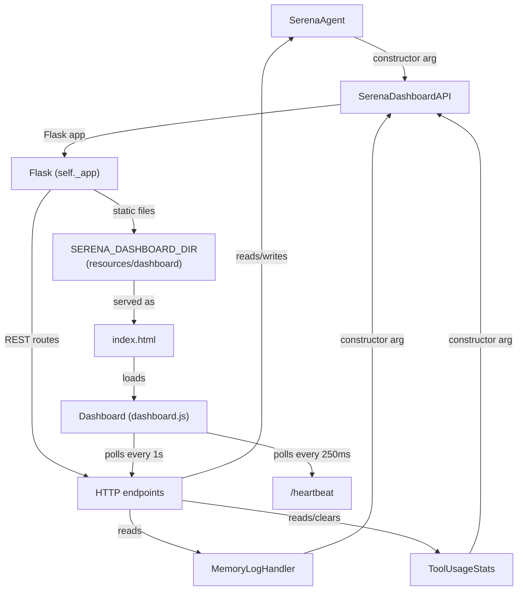
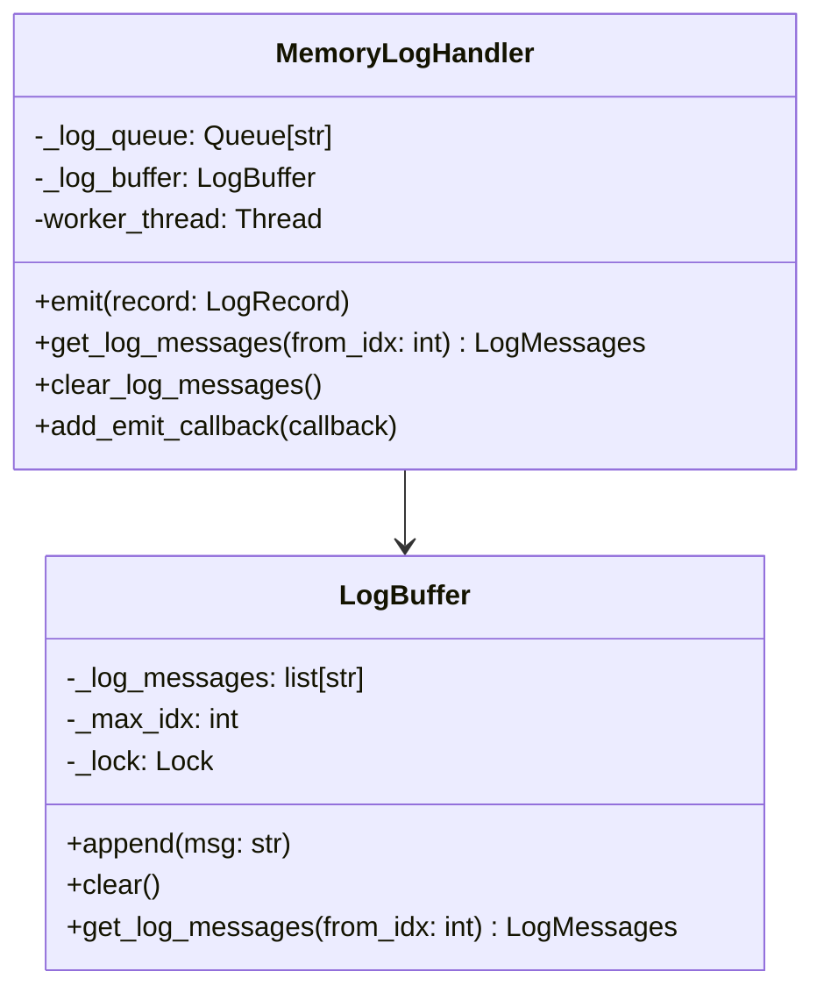
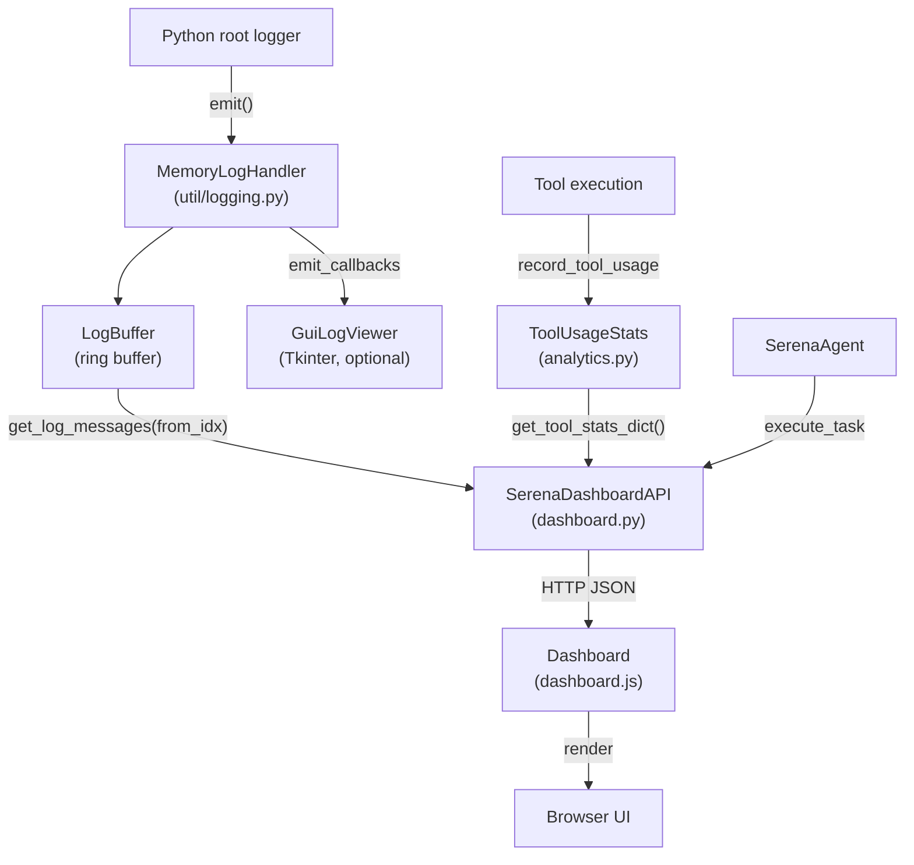

<!-- source: DeepWiki mcp.deepwiki.com · repo oraios/serena · page 3.4 Dashboard and Monitoring · fetched 2026-10-29 -->

# Dashboard and Monitoring

<details>
<summary>Relevant source files</summary>

The following files were used as context for generating this wiki page:

- [news/20260111.html](news/20260111.html)
- [news/20260303.html](news/20260303.html)
- [news/20260321.html](news/20260321.html)
- [news/20260330.html](news/20260330.html)
- [news/20260404.html](news/20260404.html)
- [news/20260411.html](news/20260411.html)
- [scripts/agno_agent.py](scripts/agno_agent.py)
- [scripts/build_news_json.py](scripts/build_news_json.py)
- [scripts/demo_run_tools.py](scripts/demo_run_tools.py)
- [src/serena/agno.py](src/serena/agno.py)
- [src/serena/analytics.py](src/serena/analytics.py)
- [src/serena/dashboard.py](src/serena/dashboard.py)
- [src/serena/gui_log_viewer.py](src/serena/gui_log_viewer.py)
- [src/serena/resources/dashboard/dashboard.css](src/serena/resources/dashboard/dashboard.css)
- [src/serena/resources/dashboard/dashboard.js](src/serena/resources/dashboard/dashboard.js)
- [src/serena/resources/dashboard/index.html](src/serena/resources/dashboard/index.html)
- [src/serena/util/logging.py](src/serena/util/logging.py)
- [src/serena/util/pypi.py](src/serena/util/pypi.py)
- [test/serena/test_dashboard.py](test/serena/test_dashboard.py)

</details>


This page covers Serena's web-based monitoring dashboard: the `SerenaDashboardAPI` Flask server, the JavaScript `Dashboard` frontend, the `MemoryLogHandler` log capture system, the `ToolUsageStats` analytics module, and the alternative `GuiLogViewer` Tkinter log viewer. For the task execution machinery that the dashboard monitors, see [3.3](). For configuration details referenced by the config overview API, see [4]().

---

## Overview

Serena optionally starts a local web server alongside the MCP server. This server exposes a REST API consumed by a single-page JavaScript application that provides real-time visibility into:

- Active project, context, modes, and active tool set [src/serena/dashboard.py:60-77]()
- Task execution queue and last-executed task [src/serena/dashboard.py:126-141]()
- In-process log stream [src/serena/dashboard.py:42-50]()
- Tool call counts and estimated token usage [src/serena/dashboard.py:56-58]()
- Project-specific news and updates [src/serena/dashboard.py:144-190]()

The dashboard also provides write operations: adding/removing project languages, reading and editing project memories, and editing the global Serena config YAML.

**Component locations:**

| Component | File |
|---|---|
| Flask backend | [src/serena/dashboard.py]() |
| JS frontend | [src/serena/resources/dashboard/dashboard.js]() |
| HTML entry point | [src/serena/resources/dashboard/index.html]() |
| CSS styles | [src/serena/resources/dashboard/dashboard.css]() |
| Analytics module | [src/serena/analytics.py]() |
| Log capture | [src/serena/util/logging.py]() |
| Tkinter viewer | [src/serena/gui_log_viewer.py]() |
| Dashboard directory constant | [src/serena/constants.py:26]() |

---

## SerenaDashboardAPI

`SerenaDashboardAPI` wraps a Flask `app` instance and all route definitions. It is constructed with references to:

- `memory_log_handler: MemoryLogHandler` — the in-process log buffer [src/serena/dashboard.py:199]()
- `tool_names: list[str]` — registered tool names (used for log highlighting on the frontend) [src/serena/dashboard.py:200]()
- `agent: SerenaAgent` — the live agent instance [src/serena/dashboard.py:201]()
- `tool_usage_stats: ToolUsageStats | None` — optional analytics collector [src/serena/dashboard.py:202]()

**Startup:** The API initializes by loading news items via `ReadNews.load()` [src/serena/dashboard.py:217]() and starting background threads to fetch remote news updates and check for newer Serena versions on PyPI [src/serena/dashboard.py:226-228](). The Flask app is configured to serve static assets from `SERENA_DASHBOARD_DIR` [src/serena/dashboard.py:237-244]().

**Static file serving:** All files under `SERENA_DASHBOARD_DIR` are served at `/dashboard/<path>`. The HTML entry point is at `/dashboard/`. [src/serena/dashboard.py:237-244]()

---

## HTTP API Reference

**Startup and lifecycle:**

| Method | Path | Description |
|---|---|---|
| `GET` | `/heartbeat` | Returns `{"status": "alive"}`. [src/serena/dashboard.py:247-249]() |
| `PUT` | `/shutdown` | Shuts down the server process. [src/serena/dashboard.py:295-298]() |
| `GET` | `/dashboard/` | Serves `index.html`. [src/serena/dashboard.py:241-244]() |

**Logging:**

| Method | Path | Request body | Returns |
|---|---|---|---|
| `POST` | `/get_log_messages` | `RequestLog(start_idx)` | `ResponseLog` [src/serena/dashboard.py:251-260]() |
| `POST` | `/clear_logs` | — | `{"status": "cleared"}` [src/serena/dashboard.py:277-280]() |

**Tool information and stats:**

| Method | Path | Returns |
|---|---|---|
| `GET` | `/get_tool_names` | `ResponseToolNames` [src/serena/dashboard.py:262-265]() |
| `GET` | `/get_tool_stats` | `ResponseToolStats` [src/serena/dashboard.py:267-270]() |
| `POST` | `/clear_tool_stats` | `{"status": "cleared"}` [src/serena/dashboard.py:272-275]() |

**Configuration overview:**

| Method | Path | Returns |
|---|---|---|
| `GET` | `/get_config_overview` | `ResponseConfigOverview` [src/serena/dashboard.py:287-290]() |
| `GET` | `/get_serena_config` | `ResponseGetSerenaConfig` [src/serena/dashboard.py:377-380]() |
| `POST` | `/save_serena_config` | `RequestSaveSerenaConfig` [src/serena/dashboard.py:382-388]() |

**Project language management:**

| Method | Path | Body | Returns |
|---|---|---|---|
| `GET` | `/get_available_languages` | — | `ResponseAvailableLanguages` [src/serena/dashboard.py:301-304]() |
| `POST` | `/add_language` | `RequestAddLanguage` | status dict [src/serena/dashboard.py:306-315]() |
| `POST` | `/remove_language` | `RequestRemoveLanguage` | status dict [src/serena/dashboard.py:319-328]() |

**Memory management:**

| Method | Path | Body | Returns |
|---|---|---|---|
| `POST` | `/get_memory` | `RequestGetMemory` | `ResponseGetMemory` [src/serena/dashboard.py:332-341]() |
| `POST` | `/save_memory` | `RequestSaveMemory` | status dict [src/serena/dashboard.py:343-352]() |
| `POST` | `/delete_memory` | `RequestDeleteMemory` | status dict [src/serena/dashboard.py:354-363]() |

**Task execution monitoring:**

| Method | Path | Returns |
|---|---|---|
| `GET` | `/queued_task_executions` | `{queued_executions: [QueuedExecution]}` [src/serena/dashboard.py:409-412]() |
| `POST` | `/cancel_task_execution` | `RequestCancelTaskExecution` [src/serena/dashboard.py:421-430]() |
| `GET` | `/last_execution` | `{last_execution: QueuedExecution | null}` [src/serena/dashboard.py:414-419]() |

Sources: [src/serena/dashboard.py:231-431]()

---

## Response Models

**`ResponseConfigOverview`** is the primary data structure for the Overview page:

[src/serena/dashboard.py:60-77]()

| Field | Type | Implementation |
|---|---|---|
| `active_project` | `dict` | Name and path from `agent.get_active_project()` |
| `context` | `dict` | Active context name and path |
| `modes` | `list` | Currently active agent modes |
| `active_tools` | `list` | Tools currently exposed to the LLM |
| `tool_stats_summary` | `dict` | Call counts and tokens from `ToolUsageStats` |
| `serena_version` | `str` | Current version string |
| `newer_serena_version` | `str \| None` | Available update version from PyPI |

This endpoint executes via `agent.execute_task(self._get_config_overview, logged=False)` to ensure thread-safe access to the agent's internal state [src/serena/dashboard.py:289]().

**`QueuedExecution`** provides a snapshot of task status:

[src/serena/dashboard.py:126-141]()

```
QueuedExecution
  task_id: int
  is_running: bool
  name: str
  finished_successfully: bool
  logged: bool
```

---

## Architecture Diagram

**Dashboard component relationships:**



Sources: [src/serena/dashboard.py:192-214](), [src/serena/resources/dashboard/index.html:12-18]()

---

## Log Capture: MemoryLogHandler

`MemoryLogHandler` is a custom `logging.Handler` that maintains an in-process ring buffer of log messages. It is designed for low-overhead capture of all system logs for display in the dashboard.

**Internal structure:**



Sources: [src/serena/util/logging.py:26-114]()

Key behaviors:
- `emit()` puts the formatted message into an internal `_log_queue` without blocking the caller [src/serena/util/logging.py:46-48]().
- A background daemon thread (`_process_queue`) drains the queue into `LogBuffer` and invokes any registered callbacks (e.g., for the `GuiLogViewer`) [src/serena/util/logging.py:50-62]().
- `LogBuffer` respects `LOG_MESSAGES_BUFFER_SIZE` [src/serena/util/logging.py:89-92]().
- `get_log_messages(from_idx)` enables incremental polling by the frontend, returning only messages newer than the provided index [src/serena/util/logging.py:98-113]().

**Frontend log processing:**
The `LogMessage` class in `dashboard.js` handles client-side rendering. It determines the log level (debug, info, warning, error) by checking the message prefix [src/serena/resources/dashboard/dashboard.js:9-21]() and applies syntax highlighting to registered tool names [src/serena/resources/dashboard/dashboard.js:23-30]().

---

## Tool Usage Analytics: ToolUsageStats

`ToolUsageStats` provides tracking of how often tools are called and the associated token costs.

**Token count estimators:**
Serena supports multiple estimation strategies via the `TokenCountEstimator` abstraction. These include `TiktokenCountEstimator` for local OpenAI estimation [src/serena/analytics.py:26-44]() and `AnthropicTokenCount` for remote estimation using the Anthropic API [src/serena/analytics.py:46-70]().

The `record_tool_usage` method is called after tool execution to update these metrics [src/serena/analytics.py:161-166](). The stats are exposed via the dashboard and visualized using Chart.js on the "Advanced Stats" page [src/serena/resources/dashboard/index.html:16-17]().

---

## GuiLogViewer (Tkinter Alternative)

`GuiLogViewer` provides a standalone GUI for viewing logs without requiring a web browser. It is particularly useful for fatal exception reporting or when running in a standalone desktop mode.

[src/serena/gui_log_viewer.py:27-147]()

**Operational Modes:**
- **`dashboard`**: A persistent window with a menu for server control (e.g., Shutdown). [src/serena/gui_log_viewer.py:51]()
- **`error`**: A transient window used to display crash information. [src/serena/gui_log_viewer.py:51]()

**Integration:**
The viewer can be linked directly to a `MemoryLogHandler`. It registers a callback to receive new log messages in real-time, which are then processed through a thread-safe `message_queue` for rendering in the Tkinter main loop [src/serena/gui_log_viewer.py:72-76, 148-215]().

---

## Data Flow Diagram



Sources: [src/serena/dashboard.py](), [src/serena/util/logging.py](), [src/serena/gui_log_viewer.py]()

---

