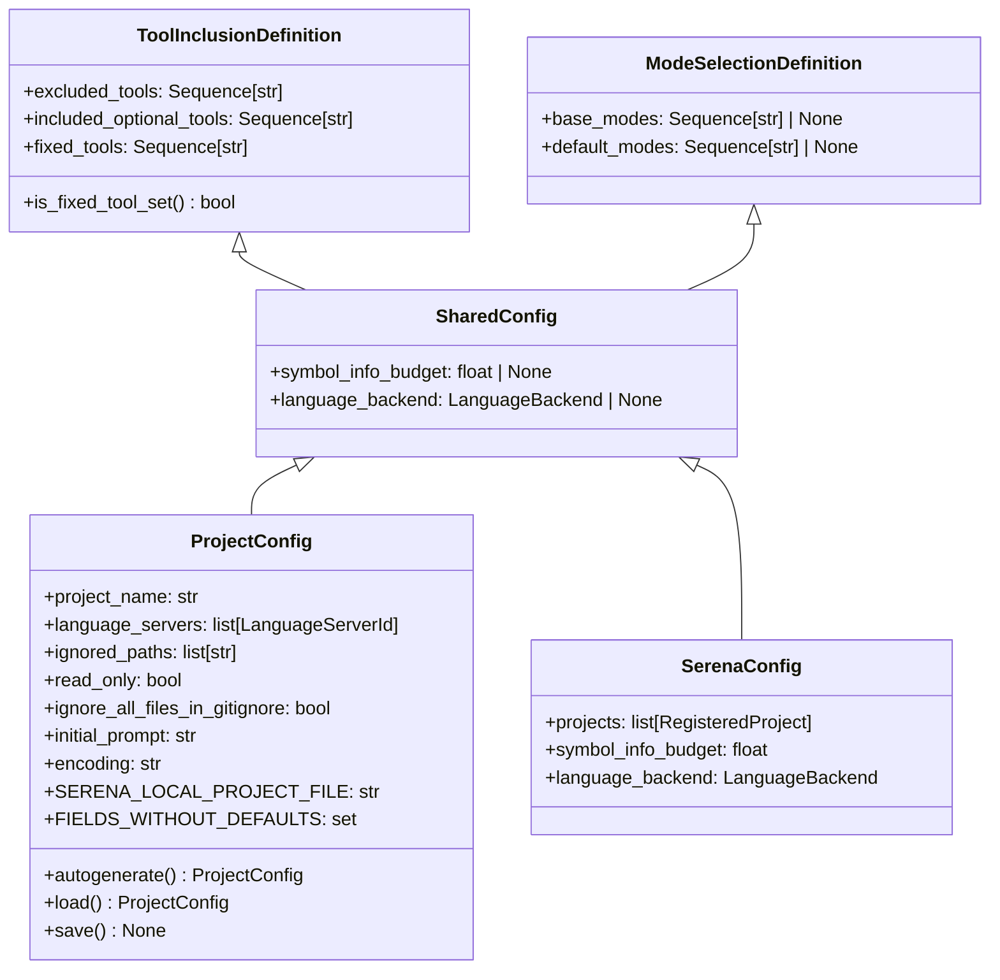
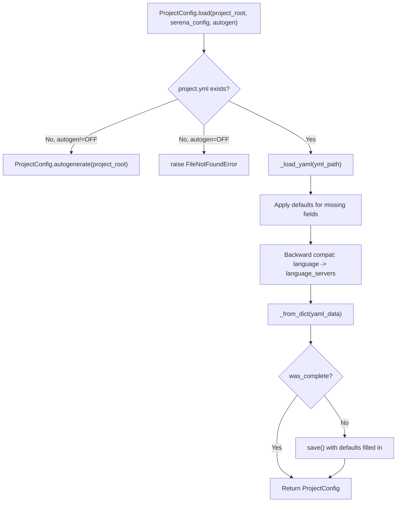
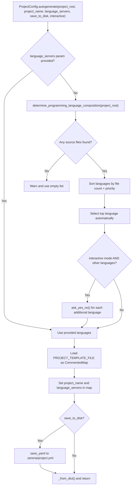
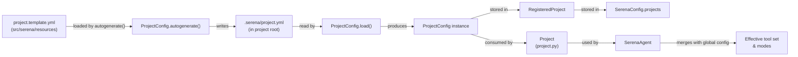

<!-- source: DeepWiki mcp.deepwiki.com · repo oraios/serena · page 4.3 Project Configuration · fetched 2026-10-29 -->

# Project Configuration

<details>
<summary>Relevant source files</summary>

The following files were used as context for generating this wiki page:

- [.serena/.gitignore](.serena/.gitignore)
- [.serena/project.yml](.serena/project.yml)
- [docs/02-usage/045_memories.md](docs/02-usage/045_memories.md)
- [scripts/print_tool_overview.py](scripts/print_tool_overview.py)
- [src/serena/agent.py](src/serena/agent.py)
- [src/serena/cli.py](src/serena/cli.py)
- [src/serena/config/serena_config.py](src/serena/config/serena_config.py)
- [src/serena/mcp.py](src/serena/mcp.py)
- [src/serena/memories/memory_manager.py](src/serena/memories/memory_manager.py)
- [src/serena/memories/memory_reference_analysis.py](src/serena/memories/memory_reference_analysis.py)
- [src/serena/project.py](src/serena/project.py)
- [src/serena/resources/project.template.yml](src/serena/resources/project.template.yml)
- [src/serena/resources/serena_config.template.yml](src/serena/resources/serena_config.template.yml)
- [src/serena/tools/memory_tools.py](src/serena/tools/memory_tools.py)
- [src/serena/util/dataclass.py](src/serena/util/dataclass.py)
- [src/serena/util/yaml.py](src/serena/util/yaml.py)
- [test/serena/config/test_global_ignored_paths.py](test/serena/config/test_global_ignored_paths.py)
- [test/serena/config/test_serena_config.py](test/serena/config/test_serena_config.py)
- [test/serena/test_cli_project_commands.py](test/serena/test_cli_project_commands.py)
- [test/serena/test_edit_marker.py](test/serena/test_edit_marker.py)
- [test/serena/test_mcp.py](test/serena/test_mcp.py)
- [test/serena/test_memories_manager.py](test/serena/test_memories_manager.py)
- [test/serena/util/test_yaml.py](test/serena/util/test_yaml.py)

</details>


This page documents the `ProjectConfig` dataclass and the `project.yml` file format used to configure individual projects in Serena. It covers how project configurations are created, loaded, saved, and what each field controls.

For the global Serena configuration (`serena_config.yml` and `SerenaConfig`), see [Global Configuration](#4.4). For how contexts and modes interact with project config, see [Contexts and Modes](#4.2). For the overall configuration precedence hierarchy, see [Configuration Hierarchy](#4.1).

---

## Overview

Each project tracked by Serena has a per-project configuration file at `.serena/project.yml` inside the project root. This file is represented in Python by the `ProjectConfig` dataclass, defined in [src/serena/config/serena_config.py:190-438]().

`ProjectConfig` inherits from `SharedConfig`, which itself inherits from both `ModeSelectionDefinition` [src/serena/config/serena_config.py:170-173]() and `ToolInclusionDefinition` [src/serena/config/serena_config.py:131-160](). This means a project config can override global-level tool and mode settings on a per-project basis.

**Class hierarchy:**



Sources: [src/serena/config/serena_config.py:131-438](), [src/serena/config/serena_config.py:507-570]()

---

## File Location

The project configuration file is always located at:

```
<project_root>/.serena/project.yml
```

The directory name `.serena` is controlled by the constant `SERENA_MANAGED_DIR_NAME` [src/serena/constants.py:33](). The filename `project.yml` is set by `ProjectConfig.SERENA_LOCAL_PROJECT_FILE` [src/serena/config/serena_config.py:192]().

Helper methods for computing the path:

| Method | Returns |
|--------|---------|
| `serena_config.get_project_yml_location(project_root)` | Absolute path to `project.yml` [src/serena/config/serena_config.py:726-728]() |
| `Project.load(project_root, ...)` | Resolves path via `ProjectConfig.load` [src/serena/project.py:137-148]() |

Sources: [src/serena/config/serena_config.py:726-728](), [src/serena/project.py:137-148](), [src/serena/constants.py:33]()

---

## Configuration Fields

All fields and their defaults are summarized below. Fields marked as **required** have no default; they must be present or autogenerated.

| Field | Type | Default | Description |
|-------|------|---------|-------------|
| `project_name` | `str` | **required** | Name used to reference the project within Serena. [src/serena/config/serena_config.py:194]() |
| `language_servers` | `list[LanguageServerId]` | **required** | Language servers to start; see `LanguageServerId` enum. [src/serena/config/serena_config.py:195]() |
| `encoding` | `str` | `"utf-8"` | Character encoding for text files in the project. [src/serena/config/serena_config.py:196]() |
| `language_backend` | `LanguageBackend \| None` | `None` | Per-project backend override (`LSP` or `JetBrains`). [src/serena/config/serena_config.py:181]() |
| `ignore_all_files_in_gitignore` | `bool` | `True` | Whether to apply `.gitignore` patterns to file operations. [src/serena/config/serena_config.py:198]() |
| `ignored_paths` | `list[str]` | `[]` | Additional paths to ignore (gitignore syntax). [src/serena/config/serena_config.py:199]() |
| `read_only` | `bool` | `False` | Disables all editing tools when `True`. [src/serena/config/serena_config.py:200]() |
| `initial_prompt` | `str` | `""` | Prompt string always given to the LLM when the project is activated. [src/serena/config/serena_config.py:201]() |
| `symbol_info_budget` | `float \| None` | `None` | Per-call time budget (seconds) for LSP hover/info requests. [src/serena/config/serena_config.py:179]() |
| `excluded_tools` | `Sequence[str]` | `()` | Tool names to exclude for this project. [src/serena/config/serena_config.py:151]() |
| `included_optional_tools` | `Sequence[str]` | `()` | Optional tools to enable for this project. [src/serena/config/serena_config.py:155]() |
| `fixed_tools` | `Sequence[str]` | `()` | If non-empty, replaces the default tool set entirely. [src/serena/config/serena_config.py:159]() |
| `read_only_memory_patterns` | `list[str]` | `[]` | Regex patterns marking memory entries as read-only. [src/serena/config/serena_config.py:202]() |
| `ignored_memory_patterns` | `list[str]` | `[]` | Regex patterns for memories to completely ignore. [src/serena/config/serena_config.py:203]() |

The two fields `project_name` and `language_servers` have no defaults and are tracked in `FIELDS_WITHOUT_DEFAULTS` [src/serena/config/serena_config.py:208]().

Sources: [src/serena/config/serena_config.py:131-210](), [src/serena/resources/project.template.yml:1-126]()

---

## project.yml Format

The template file at [src/serena/resources/project.template.yml:1-126]() defines the canonical structure.

### Notes on `language_servers`

The `language_servers` field accepts values from the `LanguageServerId` enum. Some aliases are normalized during loading:

- `javascript` → `typescript` [src/serena/config/serena_config.py:322-329]()
- Language strings are lowercased before parsing.

The first listed language acts as the default/fallback language server [src/serena/resources/project.template.yml:33-35](). When using the JetBrains backend, the `language_servers` list is ignored [src/serena/resources/project.template.yml:35]().

### Notes on `ignored_paths`

Patterns follow gitignore syntax. These are merged **additively** with:
1. Patterns from `.gitignore` files in the project (if `ignore_all_files_in_gitignore: true`) [src/serena/project.py:92-96]()
2. Global `ignored_paths` from `serena_config.yml` [src/serena/project.py:83-84]()

The `Project` class gathers these patterns asynchronously in `_gather_ignorespec` [src/serena/project.py:79-111]() and uses `pathspec` for matching [src/serena/project.py:107]().

### Notes on `memory_patterns`

`read_only_memory_patterns` and `ignored_memory_patterns` allow fine-grained control over the Serena memory system. For example, setting `read_only_memory_patterns: ["global/.*"]` prevents the agent from modifying shared global memories during project-specific tasks [src/serena/resources/serena_config.template.yml:108-111]().

Sources: [src/serena/resources/project.template.yml:1-126](), [src/serena/config/serena_config.py:332-380](), [src/serena/project.py:79-111]()

---

## Loading a Project Configuration

`ProjectConfig.load()` is the primary entry point for reading a configuration from disk [src/serena/config/serena_config.py:391-419]().

**Load flow diagram:**



The `_load_yaml()` method returns a `(CommentedMap, was_complete)` tuple [src/serena/config/serena_config.py:297-329](). If `was_complete` is `False`, missing fields were filled from dataclass defaults, and the file is re-saved to keep it current with the schema [src/serena/config/serena_config.py:414-416]().

Sources: [src/serena/config/serena_config.py:391-419](), [src/serena/config/serena_config.py:297-329]()

---

## Autogeneration Logic

`ProjectConfig.autogenerate()` generates a `project.yml` for a project root that does not already have one [src/serena/config/serena_config.py:211-287]().

**Autogeneration flow:**



The autogeneration process:
1. Derives `project_name` from the directory name if not provided [src/serena/config/serena_config.py:219]().
2. Scans source files to determine language composition [src/serena/config/serena_config.py:223](). This utility scans the directory to find all non-ignored files.
3. Picks the language with the most source files (adjusted by `ls_priorities`) as the primary language [src/serena/config/serena_config.py:240-244]().
4. Loads the template YAML (preserving comments), sets field values, and saves [src/serena/config/serena_config.py:265-285]().

Sources: [src/serena/config/serena_config.py:211-287](), [src/serena/project.py:147]()

---

## Saving a Project Configuration

`ProjectConfig.save(yml_path)` persists the current configuration to disk while preserving existing YAML comments [src/serena/config/serena_config.py:421-438]().

**Save process:**

1. Load the current on-disk YAML via `_load_yaml()` with `LEADING` comment normalisation [src/serena/config/serena_config.py:425]().
2. Apply current field values via `config_with_comments.update(self._to_yaml_dict())` [src/serena/config/serena_config.py:431]().
3. Load the template YAML and transfer any missing comments from it [src/serena/config/serena_config.py:433-435]().
4. Write the result with `save_yaml()` [src/serena/config/serena_config.py:437]().

Sources: [src/serena/config/serena_config.py:421-438](), [src/serena/util/yaml.py:27-55]()

---

## Data Flow: ProjectConfig in the System



Sources: [src/serena/config/serena_config.py:441-504](), [src/serena/config/serena_config.py:507-570](), [src/serena/project.py:33-62]()

---

## RegisteredProject

`RegisteredProject` wraps a `ProjectConfig` and a project root path [src/serena/config/serena_config.py:441-504](). It is the object stored in `SerenaConfig.projects`. It provides lazy loading of the actual `Project` instance.

Key methods:

| Method | Description |
|--------|-------------|
| `from_project_root(project_root)` | Loads `ProjectConfig` from disk and wraps it [src/serena/config/serena_config.py:456-460]() |
| `get_project_instance(serena_config)` | Returns the `Project`, loading it if not already loaded [src/serena/config/serena_config.py:479-491]() |
| `matches_root_path(path)` | Checks if a given path resolves to this project's root [src/serena/config/serena_config.py:493-497]() |

Sources: [src/serena/config/serena_config.py:441-504]()

---

## CLI Integration

The `serena project` command group in `cli.py` provides commands that operate on `ProjectConfig`:

| Command | What it does |
|---------|-------------|
| `serena project create [PROJECT_PATH]` | Calls `ProjectConfig.autogenerate()` and registers the project [src/serena/cli.py:526-590](). |
| `serena project index [PROJECT]` | Starts language servers and indexes all source files [src/serena/cli.py:608-654](). |
| `serena project is_ignored_path PATH PROJECT` | Checks whether a path is ignored according to the project config [src/serena/cli.py:683-700](). |

Sources: [src/serena/cli.py:526-700]()

---

