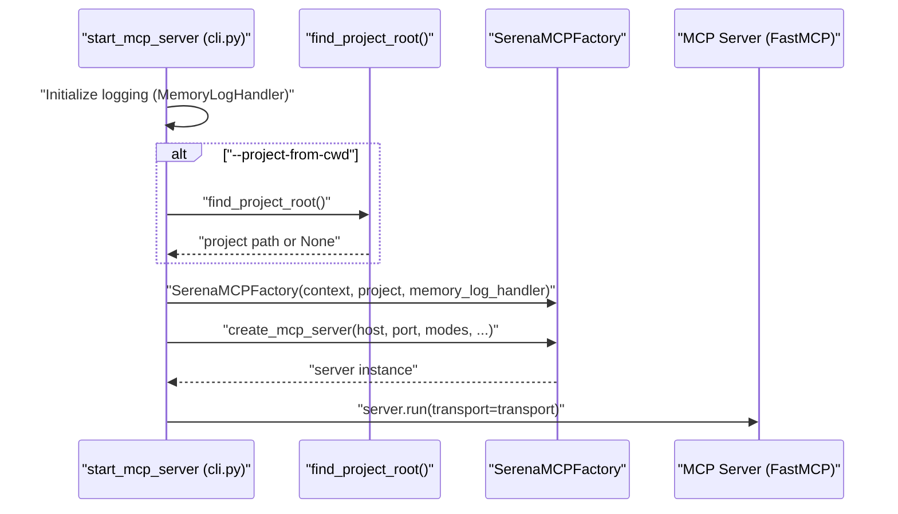
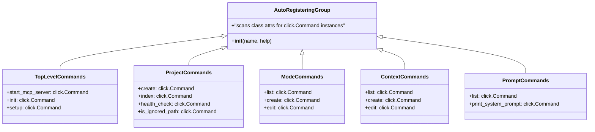

<!-- source: DeepWiki mcp.deepwiki.com · repo oraios/serena · page 4.5 Command Line Interface · fetched 2026-10-29 -->

# Command Line Interface

<details>
<summary>Relevant source files</summary>

The following files were used as context for generating this wiki page:

- [CLAUDE.md](CLAUDE.md)
- [scripts/live_test_grok.py](scripts/live_test_grok.py)
- [scripts/print_tool_overview.py](scripts/print_tool_overview.py)
- [src/serena/cli.py](src/serena/cli.py)
- [src/serena/config/client_setup.py](src/serena/config/client_setup.py)
- [src/serena/hooks.py](src/serena/hooks.py)
- [src/serena/mcp.py](src/serena/mcp.py)
- [src/serena/resources/config/contexts/codebuddy.yml](src/serena/resources/config/contexts/codebuddy.yml)
- [src/serena/resources/config/contexts/grok.yml](src/serena/resources/config/contexts/grok.yml)
- [test/resources/repos/powershell/test_repo/PowerShellEditorServices.json](test/resources/repos/powershell/test_repo/PowerShellEditorServices.json)
- [test/resources/repos/powershell/test_repo/main.ps1](test/resources/repos/powershell/test_repo/main.ps1)
- [test/resources/repos/powershell/test_repo/utils.ps1](test/resources/repos/powershell/test_repo/utils.ps1)
- [test/serena/config/test_client_setup.py](test/serena/config/test_client_setup.py)
- [test/serena/config/test_context_mode.py](test/serena/config/test_context_mode.py)
- [test/serena/config/test_global_ignored_paths.py](test/serena/config/test_global_ignored_paths.py)
- [test/serena/config/test_grok_docs.py](test/serena/config/test_grok_docs.py)
- [test/serena/test_cli_project_commands.py](test/serena/test_cli_project_commands.py)
- [test/serena/test_cli_setup.py](test/serena/test_cli_setup.py)
- [test/serena/test_edit_marker.py](test/serena/test_edit_marker.py)
- [test/serena/test_hooks.py](test/serena/test_hooks.py)
- [test/serena/test_mcp.py](test/serena/test_mcp.py)
- [test/solidlsp/powershell/__init__.py](test/solidlsp/powershell/__init__.py)
- [test/solidlsp/powershell/test_powershell_basic.py](test/solidlsp/powershell/test_powershell_basic.py)

</details>


This page documents all CLI commands exposed by Serena's `cli.py` module. It covers how to start the MCP server, manage projects, modes, contexts, and global configuration from the command line.

For information on how to connect the MCP server to specific clients (Claude Code, Claude Desktop, etc.), see page [2.2](). For configuration file formats themselves, see pages [4.3]() and [4.4](). For modes and contexts as runtime concepts, see page [4.2]().

---

## Overview

Serena's CLI is implemented in [src/serena/cli.py:1-50]() using the [Click](https://click.palletsprojects.com) library. The entry point is the `serena` command, registered in `pyproject.toml`.

Commands are organized into **groups**, each implemented as a subclass of `AutoRegisteringGroup` [src/serena/cli.py:140-141](). This base class automatically scans its own class attributes for `click.Command` instances and registers them, so commands can be defined as static methods on the class without manual `.add_command()` calls [src/serena/util/cli_util.py:15-40]().

**CLI Command Groups**

| Class | CLI Group | Purpose |
|---|---|---|
| `TopLevelCommands` | `serena` | Root group; holds `start-mcp-server`, `init`, and `setup` [src/serena/cli.py:140-356]() |
| `ProjectCommands` | `serena project` | Project lifecycle: create, index, health-check, ignore path checks [src/serena/cli.py:534-700]() |
| `ModeCommands` | `serena mode` | List, create, edit, and delete user-defined modes [src/serena/cli.py:354-426]() |
| `ContextCommands` | `serena context` | List, create, edit, and delete user-defined contexts [src/serena/cli.py:429-505]() |
| `SerenaConfigCommands` | `serena config` | Open the global `serena_config.yml` for editing [src/serena/cli.py:508-523]() |
| `PromptCommands` | `serena prompts` | List and override system prompt templates [src/serena/cli.py:703-731]() |

Sources: [src/serena/cli.py:140-731](), [src/serena/util/cli_util.py:15-40]()

---

## Command Hierarchy

**CLI Structure**

```mermaid
graph TD
  serena["serena (TopLevelCommands)"]
  serena --> sms["start-mcp-server"]
  serena --> init["init"]
  serena --> setup["setup"]
  serena --> project["project (ProjectCommands)"]
  serena --> mode["mode (ModeCommands)"]
  serena --> context["context (ContextCommands)"]
  serena --> config["config (SerenaConfigCommands)"]
  serena --> prompts["prompts (PromptCommands)"]

  project --> pcreate["project create"]
  project --> pindex["project index"]
  project --> phc["project health-check"]
  project --> pigp["project is_ignored_path"]

  mode --> mlist["mode list"]
  mode --> mcreate["mode create"]
  mode --> medit["mode edit"]
  mode --> mdelete["mode delete"]

  context --> clist["context list"]
  context --> ccreate["context create"]
  context --> cedit["context edit"]
  context --> cdelete["context delete"]

  prompts --> plist["prompts list"]
  prompts --> pps["prompts print-system-prompt"]
  prompts --> pco["prompts create-override"]

  config --> ceditcmd["config edit"]
```



Sources: [src/serena/cli.py:140-731]()

---

## Project Root Detection

The helper function `find_project_root()` is used by `--project-from-cwd` and internally in several commands to locate a project's root directory by walking upward from the current working directory [src/serena/cli.py:65-82]().

**Search logic:**
- It iterates through the current directory and all ancestors [src/serena/cli.py:86-92]().
- A directory is considered a project root if it contains `.serena/project.yml` OR a `.git` entry [src/serena/cli.py:98-100]().
- The nearest boundary wins, which is critical for supporting nested git worktrees without them being "hijacked" by an ancestor's Serena configuration [src/serena/cli.py:94-97]().

Sources: [src/serena/cli.py:65-102]()

---

## `start-mcp-server`

Starts the Serena MCP server. This is the primary command used in client configurations [src/serena/cli.py:212]().

```
serena start-mcp-server [OPTIONS]
```

**Options**

| Option | Type | Default | Description |
|---|---|---|---|
| `--project` | `PROJECT_TYPE` | `None` | Project to activate at startup (name or path) [src/serena/cli.py:213]() |
| `--project-from-cwd` | flag | `False` | Auto-detect project from CWD using `find_project_root` [src/serena/cli.py:254]() |
| `--context` | string | `DEFAULT_CONTEXT` | Context name or path to a custom context YAML [src/serena/cli.py:216-218]() |
| `--mode` | string, repeatable | `()` | Mode name or path; can be passed multiple times [src/serena/cli.py:219-227]() |
| `--language-backend` | `LSP` \| `JetBrains` | `None` | Override configured language backend [src/serena/cli.py:228-233]() |
| `--transport` | `stdio` \| `sse` \| `streamable-http` | `stdio` | MCP transport protocol [src/serena/cli.py:234-240]() |
| `--host` | string | `0.0.0.0` | Bind address for HTTP/SSE transports [src/serena/cli.py:241-246]() |
| `--port` | integer | `8000` | Listen port for HTTP/SSE transports [src/serena/cli.py:247]() |
| `--enable-web-dashboard` | bool | `None` | Override `web_dashboard` in config [src/serena/cli.py:257]() |
| `--open-web-dashboard` | bool | `None` | Override `web_dashboard_open_on_launch` [src/serena/cli.py:258]() |
| `--log-level` | `DEBUG`..`CRITICAL` | `None` | Override log level [src/serena/cli.py:260-264]() |

**Notes on startup:**
- Logging is initialized with a `MemoryLogHandler`, a `StreamHandler` to `stderr`, and a timestamped log file under `~/.serena/logs/` [src/serena/cli.py:274-286]().
- `stdout` is reserved for MCP communication when using `stdio` transport [src/serena/cli.py:269]().
- The `SerenaMCPFactory` is constructed with the resolved context and project [src/serena/cli.py:318-323]().

**Start-up Flow**



Sources: [src/serena/cli.py:212-356](), [src/serena/util/logging.py:41-41](), [src/serena/mcp.py:144-169]()

---

## `init` and `setup`

### `init`
Initializes Serena by creating a global configuration file with a specified default language backend [src/serena/cli.py:172-185]().

```
serena init [OPTIONS]
```

| Option | Type | Default | Description |
|---|---|---|---|
| `--language-backend` | `LSP` \| `JetBrains` | `LSP` | Default code intelligence backend [src/serena/cli.py:177-184]() |

It also checks for auto-configurable clients using `client_setup_handlers` (like Claude Code, Codex, or Grok) and suggests setup commands [src/serena/cli.py:187-204]().

### `setup`
Configures a specific client automatically using registered handlers in `client_setup_handlers` [src/serena/cli.py:212-230]().

```
serena setup [CLIENT_NAME]
```

The setup logic is delegated to subclasses of `ClientSetupHandler` which check for client availability via `is_applicable()` and apply the configuration via `apply()` [src/serena/config/client_setup.py:8-50]().

Sources: [src/serena/cli.py:172-230](), [src/serena/config/client_setup.py:8-146]()

---

## `project` Commands

### `project create`

Generates a `.serena/project.yml` configuration file. It uses `ProjectConfig.load` with `autogenerate=True` to detect languages if not provided [src/serena/cli.py:534-566]().

```
serena project create [PROJECT_PATH] [OPTIONS]
```

| Option/Arg | Type | Default | Description |
|---|---|---|---|
| `PROJECT_PATH` | directory | CWD | Directory to configure [src/serena/cli.py:536]() |
| `--name` | string | `None` | Project name [src/serena/cli.py:537]() |
| `--language` | string, repeatable | `()` | Languages (alias `--ls`) [src/serena/cli.py:538](), [test/serena/test_cli_project_commands.py:56-60]() |
| `--index` | flag | `False` | Run indexing after creation [src/serena/cli.py:539]() |

On success, it registers the project in the global `SerenaConfig` [src/serena/cli.py:594-596]().

Sources: [src/serena/cli.py:534-600](), [src/serena/project.py:124-135]()

---

### `project index`

Pre-populates the symbol cache for source files by spawning language servers and requesting document symbols [src/serena/cli.py:601-609]().

```
serena project index [PROJECT] [OPTIONS]
```

**Indexing process (via `_index_project`):**
1. Loads the `Project` and creates a `LanguageServerManager` [src/serena/cli.py:744-754]().
2. Scans the directory for source files [src/serena/cli.py:756]().
3. Iterates files with a `tqdm` progress bar [src/serena/cli.py:760]().
4. Requests document symbols for each file via the language server [src/serena/cli.py:763]().
5. Saves caches to the `.serena` data folder [src/serena/cli.py:770]().

Sources: [src/serena/cli.py:601-677](), [src/serena/cli.py:733-784]()

---

### `project health-check`

Performs a diagnostic check on the project, ensuring language servers can start and the configuration is valid [src/serena/cli.py:787-795]().

---

### `project is_ignored_path`

Checks if a specific path is ignored by Serena's project configuration or global ignore patterns [src/serena/cli.py:680-700](). This uses the `Project.is_ignored_path()` logic which merges patterns from `.gitignore`, project config, and global config [test/serena/config/test_global_ignored_paths.py:59-65]().

Sources: [src/serena/cli.py:680-700](), [test/serena/config/test_global_ignored_paths.py:31-110]()

---

## `mode`, `context`, and `prompts` Commands

Manage Serena's user-defined configuration files.

| Command | Description |
|---|---|
| `mode list` / `context list` | Print registered names and paths [src/serena/cli.py:355-364](), [src/serena/cli.py:430-439]() |
| `mode create` / `context create` | Copy a template or internal config to user directory [src/serena/cli.py:366-397](), [src/serena/cli.py:441-472]() |
| `mode edit` / `context edit` | Open a user-defined YAML in `$EDITOR` [src/serena/cli.py:399-415](), [src/serena/cli.py:474-490]() |
| `prompts list` | Lists available prompt definitions and overrides [src/serena/cli.py:704-712]() |
| `prompts print-system-prompt` | Generates and prints the full system prompt for debugging [src/serena/cli.py:720-731]() |

Sources: [src/serena/cli.py:354-505](), [src/serena/cli.py:703-731]()

---

## Editor Integration (`_open_in_editor`)

All `edit` and `create` commands use `_open_in_editor(path)` [src/serena/cli.py:105-123]():

1. Use `$EDITOR` environment variable if set [src/serena/cli.py:107-111]().
2. On Windows: try `os.startfile(path)`, fall back to `notepad.exe` [src/serena/cli.py:112-116]().
3. On macOS: `open path` [src/serena/cli.py:117-118]().
4. On Linux: `xdg-open path` [src/serena/cli.py:119-120]().

Sources: [src/serena/cli.py:105-123]()

---

## Internal Class Design

**CLI Class Relationships**



Sources: [src/serena/cli.py:140-731](), [src/serena/util/cli_util.py:15-40]()

---

## Quick Reference

```bash
# Initialize Serena with JetBrains backend
serena init -b JetBrains

# Start MCP server (stdio, default context)
serena start-mcp-server

# Start MCP server with a specific project and context
serena start-mcp-server --project /path/to/project --context claude-code

# Start in HTTP mode on a custom port
serena start-mcp-server --transport streamable-http --port 9121

# Create a new project config in CWD
serena project create --language python --index

# Run project health check
serena project health-check

# Print the system prompt for a specific context
serena prompts print-system-prompt --context ide

# Edit the global config
serena config edit
```

Sources: [src/serena/cli.py:1-850]()

---

