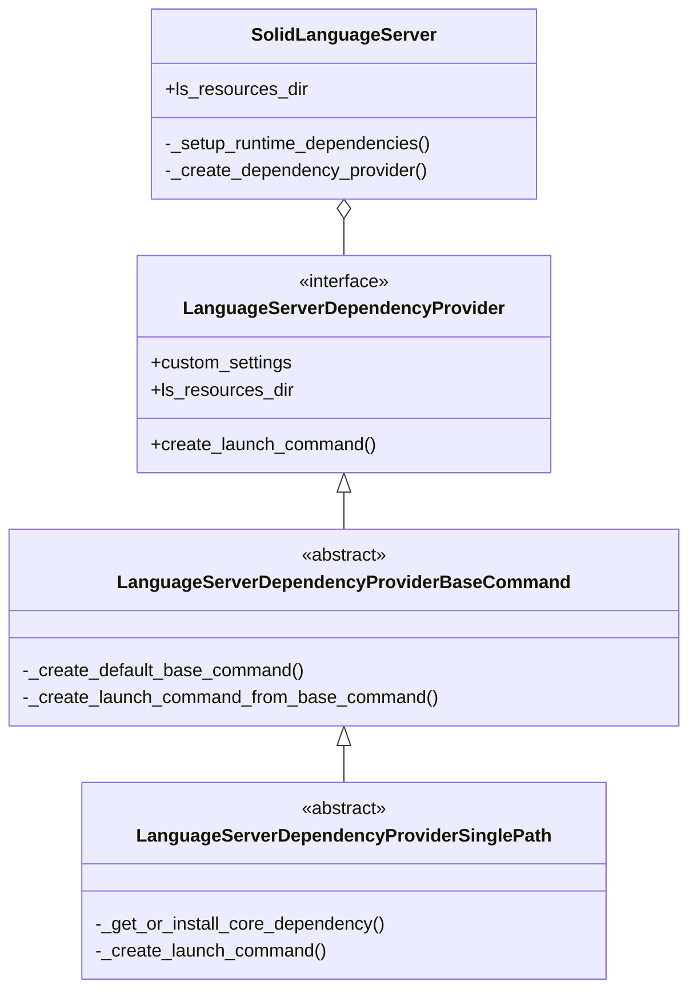
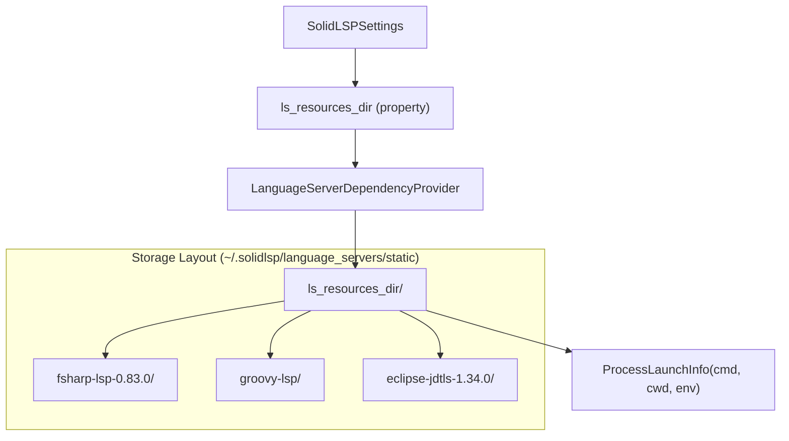

<!-- source: DeepWiki mcp.deepwiki.com · repo oraios/serena · page 6.4 Runtime Dependencies · fetched 2026-10-29 -->

# Runtime Dependencies

Relevant source files

The following files were used as context for generating this wiki page:

- [.serena/memories/adding_new_language_support_guide.md](.serena/memories/adding_new_language_support_guide.md)
- [scripts/update_downloaded_dependency_hashes.py](scripts/update_downloaded_dependency_hashes.py)
- [src/serena/util/dotnet.py](src/serena/util/dotnet.py)
- [src/serena/util/version.py](src/serena/util/version.py)
- [src/solidlsp/dependency_provider.py](src/solidlsp/dependency_provider.py)
- [src/solidlsp/language_servers/common.py](src/solidlsp/language_servers/common.py)
- [src/solidlsp/language_servers/erlang_language_server.py](src/solidlsp/language_servers/erlang_language_server.py)
- [src/solidlsp/language_servers/fsharp_language_server.py](src/solidlsp/language_servers/fsharp_language_server.py)
- [src/solidlsp/language_servers/groovy_language_server.py](src/solidlsp/language_servers/groovy_language_server.py)
- [src/solidlsp/ls_utils.py](src/solidlsp/ls_utils.py)
- [src/solidlsp/resources/downloaded_dependency_hashes.json](src/solidlsp/resources/downloaded_dependency_hashes.json)
- [src/solidlsp/settings.py](src/solidlsp/settings.py)
- [src/solidlsp/util/zip.py](src/solidlsp/util/zip.py)
- [test/solidlsp/erlang/test_erlang_symbol_names.py](test/solidlsp/erlang/test_erlang_symbol_names.py)
- [test/solidlsp/fsharp/test_fsharp_basic.py](test/solidlsp/fsharp/test_fsharp_basic.py)
- [test/solidlsp/fsharp/test_fsharp_module_selection_range.py](test/solidlsp/fsharp/test_fsharp_module_selection_range.py)
- [test/solidlsp/groovy/test_groovy_basic.py](test/solidlsp/groovy/test_groovy_basic.py)
- [test/solidlsp/lua/test_lua_basic.py](test/solidlsp/lua/test_lua_basic.py)
- [test/solidlsp/test_text_utils.py](test/solidlsp/test_text_utils.py)
- [test/solidlsp/util/test_zip.py](test/solidlsp/util/test_zip.py)

This page describes how `solidlsp` language servers resolve, download, and cache their binary dependencies at runtime. It covers the `RuntimeDependency` and `RuntimeDependencyCollection` abstractions, the `LanguageServerDependencyProvider` pattern, platform detection, and specialized installation strategies for npm, dotnet, and direct archive downloads.

---

## Core Abstractions

All runtime dependency management originates from the `RuntimeDependency` and `RuntimeDependencyCollection` classes.

### `RuntimeDependency`

`RuntimeDependency` is a dataclass representing a specific artifact required by a language server. It contains the metadata necessary to fetch, verify, and execute a binary.

| Field | Type | Purpose |
|---|---|---|
| `id` | `str` | Logical name for the dependency (e.g., `"fsautocomplete"`). |
| `platform_id` | `str \| None` | Target platform (e.g., `"linux-x64"`, `"win-x64"`, `"any"`). |
| `url` | `str \| None` | Download URL for archives or binaries. |
| `sha256` | `str \| None` | Expected SHA256 hash for integrity verification. |
| `archive_type` | `FileUtils.ArchiveType \| None` | Format: `"zip"`, `"gz"`, `"tar"`, `"binary"`, etc. |
| `binary_name` | `str \| None` | Relative path to the executable within the install directory. |
| `command` | `str \| list[str] \| None` | Shell command for installation (e.g., `dotnet tool install`). |
| `package_name` | `str \| None` | Name of the package (npm/gem/etc). |

Sources: [src/solidlsp/language_servers/common.py:19-34]()

### `RuntimeDependencyCollection`

`RuntimeDependencyCollection` manages a set of dependencies and handles the installation logic. It supports platform-specific filtering and configuration overrides.

**Key Methods:**
- `get_dependencies_for_current_platform()`: Filters the collection based on the host OS and architecture using `PlatformUtils.get_platform_id()` [src/solidlsp/language_servers/common.py:65-66]().
- `install(target_dir)`: Iterates through required dependencies, downloading from URLs via `_install_from_url` or running shell commands via `_run_command` [src/solidlsp/language_servers/common.py:84-100]().
- `_run_command(command, cwd)`: Executes installation scripts using `subprocess_run`. On non-Windows systems, it attempts to use `pwd.getpwuid` to determine the user context for the process [src/solidlsp/language_servers/common.py:103-129]().

Sources: [src/solidlsp/language_servers/common.py:36-130](), [src/solidlsp/ls_utils.py:1-29]()

---

## Platform Detection

Serena uses `PlatformUtils` to determine the environment, which is critical for selecting the correct binary or archive.

**Supported platform IDs:**
- `win-x64`, `win-arm64`
- `osx-x64`, `osx-arm64`
- `linux-x64`, `linux-arm64`

Implementations often map these to upstream-specific strings, such as `INITIAL_VSCODE_JAVA_SHA256_BY_PLATFORM` [src/solidlsp/language_servers/groovy_language_server.py:25-31]().

Sources: [src/solidlsp/ls_utils.py:9-18](), [src/solidlsp/language_servers/common.py:66-67](), [src/solidlsp/language_servers/groovy_language_server.py:25-31]()

---

## `LanguageServerDependencyProvider` Pattern

Language servers implement the `DependencyProvider` pattern to isolate the logic of "finding/installing the binary" from the "running the server" logic.

**Class Relationship (Code Entity Space):**

Sources: [src/solidlsp/dependency_provider.py:18-122](), [.serena/memories/adding_new_language_support_guide.md:21-62]()

- **`LanguageServerDependencyProviderUvx`**: For language servers distributed as PyPI packages, run on demand via `uvx` (e.g., `PyrightServer`) [.serena/memories/adding_new_language_support_guide.md:39-43]().
- **`LanguageServerDependencyProviderSinglePath`**: For servers resulting in a single core dependency path (e.g., `TypeScriptLanguageServer`, `Intelephense`, `Clangd`) [.serena/memories/adding_new_language_support_guide.md:52-58]().
- **`LanguageServerDependencyProviderBaseCommand`**: Handles user overrides for `ls_base_cmd`, `ls_path`, and `ls_args` centrally [src/solidlsp/dependency_provider.py:53-119]().

---

## Installation Strategies

### npm-based (TypeScript, Intelephense)
Servers written in Node.js use `build_npm_install_command` to generate a pinned installation command [src/solidlsp/language_servers/common.py:154-160]().
1. Serena generates a command like `npm install --prefix ./ <package>@<version>`.
2. This ensures that the language server and its Node dependencies are isolated within the Serena resource cache.

### .NET Tool-based (F#)
The `FSharpLanguageServer` uses the `dotnet` CLI to install its backend, `FsAutoComplete`.
1. It uses `DotNETUtil` to find a suitable .NET runtime (version 8.0 or higher) [src/solidlsp/language_servers/fsharp_language_server.py:138]().
2. It constructs a `RuntimeDependency` with a command like `dotnet tool install --tool-path ./ fsautocomplete --version <version>` [src/solidlsp/language_servers/fsharp_language_server.py:145]().

### Archive Download (Groovy, JDTLS)
For standalone binaries, Serena downloads platform-specific ZIP/TAR archives.
1. It verifies the `sha256` of the downloaded file against pinned constants [src/solidlsp/language_servers/groovy_language_server.py:33-39]().
2. It uses `FileUtils.download_and_extract_archive_verified` to extract to the cache [src/solidlsp/language_servers/common.py:137-152]().
3. It handles Windows-specific issues like long paths using `SafeZipExtractor` [src/solidlsp/util/zip.py:12-21]().

---

## `ls_resources_dir` Cache

The `ls_resources_dir` is the central storage for all runtime dependencies, typically located within the user's home directory.

**Data Flow (Natural Language to Code):**

Sources: [src/solidlsp/settings.py:52-53](), [src/solidlsp/language_servers/fsharp_language_server.py:153-155](), [src/solidlsp/language_servers/groovy_language_server.py:110-155]()

---

## Caching and Versioning

Serena uses a version pinning convention to ensure stability and avoid silent reuse of stale binaries.

- **Version Constants**: Implementations define `INITIAL_*` (legacy) and `DEFAULT_*` (current) versions. The legacy unversioned install directory is reserved for `INITIAL_*` to maintain backward compatibility, while new versions land in versioned subdirectories [src/solidlsp/language_servers/fsharp_language_server.py:30-32]().
- **Hash Database**: Checksums for downloads are managed in `downloaded_dependency_hashes.json` via the `DownloadedDependencyHashDatabase` [.serena/memories/adding_new_language_support_guide.md:83-85]().
- **Integrity Verification**: The `DownloadedDependency` class bundles the URL, archive type, and checksum verification behind a single `download_to()` call [.serena/memories/adding_new_language_support_guide.md:71-80]().

Sources: [src/solidlsp/language_servers/fsharp_language_server.py:153-155](), [.serena/memories/adding_new_language_support_guide.md:71-104]()

---

