# Page: Introduction to Serena

# Introduction to Serena

<details>
<summary>Relevant source files</summary>

The following files were used as context for generating this wiki page:

- [.github/workflows/pytest.yml](.github/workflows/pytest.yml)
- [.gitignore](.gitignore)
- [CHANGELOG.md](CHANGELOG.md)
- [README.md](README.md)
- [docs/01-about/020_programming-languages.md](docs/01-about/020_programming-languages.md)
- [docs/01-about/050_acknowledgements.md](docs/01-about/050_acknowledgements.md)
- [docs/02-usage/020_running.md](docs/02-usage/020_running.md)
- [docs/02-usage/025_jetbrains_plugin.md](docs/02-usage/025_jetbrains_plugin.md)
- [docs/02-usage/030_clients.md](docs/02-usage/030_clients.md)
- [docs/02-usage/040_workflow.md](docs/02-usage/040_workflow.md)
- [docs/02-usage/050_configuration.md](docs/02-usage/050_configuration.md)
- [docs/02-usage/999_additional-usage.md](docs/02-usage/999_additional-usage.md)
- [pyproject.toml](pyproject.toml)
- [resources/serena-logo-dark-mode.svg](resources/serena-logo-dark-mode.svg)
- [resources/serena-logo.svg](resources/serena-logo.svg)
- [src/serena/__init__.py](src/serena/__init__.py)
- [src/serena/util/git.py](src/serena/util/git.py)
- [src/serena/util/shell.py](src/serena/util/shell.py)
- [src/solidlsp/ls_config.py](src/solidlsp/ls_config.py)
- [test/conftest.py](test/conftest.py)
- [test/serena/test_serena_agent.py](test/serena/test_serena_agent.py)
- [uv.lock](uv.lock)

</details>


## Purpose and Scope

This document provides a high-level introduction to Serena, a coding agent toolkit that enables Large Language Models (LLMs) to work directly on codebases using semantic code understanding and IDE-like capabilities. This page covers Serena's core purpose, architecture overview, key components, and differentiating features.

Serena acts as a bridge between LLM clients and code analysis backends, providing tools that work like an IDE's capabilities rather than basic file operations.

Sources: [README.md:1-25](), [src/serena/agent.py:1-40]()

## What is Serena?

Serena is an **LLM-agnostic coding agent toolkit** that transforms LLMs into fully-featured development agents. Unlike most coding assistants that rely on simple file-based or text search approaches, Serena provides **symbolic code understanding** through integration with language servers or JetBrains IDEs, enabling precise code navigation and modification at the symbol level (classes, functions, methods, etc.).

### Key Capabilities

| Capability | Description |
|---------------|-------------|
| **Semantic Code Tools** | Symbol-level operations: `FindSymbolTool`, `FindReferencingSymbolsTool`, `ReplaceSymbolBodyTool`, `RenameSymbolTool`, `FindDeclarationTool`, and `FindImplementationsTool`. |
| **MCP Server** | Native support for the Model Context Protocol to integrate with Claude Code, Cursor, VSCode, and terminal clients. |
| **SolidLSP Integration** | An abstraction layer for 40+ language servers, providing language-agnostic semantic analysis. |
| **JetBrains Backend** | An alternative backend leveraging the powerful code analysis of JetBrains IDEs via a dedicated plugin. |
| **Project Management** | Automatic project indexing, memory management (onboarding), and persistent configuration. |

Sources: [README.md:17-25](), [README.md:62-79](), [README.md:104-106](), [src/serena/agent.py:41-60](), [pyproject.toml:6-8](), [CHANGELOG.md:89-110](), [src/serena/tools/__init__.py:18-31]()

## Core Architecture Overview

Serena is organized into several interconnected layers. The following diagram shows the major components using actual class names and file references from the codebase:

**Diagram: Component Architecture with Code Entities**

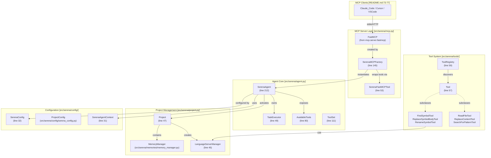

Sources: [src/serena/agent.py:43-346](), [src/serena/mcp.py:53-200](), [src/serena/config/serena_config.py:31-41]()

## Dual Backend System

Serena supports two alternative backends for code analysis. This allows the agent to maintain the same tool interface while switching the underlying "intelligence" source.

**Diagram: Language Backend Abstraction**

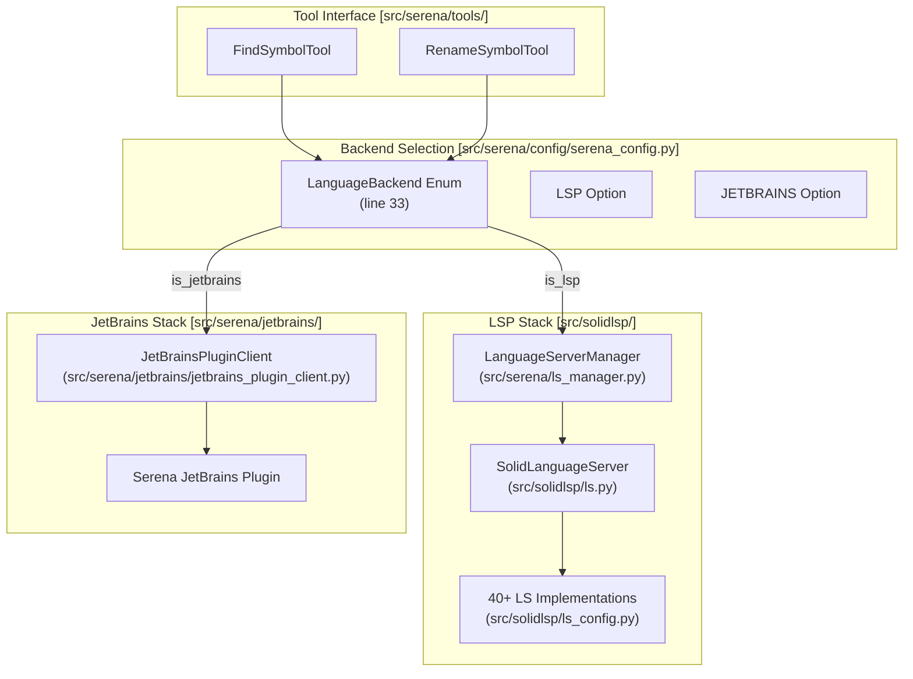

### Language Server Backend (SolidLSP)
The default backend uses the `SolidLanguageServer` framework. It manages over 40 language servers [README.md:112-113](), including:
* **Python**: Pyright (default), Basedpyright, Jedi, or Ty [src/solidlsp/ls_config.py:96](), [CHANGELOG.md:36](), [test/conftest.py:50-52]()
* **TypeScript/JS**: `typescript` [src/solidlsp/ls_config.py:100]()
* **Rust**: `rust` (rust-analyzer) [src/solidlsp/ls_config.py:97]()
* **Java**: `java` (Eclipse JDTLS) [src/solidlsp/ls_config.py:98]()
* **C#**: `csharp` (Roslyn) or `csharp_omnisharp` [src/solidlsp/ls_config.py:95](), [docs/01-about/020_programming-languages.md:54]()
* **Go**: `go` (gopls) [src/solidlsp/ls_config.py:101]()
* **Ada / SPARK**: `ada` (ALS) [src/solidlsp/ls_config.py:169]()
* **GDScript**: `gdscript` (Godot) [src/solidlsp/ls_config.py:177]()
* **LaTeX**: `latex` (texlab) [docs/01-about/020_programming-languages.md:102]()
* **Nix**: `nix` (nixd) [src/solidlsp/ls_config.py:124](), [CHANGELOG.md:37]()

### JetBrains Backend
The `LanguageBackend.JETBRAINS` option connects Serena to a running JetBrains IDE (IntelliJ, PyCharm, etc.) via a dedicated plugin [README.md:115-124](). This provides superior indexing for complex polyglot projects and external libraries. The `jetbrains_plugin_client` handles communication with the IDE instance [src/serena/agent.py:44]().

Sources: [src/serena/config/serena_config.py:33](), [src/solidlsp/ls_config.py:90-185](), [README.md:90-112](), [CHANGELOG.md:55-67]()

## MCP Integration and Tool Exposure

Serena integrates with LLM clients via the Model Context Protocol (MCP). The `SerenaMCPFactory` [src/serena/mcp.py:145]() handles the lifecycle of the `FastMCP` server and tool registration.

### Tool Filtering and Availability
Because MCP clients typically do not support dynamic tool definitions at runtime, Serena distinguishes between **Exposed Tools** and **Active Tools**:

1.  **AvailableTools**: Defined at startup in `SerenaAgent` [src/serena/agent.py:80](). These are the tools the client "sees".
2.  **ToolSet**: A utility to filter tools based on `SerenaAgentContext` or `SerenaAgentMode` [src/serena/agent.py:111]().
3.  **Active Tools**: Tools currently permitted for use. The `ToolRegistry` [src/serena/agent.py:59]() manages the global list of valid tool names and their default enabled status [src/serena/agent.py:134]().

### Primary Integration Patterns
*   **CLI / Terminal**: Using `serena` or `serena-agent` entry points [pyproject.toml:65-66]().
*   **IDE (VSCode/Cursor/JetBrains)**: Configuring the IDE to launch the Serena MCP server via `stdio` transport [docs/02-usage/030_clients.md:69-85]().
*   **Desktop Apps**: Connecting Claude Desktop or OpenWebUI via the `serena start-mcp-server` launch command [docs/02-usage/030_clients.md:73-77]().
*   **Web/Remote**: Using `sse` or `streamable-http` transports for remote client access [src/serena/mcp.py:152]().
*   **Framework Integration**: Integration for the Agno framework via the `agno` optional dependency [pyproject.toml:100]().
*   **Hooks**: Using `serena-hooks` to provide client-specific features like auto-approval or reminders [pyproject.toml:67](), [CHANGELOG.md:83-89]().

Sources: [src/serena/agent.py:80-182](), [src/serena/mcp.py:145-170](), [pyproject.toml:64-67](), [docs/02-usage/030_clients.md:7-17]()

## Project and Workflow

Serena is project-centric. A project is defined by a directory containing a `.serena/project.yml` file.

*   **Indexing**: On activation, Serena scans the directory and determines programming language composition.
*   **Onboarding**: The `OnboardingTool` [src/serena/agent.py:53]() helps the agent create persistent "memories" in `.serena/memories/`.
*   **Memories**: The `MemoryManager` [src/serena/agent.py:46]() handles project-specific markdown files that provide the LLM with long-term context about the codebase.
*   **Dashboard**: A Flask-based web interface `SerenaDashboardAPI` [src/serena/dashboard.py:189]() allows users to monitor tool usage via `ToolUsageStats` [src/serena/dashboard.py:24](), view logs via `MemoryLogHandler` [src/serena/dashboard.py:28](), and manage memories.
*   **Diagnostics**: Tools like `GetDiagnosticsForFileTool` allow agents to see compilation errors directly [test/serena/test_serena_agent.py:27](), [CHANGELOG.md:38-45]().

Sources: [src/serena/agent.py:42-60](), [src/serena/dashboard.py:189-222](), [src/serena/memories/memory_manager.py:1-10](), [CHANGELOG.md:107-110]()

---

# Page: Getting Started

# Getting Started

<details>
<summary>Relevant source files</summary>

The following files were used as context for generating this wiki page:

- [docs/01-about/050_acknowledgements.md](docs/01-about/050_acknowledgements.md)
- [docs/02-usage/010_installation.md](docs/02-usage/010_installation.md)
- [docs/02-usage/020_running.md](docs/02-usage/020_running.md)
- [docs/02-usage/025_jetbrains_plugin.md](docs/02-usage/025_jetbrains_plugin.md)
- [docs/02-usage/030_clients.md](docs/02-usage/030_clients.md)
- [docs/02-usage/040_workflow.md](docs/02-usage/040_workflow.md)
- [docs/02-usage/050_configuration.md](docs/02-usage/050_configuration.md)
- [docs/02-usage/999_additional-usage.md](docs/02-usage/999_additional-usage.md)
- [docs/03-special-guides/serena_on_chatgpt.md](docs/03-special-guides/serena_on_chatgpt.md)

</details>


This page is the entry point for new users setting up Serena. It covers the sequential steps required to get Serena operational: installing prerequisites, connecting an MCP client, and working on a project. Each step is covered in detail in a dedicated child page. For a deeper look at system internals, see [System Architecture](#3).

---

## How Serena Works at a Glance

Serena exposes IDE-like, symbol-level code tools through a Model Context Protocol (MCP) server. An LLM client calls those tools during its reasoning loop. The tools are backed by language servers (LSP) or a JetBrains plugin that understand your codebase semantically. [docs/02-usage/025_jetbrains_plugin.md:21-33]()

**Three-step setup overview:**

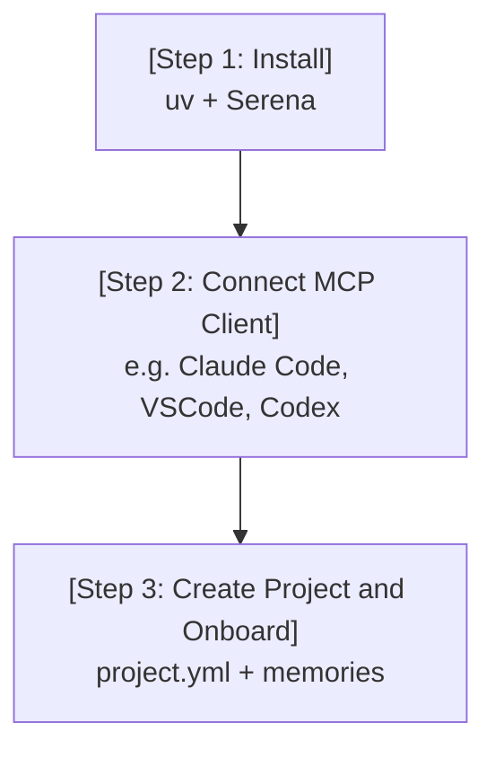

Sources: [docs/02-usage/020_running.md:1-15](), [docs/02-usage/040_workflow.md:1-14]()

---

## Step 1 — Installation and Prerequisites

> For full details, see [Installation and Prerequisites](#2.1).

**Core requirement:** The `uv` package manager. Serena is managed by `uv` for installation and environment handling. [docs/02-usage/010_installation.md:5-9]()

Once `uv` is available, you can install Serena globally:

```bash
uv tool install -p 3.13 serena-agent
```
[docs/02-usage/010_installation.md:23-23]()

After installation, initialize your preferred backend:
* `serena init` (for Language Servers) [docs/02-usage/010_installation.md:29-30]()
* `serena init -b JetBrains` (for JetBrains Plugin) [docs/02-usage/010_installation.md:31-32]()

**Language specific requirements** vary. Many dependencies are installed on the fly, but some (like Go or Rust) may require manual runtime installation if using the LSP backend. [docs/02-usage/010_installation.md:10-17]()

Sources: [docs/02-usage/010_installation.md:1-52]()

---

## Step 2 — Connecting an MCP Client

> For full details, see [Client Integration](#2.2).

Start the MCP server with:

```bash
serena start-mcp-server [options]
```
[docs/02-usage/020_running.md:23-23]()

The server supports two primary transport modes:

| Mode | Command flag | Use case |
|---|---|---|
| **Standard I/O** (default) | _(none)_ | Client (e.g. Claude Desktop) manages server lifecycle [docs/02-usage/020_running.md:34-50]() |
| **Streamable HTTP** | `--transport streamable-http` | User manages server lifecycle; shared access [docs/02-usage/020_running.md:55-70]() |

**Context selection** via the `--context` flag controls the initial system prompt and toolset. Built-in contexts include `claude-code`, `ide`, `desktop-app`, and `jb-copilot-plugin`. [docs/02-usage/050_configuration.md:71-82]()

**Representative client configurations:**

*Claude Code (setup utility):*
```shell
serena setup claude-code
```
[docs/02-usage/030_clients.md:107-107]()

*Copilot in JetBrains (`mcp.json`):*
```json
{
  "servers": {
    "serena": {
      "type": "stdio",
      "command": "serena",
      "args": ["start-mcp-server", "--context=jb-copilot-plugin"]
    }
  }
}
```
[docs/02-usage/030_clients.md:72-85]()

Sources: [docs/02-usage/020_running.md:19-102](), [docs/02-usage/030_clients.md:1-145](), [docs/02-usage/050_configuration.md:65-103]()

---

## Step 3 — Project Workflow

> For full details, see [Project Workflow](#2.3).

Serena uses a project-based workflow. A **project** is a directory containing code and a `.serena/project.yml` configuration file. [docs/02-usage/040_workflow.md:3-5]()

**Typical workflow:**

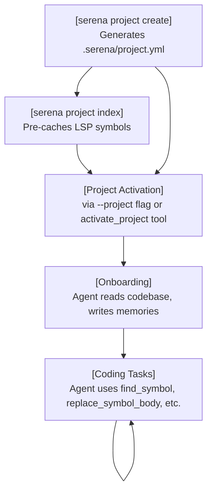

**Project creation examples:**
```bash
# Auto-detect language from existing files
serena project create

# Specify language explicitly
serena project create --language python --language typescript

# Create and immediately index
serena project create --index
```
[docs/02-usage/040_workflow.md:28-38]()

Sources: [docs/02-usage/040_workflow.md:1-132]()

---

## System Component Map

The following diagram maps user-facing commands and configuration files to the internal code entities they invoke.

**Diagram: Entry points and core components**

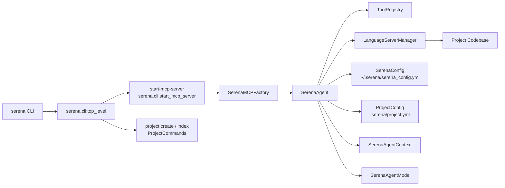

Sources: [docs/02-usage/020_running.md:1-176](), [docs/02-usage/050_configuration.md:10-15]()

---

**Diagram: Client-to-codebase request path**

```mermaid
flowchart LR
    client["MCP Client\ne.g. ClaudeCode, VSCode, Codex"]
    transport["Transport Layer\nstdio or streamable-http"]
    mcpfactory["SerenaMCPFactory\nsrc/serena/mcp.py"]
    agent["SerenaAgent\nsrc/serena/agent.py"]
    tool["Tool.apply()\ne.g. FindSymbolTool, ReplaceSymbolBodyTool"]
    lsmgr["LanguageServerManager\nsrc/solidlsp/"]
    ls["SolidLanguageServer\ne.g. PyrightServer, Gopls, RustAnalyzer"]
    fs["Filesystem\n.serena/project.yml, source files"]

    client -->|"MCP tool call"| transport
    transport --> mcpfactory
    mcpfactory --> agent
    agent --> tool
    tool --> lsmgr
    lsmgr --> ls
    ls --> fs
```

Sources: [docs/02-usage/020_running.md:34-70](), [docs/02-usage/030_clients.md:9-16]()

---

## Language Backend Choice

Serena supports two backends for code intelligence:

| Backend | How to enable | Notes |
|---|---|---|
| **Language servers (LSP)** | Default | Uses Solid-LSP framework. Supports 30+ languages. [docs/02-usage/010_installation.md:29-30]() |
| **JetBrains plugin** | `serena init -b JetBrains` | Leverages IDE's indexing, refactoring, and debugging. [docs/02-usage/025_jetbrains_plugin.md:38-56]() |

The backend is resolved at startup and determines how symbolic tools retrieve information. [docs/02-usage/025_jetbrains_plugin.md:104-111]()

Sources: [docs/02-usage/025_jetbrains_plugin.md:1-139](), [docs/02-usage/010_installation.md:27-35]()

---

## Quick Command Reference

| Task | Command |
|---|---|
| Start MCP server (stdio) | `serena start-mcp-server` |
| Start MCP server (HTTP, port 9121) | `serena start-mcp-server --transport streamable-http --port 9121` |
| Create project in current directory | `serena project create` |
| Index a project | `serena project index` |
| Edit global config | `serena config edit` |
| List available contexts | `serena context list` |
| List available modes | `serena mode list` |
| Setup Claude Code | `serena setup claude-code` |

Sources: [docs/02-usage/020_running.md:120-174](), [docs/02-usage/030_clients.md:107-107]()

---

# Page: Installation and Prerequisites

# Installation and Prerequisites

<details>
<summary>Relevant source files</summary>

The following files were used as context for generating this wiki page:

- [.github/workflows/codespell.yml](.github/workflows/codespell.yml)
- [.github/workflows/docker.yml](.github/workflows/docker.yml)
- [.github/workflows/docs.yaml](.github/workflows/docs.yaml)
- [CHANGELOG.md](CHANGELOG.md)
- [DOCKER.md](DOCKER.md)
- [Dockerfile](Dockerfile)
- [compose.yaml](compose.yaml)
- [docs/02-usage/010_installation.md](docs/02-usage/010_installation.md)
- [docs/03-special-guides/serena_on_chatgpt.md](docs/03-special-guides/serena_on_chatgpt.md)
- [pyproject.toml](pyproject.toml)
- [src/serena/__init__.py](src/serena/__init__.py)
- [src/serena/util/git.py](src/serena/util/git.py)
- [src/serena/util/shell.py](src/serena/util/shell.py)
- [uv.lock](uv.lock)

</details>


This page details the installation steps, system prerequisites, and the entry point configuration for Serena. Serena is a coding agent toolkit designed to be LLM-agnostic, providing semantic code retrieval and editing tools through the Model Context Protocol (MCP).

## Overview

Serena is built on Python 3.11+ and managed via `uv`. It functions as a bridge between LLMs and your codebase by leveraging either Language Servers (LSP) or a JetBrains IDE backend. The installation process involves setting up the core Python environment and ensuring the necessary language runtimes are available for the specific programming languages in your project.

Sources: [pyproject.toml:6-11](), [docs/02-usage/010_installation.md:1-10]()

## System Prerequisites

Before installing Serena, ensure your system meets the following requirements:

| Requirement | Specification | Purpose |
| :--- | :--- | :--- |
| **Python** | `>= 3.11, < 3.15` | Core runtime for the Serena agent and tools. [pyproject.toml:11]() |
| **uv** | Latest | High-performance Python package and project manager. [docs/02-usage/010_installation.md:7-9]() |
| **Node.js & npm** | Version 22.18.0+ | Required for many LSPs (TypeScript, Svelte, etc.). [Dockerfile:27-36]() |
| **Rust / Cargo** | Stable | Required for `rust-analyzer` support. [Dockerfile:44-51]() |
| **Git** | Latest | Required for version tracking and `get_git_status`. [src/serena/util/git.py:11-23]() |

### Supported Platforms
Serena is tested and supported on:
* **Linux**: Primary development and CI platform. [Dockerfile:2-21](), [CHANGELOG.md:74-75]()
* **Windows**: Native support with `pythonnet` and specific handling for line endings. [pyproject.toml:53-53](), [DOCKER.md:64-71]()
* **macOS**: Supported via standard Python/Node installations. [CHANGELOG.md:152-152]()

Sources: [pyproject.toml:11-18](), [docs/02-usage/010_installation.md:5-17](), [Dockerfile:2-51](), [CHANGELOG.md:74-75]()

## Core Installation Methods

### 1. Global Installation (Recommended)
The standard way to install Serena is as a global tool using `uv`. This makes the `serena` and `serena-agent` commands available system-wide.

```bash
uv tool install -p 3.13 serena-agent
```
[docs/02-usage/010_installation.md:21-25]()

### 2. Initializing Serena
After installation, you must initialize the configuration. You can choose between the default LSP-based backend or the JetBrains IDE backend.

```bash
# For default Language Server backend
serena init

# For JetBrains IDE backend (requires JetBrains Plugin)
serena init -b JetBrains
```
[docs/02-usage/010_installation.md:27-32]()

### 3. Docker Installation (Experimental)
For isolated environments, Serena provides a `Dockerfile` and `compose.yaml`. This is useful for securing `execute_shell_command` operations.

```bash
# Build and run using Docker Compose
docker-compose up serena
```
[DOCKER.md:72-80](), [Dockerfile:1-78]()

## Implementation: Entry Points and CLI

Serena defines primary executable entry points in `pyproject.toml`. These map to CLI handlers.

| Entry Point | Command | Function | Description |
| :--- | :--- | :--- | :--- |
| `serena` | `serena` | `serena.cli:top_level` | Main CLI for project management and config. |
| `serena-agent` | `serena-agent` | `serena.cli:top_level` | Alias for the main CLI. |
| `serena-hooks` | `serena-hooks` | `serena.hooks:hook_commands` | Hooks for auto-approve and client-specific reminders. |

[pyproject.toml:64-67](), [CHANGELOG.md:83-89]()

### Data Flow: Installation to Execution

The following diagram illustrates how the installation components interact to launch a functional Serena instance.

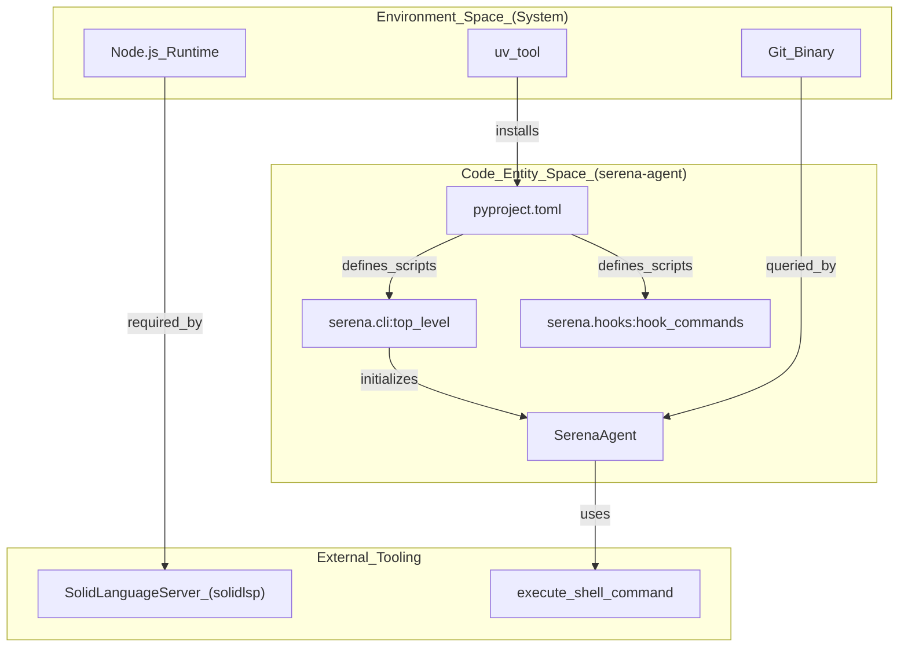
**Diagram: Installation and Execution Data Flow**
Sources: [pyproject.toml:64-67](), [src/serena/util/shell.py:16-42](), [src/serena/util/git.py:11-23]()

## Project Configuration Entry Point

When a project is initialized, Serena creates a `.serena/project.yml` file. This maps project-specific settings like `language_servers` (formerly `languages`).

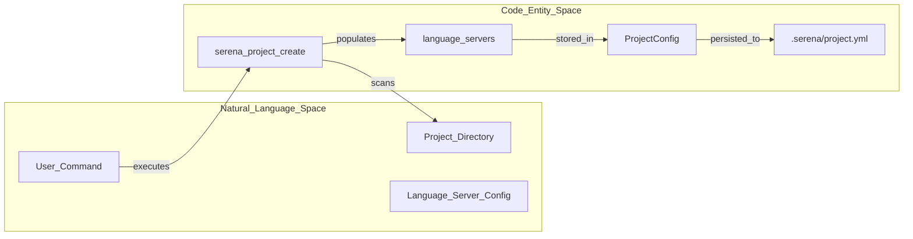
**Diagram: Project Initialization Mapping**
Sources: [docs/02-usage/010_installation.md:29-32](), [CHANGELOG.md:10-11]()

## Summary of Commands

| Command Group | Command Example | Purpose |
| :--- | :--- | :--- |
| **Server** | `serena-mcp-server` | Launches the MCP server (stdio/SSE). [CHANGELOG.md:17-19]() |
| **Project** | `serena project create` | Initializes project configuration. [CHANGELOG.md:10-11]() |
| **Hooks** | `serena-hooks --client=grok` | Sets up environment-specific hooks. [CHANGELOG.md:84-84]() |
| **Shell** | `serena execute-shell-command` | Internal utility for shell access. [src/serena/util/shell.py:16-16]() |

Sources: [pyproject.toml:64-67](), [CHANGELOG.md:9-15](), [src/serena/util/shell.py:16-42]()

---

# Page: Client Integration

# Client Integration

<details>
<summary>Relevant source files</summary>

The following files were used as context for generating this wiki page:

- [docs/01-about/050_acknowledgements.md](docs/01-about/050_acknowledgements.md)
- [docs/02-usage/020_running.md](docs/02-usage/020_running.md)
- [docs/02-usage/025_jetbrains_plugin.md](docs/02-usage/025_jetbrains_plugin.md)
- [docs/02-usage/030_clients.md](docs/02-usage/030_clients.md)
- [docs/02-usage/040_workflow.md](docs/02-usage/040_workflow.md)
- [docs/02-usage/050_configuration.md](docs/02-usage/050_configuration.md)
- [docs/02-usage/999_additional-usage.md](docs/02-usage/999_additional-usage.md)
- [scripts/live_test_grok.py](scripts/live_test_grok.py)
- [scripts/print_tool_overview.py](scripts/print_tool_overview.py)
- [src/serena/cli.py](src/serena/cli.py)
- [src/serena/config/client_setup.py](src/serena/config/client_setup.py)
- [src/serena/hooks.py](src/serena/hooks.py)
- [src/serena/mcp.py](src/serena/mcp.py)
- [src/serena/resources/config/contexts/antigravity.yml](src/serena/resources/config/contexts/antigravity.yml)
- [src/serena/resources/config/contexts/chatgpt.yml](src/serena/resources/config/contexts/chatgpt.yml)
- [src/serena/resources/config/contexts/claude-code.yml](src/serena/resources/config/contexts/claude-code.yml)
- [src/serena/resources/config/contexts/codebuddy.yml](src/serena/resources/config/contexts/codebuddy.yml)
- [src/serena/resources/config/contexts/codex.yml](src/serena/resources/config/contexts/codex.yml)
- [src/serena/resources/config/contexts/copilot-cli.yml](src/serena/resources/config/contexts/copilot-cli.yml)
- [src/serena/resources/config/contexts/grok.yml](src/serena/resources/config/contexts/grok.yml)
- [src/serena/resources/config/contexts/ide.yml](src/serena/resources/config/contexts/ide.yml)
- [src/serena/resources/config/contexts/jb-ai-assistant.yml](src/serena/resources/config/contexts/jb-ai-assistant.yml)
- [src/serena/resources/config/contexts/junie.yml](src/serena/resources/config/contexts/junie.yml)
- [src/serena/resources/config/contexts/vscode.yml](src/serena/resources/config/contexts/vscode.yml)
- [test/serena/config/test_client_setup.py](test/serena/config/test_client_setup.py)
- [test/serena/config/test_context_mode.py](test/serena/config/test_context_mode.py)
- [test/serena/config/test_global_ignored_paths.py](test/serena/config/test_global_ignored_paths.py)
- [test/serena/config/test_grok_docs.py](test/serena/config/test_grok_docs.py)
- [test/serena/test_cli_project_commands.py](test/serena/test_cli_project_commands.py)
- [test/serena/test_cli_setup.py](test/serena/test_cli_setup.py)
- [test/serena/test_edit_marker.py](test/serena/test_edit_marker.py)
- [test/serena/test_hooks.py](test/serena/test_hooks.py)
- [test/serena/test_mcp.py](test/serena/test_mcp.py)

</details>


This page covers how to connect Serena's MCP server to MCP-compatible clients, including Claude Code, Claude Desktop, Codex, VSCode, Cursor, Gemini-CLI, OpenWebUI, and OpenAPI clients via `mcpo`. It also covers the technical architecture of the transport layer (stdio, streamable-http, SSE) and port configuration. For information about project setup and activation after connecting a client, see [Project Workflow](2.3).

## General Connection Approach

Connecting Serena to a client requires two decisions:

1.  **Transport mode**: `stdio` (client launches Serena as a subprocess) or `streamable-http`/`SSE` (Serena runs as a standalone server). [docs/02-usage/020_running.md:34-79]()
2.  **Context**: Which set of tools and system prompt to expose. [docs/02-usage/030_clients.md:34-39]()

In most cases, you register a launch command with the client's MCP settings. The client then starts Serena as a subprocess using that command. For network-based clients (like OpenWebUI or mcpo proxies), you first start Serena in `--transport streamable-http` mode and then point the client at the server URL. [docs/02-usage/020_running.md:56-70]()

> **Note on project activation:** Clients with per-workspace MCP config (VSCode and Claude Code) should typically specify `--project <path>` at startup with a single-project context like `ide` or `claude-code`. [docs/02-usage/030_clients.md:24-29]() Clients with global config (Claude Desktop, Codex, JetBrains) require the user to activate the project they want to work on via the `activate_project` tool or a manual prompt. [docs/02-usage/030_clients.md:30-33](), [docs/02-usage/030_clients.md:88-90]()

Sources: [docs/02-usage/020_running.md:34-79](), [docs/02-usage/030_clients.md:7-40]()

## Overview

Serena implements the Model Context Protocol (MCP) through an MCP server that exposes its tools and capabilities to compatible clients. The integration layer consists of:

*   **SerenaMCPFactory**: Factory class responsible for creating and configuring the MCP server instance. [src/serena/mcp.py:144-147]()
*   **FastMCP Server**: The underlying MCP server framework from the Python MCP SDK. [src/serena/mcp.py:13-15]()
*   **SerenaAgent**: The core agent that orchestrates tools, projects, and language servers. [src/serena/mcp.py:23-25]()
*   **Transport Layer**: Supports `stdio` (subprocess), `streamable-http` (network), and the legacy `sse` transport. [docs/02-usage/020_running.md:34-79]()

Sources: [src/serena/mcp.py:1-67](), [docs/02-usage/020_running.md:34-79]()

## MCP Server Architecture

### Component Structure

The following diagram bridges the high-level client interaction with the internal code entities responsible for the MCP lifecycle.

Title: "Serena MCP Integration Architecture"
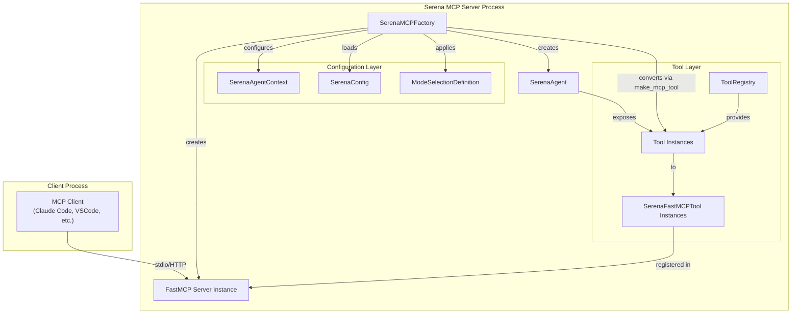
Sources: [src/serena/mcp.py:52-126](), [src/serena/mcp.py:144-168](), [src/serena/mcp.py:271-300]()

### SerenaMCPFactory

The `SerenaMCPFactory` class is the central factory for creating MCP server instances with properly configured `SerenaAgent` instances. [src/serena/mcp.py:144-147]()

| Component | Type | Purpose |
| :--- | :--- | :--- |
| `context` | `SerenaAgentContext` | Determines tool availability and system prompts. [src/serena/mcp.py:165]() |
| `project` | `str | None` | Optional project path or name to activate on startup. [src/serena/mcp.py:166]() |
| `memory_log_handler` | `MemoryLogHandler | None` | In-memory log handler for dashboard integration. [src/serena/mcp.py:168]() |
| `agent` | `SerenaAgent | None` | The created agent instance. [src/serena/mcp.py:167]() |

Key methods:
*   `create_mcp_server()`: Creates a configured `FastMCP` instance with transport settings. [src/serena/mcp.py:271-300]()
*   `server_lifespan()`: Async context manager for server startup/shutdown lifecycle. [src/serena/mcp.py:338-346]()
*   `make_mcp_tool()`: Static method converting Serena `Tool` to `SerenaFastMCPTool`. [src/serena/mcp.py:175-185]()
*   `_set_mcp_tools()`: Registers all exposed tools with the FastMCP instance. [src/serena/mcp.py:249-269]()

Sources: [src/serena/mcp.py:144-346]()

## Client Connection Flow

### Initialization Sequence

Title: "Serena MCP Startup and Tool Registration Sequence"
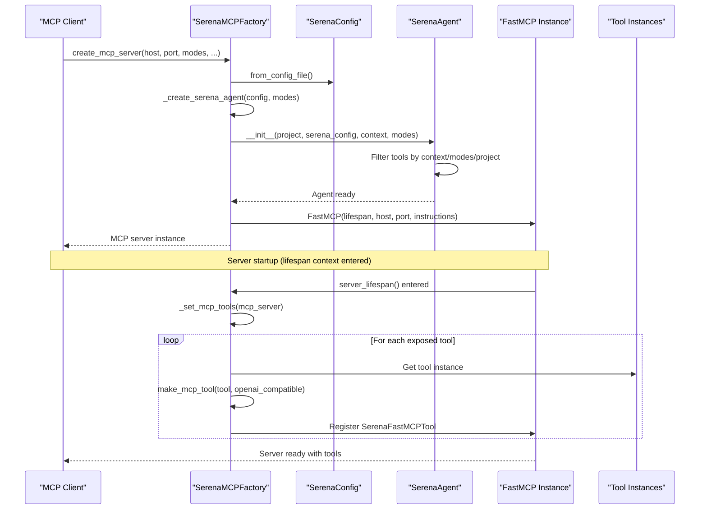
Sources: [src/serena/mcp.py:271-350](), [src/serena/mcp.py:175-247]()

### Context Selection and Impact

The `SerenaAgentContext` determines the initial system prompt and available tools. [docs/02-usage/050_configuration.md:67-70]()

| Context | Single-project | Recommended Clients |
| :--- | :--- | :--- |
| `desktop-app` | No | Claude Desktop (Assume no prior coding capabilities). [docs/02-usage/050_configuration.md:73-74]() |
| `claude-code` | Yes | Claude Code (Optimized to avoid tool duplication). [docs/02-usage/050_configuration.md:75](), [src/serena/resources/config/contexts/claude-code.yml:52]() |
| `codex` | No | OpenAI Codex. [docs/02-usage/050_configuration.md:76](), [src/serena/resources/config/contexts/codex.yml:1-5]() |
| `ide` | Yes | VSCode, Cursor, Cline (Focus on augmenting existing tools). [docs/02-usage/050_configuration.md:78-79](), [src/serena/resources/config/contexts/ide.yml:26]() |
| `chatgpt` | No | ChatGPT. [src/serena/resources/config/contexts/chatgpt.yml:1-16]() |

Sources: [docs/02-usage/050_configuration.md:64-85](), [src/serena/resources/config/contexts/claude-code.yml:1-53](), [src/serena/resources/config/contexts/ide.yml:1-27]()

## Transport Protocols

### Standard I/O Mode (stdio)

The default mode where the client launches Serena as a subprocess. Communication occurs via `stdin`/`stdout`. [docs/02-usage/020_running.md:34-45]()

**Example Command**:
```shell
serena start-mcp-server --context ide --project /path/to/project
```
Sources: [docs/02-usage/020_running.md:47-53]()

### Streamable HTTP Mode

Serena runs as a standalone process. The client connects via a URL. [docs/02-usage/020_running.md:56-60]()

**Server Startup**:
```shell
serena start-mcp-server --transport streamable-http --port 9121
```
The client then connects to `http://localhost:9121/mcp`. [docs/02-usage/020_running.md:61-67]()

Sources: [docs/02-usage/020_running.md:56-77]()

## Automatic Client Setup

Serena includes a `ClientSetupHandler` system to automate the registration of the MCP server with supported clients. [src/serena/config/client_setup.py:8-10]()

| Handler Class | Client | Detection Mechanism |
| :--- | :--- | :--- |
| `ClientSetupHandlerClaudeCode` | Claude Code | Checks `claude --version`. [src/serena/config/client_setup.py:55-57]() |
| `ClientSetupHandlerCodex` | Codex | Checks `codex --version`. [src/serena/config/client_setup.py:80-82]() |
| `ClientSetupHandlerGrok` | Grok | Checks `grok --version`. [src/serena/config/client_setup.py:120-123]() |

The `apply()` method in these handlers executes shell commands (e.g., `claude mcp add`) to register Serena with the client's configuration. [src/serena/config/client_setup.py:63-69](), [src/serena/config/client_setup.py:88](), [src/serena/config/client_setup.py:132-138]()

Sources: [src/serena/config/client_setup.py:8-146]()

## Serena Hooks

The `serena-hooks` utility provides a set of commands to improve client-agent collaboration by intercepting tool calls. [src/serena/hooks.py:1-20]()

### Symbolic Tool Reminders
The `PreToolUseRemindAboutSymbolicToolsHook` tracks consecutive uses of non-symbolic tools like `grep` or `read_file`. [src/serena/hooks.py:115-144]() If the agent exceeds thresholds (e.g., 3 `grep` calls or 3 `read_file` calls), the hook returns a "deny" response with a reminder to use Serena's symbolic tools. [src/serena/hooks.py:149-152](), [src/serena/hooks.py:228-232]()

### Auto-Approval
The `PreToolUseAutoApproveSerenaHook` can be used to automatically allow any tool call that contains "serena" in its name, reducing manual user friction in agent sessions. [src/serena/hooks.py:284-285](), [src/serena/hooks.py:109-112]()

Sources: [src/serena/hooks.py:29-232](), [test/serena/test_hooks.py:1-150]()

## Tool Schema Conversion

### Serena Tool to MCP Tool Mapping

The `SerenaFastMCPTool` class performs the conversion: [src/serena/mcp.py:52-126]()

1.  **Metadata Extraction**: Calls `tool.get_name()`, `tool.get_apply_docstring()`, and `tool.get_apply_fn_metadata()`. [src/serena/mcp.py:60-62]()
2.  **Schema Generation**: Uses the function metadata to build a JSON schema. [src/serena/mcp.py:64]()
3.  **Docstring Parsing**: Extracts parameter descriptions for the schema and handles description overrides. [src/serena/mcp.py:68-96]()
4.  **OpenAI Sanitization**: If `openai_tool_compatible` is true, calls `SerenaMCPFactory._sanitize_for_openai_tools`. [src/serena/mcp.py:65-66]()
5.  **Execution Wrap**: Creates an `execute_fn` that calls `tool.apply_ex(log_call=True, catch_exceptions=False, **kwargs)`. [src/serena/mcp.py:97-102]()

Sources: [src/serena/mcp.py:52-126]()

### OpenAI Compatibility Layer

`_sanitize_for_openai_tools()` modifies schemas for clients like Codex or ChatGPT: [src/serena/mcp.py:171-173]()

*   **Integer to Number**: Converts `"type": "integer"` to `"type": "number"` and adds `"multipleOf": 1`. [src/serena/mcp.py:90-94]()
*   **Null Removal**: Removes `"null"` from union types as OpenAI doesn't support them in tool schemas. [src/serena/mcp.py:96-101]()
*   **Enum Coercion**: Coerces integer-only enums to numbers. [src/serena/mcp.py:107-112]()

Sources: [src/serena/mcp.py:68-173]()

## Client-Specific Configurations

### Claude Code
Add Serena via `serena setup claude-code` or the manual `claude mcp add` command. [docs/02-usage/030_clients.md:105-108]() Due to internal tool bias in Claude Code, it is highly recommended to override the system prompt:
```shell
claude --system-prompt="$(serena prompts print-cc-system-prompt-override)"
```
Sources: [docs/02-usage/030_clients.md:121-125]()

### VSCode / Cursor
Configure as a custom MCP server in settings. Use the `ide` context to avoid duplication with built-in file tools. [docs/02-usage/030_clients.md:24-29](), [docs/02-usage/050_configuration.md:78-79]()

### JetBrains (Copilot)
Configure via Tools / GitHub Copilot / Model Context Protocol (MCP). Use the `jb-copilot-plugin` context. [docs/02-usage/030_clients.md:69-85]() Using the JetBrains backend via the Serena JetBrains Plugin allows the agent to leverage IDE-native symbol analysis. [docs/02-usage/025_jetbrains_plugin.md:3-8]()

### Claude Desktop
Edit `claude_desktop_config.json`. Use the `env` key to provide necessary environment variables (e.g., `DOTNET_ROOT`) that might not be inherited from the shell. [docs/02-usage/030_clients.md:52-65]()

Sources: [docs/02-usage/030_clients.md:52-139](), [docs/02-usage/025_jetbrains_plugin.md:1-56]()

---

# Page: Project Workflow

# Project Workflow

<details>
<summary>Relevant source files</summary>

The following files were used as context for generating this wiki page:

- [.serena/.gitignore](.serena/.gitignore)
- [docs/01-about/050_acknowledgements.md](docs/01-about/050_acknowledgements.md)
- [docs/02-usage/020_running.md](docs/02-usage/020_running.md)
- [docs/02-usage/025_jetbrains_plugin.md](docs/02-usage/025_jetbrains_plugin.md)
- [docs/02-usage/030_clients.md](docs/02-usage/030_clients.md)
- [docs/02-usage/040_workflow.md](docs/02-usage/040_workflow.md)
- [docs/02-usage/045_memories.md](docs/02-usage/045_memories.md)
- [docs/02-usage/050_configuration.md](docs/02-usage/050_configuration.md)
- [docs/02-usage/060_dashboard.md](docs/02-usage/060_dashboard.md)
- [docs/02-usage/999_additional-usage.md](docs/02-usage/999_additional-usage.md)
- [flake.lock](flake.lock)
- [flake.nix](flake.nix)
- [src/serena/memories/memory_manager.py](src/serena/memories/memory_manager.py)
- [src/serena/memories/memory_reference_analysis.py](src/serena/memories/memory_reference_analysis.py)
- [src/serena/tools/config_tools.py](src/serena/tools/config_tools.py)
- [src/serena/tools/memory_tools.py](src/serena/tools/memory_tools.py)
- [src/serena/tools/workflow_tools.py](src/serena/tools/workflow_tools.py)
- [src/serena/util/dataclass.py](src/serena/util/dataclass.py)
- [src/serena/util/yaml.py](src/serena/util/yaml.py)
- [test/serena/test_memories_manager.py](test/serena/test_memories_manager.py)
- [test/serena/util/test_yaml.py](test/serena/util/test_yaml.py)

</details>


This page describes the end-to-end workflow for using Serena on a software project: creating project configuration, activating a project, the onboarding process, the memory system, and the built-in modes that shape agent behavior.

---

## Overview

Serena uses a **project-based workflow**. A project is a directory on the filesystem that Serena tracks with a configuration file at `.serena/project.yml` [docs/02-usage/040_workflow.md:1-6](). Working on a project follows four sequential stages:

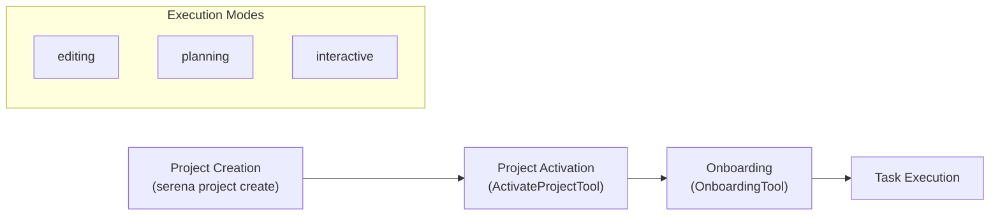

Sources: [docs/02-usage/040_workflow.md:1-20]()

---

## Stage 1: Project Creation & Indexing

### What Happens
Project creation defines the fundamental settings relevant to Serena's operation. This can be done **implicitly** by activating a directory as a project in-conversation, or **explicitly** via the CLI [docs/02-usage/040_workflow.md:20-24]().

### Explicit Project Creation
To create a project, use the following CLI command:
```bash
serena project create [options] [project directory]
```

| Option | Purpose |
|---|---|
| `--language <lang>` | Specify programming language (repeatable) [docs/02-usage/040_workflow.md:34-36]() |
| `--name <name>` | Set a custom project name [docs/02-usage/040_workflow.md:37]() |
| `--index` | Immediately index the project after creation [docs/02-usage/040_workflow.md:38]() |

The project creation logic detects dominant languages based on source files and prompts the user to enable them [docs/02-usage/040_workflow.md:31-33]().

### Indexing
Indexing pre-caches symbol information provided by language servers to avoid delays during tool calls [docs/02-usage/040_workflow.md:106-109](). This is only relevant for the `LSP` backend; the `JetBrains` backend handles indexing within the IDE [docs/02-usage/040_workflow.md:103-104]().

**Diagram: Project creation data flow**

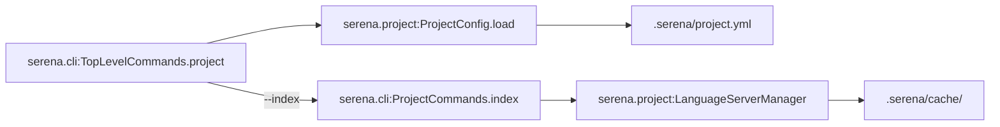

Sources: [docs/02-usage/040_workflow.md:16-115](), [src/serena/util/yaml.py:65-87]()

---

## Stage 2: Project Activation

### What Happens
Activation makes the agent aware of the project. The system loads the configuration via `Project.load` and initializes the `LanguageServerManager` or connects to the `JetBrains` backend [docs/02-usage/025_jetbrains_plugin.md:21-25]().

### Two Activation Paths
1.  **CLI flag**: Passing `--project <path|name>` at startup, common for single-project contexts like `ide` or `claude-code` [docs/02-usage/050_configuration.md:131-132]().
2.  **In-conversation tool**: The LLM calls the `ActivateProjectTool` [src/serena/tools/config_tools.py:22-39]().

**Diagram: Project activation and Backend selection**

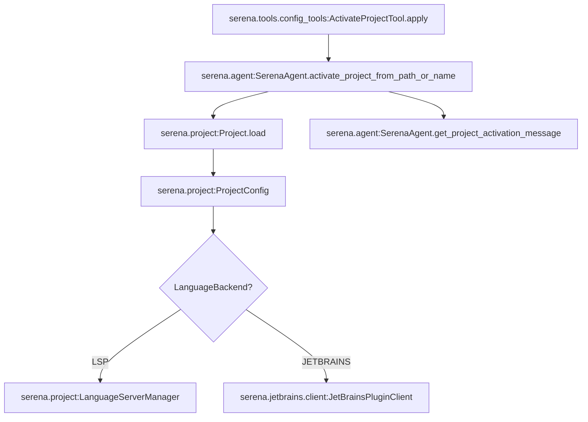

Sources: [src/serena/tools/config_tools.py:22-39](), [docs/02-usage/040_workflow.md:117-136](), [docs/02-usage/025_jetbrains_plugin.md:63-100]()

---

## Stage 3: Onboarding & Memories

### The Onboarding Process
By default, Serena performs onboarding the first time a project is used [docs/02-usage/040_workflow.md:139-142](). The `OnboardingTool` [src/serena/tools/workflow_tools.py:10-30]() provides the agent with instructions to explore the codebase. It seeds a `memory_maintenance` memory to guide the agent on documentation conventions [src/serena/memories/memory_manager.py:89-122]().

### Memories System
The `MemoryManager` [src/serena/memories/memory_manager.py:25]() handles Markdown files in `.serena/memories/` (project) or `~/.serena/memories/global/` (shared) [src/serena/memories/memory_manager.py:26-46]().

| Tool Class | Tool Name | Operation |
|---|---|---|
| `WriteMemoryTool` | `write_memory` | Saves memory; supports `global/` prefix [src/serena/tools/memory_tools.py:9-35]() |
| `ReadMemoryTool` | `read_memory` | Loads memory content [src/serena/tools/memory_tools.py:38-47]() |
| `ListMemoriesTool` | `list_memories` | Lists memories by topic [src/serena/tools/memory_tools.py:50-59]() |
| `RenameMemoryTool` | `rename_memory` | Renames memory and updates `mem:` references [src/serena/tools/memory_tools.py:74-91]() |
| `EditMemoryTool` | `edit_memory` | Regex/Literal replacement in memory [src/serena/tools/memory_tools.py:94-123]() |

Memories can reference each other using the `` `mem:NAME` `` convention. The `MemoryManager` provides `rename_references_to_memory` to maintain referential integrity during renames [src/serena/memories/memory_manager.py:123-148]().

Sources: [src/serena/tools/workflow_tools.py:10-30](), [src/serena/memories/memory_manager.py:1-150](), [src/serena/tools/memory_tools.py:1-123]()

---

## Stage 4: Modes and Contexts

### Contexts
A **context** defines the environment (e.g., `desktop-app`, `claude-code`, `ide`) [docs/02-usage/050_configuration.md:63-67](). Contexts like `claude-code` are "single-project" and disable the `ActivateProjectTool` [docs/02-usage/050_configuration.md:83-88]().

### Modes
Modes refine behavior for specific tasks [docs/02-usage/050_configuration.md:106-109]().

| Mode | Purpose | Key Effect |
|---|---|---|
| `editing` | Code modification | Optimizes for direct modification [docs/02-usage/050_configuration.md:111]() |
| `planning` | Analysis | Focuses on planning and analysis [docs/02-usage/050_configuration.md:110]() |
| `interactive` | Conversational | Suitable for back-and-forth interaction [docs/02-usage/050_configuration.md:112]() |
| `no-memories` | Privacy/Minimalism | Disables all memory tools [docs/02-usage/050_configuration.md:117]() |

**Diagram: Configuration layering**

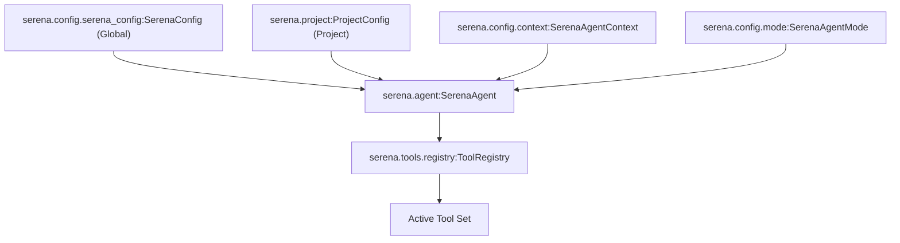

Sources: [docs/02-usage/050_configuration.md:57-135](), [src/serena/util/yaml.py:27-52]()

---

## Workflow Tools Reference

Serena provides specialized tools to manage the agent's internal state and project lifecycle.

| Tool Name | Class | Purpose |
|---|---|---|
| `onboarding` | `OnboardingTool` | Triggers project structure identification [src/serena/tools/workflow_tools.py:10-30]() |
| `initial_instructions` | `InitialInstructionsTool` | Provides the 'Serena Instructions Manual' [src/serena/tools/workflow_tools.py:32-47]() |
| `activate_project` | `ActivateProjectTool` | Switches the active project context [src/serena/tools/config_tools.py:22-39]() |
| `open_dashboard` | `OpenDashboardTool` | Opens the web dashboard for logs and stats [src/serena/tools/config_tools.py:6-20]() |
| `get_current_config` | `GetCurrentConfigTool` | Prints active projects, tools, and modes [src/serena/tools/config_tools.py:57-67]() |

Sources: [src/serena/tools/workflow_tools.py:1-64](), [src/serena/tools/config_tools.py:1-67]()

---

## Best Practices

1.  **Dashboard Monitoring**: Use the Serena Dashboard to inspect logs and tool usage statistics [docs/02-usage/060_dashboard.md:35-45]().
2.  **Memory Maintenance**: Use the `ensure_memory_maintenance_memory` functionality to define conventions for how the agent should structure future memories [src/serena/memories/memory_manager.py:89-122]().
3.  **Clean State**: It is recommended to start from a clean git state so that changes made by the agent can be easily reviewed and reverted [docs/02-usage/040_workflow.md:146-148]().
4.  **YAML Safety**: When manually editing `project.yml`, ensure values starting with `*` (like glob patterns) are quoted to avoid YAML alias errors [src/serena/util/yaml.py:77-82]().

Sources: [docs/02-usage/060_dashboard.md:1-84](), [src/serena/memories/memory_manager.py:89-122](), [src/serena/util/yaml.py:1-87](), [docs/02-usage/040_workflow.md:146-150]()

---

# Page: Custom Agents and Framework Integration

# Custom Agents and Framework Integration

<details>
<summary>Relevant source files</summary>

The following files were used as context for generating this wiki page:

- [scripts/agno_agent.py](scripts/agno_agent.py)
- [scripts/mcp_server.py](scripts/mcp_server.py)
- [src/serena/agno.py](src/serena/agno.py)
- [src/serena/gui_log_viewer.py](src/serena/gui_log_viewer.py)
- [src/serena/util/logging.py](src/serena/util/logging.py)

</details>


While Serena is primarily used via its Model Context Protocol (MCP) server, it is designed as a modular toolkit that can be integrated into any Python-based agent framework. This page details how to use Serena's semantic code tools within the Agno framework, how to integrate them into other frameworks like PydanticAI or LangGraph, and how to utilize the standalone GUI log viewer for monitoring these custom integrations.

## Agno Integration

Serena provides first-class support for the [Agno](https://agno.com) framework (formerly Phidata) through specialized toolkit and provider classes. This integration allows Agno agents to leverage Serena's full suite of symbolic code navigation and editing tools.

### SerenaAgnoToolkit

The `SerenaAgnoToolkit` class acts as a bridge between Serena's `Tool` objects and Agno's `Function` objects [src/serena/agno.py:25-27](). It automatically discovers all tools exposed by a `SerenaAgent` and converts them into a format Agno understands.

- **Discovery**: It iterates through `serena_agent.get_exposed_tool_instances()` to register functions [src/serena/agno.py:28-29]().
- **Entrypoint Wrapping**: Each tool's `apply` method is wrapped in an `entrypoint` that handles Agno's specific keyword argument passing (merging `kwargs` if explicitly passed) and exception catching [src/serena/agno.py:33-40](). It uses `tool.apply_ex(log_call=True, catch_exceptions=True, ...)` to execute the logic [src/serena/agno.py:40]().
- **Metadata**: It uses `tool.get_name_from_cls()` and `tool.get_apply_fn()` to preserve the original tool signatures and documentation for the LLM, while setting `skip_entrypoint_processing` to `True` to bypass Agno's default parameter handling [src/serena/agno.py:42-46]().

### SerenaAgnoAgentProvider

The `SerenaAgnoAgentProvider` is a singleton factory that simplifies the instantiation of an Agno agent configured with Serena capabilities [src/serena/agno.py:49-51]().

- **Agent Initialization**: It creates a `SerenaAgent` with a default `agent` context [src/serena/agno.py:108]().
- **State Management**: To support Agno's UI and conversation history, it initializes a persistent SQLite database at `temp/agno_agent_storage.db` using `agno.db.sqlite.SqliteDb` [src/serena/agno.py:117-128](). This database is deleted between sessions to ensure a fresh state [src/serena/agno.py:121-122]().
- **System Prompt**: It automatically populates the Agno agent's `system_message` using `serena_agent.create_system_prompt()` [src/serena/agno.py:134]().

### Reference Implementation: `agno_agent.py`

The script `scripts/agno_agent.py` serves as the reference implementation for running Serena within Agno's "AgentOS" environment.

- **Model Selection**: Demonstrates using `Claude` or `Gemini` models (e.g., `gemini-2.5-pro`) with Agno [scripts/agno_agent.py:16-17]().
- **Serving**: Uses `AgentOS` to serve the agent via an HTTP server, making it compatible with the Agno UI [scripts/agno_agent.py:23-33]().

**Sources:** [src/serena/agno.py:25-143](), [scripts/agno_agent.py:1-34]()

## Integrating with Other Frameworks

Serena tools can be integrated into other frameworks (like PydanticAI or LangGraph) by manually accessing the tool instances from a `SerenaAgent`.

### Tool Extraction Pattern
The standard pattern for framework integration involves initializing a `SerenaAgent` and then retrieving the tool instances to pass to the external framework's tool registration system.

| Step | Action | Code Reference |
| :--- | :--- | :--- |
| 1 | Initialize `SerenaAgent` | `agent = SerenaAgent(project_file, ...)` [src/serena/agno.py:108]() |
| 2 | Retrieve Tool Instances | `tools = agent.get_exposed_tool_instances()` [src/serena/agno.py:28]() |
| 3 | Map to Framework | Wrap `tool.apply_ex` in framework-specific decorators. |

### Data Flow: Serena to External Framework
This diagram illustrates how a Serena tool is bridged into an external agent's execution loop.

**Serena Tool Integration Flow**
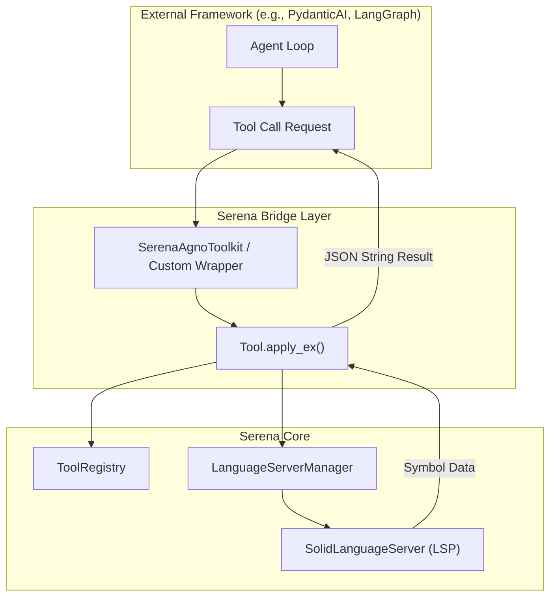
**Sources:** [src/serena/agno.py:33-40](), [src/serena/agent.py:17]()

## Standalone Monitoring: GUI Log Viewer

When running Serena outside of the standard MCP environment (where logs might be hidden or interleaved with framework logs), the `GuiLogViewer` provides a dedicated Tkinter-based window for real-time monitoring [src/serena/gui_log_viewer.py:26-31]().

### Key Features
- **Threaded Execution**: Runs in a separate thread via `start()` to avoid blocking the agent's execution loop [src/serena/gui_log_viewer.py:77-84]().
- **Memory Integration**: Can be initialized with a `MemoryLogHandler` to display historical logs and receive new ones via callbacks [src/serena/gui_log_viewer.py:72-75]().
- **Visual Cues**: Supports color-coding based on `LogLevel` (DEBUG, INFO, WARNING, ERROR) [src/serena/gui_log_viewer.py:64-70]() and bolding of Serena tool names [src/serena/gui_log_viewer.py:94-102]().
- **Dashboard Link**: Includes a menu option to copy the `SerenaDashboardAPI` URL to the clipboard [src/serena/gui_log_viewer.py:104-113]().

### Integration with Logging System
The `MemoryLogHandler` acts as the central hub, collecting logs from the Python `logging` module and pushing them to the GUI's `message_queue` via an emit callback [src/serena/util/logging.py:31-48]().

**Natural Language to Code Entity Mapping: Logging and GUI**
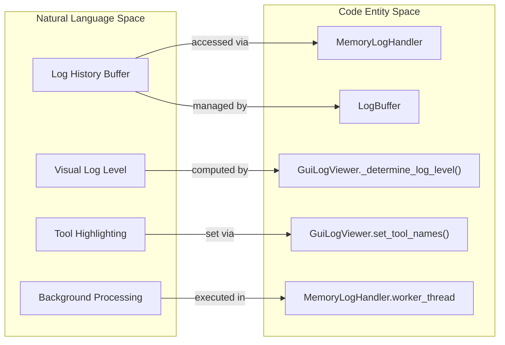

**Sources:** [src/serena/gui_log_viewer.py:27-147](), [src/serena/util/logging.py:26-113]()

## Reference: Scripting Serena Directly

For developers who do not wish to use an agent framework, Serena can be scripted directly. This is useful for automated refactoring scripts or custom CLI tools.

### Implementation Pattern
1.  **Initialize**: Create a `SerenaAgent` instance for a specific project path [src/serena/agno.py:108]().
2.  **Access Tools**: Retrieve specific tools from the agent's registry or use `get_exposed_tool_instances()` [src/serena/agno.py:28]().
3.  **Execute**: Call `tool.apply_ex(...)` directly to perform symbolic operations like `FindSymbolTool` or `ReplaceSymbolBodyTool`.

**Sources:** [src/serena/agno.py:25-47](), [src/serena/agent.py:17]()

---

# Page: System Architecture

# System Architecture

<details>
<summary>Relevant source files</summary>

The following files were used as context for generating this wiki page:

- [.serena/project.yml](.serena/project.yml)
- [scripts/demo_run_tools.py](scripts/demo_run_tools.py)
- [scripts/print_tool_overview.py](scripts/print_tool_overview.py)
- [src/serena/agent.py](src/serena/agent.py)
- [src/serena/analytics.py](src/serena/analytics.py)
- [src/serena/cli.py](src/serena/cli.py)
- [src/serena/config/serena_config.py](src/serena/config/serena_config.py)
- [src/serena/dashboard.py](src/serena/dashboard.py)
- [src/serena/mcp.py](src/serena/mcp.py)
- [src/serena/project.py](src/serena/project.py)
- [src/serena/resources/dashboard/dashboard.css](src/serena/resources/dashboard/dashboard.css)
- [src/serena/resources/dashboard/dashboard.js](src/serena/resources/dashboard/dashboard.js)
- [src/serena/resources/dashboard/index.html](src/serena/resources/dashboard/index.html)
- [src/serena/resources/project.template.yml](src/serena/resources/project.template.yml)
- [src/serena/resources/serena_config.template.yml](src/serena/resources/serena_config.template.yml)
- [src/serena/util/pypi.py](src/serena/util/pypi.py)
- [test/serena/config/test_global_ignored_paths.py](test/serena/config/test_global_ignored_paths.py)
- [test/serena/config/test_serena_config.py](test/serena/config/test_serena_config.py)
- [test/serena/test_cli_project_commands.py](test/serena/test_cli_project_commands.py)
- [test/serena/test_dashboard.py](test/serena/test_dashboard.py)
- [test/serena/test_edit_marker.py](test/serena/test_edit_marker.py)
- [test/serena/test_mcp.py](test/serena/test_mcp.py)

</details>


This page describes the major structural components of Serena, how they are organized, and how they interact at runtime. The focus is on component boundaries, data flow, and the specific classes and modules that implement each layer.

For deeper coverage of individual subsystems, see the child pages:
- Configuration details → [Configuration Management](#4)
- SerenaAgent internals → [SerenaAgent Core](#3.1)
- MCP server specifics → [MCP Server Integration](#3.2)
- Task execution details → [Task Execution System](#3.3)
- Dashboard details → [Dashboard and Monitoring](#3.4)
- Prompt assembly → [Prompt Factory and System Prompt](#3.5)
- Language server internals → [Language Server Integration](#6)
- Tool system internals → [Tool System](#7)

---

## Component Overview

The table below maps each major concern to its primary class and source file.

| Component | Primary Class | Source File |
|---|---|---|
| Central agent orchestrator | `SerenaAgent` | [src/serena/agent.py:227-383]() |
| MCP server factory | `SerenaMCPFactory` | [src/serena/mcp.py:144-173]() |
| Tool discovery and registry | `ToolRegistry` | [src/serena/agent.py:59-60]() |
| Active tool set computation | `ToolSet`, `AvailableTools` | [src/serena/agent.py:81-183]() |
| Project state | `Project` | [src/serena/project.py:32-150]() |
| Per-project memory | `MemoryManager` | [src/serena/project.py:46-54]() |
| Language server lifecycle | `LanguageServerManager` | [src/serena/agent.py:45-45]() |
| Web dashboard | `SerenaDashboardAPI` | [src/serena/dashboard.py:192-221]() |
| Linear task queue | `TaskExecutor` | [src/serena/agent.py:49-49]() |
| Analytics | `ToolUsageStats` | [src/serena/analytics.py:25-50]() |
| In-memory log capture | `MemoryLogHandler` | [src/serena/util/logging.py:63-63]() |
| Prompt assembly | `SerenaPromptFactory` | [src/serena/prompt_factory.py:39-39]() |
| Global configuration | `SerenaConfig` | [src/serena/config/serena_config.py:210-210]() |
| Per-project configuration | `ProjectConfig` | [src/serena/config/serena_config.py:147-147]() |
| Context definition | `SerenaAgentContext` | [src/serena/config/context_mode.py:22-22]() |
| Mode definition | `SerenaAgentMode` | [src/serena/config/context_mode.py:22-22]() |

Sources: [src/serena/agent.py:1-71](), [src/serena/mcp.py:1-33](), [src/serena/dashboard.py:1-36](), [src/serena/config/serena_config.py:1-50]()

---

## High-Level Architecture

**Diagram: Top-Level Component Relationships**

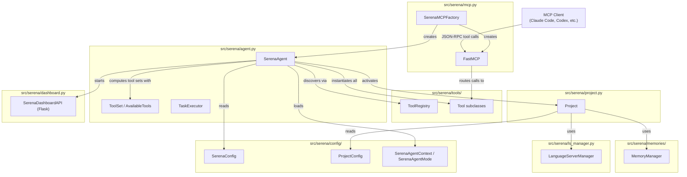

Sources: [src/serena/agent.py:227-383](), [src/serena/mcp.py:144-173](), [src/serena/project.py:32-150](), [src/serena/dashboard.py:192-221]()

---

## SerenaAgent

`SerenaAgent` ([src/serena/agent.py:227-383]()) is the central runtime object. One agent instance exists per Serena process. Its constructor performs the following orchestration:

1. **Configuration**: Reads `SerenaConfig` (global settings) and `SerenaPaths` [src/serena/agent.py:255-260]().
2. **Tool Initialization**: Instantiates every `Tool` subclass found by `ToolRegistry`: `{tool_class: tool_class(self) for tool_class in ToolRegistry().get_all_tool_classes()}` ([src/serena/agent.py:302]()).
3. **Language Backend**: Resolves the backend (`LanguageBackend.LSP` or `LanguageBackend.JETBRAINS`) [src/serena/agent.py:327-332]().
4. **Execution**: Creates a `TaskExecutor` for serialized tool execution [src/serena/agent.py:335]().
5. **Prompts**: Creates a `SerenaPromptFactory` to manage LLM system instructions [src/serena/agent.py:338]().
6. **Project**: Optionally activates a startup project [src/serena/agent.py:356-357]().
7. **Tool Filtering**: Computes the base tool set and the initial active tool set [src/serena/agent.py:361-364]().
8. **Dashboard**: Starts `SerenaDashboardAPI` (Flask server) if enabled [src/serena/agent.py:368-382]().

### Tool Set Layers

`SerenaAgent` maintains two distinct tool collections to manage visibility vs. permission:

| Collection | Field | Mutability | Purpose |
|---|---|---|---|
| Exposed tools | `_exposed_tools` | Fixed at startup | The set of tools reported to the MCP client [src/serena/agent.py:236]() |
| Active tools | `_active_tools` | Updated dynamically | The set of tools currently permitted to execute based on mode/project [src/serena/agent.py:237]() |

Sources: [src/serena/agent.py:230-240](), [src/serena/agent.py:641-666]()

---

## Tool Set Computation

**Diagram: How the Exposed and Active Tool Sets Are Computed**

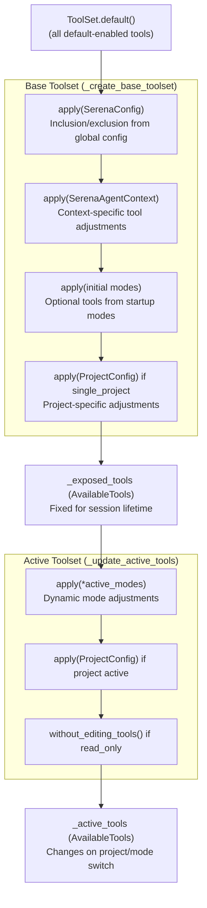

Sources: [src/serena/agent.py:384-449](), [src/serena/agent.py:641-666](), [src/serena/agent.py:121-183]()

The `ToolSet.apply()` method ([src/serena/agent.py:137-183]()) processes a sequence of `ToolInclusionDefinition` objects. It supports both fixed tool sets (replacing all previous) and incremental adjustments (including optional tools or excluding existing ones).

---

## Tool System

### Tool Class Hierarchy

**Diagram: Tool Class Structure**

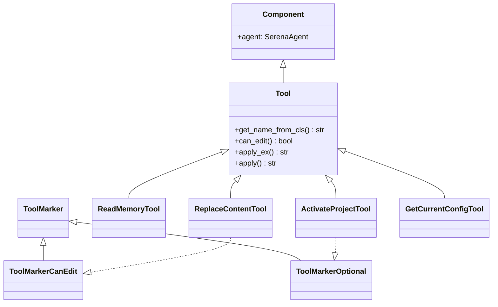

Sources: [src/serena/agent.py:50-60](), [src/serena/tools/__init__.py:1-50]()

### ToolRegistry

`ToolRegistry` is a singleton that uses inspection to discover all `Tool` subclasses at import time. It provides:

- `get_all_tool_classes()` — returns all discovered `Tool` subclasses.
- `get_tool_names_default_enabled()` — names of tools not marked as `ToolMarkerOptional` ([src/serena/agent.py:135]()).
- `check_valid_tool_name(name)` — validates that a tool name exists in the registry ([src/serena/agent.py:162]()).

---

## MCP Server Layer

`SerenaMCPFactory` ([src/serena/mcp.py:144-173]()) bridges between the Model Context Protocol and `SerenaAgent`.

**Diagram: MCP Tool Call Flow**

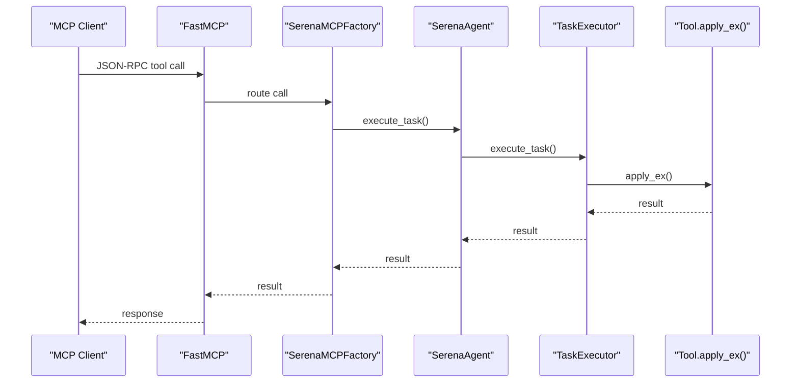

Sources: [src/serena/mcp.py:144-173](), [src/serena/agent.py:683-694](), [src/serena/task_executor.py:18-175]()

### Schema Sanitization

`SerenaMCPFactory._sanitize_for_openai_tools()` ([src/serena/mcp.py:171-173]()) processes Pydantic-generated JSON schemas to comply with the OpenAI tool calling specification, specifically handling type requirements like `number` vs `integer`.

---

## Project System

`Project` ([src/serena/project.py:32-150]()) encapsulates state for a single active codebase.

| Attribute | Type | Purpose |
|---|---|---|
| `project_root` | `str` | Absolute path to the codebase |
| `project_config` | `ProjectConfig` | Loaded from `.serena/project.yml` |
| `memory_manager` | `MemoryManager` | Manages persistent markdown files in `.serena/memories/` |
| `language_server_manager` | `LanguageServerManager` | Lifecycle management for LSP servers |

`Project.load()` ([src/serena/project.py:136-149]()) resolves the project root and configuration. `MemoryManager` ([src/serena/project.py:50-54]()) provides the persistence layer for agent "memories" stored as markdown.

---

## Language Server Layer

`LanguageServerManager` ([src/serena/ls_manager.py:60-200]()) manages language server instances. For polyglot projects, it coordinates multiple servers.

Two backends are supported:
- **LSP**: Spawns language servers via the SolidLSP library.
- **JetBrains**: Communicates with the Serena plugin via `JetBrainsPluginClient` ([src/serena/jetbrains/jetbrains_plugin_client.py:1-50]()).

---

## Dashboard and Monitoring

`SerenaDashboardAPI` ([src/serena/dashboard.py:192-221]()) is a Flask-based web application providing real-time visibility into the agent:

- **Live Logs**: Streamed from the agent via `MemoryLogHandler` [src/serena/dashboard.py:206]().
- **Config Overview**: Active projects, tools, and modes [src/serena/dashboard.py:60-77]().
- **Analytics**: Tool usage counts and token estimation via `ToolUsageStats` [src/serena/dashboard.py:202]().
- **Task Monitoring**: Status of the `TaskExecutor` queue [src/serena/dashboard.py:126-142]().

---

## Startup Sequence

**Diagram: SerenaAgent Initialization Order**

```mermaid
flowchart TD
    A["Read SerenaConfig\n(global config)"]
    B["Instantiate Tools\n(via ToolRegistry)"]
    C["Resolve LanguageBackend\n(LSP or JetBrains)"]
    D["Create TaskExecutor\n(serializes operations)"]
    E["Activate Project\n(if specified)"]
    F["Start Dashboard\n(Flask thread)"]
    G["Agent Ready"]

    A --> B --> C --> D --> E --> F --> G
```

Sources: [src/serena/agent.py:227-383](), [src/serena/mcp.py:144-173]()

---

# Page: SerenaAgent Core

# SerenaAgent Core

<details>
<summary>Relevant source files</summary>

The following files were used as context for generating this wiki page:

- [.serena/project.yml](.serena/project.yml)
- [scripts/gen_prompt_factory.py](scripts/gen_prompt_factory.py)
- [src/serena/agent.py](src/serena/agent.py)
- [src/serena/config/context_mode.py](src/serena/config/context_mode.py)
- [src/serena/config/serena_config.py](src/serena/config/serena_config.py)
- [src/serena/constants.py](src/serena/constants.py)
- [src/serena/project.py](src/serena/project.py)
- [src/serena/prompt_factory.py](src/serena/prompt_factory.py)
- [src/serena/resources/config/contexts/agent.yml](src/serena/resources/config/contexts/agent.yml)
- [src/serena/resources/config/contexts/context.template.yml](src/serena/resources/config/contexts/context.template.yml)
- [src/serena/resources/config/contexts/desktop-app.yml](src/serena/resources/config/contexts/desktop-app.yml)
- [src/serena/resources/config/modes/mode.template.yml](src/serena/resources/config/modes/mode.template.yml)
- [src/serena/resources/project.template.yml](src/serena/resources/project.template.yml)
- [src/serena/resources/serena_config.template.yml](src/serena/resources/serena_config.template.yml)
- [src/serena/task_executor.py](src/serena/task_executor.py)
- [test/serena/config/test_serena_config.py](test/serena/config/test_serena_config.py)

</details>


The `SerenaAgent` class serves as the central orchestrator for all Serena operations, coordinating between configuration management, tool execution, language server integration, and project handling. This document covers the core architecture, lifecycle management, and internal coordination mechanisms of the `SerenaAgent`.

## Core Architecture Overview

The `SerenaAgent` acts as the central hub that coordinates multiple subsystems, each with distinct responsibilities:

Title: SerenaAgent Component Architecture
```mermaid
graph TB
    subgraph "SerenaAgent_Core_Components"
        SA["SerenaAgent"]
        
        subgraph "Configuration_Management"
            SC["SerenaConfig"]
            SAC["SerenaAgentContext"]
            SAM["SerenaAgentMode[]"]
            TS["ToolSet"]
        end
        
        subgraph "Project_Management"
            AP["_active_project: Project"]
            SLS["LanguageServerManager"]
            MM["MemoryManager"]
            TE["TaskExecutor"]
        end
        
        subgraph "Tool_System"
            TR["ToolRegistry"]
            AT["_all_tools: dict[type[Tool], Tool]"]
            ET["_exposed_tools: AvailableTools"]
            ACT["_active_tools: dict[type[Tool], Tool]"]
        end
        
        subgraph "Monitoring_Systems"
            TUS["ToolUsageStats"]
            DAB["SerenaDashboardAPI"]
        end
    end
    
    SA --> SC
    SA --> SAC
    SA --> SAM
    SA --> AP
    SA --> AT
    SA --> ET
    SA --> ACT
    SA --> TE
    SA --> TUS
    SA --> DAB
    
    AP --> SLS
    AP --> MM
    
    SC --> TS
    SAC --> TS
    SAM --> TS
    TS --> ET
    ET --> ACT
```

Sources: [src/serena/agent.py:242-450](), [src/serena/agent.py:30-47]()

## Agent Lifecycle and Initialization

The `SerenaAgent` initialization process involves several critical phases executed in a specific order:

Title: SerenaAgent Initialization Sequence
```mermaid
sequenceDiagram
    participant Client
    participant SA as "SerenaAgent.__init__"
    participant SC as "SerenaConfig"
    participant TR as "ToolRegistry"
    participant SDA as "SerenaDashboardAPI"
    participant Project
    
    Client->>SA: __init__(project, context, modes)
    SA->>SC: SerenaConfig.from_config_file()
    SA->>TR: ToolRegistry().get_all_tool_classes()
    SA->>SA: _instantiate_all_tools()
    
    alt web_dashboard enabled
        SA->>SDA: run_in_thread()
        SDA-->>SA: dashboard_thread, port
    end
    
    SA->>SA: _determine_base_tool_set()
    SA->>SA: _create_exposed_tools()
    
    alt project specified
        SA->>SA: activate_project_from_path_or_name(project)
        SA->>Project: load()
    end
```

The initialization parameters control agent behavior:

| Parameter | Type | Description |
|-----------|------|-------------|
| `project` | `str \| None` | Project path or registered name to activate immediately [src/serena/agent.py:254]() |
| `context` | `SerenaAgentContext \| None` | Operating context (affects tool availability and prompts) [src/serena/agent.py:258]() |
| `modes` | `list[SerenaAgentMode] \| None` | Active modes for additional tool filtering [src/serena/agent.py:259]() |
| `serena_config` | `SerenaConfig \| None` | Configuration override (defaults to file-based config) [src/serena/agent.py:257]() |

Sources: [src/serena/agent.py:242-368](), [src/serena/agent.py:643-664]()

## Tool Management and ToolRegistry

Serena uses a tool management system where tools are instantiated once and then filtered based on context, mode, and project state.

### Tool Sets and Filtering
The agent distinguishes between different sets of tools:
*   **All Tools (`_all_tools`)**: Every tool class discovered by `ToolRegistry` is instantiated at startup [src/serena/agent.py:311-312]().
*   **Exposed Tools (`_exposed_tools`)**: The set of tools visible to the LLM/MCP client, represented by the `AvailableTools` class [src/serena/agent.py:81-110](). It is determined by the `SerenaAgentContext` and base `SerenaConfig` [src/serena/agent.py:315-316]().
*   **Active Tools (`_active_tools`)**: The subset of exposed tools that are currently executable, further filtered by active `SerenaAgentMode` and `Project` configuration [src/serena/agent.py:317]().

### ToolRegistry and ToolSet
The `ToolRegistry` is a singleton that scans the codebase for subclasses of `Tool`. It categorizes tools using markers like `ToolMarkerCanEdit` and `ToolMarkerOptional`.

The `ToolSet` class provides the logic for applying `ToolInclusionDefinition` objects to compute the final set of tools [src/serena/agent.py:112-218](). It handles legacy name mapping, such as mapping `replace_regex` to `ReplaceContentTool` [src/serena/agent.py:117-120]().

Key logic in `ToolSet.apply`:
1.  **Fixed Mode**: If `fixed_tools` is defined, the existing set is cleared and replaced [src/serena/agent.py:158-164]().
2.  **Incremental Mode**: Tools are added via `included_optional_tools` and removed via `excluded_tools` [src/serena/agent.py:165-182]().

Sources: [src/serena/agent.py:81-218](), [src/serena/config/serena_config.py:143-170]()

## Mode and Context Management

The `SerenaAgent` dynamically adjusts its capabilities through `SerenaAgentContext` and `SerenaAgentMode`.

### System Prompt Generation
The system prompt is generated by the `SerenaPromptFactory` [src/serena/agent.py:48](). It combines:
1.  **Context Prompt**: Instructions specific to the environment (e.g., "claude-code" or "ide") [src/serena/agent.py:339]().
2.  **Mode Prompts**: Instructions for active modes (e.g., "planning" or "editing") [src/serena/agent.py:340]().
3.  **Project Prompt**: Project-specific `initial_prompt` from `project.yml` [src/serena/agent.py:342]().

### Mode Switching
Modes can be switched at runtime using the `set_modes` method, which triggers a recalculation of active tools via `_update_active_tools` [src/serena/agent.py:586-604]().

Title: Tool Set Computation Logic
```mermaid
graph LR
    subgraph "Configuration_Cascade"
        SC["SerenaConfig"]
        SAC["SerenaAgentContext"]
        SAM["SerenaAgentMode[]"]
        PC["ProjectConfig"]
    end
    
    SC -->|Base_Set| BTS["Base ToolSet"]
    SAC -->|Filters| BTS
    BTS -->|Exposes| ET["Exposed Tools"]
    
    SAM -->|Overlays| ATS["Active ToolSet"]
    PC -->|Final_Filters| ATS
    ATS -->|Enables| AT["Active Tools"]
```

Sources: [src/serena/agent.py:336-368](), [src/serena/agent.py:586-604](), [src/serena/config/context_mode.py:34-153]()

## Project Lifecycle and Activation

Project activation is the process of binding the agent to a specific codebase.

1.  **Loading**: `Project.load()` reads the `project.yml` and initializes the `MemoryManager` [src/serena/project.py:137-149]().
2.  **Activation**: `_activate_project()` sets the `_active_project` attribute and refreshes tool availability [src/serena/agent.py:665-699]().
3.  **Language Servers**: If the `LanguageBackend` is `LSP`, the agent starts the required language servers via `LanguageServerManager` [src/serena/agent.py:770-803]().
4.  **Ignore Specs**: `Project` gathers ignore patterns from `.gitignore`, project config, and global config asynchronously [src/serena/project.py:79-111]().

Sources: [src/serena/agent.py:665-699](), [src/serena/agent.py:770-803](), [src/serena/project.py:33-111]()

## Task Execution System

The `SerenaAgent` uses a `TaskExecutor` to manage linear execution of background tasks, such as project indexing or complex tool operations.

*   **Queueing**: Tasks are added to a thread-safe queue [src/serena/task_executor.py:26]().
*   **Timeouts**: Tasks can be assigned a timeout, after which the executor continues to the next task while logging a warning [src/serena/task_executor.py:143-146]().
*   **Callbacks**: A `task_completion_callback` can be registered to trigger UI updates (e.g., in the dashboard) after every task [src/serena/task_executor.py:152-157]().

Sources: [src/serena/task_executor.py:18-157]()

## Shutdown Procedure

The `shutdown()` method ensures a clean exit by:
1.  Stopping the `TaskExecutor` to prevent new tasks [src/serena/agent.py:805-808]().
2.  Shutting down the `SerenaDashboardAPI` if it was running [src/serena/agent.py:810-813]().
3.  Shutting down the active project, which includes stopping all language server processes [src/serena/agent.py:815-817]().

Sources: [src/serena/agent.py:805-821]()

---

# Page: MCP Server Integration

# MCP Server Integration

<details>
<summary>Relevant source files</summary>

The following files were used as context for generating this wiki page:

- [.serena/project.yml](.serena/project.yml)
- [scripts/print_tool_overview.py](scripts/print_tool_overview.py)
- [src/serena/agent.py](src/serena/agent.py)
- [src/serena/cli.py](src/serena/cli.py)
- [src/serena/config/serena_config.py](src/serena/config/serena_config.py)
- [src/serena/mcp.py](src/serena/mcp.py)
- [src/serena/project.py](src/serena/project.py)
- [src/serena/resources/project.template.yml](src/serena/resources/project.template.yml)
- [src/serena/resources/serena_config.template.yml](src/serena/resources/serena_config.template.yml)
- [test/serena/config/test_global_ignored_paths.py](test/serena/config/test_global_ignored_paths.py)
- [test/serena/config/test_serena_config.py](test/serena/config/test_serena_config.py)
- [test/serena/test_cli_project_commands.py](test/serena/test_cli_project_commands.py)
- [test/serena/test_edit_marker.py](test/serena/test_edit_marker.py)
- [test/serena/test_mcp.py](test/serena/test_mcp.py)

</details>


This page covers how Serena exposes its tool capabilities as an MCP (Model Context Protocol) server. Specifically, it documents the `SerenaMCPFactory` class, how Serena `Tool` instances are converted into MCP tools, schema sanitization for OpenAI compatibility, request routing, and the server lifecycle.

For the `SerenaAgent` internals (tool registry, active tool computation, project management), see [SerenaAgent Core](#3.1). For transport options and client configuration (Claude Desktop, Codex, etc.), see [Client Integration](#2.2). For how individual tools are implemented and executed, see [Tool Architecture and Registry](#7.1) and [Tool Execution Pipeline](#7.2).

---

## Overview

The MCP layer is implemented entirely in `src/serena/mcp.py`. It acts as an adapter between the MCP protocol (via the `fastmcp` library) and the Serena tool system. The central class is `SerenaMCPFactory`, which:

1. Instantiates a `SerenaAgent` with the desired configuration [src/serena/mcp.py:326-328]().
2. Converts each exposed `Tool` instance into a `SerenaFastMCPTool` [src/serena/mcp.py:255-257]().
3. Registers those tools with a `FastMCP` server during its lifespan startup [src/serena/mcp.py:343-345]().
4. Routes incoming MCP tool calls to `Tool.apply_ex()` [src/serena/mcp.py:98-102]().

The entry point for starting the MCP server in the CLI is `serena start-mcp-server`, defined in `src/serena/cli.py` [src/serena/cli.py:226-231]().

**Sources:** [src/serena/mcp.py:1-50](), [src/serena/mcp.py:145-148](), [src/serena/cli.py:226-231]()

---

## Key Classes

| Class / Symbol | File | Role |
|---|---|---|
| `SerenaMCPFactory` | `src/serena/mcp.py` | Factory that creates and configures the MCP server [src/serena/mcp.py:145-148](). |
| `SerenaMCPRequestContext` | `src/serena/mcp.py` | Dataclass holding the `SerenaAgent` reference per request [src/serena/mcp.py:48-50](). |
| `SerenaFastMCPTool` | `src/serena/mcp.py` | Subclass of `FastMCPTool` that wraps Serena's `Tool` logic [src/serena/mcp.py:53-127](). |
| `FastMCP` | `mcp.server.fastmcp.server` | Third-party MCP server framework [src/serena/mcp.py:15-15](). |
| `SerenaAgent` | `src/serena/agent.py` | Core agent; provides exposed tool instances [src/serena/agent.py:228-232](). |
| `Tool` | `src/serena/tools/tools_base.py` | Serena tool base class [src/serena/mcp.py:30-30](). |

**Sources:** [src/serena/mcp.py:48-53](), [src/serena/agent.py:228-232](), [src/serena/mcp.py:15-30]()

---

## SerenaMCPFactory Lifecycle

**Title: SerenaMCPFactory — Server Creation and Startup Sequence**

```mermaid
sequenceDiagram
    participant CLI as "cli.py / start_mcp_server"
    participant Factory as "SerenaMCPFactory"
    participant Config as "SerenaConfig"
    participant Agent as "SerenaAgent"
    participant MCP as "FastMCP"
    participant ToolMgr as "mcp._tool_manager"

    CLI->>Factory: "__init__(transport, context, project)"
    CLI->>Factory: "create_mcp_server(...)"
    Factory->>Config: "from_config_file()"
    Factory->>Config: "apply parameter overrides"
    Factory->>Factory: "_create_serena_agent(config, ...)"
    Factory->>Agent: "SerenaAgent(config, context, ...)"
    Agent-->>Factory: "agent instance"
    Factory->>MCP: "FastMCP(lifespan=server_lifespan, ...)"
    MCP-->>Factory: "mcp instance"
    Factory-->>CLI: "FastMCP instance"
    CLI->>MCP: "mcp.run(transport)"
    MCP->>Factory: "server_lifespan(mcp_server)"
    Factory->>Factory: "_set_mcp_tools(mcp, openai_tool_compatible)"
    Factory->>ToolMgr: "register SerenaFastMCPTool for each exposed tool"
    MCP-->>CLI: "server running"
```

**Sources:** [src/serena/mcp.py:271-349](), [src/serena/mcp.py:150-170]()

### Constructor

`SerenaMCPFactory.__init__` accepts:

- `transport` — The transport to use (`stdio`, `sse`, or `streamable-http`) [src/serena/mcp.py:165]().
- `context` — context name or path; loaded via `SerenaAgentContext.load(context)` [src/serena/mcp.py:166]().
- `project` — optional project path or name passed to the agent [src/serena/mcp.py:167]().
- `memory_log_handler` — optional `MemoryLogHandler` for in-process log capture [src/serena/mcp.py:169]().

The agent is **not** created in `__init__`; it is created inside `create_mcp_server()` [src/serena/mcp.py:326]().

**Sources:** [src/serena/mcp.py:150-170]()

### `create_mcp_server()`

[src/serena/mcp.py:271-336]()

This method:
1. Loads `SerenaConfig` from the config file [src/serena/mcp.py:301]().
2. Applies any CLI overrides (log level, tool timeout, language backend, dashboard flags, etc.) [src/serena/mcp.py:303-324]().
3. Calls `_create_serena_agent` to instantiate `SerenaAgent` [src/serena/mcp.py:326]().
4. Patches `Settings.model_config` to prevent `.env` files in project directories from interfering with MCP settings [src/serena/mcp.py:330]().
5. Generates the initial system prompt via `self.agent.create_system_prompt()` and passes it as `instructions` to `FastMCP` [src/serena/mcp.py:332-334]().
6. Returns the `FastMCP` instance (not yet running) [src/serena/mcp.py:336]().

### `server_lifespan()`

[src/serena/mcp.py:338-345]()

An `asynccontextmanager` used as the FastMCP lifespan hook. On startup:
- Determines `openai_tool_compatible` based on context (e.g., `chatgpt`, `codex`, `oaicompat-agent`) [src/serena/mcp.py:341]().
- Calls `_set_mcp_tools(mcp_server, openai_tool_compatible)` to register all tools [src/serena/mcp.py:343]().

---

## Tool Conversion: `SerenaFastMCPTool`

`SerenaFastMCPTool` encapsulates the logic for converting a Serena `Tool` instance into a `fastmcp` compatible tool.

**Title: Tool Conversion Data Flow in SerenaFastMCPTool**

```mermaid
flowchart TD
    SerenaTool["Tool instance\n(tool.get_apply_docstring,\ntool.get_name,\ntool.get_apply_fn_metadata)"]
    SchemaRaw["arg_model.model_json_schema()\n(raw Pydantic schema)"]
    SchemaSanitized["_sanitize_for_openai_tools(schema)\n(if openai_tool_compatible)"]
    DocstringParse["docstring_parser.parse(func_doc)\n-> description, params, returns"]
    DescBuild["Build func_doc:\ncontext.tool_description_overrides\nOR docstring.description\n+ docstring.returns"]
    ParamDesc["Inject param descriptions\ninto parameters[properties]"]
    ExecFn["execute_fn(**kwargs)\n-> tool.apply_ex(log_call=True,\n   catch_exceptions=False, **kwargs)"]
    Annotations["ToolAnnotations\n(readOnlyHint, destructiveHint)\nfrom tool.can_edit()"]
    MCPToolOut["SerenaFastMCPTool(\n  fn=execute_fn,\n  name, description,\n  parameters,\n  context_kwarg='mcp_ctx',\n  annotations\n)"]

    SerenaTool --> SchemaRaw
    SchemaRaw --> SchemaSanitized
    SerenaTool --> DocstringParse
    DocstringParse --> DescBuild
    DescBuild --> ParamDesc
    SchemaSanitized --> ParamDesc
    ParamDesc --> MCPToolOut
    ExecFn --> MCPToolOut
    Annotations --> MCPToolOut
```

**Sources:** [src/serena/mcp.py:53-127](), [test/serena/test_mcp.py:53-71]()

### Description Construction

The MCP tool description is assembled from the docstring of `Tool.apply()` [src/serena/mcp.py:62-87]():

1. If the context defines a `tool_description_overrides` entry for this tool name, that string is used verbatim [src/serena/mcp.py:73-76]().
2. Otherwise, `docstring.description` is used [src/serena/mcp.py:77-78]().
3. If a `:return:` section exists, it is appended as `"Returns <return description>."` [src/serena/mcp.py:84-87]().

Parameter descriptions are extracted from `:param name:` entries and injected into `parameters["properties"][name]["description"]`, with normalization (capitalization and trailing periods) [src/serena/mcp.py:90-96]().

### Tool Annotations

Each `SerenaFastMCPTool` receives a `ToolAnnotations` object based on `tool.can_edit()` [src/serena/mcp.py:108-113]():

- `readOnlyHint=True` when `tool.can_edit()` returns `False` [src/serena/mcp.py:111]().
- `destructiveHint=True` when `tool.can_edit()` returns `True` [src/serena/mcp.py:112]().

**Sources:** [src/serena/mcp.py:108-113](), [test/serena/test_edit_marker.py:4-14]()

---

## Request Routing

When an MCP client calls a tool, the `FastMCP` framework invokes the `execute_fn` closure created during `SerenaFastMCPTool` initialization [src/serena/mcp.py:98-102]().

**Title: MCP Request Routing to Tool.apply_ex()**

```mermaid
flowchart LR
    MCPClient["MCP Client\n(Claude, Codex, etc.)"]
    FastMCPServer["FastMCP\n(mcp._tool_manager)"]
    ExecuteFn["execute_fn(**kwargs)\nclosure in SerenaFastMCPTool"]
    ApplyEx["Tool.apply_ex(\n  log_call=True,\n  catch_exceptions=False,\n  **kwargs\n)"]
    ApplyMethod["Tool.apply(**kwargs)\n(concrete tool implementation)"]
    AgentTaskExec["SerenaAgent.execute_task()\nor direct call"]

    MCPClient -->|"tool call request"| FastMCPServer
    FastMCPServer -->|"dispatch by tool name"| ExecuteFn
    ExecuteFn --> ApplyEx
    ApplyEx --> AgentTaskExec
    AgentTaskExec --> ApplyMethod
    ApplyMethod -->|"str result"| FastMCPServer
    FastMCPServer -->|"tool result response"| MCPClient
```

The `context_kwarg="mcp_ctx"` field on `SerenaFastMCPTool` tells the `fastmcp` framework to pass the MCP request context as a keyword argument named `mcp_ctx` [src/serena/mcp.py:124](). This allows threading `SerenaMCPRequestContext` through to the tool execution [src/serena/mcp.py:48-50]().

**Sources:** [src/serena/mcp.py:98-102](), [src/serena/mcp.py:124](), [test/serena/test_mcp.py:73-82]()

---

## OpenAI Schema Sanitization

`SerenaMCPFactory._sanitize_for_openai_tools()` rewrites Pydantic-generated JSON schemas to comply with OpenAI's tool schema restrictions [src/serena/mcp.py:175-247](). It is applied when `openai_tool_compatible=True`, typically for the `chatgpt`, `codex`, and `oaicompat-agent` contexts [src/serena/mcp.py:341]().

The transformations applied recursively include:

| Input construct | Output |
|---|---|
| `"type": "integer"` | `"type": "number"` + `"multipleOf": 1` [src/serena/mcp.py:196-200]() |
| `"type": ["integer", "null"]` | `"type": "number"` (null removed) [src/serena/mcp.py:203-210]() |
| `anyOf: [{type: X}, {type: null}]` | Collapsed to `"type": X` [src/serena/mcp.py:224-231]() |
| Integer-only `"enum"` arrays | `"type": "number"` added [src/serena/mcp.py:213-218]() |
| Duplicate `oneOf`/`anyOf` entries | Collapsed to single schema [src/serena/mcp.py:237-241]() |

**Sources:** [src/serena/mcp.py:175-247]()

---

## Tool Registration Internals

`_set_mcp_tools()` directly manipulates `mcp_server._tool_manager._tools` (a dict from tool name to `MCPTool`) to register tools [src/serena/mcp.py:249-261]():

```python
mcp_server._tool_manager._tools = {}
for tool in self._iter_tools():
    mcp_tool = SerenaFastMCPTool(tool, openai_tool_compatible=...)
    mcp_server._tool_manager._tools[tool.get_name()] = mcp_tool
```

`_iter_tools()` yields from `agent.get_exposed_tool_instances()`, which returns the `_exposed_tools` computed by `SerenaAgent` at startup [src/serena/mcp.py:263-269](). The exposed tool set is fixed for the session; tools that become inactive at runtime return an error from `apply_ex()` rather than being removed from the MCP server tool list.

**Sources:** [src/serena/mcp.py:249-261](), [src/serena/mcp.py:263-269]()

---

## Logging Patch

`fastmcp` has a hard-coded `configure_logging()` function that can interfere with Serena's logging setup. The module patches it at import time [src/serena/mcp.py:45]():

```python
server.configure_logging = configure_logging
```

where the local `configure_logging` only calls `logging.basicConfig(...)` if logging has not already been configured [src/serena/mcp.py:37-41](). This ensures that Serena's `SERENA_LOG_FORMAT` is respected [src/serena/mcp.py:41]().

**Sources:** [src/serena/mcp.py:37-45]()

---

## Configuration Override Precedence

When `create_mcp_server()` is called, the following override chain applies to `SerenaConfig` [src/serena/mcp.py:301-328]():

1. `SerenaConfig.from_config_file()`: Loads base settings [src/serena/mcp.py:301]().
2. **CLI Overrides**:
    - `enable_web_dashboard` [src/serena/mcp.py:303]()
    - `enable_gui_log_window` [src/serena/mcp.py:305]()
    - `open_web_dashboard` [src/serena/mcp.py:307]()
    - `log_level` [src/serena/mcp.py:309]()
    - `trace_lsp_communication` [src/serena/mcp.py:311]()
    - `tool_timeout` [src/serena/mcp.py:313]()
    - `language_backend` [src/serena/mcp.py:315]()
    - `ignored_paths` [src/serena/mcp.py:317]()

These correspond to parameters passed to the factory method which are typically sourced from CLI flags.

**Sources:** [src/serena/mcp.py:301-328](), [src/serena/mcp.py:271-299]()

---

# Page: Task Execution System

# Task Execution System

<details>
<summary>Relevant source files</summary>

The following files were used as context for generating this wiki page:

- [.serena/project.yml](.serena/project.yml)
- [src/serena/agent.py](src/serena/agent.py)
- [src/serena/config/serena_config.py](src/serena/config/serena_config.py)
- [src/serena/project.py](src/serena/project.py)
- [src/serena/resources/project.template.yml](src/serena/resources/project.template.yml)
- [src/serena/resources/serena_config.template.yml](src/serena/resources/serena_config.template.yml)
- [src/serena/task_executor.py](src/serena/task_executor.py)
- [test/serena/config/test_serena_config.py](test/serena/config/test_serena_config.py)
- [test/serena/test_task_executor.py](test/serena/test_task_executor.py)

</details>


This page describes `TaskExecutor` — the component that serializes and executes all background work inside a `SerenaAgent` instance — and how `SerenaAgent` exposes its functionality to callers. For details on how tool calls flow from MCP requests into this system, see [3.2 MCP Server Integration](). For the dashboard endpoints that read task state, see [3.4 Dashboard and Monitoring]().

---

## Purpose

`SerenaAgent` operates in an environment where multiple asynchronous calls (e.g., concurrent MCP requests, language server initialization) must not execute simultaneously. `TaskExecutor` enforces **linear, FIFO execution** by maintaining a single worker thread and an ordered queue of pending tasks. Every callable submitted to it is guaranteed to run one at a time, in submission order.

The agent creates exactly one `TaskExecutor` instance at construction time:
[src/serena/agent.py:336-336]()

```python
self._task_executor = TaskExecutor("SerenaAgentTaskExecutor")
```

Sources: [src/serena/agent.py:336-336](), [src/serena/task_executor.py:18-27]()

---

## TaskExecutor Internals

**File:** [src/serena/task_executor.py:18-219]()

### Core State

The `TaskExecutor` class holds the following internal state, all protected by a single `threading.Lock`:

| Field | Type | Purpose |
|---|---|---|
| `_task_executor_lock` | `threading.Lock` | Mutex for all shared state [src/serena/task_executor.py:25-25]() |
| `_task_executor_queue` | `list[Task]` | Ordered queue of pending tasks [src/serena/task_executor.py:26-26]() |
| `_task_executor_thread` | `Thread` | Daemon worker thread that drains the queue [src/serena/task_executor.py:27-28]() |
| `_task_executor_task_index` | `int` | Monotonically increasing counter for task IDs [src/serena/task_executor.py:29-29]() |
| `_task_executor_current_task` | `Task \| None` | The task currently being executed [src/serena/task_executor.py:30-30]() |
| `_task_executor_last_executed_task_info` | `TaskInfo \| None` | Snapshot of the last completed logged task [src/serena/task_executor.py:31-31]() |

Sources: [src/serena/task_executor.py:18-32]()

### Task Class

`TaskExecutor.Task` is a generic wrapper around a `Callable[[], T]`:
[src/serena/task_executor.py:34-113]()

| Attribute | Type | Purpose |
|---|---|---|
| `name` | `str` | Human-readable label for logging [src/serena/task_executor.py:42-42]() |
| `future` | `concurrent.futures.Future` | Holds the result or exception after execution [src/serena/task_executor.py:43-43]() |
| `logged` | `bool` | Whether to emit `INFO` log entries for scheduling/completion [src/serena/task_executor.py:44-44]() |
| `timeout` | `float \| None` | Maximum seconds to wait before the queue loop moves on [src/serena/task_executor.py:45-45]() |
| `_function` | `Callable[[], T]` | The actual work to perform [src/serena/task_executor.py:46-46]() |

`Task.start()` launches the callable in a **new thread** [src/serena/task_executor.py:51-71](). The worker thread in `_process_task_queue` calls `start()` and then waits on `task.wait_until_done()` before picking the next task [src/serena/task_executor.py:130-143]().

This means:
- The queue loop thread itself never blocks indefinitely on a single task if a timeout is set [src/serena/task_executor.py:143-145]().
- The task's thread continues running even after its timeout expires; only the future's result becomes inaccessible via `result()` (a `TimeoutError` is raised) [src/serena/task_executor.py:94-99]().
- Cancellation via `Task.cancel()` marks the future as cancelled but does **not** interrupt an already-running thread [src/serena/task_executor.py:101-108]().

Sources: [src/serena/task_executor.py:34-113](), [src/serena/task_executor.py:124-157]()

### Worker Loop

**The queue processing loop** [src/serena/task_executor.py:124-157]() runs as a daemon thread for the lifetime of the agent:

```python
while True:
    # obtain task from the queue
    with self._task_executor_lock:
        if len(self._task_executor_queue) > 0:
            task = self._task_executor_queue.pop(0)
    
    # start task execution asynchronously
    with self._task_executor_lock:
        self._task_executor_current_task = task
    task.start() # launches in its own thread

    # wait for task completion
    is_done = task.wait_until_done() # blocks the queue thread
    with self._task_executor_lock:
        self._task_executor_current_task = None
```

**Key behavior:** at most one task runs at a time because `_process_task_queue` does not pick the next task until `wait_until_done` returns [src/serena/task_executor.py:143-147]().

Sources: [src/serena/task_executor.py:124-157]()

### TaskInfo Dataclass

`TaskExecutor.TaskInfo` is a lightweight, thread-safe snapshot of a `Task` for external consumers (e.g., the dashboard):
[src/serena/task_executor.py:159-181]()

| Field | Type | Notes |
|---|---|---|
| `name` | `str` | Task name [src/serena/task_executor.py:160-160]() |
| `is_running` | `bool` | `True` if currently executing, `False` if queued [src/serena/task_executor.py:161-161]() |
| `future` | `Future` | Live reference; callers can check state or call `cancel()` [src/serena/task_executor.py:162-162]() |
| `task_id` | `int` | Unique identifier based on counter [src/serena/task_executor.py:166-166]() |
| `logged` | `bool` | Whether the task emits log entries [src/serena/task_executor.py:170-170]() |

`TaskInfo.finished_successfully()` returns `True` only when the future is done, not cancelled, and has no exception [src/serena/task_executor.py:172-173](). `TaskInfo.cancel()` delegates to `future.cancel()` [src/serena/task_executor.py:179-180]().

Sources: [src/serena/task_executor.py:159-181]()

---

## Execution Flow Diagrams

**Diagram: Task Submission and Execution**

```mermaid
sequenceDiagram
    participant "Caller" as caller
    participant "SerenaAgent.issue_task()" as issue
    participant "TaskExecutor._task_executor_queue" as queue
    participant "_process_task_queue thread" as loop
    participant "Task._function thread" as worker

    caller->>issue: "callable, name, timeout"
    issue->>queue: "append Task object"
    issue-->>caller: "Task (with Future)"
    loop->>queue: "pop Task (under lock)"
    loop->>loop: "set _task_executor_current_task"
    loop->>worker: "Task.start() → new Thread"
    worker->>worker: "execute _function()"
    worker->>worker: "future.set_result() or set_exception()"
    loop->>loop: "wait_until_done()"
    loop->>loop: "clear _task_executor_current_task"
    loop->>loop: "store _task_executor_last_executed_task_info"
```

Sources: [src/serena/task_executor.py:124-157](), [src/serena/task_executor.py:196-219]()

---

**Diagram: Class and Method Relationships**

```mermaid
classDiagram
    class "TaskExecutor" {
        +"_task_executor_lock": Lock
        +"_task_executor_queue": list[Task]
        +"_task_executor_thread": Thread
        +"_task_executor_task_index": int
        +"_task_executor_current_task": Task
        +"_task_executor_last_executed_task_info": TaskInfo
        +issue_task(task, name, logged, timeout) Task
        +execute_task(task, name, logged, timeout) T
        +get_current_tasks() list[TaskInfo]
        +get_last_executed_task() TaskInfo
        -_process_task_queue() None
    }

    class "TaskExecutor.Task" {
        +name: str
        +future: Future
        +logged: bool
        +timeout: float
        +start() None
        +cancel() None
        +result(timeout) T
        +wait_until_done() bool
        +is_done() bool
    }

    class "TaskExecutor.TaskInfo" {
        +name: str
        +is_running: bool
        +future: Future
        +task_id: int
        +logged: bool
        +finished_successfully() bool
        +cancel() None
        +from_task(task, is_running) TaskInfo
    }

    class "SerenaAgent" {
        +"_task_executor": TaskExecutor
        +issue_task(task, name, logged, timeout) Task
        +execute_task(task, name, logged, timeout) T
        +get_current_tasks() list[TaskInfo]
        +get_last_executed_task() TaskInfo
    }

    TaskExecutor "1" --> "*" "TaskExecutor.Task" : "queues"
    TaskExecutor --> "TaskExecutor.TaskInfo" : "creates snapshots"
    SerenaAgent --> TaskExecutor : "owns _task_executor"
```

Sources: [src/serena/task_executor.py:18-219](), [src/serena/agent.py:454-469]()

---

## SerenaAgent API

`SerenaAgent` wraps `TaskExecutor` with two public methods:

### `issue_task`

[src/serena/agent.py:668-681]()

Submits a callable asynchronously. Returns the `Task` object immediately; the caller can block on `task.result()` later or ignore the result.

```python
def issue_task(self, task: Callable[[], T], name: str | None = None, logged: bool = True, timeout: float | None = None) -> TaskExecutor.Task[T]:
```

**Used internally for:** language server initialization after project activation [src/serena/agent.py:723-730]().

### `execute_task`

[src/serena/agent.py:683-694]()

Submits a callable and **blocks** until it completes (or times out). This is a convenience wrapper: it calls `issue_task` then `task_obj.result()`.

```python
def execute_task(self, task: Callable[[], T], name: str | None = None, logged: bool = True, timeout: float | None = None) -> T:
```

### Task Information Accessors

These methods are called by `SerenaDashboardAPI` to display task state in the dashboard UI:

| Method | Returns | Description |
|---|---|---|
| `get_current_tasks()` | `list[TaskInfo]` | Running task (first) + all queued tasks [src/serena/task_executor.py:183-194]() |
| `get_last_executed_task()` | `TaskInfo \| None` | Snapshot of the most recently completed logged task [src/serena/task_executor.py:211-219]() |

[src/serena/agent.py:454-469]()

Sources: [src/serena/agent.py:454-469](), [src/serena/agent.py:668-694]()

---

## Task Naming

When `issue_task` is called with `logged=True`, the task receives a name of the form:

```
Task-<N>:<function_name_or_explicit_name>
```

where `<N>` is the monotonically increasing `_task_executor_task_index`. When `logged=False`, the prefix is `BackgroundTask` and the index is not incremented.

[src/serena/task_executor.py:196-209]()

Sources: [src/serena/task_executor.py:196-209]()

---

## Timeout and Cancellation Semantics

```mermaid
stateDiagram-v2
    [*] --> "Queued": "issue_task() called"
    "Queued" --> "Running": "queue loop pops task, Task.start() called"
    "Running" --> "Completed": "future.set_result()"
    "Running" --> "Failed": "future.set_exception()"
    "Running" --> "TimedOut": "wait_until_done() returns False after timeout"
    "TimedOut" --> "Still running in background": "thread continues"
    "Queued" --> "Cancelled": "Task.cancel() called before start"
    "Running" --> "CancelledFuture": "Task.cancel() marks future cancelled"
    "CancelledFuture" --> "Still running in background": "thread is not interrupted"
```

Sources: [src/serena/task_executor.py:51-122](), [src/serena/task_executor.py:124-157]()

Key rules:
- **Timeout** applies only to how long the queue loop waits before moving on [src/serena/task_executor.py:143-145](). The actual worker thread is not interrupted.
- **Cancellation** via `Task.cancel()` or `TaskInfo.cancel()` marks the future as cancelled using `future.cancel()`. If the task has already started, its thread runs to completion, but `result()` will raise `CancelledError` [src/serena/task_executor.py:101-108]().
- Tool execution timeouts (from `SerenaConfig.tool_timeout`) are enforced at the tool execution layer, not inside `TaskExecutor` itself.

Sources: [src/serena/task_executor.py:94-108](), [src/serena/task_executor.py:143-145]()

---

## Language Server Initialization

The most significant use of `issue_task` in the codebase is language server startup after a project is activated. When `_activate_project` is called and the agent is in LSP mode, it issues a background task:

[src/serena/agent.py:723-730]()

```python
def init_language_server_manager() -> None:
    with LogTime("Language server initialization", logger=log):
        self.reset_language_server_manager()

if self.is_using_language_server():
    self.issue_task(init_language_server_manager)
```

This means the language server starts in the background without blocking the MCP response for the `activate_project` tool call. Subsequent tool calls that require the language server will block on `TaskExecutor`'s queue until initialization completes, because they are submitted via `execute_task` (which waits for its turn in the queue).

Sources: [src/serena/agent.py:702-733](), [src/serena/task_executor.py:183-194]()

---

# Page: Dashboard and Monitoring

# Dashboard and Monitoring

<details>
<summary>Relevant source files</summary>

The following files were used as context for generating this wiki page:

- [news/20260111.html](news/20260111.html)
- [news/20260303.html](news/20260303.html)
- [news/20260321.html](news/20260321.html)
- [news/20260330.html](news/20260330.html)
- [news/20260404.html](news/20260404.html)
- [news/20260411.html](news/20260411.html)
- [scripts/agno_agent.py](scripts/agno_agent.py)
- [scripts/build_news_json.py](scripts/build_news_json.py)
- [scripts/demo_run_tools.py](scripts/demo_run_tools.py)
- [src/serena/agno.py](src/serena/agno.py)
- [src/serena/analytics.py](src/serena/analytics.py)
- [src/serena/dashboard.py](src/serena/dashboard.py)
- [src/serena/gui_log_viewer.py](src/serena/gui_log_viewer.py)
- [src/serena/resources/dashboard/dashboard.css](src/serena/resources/dashboard/dashboard.css)
- [src/serena/resources/dashboard/dashboard.js](src/serena/resources/dashboard/dashboard.js)
- [src/serena/resources/dashboard/index.html](src/serena/resources/dashboard/index.html)
- [src/serena/util/logging.py](src/serena/util/logging.py)
- [src/serena/util/pypi.py](src/serena/util/pypi.py)
- [test/serena/test_dashboard.py](test/serena/test_dashboard.py)

</details>


This page covers Serena's web-based monitoring dashboard: the `SerenaDashboardAPI` Flask server, the JavaScript `Dashboard` frontend, the `MemoryLogHandler` log capture system, the `ToolUsageStats` analytics module, and the alternative `GuiLogViewer` Tkinter log viewer. For the task execution machinery that the dashboard monitors, see [3.3](). For configuration details referenced by the config overview API, see [4]().

---

## Overview

Serena optionally starts a local web server alongside the MCP server. This server exposes a REST API consumed by a single-page JavaScript application that provides real-time visibility into:

- Active project, context, modes, and active tool set [src/serena/dashboard.py:60-77]()
- Task execution queue and last-executed task [src/serena/dashboard.py:126-141]()
- In-process log stream [src/serena/dashboard.py:42-50]()
- Tool call counts and estimated token usage [src/serena/dashboard.py:56-58]()
- Project-specific news and updates [src/serena/dashboard.py:144-190]()

The dashboard also provides write operations: adding/removing project languages, reading and editing project memories, and editing the global Serena config YAML.

**Component locations:**

| Component | File |
|---|---|
| Flask backend | [src/serena/dashboard.py]() |
| JS frontend | [src/serena/resources/dashboard/dashboard.js]() |
| HTML entry point | [src/serena/resources/dashboard/index.html]() |
| CSS styles | [src/serena/resources/dashboard/dashboard.css]() |
| Analytics module | [src/serena/analytics.py]() |
| Log capture | [src/serena/util/logging.py]() |
| Tkinter viewer | [src/serena/gui_log_viewer.py]() |
| Dashboard directory constant | [src/serena/constants.py:26]() |

---

## SerenaDashboardAPI

`SerenaDashboardAPI` wraps a Flask `app` instance and all route definitions. It is constructed with references to:

- `memory_log_handler: MemoryLogHandler` — the in-process log buffer [src/serena/dashboard.py:199]()
- `tool_names: list[str]` — registered tool names (used for log highlighting on the frontend) [src/serena/dashboard.py:200]()
- `agent: SerenaAgent` — the live agent instance [src/serena/dashboard.py:201]()
- `tool_usage_stats: ToolUsageStats | None` — optional analytics collector [src/serena/dashboard.py:202]()

**Startup:** The API initializes by loading news items via `ReadNews.load()` [src/serena/dashboard.py:217]() and starting background threads to fetch remote news updates and check for newer Serena versions on PyPI [src/serena/dashboard.py:226-228](). The Flask app is configured to serve static assets from `SERENA_DASHBOARD_DIR` [src/serena/dashboard.py:237-244]().

**Static file serving:** All files under `SERENA_DASHBOARD_DIR` are served at `/dashboard/<path>`. The HTML entry point is at `/dashboard/`. [src/serena/dashboard.py:237-244]()

---

## HTTP API Reference

**Startup and lifecycle:**

| Method | Path | Description |
|---|---|---|
| `GET` | `/heartbeat` | Returns `{"status": "alive"}`. [src/serena/dashboard.py:247-249]() |
| `PUT` | `/shutdown` | Shuts down the server process. [src/serena/dashboard.py:295-298]() |
| `GET` | `/dashboard/` | Serves `index.html`. [src/serena/dashboard.py:241-244]() |

**Logging:**

| Method | Path | Request body | Returns |
|---|---|---|---|
| `POST` | `/get_log_messages` | `RequestLog(start_idx)` | `ResponseLog` [src/serena/dashboard.py:251-260]() |
| `POST` | `/clear_logs` | — | `{"status": "cleared"}` [src/serena/dashboard.py:277-280]() |

**Tool information and stats:**

| Method | Path | Returns |
|---|---|---|
| `GET` | `/get_tool_names` | `ResponseToolNames` [src/serena/dashboard.py:262-265]() |
| `GET` | `/get_tool_stats` | `ResponseToolStats` [src/serena/dashboard.py:267-270]() |
| `POST` | `/clear_tool_stats` | `{"status": "cleared"}` [src/serena/dashboard.py:272-275]() |

**Configuration overview:**

| Method | Path | Returns |
|---|---|---|
| `GET` | `/get_config_overview` | `ResponseConfigOverview` [src/serena/dashboard.py:287-290]() |
| `GET` | `/get_serena_config` | `ResponseGetSerenaConfig` [src/serena/dashboard.py:377-380]() |
| `POST` | `/save_serena_config` | `RequestSaveSerenaConfig` [src/serena/dashboard.py:382-388]() |

**Project language management:**

| Method | Path | Body | Returns |
|---|---|---|---|
| `GET` | `/get_available_languages` | — | `ResponseAvailableLanguages` [src/serena/dashboard.py:301-304]() |
| `POST` | `/add_language` | `RequestAddLanguage` | status dict [src/serena/dashboard.py:306-315]() |
| `POST` | `/remove_language` | `RequestRemoveLanguage` | status dict [src/serena/dashboard.py:319-328]() |

**Memory management:**

| Method | Path | Body | Returns |
|---|---|---|---|
| `POST` | `/get_memory` | `RequestGetMemory` | `ResponseGetMemory` [src/serena/dashboard.py:332-341]() |
| `POST` | `/save_memory` | `RequestSaveMemory` | status dict [src/serena/dashboard.py:343-352]() |
| `POST` | `/delete_memory` | `RequestDeleteMemory` | status dict [src/serena/dashboard.py:354-363]() |

**Task execution monitoring:**

| Method | Path | Returns |
|---|---|---|
| `GET` | `/queued_task_executions` | `{queued_executions: [QueuedExecution]}` [src/serena/dashboard.py:409-412]() |
| `POST` | `/cancel_task_execution` | `RequestCancelTaskExecution` [src/serena/dashboard.py:421-430]() |
| `GET` | `/last_execution` | `{last_execution: QueuedExecution | null}` [src/serena/dashboard.py:414-419]() |

Sources: [src/serena/dashboard.py:231-431]()

---

## Response Models

**`ResponseConfigOverview`** is the primary data structure for the Overview page:

[src/serena/dashboard.py:60-77]()

| Field | Type | Implementation |
|---|---|---|
| `active_project` | `dict` | Name and path from `agent.get_active_project()` |
| `context` | `dict` | Active context name and path |
| `modes` | `list` | Currently active agent modes |
| `active_tools` | `list` | Tools currently exposed to the LLM |
| `tool_stats_summary` | `dict` | Call counts and tokens from `ToolUsageStats` |
| `serena_version` | `str` | Current version string |
| `newer_serena_version` | `str \| None` | Available update version from PyPI |

This endpoint executes via `agent.execute_task(self._get_config_overview, logged=False)` to ensure thread-safe access to the agent's internal state [src/serena/dashboard.py:289]().

**`QueuedExecution`** provides a snapshot of task status:

[src/serena/dashboard.py:126-141]()

```
QueuedExecution
  task_id: int
  is_running: bool
  name: str
  finished_successfully: bool
  logged: bool
```

---

## Architecture Diagram

**Dashboard component relationships:**

```mermaid
graph TD
    Agent["SerenaAgent"] -->|"constructor arg"| API["SerenaDashboardAPI"]
    MemLogHandler["MemoryLogHandler"] -->|"constructor arg"| API
    TUS["ToolUsageStats"] -->|"constructor arg"| API
    API -->|"Flask app"| FlaskApp["Flask (self._app)"]
    FlaskApp -->|"static files"| StaticDir["SERENA_DASHBOARD_DIR\n(resources/dashboard)"]
    FlaskApp -->|"REST routes"| Routes["HTTP endpoints"]
    Routes -->|"reads/writes"| Agent
    Routes -->|"reads"| MemLogHandler
    Routes -->|"reads/clears"| TUS
    StaticDir -->|"served as"| IndexHTML["index.html"]
    IndexHTML -->|"loads"| DashboardJS["Dashboard (dashboard.js)"]
    DashboardJS -->|"polls every 1s"| Routes
    DashboardJS -->|"polls every 250ms"| Heartbeat["/heartbeat"]
```

Sources: [src/serena/dashboard.py:192-214](), [src/serena/resources/dashboard/index.html:12-18]()

---

## Log Capture: MemoryLogHandler

`MemoryLogHandler` is a custom `logging.Handler` that maintains an in-process ring buffer of log messages. It is designed for low-overhead capture of all system logs for display in the dashboard.

**Internal structure:**

```mermaid
classDiagram
    class MemoryLogHandler {
        +emit(record: LogRecord)
        +get_log_messages(from_idx: int) LogMessages
        +clear_log_messages()
        +add_emit_callback(callback)
        -_log_queue: Queue[str]
        -_log_buffer: LogBuffer
        -worker_thread: Thread
    }
    class LogBuffer {
        +append(msg: str)
        +clear()
        +get_log_messages(from_idx: int) LogMessages
        -_log_messages: list[str]
        -_max_idx: int
        -_lock: Lock
    }
    MemoryLogHandler --> LogBuffer
```

Sources: [src/serena/util/logging.py:26-114]()

Key behaviors:
- `emit()` puts the formatted message into an internal `_log_queue` without blocking the caller [src/serena/util/logging.py:46-48]().
- A background daemon thread (`_process_queue`) drains the queue into `LogBuffer` and invokes any registered callbacks (e.g., for the `GuiLogViewer`) [src/serena/util/logging.py:50-62]().
- `LogBuffer` respects `LOG_MESSAGES_BUFFER_SIZE` [src/serena/util/logging.py:89-92]().
- `get_log_messages(from_idx)` enables incremental polling by the frontend, returning only messages newer than the provided index [src/serena/util/logging.py:98-113]().

**Frontend log processing:**
The `LogMessage` class in `dashboard.js` handles client-side rendering. It determines the log level (debug, info, warning, error) by checking the message prefix [src/serena/resources/dashboard/dashboard.js:9-21]() and applies syntax highlighting to registered tool names [src/serena/resources/dashboard/dashboard.js:23-30]().

---

## Tool Usage Analytics: ToolUsageStats

`ToolUsageStats` provides tracking of how often tools are called and the associated token costs.

**Token count estimators:**
Serena supports multiple estimation strategies via the `TokenCountEstimator` abstraction. These include `TiktokenCountEstimator` for local OpenAI estimation [src/serena/analytics.py:26-44]() and `AnthropicTokenCount` for remote estimation using the Anthropic API [src/serena/analytics.py:46-70]().

The `record_tool_usage` method is called after tool execution to update these metrics [src/serena/analytics.py:161-166](). The stats are exposed via the dashboard and visualized using Chart.js on the "Advanced Stats" page [src/serena/resources/dashboard/index.html:16-17]().

---

## GuiLogViewer (Tkinter Alternative)

`GuiLogViewer` provides a standalone GUI for viewing logs without requiring a web browser. It is particularly useful for fatal exception reporting or when running in a standalone desktop mode.

[src/serena/gui_log_viewer.py:27-147]()

**Operational Modes:**
- **`dashboard`**: A persistent window with a menu for server control (e.g., Shutdown). [src/serena/gui_log_viewer.py:51]()
- **`error`**: A transient window used to display crash information. [src/serena/gui_log_viewer.py:51]()

**Integration:**
The viewer can be linked directly to a `MemoryLogHandler`. It registers a callback to receive new log messages in real-time, which are then processed through a thread-safe `message_queue` for rendering in the Tkinter main loop [src/serena/gui_log_viewer.py:72-76, 148-215]().

---

## Data Flow Diagram

```mermaid
flowchart TD
    RootLogger["Python root logger"] -->|"emit()"| MLH["MemoryLogHandler\n(util/logging.py)"]
    MLH --> LB["LogBuffer\n(ring buffer)"]
    MLH -->|"emit_callbacks"| GLV["GuiLogViewer\n(Tkinter, optional)"]
    LB -->|"get_log_messages(from_idx)"| API["SerenaDashboardAPI\n(dashboard.py)"]
    ToolApply["Tool execution"] -->|"record_tool_usage"| TUS["ToolUsageStats\n(analytics.py)"]
    TUS -->|"get_tool_stats_dict()"| API
    SerenaAgent["SerenaAgent"] -->|"execute_task"| API
    API -->|"HTTP JSON"| DashJS["Dashboard\n(dashboard.js)"]
    DashJS -->|"render"| Browser["Browser UI"]
```

Sources: [src/serena/dashboard.py](), [src/serena/util/logging.py](), [src/serena/gui_log_viewer.py]()

---

# Page: Prompt Factory and System Prompt

# Prompt Factory and System Prompt

<details>
<summary>Relevant source files</summary>

The following files were used as context for generating this wiki page:

- [.serena/memories/memory_maintenance.md](.serena/memories/memory_maintenance.md)
- [src/interprompt/.syncCommitId.remote](src/interprompt/.syncCommitId.remote)
- [src/interprompt/.syncCommitId.this](src/interprompt/.syncCommitId.this)
- [src/interprompt/__init__.py](src/interprompt/__init__.py)
- [src/interprompt/jinja_template.py](src/interprompt/jinja_template.py)
- [src/interprompt/multilang_prompt.py](src/interprompt/multilang_prompt.py)
- [src/interprompt/prompt_factory.py](src/interprompt/prompt_factory.py)
- [src/serena/generated/generated_prompt_factory.py](src/serena/generated/generated_prompt_factory.py)
- [src/serena/resources/config/modes/editing.yml](src/serena/resources/config/modes/editing.yml)
- [src/serena/resources/config/modes/interactive.yml](src/serena/resources/config/modes/interactive.yml)
- [src/serena/resources/config/modes/onboarding.yml](src/serena/resources/config/modes/onboarding.yml)
- [src/serena/resources/config/modes/one-shot.yml](src/serena/resources/config/modes/one-shot.yml)
- [src/serena/resources/config/modes/planning.yml](src/serena/resources/config/modes/planning.yml)
- [src/serena/resources/config/prompt_templates/simple_tool_outputs.yml](src/serena/resources/config/prompt_templates/simple_tool_outputs.yml)
- [src/serena/resources/config/prompt_templates/system_prompt.yml](src/serena/resources/config/prompt_templates/system_prompt.yml)
- [src/serena/resources/memory_maintenance.md](src/serena/resources/memory_maintenance.md)

</details>


Serena uses a sophisticated template-based system to generate dynamic system prompts for Large Language Models. This system ensures that the agent understands its role, the available tools, and the specific operational constraints of its current mode and context.

## Overview of Prompt Generation

The prompt generation process is managed by the `SerenaPromptFactory`, which utilizes the `interprompt` library to handle Jinja2 templates, multi-language support, and auto-generated Python interfaces for prompt management.

### Key Components

| Component | Description |
| :--- | :--- |
| `interprompt` | A library for managing prompt templates in YAML files, supporting Jinja2 rendering and multi-language fallbacks. |
| `SerenaPromptFactory` | The main factory class in Serena that coordinates the loading and rendering of templates. |
| `generated_prompt_factory.py` | An auto-generated module that provides a typed Python interface to the templates defined in YAML. |
| `system_prompt.yml` | The primary template containing the core instructions for the agent. |
| `simple_tool_outputs.yml` | Contains auxiliary prompts for onboarding and specific tool information. |

**Sources:**
* [src/serena/generated/generated_prompt_factory.py:1-54]()
* [src/interprompt/prompt_factory.py:10-42]()
* [src/serena/resources/config/prompt_templates/system_prompt.yml:1-60]()
* [src/serena/resources/config/prompt_templates/simple_tool_outputs.yml:1-4]()

## The Interprompt Library

The `interprompt` library provides the foundation for prompt management. It abstracts the complexity of loading templates from multiple directories and rendering them with parameters.

### Implementation Details
* **`PromptFactoryBase`**: The base class for all generated factories. It initializes a `MultiLangPromptCollection` and provides methods like `_render_prompt` [src/interprompt/prompt_factory.py:10-42]().
* **`MultiLangPromptCollection`**: Manages a set of `MultiLangPromptTemplate` objects. It can look for templates across multiple directories, allowing for user overrides [src/interprompt/multilang_prompt.py:192-230]().
* **`JinjaTemplate`**: Wraps the Jinja2 engine to render strings with provided variables [src/interprompt/jinja_template.py:26-40]().
* **`PromptList`**: Formats a list of strings into a bulleted string representation for LLM consumption [src/interprompt/multilang_prompt.py:33-41]().
* **`LanguageFallbackMode`**: Defines behavior (e.g., `USE_DEFAULT_LANG`, `ANY`) when a specific language variant is missing [src/interprompt/multilang_prompt.py:48-64]().

### Prompt Factory Autogeneration
Serena uses the `autogenerate_prompt_factory_module` function to scan prompt templates and generate `src/serena/generated/generated_prompt_factory.py`. This provides IDE autocompletion and type safety when calling methods like `create_system_prompt` [src/interprompt/prompt_factory.py:43-93](). The generated class `PromptFactory` includes specific methods for every template found in the resource directory [src/serena/generated/generated_prompt_factory.py:11-53]().

**Sources:**
* [src/interprompt/prompt_factory.py:43-93]()
* [src/interprompt/multilang_prompt.py:132-190]()
* [src/serena/generated/generated_prompt_factory.py:11-54]()

## Data Flow: From Code to Natural Language

The following diagram illustrates how internal code entities and state are transformed into the final system prompt string.

**Prompt Generation Data Flow**
```mermaid
graph TD
    subgraph "Code Entity Space"
        SA["SerenaAgent"]
        SPF["SerenaPromptFactory"]
        GPF["PromptFactory (Generated)"]
        TR["ToolRegistry"]
    end

    subgraph "Natural Language Space"
        SY["system_prompt.yml"]
        CY["context.yml"]
        MY["mode.yml"]
    end

    SA -- "get_system_prompt()" --> SPF
    SPF -- "create_system_prompt(params)" --> GPF
    GPF -- "loads" --> SY
    
    TR -- "available_markers" --> GPF
    SA -- "context_system_prompt" --> GPF
    SA -- "mode_system_prompts" --> GPF
    
    CY -- "provides prompt fragment" --> SA
    MY -- "provides prompt fragment" --> SA
    
    GPF -- "Renders Final String" --> FinalPrompt["Final System Prompt"]
```

**Sources:**
* [src/serena/generated/generated_prompt_factory.py:37-47]()
* [src/serena/resources/config/prompt_templates/system_prompt.yml:52-58]()

## Context and Mode Contributions

The system prompt is not static; it is a composition of fragments provided by the active `SerenaAgentContext` and `SerenaAgentMode`.

1.  **Context Prompt**: Defined in the context YAML. It describes the environment, such as whether it's an IDE or a standalone chat.
2.  **Mode Prompts**: Each active mode (e.g., `editing`, `planning`, `onboarding`) contributes its own `prompt` field. For example, the `editing` mode provides instructions for refactoring and symbolic editing [src/serena/resources/config/modes/editing.yml:2-39](), while `planning` restricts the agent to analysis [src/serena/resources/config/modes/planning.yml:2-4]().

### Template Composition in `system_prompt.yml`
The main template uses Jinja2 logic to include these fragments and conditionally adjust instructions based on available tools like `search_for_pattern` or `read_memory` [src/serena/resources/config/prompt_templates/system_prompt.yml:16-39]().

```yaml
Context description:
{{ context_system_prompt }}

Modes descriptions:

{{ prompt }}

```
[src/serena/resources/config/prompt_templates/system_prompt.yml:52-58]()

**Sources:**
* [src/serena/resources/config/modes/editing.yml:1-39]()
* [src/serena/resources/config/modes/planning.yml:1-15]()
* [src/serena/resources/config/prompt_templates/system_prompt.yml:52-58]()

## User Overrides

Serena supports a layered approach to prompt templates. When the `MultiLangPromptCollection` is initialized, it can be configured to look in user-specific directories first.

*   **Internal Templates**: Located in the package resources (e.g., `src/serena/resources/config/prompt_templates/`).
*   **User Overrides**: Serena checks the user's local configuration directories (typically `~/.serena/prompt_templates/`). If a file with the same name exists there, it takes precedence over the internal version [src/interprompt/prompt_factory.py:13-17]().

**Sources:**
* [src/interprompt/prompt_factory.py:13-22]()
* [src/interprompt/multilang_prompt.py:192-205]()

## System Prompt Logic and Markers

The system prompt includes conditional logic based on the "markers" present in the available toolset. This ensures the LLM only receives instructions for capabilities it currently possesses.

**Tool Marker Logic**
```mermaid
graph LR
    subgraph "ToolRegistry"
        T1["FindSymbolTool"]
        T2["ReadFileTool"]
    end

    subgraph "Markers"
        M1["ToolMarkerSymbolicRead"]
    end

    T1 -- "implements" --> M1
    
    subgraph "Template Logic"
        IF[""]
        TEXT["Instructions on using symbolic tools..."]
    end

    M1 -- "passed as parameter" --> IF
    IF -- "enables" --> TEXT
```

For example, if tools implementing `ToolMarkerSymbolicRead` are active, the prompt includes specific instructions on how to use `name_path` and `relative_path` for efficient code navigation [src/serena/resources/config/prompt_templates/system_prompt.yml:22-31](). Similarly, the `editing` mode prompt checks for `jet_brains_move` to provide refactoring instructions [src/serena/resources/config/modes/editing.yml:7-11]().

**Sources:**
* [src/serena/resources/config/prompt_templates/system_prompt.yml:14-15]()
* [src/serena/resources/config/prompt_templates/system_prompt.yml:22-31]()
* [src/serena/generated/generated_prompt_factory.py:37-47]()
* [src/serena/resources/config/modes/editing.yml:7-11]()

---

# Page: Configuration Management

# Configuration Management

<details>
<summary>Relevant source files</summary>

The following files were used as context for generating this wiki page:

- [.serena/project.yml](.serena/project.yml)
- [docs/01-about/050_acknowledgements.md](docs/01-about/050_acknowledgements.md)
- [docs/02-usage/020_running.md](docs/02-usage/020_running.md)
- [docs/02-usage/025_jetbrains_plugin.md](docs/02-usage/025_jetbrains_plugin.md)
- [docs/02-usage/030_clients.md](docs/02-usage/030_clients.md)
- [docs/02-usage/040_workflow.md](docs/02-usage/040_workflow.md)
- [docs/02-usage/050_configuration.md](docs/02-usage/050_configuration.md)
- [docs/02-usage/999_additional-usage.md](docs/02-usage/999_additional-usage.md)
- [src/serena/agent.py](src/serena/agent.py)
- [src/serena/config/serena_config.py](src/serena/config/serena_config.py)
- [src/serena/project.py](src/serena/project.py)
- [src/serena/resources/project.template.yml](src/serena/resources/project.template.yml)
- [src/serena/resources/serena_config.template.yml](src/serena/resources/serena_config.template.yml)
- [test/serena/config/test_serena_config.py](test/serena/config/test_serena_config.py)

</details>


## Purpose and Scope

This page documents Serena's multi-layered configuration management system, which controls how settings cascade from global defaults through project-specific configurations to runtime overrides. It covers the architecture of configuration classes, file loading mechanisms, and the precedence rules that determine which settings apply in different contexts.

For details on specific configuration files and their parameters, see [Global Configuration](#4.4) and [Project Configuration](#4.3). For information on contexts and modes as configuration mechanisms, see [Contexts and Modes](#4.2). For CLI-based configuration overrides, see [Command Line Interface](#4.5).

## Configuration Architecture Overview

Serena's configuration system implements a hierarchical cascade with five distinct layers, each capable of overriding or extending settings from layers below it. The system is designed to balance global defaults, project-specific requirements, operational contexts, task-specific modes, and ad-hoc runtime adjustments.

### Configuration Hierarchy

```mermaid
graph TD
    CLI["CLI Arguments<br/>(start-mcp-server flags)"]
    Modes["Active Modes<br/>(SerenaAgentMode)"]
    Context["Active Context<br/>(SerenaAgentContext)"]
    ProjectConfig["Project Configuration<br/>(ProjectConfig)"]
    GlobalConfig["Global Configuration<br/>(SerenaConfig)"]
    Defaults["Dataclass Defaults<br/>(in code)"]
    
    CLI -->|"overrides"| Modes
    Modes -->|"extends/modifies"| Context
    Context -->|"extends/modifies"| ProjectConfig
    ProjectConfig -->|"overrides"| GlobalConfig
    GlobalConfig -->|"overrides"| Defaults
    
    style CLI stroke-width:3px
```

**Precedence Order** (highest to lowest):
1. **CLI Arguments**: Flags passed to `start-mcp-server` command in `cli.py`. [docs/02-usage/050_configuration.md:15-16]()
2. **Modes**: Active `SerenaAgentMode` configurations (applied composably). [docs/02-usage/050_configuration.md:107-108]()
3. **Context**: Operational `SerenaAgentContext` (e.g., `ide`, `desktop-app`, `claude-code`). [docs/02-usage/050_configuration.md:66-68]()
4. **Project Configuration**: Settings in `ProjectConfig` loaded from `.serena/project.yml`. [src/serena/config/serena_config.py:382-411]()
5. **Global Configuration**: Settings in `SerenaConfig` loaded from `~/.serena/serena_config.yml`. [src/serena/config/serena_config.py:618-632]()
6. **Dataclass Defaults**: Hardcoded defaults in `serena_config.py`. [src/serena/config/serena_config.py:254-315]()

Sources: [src/serena/config/serena_config.py:254-411](), [docs/02-usage/050_configuration.md:10-18]()

### Configuration Class Structure

```mermaid
classDiagram
    class SerenaConfig {
        +list~RegisteredProject~ projects
        +bool gui_log_window
        +int log_level
        +bool trace_lsp_communication
        +bool web_dashboard
        +LanguageBackend language_backend
        +dict ls_specific_settings
        +list~str~ ignored_paths
        +float tool_timeout
        +from_config_file() SerenaConfig
        +save() void
    }
    
    class ProjectConfig {
        +str project_name
        +list~LanguageServerId~ language_servers
        +list~str~ ignored_paths
        +bool read_only
        +bool ignore_all_files_in_gitignore
        +str initial_prompt
        +str encoding
        +autogenerate() ProjectConfig
        +load() ProjectConfig
    }
    
    class ToolInclusionDefinition {
        +Sequence~str~ excluded_tools
        +Sequence~str~ included_optional_tools
        +Sequence~str~ fixed_tools
        +is_fixed_tool_set() bool
    }
    
    class ModeSelectionDefinition {
        +Sequence~str~ base_modes
        +Sequence~str~ default_modes
    }
    
    class SerenaPaths {
        +str serena_user_home_dir
        +str user_prompt_templates_dir
        +str user_contexts_dir
        +str user_modes_dir
        +get_next_log_file_path() str
    }
    
    SerenaConfig --|> ToolInclusionDefinition
    SerenaConfig --|> ModeSelectionDefinition
    ProjectConfig --|> ToolInclusionDefinition
    ProjectConfig --|> ModeSelectionDefinition
    SerenaConfig ..> SerenaPaths : uses
```

Both `SerenaConfig` and `ProjectConfig` inherit from `ToolInclusionDefinition` and `ModeSelectionDefinition`, allowing tool and mode configuration at both global and project levels. [src/serena/config/serena_config.py:254-411]()

Sources: [src/serena/config/serena_config.py:57-124](), [src/serena/config/serena_config.py:143-169](), [src/serena/config/serena_config.py:181-187](), [src/serena/config/serena_config.py:254-411]()

## Configuration File Management

### File Locations and Discovery

Configuration files reside in well-defined locations following platform conventions. The `SerenaPaths` singleton class provides centralized path resolution. [src/serena/config/serena_config.py:57-118]()

| Configuration Type | Path | Environment Override |
|-------------------|------|---------------------|
| Global Config | `~/.serena/serena_config.yml` | `SERENA_HOME` |
| Project Config | `<project>/.serena/project.yml` | None |
| User Contexts | `~/.serena/contexts/*.yml` | `SERENA_HOME` |
| User Modes | `~/.serena/modes/*.yml` | `SERENA_HOME` |

Sources: [src/serena/config/serena_config.py:63-92](), [src/serena/constants.py:25-34]()

### Configuration Loading Mechanism

#### Global Configuration Loading
The loading process in `SerenaConfig.from_config_file` handles auto-generation from a template (`SERENA_CONFIG_TEMPLATE_FILE`) if the file is missing, and uses `ruamel.yaml` via `load_yaml` to preserve user comments. [src/serena/config/serena_config.py:618-703]()

Sources: [src/serena/config/serena_config.py:618-703](), [src/serena/util/yaml.py:37-37]()

#### Project Configuration Loading
`ProjectConfig.load` merges settings from `.serena/project.yml` and optional local overrides in `.serena/project.local.yml`. [src/serena/config/serena_config.py:382-411]() If no config exists, `ProjectConfig.autogenerate` uses logic to detect the project's primary languages. [src/serena/config/serena_config.py:456-575]()

Sources: [src/serena/config/serena_config.py:382-411](), [src/serena/config/serena_config.py:456-575](), [test/serena/config/test_serena_config.py:40-46]()

## Tool and Mode Selection Mechanics

### Tool Inclusion Filtering Pipeline

The `ToolInclusionDefinition` class provides two modes:
*   **Incremental Mode**: Applies `excluded_tools` and `included_optional_tools` to the default set. [src/serena/config/serena_config.py:151-158]()
*   **Fixed Mode**: Uses only the tools listed in `fixed_tools`. [src/serena/config/serena_config.py:159-162]()

The `SerenaAgent` computes the final set of active tools by combining these definitions from the active context, modes, and project configuration using `ToolSet.apply`. [src/serena/agent.py:137-183]()

Sources: [src/serena/config/serena_config.py:143-169](), [src/serena/agent.py:137-183](), [docs/02-usage/050_configuration.md:107-120]()

### Mode Selection and Composition

`ModeSelectionDefinition` distinguishes between:
*   **Base Modes**: Modes that are always active (e.g., `interactive`, `editing`). [src/serena/config/serena_config.py:187-187]()
*   **Default Modes**: Modes active by default but overridable via CLI flags like `--mode`. [src/serena/config/serena_config.py:182-182]()

The final set of active modes is the union of base modes, default modes (unless overridden), and added modes. [docs/02-usage/050_configuration.md:133-135]()

Sources: [src/serena/config/serena_config.py:181-186](), [docs/02-usage/050_configuration.md:124-135]()

## Configuration Propagation Flow

### Initialization Sequence

```mermaid
sequenceDiagram
    participant CLI as cli.py
    participant Factory as SerenaMCPFactory
    participant Agent as SerenaAgent
    participant Config as SerenaConfig
    participant Project as Project
    
    CLI->>Factory: create(context, project, modes)
    Factory->>Config: from_config_file()
    Config-->>Factory: serena_config
    
    Factory->>Agent: SerenaAgent(serena_config)
    
    alt project specified
        Agent->>Project: load(project_root)
        Project-->>Agent: project instance
    end
    
    Agent->>Agent: _get_exposed_tools()
    Note over Agent: Filters tools based on SerenaAgentContext, SerenaAgentMode, and ProjectConfig
```

Sources: [src/serena/agent.py:192-250](), [docs/02-usage/030_clients.md:78-85]()

### Memory and Ignore Pattern Merge

The `MemoryManager` (referenced via `Project`) handles project-local and global memories, respecting `read_only_memory_patterns` and `ignored_memory_patterns` defined in the configuration hierarchy. [src/serena/project.py:48-54]() These patterns are merged from both `SerenaConfig` and `ProjectConfig`. [src/serena/project.py:48-49]()

Sources: [src/serena/project.py:45-54](), [src/serena/config/serena_config.py:320-330](), [docs/02-usage/045_memories.md:108-123]()

## Advanced Configuration Topics

### Language Server-Specific Settings
The `ls_specific_settings` map in `SerenaConfig` and `ProjectConfig` allows passing advanced parameters to individual language servers, such as custom binary paths or specific initialization options for `SolidLanguageServer` implementations. [src/serena/config/serena_config.py:311-311]()

Sources: [src/serena/config/serena_config.py:311-311](), [src/serena/resources/serena_config.template.yml:97-101]()

### Configuration Auto-Generation
When a project is created via the CLI or activated for the first time, Serena detects the primary programming languages and generates a `.serena/project.yml` based on `PROJECT_TEMPLATE_FILE`. [src/serena/config/serena_config.py:456-575]()

Sources: [src/serena/config/serena_config.py:456-575](), [src/serena/constants.py:28-30](), [test/serena/config/test_serena_config.py:88-103]()

---

# Page: Configuration Hierarchy

# Configuration Hierarchy

<details>
<summary>Relevant source files</summary>

The following files were used as context for generating this wiki page:

- [.serena/project.yml](.serena/project.yml)
- [docs/01-about/050_acknowledgements.md](docs/01-about/050_acknowledgements.md)
- [docs/02-usage/020_running.md](docs/02-usage/020_running.md)
- [docs/02-usage/025_jetbrains_plugin.md](docs/02-usage/025_jetbrains_plugin.md)
- [docs/02-usage/030_clients.md](docs/02-usage/030_clients.md)
- [docs/02-usage/040_workflow.md](docs/02-usage/040_workflow.md)
- [docs/02-usage/050_configuration.md](docs/02-usage/050_configuration.md)
- [docs/02-usage/999_additional-usage.md](docs/02-usage/999_additional-usage.md)
- [scripts/gen_prompt_factory.py](scripts/gen_prompt_factory.py)
- [src/serena/agent.py](src/serena/agent.py)
- [src/serena/config/context_mode.py](src/serena/config/context_mode.py)
- [src/serena/config/serena_config.py](src/serena/config/serena_config.py)
- [src/serena/constants.py](src/serena/constants.py)
- [src/serena/project.py](src/serena/project.py)
- [src/serena/prompt_factory.py](src/serena/prompt_factory.py)
- [src/serena/resources/config/contexts/agent.yml](src/serena/resources/config/contexts/agent.yml)
- [src/serena/resources/config/contexts/context.template.yml](src/serena/resources/config/contexts/context.template.yml)
- [src/serena/resources/config/contexts/desktop-app.yml](src/serena/resources/config/contexts/desktop-app.yml)
- [src/serena/resources/config/modes/mode.template.yml](src/serena/resources/config/modes/mode.template.yml)
- [src/serena/resources/project.template.yml](src/serena/resources/project.template.yml)
- [src/serena/resources/serena_config.template.yml](src/serena/resources/serena_config.template.yml)
- [test/serena/config/test_serena_config.py](test/serena/config/test_serena_config.py)

</details>


## Purpose and Scope

This document describes Serena's multi-layered configuration system and the precedence rules that govern how settings are applied. Serena employs a hierarchical approach where global defaults are progressively specialized by project-specific settings, operational contexts, and active agent modes.

The configuration is managed primarily through the `SerenaConfig` and `ProjectConfig` dataclasses, which handle loading, validation, and persistence of settings using `ruamel.yaml` to preserve user comments. [src/serena/config/serena_config.py:18-20](), [src/serena/config/serena_config.py:37-37]()

---

## Configuration Layer Architecture

Serena's configuration system consists of five distinct layers. Higher layers typically override or augment lower layers to determine the final state of the `SerenaAgent`.

Title: Serena Configuration Layering
```mermaid
graph TD
    CLI["CLI Arguments<br/>(cli.py: start-mcp-server)"]
    Mode["SerenaAgentMode<br/>(base_modes + default_modes)"]
    Context["SerenaAgentContext<br/>(desktop-app, ide, etc.)"]
    Project["ProjectConfig<br/>(.serena/project.yml)"]
    Global["SerenaConfig<br/>(~/.serena/serena_config.yml)"]
    
    CLI -->|"Overrides default_modes only"| Mode
    Mode -->|"Adds excluded_tools,<br/>system_prompt additions"| Context
    Context -->|"Defines single_project,<br/>system_prompt base"| Project
    Project -->|"Overrides languages,<br/>ignored_paths,<br/>tool exclusions"| Global
    Global -->|"Provides defaults for<br/>all settings"| BaseDefaults["Dataclass Field Defaults"]
```

Sources: [src/serena/config/serena_config.py:143-162](), [docs/02-usage/050_configuration.md:10-15](), [docs/02-usage/050_configuration.md:124-138]()

---

## Configuration Class Hierarchy

The configuration system is implemented through a set of dataclasses that inherit from `ToolInclusionDefinition` to provide a consistent interface for managing tool sets across different configuration levels.

Title: Configuration Class Diagram
```mermaid
classDiagram
    class ToolInclusionDefinition {
        +Sequence~str~ excluded_tools
        +Sequence~str~ included_optional_tools
        +Sequence~str~ fixed_tools
        +is_fixed_tool_set() bool
    }
    
    class ModeSelectionDefinition {
        +Sequence~str~ default_modes
    }

    class ModeSelectionDefinitionWithBaseModes {
        +Sequence~str~ base_modes
    }
    
    class SerenaConfig {
        +list~RegisteredProject~ projects
        +bool gui_log_window
        +int log_level
        +LanguageBackend language_backend
        +list~str~ ignored_paths
    }
    
    class ProjectConfig {
        +str project_name
        +list~LanguageServerId~ language_servers
        +list~str~ ignored_paths
        +bool read_only
        +LanguageBackend language_backend
        +autogenerate() ProjectConfig
    }
    
    ToolInclusionDefinition <|-- SerenaConfig
    ModeSelectionDefinitionWithBaseModes <|-- SerenaConfig
    ToolInclusionDefinition <|-- ProjectConfig
    ModeSelectionDefinition <|-- ProjectConfig
```

Sources: [src/serena/config/serena_config.py:143-162](), [src/serena/config/serena_config.py:181-183](), [src/serena/config/serena_config.py:186-189](), [src/serena/config/serena_config.py:258-258](), [src/serena/config/serena_config.py:535-535]()

---

## Precedence Resolution Flow

The following flow illustrates how configuration values are resolved during system initialization. The `SerenaAgent` uses these layers to compute the active tools and the final system prompt.

Title: Precedence Resolution Flow
```mermaid
flowchart TD
    Start["System Startup:<br/>cli.py: start-mcp-server"] --> LoadGlobal["Load SerenaConfig<br/>via SerenaConfig.from_config_file()"]
    
    LoadGlobal --> ParseCLI["Parse CLI Arguments"]
    
    ParseCLI --> HasProject{{"--project<br/>specified?"}}
    
    HasProject -->|"Yes"| LoadProject["Load ProjectConfig<br/>via ProjectConfig.load()"]
    
    LoadProject --> MergeIgnored["Merge Ignored Paths:<br/>Global + Project"]
    
    MergeIgnored --> LoadContext["Load SerenaAgentContext<br/>from YAML"]
    
    LoadContext --> DetermineBaseModes["Determine base_modes:<br/>Project overrides Global"]
    
    DetermineBaseModes --> DetermineDefaultModes["Determine default_modes:<br/>CLI overrides Project overrides Global"]
    
    DetermineDefaultModes --> CombineModes["Active Modes =<br/>base_modes + default_modes"]
    
    CombineModes --> ApplyToolExclusions["Tool Exclusion Logic:<br/>Global -> Project -> Mode -> Context"]
    
    ApplyToolExclusions --> FinalToolSet["SerenaAgent.active_tools"]
```

Sources: [src/serena/resources/serena_config.template.yml:123-132](), [docs/02-usage/050_configuration.md:124-138](), [src/serena/config/serena_config.py:186-195]()

---

## Precedence Rules by Configuration Type

### Tool Inclusion/Exclusion

Tool configuration follows an **additive exclusion** model. Exclusions from all layers are combined to filter the available tools in the `ToolRegistry`. The final `ToolSet` is computed by applying inclusion definitions in sequence. [src/serena/agent.py:137-183]()

| Layer | Setting | Precedence | Logic |
|-------|---------|------------|-------|
| Global | `excluded_tools` | Lowest | Added to exclusion set [src/serena/resources/serena_config.template.yml:138-139]() |
| Project | `excluded_tools` | Medium | Added to exclusion set [src/serena/resources/project.template.yml:115-118]() |
| Mode | `excluded_tools` | High | Added to exclusion set via YAML mode definition [src/serena/config/context_mode.py:59-60]() |
| Context | `single_project` | Highest | If `True`, disables `activate_project` tool [src/serena/config/context_mode.py:178-184]() |

**Fixed Tool Sets:** If `fixed_tools` is defined in any layer, it replaces the default tool set. A `fixed_tools` definition in a higher layer (e.g., `ProjectConfig`) overrides one in a lower layer (e.g., `SerenaConfig`). [src/serena/agent.py:158-164]()

### Mode Selection

Modes are resolved using the `ModeSelectionDefinition` logic, allowing both "always-on" base modes and "user-selectable" default modes.

| Mode Type | Configured In | Overridden By |
|-----------|---------------|---------------|
| `base_modes` | Global config [src/serena/resources/serena_config.template.yml:123-126]() | Project config `base_modes` [src/serena/resources/project.template.yml:107-113]() |
| `default_modes` | Global config [src/serena/resources/serena_config.template.yml:128-132]() | Project config `default_modes` [src/serena/resources/project.template.yml:115-122]() OR CLI `--mode` |

The final set of active modes is the union of `base_modes`, `default_modes`, and `added_modes`. [src/serena/resources/serena_config.template.yml:118-121](), [docs/02-usage/050_configuration.md:133-135]()

### Ignored Paths and Memories

Ignored paths are merged **additively**. Serena combines global patterns with project-specific patterns and `.gitignore` rules. [src/serena/project.py:83-96]()

Title: Ignored Path Resolution
```mermaid
graph LR
    Global["SerenaConfig.ignored_paths"]
    Project["ProjectConfig.ignored_paths"]
    Gitignore["GitignoreParser<br/>(if enabled)"]
    
    Global --> Merge["Additive Merge"]
    Project --> Merge
    Gitignore --> Merge
    
    Merge --> PathSpec["Project._gather_ignorespec()"]
```

Memory access also follows a hierarchy where `read_only_memory_patterns` and `ignored_memory_patterns` from `SerenaConfig` are combined with those in `ProjectConfig`. [src/serena/project.py:48-54]()

Sources: [src/serena/project.py:80-111](), [src/serena/resources/serena_config.template.yml:103-106](), [src/serena/resources/project.template.yml:98-108]()

---

## Configuration Persistence

### Path Resolution

Path resolution for all configuration and data files is handled by the `SerenaPaths` singleton.

*   **Serena Home:** Defined by `SERENA_HOME` environment variable or defaults to `~/.serena`. [src/serena/config/serena_config.py:63-72]()
*   **User Overrides:** User-defined `contexts`, `modes`, and `prompt_templates` stored in `~/.serena/` take precedence over built-in package resources. [src/serena/config/serena_config.py:77-93]()
*   **Project Config:** Typically located at `{project_root}/.serena/project.yml`. [src/serena/project.py:65-71]()

### YAML Handling

Serena uses `ruamel.yaml` to ensure that when the configuration is updated programmatically (e.g., via CLI), user comments and formatting are preserved. [src/serena/config/serena_config.py:20-20]()

Title: YAML Update Sequence
```mermaid
sequenceDiagram
    participant SC as SerenaConfig
    participant UY as util.yaml
    participant FS as File System
    
    SC->>UY: load_yaml(path)
    UY-->>SC: CommentedMap (with comments)
    Note over SC: Update values
    SC->>UY: transfer_yaml_comments(template, map)
    SC->>UY: save_yaml(map, path)
    UY->>FS: Write YAML preserving comments
```

Sources: [src/serena/util/yaml.py:37-37](), [src/serena/config/serena_config.py:18-20]()

---

## Summary of Key Precedence Rules

| Feature | Precedence (Lowest to Highest) |
| :--- | :--- |
| **Language Backend** | `SerenaConfig` [src/serena/resources/serena_config.template.yml:8]() -> `ProjectConfig` [src/serena/resources/project.template.yml:60-65]() -> CLI `--language-backend` [docs/02-usage/020_running.md:100-100]() |
| **Active Tools** | Registry Defaults -> `SerenaConfig` -> `ProjectConfig` -> `SerenaAgentMode` -> `SerenaAgentContext` |
| **System Prompt** | `SerenaAgentContext.prompt` -> `SerenaAgentMode.prompt` [src/serena/config/context_mode.py:41-45]() |
| **Ignored Paths** | Additive merge of Global + Project + `.gitignore` [src/serena/project.py:83-96]() |
| **Encoding** | `DEFAULT_SOURCE_FILE_ENCODING` (utf-8) [src/serena/config/serena_config.py:26]() -> `ProjectConfig.encoding` [src/serena/resources/project.template.yml:38-40]() |

Sources: [src/serena/resources/serena_config.template.yml:8-14](), [src/serena/resources/project.template.yml:55-66](), [docs/02-usage/050_configuration.md:124-138]()

---

# Page: Contexts and Modes

# Contexts and Modes

<details>
<summary>Relevant source files</summary>

The following files were used as context for generating this wiki page:

- [scripts/gen_prompt_factory.py](scripts/gen_prompt_factory.py)
- [src/serena/config/context_mode.py](src/serena/config/context_mode.py)
- [src/serena/constants.py](src/serena/constants.py)
- [src/serena/prompt_factory.py](src/serena/prompt_factory.py)
- [src/serena/resources/config/contexts/agent.yml](src/serena/resources/config/contexts/agent.yml)
- [src/serena/resources/config/contexts/antigravity.yml](src/serena/resources/config/contexts/antigravity.yml)
- [src/serena/resources/config/contexts/chatgpt.yml](src/serena/resources/config/contexts/chatgpt.yml)
- [src/serena/resources/config/contexts/claude-code.yml](src/serena/resources/config/contexts/claude-code.yml)
- [src/serena/resources/config/contexts/codex.yml](src/serena/resources/config/contexts/codex.yml)
- [src/serena/resources/config/contexts/context.template.yml](src/serena/resources/config/contexts/context.template.yml)
- [src/serena/resources/config/contexts/copilot-cli.yml](src/serena/resources/config/contexts/copilot-cli.yml)
- [src/serena/resources/config/contexts/desktop-app.yml](src/serena/resources/config/contexts/desktop-app.yml)
- [src/serena/resources/config/contexts/ide.yml](src/serena/resources/config/contexts/ide.yml)
- [src/serena/resources/config/contexts/jb-ai-assistant.yml](src/serena/resources/config/contexts/jb-ai-assistant.yml)
- [src/serena/resources/config/contexts/junie.yml](src/serena/resources/config/contexts/junie.yml)
- [src/serena/resources/config/contexts/vscode.yml](src/serena/resources/config/contexts/vscode.yml)
- [src/serena/resources/config/modes/editing.yml](src/serena/resources/config/modes/editing.yml)
- [src/serena/resources/config/modes/interactive.yml](src/serena/resources/config/modes/interactive.yml)
- [src/serena/resources/config/modes/mode.template.yml](src/serena/resources/config/modes/mode.template.yml)
- [src/serena/resources/config/modes/no-memories.yml](src/serena/resources/config/modes/no-memories.yml)
- [src/serena/resources/config/modes/no-onboarding.yml](src/serena/resources/config/modes/no-onboarding.yml)
- [src/serena/resources/config/modes/onboarding.yml](src/serena/resources/config/modes/onboarding.yml)
- [src/serena/resources/config/modes/one-shot.yml](src/serena/resources/config/modes/one-shot.yml)
- [src/serena/resources/config/modes/planning.yml](src/serena/resources/config/modes/planning.yml)
- [src/serena/resources/config/prompt_templates/system_prompt.yml](src/serena/resources/config/prompt_templates/system_prompt.yml)
- [test/resources/repos/typescript/test_repo/.serena/project.yml](test/resources/repos/typescript/test_repo/.serena/project.yml)

</details>


## Purpose and Scope

This document describes Serena's context and mode system, which provides composable configuration layers that influence tool availability, system prompts, and runtime behavior. Contexts define the fixed operational environment for a session (e.g., whether Serena is running inside an IDE or as a standalone desktop app), while modes enable dynamic behavior refinement during execution (e.g., switching from planning to editing). Serena uses a multi-layered approach where global configuration, project configuration, and CLI parameters interact with these contexts and modes to determine the agent's active capabilities.

**Sources:** [src/serena/config/context_mode.py:1-41](), [src/serena/config/serena_config.py:1-20]()

---

## Contexts

### Definition and Purpose

A **context** represents the general environment in which Serena operates. It is defined in a YAML file and loaded into a `SerenaAgentContext` instance. Contexts are set at startup via the `SerenaAgent` constructor and cannot be changed during an active session [src/serena/config/context_mode.py:150-154]().

Contexts influence:
- The initial system prompt via Jinja2 templates formatted by the agent [src/serena/config/context_mode.py:159-163]().
- The base set of available tools via `excluded_tools` and `included_optional_tools` [src/serena/config/context_mode.py:150-154]().
- Tool description overrides (mapping tool names to custom descriptions via `tool_description_overrides`) [src/serena/config/context_mode.py:167-170]().
- Whether the agent is restricted to a single project via the `single_project` flag [src/serena/config/context_mode.py:178-184]().

### Built-in Contexts

Serena provides several pre-defined contexts located in `src/serena/resources/config/contexts/` [src/serena/constants.py:13-13]():

| Context Name | Description | Single Project |
| :--- | :--- | :--- |
| `desktop-app` | Default context for standalone chat apps. Full toolset provided. [src/serena/resources/config/contexts/desktop-app.yml:1-15]() | `False` |
| `ide` | For IDE assistants (VSCode, Cursor). Assumes file/shell ops handled by IDE. | `True` |
| `claude-code` | Optimized for Claude Code; disables redundant built-in capabilities like `read_file`. [src/serena/resources/config/contexts/claude-code.yml:1-57]() | `True` |
| `codex` | Optimized for OpenAI Codex; excludes non-symbolic editing tools. [src/serena/resources/config/contexts/codex.yml:1-23]() | `False` |
| `agent` | Designed for autonomous scenarios (e.g., with Agno). | `False` |
| `chatgpt` | Specific for ChatGPT; handles tool limits (max 30) and provides short descriptions. [src/serena/resources/config/contexts/chatgpt.yml:1-27]() | `False` |

**Sources:** [src/serena/resources/config/contexts/claude-code.yml:1-57](), [src/serena/resources/config/contexts/codex.yml:1-23](), [src/serena/resources/config/contexts/chatgpt.yml:1-27](), [src/serena/constants.py:24-24]()

### Single-Project Contexts
Contexts like `claude-code` set `single_project: true` [src/serena/resources/config/contexts/claude-code.yml:52-52](). When this flag is active and a project is provided at startup:
- The toolset is limited to those required by the project's concrete configuration [src/serena/config/context_mode.py:182-184]().
- The `activate_project` tool is disabled because switching projects is not allowed [src/serena/config/context_mode.py:184-185]().
- Tools explicitly disabled by the project configuration will not be available at all [src/serena/resources/config/contexts/claude-code.yml:50-51]().

**Sources:** [src/serena/config/context_mode.py:178-185](), [src/serena/resources/config/contexts/claude-code.yml:46-52]()

---

## Modes

### Definition and Purpose

**Modes** further refine Serena's behavior for specific tasks. Unlike contexts, multiple modes can be active simultaneously, and they can be adjusted while the agent is running [src/serena/config/context_mode.py:34-38](). Modes are represented by the `SerenaAgentMode` class.

Modes influence:
- The system prompt via Jinja2 fragments appended to the main prompt [src/serena/config/context_mode.py:41-45]().
- Tool availability (primarily through `excluded_tools`) [src/serena/config/context_mode.py:59-60]().

**Sources:** [src/serena/config/context_mode.py:34-45]()

### Built-In Modes

Common modes found in `src/serena/resources/config/modes/` [src/serena/constants.py:15-15]():

| Mode | Purpose | Key Behavior |
| :--- | :--- | :--- |
| `planning` | Analysis and planning. | Excludes writing tools like `replace_symbol_body` and `replace_content` [src/serena/resources/config/modes/planning.yml:5-15](). |
| `editing` | Code modification. | Detailed instructions for symbolic editing and refactoring [src/serena/resources/config/modes/editing.yml:1-41](). |
| `interactive` | Conversational style. | Encourages high-level thinking and summarization of edits. |
| `onboarding` | Project familiarization. | Used during the initial project scan and memory creation. |
| `no-onboarding` | Skip startup. | Skips the initial onboarding workflow. |
| `one-shot` | Single-turn tasks. | Optimized for tasks that don't require multi-turn dialogue. |

**Sources:** [src/serena/resources/config/modes/planning.yml:1-15](), [src/serena/resources/config/modes/editing.yml:1-41](), [src/serena/config/context_mode.py:15-21]()

---

## Technical Implementation

### YAML Schema and Data Flow

Both `SerenaAgentContext` and `SerenaAgentMode` inherit from `ToolInclusionDefinition`. This common base handles the logic for `excluded_tools`, `included_optional_tools`, and `fixed_tools` [src/serena/config/context_mode.py:34-150]().

**Mode/Context Resolution Diagram**
This diagram shows how YAML definitions in the "Natural Language Space" (instructions and descriptions) are mapped to "Code Entity Space" (Tool classes and Prompt factories).

```mermaid
flowchart TD
    subgraph "Natural Language Space (YAML)"
        YAML_Context["Context YAML<br/>(e.g., claude-code.yml)"]
        YAML_Mode["Mode YAML<br/>(e.g., editing.yml)"]
        Prompt_Template["system_prompt.yml<br/>(Jinja2 Template)"]
    end

    subgraph "Code Entity Space (Python Classes)"
        SAC["SerenaAgentContext"]
        SAM["SerenaAgentMode"]
        SA["SerenaAgent"]
        TR["ToolRegistry"]
        GPF["generated_prompt_factory.py"]
    end

    YAML_Context -->|"SerenaAgentContext.from_yaml"| SAC
    YAML_Mode -->|"SerenaAgentMode.from_yaml"| SAM
    
    SAC -->|configures| SA
    SAM -->|configures| SA
    
    SA -->|filters| TR
    SA -->|"provides fragments to"| GPF
    
    TR -->|instantiates| Tool["Tool Subclasses<br/>(e.g., ReplaceSymbolBodyTool)"]
    GPF -->|renders| FinalPrompt["System Prompt String"]
```
**Sources:** [src/serena/config/context_mode.py:69-75](), [src/serena/config/context_mode.py:186-192](), [scripts/gen_prompt_factory.py:15-20](), [src/serena/resources/config/prompt_templates/system_prompt.yml:7-60]()

### Tool Filtering Logic

The agent computes the active toolset by applying inclusions and exclusions in a specific order. The final set of `active_tools` is derived from the `ToolRegistry` based on the intersection of project-allowed tools, context-allowed tools, and mode-allowed tools.

**Tool Availability Pipeline**
This diagram maps how system-level configuration choices filter the available Python Tool classes.

```mermaid
flowchart LR
    subgraph "Configuration Input"
        GConfig["SerenaConfig<br/>(serena_config.yml)"]
        PConfig["ProjectConfig<br/>(project.yml)"]
        Context["SerenaAgentContext"]
        Modes["List[SerenaAgentMode]"]
    end

    subgraph "Filtering Logic"
        Registry["ToolRegistry.get_all_tools()"]
        Filter1["Context Exclusions<br/>(excluded_tools)"]
        Filter2["Mode Exclusions<br/>(excluded_tools)"]
        Filter3["Project Exclusions<br/>(disabled_tools)"]
    end

    subgraph "Result"
        Exposed["Exposed Tools<br/>(LLM Tool Schema)"]
        Active["Active Tools<br/>(Executable via Tool.apply_ex)"]
    end

    Registry --> Filter1
    GConfig --> Filter1
    Context --> Filter1
    Filter1 --> Filter2
    Modes --> Filter2
    Filter2 --> Filter3
    PConfig --> Filter3
    Filter3 --> Exposed
    Exposed -->|Check project.read_only| Active
```
**Sources:** [src/serena/config/context_mode.py:150-184](), [src/serena/resources/config/contexts/claude-code.yml:36-42](), [src/serena/resources/config/modes/planning.yml:5-15]()

### Customization

Users can create custom contexts and modes by placing YAML files in their Serena user directory. Serena resolves these before falling back to built-in versions [src/serena/config/context_mode.py:89-100]().

- **Contexts**: `~/.serena/contexts/<name>.yml` (Resolves via `SerenaPaths().user_contexts_dir`) [src/serena/config/context_mode.py:210-212]().
- **Modes**: `~/.serena/modes/<name>.yml` (Resolves via `SerenaPaths().user_modes_dir`) [src/serena/config/context_mode.py:90-92]().

**Custom Mode Template:**
```yaml
# See Serena's documentation for more details on concept of modes.
description: Description of the mode (meta-information only)
prompt: |
  Provide a prompt that will form part of the instructions sent to the model when this mode is activated.
excluded_tools: []
included_optional_tools: []
```

**Sources:** [src/serena/config/context_mode.py:89-100](), [src/serena/config/context_mode.py:125-127](), [src/serena/resources/config/modes/mode.template.yml:1-8]()

---

## Summary of Built-in Directories

Serena categorizes YAML definitions into three primary internal directories:

- **Contexts**: `src/serena/resources/config/contexts/` - Shipped default contexts [src/serena/constants.py:13]().
- **Modes**: `src/serena/resources/config/modes/` - Shipped default modes [src/serena/constants.py:15]().
- **Internal Modes**: `src/serena/resources/config/internal_modes/` - Modes that are never overridden by user-defined YAMLs, such as internal logic for specific backends [src/serena/constants.py:17]().

**Sources:** [src/serena/constants.py:13-17](), [src/serena/config/context_mode.py:109-114]()

---

# Page: Project Configuration

# Project Configuration

<details>
<summary>Relevant source files</summary>

The following files were used as context for generating this wiki page:

- [.serena/.gitignore](.serena/.gitignore)
- [.serena/project.yml](.serena/project.yml)
- [docs/02-usage/045_memories.md](docs/02-usage/045_memories.md)
- [scripts/print_tool_overview.py](scripts/print_tool_overview.py)
- [src/serena/agent.py](src/serena/agent.py)
- [src/serena/cli.py](src/serena/cli.py)
- [src/serena/config/serena_config.py](src/serena/config/serena_config.py)
- [src/serena/mcp.py](src/serena/mcp.py)
- [src/serena/memories/memory_manager.py](src/serena/memories/memory_manager.py)
- [src/serena/memories/memory_reference_analysis.py](src/serena/memories/memory_reference_analysis.py)
- [src/serena/project.py](src/serena/project.py)
- [src/serena/resources/project.template.yml](src/serena/resources/project.template.yml)
- [src/serena/resources/serena_config.template.yml](src/serena/resources/serena_config.template.yml)
- [src/serena/tools/memory_tools.py](src/serena/tools/memory_tools.py)
- [src/serena/util/dataclass.py](src/serena/util/dataclass.py)
- [src/serena/util/yaml.py](src/serena/util/yaml.py)
- [test/serena/config/test_global_ignored_paths.py](test/serena/config/test_global_ignored_paths.py)
- [test/serena/config/test_serena_config.py](test/serena/config/test_serena_config.py)
- [test/serena/test_cli_project_commands.py](test/serena/test_cli_project_commands.py)
- [test/serena/test_edit_marker.py](test/serena/test_edit_marker.py)
- [test/serena/test_mcp.py](test/serena/test_mcp.py)
- [test/serena/test_memories_manager.py](test/serena/test_memories_manager.py)
- [test/serena/util/test_yaml.py](test/serena/util/test_yaml.py)

</details>


This page documents the `ProjectConfig` dataclass and the `project.yml` file format used to configure individual projects in Serena. It covers how project configurations are created, loaded, saved, and what each field controls.

For the global Serena configuration (`serena_config.yml` and `SerenaConfig`), see [Global Configuration](#4.4). For how contexts and modes interact with project config, see [Contexts and Modes](#4.2). For the overall configuration precedence hierarchy, see [Configuration Hierarchy](#4.1).

---

## Overview

Each project tracked by Serena has a per-project configuration file at `.serena/project.yml` inside the project root. This file is represented in Python by the `ProjectConfig` dataclass, defined in [src/serena/config/serena_config.py:190-438]().

`ProjectConfig` inherits from `SharedConfig`, which itself inherits from both `ModeSelectionDefinition` [src/serena/config/serena_config.py:170-173]() and `ToolInclusionDefinition` [src/serena/config/serena_config.py:131-160](). This means a project config can override global-level tool and mode settings on a per-project basis.

**Class hierarchy:**

```mermaid
classDiagram
    class ToolInclusionDefinition {
        +excluded_tools: Sequence[str]
        +included_optional_tools: Sequence[str]
        +fixed_tools: Sequence[str]
        +is_fixed_tool_set() bool
    }
    class ModeSelectionDefinition {
        +base_modes: Sequence[str] | None
        +default_modes: Sequence[str] | None
    }
    class SharedConfig {
        +symbol_info_budget: float | None
        +language_backend: LanguageBackend | None
    }
    class ProjectConfig {
        +project_name: str
        +language_servers: list[LanguageServerId]
        +ignored_paths: list[str]
        +read_only: bool
        +ignore_all_files_in_gitignore: bool
        +initial_prompt: str
        +encoding: str
        +SERENA_LOCAL_PROJECT_FILE: str
        +FIELDS_WITHOUT_DEFAULTS: set
        +autogenerate() ProjectConfig
        +load() ProjectConfig
        +save() None
    }
    class SerenaConfig {
        +projects: list[RegisteredProject]
        +symbol_info_budget: float
        +language_backend: LanguageBackend
    }
    ToolInclusionDefinition <|-- SharedConfig
    ModeSelectionDefinition <|-- SharedConfig
    SharedConfig <|-- ProjectConfig
    SharedConfig <|-- SerenaConfig
```

Sources: [src/serena/config/serena_config.py:131-438](), [src/serena/config/serena_config.py:507-570]()

---

## File Location

The project configuration file is always located at:

```
<project_root>/.serena/project.yml
```

The directory name `.serena` is controlled by the constant `SERENA_MANAGED_DIR_NAME` [src/serena/constants.py:33](). The filename `project.yml` is set by `ProjectConfig.SERENA_LOCAL_PROJECT_FILE` [src/serena/config/serena_config.py:192]().

Helper methods for computing the path:

| Method | Returns |
|--------|---------|
| `serena_config.get_project_yml_location(project_root)` | Absolute path to `project.yml` [src/serena/config/serena_config.py:726-728]() |
| `Project.load(project_root, ...)` | Resolves path via `ProjectConfig.load` [src/serena/project.py:137-148]() |

Sources: [src/serena/config/serena_config.py:726-728](), [src/serena/project.py:137-148](), [src/serena/constants.py:33]()

---

## Configuration Fields

All fields and their defaults are summarized below. Fields marked as **required** have no default; they must be present or autogenerated.

| Field | Type | Default | Description |
|-------|------|---------|-------------|
| `project_name` | `str` | **required** | Name used to reference the project within Serena. [src/serena/config/serena_config.py:194]() |
| `language_servers` | `list[LanguageServerId]` | **required** | Language servers to start; see `LanguageServerId` enum. [src/serena/config/serena_config.py:195]() |
| `encoding` | `str` | `"utf-8"` | Character encoding for text files in the project. [src/serena/config/serena_config.py:196]() |
| `language_backend` | `LanguageBackend \| None` | `None` | Per-project backend override (`LSP` or `JetBrains`). [src/serena/config/serena_config.py:181]() |
| `ignore_all_files_in_gitignore` | `bool` | `True` | Whether to apply `.gitignore` patterns to file operations. [src/serena/config/serena_config.py:198]() |
| `ignored_paths` | `list[str]` | `[]` | Additional paths to ignore (gitignore syntax). [src/serena/config/serena_config.py:199]() |
| `read_only` | `bool` | `False` | Disables all editing tools when `True`. [src/serena/config/serena_config.py:200]() |
| `initial_prompt` | `str` | `""` | Prompt string always given to the LLM when the project is activated. [src/serena/config/serena_config.py:201]() |
| `symbol_info_budget` | `float \| None` | `None` | Per-call time budget (seconds) for LSP hover/info requests. [src/serena/config/serena_config.py:179]() |
| `excluded_tools` | `Sequence[str]` | `()` | Tool names to exclude for this project. [src/serena/config/serena_config.py:151]() |
| `included_optional_tools` | `Sequence[str]` | `()` | Optional tools to enable for this project. [src/serena/config/serena_config.py:155]() |
| `fixed_tools` | `Sequence[str]` | `()` | If non-empty, replaces the default tool set entirely. [src/serena/config/serena_config.py:159]() |
| `read_only_memory_patterns` | `list[str]` | `[]` | Regex patterns marking memory entries as read-only. [src/serena/config/serena_config.py:202]() |
| `ignored_memory_patterns` | `list[str]` | `[]` | Regex patterns for memories to completely ignore. [src/serena/config/serena_config.py:203]() |

The two fields `project_name` and `language_servers` have no defaults and are tracked in `FIELDS_WITHOUT_DEFAULTS` [src/serena/config/serena_config.py:208]().

Sources: [src/serena/config/serena_config.py:131-210](), [src/serena/resources/project.template.yml:1-126]()

---

## project.yml Format

The template file at [src/serena/resources/project.template.yml:1-126]() defines the canonical structure.

### Notes on `language_servers`

The `language_servers` field accepts values from the `LanguageServerId` enum. Some aliases are normalized during loading:

- `javascript` → `typescript` [src/serena/config/serena_config.py:322-329]()
- Language strings are lowercased before parsing.

The first listed language acts as the default/fallback language server [src/serena/resources/project.template.yml:33-35](). When using the JetBrains backend, the `language_servers` list is ignored [src/serena/resources/project.template.yml:35]().

### Notes on `ignored_paths`

Patterns follow gitignore syntax. These are merged **additively** with:
1. Patterns from `.gitignore` files in the project (if `ignore_all_files_in_gitignore: true`) [src/serena/project.py:92-96]()
2. Global `ignored_paths` from `serena_config.yml` [src/serena/project.py:83-84]()

The `Project` class gathers these patterns asynchronously in `_gather_ignorespec` [src/serena/project.py:79-111]() and uses `pathspec` for matching [src/serena/project.py:107]().

### Notes on `memory_patterns`

`read_only_memory_patterns` and `ignored_memory_patterns` allow fine-grained control over the Serena memory system. For example, setting `read_only_memory_patterns: ["global/.*"]` prevents the agent from modifying shared global memories during project-specific tasks [src/serena/resources/serena_config.template.yml:108-111]().

Sources: [src/serena/resources/project.template.yml:1-126](), [src/serena/config/serena_config.py:332-380](), [src/serena/project.py:79-111]()

---

## Loading a Project Configuration

`ProjectConfig.load()` is the primary entry point for reading a configuration from disk [src/serena/config/serena_config.py:391-419]().

**Load flow diagram:**

```mermaid
flowchart TD
    A["ProjectConfig.load(project_root, serena_config, autogen)"] --> B{"project.yml exists?"}
    B -- "No, autogen!=OFF" --> C["ProjectConfig.autogenerate(project_root)"]
    B -- "No, autogen=OFF" --> D["raise FileNotFoundError"]
    B -- "Yes" --> E["_load_yaml(yml_path)"]
    E --> F["Apply defaults for missing fields"]
    F --> G["Backward compat: language -> language_servers"]
    G --> H["_from_dict(yaml_data)"]
    H --> I{"was_complete?"}
    I -- "No" --> J["save() with defaults filled in"]
    I -- "Yes" --> K["Return ProjectConfig"]
    J --> K
```

The `_load_yaml()` method returns a `(CommentedMap, was_complete)` tuple [src/serena/config/serena_config.py:297-329](). If `was_complete` is `False`, missing fields were filled from dataclass defaults, and the file is re-saved to keep it current with the schema [src/serena/config/serena_config.py:414-416]().

Sources: [src/serena/config/serena_config.py:391-419](), [src/serena/config/serena_config.py:297-329]()

---

## Autogeneration Logic

`ProjectConfig.autogenerate()` generates a `project.yml` for a project root that does not already have one [src/serena/config/serena_config.py:211-287]().

**Autogeneration flow:**

```mermaid
flowchart TD
    A["ProjectConfig.autogenerate(project_root, project_name, language_servers, save_to_disk, interactive)"] --> B{"language_servers param provided?"}
    B -- "Yes" --> E["Use provided languages"]
    B -- "No" --> C["determine_programming_language_composition(project_root)"]
    C --> D{"Any source files found?"}
    D -- "No" --> F["Warn and use empty list"]
    D -- "Yes" --> G["Sort languages by file count + priority"]
    G --> H["Select top language automatically"]
    H --> I{"interactive mode AND other languages?"}
    I -- "Yes" --> J["ask_yes_no() for each additional language"]
    I -- "No" --> E
    J --> E
    E --> K["Load PROJECT_TEMPLATE_FILE as CommentedMap"]
    K --> L["Set project_name and language_servers in map"]
    L --> M{"save_to_disk?"}
    M -- "Yes" --> N["save_yaml to .serena/project.yml"]
    M -- "No" --> O["_from_dict() and return"]
    N --> O
```

The autogeneration process:
1. Derives `project_name` from the directory name if not provided [src/serena/config/serena_config.py:219]().
2. Scans source files to determine language composition [src/serena/config/serena_config.py:223](). This utility scans the directory to find all non-ignored files.
3. Picks the language with the most source files (adjusted by `ls_priorities`) as the primary language [src/serena/config/serena_config.py:240-244]().
4. Loads the template YAML (preserving comments), sets field values, and saves [src/serena/config/serena_config.py:265-285]().

Sources: [src/serena/config/serena_config.py:211-287](), [src/serena/project.py:147]()

---

## Saving a Project Configuration

`ProjectConfig.save(yml_path)` persists the current configuration to disk while preserving existing YAML comments [src/serena/config/serena_config.py:421-438]().

**Save process:**

1. Load the current on-disk YAML via `_load_yaml()` with `LEADING` comment normalisation [src/serena/config/serena_config.py:425]().
2. Apply current field values via `config_with_comments.update(self._to_yaml_dict())` [src/serena/config/serena_config.py:431]().
3. Load the template YAML and transfer any missing comments from it [src/serena/config/serena_config.py:433-435]().
4. Write the result with `save_yaml()` [src/serena/config/serena_config.py:437]().

Sources: [src/serena/config/serena_config.py:421-438](), [src/serena/util/yaml.py:27-55]()

---

## Data Flow: ProjectConfig in the System

```mermaid
flowchart LR
    template["project.template.yml\n(src/serena/resources)"] -- "loaded by autogenerate()" --> autogen["ProjectConfig.autogenerate()"]
    autogen -- "writes" --> yml[".serena/project.yml\n(in project root)"]
    yml -- "read by" --> load["ProjectConfig.load()"]
    load -- "produces" --> pc["ProjectConfig instance"]
    pc -- "stored in" --> rp["RegisteredProject"]
    rp -- "stored in" --> sc["SerenaConfig.projects"]
    pc -- "consumed by" --> proj["Project\n(project.py)"]
    proj -- "used by" --> agent["SerenaAgent"]
    agent -- "merges with global config" --> effective["Effective tool set\n& modes"]
```

Sources: [src/serena/config/serena_config.py:441-504](), [src/serena/config/serena_config.py:507-570](), [src/serena/project.py:33-62]()

---

## RegisteredProject

`RegisteredProject` wraps a `ProjectConfig` and a project root path [src/serena/config/serena_config.py:441-504](). It is the object stored in `SerenaConfig.projects`. It provides lazy loading of the actual `Project` instance.

Key methods:

| Method | Description |
|--------|-------------|
| `from_project_root(project_root)` | Loads `ProjectConfig` from disk and wraps it [src/serena/config/serena_config.py:456-460]() |
| `get_project_instance(serena_config)` | Returns the `Project`, loading it if not already loaded [src/serena/config/serena_config.py:479-491]() |
| `matches_root_path(path)` | Checks if a given path resolves to this project's root [src/serena/config/serena_config.py:493-497]() |

Sources: [src/serena/config/serena_config.py:441-504]()

---

## CLI Integration

The `serena project` command group in `cli.py` provides commands that operate on `ProjectConfig`:

| Command | What it does |
|---------|-------------|
| `serena project create [PROJECT_PATH]` | Calls `ProjectConfig.autogenerate()` and registers the project [src/serena/cli.py:526-590](). |
| `serena project index [PROJECT]` | Starts language servers and indexes all source files [src/serena/cli.py:608-654](). |
| `serena project is_ignored_path PATH PROJECT` | Checks whether a path is ignored according to the project config [src/serena/cli.py:683-700](). |

Sources: [src/serena/cli.py:526-700]()

---

# Page: Global Configuration

# Global Configuration

<details>
<summary>Relevant source files</summary>

The following files were used as context for generating this wiki page:

- [.serena/.gitignore](.serena/.gitignore)
- [.serena/project.yml](.serena/project.yml)
- [docs/01-about/050_acknowledgements.md](docs/01-about/050_acknowledgements.md)
- [docs/02-usage/020_running.md](docs/02-usage/020_running.md)
- [docs/02-usage/025_jetbrains_plugin.md](docs/02-usage/025_jetbrains_plugin.md)
- [docs/02-usage/030_clients.md](docs/02-usage/030_clients.md)
- [docs/02-usage/040_workflow.md](docs/02-usage/040_workflow.md)
- [docs/02-usage/045_memories.md](docs/02-usage/045_memories.md)
- [docs/02-usage/050_configuration.md](docs/02-usage/050_configuration.md)
- [docs/02-usage/999_additional-usage.md](docs/02-usage/999_additional-usage.md)
- [src/serena/agent.py](src/serena/agent.py)
- [src/serena/config/serena_config.py](src/serena/config/serena_config.py)
- [src/serena/memories/memory_manager.py](src/serena/memories/memory_manager.py)
- [src/serena/memories/memory_reference_analysis.py](src/serena/memories/memory_reference_analysis.py)
- [src/serena/project.py](src/serena/project.py)
- [src/serena/resources/project.template.yml](src/serena/resources/project.template.yml)
- [src/serena/resources/serena_config.template.yml](src/serena/resources/serena_config.template.yml)
- [src/serena/tools/memory_tools.py](src/serena/tools/memory_tools.py)
- [src/serena/util/dataclass.py](src/serena/util/dataclass.py)
- [src/serena/util/yaml.py](src/serena/util/yaml.py)
- [test/serena/config/test_serena_config.py](test/serena/config/test_serena_config.py)
- [test/serena/test_memories_manager.py](test/serena/test_memories_manager.py)
- [test/serena/util/test_yaml.py](test/serena/util/test_yaml.py)

</details>


## Purpose and Scope

The global configuration system manages Serena's system-wide settings through the `serena_config.yml` file. This configuration defines defaults that apply across all projects, including UI settings, tool selection, language backend preferences, and logging behavior. 

For project-specific configuration, see [Project Configuration](4.3). For runtime configuration via contexts and modes, see [Contexts and Modes](4.2). For command-line overrides, see [Command Line Interface](4.5).

## Configuration File Location

The global configuration file is stored in the Serena user home directory and managed by the `SerenaPaths` singleton [src/serena/config/serena_config.py:57-124]().

### SerenaPaths Architecture
Title: SerenaPaths Directory Management
```mermaid
graph TB
    EnvVar["SERENA_HOME<br/>environment variable"]
    DefaultPath["~/.serena/<br/>default location"]
    SerenaPaths["SerenaPaths<br/>singleton instance"]
    ConfigFile["serena_config.yml"]
    TemplateFile["serena_config.template.yml<br/>(internal resource)"]
    
    EnvVar -->|if set| SerenaPaths
    DefaultPath -->|if not set| SerenaPaths
    SerenaPaths -->|"provides path to"| ConfigFile
    TemplateFile -->|"auto-generates if missing"| ConfigFile
    
    SerenaPaths -.->|"also manages"| UserContexts["user_contexts_dir"]
    SerenaPaths -.->|"also manages"| UserModes["user_modes_dir"]
    SerenaPaths -.->|"also manages"| UserPrompts["user_prompt_templates_dir"]
    SerenaPaths -.->|"manages"| GlobalMemories["global_memories_path"]
```
Sources: [src/serena/config/serena_config.py:57-124](), [src/serena/config/serena_config.py:581-595]()

The configuration file path is determined by the `SERENA_HOME` environment variable. If unset, it defaults to `~/.serena/` (the `SERENA_MANAGED_DIR_NAME`) [src/serena/config/serena_config.py:61-75]().

| Priority | Location Source | Description |
|----------|----------------|-------------|
| 1 | `SERENA_HOME` env var | User-specified override [src/serena/config/serena_config.py:62-66]() |
| 2 | `~/.serena/` | Default location [src/serena/config/serena_config.py:64-75]() |

## Configuration Data Model

The `SerenaConfig` dataclass holds all global settings and is the central configuration object used throughout the system.

### Configuration Class Diagram
Title: SerenaConfig and Supporting Dataclasses
```mermaid
classDiagram
    class SerenaConfig {
        +list~RegisteredProject~ projects
        +bool gui_log_window
        +int log_level
        +bool trace_lsp_communication
        +bool web_dashboard
        +bool web_dashboard_open_on_launch
        +str web_dashboard_interface
        +str web_dashboard_listen_address
        +str jetbrains_plugin_server_address
        +float tool_timeout
        +LanguageBackend language_backend
        +str token_count_estimator
        +int default_max_tool_answer_chars
        +dict ls_specific_settings
        +list~str~ ignored_paths
        +list~str~ read_only_memory_patterns
        +from_config_file()* SerenaConfig
        +save() void
        +add_registered_project() void
        +remove_project() void
        +get_registered_project() RegisteredProject
    }
    
    class ToolInclusionDefinition {
        +Sequence~str~ excluded_tools
        +Sequence~str~ included_optional_tools
        +Sequence~str~ fixed_tools
        +is_fixed_tool_set() bool
    }
    
    class ModeSelectionDefinition {
        +Sequence~str~ base_modes
        +Sequence~str~ default_modes
    }
    
    class LanguageBackend {
        <<enumeration>>
        LSP
        JETBRAINS
        +from_str()* LanguageBackend
    }
    
    class RegisteredProject {
        +str project_root
        +ProjectConfig project_config
        +get_project_instance() Project
    }
    
    SerenaConfig --|> ToolInclusionDefinition
    SerenaConfig --|> ModeSelectionDefinition
    SerenaConfig --> LanguageBackend
    SerenaConfig --> RegisteredProject
```
Sources: [src/serena/config/serena_config.py:477-532](), [src/serena/config/serena_config.py:143-171](), [src/serena/config/serena_config.py:181-187](), [src/serena/config/serena_config.py:410-473]()

## Configuration Settings Categories

### UI and Monitoring Settings

| Setting | Type | Default | Description |
|---------|------|---------|-------------|
| `gui_log_window` | `bool` | `False` | Enable GUI log window [src/serena/resources/serena_config.template.yml:30]() |
| `web_dashboard` | `bool` | `True` | Enable web dashboard [src/serena/resources/serena_config.template.yml:38]() |
| `web_dashboard_open_on_launch` | `bool` | `True` | Auto-open browser to dashboard [src/serena/resources/serena_config.template.yml:49]() |
| `web_dashboard_interface` | `str` | `None` | Application mode (browser, app, tray_manager) [src/serena/resources/serena_config.template.yml:67]() |
| `web_dashboard_listen_address` | `str` | `"127.0.0.1"` | Dashboard bind address [src/serena/resources/serena_config.template.yml:69]() |
| `log_level` | `int` | `20` (INFO) | Minimum log level [src/serena/resources/serena_config.template.yml:91]() |
| `trace_lsp_communication` | `bool` | `False` | Log LSP protocol messages [src/serena/resources/serena_config.template.yml:95]() |

### Language Backend and Advanced Settings

| Setting | Type | Default | Description |
|---------|------|---------|-------------|
| `language_backend` | `LanguageBackend` | `LSP` | `LSP` or `JETBRAINS` [src/serena/resources/serena_config.template.yml:8]() |
| `jetbrains_plugin_server_address` | `str` | `"127.0.0.1"` | IDE plugin address [src/serena/resources/serena_config.template.yml:81]() |
| `ls_specific_settings` | `dict` | `{}` | Per-language LS configuration [src/serena/resources/serena_config.template.yml:101]() |
| `trusted_project_path_patterns` | `list[str]` | `[]` | Patterns for projects allowed to use custom LS settings [src/serena/config/serena_config.py:521]() |

Sources: [src/serena/config/serena_config.py:198-209](), [src/serena/resources/serena_config.template.yml:1-101]()

### Tool and Memory Settings

| Setting | Type | Default | Description |
|---------|------|---------|-------------|
| `tool_timeout` | `float` | `240` | Execution timeout in seconds [src/serena/resources/serena_config.template.yml:120]() |
| `default_max_tool_answer_chars` | `int` | `150000` | Max tool output length [src/serena/config/serena_config.py:523]() |
| `token_count_estimator` | `str` | `"CHAR_COUNT"` | Estimator for usage stats [src/serena/config/serena_config.py:526]() |
| `read_only_memory_patterns` | `list[str]` | `[]` | Regex patterns for RO memories [src/serena/resources/serena_config.template.yml:111]() |
| `ignored_memory_patterns` | `list[str]` | `[]` | Patterns to completely hide memories [src/serena/resources/serena_config.template.yml:120]() |
| `ignored_paths` | `list[str]` | `[]` | Global gitignore-style ignore rules [src/serena/resources/serena_config.template.yml:106]() |

Sources: [src/serena/config/serena_config.py:477-532](), [src/serena/resources/serena_config.template.yml:103-120]()

## Tool and Mode Configuration

Serena uses a tiered system for enabling tools and modes.

### Tool Selection
Tool selection uses `ToolInclusionDefinition` logic [src/serena/config/serena_config.py:143-171]().
- **Incremental**: Uses `excluded_tools` and `included_optional_tools` to modify the default set [src/serena/config/serena_config.py:151-158]().
- **Fixed**: If `fixed_tools` is non-empty, it replaces the entire toolset [src/serena/config/serena_config.py:159-162]().

### Mode Selection
Managed by `ModeSelectionDefinition` [src/serena/config/serena_config.py:181-187]().
- `base_modes`: Modes that are always active (default: `interactive`, `editing`) [src/serena/resources/serena_config.template.yml:133-135]().
- `default_modes`: Modes active by default (default: empty in template) [src/serena/resources/serena_config.template.yml:138]().

## Configuration Lifecycle

### Loading and Saving
Configuration is loaded via `SerenaConfig.from_config_file()` [src/serena/config/serena_config.py:598-680]() and saved via `save()` [src/serena/config/serena_config.py:806-835]().

### Configuration Flow
Title: Global Configuration Data Flow
```mermaid
sequenceDiagram
    participant CLI as cli.py
    participant SC as SerenaConfig
    participant FS as File System
    participant YAML as yaml.py
    
    CLI->>SC: from_config_file()
    SC->>FS: Check ~/.serena/serena_config.yml
    alt File Missing
        SC->>FS: Copy serena_config.template.yml
    end
    SC->>YAML: load_yaml(path)
    YAML-->>SC: CommentedMap
    SC->>SC: _from_yaml_dict(dict)
    SC-->>CLI: SerenaConfig Instance
    
    Note over SC, FS: On project registration
    CLI->>SC: add_registered_project(root)
    SC->>SC: save()
    SC->>YAML: save_yaml(path, data)
```
Sources: [src/serena/config/serena_config.py:598-680](), [src/serena/config/serena_config.py:806-835](), [src/serena/util/yaml.py:63-75]()

## YAML Processing and Normalization

Serena uses `ruamel.yaml` to preserve user comments in configuration files [src/serena/util/yaml.py:15-22](). The `YamlCommentNormalisation` enum defines how comments are associated with keys during loading [src/serena/util/yaml.py:25-54]().

### Comment Association
- `LEADING`: Associates comments with the following key [src/serena/util/yaml.py:41-45]().
- `LEADING_WITH_CONVERSION_FROM_TRAILING`: Converts trailing comments (after a value) into leading comments for the next key [src/serena/util/yaml.py:46-50]().

Sources: [src/serena/util/yaml.py:25-54](), [src/serena/util/yaml.py:78-150]()

## Project Management

The global configuration maintains the `projects` list, which contains `RegisteredProject` objects [src/serena/config/serena_config.py:486]().

### RegisteredProject Capabilities
- `get_project_instance()`: Creates a `Project` object, merging global settings [src/serena/config/serena_config.py:451-473]().
- `from_project_root()`: Factory method to create a registration from a directory path [src/serena/config/serena_config.py:424-449]().

Sources: [src/serena/config/serena_config.py:410-473](), [src/serena/project.py:12-17]()

## Migration and Compatibility

The `SerenaConfig` loader handles legacy configuration formats during initialization:
- Migrates `jetbrains: bool` to `language_backend` enum [src/serena/config/serena_config.py:661-666]().
- Migrates `gui_log_level` to `log_level` [src/serena/config/serena_config.py:669-673]().
- Handles conversion of deprecated tool names and settings [src/serena/config/serena_config.py:657-678]().

Sources: [src/serena/config/serena_config.py:657-678]()

---

# Page: Command Line Interface

# Command Line Interface

<details>
<summary>Relevant source files</summary>

The following files were used as context for generating this wiki page:

- [CLAUDE.md](CLAUDE.md)
- [scripts/live_test_grok.py](scripts/live_test_grok.py)
- [scripts/print_tool_overview.py](scripts/print_tool_overview.py)
- [src/serena/cli.py](src/serena/cli.py)
- [src/serena/config/client_setup.py](src/serena/config/client_setup.py)
- [src/serena/hooks.py](src/serena/hooks.py)
- [src/serena/mcp.py](src/serena/mcp.py)
- [src/serena/resources/config/contexts/codebuddy.yml](src/serena/resources/config/contexts/codebuddy.yml)
- [src/serena/resources/config/contexts/grok.yml](src/serena/resources/config/contexts/grok.yml)
- [test/resources/repos/powershell/test_repo/PowerShellEditorServices.json](test/resources/repos/powershell/test_repo/PowerShellEditorServices.json)
- [test/resources/repos/powershell/test_repo/main.ps1](test/resources/repos/powershell/test_repo/main.ps1)
- [test/resources/repos/powershell/test_repo/utils.ps1](test/resources/repos/powershell/test_repo/utils.ps1)
- [test/serena/config/test_client_setup.py](test/serena/config/test_client_setup.py)
- [test/serena/config/test_context_mode.py](test/serena/config/test_context_mode.py)
- [test/serena/config/test_global_ignored_paths.py](test/serena/config/test_global_ignored_paths.py)
- [test/serena/config/test_grok_docs.py](test/serena/config/test_grok_docs.py)
- [test/serena/test_cli_project_commands.py](test/serena/test_cli_project_commands.py)
- [test/serena/test_cli_setup.py](test/serena/test_cli_setup.py)
- [test/serena/test_edit_marker.py](test/serena/test_edit_marker.py)
- [test/serena/test_hooks.py](test/serena/test_hooks.py)
- [test/serena/test_mcp.py](test/serena/test_mcp.py)
- [test/solidlsp/powershell/__init__.py](test/solidlsp/powershell/__init__.py)
- [test/solidlsp/powershell/test_powershell_basic.py](test/solidlsp/powershell/test_powershell_basic.py)

</details>


This page documents all CLI commands exposed by Serena's `cli.py` module. It covers how to start the MCP server, manage projects, modes, contexts, and global configuration from the command line.

For information on how to connect the MCP server to specific clients (Claude Code, Claude Desktop, etc.), see page [2.2](). For configuration file formats themselves, see pages [4.3]() and [4.4](). For modes and contexts as runtime concepts, see page [4.2]().

---

## Overview

Serena's CLI is implemented in [src/serena/cli.py:1-50]() using the [Click](https://click.palletsprojects.com) library. The entry point is the `serena` command, registered in `pyproject.toml`.

Commands are organized into **groups**, each implemented as a subclass of `AutoRegisteringGroup` [src/serena/cli.py:140-141](). This base class automatically scans its own class attributes for `click.Command` instances and registers them, so commands can be defined as static methods on the class without manual `.add_command()` calls [src/serena/util/cli_util.py:15-40]().

**CLI Command Groups**

| Class | CLI Group | Purpose |
|---|---|---|
| `TopLevelCommands` | `serena` | Root group; holds `start-mcp-server`, `init`, and `setup` [src/serena/cli.py:140-356]() |
| `ProjectCommands` | `serena project` | Project lifecycle: create, index, health-check, ignore path checks [src/serena/cli.py:534-700]() |
| `ModeCommands` | `serena mode` | List, create, edit, and delete user-defined modes [src/serena/cli.py:354-426]() |
| `ContextCommands` | `serena context` | List, create, edit, and delete user-defined contexts [src/serena/cli.py:429-505]() |
| `SerenaConfigCommands` | `serena config` | Open the global `serena_config.yml` for editing [src/serena/cli.py:508-523]() |
| `PromptCommands` | `serena prompts` | List and override system prompt templates [src/serena/cli.py:703-731]() |

Sources: [src/serena/cli.py:140-731](), [src/serena/util/cli_util.py:15-40]()

---

## Command Hierarchy

**CLI Structure**

```mermaid
graph TD
  serena["serena (TopLevelCommands)"]
  serena --> sms["start-mcp-server"]
  serena --> init["init"]
  serena --> setup["setup"]
  serena --> project["project (ProjectCommands)"]
  serena --> mode["mode (ModeCommands)"]
  serena --> context["context (ContextCommands)"]
  serena --> config["config (SerenaConfigCommands)"]
  serena --> prompts["prompts (PromptCommands)"]

  project --> pcreate["project create"]
  project --> pindex["project index"]
  project --> phc["project health-check"]
  project --> pigp["project is_ignored_path"]

  mode --> mlist["mode list"]
  mode --> mcreate["mode create"]
  mode --> medit["mode edit"]
  mode --> mdelete["mode delete"]

  context --> clist["context list"]
  context --> ccreate["context create"]
  context --> cedit["context edit"]
  context --> cdelete["context delete"]

  prompts --> plist["prompts list"]
  prompts --> pps["prompts print-system-prompt"]
  prompts --> pco["prompts create-override"]

  config --> ceditcmd["config edit"]
```

Sources: [src/serena/cli.py:140-731]()

---

## Project Root Detection

The helper function `find_project_root()` is used by `--project-from-cwd` and internally in several commands to locate a project's root directory by walking upward from the current working directory [src/serena/cli.py:65-82]().

**Search logic:**
- It iterates through the current directory and all ancestors [src/serena/cli.py:86-92]().
- A directory is considered a project root if it contains `.serena/project.yml` OR a `.git` entry [src/serena/cli.py:98-100]().
- The nearest boundary wins, which is critical for supporting nested git worktrees without them being "hijacked" by an ancestor's Serena configuration [src/serena/cli.py:94-97]().

Sources: [src/serena/cli.py:65-102]()

---

## `start-mcp-server`

Starts the Serena MCP server. This is the primary command used in client configurations [src/serena/cli.py:212]().

```
serena start-mcp-server [OPTIONS]
```

**Options**

| Option | Type | Default | Description |
|---|---|---|---|
| `--project` | `PROJECT_TYPE` | `None` | Project to activate at startup (name or path) [src/serena/cli.py:213]() |
| `--project-from-cwd` | flag | `False` | Auto-detect project from CWD using `find_project_root` [src/serena/cli.py:254]() |
| `--context` | string | `DEFAULT_CONTEXT` | Context name or path to a custom context YAML [src/serena/cli.py:216-218]() |
| `--mode` | string, repeatable | `()` | Mode name or path; can be passed multiple times [src/serena/cli.py:219-227]() |
| `--language-backend` | `LSP` \| `JetBrains` | `None` | Override configured language backend [src/serena/cli.py:228-233]() |
| `--transport` | `stdio` \| `sse` \| `streamable-http` | `stdio` | MCP transport protocol [src/serena/cli.py:234-240]() |
| `--host` | string | `0.0.0.0` | Bind address for HTTP/SSE transports [src/serena/cli.py:241-246]() |
| `--port` | integer | `8000` | Listen port for HTTP/SSE transports [src/serena/cli.py:247]() |
| `--enable-web-dashboard` | bool | `None` | Override `web_dashboard` in config [src/serena/cli.py:257]() |
| `--open-web-dashboard` | bool | `None` | Override `web_dashboard_open_on_launch` [src/serena/cli.py:258]() |
| `--log-level` | `DEBUG`..`CRITICAL` | `None` | Override log level [src/serena/cli.py:260-264]() |

**Notes on startup:**
- Logging is initialized with a `MemoryLogHandler`, a `StreamHandler` to `stderr`, and a timestamped log file under `~/.serena/logs/` [src/serena/cli.py:274-286]().
- `stdout` is reserved for MCP communication when using `stdio` transport [src/serena/cli.py:269]().
- The `SerenaMCPFactory` is constructed with the resolved context and project [src/serena/cli.py:318-323]().

**Start-up Flow**

```mermaid
sequenceDiagram
  participant CLI as "start_mcp_server (cli.py)"
  participant FPR as "find_project_root()"
  participant SMCPF as "SerenaMCPFactory"
  participant Server as "MCP Server (FastMCP)"

  CLI->>CLI: "Initialize logging (MemoryLogHandler)"
  alt "--project-from-cwd"
    CLI->>FPR: "find_project_root()"
    FPR-->>CLI: "project path or None"
  end
  CLI->>SMCPF: "SerenaMCPFactory(context, project, memory_log_handler)"
  CLI->>SMCPF: "create_mcp_server(host, port, modes, ...)"
  SMCPF-->>CLI: "server instance"
  CLI->>Server: "server.run(transport=transport)"
```

Sources: [src/serena/cli.py:212-356](), [src/serena/util/logging.py:41-41](), [src/serena/mcp.py:144-169]()

---

## `init` and `setup`

### `init`
Initializes Serena by creating a global configuration file with a specified default language backend [src/serena/cli.py:172-185]().

```
serena init [OPTIONS]
```

| Option | Type | Default | Description |
|---|---|---|---|
| `--language-backend` | `LSP` \| `JetBrains` | `LSP` | Default code intelligence backend [src/serena/cli.py:177-184]() |

It also checks for auto-configurable clients using `client_setup_handlers` (like Claude Code, Codex, or Grok) and suggests setup commands [src/serena/cli.py:187-204]().

### `setup`
Configures a specific client automatically using registered handlers in `client_setup_handlers` [src/serena/cli.py:212-230]().

```
serena setup [CLIENT_NAME]
```

The setup logic is delegated to subclasses of `ClientSetupHandler` which check for client availability via `is_applicable()` and apply the configuration via `apply()` [src/serena/config/client_setup.py:8-50]().

Sources: [src/serena/cli.py:172-230](), [src/serena/config/client_setup.py:8-146]()

---

## `project` Commands

### `project create`

Generates a `.serena/project.yml` configuration file. It uses `ProjectConfig.load` with `autogenerate=True` to detect languages if not provided [src/serena/cli.py:534-566]().

```
serena project create [PROJECT_PATH] [OPTIONS]
```

| Option/Arg | Type | Default | Description |
|---|---|---|---|
| `PROJECT_PATH` | directory | CWD | Directory to configure [src/serena/cli.py:536]() |
| `--name` | string | `None` | Project name [src/serena/cli.py:537]() |
| `--language` | string, repeatable | `()` | Languages (alias `--ls`) [src/serena/cli.py:538](), [test/serena/test_cli_project_commands.py:56-60]() |
| `--index` | flag | `False` | Run indexing after creation [src/serena/cli.py:539]() |

On success, it registers the project in the global `SerenaConfig` [src/serena/cli.py:594-596]().

Sources: [src/serena/cli.py:534-600](), [src/serena/project.py:124-135]()

---

### `project index`

Pre-populates the symbol cache for source files by spawning language servers and requesting document symbols [src/serena/cli.py:601-609]().

```
serena project index [PROJECT] [OPTIONS]
```

**Indexing process (via `_index_project`):**
1. Loads the `Project` and creates a `LanguageServerManager` [src/serena/cli.py:744-754]().
2. Scans the directory for source files [src/serena/cli.py:756]().
3. Iterates files with a `tqdm` progress bar [src/serena/cli.py:760]().
4. Requests document symbols for each file via the language server [src/serena/cli.py:763]().
5. Saves caches to the `.serena` data folder [src/serena/cli.py:770]().

Sources: [src/serena/cli.py:601-677](), [src/serena/cli.py:733-784]()

---

### `project health-check`

Performs a diagnostic check on the project, ensuring language servers can start and the configuration is valid [src/serena/cli.py:787-795]().

---

### `project is_ignored_path`

Checks if a specific path is ignored by Serena's project configuration or global ignore patterns [src/serena/cli.py:680-700](). This uses the `Project.is_ignored_path()` logic which merges patterns from `.gitignore`, project config, and global config [test/serena/config/test_global_ignored_paths.py:59-65]().

Sources: [src/serena/cli.py:680-700](), [test/serena/config/test_global_ignored_paths.py:31-110]()

---

## `mode`, `context`, and `prompts` Commands

Manage Serena's user-defined configuration files.

| Command | Description |
|---|---|
| `mode list` / `context list` | Print registered names and paths [src/serena/cli.py:355-364](), [src/serena/cli.py:430-439]() |
| `mode create` / `context create` | Copy a template or internal config to user directory [src/serena/cli.py:366-397](), [src/serena/cli.py:441-472]() |
| `mode edit` / `context edit` | Open a user-defined YAML in `$EDITOR` [src/serena/cli.py:399-415](), [src/serena/cli.py:474-490]() |
| `prompts list` | Lists available prompt definitions and overrides [src/serena/cli.py:704-712]() |
| `prompts print-system-prompt` | Generates and prints the full system prompt for debugging [src/serena/cli.py:720-731]() |

Sources: [src/serena/cli.py:354-505](), [src/serena/cli.py:703-731]()

---

## Editor Integration (`_open_in_editor`)

All `edit` and `create` commands use `_open_in_editor(path)` [src/serena/cli.py:105-123]():

1. Use `$EDITOR` environment variable if set [src/serena/cli.py:107-111]().
2. On Windows: try `os.startfile(path)`, fall back to `notepad.exe` [src/serena/cli.py:112-116]().
3. On macOS: `open path` [src/serena/cli.py:117-118]().
4. On Linux: `xdg-open path` [src/serena/cli.py:119-120]().

Sources: [src/serena/cli.py:105-123]()

---

## Internal Class Design

**CLI Class Relationships**

```mermaid
classDiagram
  class AutoRegisteringGroup {
    +__init__(name, help)
    +"scans class attrs for click.Command instances"
  }
  class TopLevelCommands {
    +start_mcp_server: click.Command
    +init: click.Command
    +setup: click.Command
  }
  class ProjectCommands {
    +create: click.Command
    +index: click.Command
    +health_check: click.Command
    +is_ignored_path: click.Command
  }
  class ModeCommands {
    +list: click.Command
    +create: click.Command
    +edit: click.Command
  }
  class ContextCommands {
    +list: click.Command
    +create: click.Command
    +edit: click.Command
  }
  class PromptCommands {
    +list: click.Command
    +print_system_prompt: click.Command
  }
  
  AutoRegisteringGroup <|-- TopLevelCommands
  AutoRegisteringGroup <|-- ProjectCommands
  AutoRegisteringGroup <|-- ModeCommands
  AutoRegisteringGroup <|-- ContextCommands
  AutoRegisteringGroup <|-- PromptCommands
```

Sources: [src/serena/cli.py:140-731](), [src/serena/util/cli_util.py:15-40]()

---

## Quick Reference

```bash
# Initialize Serena with JetBrains backend
serena init -b JetBrains

# Start MCP server (stdio, default context)
serena start-mcp-server

# Start MCP server with a specific project and context
serena start-mcp-server --project /path/to/project --context claude-code

# Start in HTTP mode on a custom port
serena start-mcp-server --transport streamable-http --port 9121

# Create a new project config in CWD
serena project create --language python --index

# Run project health check
serena project health-check

# Print the system prompt for a specific context
serena prompts print-system-prompt --context ide

# Edit the global config
serena config edit
```

Sources: [src/serena/cli.py:1-850]()

---

# Page: Project System

# Project System

<details>
<summary>Relevant source files</summary>

The following files were used as context for generating this wiki page:

- [.serena/project.yml](.serena/project.yml)
- [src/serena/agent.py](src/serena/agent.py)
- [src/serena/config/serena_config.py](src/serena/config/serena_config.py)
- [src/serena/project.py](src/serena/project.py)
- [src/serena/resources/project.template.yml](src/serena/resources/project.template.yml)
- [src/serena/resources/serena_config.template.yml](src/serena/resources/serena_config.template.yml)
- [src/serena/util/file_system.py](src/serena/util/file_system.py)
- [src/serena/util/inspection.py](src/serena/util/inspection.py)
- [test/serena/config/test_serena_config.py](test/serena/config/test_serena_config.py)
- [test/serena/util/test_file_system.py](test/serena/util/test_file_system.py)
- [test/serena/util/test_inspection.py](test/serena/util/test_inspection.py)

</details>


This document provides a high-level overview of how Serena manages software projects through the `Project` abstraction. The Project system is responsible for managing file operations, path validation, memory storage, and the lifecycle of language servers. It serves as the foundational layer that all Serena tools use to interact with a codebase.

## Overview

The Project system is composed of three primary classes that handle configuration, registration, and runtime execution.

| Component | File | Purpose |
|-----------|------|---------|
| `ProjectConfig` | [src/serena/config/serena_config.py:234-237]() | Dataclass for project-specific settings (languages, ignores, encoding). |
| `RegisteredProject` | [src/serena/config/serena_config.py:353-398]() | A wrapper in the global configuration that tracks known project roots. |
| `Project` | [src/serena/project.py:32-32]() | The active runtime instance managing files, memories, and language servers. |

A project is defined by its root directory and a `.serena/project.yml` configuration file. Projects can be explicitly registered in the global `serena_config.yml` or discovered dynamically by the CLI using `find_project_root` [src/serena/cli.py:65-102]().

**Sources:** [src/serena/project.py:32-455](), [src/serena/config/serena_config.py:234-398](), [src/serena/cli.py:65-102]()

---

## Project Architecture

The following diagram illustrates the relationship between a `Project` instance, its configuration, and the underlying file system.

**Project Class Architecture Diagram**

```mermaid
graph TB
    subgraph ProjectInstance["Project Instance [Project]"]
        P["Project [src/serena/project.py]"]
        PC["ProjectConfig [src/serena/config/serena_config.py]"]
        MM["MemoryManager [src/serena/memories/memory_manager.py]"]
        LSM["LanguageServerManager [src/serena/ls_manager.py]"]
    end
    
    subgraph FileSystem["File System"]
        PR["project_root/"]
        SD[".serena/"]
        PY[".serena/project.yml"]
        MD[".serena/memories/"]
    end
    
    subgraph GlobalConfig["Global Configuration"]
        SC["SerenaConfig [src/serena/config/serena_config.py]"]
        RP["RegisteredProject [src/serena/config/serena_config.py]"]
        SP["SerenaPaths [src/serena/config/serena_config.py]"]
    end
    
    P -->|"owns"| PC
    P -->|"owns"| MM
    P -->|"manages"| LSM
    
    PC -->|"loaded from"| PY
    PY -->|"stored in"| SD
    SD -->|"located in"| PR
    
    MM -->|"reads/writes"| MD
    MD -->|"located in"| SD
    
    RP -->|"references"| PR
    RP -->|"instantiates"| P
    SC -->|"contains"| RP
    SP -->|"provides paths to"| SC
```

**Sources:** [src/serena/project.py:32-59](), [src/serena/config/serena_config.py:57-120](), [src/serena/config/serena_config.py:353-398](), [src/serena/memories/memory_manager.py:25-50]()

---

## Project Lifecycle

The lifecycle of a project involves discovery, configuration autogeneration, loading, and eventual activation.

- **Discovery:** Serena finds project roots by walking up from the current working directory, looking for `.serena/project.yml` or `.git` markers via `find_project_root` [src/serena/cli.py:65-102]().
- **Loading:** `Project.load()` initializes the project by loading its `ProjectConfig` and setting up the `MemoryManager` [src/serena/project.py:137-149]().
- **Activation:** When a `SerenaAgent` activates a project, it initializes the `LanguageServerManager`. This starts the appropriate language servers (e.g., Pyright for Python) based on the project's `language_servers` list [src/serena/project.py:59-62]().
- **Maintenance:** The project creates a `.gitignore` in the `.serena/` folder to ensure local caches (like `SolidLanguageServer.CACHE_FOLDER_NAME`) and local configs are not committed to the repository [src/serena/project.py:65-72]().

For details, see [Project Lifecycle](#5.1).

**Sources:** [src/serena/project.py:137-149](), [src/serena/cli.py:65-102](), [src/serena/project.py:65-72]()

---

## Memory Management

Serena uses a "Memory" system to store persistent project context that the LLM can reference. This is managed by the `MemoryManager` [src/serena/memories/memory_manager.py:25-50]().

- **Project Memories:** Stored in the project's `.serena/` data folder as Markdown files [src/serena/project.py:45-54]().
- **Global Memories:** Stored in the Serena user home (e.g., `~/.serena/memories/global/`) and shared across all projects [src/serena/config/serena_config.py:114-119]().
- **Referential Integrity:** Serena supports renaming memories and automatically updating `mem:` references within other memory files [src/serena/memories/memory_manager.py:123-149]().
- **Tools:** The agent interacts with these via tools like `ReadMemoryTool`, `WriteMemoryTool`, and `EditMemoryTool` [src/serena/agent.py:55-60]().

For details, see [Memory Management](#5.2).

**Sources:** [src/serena/memories/memory_manager.py:25-50](), [src/serena/project.py:45-54](), [src/serena/config/serena_config.py:114-119]()

---

## File Operations and Ignore Patterns

The Project system provides a safe interface for file operations, ensuring the agent respects ignore rules.

- **Ignore System:** Serena merges patterns from the global `SerenaConfig`, the project's `ProjectConfig`, and any `.gitignore` files found in the repository via `GitignoreParser` [src/serena/project.py:79-97]().
- **Asynchronous Processing:** Ignore patterns are gathered in a background thread `_gather_ignorespec` to ensure immediate project activation without waiting for a full file system scan [src/serena/project.py:73-77]().
- **Composition Detection:** `compute_language_server_support_composition` is used to identify the dominant languages in the codebase to assist in autogeneration [src/serena/util/inspection.py:30-45]().

For details, see [File Operations and Ignore Patterns](#5.3).

**Sources:** [src/serena/project.py:73-111](), [src/serena/util/file_system.py:130-146](), [src/serena/util/inspection.py:30-74]()

---

## Project Configuration

The `ProjectConfig` dataclass defines how Serena behaves within a specific codebase.

| Field | Purpose |
|-------|---------|
| `language_servers` | List of `LanguageServerId` enums (e.g., `python`, `typescript`) for which to start LSPs [src/serena/resources/project.template.yml:4-36](). |
| `ignored_paths` | Additional glob patterns to ignore beyond `.gitignore` [src/serena/resources/project.template.yml:98-108](). |
| `language_backend` | Selection between `LSP` or `JetBrains` backends [src/serena/resources/project.template.yml:60-65](). |
| `read_only` | If true, disables all editing tools for safety [src/serena/resources/project.template.yml:110-113](). |

**Autogeneration:** If no config exists, `ProjectConfig.autogenerate()` scans the root to detect languages and creates a default `.serena/project.yml` [test/serena/config/test_serena_config.py:40-66]().

**Sources:** [src/serena/config/serena_config.py:234-237](), [src/serena/resources/project.template.yml:1-130](), [test/serena/config/test_serena_config.py:40-157]()

---

## Cross-Project Querying

Serena supports querying symbols from projects other than the currently active one. This allows an agent working in one repository to "look up" definitions in a dependency or related project.

- **ProjectServer:** A service that exposes project information to other Serena instances via the `start-project-server` command [src/serena/cli.py:1-45]().
- **Querying:** Agents use the `QueryProjectTool` to perform symbolic searches in remote projects registered in the global configuration.

For details, see [Cross-Project Querying](#5.4).

**Sources:** [src/serena/cli.py:1-45]()

---

# Page: Project Lifecycle

# Project Lifecycle

<details>
<summary>Relevant source files</summary>

The following files were used as context for generating this wiki page:

- [.serena/project.yml](.serena/project.yml)
- [src/serena/agent.py](src/serena/agent.py)
- [src/serena/code_editor.py](src/serena/code_editor.py)
- [src/serena/config/serena_config.py](src/serena/config/serena_config.py)
- [src/serena/ls_manager.py](src/serena/ls_manager.py)
- [src/serena/project.py](src/serena/project.py)
- [src/serena/resources/project.template.yml](src/serena/resources/project.template.yml)
- [src/serena/resources/serena_config.template.yml](src/serena/resources/serena_config.template.yml)
- [src/serena/symbol.py](src/serena/symbol.py)
- [src/serena/tools/__init__.py](src/serena/tools/__init__.py)
- [src/serena/tools/cmd_tools.py](src/serena/tools/cmd_tools.py)
- [src/serena/tools/jetbrains_tools.py](src/serena/tools/jetbrains_tools.py)
- [src/serena/tools/symbol_tools.py](src/serena/tools/symbol_tools.py)
- [src/serena/tools/tools_base.py](src/serena/tools/tools_base.py)
- [test/serena/config/test_serena_config.py](test/serena/config/test_serena_config.py)
- [test/serena/test_activation_command.py](test/serena/test_activation_command.py)
- [test/serena/test_ls_file_sync.py](test/serena/test_ls_file_sync.py)
- [test/serena/test_symbol.py](test/serena/test_symbol.py)

</details>


## Purpose and Scope

This document describes the complete lifecycle of a Serena project, from initial creation through activation, runtime modifications, and shutdown. A project in Serena represents a codebase directory with associated configuration, language servers, and metadata. It acts as the central coordinator between the `SerenaAgent`, the `LanguageServerManager`, and the `MemoryManager`.

For information about project-specific memory management, see [Memory Management](#5.2). For details on file operations and path validation, see [File Operations and Ignore Patterns](#5.3).

---

## Project States and Transitions

A Serena project progresses through distinct states during its lifetime:

Title: Project State Machine
```mermaid
stateDiagram-v2
    [*] --> Nonexistent
    Nonexistent --> Created: "ProjectConfig.autogenerate()"
    Nonexistent --> Created: "serena project create"
    Created --> Registered: "SerenaConfig.add_project_from_path()"
    Registered --> Loaded: "Project.load()"
    Loaded --> Activated: "SerenaAgent.activate_project()"
    Activated --> Active: "LanguageServerManager ready"
    Active --> Active: "add_language() / remove_language()"
    Active --> ShuttingDown: "Project.shutdown()"
    ShuttingDown --> [*]
    
    note right of Created
        ".serena/project.yml" exists
        on disk
    end note
    
    note right of Registered
        Path stored in
        "serena_config.yml"
    end note
    
    note right of Loaded
        "Project" instance created
        "ProjectConfig" loaded
    end note
    
    note right of Activated
        "LanguageServerManager" created
        Tools can access project
    end note
```

Sources: [src/serena/project.py:137-148](), [src/serena/config/serena_config.py:1016-1044](), [src/serena/agent.py:734-776]()

---

## Project Creation

### Creation Workflow

Project creation generates a `project.yml` configuration file in the `.serena` directory within the project root. This can happen through CLI commands or programmatically via `ProjectConfig.autogenerate`.

Title: Project Creation Sequence
```mermaid
sequenceDiagram
    participant CLI as "CLI User"
    participant PC as "cli.py:project_create"
    participant Config as "ProjectConfig"
    participant FS as "File System"
    participant Detect as "inspection.py:determine_programming_language_composition"
    
    CLI->>PC: serena project create /path
    PC->>Config: autogenerate(project_root)
    
    alt Languages not specified
        Config->>Detect: determine_programming_language_composition()
        Detect->>FS: Walk directory tree
        FS-->>Detect: File list with extensions
        Detect-->>Config: Language percentages
        Config->>Config: Sort by percentage + priority
        Config->>Config: Select top language(s)
    end
    
    Config->>Config: Load template from PROJECT_TEMPLATE_FILE
    Config->>Config: Set project_name, languages
    Config->>FS: Save to .serena/project.yml
    FS-->>Config: Success
    Config-->>PC: ProjectConfig instance
    PC-->>CLI: "Generated project at ..."
```

Sources: [src/serena/config/serena_config.py:594-650](), [src/serena/util/inspection.py:1-100]()

### ProjectConfig Generation

The `ProjectConfig.autogenerate()` method is the primary entry point for creating new project configurations:

| Step | Action | Code Reference |
|------|--------|----------------|
| 1. Resolve path | Convert to absolute path, verify exists | [src/serena/config/serena_config.py:594-596]() |
| 2. Determine name | Use provided name or directory name | [src/serena/config/serena_config.py:599]() |
| 3. Detect languages | Call `determine_programming_language_composition()` | [src/serena/config/serena_config.py:601-615]() |
| 4. Sort languages | By file count percentage and priority | [src/serena/config/serena_config.py:617-619]() |
| 5. Load template | Read `PROJECT_TEMPLATE_FILE` | [src/serena/config/serena_config.py:643]() |
| 6. Populate fields | Set `project_name` and `languages` | [src/serena/config/serena_config.py:644-645]() |
| 7. Save to disk | Write `.serena/project.yml` | [src/serena/config/serena_config.py:647-649]() |

Sources: [src/serena/config/serena_config.py:574-650]()

---

## Project Loading

### Loading Process

Loading a project creates a `Project` instance from an existing configuration on disk via `Project.load()`.

Title: Project Loading Flow
```mermaid
graph TB
    Load["Project.load(project_root)"]
    Resolve["Resolve to absolute path"]
    Exists["Check path exists"]
    LoadConfig["ProjectConfig.load(path)"]
    ParseYAML["Parse .serena/project.yml"]
    CreateProject["Project.__init__()"]
    InitMemories["Create MemoryManager"]
    SetupIgnore["Setup pathspec for ignored paths"]
    Return["Return Project instance"]
    
    Load --> Resolve
    Resolve --> Exists
    Exists -->|"Not found"| Error["Raise FileNotFoundError"]
    Exists -->|"Found"| LoadConfig
    LoadConfig --> ParseYAML
    ParseYAML --> CreateProject
    CreateProject --> InitMemories
    CreateProject --> SetupIgnore
    CreateProject --> Return
```

Sources: [src/serena/project.py:137-148](), [src/serena/project.py:33-78]()

### Project Initialization

The `Project.__init__` method performs several critical setup tasks:

| Task | Purpose | Code Reference |
|------|---------|----------------|
| Store config | Save `project_root` and `project_config` | [src/serena/project.py:42-44]() |
| Create MemoryManager | Initialize project memories in `.serena/` folder | [src/serena/project.py:50-54]() |
| Line Ending | Resolve line endings from project or global config | [src/serena/project.py:57]() |
| Async Ignore Spec | Gathers ignore patterns in a background thread `gather-ignorespec` | [src/serena/project.py:74-77]() |
| Gitignore Generation | Creates `.gitignore` in `.serena/` to hide caches | [src/serena/project.py:65-71]() |

Sources: [src/serena/project.py:33-78]()

---

## Project Activation

### Activation via SerenaAgent

Activation occurs when a `SerenaAgent` targets a project. This triggers the initialization of the `LanguageServerManager` and the startup of relevant language servers.

Title: Project Activation Sequence
```mermaid
sequenceDiagram
    participant Agent as "SerenaAgent"
    participant Project as "Project"
    participant Factory as "LanguageServerFactory"
    participant LSMgr as "LanguageServerManager"
    participant LS as "SolidLanguageServer"
    
    Agent->>Project: create_language_server_manager()
    
    Project->>Factory: Create factory with settings
    Project->>LSMgr: from_languages(languages, factory)
    
    loop For each language in parallel
        LSMgr->>Factory: create_language_server(language)
        Factory->>LS: SolidLanguageServer.create()
        Factory->>LS: start()
        LS-->>Factory: Running server
        Factory-->>LSMgr: Register server
    end
    
    LSMgr-->>Project: LanguageServerManager instance
    Project->>Project: Store as self.language_server_manager
    Project-->>Agent: LanguageServerManager
```

Sources: [src/serena/project.py:221-254](), [src/serena/ls_manager.py:91-147]()

### Activation Message

The `get_activation_message()` method provides the agent with an initial overview of the project, including:
- Project name and root path.
- Active language servers.
- Summary of available memories (project-local and global).
- Composition of programming languages in the codebase.

Sources: [src/serena/project.py:161-185]()

---

## Runtime Language Management

### Adding and Removing Languages

Languages can be added or removed dynamically via the `Project` instance. This updates the underlying `LanguageServerManager` and persists the changes to the `project.yml` configuration.

| Method | Action | Implementation Detail |
|--------|--------|-----------------------|
| `add_language(language)` | Starts a new LS and adds to config | [src/serena/project.py:256-277]() |
| `remove_language(language)` | Stops the LS and removes from config | [src/serena/project.py:279-299]() |

Title: Language Server Manager Control
```mermaid
graph LR
    subgraph "Project Space"
        P["Project"]
    end
    subgraph "LSP Space"
        LSM["LanguageServerManager"]
        LS1["SolidLanguageServer (Python)"]
        LS2["SolidLanguageServer (TypeScript)"]
    end
    
    P -- "add_language()" --> LSM
    LSM -- "create_language_server()" --> LS2
    P -- "remove_language()" --> LSM
    LSM -- "stop()" --> LS1
```

Sources: [src/serena/project.py:256-299](), [src/serena/ls_manager.py:162-183]()

---

## Project Shutdown

Proper shutdown ensures that all running language servers are terminated cleanly.

Title: Project Shutdown Flow
```mermaid
graph TB
    Shutdown["Project.shutdown()"]
    CheckMgr{"LS manager exists?"}
    StopAll["LanguageServerManager.stop_all()"]
    IterServers["Iterate all language servers"]
    StopLS["stop() for each"]
    
    Shutdown --> CheckMgr
    CheckMgr -->|"Yes"| StopAll
    StopAll --> IterServers
    IterServers --> StopLS
```

Sources: [src/serena/project.py:301-304](), [src/serena/ls_manager.py:197-205]()

---

## Key Classes and Functions

| Entity | Role | Source |
|--------|------|--------|
| `Project.load()` | Factory method to instantiate a Project from a path. | [src/serena/project.py:137-148]() |
| `LanguageServerManager` | Orchestrates the lifecycle of multiple `SolidLanguageServer` instances. | [src/serena/ls_manager.py:64-147]() |
| `LanguageServerFactory` | Encapsulates the configuration logic for creating new language servers. | [src/serena/ls_manager.py:21-61]() |
| `MemoryManager` | Handles persistent Markdown-based project memories. | [src/serena/memories/memory_manager.py:25-236]() |
| `SerenaAgent.activate_project()` | High-level agent entry point to switch the active project context. | [src/serena/agent.py:734-776]() |

Sources: [src/serena/project.py](), [src/serena/ls_manager.py](), [src/serena/agent.py]()

---

# Page: Memory Management

# Memory Management

<details>
<summary>Relevant source files</summary>

The following files were used as context for generating this wiki page:

- [.serena/.gitignore](.serena/.gitignore)
- [.serena/memories/conventions.md](.serena/memories/conventions.md)
- [.serena/memories/core.md](.serena/memories/core.md)
- [.serena/memories/memory_maintenance.md](.serena/memories/memory_maintenance.md)
- [.serena/memories/serena_repository_structure.md](.serena/memories/serena_repository_structure.md)
- [.serena/memories/suggested_commands.md](.serena/memories/suggested_commands.md)
- [.serena/memories/task_completion.md](.serena/memories/task_completion.md)
- [.serena/memories/tech_stack.md](.serena/memories/tech_stack.md)
- [docs/02-usage/045_memories.md](docs/02-usage/045_memories.md)
- [src/serena/memories/memory_manager.py](src/serena/memories/memory_manager.py)
- [src/serena/memories/memory_reference_analysis.py](src/serena/memories/memory_reference_analysis.py)
- [src/serena/resources/config/prompt_templates/simple_tool_outputs.yml](src/serena/resources/config/prompt_templates/simple_tool_outputs.yml)
- [src/serena/resources/memory_maintenance.md](src/serena/resources/memory_maintenance.md)
- [src/serena/tools/memory_tools.py](src/serena/tools/memory_tools.py)
- [src/serena/util/dataclass.py](src/serena/util/dataclass.py)
- [src/serena/util/yaml.py](src/serena/util/yaml.py)
- [test/serena/test_memories_manager.py](test/serena/test_memories_manager.py)
- [test/serena/util/test_yaml.py](test/serena/util/test_yaml.py)

</details>


This page covers Serena's persistent named-memory system for projects: the `MemoryManager` class, its file storage model, the MCP tools that expose it to the agent, and its integration with the project activation message and dashboard.

---

## Overview

Serena provides a persistent, project-scoped and global key-value store for the LLM agent to save and retrieve notes across conversations. Each unit of stored information is called a **memory**. Memories are stored as Markdown files on disk inside the project's `.serena/memories/` directory or a global directory and survive between agent sessions. [src/serena/memories/memory_manager.py:44-46](), [src/serena/config/serena_config.py:111-113]().

The primary use case is **onboarding**: during a first conversation, the agent explores the codebase and writes memories describing its structure. Subsequent conversations can retrieve these memories instead of re-analyzing the code. [src/serena/resources/config/prompt_templates/simple_tool_outputs.yml:5-15]().

---

## Storage Layout

Memories are stored as `.md` files. Project-local memories reside under `{project_root}/.serena/memories/`, while global memories are stored in the user's Serena home directory (default `~/.serena/memories/global/`). [src/serena/memories/memory_manager.py:27-27](), [src/serena/memories/memory_manager.py:44-47]().

The memory name maps directly to a path:

| Memory Name | Scope | File Path |
|---|---|---|
| `core` | Project | `.serena/memories/core.md` |
| `modules/frontend` | Project | `.serena/memories/modules/frontend.md` |
| `global/common_patterns` | Global | `~/.serena/memories/global/common_patterns.md` |

Key storage facts:
- The directory is created on first use (`mkdir(parents=True, exist_ok=True)`). [src/serena/memories/memory_manager.py:46-46]().
- All memory files are encoded using `SERENA_FILE_ENCODING` (UTF-8). [src/serena/memories/memory_manager.py:12-12](), [src/serena/memories/memory_manager.py:47-47]().
- If a name is passed with a `.md` suffix or `mem:` prefix, it is sanitized before path resolution. [src/serena/memories/memory_manager.py:74-80]().
- Subdirectories (topics) are created automatically when saving to a nested path. [src/serena/memories/memory_manager.py:150-167]().

Sources: [src/serena/memories/memory_manager.py:25-50](), [src/serena/memories/memory_manager.py:74-80](), [src/serena/memories/memory_manager.py:150-167](), [src/serena/config/serena_config.py:111-113]()

---

## MemoryManager Class

`MemoryManager` (defined in `src/serena/memories/memory_manager.py`) is the interface for all memory I/O. It handles both project-specific and global memories. Global memories are identified by the `global` topic prefix. [src/serena/memories/memory_manager.py:25-26](), [src/serena/memories/memory_manager.py:70-71]().

**Memory Name → File Path Resolution**

```mermaid
flowchart TD
    subgraph "Natural Language Space"
        InputName["'global/tech_stack' or 'conventions'"]
    end

    subgraph "Code Entity Space: MemoryManager.get_memory_file_path"
        Start["get_memory_file_path(name)"]
        Sanitize["_sanitize_name(name)"]
        CheckGlobal{"_is_global(name)?"}
        
        GlobalPath["_global_memory_dir / name[7:] + '.md'"]
        ProjectPath["_project_memory_dir / name + '.md'"]
        
        CheckDots["Check for '..' segments"]
        Return["Return Path object"]
    end

    InputName --> Start
    Start --> Sanitize
    Sanitize --> CheckGlobal
    CheckGlobal -->|Yes| GlobalPath
    CheckGlobal -->|No| ProjectPath
    GlobalPath --> CheckDots
    ProjectPath --> CheckDots
    CheckDots --> Return
```

Sources: [src/serena/memories/memory_manager.py:70-80](), [src/serena/memories/memory_manager.py:150-167]()

### Read-Only and Ignored Memories
Memories can be restricted via regex patterns defined in the configuration. [src/serena/memories/memory_manager.py:33-35]().
- **Read-Only**: Prevents the agent from modifying memories (e.g., `global/.*`). [src/serena/memories/memory_manager.py:51-55]().
- **Ignored**: Completely excludes memories from listing or access via memory tools. These must be accessed via raw file tools like `read_file`. [src/serena/memories/memory_manager.py:57-68]().

### Method Reference

| Method | Signature | Behaviour |
|---|---|---|
| `load_memory` | `(name: str) -> str` | Returns file contents, or a "not found" hint string if absent. [src/serena/memories/memory_manager.py:195-201]() |
| `save_memory` | `(name, content, is_tool_context)` | Checks write access, ensures parent directories, then writes. [src/serena/memories/memory_manager.py:220-230]() |
| `list_memories` | `(topic: str = "") -> MemoriesList` | Recursively finds `.md` files in both global and project dirs. [src/serena/memories/memory_manager.py:232-254]() |
| `delete_memory` | `(name, is_tool_context)` | Removes the file if not read-only. [src/serena/memories/memory_manager.py:256-267]() |
| `edit_memory` | `(name, needle, repl, ...)` | Performs regex or literal replacement within memory content. [src/serena/memories/memory_manager.py:313-333]() |
| `rename_memory_and_propagate_references` | `(old_name, new_name, ...)` | Renames file and updates `mem:name` references in all other memories. [src/serena/memories/memory_manager.py:269-299]() |

Sources: [src/serena/memories/memory_manager.py:195-333]()

---

## Integration with the Project Class

`MemoryManager` is typically instantiated during project setup or agent initialization. [src/serena/memories/memory_manager.py:30-49]().

**Activation Message**: When a project is activated, the agent is provided with the list of available memories. This is crucial for the agent to know which context is already captured.

```mermaid
flowchart LR
    subgraph "SerenaAgent"
        Agent["SerenaAgent.activate_project()"]
    end

    subgraph "Project Entity"
        Proj["Project.get_activation_message()"]
        MM["MemoryManager.list_memories()"]
    end

    subgraph "System Prompt"
        Prompt["'Available memories: ...'"]
    end

    Agent --> Proj
    Proj --> MM
    MM -->|MemoriesList| Proj
    Proj --> Prompt
```

Sources: [src/serena/memories/memory_manager.py:232-254](), [src/serena/resources/config/prompt_templates/simple_tool_outputs.yml:19-20]()

---

## MCP Tool Layer

Memory operations are exposed via tools in `src/serena/tools/memory_tools.py`. These tools utilize the `MemoryManager` instance.

### Tool Details

| Tool Class | Tool Name | Description |
|---|---|---|
| `WriteMemoryTool` | `write_memory` | Writes/overwrites a memory. Enforces `default_max_tool_answer_chars`. [src/serena/tools/memory_tools.py:9-35]() |
| `ReadMemoryTool` | `read_memory` | Reads a memory by name using `load_memory`. [src/serena/tools/memory_tools.py:38-47]() |
| `ListMemoriesTool` | `list_memories` | Lists available memories, optionally filtered by topic. [src/serena/tools/memory_tools.py:50-59]() |
| `DeleteMemoryTool` | `delete_memory` | Deletes a memory (requires explicit user instruction). [src/serena/tools/memory_tools.py:62-71]() |
| `RenameMemoryTool` | `rename_memory` | Renames a memory and propagates `mem:` reference updates. [src/serena/tools/memory_tools.py:74-91]() |
| `EditMemoryTool` | `edit_memory` | Performs regex/literal replacement within a memory. [src/serena/tools/memory_tools.py:94-123]() |

Sources: [src/serena/tools/memory_tools.py:1-123]()

---

## Onboarding Workflow and Maintenance

The memory system is the backbone of the **onboarding** process.

1.  **Onboarding Tool**: Instructs the agent to create a target memory layout: `mem:core`, `mem:tech_stack`, `mem:suggested_commands`, `mem:conventions`, and `mem:task_completion`. [src/serena/resources/config/prompt_templates/simple_tool_outputs.yml:15-28]().
2.  **Memory Maintenance**: Every onboarded project contains a `memory_maintenance` memory (seeded from a template) that defines style, naming, and reference conventions. [src/serena/memories/memory_manager.py:89-121](), [src/serena/resources/memory_maintenance.md:1-20]().
3.  **Reference Integrity**: Serena supports a `mem:name` reference convention. `MemoryReferenceAnalyzer` can check for stale references (pointing to non-existent memories) and suggest fixes based on name similarity. [src/serena/memories/memory_reference_analysis.py:1-20](), [src/serena/memories/memory_manager.py:123-148]().
4.  **CLI Check**: Users can run `serena memories check` to generate a referential integrity report. [src/serena/resources/memory_maintenance.md:33-33]().

Sources: [src/serena/resources/config/prompt_templates/simple_tool_outputs.yml:5-42](), [src/serena/memories/memory_manager.py:89-148](), [src/serena/memories/memory_reference_analysis.py:1-20]()

---

# Page: File Operations and Ignore Patterns

# File Operations and Ignore Patterns

<details>
<summary>Relevant source files</summary>

The following files were used as context for generating this wiki page:

- [.serena/project.yml](.serena/project.yml)
- [src/serena/agent.py](src/serena/agent.py)
- [src/serena/config/serena_config.py](src/serena/config/serena_config.py)
- [src/serena/project.py](src/serena/project.py)
- [src/serena/resources/project.template.yml](src/serena/resources/project.template.yml)
- [src/serena/resources/serena_config.template.yml](src/serena/resources/serena_config.template.yml)
- [src/serena/tools/file_tools.py](src/serena/tools/file_tools.py)
- [src/serena/util/file_proxy.py](src/serena/util/file_proxy.py)
- [src/serena/util/file_system.py](src/serena/util/file_system.py)
- [src/serena/util/inspection.py](src/serena/util/inspection.py)
- [src/serena/util/text_utils.py](src/serena/util/text_utils.py)
- [test/serena/config/test_serena_config.py](test/serena/config/test_serena_config.py)
- [test/serena/test_text_utils.py](test/serena/test_text_utils.py)
- [test/serena/util/test_file_system.py](test/serena/util/test_file_system.py)
- [test/serena/util/test_inspection.py](test/serena/util/test_inspection.py)

</details>


This page covers how Serena scans project directories, discovers files, and determines whether paths should be excluded from processing. The core mechanisms live in `src/serena/util/file_system.py` and are integrated into the `Project` class in `src/serena/project.py`.

---

## Overview

Serena must enumerate files for directory listing, source code searching, language server synchronization, and project language detection. A consistent ignore-filtering layer ensures that build artifacts, generated files, and `.git` internals are excluded from all operations.

The system consists of two layers:

| Layer | Location | Responsibility |
|---|---|---|
| Low-level utilities | [src/serena/util/file_system.py:1-12]() | `scan_directory`, `GitignoreParser`, `match_path` |
| Project integration | [src/serena/project.py:1-25]() | Combine global + project + gitignore patterns; manage `MemoryManager` |

**System Data Flow Diagram:**

Title: "File Discovery and Ignore Pattern Resolution"
```mermaid
flowchart TD
    SC["SerenaConfig.ignored_paths\n(Global)"] --> GP["Project._gather_ignorespec()"]
    PC["ProjectConfig.ignored_paths\n(Local)"] --> GP
    GP_Parser["GitignoreParser\n(Nested .gitignore)"] --> GP
    GP --> PS["pathspec.PathSpec\n(GitWildMatchPattern)"]
    PS --> IS["Project.__ignore_spec"]
    IS --> IRP["Project._is_ignored_relative_path()"]
    IRP --> IP["Project.is_ignored_path()"]
    IP --> GSF["Project.gather_source_files()"]
    IP --> SD["scan_directory()"]
    IP --> FT["File Tools\n(ListDirTool, FindFileTool)"]
```
Sources: [src/serena/project.py:79-107](), [src/serena/config/serena_config.py:57-125](), [src/serena/util/file_system.py:130-147]()

---

## Low-Level File System Utilities

### `scan_directory`
[src/serena/util/file_system.py:22-88]()

`scan_directory` is the foundation for all directory traversal. It returns a `ScanResult` named tuple containing `directories` and `files` [src/serena/util/file_system.py:15-19]().

**Signature:**
```python
def scan_directory(
    path: str,
    recursive: bool = False,
    relative_to: str | None = None,
    is_ignored_dir: Callable[[str], bool] | None = None,
    is_ignored_file: Callable[[str], bool] | None = None,
) -> ScanResult:
```

Key behaviors:
- Uses `os.scandir` for efficient iteration [src/serena/util/file_system.py:49]().
- If `recursive=True`, it descends into subdirectories not excluded by `is_ignored_dir` [src/serena/util/file_system.py:69-78]().
- Both `is_ignored_dir` and `is_ignored_file` receive absolute paths for evaluation [src/serena/util/file_system.py:64-67]().
- `PermissionError` on any entry is caught and logged as a debug message, skipping the entry [src/serena/util/file_system.py:79-86]().

Sources: [src/serena/util/file_system.py:22-88]()

### `find_all_non_ignored_files`
[src/serena/util/file_system.py:91-102]()

A convenience wrapper that scans a repo root respecting only `.gitignore` files. It is primarily used by `compute_language_server_support_composition` to analyze project structure without counting ignored artifacts [src/serena/util/inspection.py:35-36]().

Sources: [src/serena/util/file_system.py:91-102](), [src/serena/util/inspection.py:35-36]()

---

## Gitignore Handling

### `GitignoreParser` and `GitignoreSpec`
[src/serena/util/file_system.py:105-182]()

Serena implements a custom parser to handle nested `.gitignore` files, mirroring standard Git behavior.

**Class Relationship Diagram:**

Title: "Gitignore Abstraction Layer"
```mermaid
classDiagram
    class GitignoreParser {
        +repo_root: str
        +ignore_specs: list~GitignoreSpec~
        +__init__(repo_root: str)
        +should_ignore(path: str) bool
        -_load_gitignore_files()
        -_iter_gitignore_files() Iterator~str~
    }
    class GitignoreSpec {
        +file_path: str
        +patterns: list~str~
        +pathspec: PathSpec
        +matches(relative_path: str) bool
    }
    GitignoreParser "1" --> "*" GitignoreSpec : "creates"
    GitignoreSpec --> PathSpec : "compiles patterns"
```
Sources: [src/serena/util/file_system.py:105-156]()

#### Discovery and Scoping
The parser performs a top-down traversal starting from the repository root [src/serena/util/file_system.py:157-164](). It discovers `.gitignore` files iteratively [src/serena/util/file_system.py:165-182]().
- **Path Matching**: Patterns are compiled into a `PathSpec` object for pattern matching [src/serena/util/file_system.py:113-118]().
- **PathSpec Integration**: It uses the `pathspec` library with `GitWildMatchPattern` to compile and evaluate ignore rules [src/serena/util/file_system.py:118]().

#### `should_ignore`
[src/serena/util/file_system.py:277-314]()
Checks a path against all loaded `GitignoreSpec` objects.
- It iterates through all discovered `ignore_specs` [src/serena/util/file_system.py:290-291]().
- It handles both file and directory paths, ensuring trailing slashes are considered for directory-only patterns [src/serena/util/file_system.py:302-306]().

Sources: [src/serena/util/file_system.py:277-314]()

---

## Project Integration

### Building the Combined Ignore Spec
The `Project` class combines patterns from multiple sources to create a unified ignore specification in `_gather_ignorespec` [src/serena/project.py:79-111](). This process runs in a daemon thread upon project initialization to ensure immediate activation [src/serena/project.py:77](). The spec includes:
1. **Global Ignores**: Defined in `SerenaConfig.ignored_paths` [src/serena/project.py:83]().
2. **Project Ignores**: Defined in `ProjectConfig.ignored_paths` [src/serena/project.py:84]().
3. **Gitignore Support**: Controlled by `ignore_all_files_in_gitignore` in the project configuration [src/serena/project.py:92]().

### Memory Management and Ignore Patterns
[src/serena/memories/memory_manager.py:25-50]()

The `MemoryManager` class handles project-specific and global memories, applying its own set of ignore and read-only patterns.
- `ignored_memory_patterns`: Patterns for memories to completely exclude from listing and reading [src/serena/project.py:49]().
- `read_only_memory_patterns`: Patterns marking memories as immutable [src/serena/project.py:48]().
- **Initialization**: Patterns are passed from `Project` to `MemoryManager` during project instantiation [src/serena/project.py:50-54]().

Sources: [src/serena/project.py:48-54](), [src/serena/memories/memory_manager.py:25-50]()

---

## Language Composition Detection

### `compute_language_server_support_composition`
[src/serena/util/inspection.py:30-66]()

This utility is used during project initialization (specifically in `ProjectConfig.autogenerate`) to analyze code distribution and select the dominant language server.

1. It retrieves all non-ignored files using `find_all_non_ignored_files` [src/serena/util/inspection.py:35-36]().
2. It iterates through all registered `LanguageServerId` members [src/serena/util/inspection.py:43]().
3. It uses the language server's `get_source_fn_matcher()` to count files matching specific extensions for each language [src/serena/util/inspection.py:44-51]().
4. It returns a dictionary mapping `LanguageServerId` to their percentage of the codebase (e.g., `{LanguageServerId.PYTHON: 85.0, LanguageServerId.TYPESCRIPT: 15.0}`) [src/serena/util/inspection.py:59-66]().

Sources: [src/serena/util/inspection.py:30-66](), [src/serena/config/serena_config.py:35]()

---

## Path Validation and Safety

Serena enforces path boundaries to prevent the agent from accessing files outside the project root or those explicitly ignored.

| Component | Role |
|---|---|
| `ProjectConfig` | Stores `ignored_paths` and `ignore_all_files_in_gitignore` settings [src/serena/project.py:88-96](). |
| `GitignoreParser` | Recursively loads all `.gitignore` files within the project root [src/serena/util/file_system.py:144-156](). |
| `ListDirTool` | Uses `project.get_is_ignored_path_fn` to filter directory listings [src/serena/tools/file_tools.py:122-129](). |
| `FindFileTool` | Filters results by applying ignore logic during recursive search [src/serena/tools/file_tools.py:151-167](). |

Sources: [src/serena/project.py:88-96](), [src/serena/util/file_system.py:144-156](), [src/serena/tools/file_tools.py:122-167]()

---

# Page: Cross-Project Querying

# Cross-Project Querying

<details>
<summary>Relevant source files</summary>

The following files were used as context for generating this wiki page:

- [scripts/print_tool_overview.py](scripts/print_tool_overview.py)
- [src/serena/cli.py](src/serena/cli.py)
- [src/serena/jetbrains/jetbrains_plugin_client.py](src/serena/jetbrains/jetbrains_plugin_client.py)
- [src/serena/jetbrains/jetbrains_types.py](src/serena/jetbrains/jetbrains_types.py)
- [src/serena/mcp.py](src/serena/mcp.py)
- [src/serena/project_server.py](src/serena/project_server.py)
- [src/serena/resources/config/internal_modes/jetbrains.yml](src/serena/resources/config/internal_modes/jetbrains.yml)
- [src/serena/resources/config/modes/query-projects.yml](src/serena/resources/config/modes/query-projects.yml)
- [src/serena/tools/query_project_tools.py](src/serena/tools/query_project_tools.py)
- [test/serena/config/test_global_ignored_paths.py](test/serena/config/test_global_ignored_paths.py)
- [test/serena/test_cli_project_commands.py](test/serena/test_cli_project_commands.py)
- [test/serena/test_edit_marker.py](test/serena/test_edit_marker.py)
- [test/serena/test_mcp.py](test/serena/test_mcp.py)

</details>


Serena provides a specialized infrastructure for querying code entities, symbols, and files from projects that are not currently active in the agent's primary session. This capability is essential for multi-repo architectures where an agent needs to reference external definitions, understand cross-project dependencies, or locate similar implementation patterns in other registered repositories.

## Architecture and Data Flow

Cross-project querying is facilitated by the `ProjectServer` [src/serena/project_server.py:33-43](), a lightweight Flask service that allows the agent to execute read-only tools within the context of any registered project.

The system distinguishes between two primary backends for cross-project symbol retrieval:
1.  **LSP (Language Server Protocol):** Requires a running `ProjectServer` instance to manage on-demand loading of language servers for the target project [src/serena/tools/query_project_tools.py:71-76]().
2.  **JetBrains:** Communicates directly with open IDE instances via the `JetBrainsPluginClientManager`, bypassing the need for a separate `ProjectServer` [src/serena/tools/query_project_tools.py:25-28]().

### Data Flow: Querying via ProjectServer (LSP)

The following diagram illustrates the flow when an agent queries a non-active project using the LSP backend.

**Diagram: Cross-Project Tool Execution Flow**
```mermaid
sequenceDiagram
    participant A as "SerenaAgent"
    participant QT as "QueryProjectTool"
    participant PSC as "ProjectServerClient"
    participant PS as "ProjectServer (Flask)"
    participant P as "Project (Target)"
    participant LSM as "LanguageServerManager"

    A->>QT: "apply(project_name, tool_name, params)"
    QT->>PSC: "query_project(project_name, tool_name, params)"
    PSC->>PS: "POST /query_project"
    PS->>PS: "_get_project(project_name)"
    Note over PS, P: "Loads Project instance via registered_project.get_project_instance"
    PS->>P: "create_language_server_manager()"
    PS->>P: "active_project_context()"
    PS->>A: "get_tool_by_name(tool_name)"
    PS->>LSM: "Request Symbol Info"
    LSM-->>PS: "Symbol Results"
    PS-->>PSC: "JSON Result String"
    PSC-->>QT: "Result"
    QT-->>A: "Result"
```
Sources: [src/serena/project_server.py:67-71](), [src/serena/project_server.py:90-98](), [src/serena/tools/query_project_tools.py:58-60](), [src/serena/project_server.py:84-87]()

## The ProjectServer

The `ProjectServer` is a dedicated service that exposes a `SerenaAgent`'s querying capabilities via an HTTP interface.

### Key Components
*   **`ProjectServer` Class:** Initializes a `SerenaAgent` with `web_dashboard` and `gui_log_window` disabled, forcing the `LanguageBackend.LSP` [src/serena/project_server.py:47-53]().
*   **Project Caching:** Loaded projects are stored in `_loaded_projects_by_root` to ensure subsequent queries to the same project do not re-initialize language servers [src/serena/project_server.py:56-87]().
*   **`ProjectServerClient`:** A utility used by tools to communicate with the server. It performs a heartbeat check on initialization to ensure the server is reachable at `SerenaPorts.PROJECT_SERVER_PORT` (24283) [src/serena/project_server.py:116-140](), [src/serena/constants.py:11-11]().

### REST Endpoints
| Endpoint | Method | Description |
| :--- | :--- | :--- |
| `/heartbeat` | GET | Returns `{"status": "alive"}` to verify server health [src/serena/project_server.py:63-65](). |
| `/query_project` | POST | Accepts a `QueryProjectRequest` containing `project_name`, `tool_name`, and `tool_params_json` [src/serena/project_server.py:22-31](). |

Sources: [src/serena/project_server.py:45-45](), [src/serena/project_server.py:67-70]()

## Cross-Project Tools

Two primary tools are exposed to the agent when the `query-projects` mode is active [src/serena/resources/config/modes/query-projects.yml:1-9]().

### ListQueryableProjectsTool
This tool allows the agent to discover which projects are available for querying [src/serena/tools/query_project_tools.py:9-12]().
*   **LSP Backend:** Returns all projects registered in `serena_config.yml` [src/serena/tools/query_project_tools.py:30-31]().
*   **JetBrains Backend:** Only returns projects that currently have an active IDE instance connected via the plugin, matched using `JetBrainsPluginClientManager().match_clients()` [src/serena/tools/query_project_tools.py:25-28]().

### QueryProjectTool
This tool executes a specific read-only tool in the context of a target project [src/serena/tools/query_project_tools.py:40-44]().
*   **Validation:** It strictly enforces that the requested tool is `read-only` via `tool.is_readonly()` [src/serena/tools/query_project_tools.py:56-56]().
*   **Execution Logic:** 
    *   If using LSP and the tool is symbolic (e.g., `find_symbol`), it routes the request through `ProjectServerClient` [src/serena/tools/query_project_tools.py:71-76]().
    *   If using JetBrains or the tool is non-symbolic, it instantiates the project locally via `registered_project.get_project_instance` and uses `active_project_context` to execute the tool [src/serena/tools/query_project_tools.py:61-66]().

Sources: [src/serena/tools/query_project_tools.py:9-12](), [src/serena/tools/query_project_tools.py:40-44]()

## Natural Language to Code Entity Mapping

The following diagram bridges the agent's intent (Natural Language Space) to the specific code entities that handle cross-project logic (Code Entity Space).

**Diagram: Cross-Project Entity Mapping**
```mermaid
graph TD
    subgraph "Natural Language Space"
        NL1["'What projects can I see?'"]
        NL2["'Find symbol X in project Y'"]
        NL3["'Start the project background service'"]
    end

    subgraph "Code Entity Space"
        CE1["ListQueryableProjectsTool.apply()"]
        CE2["QueryProjectTool.apply()"]
        CE3["ProjectServer.run()"]
        CE4["ProjectServerClient.query_project()"]
        CE5["SerenaAgent.active_project_context()"]
        CE6["RegisteredProject.get_project_instance()"]
    end

    NL1 --> CE1
    NL2 --> CE2
    CE2 --> CE4
    CE4 -- "HTTP POST" --> CE3
    CE3 --> CE5
    CE3 --> CE6
    NL3 -- "CLI: start-project-server" --> CE3
```
Sources: [src/serena/tools/query_project_tools.py:14-20](), [src/serena/tools/query_project_tools.py:46-54](), [src/serena/project_server.py:100-113](), [src/serena/project_server.py:85-85]()

## CLI Usage

To enable cross-project querying for agents using the LSP backend, the project server must be started. This is typically done via the `serena` CLI entry point.

```bash
# Start the project server on the default port (24283)
serena start-project-server
```

When the server is running, the agent can use the `query_project` tool to interact with any project defined in the `SerenaConfig` [src/serena/project_server.py:74-77]().

Sources: [src/serena/project_server.py:45-45](), [src/serena/project_server.py:112-113](), [src/serena/cli.py:140-149]()

---

# Page: Language Server Integration

# Language Server Integration

<details>
<summary>Relevant source files</summary>

The following files were used as context for generating this wiki page:

- [.github/workflows/pytest.yml](.github/workflows/pytest.yml)
- [.gitignore](.gitignore)
- [.serena/memories/adding_new_language_support_guide.md](.serena/memories/adding_new_language_support_guide.md)
- [README.md](README.md)
- [docs/01-about/020_programming-languages.md](docs/01-about/020_programming-languages.md)
- [scripts/update_downloaded_dependency_hashes.py](scripts/update_downloaded_dependency_hashes.py)
- [src/solidlsp/dependency_provider.py](src/solidlsp/dependency_provider.py)
- [src/solidlsp/language_servers/common.py](src/solidlsp/language_servers/common.py)
- [src/solidlsp/language_servers/erlang_language_server.py](src/solidlsp/language_servers/erlang_language_server.py)
- [src/solidlsp/language_servers/groovy_language_server.py](src/solidlsp/language_servers/groovy_language_server.py)
- [src/solidlsp/ls.py](src/solidlsp/ls.py)
- [src/solidlsp/ls_config.py](src/solidlsp/ls_config.py)
- [src/solidlsp/ls_types.py](src/solidlsp/ls_types.py)
- [src/solidlsp/ls_utils.py](src/solidlsp/ls_utils.py)
- [src/solidlsp/lsp_protocol_handler/lsp_constants.py](src/solidlsp/lsp_protocol_handler/lsp_constants.py)
- [src/solidlsp/lsp_protocol_handler/lsp_types.py](src/solidlsp/lsp_protocol_handler/lsp_types.py)
- [src/solidlsp/resources/downloaded_dependency_hashes.json](src/solidlsp/resources/downloaded_dependency_hashes.json)
- [src/solidlsp/settings.py](src/solidlsp/settings.py)
- [src/solidlsp/util/cache.py](src/solidlsp/util/cache.py)
- [test/conftest.py](test/conftest.py)
- [test/serena/test_serena_agent.py](test/serena/test_serena_agent.py)
- [test/solidlsp/erlang/test_erlang_symbol_names.py](test/solidlsp/erlang/test_erlang_symbol_names.py)
- [test/solidlsp/test_text_utils.py](test/solidlsp/test_text_utils.py)

</details>


This page provides an overview of how Serena integrates with language servers to enable semantic, symbol-level code understanding and editing across 30+ programming languages. It describes the two available backends, the architecture of the `solidlsp` library, and how the system is structured to be language-agnostic.

For details on individual components, see the child pages:
- The `SolidLanguageServer` base class and LSP request methods: [SolidLanguageServer Framework](#6.1)
- Managing multiple servers per project: [Language Server Manager](#6.2)
- All concrete language server implementations: [Language Server Implementations](#6.3)
- Runtime dependency installation: [Runtime Dependencies](#6.4)
- Symbol caching: [Caching System](#6.5)
- In-memory file tracking: [File Buffer Management](#6.6)
- Symbol data model: [Symbol Abstraction](#6.7)
- Code editing operations: [Code Editor Operations](#6.8)
- JetBrains alternative backend: [JetBrains Integration](#6.9)
- Low-level LSP communication: [LSP Protocol Handler](#6.10)

For how the Project class uses the Language Server Manager, see [Project Lifecycle](#5.1).

---

## Purpose

Serena's tool system exposes IDE-like capabilities — finding symbols, resolving references, navigating definitions, renaming, and editing — to an LLM agent. These capabilities require deep semantic analysis of source code, which is provided by one of two backends:

| Backend | Implementation | Source |
|---|---|---|
| **LSP** | `solidlsp` library wrapping external language server processes | `src/solidlsp/` |
| **JetBrains** | HTTP client communicating with a JetBrains IDE plugin | `src/serena/jetbrains/` |

The LSP backend is the primary, fully open-source option. The JetBrains backend is an alternative that delegates analysis to a running JetBrains IDE instance. Serena supports specialized servers like **GDScript** (Godot), **CUE**, and **Svelte**.

Sources: [README.md:98-105](), [docs/01-about/020_programming-languages.md:10-16](), [src/solidlsp/ls.py:24-32]()

---

## The Two Backends

**Diagram: Serena's Two Language Analysis Backends**

```mermaid
graph TD
    subgraph "NaturalLanguageSpace" ["Natural Language Space (LLM/Agent)"]
        [SerenaAgent] --> [SymbolTools]
        [SymbolTools] -- "FindSymbolTool" --> [LSM]
        [SymbolTools] -- "FindReferencingSymbolsTool" --> [LSM]
    end

    subgraph "CodeEntitySpace" ["Code Entity Space (Implementation)"]
        [LSM] ["LanguageServerManager"]
        [SLS] ["SolidLanguageServer"]
        [JB] ["JetBrainsPluginClientManager"]
        
        [LSProc] ["LanguageServerProcess"]
        [JBPlugin] ["JetBrainsPluginClient"]
    end
    
    [LSM] --> [SLS]
    [SLS] --> [LSProc]
    [LSM] --> [JB]
    [JB] --> [JBPlugin]
```

Sources: [README.md:68-81](), [src/solidlsp/ls.py:88-118](), [src/solidlsp/ls_config.py:90-180](), [test/serena/test_serena_agent.py:15-36]()

---

## solidlsp — The LSP Abstraction Library

`solidlsp` is a synchronous LSP client library located at `src/solidlsp/`. It provides symbolic reasoning, two-tier caching, file buffer management, and synchronous operation.

The library's core components are:

| Class / Module | File | Role |
|---|---|---|
| `SolidLanguageServer` | `src/solidlsp/ls.py` | Abstract base class for all LS implementations [src/solidlsp/ls.py:9-16]() |
| `LSPFileBuffer` | `src/solidlsp/ls.py` | In-memory file content tracking and LS notification [src/solidlsp/ls.py:90-118]() |
| `LanguageServerDependencyProvider` | `src/solidlsp/ls.py` | Manages binary download and launch command creation [src/solidlsp/ls.py:27-32]() |
| `LanguageServerProcess` | `src/solidlsp/ls_process.py` | JSON-RPC I/O to the subprocess [src/solidlsp/ls.py:36-36]() |
| `LanguageServerId` | `src/solidlsp/ls_config.py` | Enum of all supported language identifiers [src/solidlsp/ls_config.py:90-180]() |
| `LanguageServerConfig` | `src/solidlsp/ls_config.py` | Per-session LS configuration [src/solidlsp/ls_config.py:26-26]() |
| `SolidLSPSettings` | `src/solidlsp/settings.py` | Global solidlsp directory and per-LS custom settings |

Sources: [src/solidlsp/ls.py:1-55](), [src/solidlsp/ls_config.py:1-180]()

---

## Supported Languages

The `LanguageServerId` enum in `src/solidlsp/ls_config.py` defines all supported language identifiers. Each maps to a concrete `SolidLanguageServer` subclass.

**Standard (auto-detected) languages:**

| Language | Enum Value | LS Class / Server Type |
|---|---|---|
| Python | `python` | `PyrightServer` (Default) |
| JavaScript/TypeScript | `typescript` | `TypeScriptLanguageServer` |
| Java | `java` | `EclipseJDTLS` |
| Go | `go` | `Gopls` |
| Rust | `rust` | `RustAnalyzer` |
| C# | `csharp` | `CSharpLanguageServer` (Roslyn) |
| C/C++ | `cpp` | `ClangdLanguageServer` |
| Ruby | `ruby` | `RubyLsp` |
| Kotlin | `kotlin` | `KotlinLanguageServer` |
| Dart | `dart` | `DartLanguageServer` |
| PHP | `php` | `Intelephense` |
| Elixir | `elixir` | `NextLS` |
| Swift | `swift` | `SourcekitLsp` |
| GDScript | `gdscript` | Godot Built-in LSP (TCP) |
| Svelte | `svelte` | `svelte-language-server` |
| CUE | `cue` | `cue lsp` |

Sources: [src/solidlsp/ls_config.py:90-180](), [docs/01-about/020_programming-languages.md:19-122](), [test/serena/test_serena_agent.py:46-50]()

---

## Architecture Overview

**Diagram: solidlsp Component Architecture**

```mermaid
graph TD
    subgraph "ConfigurationAndFactory"
        [CONF] ["LanguageServerConfig"]
        [SETTINGS] ["SolidLSPSettings"]
        [LANG] ["LanguageServerId"]
        [CREATE] ["SolidLanguageServer.create()"]
    end

    subgraph "RuntimeInstances"
        [SLS] ["SolidLanguageServer"]
        [DEP] ["LanguageServerDependencyProvider"]
        [PROC] ["LanguageServerProcess"]
        [BUF] ["LSPFileBuffer"]
        [CACHE] ["DocumentSymbolsCache"]
    end

    [CONF] --> [CREATE]
    [SETTINGS] --> [CREATE]
    [LANG] --> [CREATE]
    [CREATE] --> [SLS]
    [SLS] --> [DEP]
    [DEP] --> [PROC]
    [SLS] --> [BUF]
    [SLS] --> [CACHE]
```

Sources: [src/solidlsp/ls.py:88-118](), [src/solidlsp/ls_config.py:90-180]()

---

## Language Server Lifecycle

A language server instance is created via a factory method `SolidLanguageServer.create()` that reads the `LanguageServerId` enum to resolve the concrete class [src/solidlsp/ls.py:91-92]().

The server startup typically involves:
1. `LanguageServerDependencyProvider` resolving or installing core dependencies [src/solidlsp/dependency_provider.py:1-50]().
2. Launching the `LanguageServerProcess` subprocess [src/solidlsp/ls_process.py:36-36]().
3. Establishing communication (Stdio or TCP).

The system avoids temporary file clutter by using OS-specific temporary directories for internal operations.

Sources: [src/solidlsp/ls.py:91-92](), [test/conftest.py:66-99]()

---

## Dependency Management

Each language server implementation provides a `LanguageServerDependencyProvider` that handles:

1. Checking whether a required binary/JAR/npm package is already installed.
2. Downloading and installing it into `ls_resources_dir` if not present [src/solidlsp/language_servers/common.py:84-101]().
3. Returning the launch command and any required environment variables.

For example, **Java** support can use an upstream `jdtls` if `jdtls_path` is configured, and **Go** support relies on `gopls` being available on the system path [docs/01-about/020_programming-languages.md:81-82]().

Sources: [src/solidlsp/language_servers/common.py:19-101](), [docs/01-about/020_programming-languages.md:31-122](), [.github/workflows/pytest.yml:69-86]()

---

## File Buffer Management

Before making any LSP request against a file, the file must be opened in the language server via `SolidLanguageServer.open_file()`. The `LSPFileBuffer` class:

1. Creates (or reuses) an `LSPFileBuffer` instance, tracked in `open_file_buffers` [src/solidlsp/ls.py:90-118]().
2. Sends a `didOpen` notification to the language server subprocess [src/solidlsp/ls.py:121-139]().
3. Reads file content lazily and invalidates the in-memory cache if the file's modification time changes [src/solidlsp/ls.py:177-186]().
4. Sends a `didClose` notification when the buffer is closed [src/solidlsp/ls.py:159-167]().

Sources: [src/solidlsp/ls.py:90-170]()

---

## Symbol Caching

`SolidLanguageServer` maintains a persistent cache for document symbols. Cache entries are keyed by content hash (`LSPFileBuffer._content_hash`), so edits automatically invalidate the relevant entry [src/solidlsp/ls.py:116-116]().

The caching system uses `load_cache` and `save_cache` utilities to persist symbol data across sessions, verifying version consistency to prevent loading stale data [src/solidlsp/util/cache.py:9-23]().

Sources: [src/solidlsp/ls.py:116-116](), [src/solidlsp/util/cache.py:9-23]()

---

## JetBrains Backend

As an alternative to `solidlsp`, Serena supports a JetBrains backend where code analysis is delegated to a running JetBrains IDE with the Serena plugin installed. The plugin exposes an HTTP API. This backend naturally supports all languages supported by JetBrains IDEs (IntelliJ, PyCharm, WebStorm, etc.).

Sources: [README.md:115-125](), [docs/01-about/020_programming-languages.md:13-16]()

---

## Relationship to the Rest of Serena

**Diagram: solidlsp in the Serena System**

```mermaid
graph LR
    subgraph "AgentAndTools" ["Agent and Tools"]
        [SerenaAgent] --> [SymbolTools]
        [SymbolTools] -- "ReplaceSymbolBodyTool" --> [EDITOR]
        [SymbolTools] -- "FindSymbolTool" --> [RETRIEVER]
    end

    subgraph "ProjectAndLSManagement" ["Project and LS Management"]
        [PROJECT] ["Project"]
        [LSM] ["LanguageServerManager"]
        [SLS] ["SolidLanguageServer"]
    end

    subgraph "AbstractionsAndSubprocesses" ["Abstractions and Subprocesses"]
        [RETRIEVER] ["LanguageServerSymbolRetriever"]
        [EDITOR] ["LanguageServerCodeEditor"]
        [LSProc] ["LanguageServerProcess"]
    end

    [SerenaAgent] --> [PROJECT]
    [PROJECT] --> [LSM]
    [LSM] --> [SLS]
    [RETRIEVER] --> [SLS]
    [EDITOR] --> [SLS]
    [SLS] --> [LSProc]
```

Sources: [README.md:68-81](), [src/solidlsp/ls.py:88-118](), [test/serena/test_serena_agent.py:15-32]()

The `LanguageServerManager` holds one `SolidLanguageServer` instance per language configured in the project. Symbol tools call into `LanguageServerSymbolRetriever` and `LanguageServerCodeEditor`, which in turn issue LSP requests through the `SolidLanguageServer` API. All of this operates synchronously in a thread dedicated to task execution.

---

# Page: SolidLanguageServer Framework

# SolidLanguageServer Framework

<details>
<summary>Relevant source files</summary>

The following files were used as context for generating this wiki page:

- [.serena/memories/adding_new_language_support_guide.md](.serena/memories/adding_new_language_support_guide.md)
- [scripts/update_downloaded_dependency_hashes.py](scripts/update_downloaded_dependency_hashes.py)
- [src/solidlsp/dependency_provider.py](src/solidlsp/dependency_provider.py)
- [src/solidlsp/initialize_params.py](src/solidlsp/initialize_params.py)
- [src/solidlsp/language_servers/common.py](src/solidlsp/language_servers/common.py)
- [src/solidlsp/language_servers/erlang_language_server.py](src/solidlsp/language_servers/erlang_language_server.py)
- [src/solidlsp/language_servers/groovy_language_server.py](src/solidlsp/language_servers/groovy_language_server.py)
- [src/solidlsp/ls.py](src/solidlsp/ls.py)
- [src/solidlsp/ls_types.py](src/solidlsp/ls_types.py)
- [src/solidlsp/ls_utils.py](src/solidlsp/ls_utils.py)
- [src/solidlsp/lsp_protocol_handler/lsp_constants.py](src/solidlsp/lsp_protocol_handler/lsp_constants.py)
- [src/solidlsp/lsp_protocol_handler/lsp_types.py](src/solidlsp/lsp_protocol_handler/lsp_types.py)
- [src/solidlsp/resources/downloaded_dependency_hashes.json](src/solidlsp/resources/downloaded_dependency_hashes.json)
- [src/solidlsp/settings.py](src/solidlsp/settings.py)
- [src/solidlsp/util/cache.py](src/solidlsp/util/cache.py)
- [test/solidlsp/erlang/test_erlang_symbol_names.py](test/solidlsp/erlang/test_erlang_symbol_names.py)
- [test/solidlsp/test_text_utils.py](test/solidlsp/test_text_utils.py)

</details>


**Purpose**: This document covers the `SolidLanguageServer` abstract base class and the framework for integrating Language Server Protocol (LSP) implementations into Serena. This includes the lifecycle management, file buffer handling, request/response patterns, caching architecture, and dependency provisioning that enables consistent interaction with 30+ language servers.

**Scope**: This page focuses on the framework layer that abstracts LSP communication. For information about managing multiple language servers simultaneously, see [Language Server Manager](6.2). For specific language server implementations, see [Language Server Implementations](6.3). For runtime dependency installation, see [Runtime Dependencies](6.4).

---

## Architecture Overview

The SolidLanguageServer framework provides a unified interface for interacting with diverse language servers while handling the complexities of LSP communication, process management, and caching. Each language-specific implementation extends the base class and provides configuration for its particular LSP implementation.

### Class Hierarchy

```mermaid
classDiagram
    class SolidLanguageServer {
        <<abstract>>
        +server: LanguageServerInterface
        +repository_root_path: str
        +open_file_buffers: dict
        +cache_dir: Path
        +create(config, root_path)$ SolidLanguageServer
        +start_server() Iterator
        +open_file(path) Iterator[LSPFileBuffer]
        +request_definition(path, line, col) list
        +request_references(path, line, col) list
        +request_document_symbols(path) DocumentSymbols
        +request_full_symbol_tree() list
        +insert_text_at_position(path, line, col, text)
        +delete_text_between_positions(path, start, end)
        -_start_server()*
    }
    
    class ErlangLanguageServer {
        +server_ready: Event
        -_normalize_symbol_name(symbol, relative_file_path)
    }
    
    class GroovyLanguageServer {
        +runtime_dependency_paths: GroovyRuntimeDependencyPaths
        -_setup_runtime_dependencies(settings)$
    }
    
    class StdioLanguageServer {
        +send: LanguageServerRequest
        +notify: LspNotification
        +process: Popen
        +start()
        +stop()
    }

    class LanguageServerRequest {
        +implementation(params)
        +type_definition(params)
        +document_symbols(params)
        +rename(params)
    }
    
    SolidLanguageServer <|-- ErlangLanguageServer
    SolidLanguageServer <|-- GroovyLanguageServer
    SolidLanguageServer *-- StdioLanguageServer
    StdioLanguageServer ..|> LanguageServerInterface
    StdioLanguageServer *-- LanguageServerRequest
```

**Sources**: [src/solidlsp/ls.py:327-433](), [src/solidlsp/language_servers/erlang_language_server.py:31-52](), [src/solidlsp/language_servers/groovy_language_server.py:62-105](), [src/solidlsp/ls_process.py:27-165]()

---

## Core Components

### SolidLanguageServer Base Class

The `SolidLanguageServer` abstract base class provides the foundation for all language server integrations. It manages the LSP process lifecycle, file buffers, and provides a consistent API for code intelligence operations.

**Key Responsibilities**:
- **Process Management**: Wraps a `LanguageServerInterface` (typically `StdioLanguageServer`) for JSON-RPC communication [src/solidlsp/ls.py:328]().
- **File Buffer Management**: Maintains `open_file_buffers` dict with reference-counted `LSPFileBuffer` instances [src/solidlsp/ls.py:348]().
- **Caching**: Manages persistent symbol caches to avoid redundant LSP requests [src/solidlsp/ls.py:351-353]().
- **Path Filtering**: Uses `pathspec.PathSpec` for ignore patterns to prevent indexing build artifacts [src/solidlsp/ls.py:354]().
- **Request/Response**: Provides high-level methods for LSP requests like `request_definition` and `request_references` [src/solidlsp/ls.py:848-965]().

**Factory Method**:
`SolidLanguageServer.create()` accepts a `LanguageServerConfig`, the `repository_root_path`, and optional `SolidLSPSettings`. Internally it resolves the concrete subclass via the provided configuration and instantiates it [src/solidlsp/ls.py:400-433]().

**Sources**: [src/solidlsp/ls.py:327-433]()

---

### LSPFileBuffer: File Management and Version Tracking

The `LSPFileBuffer` class manages in-memory file contents with reference counting and automatic synchronization with the language server via `didOpen` and `didClose` notifications.

```mermaid
graph TB
    subgraph "LSPFileBuffer Lifecycle"
        A["SolidLanguageServer.open_file(path)"] -->|"ref_count == 0"| B["Create LSPFileBuffer"]
        A -->|"ref_count > 0"| C["Increment ref_count"]
        
        B --> D["Notify did_open_text_document"]
        C --> E["Return existing buffer"]
        D --> E
        
        E --> F["Perform Edits/Reads"]
        
        F --> G["Context manager exit"]
        G --> H["Decrement ref_count"]
        
        H -->|"ref_count == 0"| I["Notify did_close_text_document"]
        H -->|"ref_count > 0"| J["Keep buffer active"]
    end
```

**Key Features**:
- **Reference Counting**: Multiple concurrent users can open the same file via `open_file` context manager [src/solidlsp/ls.py:763-780]().
- **Lazy Loading**: File contents are read from disk on first access and cached in `_contents` [src/solidlsp/ls.py:135-149]().
- **Staleness Detection**: Automatically invalidates the in-memory buffer if the file's `st_mtime` on disk is newer than `_read_file_modified_date` [src/solidlsp/ls.py:137-143]().
- **LSP Sync**: Ensures the server has the current document state via `ensure_open_in_ls()` [src/solidlsp/ls.py:130-132]().

**Text Modification**:
The framework provides utilities in `TextUtils` for calculating indices and performing deletions/insertions [src/solidlsp/ls_utils.py:181-220](). Methods like `insert_text_at_position` in `SolidLanguageServer` update the in-memory buffer and send `textDocument/didChange` notifications [src/solidlsp/ls.py:694-716]().

**Sources**: [src/solidlsp/ls.py:90-171](), [src/solidlsp/ls.py:763-780](), [src/solidlsp/ls_utils.py:181-220]()

---

### Symbol Representation

The framework uses a layered approach to symbol representation, converting from raw LSP types to unified structures.

**SymbolBody Class**:
`SymbolBody` represents the textual content of a symbol using four integer offsets (start/end line and character) plus a reference to a shared lines buffer [src/solidlsp/ls.py:174-189](). This allows memory-efficient extraction of symbol text via `get_text()` by slicing the shared buffer [src/solidlsp/ls.py:194-207]().

**UnifiedSymbolInformation**:
A `TypedDict` that unifies `DocumentSymbol` and `SymbolInformation` from the LSP spec, providing a consistent schema for Serena regardless of whether the server uses the modern hierarchical or legacy flat symbol format [src/solidlsp/ls_types.py:165-225]().

**Sources**: [src/solidlsp/ls.py:174-207](), [src/solidlsp/ls_types.py:165-225]()

---

### Runtime Dependency Management

The framework automates the installation of language server binaries through the `DependencyProvider` pattern and `RuntimeDependencyCollection`.

**Dependency Providers**:
Subclasses of `LanguageServerDependencyProvider` handle specific installation methods:
*   `LanguageServerDependencyProviderUvx`: For PyPI packages run via `uvx` [src/solidlsp/dependency_provider.py:31]().
*   `LanguageServerDependencyProviderBaseCommand`: For servers where the launch command is a base command with optional arguments [src/solidlsp/dependency_provider.py:53]().
*   `LanguageServerDependencyProviderSinglePath`: For servers relying on a single executable or JAR [src/solidlsp/dependency_provider.py:122]().

**RuntimeDependencyCollection**:
`RuntimeDependencyCollection` manages the platform-specific resolution of binaries [src/solidlsp/language_servers/common.py:36-60](). It supports downloading verified archives via `FileUtils.download_and_extract_archive_verified` and running shell commands for installation [src/solidlsp/language_servers/common.py:84-100]().

**Sources**: [src/solidlsp/dependency_provider.py:18-165](), [src/solidlsp/language_servers/common.py:18-102](), [.serena/memories/adding_new_language_support_guide.md:21-61]()

---

## Initialization Flow

The language server initialization process involves dependency setup, process launch, and the LSP handshake.

```mermaid
sequenceDiagram
    participant Agent as "Serena Agent"
    participant SLS as "SolidLanguageServer"
    participant DP as "DependencyProvider"
    participant Proc as "StdioLanguageServer"
    
    Agent->>SLS: start_server() context manager
    SLS->>DP: create_launch_command()
    DP-->>SLS: cmd list (e.g. ["java", "-jar", ...])
    SLS->>Proc: start() subprocess
    SLS->>Proc: send_request("initialize", params)
    Proc-->>SLS: InitializeResult (capabilities)
    SLS->>Proc: notify("initialized", {})
    SLS-->>Agent: yield (Server Ready)
```

**Initialize Params**:
`DefaultInitializeParamsBuilder` constructs the standard `InitializeParams` object, injecting `processId`, `rootPath`, `rootUri`, and `workspaceFolders` [src/solidlsp/initialize_params.py:40-70](). Implementations can provide server-specific options by overriding `_create_base_initialize_params` [src/solidlsp/ls.py:515-520]().

**Sources**: [src/solidlsp/ls.py:438-551](), [src/solidlsp/initialize_params.py:40-83]()

---

## Caching System

The framework implements a persistent caching system to minimize LSP requests across sessions. Caches are stored under `.solidlsp/` or a project-specific path defined in `SolidLSPSettings`.

| Cache Component | Implementation | Purpose |
|-------------|-----------|---------|
| Version Check | `load_cache` | Validates `__cache_version` against current code version [src/solidlsp/util/cache.py:11-17]() |
| Storage | `save_cache` | Serializes symbol data using `dump_pickle` [src/solidlsp/util/cache.py:21-24]() |
| Symbols | `SolidLanguageServer` | Caches `DocumentSymbols` and `UnifiedSymbolInformation` [src/solidlsp/ls.py:352-353]() |

**Invalidation**:
If the cache fingerprint (defined by `_document_symbols_cache_fingerprint`) changes, the cache is invalidated [src/solidlsp/ls.py:1366-1370](). For example, `ErlangLanguageServer` uses a versioned integer as a fingerprint [src/solidlsp/language_servers/erlang_language_server.py:61-63]().

**Sources**: [src/solidlsp/util/cache.py:1-24](), [src/solidlsp/ls.py:351-353](), [src/solidlsp/language_servers/erlang_language_server.py:61-63]()

---

## LSP Request Methods

The `SolidLanguageServer` class provides high-level APIs that wrap the low-level JSON-RPC requests:

*   **Definitions**: `request_definition(path, line, col)` sends a `textDocument/definition` request and returns a list of locations [src/solidlsp/ls.py:848-897]().
*   **References**: `request_references(path, line, col)` sends a `textDocument/references` request, filtering results to return `ReferenceInSymbol` objects [src/solidlsp/ls.py:899-965]().
*   **Symbols**: `request_document_symbols(path)` retrieves all symbols defined in a specific file, utilizing the cache where possible [src/solidlsp/ls.py:1331-1431]().
*   **Renaming**: `request_rename(path, line, col, new_name)` triggers a workspace-wide symbol rename via `textDocument/rename` [src/solidlsp/ls.py:1146-1175]().

**Sources**: [src/solidlsp/ls.py:848-1175](), [src/solidlsp/ls.py:1331-1431]()

---

## Shutdown and Cleanup

The framework ensures clean termination of language server processes:
1.  **LSP Shutdown**: Sends the `shutdown` request and waits for acknowledgment [src/solidlsp/ls.py:633-644]().
2.  **LSP Exit**: Sends the `exit` notification [src/solidlsp/ls.py:646]().
3.  **Process Termination**: Closes standard I/O streams and calls `terminate()` on the subprocess [src/solidlsp/ls.py:648-656]().
4.  **Cleanup**: Clears all open `LSPFileBuffer` instances [src/solidlsp/ls.py:613-631]().

**Sources**: [src/solidlsp/ls.py:613-671]()

---

# Page: Language Server Manager

# Language Server Manager

<details>
<summary>Relevant source files</summary>

The following files were used as context for generating this wiki page:

- [src/serena/code_editor.py](src/serena/code_editor.py)
- [src/serena/ls_manager.py](src/serena/ls_manager.py)
- [src/serena/symbol.py](src/serena/symbol.py)
- [src/serena/tools/__init__.py](src/serena/tools/__init__.py)
- [src/serena/tools/cmd_tools.py](src/serena/tools/cmd_tools.py)
- [src/serena/tools/jetbrains_tools.py](src/serena/tools/jetbrains_tools.py)
- [src/serena/tools/symbol_tools.py](src/serena/tools/symbol_tools.py)
- [src/serena/tools/tools_base.py](src/serena/tools/tools_base.py)
- [src/solidlsp/ls.py](src/solidlsp/ls.py)
- [src/solidlsp/ls_types.py](src/solidlsp/ls_types.py)
- [src/solidlsp/lsp_protocol_handler/lsp_constants.py](src/solidlsp/lsp_protocol_handler/lsp_constants.py)
- [src/solidlsp/lsp_protocol_handler/lsp_types.py](src/solidlsp/lsp_protocol_handler/lsp_types.py)
- [src/solidlsp/util/cache.py](src/solidlsp/util/cache.py)
- [test/serena/test_ls_file_sync.py](test/serena/test_ls_file_sync.py)
- [test/serena/test_symbol.py](test/serena/test_symbol.py)

</details>


## Purpose and Scope

The `LanguageServerManager` provides lifecycle management for one or more language server instances within a project. It handles parallel initialization, automatic selection of the appropriate language server based on file type, self-healing restarts when processes crash, and dynamic addition/removal of languages during runtime. This system enables Serena to support multi-language projects efficiently by routing requests to the correct language-specific backend. [src/serena/ls_manager.py:71-74](), [src/serena/ls_manager.py:100-109]()

For information about the underlying language server abstraction and protocol handling, see **6.1 SolidLanguageServer Framework**. For information about how language server instances are used by tools, see **6.8 Code Editor Operations**.

---

## System Architecture

The `LanguageServerManager` operates as an intermediary layer between the `Project` and individual `SolidLanguageServer` instances. It abstracts away the complexity of managing multiple servers for different programming languages. [src/serena/ls_manager.py:71-74]()

**Architecture Diagram: Language Server Manager Context**

```mermaid
graph TB
    Project["Project<br/>(serena/project.py)"]
    LSManager["LanguageServerManager<br/>(serena/ls_manager.py)"]
    Factory["LanguageServerFactory<br/>(serena/ls_manager.py)"]
    
    subgraph "Language Server Instances"
        PyrightLS["PyrightServer<br/>(Python)"]
        JDTLS["EclipseJDTLS<br/>(Java)"]
        TSServer["TypeScriptLanguageServer<br/>(TypeScript/JS)"]
        RustLS["RustAnalyzer<br/>(Rust)"]
    end
    
    Tools["Tools<br/>(Symbol operations)"]
    CodeEditor["CodeEditor<br/>(LanguageServerCodeEditor)"]
    
    Project -->|"create_language_server_manager()"| LSManager
    LSManager -->|"uses for creation"| Factory
    Factory -->|"create_language_server()"| PyrightLS
    Factory -->|"create_language_server()"| JDTLS
    Factory -->|"create_language_server()"| TSServer
    Factory -->|"create_language_server()"| RustLS
    
    LSManager -->|"get_language_server(relative_path)"| PyrightLS
    LSManager -->|"routes by file type"| JDTLS
    LSManager -->|"routes by file type"| TSServer
    
    Tools -->|"queries via"| LSManager
    CodeEditor -->|"uses"| LSManager
    
    LSManager -->|"restart_language_server()"| Factory
```

Sources: [src/serena/ls_manager.py:27-46](), [src/serena/ls_manager.py:71-157](), [src/serena/symbol.py:22-23](), [src/serena/code_editor.py:10-15]()

---

## LanguageServerFactory

The `LanguageServerFactory` class encapsulates the configuration and creation logic for language server instances. It stores common parameters that apply to all language servers in a project. [src/serena/ls_manager.py:27-38]()

### Factory Configuration

| Parameter | Type | Description |
|-----------|------|-------------|
| `project_root` | `str` | Absolute path to the project root directory [src/serena/ls_manager.py:39]() |
| `project_config` | `ProjectConfig` | The project configuration object [src/serena/ls_manager.py:40]() |
| `project_data_path` | `str` | Path to the project's `.serena` directory [src/serena/ls_manager.py:41]() |
| `encoding` | `str` | File encoding (e.g., `"utf-8"`) [src/serena/ls_manager.py:42]() |
| `ignored_patterns` | `list[str]` | Patterns for files to ignore [src/serena/ls_manager.py:43]() |
| `ls_timeout` | `float \| None` | Timeout in seconds for LSP requests [src/serena/ls_manager.py:44]() |
| `ls_specific_settings` | `dict \| None` | Language-specific configuration overrides [src/serena/ls_manager.py:45]() |
| `trace_lsp_communication` | `bool` | Whether to log LSP protocol messages [src/serena/ls_manager.py:46]() |

### Language Server Creation

The factory's `create_language_server()` method performs the following steps:

1. Creates a `LanguageServerConfig` with workspace folders, ignored paths, and encoding [src/serena/ls_manager.py:49-56]().
2. Calls `SolidLanguageServer.create()` to instantiate the appropriate language-specific subclass [src/serena/ls_manager.py:59-68]().
3. Configures `SolidLSPSettings` with the `SerenaPaths().serena_user_home_dir` for resource storage and `project_data_path` for project-specific persistence [src/serena/ls_manager.py:63-67]().
4. Returns the created but not yet started language server instance.

Sources: [src/serena/ls_manager.py:48-68](), [src/solidlsp/ls.py:57-58]()

---

## LanguageServerManager

The `LanguageServerManager` class manages the lifecycle of multiple `SolidLanguageServer` instances for a single project. [src/serena/ls_manager.py:71-74]()

### Initialization and Parallel Startup

**Parallel Initialization Process**

```mermaid
sequenceDiagram
    participant Project
    participant LSManager["LanguageServerManager"]
    participant Factory["LanguageServerFactory"]
    participant Thread1["StartLS:python"]
    participant Thread2["StartLS:java"]
    
    Project->>+LSManager: from_languages([Python, Java], factory)
    
    LSManager->>Thread1: start()
    LSManager->>Thread2: start()
    
    par Parallel Startup
        Thread1->>Factory: create_language_server(Python)
        Factory-->>Thread1: PyrightServer
        Thread1->>Thread1: language_server.start()
        
        Thread2->>Factory: create_language_server(Java)
        Factory-->>Thread2: EclipseJDTLS
        Thread2->>Thread2: language_server.start()
    end
    
    Thread1-->>LSManager: join()
    Thread2-->>LSManager: join()
    
    LSManager-->>-Project: LanguageServerManager instance
    
    Note over LSManager: If any server fails to start,<br/>all started servers are stopped<br/>and an exception is raised
```

The `from_languages()` static method creates a manager by starting multiple language servers in parallel using `StartLSThread` [src/serena/ls_manager.py:100-134]().

**Error Handling During Startup**: If any language server fails to start, all successfully started servers are immediately stopped via `ls.stop()` and a `LanguageServerManagerInitialisationError` is raised [src/serena/ls_manager.py:151-155]().

Sources: [src/serena/ls_manager.py:100-157]()

### Language Server Selection

The manager automatically routes requests to the appropriate language server based on file extension and ignore patterns. [src/serena/ls_manager.py:171-185]()

**Language Server Selection Algorithm**

```mermaid
flowchart TD
    Start["get_language_server(relative_path)"] --> MultiLS{"Multiple<br/>language servers?"}
    
    MultiLS -->|No| DefaultLS["Return default<br/>language server"]
    MultiLS -->|Yes| CheckFile["For each language server:<br/>Check is_ignored_path(relative_path,<br/>ignore_unsupported_files=True)"]
    
    CheckFile --> Found{"Found matching<br/>language server?"}
    Found -->|Yes| ReturnLS["Return that<br/>language server"]
    Found -->|No| ReturnDefault["Return default<br/>language server"]
    
    DefaultLS --> Ensure["_ensure_functional_ls()"]
    ReturnLS --> Ensure
    ReturnDefault --> Ensure
    
    Ensure --> Running{"is_running()?"}
    Running -->|Yes| End["Return language server"]
    Running -->|No| Restart["restart_language_server()"]
    Restart --> End
```

The selection process uses `ls.is_ignored_path(relative_path, ignore_unsupported_files=True)` to determine which server should handle a given file [src/serena/ls_manager.py:176-178](). If no server explicitly supports the file, the default server (the first one in the dictionary iteration order) is used [src/serena/ls_manager.py:94-97]().

Sources: [src/serena/ls_manager.py:159-185]()

### Self-Healing Restart Mechanism

When a language server terminates unexpectedly, the manager can automatically recreate and restart it. [src/serena/ls_manager.py:159-163]()

**Automatic Restart Flow**

```mermaid
sequenceDiagram
    participant Tool
    participant LSManager["LanguageServerManager"]
    participant LSInstance["SolidLanguageServer"]
    participant Factory["LanguageServerFactory"]
    
    Tool->>LSManager: get_language_server(relative_path)
    LSManager->>LSInstance: is_running()?
    LSInstance-->>LSManager: False
    
    Note over LSManager: Language server has crashed
    
    LSManager->>LSManager: restart_language_server(language)
    LSManager->>Factory: create_language_server(language)
    Factory-->>LSManager: New SolidLanguageServer instance
    LSManager->>LSManager: language_server.start()
    
    LSManager-->>Tool: Restarted language server
```

The restart mechanism is triggered in `_ensure_functional_ls()`, which checks `ls.is_running()` and calls `restart_language_server()` if necessary [src/serena/ls_manager.py:159-163](). Additionally, the `RestartLanguageServerTool` allows agents to manually trigger a reset of the manager via `self.agent.reset_language_server_manager()` [src/serena/tools/symbol_tools.py:25-33]().

Sources: [src/serena/ls_manager.py:159-163](), [src/serena/ls_manager.py:187-200](), [src/serena/tools/symbol_tools.py:25-33]()

### Lifecycle and Cache Management

The manager provides comprehensive control for all managed language servers.

| Method | Purpose |
|--------|---------|
| `stop_all(save_cache, timeout)` | Gracefully stops all language servers [src/serena/ls_manager.py:215-218](). |
| `save_all_caches()` | Persists symbol caches for all running servers to the project data directory [src/serena/ls_manager.py:229-233](). |
| `iter_language_servers()` | Yields all language servers, ensuring they're running [src/serena/ls_manager.py:202-206](). |

The manager provides centralized cache persistence:
```python
def save_all_caches(self) -> None:
    for ls in self.iter_language_servers():
        if ls.is_running():
            ls.save_cache()
```
[src/serena/ls_manager.py:229-233]()

---

## Integration with Project

The `Project` class (not shown in full but referenced) creates and manages a `LanguageServerManager` instance. [src/serena/symbol.py:22-23]()

**Project Integration Flow**

```mermaid
flowchart LR
    Project["Project"] -->|"create_language_server_manager()"| Factory["Create<br/>LanguageServerFactory"]
    Factory --> Params["Pass project config:<br/>- project_root<br/>- encoding<br/>- ignored_patterns<br/>- ls_timeout<br/>- ls_specific_settings"]
    Params --> Create["LanguageServerManager.<br/>from_languages(<br/>project_config.languages,<br/>factory)"]
    Create --> Manager["Store in<br/>project.language_server_manager"]
```

The manager is used by tools such as `FindSymbolTool` and `GetSymbolsOverviewTool` which retrieve the retriever via `create_language_server_symbol_retriever()` which in turn uses the project's manager [src/serena/tools/symbol_tools.py:99](), [src/serena/tools/tools_base.py:53-57]().

Sources: [src/serena/ls_manager.py:71-157](), [src/serena/tools/tools_base.py:53-57](), [src/serena/tools/symbol_tools.py:93-100]()

---

# Page: Language Server Implementations

# Language Server Implementations

<details>
<summary>Relevant source files</summary>

The following files were used as context for generating this wiki page:

- [docs/03-special-guides/unreal_engine_setup_guide_for_serena.md](docs/03-special-guides/unreal_engine_setup_guide_for_serena.md)
- [src/README.md](src/README.md)
- [src/serena/util/dotnet.py](src/serena/util/dotnet.py)
- [src/serena/util/version.py](src/serena/util/version.py)
- [src/solidlsp/language_servers/al_language_server.py](src/solidlsp/language_servers/al_language_server.py)
- [src/solidlsp/language_servers/angular_language_server.py](src/solidlsp/language_servers/angular_language_server.py)
- [src/solidlsp/language_servers/ansible_language_server.py](src/solidlsp/language_servers/ansible_language_server.py)
- [src/solidlsp/language_servers/bash_language_server.py](src/solidlsp/language_servers/bash_language_server.py)
- [src/solidlsp/language_servers/ccls_language_server.py](src/solidlsp/language_servers/ccls_language_server.py)
- [src/solidlsp/language_servers/clangd_language_server.py](src/solidlsp/language_servers/clangd_language_server.py)
- [src/solidlsp/language_servers/clojure_lsp.py](src/solidlsp/language_servers/clojure_lsp.py)
- [src/solidlsp/language_servers/csharp_language_server.py](src/solidlsp/language_servers/csharp_language_server.py)
- [src/solidlsp/language_servers/dart_language_server.py](src/solidlsp/language_servers/dart_language_server.py)
- [src/solidlsp/language_servers/eclipse_jdtls.py](src/solidlsp/language_servers/eclipse_jdtls.py)
- [src/solidlsp/language_servers/elixir_tools/README.md](src/solidlsp/language_servers/elixir_tools/README.md)
- [src/solidlsp/language_servers/elixir_tools/__init__.py](src/solidlsp/language_servers/elixir_tools/__init__.py)
- [src/solidlsp/language_servers/elixir_tools/elixir_tools.py](src/solidlsp/language_servers/elixir_tools/elixir_tools.py)
- [src/solidlsp/language_servers/elm_language_server.py](src/solidlsp/language_servers/elm_language_server.py)
- [src/solidlsp/language_servers/fortran_language_server.py](src/solidlsp/language_servers/fortran_language_server.py)
- [src/solidlsp/language_servers/fsharp_language_server.py](src/solidlsp/language_servers/fsharp_language_server.py)
- [src/solidlsp/language_servers/gopls.py](src/solidlsp/language_servers/gopls.py)
- [src/solidlsp/language_servers/haskell_language_server.py](src/solidlsp/language_servers/haskell_language_server.py)
- [src/solidlsp/language_servers/haxe_language_server.py](src/solidlsp/language_servers/haxe_language_server.py)
- [src/solidlsp/language_servers/hlsl_language_server.py](src/solidlsp/language_servers/hlsl_language_server.py)
- [src/solidlsp/language_servers/intelephense.py](src/solidlsp/language_servers/intelephense.py)
- [src/solidlsp/language_servers/julia_server.py](src/solidlsp/language_servers/julia_server.py)
- [src/solidlsp/language_servers/kotlin_language_server.py](src/solidlsp/language_servers/kotlin_language_server.py)
- [src/solidlsp/language_servers/lua_ls.py](src/solidlsp/language_servers/lua_ls.py)
- [src/solidlsp/language_servers/luau_lsp.py](src/solidlsp/language_servers/luau_lsp.py)
- [src/solidlsp/language_servers/marksman.py](src/solidlsp/language_servers/marksman.py)
- [src/solidlsp/language_servers/matlab_language_server.py](src/solidlsp/language_servers/matlab_language_server.py)
- [src/solidlsp/language_servers/nixd_ls.py](src/solidlsp/language_servers/nixd_ls.py)
- [src/solidlsp/language_servers/ocaml_lsp_server.py](src/solidlsp/language_servers/ocaml_lsp_server.py)
- [src/solidlsp/language_servers/omnisharp.py](src/solidlsp/language_servers/omnisharp.py)
- [src/solidlsp/language_servers/pascal_server.py](src/solidlsp/language_servers/pascal_server.py)
- [src/solidlsp/language_servers/perl_language_server.py](src/solidlsp/language_servers/perl_language_server.py)
- [src/solidlsp/language_servers/phpactor.py](src/solidlsp/language_servers/phpactor.py)
- [src/solidlsp/language_servers/phpantom.py](src/solidlsp/language_servers/phpantom.py)
- [src/solidlsp/language_servers/powershell_language_server.py](src/solidlsp/language_servers/powershell_language_server.py)
- [src/solidlsp/language_servers/pyright_server.py](src/solidlsp/language_servers/pyright_server.py)
- [src/solidlsp/language_servers/qml_language_server.py](src/solidlsp/language_servers/qml_language_server.py)
- [src/solidlsp/language_servers/r_language_server.py](src/solidlsp/language_servers/r_language_server.py)
- [src/solidlsp/language_servers/ruby_lsp.py](src/solidlsp/language_servers/ruby_lsp.py)
- [src/solidlsp/language_servers/rust_analyzer.py](src/solidlsp/language_servers/rust_analyzer.py)
- [src/solidlsp/language_servers/scala_language_server.py](src/solidlsp/language_servers/scala_language_server.py)
- [src/solidlsp/language_servers/solargraph.py](src/solidlsp/language_servers/solargraph.py)
- [src/solidlsp/language_servers/solidity_language_server.py](src/solidlsp/language_servers/solidity_language_server.py)
- [src/solidlsp/language_servers/sourcekit_lsp.py](src/solidlsp/language_servers/sourcekit_lsp.py)
- [src/solidlsp/language_servers/svelte_language_server.py](src/solidlsp/language_servers/svelte_language_server.py)
- [src/solidlsp/language_servers/systemverilog_server.py](src/solidlsp/language_servers/systemverilog_server.py)
- [src/solidlsp/language_servers/taplo_server.py](src/solidlsp/language_servers/taplo_server.py)
- [src/solidlsp/language_servers/terraform_ls.py](src/solidlsp/language_servers/terraform_ls.py)
- [src/solidlsp/language_servers/texlab_language_server.py](src/solidlsp/language_servers/texlab_language_server.py)
- [src/solidlsp/language_servers/typescript_language_server.py](src/solidlsp/language_servers/typescript_language_server.py)
- [src/solidlsp/language_servers/vts_language_server.py](src/solidlsp/language_servers/vts_language_server.py)
- [src/solidlsp/language_servers/vue_language_server.py](src/solidlsp/language_servers/vue_language_server.py)
- [src/solidlsp/language_servers/yaml_language_server.py](src/solidlsp/language_servers/yaml_language_server.py)
- [src/solidlsp/language_servers/zls.py](src/solidlsp/language_servers/zls.py)
- [test/resources/repos/ansible/test_repo/inventory/hosts.yml](test/resources/repos/ansible/test_repo/inventory/hosts.yml)
- [test/resources/repos/ansible/test_repo/playbook.yml](test/resources/repos/ansible/test_repo/playbook.yml)
- [test/resources/repos/ansible/test_repo/roles/common/defaults/main.yml](test/resources/repos/ansible/test_repo/roles/common/defaults/main.yml)
- [test/resources/repos/ansible/test_repo/roles/common/handlers/main.yml](test/resources/repos/ansible/test_repo/roles/common/handlers/main.yml)
- [test/resources/repos/cpp/test_repo/compile_commands.json](test/resources/repos/cpp/test_repo/compile_commands.json)
- [test/resources/repos/cpp/ue_test_repo/Intermediate/TestGame/UHT/AbilityActor.generated.h](test/resources/repos/cpp/ue_test_repo/Intermediate/TestGame/UHT/AbilityActor.generated.h)
- [test/resources/repos/cpp/ue_test_repo/Intermediate/TestGame/UHT/AbilityComponent.gen.cpp](test/resources/repos/cpp/ue_test_repo/Intermediate/TestGame/UHT/AbilityComponent.gen.cpp)
- [test/resources/repos/cpp/ue_test_repo/Intermediate/TestGame/UHT/AbilityComponent.generated.h](test/resources/repos/cpp/ue_test_repo/Intermediate/TestGame/UHT/AbilityComponent.generated.h)
- [test/resources/repos/csharp/test_repo/Models/Person.cs](test/resources/repos/csharp/test_repo/Models/Person.cs)
- [test/resources/repos/csharp/test_repo/TestProject.csproj](test/resources/repos/csharp/test_repo/TestProject.csproj)
- [test/resources/repos/csharp/test_repo/serena.sln](test/resources/repos/csharp/test_repo/serena.sln)
- [test/resources/repos/go/test_repo/symbol_body.go](test/resources/repos/go/test_repo/symbol_body.go)
- [test/resources/repos/haskell/test_repo/app/Main.hs](test/resources/repos/haskell/test_repo/app/Main.hs)
- [test/resources/repos/haskell/test_repo/haskell-test-repo.cabal](test/resources/repos/haskell/test_repo/haskell-test-repo.cabal)
- [test/resources/repos/haskell/test_repo/package.yaml](test/resources/repos/haskell/test_repo/package.yaml)
- [test/resources/repos/haskell/test_repo/src/Calculator.hs](test/resources/repos/haskell/test_repo/src/Calculator.hs)
- [test/resources/repos/hlsl/test_repo/common.hlsl](test/resources/repos/hlsl/test_repo/common.hlsl)
- [test/resources/repos/hlsl/test_repo/compute_test.hlsl](test/resources/repos/hlsl/test_repo/compute_test.hlsl)
- [test/resources/repos/hlsl/test_repo/lighting.hlsl](test/resources/repos/hlsl/test_repo/lighting.hlsl)
- [test/resources/repos/hlsl/test_repo/terrain/terrain_sdf.hlsl](test/resources/repos/hlsl/test_repo/terrain/terrain_sdf.hlsl)
- [test/resources/repos/java/test_repo/src/main/java/test_repo/ModelUser.java](test/resources/repos/java/test_repo/src/main/java/test_repo/ModelUser.java)
- [test/resources/repos/kotlin/test_repo/build.gradle.kts](test/resources/repos/kotlin/test_repo/build.gradle.kts)
- [test/resources/repos/kotlin/test_repo/src/main/kotlin/test_repo/Main.kt](test/resources/repos/kotlin/test_repo/src/main/kotlin/test_repo/Main.kt)
- [test/resources/repos/kotlin/test_repo/src/main/kotlin/test_repo/Model.kt](test/resources/repos/kotlin/test_repo/src/main/kotlin/test_repo/Model.kt)
- [test/resources/repos/kotlin/test_repo/src/main/kotlin/test_repo/ModelUser.kt](test/resources/repos/kotlin/test_repo/src/main/kotlin/test_repo/ModelUser.kt)
- [test/resources/repos/kotlin/test_repo/src/main/kotlin/test_repo/Utils.kt](test/resources/repos/kotlin/test_repo/src/main/kotlin/test_repo/Utils.kt)
- [test/resources/repos/latex/test_repo/.gitignore](test/resources/repos/latex/test_repo/.gitignore)
- [test/resources/repos/latex/test_repo/main.tex](test/resources/repos/latex/test_repo/main.tex)
- [test/resources/repos/latex/test_repo/references.bib](test/resources/repos/latex/test_repo/references.bib)
- [test/resources/repos/latex/test_repo/sections/background.tex](test/resources/repos/latex/test_repo/sections/background.tex)
- [test/resources/repos/luau/test_repo/.luaurc](test/resources/repos/luau/test_repo/.luaurc)
- [test/resources/repos/luau/test_repo/src/init.luau](test/resources/repos/luau/test_repo/src/init.luau)
- [test/resources/repos/luau/test_repo/src/module.luau](test/resources/repos/luau/test_repo/src/module.luau)
- [test/resources/repos/matlab/test_repo/Calculator.m](test/resources/repos/matlab/test_repo/Calculator.m)
- [test/resources/repos/matlab/test_repo/main.m](test/resources/repos/matlab/test_repo/main.m)
- [test/resources/repos/nix/test_repo/default.nix](test/resources/repos/nix/test_repo/default.nix)
- [test/resources/repos/pascal/test_repo/.gitignore](test/resources/repos/pascal/test_repo/.gitignore)
- [test/resources/repos/pascal/test_repo/lib/helper.pas](test/resources/repos/pascal/test_repo/lib/helper.pas)
- [test/resources/repos/pascal/test_repo/main.pas](test/resources/repos/pascal/test_repo/main.pas)
- [test/resources/repos/perl/test_repo/helper.t](test/resources/repos/perl/test_repo/helper.t)
- [test/resources/repos/qml/test_repo/src/CustomComponent.qml](test/resources/repos/qml/test_repo/src/CustomComponent.qml)
- [test/resources/repos/qml/test_repo/src/UserComponent.qml](test/resources/repos/qml/test_repo/src/UserComponent.qml)
- [test/resources/repos/qml/test_repo/src/diagnostics_sample.qml](test/resources/repos/qml/test_repo/src/diagnostics_sample.qml)
- [test/resources/repos/qml/test_repo/src/main.qml](test/resources/repos/qml/test_repo/src/main.qml)
- [test/resources/repos/rego/test_repo/policies/authz.rego](test/resources/repos/rego/test_repo/policies/authz.rego)
- [test/resources/repos/rego/test_repo/policies/validation.rego](test/resources/repos/rego/test_repo/policies/validation.rego)
- [test/resources/repos/rego/test_repo/utils/helpers.rego](test/resources/repos/rego/test_repo/utils/helpers.rego)
- [test/resources/repos/ruby/test_repo/.solargraph.yml](test/resources/repos/ruby/test_repo/.solargraph.yml)
- [test/resources/repos/ruby/test_repo/lib.rb](test/resources/repos/ruby/test_repo/lib.rb)
- [test/resources/repos/ruby/test_repo/main.rb](test/resources/repos/ruby/test_repo/main.rb)
- [test/resources/repos/scala/build.sbt](test/resources/repos/scala/build.sbt)
- [test/resources/repos/scala/project/build.properties](test/resources/repos/scala/project/build.properties)
- [test/resources/repos/scala/project/metals.sbt](test/resources/repos/scala/project/metals.sbt)
- [test/resources/repos/scala/project/plugins.sbt](test/resources/repos/scala/project/plugins.sbt)
- [test/resources/repos/scala/src/main/scala/com/example/Main.scala](test/resources/repos/scala/src/main/scala/com/example/Main.scala)
- [test/resources/repos/scala/src/main/scala/com/example/Utils.scala](test/resources/repos/scala/src/main/scala/com/example/Utils.scala)
- [test/resources/repos/svelte/test_repo/.gitignore](test/resources/repos/svelte/test_repo/.gitignore)
- [test/resources/repos/svelte/test_repo/package-lock.json](test/resources/repos/svelte/test_repo/package-lock.json)
- [test/resources/repos/typescript/test_repo/jsx_component.tsx](test/resources/repos/typescript/test_repo/jsx_component.tsx)
- [test/resources/repos/typescript/test_repo/tsconfig.json](test/resources/repos/typescript/test_repo/tsconfig.json)
- [test/resources/repos/typescript/test_repo/use_helper.ts](test/resources/repos/typescript/test_repo/use_helper.ts)
- [test/solidlsp/al/test_al_basic.py](test/solidlsp/al/test_al_basic.py)
- [test/solidlsp/angular/test_angular_error_cases.py](test/solidlsp/angular/test_angular_error_cases.py)
- [test/solidlsp/ansible/test_ansible_basic.py](test/solidlsp/ansible/test_ansible_basic.py)
- [test/solidlsp/bash/test_bash_basic.py](test/solidlsp/bash/test_bash_basic.py)
- [test/solidlsp/bsl/test_bsl_basic.py](test/solidlsp/bsl/test_bsl_basic.py)
- [test/solidlsp/bsl/test_bsl_diagnostics.py](test/solidlsp/bsl/test_bsl_diagnostics.py)
- [test/solidlsp/clojure/__init__.py](test/solidlsp/clojure/__init__.py)
- [test/solidlsp/clojure/test_clojure_basic.py](test/solidlsp/clojure/test_clojure_basic.py)
- [test/solidlsp/cpp/test_cpp_basic.py](test/solidlsp/cpp/test_cpp_basic.py)
- [test/solidlsp/cpp/test_cpp_unreal_unit.py](test/solidlsp/cpp/test_cpp_unreal_unit.py)
- [test/solidlsp/csharp/test_csharp_basic.py](test/solidlsp/csharp/test_csharp_basic.py)
- [test/solidlsp/csharp/test_csharp_nuget_download.py](test/solidlsp/csharp/test_csharp_nuget_download.py)
- [test/solidlsp/dart/test_dart_basic.py](test/solidlsp/dart/test_dart_basic.py)
- [test/solidlsp/elixir/__init__.py](test/solidlsp/elixir/__init__.py)
- [test/solidlsp/elixir/conftest.py](test/solidlsp/elixir/conftest.py)
- [test/solidlsp/elixir/test_elixir_basic.py](test/solidlsp/elixir/test_elixir_basic.py)
- [test/solidlsp/elixir/test_elixir_ignored_dirs.py](test/solidlsp/elixir/test_elixir_ignored_dirs.py)
- [test/solidlsp/elixir/test_elixir_integration.py](test/solidlsp/elixir/test_elixir_integration.py)
- [test/solidlsp/elixir/test_elixir_symbol_retrieval.py](test/solidlsp/elixir/test_elixir_symbol_retrieval.py)
- [test/solidlsp/erlang/test_erlang_basic.py](test/solidlsp/erlang/test_erlang_basic.py)
- [test/solidlsp/erlang/test_erlang_ignored_dirs.py](test/solidlsp/erlang/test_erlang_ignored_dirs.py)
- [test/solidlsp/erlang/test_erlang_symbol_retrieval.py](test/solidlsp/erlang/test_erlang_symbol_retrieval.py)
- [test/solidlsp/fsharp/test_fsharp_basic.py](test/solidlsp/fsharp/test_fsharp_basic.py)
- [test/solidlsp/fsharp/test_fsharp_module_selection_range.py](test/solidlsp/fsharp/test_fsharp_module_selection_range.py)
- [test/solidlsp/go/test_go_basic.py](test/solidlsp/go/test_go_basic.py)
- [test/solidlsp/groovy/test_groovy_basic.py](test/solidlsp/groovy/test_groovy_basic.py)
- [test/solidlsp/haskell/test_haskell_basic.py](test/solidlsp/haskell/test_haskell_basic.py)
- [test/solidlsp/haxe/test_haxe_basic.py](test/solidlsp/haxe/test_haxe_basic.py)
- [test/solidlsp/hlsl/__init__.py](test/solidlsp/hlsl/__init__.py)
- [test/solidlsp/hlsl/test_hlsl_basic.py](test/solidlsp/hlsl/test_hlsl_basic.py)
- [test/solidlsp/java/test_java_basic.py](test/solidlsp/java/test_java_basic.py)
- [test/solidlsp/java/test_jdtls_path_resolution.py](test/solidlsp/java/test_jdtls_path_resolution.py)
- [test/solidlsp/julia/test_julia_basic.py](test/solidlsp/julia/test_julia_basic.py)
- [test/solidlsp/kotlin/test_kotlin_basic.py](test/solidlsp/kotlin/test_kotlin_basic.py)
- [test/solidlsp/lean4/test_lean4_basic.py](test/solidlsp/lean4/test_lean4_basic.py)
- [test/solidlsp/lua/test_lua_basic.py](test/solidlsp/lua/test_lua_basic.py)
- [test/solidlsp/luau/__init__.py](test/solidlsp/luau/__init__.py)
- [test/solidlsp/luau/test_luau_dependency_provider.py](test/solidlsp/luau/test_luau_dependency_provider.py)
- [test/solidlsp/markdown/test_markdown_basic.py](test/solidlsp/markdown/test_markdown_basic.py)
- [test/solidlsp/matlab/__init__.py](test/solidlsp/matlab/__init__.py)
- [test/solidlsp/matlab/test_matlab_basic.py](test/solidlsp/matlab/test_matlab_basic.py)
- [test/solidlsp/nix/test_nix_basic.py](test/solidlsp/nix/test_nix_basic.py)
- [test/solidlsp/nix/test_nix_server.py](test/solidlsp/nix/test_nix_server.py)
- [test/solidlsp/ocaml/test_cross_file_refs.py](test/solidlsp/ocaml/test_cross_file_refs.py)
- [test/solidlsp/ocaml/test_ocaml_basic.py](test/solidlsp/ocaml/test_ocaml_basic.py)
- [test/solidlsp/ocaml/test_ocaml_diagnostics.py](test/solidlsp/ocaml/test_ocaml_diagnostics.py)
- [test/solidlsp/pascal/__init__.py](test/solidlsp/pascal/__init__.py)
- [test/solidlsp/pascal/test_pascal_auto_update.py](test/solidlsp/pascal/test_pascal_auto_update.py)
- [test/solidlsp/pascal/test_pascal_basic.py](test/solidlsp/pascal/test_pascal_basic.py)
- [test/solidlsp/perl/__init__.py](test/solidlsp/perl/__init__.py)
- [test/solidlsp/perl/test_perl_basic.py](test/solidlsp/perl/test_perl_basic.py)
- [test/solidlsp/perl/test_perl_config.py](test/solidlsp/perl/test_perl_config.py)
- [test/solidlsp/php/test_php_basic.py](test/solidlsp/php/test_php_basic.py)
- [test/solidlsp/php/test_php_diagnostics.py](test/solidlsp/php/test_php_diagnostics.py)
- [test/solidlsp/php/test_phpantom.py](test/solidlsp/php/test_phpantom.py)
- [test/solidlsp/python/test_python_basic.py](test/solidlsp/python/test_python_basic.py)
- [test/solidlsp/python/test_retrieval_with_ignored_dirs.py](test/solidlsp/python/test_retrieval_with_ignored_dirs.py)
- [test/solidlsp/r/test_r_basic.py](test/solidlsp/r/test_r_basic.py)
- [test/solidlsp/rego/test_rego_basic.py](test/solidlsp/rego/test_rego_basic.py)
- [test/solidlsp/ruby/test_ruby_basic.py](test/solidlsp/ruby/test_ruby_basic.py)
- [test/solidlsp/ruby/test_ruby_symbol_retrieval.py](test/solidlsp/ruby/test_ruby_symbol_retrieval.py)
- [test/solidlsp/rust/test_rust_analyzer_detection.py](test/solidlsp/rust/test_rust_analyzer_detection.py)
- [test/solidlsp/rust/test_rust_analyzer_settings.py](test/solidlsp/rust/test_rust_analyzer_settings.py)
- [test/solidlsp/rust/test_rust_basic.py](test/solidlsp/rust/test_rust_basic.py)
- [test/solidlsp/scala/test_scala_language_server.py](test/solidlsp/scala/test_scala_language_server.py)
- [test/solidlsp/solidity/test_solidity_diagnostics.py](test/solidlsp/solidity/test_solidity_diagnostics.py)
- [test/solidlsp/svelte/conftest.py](test/solidlsp/svelte/conftest.py)
- [test/solidlsp/svelte/test_svelte_basic.py](test/solidlsp/svelte/test_svelte_basic.py)
- [test/solidlsp/svelte/test_svelte_references.py](test/solidlsp/svelte/test_svelte_references.py)
- [test/solidlsp/svelte/test_svelte_symbols.py](test/solidlsp/svelte/test_svelte_symbols.py)
- [test/solidlsp/swift/test_swift_basic.py](test/solidlsp/swift/test_swift_basic.py)
- [test/solidlsp/test_ls_common.py](test/solidlsp/test_ls_common.py)
- [test/solidlsp/test_typescript_timeout_policy.py](test/solidlsp/test_typescript_timeout_policy.py)
- [test/solidlsp/toml/test_toml_basic.py](test/solidlsp/toml/test_toml_basic.py)
- [test/solidlsp/typescript/test_typescript_basic.py](test/solidlsp/typescript/test_typescript_basic.py)
- [test/solidlsp/typescript/test_typescript_ignored_dirs.py](test/solidlsp/typescript/test_typescript_ignored_dirs.py)
- [test/solidlsp/vue/test_vue_symbol_retrieval.py](test/solidlsp/vue/test_vue_symbol_retrieval.py)
- [test/solidlsp/yaml_ls/test_yaml_basic.py](test/solidlsp/yaml_ls/test_yaml_basic.py)
- [test/solidlsp/zig/test_zig_basic.py](test/solidlsp/zig/test_zig_basic.py)

</details>


This page surveys all concrete `SolidLanguageServer` subclasses in the `solidlsp` library. Each implementation wraps a specific language server binary, handles its installation via `RuntimeDependency` providers, defines language-specific ignored directories, and may override base class behavior for protocol quirks.

For the base class API and how implementations plug into the framework, see [6.1 SolidLanguageServer Framework](). For the dependency download and extraction system, see [6.4 Runtime Dependencies](). For how the `LanguageServerManager` instantiates and manages these per project, see [6.2 Language Server Manager]().

---

## Implementation Directory

| Language | Class | Source File | Backend Binary | Installation Method |
|---|---|---|---|---|
| Python | `PyrightServer` | `pyright_server.py` | pyright-langserver | npm / uvx |
| TypeScript/JS | `TypeScriptLanguageServer` | `typescript_language_server.py` | typescript-language-server | npm |
| Rust | `RustAnalyzer` | `rust_analyzer.py` | rust-analyzer | rustup (auto-install) |
| C# (Roslyn) | `CSharpLanguageServer` | `csharp_language_server.py` | Microsoft.CodeAnalysis.LanguageServer.dll | NuGet download |
| Java | `EclipseJDTLS` | `eclipse_jdtls.py` | Eclipse JDTLS | Download / VSIX |
| Go | `Gopls` | `gopls.py` | gopls | System PATH (required) |
| Kotlin | `KotlinLanguageServer` | `kotlin_language_server.py` | kotlin-lsp | JetBrains CDN download |
| PHP | `Intelephense` | `intelephense.py` | intelephense | npm |
| Ruby | `Solargraph` | `solargraph.py` | solargraph | gem / Bundler |
| C/C++ | `ClangdLanguageServer` | `clangd_language_server.py` | clangd | GitHub binary download |
| Dart | `DartLanguageServer` | `dart_language_server.py` | dart (SDK) | Google CDN download |
| Clojure | `ClojureLSP` | `clojure_lsp.py` | clojure-lsp | GitHub binary download |
| Elixir | `ElixirTools` | `elixir_tools/elixir_tools.py` | expert | GitHub binary download |
| Bash | `BashLanguageServer` | `bash_language_server.py` | bash-language-server | npm |
| Nix | `NixdLS` | `nixd_ls.py` | nixd | System PATH (required) |
| Terraform | `TerraformLS` | `terraform_ls.py` | terraform-ls | HashiCorp CDN download |
| AL | `ALLanguageServer` | `al_language_server.py` | Microsoft.Dynamics.Nav.EditorServices.Host.exe | VS Code Marketplace |
| F# | `FSharpLanguageServer` | `fsharp_language_server.py` | fsautocomplete | dotnet tool install |

Sources: [src/solidlsp/language_servers/typescript_language_server.py:68-79](), [src/solidlsp/language_servers/rust_analyzer.py:29-32](), [src/solidlsp/language_servers/csharp_language_server.py:41-120](), [src/solidlsp/language_servers/eclipse_jdtls.py:109-155](), [src/solidlsp/language_servers/intelephense.py:30-43](), [src/solidlsp/language_servers/clangd_language_server.py:24-35](), [src/solidlsp/language_servers/elixir_tools/elixir_tools.py:30-37](), [src/solidlsp/language_servers/al_language_server.py:55-69](), [src/solidlsp/language_servers/fsharp_language_server.py:39-47]()

---

## Class Hierarchy

All implementations inherit from `SolidLanguageServer` defined in `src/solidlsp/ls.py`.

**Diagram: SolidLanguageServer subclass hierarchy grouped by language family**

```mermaid
flowchart TB
    SLS["SolidLanguageServer\n(src/solidlsp/ls.py)"]

    subgraph "scripting_jvm[Scripting / JVM]"
        PS["PyrightServer\npyright_server.py"]
        BLS["BashLanguageServer\nbash_language_server.py"]
        JDTLS["EclipseJDTLS\neclipse_jdtls.py"]
        KLS["KotlinLanguageServer\nkotlin_language_server.py"]
        CLS["ClojureLSP\nclojure_lsp.py"]
    end

    subgraph "web_ts[Web / TypeScript]"
        TSLS["TypeScriptLanguageServer\ntypescript_language_server.py"]
        IP["Intelephense\nintelephense.py"]
    end

    subgraph "systems_compiled[Systems / Compiled]"
        RA["RustAnalyzer\nrust_analyzer.py"]
        CLANGD["ClangdLanguageServer\nclangd_language_server.py"]
        GOPLS["Gopls\ngopls.py"]
        DLS["DartLanguageServer\ndart_language_server.py"]
    end

    subgraph "dotnet_family[dotnet / Microsoft family]"
        CSLS["CSharpLanguageServer\ncsharp_language_server.py"]
        FSLS["FSharpLanguageServer\nfsharp_language_server.py"]
        AL["ALLanguageServer\nal_language_server.py"]
    end

    subgraph "other_dsl[Other / DSL]"
        SOL["Solargraph\nsolargraph.py"]
        ET["ElixirTools\nelixir_tools.py"]
        TF["TerraformLS\nterraform_ls.py"]
        NIX["NixdLS\nnixd_ls.py"]
    end

    SLS --> scripting_jvm
    SLS --> web_ts
    SLS --> systems_compiled
    SLS --> dotnet_family
    SLS --> other_dsl
```

Sources: [src/solidlsp/language_servers/typescript_language_server.py:68-68](), [src/solidlsp/language_servers/rust_analyzer.py:29-29](), [src/solidlsp/language_servers/csharp_language_server.py:23-23](), [src/solidlsp/language_servers/eclipse_jdtls.py:109-109](), [src/solidlsp/language_servers/intelephense.py:30-30](), [src/solidlsp/language_servers/clangd_language_server.py:24-24](), [src/solidlsp/language_servers/elixir_tools/elixir_tools.py:30-30](), [src/solidlsp/language_servers/al_language_server.py:55-55](), [src/solidlsp/language_servers/fsharp_language_server.py:39-39]()

---

## Installation Methods

Implementations typically use an inner `DependencyProvider` class extending `LanguageServerDependencyProviderSinglePath` or `LanguageServerDependencyProvider`.

**Diagram: Installation method by class**

```mermaid
flowchart LR
    subgraph "npm_install[npm install (Node.js required)]"
        PS["PyrightServer"]
        TSLS["TypeScriptLanguageServer"]
        IP["Intelephense"]
        BLS["BashLanguageServer"]
    end

    subgraph "github_bin[GitHub binary download]"
        RA["RustAnalyzer (rustup preferred)"]
        CLS["ClojureLSP"]
        ET["ElixirTools"]
        CLANGD["ClangdLanguageServer"]
        TF["TerraformLS"]
    end

    subgraph "cdn_bin[Vendor CDN download]"
        CSLS["CSharpLanguageServer (NuGet)"]
        KLS["KotlinLanguageServer (JetBrains)"]
        DLS["DartLanguageServer (Google)"]
        JDTLS["EclipseJDTLS (RedHat/Eclipse)"]
        AL["ALLanguageServer (Marketplace)"]
    end

    subgraph "system_path[System PATH / SDK tools]"
        GOPLS["Gopls"]
        NIX["NixdLS"]
        SOL["Solargraph (gem)"]
        FSLS["FSharpLanguageServer (dotnet tool)"]
    end
```

Sources: [src/solidlsp/language_servers/typescript_language_server.py:173-180](), [src/solidlsp/language_servers/clangd_language_server.py:21-21](), [src/solidlsp/language_servers/intelephense.py:79-90](), [src/solidlsp/language_servers/rust_analyzer.py:91-159](), [src/solidlsp/language_servers/csharp_language_server.py:41-120](), [src/solidlsp/language_servers/al_language_server.py:150-165](), [src/solidlsp/language_servers/fsharp_language_server.py:132-149]()

---

## TypeScript and JavaScript — `TypeScriptLanguageServer`

- **File:** `src/solidlsp/language_servers/typescript_language_server.py`
- **Language ID:** `"typescript"`
- **Backend:** `typescript-language-server` (npm) + `typescript` (npm) [src/solidlsp/language_servers/typescript_language_server.py:171-180]().
- **Ignored dirs:** `node_modules`, `dist`, `build`, `coverage` [src/solidlsp/language_servers/typescript_language_server.py:165-171]().
- **Indexing tracking:** Uses `$/progress` tokens to track project indexing. `wait_for_indexing()` blocks until tokens complete or `INDEXING_PROGRESS_TIMEOUT` (30s) is reached [src/solidlsp/language_servers/typescript_language_server.py:118-125]().
- **Definition preference:** `prefer_non_node_modules_definition()` filters out `.d.ts` files from `node_modules` when multiple definitions are returned, preferring source files [src/solidlsp/language_servers/typescript_language_server.py:49-66]().

Sources: [src/solidlsp/language_servers/typescript_language_server.py:49-180]()

---

## Rust — `RustAnalyzer`

- **File:** `src/solidlsp/language_servers/rust_analyzer.py`
- **Language ID:** `"rust"`
- **Backend:** `rust-analyzer` executable.
- **Installation priority:**
  1. `rustup which rust-analyzer` (preferred — matches active toolchain) [src/solidlsp/language_servers/rust_analyzer.py:67-75]().
  2. `rustup component add rust-analyzer` if rustup is present [src/solidlsp/language_servers/rust_analyzer.py:110-116]().
  3. Common file paths (`~/.cargo/bin/rust-analyzer`, Homebrew, Scoop, etc.) [src/solidlsp/language_servers/rust_analyzer.py:130-155]().
- **Log classification:** Overrides `_determine_log_level` to suppress `fetchworkspaceerror` and "failed to find any projects" as debug-level [src/solidlsp/language_servers/rust_analyzer.py:39-52]().

Sources: [src/solidlsp/language_servers/rust_analyzer.py:34-167]()

---

## C# — `CSharpLanguageServer` (Roslyn)

- **File:** `src/solidlsp/language_servers/csharp_language_server.py`
- **Language ID:** `"csharp"`
- **Backend:** `Microsoft.CodeAnalysis.LanguageServer.dll` (official Roslyn LSP server from NuGet) [src/solidlsp/language_servers/csharp_language_server.py:41-120]().
- **Runtime requirement:** .NET 10+.
- **Solution discovery:** `find_solution_or_project_file()` does a breadth-first scan for `.sln`, `.slnx`, or `.csproj` files [src/solidlsp/language_servers/csharp_language_server.py:163-172]().
- **Platform support:** NuGet packages for `win-x64`, `win-arm64`, `osx-x64`, `osx-arm64`, `linux-x64`, `linux-arm64` [src/solidlsp/language_servers/csharp_language_server.py:41-120]().

Sources: [src/solidlsp/language_servers/csharp_language_server.py:1-172]()

---

## Java — `EclipseJDTLS`

- **File:** `src/solidlsp/language_servers/eclipse_jdtls.py`
- **Language ID:** `"java"`
- **Backend:** Eclipse JDTLS (via RedHat's VS Code extension components) [src/solidlsp/language_servers/eclipse_jdtls.py:113-118]().
- **Ignored dirs:** `target`, `build`, `bin`, `out`, `classes`, `dist`, `lib` (via base class logic and Java-specific common patterns).
- **Dependencies:** Manages paths for Gradle, Lombok JAR, JRE, and IntelliCode components [src/solidlsp/language_servers/eclipse_jdtls.py:76-94]().
- **Version Pinning:** Uses `VsixResourcePaths` to manage versioned filenames inside the VSIX archive [src/solidlsp/language_servers/eclipse_jdtls.py:46-59]().

Sources: [src/solidlsp/language_servers/eclipse_jdtls.py:46-155]()

---

## PHP — `Intelephense`

- **File:** `src/solidlsp/language_servers/intelephense.py`
- **Language ID:** `"php"`
- **Backend:** `intelephense` npm package [src/solidlsp/language_servers/intelephense.py:79-90]().
- **Ignored dirs:** `node_modules`, `cache`, and optionally `vendor` (default: ignored) [src/solidlsp/language_servers/intelephense.py:105-112]().
- **License key:** `INTELEPHENSE_LICENSE_KEY` environment variable is forwarded as `licenceKey` in `initializationOptions` [src/solidlsp/language_servers/intelephense.py:148-152]().

Sources: [src/solidlsp/language_servers/intelephense.py:30-152]()

---

## C and C++ — `ClangdLanguageServer`

- **File:** `src/solidlsp/language_servers/clangd_language_server.py`
- **Language ID:** `"cpp"`
- **Backend:** `clangd`, typically downloaded from GitHub releases.
- **Log classification:** Uses `_determine_log_level` with clangd-specific indicator characters (`I`, `D`, `E`, `F`) to accurately map logs to Python levels [src/solidlsp/language_servers/clangd_language_server.py:37-68]().
- **Compile commands preprocessing:** `_prepare_compile_commands()` reads `compile_commands.json`, converts relative `directory` entries to absolute paths, and writes the result to `.serena/serena_compile_commands.json`. This ensures clangd can resolve cross-file references correctly [src/solidlsp/language_servers/clangd_language_server.py:133-162]().

Sources: [src/solidlsp/language_servers/clangd_language_server.py:37-162]()

---

## Elixir — `ElixirTools`

- **File:** `src/solidlsp/language_servers/elixir_tools/elixir_tools.py`
- **Language ID:** `"elixir"`
- **Backend:** `Expert` (official Elixir language server), downloaded as a platform-specific binary [src/solidlsp/language_servers/elixir_tools/elixir_tools.py:113-162]().
- **Ignored dirs:** `_build`, `deps`, `node_modules`, `.elixir_ls`, `.expert`, `cover` [src/solidlsp/language_servers/elixir_tools/elixir_tools.py:44-52]().
- **Ignored paths:** `mix.exs` is excluded from symbol indexing as it is configuration [src/solidlsp/language_servers/elixir_tools/elixir_tools.py:55-59]().
- **Cross-file wait:** Overrides `_get_wait_time_for_cross_file_referencing` to 10.0 seconds to allow for project compilation [src/solidlsp/language_servers/elixir_tools/elixir_tools.py:39-41]().

Sources: [src/solidlsp/language_servers/elixir_tools/elixir_tools.py:22-162]()

---

## Clojure — `ClojureLSP`

- **File:** `src/solidlsp/language_servers/clojure_lsp.py`
- **Language ID:** `"clojure"`
- **Backend:** `clojure-lsp` downloaded from GitHub releases.
- **Ignored dirs:** `.clj-kondo`, `.lsp`, `.cpcache`, `node_modules`, `target`, `out`, `dist`.

Sources: [src/solidlsp/language_servers/clojure_lsp.py:1-154]()

---

## AL (Business Central) — `ALLanguageServer`

- **File:** `src/solidlsp/language_servers/al_language_server.py`
- **Language ID:** `"al"`
- **Backend:** AL Language Server from the VS Code extension (ms-dynamics-smb.al) [src/solidlsp/language_servers/al_language_server.py:59-61]().
- **Object Name Normalization:** `_extract_al_display_name()` uses regex `_AL_OBJECT_NAME_PATTERN` to extract the logical object name (e.g., "CustomerMgt") from the server's full string representation (e.g., "Codeunit 50000 CustomerMgt") [src/solidlsp/language_servers/al_language_server.py:77-108]().
- **Project Readiness:** Implements logic to check if the project has fully loaded before proceeding with symbol requests via `al/hasProjectClosureLoadedRequest` [src/solidlsp/language_servers/al_language_server.py:131-137]().

Sources: [src/solidlsp/language_servers/al_language_server.py:55-140]()

---

## F# — `FSharpLanguageServer`

- **File:** `src/solidlsp/language_servers/fsharp_language_server.py`
- **Language ID:** `"fsharp"`
- **Backend:** `FsAutoComplete` (Ionide LSP).
- **Installation:** Uses `dotnet tool install --tool-path` to install `fsautocomplete` locally within the resources directory [src/solidlsp/language_servers/fsharp_language_server.py:132-149]().
- **Ignored dirs:** `bin`, `obj`, `packages`, `.paket`, `paket-files`, `.fake`, `.ionide` [src/solidlsp/language_servers/fsharp_language_server.py:65-75]().
- **Protocol Fix:** `_fix_module_selection_range` corrects FsAutoComplete's behavior of pointing module selection ranges at the `module` keyword instead of the identifier [src/solidlsp/language_servers/fsharp_language_server.py:77-110]().

Sources: [src/solidlsp/language_servers/fsharp_language_server.py:39-149]()

---

## Go — `Gopls`

- **File:** `src/solidlsp/language_servers/gopls.py`
- **Language ID:** `"go"`
- **Backend:** `gopls` (required in system PATH) [src/solidlsp/language_servers/gopls.py:96-102]().
- **Ignored dirs:** `vendor`, `node_modules`, `dist`, `build` [src/solidlsp/language_servers/gopls.py:37-42]().
- **Caching:** Overrides `_document_symbols_cache_fingerprint` to include Go environment variables (`GOFLAGS`, `GOOS`, etc.) that influence build context [src/solidlsp/language_servers/gopls.py:168-175]().

Sources: [src/solidlsp/language_servers/gopls.py:21-175]()

---

## Ignored Directories Summary

Each implementation overrides `is_ignored_dirname()` to exclude build artifacts and dependency directories from symbol indexing.

| Language | Additional Ignored Directories |
|---|---|
| TypeScript | `node_modules`, `dist`, `build`, `coverage` |
| PHP | `node_modules`, `cache`, `vendor` (configurable) |
| Elixir | `_build`, `deps`, `node_modules`, `.elixir_ls`, `.expert`, `cover` |
| F# | `bin`, `obj`, `packages`, `.paket`, `paket-files`, `.fake`, `.ionide` |
| Go | `vendor`, `node_modules`, `dist`, `build` |
| C/C++ | `.ccls-cache`, Unreal Engine ignored dirs (if applicable) |

Sources: [src/solidlsp/language_servers/typescript_language_server.py:165-171](), [src/solidlsp/language_servers/intelephense.py:105-112](), [src/solidlsp/language_servers/elixir_tools/elixir_tools.py:44-52](), [src/solidlsp/language_servers/fsharp_language_server.py:65-75](), [src/solidlsp/language_servers/gopls.py:37-42](), [src/solidlsp/language_servers/clangd_language_server.py:105-110]()

---

## Notable Behavioral Overrides

**Diagram: Language-specific method overrides on SolidLanguageServer**

```mermaid
flowchart TB
    subgraph "compile_db[Compile Database Handling]"
        CLANGD["ClangdLanguageServer\n_prepare_compile_commands()\n_compile_commands_fingerprint()"]
    end

    subgraph "definition_pref[Definition Preference]"
        TSLS["TypeScriptLanguageServer\nprefer_non_node_modules_definition()"]
    end

    subgraph "log_class[Log Level Classification]"
        RA["RustAnalyzer\n_determine_log_level()"]
        CLANGD_LOG["ClangdLanguageServer\n_determine_log_level()"]
        GOPLS_LOG["Gopls\n_determine_log_level()"]
    end

    subgraph "solution_discovery[Project Discovery]"
        CSLS["CSharpLanguageServer\nfind_solution_or_project_file()"]
    end
    
    subgraph "readiness_logic[Readiness Logic]"
        AL_READY["ALLanguageServer\n_project_load_check_supported"]
        TS_READY["TypeScriptLanguageServer\nwait_for_indexing()"]
    end
```

Sources: [src/solidlsp/language_servers/clangd_language_server.py:81-162](), [src/solidlsp/language_servers/typescript_language_server.py:49-66](), [src/solidlsp/language_servers/rust_analyzer.py:39-52](), [src/solidlsp/language_servers/clangd_language_server.py:37-68](), [src/solidlsp/language_servers/gopls.py:45-60](), [src/solidlsp/language_servers/csharp_language_server.py:163-172](), [src/solidlsp/language_servers/al_language_server.py:131-137](), [src/solidlsp/language_servers/typescript_language_server.py:118-125]()

---

# Page: Runtime Dependencies

# Runtime Dependencies

<details>
<summary>Relevant source files</summary>

The following files were used as context for generating this wiki page:

- [.serena/memories/adding_new_language_support_guide.md](.serena/memories/adding_new_language_support_guide.md)
- [scripts/update_downloaded_dependency_hashes.py](scripts/update_downloaded_dependency_hashes.py)
- [src/serena/util/dotnet.py](src/serena/util/dotnet.py)
- [src/serena/util/version.py](src/serena/util/version.py)
- [src/solidlsp/dependency_provider.py](src/solidlsp/dependency_provider.py)
- [src/solidlsp/language_servers/common.py](src/solidlsp/language_servers/common.py)
- [src/solidlsp/language_servers/erlang_language_server.py](src/solidlsp/language_servers/erlang_language_server.py)
- [src/solidlsp/language_servers/fsharp_language_server.py](src/solidlsp/language_servers/fsharp_language_server.py)
- [src/solidlsp/language_servers/groovy_language_server.py](src/solidlsp/language_servers/groovy_language_server.py)
- [src/solidlsp/ls_utils.py](src/solidlsp/ls_utils.py)
- [src/solidlsp/resources/downloaded_dependency_hashes.json](src/solidlsp/resources/downloaded_dependency_hashes.json)
- [src/solidlsp/settings.py](src/solidlsp/settings.py)
- [src/solidlsp/util/zip.py](src/solidlsp/util/zip.py)
- [test/solidlsp/erlang/test_erlang_symbol_names.py](test/solidlsp/erlang/test_erlang_symbol_names.py)
- [test/solidlsp/fsharp/test_fsharp_basic.py](test/solidlsp/fsharp/test_fsharp_basic.py)
- [test/solidlsp/fsharp/test_fsharp_module_selection_range.py](test/solidlsp/fsharp/test_fsharp_module_selection_range.py)
- [test/solidlsp/groovy/test_groovy_basic.py](test/solidlsp/groovy/test_groovy_basic.py)
- [test/solidlsp/lua/test_lua_basic.py](test/solidlsp/lua/test_lua_basic.py)
- [test/solidlsp/test_text_utils.py](test/solidlsp/test_text_utils.py)
- [test/solidlsp/util/test_zip.py](test/solidlsp/util/test_zip.py)

</details>


This page describes how `solidlsp` language servers resolve, download, and cache their binary dependencies at runtime. It covers the `RuntimeDependency` and `RuntimeDependencyCollection` abstractions, the `LanguageServerDependencyProvider` pattern, platform detection, and specialized installation strategies for npm, dotnet, and direct archive downloads.

---

## Core Abstractions

All runtime dependency management originates from the `RuntimeDependency` and `RuntimeDependencyCollection` classes.

### `RuntimeDependency`

`RuntimeDependency` is a dataclass representing a specific artifact required by a language server. It contains the metadata necessary to fetch, verify, and execute a binary.

| Field | Type | Purpose |
|---|---|---|
| `id` | `str` | Logical name for the dependency (e.g., `"fsautocomplete"`). |
| `platform_id` | `str \| None` | Target platform (e.g., `"linux-x64"`, `"win-x64"`, `"any"`). |
| `url` | `str \| None` | Download URL for archives or binaries. |
| `sha256` | `str \| None` | Expected SHA256 hash for integrity verification. |
| `archive_type` | `FileUtils.ArchiveType \| None` | Format: `"zip"`, `"gz"`, `"tar"`, `"binary"`, etc. |
| `binary_name` | `str \| None` | Relative path to the executable within the install directory. |
| `command` | `str \| list[str] \| None` | Shell command for installation (e.g., `dotnet tool install`). |
| `package_name` | `str \| None` | Name of the package (npm/gem/etc). |

Sources: [src/solidlsp/language_servers/common.py:19-34]()

### `RuntimeDependencyCollection`

`RuntimeDependencyCollection` manages a set of dependencies and handles the installation logic. It supports platform-specific filtering and configuration overrides.

**Key Methods:**
- `get_dependencies_for_current_platform()`: Filters the collection based on the host OS and architecture using `PlatformUtils.get_platform_id()` [src/solidlsp/language_servers/common.py:65-66]().
- `install(target_dir)`: Iterates through required dependencies, downloading from URLs via `_install_from_url` or running shell commands via `_run_command` [src/solidlsp/language_servers/common.py:84-100]().
- `_run_command(command, cwd)`: Executes installation scripts using `subprocess_run`. On non-Windows systems, it attempts to use `pwd.getpwuid` to determine the user context for the process [src/solidlsp/language_servers/common.py:103-129]().

Sources: [src/solidlsp/language_servers/common.py:36-130](), [src/solidlsp/ls_utils.py:1-29]()

---

## Platform Detection

Serena uses `PlatformUtils` to determine the environment, which is critical for selecting the correct binary or archive.

**Supported platform IDs:**
- `win-x64`, `win-arm64`
- `osx-x64`, `osx-arm64`
- `linux-x64`, `linux-arm64`

Implementations often map these to upstream-specific strings, such as `INITIAL_VSCODE_JAVA_SHA256_BY_PLATFORM` [src/solidlsp/language_servers/groovy_language_server.py:25-31]().

Sources: [src/solidlsp/ls_utils.py:9-18](), [src/solidlsp/language_servers/common.py:66-67](), [src/solidlsp/language_servers/groovy_language_server.py:25-31]()

---

## `LanguageServerDependencyProvider` Pattern

Language servers implement the `DependencyProvider` pattern to isolate the logic of "finding/installing the binary" from the "running the server" logic.

**Class Relationship (Code Entity Space):**

```mermaid
classDiagram
    class SolidLanguageServer {
        -_setup_runtime_dependencies()
        -_create_dependency_provider()
        +ls_resources_dir
    }
    class LanguageServerDependencyProvider {
        <<interface>>
        +custom_settings
        +ls_resources_dir
        +create_launch_command()
    }
    class LanguageServerDependencyProviderBaseCommand {
        <<abstract>>
        -_create_default_base_command()
        -_create_launch_command_from_base_command()
    }
    class LanguageServerDependencyProviderSinglePath {
        <<abstract>>
        -_get_or_install_core_dependency()
        -_create_launch_command()
    }
    
    SolidLanguageServer o-- LanguageServerDependencyProvider
    LanguageServerDependencyProvider <|-- LanguageServerDependencyProviderBaseCommand
    LanguageServerDependencyProviderBaseCommand <|-- LanguageServerDependencyProviderSinglePath
```

Sources: [src/solidlsp/dependency_provider.py:18-122](), [.serena/memories/adding_new_language_support_guide.md:21-62]()

- **`LanguageServerDependencyProviderUvx`**: For language servers distributed as PyPI packages, run on demand via `uvx` (e.g., `PyrightServer`) [.serena/memories/adding_new_language_support_guide.md:39-43]().
- **`LanguageServerDependencyProviderSinglePath`**: For servers resulting in a single core dependency path (e.g., `TypeScriptLanguageServer`, `Intelephense`, `Clangd`) [.serena/memories/adding_new_language_support_guide.md:52-58]().
- **`LanguageServerDependencyProviderBaseCommand`**: Handles user overrides for `ls_base_cmd`, `ls_path`, and `ls_args` centrally [src/solidlsp/dependency_provider.py:53-119]().

---

## Installation Strategies

### npm-based (TypeScript, Intelephense)
Servers written in Node.js use `build_npm_install_command` to generate a pinned installation command [src/solidlsp/language_servers/common.py:154-160]().
1. Serena generates a command like `npm install --prefix ./ <package>@<version>`.
2. This ensures that the language server and its Node dependencies are isolated within the Serena resource cache.

### .NET Tool-based (F#)
The `FSharpLanguageServer` uses the `dotnet` CLI to install its backend, `FsAutoComplete`.
1. It uses `DotNETUtil` to find a suitable .NET runtime (version 8.0 or higher) [src/solidlsp/language_servers/fsharp_language_server.py:138]().
2. It constructs a `RuntimeDependency` with a command like `dotnet tool install --tool-path ./ fsautocomplete --version <version>` [src/solidlsp/language_servers/fsharp_language_server.py:145]().

### Archive Download (Groovy, JDTLS)
For standalone binaries, Serena downloads platform-specific ZIP/TAR archives.
1. It verifies the `sha256` of the downloaded file against pinned constants [src/solidlsp/language_servers/groovy_language_server.py:33-39]().
2. It uses `FileUtils.download_and_extract_archive_verified` to extract to the cache [src/solidlsp/language_servers/common.py:137-152]().
3. It handles Windows-specific issues like long paths using `SafeZipExtractor` [src/solidlsp/util/zip.py:12-21]().

---

## `ls_resources_dir` Cache

The `ls_resources_dir` is the central storage for all runtime dependencies, typically located within the user's home directory.

**Data Flow (Natural Language to Code):**

```mermaid
flowchart TD
    Config["SolidLSPSettings"] --> Dir["ls_resources_dir (property)"]
    Dir --> Provider["LanguageServerDependencyProvider"]
    
    subgraph "Storage Layout (~/.solidlsp/language_servers/static)"
    sub["ls_resources_dir/"]
    sub --> FSharp["fsharp-lsp-0.83.0/"]
    sub --> Groovy["groovy-lsp/"]
    sub --> JDTLS["eclipse-jdtls-1.34.0/"]
    end
    
    Provider --> sub
    sub --> Launch["ProcessLaunchInfo(cmd, cwd, env)"]
```

Sources: [src/solidlsp/settings.py:52-53](), [src/solidlsp/language_servers/fsharp_language_server.py:153-155](), [src/solidlsp/language_servers/groovy_language_server.py:110-155]()

---

## Caching and Versioning

Serena uses a version pinning convention to ensure stability and avoid silent reuse of stale binaries.

- **Version Constants**: Implementations define `INITIAL_*` (legacy) and `DEFAULT_*` (current) versions. The legacy unversioned install directory is reserved for `INITIAL_*` to maintain backward compatibility, while new versions land in versioned subdirectories [src/solidlsp/language_servers/fsharp_language_server.py:30-32]().
- **Hash Database**: Checksums for downloads are managed in `downloaded_dependency_hashes.json` via the `DownloadedDependencyHashDatabase` [.serena/memories/adding_new_language_support_guide.md:83-85]().
- **Integrity Verification**: The `DownloadedDependency` class bundles the URL, archive type, and checksum verification behind a single `download_to()` call [.serena/memories/adding_new_language_support_guide.md:71-80]().

Sources: [src/solidlsp/language_servers/fsharp_language_server.py:153-155](), [.serena/memories/adding_new_language_support_guide.md:71-104]()

---

# Page: Caching System

# Caching System

<details>
<summary>Relevant source files</summary>

The following files were used as context for generating this wiki page:

- [.serena/memories/adding_new_language_support_guide.md](.serena/memories/adding_new_language_support_guide.md)
- [scripts/update_downloaded_dependency_hashes.py](scripts/update_downloaded_dependency_hashes.py)
- [src/solidlsp/dependency_provider.py](src/solidlsp/dependency_provider.py)
- [src/solidlsp/language_servers/common.py](src/solidlsp/language_servers/common.py)
- [src/solidlsp/language_servers/erlang_language_server.py](src/solidlsp/language_servers/erlang_language_server.py)
- [src/solidlsp/language_servers/groovy_language_server.py](src/solidlsp/language_servers/groovy_language_server.py)
- [src/solidlsp/ls.py](src/solidlsp/ls.py)
- [src/solidlsp/ls_types.py](src/solidlsp/ls_types.py)
- [src/solidlsp/ls_utils.py](src/solidlsp/ls_utils.py)
- [src/solidlsp/lsp_protocol_handler/lsp_constants.py](src/solidlsp/lsp_protocol_handler/lsp_constants.py)
- [src/solidlsp/lsp_protocol_handler/lsp_types.py](src/solidlsp/lsp_protocol_handler/lsp_types.py)
- [src/solidlsp/resources/downloaded_dependency_hashes.json](src/solidlsp/resources/downloaded_dependency_hashes.json)
- [src/solidlsp/settings.py](src/solidlsp/settings.py)
- [src/solidlsp/util/cache.py](src/solidlsp/util/cache.py)
- [test/solidlsp/erlang/test_erlang_symbol_names.py](test/solidlsp/erlang/test_erlang_symbol_names.py)
- [test/solidlsp/test_text_utils.py](test/solidlsp/test_text_utils.py)

</details>


## Purpose and Scope

This document describes the symbol caching system within the `SolidLanguageServer` framework. The system is designed to minimize redundant Language Server Protocol (LSP) requests and improve performance by storing and retrieving document symbols across sessions. It handles cache fingerprinting via content hashing, automatic invalidation on file changes, and persistent storage using versioned pickles.

For information about the broader language server architecture, see [6.1 SolidLanguageServer Framework](). For details on language server lifecycle management, see [6.2 Language Server Manager]().

## Overview

The caching system implements a two-tier architecture that separates raw LSP responses from processed symbol data. This design enables fast cache invalidation while preserving expensive raw symbol retrieval results when possible.

**Key characteristics:**
- **Two-tier design**: Raw LSP symbols cache (`raw_document_symbols.pkl`) + processed `UnifiedSymbolInformation` cache (`document_symbols.pkl`). [src/solidlsp/ls.py:284-294]()
- **Content-based invalidation**: MD5 hash comparison of file contents via `LSPFileBuffer` detects changes. [src/solidlsp/ls.py:116-117](), [src/solidlsp/ls.py:163-167]()
- **Versioned persistence**: Caches survive sessions but are invalidated if the system version increments. [src/solidlsp/util/cache.py:9-18]()
- **Custom Fingerprinting**: Specialized handling for servers like `ErlangLanguageServer` and `Gopls` that incorporate build settings or normalization logic into the cache key. [src/solidlsp/language_servers/erlang_language_server.py:60-63](), [src/solidlsp/language_servers/gopls.py:171-180]()

Sources: [src/solidlsp/ls.py:90-150](), [src/solidlsp/util/cache.py:1-24](), [src/solidlsp/ls_types.py:165-172]()

## Cache Architecture

The following diagram illustrates how the `SolidLanguageServer` manages its internal cache dictionaries and persists them to the project's data directory.

**System Entity Mapping**
```mermaid
graph TB
    subgraph "Storage Layer (Disk)"
        ProjectData["Project Data Path (SolidLSPSettings.project_data_path)"]
        CacheDir["cache/"]
        LangDir["&lt;language_id&gt;/"]
        RawFile["raw_document_symbols.pkl"]
        HighFile["document_symbols.pkl"]
    end
    
    subgraph "Code Entity Space (SolidLanguageServer)"
        LS["SolidLanguageServer Instance"]
        RawCacheDict["_raw_document_symbols_cache:<br/>dict[str, tuple[str, list]]"]
        HighCacheDict["_document_symbols_cache:<br/>dict[str, tuple[str, DocumentSymbols]]"]
        RawModFlag["_raw_document_symbols_cache_is_modified: bool"]
        HighModFlag["_document_symbols_cache_is_modified: bool"]
    end
    
    LS --> RawCacheDict
    LS --> HighCacheDict
    LS --> RawModFlag
    LS --> HighModFlag
    
    ProjectData --> CacheDir
    CacheDir --> LangDir
    LangDir --> RawFile
    LangDir --> HighFile
    
    RawCacheDict -.->|"save_cache()"| RawFile
    HighCacheDict -.->|"save_cache()"| HighFile
    RawFile -.->|"load_cache()"| RawCacheDict
    HighFile -.->|"load_cache()"| HighCacheDict
```
Sources: [src/solidlsp/ls.py:284-294](), [src/solidlsp/util/cache.py:9-24](), [src/solidlsp/settings.py:34-39]()

## Cache Types

### 1. Raw Document Symbols Cache
This tier stores the exact JSON-RPC response from the language server for a `textDocument/documentSymbol` request. This preserves the original `DocumentSymbol` or `SymbolInformation` structures returned by the server. [src/solidlsp/ls.py:60-65](), [src/solidlsp/ls.py:284-289]()

| Property | Details |
| :--- | :--- |
| **File** | `raw_document_symbols.pkl` |
| **Data Type** | `list[RawDocumentSymbol]` |
| **Key** | Relative file path |
| **Value** | `tuple(content_hash, raw_lsp_data)` |
| **Version** | `RAW_DOCUMENT_SYMBOLS_CACHE_VERSION` |

### 2. High-Level Document Symbols Cache
This tier stores processed `DocumentSymbols` objects containing `UnifiedSymbolInformation`. This avoids the overhead of re-parsing LSP structures into the internal Serena format, which includes extra fields for symbol hierarchy and navigation. [src/solidlsp/ls.py:291-294](), [src/solidlsp/ls_types.py:165-172]()

| Property | Details |
| :--- | :--- |
| **File** | `document_symbols.pkl` |
| **Data Type** | `DocumentSymbols` instance |
| **Key** | Relative file path |
| **Value** | `tuple(content_hash, DocumentSymbols)` |
| **Version** | `DOCUMENT_SYMBOL_CACHE_VERSION` |

Sources: [src/solidlsp/ls.py:284-294](), [src/solidlsp/ls_types.py:165-172]()

## Fingerprinting and Invalidation

The system uses `LSPFileBuffer` to manage in-memory file states and compute fingerprints.

### Content Fingerprinting
The primary invalidation trigger is the MD5 hash of the file content.
- `LSPFileBuffer._content_hash` stores the MD5 hex digest of the file contents. [src/solidlsp/ls.py:116-117]()
- When a symbol request is made, the system compares the current hash with the hash stored in the cache entry. [src/solidlsp/ls.py:141-144]()
- If the hashes do not match (e.g., the file was modified on disk), the cache entry is considered stale and a new LSP request is dispatched. [src/solidlsp/ls.py:141-144]()

### Advanced Fingerprinting
Some language servers require more complex fingerprints that include project-level configuration or build context.

- **`ErlangLanguageServer`**: Overrides `_document_symbols_cache_fingerprint` to include a version number for its `_normalize_symbol_name` logic (which replaces `/` with `#` to avoid path collisions). [src/solidlsp/language_servers/erlang_language_server.py:60-63](), [src/solidlsp/language_servers/erlang_language_server.py:66-78]()
- **`Gopls`**: Computes a deterministic hash of the Go build context, including environment variables like `GOFLAGS`, `GOOS`, `GOARCH`, and `CGO_ENABLED`. [src/solidlsp/language_servers/gopls.py:171-180]()
- **`ClangdLanguageServer`**: Includes the `clangd_version` and a hash of the `compile_commands.json` file in its fingerprint. [src/solidlsp/language_servers/clangd_language_server.py:82-92]()

**Data Flow for Symbol Retrieval**
```mermaid
sequenceDiagram
    participant User as Tool/Agent
    participant LS as SolidLanguageServer
    participant Buffer as LSPFileBuffer
    participant Cache as Persistent Cache
    participant Srv as Language Server Process
    
    User->>LS: request_document_symbols(file_path)
    LS->>Buffer: get current contents/hash
    Buffer-->>LS: MD5 Hash
    LS->>LS: Check _document_symbols_cache[file_path]
    
    alt Cache Hit (Hash Matches)
        LS-->>User: Return cached DocumentSymbols
    else Cache Miss / Stale Hash
        LS->>Srv: textDocument/documentSymbol (LSP Request)
        Srv-->>LS: Raw JSON Symbols
        LS->>LS: Update _raw_document_symbols_cache
        LS->>LS: Process to UnifiedSymbolInformation
        LS->>LS: Update _document_symbols_cache
        LS->>LS: Set _document_symbols_cache_is_modified = True
        LS-->>User: Return new DocumentSymbols
    end
```
Sources: [src/solidlsp/ls.py:90-150](), [src/solidlsp/ls.py:163-167](), [src/solidlsp/ls.py:284-294]()

## Persistent Cache Management

Caches are persisted to disk using the `load_cache` and `save_cache` utilities found in `solidlsp.util.cache`.

### Versioning Logic
To prevent loading incompatible data after code updates, every cache file is saved with a `__cache_version`. [src/solidlsp/util/cache.py:21-24]()
- **`load_cache(path, version)`**: Loads the pickle. If `__cache_version` in the file does not match the `version` passed as an argument, it logs an "outdated" message and returns `None`, effectively ignoring the stale cache. [src/solidlsp/util/cache.py:9-18]()
- **`save_cache(path, version, obj)`**: Wraps the object in a dictionary with the version and dumps it to a pickle file using `sensai.util.pickle.dump_pickle`. [src/solidlsp/util/cache.py:21-24]()

### File Buffer Integration
The `LSPFileBuffer` class tracks the contents of an open LSP file and handles synchronization. [src/solidlsp/ls.py:90-116]()
- `_open_in_ls`: Notifies the server via `did_open_text_document` when a file is first accessed or changed. [src/solidlsp/ls.py:121-139]()
- `contents`: Property that handles lazy loading from disk and automatic invalidation if the `st_mtime` (modification date) on disk is newer than the `_read_file_modified_date`. [src/solidlsp/ls.py:141-150]()

Sources: [src/solidlsp/ls.py:90-150](), [src/solidlsp/util/cache.py:1-24]()

## Key Classes and Functions

| Entity | Location | Role |
| :--- | :--- | :--- |
| `LSPFileBuffer` | [src/solidlsp/ls.py:90]() | Manages in-memory content and tracks file version/hashes. |
| `UnifiedSymbolInformation` | [src/solidlsp/ls_types.py:165]() | Standardized symbol format stored in high-level cache. |
| `load_cache` | [src/solidlsp/util/cache.py:9]() | Deserializes pickle files with version checking. |
| `save_cache` | [src/solidlsp/util/cache.py:21]() | Serializes objects with a version header. |
| `ErlangLanguageServer` | [src/solidlsp/language_servers/erlang_language_server.py:31]() | Implements cache fingerprinting for symbol normalization. |
| `Gopls` | [src/solidlsp/language_servers/gopls.py:21]() | Implements custom fingerprinting for Go build contexts. |

Sources: [src/solidlsp/ls.py:90-172](), [src/solidlsp/util/cache.py:9-24](), [src/solidlsp/language_servers/gopls.py:171-180](), [src/solidlsp/language_servers/erlang_language_server.py:60-63]()

---

# Page: File Buffer Management

# File Buffer Management

<details>
<summary>Relevant source files</summary>

The following files were used as context for generating this wiki page:

- [.serena/memories/adding_new_language_support_guide.md](.serena/memories/adding_new_language_support_guide.md)
- [scripts/update_downloaded_dependency_hashes.py](scripts/update_downloaded_dependency_hashes.py)
- [src/solidlsp/dependency_provider.py](src/solidlsp/dependency_provider.py)
- [src/solidlsp/language_servers/common.py](src/solidlsp/language_servers/common.py)
- [src/solidlsp/language_servers/erlang_language_server.py](src/solidlsp/language_servers/erlang_language_server.py)
- [src/solidlsp/language_servers/groovy_language_server.py](src/solidlsp/language_servers/groovy_language_server.py)
- [src/solidlsp/ls.py](src/solidlsp/ls.py)
- [src/solidlsp/ls_types.py](src/solidlsp/ls_types.py)
- [src/solidlsp/ls_utils.py](src/solidlsp/ls_utils.py)
- [src/solidlsp/lsp_protocol_handler/lsp_constants.py](src/solidlsp/lsp_protocol_handler/lsp_constants.py)
- [src/solidlsp/lsp_protocol_handler/lsp_types.py](src/solidlsp/lsp_protocol_handler/lsp_types.py)
- [src/solidlsp/resources/downloaded_dependency_hashes.json](src/solidlsp/resources/downloaded_dependency_hashes.json)
- [src/solidlsp/settings.py](src/solidlsp/settings.py)
- [src/solidlsp/util/cache.py](src/solidlsp/util/cache.py)
- [test/solidlsp/erlang/test_erlang_symbol_names.py](test/solidlsp/erlang/test_erlang_symbol_names.py)
- [test/solidlsp/test_text_utils.py](test/solidlsp/test_text_utils.py)

</details>


## Purpose and Scope

This document describes the file buffer management system within `SolidLanguageServer`, which provides in-memory tracking and synchronization of file contents with language server processes. The file buffer system implements reference counting, version tracking, and LSP lifecycle management (`didOpen`/`didChange`/`didClose`) to ensure that language servers maintain accurate views of files being analyzed or edited.

The `LSPFileBuffer` class acts as the central synchronization point between the local file system and the remote Language Server process, supporting both full content reloads and incremental text edits.

Sources: [src/solidlsp/ls.py:90-172](), [src/solidlsp/ls.py:1001-1015]()

---

## LSPFileBuffer Data Structure

`LSPFileBuffer` is a class representing an open LSP file in memory [src/solidlsp/ls.py:90-93](). It tracks all state needed to synchronize file contents with a language server process.

**Class and key entity relationship:**

```mermaid
classDiagram
    class LSPFileBuffer {
        +Path abs_path
        +str uri
        +str encoding
        +int version
        +str language_id
        +int ref_count
        +SolidLanguageServer language_server
        -str _contents
        -float _read_file_modified_date
        -str _content_hash
        -bool _is_open_in_ls
        +contents() str
        +content_hash() str
        +split_lines() list
        +ensure_open_in_ls()
        +close()
        -_open_in_ls()
    }
    class SolidLanguageServer {
        +dict open_file_buffers
        +open_file(relative_file_path, open_in_ls) LSPFileBuffer
        +insert_text_at_position(relative_file_path, line, column, text) Position
        +delete_text_between_positions(relative_file_path, start, end) str
    }
    SolidLanguageServer "1" --> "*" LSPFileBuffer : "open_file_buffers"
    LSPFileBuffer --> SolidLanguageServer : "language_server"
```

Sources: [src/solidlsp/ls.py:90-117](), [src/solidlsp/ls.py:1001-1015]()

### Field Definitions

| Field | Type | Description |
|-------|------|-------------|
| `abs_path` | `Path` | Absolute path to the file on disk [src/solidlsp/ls.py:106](). |
| `uri` | `str` | LSP file URI (e.g., `file:///path/to/file.py`) [src/solidlsp/ls.py:108](). |
| `encoding` | `str` | File encoding used when reading from disk [src/solidlsp/ls.py:115](). |
| `version` | `int` | LSP document version, incremented on each modification [src/solidlsp/ls.py:112](). |
| `language_id` | `str` | Language identifier (e.g., `"java"`, `"python"`) [src/solidlsp/ls.py:113](). |
| `ref_count` | `int` | Number of active references holding this buffer open [src/solidlsp/ls.py:114](). |
| `language_server` | `SolidLanguageServer` | Reference to the owning language server instance [src/solidlsp/ls.py:107](). |
| `_contents` | `str \| None` | Lazily loaded and cached file contents [src/solidlsp/ls.py:111](). |
| `_read_file_modified_date` | `float \| None` | `st_mtime` timestamp at the time of the last disk read [src/solidlsp/ls.py:109](). |
| `_content_hash` | `str \| None` | Lazily computed hash of `_contents` [src/solidlsp/ls.py:116](). |

Sources: [src/solidlsp/ls.py:106-117]()

### Automatic Disk Reload and Synchronization

The `LSPFileBuffer` manages synchronization through `_open_in_ls`. If a file is already open, it checks if the disk modification date has changed compared to what was last passed to the LS [src/solidlsp/ls.py:143-145](). If stale, it sends a `did_change_text_document` notification with the updated content [src/solidlsp/ls.py:145-157]().

```mermaid
flowchart TD
    A["_open_in_ls() called"] --> B{"_is_open_in_ls?"}
    B -- "No" --> C["Set _is_open_in_ls = True"]
    C --> D["Send did_open_text_document"]
    B -- "Yes" --> E{"Disk mtime != Last sent mtime?"}
    E -- "Yes" --> F["Update last sent mtime"]
    F --> G["Send did_change_text_document (Full Content)"]
    E -- "No" --> H["Do nothing"]
```

Sources: [src/solidlsp/ls.py:121-157]()

The `_invalidate_cached_data` method is used to clear `_contents` and `_content_hash` if the file was modified since it was last read [src/solidlsp/ls.py:177-183]().

---

## File Buffer Lifecycle

File buffers follow a strict lifecycle managed through the `open_file()` context manager on `SolidLanguageServer`. The lifecycle ensures proper LSP protocol compliance and automatic cleanup.

**`open_file()` lifecycle state diagram:**

```mermaid
stateDiagram-v2
    [*] --> Closed
    Closed --> Opening: "open_file() called"
    Opening --> Open_RefCount1: "URI not in open_file_buffers:\ncreate LSPFileBuffer(ref_count=1),\nsend didOpen"
    Opening --> Open_RefCountN: "URI already in open_file_buffers:\nincrement ref_count"
    Open_RefCount1 --> Open_RefCountN: "Another open_file() call"
    Open_RefCountN --> Open_RefCount1: "Context exit: decrement ref_count"
    Open_RefCount1 --> Closing: "Context exit: ref_count reaches 0"
    Closing --> Closed: "close(): send didClose,\ndelete from open_file_buffers"
```

Sources: [src/solidlsp/ls.py:118-120](), [src/solidlsp/ls.py:159-167]()

### Reference Counting Mechanism

Each call to `open_file()` increments `ref_count`; each context exit decrements it. The buffer is only closed and removed from the server's tracking when `ref_count` reaches zero.

**`open_file()` reference counting sequence:**

```mermaid
sequenceDiagram
    participant Client as "Tool/Agent"
    participant LS as "SolidLanguageServer"
    participant Buffer as "LSPFileBuffer"
    participant LSP as "LanguageServerProcess"
    Client->>LS: "open_file(path)"
    LS->>LS: "Check open_file_buffers"
    LS->>Buffer: "Create or Increment ref_count"
    Buffer->>LSP: "did_open_text_document()"
    LS-->>Client: "yield buffer"
    Client->>LS: "context exit"
    LS->>Buffer: "ref_count -= 1"
    Note over LS,Buffer: "If ref_count == 0"
    LS->>Buffer: "close()"
    Buffer->>LSP: "did_close_text_document()"
    LS->>LS: "Remove from open_file_buffers"
```

Sources: [src/solidlsp/ls.py:118-120](), [src/solidlsp/ls.py:159-167]()

---

## LSP Protocol Integration

The file buffer system implements the LSP text document synchronization protocol, sending notifications to keep the language server process synchronized.

### Protocol Messages

1.  **`didOpen`**: Sent in `_open_in_ls()` when a file is first registered or forced open [src/solidlsp/ls.py:130-139](). It includes the `uri`, `language_id`, `version`, and full `text` [src/solidlsp/ls.py:133-137]().
2.  **`didChange`**: Sent when contents are updated. `LSPFileBuffer` supports sending full content updates in `_open_in_ls` if disk changes are detected [src/solidlsp/ls.py:145-157]().
3.  **`didClose`**: Sent in `close()` when the buffer is no longer needed [src/solidlsp/ls.py:159-167]().

The system uses `LSPConstants` for key mapping (e.g., `TEXT_DOCUMENT`, `URI`, `VERSION`) to ensure protocol compliance [src/solidlsp/ls.py:130-138]().

Sources: [src/solidlsp/ls.py:121-167](), [src/solidlsp/lsp_protocol_handler/lsp_constants.py:12-41]()

---

## Content Modification Operations

While `LSPFileBuffer` tracks state, `SolidLanguageServer` provides higher-level methods to modify content and notify the server.

### `insert_text_at_position()`

This operation leverages `TextUtils.insert_text_at_position` to update the string content [src/solidlsp/ls_utils.py:188-192]().
1.  Locates the index in the buffer.
2.  Inserts the text.
3.  Increments the `version` in `LSPFileBuffer`.
4.  Sends `did_change_text_document` with the specific range.

### `delete_text_between_positions()`

This operation leverages `TextUtils.delete_text_between_positions` [src/solidlsp/ls_utils.py:188-192]().
1.  Calculates start and end indices.
2.  Removes the text segment.
3.  Updates the buffer version and notifies the LS.

Sources: [src/solidlsp/ls.py:90-117](), [src/solidlsp/ls_utils.py:181-192]()

---

## Integration with Code Entities

The following diagrams bridge the gap between high-level file management concepts and the specific code entities in the Serena repository.

**Code Entity Relationship: Buffer to Server**
```mermaid
graph LR
    subgraph "SolidLSP Logic Space"
        A["SolidLanguageServer"] -- "manages" --> B["LSPFileBuffer"]
        B -- "uses" --> C["TextUtils"]
        B -- "uses" --> D["FileUtils"]
    end
    subgraph "LSP Protocol Space"
        B -- "notifies" --> E["LanguageServerProcess"]
        E -- "sends" --> F["did_open_text_document"]
        E -- "sends" --> G["did_change_text_document"]
    end
```
Sources: [src/solidlsp/ls.py:90](), [src/solidlsp/ls_process.py:36](), [src/solidlsp/ls_utils.py:38]()

**Code Entity Relationship: Text Processing**
```mermaid
graph TD
    subgraph "Buffer Modification"
        H["LSPFileBuffer"] -- "calls" --> I["TextUtils.insert_text_at_position"]
        H -- "calls" --> J["TextUtils.delete_text_between_positions"]
        I -- "uses" --> K["TextStepper"]
        J -- "uses" --> K
    end
    subgraph "State Tracking"
        K -- "calculates" --> L["line/col to index"]
        L -- "updates" --> H
    end
```
Sources: [src/solidlsp/ls_utils.py:41](), [src/solidlsp/ls_utils.py:181]()

---

## Text Stepper and Utilities

The `TextStepper` class is the underlying utility used for line-by-line processing of buffer contents [src/solidlsp/ls_utils.py:41-47](). It handles different newline sequences (`\n`, `\r\n`, `\r`) as defined by the LSP specification [src/solidlsp/ls_utils.py:101-104]().

- **`step_line()`**: Advances the stepper to the next line [src/solidlsp/ls_utils.py:90]().
- **`step_to(line, col)`**: Advances to a specific coordinate [src/solidlsp/ls_utils.py:132]().
- **`process_all_gather_lines()`**: Converts the buffer into a list of strings [src/solidlsp/ls_utils.py:162]().

Sources: [src/solidlsp/ls_utils.py:41-178]()

---

# Page: Symbol Abstraction

# Symbol Abstraction

<details>
<summary>Relevant source files</summary>

The following files were used as context for generating this wiki page:

- [src/serena/code_editor.py](src/serena/code_editor.py)
- [src/serena/ls_manager.py](src/serena/ls_manager.py)
- [src/serena/symbol.py](src/serena/symbol.py)
- [src/serena/tools/__init__.py](src/serena/tools/__init__.py)
- [src/serena/tools/cmd_tools.py](src/serena/tools/cmd_tools.py)
- [src/serena/tools/jetbrains_tools.py](src/serena/tools/jetbrains_tools.py)
- [src/serena/tools/symbol_tools.py](src/serena/tools/symbol_tools.py)
- [src/serena/tools/tools_base.py](src/serena/tools/tools_base.py)
- [test/resources/repos/python/test_repo/test_repo/variables.py](test/resources/repos/python/test_repo/test_repo/variables.py)
- [test/serena/__snapshots__/test_symbol_editing.ambr](test/serena/__snapshots__/test_symbol_editing.ambr)
- [test/serena/test_ls_file_sync.py](test/serena/test_ls_file_sync.py)
- [test/serena/test_symbol.py](test/serena/test_symbol.py)
- [test/serena/test_symbol_editing.py](test/serena/test_symbol_editing.py)
- [test/solidlsp/python/test_symbol_retrieval.py](test/solidlsp/python/test_symbol_retrieval.py)

</details>


This page covers the symbol model used throughout Serena: the class hierarchy, location types, name path system, and the `LanguageServerSymbolRetriever` that queries language servers for symbols. All relevant code lives in [`src/serena/symbol.py`](). For the code editing operations that *act on* these symbols, see [Code Editor Operations (6.8)](). For the tools that expose symbols to the LLM agent, see [Symbolic Code Tools (7.3)]().

---

## Class Hierarchy

Serena models a code symbol (class, function, method, variable, etc.) through an abstract `Symbol` base class with two concrete implementations: one backed by the LSP layer (`LanguageServerSymbol`) and one backed by the JetBrains plugin (`JetBrainsSymbol`).

**Symbol Abstraction Class Hierarchy**

```mermaid
classDiagram
    class Symbol {
        <<abstract>>
        +get_body_start_position() PositionInFile
        +get_body_end_position() PositionInFile
        +get_body_start_position_or_raise() PositionInFile
        +get_body_end_position_or_raise() PositionInFile
        +is_neighbouring_definition_separated_by_empty_line() bool
    }

    class LanguageServerSymbol {
        +symbol_root: UnifiedSymbolInformation
        +name: str
        +symbol_kind: SymbolKind
        +line: int
        +column: int
        +relative_path: str
        +overload_idx: int
        +body: str
        +location: LanguageServerSymbolLocation
        +get_name_path() str
        +iter_name_path_components_reversed() Iterator
        +iter_children() Iterator
        +iter_ancestors() Iterator
        +find(name_path_pattern) list
        +to_dict(...) OutputDict
        +is_low_level() bool
    }

    class JetBrainsSymbol {
        -_dict: SymbolDTO
        -_project: Project
        +get_name_path() str
        +get_relative_path() str
        +get_file_content() str
        +get_body_start_position() PositionInFile
        +get_body_end_position() PositionInFile
        +is_position_in_file_available() bool
    }

    Symbol <|-- LanguageServerSymbol
    Symbol <|-- JetBrainsSymbol
```

Sources: [`src/serena/symbol.py:86-128`](), [`src/serena/symbol.py:211-507`](), [`src/serena/symbol.py:855-958`]()

---

## Location and Position Types

Two small dataclasses represent positions within the file system.

| Class | Fields | Purpose |
|---|---|---|
| `LanguageServerSymbolLocation` | `relative_path`, `line`, `column` | Uniquely identifies a symbol's identifier position within the project |
| `PositionInFile` | `line` (0-based), `col` (0-based) | Character position for editor operations; converts to LSP `Position` via `to_lsp_position()` |

`LanguageServerSymbolLocation` is the canonical key for identifying a symbol. If `relative_path` is `None`, the symbol is defined outside the project scope (e.g., in a library) [`src/serena/symbol.py:35-37`](). Its `has_position_in_file()` method checks that all three fields are non-`None`, which is required before performing operations like rename or reference lookup [`src/serena/symbol.py:60-61`]().

`PositionInFile` is used by `CodeEditor` for insert/delete operations and converts to the LSP `Position` type via `to_lsp_position()` [`src/serena/symbol.py:79-83`]() using the `solidlsp.ls_types.Position` definition.

Sources: [`src/serena/symbol.py:29-84`](), [`src/serena/code_editor.py:61-75`]()

---

## LanguageServerSymbol

`LanguageServerSymbol` wraps a `UnifiedSymbolInformation` dict (from the `solidlsp` layer) and exposes it through typed properties and methods.

**Key properties:**

| Property | Description |
|---|---|
| `name` | Symbol identifier (e.g., `"MyClass"`) |
| `symbol_kind` | `SymbolKind` enum value (Class, Method, Function, Variable, etc.) |
| `symbol_kind_name` | String name of the kind |
| `line` / `column` | Position of the identifier, from `selectionRange.start` |
| `relative_path` | File-relative path from the location dict |
| `location` | Returns a `LanguageServerSymbolLocation` |
| `body_start_position` / `body_end_position` | Full range of the symbol's body, from `location.range` |
| `body` | Source text of the symbol, if populated |
| `overload_idx` | 0-based index for overloaded symbols (e.g., Java methods) |

**Tree navigation:**

- `iter_children()` — yields direct child `LanguageServerSymbol` instances [`src/serena/symbol.py:350-352`]()
- `iter_ancestors(up_to_symbol_kind)` — walks up the parent chain, stopping before the given kind (commonly `SymbolKind.File`) [`src/serena/symbol.py:354-365`]()
- `get_parent()` — returns the immediate parent symbol or `None` [`src/serena/symbol.py:367-369`]()
- `find(name_path_pattern, ...)` — traverses the subtree, returning all matching symbols [`src/serena/symbol.py:379-388`]()

**Serialization:**

`to_dict()` converts a symbol (and optionally its children up to a configurable `depth`) to a plain dict. The `OutputDict` TypedDict defines the possible keys: `name`, `name_path`, `kind`, `location`, `body_location`, `body`, `children`, `relative_path` [`src/serena/symbol.py:434-500`]().

`is_low_level()` returns `True` for kinds at or above `SymbolKind.Variable` (variables, constants, etc.), used by `GetSymbolsOverviewTool` to filter out noise [`src/serena/symbol.py:502-507`]().

Sources: [`src/serena/symbol.py:211-507`]()

---

## Name Paths and NamePathMatcher

### Name Paths

A *name path* is a `/`-separated string representing a symbol's position within the symbol tree of a source file. It does not include the file path.

Examples:
- `"MyClass"` — top-level class
- `"MyClass/my_method"` — method inside a class
- `"MyClass/my_method[1]"` — second overload (0-based) of an overloaded method

The separator is the constant `NAME_PATH_SEP = "/"` ([`src/serena/symbol.py:26`]()).

`LanguageServerSymbol.get_name_path()` builds the path by calling `iter_name_path_components_reversed()`, which yields `NamePathComponent` instances for the symbol itself followed by each ancestor up to (but not including) `SymbolKind.File` [`src/serena/symbol.py:332-339`]().

### NamePathComponent

`NamePathComponent` holds a single segment: a `name` string and an optional `overload_idx` [`src/serena/symbol.py:131-134`](). Its `__repr__` produces `"name"` or `"name[idx]"` [`src/serena/symbol.py:136-140`]().

### NamePathMatcher

`NamePathMatcher` compiles a pattern string and matches it against a symbol's name path. Pattern syntax:

| Pattern form | Example | Behavior |
|---|---|---|
| Simple name | `"my_method"` | Matches any symbol named `my_method` at any nesting level |
| Relative path | `"MyClass/my_method"` | Matches any symbol whose name path ends with `MyClass/my_method` |
| Absolute path | `"/MyClass/my_method"` | Exact full match; no ancestor segments allowed |
| With overload | `"MyClass/my_method[1]"` | Matches only the second overload |

Substring matching (controlled by the `substring_matching` flag) applies only to the **last** path component, enabling queries like `"get"` matching `"getName"` [`src/serena/symbol.py:160-180`]().

**NamePathMatcher Resolution Flow**

```mermaid
flowchart TD
    P["pattern string"]
    A["NamePathMatcher.__init__"]
    B{"starts with '/'?"}
    C["_is_absolute_pattern = True"]
    D["_is_absolute_pattern = False"]
    E["parse components via PatternComponent.from_string()"]
    F["matches_ls_symbol(symbol)"]
    G["iter_name_path_components_reversed()"]
    H["compare pattern components in reverse"]
    I{"absolute? check no more components"}
    J["True / False"]

    P --> A
    A --> B
    B -->|yes| C
    B -->|no| D
    C --> E
    D --> E
    E --> F
    F --> G
    G --> H
    H --> I
    I --> J
```

Sources: [`src/serena/symbol.py:143-208`](), [`test/serena/test_symbol.py:11-140`]()

---

## LanguageServerSymbolRetriever

`LanguageServerSymbolRetriever` is the main entry point for querying the language server(s) for symbols. It accepts a `Project` instance and routes requests based on file extension using the `LanguageServerManager`.

**Component relationships:**

```mermaid
flowchart LR
    Tools["Tool subclasses\n(symbol_tools.py)"]
    Retriever["LanguageServerSymbolRetriever"]
    Project["Project"]
    LSManager["LanguageServerManager"]
    LSS["SolidLanguageServer"]
    LS["LanguageServerSymbol"]

    Tools -->|"create_language_server_symbol_retriever()"| Retriever
    Retriever --> Project
    Project --> LSManager
    LSManager -->|"get_language_server(relative_path)"| LSS
    Retriever -->|"wraps results as"| LS
    LSS -->|"request_full_symbol_tree()"| Retriever
```

### Core Methods

| Method | Description |
|---|---|
| `find(name_path_pattern, ...)` | Queries the full symbol tree across all language servers, applies `NamePathMatcher`, returns `list[LanguageServerSymbol]` [`src/serena/symbol.py:736-773`]() |
| `find_unique(name_path_pattern, ...)` | Like `find`, but raises `ValueError` if not exactly one match [`src/serena/symbol.py:775-800`]() |
| `find_by_location(location)` | Locates a symbol by its `LanguageServerSymbolLocation` [`src/serena/symbol.py:718-734`]() |
| `find_referencing_symbols(name_path, relative_file_path, ...)` | Finds all symbols referencing the named symbol (uses `find_unique` then `find_referencing_symbols_by_location`) [`src/serena/symbol.py:823-833`]() |
| `find_referencing_symbols_by_location(symbol_location, ...)` | Calls `request_referencing_symbols` on the appropriate language server [`src/serena/symbol.py:835-853`]() |
| `get_symbol_overview(relative_path)` | Returns a `dict[str, list[LanguageServerSymbol]]` mapping file paths to top-level symbols [`src/serena/symbol.py:802-821`]() |
| `request_info_for_symbol(symbol)` | Issues a hover request for a single symbol, returning the hover text [`src/serena/symbol.py:701-707`]() |
| `request_info_for_symbol_batch(symbols)` | Batch hover requests, grouped by file and bounded by a time budget (`symbol_info_budget`) [`src/serena/symbol.py:593-699`]() |

### find_unique Disambiguation Logic

When multiple symbols match a pattern, `find_unique` attempts a secondary disambiguation: if exactly one candidate has the pattern as its exact `get_name_path()` result, that one is returned [`src/serena/symbol.py:790-795`](). Otherwise, a `ValueError` is raised listing all candidates.

Sources: [`src/serena/symbol.py:540-853`]()

---

## ReferenceInLanguageServerSymbol

`ReferenceInLanguageServerSymbol` is a dataclass returned by reference-finding operations. It records:

- `symbol: LanguageServerSymbol` — the symbol *containing* the reference (not the referenced symbol)
- `line: int` — 0-based line of the reference within that symbol
- `character: int` — 0-based column of the reference

It is constructed from `LSPReferenceInSymbol` via `from_lsp_reference()` [`src/serena/symbol.py:523-537`].

Sources: [`src/serena/symbol.py:510-537`]()

---

## Hover Info and the Symbol Info Budget

`request_info_for_symbol_batch()` groups symbols by file to minimize language server overhead, then issues hover requests. A configurable time budget (`symbol_info_budget`, in seconds) caps total hover time:

- Budget is read from `ProjectConfig.symbol_info_budget`, falling back to `SerenaConfig.symbol_info_budget`, then a default of 10 seconds [`src/serena/symbol.py:608-613`]().
- When the budget is exceeded, remaining symbols receive `info=None` and the batch terminates early [`src/serena/symbol.py:643-645`]().
- Setting `symbol_info_budget=0` disables the cap entirely [`src/serena/symbol.py:616`]().

Sources: [`src/serena/symbol.py:593-699`]()

---

## JetBrainsSymbol

`JetBrainsSymbol` implements the `Symbol` interface over a `SymbolDTO` dict returned by the JetBrains plugin. Unlike `LanguageServerSymbol`, it does not carry the full symbol tree in memory; instead, it reads file content on demand via `get_file_content()` (with caching) [`src/serena/symbol.py:878-887`]().

Body positions are computed by scanning the raw file text for the `text_range` offsets provided in the `SymbolDTO` [`src/serena/symbol.py:900-922`](). The `is_position_in_file_available()` method checks whether `text_range` is present before attempting position computation [`src/serena/symbol.py:894-895`]().

Sources: [`src/serena/symbol.py:855-958`]()

---

## SymbolDictGrouper Classes

Both `LanguageServerSymbolDictGrouper` and `JetBrainsSymbolDictGrouper` organize flat lists of symbol dicts into nested structures grouped by specified keys. They are used by the tool layer to produce compact, LLM-friendly JSON output.

Example usage in `GetSymbolsOverviewTool`:
```python
# Group by kind, collapse if only one symbol of that kind exists
symbol_dict_grouper = LanguageServerSymbolDictGrouper(["kind"], ["kind"], collapse_singleton=True)
```
([`src/serena/tools/symbol_tools.py:41`]())

Sources: [`src/serena/tools/symbol_tools.py:36-83`](), [`src/serena/symbol.py:961-1057`]()

---

## Integration with Tools and CodeEditor

**Data flow from language server to LLM tool result:**

```mermaid
flowchart TD
    LLM["LLM Agent\n(Tool call)"]
    Tool["FindSymbolTool / GetSymbolsOverviewTool\n(symbol_tools.py)"]
    Retriever["LanguageServerSymbolRetriever\n(symbol.py)"]
    Project["Project\n(project.py)"]
    LSM["LanguageServerManager\n(ls_manager.py)"]
    LSS["SolidLanguageServer\n(solidlsp)"]
    LSSymbol["LanguageServerSymbol\n(symbol.py)"]
    Grouper["LanguageServerSymbolDictGrouper\n(symbol.py)"]
    JSON["JSON result string"]

    LLM -->|"MCP tool call"| Tool
    Tool -->|"create_language_server_symbol_retriever()"| Retriever
    Retriever --> Project
    Project --> LSM
    LSM --> LSS
    LSS -->|"request_full_symbol_tree()"| Retriever
    Retriever -->|"wraps as"| LSSymbol
    LSSymbol -->|"to_dict()"| Grouper
    Grouper -->|"group()"| JSON
    JSON -->|"_limit_length()"| LLM
```

**Data flow from tool to editor:**

```mermaid
flowchart TD
    Edit["ReplaceSymbolBodyTool / DeleteSymbolTool\n(symbol_tools.py)"]
    Editor["LanguageServerCodeEditor\n(code_editor.py)"]
    Retriever2["LanguageServerSymbolRetriever\n(symbol.py)"]
    FindUnique["find_unique(name_path, relative_file_path)"]
    Sym["LanguageServerSymbol"]
    Pos["get_body_start_position()\nget_body_end_position()"]
    FileOp["edited_file_context()\ndelete_text_between_positions()\ninsert_text_at_position()"]

    Edit -->|"create_code_editor()"| Editor
    Editor --> Retriever2
    Retriever2 --> FindUnique
    FindUnique --> Sym
    Sym --> Pos
    Pos --> FileOp
```

Sources: [`src/serena/tools/symbol_tools.py:134-156`](), [`src/serena/symbol.py:540-853`](), [`src/serena/code_editor.py:78-125`]()

---

## Summary Table

| Class / Type | File | Role |
|---|---|---|
| `Symbol` | [`src/serena/symbol.py:86`]() | Abstract base; body position interface |
| `LanguageServerSymbol` | [`src/serena/symbol.py:211`]() | LSP-backed symbol; wraps `UnifiedSymbolInformation` |
| `JetBrainsSymbol` | [`src/serena/symbol.py:855`]() | JetBrains-backed symbol; wraps `SymbolDTO` |
| `LanguageServerSymbolLocation` | [`src/serena/symbol.py:29`]() | Unique identifier for a symbol's position |
| `PositionInFile` | [`src/serena/symbol.py:65`]() | Character position for editor operations |
| `NamePathComponent` | [`src/serena/symbol.py:131`]() | Single segment of a name path |
| `NamePathMatcher` | [`src/serena/symbol.py:143`]() | Pattern matching logic for name paths |
| `LanguageServerSymbolRetriever` | [`src/serena/symbol.py:540`]() | Query interface to LSP symbol data |
| `ReferenceInLanguageServerSymbol` | [`src/serena/symbol.py:510`]() | Reference location within a containing symbol |
| `LanguageServerSymbolDictGrouper` | [`src/serena/symbol.py:961`]() | Groups symbol dicts for compact JSON output |
| `JetBrainsSymbolDictGrouper` | [`src/serena/symbol.py:1027`]() | Same, for JetBrains symbol dicts |

Sources: [`src/serena/symbol.py:1-1057`]()

---

# Page: Code Editor Operations

# Code Editor Operations

<details>
<summary>Relevant source files</summary>

The following files were used as context for generating this wiki page:

- [src/serena/code_editor.py](src/serena/code_editor.py)
- [src/serena/ls_manager.py](src/serena/ls_manager.py)
- [src/serena/symbol.py](src/serena/symbol.py)
- [src/serena/tools/__init__.py](src/serena/tools/__init__.py)
- [src/serena/tools/cmd_tools.py](src/serena/tools/cmd_tools.py)
- [src/serena/tools/file_tools.py](src/serena/tools/file_tools.py)
- [src/serena/tools/jetbrains_tools.py](src/serena/tools/jetbrains_tools.py)
- [src/serena/tools/symbol_tools.py](src/serena/tools/symbol_tools.py)
- [src/serena/tools/tools_base.py](src/serena/tools/tools_base.py)
- [src/serena/util/file_proxy.py](src/serena/util/file_proxy.py)
- [src/serena/util/text_utils.py](src/serena/util/text_utils.py)
- [test/resources/repos/python/test_repo/test_repo/variables.py](test/resources/repos/python/test_repo/test_repo/variables.py)
- [test/serena/__snapshots__/test_symbol_editing.ambr](test/serena/__snapshots__/test_symbol_editing.ambr)
- [test/serena/test_ls_file_sync.py](test/serena/test_ls_file_sync.py)
- [test/serena/test_symbol.py](test/serena/test_symbol.py)
- [test/serena/test_symbol_editing.py](test/serena/test_symbol_editing.py)
- [test/serena/test_text_utils.py](test/serena/test_text_utils.py)
- [test/solidlsp/python/test_symbol_retrieval.py](test/solidlsp/python/test_symbol_retrieval.py)

</details>


This page documents the `CodeEditor` abstraction and its implementations, which provide atomic file editing operations for source code. The code editor operates on `Symbol` objects to perform precise edits based on symbol locations retrieved from language servers or JetBrains plugins. For information about symbol retrieval and querying, see [6.7 Symbol Abstraction](). For tools that use the code editor, see [7.3 Tool Reference]().

---

## Code Editor Architecture

The `CodeEditor` is an abstract base class that defines a unified interface for editing source code files. It is implemented by two concrete backends that differ in how they interact with the underlying code intelligence systems.

### Class Hierarchy

Title: Code Editor Class Hierarchy
```mermaid
classDiagram
    class CodeEditor~TSymbol~ {
        <<abstract>>
        +str project_root
        +str encoding
        +str newline
        +edited_file_context(relative_path) Iterator[EditedFile]
        +replace_body(name_path, relative_file_path, body)
        +insert_after_symbol(name_path, relative_file_path, body)
        +insert_before_symbol(name_path, relative_file_path, body)
        +delete_symbol(name_path, relative_file_path)
        +rename_symbol(name_path, relative_file_path, new_name)* str
        +insert_at_line(relative_path, line, content)
        +delete_lines(relative_path, start_line, end_line)
        -_find_unique_symbol(name_path, relative_file_path)* TSymbol
        -_open_file_context(relative_path)* Iterator[EditedFile]
        -_save_edited_file(edited_file)
    }
    
    class LanguageServerCodeEditor {
        -LanguageServerSymbolRetriever _symbol_retriever
        +_find_unique_symbol(name_path, relative_file_path) LanguageServerSymbol
        +rename_symbol(name_path, relative_file_path, new_name) str
        -_get_language_server(relative_path) SolidLanguageServer
        -_apply_workspace_edit(workspace_edit) int
    }
    
    class JetBrainsCodeEditor {
        -Project _project
        +_find_unique_symbol(name_path, relative_file_path) JetBrainsSymbol
        +rename_symbol(name_path, relative_file_path, new_name) str
    }
    
    class EditedFile {
        <<abstract>>
        +str relative_path
        +get_contents()* str
        +set_contents(contents)*
        +delete_text_between_positions(start_pos, end_pos)*
        +insert_text_at_position(pos, text)*
    }
    
    CodeEditor <|-- LanguageServerCodeEditor
    CodeEditor <|-- JetBrainsCodeEditor
    CodeEditor +-- EditedFile
    CodeEditor ..> Symbol : uses
    LanguageServerCodeEditor ..> LanguageServerSymbol : finds
    JetBrainsCodeEditor ..> JetBrainsSymbol : finds
```

**Sources:** [src/serena/code_editor.py:22-41](), [src/serena/code_editor.py:246-252](), [src/serena/code_editor.py:381-386]()

---

## EditedFile Context Manager Pattern

All file editing operations use a context manager pattern that ensures atomic file modifications. The `EditedFile` abstraction provides low-level text manipulation operations.

### EditedFile Interface

| Method | Description | Parameters | Returns |
|--------|-------------|------------|---------|
| `get_contents()` | Retrieve current file contents | None | `str` |
| `set_contents(contents)` | Replace entire file contents | `contents: str` | `None` |
| `delete_text_between_positions(start_pos, end_pos)` | Delete text range | `start_pos: PositionInFile`<br>`end_pos: PositionInFile` | `None` |
| `insert_text_at_position(pos, text)` | Insert text at position | `pos: PositionInFile`<br>`text: str` | `None` |

### Position Representation

The `PositionInFile` dataclass represents a character position within a file using 0-based line and column indices [src/serena/symbol.py:65-77](). This structure is used to interface with the `LSPFileBuffer` and language server `Position` types via `to_lsp_position()` [src/serena/symbol.py:79-83]().

```python
@dataclass
class PositionInFile:
    line: int      # 0-based line number
    col: int       # 0-based column number
```

**Sources:** [src/serena/symbol.py:65-83](), [src/serena/code_editor.py:28-52]()

---

## File Editing Workflow

The context manager pattern ensures that file edits are atomic: the file is opened, modified in memory (or via an LSP buffer), and saved only when the context exits successfully.

Title: File Editing Data Flow (Natural Language Space to Code Entity Space)
```mermaid
sequenceDiagram
    participant Tool as "ReplaceSymbolBodyTool"
    participant Editor as "LanguageServerCodeEditor"
    participant Context as "edited_file_context"
    participant EditedFile as "EditedFile"
    participant LS as "Pyright/gopls"
    participant FS as "File System"
    
    Tool->>Editor: "replace_body('MyClass/my_method', 'src/main.py', 'new body')"
    Editor->>Editor: "_find_unique_symbol('MyClass/my_method', 'src/main.py')"
    Note over Editor: "Uses LanguageServerSymbolRetriever"
    
    Editor->>Context: "Enter context manager"
    Context->>EditedFile: "_open_file_context('src/main.py')"
    EditedFile->>LS: "Open file buffer (LSPFileBuffer)"
    LS-->>EditedFile: "Buffer handle"
    Context-->>Editor: "EditedFile instance"
    
    Editor->>EditedFile: "delete_text_between_positions(start, end)"
    EditedFile->>LS: "Update buffer (didChange)"
    Editor->>EditedFile: "insert_text_at_position(start, 'new body')"
    EditedFile->>LS: "Update buffer (didChange)"
    
    Editor->>Context: "Exit context manager"
    Context->>Editor: "_save_edited_file(edited_file)"
    Editor->>EditedFile: "get_contents()"
    EditedFile-->>Editor: "Modified contents from LSPFileBuffer"
    Editor->>FS: "Write file to disk"
    
    Editor-->>Tool: "Operation Complete"
```

**Sources:** [src/serena/code_editor.py:78-87](), [src/serena/code_editor.py:106-125](), [src/serena/code_editor.py:276-287](), [src/serena/tools/tools_base.py:63-80]()

---

## Symbol-Based Edit Operations

The `CodeEditor` provides high-level operations that work with symbols rather than raw positions. These operations automatically handle whitespace normalization and proper formatting.

### Replace Symbol Body

The `replace_body` method replaces the entire definition of a symbol with new content. It uses the symbol's start and end positions to determine the exact range to overwrite.

Title: Symbol Body Replacement Logic
```mermaid
graph TD
    A["replace_body(name_path, file, body)"] --> B["_find_unique_symbol(name_path, file)"]
    B --> C["Get body_start_position"]
    B --> D["Get body_end_position"]
    C --> E["Strip whitespace from new body"]
    D --> E
    E --> F["edited_file_context(file)"]
    F --> G["delete_text_between_positions(start, end)"]
    G --> H["insert_text_at_position(start, body)"]
    H --> I["Save file on context exit"]
```

**Key behavior:**
- Strips all leading and trailing whitespace from the replacement body using `body.strip()` [src/serena/code_editor.py:121]().
- Preserves existing whitespace before and after the symbol by targeting the precise body range retrieved via `get_body_start_position_or_raise()` [src/serena/code_editor.py:115-116]().

**Sources:** [src/serena/code_editor.py:106-125]()

### Insert After Symbol

The `insert_after_symbol` method adds content immediately after a symbol's definition. It calculates the correct insertion line (typically `pos.line + 1`) and ensures proper vertical spacing [src/serena/code_editor.py:159-164]().

**Automatic whitespace handling:**
The logic uses `is_neighbouring_definition_separated_by_empty_line()` on the symbol to determine if a blank line is required between the existing symbol and the new content [src/serena/code_editor.py:170-171](). It also preserves leading newlines requested by the caller while enforcing the minimum spacing [src/serena/code_editor.py:172-174]().

**Sources:** [src/serena/code_editor.py:142-178](), [src/serena/symbol.py:124-129]()

### Insert Before Symbol

The `insert_before_symbol` method adds content before a symbol's definition. Similar to `insert_after_symbol`, it enforces spacing rules based on the symbol type, ensuring that definitions are separated by empty lines where appropriate [src/serena/code_editor.py:186-191]().

**Sources:** [src/serena/code_editor.py:179-196]()

### Delete Symbol

The `delete_symbol` method removes an entire symbol definition. It retrieves the symbol's body range and deletes the text between those positions within an `edited_file_context` [src/serena/code_editor.py:224-232]().

**Sources:** [src/serena/code_editor.py:224-232]()

---

## LanguageServerCodeEditor Implementation

The `LanguageServerCodeEditor` uses `LanguageServerSymbolRetriever` to locate symbols and `SolidLanguageServer` to apply edits.

### Implementation Details

Changes are tracked in an `LSPFileBuffer`, which maintains an in-memory version of the file and notifies the language server of changes via `didOpen` and `didChange` [src/serena/code_editor.py:276-287](). The `_open_file_context` method uses `lang_server.open_file(relative_path)` to get a managed buffer that synchronizes with the language server process [src/serena/code_editor.py:277-278]().

**Sources:** [src/serena/code_editor.py:246-287]()

### Rename Symbol with Workspace Edits

The `LanguageServerCodeEditor` implements `rename_symbol` using LSP's `rename` request. This returns a `WorkspaceEdit` which may involve changes across multiple files.

Title: LSP Rename Symbol Workflow (Natural Language Space to Code Entity Space)
```mermaid
graph TD
    A["rename_symbol(name_path, file, new_name)"] --> B["_find_unique_symbol(name_path, file)"]
    B --> C["SolidLanguageServer.rename_symbol()"]
    C --> D["Receive WorkspaceEdit"]
    D --> E["_apply_workspace_edit()"]
    
    E --> F{"Parse WorkspaceEdit"}
    F --> G["Open affected files (LSPFileBuffer)"]
    G --> H["Apply TextEdits via EditedFile"]
    H --> I["Save all modified files to FS"]
    I --> J["Return success summary"]
```

**Sources:** [src/serena/code_editor.py:292-350](), [src/serena/code_editor.py:352-378]()

---

## JetBrainsCodeEditor Implementation

The `JetBrainsCodeEditor` delegates operations to the JetBrains plugin via the `JetBrainsPluginClient`.

### Implementation Details

File content is managed as a local string within the `EditedFile` instance [src/serena/code_editor.py:401](). Text operations use `TextUtils` from `solidlsp.ls_utils` for position-based modifications like `delete_text_between_positions` [src/serena/code_editor.py:407-410](). After saving to disk, it calls `client.refresh_file()` to ensure the JetBrains IDE synchronizes with the external changes [src/serena/code_editor.py:393]().

**Sources:** [src/serena/code_editor.py:381-416]()

### Symbol Finding and Rename

The `JetBrainsCodeEditor` communicates with the JetBrains plugin to find symbols and perform renames:

- **Symbol finding**: Uses `client.find_symbol` with the provided `name_path` and `relative_path` to retrieve a `JetBrainsSymbol` [src/serena/code_editor.py:421-430]().
- **Rename operation**: Uses `client.rename_symbol` which triggers the IDE's internal refactoring engine, handling cross-file references automatically [src/serena/code_editor.py:435-439]().

**Sources:** [src/serena/code_editor.py:417-439]()

---

## Whitespace and Line Handling

The `CodeEditor` implements internal utilities to maintain consistent formatting during insertions.

| Operation | Whitespace Behavior |
|-----------|-------------------|
| `replace_body` | Strips all leading/trailing whitespace from the replacement `body` string using `strip()` [src/serena/code_editor.py:121](). |
| `insert_after_symbol` | Ensures at least `min_empty_lines` exist between the symbol and the new content by calculating `num_leading_empty_lines` [src/serena/code_editor.py:169-174](). |
| `insert_before_symbol` | Ensures the new content ends with a newline and respects `min_trailing_empty_lines` based on `is_neighbouring_definition_separated_by_empty_line()` [src/serena/code_editor.py:186-191](). |

**Sources:** [src/serena/code_editor.py:106-125](), [src/serena/code_editor.py:142-178](), [src/serena/code_editor.py:179-196]()

### Position-Based Operations

In addition to symbol-based operations, the `CodeEditor` provides direct line-based methods for general text manipulation when symbol-level precision is not required.

| Method | Description |
|--------|-------------|
| `insert_at_line(path, line, content)` | Inserts text at the start of a specific 0-based line [src/serena/code_editor.py:197-208](). |
| `delete_lines(path, start, end)` | Deletes a range of lines inclusive [src/serena/code_editor.py:210-222](). |

**Sources:** [src/serena/code_editor.py:197-222]()

---

# Page: JetBrains Integration

# JetBrains Integration

<details>
<summary>Relevant source files</summary>

The following files were used as context for generating this wiki page:

- [docs/01-about/050_acknowledgements.md](docs/01-about/050_acknowledgements.md)
- [docs/02-usage/020_running.md](docs/02-usage/020_running.md)
- [docs/02-usage/025_jetbrains_plugin.md](docs/02-usage/025_jetbrains_plugin.md)
- [docs/02-usage/030_clients.md](docs/02-usage/030_clients.md)
- [docs/02-usage/040_workflow.md](docs/02-usage/040_workflow.md)
- [docs/02-usage/050_configuration.md](docs/02-usage/050_configuration.md)
- [docs/02-usage/999_additional-usage.md](docs/02-usage/999_additional-usage.md)
- [src/serena/code_editor.py](src/serena/code_editor.py)
- [src/serena/jetbrains/jetbrains_plugin_client.py](src/serena/jetbrains/jetbrains_plugin_client.py)
- [src/serena/jetbrains/jetbrains_types.py](src/serena/jetbrains/jetbrains_types.py)
- [src/serena/ls_manager.py](src/serena/ls_manager.py)
- [src/serena/project_server.py](src/serena/project_server.py)
- [src/serena/resources/config/internal_modes/jetbrains.yml](src/serena/resources/config/internal_modes/jetbrains.yml)
- [src/serena/resources/config/modes/query-projects.yml](src/serena/resources/config/modes/query-projects.yml)
- [src/serena/symbol.py](src/serena/symbol.py)
- [src/serena/tools/__init__.py](src/serena/tools/__init__.py)
- [src/serena/tools/cmd_tools.py](src/serena/tools/cmd_tools.py)
- [src/serena/tools/jetbrains_tools.py](src/serena/tools/jetbrains_tools.py)
- [src/serena/tools/query_project_tools.py](src/serena/tools/query_project_tools.py)
- [src/serena/tools/symbol_tools.py](src/serena/tools/symbol_tools.py)
- [src/serena/tools/tools_base.py](src/serena/tools/tools_base.py)
- [test/serena/test_ls_file_sync.py](test/serena/test_ls_file_sync.py)
- [test/serena/test_symbol.py](test/serena/test_symbol.py)

</details>


## Purpose and Scope

This document covers Serena's alternative backend for semantic code operations that integrates with JetBrains IDEs (IntelliJ IDEA, PyCharm, WebStorm, etc.) through a dedicated plugin. Instead of using the standard Language Server Protocol (LSP) implementations, this backend communicates directly with a JetBrains IDE instance via HTTP to perform symbol queries, code navigation, and refactoring operations.

The integration is managed by the `JetBrainsPluginClient` for low-level communication and `JetBrainsPluginClientManager` for discovering active IDE instances. It provides a specialized set of tools that replace or augment standard LSP-based symbolic tools when the `JetBrains` language backend is active.

Sources: [src/serena/jetbrains/jetbrains_plugin_client.py:1-27](), [src/serena/resources/config/internal_modes/jetbrains.yml:1-29](), [docs/02-usage/025_jetbrains_plugin.md:1-16]()

---

## Architecture Overview

The JetBrains integration bridges the "Natural Language Space" (where the LLM operates) to the "Code Entity Space" by mapping tool calls to specific IDE actions via a local HTTP server hosted by the Serena JetBrains plugin.

### System Component Diagram

```mermaid
graph TB
    subgraph "NaturalLanguageSpace (Serena Agent)"
        Agent["SerenaAgent"]
        JBTools["JetBrains Tools<br/>(JetBrainsFindSymbolTool, etc.)"]
        JBConfig["jetbrains.yml Mode"]
    end
    
    subgraph "CodeEntitySpace (Communication & Logic)"
        JBManager["JetBrainsPluginClientManager<br/>(Singleton)"]
        JBClient["JetBrainsPluginClient<br/>(HTTP Wrapper)"]
        JBSymbol["JetBrainsSymbol<br/>(Symbol Implementation)"]
        Project["Project Class"]
        JBEditor["JetBrainsCodeEditor"]
    end
    
    subgraph "External IDE Space"
        Plugin["Serena JetBrains Plugin<br/>(Listen: 24226)"]
        IDECore["IntelliJ Platform SDK<br/>(PSI Tree, Refactoring)"]
    end
    
    Agent --> JBTools
    JBTools --> JBManager
    JBTools --> JBEditor
    JBManager --> JBClient
    JBClient -->|"HTTP POST /findSymbol"| Plugin
    Plugin --> IDECore
    IDECore -->|"SymbolDTO"| Plugin
    Plugin -->|"JSON Response"| JBClient
    JBClient --> JBSymbol
    JBSymbol --> Project
```

**Diagram: JetBrains Integration Architecture**

Sources: [src/serena/tools/jetbrains_tools.py:16-107](), [src/serena/jetbrains/jetbrains_plugin_client.py:75-175](), [src/serena/code_editor.py:6-6]()

---

## JetBrains Plugin Client & Manager

The `JetBrainsPluginClientManager` is a singleton responsible for scanning local ports to find available plugin instances. It ensures that Serena connects to the specific IDE instance that has the matching project root open.

### Port Discovery and Matching

The manager scans a range of 20 ports starting from `BASE_PORT` (24226), defined in `SerenaPorts.JETBRAINS_PLUGIN_SERVER_BASE_PORT`.

```mermaid
sequenceDiagram
    participant Tool as "JetBrains Tool"
    participant Manager as "JetBrainsPluginClientManager"
    participant Client as "JetBrainsPluginClient"
    participant IDE as "JetBrains IDE (Port 24226+)"
    
    Tool->>Manager: find_client(project_root)
    Manager->>Manager: _submit_scan()
    par For each port in range
        Manager->>Client: init(port)
        Client->>IDE: GET /status
        IDE-->>Client: PluginStatusDTO (projectRoot)
    end
    Manager->>Manager: Match projectRoot with Serena Project
    Manager-->>Tool: Return Matched JetBrainsPluginClient
```

**Diagram: IDE Instance Discovery Sequence**

Sources: [src/serena/jetbrains/jetbrains_plugin_client.py:75-126](), [src/serena/jetbrains/jetbrains_plugin_client.py:177-185](), [src/serena/constants.py:21-21]()

### Key Client Methods

The `JetBrainsPluginClient` wraps the HTTP API provided by the plugin:

- `find_symbol`: Queries the IDE for symbols matching a `name_path`. Supports `search_deps=True` to include library code [src/serena/jetbrains/jetbrains_plugin_client.py:228-249]().
- `find_references`: Locates all usages of a specific symbol [src/serena/jetbrains/jetbrains_plugin_client.py:251-263]().
- `get_symbols_overview`: Retrieves top-level symbols for a specific file [src/serena/jetbrains/jetbrains_plugin_client.py:265-274]().
- `rename_symbol`: Triggers the IDE's "Rename" refactoring, updating all occurrences globally [src/serena/jetbrains/jetbrains_plugin_client.py:285-300]().
- `get_type_hierarchy`: Retrieves supertypes and subtypes for a class or interface [src/serena/jetbrains/jetbrains_plugin_client.py:276-283]().
- `move_symbol`: Triggers the IDE's "Move" refactoring for symbols or files [src/serena/jetbrains/jetbrains_plugin_client.py:311-325]().

---

## Symbol Representation and Data Flow

The integration uses `SymbolDTO` (Data Transfer Object) to pass information between the Java/Kotlin plugin and the Python client.

### Data Flow: IDE to Serena Symbol

```mermaid
graph LR
    IDE["IDE PSI Element"]
    DTO["SymbolDTO<br/>(TypedDict)"]
    Dict["SymbolDTOUtil"]
    JBSymbol["JetBrainsSymbol Object"]
    
    IDE -->|"Plugin Export"| DTO
    DTO -->|"JSON Response"| Dict
    Dict -->|"init"| JBSymbol
```

**Diagram: Symbol Data Transformation**

Sources: [src/serena/jetbrains/jetbrains_types.py:24-65](), [src/serena/jetbrains/jetbrains_plugin_client.py:228-249]()

### Symbol Features

- **External Symbols**: Identifiable by the `<ext:` prefix in `relative_path`. `SymbolDTOUtil.is_external_symbol` checks for this [src/serena/jetbrains/jetbrains_types.py:3-6](), [src/serena/jetbrains/jetbrains_types.py:65-71]().
- **Position Tracking**: Uses `TextRangeDTO` (start/end pos with line/col) provided by the IDE [src/serena/jetbrains/jetbrains_types.py:14-22]().
- **Rich Metadata**: Includes `quick_info` (type signatures) and `documentation` (docstrings) as HTML strings, which are rendered for the agent using `render_html` [src/serena/jetbrains/jetbrains_types.py:29-32](), [src/serena/jetbrains/jetbrains_plugin_client.py:18-18]().

---

## JetBrains Tools

Serena provides a specialized toolset that leverages the JetBrains backend. These tools are marked as `ToolMarkerOptional` and are enabled via the `jetbrains` mode.

| Tool Class | MCP Name | Description |
| :--- | :--- | :--- |
| `JetBrainsFindSymbolTool` | `jet_brains_find_symbol` | Global/local search. Can search in libraries via `search_deps`. [src/serena/tools/jetbrains_tools.py:16-124]() |
| `JetBrainsFindReferencingSymbolsTool` | `jet_brains_find_referencing_symbols` | Finds all usages of a symbol across the project. [src/serena/tools/jetbrains_tools.py:186-221]() |
| `JetBrainsGetSymbolsOverviewTool` | `jet_brains_get_symbols_overview` | Returns a compact overview of a file's structure. [src/serena/tools/jetbrains_tools.py:224-253]() |
| `JetBrainsTypeHierarchyTool` | `jet_brains_type_hierarchy` | Navigates class hierarchies (supertypes/subtypes). [src/serena/tools/jetbrains_tools.py:256-285]() |
| `JetBrainsMoveTool` | `jet_brains_move` | Moves symbols or files, updating all references. [src/serena/tools/jetbrains_tools.py:130-158]() |
| `JetBrainsRenameSymbolTool` | `jet_brains_rename` | Global rename refactoring via the IDE. [src/serena/tools/jetbrains_tools.py:161-183]() |

Sources: [src/serena/tools/jetbrains_tools.py:1-285]()

---

## Configuration and Mode

The JetBrains integration is activated by the internal `jetbrains.yml` mode, which replaces standard LSP tools with their JetBrains equivalents.

### The `jetbrains.yml` Mode

When active, this mode excludes standard tools like `find_symbol` and `rename_symbol` in favor of `jet_brains_find_symbol` and `jet_brains_rename`.

**Key Differences from LSP:**
- **Symbolic Operations**: Uses `jet_brains_inline_symbol`, `jet_brains_safe_delete`, and `jet_brains_move` which are not available in standard LSP [src/serena/resources/config/internal_modes/jetbrains.yml:20-24]().
- **Analysis & Debugging**: Includes `jet_brains_run_inspections` for IDE-grade static analysis and `jet_brains_debug` [src/serena/resources/config/internal_modes/jetbrains.yml:25-28]().
- **Dependency Search**: `JetBrainsFindSymbolTool` allows searching in project dependencies (libraries) using `search_deps=True`, which is often more accurate than web search [src/serena/tools/jetbrains_tools.py:41-42]().

### Configuration Setup
The backend can be configured globally in `~/.serena/serena_config.yml` or per-project in `.serena/project.yml` by setting `language_backend: JetBrains` [docs/02-usage/025_jetbrains_plugin.md:78-99]().

Sources: [src/serena/resources/config/internal_modes/jetbrains.yml:1-29](), [src/serena/tools/jetbrains_tools.py:41-42](), [docs/02-usage/025_jetbrains_plugin.md:63-103]()

---

## Workflow Requirements

To use the JetBrains integration effectively:
1. **IDE Instance**: A JetBrains IDE must be running with the Serena plugin installed [docs/02-usage/025_jetbrains_plugin.md:1-8]().
2. **Matching Project**: The project root in Serena must match the project root open in the IDE [src/serena/jetbrains/jetbrains_plugin_client.py:123-127]().
3. **Port Availability**: The plugin server must be able to bind to a port in the range starting at 24226 [src/serena/jetbrains/jetbrains_plugin_client.py:184-184]().

Sources: [src/serena/jetbrains/jetbrains_plugin_client.py:108-128](), [docs/02-usage/025_jetbrains_plugin.md:120-134]()

---

# Page: LSP Protocol Handler

# LSP Protocol Handler

<details>
<summary>Relevant source files</summary>

The following files were used as context for generating this wiki page:

- [docs/03-special-guides/godot_gdscript_setup_guide_for_serena.md](docs/03-special-guides/godot_gdscript_setup_guide_for_serena.md)
- [src/solidlsp/language_servers/godot_language_server.py](src/solidlsp/language_servers/godot_language_server.py)
- [src/solidlsp/ls_exceptions.py](src/solidlsp/ls_exceptions.py)
- [src/solidlsp/ls_process.py](src/solidlsp/ls_process.py)
- [src/solidlsp/ls_request.py](src/solidlsp/ls_request.py)
- [src/solidlsp/lsp_protocol_handler/server.py](src/solidlsp/lsp_protocol_handler/server.py)
- [src/solidlsp/util/subprocess_util.py](src/solidlsp/util/subprocess_util.py)
- [test/solidlsp/test_content_modified_retry.py](test/solidlsp/test_content_modified_retry.py)
- [test/solidlsp/test_lsp_protocol_handler_server.py](test/solidlsp/test_lsp_protocol_handler_server.py)
- [test/solidlsp/test_pdeathsig.py](test/solidlsp/test_pdeathsig.py)
- [test/solidlsp/test_symbol_body.py](test/solidlsp/test_symbol_body.py)

</details>


This page covers the low-level JSON-RPC 2.0 communication layer between Serena and external language server processes. It describes how messages are serialized and sent, how responses and notifications are dispatched, how pending requests are tracked, and how process lifecycle is managed.

For the higher-level abstractions built on top of this layer — such as the `SolidLanguageServer` base class and the language-specific server implementations — see [6.1 SolidLanguageServer Framework]() and [6.3 Language Server Implementations](). For how multiple language server processes are managed together per project, see [6.2 Language Server Manager]().

---

## Component Overview

The LSP protocol handler spans several key source files that manage different aspects of the communication stack:

| File | Responsibility |
|---|---|
| `src/solidlsp/lsp_protocol_handler/server.py` | Message construction, `ProcessLaunchInfo`, `LSPError`, and `_NO_PARAMS_METHODS` definition. |
| `src/solidlsp/ls_process.py` | `LanguageServerInterface` (and its implementation `StdioLanguageServer`), `Request` tracking, I/O threads, and subprocess lifecycle. |
| `src/solidlsp/ls_request.py` | `LanguageServerRequest` typed method interface for standard LSP requests. |
| `src/solidlsp/ls_exceptions.py` | `SolidLSPException` and logic for handling server termination. |
| `src/solidlsp/util/subprocess_util.py` | Cross-platform process tree termination and `LanguageServerSubprocessLauncher` for lifecycle protection. |

Sources: [src/solidlsp/lsp_protocol_handler/server.py:1-162](), [src/solidlsp/ls_process.py:1-165](), [src/solidlsp/ls_request.py:1-384](), [src/solidlsp/ls_exceptions.py:1-75](), [src/solidlsp/util/subprocess_util.py:1-97]()

---

## Architecture

The following diagram illustrates the relationships between the core classes involved in protocol handling.

**Diagram: Class relationships in the LSP protocol handler**

```mermaid
classDiagram
    class LanguageServerInterface {
        <<abstract>>
        +ls_id: LanguageServerId
        +send: LanguageServerRequest
        +notify: LspNotification
        +_pending_requests: dict
        +on_request_handlers: dict
        +on_notification_handlers: dict
        +start()*
        +stop(timeout)*
        +send_request(method, params) PayloadLike
        +send_notification(method, params)
    }

    class StdioLanguageServer {
        +process: subprocess.Popen
        -_read_ls_process_stdout()
        -_read_ls_process_stderr()
        -_receive_payload(payload)
        -_send_payload(payload)
    }

    class LanguageServerRequest {
        +handler: LanguageServerInterface
        +_send_request(method, params)
        +initialize(params)
        +shutdown()
        +definition(params)
        +references(params)
    }

    class Request {
        +_request_id: int
        +_method: str
        +_status: str
        +_result_queue: Queue
        +on_result(params)
        +on_error(err)
        +get_result(timeout) Result
    }

    class ProcessLaunchInfo {
        +cmd: str or list
        +env: dict
        +cwd: str
    }

    class LSPError {
        +code: ErrorCodes
        +to_lsp() dict
        +from_lsp(d) LSPError
    }

    class SolidLSPException {
        +cause: Exception
        +is_language_server_terminated() bool
    }

    LanguageServerInterface <|-- StdioLanguageServer
    LanguageServerInterface --> LanguageServerRequest : "exposes as .send"
    LanguageServerInterface --> Request : "tracks in _pending_requests"
    StdioLanguageServer --> ProcessLaunchInfo : "launched from"
    LanguageServerRequest --> LanguageServerInterface : "calls send_request()"
    Request "1" --> "1" Request.Result : "produces"
```

Sources: [src/solidlsp/ls_process.py:56-165](), [src/solidlsp/ls_request.py:9-15](), [src/solidlsp/lsp_protocol_handler/server.py:46-83](), [src/solidlsp/ls_exceptions.py:8-39]()

---

## ProcessLaunchInfo

`ProcessLaunchInfo` is a dataclass capturing the parameters required to spawn a language server subprocess.

| Field | Type | Description |
|---|---|---|
| `cmd` | `str \| list[str]` | The command to execute. List form is preferred for robustness [src/solidlsp/lsp_protocol_handler/server.py:52-57](). |
| `env` | `dict[str, str]` | Environment variables for the process [src/solidlsp/lsp_protocol_handler/server.py:59-62](). |
| `cwd` | `str` | Working directory, defaults to current directory [src/solidlsp/lsp_protocol_handler/server.py:64-67](). |

Sources: [src/solidlsp/lsp_protocol_handler/server.py:46-68]()

---

## Message Construction

Outbound messages are assembled in `server.py`. The `create_message` function performs the final serialization and framing.

**Diagram: Message framing for LSP over stdio**

```mermaid
sequenceDiagram
    participant Caller as "StdioLanguageServer"
    participant make_request as "server.make_request()"
    participant create_message as "server.create_message()"
    participant stdin as "subprocess.stdin"

    Caller->>make_request: "method, request_id, params"
    make_request->>make_request: "_build_params_field(method, params)"
    make_request-->>Caller: "Payload dict"
    Caller->>create_message: "Payload dict"
    create_message-->>Caller: "(header_bytes, body_bytes)"
    Caller->>stdin: "write framed bytes"
```

Sources: [src/solidlsp/lsp_protocol_handler/server.py:103-143](), [src/solidlsp/ls_process.py:482-499]()

### `make_request` and `make_notification`
`make_request` creates a JSON-RPC 2.0 request dict with an `id` [src/solidlsp/lsp_protocol_handler/server.py:125-127](). `make_notification` creates a message without an `id` [src/solidlsp/lsp_protocol_handler/server.py:120-122]().

### `create_message`
This function encodes the payload to UTF-8 and returns a 2-tuple containing the `Content-Length` header bytes and the JSON body bytes [src/solidlsp/lsp_protocol_handler/server.py:134-143]().

---

## `_NO_PARAMS_METHODS` and the `params` Field

LSP implementations vary in how they handle empty parameter fields. Serena manages this through `_build_params_field`:

- **Void Methods**: Methods in `_NO_PARAMS_METHODS` (`shutdown`, `exit`) omit the `params` field entirely [src/solidlsp/lsp_protocol_handler/server.py:100-113](). This prevents parse errors in servers like `rust-analyzer` or `Haskell Language Server (HLS)` which expect `Void` or unit types [src/solidlsp/lsp_protocol_handler/server.py:94-99]().
- **Compatibility**: For other methods where `params` is `None`, Serena sends `params: {}` to maintain compatibility with Delphi/FPC LSP servers [src/solidlsp/lsp_protocol_handler/server.py:114-117]().

Sources: [src/solidlsp/lsp_protocol_handler/server.py:94-117](), [test/solidlsp/test_lsp_protocol_handler_server.py:1-11]()

---

## `StdioLanguageServer` and `LanguageServerSubprocessLauncher`

`StdioLanguageServer` (implementing `LanguageServerInterface`) is the primary actor for stdio-based process management.

### Lifecycle Management
- **Startup**: `start()` launches the process via `LanguageServerSubprocessLauncher` and spawns daemon threads for `stdout` and `stderr` [src/solidlsp/ls_process.py:170-224]().
- **Subprocess Protection**: On Linux, `LanguageServerSubprocessLauncher` uses `prctl(PR_SET_PDEATHSIG)` to ensure that language server processes do not outlive Serena if Serena is killed (e.g., via SIGKILL) [src/solidlsp/util/subprocess_util.py:73-83](), [src/solidlsp/util/subprocess_util.py:124-132]().
- **Shutdown**: `shutdown()` sends the standard LSP `shutdown` request and `exit` notification [src/solidlsp/ls_process.py:297-307]().
- **Termination**: `stop()` uses `psutil` via `terminate_process_tree_with_kill_fallback` to terminate the entire process tree [src/solidlsp/ls_process.py:226-295]().

### Request Tracking and Retries
Each outbound request creates a `Request` object stored in `_pending_requests` [src/solidlsp/ls_process.py:456-469]().
- **Blocking I/O**: The `Request` object uses a `Queue` to block the caller until a response is received or a timeout occurs [src/solidlsp/ls_process.py:86-92]().
- **ContentModified Retries**: If a server returns `ContentModified` (-32801), `send_request` will automatically retry the request up to 3 times for methods registered via `set_content_modified_retry_methods` [src/solidlsp/ls_process.py:38-47](), [src/solidlsp/ls_process.py:615-635]().

### Inbound Message Dispatch
The `_read_ls_process_stdout` thread parses incoming JSON-RPC messages using `content_length` detection and routes them through `_receive_payload()` [src/solidlsp/ls_process.py:321-407](), [src/solidlsp/lsp_protocol_handler/server.py:153-161]().

**Diagram: Inbound payload dispatch in `_receive_payload()`**

```mermaid
flowchart TD
    A["StdioLanguageServer._receive_payload(payload)"] --> B{"has 'method'?"}
    B -->|"yes"| C{"has 'id'?"}
    B -->|"no"| D{"has 'id'?"}
    C -->|"yes"| E["Server Request\n(_request_handler)"]
    C -->|"no"| F["Server Notification\n(_notification_handler)"]
    D -->|"yes"| G["Client Response\n(_response_handler)"]
    D -->|"no"| H["Unknown Payload"]
    G --> K["Pop _pending_requests[id]\nRequest.on_result()"]
```

Sources: [src/solidlsp/ls_process.py:409-425](), [src/solidlsp/ls_process.py:513-574]()

---

## `LanguageServerRequest`

`LanguageServerRequest` provides a typed interface for standard LSP methods. It wraps `LanguageServerInterface.send_request()` [src/solidlsp/ls_request.py:13-14]().

| Method | LSP Method String |
|---|---|
| `initialize` | `initialize` |
| `definition` | `textDocument/definition` |
| `references` | `textDocument/references` |
| `hover` | `textDocument/hover` |
| `document_symbol` | `textDocument/documentSymbol` |
| `implementation` | `textDocument/implementation` |
| `type_definition` | `textDocument/typeDefinition` |

Sources: [src/solidlsp/ls_request.py:9-384]()

---

## Error Handling

- **`LSPError`**: Represents a standard JSON-RPC error with a code and message [src/solidlsp/lsp_protocol_handler/server.py:70-83]().
- **`LanguageServerTerminatedException`**: Raised when the server process crashes or exits unexpectedly [src/solidlsp/ls_process.py:50-62]().
- **`SolidLSPException`**: A high-level wrapper that captures the cause of an LSP failure, allowing callers to check if the server has terminated via `is_language_server_terminated()` [src/solidlsp/ls_exceptions.py:8-39]().

Sources: [src/solidlsp/lsp_protocol_handler/server.py:70-83](), [src/solidlsp/ls_process.py:50-62](), [src/solidlsp/ls_exceptions.py:8-39]()

---

## Thread Safety

`LanguageServerInterface` utilizes several locks to ensure safe concurrent access:
- `_request_id_lock`: Ensures atomic incrementing of request IDs [src/solidlsp/ls_process.py:164]().
- `_response_handlers_lock`: Synchronizes access to the `_pending_requests` map [src/solidlsp/ls_process.py:165]().
- `_tasks_lock`: Protects internal task counters [src/solidlsp/ls_process.py:166]().
- `_stdin_lock`: (In `StdioLanguageServer`) Protects writes to the process input stream [src/solidlsp/ls_process.py:211]().

Sources: [src/solidlsp/ls_process.py:163-167](), [src/solidlsp/ls_process.py:210-212]()

---

# Page: Tool System

# Tool System

<details>
<summary>Relevant source files</summary>

The following files were used as context for generating this wiki page:

- [docs/02-usage/060_dashboard.md](docs/02-usage/060_dashboard.md)
- [flake.lock](flake.lock)
- [flake.nix](flake.nix)
- [src/serena/code_editor.py](src/serena/code_editor.py)
- [src/serena/ls_manager.py](src/serena/ls_manager.py)
- [src/serena/symbol.py](src/serena/symbol.py)
- [src/serena/tools/__init__.py](src/serena/tools/__init__.py)
- [src/serena/tools/cmd_tools.py](src/serena/tools/cmd_tools.py)
- [src/serena/tools/config_tools.py](src/serena/tools/config_tools.py)
- [src/serena/tools/file_tools.py](src/serena/tools/file_tools.py)
- [src/serena/tools/jetbrains_tools.py](src/serena/tools/jetbrains_tools.py)
- [src/serena/tools/symbol_tools.py](src/serena/tools/symbol_tools.py)
- [src/serena/tools/tools_base.py](src/serena/tools/tools_base.py)
- [src/serena/tools/workflow_tools.py](src/serena/tools/workflow_tools.py)
- [src/serena/util/file_proxy.py](src/serena/util/file_proxy.py)
- [src/serena/util/text_utils.py](src/serena/util/text_utils.py)
- [test/serena/test_ls_file_sync.py](test/serena/test_ls_file_sync.py)
- [test/serena/test_symbol.py](test/serena/test_symbol.py)
- [test/serena/test_text_utils.py](test/serena/test_text_utils.py)

</details>


This page describes the architecture of Serena's tool system: how tools are defined, registered, filtered by configuration, and executed. It covers the `Tool` base class, the `ToolMarker` taxonomy, the `ToolRegistry` singleton, and the `ToolSet`/`AvailableTools` pipeline that determines which tools are visible and active at runtime.

For details on how specific categories of tools work, see the child pages:
- [Tool Architecture and Registry](#7.1) — Deep dive into the `Tool` base class, `ToolMarker` hierarchy, and the registration/discovery process.
- [Tool Execution Pipeline](#7.2) — How tool calls flow from MCP through the `TaskExecutor` to `apply_ex()`, including timeouts and error handling.
- [Tool Reference](#7.3) — Comprehensive reference for all built-in tools (File, Symbol, Memory, Shell, Workflow).

---

## Overview

Serena exposes its capabilities to LLM clients as a flat list of named tools. Each tool maps to a Python class. The system is responsible for:

1.  **Discovery** – finding all `Tool` subclasses at startup via `ToolRegistry` [src/serena/tools/tools_base.py:381-453]().
2.  **Filtering** – computing which tools to expose (the *exposed* set) and which are currently active (the *active* set) based on configuration, context, modes, and the active project [src/serena/agent.py:384-450]().
3.  **Execution** – routing a tool call through `apply_ex()`, which enforces timeouts, checks activation, handles exceptions, and records usage statistics [src/serena/tools/tools_base.py:237-322]().

**Tool System Data Flow**

```mermaid
flowchart TD
    A["ToolRegistry\n(singleton)"] -->|"get_all_tool_classes()"| B["SerenaAgent._all_tools\n(all instances)"]
    B --> C["ToolSet.default()\n(non-optional tools)"]
    C -->|"apply(SerenaConfig,\ncontext, modes,\nproject)"| D["_base_toolset\n(ToolSet)"]
    D -->|"to_available_tools()"| E["_exposed_tools\n(AvailableTools)"]
    D -->|"apply(modes,\nproject config)"| F["_active_toolset\n(ToolSet)"]
    F -->|"to_available_tools()"| G["_active_tools\n(AvailableTools)"]
    E -->|"MCP registration"| H["FastMCP._tool_manager"]
    G -->|"is_active() check\nin apply_ex()"| I["Tool execution"]
```

Sources: [src/serena/agent.py:75-183](), [src/serena/tools/tools_base.py:381-453]()

---

## Tool Definition

### `Component` and `Tool` Base Classes

All tools extend `Component`, which provides access to the agent and its associated resources. `Tool` extends `Component` [src/serena/tools/tools_base.py:142-327]().

| Method / attribute | Purpose |
|---|---|
| `agent` | The owning `SerenaAgent` instance [src/serena/tools/tools_base.py:36-37]() |
| `get_project_root()` | Returns the root directory of the active project [src/serena/tools/tools_base.py:39-43]() |
| `project` | Property returning the active `Project` [src/serena/tools/tools_base.py:60-61]() |
| `memory_manager` | Property returning `MemoryManager` from the active project [src/serena/tools/tools_base.py:50-51]() |
| `create_language_server_symbol_retriever()` | Creates a `LanguageServerSymbolRetriever` (LSP mode only) [src/serena/tools/tools_base.py:53-57]() |
| `create_code_editor()` | Creates a `LanguageServerCodeEditor` or `JetBrainsCodeEditor` [src/serena/tools/tools_base.py:63-72]() |

`Tool` itself adds:

| Method / attribute | Purpose |
|---|---|
| `get_name_from_cls()` | Converts `FooBarTool` → `foo_bar` (snake_case) [src/serena/tools/tools_base.py:193-199]() |
| `get_name()` | Instance-level name lookup [src/serena/tools/tools_base.py:201-202]() |
| `can_edit()` | Returns `True` if class is a subclass of `ToolMarkerCanEdit` [src/serena/tools/tools_base.py:211-218]() |
| `apply_ex()` | The execution entry point; see [Tool Execution Pipeline](#7.2) [src/serena/tools/tools_base.py:238-322]() |
| `is_active()` | Delegates to `agent.tool_is_active(self.get_name())` [src/serena/tools/tools_base.py:232-236]() |
| `_limit_length()` | Truncates output if it exceeds `max_answer_chars` [src/serena/tools/tools_base.py:329-348]() |

Each tool must implement an `apply()` method. The signature and docstring of `apply()` are used by `SerenaFastMCPTool` to generate the tool's JSON schema and description for the LLM [src/serena/mcp.py:53-130]().

Sources: [src/serena/tools/tools_base.py:35-327](), [src/serena/mcp.py:53-130]()

---

## Tool Markers

Tool markers are mixin classes that tag tools with behavioral metadata. They control default inclusion, capability flags, and are inspected by `ToolRegistry` and `apply_ex()`.

**ToolMarker Hierarchy**

```mermaid
classDiagram
    class ToolMarker["ToolMarker"]
    class ToolMarkerCanEdit["ToolMarkerCanEdit"]
    class ToolMarkerDoesNotRequireActiveProject["ToolMarkerDoesNotRequireActiveProject"]
    class ToolMarkerOptional["ToolMarkerOptional"]
    class ToolMarkerSymbolicRead["ToolMarkerSymbolicRead"]
    class ToolMarkerSymbolicEdit["ToolMarkerSymbolicEdit"]
    class ToolMarkerBeta["ToolMarkerBeta"]

    ToolMarker <|-- ToolMarkerCanEdit
    ToolMarker <|-- ToolMarkerDoesNotRequireActiveProject
    ToolMarker <|-- ToolMarkerOptional
    ToolMarker <|-- ToolMarkerSymbolicRead
    ToolMarker <|-- ToolMarkerBeta
    ToolMarkerCanEdit <|-- ToolMarkerSymbolicEdit
```

| Marker | Meaning |
|---|---|
| `ToolMarkerCanEdit` | Tool may modify files; gates `can_edit()` [src/serena/tools/tools_base.py:88-91]() |
| `ToolMarkerDoesNotRequireActiveProject` | Tool can run without an activated project [src/serena/tools/tools_base.py:94-95]() |
| `ToolMarkerOptional` | Tool is disabled by default; must be explicitly included [src/serena/tools/tools_base.py:98-101]() |
| `ToolMarkerSymbolicRead` | Tool performs symbol-level read operations via language backend [src/serena/tools/tools_base.py:104-107]() |
| `ToolMarkerSymbolicEdit` | Extends `ToolMarkerCanEdit`; tool performs symbol-level edits [src/serena/tools/tools_base.py:110-113]() |
| `ToolMarkerBeta` | Marker for experimental or non-robust features [src/serena/tools/tools_base.py:116-119]() |

Sources: [src/serena/tools/tools_base.py:82-121]()

---

## Tool Registration

### `ToolRegistry`

`ToolRegistry` is a `@singleton` class [src/serena/tools/tools_base.py:381-453](). On first instantiation, it walks all subclasses of `Tool` using `iter_subclasses()`, filters to those whose `__module__` starts with `"serena.tools"`, and registers each one.

```mermaid
flowchart LR
    A["iter_subclasses(Tool)"] --> B{"module starts with\n'serena.tools'?"}
    B -->|"yes"| C["RegisteredTool\n(tool_class, is_optional, tool_name)"]
    B -->|"no"| D["skip"]
    C --> E["ToolRegistry._tool_dict\n(name → RegisteredTool)"]
```

`RegisteredTool` is a dataclass [src/serena/tools/tools_base.py:371-376]() holding `tool_class`, `is_optional`, and `tool_name`.

Key `ToolRegistry` methods:

| Method | Returns |
|---|---|
| `get_all_tool_classes()` | All registered `Tool` subclasses [src/serena/tools/tools_base.py:408-410]() |
| `get_tool_names_default_enabled()` | Names of non-optional tools [src/serena/tools/tools_base.py:420-422]() |
| `get_tool_class_by_name(name)` | Look up class by snake_case name [src/serena/tools/tools_base.py:431-433]() |

Sources: [src/serena/tools/tools_base.py:371-453]()

---

## Tool Sets and Filtering

Three classes in `src/serena/agent.py` manage which tools are visible and active:

### `ToolSet`

`ToolSet` holds a `set[str]` of tool names. It is the primary data structure used during the computation pipeline [src/serena/agent.py:111-195]().

| Method | Effect |
|---|---|
| `ToolSet.default()` | Starts from all `get_tool_names_default_enabled()` [src/serena/agent.py:128-134]() |
| `apply(*ToolInclusionDefinition)` | Applies include/exclude deltas or a fixed replacement set [src/serena/agent.py:136-182]() |
| `without_editing_tools()` | Removes all tools where `can_edit()` is `True` [src/serena/agent.py:184-195]() |

Legacy name mappings (e.g., `replace_regex` → `replace_content`) are applied transparently during `apply()` [src/serena/agent.py:116-119]().

### `AvailableTools`

`AvailableTools` wraps a `list[Tool]` and provides sorted tool names and marker metadata for the agent [src/serena/agent.py:80-110]().

Sources: [src/serena/agent.py:80-195]()

---

## Tool Execution Pipeline

Every MCP tool call is routed through `Tool.apply_ex()` [src/serena/tools/tools_base.py:238-322]().

**apply_ex() execution sequence:**

```mermaid
sequenceDiagram
    participant MCP as "SerenaFastMCPTool\nexecute_fn"
    participant AE as "Tool.apply_ex()"
    participant TE as "SerenaAgent\n.issue_task()"
    participant A as "apply()"
    participant Stats as "record_tool_usage()"

    MCP->>AE: call with **kwargs
    AE->>TE: issue_task(task_fn)
    TE->>AE: run task_fn in executor thread
    AE->>AE: is_active() check
    AE->>AE: ToolMarkerDoesNotRequireActiveProject check
    AE->>A: apply(**kwargs)
    A-->>AE: result string
    AE->>Stats: agent.record_tool_usage()
    AE->>AE: save_all_caches()
    AE-->>TE: return result
    TE-->>MCP: return result
```

Key behaviors in `apply_ex()`:

- **Activity check**: If `is_active()` returns `False`, returns an error string listing the active tools [src/serena/tools/tools_base.py:258-261]().
- **Project requirement check**: If the tool is not `ToolMarkerDoesNotRequireActiveProject` and no project is active, returns an error [src/serena/tools/tools_base.py:267-272]().
- **Timeout**: The task runs in `SerenaAgent._task_executor` with the configured timeout [src/serena/tools/tools_base.py:316-318]().

For details on error handling and statistics, see [Tool Execution Pipeline](#7.2).

Sources: [src/serena/tools/tools_base.py:238-322]()

---

## Tool Reference Overview

Tools are organized across several modules:

| Module | Canonical tools |
|---|---|
| `file_tools.py` | `ReadFileTool`, `CreateTextFileTool`, `ListDirTool`, `FindFileTool`, `ReplaceContentTool` [src/serena/tools/file_tools.py:26-163]() |
| `symbol_tools.py` | `GetSymbolsOverviewTool`, `FindSymbolTool`, `RestartLanguageServerTool` [src/serena/tools/symbol_tools.py:25-156]() |
| `memory_tools.py` | `WriteMemoryTool`, `ReadMemoryTool`, `ListMemoriesTool`, `DeleteMemoryTool` [src/serena/tools/memory_tools.py:6-89]() |
| `cmd_tools.py` | `ExecuteShellCommandTool` [src/serena/tools/cmd_tools.py:11-53]() |
| `config_tools.py` | `ActivateProjectTool`, `GetCurrentConfigTool`, `OpenDashboardTool` [src/serena/tools/config_tools.py:6-67]() |
| `workflow_tools.py` | `OnboardingTool`, `InitialInstructionsTool`, `SerenaInfoTool` [src/serena/tools/workflow_tools.py:10-64]() |

For a full reference, see [Tool Reference](#7.3).

Sources: [src/serena/tools/file_tools.py](), [src/serena/tools/symbol_tools.py](), [src/serena/tools/memory_tools.py](), [src/serena/tools/cmd_tools.py](), [src/serena/tools/config_tools.py](), [src/serena/tools/workflow_tools.py]()

---

# Page: Tool Architecture and Registry

# Tool Architecture and Registry

<details>
<summary>Relevant source files</summary>

The following files were used as context for generating this wiki page:

- [.serena/project.yml](.serena/project.yml)
- [src/serena/agent.py](src/serena/agent.py)
- [src/serena/code_editor.py](src/serena/code_editor.py)
- [src/serena/config/serena_config.py](src/serena/config/serena_config.py)
- [src/serena/ls_manager.py](src/serena/ls_manager.py)
- [src/serena/project.py](src/serena/project.py)
- [src/serena/resources/project.template.yml](src/serena/resources/project.template.yml)
- [src/serena/resources/serena_config.template.yml](src/serena/resources/serena_config.template.yml)
- [src/serena/symbol.py](src/serena/symbol.py)
- [src/serena/tools/__init__.py](src/serena/tools/__init__.py)
- [src/serena/tools/cmd_tools.py](src/serena/tools/cmd_tools.py)
- [src/serena/tools/jetbrains_tools.py](src/serena/tools/jetbrains_tools.py)
- [src/serena/tools/symbol_tools.py](src/serena/tools/symbol_tools.py)
- [src/serena/tools/tools_base.py](src/serena/tools/tools_base.py)
- [test/serena/config/test_serena_config.py](test/serena/config/test_serena_config.py)
- [test/serena/test_ls_file_sync.py](test/serena/test_ls_file_sync.py)
- [test/serena/test_symbol.py](test/serena/test_symbol.py)
- [test/serena/test_tool_parameter_types.py](test/serena/test_tool_parameter_types.py)

</details>


## Purpose and Scope

This page covers the internal architecture of Serena's tool system: the `Tool` base class, the `ToolMarker` mixin hierarchy, the `ToolRegistry` singleton, and the `ToolSet`/`AvailableTools`/`ActiveModes` classes that `SerenaAgent` uses to manage which tools are visible and executable at any given time.

For how MCP tool calls are routed through to `Tool.apply_ex()` and how timeouts are enforced, see [Tool Execution Pipeline](#7.2). For documentation on specific tool implementations, see [Tool Reference](#7.3).

---

## Core Class Structure

The tool system is built on two base classes and a set of marker mixins, all defined in `src/serena/tools/tools_base.py`.

**Tool Architecture — Code Entities**

```mermaid
classDiagram
    class Component {
        "+agent: SerenaAgent"
        "+project: Project"
        "+memory_manager: MemoryManager"
        "+prompt_factory: PromptFactory"
        "+create_code_editor() CodeEditor"
        "+create_language_server_symbol_retriever()"
    }
    class Tool {
        "+get_name_from_cls() str"
        "+get_name() str"
        "+can_edit() bool"
        "+is_active() bool"
        "+get_apply_docstring() str"
        "+get_apply_fn_metadata() FuncMetadata"
        "+apply_ex(**kwargs) str"
        "+apply(...) str"
    }
    class ToolMarker {
        "Base marker mixin"
    }
    class ToolMarkerCanEdit {
        "Tool edits files"
    }
    class ToolMarkerOptional {
        "Disabled by default"
    }
    class ToolMarkerDoesNotRequireActiveProject {
        "No project required"
    }
    class ToolMarkerSymbolicRead {
        "LSP read operations"
    }
    class ToolMarkerSymbolicEdit {
        "LSP edit operations"
    }

    Component <|-- Tool
    ToolMarker <|-- ToolMarkerCanEdit
    ToolMarker <|-- ToolMarkerOptional
    ToolMarker <|-- ToolMarkerDoesNotRequireActiveProject
    ToolMarker <|-- ToolMarkerSymbolicRead
    ToolMarkerCanEdit <|-- ToolMarkerSymbolicEdit
    Tool <|-- "ReadFileTool"
    Tool <|-- "CreateFileTool"
    "CreateFileTool" ..|> ToolMarkerCanEdit
```

Sources: [src/serena/tools/tools_base.py:35-129](), [src/serena/tools/__init__.py:1-50]()

---

## Component Base Class

`Component` is the root base class for all objects that need access to the running agent. It stores a reference to the `SerenaAgent` instance and exposes convenience properties.

| Property / Method | Returns |
|---|---|
| `agent` | The `SerenaAgent` instance [src/serena/tools/tools_base.py:37]() |
| `project` | Active `Project` (raises if none active) [src/serena/tools/tools_base.py:60-61]() |
| `memory_manager` | `MemoryManager` from the active project [src/serena/tools/tools_base.py:50-51]() |
| `prompt_factory` | The agent's `PromptFactory` [src/serena/tools/tools_base.py:46-47]() |
| `get_project_root()` | Root path of the active project [src/serena/tools/tools_base.py:39-43]() |
| `create_code_editor()` | `LanguageServerCodeEditor` or `JetBrainsCodeEditor` [src/serena/tools/tools_base.py:63-72]() |
| `create_language_server_symbol_retriever()` | `LanguageServerSymbolRetriever` [src/serena/tools/tools_base.py:53-57]() |

Sources: [src/serena/tools/tools_base.py:35-80]()

---

## Tool Base Class

`Tool` extends `Component`. Every concrete tool must implement an `apply(...)` method with its specific parameter signature. The base class provides the supporting infrastructure.

### Tool Naming

`get_name_from_cls()` derives a snake_case name from the class name by stripping a trailing `Tool` suffix and converting CamelCase:

| Class Name | Tool Name |
|---|---|
| `ReadFileTool` | `read_file` |
| `CreateFileTool` | `create_file` |
| `GetCurrentConfigTool` | `get_current_config` |
| `ReplaceContentTool` | `replace_content` |

Sources: [src/serena/tools/tools_base.py:193-200]()

### Key Class Methods

| Method | Purpose |
|---|---|
| `get_name_from_cls()` | Derives snake_case name from class name [src/serena/tools/tools_base.py:193]() |
| `can_edit()` | `True` if class inherits `ToolMarkerCanEdit` [src/serena/tools/tools_base.py:211]() |
| `get_tool_description()` | Returns class docstring [src/serena/tools/tools_base.py:220]() |
| `get_apply_docstring()` | Returns `apply` method docstring [src/serena/tools/tools_base.py:227]() |
| `get_apply_fn_metadata()` | Returns `FuncMetadata` for `apply` (used for MCP schema generation) [src/serena/tools/tools_base.py:254]() |

Sources: [src/serena/tools/tools_base.py:142-265]()

---

## ToolMarker Hierarchy

Markers are empty mixin classes that classify tools. They are inspected using `isinstance` and `issubclass` checks throughout the system.

| Marker | Effect |
|---|---|
| `ToolMarkerCanEdit` | `can_edit()` returns `True`; tool is removed by `ToolSet.without_editing_tools()` in read-only mode [src/serena/tools/tools_base.py:88-91]() |
| `ToolMarkerOptional` | Tool excluded from the default tool set; must be explicitly added via configuration [src/serena/tools/tools_base.py:98-101]() |
| `ToolMarkerDoesNotRequireActiveProject` | `apply_ex` skips the active-project guard check [src/serena/tools/tools_base.py:94-95]() |
| `ToolMarkerSymbolicRead` | Labels tools that use LSP for symbol look-ups [src/serena/tools/tools_base.py:104-107]() |
| `ToolMarkerSymbolicEdit` | Extends `ToolMarkerCanEdit`; labels tools that use LSP for editing [src/serena/tools/tools_base.py:110-113]() |
| `ToolMarkerBeta` | Labels experimental or non-robust tools [src/serena/tools/tools_base.py:116-119]() |

In `AvailableTools`, all marker class names present in the active tool set are collected into `tool_marker_names`. This set is passed to the Jinja template engine during system prompt generation.

Sources: [src/serena/tools/tools_base.py:82-119](), [src/serena/agent.py:95-100]()

---

## ToolRegistry

`ToolRegistry` is a **singleton** (decorated with `@singleton`) that discovers and catalogs all `Tool` subclasses belonging to the `serena.tools` package.

### Discovery

At construction, `ToolRegistry.__init__` calls `iter_subclasses(Tool)`, which recursively traverses `__subclasses__`. Each subclass is included only if its `__module__` starts with a string in `tool_packages = ["serena.tools"]`.

For each qualifying class the registry:
1. Checks `issubclass(cls, ToolMarkerOptional)` to determine if it is optional [src/serena/tools/tools_base.py:454]().
2. Calls `cls.get_name_from_cls()` to derive the tool name [src/serena/tools/tools_base.py:455]().
3. Raises `ValueError` on duplicate names [src/serena/tools/tools_base.py:457]().
4. Stores a `RegisteredTool` dataclass entry [src/serena/tools/tools_base.py:459]().

```python
# RegisteredTool dataclass (tools_base.py:438-443)
@dataclass(kw_only=True)
class RegisteredTool:
    tool_class: type[Tool]
    is_optional: bool
    tool_name: str
```

Sources: [src/serena/tools/tools_base.py:438-460]()

### ToolRegistry Methods

| Method | Returns |
|---|---|
| `get_all_tool_classes()` | All registered `Tool` subclasses [src/serena/tools/tools_base.py:461]() |
| `get_tool_classes_default_enabled()` | Non-optional tool classes [src/serena/tools/tools_base.py:464]() |
| `get_tool_classes_optional()` | Optional tool classes [src/serena/tools/tools_base.py:468]() |
| `get_tool_names_default_enabled()` | Names of non-optional tools [src/serena/tools/tools_base.py:472]() |
| `get_tool_names_optional()` | Names of optional tools [src/serena/tools/tools_base.py:475]() |
| `get_tool_class_by_name(name)` | Look up class by snake_case name [src/serena/tools/tools_base.py:478]() |
| `is_valid_tool_name(name)` | `True` if name is registered [src/serena/tools/tools_base.py:484]() |

Sources: [src/serena/tools/tools_base.py:461-485]()

### ToolRegistry and Tool Discovery Flow

```mermaid
flowchart TD
    subgraph "serena.tools package"
        FT["file_tools.py"]
        ST["symbol_tools.py"]
        MT["memory_tools.py"]
        CFG["config_tools.py"]
    end
    subgraph "ToolRegistry (singleton)"
        IR["iter_subclasses(Tool)"]
        FILTER["filter: __module__ in tool_packages"]
        DICT["_tool_dict: dict[str, RegisteredTool]"]
    end
    FT --> IR
    ST --> IR
    MT --> IR
    CFG --> IR
    IR --> FILTER
    FILTER --> DICT
    DICT --> DEFAULT["get_tool_names_default_enabled()"]
    DICT --> OPT["get_tool_names_optional()"]
    DICT --> ALL["get_all_tool_classes()"]
```

Sources: [src/serena/tools/tools_base.py:445-460]()

---

## ToolSet

`ToolSet` represents a set of tool names (strings). It is the primary working data structure for building, modifying, and filtering the set of tools the agent should offer.

### Key Methods

| Method | Description |
|---|---|
| `ToolSet.default()` | Factory: starts from `ToolRegistry().get_tool_names_default_enabled()` [src/serena/agent.py:128-135]() |
| `apply(*tool_inclusion_definitions)` | Returns a new `ToolSet` after applying each `ToolInclusionDefinition` [src/serena/agent.py:137-183]() |
| `without_editing_tools()` | Returns a new `ToolSet` with all `can_edit()` tools removed [src/serena/agent.py:185-195]() |
| `to_available_tools(all_tools)` | Converts to `AvailableTools` by filtering the agent's full instance dict [src/serena/agent.py:206-212]() |

### ToolInclusionDefinition Protocol

`ToolSet.apply()` accepts any object implementing `ToolInclusionDefinition`.

Each definition either:
- Defines a **fixed tool set** (`is_fixed_tool_set()` → `True`), replacing the current set entirely with `fixed_tools` [src/serena/agent.py:158-164](), or
- Specifies **incremental changes** via `included_optional_tools` and `excluded_tools` lists [src/serena/agent.py:168-182]().

`ToolSet.LEGACY_TOOL_NAME_MAPPING` maps old names (e.g., `replace_regex`) to current equivalents (e.g., `ReplaceContentTool`) with a deprecation warning [src/serena/agent.py:117]().

Sources: [src/serena/agent.py:112-212](), [src/serena/config/serena_config.py:143-170]()

---

## AvailableTools

`AvailableTools` is an instantiated, read-only snapshot of a resolved tool set. It is produced by `ToolSet.to_available_tools(all_tools)`.

Fields:

| Field | Type | Description |
|---|---|---|
| `tools` | `list[Tool]` | Tool instances in the set [src/serena/agent.py:90]() |
| `tool_names` | `list[str]` | Alphabetically sorted names [src/serena/agent.py:91]() |
| `tool_marker_names` | `set[str]` | Names of all `ToolMarker` subclasses satisfied by at least one tool [src/serena/agent.py:96-100]() |

Sources: [src/serena/agent.py:81-110]()

---

## How SerenaAgent Computes Tool Sets

`SerenaAgent` maintains three distinct tool set states:

**Tool Set States and Computation**

```mermaid
flowchart TD
    REG["ToolRegistry\n(singleton)"] --> ALL
    ALL["_all_tools\ndict[type[Tool], Tool]\n(one instance per tool class)"]

    ALL --> BASECOMP
    BASECOMP["_create_base_toolset()\nSerenaConfig + context + initial modes"]

    BASECOMP --> BASE["_base_toolset: ToolSet\n(fixed for session)"]
    BASE --> EXP_CONV["to_available_tools(_all_tools)"]
    EXP_CONV --> EXP["_exposed_tools: AvailableTools\n(fixed for session; registered with MCP)"]

    BASE --> UPD["_update_active_tools()"]
    UPD --> MODES["apply(*active_modes)"]
    MODES --> PROJ["apply(project_config)"]
    PROJ --> RO{"read_only?"}
    RO -- "yes" --> WE["without_editing_tools()"]
    RO -- "no" --> ACT
    WE --> ACT["_active_tools: AvailableTools\n(dynamic; checked at execution time)"]
```

Sources: [src/serena/agent.py:384-449](), [src/serena/agent.py:641-657]()

### Phase 1 — All Tools

At startup, `SerenaAgent` instantiates every registered tool class:

```python
self._all_tools = {
    tool_class: tool_class(self)
    for tool_class in ToolRegistry().get_all_tool_classes()
}
```

Sources: [src/serena/agent.py:302-305]()

### Phase 2 — Base Toolset and Exposed Tools

`_create_base_toolset()` stacks `ToolInclusionDefinition` objects from global config, active context, and base modes. This set is **fixed for the session** because MCP clients typically do not support dynamic tool list changes.

Sources: [src/serena/agent.py:384-449]()

### Phase 3 — Active Tools

`_update_active_tools()` starts from `_base_toolset` and applies runtime-variable filters:

1. `_base_toolset.apply(*active_modes.get_modes())` [src/serena/agent.py:647]()
2. `.apply(project_config)` [src/serena/agent.py:650]()
3. `.without_editing_tools()` — if `project_config.read_only` is `True` [src/serena/agent.py:653]().

Sources: [src/serena/agent.py:641-657]()

---

## Tool Execution: apply_ex

`apply_ex` is the single execution entry point. All MCP calls route through it.

Key behaviors:
- The entire task runs inside `self.agent.issue_task(task)`, enforcing `SerenaConfig.tool_timeout` [src/serena/tools/tools_base.py:306-309]().
- If `tool_is_active` is `False`, a formatted error is returned [src/serena/tools/tools_base.py:317-325]().
- If `ToolMarkerDoesNotRequireActiveProject` is missing and no project is active, an error is returned [src/serena/tools/tools_base.py:327-330]().
- Language server termination triggers one automatic restart and retry via `reset_language_server_manager` [src/serena/tools/tools_base.py:355-363]().

Sources: [src/serena/tools/tools_base.py:289-374]()

---

# Page: Tool Execution Pipeline

# Tool Execution Pipeline

<details>
<summary>Relevant source files</summary>

The following files were used as context for generating this wiki page:

- [scripts/demo_run_tools.py](scripts/demo_run_tools.py)
- [scripts/print_tool_overview.py](scripts/print_tool_overview.py)
- [src/serena/analytics.py](src/serena/analytics.py)
- [src/serena/cli.py](src/serena/cli.py)
- [src/serena/code_editor.py](src/serena/code_editor.py)
- [src/serena/dashboard.py](src/serena/dashboard.py)
- [src/serena/ls_manager.py](src/serena/ls_manager.py)
- [src/serena/mcp.py](src/serena/mcp.py)
- [src/serena/resources/dashboard/dashboard.css](src/serena/resources/dashboard/dashboard.css)
- [src/serena/resources/dashboard/dashboard.js](src/serena/resources/dashboard/dashboard.js)
- [src/serena/resources/dashboard/index.html](src/serena/resources/dashboard/index.html)
- [src/serena/symbol.py](src/serena/symbol.py)
- [src/serena/tools/__init__.py](src/serena/tools/__init__.py)
- [src/serena/tools/cmd_tools.py](src/serena/tools/cmd_tools.py)
- [src/serena/tools/jetbrains_tools.py](src/serena/tools/jetbrains_tools.py)
- [src/serena/tools/symbol_tools.py](src/serena/tools/symbol_tools.py)
- [src/serena/tools/tools_base.py](src/serena/tools/tools_base.py)
- [src/serena/util/pypi.py](src/serena/util/pypi.py)
- [test/serena/config/test_global_ignored_paths.py](test/serena/config/test_global_ignored_paths.py)
- [test/serena/test_cli_project_commands.py](test/serena/test_cli_project_commands.py)
- [test/serena/test_dashboard.py](test/serena/test_dashboard.py)
- [test/serena/test_edit_marker.py](test/serena/test_edit_marker.py)
- [test/serena/test_ls_file_sync.py](test/serena/test_ls_file_sync.py)
- [test/serena/test_mcp.py](test/serena/test_mcp.py)
- [test/serena/test_symbol.py](test/serena/test_symbol.py)

</details>


## Purpose and Scope

This document details the tool execution pipeline that processes every tool invocation in Serena. The pipeline wraps tool application logic with validation, logging, exception handling, and resource management. This page focuses specifically on the `apply_ex` wrapper method and its integration with the `SerenaMCPFactory`, `TaskExecutor`, and `ToolUsageStats`.

## Architecture Overview

The tool execution pipeline follows a wrapper pattern where every tool invocation flows through a standardized `apply_ex` method that adds cross-cutting concerns around the tool-specific `apply` method.

### Data Flow: From MCP to Tool Execution

This diagram associates the natural language request flow with the specific code entities in `serena.mcp`, `serena.agent`, and `serena.tools`.

```mermaid
graph TB
    subgraph "NaturalLanguageSpace" ["Natural Language Space (LLM/Client)"]
        Client["MCP Client<br/>(e.g., Claude Desktop)"]
        Request["Tool Call Request<br/>(JSON-RPC)"]
    end

    subgraph "CodeEntitySpace" ["Code Entity Space (Serena Core)"]
        Factory["SerenaMCPFactory<br/>[src/serena/mcp.py:144]()"]
        FastMCPTool["SerenaFastMCPTool<br/>[src/serena/mcp.py:52]()"]
        ApplyEx["Tool.apply_ex<br/>[src/serena/tools/tools_base.py:228]()"]
        Agent["SerenaAgent<br/>[src/serena/agent.py:1017]()"]
        ConcreteTool["Concrete Tool (e.g., FindSymbolTool)<br/>.apply() method [src/serena/tools/symbol_tools.py:144]()"]
    end

    Client -->|"Sends JSON"| Request
    Request -->|"Routed to"| FastMCPTool
    FastMCPTool -->|"Calls"| ApplyEx
    ApplyEx -->|"Invokes"| Agent
    Agent -->|"Invokes"| ConcreteTool
    ConcreteTool -->|"Returns String"| ApplyEx
    ApplyEx -->|"Result"| Client
```

**Sources:** [src/serena/mcp.py:52-142](), [src/serena/mcp.py:144-169](), [src/serena/tools/tools_base.py:228-312](), [src/serena/tools/symbol_tools.py:134-156]()

## Entry Points and Schema Sanitization

Tool invocations originate from MCP clients and are handled by `SerenaFastMCPTool` which is constructed via the `SerenaMCPFactory`. A critical step before execution is ensuring the tool schema is compatible with the target LLM.

### OpenAI Compatibility
The `SerenaMCPFactory._sanitize_for_openai_tools` method transforms standard Pydantic/JSON schemas into OpenAI-compatible formats [src/serena/mcp.py:171](). This allows Serena to work effectively within clients like Codex that have strict schema requirements.

### The Execution Wrapper
The MCP tool's execution function is defined within `SerenaFastMCPTool.__init__` [src/serena/mcp.py:97](). This function wraps the tool call in `apply_ex` [src/serena/mcp.py:99](). Any `ToolCallError` [src/serena/tools/tools_base.py:129]() raised during the pipeline is converted into an MCP `ToolError` [src/serena/mcp.py:101]().

**Sources:** [src/serena/mcp.py:52-126](), [src/serena/mcp.py:144-171](), [src/serena/tools/tools_base.py:129-140]()

## The apply_ex Pipeline

The `apply_ex` method in the `Tool` base class [src/serena/tools/tools_base.py:228]() implements the complete execution pipeline.

### Pipeline Stages

| Stage | Implementation | Description |
|-------|----------------|-------------|
| **Active Check** | `tool_is_active` | Verifies the tool is enabled in the current context/mode via `agent.is_tool_active()` [src/serena/tools/tools_base.py:246-249](). |
| **Project Check** | `ToolMarker` | Ensures an active project exists [src/serena/tools/tools_base.py:254-258]() unless the tool is marked with `ToolMarkerDoesNotRequireActiveProject` [src/serena/tools/tools_base.py:94](). |
| **Input Sanitization** | `_sanitize_input_param` | Counteracts HTML escaping of `<` and `>` characters performed by some clients [src/serena/tools/tools_base.py:180-182](). |
| **Execution** | `apply()` | The core tool logic is executed via the function retrieved by `get_apply_fn()` [src/serena/tools/tools_base.py:263](). |
| **Recovery** | `SolidLSPException` | Automatically restarts the language server if it crashed during execution [src/serena/tools/tools_base.py:265-280](). |
| **Analytics** | `record_tool_usage` | Updates usage statistics with input/output token estimates via [src/serena/tools/tools_base.py:283](). |

**Sources:** [src/serena/tools/tools_base.py:228-312](), [src/serena/tools/tools_base.py:82-116](), [src/serena/agent.py:1492-1500]()

## Error Handling and Recovery

Serena employs a robust exception handling strategy to ensure the LLM receives actionable feedback rather than internal stack traces.

### Automatic LSP Restart
If a tool call fails due to a terminated language server (detected via `SolidLSPException` from the `solidlsp` library), the pipeline attempts recovery:
1. It identifies the affected language server ID [src/serena/tools/tools_base.py:269]().
2. It triggers `agent.restart_language_server(ls_id)` [src/serena/tools/tools_base.py:271]().
3. It retries the `apply()` call [src/serena/tools/tools_base.py:273]().

### Exception Catching
When `catch_exceptions=True` (the default for the agent), the pipeline catches generic `Exception` types, logs the error, and returns a string message to the LLM [src/serena/tools/tools_base.py:285-290](). If a `ToolCallError` occurs, the specific error message is extracted [src/serena/tools/tools_base.py:287]().

**Sources:** [src/serena/tools/tools_base.py:265-290](), [src/serena/tools/tools_base.py:129-140]()

## Tool Usage Tracking and Analytics

Serena tracks usage metrics via a tool usage recording system to monitor cost and performance.

### Token Estimation
Usage statistics include token counts for both tool inputs and outputs. Serena calculates these during the final stage of `apply_ex` using the agent's `RegisteredTokenCountEstimator` [src/serena/tools/tools_base.py:283]().

### ToolUsageStats
The `record_tool_usage` method in `SerenaAgent` [src/serena/agent.py:1363]() updates the `ToolUsageStats` [src/serena/analytics.py:10](). This tracking is thread-safe using a lock [src/serena/analytics.py:14]().

```mermaid
graph LR
    subgraph "ToolUsageTracking" ["Tool Usage Tracking [src/serena/analytics.py:10]()"]
        Lock["Lock [src/serena/analytics.py:14]()"]
        Map["Stats Map (dict) [src/serena/analytics.py:12]()"]
    end

    subgraph "StatsEntry" ["Stats Entry [src/serena/analytics.py:34]()"]
        Count["num_times_called"]
        InTokens["input_tokens"]
        OutTokens["output_tokens"]
    end

    ApplyEx["Tool.apply_ex"] -->|"agent.record_tool_usage"| Lock
    Lock --> Map
    Map -->|"updates"| StatsEntry
    StatsEntry --> Count
    StatsEntry --> InTokens
    StatsEntry --> OutTokens
```

**Sources:** [src/serena/tools/tools_base.py:283](), [src/serena/agent.py:1363-1371](), [src/serena/analytics.py:10-45]()

## Dashboard Integration

The execution pipeline's metadata and results are exposed via the `SerenaDashboardAPI` [src/serena/dashboard.py:192]().

- **Logs**: The `MemoryLogHandler` captures all logs generated during `apply_ex` [src/serena/dashboard.py:199](), which are then retrieved by the dashboard frontend [src/serena/resources/dashboard/dashboard.js:1-7]().
- **Stats**: Serialized `ToolUsageStats` summaries are calculated and provided via the `/get_config_overview` endpoint [src/serena/dashboard.py:403]().
- **Queueing**: The `TaskExecutor` [src/serena/task_executor.py:12]() manages the status of tasks issuing tool calls, allowing the dashboard to show running vs. finished executions [src/serena/dashboard.py:441-450]().

**Sources:** [src/serena/dashboard.py:192-229](), [src/serena/dashboard.py:403-410](), [src/serena/dashboard.py:441-450](), [src/serena/resources/dashboard/dashboard.js:1-7]()

---

# Page: Tool Reference

# Tool Reference

<details>
<summary>Relevant source files</summary>

The following files were used as context for generating this wiki page:

- [.serena/.gitignore](.serena/.gitignore)
- [docs/02-usage/045_memories.md](docs/02-usage/045_memories.md)
- [docs/02-usage/060_dashboard.md](docs/02-usage/060_dashboard.md)
- [flake.lock](flake.lock)
- [flake.nix](flake.nix)
- [scripts/demo_diagnostics.py](scripts/demo_diagnostics.py)
- [scripts/demo_find_defining_symbol.py](scripts/demo_find_defining_symbol.py)
- [scripts/demo_find_implementing_symbol.py](scripts/demo_find_implementing_symbol.py)
- [src/serena/code_editor.py](src/serena/code_editor.py)
- [src/serena/jetbrains/jetbrains_plugin_client.py](src/serena/jetbrains/jetbrains_plugin_client.py)
- [src/serena/jetbrains/jetbrains_types.py](src/serena/jetbrains/jetbrains_types.py)
- [src/serena/ls_manager.py](src/serena/ls_manager.py)
- [src/serena/memories/memory_manager.py](src/serena/memories/memory_manager.py)
- [src/serena/memories/memory_reference_analysis.py](src/serena/memories/memory_reference_analysis.py)
- [src/serena/project_server.py](src/serena/project_server.py)
- [src/serena/resources/config/internal_modes/jetbrains.yml](src/serena/resources/config/internal_modes/jetbrains.yml)
- [src/serena/resources/config/modes/query-projects.yml](src/serena/resources/config/modes/query-projects.yml)
- [src/serena/symbol.py](src/serena/symbol.py)
- [src/serena/tools/__init__.py](src/serena/tools/__init__.py)
- [src/serena/tools/cmd_tools.py](src/serena/tools/cmd_tools.py)
- [src/serena/tools/config_tools.py](src/serena/tools/config_tools.py)
- [src/serena/tools/file_tools.py](src/serena/tools/file_tools.py)
- [src/serena/tools/jetbrains_tools.py](src/serena/tools/jetbrains_tools.py)
- [src/serena/tools/memory_tools.py](src/serena/tools/memory_tools.py)
- [src/serena/tools/query_project_tools.py](src/serena/tools/query_project_tools.py)
- [src/serena/tools/symbol_tools.py](src/serena/tools/symbol_tools.py)
- [src/serena/tools/tools_base.py](src/serena/tools/tools_base.py)
- [src/serena/tools/workflow_tools.py](src/serena/tools/workflow_tools.py)
- [src/serena/util/dataclass.py](src/serena/util/dataclass.py)
- [src/serena/util/file_proxy.py](src/serena/util/file_proxy.py)
- [src/serena/util/text_utils.py](src/serena/util/text_utils.py)
- [src/serena/util/yaml.py](src/serena/util/yaml.py)
- [test/serena/test_file_tools.py](test/serena/test_file_tools.py)
- [test/serena/test_ls_file_sync.py](test/serena/test_ls_file_sync.py)
- [test/serena/test_memories_manager.py](test/serena/test_memories_manager.py)
- [test/serena/test_symbol.py](test/serena/test_symbol.py)
- [test/serena/test_text_utils.py](test/serena/test_text_utils.py)
- [test/serena/util/test_yaml.py](test/serena/util/test_yaml.py)

</details>


This page provides a comprehensive technical reference for the built-in tools available in Serena. Serena tools are specialized components that bridge the gap between Large Language Model (LLM) requests and the underlying codebase, utilizing either Language Server Protocol (LSP) or JetBrains-based backends for semantic precision.

## Tool Architecture

All Serena tools inherit from the `Tool` base class [src/serena/tools/tools_base.py:142](), which provides access to the active project, agent state, and utility methods for formatting output. Tools are categorized by `ToolMarker` classes (e.g., `ToolMarkerSymbolicRead`, `ToolMarkerCanEdit`) which the `ToolRegistry` uses to filter tools based on the current `SerenaAgentMode` [src/serena/tools/tools_base.py:82-121]().

### Tool Execution Flow
The following diagram illustrates how a tool call is processed from the Model/MCP layer down to the Code Entity Space.

**Tool Execution Pipeline**
```mermaid
graph TD
    subgraph "Natural Language Space"
        A["MCP Tool Call (JSON-RPC)"]
    end

    subgraph "Serena Tool Layer"
        B["SerenaMCPFactory"] -- "routes to" --> C["Tool.apply_ex()"]
        C -- "validates" --> D["Tool.apply()"]
        D -- "uses" --> E["CodeEditor / SymbolRetriever"]
    end

    subgraph "Code Entity Space"
        E -- "LSP Request" --> F["SolidLanguageServer"]
        E -- "HTTP Request" --> G["JetBrainsPluginClient"]
        F -- "Read/Write" --> H["LSPFileBuffer / Filesystem"]
        G -- "IDE API" --> I["IntelliJ/PyCharm/etc."]
    end
```
**Sources:** [src/serena/tools/tools_base.py:142-206](), [src/serena/code_editor.py:21-58](), [src/serena/tools/tools_base.py:82-121]()

---

## Symbolic Read Tools

These tools allow the agent to perform semantic queries against the codebase. Unlike grep-based searches, these tools understand the structure of the code (classes, methods, variables) by leveraging the `LanguageServerSymbolRetriever` [src/serena/symbol.py:465]().

| Tool | Backend | Description |
| :--- | :--- | :--- |
| `FindSymbolTool` | LSP | Global/local search for symbols by name path pattern. Supports `depth` and `substring_matching`. [src/serena/tools/symbol_tools.py:134-156]() |
| `GetSymbolsOverviewTool` | LSP | Provides a high-level summary of symbols within a specific file, grouped by `SymbolKind`. [src/serena/tools/symbol_tools.py:36-56]() |
| `FindReferencingSymbolsTool`| LSP | Finds all usages/references of a specific symbol across the project. [src/serena/tools/symbol_tools.py:302-315]() |
| `FindDeclarationTool` | LSP | Locates the definition/declaration of a symbol using LSP `textDocument/definition`. [src/serena/tools/symbol_tools.py:260-272]() |
| `FindImplementationsTool` | LSP | Locates implementations of interfaces or abstract methods. [src/serena/tools/symbol_tools.py:281-293]() |

### Name Path Matching
Serena uses "Name Paths" to uniquely identify symbols within a file (e.g., `MyClass/my_method`). The `NamePathMatcher` class [src/serena/symbol.py:143]() handles matching patterns against these paths, supporting absolute matches (starting with `/`) and handling overloaded symbols via indices (e.g., `method[1]`) [src/serena/symbol.py:152-160]().

**Sources:** [src/serena/symbol.py:143-193](), [src/serena/tools/symbol_tools.py:154-170]()

---

## Editing Tools

Editing tools perform structured modifications. Many inherit from `EditingToolWithDiagnostics`, which utilizes a `DiagnosticsContext` to check for syntax errors or linter warnings immediately after an edit is applied [src/serena/tools/__init__.py:22]().

### Symbolic vs. Content Editing
1.  **Symbolic Edits**: Use `ReplaceSymbolBodyTool`, `InsertAfterSymbolTool`, or `RenameSymbolTool`. These utilize the `CodeEditor` [src/serena/code_editor.py:22]() to locate symbol boundaries accurately using `PositionInFile` [src/serena/symbol.py:65]() data from the language server.
2.  **Content Edits**: `ReplaceContentTool` performs regex or literal string replacements at the file level using `ContentReplacer` [src/serena/tools/file_tools.py:176]().
3.  **Safe Deletion**: `SafeDeleteSymbol` attempts to remove a symbol only if the language server confirms it is not in use [src/serena/tools/symbol_tools.py:438]().

**Code Editing Class Hierarchy**
```mermaid
classDiagram
    class CodeEditor {
        <<abstract>>
        +replace_body(name_path, file, body)
        +insert_after_symbol(name_path, file, body)
    }
    class LanguageServerCodeEditor {
        -LanguageServerSymbolRetriever retriever
    }
    class JetBrainsCodeEditor {
        -JetBrainsPluginClient client
    }
    CodeEditor <|-- LanguageServerCodeEditor
    CodeEditor <|-- JetBrainsCodeEditor
    
    class Tool {
        +apply()
    }
    class EditingToolWithDiagnostics {
        +DiagnosticsContext context
    }
    Tool <|-- EditingToolWithDiagnostics
    EditingToolWithDiagnostics <|-- ReplaceSymbolBodyTool
    EditingToolWithDiagnostics <|-- CreateTextFileTool
    EditingToolWithDiagnostics <|-- ReplaceContentTool
```
**Sources:** [src/serena/code_editor.py:22-142](), [src/serena/tools/tools_base.py:63-80](), [src/serena/tools/file_tools.py:58-91]()

---

## File Tools

File tools handle raw filesystem operations. They respect `.gitignore` and Serena-specific ignore patterns via the `Project.validate_relative_path` method [src/serena/project.py:350]().

*   **`ReadFileTool`**: Reads file content with `start_line` and `end_line` windowing to conserve context window [src/serena/tools/file_tools.py:31-55]().
*   **`ListDirTool`**: Lists directory contents using `scan_directory` [src/serena/util/file_system.py:16](). It can be recursive and skip ignored files [src/serena/tools/file_tools.py:99-132]().
*   **`FindFileTool`**: Finds non-gitignored files matching a specific mask (wildcards `*` or `?`) [src/serena/tools/file_tools.py:140-170]().
*   **`CreateTextFileTool`**: Creates new files or overwrites existing ones, ensuring parent directories exist [src/serena/tools/file_tools.py:63-91]().

---

## Memory Tools

The memory system allows Serena to persist project-specific knowledge in `.serena/` using the `MemoryManager` [src/serena/memories/memory_manager.py:22]().

*   **`WriteMemoryTool`**: Saves information in Markdown format. Supports "global/" prefix for cross-project knowledge [src/serena/tools/memory_tools.py:15-35]().
*   **`ReadMemoryTool`**: Retrieves saved knowledge [src/serena/tools/memory_tools.py:43-47]().
*   **`ListMemoriesTool`**: Lists available memory files, optionally filtered by topic [src/serena/tools/memory_tools.py:55-59]().
*   **`RenameMemoryTool`**: Renames a memory and updates `mem:` prefixed references in other memories [src/serena/tools/memory_tools.py:79-91]().
*   **`EditMemoryTool`**: Performs regex or literal replacements specifically within memory files [src/serena/tools/memory_tools.py:99-122]().

---

## Workflow and Config Tools

These tools manage the agent's lifecycle and its project context.

### Project Activation
*   **`ActivateProjectTool`**: Switches the agent's focus to a specific project path or registered name, triggering `Project.load()` [src/serena/tools/config_tools.py:22-39]().
*   **`GetCurrentConfigTool`**: Returns the active project root, available tools, and current mode [src/serena/tools/config_tools.py:57-66]().

### Onboarding
*   **`OnboardingTool`**: Triggers the onboarding prompt logic. It ensures the `memory-maintenance` memory exists and provides instructions for identifying project structure [src/serena/tools/workflow_tools.py:10-29]().
*   **`CheckOnboardingPerformedTool`**: Checks if the onboarding process has already been completed for the current project [src/serena/tools/workflow_tools.py:45-52]().
*   **`InitialInstructionsTool`**: Provides the "Serena Instructions Manual" (the system prompt) for clients that don't support initial context [src/serena/tools/workflow_tools.py:32-42]().

---

## Shell Tools

*   **`ExecuteShellCommandTool`**: Allows the agent to run arbitrary shell commands (e.g., `pytest`, `npm build`). 
    *   **Implementation**: Uses `subprocess` to execute commands in the project root, capturing stdout/stderr.
    *   **Security**: This tool is marked as potentially dangerous and often requires manual approval in client integrations.
**Sources:** [src/serena/tools/cmd_tools.py:14-38]()

---

## JetBrains Specific Tools

When `LanguageBackend.JETBRAINS` [src/serena/config/serena_config.py:16]() is active, Serena uses tools that communicate with the `JetBrainsPluginClient` [src/serena/jetbrains/jetbrains_plugin_client.py:177]() instead of an LSP server.

| JetBrains Tool | Replaces | Unique Capability |
| :--- | :--- | :--- |
| `JetBrainsFindSymbolTool` | `FindSymbolTool` | Can search through external library dependencies using `search_deps=True` [src/serena/tools/jetbrains_tools.py:16-42](). |
| `JetBrainsGetSymbolsOverviewTool` | `GetSymbolsOverviewTool` | Retrieves top-level symbols using IDE native indexing [src/serena/tools/jetbrains_tools.py:155](). |
| `JetBrainsCodeEditor` | `LanguageServerCodeEditor` | Uses IDE-native refactoring APIs for safer edits [src/serena/code_editor.py:69-70](). |

**Sources:** [src/serena/tools/jetbrains_tools.py:16-155](), [src/serena/tools/tools_base.py:64-72](), [src/serena/code_editor.py:9-10]()

---

# Page: Infrastructure and Development

# Infrastructure and Development

<details>
<summary>Relevant source files</summary>

The following files were used as context for generating this wiki page:

- [.github/pull_request_template.md](.github/pull_request_template.md)
- [.github/workflows/codespell.yml](.github/workflows/codespell.yml)
- [.github/workflows/create-release.yml](.github/workflows/create-release.yml)
- [.github/workflows/docker.yml](.github/workflows/docker.yml)
- [.github/workflows/docs.yaml](.github/workflows/docs.yaml)
- [.github/workflows/publish.yml](.github/workflows/publish.yml)
- [.github/workflows/pytest.yml](.github/workflows/pytest.yml)
- [.gitignore](.gitignore)
- [.serena/memories/creating_pull_requests.md](.serena/memories/creating_pull_requests.md)
- [CONTRIBUTING.md](CONTRIBUTING.md)
- [DOCKER.md](DOCKER.md)
- [Dockerfile](Dockerfile)
- [README-dev.md](README-dev.md)
- [README.md](README.md)
- [compose.yaml](compose.yaml)
- [docs/01-about/020_programming-languages.md](docs/01-about/020_programming-languages.md)
- [scripts/bump_version.py](scripts/bump_version.py)
- [src/solidlsp/ls_config.py](src/solidlsp/ls_config.py)
- [test/conftest.py](test/conftest.py)
- [test/serena/test_serena_agent.py](test/serena/test_serena_agent.py)

</details>


This page provides a high-level overview of Serena's development lifecycle, including the testing framework, containerization strategies, security model, and contribution workflows. Serena is built with a focus on cross-platform reliability and support for a vast array of programming languages, necessitating a robust infrastructure.

## Testing Infrastructure

Serena employs a comprehensive testing suite powered by `pytest` to ensure the reliability of its semantic tools across different languages and operating systems. The infrastructure is designed to handle the complexity of starting and managing real language server processes.

*   **LSP Fixtures**: The test suite uses specialized fixtures like `language_server` and `project_context` (defined in `test/conftest.py`) to manage the lifecycle of `SolidLanguageServer` instances. These fixtures often use `module` scope to minimize the overhead of restarting language servers between individual tests [[test/conftest.py:165-195]]().
*   **Test Resource Repos**: For each supported language, Serena maintains a "test_repo" containing sample code with known semantic structures [[test/conftest.py:61-64]](). These are used to verify tools like `FindSymbolTool`, `FindReferencingSymbolsTool`, and `ReplaceSymbolBodyTool` [[test/serena/test_serena_agent.py:18-32]]().
*   **CI Workflow**: The GitHub Actions `pytest.yml` workflow executes the test suite on Ubuntu, Windows, and macOS [[.github/workflows/pytest.yml:80-81]](). It handles the installation of various language runtimes, including Go, Node.js, and Rust, ensuring every test lands in a specific marker-based batch (e.g., `jvm`, `native`, `niche`) to prevent race conditions during parallel execution [[.github/workflows/pytest.yml:4-12]]().

For details, see [Testing Infrastructure](#8.1).

### Language Server Test Lifecycle
The following diagram illustrates how the testing infrastructure bridges the gap between Python test code and the external Language Server processes.

```mermaid
graph TD
    subgraph "Python Test Space"
        A["pytest.mark.parametrize"] -- "LanguageServerId" --> B["language_server fixture"]
        B --> C["start_ls_context"]
        C --> D["SolidLanguageServer.create()"]
    end

    subgraph "External Process Space"
        D -- "spawn" --> E["Language Server Process (e.g., pyright, gopls)"]
        E -- "JSON-RPC" --> F["LSPFileBuffer"]
    end

    subgraph "Code Entities"
        D -- "ref" --> G["solidlsp/ls.py:SolidLanguageServer"]
        E -- "ref" --> H["solidlsp/ls_config.py:LanguageServerId"]
    end
```
Sources: [test/conftest.py:165-195](), [src/solidlsp/ls_config.py:90-181](), [.github/workflows/pytest.yml:4-86]()

## Docker Deployment

Serena provides a Docker-based deployment option to simplify environment management and enhance security through isolation.

*   **Containerization**: The `Dockerfile` is based on `python:3.11-slim` and pre-installs essential runtimes like Node.js 22 and Rust with `rust-analyzer` [[Dockerfile:2-52]](). It also includes `uv` for fast Python package management [[Dockerfile:42]]().
*   **Configuration**: When running in Docker, certain settings are automatically adjusted via `sed` during image build, such as disabling the `gui_log_window` and setting the `web_dashboard_listen_address` to `0.0.0.0` to allow external access [[Dockerfile:66-68]]().
*   **Volume Mounting**: Users must mount their projects and configuration directories as volumes (e.g., to `/workspaces/serena/config`) to persist data and project settings across container restarts [[DOCKER.md:127-136]]().

For details, see [Docker Deployment](#8.2).

Sources: [Dockerfile:1-78](), [DOCKER.md:1-40](), [compose.yaml:1-20]()

## Security Considerations

Serena's security model is built around trust boundaries between the local environment, the LLM agent, and the codebase being analyzed.

*   **Trust Assumptions**: Serena assumes a "local-first" trust model. However, risks arise when agents use tools like `ExecuteShellCommandTool` or modify files.
*   **Sandboxing**: Docker is the recommended method for sandboxing Serena to mitigate risks from arbitrary code execution or unauthorized file modifications by providing an isolated container environment [[DOCKER.md:7-13]]().
*   **Path Validation**: Tools that interact with the file system are designed to respect project boundaries and ignore patterns defined in `.gitignore` or `project.yml` via the `FilenameMatcher` and `GitignoreParser` [[src/solidlsp/ls_config.py:21-89]](), [[test/conftest.py:79-81]]().

For details, see [Security Considerations](#8.3).

Sources: [DOCKER.md:7-13](), [README.md:17-25](), [src/solidlsp/ls_config.py:21-89]()

## Contributing Guide

Serena welcomes contributions ranging from new language server integrations to documentation improvements.

*   **Development Setup**: The project uses `uv` for dependency management. Contributors can set up their environment using `uv venv -p 3.13` and `uv sync --extra dev` [[CONTRIBUTING.md:29-35]]().
*   **Poe Tasks**: Common tasks like formatting (`poe format`) and type-checking (`poe type-check`) are managed via `poe` tasks defined in the environment [[CONTRIBUTING.md:47-50]]().
*   **Version Management**: A custom script `scripts/bump_version.py` automates the process of updating versions across `pyproject.toml`, `src/serena/__init__.py`, and the `CHANGELOG.md` [[scripts/bump_version.py:111-152]]().

For details, see [Contributing Guide](#8.4).

### Contribution Flow to Code Entity Mapping
This diagram maps the natural language contribution steps to the specific files and tools used in the Serena repository.

```mermaid
graph LR
    subgraph "Contribution Steps"
        Step1["Setup Environment"] --> Step2["Add LS Support"]
        Step2 --> Step3["Run Tests"]
        Step3 --> Step4["Bump Version"]
    end

    subgraph "Code Entity Space"
        Step1 -- "uses" --> CE1["pyproject.toml"]
        Step2 -- "implements" --> CE2["src/solidlsp/ls_config.py:LanguageServerId"]
        Step3 -- "runs" --> CE3["test/conftest.py"]
        Step4 -- "executes" --> CE4["scripts/bump_version.py"]
    end
```
Sources: [CONTRIBUTING.md:29-50](), [scripts/bump_version.py:111-120](), [src/solidlsp/ls_config.py:90-181]()

---

# Page: Testing Infrastructure

# Testing Infrastructure

<details>
<summary>Relevant source files</summary>

The following files were used as context for generating this wiki page:

- [.github/workflows/pytest.yml](.github/workflows/pytest.yml)
- [.gitignore](.gitignore)
- [README.md](README.md)
- [docs/01-about/020_programming-languages.md](docs/01-about/020_programming-languages.md)
- [scripts/profile_tool_call.py](scripts/profile_tool_call.py)
- [src/solidlsp/language_servers/sourcekit_lsp.py](src/solidlsp/language_servers/sourcekit_lsp.py)
- [src/solidlsp/ls_config.py](src/solidlsp/ls_config.py)
- [test/conftest.py](test/conftest.py)
- [test/resources/repos/python/test_repo/test_repo/variables.py](test/resources/repos/python/test_repo/test_repo/variables.py)
- [test/resources/repos/svelte/test_repo/.gitignore](test/resources/repos/svelte/test_repo/.gitignore)
- [test/resources/repos/svelte/test_repo/package-lock.json](test/resources/repos/svelte/test_repo/package-lock.json)
- [test/serena/__snapshots__/test_symbol_editing.ambr](test/serena/__snapshots__/test_symbol_editing.ambr)
- [test/serena/test_serena_agent.py](test/serena/test_serena_agent.py)
- [test/serena/test_symbol_editing.py](test/serena/test_symbol_editing.py)
- [test/solidlsp/clojure/__init__.py](test/solidlsp/clojure/__init__.py)
- [test/solidlsp/clojure/test_clojure_basic.py](test/solidlsp/clojure/test_clojure_basic.py)
- [test/solidlsp/python/test_python_basic.py](test/solidlsp/python/test_python_basic.py)
- [test/solidlsp/python/test_symbol_retrieval.py](test/solidlsp/python/test_symbol_retrieval.py)
- [test/solidlsp/svelte/conftest.py](test/solidlsp/svelte/conftest.py)
- [test/solidlsp/svelte/test_svelte_basic.py](test/solidlsp/svelte/test_svelte_basic.py)
- [test/solidlsp/svelte/test_svelte_references.py](test/solidlsp/svelte/test_svelte_references.py)
- [test/solidlsp/svelte/test_svelte_symbols.py](test/solidlsp/svelte/test_svelte_symbols.py)
- [test/solidlsp/swift/test_swift_basic.py](test/solidlsp/swift/test_swift_basic.py)
- [test/solidlsp/test_ls_common.py](test/solidlsp/test_ls_common.py)
- [test/solidlsp/test_typescript_timeout_policy.py](test/solidlsp/test_typescript_timeout_policy.py)

</details>


The Serena testing infrastructure is designed to provide robust, cross-platform, and multi-language verification of semantic code tools. It leverages `pytest` as the primary test runner and utilizes a comprehensive suite of fixtures to manage the lifecycle of language servers and project environments.

## Core Fixtures and Patterns

Serena uses `test/conftest.py` to define shared fixtures that abstract away the complexity of starting and stopping Language Servers (LS) during test execution.

### Language Server Management
The infrastructure provides fixtures to handle the `SolidLanguageServer` lifecycle. To avoid the overhead of restarting servers for every individual test case, fixtures are often scoped to the `module` or `session` level [test/conftest.py:164-166]().

*   **`language_server`**: A module-scoped fixture that creates and starts a `SolidLanguageServer` for a specified language [test/conftest.py:165-194]().
*   **`project_with_ls`**: A high-level fixture that provides a fully initialized `Project` object with an active language server already attached [test/conftest.py:228-243]().
*   **`start_ls_context`**: A context manager used by fixtures to initialize the LS via `SolidLanguageServer.create()`, configure ignore paths via `GitignoreParser`, and manage the server process [test/conftest.py:91-126]().
*   **`resources_dir`**: Provides the path to `test/resources`, the root for all test assets [test/conftest.py:35-39]().

### Resource Repositories
For each supported language, Serena maintains a dedicated "test repo" located in `test/resources/repos/<language>/test_repo/` [test/conftest.py:61-63](). These repositories contain standard code structures and specific files like `diagnostics_sample.py` (Python) or `diagnostics_sample.go` (Go) to verify tool behavior against real-world language semantics [test/serena/test_serena_agent.py:188-226]().

### Data Flow: Fixture to Test
The following diagram illustrates how a test case requests a language-specific environment and how the infrastructure fulfills it.

**Test Environment Initialization**
```mermaid
graph TD
    subgraph "Pytest_Execution"
        TC["test_basic_definition"]
        PARAM["pytest.mark.parametrize('language_server')"]
    end

    subgraph "conftest.py_Fixtures"
        LS_FIX["language_server"]
        PROJ_FIX["project_with_ls"]
        LS_CTX["start_ls_context"]
    end

    subgraph "SolidLSP_Framework"
        SLS_CREATE["SolidLanguageServer.create()"]
        LS_CFG["LanguageServerConfig"]
        PROC["LanguageServerProcess"]
    end

    TC --> PARAM
    PARAM --> PROJ_FIX
    PROJ_FIX --> LS_FIX
    LS_FIX --> LS_CTX
    LS_CTX --> SLS_CREATE
    SLS_CREATE --> LS_CFG
    SLS_CREATE --> PROC
    PROC -->|Spawn| BIN["LS_Binary_(pyright,_gopls,_etc)"]
```
Sources: [test/conftest.py:91-126](), [test/conftest.py:165-180](), [test/conftest.py:228-243](), [test/solidlsp/clojure/test_clojure_basic.py:16-17]().

## Utility Functions

### `find_identifier_pos`
A critical utility for testing semantic queries is `find_identifier_pos`. Since LSP operates on line and character offsets, this function allows tests to locate an identifier's position in a source file dynamically rather than hardcoding line numbers, which are fragile [test/serena/test_serena_agent.py:36-38]().

### Snapshot Testing for Symbol Editing
For complex code transformations (e.g., `ReplaceSymbolBodyTool`), Serena uses snapshot testing patterns via the `syrupy` plugin to ensure regression-free edits [test/serena/test_symbol_editing.py:2-4]().
*   **`CodeDiff`**: A utility class used in editing tests to compute differences between original and modified code using `difflib.SequenceMatcher`, providing object-oriented access to line-level changes [test/serena/test_symbol_editing.py:47-105]().
*   **`EditingTest`**: An abstract base class that sets up a temporary directory for editing tests to avoid polluting the actual test repositories during modification [test/serena/test_symbol_editing.py:179-192]().
*   **Snapshots**: Serialized versions of expected file contents are stored in `.ambr` files, allowing for easy verification of multi-line structural edits [test/serena/__snapshots__/test_symbol_editing.ambr:1-60]().

## Multi-Language Test Suite

The `test/serena/test_serena_agent.py` file contains a massive, data-driven test suite that verifies Serena's core tools across different languages using `BaseCase` dataclasses [test/serena/test_serena_agent.py:46-52]().

| Case Class | Purpose |
| :--- | :--- |
| `FindSymbolCase` | Verifies symbol search by name, kind, and file [test/serena/test_serena_agent.py:55-59](). |
| `FindDefiningSymbolCase` | Tests go-to-definition at specific identifier offsets [test/serena/test_serena_agent.py:69-77](). |
| `DiagnosticCase` | Validates that `GetDiagnosticsForFileTool` correctly captures LS-reported errors [test/serena/test_serena_agent.py:141-146](). |
| `SafeDeleteCase` | Verifies that `SafeDeleteSymbol` can remove entities cleanly [test/serena/test_serena_agent.py:131-135](). |

Sources: [test/serena/test_serena_agent.py:46-146]().

## Pytest CI Workflow

The CI environment defined in `.github/workflows/pytest.yml` handles the complexity of testing 40+ languages across Ubuntu, Windows, and macOS [github/workflows/pytest.yml:81-86]().

### Parallel Batching
To optimize execution, tests are partitioned into batches based on `pytest` markers [github/workflows/pytest.yml:4-8]():
*   **`jvm`**: Java, C#, Kotlin, Scala, Groovy, Clojure [github/workflows/pytest.yml:69]().
*   **`native`**: C++, Rust, Go, Zig, Pascal, Swift [github/workflows/pytest.yml:70]().
*   **`other-langs`**: Scripting languages (Python, Ruby, PHP) and specialist tools (Terraform, Ansible) [github/workflows/pytest.yml:74]().
*   **`niche`**: Heavy/slow toolchains (OCaml, Nix, Julia, R) run only on Ubuntu [github/workflows/pytest.yml:77, 93-97]().
*   **`catch-all`**: Web technologies and core framework tests [github/workflows/pytest.yml:85-86]().

### Runtime Dependency Mapping
The following diagram bridges the "Natural Language Space" (Requested Language) to the "Code Entity Space" (Specific LS Implementation and Runtime).

**Language to Runtime Mapping**
```mermaid
graph LR
    subgraph "Test_Request_(LanguageServerId)"
        PY["LanguageServerId.PYTHON"]
        TS["LanguageServerId.TYPESCRIPT"]
        GO["LanguageServerId.GO"]
        CS["LanguageServerId.CSHARP"]
    end

    subgraph "Implementation_(Code_Entity_Space)"
        PY_LS["SolidLanguageServer.create(PYTHON)"]
        TS_LS["TypeScriptLanguageServer"]
        GO_LS["gopls"]
        CS_LS["Roslyn_Language_Server"]
    end

    subgraph "CI_Runtime_(.github/workflows/pytest.yml)"
        UV["uv_sync"]
        NODE["setup-node_24.x"]
        GOPATH["setup-go_1.17+"]
        DOTNET["setup-dotnet"]
    end

    PY --> PY_LS
    TS --> TS_LS
    GO --> GO_LS
    CS --> CS_LS

    PY_LS --> UV
    TS_LS --> NODE
    GO_LS --> GOPATH
    CS_LS --> DOTNET
```
Sources: [src/solidlsp/ls_config.py:90-182](), [github/workflows/pytest.yml:68-77, 100-145](), [test/conftest.py:90-99]().

### Caching Strategy
The workflow aggressively caches resources to maintain performance [github/workflows/pytest.yml:28-33]():
*   **`uv` virtualenv**: Keyed on `uv.lock` [github/workflows/pytest.yml:124-129]().
*   **Language Servers**: Persistent storage in `~/.serena/language_servers/static` [github/workflows/pytest.yml:113-116]().
*   **Go Build Cache**: `go-build` and `go/bin` directories [github/workflows/pytest.yml:117-118]().

Sources: [.github/workflows/pytest.yml:1-120](), [test/conftest.py:1-250](), [test/serena/test_serena_agent.py:46-225](), [test/serena/test_symbol_editing.py:1-176]().

---

# Page: Docker Deployment

# Docker Deployment

<details>
<summary>Relevant source files</summary>

The following files were used as context for generating this wiki page:

- [.github/workflows/codespell.yml](.github/workflows/codespell.yml)
- [.github/workflows/docker.yml](.github/workflows/docker.yml)
- [.github/workflows/docs.yaml](.github/workflows/docs.yaml)
- [DOCKER.md](DOCKER.md)
- [Dockerfile](Dockerfile)
- [compose.yaml](compose.yaml)

</details>


Running Serena within a Docker container provides a sandboxed environment that isolates shell command execution and ensures consistent language server dependencies across different host operating systems [DOCKER.md:7-14](). This deployment strategy is particularly recommended for security-conscious users to mitigate risks associated with the agent's file modification and shell tools [DOCKER.md:11]().

## Docker Architecture

The Serena Docker environment is built on a `python:3.11-slim` base and includes pre-installed runtimes for Node.js and Rust to support various Language Servers [Dockerfile:2-52]().

### Image Composition and Layers

| Component | Version / Source | Purpose |
| :--- | :--- | :--- |
| **Base OS** | `python:3.11-slim` | Minimal Python environment [Dockerfile:2]() |
| **Node.js** | `v22.18.0` | Runtime for TypeScript/Vue/JS language servers [Dockerfile:29-36]() |
| **Rust** | `stable` | Support for `rust-analyzer` [Dockerfile:48-51]() |
| **Package Manager** | `uv` | Fast Python dependency management and venv handling [Dockerfile:42]() |
| **App Path** | `/workspaces/serena` | Primary working directory [Dockerfile:54]() |
| **Config Path** | `/workspaces/serena/config` | Configuration and log storage [Dockerfile:63]() |

**Sources:** [Dockerfile:2-63]()

### Container Initialization Flow

The following diagram illustrates how the `Dockerfile` prepares the environment and overrides default settings for containerized use.

**Serena Docker Build & Startup Flow**
```mermaid
graph TD
    subgraph "Build_Stage"
        A["Dockerfile"] --> B["Install_System_Deps (curl, git, sudo)"]
        B --> C["Install_NVM_&_Node.js_22"]
        C --> D["Install_Rust_&_rust-analyzer"]
        D --> E["Install_uv"]
        E --> F["Copy_Source_Code"]
    end

    subgraph "Configuration_Override"
        F --> G["Copy_serena_config.template.yml"]
        G --> H["sed: gui_log_window = False"]
        H --> I["sed: web_dashboard_listen_address = 0.0.0.0"]
        I --> J["sed: web_dashboard_open_on_launch = False"]
    end

    subgraph "Runtime_Execution"
        J --> K["uv_pip_install"]
        K --> L["ENTRYPOINT: source .venv/bin/activate"]
        L --> M["serena-mcp-server"]
    end
```
**Sources:** [Dockerfile:9-78](), [DOCKER.md:25-34]()

## Configuration for Containerized Use

When running in Docker, certain default behaviors of Serena are modified via `sed` commands during the build process to ensure compatibility with headless environments [Dockerfile:65-68]().

### Key Configuration Overrides
*   **`gui_log_window: False`**: Disables the Tkinter-based log window which would fail in a container without an X server [Dockerfile:66]().
*   **`web_dashboard_listen_address: 0.0.0.0`**: Ensures the dashboard server binds to all interfaces, allowing it to be reached from the host machine [Dockerfile:67]().
*   **`web_dashboard_open_on_launch: False`**: Prevents the container from attempting to open a web browser locally [Dockerfile:68]().

**Sources:** [Dockerfile:65-68](), [DOCKER.md:28-34]()

### Volume Mounting
To persist settings and project data, users should mount local directories to the container.

*   **Configuration**: Mount a local directory to `/workspaces/serena/config` to persist `serena_config.yml`, project registrations, and session logs [DOCKER.md:19-24]().
*   **Projects**: Projects must be mounted into the container to be accessible. It is recommended to mount them under `/workspace/` or as defined in `compose.yaml` [DOCKER.md:129-136](), [compose.yaml:4-7]().

## Deployment via Docker Compose

The `compose.yaml` file defines the primary `serena` service, allowing for easy orchestration of the MCP server and dashboard [compose.yaml:1-21]().

### Service Definition
The default command starts the MCP server using the SSE transport, which is suitable for web-based clients or remote connections [compose.yaml:17-18]().

```yaml
services:
  serena:
    image: serena:latest
    ports:
      - "127.0.0.1:${SERENA_PORT:-9121}:9121"          # MCP Server
      - "127.0.0.1:${SERENA_DASHBOARD_PORT:-24282}:24282" # Dashboard
    environment:
      - SERENA_DOCKER=1
    command:
      - "uv run --directory . serena-mcp-server --transport sse --port 9121 --host 0.0.0.0"
```
**Sources:** [compose.yaml:2-21](), [DOCKER.md:138-143]()

## Limitations and Considerations

### Project Activation
Because the container has its own isolated file system, projects outside of the defined volume mounts cannot be accessed [DOCKER.md:39-40](). When using the `ActivateProjectTool`, the full path relative to the container (e.g., `/workspace/my-project`) must be used [DOCKER.md:41-43]().

### Language Support
The default image includes Node.js and Rust [Dockerfile:27-52](). Other languages (like Java or .NET) may require the container to download dependencies on the fly. Language servers that require explicit system-level global installations not covered by Serena's internal dependency management may not work without a custom Dockerfile [DOCKER.md:44-49]().

### Windows Line Endings
Files edited by Serena inside the container will use Unix line endings (LF). Windows users should ensure `git config core.autocrlf true` is set on the host to prevent mismatch issues [DOCKER.md:64-70]().

## CI/CD: GitHub Actions Workflow

The `docker.yml` workflow automates the building and publishing of images to the GitHub Container Registry (`ghcr.io`) [.github/workflows/docker.yml:1-10]().

**Docker Image Publishing Pipeline**
```mermaid
graph LR
    Push["git_push (main_or_tag)"] --> Checkout["actions/checkout"]
    Checkout --> Buildx["docker/setup-buildx-action"]
    Buildx --> Login["docker/login-action (GHCR)"]
    Login --> Meta["docker/metadata-action"]
    Meta --> BuildPush["docker/build-push-action"]
    
    subgraph "Registry_Artifacts"
        BuildPush --> Latest["ghcr.io/oraios/serena:latest"]
        BuildPush --> Versioned["ghcr.io/oraios/serena:v*"]
    end
```
**Sources:** [.github/workflows/docker.yml:21-59]()

The workflow supports multi-platform builds for `linux/amd64` and `linux/arm64`, ensuring compatibility across Intel/AMD and Apple Silicon/ARM hardware [.github/workflows/docker.yml:53](). It utilizes GitHub Actions caching (`type=gha`) to speed up subsequent builds [.github/workflows/docker.yml:57-58]().

---

# Page: Security Considerations

# Security Considerations

<details>
<summary>Relevant source files</summary>

The following files were used as context for generating this wiki page:

- [.serena/project.yml](.serena/project.yml)
- [docs/02-usage/070_security.md](docs/02-usage/070_security.md)
- [src/serena/agent.py](src/serena/agent.py)
- [src/serena/config/serena_config.py](src/serena/config/serena_config.py)
- [src/serena/project.py](src/serena/project.py)
- [src/serena/resources/project.template.yml](src/serena/resources/project.template.yml)
- [src/serena/resources/serena_config.template.yml](src/serena/resources/serena_config.template.yml)
- [src/solidlsp/language_servers/basedpyright_server.py](src/solidlsp/language_servers/basedpyright_server.py)
- [src/solidlsp/language_servers/pyrefly_server.py](src/solidlsp/language_servers/pyrefly_server.py)
- [test/resources/repos/python/test_repo/pyrefly.toml](test/resources/repos/python/test_repo/pyrefly.toml)
- [test/serena/config/test_serena_config.py](test/serena/config/test_serena_config.py)
- [test/solidlsp/conftest.py](test/solidlsp/conftest.py)
- [test/solidlsp/python/test_basedpyright.py](test/solidlsp/python/test_basedpyright.py)
- [test/solidlsp/python/test_basedpyright_server.py](test/solidlsp/python/test_basedpyright_server.py)

</details>


Serena is a powerful coding agent toolkit capable of autonomous file modification and shell command execution. This page outlines the security model, trust assumptions, and recommended practices for safe deployment, including implementation details for path validation, project trust gating, and read-only enforcement.

## Trust Model and Assumptions

Serena's security model is based on a "Trusted Environment" paradigm [docs/02-usage/070_security.md:7-14](). The system assumes the following components are inherently trusted:
*   **Local Machine:** The host operating system and environment variables (e.g., `SERENA_HOME`) [src/serena/config/serena_config.py:63-65]().
*   **MCP Client:** The LLM or interface (e.g., Claude Desktop, Cursor) sending instructions.
*   **Repository:** The source code being analyzed or modified.
*   **User Configuration:** Global and project-level YAML files (`serena_config.yml`, `project.yml`).
*   **Package Managers:** Configuration for `npm`, `pip`, and `uv` used to acquire language server dependencies [docs/02-usage/070_security.md:13-14]().

### Risk Vectors: Shell and Editing Tools
The primary security risks arise from `ExecuteShellCommandTool` and file-modification tools such as `ReplaceContentTool`, `InsertAfterSymbolTool`, and `RenameSymbolTool`. These allow an LLM to execute arbitrary code or modify project logic [docs/02-usage/070_security.md:15-17](). Serena relies on sandboxing rather than tool-level constraints to mitigate these risks [docs/02-usage/070_security.md:25-27]().

Sources: [docs/02-usage/070_security.md:7-27](), [src/serena/config/serena_config.py:63-76]()

## Sandboxing and Path Validation

To mitigate risks, it is highly recommended to run Serena within a sandboxed environment like Docker [docs/02-usage/070_security.md:40-46](). Serena implements validation layers to ensure the agent remains within the project boundary.

### Trusted Project Path Patterns
Introduced in v1.6.0, the concept of **Trusted Projects** gates features that honor repository-supplied input that could have effects beyond code analysis [docs/02-usage/070_security.md:48-60](). Trust is decided by matching the project's root path against `trusted_project_path_patterns` in the global `SerenaConfig` [src/serena/config/serena_config.py:321-325]().

**Trust-Gated Features:**
*   **Activation Commands:** Shell commands defined in `project.yml` that run during project startup [src/serena/resources/project.template.yml:42-49]().
*   **LS Specific Settings:** Repository-supplied overrides for language server acquisition (e.g., custom package registries) [src/serena/resources/project.template.yml:70-74]().

### Filesystem Security and Ignore Logic
Serena prevents access to sensitive files by merging global and project-specific ignore patterns. The `Project` class gathers these patterns asynchronously using `GitignoreParser` and `pathspec` to validate file operations [src/serena/project.py:79-107]().

**Code Entity Mapping: Filesystem Protection**

```mermaid
graph TD
    A["SerenaAgent"] -- "initializes" --> B["Project"]
    B -- "spawns" --> C["gather-ignorespec thread"]
    C -- "reads" --> D["SerenaConfig.ignored_paths"]
    C -- "reads" --> E["ProjectConfig.ignored_paths"]
    C -- "uses" --> F["GitignoreParser"]
    F -- "parses" --> G[".gitignore files"]
    C -- "compiles" --> H["pathspec.PathSpec"]
    
    subgraph "Logic: src/serena/project.py"
    B
    C
    F
    end
    
    subgraph "Logic: src/serena/config/serena_config.py"
    D
    end
```
Sources: [src/serena/project.py:79-112](), [src/serena/config/serena_config.py:103-106](), [src/serena/resources/project.template.yml:98-108]()

## Network Security

Serena exposes several network services, which bind to `127.0.0.1` (localhost) by default [src/serena/resources/serena_config.template.yml:69-70]().

| Service | Protocol | Default Port | Description |
| :--- | :--- | :--- | :--- |
| **MCP Server** | SSE / HTTP | `9121` | Transport for LLM clients via `Streamable HTTP` [docs/02-usage/070_security.md:104]() |
| **Dashboard** | HTTP | `24282` | Web UI for monitoring; restricted via `web_dashboard_trusted_hosts` [src/serena/resources/serena_config.template.yml:76-79]() |
| **Project Server** | HTTP | Variable | Service for cross-project symbol querying [src/serena/project.py:54-56]() |
| **JetBrains Plugin**| HTTP | Variable | Communication with IDE via `jetbrains_plugin_server_address` [src/serena/resources/serena_config.template.yml:80-81]() |

**Security Controls:**
*   **Host Validation:** The dashboard uses `web_dashboard_trusted_hosts` to filter incoming requests [src/serena/resources/serena_config.template.yml:76-79]().
*   **Listen Address:** Configurable via `web_dashboard_listen_address` [src/serena/resources/serena_config.template.yml:69-70]().

Sources: [src/serena/resources/serena_config.template.yml:69-81](), [docs/02-usage/070_security.md:101-115]()

## Read-Only Enforcement

Serena provides granular controls to prevent the LLM from modifying state.

### Project-Level Read-Only Mode
The `ProjectConfig` contains a `read_only` flag [src/serena/resources/project.template.yml:110-113](). When enabled, the `ToolSet` can be modified to exclude all editing tools using `ToolSet.without_editing_tools()` [src/serena/agent.py:185-190]().

### Memory Sandboxing
The `MemoryManager` (initialized in `Project`) enforces memory protection using regex patterns [src/serena/project.py:48-54]():
*   **Read-Only Memories:** `read_only_memory_patterns` mark specific memory entries as immutable [src/serena/config/serena_config.py:311-315]().
*   **Ignored Memories:** `ignored_memory_patterns` hide memory files from the agent [src/serena/resources/serena_config.template.yml:113-120]().

**Code Entity Mapping: Tool and Memory Restriction**

```mermaid
flowchart LR
    PC["ProjectConfig.read_only"] -- "checked by" --> TS["ToolSet.without_editing_tools"]
    TS -- "filters" --> TR["ToolRegistry"]
    SC["SerenaConfig.read_only_memory_patterns"] -- "passed to" --> MM["MemoryManager"]
    
    subgraph "Enforcement: src/serena/agent.py"
    TS
    end
    
    subgraph "Enforcement: src/serena/project.py"
    MM
    end
```
Sources: [src/serena/agent.py:185-195](), [src/serena/project.py:48-54](), [src/serena/config/serena_config.py:311-319]()

## Supply Chain Security

Serena supports over 30 language servers, which can be acquired automatically [src/serena/resources/project.template.yml:4-18]().
*   **LSP Backend:** Uses `LanguageServerDependencyProvider` (e.g., `LanguageServerDependencyProviderUvx`) to download binaries [src/solidlsp/language_servers/basedpyright_server.py:42-51]().
*   **JetBrains Backend:** Relies on a pre-installed IDE, assuming the user trusts their IDE installation [docs/02-usage/070_security.md:123-125]().
*   **Version Pinning:** Language servers like `BasedPyright` pin specific versions (e.g., `1.39.9`) to ensure consistent and reviewed dependencies [src/solidlsp/language_servers/basedpyright_server.py:18]().

Sources: [src/solidlsp/language_servers/basedpyright_server.py:18-51](), [docs/02-usage/070_security.md:116-130]()

---

# Page: Contributing Guide

# Contributing Guide

<details>
<summary>Relevant source files</summary>

The following files were used as context for generating this wiki page:

- [.github/pull_request_template.md](.github/pull_request_template.md)
- [.github/workflows/create-release.yml](.github/workflows/create-release.yml)
- [.github/workflows/publish.yml](.github/workflows/publish.yml)
- [.serena/memories/adding_new_language_support_guide.md](.serena/memories/adding_new_language_support_guide.md)
- [.serena/memories/conventions.md](.serena/memories/conventions.md)
- [.serena/memories/core.md](.serena/memories/core.md)
- [.serena/memories/creating_pull_requests.md](.serena/memories/creating_pull_requests.md)
- [.serena/memories/serena_repository_structure.md](.serena/memories/serena_repository_structure.md)
- [.serena/memories/suggested_commands.md](.serena/memories/suggested_commands.md)
- [.serena/memories/task_completion.md](.serena/memories/task_completion.md)
- [.serena/memories/tech_stack.md](.serena/memories/tech_stack.md)
- [CONTRIBUTING.md](CONTRIBUTING.md)
- [README-dev.md](README-dev.md)
- [docs/.gitignore](docs/.gitignore)
- [docs/01-about/.gitignore](docs/01-about/.gitignore)
- [docs/01-about/030_serena-in-action.md](docs/01-about/030_serena-in-action.md)
- [docs/_config.yml](docs/_config.yml)
- [docs/autogen_docs.py](docs/autogen_docs.py)
- [docs/create_toc.py](docs/create_toc.py)
- [docs/index.md](docs/index.md)
- [scripts/bump_version.py](scripts/bump_version.py)
- [scripts/update_downloaded_dependency_hashes.py](scripts/update_downloaded_dependency_hashes.py)
- [src/solidlsp/dependency_provider.py](src/solidlsp/dependency_provider.py)
- [src/solidlsp/language_servers/common.py](src/solidlsp/language_servers/common.py)
- [src/solidlsp/language_servers/erlang_language_server.py](src/solidlsp/language_servers/erlang_language_server.py)
- [src/solidlsp/language_servers/groovy_language_server.py](src/solidlsp/language_servers/groovy_language_server.py)
- [src/solidlsp/ls_utils.py](src/solidlsp/ls_utils.py)
- [src/solidlsp/resources/downloaded_dependency_hashes.json](src/solidlsp/resources/downloaded_dependency_hashes.json)
- [src/solidlsp/settings.py](src/solidlsp/settings.py)
- [test/solidlsp/erlang/test_erlang_symbol_names.py](test/solidlsp/erlang/test_erlang_symbol_names.py)
- [test/solidlsp/test_text_utils.py](test/solidlsp/test_text_utils.py)

</details>


This guide outlines the technical requirements and workflows for contributing to Serena. Contributions are welcomed in the form of new language server integrations, bug fixes, and documentation improvements [CONTRIBUTING.md:5-10]().

## Python Environment Setup

Serena uses `uv` for dependency management and environment isolation.

1.  **Virtual Environment**: Create a Python 3.13 environment: `uv venv -p 3.13` [CONTRIBUTING.md:31-31]().
2.  **Activation**:
    *   Linux/macOS/Git Bash: `source .venv/bin/activate` [CONTRIBUTING.md:33-33]().
    *   Windows (CMD): `.venv\Scripts\activate.bat` [CONTRIBUTING.md:34-34]().
3.  **Installation**: Install the package with development extras: `uv sync --extra dev` [CONTRIBUTING.md:35-35]().
4.  **Local Tool**: To install Serena as a local tool for testing: `uv tool install --reinstall -p 3.13 .` [CONTRIBUTING.md:42-42]().

### Development Tasks
Development tasks are managed via `poe` (Poe the Poet):
*   `poe format`: Runs code auto-formatters [CONTRIBUTING.md:49-49]().
*   `poe type-check`: Runs static type analysis [CONTRIBUTING.md:50-50]().

**Sources:** [CONTRIBUTING.md:27-52]().

## Adding Language Server Support

Adding a new language involves extending the `solidlsp` library to interface with a specific Language Server Protocol (LSP) implementation.

### 1. DependencyProvider Pattern
Every `SolidLanguageServer` subclass handles its own binary lifecycle via the `DependencyProvider` pattern, which abstracts runtime installation and launch command generation [.serena/memories/adding_new_language_support_guide.md:21-25]().

#### Provider Types
| Class | Usage | Implementation Pointer |
| :--- | :--- | :--- |
| `LanguageServerDependencyProviderUvx` | For servers on PyPI. | Simply pass package name and entrypoint [.serena/memories/adding_new_language_support_guide.md:39-43](). |
| `LanguageServerDependencyProviderBaseCommand` | For standard executables with argument overrides. | Implement `_create_default_base_command` [.serena/memories/adding_new_language_support_guide.md:45-50](). |
| `LanguageServerDependencyProviderSinglePath` | For servers with one core dependency (e.g., JAR). | Implement `_get_or_install_core_dependency` [.serena/memories/adding_new_language_support_guide.md:52-57](). |
| `LanguageServerDependencyProvider` | Root base class for complex setups. | Implement `create_launch_command` directly [.serena/memories/adding_new_language_support_guide.md:59-61](). |

### 2. Implementation Steps
1.  **Define the Server**: Create a subclass of `SolidLanguageServer` in `src/solidlsp/language_servers/` [.serena/memories/adding_new_language_support_guide.md:19-19]().
2.  **Implement Provider**: Implement `_create_dependency_provider()` to return an instance that handles binary discovery in the `ls_resources_dir` [src/solidlsp/settings.py:51-53](), [.serena/memories/adding_new_language_support_guide.md:32-35]().
3.  **Handle Hashes**: If downloading binaries, update `src/solidlsp/resources/downloaded_dependency_hashes.json` using `DownloadedDependencyHashDatabase` [.serena/memories/adding_new_language_support_guide.md:83-96]().
4.  **LSP Initialization**: Override `_create_base_initialize_params` to provide server-specific capabilities [.serena/memories/adding_new_language_support_guide.md:122-129]().

### Language Server Initialization Diagram
The following diagram illustrates how a language server is instantiated and how it resolves its runtime dependencies.

**Title: Language Server Initialization and Dependency Resolution**
```mermaid
graph TD
    subgraph "Natural Language Space"
        User["User activates Project with Language X"]
    end

    subgraph "Code Entity Space"
        LS_Factory["SolidLanguageServer.create()"]
        LS_Class["Concrete LS (e.g., ErlangLanguageServer)"]
        Dep_Prov["LanguageServerDependencyProvider"]
        LS_Proc["LanguageServerProcess"]
        Init_Builder["InitializeParamsBuilder"]

        User --> LS_Factory
        LS_Factory -- "match Language" --> LS_Class
        LS_Class -- "instantiates" --> Dep_Prov
        Dep_Prov -- "locates/installs" --> Bin["Binary (ls_resources_dir)"]
        LS_Class -- "calls" --> Init_Builder
        LS_Class -- "starts" --> LS_Proc
        LS_Proc -- "executes" --> Bin
    end
```
**Sources:** [.serena/memories/adding_new_language_support_guide.md:21-84](), [src/solidlsp/language_servers/erlang_language_server.py:31-52](), [src/solidlsp/dependency_provider.py:18-34]().

## Testing Infrastructure

Contributions must include comprehensive tests. Serena uses `pytest` with specialized fixtures for LSP interaction.

### Test Structure
1.  **Test Repository**: Create a minimal project in `test/resources/repos/<language>/test_repo/` [.serena/memories/adding_new_language_support_guide.md:11-12]().
2.  **Utility Usage**: Use `TextStepper` and `TextUtils` to verify position-based logic in tests [src/solidlsp/ls_utils.py:41-47](), [test/solidlsp/test_text_utils.py:6-8]().
3.  **Erlang Example**: See `test/solidlsp/erlang/test_erlang_symbol_names.py` for how to test symbol normalization logic [src/solidlsp/language_servers/erlang_language_server.py:66-78]().

### LSP Test Data Flow
**Title: LSP Tool Execution and Testing Flow**
```mermaid
graph LR
    subgraph "Test Space"
        Pytest["pytest"]
        Fixture["language_server fixture"]
        TestRepo["test/resources/repos/..."]
    end

    subgraph "Code Entity Space"
        SLS["SolidLanguageServer"]
        LSP_Proc["LanguageServerProcess"]
        FileUtils["FileUtils"]
        
        Pytest --> Fixture
        Fixture -- "loads" --> TestRepo
        Fixture -- "initializes" --> SLS
        SLS -- "I/O via" --> FileUtils
        SLS -- "sends JSON-RPC via" --> LSP_Proc
    end
```
**Sources:** [.serena/memories/adding_new_language_support_guide.md:118-186](), [src/solidlsp/ls_utils.py:181-184](), [src/solidlsp/language_servers/common.py:12-13]().

## Versioning and Release

Serena uses a specific workflow for version bumping and publishing.

### Version Bumping
The `scripts/bump_version.py` utility automates the following [scripts/bump_version.py:26-32]():
1.  **Release Bump**: Increments the version in `pyproject.toml` and `src/serena/__init__.py` [scripts/bump_version.py:141-142]().
2.  **Changelog**: Updates `CHANGELOG.md` [scripts/bump_version.py:151-152]().
3.  **Git Ops**: Creates a Git commit and tag (e.g., `v1.2.3`) [scripts/bump_version.py:59-60]().
4.  **Dev Bump**: Sets the next development version (e.g., `v1.2.4.dev0`) to ensure the main branch always has a `.dev` suffix [scripts/bump_version.py:63-70]().

### Release Workflows
*   **Publishing**: Publishing a release triggers the `publish` workflow [.github/workflows/publish.yml:4-6]().
*   **PyPI**: The job uses `uv build` and `uv publish` to distribute the `serena-agent` package [.github/workflows/publish.yml:27-30]().

**Sources:** [scripts/bump_version.py:1-166](), [.github/workflows/publish.yml:1-31]().

---

# Page: Glossary

# Glossary

<details>
<summary>Relevant source files</summary>

The following files were used as context for generating this wiki page:

- [.serena/.gitignore](.serena/.gitignore)
- [.serena/memories/adding_new_language_support_guide.md](.serena/memories/adding_new_language_support_guide.md)
- [.serena/project.yml](.serena/project.yml)
- [CHANGELOG.md](CHANGELOG.md)
- [docs/02-usage/045_memories.md](docs/02-usage/045_memories.md)
- [pyproject.toml](pyproject.toml)
- [scripts/gen_prompt_factory.py](scripts/gen_prompt_factory.py)
- [scripts/print_tool_overview.py](scripts/print_tool_overview.py)
- [scripts/update_downloaded_dependency_hashes.py](scripts/update_downloaded_dependency_hashes.py)
- [src/serena/__init__.py](src/serena/__init__.py)
- [src/serena/agent.py](src/serena/agent.py)
- [src/serena/cli.py](src/serena/cli.py)
- [src/serena/code_editor.py](src/serena/code_editor.py)
- [src/serena/config/context_mode.py](src/serena/config/context_mode.py)
- [src/serena/config/serena_config.py](src/serena/config/serena_config.py)
- [src/serena/constants.py](src/serena/constants.py)
- [src/serena/ls_manager.py](src/serena/ls_manager.py)
- [src/serena/mcp.py](src/serena/mcp.py)
- [src/serena/memories/memory_manager.py](src/serena/memories/memory_manager.py)
- [src/serena/memories/memory_reference_analysis.py](src/serena/memories/memory_reference_analysis.py)
- [src/serena/project.py](src/serena/project.py)
- [src/serena/prompt_factory.py](src/serena/prompt_factory.py)
- [src/serena/resources/config/contexts/agent.yml](src/serena/resources/config/contexts/agent.yml)
- [src/serena/resources/config/contexts/context.template.yml](src/serena/resources/config/contexts/context.template.yml)
- [src/serena/resources/config/contexts/desktop-app.yml](src/serena/resources/config/contexts/desktop-app.yml)
- [src/serena/resources/config/modes/mode.template.yml](src/serena/resources/config/modes/mode.template.yml)
- [src/serena/resources/project.template.yml](src/serena/resources/project.template.yml)
- [src/serena/resources/serena_config.template.yml](src/serena/resources/serena_config.template.yml)
- [src/serena/symbol.py](src/serena/symbol.py)
- [src/serena/tools/__init__.py](src/serena/tools/__init__.py)
- [src/serena/tools/cmd_tools.py](src/serena/tools/cmd_tools.py)
- [src/serena/tools/file_tools.py](src/serena/tools/file_tools.py)
- [src/serena/tools/jetbrains_tools.py](src/serena/tools/jetbrains_tools.py)
- [src/serena/tools/memory_tools.py](src/serena/tools/memory_tools.py)
- [src/serena/tools/symbol_tools.py](src/serena/tools/symbol_tools.py)
- [src/serena/tools/tools_base.py](src/serena/tools/tools_base.py)
- [src/serena/util/dataclass.py](src/serena/util/dataclass.py)
- [src/serena/util/file_proxy.py](src/serena/util/file_proxy.py)
- [src/serena/util/git.py](src/serena/util/git.py)
- [src/serena/util/shell.py](src/serena/util/shell.py)
- [src/serena/util/text_utils.py](src/serena/util/text_utils.py)
- [src/serena/util/yaml.py](src/serena/util/yaml.py)
- [src/solidlsp/dependency_provider.py](src/solidlsp/dependency_provider.py)
- [src/solidlsp/language_servers/common.py](src/solidlsp/language_servers/common.py)
- [src/solidlsp/language_servers/erlang_language_server.py](src/solidlsp/language_servers/erlang_language_server.py)
- [src/solidlsp/language_servers/groovy_language_server.py](src/solidlsp/language_servers/groovy_language_server.py)
- [src/solidlsp/ls.py](src/solidlsp/ls.py)
- [src/solidlsp/ls_types.py](src/solidlsp/ls_types.py)
- [src/solidlsp/ls_utils.py](src/solidlsp/ls_utils.py)
- [src/solidlsp/lsp_protocol_handler/lsp_constants.py](src/solidlsp/lsp_protocol_handler/lsp_constants.py)
- [src/solidlsp/lsp_protocol_handler/lsp_types.py](src/solidlsp/lsp_protocol_handler/lsp_types.py)
- [src/solidlsp/resources/downloaded_dependency_hashes.json](src/solidlsp/resources/downloaded_dependency_hashes.json)
- [src/solidlsp/settings.py](src/solidlsp/settings.py)
- [src/solidlsp/util/cache.py](src/solidlsp/util/cache.py)
- [test/serena/config/test_global_ignored_paths.py](test/serena/config/test_global_ignored_paths.py)
- [test/serena/config/test_serena_config.py](test/serena/config/test_serena_config.py)
- [test/serena/test_cli_project_commands.py](test/serena/test_cli_project_commands.py)
- [test/serena/test_edit_marker.py](test/serena/test_edit_marker.py)
- [test/serena/test_ls_file_sync.py](test/serena/test_ls_file_sync.py)
- [test/serena/test_mcp.py](test/serena/test_mcp.py)
- [test/serena/test_memories_manager.py](test/serena/test_memories_manager.py)
- [test/serena/test_symbol.py](test/serena/test_symbol.py)
- [test/serena/test_text_utils.py](test/serena/test_text_utils.py)
- [test/serena/util/test_yaml.py](test/serena/util/test_yaml.py)
- [test/solidlsp/erlang/test_erlang_symbol_names.py](test/solidlsp/erlang/test_erlang_symbol_names.py)
- [test/solidlsp/test_text_utils.py](test/solidlsp/test_text_utils.py)
- [uv.lock](uv.lock)

</details>


This page provides definitions for codebase-specific terms, jargon, and domain concepts used throughout Serena. It serves as a technical reference for engineers to understand the mapping between natural language concepts and their implementation in code.

## Core Concepts

### SerenaAgent
The central coordinator of the system. It manages the lifecycle of the active project, maintains the `ToolRegistry`, and generates the system prompt for the LLM. It acts as the bridge between the MCP Server and the underlying code intelligence engines.
*   **Implementation**: `SerenaAgent` class in [src/serena/agent.py:281-282]().
*   **Key Methods**:
    *   `activate_project(project_name_or_path)`: Loads and sets the active project [src/serena/agent.py:476-477]().
    *   `get_system_prompt()`: Generates the full prompt for the LLM [src/serena/agent.py:381-382]().

### Project
A logical grouping of source code, configuration, and state. A project is defined by a `project.yml` file (usually in a `.serena/` directory) and contains language-specific settings, ignore patterns, and persistent memory.
*   **Implementation**: `Project` class in [src/serena/project.py:32-33]().
*   **Configuration**: `ProjectConfig` dataclass in [src/serena/config/serena_config.py:382-383]().

### ToolRegistry
A singleton registry that manages all available `Tool` classes. It handles tool discovery via subclass iteration and provides metadata about which tools are enabled by default or require an active project.
*   **Implementation**: `ToolRegistry` class in [src/serena/tools/registry.py:18-19]().
*   **Logic**: Uses `iter_subclasses(Tool)` to find all implemented tools [src/serena/agent.py:62-62]().

### Context and Mode
Hierarchical configuration layers that determine the agent's behavior and toolset.
*   **Context**: High-level environment definition (e.g., `ide`, `claude-code`, `chatgpt`). Defined in [src/serena/config/context_mode.py:21-22]().
*   **Mode**: Specific behavioral constraints (e.g., `planning`, `editing`, `onboarding`). Defined in [src/serena/config/context_mode.py:84-85]().

---

## Technical Mapping: Architecture to Code

The following diagram bridges the high-level system components to their specific code entities.

**Serena Component Mapping**
```mermaid
graph TD
    subgraph "NaturalLanguageSpace"
        A["LLM / MCP Client"]
        B["Code Intelligence"]
        C["FileSystem"]
    end

    subgraph "CodeEntitySpace"
        A -->|"JSON-RPC"| D["SerenaMCPFactory"]
        D --> E["SerenaAgent"]
        E --> F["ToolRegistry"]
        E --> G["LanguageServerManager"]
        G --> H["SolidLanguageServer"]
        H --> I["LSPFileBuffer"]
        E --> J["Project"]
        J --> K["GitignoreParser"]
    end

    D["[src/serena/mcp.py:144]()"]
    E["[src/serena/agent.py:281]()"]
    F["[src/serena/tools/registry.py:18]()"]
    G["[src/serena/ls_manager.py:28]()"]
    H["[src/solidlsp/ls.py:365]()"]
    I["[src/solidlsp/ls.py:90]()"]
    J["[src/serena/project.py:32]()"]
    K["[src/serena/util/file_system.py:22]()"]
```
Sources: [src/serena/agent.py:281-282](), [src/serena/mcp.py:144-145](), [src/solidlsp/ls.py:90-91](), [src/serena/project.py:32-33]()

---

## Domain Terms & Jargon

| Term | Definition | Code Pointer |
| :--- | :--- | :--- |
| **Name Path** | A hierarchical path representing a symbol's location within a file (e.g., `MyClass/my_method[0]`). | [src/serena/symbol.py:143-144]() |
| **Symbolic Read** | Tools that retrieve structured information about code entities rather than raw text. | [src/serena/tools/tools_base.py:104-105]() |
| **Symbolic Edit** | Operations that modify code based on symbol boundaries (e.g., `ReplaceSymbolBodyTool`). | [src/serena/tools/tools_base.py:110-111]() |
| **LSP** | Language Server Protocol. The primary backend for code intelligence. | [src/solidlsp/ls.py:1-2]() |
| **JetBrains Backend** | An alternative code intelligence engine that communicates with a JetBrains IDE plugin. | [src/serena/jetbrains/jetbrains_plugin_client.py:23-24]() |
| **Onboarding** | A workflow where the agent analyzes a project to create an initial summary/memory. | [src/serena/tools/workflow_tools.py:16-17]() |
| **Diagnostic** | Compiler/Linter errors or warnings provided by a Language Server. | [src/serena/util/ls_diagnostics.py:27-28]() |
| **Memory** | Persistent, project-specific knowledge stored as markdown files in `.serena/memories`. | [src/serena/memories/memory_manager.py:36-37]() |

---

## Data Flow: Tool Execution

This diagram illustrates how a request from an LLM (via MCP) is transformed into a code operation.

**Tool Execution Pipeline**
```mermaid
sequenceDiagram
    participant C as "MCP Client"
    participant F as "SerenaMCPFactory"
    participant A as "SerenaAgent"
    participant T as "Tool (e.g. FindSymbolTool)"
    participant L as "SolidLanguageServer"

    C->>F: call_tool("find_symbol", args)
    F->>A: execute_tool("find_symbol", args)
    A->>T: apply(**args)
    T->>L: make_request("textDocument/documentSymbol")
    L-->>T: LSP SymbolInformation
    T->>T: Convert to LanguageServerSymbol
    T-->>A: JSON Result String
    A-->>F: ToolResult
    F-->>C: JSON-RPC Response
```
Sources: [src/serena/mcp.py:144-150](), [src/serena/agent.py:644-650](), [src/serena/tools/symbol_tools.py:144-145](), [src/solidlsp/ls.py:557-560]()

---

## Specialized Implementation Terms

### LSPFileBuffer
An in-memory representation of a file's content used to track changes before they are saved to disk. It handles `didOpen` and `didChange` notifications for the Language Server.
*   **Implementation**: `LSPFileBuffer` in [src/solidlsp/ls.py:90-91]().
*   **Logic**: Maintains a `ref_count` to manage the lifecycle of open files in the LS [src/solidlsp/ls.py:102-102](). It also caches the `_content_hash` to detect changes [src/solidlsp/ls.py:116-116]().

### NamePathMatcher
A utility for matching symbol name paths against patterns. It supports simple names, relative suffixes, and absolute paths (starting with `/`).
*   **Implementation**: `NamePathMatcher` in [src/serena/symbol.py:143-144]().
*   **Logic**: Parses patterns into `PatternComponent` objects to handle overloads like `[0]` [src/serena/symbol.py:159-160]().

### ToolMarker
Marker classes used for categorization and filtering of tools within the `ToolRegistry`.
*   **ToolMarkerCanEdit**: Identifies tools that modify the filesystem [src/serena/tools/tools_base.py:88-89]().
*   **ToolMarkerOptional**: Identifies tools that must be explicitly enabled in a mode or context [src/serena/tools/tools_base.py:98-99]().
*   **ToolMarkerSymbolicRead**: Identifies tools that perform read-only symbolic analysis [src/serena/tools/tools_base.py:104-105]().

### PromptFactory
The engine responsible for assembling the system prompt from various templates and dynamic fragments (e.g., active tools, project info, memories).
*   **Implementation**: `SerenaPromptFactory` in [src/serena/prompt_factory.py:19-20]().
*   **Logic**: Uses `interprompt` library to render Jinja2 templates [src/serena/prompt_factory.py:11-12](). It manages both internal and user-defined templates [src/serena/config/serena_config.py:77-81]().

### LanguageServerManager
Manages multiple `SolidLanguageServer` instances for a project, typically one per programming language.
*   **Implementation**: `LanguageServerManager` in [src/serena/ls_manager.py:28-29]().
*   **Logic**: Handles the lifecycle (startup/shutdown) of language servers and routes requests based on file extensions [src/serena/ls_manager.py:118-120]().

### TaskExecutor
Manages the execution of tasks, providing mechanisms for queuing, cancellation, and tracking status.
*   **Implementation**: `TaskExecutor` in [src/serena/task_executor.py:20-21]().
*   **Logic**: Uses `TaskInfo` to maintain the state of individual tasks, including whether they are running or finished [src/serena/task_executor.py:23-24]().

### SerenaDashboardAPI
A Flask-based web application that provides a visual interface for monitoring the agent, viewing logs, and managing configuration.
*   **Implementation**: `SerenaDashboardAPI` in [src/serena/dashboard.py:189-190]().
*   **Endpoints**: Includes routes for retrieving logs [src/serena/dashboard.py:245](), configuration overview [src/serena/dashboard.py:283](), and managing project memories [src/serena/dashboard.py:346]().

Sources: [src/solidlsp/ls.py:90-91](), [src/serena/symbol.py:143-144](), [src/serena/tools/tools_base.py:81-120](), [src/serena/prompt_factory.py:19-20](), [src/serena/ls_manager.py:28-29](), [src/serena/task_executor.py:20-21](), [src/serena/dashboard.py:189-190]()