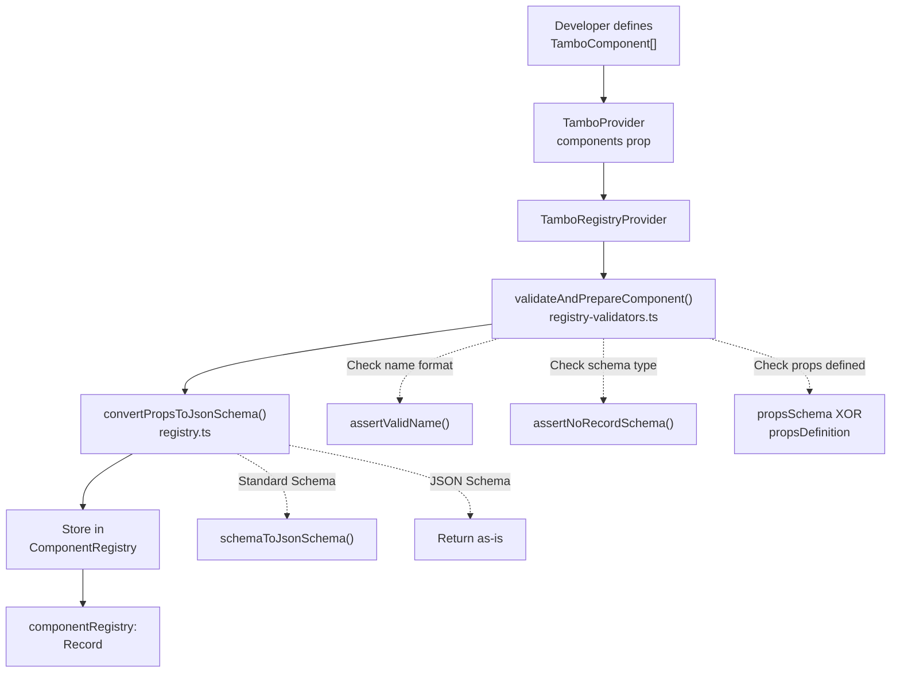
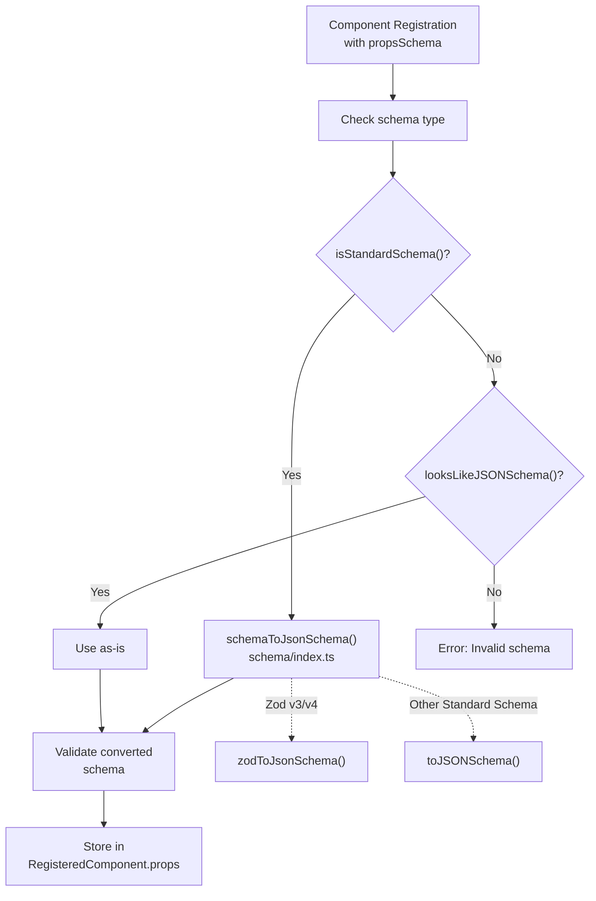
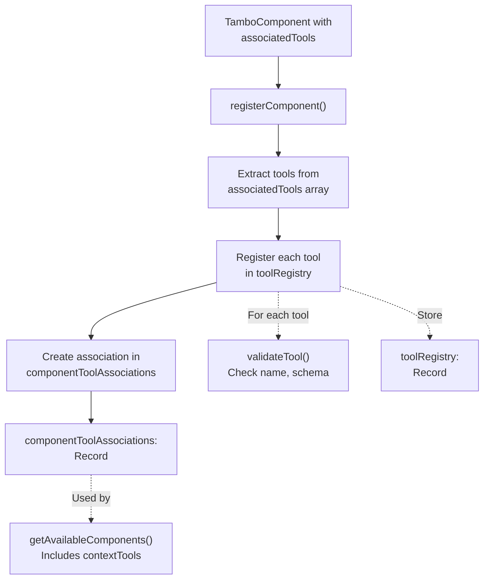
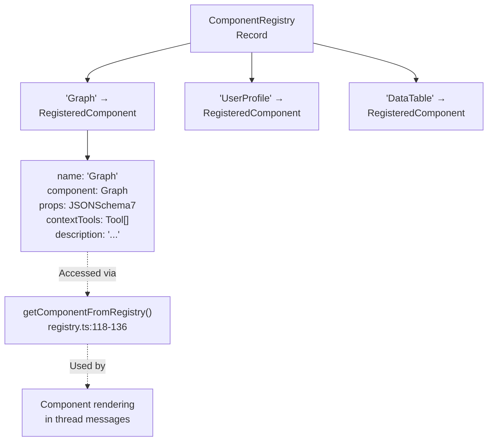

<!-- source: DeepWiki mcp.deepwiki.com · repo tambo-ai/tambo · page 3.4 Component Registration · fetched 2026-10-29 -->

# Component Registration

<details>
<summary>Relevant source files</summary>

The following files were used as context for generating this wiki page:

- [README.md](README.md)
- [cli/README.md](cli/README.md)
- [cli/src/templates/tambo-template.ts](cli/src/templates/tambo-template.ts)
- [create-tambo-app/README.md](create-tambo-app/README.md)
- [react-sdk/AGENTS.md](react-sdk/AGENTS.md)
- [react-sdk/README.md](react-sdk/README.md)
- [react-sdk/src/hooks/react-query-hooks.ts](react-sdk/src/hooks/react-query-hooks.ts)
- [react-sdk/src/index.ts](react-sdk/src/index.ts)
- [react-sdk/src/model/component-metadata.ts](react-sdk/src/model/component-metadata.ts)
- [react-sdk/src/providers/tambo-registry-provider.tsx](react-sdk/src/providers/tambo-registry-provider.tsx)
- [react-sdk/src/util/registry.ts](react-sdk/src/util/registry.ts)
- [react-sdk/src/util/tool-caller.ts](react-sdk/src/util/tool-caller.ts)
- [showcase/README.md](showcase/README.md)

</details>


## Purpose and Scope

This document describes how to register React components with the Tambo SDK, making them available for AI-driven rendering. Component registration is the process of defining which React components the AI can use, along with their props schemas and metadata.

For information about registering tools (functions that the AI can call), see [Tool Registration](#3.5). For information about managing component state across messages, see [Component State Management](#3.6). For interactable components that persist and update by ID, see the interactable components documentation.

**Sources:** [react-sdk/README.md:141-162](), [README.md:82-112]()

---

## TamboComponent Interface

Components are registered using the `TamboComponent` interface, which defines all metadata needed for the AI to understand and render your component.

### Core Properties

| Property | Type | Required | Description |
|----------|------|----------|-------------|
| `name` | `string` | Yes | Unique identifier for the component. Must contain only letters, numbers, underscores, and hyphens. |
| `description` | `string` | Yes | Human-readable description of what the component does. Used by AI to determine when to render it. |
| `component` | `ComponentType<any>` | Yes | The React component itself (not an instance). |
| `propsSchema` | `SupportedSchema` | Yes* | Schema describing component props. Accepts Standard Schema validators (Zod, Valibot, ArkType) or JSON Schema. |
| `propsDefinition` | `any` | No | Deprecated. Use `propsSchema` instead. |
| `loadingComponent` | `ComponentType<any>` | No | Optional component to display while props are streaming. |
| `associatedTools` | `TamboTool[]` | No | Tools that can be called to provide context for this component. |
| `annotations` | `ToolAnnotations` | No | Behavioral hints for the AI (e.g., rendering preferences). |

\* Either `propsSchema` or `propsDefinition` must be provided, but not both.

**Sources:** [react-sdk/src/model/component-metadata.ts:378-438]()

---

## Registration Methods

### Via TamboProvider (Recommended)

The most common method is to pass components directly to `TamboProvider`:

```typescript
import { TamboProvider } from "@tambo-ai/react";
import { z } from "zod/v4";
import { Graph } from "./components/graph";

const components: TamboComponent[] = [
  {
    name: "Graph",
    description: "Displays data as charts using Recharts library",
    component: Graph,
    propsSchema: z.object({
      data: z.array(z.object({ name: z.string(), value: z.number() })),
      type: z.enum(["line", "bar", "pie"]),
    }),
  },
];

export default function App() {
  return (
    <TamboProvider components={components} apiKey={apiKey}>
      <YourApp />
    </TamboProvider>
  );
}
```

**Sources:** [README.md:86-98](), [react-sdk/README.md:84-95]()

### Via useTamboRegistry Hook

For dynamic registration or conditional component registration:

```typescript
import { useTamboRegistry } from "@tambo-ai/react";

function DynamicComponentLoader() {
  const { registerComponent, registerComponents } = useTamboRegistry();
  
  // Register single component
  React.useEffect(() => {
    registerComponent({
      name: "DynamicChart",
      description: "Chart loaded dynamically",
      component: DynamicChart,
      propsSchema: chartSchema,
    });
  }, []);
  
  // Register multiple components
  React.useEffect(() => {
    registerComponents([component1, component2, component3]);
  }, []);
}
```

**Sources:** [react-sdk/src/providers/tambo-registry-provider.test.tsx:96-119]()

### Component Registration Flow



**Sources:** [react-sdk/src/providers/tambo-registry-provider.tsx:60-92](), [react-sdk/src/util/registry-validators.ts:144-175](), [react-sdk/src/util/registry.ts:77-91]()

---

## Props Schema Definition

### Standard Schema Support

Tambo supports any validator implementing the [Standard Schema specification](https://standardschema.dev), including Zod v3, Zod v4, Valibot, and ArkType.

**Zod v4 Example:**

```typescript
import { z } from "zod/v4";

const component: TamboComponent = {
  name: "WeatherCard",
  description: "Displays weather information with temperature and conditions",
  component: WeatherCard,
  propsSchema: z.object({
    location: z.string().describe("Location name"),
    temperature: z.number().describe("Temperature in degrees"),
    condition: z.string().describe("Weather condition"),
    humidity: z.number().optional().describe("Humidity percentage"),
  }),
};
```

**Zod v3 Example:**

```typescript
import { z } from "zod/v3";

const component: TamboComponent = {
  name: "UserProfile",
  component: UserProfile,
  description: "User profile card",
  propsSchema: z.object({
    name: z.string(),
    email: z.string().email(),
    avatar: z.string().url().optional(),
  }),
};
```

**Sources:** [react-sdk/README.md:145-160](), [react-sdk/src/providers/tambo-registry-schema-compat.test.tsx:36-139]()

### Raw JSON Schema Support

For cases where you don't want to use a validation library:

```typescript
import type { JSONSchema7 } from "json-schema";

const jsonSchema: JSONSchema7 = {
  type: "object",
  properties: {
    title: { type: "string", description: "Title text" },
    count: { type: "number", description: "Count value" },
    tags: { 
      type: "array",
      items: { type: "string" }
    },
  },
  required: ["title"],
};

const component: TamboComponent = {
  name: "DataCard",
  component: DataCard,
  description: "Generic data display card",
  propsSchema: jsonSchema,
};
```

**Sources:** [react-sdk/src/util/registry.test.ts:417-435]()

### Schema Conversion Process



**Sources:** [react-sdk/src/util/registry.ts:77-91](), [react-sdk/src/schema/index.ts]()

---

## Associated Tools

Components can declare tools that provide context or data needed for rendering. These tools are automatically registered and associated with the component.

### Defining Associated Tools

```typescript
import { defineTool } from "@tambo-ai/react";
import { z } from "zod/v4";

const getChartData = defineTool({
  name: "get_chart_data",
  description: "Fetches data for chart visualization",
  tool: async ({ query }) => {
    const data = await fetchChartData(query);
    return data;
  },
  inputSchema: z.object({
    query: z.string().describe("Data query"),
  }),
  outputSchema: z.array(z.object({
    name: z.string(),
    value: z.number(),
  })),
});

const component: TamboComponent = {
  name: "Chart",
  description: "Interactive data visualization",
  component: Chart,
  propsSchema: z.object({
    data: z.array(z.object({ name: z.string(), value: z.number() })),
    type: z.enum(["line", "bar", "pie"]),
  }),
  associatedTools: [getChartData],
};
```

**Sources:** [react-sdk/src/providers/tambo-registry-provider.test.tsx:33-43]()

### Tool Association Flow



**Sources:** [react-sdk/src/providers/tambo-registry-provider.tsx:200-220](), [react-sdk/src/util/registry.ts:27-54]()

---

## Validation Rules

### Component Name Validation

Component names must follow strict naming conventions:

- **Allowed:** Letters (a-z, A-Z), numbers (0-9), underscores (_), hyphens (-)
- **Not allowed:** Spaces, special characters (@, !, $, etc.)
- **Case sensitive:** `MyComponent` and `mycomponent` are different

```typescript
// Valid names
"Graph"
"UserProfile"
"data-table"
"chart_v2"

// Invalid names - will throw error
"My Component"      // Contains space
"user@profile"      // Contains @
"chart!"           // Contains !
```

**Sources:** [react-sdk/src/util/registry-validators.test.ts:312-362](), [react-sdk/src/util/validate-component-name.ts]()

### Schema Validation

#### No Record Types

Schemas cannot use record types (objects with dynamic keys) as they cannot be reliably converted to JSON Schema:

```typescript
// ❌ Invalid - will throw error
propsSchema: z.object({
  metadata: z.record(z.string(), z.string()), // Dynamic keys not supported
})

// ✅ Valid - use explicit keys
propsSchema: z.object({
  metadata: z.object({
    key1: z.string(),
    key2: z.string(),
  }),
})
```

**Sources:** [react-sdk/src/util/registry-validators.test.ts:353-366](), [react-sdk/src/schema/record-check.ts]()

#### Mutually Exclusive Props

Only one of `propsSchema` or `propsDefinition` can be provided:

```typescript
// ❌ Invalid - both defined
{
  propsSchema: z.object({ title: z.string() }),
  propsDefinition: { title: "string" }, // Error!
}

// ❌ Invalid - neither defined
{
  // No propsSchema or propsDefinition - Error!
}

// ✅ Valid - only propsSchema
{
  propsSchema: z.object({ title: z.string() }),
}
```

**Sources:** [react-sdk/src/util/registry-validators.ts:144-175](), [react-sdk/src/providers/tambo-registry-provider.test.tsx:268-313]()

### Validation Error Messages

| Error Condition | Error Message |
|----------------|---------------|
| Name contains spaces | `component "Invalid Component" must only contain letters, numbers, underscores, and hyphens.` |
| Record type in schema | `Record types (objects with dynamic keys) are not supported in propsSchema of component "MyComponent".` |
| Both props defined | `Component MyComponent cannot have both propsSchema and propsDefinition defined.` |
| Neither props defined | `Component MyComponent must have either propsSchema (recommended) or propsDefinition defined.` |

**Sources:** [react-sdk/src/util/registry-validators.ts:144-175]()

---

## Advanced Features

### Loading Components

Display a placeholder component while props are streaming in:

```typescript
const component: TamboComponent = {
  name: "DataTable",
  description: "Table with streaming data",
  component: DataTable,
  loadingComponent: DataTableSkeleton,
  propsSchema: z.object({
    columns: z.array(z.string()),
    rows: z.array(z.array(z.any())),
  }),
};
```

The `loadingComponent` is rendered until all props finish streaming. See [Streaming and Loading States](#3.8) for more details.

**Sources:** [react-sdk/src/model/component-metadata.ts:432-433]()

### Component Annotations

Annotations provide behavioral hints to the AI about how the component should be used:

```typescript
const component: TamboComponent = {
  name: "InteractiveForm",
  description: "Form with validation",
  component: InteractiveForm,
  propsSchema: formSchema,
  annotations: {
    // MCP-compatible annotations
    readOnlyHint: false,  // Component has side effects
  },
};
```

Annotations follow the MCP (Model Context Protocol) specification and can influence how the AI decides to render components.

**Sources:** [react-sdk/src/model/component-metadata.ts:436-437](), [react-sdk/src/model/component-metadata.ts:33-45]()

### Programmatic Registration Warning

Components can be overwritten if registered multiple times. The `registerComponent` function accepts an optional `warnOnOverwrite` parameter:

```typescript
const { registerComponent } = useTamboRegistry();

// Will log warning if "MyComponent" already exists
registerComponent(myComponent, true);
```

**Sources:** [react-sdk/src/providers/tambo-registry-provider.tsx:200-220]()

---

## Component Registry Structure

### Internal Storage

Registered components are stored in the `ComponentRegistry` type:



**Sources:** [react-sdk/src/model/component-metadata.ts:83](), [react-sdk/src/util/registry.ts:118-136]()

### Available Components API

The registry converts registered components to the format expected by the backend API:

```typescript
// Internal structure
type ComponentRegistry = Record<string, RegisteredComponent>

// API format
type AvailableComponent = {
  name: string;
  description: string;
  props: JSONSchema7;
  contextTools: ComponentContextToolMetadata[];
}
```

The `getAvailableComponents()` function in [react-sdk/src/util/registry.ts:27-54]() performs this conversion, including associating tools with their components.

**Sources:** [react-sdk/src/util/registry.ts:27-54](), [react-sdk/src/model/component-metadata.ts:78-83]()

---

## Complete Registration Example

Here's a comprehensive example showing all features:

```typescript
import { TamboProvider, defineTool, type TamboComponent } from "@tambo-ai/react";
import { z } from "zod/v4";

// Define associated tool
const fetchWeatherData = defineTool({
  name: "fetch_weather",
  description: "Fetches current weather data",
  tool: async ({ location }) => {
    return await fetch(`/api/weather?location=${location}`).then(r => r.json());
  },
  inputSchema: z.object({
    location: z.string(),
  }),
  outputSchema: z.object({
    temperature: z.number(),
    condition: z.string(),
  }),
});

// Define component
const weatherComponent: TamboComponent = {
  name: "WeatherCard",
  description: "Displays current weather conditions for a location",
  component: WeatherCard,
  loadingComponent: WeatherCardSkeleton,
  propsSchema: z.object({
    location: z.string().describe("Location name"),
    temperature: z.number().describe("Temperature in degrees"),
    condition: z.string().describe("Weather condition"),
    humidity: z.number().optional().describe("Humidity percentage"),
    windSpeed: z.number().optional().describe("Wind speed"),
  }),
  associatedTools: [fetchWeatherData],
  annotations: {
    readOnlyHint: true, // No side effects
  },
};

// Register with provider
export default function App() {
  return (
    <TamboProvider
      apiKey={process.env.NEXT_PUBLIC_TAMBO_API_KEY!}
      components={[weatherComponent]}
    >
      <YourApp />
    </TamboProvider>
  );
}
```

**Sources:** [README.md:86-112](), [react-sdk/README.md:145-160](), [docs/content/docs/index.mdx:44-54]()

---

