<!-- source: DeepWiki mcp.deepwiki.com · repo tambo-ai/tambo · page 4 UI Components · fetched 2026-10-29 -->

# UI Components

<details>
<summary>Relevant source files</summary>

The following files were used as context for generating this wiki page:

- [cli/src/types/components.d.ts](cli/src/types/components.d.ts)
- [cli/src/types/utils.d.ts](cli/src/types/utils.d.ts)

</details>


This document covers the pre-built UI components in the `@tambo-ai/ui-registry` package for building chat interfaces. These components are stored in [cli/src/registry/](cli/src/registry) and installed into user projects via the `tambo add` command. They provide ready-to-use building blocks for message display, input, thread management, and layout composition.

Type declarations for all UI components are defined in [cli/src/types/components.d.ts](cli/src/types/components.d.ts:1-549). Components are installed to `src/components/tambo/` in user projects with the module path prefix `@/components/tambo/`.

For information about registering custom components for AI generation, see [Component Registration (Page 3.4)]. For information about the CLI commands used to install these components, see [CLI Tools (Page 5)].

## Component Architecture

Tambo UI components follow a composable architecture pattern where root components establish React Context and expose sub-components as properties. This pattern allows fine-grained control over layout and behavior while maintaining shared state.

### Registry Structure and Installation

Components are stored in [cli/src/registry/](cli/src/registry) and organized by component name. Each component directory includes:
- Source files (`.tsx`, `.ts`)
- Configuration metadata (`config.json`)
- Dependency declarations
- Installation paths and file mappings

Type declarations for all components are centralized in [cli/src/types/components.d.ts](cli/src/types/components.d.ts:1-549). Utility type declarations (for `@/lib/utils`, `highlight.js`, `dompurify`, etc.) are in [cli/src/types/utils.d.ts](cli/src/types/utils.d.ts:1-52).

When a developer runs `tambo add message`, the CLI:
1. Copies component files to `src/components/tambo/` in the user's project
2. Installs declared npm dependencies
3. Creates `@/lib/utils` with the `cn()` function if not present
4. Syncs global styles from [cli/src/registry/config/globals-v4.css](cli/src/registry/config/globals-v4.css)

**Sources:** [cli/src/types/components.d.ts:1-549](), [cli/src/types/utils.d.ts:1-52]()

**Component Context Pattern**

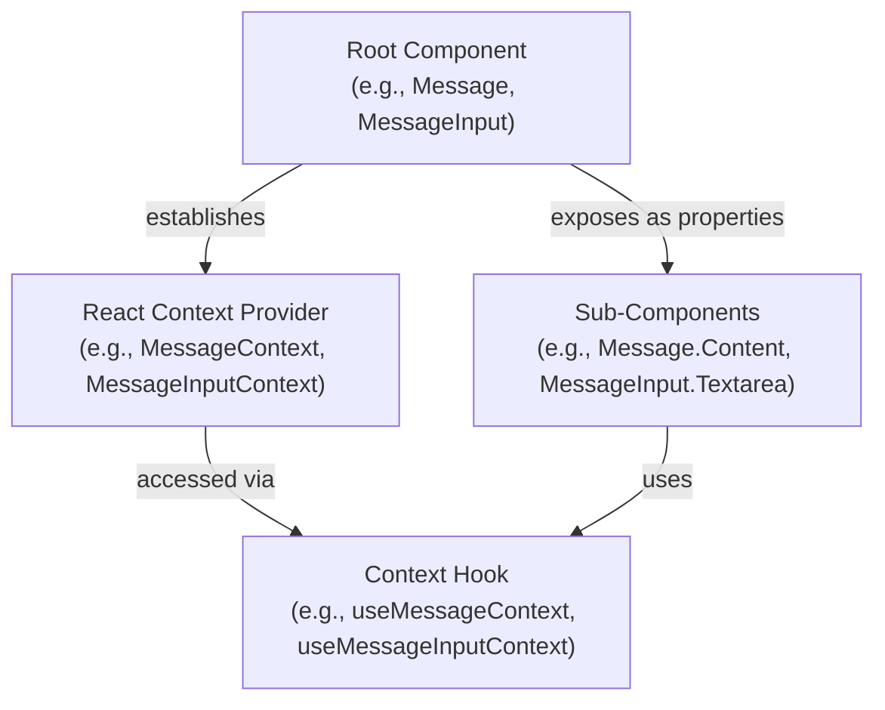

This pattern allows composition like:

```tsx
<Message role="assistant" message={msg}>
  <Message.Content />
  <Message.ToolcallInfo />
  <Message.RenderedComponentArea />
</Message>
```

**Sources:** [cli/src/registry/message/message.tsx:93-119](), [cli/src/registry/message-input/message-input.tsx:333-375]()

### Integration with React SDK

UI components consume state and functionality from the React SDK through hooks provided by `TamboProvider`:

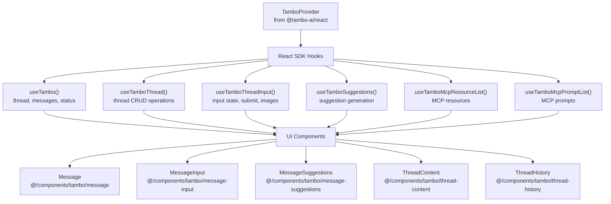

**Sources:** [cli/src/registry/message/message.tsx:11](), [cli/src/registry/message-input/message-input.tsx:14-19](), [cli/src/registry/message-suggestions/message-suggestions.tsx:9-14](), [cli/src/types/components.d.ts:26-549]()

## Message Component

The `Message` component (`@/components/tambo/message`) renders individual messages in a conversation thread. It supports user and assistant messages with markdown rendering, tool call display, reasoning visualization, and image attachments.

### Component Structure and Exports

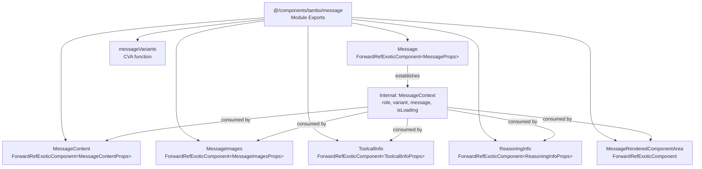

**Sources:** [cli/src/types/components.d.ts:26-89](), [cli/src/registry/message/message.tsx:93-119](), [cli/src/registry/message/message.tsx:167-197]()

### Message Props and Context

| Component | Type Definition | Key Props | Purpose |
|-----------|----------------|-----------|---------|
| `Message` | `MessageProps` | `role: "user" \| "assistant"`, `message: TamboThreadMessage`, `variant?: ComponentVariant`, `isLoading?: boolean`, `className?`, `children?` | Root container establishing context |
| `MessageContent` | `MessageContentProps` | `content?: string \| { type: string; text?: string }[]`, extends `HTMLAttributes<HTMLDivElement>` | Displays text content with optional markdown |
| `MessageImages` | `MessageImagesProps` | extends `HTMLAttributes<HTMLDivElement>` | Displays image attachments from message content |
| `ToolcallInfo` | `ToolcallInfoProps` | `markdown?: boolean` (default: true), extends `HTMLAttributes<HTMLDivElement>` | Shows tool call details in collapsible dropdown |
| `ReasoningInfo` | `ReasoningInfoProps` | extends `HTMLAttributes<HTMLDivElement>` | Shows reasoning steps with auto-collapse behavior |
| `MessageRenderedComponentArea` | `MessageRenderedComponentAreaProps` | `enableCanvasSpace?: boolean`, extends `HTMLAttributes<HTMLDivElement>` | Displays generated React components |

**ComponentVariant Type:**
```typescript
type ComponentVariant = "default" | "solid" | "bordered" | null | undefined;
```

**MessageContext Interface** (internal):
- `role: "user" | "assistant"`
- `variant?: ComponentVariant`
- `message: TamboThreadMessage`
- `isLoading?: boolean`

**Sources:** [cli/src/types/components.d.ts:24-89](), [cli/src/registry/message/message.tsx:139-153](), [cli/src/registry/message/message.tsx:93-98]()

### Content Rendering Flow

The `MessageContent` component handles multiple content formats:

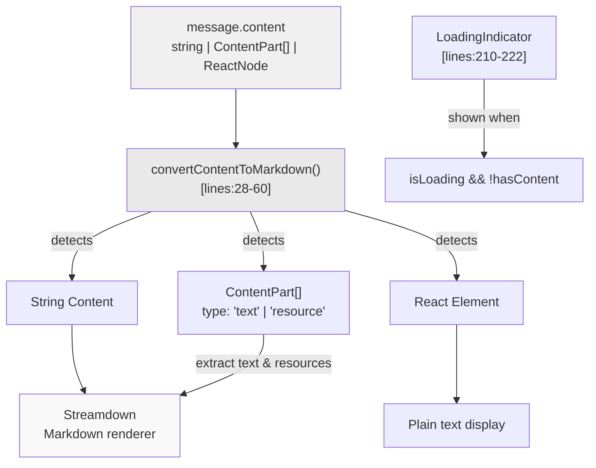

Resources in content are converted to markdown links with the `tambo-resource://` scheme, which the markdown renderer can handle specially.

**Sources:** [cli/src/registry/message/message.tsx:28-60](cli/src/registry/message/message.tsx:28-60), [cli/src/registry/message/message.tsx:316-371](cli/src/registry/message/message.tsx:316-371), [cli/src/registry/message/message.tsx:227-248](cli/src/registry/message/message.tsx:227-248)

### Tool Call Display

The `ToolcallInfo` component displays tool execution details in a collapsible interface:

**Features:**
- Collapsible dropdown showing tool name and parameters
- Status icons: loading spinner, success checkmark, or error X
- Associated tool response display
- Support for MCP sampling sub-threads ([lines:541-610](cli/src/registry/message/message.tsx:541-610))

**Status Determination:**
```
getToolStatusMessage(message, isLoading)
  → isLoading ? "Calling {toolName}" : "Called {toolName}"
  → Override with message.component?.statusMessage if present
```

**Tool Response Formatting:**
The associated tool response (role="tool" message) is found by searching forward through the thread messages and formatted using `formatToolResult()` which detects and pretty-prints JSON ([lines:796-843](cli/src/registry/message/message.tsx:796-843)).

**Sources:** [cli/src/registry/message/message.tsx:428-532](cli/src/registry/message/message.tsx:428-532), [cli/src/registry/message/message.tsx:385-400](cli/src/registry/message/message.tsx:385-400), [cli/src/registry/message/message.tsx:127-131](cli/src/registry/message/message.tsx:127-131)

### Reasoning Display

The `ReasoningInfo` component visualizes AI reasoning steps with auto-scrolling:

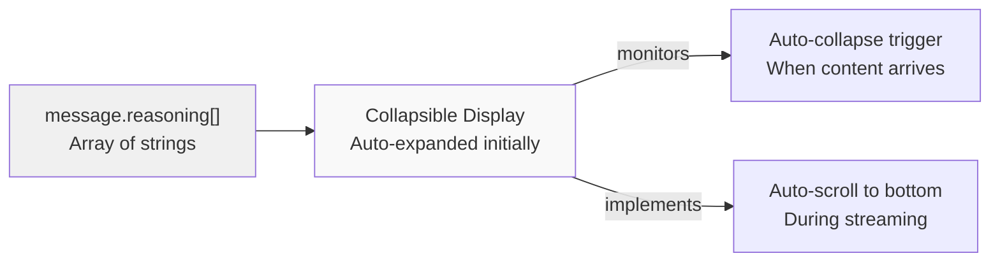

**Behavior:**
- Initially expanded when reasoning starts
- Auto-collapses when `message.content` arrives and `isLoading` becomes false ([lines:634-638](cli/src/registry/message/message.tsx:634-638))
- Auto-scrolls to show latest reasoning step during streaming ([lines:640-661](cli/src/registry/message/message.tsx:640-661))
- Shows reasoning duration when complete ([lines:747-789](cli/src/registry/message/message.tsx:747-789))

**Sources:** [cli/src/registry/message/message.tsx:626-733](cli/src/registry/message/message.tsx:626-733)

### Rendered Component Area

The `MessageRenderedComponentArea` displays React components generated by the AI. It detects the presence of a canvas space element and adapts behavior:

**Canvas Detection:**
```javascript
const canvas = document.querySelector('[data-canvas-space="true"]');
```

**Display Modes:**
- **With Canvas:** Shows "View component" button that dispatches `tambo:showComponent` event
- **Without Canvas:** Renders component inline

**Sources:** [cli/src/registry/message/message.tsx:858-928](cli/src/registry/message/message.tsx:858-928), [cli/src/registry/message/message.tsx:865-882](cli/src/registry/message/message.tsx:865-882)

## MessageInput Component

The `MessageInput` component (`@/components/tambo/message-input`) handles message composition with rich text editing, file uploads, MCP resource/prompt integration, and elicitation support.

### Component Architecture and Exports

```mermaid
graph TB
    ModuleExports["@/components/tambo/message-input<br/>Module Exports"]
    
    MessageInput["MessageInput<br/>ForwardRefExoticComponent&lt;MessageInputProps&gt;"]
    MessageInputRoot["MessageInputRoot<br/>ForwardRefExoticComponent&lt;MessageInputRootProps&gt;"]
    MessageInputTextarea["MessageInputTextarea<br/>ForwardRefExoticComponent&lt;MessageInputTextareaProps&gt;"]
    MessageInputPlainTextarea["MessageInputPlainTextarea<br/>ForwardRefExoticComponent&lt;MessageInputPlainTextareaProps&gt;"]
    MessageInputSubmitButton["MessageInputSubmitButton<br/>ForwardRefExoticComponent&lt;MessageInputSubmitButtonProps&gt;"]
    MessageInputFileButton["MessageInputFileButton<br/>ForwardRefExoticComponent&lt;MessageInputFileButtonProps&gt;"]
    MessageInputMcpPromptButton["MessageInputMcpPromptButton<br/>ForwardRefExoticComponent"]
    MessageInputMcpResourceButton["MessageInputMcpResourceButton<br/>ForwardRefExoticComponent"]
    MessageInputMcpConfigButton["MessageInputMcpConfigButton<br/>ForwardRefExoticComponent"]
    MessageInputToolbar["MessageInputToolbar<br/>ForwardRefExoticComponent&lt;MessageInputToolbarProps&gt;"]
    MessageInputError["MessageInputError<br/>ForwardRefExoticComponent&lt;MessageInputErrorProps&gt;"]
    MessageInputStagedImages["MessageInputStagedImages<br/>ForwardRefExoticComponent&lt;MessageInputStagedImagesProps&gt;"]
    MessageInputContexts["MessageInputContexts<br/>ForwardRefExoticComponent&lt;MessageInputContextsProps&gt;"]
    messageInputVariants["messageInputVariants<br/>CVA function"]
    
    MessageInputInternal["Internal: MessageInputInternal<br/>Component"]
    MessageInputContext["Internal: MessageInputContext<br/>value, submit, editorRef, etc"]
    
    ModuleExports --> MessageInput
    ModuleExports --> MessageInputRoot
    ModuleExports --> MessageInputTextarea
    ModuleExports --> MessageInputPlainTextarea
    ModuleExports --> MessageInputSubmitButton
    ModuleExports --> MessageInputFileButton
    ModuleExports --> MessageInputMcpPromptButton
    ModuleExports --> MessageInputMcpResourceButton
    ModuleExports --> MessageInputMcpConfigButton
    ModuleExports --> MessageInputToolbar
    ModuleExports --> MessageInputError
    ModuleExports --> MessageInputStagedImages
    ModuleExports --> MessageInputContexts
    ModuleExports --> messageInputVariants
    
    MessageInput --> MessageInputInternal
    MessageInputInternal -->|"establishes"| MessageInputContext
```

**Sources:** [cli/src/types/components.d.ts:118-228](), [cli/src/registry/message-input/message-input.tsx:333-385](), [cli/src/registry/message-input/message-input.tsx:446-710]()

### MessageInput Props and Context

**MessageInputProps:**
- `variant?: ComponentVariant` - Visual style variant
- `contextKey?: string` - Key for isolated input state
- extends `HTMLAttributes<HTMLFormElement>`

**MessageInputRootProps:**
- `contextKey?: string`
- `variant?: ComponentVariant`
- `children?: React.ReactNode`
- extends `HTMLAttributes<HTMLFormElement>`

**MessageInputTextareaProps:**
- `placeholder?: string`
- `staticMentionItems?: MessageInputMentionItem[]`
- `mentionItemFetcher?: (query: string) => Promise<MessageInputMentionItem[]>`
- extends `HTMLAttributes<HTMLDivElement>`

**MessageInputMentionItem Interface:**
```typescript
interface MessageInputMentionItem {
  id: string;
  name: string;
  icon?: React.ReactNode;
  componentData?: unknown;
}
```

**MessageInputContext** (internal):

| Property | Type | Purpose |
|----------|------|---------|
| `value` | `string` | Current input value |
| `setValue` | `(value: string) => void` | Update input value |
| `submit` | `(options) => Promise<void>` | Submit message with resource names |
| `handleSubmit` | `(e: FormEvent) => Promise<void>` | Form submission handler |
| `isPending` | `boolean` | Submission in progress |
| `error` | `Error \| null` | Submission error |
| `editorRef` | `RefObject<TamboEditor>` | Reference to editor instance |
| `submitError` | `string \| null` | Display error message |
| `imageError` | `string \| null` | Image upload error |
| `elicitation` | `TamboElicitationRequest \| null` | Current elicitation request |
| `resolveElicitation` | Function | Resolve elicitation promise |

**Sources:** [cli/src/types/components.d.ts:118-228](), [cli/src/registry/message-input/message-input.tsx:334-361]()

### Rich Text Editor (TextEditor)

The `MessageInputTextarea` uses a TipTap-based rich text editor defined in `@/components/tambo/message-input/text-editor`.

**TextEditorProps Interface:**
```typescript
interface TextEditorProps {
  value: string;
  onChange: (text: string) => void;
  onKeyDown?: (event: React.KeyboardEvent, editor: Editor) => void;
  placeholder?: string;
  disabled?: boolean;
  className?: string;
  editorRef?: React.MutableRefObject<Editor | null>;
  commands?: CommandConfig[];
  onSubmit?: (e: React.FormEvent) => Promise<void>;
  staticMentionItems?: ResourceItem[];
  mentionItemFetcher?: (query: string) => Promise<ResourceItem[]>;
}
```

**Core Features:**
- `@` mention autocomplete for resources
- `/` command autocomplete for prompts
- Image paste handling
- Enter to submit, Shift+Enter for newline
- Disabled state synchronization

**Editor Interface (TamboEditor):**
```typescript
interface TamboEditor {
  focus(position?: "start" | "end"): void
  setContent(content: string): void
  appendText(text: string): void
  getTextWithResourceURIs(): { text: string; resourceNames: Record<string, string> }
  hasMention(id: string): boolean
  insertMention(id: string, label: string): void
  setEditable(editable: boolean): void
}
```

**ResourceItem Interface:**
```typescript
interface ResourceItem {
  id: string;
  name: string;
  icon?: React.ReactNode;
  componentData?: unknown;
}
```

**CommandConfig Interface:**
```typescript
interface CommandConfig {
  triggerChar: string;
  items: ResourceItem[] | ((query: string) => Promise<ResourceItem[]>) | {
    staticItems?: ResourceItem[];
    fetchItems?: (query: string) => Promise<ResourceItem[]>;
  };
  onSelect?: (item: ResourceItem) => void;
  renderLabel: (props: {
    options: unknown;
    node: { attrs: Record<string, unknown> };
    suggestion: unknown;
  }) => string;
  HTMLAttributes?: Record<string, string>;
  isMenuOpenRef?: React.MutableRefObject<boolean>;
}
```

**hasExistingMention() Utility:**
```typescript
function hasExistingMention(editor: Editor, label: string): boolean
```

**Sources:** [cli/src/types/components.d.ts:230-278](), [cli/src/registry/message-input/text-editor.tsx:64-83](), [cli/src/registry/message-input/message-input.tsx:771-899]()

### Resource and Prompt Providers

The input supports external providers for extending `@` and `/` completions:

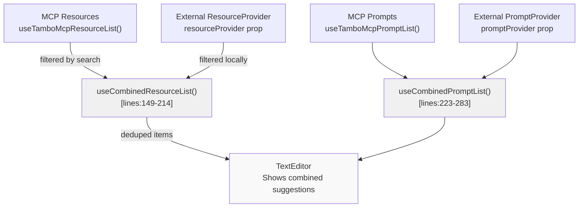

**Provider Interfaces:**
- `ResourceProvider`: `{ search(query: string): Promise<ResourceItem[]> }`
- `PromptProvider`: `{ search(query: string): Promise<PromptItem[]>; get(id: string): Promise<PromptItem> }`

**Sources:** [cli/src/registry/message-input/message-input.tsx:79-103](cli/src/registry/message-input/message-input.tsx:79-103), [cli/src/registry/message-input/message-input.tsx:149-283](cli/src/registry/message-input/message-input.tsx:149-283)

### Suggestion System

The text editor implements two separate suggestion systems using TipTap's Suggestion plugin:

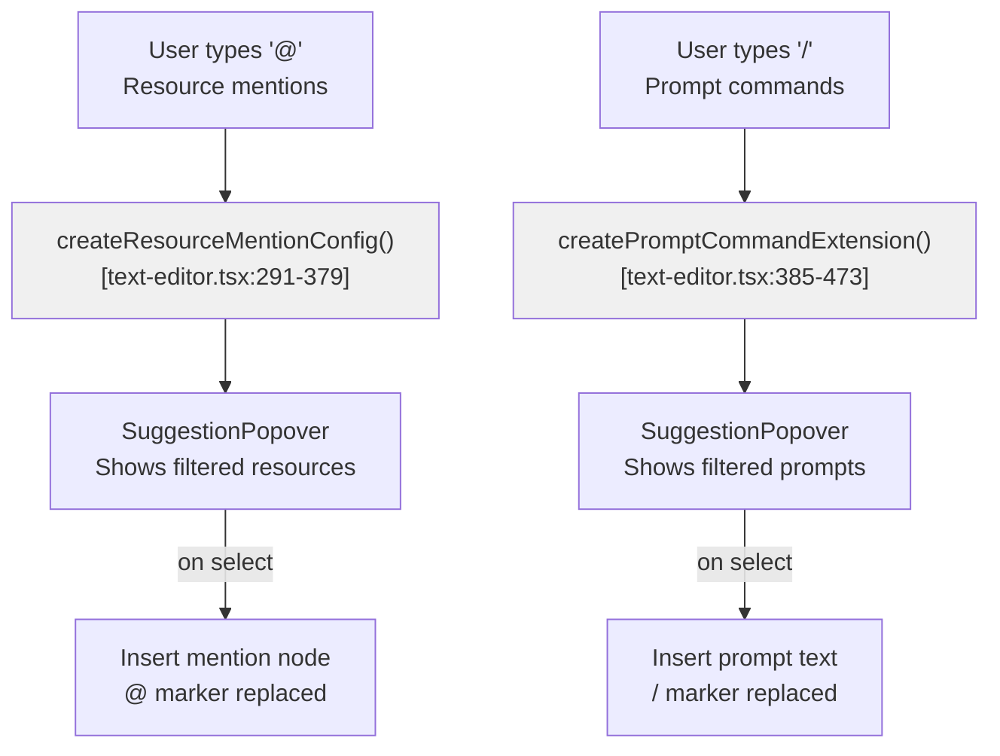

**Keyboard Navigation:**
- Arrow Up/Down: Navigate suggestions
- Enter: Select current suggestion
- Escape: Close suggestion menu

**Sources:** [cli/src/registry/message-input/text-editor.tsx:291-379](cli/src/registry/message-input/text-editor.tsx:291-379), [cli/src/registry/message-input/text-editor.tsx:385-473](cli/src/registry/message-input/text-editor.tsx:385-473), [cli/src/registry/message-input/text-editor.tsx:189-265](cli/src/registry/message-input/text-editor.tsx:189-265)

### File Upload and Image Staging

The component supports multiple image upload methods:

**Upload Methods:**
1. File button click → file input dialog
2. Drag and drop files onto input area
3. Paste images from clipboard

**Image Staging Flow:**
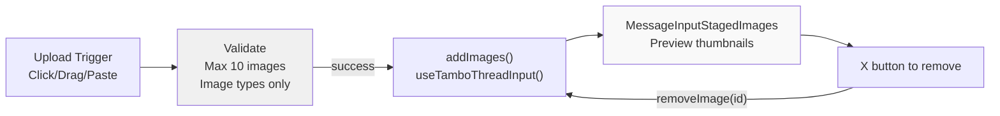

**Draft Persistence:**
The input value is automatically saved to sessionStorage using the thread ID as key ([lines:419-441](cli/src/registry/message-input/message-input.tsx:419-441)), allowing recovery if the user navigates away.

**Sources:** [cli/src/registry/message-input/message-input.tsx:556-625](cli/src/registry/message-input/message-input.tsx:556-625), [cli/src/registry/message-input/message-input.tsx:1081-1148](cli/src/registry/message-input/message-input.tsx:1081-1148), [cli/src/registry/message-input/message-input.tsx:1179-1239](cli/src/registry/message-input/message-input.tsx:1179-1239)

### Elicitation Support

When an MCP tool requests user input via elicitation, the input switches to `ElicitationUI` mode:

**Elicitation Flow:**
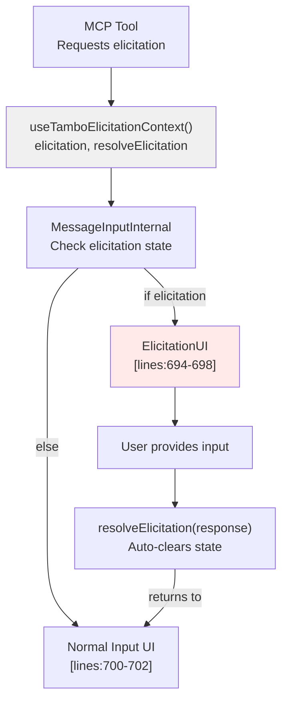

**Sources:** [cli/src/registry/message-input/message-input.tsx:470](cli/src/registry/message-input/message-input.tsx:470), [cli/src/registry/message-input/message-input.tsx:617-625](cli/src/registry/message-input/message-input.tsx:617-625), [cli/src/registry/message-input/message-input.tsx:693-704](cli/src/registry/message-input/message-input.tsx:693-704)

### Submission Process

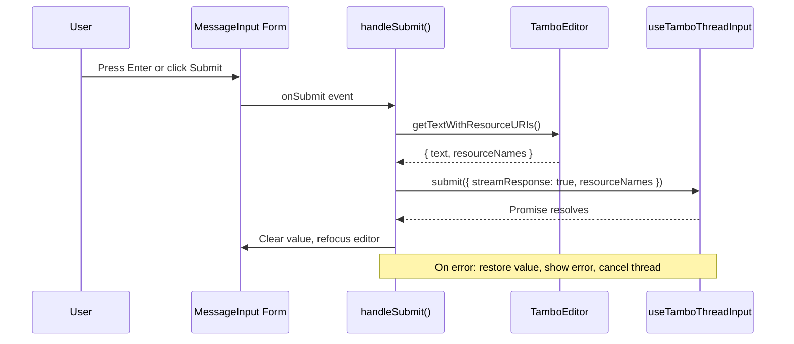

**Key Steps:**
1. Extract resource names from editor at submit time ([lines:503-505](cli/src/registry/message-input/message-input.tsx:503-505))
2. Capture image IDs before submission
3. Call `submit()` from `useTamboThreadInput()`
4. Clear input and remove only submitted images ([lines:514-523](cli/src/registry/message-input/message-input.tsx:514-523))
5. Refocus editor for next message

**Sources:** [cli/src/registry/message-input/message-input.tsx:487-554](cli/src/registry/message-input/message-input.tsx:487-554)

## ThreadHistory Component

The `ThreadHistory` component (`@/components/tambo/thread-history`) provides a collapsible sidebar for thread navigation, search, and management.

### Component Structure and Exports

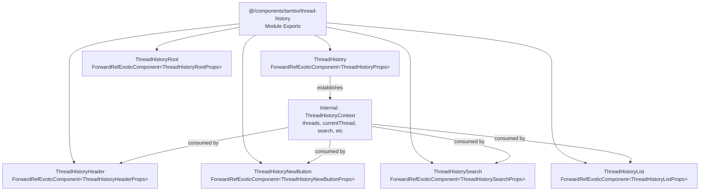

**ThreadHistoryProps:**
```typescript
interface ThreadHistoryProps extends HTMLAttributes<HTMLDivElement> {
  contextKey?: string;
  onThreadChange?: () => void;
  defaultCollapsed?: boolean;
  position?: "left" | "right";
}
```

**Sources:** [cli/src/types/components.d.ts:327-372](), [cli/src/registry/thread-history/thread-history.tsx:22-53](), [cli/src/registry/thread-history/thread-history.tsx:65-169]()

### ThreadHistory Context

| Property | Type | Purpose |
|----------|------|---------|
| `threads` | `{ items?: TamboThread[] }` | List of threads from API |
| `isLoading` | `boolean` | Loading state |
| `error` | `Error \| null` | Error state |
| `refetch` | `() => Promise<unknown>` | Refetch thread list |
| `currentThread` | `TamboThread` | Active thread |
| `switchCurrentThread` | `(threadId: string) => void` | Change active thread |
| `startNewThread` | `() => void` | Create new thread |
| `searchQuery` | `string` | Current search filter |
| `isCollapsed` | `boolean` | Sidebar collapse state |
| `position` | `"left" \| "right"` | Sidebar position |
| `updateThreadName` | Function | Rename thread |
| `generateThreadName` | Function | AI-generate thread name |

**Sources:** [cli/src/registry/thread-history/thread-history.tsx:24-40](cli/src/registry/thread-history/thread-history.tsx:24-40)

### Collapse/Expand Behavior

**State Management:**
- CSS variable `--sidebar-width` is updated based on collapse state ([lines:91-97](cli/src/registry/thread-history/thread-history.tsx:91-97))
- Transition duration: 300ms
- Collapsed width: 3rem (48px)
- Expanded width: 16rem (256px)

**UI Adaptations:**
- Search box hidden when collapsed, shows search icon button
- Thread list hidden when collapsed
- Header title hidden with opacity transition

**Sources:** [cli/src/registry/thread-history/thread-history.tsx:78](cli/src/registry/thread-history/thread-history.tsx:78), [cli/src/registry/thread-history/thread-history.tsx:91-98](cli/src/registry/thread-history/thread-history.tsx:91-98), [cli/src/registry/thread-history/thread-history.tsx:149-154](cli/src/registry/thread-history/thread-history.tsx:149-154)

### Thread Search and Filtering

Search is performed client-side on the thread list:

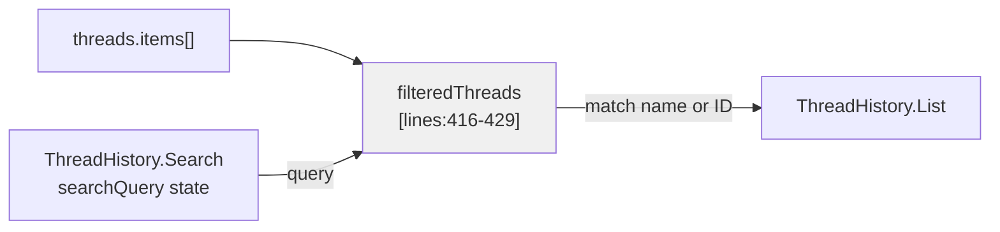

**Filter Logic:**
- Match thread name (case-insensitive)
- Match thread ID (case-insensitive)
- ID match takes priority over name match

**Sources:** [cli/src/registry/thread-history/thread-history.tsx:416-429](cli/src/registry/thread-history/thread-history.tsx:416-429)

### Thread Management Actions

**Inline Name Editing:**
- Click pencil icon to enter edit mode
- Input appears inline with focus
- Click outside or press Escape to cancel
- Press Enter to save

**AI Name Generation:**
- Click "Generate Name" from dropdown menu
- Calls `generateThreadName(threadId)` from SDK
- Refetches thread list to show updated name

**Thread Options Dropdown:**
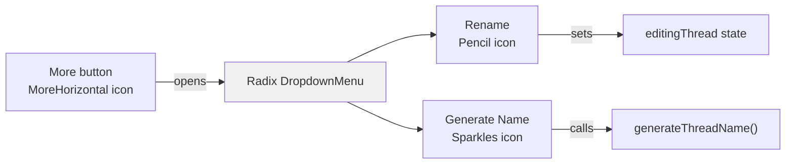

**Sources:** [cli/src/registry/thread-history/thread-history.tsx:593-642](cli/src/registry/thread-history/thread-history.tsx:593-642), [cli/src/registry/thread-history/thread-history.tsx:442-467](cli/src/registry/thread-history/thread-history.tsx:442-467)

## ThreadContent Component

The `ThreadContent` component (`@/components/tambo/thread-content`) renders a list of messages within a thread using the `Message` component.

### Component Structure and Exports

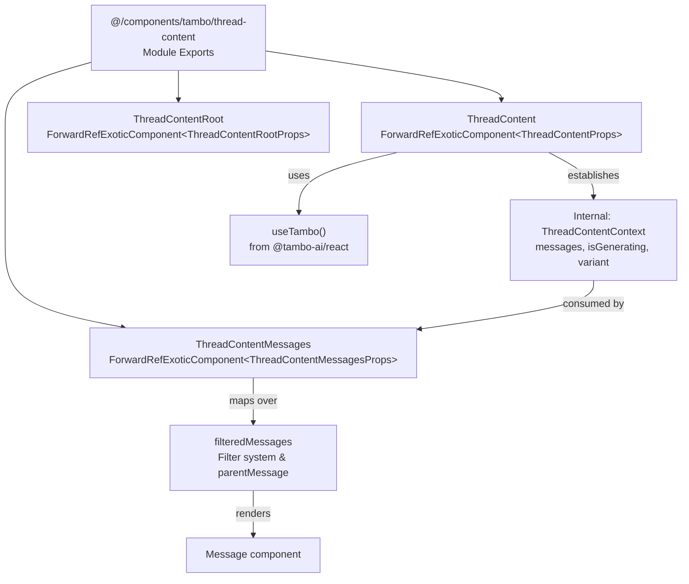

**ThreadContentProps:**
```typescript
interface ThreadContentProps extends HTMLAttributes<HTMLDivElement> {
  variant?: ComponentVariant;
  enableCanvasSpace?: boolean;
}
```

**ThreadContentRootProps:**
```typescript
interface ThreadContentRootProps extends HTMLAttributes<HTMLDivElement> {
  enableCanvasSpace?: boolean;
  variant?: ComponentVariant;
  children?: React.ReactNode;
}
```

**ThreadContentMessagesProps:**
```typescript
type ThreadContentMessagesProps = HTMLAttributes<HTMLDivElement>;
```

**Sources:** [cli/src/types/components.d.ts:91-116](), [cli/src/registry/thread-content/thread-content.tsx:24-52](), [cli/src/registry/thread-content/thread-content.tsx:76-104]()

### ThreadContent Context

| Property | Type | Purpose |
|----------|------|---------|
| `messages` | `TamboThreadMessage[]` | Array of messages in thread |
| `isGenerating` | `boolean` | Whether response is being generated |
| `generationStage` | `string \| undefined` | Current generation stage |
| `variant` | `"default" \| "solid"` | Message display variant |

**Sources:** [cli/src/registry/thread-content/thread-content.tsx:24-29](cli/src/registry/thread-content/thread-content.tsx:24-29)

### Message Filtering

Messages are filtered to exclude:
1. System messages (`role !== "system"`)
2. Child messages with `parentMessageId` (used for MCP sampling)

```javascript
const filteredMessages = messages.filter(
  (message) => message.role !== "system" && !message.parentMessageId,
);
```

**Sources:** [cli/src/registry/thread-content/thread-content.tsx:130-132](cli/src/registry/thread-content/thread-content.tsx:130-132)

### Message Rendering

Each filtered message is rendered with:

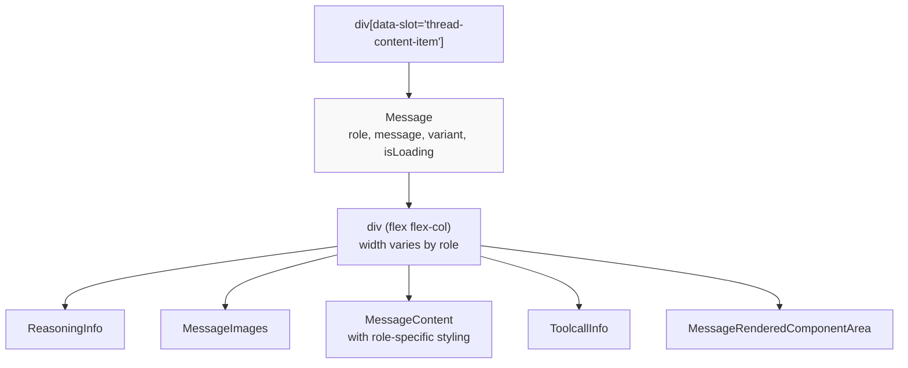

**Loading State:**
Only the last message in the filtered list receives `isLoading={true}` when `isGenerating` is true ([lines:154](cli/src/registry/thread-content/thread-content.tsx:154)).

**Role-Specific Styling:**
- Assistant messages: `w-full`, default text color
- User messages: `max-w-3xl`, background color on hover

**Sources:** [cli/src/registry/thread-content/thread-content.tsx:141-181](cli/src/registry/thread-content/thread-content.tsx:141-181)

## MessageSuggestions Component

The `MessageSuggestions` component (`@/components/tambo/message-suggestions`) generates and displays AI-powered follow-up suggestions after each assistant response.

### Component Architecture and Exports

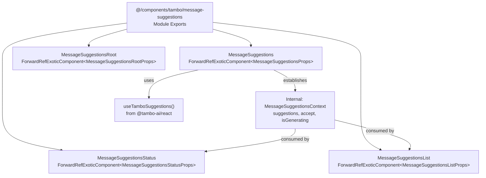

**MessageSuggestionsProps:**
```typescript
interface MessageSuggestionsProps extends HTMLAttributes<HTMLDivElement> {
  variant?: ComponentVariant;
  maxSuggestions?: number;
  initialSuggestions?: Suggestion[];
}
```

**MessageSuggestionsRootProps:**
```typescript
interface MessageSuggestionsRootProps extends HTMLAttributes<HTMLDivElement> {
  maxSuggestions?: number;
  initialSuggestions?: Suggestion[];
  children?: React.ReactNode;
}
```

**Sources:** [cli/src/types/components.d.ts:280-316](), [cli/src/registry/message-suggestions/message-suggestions.tsx:28-59](), [cli/src/registry/message-suggestions/message-suggestions.tsx:86-221]()

### MessageSuggestions Context

| Property | Type | Purpose |
|----------|------|---------|
| `suggestions` | `Suggestion[]` | Current suggestions (initial or generated) |
| `selectedSuggestionId` | `string \| null` | ID of selected suggestion |
| `accept` | `(options: { suggestion: Suggestion }) => Promise<void>` | Accept and submit suggestion |
| `isGenerating` | `boolean` | Generation in progress |
| `error` | `Error \| null` | Generation error |
| `thread` | `TamboThread` | Current thread |
| `isMac` | `boolean` | Whether platform is macOS (for shortcuts) |

**Sources:** [cli/src/registry/message-suggestions/message-suggestions.tsx:28-36](cli/src/registry/message-suggestions/message-suggestions.tsx:28-36)

### Suggestion Generation Flow

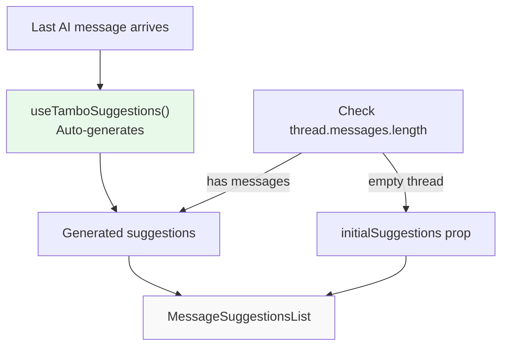

**Initial Suggestions:**
Used when thread is empty, limited by `maxSuggestions` prop ([lines:109-115](cli/src/registry/message-suggestions/message-suggestions.tsx:109-115)).

**Sources:** [cli/src/registry/message-suggestions/message-suggestions.tsx:100-121](cli/src/registry/message-suggestions/message-suggestions.tsx:100-121)

### Keyboard Shortcuts

Suggestions support keyboard shortcuts for quick access:

**Shortcut Pattern:**
- macOS: `⌘ + ⌥ + [1-9]`
- Windows/Linux: `Ctrl + Alt + [1-9]`

**Implementation:**
```javascript
document.addEventListener("keydown", handleKeyDown);

if (modifierPressed && keyNum > 0 && keyNum <= suggestions.length) {
  accept({ suggestion: suggestions[keyNum - 1] });
}
```

**Sources:** [cli/src/registry/message-suggestions/message-suggestions.tsx:176-199](cli/src/registry/message-suggestions/message-suggestions.tsx:176-199)

### Suggestion Display

Each suggestion is rendered as a button with:
- Title text from `suggestion.title`
- Keyboard shortcut tooltip (e.g., "⌘⌥1")
- Hover/selected state styling
- Disabled state when generating

**Placeholder State:**
When `suggestions.length === 0`, three placeholder buttons with pulse animation are shown to prevent layout shift.

**Sources:** [cli/src/registry/message-suggestions/message-suggestions.tsx:350-390](cli/src/registry/message-suggestions/message-suggestions.tsx:350-390)

## Chat Layout Components

Tambo provides three pre-built layout patterns combining the UI components into complete chat interfaces.

### Layout Comparison

| Component | Use Case | Features |
|-----------|----------|----------|
| `MessageThreadFull` | Full-page chat application | Thread history sidebar, full screen messages |
| `MessageThreadCollapsible` | Overlay widget | Fixed position, keyboard toggle, collapsible |
| `MessageThreadPanel` | Split-screen canvas | Resizable panel, canvas integration |

### MessageThreadFull Layout

Full-screen layout with optional thread history sidebar:

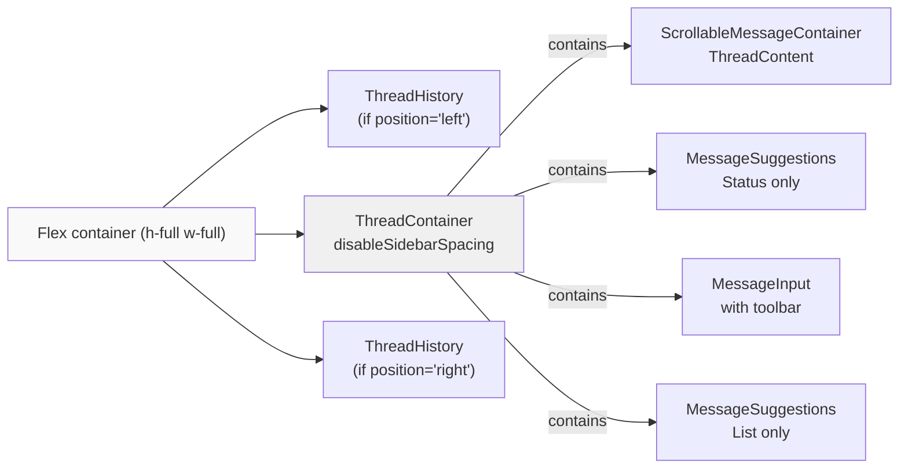

**ThreadContainer:**
Manages sidebar positioning and spacing via CSS variables. The `disableSidebarSpacing` prop prevents double padding when used inside a flex container with sidebars.

**Sources:** [cli/src/registry/message-thread-full/message-thread-full.tsx:56-142]()

### MessageThreadCollapsible Layout

Fixed-position collapsible chat widget:

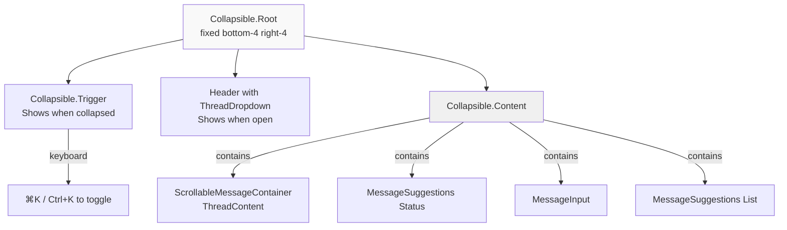

**Keyboard Toggle:**
Custom hook `useCollapsibleState` implements global keyboard listener for `Cmd/Ctrl+K` to toggle visibility ([lines:69-88](cli/src/registry/message-thread-collapsible/message-thread-collapsible.tsx:69-88)).

**Position:**
Fixed at `bottom-4 right-4` by default, can be customized via `className` prop for left positioning.

**Sources:** [cli/src/registry/message-thread-collapsible/message-thread-collapsible.tsx:64-266]()

### MessageThreadPanel Layout

Resizable panel with canvas integration for component visualization:

```mermaid
graph LR
    FlexContainer["Flex container<br/>(h-screen w-full)"]
    
    LeftHistory["ThreadHistory<br/>(if position='left')"]
    PanelLeft["ResizablePanel<br/>isLeftPanel=true"]
    Canvas["Canvas Space<br/>[data-canvas-space]"]
    PanelRight["ResizablePanel<br/>isLeftPanel=false"]
    RightHistory["ThreadHistory<br/>(if position='right')"]
    
    FlexContainer --> LeftHistory
    FlexContainer --> PanelLeft
    FlexContainer --> Canvas
    FlexContainer --> PanelRight
    FlexContainer --> RightHistory
    
    PanelLeft -->|"contains"| ChatUI1["ThreadContent<br/>MessageInput<br/>MessageSuggestions"]
    PanelRight -->|"contains"| ChatUI2["ThreadContent<br/>MessageInput<br/>MessageSuggestions"]
    
    Canvas -->|"listens for"| ShowComponentEvent["tambo:showComponent event"]
    Canvas -->|"displays"| RenderedComponents["message.renderedComponent"]
    
    style PanelLeft fill:#f9f9f9
    style Canvas fill:#e9f9f9
    style PanelRight fill:#f9f9f9
```

**Resizable Panel:**
Custom `ResizablePanel` component implements drag-to-resize with:
- Minimum width: 300px
- Drag handle positioned at panel edge
- CSS variable updates: `--panel-left-width` or `--panel-right-width`
- Throttled resize updates (16ms via requestAnimationFrame)

**Canvas Integration:**
The canvas space listens for `tambo:showComponent` events dispatched by `MessageRenderedComponentArea` and displays the component:
```javascript
window.addEventListener("tambo:showComponent", (e) => {
  // Display e.detail.component
});
```

**Sources:** [cli/src/registry/message-thread-panel/message-thread-panel.tsx:56-212](), [cli/src/registry/message-thread-panel/message-thread-panel.tsx:70-145]()

### Layout Component Usage

**MessageThreadFull Example:**
```typescript
import { MessageThreadFull } from "@/components/tambo/message-thread-full";

export default function ChatPage() {
  return <MessageThreadFull variant="default" />;
}
```

**MessageThreadCollapsible Example:**
```typescript
import { MessageThreadCollapsible } from "@/components/tambo/message-thread-collapsible";

export default function Layout({ children }) {
  return (
    <>
      {children}
      <MessageThreadCollapsible defaultOpen={false} />
    </>
  );
}
```

**MessageThreadPanel Example:**
```typescript
import { MessageThreadPanel } from "@/components/tambo/message-thread-panel";

export default function CanvasPage() {
  return <MessageThreadPanel variant="default" />;
}
```

**Sources:** [cli/src/registry/message-thread-full/message-thread-full.tsx](), [cli/src/registry/message-thread-collapsible/message-thread-collapsible.tsx](), [cli/src/registry/message-thread-panel/message-thread-panel.tsx]()

## Styling and Variants

Components support styling customization through:

### Variant System

The `variant` prop controls visual styling using `class-variance-authority`:

**Message Variants:**
- `default`: Minimal styling
- `solid`: Shadow, background color, hover effects

**MessageInput Variants:**
- `default`: Standard border and background
- `solid`: Elevated with shadow and ring
- `bordered`: Emphasized 2px border

**Sources:** [cli/src/registry/message/message.tsx:68-84](cli/src/registry/message/message.tsx:68-84), [cli/src/registry/message-input/message-input.tsx:292-316](cli/src/registry/message-input/message-input.tsx:292-316)

### CSS Variables

Components use CSS custom properties for theming:

**Key Variables:**
- `--background`, `--foreground`
- `--muted`, `--muted-foreground`
- `--accent`, `--accent-foreground`
- `--border`
- `--sidebar-width` (updated by ThreadHistory)
- `--panel-left-width`, `--panel-right-width` (updated by ResizablePanel)

**Global Styles:**
Base styles are defined in [cli/src/registry/config/globals-v4.css](cli/src/registry/config/globals-v4.css:1-112), which is synced to user projects during component installation.

**Sources:** [cli/src/registry/config/globals-v4.css:1-112](), [cli/src/registry/thread-history/thread-history.tsx:91-97]()

### Data Attributes for Targeting

Components expose data attributes for custom styling:

**Common Data Attributes:**
- `data-slot="message-content"` - Message content area
- `data-slot="message-input-form"` - Input form container
- `data-slot="toolcall-info"` - Tool call display
- `data-slot="message-suggestions-container"` - Suggestions wrapper
- `data-message-role="user|assistant"` - Message role
- `data-message-id="{id}"` - Message identifier
- `data-canvas-space="true"` - Canvas area marker

These allow targeting specific elements without modifying component code:
```css
[data-slot="message-content"] {
  /* Custom styles */
}
```

**Sources:** [cli/src/registry/message/message.tsx:188](cli/src/registry/message/message.tsx:188), [cli/src/registry/message-input/message-input.tsx:671](cli/src/registry/message-input/message-input.tsx:671), [cli/src/registry/message/message.tsx:342](cli/src/registry/message/message.tsx:342)

---

