<!-- source: DeepWiki mcp.deepwiki.com · repo tambo-ai/tambo · page 4.1 Message Components · fetched 2026-10-29 -->

# Message Components

<details>
<summary>Relevant source files</summary>

The following files were used as context for generating this wiki page:

- [cli/src/types/components.d.ts](cli/src/types/components.d.ts)
- [cli/src/types/utils.d.ts](cli/src/types/utils.d.ts)

</details>


The Message component family provides UI elements for rendering individual messages within a chat thread. The system uses a compound component pattern with a root `Message` component that establishes context, and multiple sub-components (`MessageContent`, `MessageImages`, `ToolcallInfo`, `ReasoningInfo`, `MessageRenderedComponentArea`) that render specific message parts. This architecture enables flexible composition while sharing message data through React Context.

For information about inputting messages, see [MessageInput Components](#4.2). For displaying lists of messages in a thread, see [ThreadContent Components](#4.3).

## Architecture Overview

The Message component system uses a compound component pattern where a root `Message` component establishes `MessageContext` and multiple sub-components consume that context to render different message parts.

**Component Architecture with Code Entities**

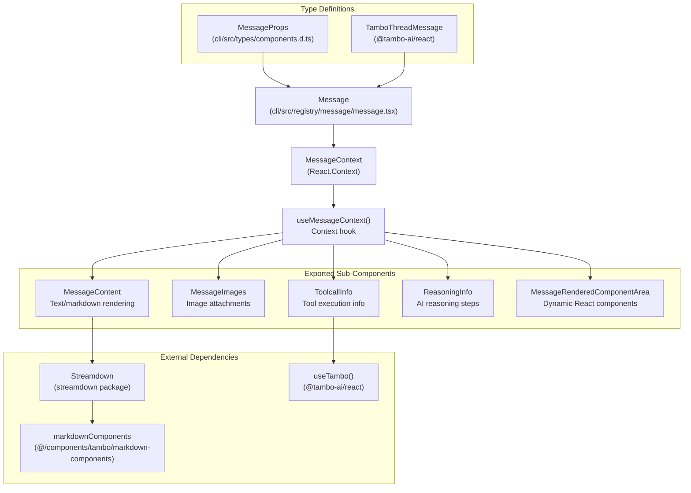

**Sources:**
- [cli/src/types/components.d.ts:26-89]()
- [cli/src/registry/message/message.tsx:93-119]()
- [cli/src/registry/message/message.tsx:167-197]()

## Component Hierarchy and Context

The `Message` component establishes `MessageContext` that provides shared state to all sub-components. This pattern prevents prop drilling and enables flexible composition.

**Context Flow in Application**

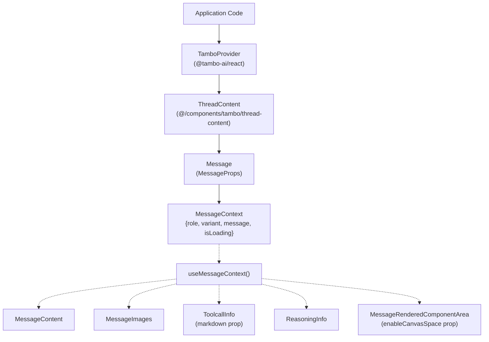

The context object contains:
- `role`: `"user" | "assistant"` - Message sender
- `variant`: `"default" | "solid"` - Visual styling
- `message`: `TamboThreadMessage` - Complete message data
- `isLoading`: `boolean` - Streaming state indicator

**Sources:**
- [cli/src/types/components.d.ts:27-36]()
- [cli/src/registry/message/message.tsx:93-119]()
- [cli/src/registry/message/message.tsx:104-119]()

## Message Component Props

The root `Message` component accepts the following props as defined in `MessageProps`:

| Prop | Type | Required | Description |
|------|------|----------|-------------|
| `role` | `"user" \| "assistant"` | Yes | Determines message alignment and styling |
| `message` | `TamboThreadMessage` | Yes | Complete message object from thread state |
| `variant` | `"default" \| "solid" \| null \| undefined` | No | Visual styling variant |
| `isLoading` | `boolean` | No | Indicates streaming/loading state |
| `content` | `string \| { type: string; text?: string }[]` | No | Optional content override |
| `className` | `string` | No | Additional CSS classes |
| `children` | `React.ReactNode` | No | Sub-components to render |

### Variant Styling

The component uses `messageVariants` (from `cva`) for variant-based styling:

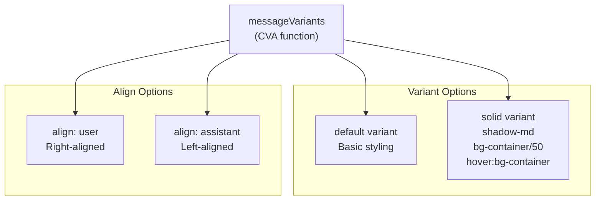

**Sources:**
- [cli/src/types/components.d.ts:28-36]()
- [cli/src/registry/message/message.tsx:138-153]()
- [cli/src/registry/message/message.tsx:68-84]()

## MessageContent Sub-Component

`MessageContent` renders message text content with markdown formatting. It handles static and streaming content.

### MessageContentProps

| Prop | Type | Description |
|------|------|-------------|
| `content` | `string \| { type: string; text?: string }[]` | Optional content override |
| `className` | `string` | Additional CSS classes |
| All HTML div attributes | - | Standard HTML attributes |

### Content Conversion Pipeline

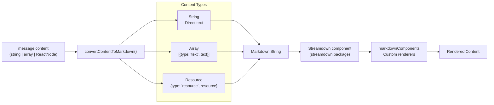

The `convertContentToMarkdown()` function handles resource references by converting them to markdown links with a custom protocol:

```
[Resource Name](tambo-resource://encoded-uri)
```

These are rendered as interactive mention components by `markdownComponents`.

**Sources:**
- [cli/src/types/components.d.ts:38-43]()
- [cli/src/registry/message/message.tsx:28-60]()
- [cli/src/registry/message/message.tsx:316-370]()
- [cli/src/registry/message/message.tsx:227-248]()

### Loading States

`MessageContent` displays a three-dot loading animation when `isLoading` is true and no content exists:

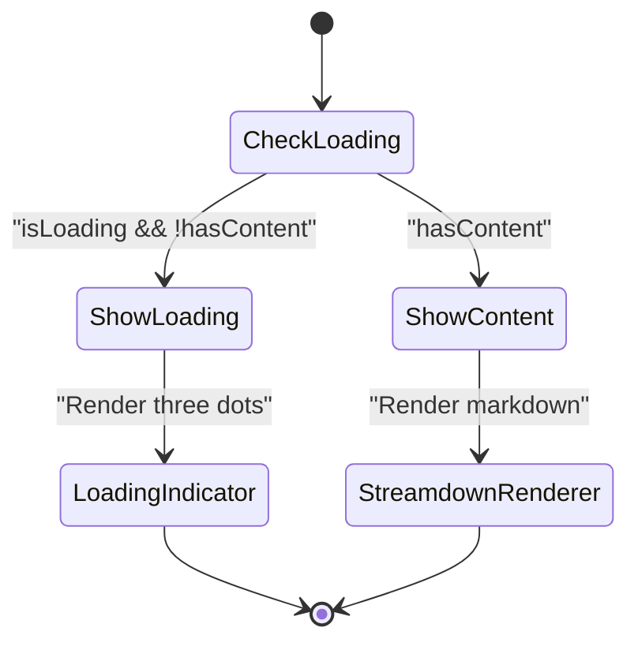

The loading indicator uses CSS animation classes:
- `animate-[loading_1.4s_ease-in-out_infinite]`
- Staggered delays for three dots: 0s, 0.2s, 0.4s

**Sources:**
- [cli/src/registry/message/message.tsx:333-366]()
- [cli/src/registry/message/message.tsx:210-222]()

## MessageImages Sub-Component

`MessageImages` extracts and displays image attachments from message content in a horizontal grid layout.

### MessageImagesProps

Standard HTML div attributes. No additional custom props.

### Image Extraction Process

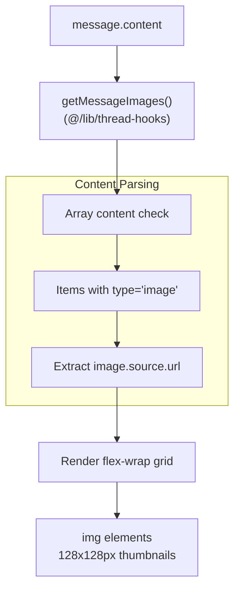

Images render as responsive thumbnails:
- Fixed size: `128px × 128px`
- Styling: `rounded-md hover:shadow-md`
- Object-fit: `cover` for consistent sizing
- Horizontal wrap layout with gap

**Sources:**
- [cli/src/types/components.d.ts:86-88]()
- [cli/src/registry/message/message.tsx:259-295]()
- [cli/src/types/components.d.ts:517-520]()

## ToolcallInfo Sub-Component

`ToolcallInfo` displays tool call information including tool name, parameters, and results in a collapsible dropdown.

### ToolcallInfoProps

| Prop | Type | Default | Description |
|------|------|---------|-------------|
| `markdown` | `boolean` | `true` | Render response content as Markdown |
| `className` | `string` | - | Additional CSS classes |
| All HTML div attributes | - | - | Standard HTML attributes |

### Tool Call Data Flow

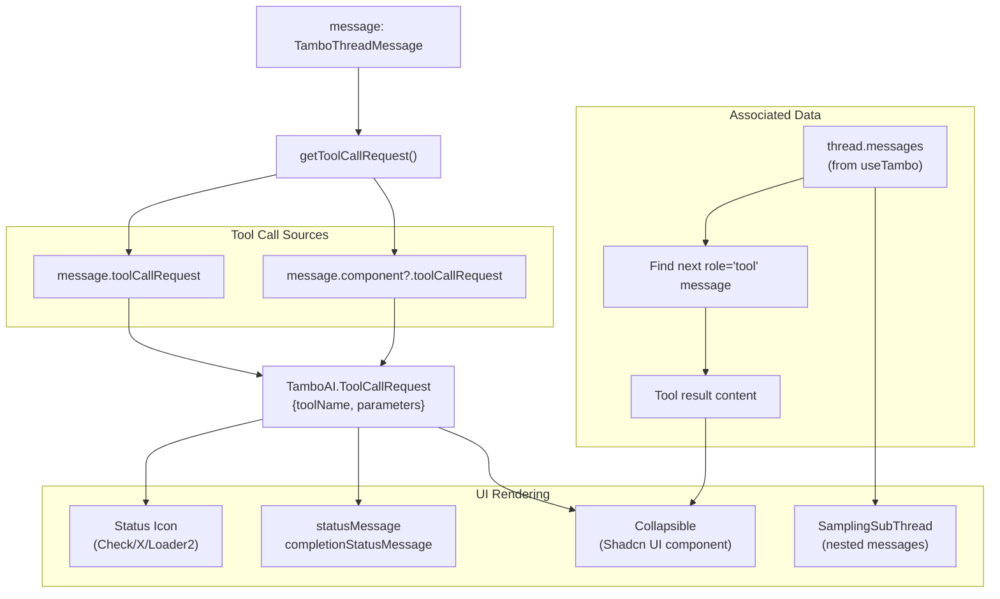

**Sources:**
- [cli/src/types/components.d.ts:49-55]()
- [cli/src/registry/message/message.tsx:428-532]()
- [cli/src/registry/message/message.tsx:127-131]()
- [cli/src/registry/message/message.tsx:385-400]()
- [cli/src/registry/message/message.tsx:403-421]()

### Tool Status Indicators

The component displays different icons based on tool execution state:

| State | Icon | Condition |
|-------|------|-----------|
| Error | `<X>` (red) | `message.error` exists |
| Loading | `<Loader2>` (spinning) | `isLoading` is true |
| Success | `<Check>` (green) | Completed without error |

**Sources:**
- [cli/src/registry/message/message.tsx:403-421]()

### Tool Result Formatting

Tool results are automatically formatted by `formatToolResult()`:

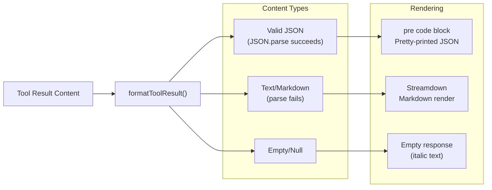

JSON formatting uses `json-stringify-pretty-compact` with:
- `indent: 2`
- `maxLength: 80`

**Sources:**
- [cli/src/registry/message/message.tsx:796-843]()
- [cli/src/types/utils.d.ts:40-52]()

### Sampling Sub-Threads

`ToolcallInfo` includes `SamplingSubThread` to display MCP sampling conversations (AI exploring options through sub-threads):

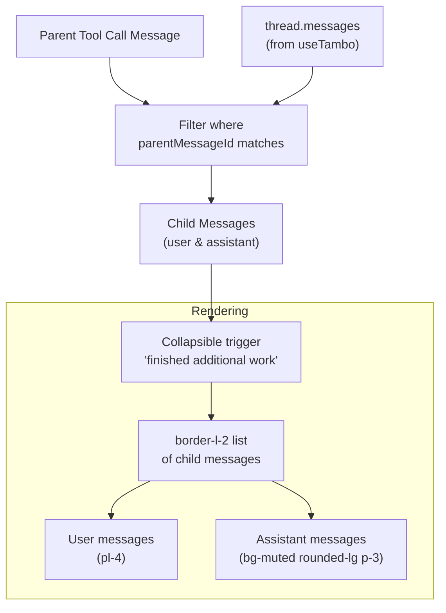

Each child message shows:
- User messages: Indented with padding
- Assistant messages: Background bubble with rounded corners
- Recursive message content with `getSafeContent()`

**Sources:**
- [cli/src/registry/message/message.tsx:541-610]()
- [cli/src/registry/message/message.tsx:512]()
- [cli/src/types/components.d.ts:509-515]()

## ReasoningInfo Sub-Component

`ReasoningInfo` displays AI reasoning steps (e.g., from models like o1) in a collapsible panel with auto-scrolling during generation.

### ReasoningInfoProps

Standard HTML div attributes. No additional custom props.

### Reasoning Display Features

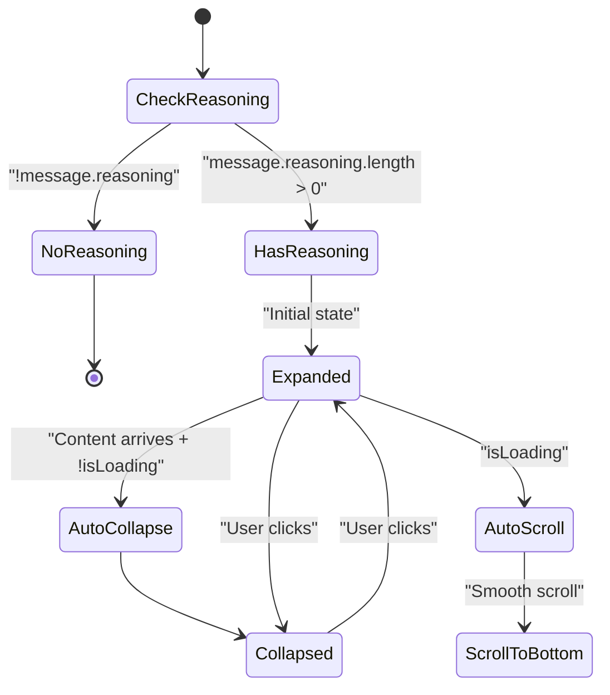

Key behaviors implemented via `useEffect`:
1. **Auto-expand**: Opens when reasoning starts
2. **Auto-collapse**: Collapses when content generation begins
3. **Auto-scroll**: Scrolls to bottom during streaming
4. **Duration display**: Shows thinking time when complete

**Sources:**
- [cli/src/types/components.d.ts:82-84]()
- [cli/src/registry/message/message.tsx:626-733]()
- [cli/src/registry/message/message.tsx:633-638]()
- [cli/src/registry/message/message.tsx:640-661]()

### Reasoning Duration Formatting

The `formatDuration()` function formats reasoning duration in human-readable format:

| Duration | Display |
|----------|---------|
| < 1 second | "Thought for less than 1 second" |
| 1-59 seconds | "Thought for X second(s)" |
| 1-59 minutes | "Thought for X minute(s)" |
| 60+ minutes | "Thought for X hour(s)" |

Duration is calculated from `message.reasoning[0]?.start` to `message.reasoning[message.reasoning.length - 1]?.end` timestamps.

**Sources:**
- [cli/src/registry/message/message.tsx:778-789]()
- [cli/src/registry/message/message.tsx:747-771]()

## MessageRenderedComponentArea Sub-Component

`MessageRenderedComponentArea` displays React components dynamically generated by the AI and hydrated through the component registry.

### MessageRenderedComponentAreaProps

| Prop | Type | Description |
|------|------|-------------|
| `enableCanvasSpace` | `boolean` | Enable canvas space integration |
| `className` | `string` | Additional CSS classes |
| All HTML div attributes | - | Standard HTML attributes |

### Component Rendering Architecture

```mermaid
graph TB
    MessageObject["message: TamboThreadMessage"]
    CheckRenderedComponent["Check<br/>message.renderedComponent"]
    
    subgraph "Canvas Detection"
        CheckCanvas["document.getElementById<br/>('#canvas-space')"]
        CanvasExists["canvasExists state<br/>(useState)"]
    end
    
    subgraph "Rendering Modes"
        InlineRender["Inline Render<br/>Display in message thread"]
        CanvasButton["Canvas Button<br/>View in Canvas Space"]
    end
    
    RenderedComponent["message.renderedComponent<br/>(React.ReactElement)"]
    ReactDOM_createPortal["ReactDOM.createPortal<br/>(portal to #canvas-space)"]
    
    MessageObject --> CheckRenderedComponent
    CheckRenderedComponent --> CheckCanvas
    CheckCanvas --> CanvasExists
    
    CanvasExists --> InlineRender: "No canvas"
    CanvasExists --> CanvasButton: "Canvas exists"
    
    CheckRenderedComponent --> RenderedComponent
    RenderedComponent --> InlineRender
    RenderedComponent --> CanvasButton
    CanvasButton --> ReactDOM_createPortal
```

The component checks for `#canvas-space` element on mount (via `useEffect`) and provides two display options:
- **Inline**: Renders component directly in message thread
- **Canvas View**: Button to portal component to dedicated canvas space

**Sources:**
- [cli/src/types/components.d.ts:45-47]()
- [cli/src/registry/message/message.tsx:858-927]()
- [cli/src/registry/message/message.tsx:863-874]()

### Canvas Space Integration

When a canvas space exists, the component provides "View in Canvas Space" button using portal rendering:

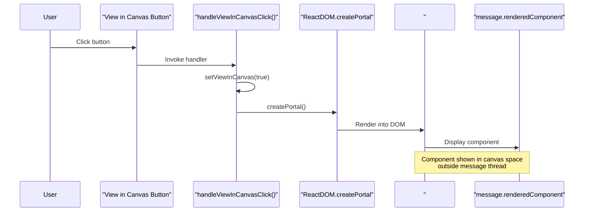

The portal uses `ReactDOM.createPortal(component, canvasElement)` to render the component in the canvas space while maintaining the React tree hierarchy.

**Sources:**
- [cli/src/registry/message/message.tsx:876-927]()

## Markdown Rendering

The Message component uses the `Streamdown` component from the `streamdown` package for markdown rendering, configured with `markdownComponents`.

### Markdown Component Pipeline

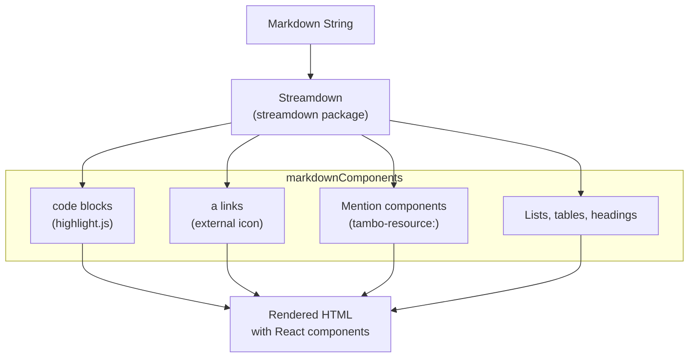

`markdownComponents` is imported from `@/components/tambo/markdown-components` and provides custom renderers for:
- Code blocks with syntax highlighting via `highlight.js`
- Links with external icons
- Resource mentions (custom protocol `tambo-resource://`)
- Standard markdown elements

**Sources:**
- [cli/src/types/components.d.ts:318-325]()
- [cli/src/registry/message/message.tsx:4]()
- [cli/src/registry/message/message.tsx:244]()
- [cli/src/types/utils.d.ts:23-31]()

## Usage Examples

### Basic User Message

```tsx
import { Message, MessageImages, MessageContent } from "@/components/tambo/message";

<Message role="user" message={userMessage}>
  <div className="flex flex-col">
    <MessageImages />
    <MessageContent className="bg-container" />
  </div>
</Message>
```

### Complete Assistant Message

```tsx
import { 
  Message, 
  MessageContent, 
  MessageImages,
  ToolcallInfo, 
  ReasoningInfo,
  MessageRenderedComponentArea 
} from "@/components/tambo/message";

<Message 
  role="assistant" 
  message={assistantMessage}
  variant="solid"
  isLoading={isGenerating && isLastMessage}
>
  <div className="flex flex-col w-full">
    <ReasoningInfo />
    <MessageImages />
    <MessageContent />
    <ToolcallInfo markdown={true} />
    <MessageRenderedComponentArea enableCanvasSpace={true} />
  </div>
</Message>
```

### Integration with ThreadContent

The Message component is typically used within `ThreadContent` which provides message list iteration:

```tsx
import { ThreadContent, ThreadContentMessages } from "@/components/tambo/thread-content";

<ThreadContent variant="solid">
  <ThreadContentMessages />
</ThreadContent>
```

The `ThreadContentMessages` component iterates over `thread.messages` and renders each with the appropriate Message sub-components.

**Sources:**
- [cli/src/registry/thread-content/thread-content.tsx:142-181]()
- [cli/src/registry/message/message.tsx:167-197]()

## Message Type Filtering

The Message component rendering logic filters certain message types:

| Message Role | Rendered in Thread | Display Location |
|--------------|-------------------|------------------|
| `user` | ✓ | Message list |
| `assistant` | ✓ | Message list |
| `tool` | ✗ | Within `ToolcallInfo` dropdown |
| `system` | ✗ | Not displayed (internal) |
| Messages with `parentMessageId` | ✗ | Within `SamplingSubThread` |

This filtering happens in `ThreadContentMessages` when iterating over `thread.messages`. Tool responses and sampling sub-thread messages are associated with their parent messages rather than displayed independently.

**Sources:**
- [cli/src/registry/message/message.tsx:178-180]()
- [cli/src/registry/thread-content/thread-content.tsx:130-132]()

## Type Definitions

The component exports TypeScript interfaces for all props:

- `MessageProps` - Root Message component props
- `MessageContentProps` - MessageContent props with optional content override
- `MessageImagesProps` - MessageImages props
- `ToolcallInfoProps` - ToolcallInfo props with markdown flag
- `ReasoningInfoProps` - ReasoningInfo props
- `MessageRenderedComponentAreaProps` - MessageRenderedComponentArea props

**Sources:**
- [cli/src/registry/message/message.tsx:138-153]()
- [cli/src/registry/message/message.tsx:301-309]()
- [cli/src/registry/message/message.tsx:376-383]()
- [cli/src/registry/message/message.tsx:616-619]()
- [cli/src/registry/message/message.tsx:849-850]()
- [cli/src/types/components.d.ts:26-89]()

---

