<!-- source: DeepWiki mcp.deepwiki.com · repo tambo-ai/tambo · page 5.1 CLI Commands Reference · fetched 2026-10-29 -->

# CLI Commands Reference

<details>
<summary>Relevant source files</summary>

The following files were used as context for generating this wiki page:

- [cli/src/__tests__/non-interactive-safety.test.ts](cli/src/__tests__/non-interactive-safety.test.ts)
- [cli/src/cli.ts](cli/src/cli.ts)
- [cli/src/commands/add/component.ts](cli/src/commands/add/component.ts)
- [cli/src/commands/add/index.test.ts](cli/src/commands/add/index.test.ts)
- [cli/src/commands/add/index.ts](cli/src/commands/add/index.ts)
- [cli/src/commands/add/tailwind-setup.ts](cli/src/commands/add/tailwind-setup.ts)
- [cli/src/commands/add/tailwind/v4/toolchain-setup.test.ts](cli/src/commands/add/tailwind/v4/toolchain-setup.test.ts)
- [cli/src/commands/add/tailwind/v4/toolchain-setup.ts](cli/src/commands/add/tailwind/v4/toolchain-setup.ts)
- [cli/src/commands/add/types.ts](cli/src/commands/add/types.ts)
- [cli/src/commands/add/utils.ts](cli/src/commands/add/utils.ts)
- [cli/src/commands/create-app.ts](cli/src/commands/create-app.ts)
- [cli/src/commands/init.test.ts](cli/src/commands/init.test.ts)
- [cli/src/commands/init.ts](cli/src/commands/init.ts)
- [cli/src/commands/list/index.test.ts](cli/src/commands/list/index.test.ts)
- [cli/src/commands/list/index.ts](cli/src/commands/list/index.ts)
- [cli/src/commands/update.test.ts](cli/src/commands/update.test.ts)
- [cli/src/commands/update.ts](cli/src/commands/update.ts)
- [cli/src/commands/upgrade/components.ts](cli/src/commands/upgrade/components.ts)
- [cli/src/commands/upgrade/index.ts](cli/src/commands/upgrade/index.ts)
- [cli/src/commands/upgrade/llm-rules.ts](cli/src/commands/upgrade/llm-rules.ts)
- [cli/src/commands/upgrade/npm-packages.ts](cli/src/commands/upgrade/npm-packages.ts)
- [cli/src/commands/upgrade/utils.ts](cli/src/commands/upgrade/utils.ts)
- [cli/src/utils/framework-detection.test.ts](cli/src/utils/framework-detection.test.ts)
- [cli/src/utils/framework-detection.ts](cli/src/utils/framework-detection.ts)
- [cli/src/utils/interactive.test.ts](cli/src/utils/interactive.test.ts)
- [cli/src/utils/interactive.ts](cli/src/utils/interactive.ts)
- [cli/src/utils/package-manager.test.ts](cli/src/utils/package-manager.test.ts)
- [cli/src/utils/package-manager.ts](cli/src/utils/package-manager.ts)

</details>


This page provides a complete reference for all Tambo CLI commands. The CLI is the primary tool for initializing projects, managing components, upgrading packages, and handling authentication. Each command supports both interactive and non-interactive modes for CI/CD compatibility.

## Command Overview

The Tambo CLI provides the following commands:

| Command | Purpose | Interactive | Non-Interactive Flags |
|---------|---------|-------------|----------------------|
| `tambo init` | Initialize Tambo in existing project | Yes | `--api-key`, `--project-name`, `--project-id`, `--yes` |
| `tambo full-send` | Init with component installation | Yes | `--yes` |
| `tambo create-app` | Create project from template | Yes | `[directory]`, `--template` |
| `tambo add` | Add components to project | Yes | `--yes`, `--dry-run` |
| `tambo list` | List installed components | No | - |
| `tambo update` | Update specific components | Yes | `--yes` |
| `tambo upgrade` | Upgrade packages and components | Yes | `--yes` |
| `tambo migrate` | Migrate ui/ to tambo/ directory | Yes | `--yes`, `--dry-run` |
| `tambo auth` | Manage authentication | Varies | `--quiet`, `--force`, `--all` |

**Sources:** [cli/src/cli.ts:81-298](), [cli/src/cli.ts:365-439]()

## CLI Architecture

**CLI Command Dispatch Flow**

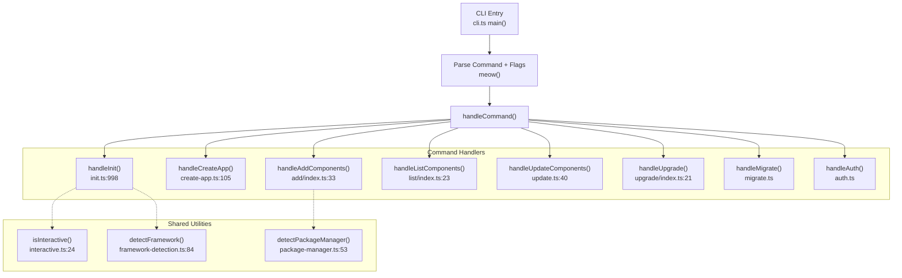

**Sources:** [cli/src/cli.ts:464-623](), [cli/src/cli.ts:729-764]()

## init / full-send Commands

### Syntax

```bash
tambo init [options]
tambo full-send [options]
```

### Description

The `init` command initializes Tambo in an existing project by configuring authentication, creating configuration files, and setting up the directory structure. The `full-send` variant additionally installs pre-selected components.

**Key Operations:**
- Validates `package.json` existence [init.ts:1154-1166]()
- Authenticates with Tambo Cloud or configures self-hosted API key
- Detects framework and configures environment variables
- Creates `lib/tambo.ts` with empty component/tool registry
- Optionally creates `AGENTS.md` and `CLAUDE.md` files
- (full-send only) Installs user-selected components

### Options

| Flag | Description | Default |
|------|-------------|---------|
| `--yes`, `-y` | Auto-answer yes to all prompts | `false` |
| `--api-key <key>` | Provide API key directly (skips auth) | Prompts |
| `--project-name <name>` | Create new project with this name | Prompts |
| `--project-id <id>` | Use existing project by ID | Prompts |
| `--no-browser` | Print auth URL instead of opening browser | `false` |
| `--skip-agent-docs` | Skip creating AGENTS.md/CLAUDE.md | `false` |
| `--legacy-peer-deps` | Use npm's --legacy-peer-deps flag | `false` |

**Sources:** [cli/src/cli.ts:86-98](), [cli/src/commands/init.ts:68-77]()

### Examples

```bash
# Interactive mode - prompts for all choices
tambo init

# Direct API key (simplest non-interactive)
tambo init --api-key=sk_...

# Create new project with device auth
tambo init --project-name=myapp

# Use existing project
tambo init --project-id=abc123

# Full-send with component selection
tambo full-send

# Auto-accept all defaults
tambo full-send --yes
```

### Non-Interactive Mode

The `init` command supports three non-interactive authentication methods:

1. **Direct API key:** `--api-key=sk_...` (simplest)
2. **New project:** `--project-name=myapp` (runs device auth + creates project)
3. **Existing project:** `--project-id=abc123` (runs device auth + uses project)

If none are provided in non-interactive environment, throws `GuidanceError` with exit code 2 [init.ts:1096-1101]().

**Sources:** [cli/src/commands/init.ts:1008-1102]()

## Authentication and Hosting Setup

### Cloud Authentication Flow

The cloud authentication uses a device auth flow that authenticates users through their browser:

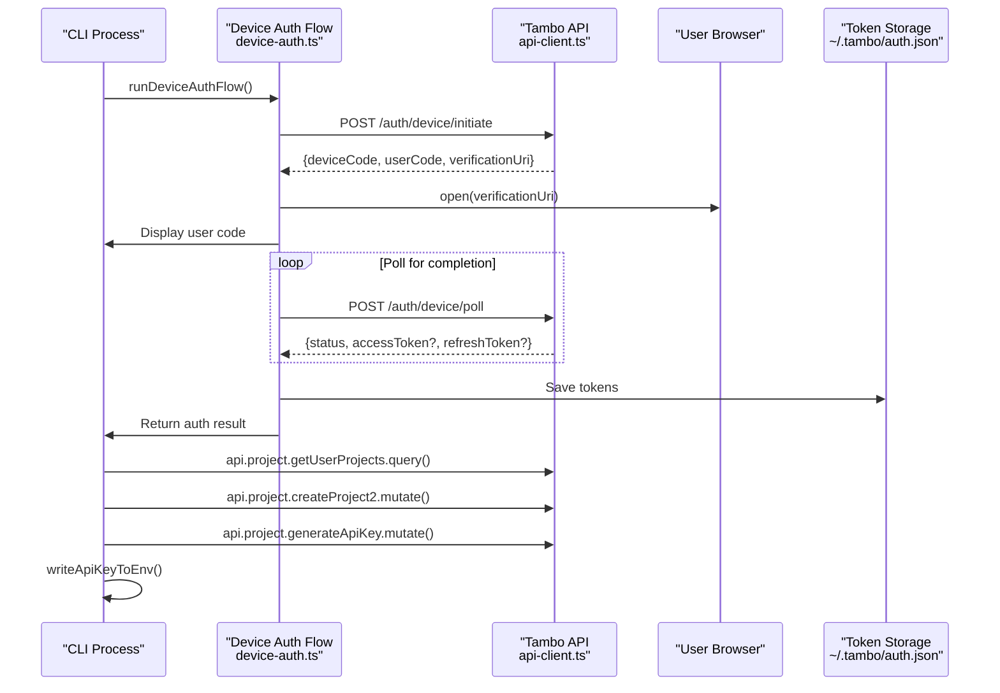

The `handleAuthentication()` function manages this flow:

1. **Check Existing Auth:** [init.ts:307-326]() verifies if a valid session exists
2. **Device Auth Flow:** [init.ts:329-339]() runs browser-based authentication
3. **Project Setup:** [init.ts:338]() calls `handleProjectAndApiKey()`
4. **API Key Generation:** [init.ts:472-502]() creates and saves API key

**Sources:** [cli/src/commands/init.ts:298-350](), [cli/src/commands/init.ts:352-507](), [cli/src/lib/device-auth.ts:1-164]()

### Self-Hosted Setup

For self-hosted installations, users manually provide their API key:

1. **Display Instructions:** [init.ts:167-202]() shows Docker setup steps
2. **API Key Input:** [init.ts:590-604]() prompts for self-hosted API key
3. **Environment Configuration:** [init.ts:77-162]() writes key to `.env.local`

**Sources:** [cli/src/commands/init.ts:167-202](), [cli/src/commands/init.ts:512-607]()

## Framework Detection and Environment Configuration

### Framework Detection System

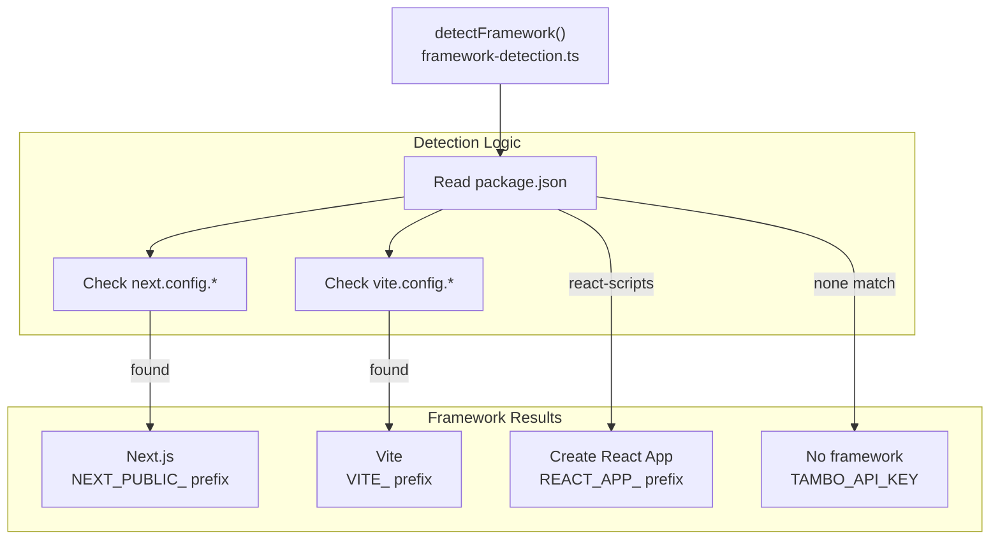

The framework detection determines the appropriate environment variable prefix:

| Framework | Env Var Name | Detection Method |
|-----------|-------------|------------------|
| Next.js | `NEXT_PUBLIC_TAMBO_API_KEY` | `next.config.js/ts/mjs` exists |
| Vite | `VITE_TAMBO_API_KEY` | `vite.config.js/ts` exists |
| Create React App | `REACT_APP_TAMBO_API_KEY` | `react-scripts` in dependencies |
| None | `TAMBO_API_KEY` | No framework detected |

**Implementation:** [cli/src/utils/framework-detection.ts:1-89]()

### Environment Variable Management

The `writeApiKeyToEnv()` function [init.ts:77-162]() handles `.env.local` file creation and updates:

1. **File Selection:** Uses `.env.local` by default, falls back to `.env` if it exists
2. **Duplicate Detection:** [init.ts:106-133]() finds existing Tambo API keys using `findAllTamboApiKeys()`
3. **Key Consolidation:** [init.ts:135-156]() replaces multiple key variants with framework-appropriate name
4. **Atomic Updates:** Uses `setTamboApiKey()` from [dotenv-utils.ts]() to safely update content

**Sources:** [cli/src/commands/init.ts:77-162](), [cli/src/utils/framework-detection.ts:1-89](), [cli/src/utils/dotenv-utils.ts:1-127]()

## Directory Structure Initialization

### Component Installation Path Selection

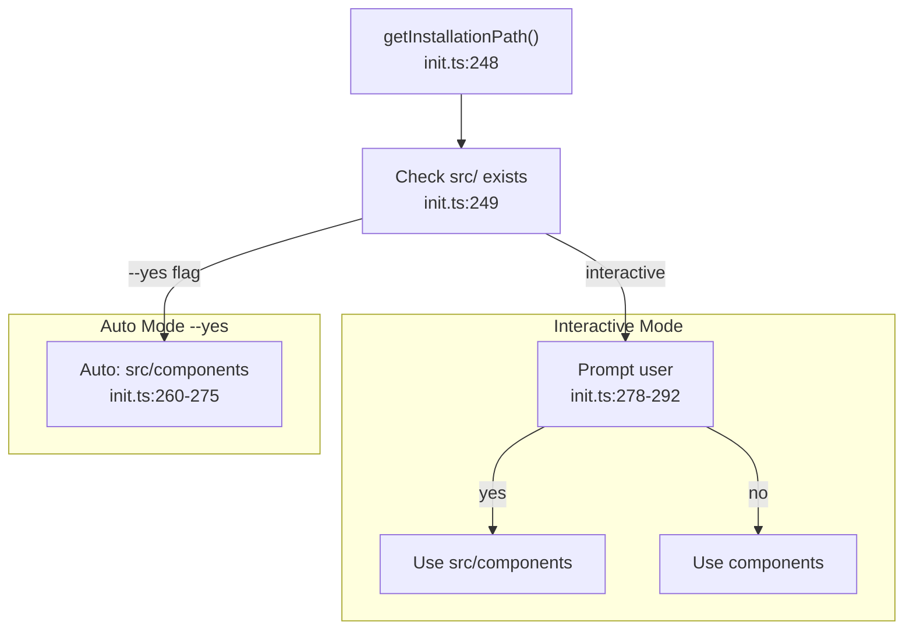

The installation path logic [init.ts:248-295]():
- **With `src/` directory:** Defaults to `src/components`
- **Without `src/` directory:** Offers to create `src/components` or use `components`
- **`--yes` flag:** Auto-selects `src/components` (creates if needed)

**Sources:** [cli/src/commands/init.ts:248-295]()

### File Creation

The initialization creates several files in the project:

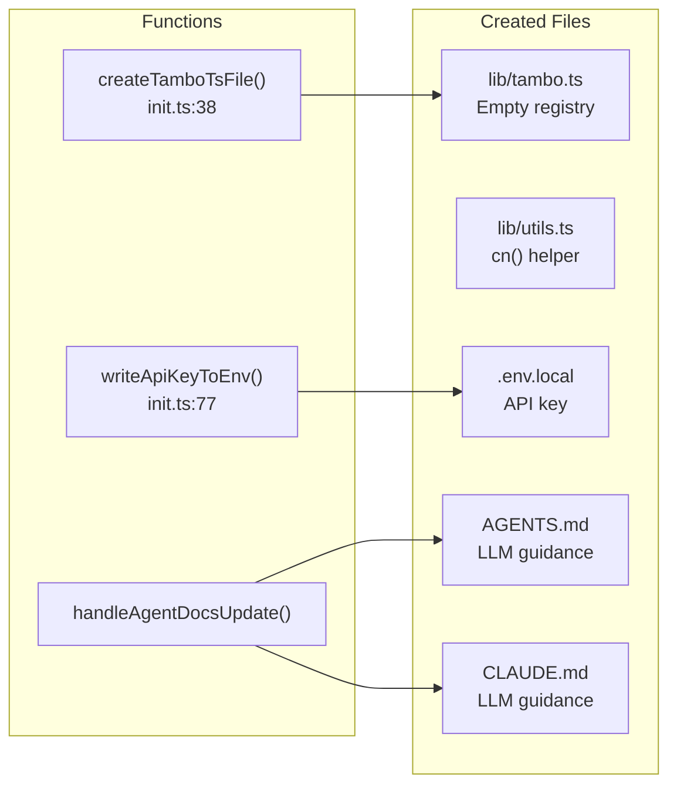

**`tambo.ts` Template** [init.ts:44-51]():
```typescript
// lib/tambo.ts
import { ToolConfig } from "@tambo-ai/react";

export const tools: ToolConfig[] = [];
export const components = [];
```

**`utils.ts` Template** [cli/src/commands/add/component.ts:75-82]():
```typescript
// lib/utils.ts
import { clsx, type ClassValue } from "clsx"
import { twMerge } from "tailwind-merge"

export function cn(...inputs: ClassValue[]) {
    return twMerge(clsx(inputs))
}
```

**Sources:** [cli/src/commands/init.ts:38-56](), [cli/src/commands/add/component.ts:74-83](), [cli/src/templates/tambo-template.ts]()

## Template-Based Project Creation

### Available Templates

The `create-app` command supports multiple templates defined in [create-app.ts:23-34]():

| Template | Description | Repository |
|----------|-------------|------------|
| `standard` | Tambo + Tools + MCP (recommended) | `tambo-ai/tambo-template` |
| `analytics` | Generative UI Analytics Template | `tambo-ai/analytics-template` |

### Create-App Workflow

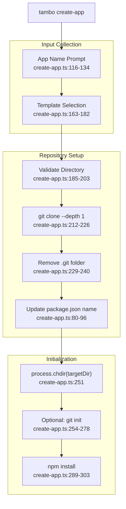

**Key Implementation Details:**

1. **Name Validation:** [create-app.ts:107-128]() ensures valid directory names or "." for current directory
2. **Template Cloning:** [create-app.ts:212-226]() uses shallow clone with `--depth 1`
3. **Git Cleanup:** [create-app.ts:43-78]() safely removes `.git` folder (cross-platform)
4. **Package Manager Detection:** [create-app.ts:282-303]() uses `detectPackageManager()` from [package-manager.ts:18-31]()
5. **Dependency Installation:** Respects `--legacy-peer-deps` flag for npm [create-app.ts:286-302]()

**Sources:** [cli/src/commands/create-app.ts:98-353](), [cli/src/utils/package-manager.ts:18-31]()

## Package Manager Detection

The CLI automatically detects and uses the appropriate package manager:

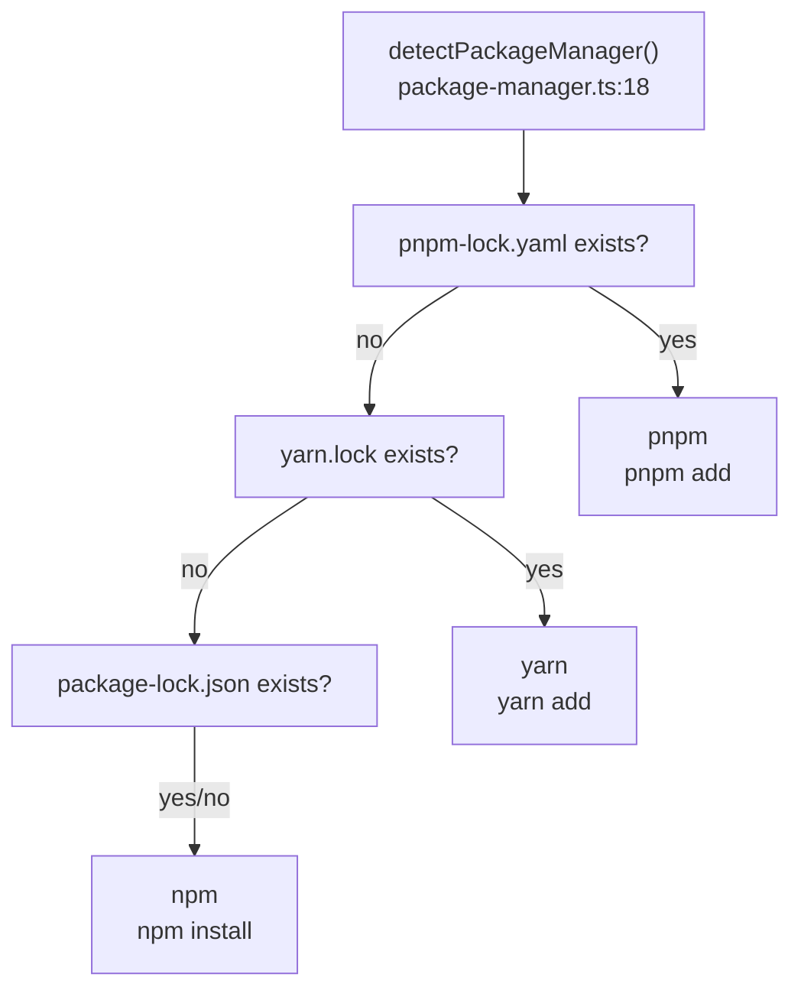

**Priority Order:** pnpm > yarn > npm (default)

**Package Manager Commands:**

| Manager | Install Command | Dev Flag | Runner |
|---------|----------------|----------|--------|
| npm | `install` | `-D` | `npx` |
| pnpm | `add` | `-D` | `pnpm dlx` |
| yarn | `add` | `--dev` | `yarn dlx` |

**Functions:**
- `detectPackageManager()` - [package-manager.ts:18-31]()
- `getInstallCommand()` - [package-manager.ts:56-58]()
- `getDevFlag()` - [package-manager.ts:66-68]()
- `getPackageRunnerArgs()` - [package-manager.ts:76-85]()

**Sources:** [cli/src/utils/package-manager.ts:1-86](), [cli/src/commands/create-app.ts:282-303]()

### Full-Send Component Selection

The `full-send` mode presents a checkbox prompt for component selection [init.ts:789-811]():

**Available Components:**
- `message-thread-full` - Full-screen chat interface with history
- `message-thread-panel` - Split-view chat with workspace
- `message-thread-collapsible` - Collapsible chat for sidebars
- `control-bar` - Spotlight-style command palette

**Post-Installation:** Generates TamboProvider setup code with selected components and copies to clipboard [init.ts:919-951]().

**Sources:** [cli/src/commands/init.ts:736-848](), [cli/src/commands/init.ts:854-992]()

## create-app Command

### Syntax

```bash
tambo create-app [directory] [options]
```

### Description

Creates a new Tambo application from a pre-configured template. Clones the template repository, removes git history, updates `package.json`, and installs dependencies.

### Options

| Flag | Description | Default |
|------|-------------|---------|
| `[directory]` | Target directory (use "." for current) | Prompts user |
| `--template`, `-t` | Template name: standard, vite, analytics | `standard` |
| `--init-git` | Initialize git repository after creation | `false` |
| `--legacy-peer-deps` | Use npm's --legacy-peer-deps flag | `false` |

**Sources:** [cli/src/cli.ts:189-210](), [cli/src/commands/create-app.ts:43-48]()

### Available Templates

| Template | Description | Repository |
|----------|-------------|------------|
| `standard` | Tambo + Tools + MCP (recommended) | `github.com/tambo-ai/tambo-template` |
| `vite` | Tambo + TanStack Router + Vite | `github.com/tambo-ai/tambo-template-vite` |
| `analytics` | Generative UI Analytics Template | `github.com/tambo-ai/analytics-template` |

**Sources:** [cli/src/commands/create-app.ts:25-41]()

### Examples

```bash
# Interactive mode
tambo create-app

# Create in specific directory
tambo create-app my-app

# Create in current directory
tambo create-app .

# Use specific template
tambo create-app --template=vite

# With git initialization
tambo create-app my-app --init-git
```

### Implementation Flow

**Create-App Execution Flow**

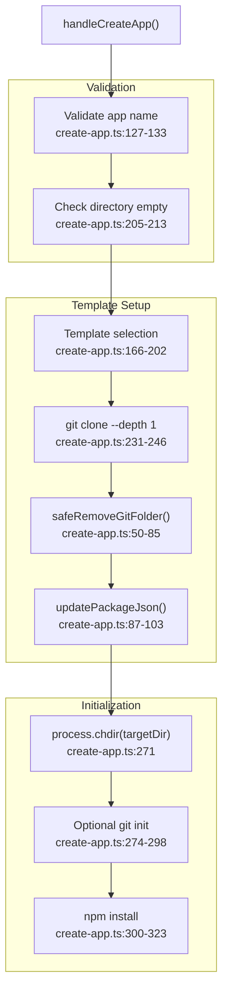

**Key Implementation Details:**

1. **Name Validation:** [create-app.ts:127-148]() accepts alphanumeric + dashes/underscores or "."
2. **Shallow Clone:** Uses `git clone --depth 1` for faster cloning [create-app.ts:232-237]()
3. **Cross-Platform Git Cleanup:** [create-app.ts:50-85]() handles Windows read-only attributes
4. **Package Manager Detection:** [create-app.ts:302-304]() uses `detectPackageManager()`
5. **Directory Change:** Changes to target directory before git/npm operations [create-app.ts:271]()

**Sources:** [cli/src/commands/create-app.ts:105-373]()

### Non-Interactive Mode

Requires both app name and template in non-interactive mode:

```bash
# Will throw GuidanceError if missing required args
tambo create-app my-app --template=standard
```

**Sources:** [cli/src/commands/create-app.ts:108-119]()

## add Command

### Syntax

```bash
tambo add <components...> [options]
```

### Description

Installs Tambo UI components from the registry into your project. Automatically resolves component dependencies, installs npm packages, and sets up Tailwind CSS configuration.

### Options

| Flag | Description | Default |
|------|-------------|---------|
| `--prefix <path>` | Custom component directory | Prompts or `src/components` |
| `--yes`, `-y` | Skip confirmation prompts | `false` |
| `--dry-run` | Preview changes without applying | `false` |
| `--skip-agent-docs` | Skip updating AGENTS.md | `false` |
| `--legacy-peer-deps` | Use npm's --legacy-peer-deps flag | `false` |

**Sources:** [cli/src/cli.ts:117-139](), [cli/src/commands/add/index.ts:33-294]()

### Examples

```bash
# Interactive - single component
tambo add message

# Multiple components
tambo add message form graph

# Auto-proceed without prompts
tambo add message --yes

# Preview installation plan
tambo add message --dry-run

# Custom installation directory
tambo add message --prefix=src/ui
```

### Implementation Details

**Add Command Flow**

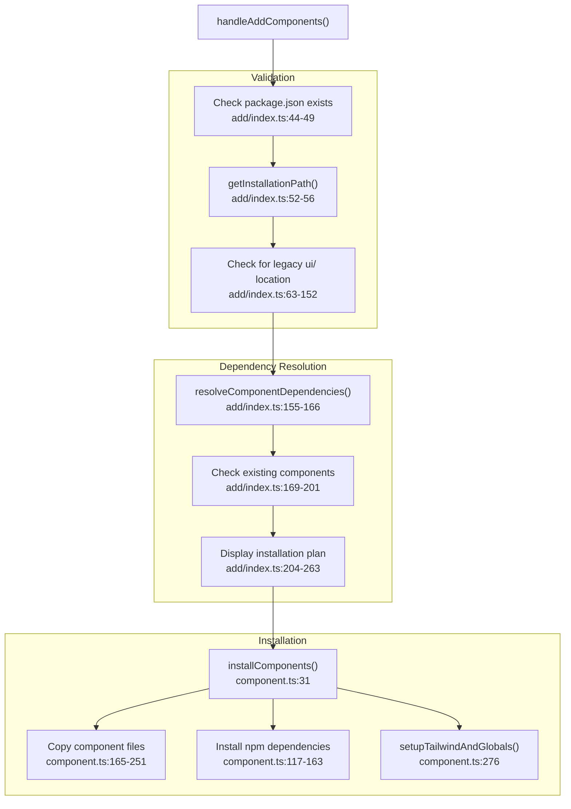

**Key Operations:**

1. **Dependency Resolution:** [add/index.ts:155-166]() uses `resolveComponentDependencies()` to find all required components
2. **Legacy Location Handling:** [add/index.ts:63-152]() detects existing `ui/` directory and installs there for compatibility
3. **Dry Run Mode:** [add/index.ts:214-242]() displays file paths and npm packages without writing
4. **Batch NPM Install:** [component.ts:86-163]() collects all dependencies and installs once
5. **Import Path Updates:** [component.ts:244]() calls `updateImportPaths()` for component files

**Sources:** [cli/src/commands/add/index.ts:33-294](), [cli/src/commands/add/component.ts:31-268]()

## list Command

### Syntax

```bash
tambo list [options]
```

### Description

Lists all Tambo components currently installed in the project, categorized by location (tambo/ vs ui) and type (main components vs support components vs custom).

### Options

| Flag | Description | Default |
|------|-------------|---------|
| `--prefix <path>` | Custom component directory | Prompts or `src/components` |
| `--yes`, `-y` | Skip prompts (use default path) | `false` |

**Sources:** [cli/src/cli.ts:140-150](), [cli/src/commands/list/index.ts:15-18]()

### Example Output

```
ℹ Installed components:

  In tambo/:
    Tambo components:
      - message
      - message-thread-full
    
  In ui/ (legacy location):
    Tambo components:
      - form
      - graph
    Custom components:
      - my-custom-button

Total: 5 component(s) (4 from Tambo, 1 custom)
```

### Implementation

The `list` command uses `getTamboComponentInfo()` [list/index.ts:38]() to categorize components:
- **Main components:** Top-level installable components with their own config
- **Support components:** Dependencies automatically installed with main components
- **Custom components:** .tsx files not recognized as Tambo registry components

**Sources:** [cli/src/commands/list/index.ts:23-206]()

## update Command

### Syntax

```bash
tambo update <components...> [options]
tambo update installed [options]
```

### Description

Updates specific components or all installed components to their latest registry versions. Includes dependency resolution and cross-location consistency checks.

### Options

| Flag | Description | Default |
|------|-------------|---------|
| `--prefix <path>` | Custom component directory | Prompts |
| `--yes`, `-y` | Skip confirmation prompts | `false` |
| `--legacy-peer-deps` | Use npm's --legacy-peer-deps flag | `false` |

**Sources:** [cli/src/cli.ts:151-167](), [cli/src/commands/update.ts:29-35]()

### Examples

```bash
# Update single component
tambo update message

# Update multiple components
tambo update message form

# Update ALL installed components
tambo update installed

# Auto-proceed without warning
tambo update installed --yes
```

### Special Keyword: "installed"

The `installed` keyword [update.ts:59-84]() triggers update of all components found via `getInstalledComponents()`.

### Implementation Details

**Update Command Flow with Dependency Checks**

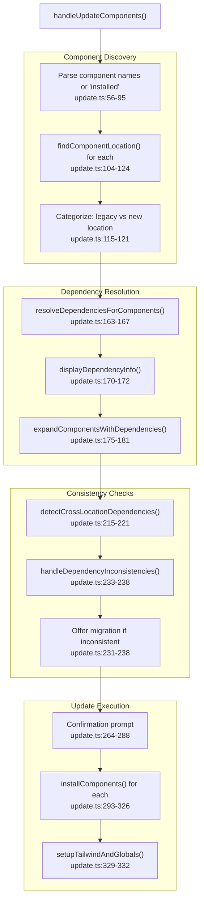

**Key Features:**

1. **Cross-Location Detection:** [update.ts:212-228]() uses `detectCrossLocationDependencies()` to find components in ui/ that depend on components in tambo/ (or vice versa)
2. **Migration Handling:** [update.ts:233-238]() calls `handleDependencyInconsistencies()` to optionally migrate components
3. **Force Update:** [update.ts:299]() sets `forceUpdate: true` to overwrite existing files
4. **Warning Prompt:** [update.ts:264-288]() shows warning that files will be overwritten

**Sources:** [cli/src/commands/update.ts:40-386]()

## upgrade Command

### Syntax

```bash
tambo upgrade [options]
```

### Description

Comprehensive upgrade workflow that updates npm packages, refreshes agent documentation, upgrades components, and provides AI-generated upgrade suggestions. Designed for major version updates and keeping projects current.

### Options

| Flag | Description | Default |
|------|-------------|---------|
| `--yes`, `-y` | Auto-accept all upgrades | `false` (required in non-interactive) |
| `--prefix <path>` | Custom component directory | Prompts |
| `--skip-agent-docs` | Skip AGENTS.md/CLAUDE.md updates | `false` |
| `--legacy-peer-deps` | Use npm's --legacy-peer-deps flag | `false` |

**Sources:** [cli/src/cli.ts:177-188](), [cli/src/commands/upgrade/index.ts:10-16]()

### Examples

```bash
# Interactive upgrade
tambo upgrade

# Non-interactive (CI/CD)
tambo upgrade --yes

# Custom component path
tambo upgrade --yes --prefix src/components/ui

# Skip documentation updates
tambo upgrade --yes --skip-agent-docs
```

### Non-Interactive Requirements

The upgrade command **requires `--yes` flag** in non-interactive environments [upgrade/index.ts:27-46](). Without it, throws detailed error explaining CI/CD usage.

### Upgrade Workflow

**Complete Upgrade Flow**

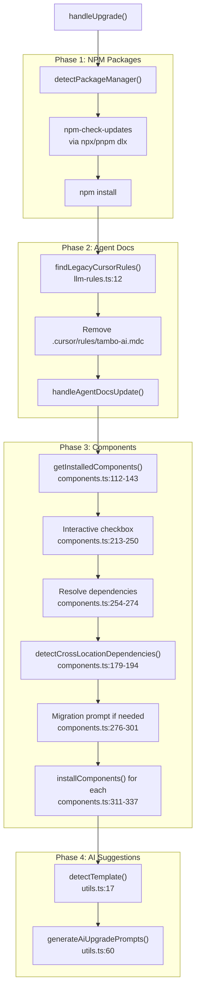

**Phase Breakdown:**

1. **NPM Package Upgrades** [npm-packages.ts:16-102]():
   - Detects package manager (npm/pnpm/yarn)
   - Uses `npm-check-updates` to find updates for known-safe packages
   - Filters to only packages in `KNOWN_SAFE_PACKAGES` [packages.ts:1-26]()
   - Interactive mode allows selection, `--yes` accepts all

2. **Agent Documentation** [llm-rules.ts:25-101]():
   - Removes legacy `.cursor/rules/tambo-ai.mdc` file
   - Updates `AGENTS.md` and `CLAUDE.md` with latest guidance

3. **Component Upgrades** [components.ts:101-378]():
   - Finds all installed components
   - Interactive: checkbox selection
   - Resolves dependencies and detects cross-location issues
   - Offers migration from ui/ to tambo/ if inconsistencies found
   - Installs all selected components with `forceUpdate: true`

4. **AI Upgrade Prompts** [utils.ts:60-87]():
   - Detects project template (standard/vite/analytics)
   - Generates template-specific upgrade suggestions

**Sources:** [cli/src/commands/upgrade/index.ts:21-123](), [cli/src/commands/upgrade/components.ts:101-378](), [cli/src/commands/upgrade/npm-packages.ts:16-102](), [cli/src/commands/upgrade/llm-rules.ts:25-101]()

## migrate Command

### Syntax

```bash
tambo migrate [options]
```

### Description

Migrates components from the legacy `ui/` directory structure to the new `tambo/` directory. Updates import paths throughout the codebase and handles subdirectories.

### Options

| Flag | Description | Default |
|------|-------------|---------|
| `--yes`, `-y` | Skip confirmation prompt | `false` |
| `--dry-run` | Preview migration without changes | `false` |

**Sources:** [cli/src/cli.ts:211-221]()

### Examples

```bash
# Interactive migration
tambo migrate

# Preview changes
tambo migrate --dry-run

# Auto-proceed
tambo migrate --yes
```

### Migration Process

The migrate command:
1. Identifies all `.tsx` files in `components/ui/`
2. Updates import paths from `@/components/ui/` to `@/components/tambo/`
3. Moves files to `components/tambo/`
4. Creates backups before modification
5. Handles lib/ directory separately

**Import Path Updates:** The `updateImportPaths()` function replaces:
- `@/components/ui/` → `@/components/tambo/`
- Preserves other imports unchanged

## auth Command

### Syntax

```bash
tambo auth [subcommand] [options]
```

### Description

Manages CLI authentication with Tambo Cloud. Supports multiple subcommands for checking status, logging in/out, and managing sessions.

### Subcommands

| Subcommand | Description | Options |
|------------|-------------|---------|
| `status` | Show authentication status | `--quiet` |
| `login` | Authenticate via browser | `--no-browser` |
| `logout` | Clear stored credentials | `--force` |
| `sessions` | List active CLI sessions | - |
| `revoke-session` | Revoke CLI session(s) | `--all` |

**Sources:** [cli/src/cli.ts:222-297](), [cli/src/commands/auth.ts]()

### Examples

```bash
# Check auth status
tambo auth
tambo auth status

# Quiet mode (exit code only) for scripts
tambo auth status --quiet

# Login with browser
tambo auth login

# Login without opening browser (CI)
tambo auth login --no-browser

# Logout with confirmation
tambo auth logout

# Force logout without prompt
tambo auth logout --force

# List sessions
tambo auth sessions

# Revoke specific session (interactive)
tambo auth revoke-session

# Revoke all sessions
tambo auth revoke-session --all
```

### Authentication Storage

Credentials are stored in `~/.tambo/auth.json` containing:
- Session token
- Refresh token
- User information
- Expiration timestamps

The device auth flow is documented in detail under the `init` command section above.

**Sources:** [cli/src/commands/auth.ts](), [cli/src/lib/device-auth.ts:1-164]()

## Common Patterns

### Non-Interactive Mode

All commands detect whether they're running in an interactive terminal using `isInteractive()` [interactive.ts:24-46]():

**Detection Logic:**
- Checks `process.stdin.isTTY` and `process.stdout.isTTY`
- Checks `process.env.CI` and `process.env.GITHUB_ACTIONS`
- Respects `process.env.FORCE_INTERACTIVE=1` override
- Returns `false` if `TERM=dumb` or in CI environment

**Behavior:**
- **Interactive:** Prompts user for choices
- **Non-Interactive:** Requires flags or throws `NonInteractiveError`/`GuidanceError`

**Exit Codes:**
- `0` - Success
- `1` - Command failure
- `2` - User action required (GuidanceError - missing required flags)

**Sources:** [cli/src/utils/interactive.ts:24-113](), [cli/src/cli.ts:738-762]()

### Global Options

These flags are available across multiple commands:

| Flag | Commands | Purpose |
|------|----------|---------|
| `--yes`, `-y` | init, full-send, add, update, upgrade, migrate | Skip confirmation prompts |
| `--prefix <path>` | add, list, update, upgrade | Custom component directory |
| `--skip-agent-docs` | init, full-send, add, upgrade | Skip AGENTS.md updates |
| `--legacy-peer-deps` | init, full-send, create-app, add, update, upgrade | npm peer dependency flag |
| `--dry-run` | add, migrate | Preview without changes |
| `--help`, `-h` | All | Show command help |
| `--version` | - | Show CLI version |

**Sources:** [cli/src/cli.ts:366-438]()

### create-tambo-app Standalone Package

The `create-tambo-app` npm package is a thin wrapper [create-tambo-app/src/index.ts:1-33]():

```bash
# Always fetches latest CLI version
npm create tambo-app@latest
npx create-tambo-app my-app
```

Executes: `npx -y tambo@latest create-app [args]`

## Error Handling and Validation

### Common Validation Checks

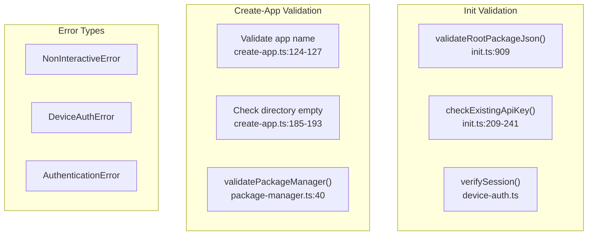

**Validation Functions:**
- `validateRootPackageJson()` - [init.ts:909-921]() ensures valid package.json
- `checkExistingApiKey()` - [init.ts:209-241]() prompts to overwrite existing keys
- `validatePackageManager()` - [package-manager.ts:40-48]() verifies PM is installed

**Error Types:**
- `NonInteractiveError` - [interactive.ts]() when prompts fail in CI/CD
- `DeviceAuthError` - [device-auth.ts]() when authentication fails
- `AuthenticationError` - [init.ts:58-63]() for auth-specific failures

**Sources:** [cli/src/commands/init.ts:209-241](), [cli/src/commands/init.ts:909-921](), [cli/src/utils/package-manager.ts:40-48](), [cli/src/utils/interactive.ts:1-127]()

## Integration with Other Systems

### Relationship to Component Management

After initialization, projects use the component management commands documented in [Component Management](#5.2):

- `tambo add <component>` - Install additional components
- `tambo update <component>` - Update existing components
- `tambo list` - View installed components

The initialization sets up the directory structure that these commands rely on.

### Agent Documentation System

Both `init` and `full-send` optionally create `AGENTS.md` and `CLAUDE.md` files through `handleAgentDocsUpdate()`. These files provide LLM-specific guidance for AI coding assistants. This system is documented separately but is automatically invoked during project setup unless `--skip-agent-docs` is specified.

**Sources:** [cli/src/commands/shared/agent-docs.ts:1-260](), [cli/src/commands/init.ts:630-634]()

---

