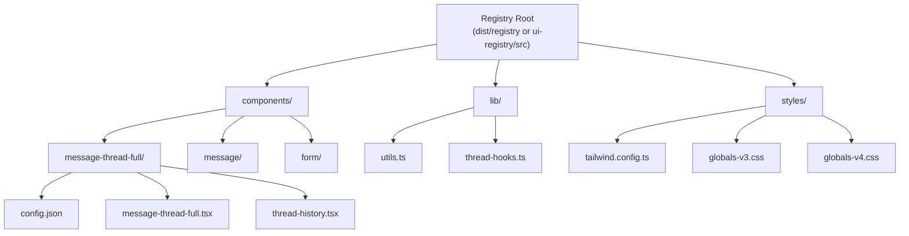
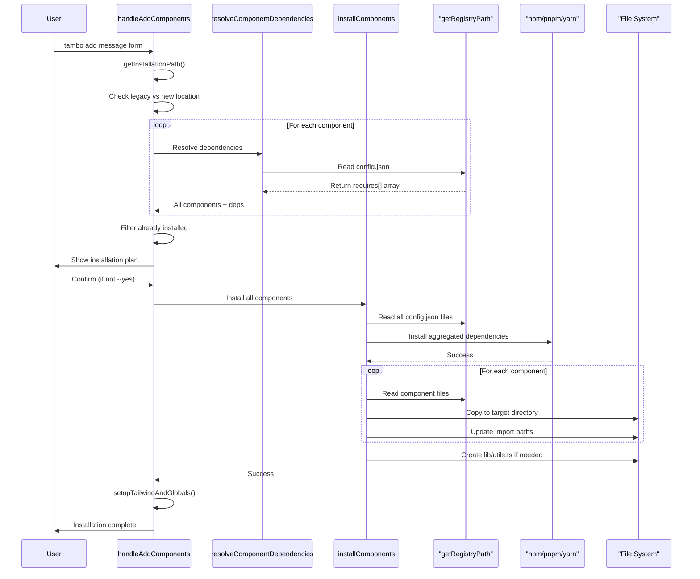
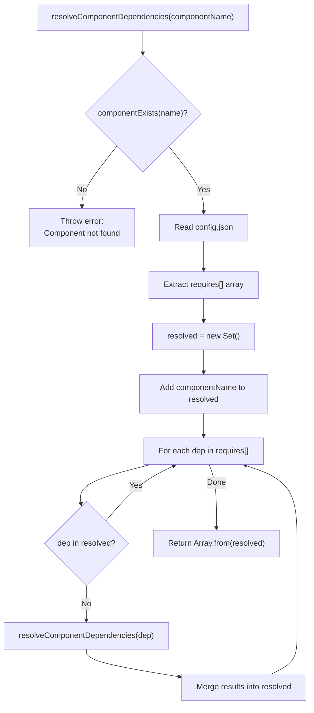
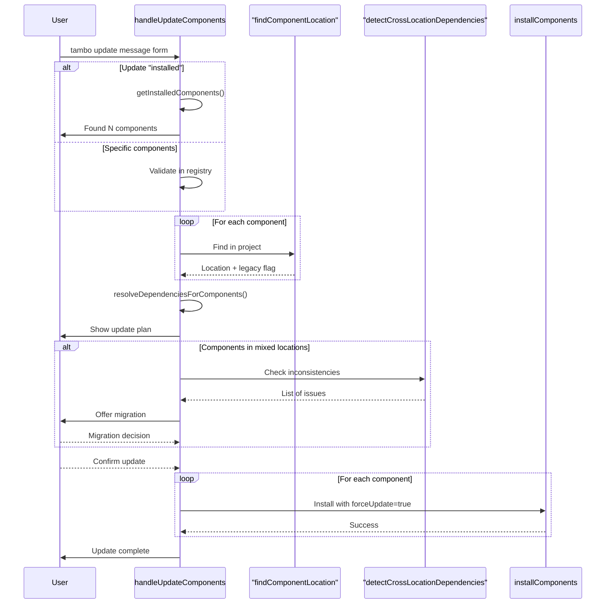
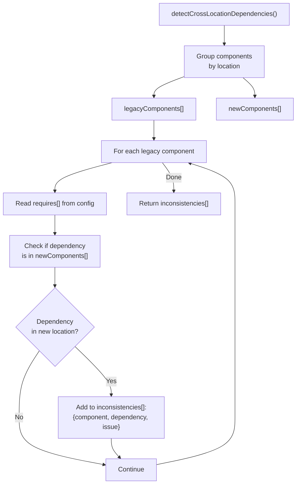
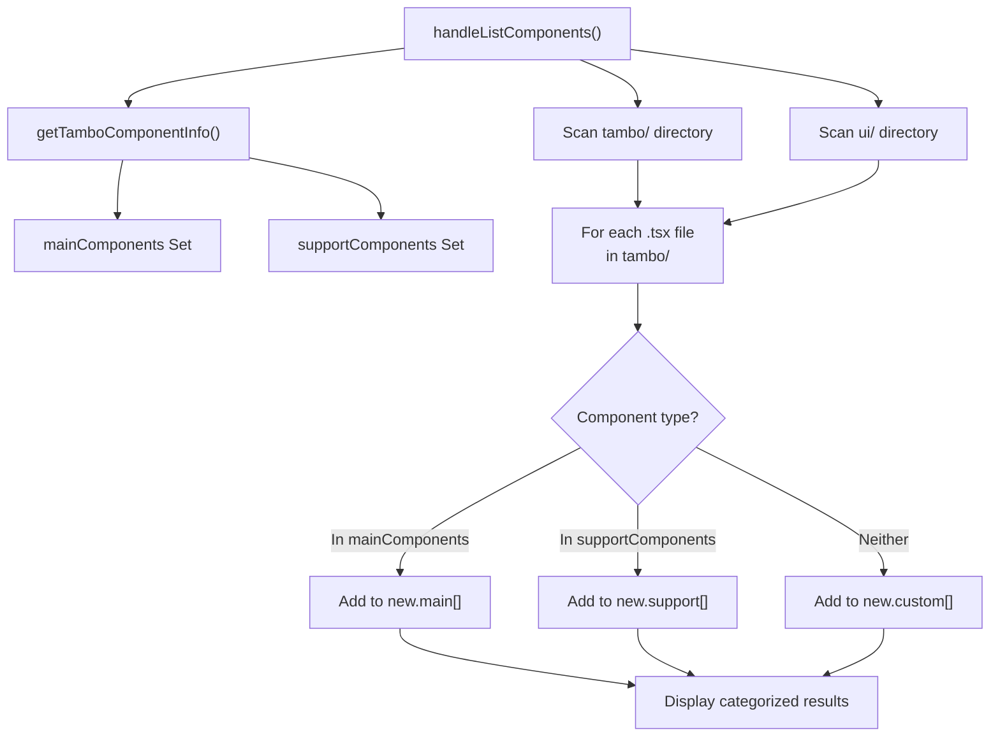
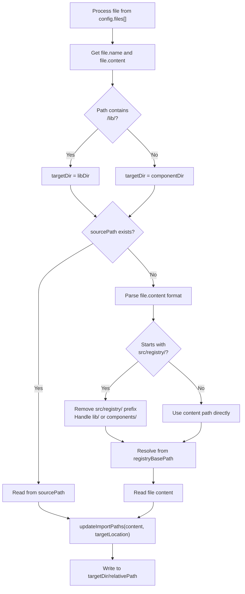
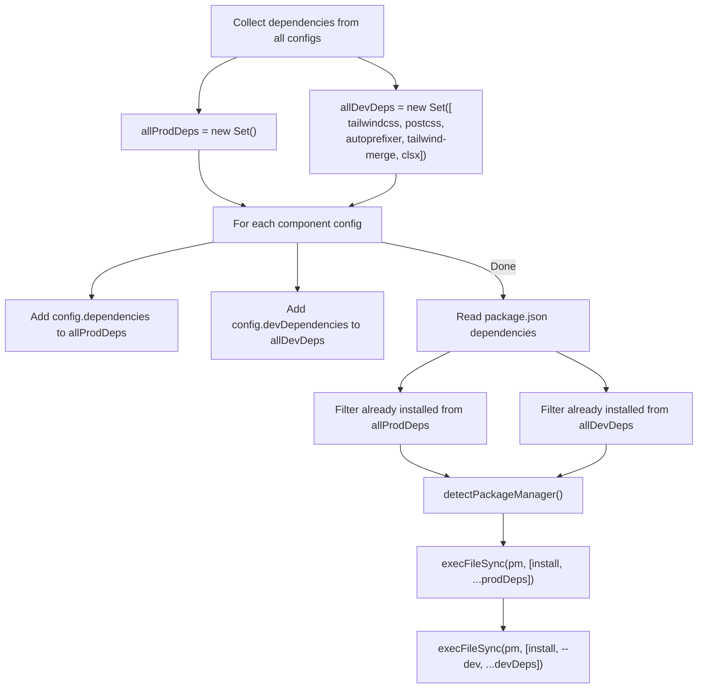
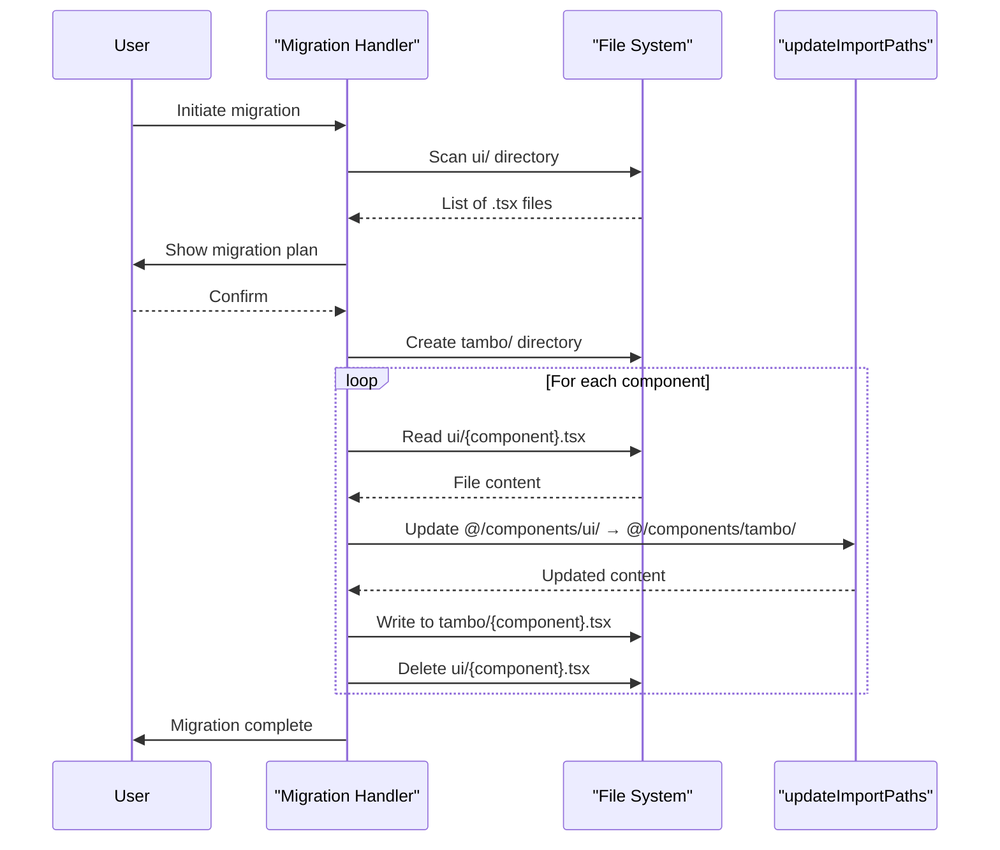

<!-- source: DeepWiki mcp.deepwiki.com · repo tambo-ai/tambo · page 5.2 Component Management · fetched 2026-10-29 -->

# Component Management

<details>
<summary>Relevant source files</summary>

The following files were used as context for generating this wiki page:

- [cli/src/__tests__/non-interactive-safety.test.ts](cli/src/__tests__/non-interactive-safety.test.ts)
- [cli/src/cli.ts](cli/src/cli.ts)
- [cli/src/commands/add/component.ts](cli/src/commands/add/component.ts)
- [cli/src/commands/add/index.test.ts](cli/src/commands/add/index.test.ts)
- [cli/src/commands/add/index.ts](cli/src/commands/add/index.ts)
- [cli/src/commands/add/tailwind-setup.ts](cli/src/commands/add/tailwind-setup.ts)
- [cli/src/commands/add/tailwind/v4/toolchain-setup.test.ts](cli/src/commands/add/tailwind/v4/toolchain-setup.test.ts)
- [cli/src/commands/add/tailwind/v4/toolchain-setup.ts](cli/src/commands/add/tailwind/v4/toolchain-setup.ts)
- [cli/src/commands/add/types.ts](cli/src/commands/add/types.ts)
- [cli/src/commands/add/utils.ts](cli/src/commands/add/utils.ts)
- [cli/src/commands/create-app.ts](cli/src/commands/create-app.ts)
- [cli/src/commands/init.test.ts](cli/src/commands/init.test.ts)
- [cli/src/commands/init.ts](cli/src/commands/init.ts)
- [cli/src/commands/list/index.test.ts](cli/src/commands/list/index.test.ts)
- [cli/src/commands/list/index.ts](cli/src/commands/list/index.ts)
- [cli/src/commands/update.test.ts](cli/src/commands/update.test.ts)
- [cli/src/commands/update.ts](cli/src/commands/update.ts)
- [cli/src/commands/upgrade/components.ts](cli/src/commands/upgrade/components.ts)
- [cli/src/commands/upgrade/index.ts](cli/src/commands/upgrade/index.ts)
- [cli/src/commands/upgrade/llm-rules.ts](cli/src/commands/upgrade/llm-rules.ts)
- [cli/src/commands/upgrade/npm-packages.ts](cli/src/commands/upgrade/npm-packages.ts)
- [cli/src/commands/upgrade/utils.ts](cli/src/commands/upgrade/utils.ts)
- [cli/src/types/components.d.ts](cli/src/types/components.d.ts)
- [cli/src/types/utils.d.ts](cli/src/types/utils.d.ts)
- [cli/src/utils/framework-detection.test.ts](cli/src/utils/framework-detection.test.ts)
- [cli/src/utils/framework-detection.ts](cli/src/utils/framework-detection.ts)
- [cli/src/utils/interactive.test.ts](cli/src/utils/interactive.test.ts)
- [cli/src/utils/interactive.ts](cli/src/utils/interactive.ts)
- [cli/src/utils/package-manager.test.ts](cli/src/utils/package-manager.test.ts)
- [cli/src/utils/package-manager.ts](cli/src/utils/package-manager.ts)

</details>


This page documents the CLI's component management system, covering how components are discovered, installed, updated, and organized. It explains the component registry structure, installation workflows, dependency resolution, and directory location strategies.

For command syntax and flags, see [CLI Commands Reference](#5.1). For the full project upgrade workflow, see [Project Upgrade](#5.3).

---

## Component Registry Architecture

The CLI distributes components from a registry that contains component source files, configuration metadata, and dependency information. Components are stored in a structured directory hierarchy with JSON configuration files.

### Registry Structure



**Sources:** [cli/src/commands/add/utils.ts:24-66]()

The registry location is resolved by `getRegistryBasePath()` using this priority order:
1. `TAMBO_REGISTRY_PATH` environment variable (for local development)
2. `dist/registry/` (when running compiled CLI)
3. `../packages/ui-registry/src` (monorepo development fallback)

### Component Configuration Schema

Each component has a `config.json` file that defines its metadata, dependencies, and files:

```json
{
  "name": "message-thread-full",
  "description": "Full-screen chat interface with history",
  "componentName": "MessageThreadFull",
  "dependencies": ["@tambo-ai/react", "react-markdown"],
  "devDependencies": ["@types/react"],
  "requires": ["message", "thread-history", "message-input"],
  "files": [
    {
      "name": "message-thread-full.tsx",
      "content": "src/registry/components/message-thread-full/message-thread-full.tsx"
    },
    {
      "name": "lib/thread-hooks.ts",
      "content": "src/registry/lib/thread-hooks.ts"
    }
  ]
}
```

| Field | Type | Purpose |
|-------|------|---------|
| `name` | `string` | Component identifier (must match directory name) |
| `description` | `string` | Human-readable description |
| `componentName` | `string` | React component export name |
| `dependencies` | `string[]` | NPM packages required at runtime |
| `devDependencies` | `string[]` | NPM packages required for development |
| `requires` | `string[]` | Other Tambo components this component depends on |
| `files` | `object[]` | Files to copy (name = target path, content = source path) |

**Sources:** [cli/src/commands/add/types.ts:1-10](), [cli/src/commands/add/component.ts:26-31]()

---

## Adding Components

The `tambo add` command installs components from the registry into the project. The workflow includes dependency resolution, installation path detection, and NPM package installation.

### Add Component Flow



**Sources:** [cli/src/commands/add/index.ts:33-294](), [cli/src/commands/add/component.ts:31-267]()

### Installation Path Resolution

The CLI determines where to install components based on existing project structure and user preferences:

```mermaid
graph TD
    Start["getInstallationPath()"]
    CheckSrc{"`src/` exists?"}
    Prompt["Prompt user:<br/>Use src/ or root?"]
    YesFlag{"`--yes flag?`"}
    
    DefaultPath["Default: src/components<br/>or components"]
    
    CheckLegacy["Check for existing<br/>components in ui/"]
    HasLegacy{"`Tambo components<br/>in ui/?`"}
    HasNew{"`Components<br/>in tambo/?`"}
    
    UseLegacy["Install to ui/<br/>(legacy location)"]
    UseNew["Install to tambo/<br/>(new location)"]
    Conflict["Error: Components in<br/>both locations"]
    
    Start --> YesFlag
    YesFlag -->|Yes| CheckSrc
    YesFlag -->|No| Prompt
    
    CheckSrc -->|Yes| DefaultPath
    CheckSrc -->|No| DefaultPath
    Prompt --> DefaultPath
    
    DefaultPath --> CheckLegacy
    CheckLegacy --> HasLegacy
    
    HasLegacy -->|Yes| HasNew
    HasLegacy -->|No| UseNew
    
    HasNew -->|Yes| Conflict
    HasNew -->|No| UseLegacy
```

**Sources:** [cli/src/commands/init.ts:258-305](), [cli/src/commands/add/index.ts:63-152]()

The installation path follows these rules:

1. **Explicit Prefix**: If `--prefix` is provided, use it directly
2. **Legacy Detection**: If Tambo components exist in `ui/`, install new ones there for consistency
3. **New Default**: Otherwise, install to `tambo/` subdirectory
4. **Conflict Detection**: Error if components exist in both `ui/` and `tambo/`

The actual file paths are:
- **New location**: `{prefix}/tambo/{component}.tsx` (e.g., `src/components/tambo/message.tsx`)
- **Legacy location**: `{prefix}/ui/{component}.tsx` (e.g., `src/components/ui/message.tsx`)
- **Lib files**: `{prefix}/../lib/{file}.ts` (e.g., `src/lib/utils.ts`)

**Sources:** [cli/src/commands/shared/path-utils.ts:10-58](), [cli/src/constants/paths.ts:1-2]()

---

## Dependency Resolution

Components can depend on other Tambo components via the `requires` field in their configuration. The CLI automatically resolves and installs all transitive dependencies.

### Dependency Resolution Algorithm



**Sources:** [cli/src/utils/dependency-resolution.ts:17-59]()

### Dependency Information Display

When installing or updating components, the CLI shows categorized dependency information:

| Category | Description | Display Color |
|----------|-------------|---------------|
| **Already Installed** | Dependencies found in the project | Blue |
| **New Dependencies** | Dependencies that will be installed | Green |
| **Missing (Optional)** | Required by dependencies but flagged as missing | Yellow |

**Sources:** [cli/src/utils/dependency-resolution.ts:142-200]()

---

## Updating Components

The `tambo update` command overwrites existing component files with the latest versions from the registry. It handles both individual components and bulk updates.

### Update Workflow



**Sources:** [cli/src/commands/update.ts:40-386]()

### Cross-Location Dependency Detection

When components exist in both `ui/` and `tambo/` locations, the CLI checks for import inconsistencies:



**Sources:** [cli/src/commands/shared/component-utils.ts:61-128]()

Example inconsistency:
```
⚠️  message-thread-full (in ui) depends on message (in tambo)
    Import path mismatch:
    - message-thread-full uses: @/components/ui/message
    - message is actually in: @/components/tambo/message
```

---

## Listing Components

The `tambo list` command displays all installed components, categorized by location and type.

### Component Categorization



**Sources:** [cli/src/commands/list/index.ts:23-205]()

### Component Type Classification

The CLI distinguishes three types of components:

| Type | Definition | Examples |
|------|------------|----------|
| **Main Components** | Primary UI components with their own registry entries | `message`, `message-thread-full`, `form` |
| **Support Components** | Helper components used by main components | `markdown-components`, `suggestions-tooltip` |
| **Custom Components** | User-created files not from Tambo registry | Any `.tsx` file not recognized |

**Sources:** [cli/src/commands/add/utils.ts:149-217]()

Example output:
```
ℹ Installed components:

  In tambo/:
    Tambo components:
      - message
      - message-thread-full
      - thread-history
    
    Custom components:
      - my-custom-component

  In ui/ (legacy location):
    Tambo components:
      - form
      - graph
    
💡 To migrate to the new directory structure:
   1. Move all files from ui/ to tambo/
   2. Update imports: @/components/ui/ → @/components/tambo/
   3. Update any custom components in tambo.ts

   or run npx tambo migrate
```

---

## Component Installation Details

### File Copying and Path Resolution

The `installComponents` function copies files from the registry to the project, handling two types of content path formats:



**Sources:** [cli/src/commands/add/component.ts:174-249]()

### Import Path Updates

When installing to legacy location (`ui/`), the CLI updates import paths in component files:

```typescript
// Original (from registry):
import { Message } from "@/components/tambo/message"

// Updated (for ui/ location):
import { Message } from "@/components/ui/message"
```

The `updateImportPaths` function uses regex replacement:
```javascript
/@\/components\/tambo\//g → @/components/ui/
```

**Sources:** [cli/src/commands/migrate.ts:140-155](), [cli/src/commands/add/component.ts:243-244]()

### NPM Dependency Installation

Dependencies are aggregated across all components before installation:



**Sources:** [cli/src/commands/add/component.ts:86-163]()

The CLI:
1. Aggregates dependencies across all components to minimize install commands
2. Filters out already-installed packages using `package.json`
3. Always includes core Tailwind dependencies in `devDependencies`
4. Respects `--legacy-peer-deps` flag for NPM (npm-specific)
5. Supports npm, pnpm, yarn, and rush package managers

---

## Component Migration

When projects have components in the legacy `ui/` location, the CLI provides migration support.

### Migration Scenarios

The CLI handles migration in three contexts:

| Command | Behavior | Automatic? |
|---------|----------|------------|
| `tambo migrate` | Dedicated migration command | Interactive (prompts for confirmation) |
| `tambo update` | Offers migration during update | Optional (asks user) |
| `tambo upgrade` | Offers migration during upgrade | Optional (asks user) |

**Sources:** [cli/src/commands/migrate.ts:1-300](), [cli/src/commands/update.ts:231-239](), [cli/src/commands/upgrade/components.ts:276-301]()

### Migration Process



**Sources:** [cli/src/commands/upgrade/utils.ts:134-171](), [cli/src/commands/migrate.ts:140-300]()

### Post-Migration Tasks

After migrating components, developers must:

1. **Update Import Statements**: Change all imports from `@/components/ui/` to `@/components/tambo/`
2. **Update Component Registry**: If using custom components in `tambo.ts`, update their import paths
3. **Verify Builds**: Run `npm run build` to catch any missed import updates

The CLI outputs these instructions after migration:

```
📝 Post-migration notes:
• N components migrated to tambo/ location
• Import paths: @/components/tambo/component-name
• Update any custom component registrations in tambo.ts
```

**Sources:** [cli/src/commands/update.ts:349-369](), [cli/src/commands/upgrade/components.ts:351-371]()

---

## Key Interfaces and Types

### ComponentConfig

```typescript
interface ComponentConfig {
  name: string;
  dependencies: string[];
  devDependencies: string[];
  requires?: string[];  // Component dependencies
  files: {
    name: string;        // Target path relative to install dir
    content: string;     // Source path relative to registry
  }[];
}
```

**Sources:** [cli/src/commands/add/types.ts:1-10]()

### InstallComponentOptions

```typescript
interface InstallComponentOptions {
  silent?: boolean;              // Suppress console output
  legacyPeerDeps?: boolean;      // Pass --legacy-peer-deps to npm
  forceUpdate?: boolean;         // Overwrite existing files
  installPath?: string;          // Target directory
  isExplicitPrefix?: boolean;    // Whether --prefix was used
  yes?: boolean;                 // Skip confirmation prompts
  baseInstallPath?: string;      // Original path for lib calculation
  skipAgentDocs?: boolean;       // Skip agent docs update
  skipTailwindSetup?: boolean;   // Skip Tailwind configuration
  dryRun?: boolean;             // Preview changes only
}
```

**Sources:** [cli/src/commands/add/types.ts:12-24]()

### DependencyInconsistency

```typescript
interface DependencyInconsistency {
  component: string;      // Component name
  dependency: string;     // Dependency name
  componentLocation: "legacy" | "new";
  dependencyLocation: "legacy" | "new";
}
```

**Sources:** [cli/src/commands/shared/component-utils.ts:11-17]()

---

## Utility Functions Reference

| Function | Module | Purpose |
|----------|--------|---------|
| `getRegistryBasePath()` | `add/utils.ts` | Resolve registry root directory |
| `getRegistryPath(name)` | `add/utils.ts` | Get component directory in registry |
| `getConfigPath(name)` | `add/utils.ts` | Get config.json path for component |
| `componentExists(name)` | `add/utils.ts` | Check if component exists in registry |
| `getKnownComponentNames()` | `add/utils.ts` | Get Set of all registry component names |
| `getInstalledComponents()` | `add/utils.ts` | List installed components in project |
| `resolveComponentDependencies()` | `dependency-resolution.ts` | Resolve transitive dependencies |
| `findComponentLocation()` | `shared/component-utils.ts` | Find component in project (ui/ or tambo) |
| `detectCrossLocationDependencies()` | `shared/component-utils.ts` | Detect import inconsistencies |
| `getComponentDirectoryPath()` | `shared/path-utils.ts` | Get target directory for new components |
| `getLegacyComponentDirectoryPath()` | `shared/path-utils.ts` | Get target directory for legacy components |
| `updateImportPaths()` | `migrate.ts` | Update import paths in component files |

**Sources:** [cli/src/commands/add/utils.ts:24-345](), [cli/src/utils/dependency-resolution.ts:17-200](), [cli/src/commands/shared/component-utils.ts:19-128](), [cli/src/commands/shared/path-utils.ts:10-90](), [cli/src/commands/migrate.ts:140-155]()

---

