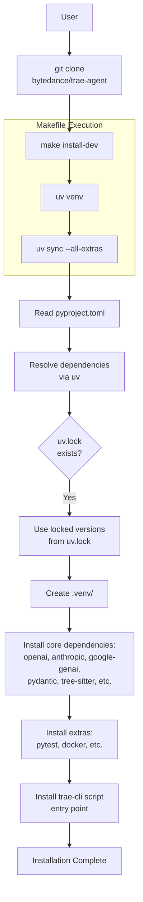
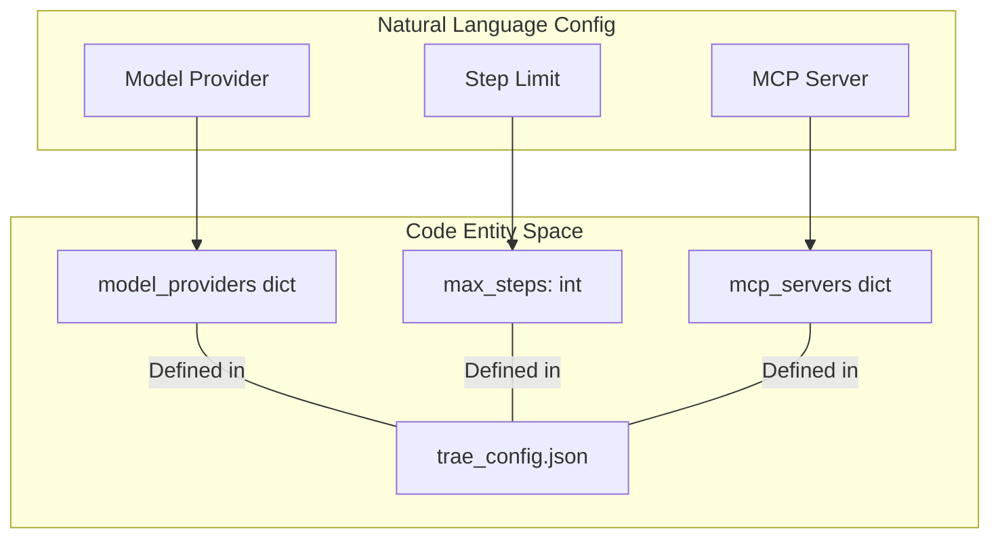
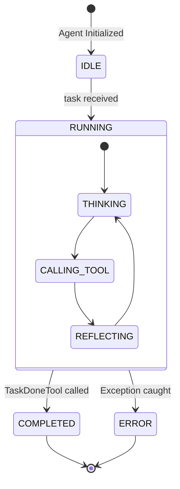

<!-- source: DeepWiki mcp.deepwiki.com · repo bytedance/trae-agent · page 2 Installation and Setup · fetched 2026-10-29 -->

# Installation and Setup

<details>
<summary>Relevant source files</summary>

The following files were used as context for generating this wiki page:

- [.github/workflows/pre-commit.yml](.github/workflows/pre-commit.yml)
- [.github/workflows/unit-test.yml](.github/workflows/unit-test.yml)
- [.gitignore](.gitignore)
- [.python-version](.python-version)
- [.vscode/launch.template.json](.vscode/launch.template.json)
- [Makefile](Makefile)
- [pyproject.toml](pyproject.toml)
- [trae_agent/agent/agent_basics.py](trae_agent/agent/agent_basics.py)
- [trae_config.json.example](trae_config.json.example)
- [uv.lock](uv.lock)

</details>


This document covers the installation process for Trae Agent, including system requirements, dependency management, initial configuration, and verification steps. This guide will help you get a working Trae Agent environment ready for executing software engineering tasks.

For detailed usage instructions after installation, see [Usage Guide](). For comprehensive configuration options, see [Configuration Reference]().

---

## System Requirements

### Python Version

Trae Agent requires **Python 3.12 or higher**. This requirement is defined in [pyproject.toml:6]() and the lockfile [uv.lock:3]().

```toml
requires-python = ">=3.12"
```

### Package Manager

Trae Agent uses **uv** (https://docs.astral.sh/uv) for fast dependency resolution and virtual environment management. The project includes a `uv.lock` file to ensure deterministic builds [uv.lock:1-2]().

**Installation of uv:**
```bash
# macOS/Linux
curl -LsSf https://astral.sh/uv/install.sh | sh

# Windows
powershell -c "irm https://astral.sh/uv/install.ps1 | iex"
```

### LLM Provider Support

Trae Agent supports multiple LLM providers. You will need an API key for at least one of the following:
- **Anthropic**: Claude 3.5 Sonnet (Recommended) [trae_config.json.example:23-32]()
- **OpenAI**: GPT-4o and compatible models [trae_config.json.example:14-22]()
- **Google**: Gemini models [trae_config.json.example:33-41]()
- **Ollama**: Local models [trae_config.json.example:53-62]()
- **Azure**: Azure OpenAI Service [trae_config.json.example:42-52]()
- **OpenRouter**: Unified API gateway [trae_config.json.example:63-72]()
- **Doubao**: ByteDance Doubao models [trae_config.json.example:73-81]()

**Sources:** [pyproject.toml:6-27](), [trae_config.json.example:1-82](), [uv.lock:1-5]()

---

## Installation Process

### Standard Installation

The recommended installation method uses the provided `Makefile` targets which wrap `uv` commands [Makefile:18-24]().

```bash
# Clone the repository
git clone https://github.com/bytedance/trae-agent.git
cd trae-agent

# Create venv and install all dependencies (including extras)
make install-dev
```

The `install-dev` target executes `uv venv` and `uv sync --all-extras` [Makefile:22-23](). This installs the core agent and optional dependency groups defined in [pyproject.toml:29-42]():
- **test**: `pytest`, `pytest-asyncio`, `pytest-mock`, `pytest-cov`, `pre-commit` [pyproject.toml:30-36]()
- **evaluation**: `datasets`, `docker`, `pexpect`, `unidiff` [pyproject.toml:37-42]()

### Installation Flow



**Sources:** [Makefile:18-24](), [pyproject.toml:1-52](), [uv.lock:1-4]()

---

## Core Dependencies

The installation process installs several critical libraries for agentic workflows:

| Dependency | Version | Purpose |
|------------|---------|---------|
| `openai` | >=1.86.0 | OpenAI API client [pyproject.toml:8]() |
| `anthropic` | 0.54.0-0.60.0 | Anthropic API client [pyproject.toml:9]() |
| `google-genai` | >=1.24.0 | Google Gemini API client [pyproject.toml:11]() |
| `ollama` | >=0.5.1 | Ollama local model client [pyproject.toml:17]() |
| `tree-sitter` | 0.21.3 | Code parsing for CKG tool [pyproject.toml:20]() |
| `mcp` | 1.12.2 | Model Context Protocol support [pyproject.toml:22]() |
| `asyncclick` | >=8.0.0 | Async CLI framework [pyproject.toml:23]() |
| `textual` | >=0.50.0 | TUI for interactive mode [pyproject.toml:25]() |

**Sources:** [pyproject.toml:7-27]()

---

## Initial Configuration

### Configuration File Setup

Trae Agent looks for configuration in `trae_config.json` or `trae_config.yaml`. An example JSON configuration is provided in the repository [trae_config.json.example:1-87]().

1. Copy the example file:
```bash
cp trae_config.json.example trae_config.json
```

2. Edit `trae_config.json` to set your default provider and API keys:

```json
{
  "default_provider": "anthropic",
  "max_steps": 20,
  "enable_lakeview": true,
  "model_providers": {
    "anthropic": {
      "api_key": "your_key_here",
      "model": "claude-3-5-sonnet-20241022"
    }
  }
}
```

### Environment Variables

Alternatively, you can use a `.env` file. The project uses `python-dotenv` [pyproject.toml:14]() to load variables from the environment. Common variables include:
- `ANTHROPIC_API_KEY`
- `OPENAI_API_KEY`
- `GOOGLE_API_KEY`

### Configuration Entity Mapping

The following diagram maps configuration concepts to the underlying data structures used in the code.



**Sources:** [trae_config.json.example:1-87](), [pyproject.toml:14-24]()

---

## Verification

### 1. Check CLI Entry Point
The CLI is registered as `trae-cli` via the `project.scripts` configuration [pyproject.toml:44-45]().

```bash
# Verify the command is in path
trae-cli --help
```

### 2. Run Unit Tests
Use the `Makefile` to run the test suite [Makefile:41-42](). Note that external service tests are skipped by default.

```bash
make uv-test
```

The test suite uses `pytest` with `asyncio` support [pyproject.toml:54-65]().

### 3. Verify Agent Lifecycle
You can verify the agent's internal state transitions by running a simple task. The agent transitions through various `AgentStepState` values: `THINKING`, `CALLING_TOOL`, and `COMPLETED` [trae_agent/agent/agent_basics.py:19-27]().



**Sources:** [trae_agent/agent/agent_basics.py:19-35](), [Makefile:41-45](), [pyproject.toml:44-45]()

---

## Development Environment Setup

For contributors, additional steps are required to ensure code quality.

### Pre-commit Hooks
The project uses `pre-commit` [pyproject.toml:35]() to run linting and formatting checks.

```bash
# Install and run hooks
make pre-commit
```

This runs `ruff` for formatting and linting [Makefile:36-38](), as configured in [pyproject.toml:86-96]().

### VS Code Debugging
A template for VS Code debugging is provided in [.vscode/launch.template.json:1-21](). You can copy this to `.vscode/launch.json` to debug the `trae_agent.cli` module [ .vscode/launch.template.json:11]().

**Sources:** [Makefile:26-39](), [pyproject.toml:86-96](), [.vscode/launch.template.json:1-21]()

---

