# Page: Overview

# Overview

<details>
<summary>Relevant source files</summary>

The following files were used as context for generating this wiki page:

- [README.md](README.md)
- [pyproject.toml](pyproject.toml)
- [trae_agent/__init__.py](trae_agent/__init__.py)
- [trae_agent/agent/__init__.py](trae_agent/agent/__init__.py)
- [uv.lock](uv.lock)

</details>


This document provides a high-level introduction to the Trae Agent system architecture, its core components, and execution model. For detailed information on specific subsystems, refer to the Architecture section. For usage instructions, see the Usage Guide.

## Purpose and Scope

**Trae Agent** is an LLM-based autonomous agent designed for general-purpose software engineering tasks. It accepts natural language task descriptions and executes them by coordinating multiple tools through iterative LLM-driven decision-making. The system is built for research-friendly extensibility, allowing modification of agent behaviors, tool implementations, and LLM providers.

**Sources**: [README.md:1-16](), [pyproject.toml:4-5]()

## System Design Philosophy

Trae Agent follows a modular, layered architecture with clear separation of concerns:

| Layer | Responsibility | Key Components |
|-------|----------------|----------------|
| **Interface** | User interaction and task submission | `trae-cli`, interactive REPL |
| **Orchestration** | Task execution and decision-making | `TraeAgent`, `BaseAgent` |
| **Integration** | External service connections | LLM providers, MCP servers, Docker |
| **Execution** | Tool invocation and environment management | `ToolExecutor`, `DockerToolExecutor` |
| **Observability** | Logging and user feedback | `TrajectoryRecorder`, `CLIConsole`, Lakeview |

The design prioritizes:
- **Transparency**: All agent decisions and tool calls are recorded via `TrajectoryRecorder`.
- **Extensibility**: New tools, LLM providers, and agent behaviors can be added to the modular framework.
- **Reproducibility**: Docker isolation and trajectory recording enable consistent execution across environments.
- **Flexibility**: Multiple configuration methods (YAML, ENV, CLI) and provider options (OpenAI, Anthropic, etc.).

**Sources**: [README.md:9-26](), [trae_agent/agent/trae_agent.py:1-64](), [trae_agent/agent/base_agent.py:1-10]()

## Core Architecture

### Component Hierarchy

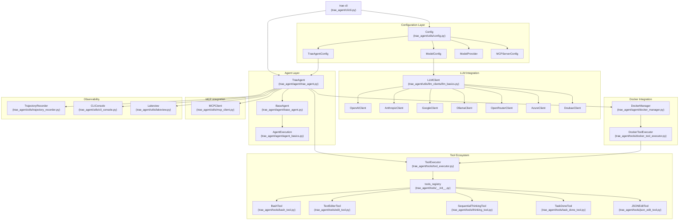

This diagram maps natural language concepts to concrete code entities in the system. Each node references the actual class or module path, enabling direct code exploration.

**Sources**: [trae_agent/agent/trae_agent.py:1-64](), [trae_agent/agent/base_agent.py:1-10](), [trae_agent/agent/__init__.py:1-11](), [trae_agent/__init__.py:1-14]()

### Task Execution Flow

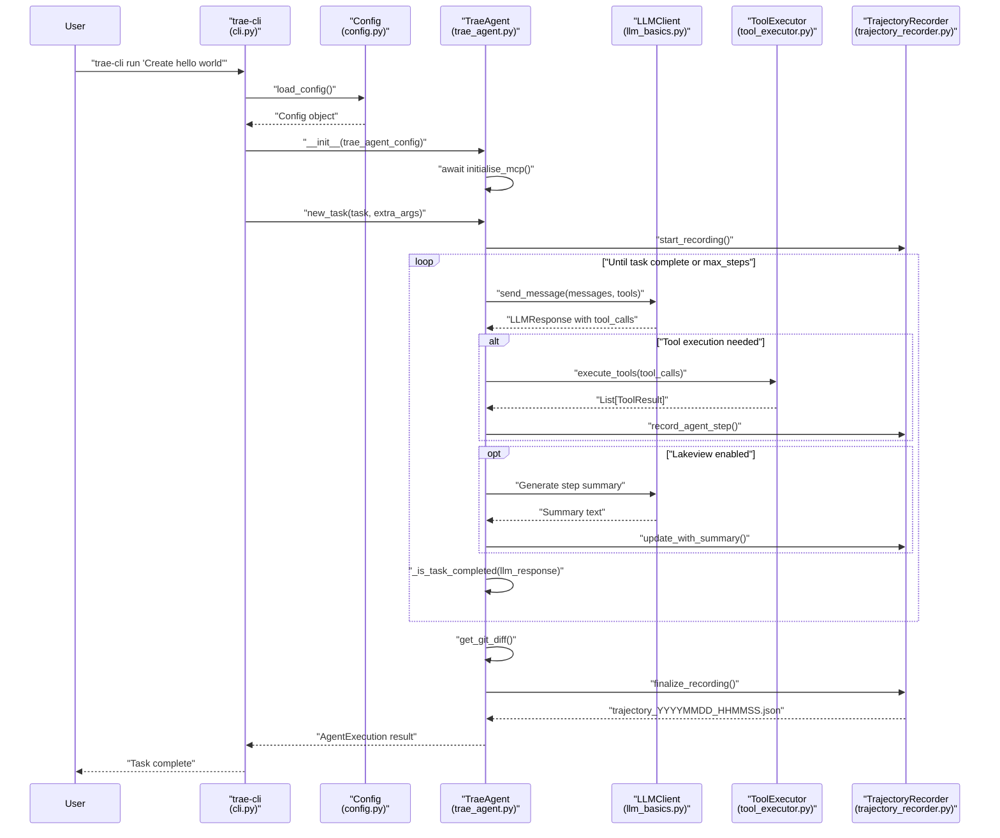

This sequence diagram shows the actual method calls and class interactions during task execution. Function names match those in the codebase.

**Sources**: [trae_agent/agent/trae_agent.py:103-170](), [trae_agent/agent/base_agent.py:1-10](), [trae_agent/__init__.py:8-13]()

## Key System Components

### Agent System

The agent system implements the core decision-making logic:

| Class | File Path | Responsibility |
|-------|-----------|----------------|
| `TraeAgent` | [trae_agent/agent/trae_agent.py:30-259]() | Software engineering task orchestration, git diff generation, MCP tool discovery |
| `BaseAgent` | [trae_agent/agent/base_agent.py]() | Generic agent loop, tool execution coordination, state management |
| `AgentExecution` | [trae_agent/agent/agent_basics.py]() | Execution result encapsulation with success status and final output |

The `TraeAgent` class extends `BaseAgent` and specializes it for software engineering by:
- Integrating project path and git tracking.
- Supporting patch generation with test filtering.
- Managing MCP client lifecycle.

**Sources**: [trae_agent/agent/trae_agent.py:30-259](), [trae_agent/agent/base_agent.py:1-10](), [trae_agent/__init__.py:8-9]()

### LLM Integration

The system supports multiple LLM providers through a unified `LLMClient` abstraction:

| Provider | Client Class | File Path |
|----------|-------------|-----------|
| OpenAI | `OpenAIClient` | [trae_agent/utils/llm_clients/openai_client.py]() |
| Anthropic | `AnthropicClient` | [trae_agent/utils/llm_clients/anthropic_client.py]() |
| Google Gemini | `GoogleClient` | [trae_agent/utils/llm_clients/google_client.py]() |
| Azure OpenAI | `AzureClient` | [trae_agent/utils/llm_clients/azure_client.py]() |
| Ollama | `OllamaClient` | [trae_agent/utils/llm_clients/ollama_client.py]() |
| OpenRouter | `OpenRouterClient` | [trae_agent/utils/llm_clients/openrouter_client.py]() |
| Doubao | `DoubaoClient` | [trae_agent/utils/llm_clients/doubao_client.py]() |

Configuration uses a hierarchy: `model_providers` → `models` → `agent config`. This enables flexible model switching and reusable configurations.

**Sources**: [README.md:20-164](), [trae_agent/__init__.py:11]()

### Tool Ecosystem

Tools are registered in the system and instantiated based on configuration:

| Tool Name | Class | File Path | Purpose |
|-----------|-------|-----------|---------|
| `bash` | `BashTool` | [trae_agent/tools/bash_tool.py]() | Shell command execution with persistent sessions |
| `str_replace_based_edit_tool` | `TextEditorTool` | [trae_agent/tools/edit_tool.py]() | File creation and string-based editing |
| `sequentialthinking` | `SequentialThinkingTool` | [trae_agent/tools/thinking_tool.py]() | Structured reasoning with branching logic |
| `task_done` | `TaskDoneTool` | [trae_agent/tools/task_done_tool.py]() | Task completion signaling |
| `json_edit_tool` | `JSONEditTool` | [trae_agent/tools/json_edit_tool.py]() | JSONPath-based JSON manipulation |

The `ToolExecutor` manages tool invocation, while `DockerToolExecutor` routes specific tools to Docker containers for isolation.

**Sources**: [trae_agent/agent/trae_agent.py:21-27](), [trae_agent/__init__.py:10](), [README.md:217-220]()

### Docker Integration

Docker support enables isolated, reproducible execution:

| Component | Class | File Path | Responsibility |
|-----------|-------|-----------|----------------|
| Docker Manager | `DockerManager` | [trae_agent/agent/docker_manager.py]() | Container lifecycle, image building/loading |
| Docker Tool Executor | `DockerToolExecutor` | [trae_agent/tools/docker_tool_executor.py]() | Tool execution routing to containers |

Docker can be initialized via image name, Dockerfile path, image tar file, or an existing container ID. The `DockerToolExecutor` wraps the standard `ToolExecutor` and translates paths between host and container filesystems.

**Sources**: [README.md:181-204](), [trae_agent/agent/docker_manager.py](), [trae_agent/tools/docker_tool_executor.py]()

### MCP Integration

Model Context Protocol (MCP) enables dynamic tool discovery from external servers:

| Component | Class | File Path | Responsibility |
|-----------|-------|-----------|----------------|
| MCP Client | `MCPClient` | [trae_agent/utils/mcp_client.py]() | Server connection, tool discovery |

MCP servers are configured in `trae_config.yaml`. The `TraeAgent.discover_mcp_tools()` method asynchronously connects to configured servers and extends the tool list with discovered tools.

**Sources**: [README.md:111-121](), [trae_agent/agent/trae_agent.py:52-101](), [trae_agent/utils/mcp_client.py]()

## Configuration System

Configuration follows a priority cascade: **CLI arguments** > **YAML file** > **Environment variables** > **Default values**.

The configuration system uses dataclass-based objects to manage agent settings, model providers, and MCP servers. The system merges configuration from all sources according to the priority cascade.

**Sources**: [README.md:42-125](), [README.md:123-124]()

## Observability Features

### Trajectory Recording

The `TrajectoryRecorder` captures complete execution traces, including LLM interactions, agent steps (state transitions and tool calls), and metadata. Trajectory recording is automatically enabled and files are saved as JSON.

### Lakeview Summarization

Lakeview provides optional step summarization using a dedicated LLM to generate concise summaries of agent reasoning and actions, which are then embedded in trajectory files.

### Console Feedback

The `CLIConsole` provides real-time user feedback with support for both simple text output and an advanced TUI using the Textual framework.

**Sources**: [README.md:19-23](), [README.md:221-234](), [pyproject.toml:25]()

## Development and Testing

The project uses modern Python tooling:

| Tool | Purpose |
|------|---------|
| `uv` | Fast dependency management and sync |
| `pytest` | Testing framework for unit and integration tests |
| `ruff` | Linting and formatting |
| `hatchling` | Build backend for wheel targets |

**Sources**: [README.md:27-40](), [pyproject.toml:30-42](), [pyproject.toml:48-49](), [pyproject.toml:86-96]()

---

# Page: Installation and Setup

# Installation and Setup

<details>
<summary>Relevant source files</summary>

The following files were used as context for generating this wiki page:

- [.github/workflows/pre-commit.yml](.github/workflows/pre-commit.yml)
- [.github/workflows/unit-test.yml](.github/workflows/unit-test.yml)
- [.gitignore](.gitignore)
- [.python-version](.python-version)
- [.vscode/launch.template.json](.vscode/launch.template.json)
- [Makefile](Makefile)
- [pyproject.toml](pyproject.toml)
- [trae_agent/agent/agent_basics.py](trae_agent/agent/agent_basics.py)
- [trae_config.json.example](trae_config.json.example)
- [uv.lock](uv.lock)

</details>


This document covers the installation process for Trae Agent, including system requirements, dependency management, initial configuration, and verification steps. This guide will help you get a working Trae Agent environment ready for executing software engineering tasks.

For detailed usage instructions after installation, see [Usage Guide](). For comprehensive configuration options, see [Configuration Reference]().

---

## System Requirements

### Python Version

Trae Agent requires **Python 3.12 or higher**. This requirement is defined in [pyproject.toml:6]() and the lockfile [uv.lock:3]().

```toml
requires-python = ">=3.12"
```

### Package Manager

Trae Agent uses **uv** (https://docs.astral.sh/uv) for fast dependency resolution and virtual environment management. The project includes a `uv.lock` file to ensure deterministic builds [uv.lock:1-2]().

**Installation of uv:**
```bash
# macOS/Linux
curl -LsSf https://astral.sh/uv/install.sh | sh

# Windows
powershell -c "irm https://astral.sh/uv/install.ps1 | iex"
```

### LLM Provider Support

Trae Agent supports multiple LLM providers. You will need an API key for at least one of the following:
- **Anthropic**: Claude 3.5 Sonnet (Recommended) [trae_config.json.example:23-32]()
- **OpenAI**: GPT-4o and compatible models [trae_config.json.example:14-22]()
- **Google**: Gemini models [trae_config.json.example:33-41]()
- **Ollama**: Local models [trae_config.json.example:53-62]()
- **Azure**: Azure OpenAI Service [trae_config.json.example:42-52]()
- **OpenRouter**: Unified API gateway [trae_config.json.example:63-72]()
- **Doubao**: ByteDance Doubao models [trae_config.json.example:73-81]()

**Sources:** [pyproject.toml:6-27](), [trae_config.json.example:1-82](), [uv.lock:1-5]()

---

## Installation Process

### Standard Installation

The recommended installation method uses the provided `Makefile` targets which wrap `uv` commands [Makefile:18-24]().

```bash
# Clone the repository
git clone https://github.com/bytedance/trae-agent.git
cd trae-agent

# Create venv and install all dependencies (including extras)
make install-dev
```

The `install-dev` target executes `uv venv` and `uv sync --all-extras` [Makefile:22-23](). This installs the core agent and optional dependency groups defined in [pyproject.toml:29-42]():
- **test**: `pytest`, `pytest-asyncio`, `pytest-mock`, `pytest-cov`, `pre-commit` [pyproject.toml:30-36]()
- **evaluation**: `datasets`, `docker`, `pexpect`, `unidiff` [pyproject.toml:37-42]()

### Installation Flow

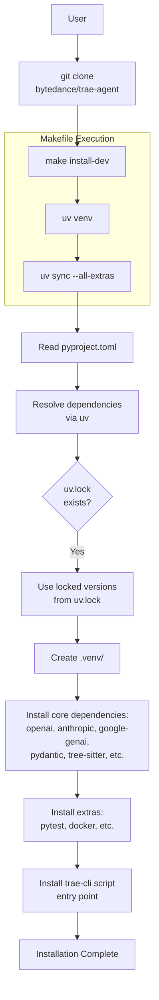

**Sources:** [Makefile:18-24](), [pyproject.toml:1-52](), [uv.lock:1-4]()

---

## Core Dependencies

The installation process installs several critical libraries for agentic workflows:

| Dependency | Version | Purpose |
|------------|---------|---------|
| `openai` | >=1.86.0 | OpenAI API client [pyproject.toml:8]() |
| `anthropic` | 0.54.0-0.60.0 | Anthropic API client [pyproject.toml:9]() |
| `google-genai` | >=1.24.0 | Google Gemini API client [pyproject.toml:11]() |
| `ollama` | >=0.5.1 | Ollama local model client [pyproject.toml:17]() |
| `tree-sitter` | 0.21.3 | Code parsing for CKG tool [pyproject.toml:20]() |
| `mcp` | 1.12.2 | Model Context Protocol support [pyproject.toml:22]() |
| `asyncclick` | >=8.0.0 | Async CLI framework [pyproject.toml:23]() |
| `textual` | >=0.50.0 | TUI for interactive mode [pyproject.toml:25]() |

**Sources:** [pyproject.toml:7-27]()

---

## Initial Configuration

### Configuration File Setup

Trae Agent looks for configuration in `trae_config.json` or `trae_config.yaml`. An example JSON configuration is provided in the repository [trae_config.json.example:1-87]().

1. Copy the example file:
```bash
cp trae_config.json.example trae_config.json
```

2. Edit `trae_config.json` to set your default provider and API keys:

```json
{
  "default_provider": "anthropic",
  "max_steps": 20,
  "enable_lakeview": true,
  "model_providers": {
    "anthropic": {
      "api_key": "your_key_here",
      "model": "claude-3-5-sonnet-20241022"
    }
  }
}
```

### Environment Variables

Alternatively, you can use a `.env` file. The project uses `python-dotenv` [pyproject.toml:14]() to load variables from the environment. Common variables include:
- `ANTHROPIC_API_KEY`
- `OPENAI_API_KEY`
- `GOOGLE_API_KEY`

### Configuration Entity Mapping

The following diagram maps configuration concepts to the underlying data structures used in the code.

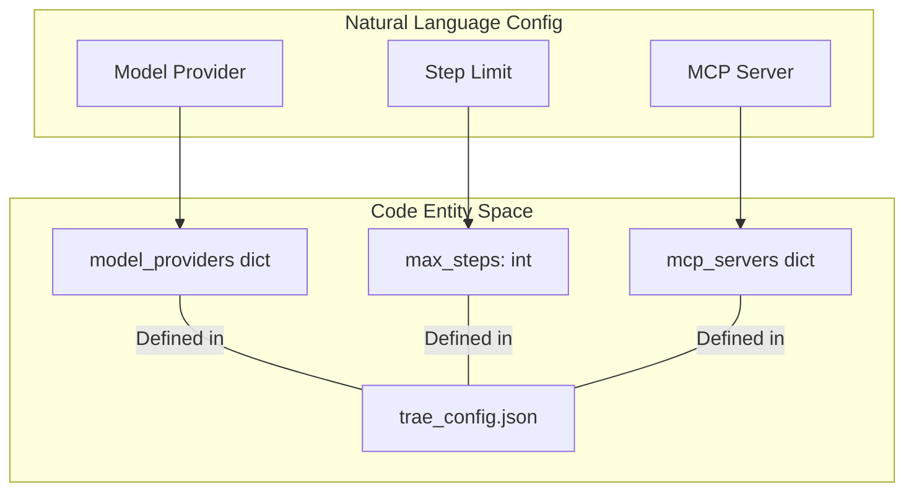

**Sources:** [trae_config.json.example:1-87](), [pyproject.toml:14-24]()

---

## Verification

### 1. Check CLI Entry Point
The CLI is registered as `trae-cli` via the `project.scripts` configuration [pyproject.toml:44-45]().

```bash
# Verify the command is in path
trae-cli --help
```

### 2. Run Unit Tests
Use the `Makefile` to run the test suite [Makefile:41-42](). Note that external service tests are skipped by default.

```bash
make uv-test
```

The test suite uses `pytest` with `asyncio` support [pyproject.toml:54-65]().

### 3. Verify Agent Lifecycle
You can verify the agent's internal state transitions by running a simple task. The agent transitions through various `AgentStepState` values: `THINKING`, `CALLING_TOOL`, and `COMPLETED` [trae_agent/agent/agent_basics.py:19-27]().

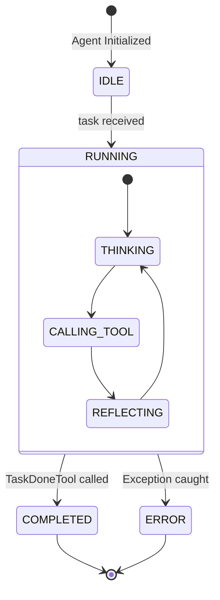

**Sources:** [trae_agent/agent/agent_basics.py:19-35](), [Makefile:41-45](), [pyproject.toml:44-45]()

---

## Development Environment Setup

For contributors, additional steps are required to ensure code quality.

### Pre-commit Hooks
The project uses `pre-commit` [pyproject.toml:35]() to run linting and formatting checks.

```bash
# Install and run hooks
make pre-commit
```

This runs `ruff` for formatting and linting [Makefile:36-38](), as configured in [pyproject.toml:86-96]().

### VS Code Debugging
A template for VS Code debugging is provided in [.vscode/launch.template.json:1-21](). You can copy this to `.vscode/launch.json` to debug the `trae_agent.cli` module [ .vscode/launch.template.json:11]().

**Sources:** [Makefile:26-39](), [pyproject.toml:86-96](), [.vscode/launch.template.json:1-21]()

---

# Page: Usage Guide

# Usage Guide

<details>
<summary>Relevant source files</summary>

The following files were used as context for generating this wiki page:

- [README.md](README.md)
- [tests/test_cli.py](tests/test_cli.py)
- [trae_agent/cli.py](trae_agent/cli.py)

</details>


This guide covers how to use Trae Agent for software engineering tasks through its command-line interface. It explains task execution patterns, configuration options, and workflow management. For installation and initial setup, see [Installation and Setup](#2).

## Overview

Trae Agent provides three primary usage modes through the `trae-cli` command:
- **Run mode**: Execute single tasks with immediate completion [trae_agent/cli.py:192-213]()
- **Interactive mode**: Continuous conversation-based task execution [trae_agent/cli.py:423-441]()
- **Configuration management**: View and validate system settings [trae_agent/cli.py:594-612]()

## Task Execution Flow

The following diagram shows how user tasks flow through the CLI interface to the agent execution system, associating natural language inputs with the underlying `Agent` class and `Tool` entities.

**Diagram: CLI to Agent Execution Flow**
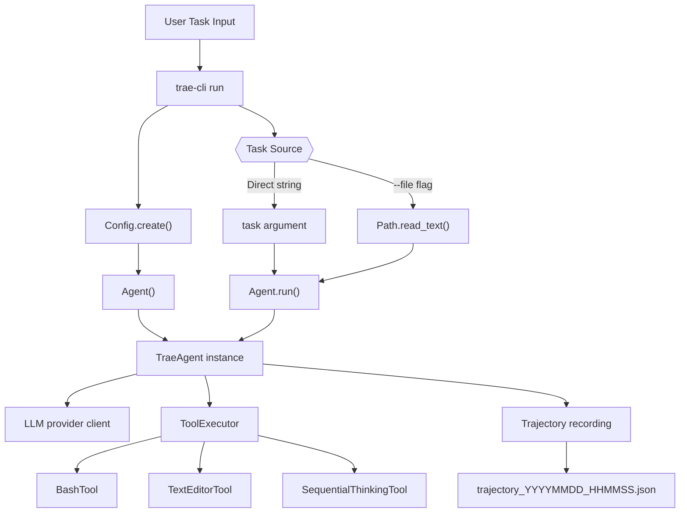

Sources: [trae_agent/cli.py:180-394](), [trae_agent/cli.py:355-368](), [README.md:128-140]()

## Basic Task Execution

### Run Mode

Run mode executes a single task and exits. The basic syntax is `trae-cli run "task description"`. The CLI accepts tasks through two mechanisms:

| Input Method | CLI Option | Code Implementation |
|--------------|------------|---------|
| Direct string | First argument | `task` argument in `run()` [trae_agent/cli.py:193]() |
| File content | `--file` / `-f` | `file_path` reading in [trae_agent/cli.py:270-280]() |

**Working Directory Management**: The `--working-dir` option sets the project context. If not specified, the current directory is used. The CLI ensures the working directory is an absolute path [trae_agent/cli.py:332-337]().

For details, see [CLI Commands](#3.1).

Sources: [trae_agent/cli.py:116-131](), [trae_agent/cli.py:318-330](), [README.md:131-140]()

### Interactive Mode

Interactive mode provides a REPL-like session for iterative development. The interactive loop is handled by `_run_simple_interactive_loop` or `_run_rich_interactive_loop` depending on the `--console-type` [trae_agent/cli.py:481-494]().

**Interactive Commands**: The simple console [trae_agent/utils/cli.py:22]() supports these built-in commands [trae_agent/cli.py:512-545]():
- `help`: Show available commands.
- `status`: Display agent configuration and tool count.
- `clear`: Clear terminal screen.
- `exit`/`quit`: End session.

For details, see [Interactive Mode](#3.3).

Sources: [trae_agent/cli.py:423-494](), [trae_agent/cli.py:497-576](), [README.md:138-139]()

## Provider and Model Selection

### Configuration Resolution

The CLI resolves configuration values with a specific precedence order defined in the `Config` resolution logic [trae_agent/cli.py:282-290]():
1. **Command-line arguments**: `--provider`, `--model`, `--api-key`, etc. [trae_agent/cli.py:129-133]()
2. **Environment variables**: `OPENAI_API_KEY`, `ANTHROPIC_API_KEY`, etc. [README.md:95-109]()
3. **Configuration file**: Values from `trae_config.yaml` [README.md:53-79]()
4. **Default values**: Hardcoded system defaults.

For details, see [Configuration](#3.2).

Sources: [trae_agent/cli.py:118-122](), [README.md:142-163](), [README.md:123]()

## Docker Integration

### Docker Execution Modes

Trae Agent supports containerized execution via `DockerManager` to provide isolated environments for tool execution.

**Diagram: Docker Integration Architecture**
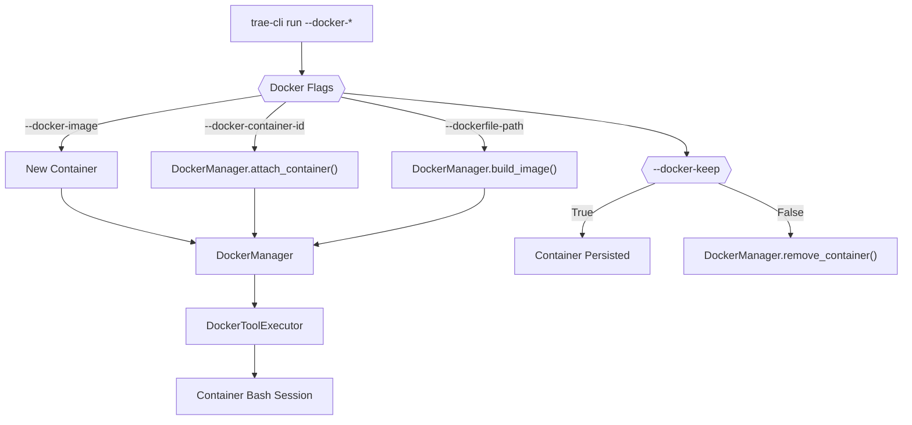

**Tool Binaries**: Docker mode requires pre-built tool binaries (e.g., `edit_tool`, `json_edit_tool`). The CLI includes a helper to build these using PyInstaller [trae_agent/cli.py:89-116]().

For details, see [Docker Mode](#3.4).

Sources: [trae_agent/cli.py:145-175](), [trae_agent/cli.py:208-212](), [README.md:181-204]()

## Trajectory Recording

All task executions generate trajectory files containing the history of agent thoughts, tool calls, and LLM responses.

- **Default Path**: `trajectories/trajectory_YYYYMMDD_HHMMSS.json` [README.md:227-228]().
- **Custom Path**: Specified via `--trajectory-file` or `-t` [trae_agent/cli.py:142]().

The CLI displays the final trajectory path after the agent finishes its task [trae_agent/cli.py:370](), [trae_agent/cli.py:567]().

Sources: [trae_agent/cli.py:131](), [trae_agent/cli.py:409](), [README.md:221-234]()

## Configuration Management

### View Current Configuration

Use `trae-cli show-config` to inspect the active settings. This command prints a formatted table of providers, models, and agent settings [trae_agent/cli.py:614-681]().

### Configuration File Resolution

The CLI handles backward compatibility between YAML and JSON configurations through `resolve_config_file()` [trae_agent/cli.py:31-50](). It prefers `.yaml` or `.yml` but will fall back to `.json` if the former are missing.

Sources: [trae_agent/cli.py:594-681](), [trae_agent/cli.py:30-49](), [README.md:135-136]()

## Error Handling

- **Docker Checks**: The CLI validates the Docker CLI and daemon status before attempting containerized tasks [trae_agent/cli.py:53-87]().
- **Interruption**: `KeyboardInterrupt` (Ctrl+C) is caught to ensure trajectories are saved before exiting [trae_agent/cli.py:372-375]().
- **Directory Errors**: The CLI validates the existence of the `--working-dir` and reports errors if `os.chdir` fails [tests/test_cli.py:113-139]().

Sources: [trae_agent/cli.py:53-87](), [trae_agent/cli.py:372-394](), [tests/test_cli.py:113-139]()

---

# Page: CLI Commands

# CLI Commands

<details>
<summary>Relevant source files</summary>

The following files were used as context for generating this wiki page:

- [README.md](README.md)
- [tests/test_cli.py](tests/test_cli.py)
- [trae_agent/cli.py](trae_agent/cli.py)

</details>


This page provides comprehensive documentation for all command-line interface (CLI) commands available in Trae Agent. The CLI is the primary user interface for interacting with the agent system, enabling task execution, interactive sessions, configuration inspection, and tool discovery.

For configuration file format and options, see [Configuration](#3.2). For details about interactive REPL mode operation, see [Interactive Mode](#3.3). For Docker container integration, see [Docker Mode](#3.4).

## Overview

The Trae Agent CLI is implemented in [trae_agent/cli.py]() and provides four main commands through the Click framework. All commands share a common configuration system that supports multiple input sources with clear priority ordering.

**Command Entry Point:** `trae-cli` is the main executable, defined at [trae_agent/cli.py:121]().

**Available Commands:**
- `run` - Execute a single task with the agent [trae_agent/cli.py:126-412]()
- `interactive` - Start an interactive REPL session [trae_agent/cli.py:414-514]()
- `show-config` - Display current configuration settings [trae_agent/cli.py:614-704]()
- `tools` - List all available tools and their descriptions [trae_agent/cli.py:706-723]()

**Configuration Priority:** CLI arguments > Configuration file > Environment variables > Default values (enforced at [trae_agent/cli.py:294-302]() and [trae_agent/cli.py:459-467]()).

## Command Structure

The following diagram shows the CLI command hierarchy and how commands map to code entities:

**Diagram 1: CLI Architecture and Code Entity Mapping**
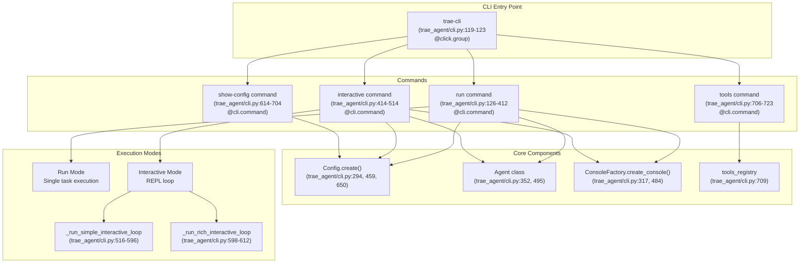

**Sources:** [trae_agent/cli.py:119-723]()

## `run` Command

The `run` command executes a single task using Trae Agent. It is the primary command for non-interactive task execution.

### Basic Syntax

```bash
trae-cli run [TASK] [OPTIONS]
trae-cli run --file FILE [OPTIONS]
```

### Arguments

| Argument | Type | Required | Description |
|----------|------|----------|-------------|
| `TASK` | string | Conditional* | Natural language task description |

\* Either `TASK` argument or `--file` option must be provided (enforced at [trae_agent/cli.py:277-292]()).

### Core Options

| Option | Short | Type | Default | Description |
|--------|-------|------|---------|-------------|
| `--file` | `-f` | path | None | Path to file containing task description [trae_agent/cli.py:128]() |
| `--provider` | `-p` | string | None | LLM provider (openai, anthropic, google, etc.) [trae_agent/cli.py:129]() |
| `--model` | `-m` | string | None | Specific model name [trae_agent/cli.py:130]() |
| `--model-base-url` | - | string | None | Base URL for model API [trae_agent/cli.py:131]() |
| `--api-key` | `-k` | string | None | API key for provider [trae_agent/cli.py:132]() |
| `--max-steps` | - | int | None | Maximum number of agent execution steps [trae_agent/cli.py:133]() |
| `--working-dir` | `-w` | path | current dir | Working directory (must be absolute path) [trae_agent/cli.py:134]() |
| `--must-patch` | `-mp` | flag | False | Require code changes [trae_agent/cli.py:135]() |
| `--config-file` | - | path | trae_config.yaml | Path to configuration file [trae_agent/cli.py:137-141]() |
| `--trajectory-file` | `-t` | path | auto-generated | Path to save trajectory recording [trae_agent/cli.py:142]() |
| `--patch-path` | `-pp` | path | None | Path to save git diff patch [trae_agent/cli.py:143]() |
| `--console-type` | `-ct` | choice | simple | Console type: simple or rich [trae_agent/cli.py:179-184]() |
| `--agent-type` | `-at` | choice | trae_agent | Agent type to use [trae_agent/cli.py:186-191]() |

### Docker Mode Options

Docker mode enables isolated task execution in containers. See [Docker Mode](#3.4) for comprehensive details.

| Option | Type | Default | Description |
|--------|------|---------|-------------|
| `--docker-image` | string | None | Docker image name to create new container [trae_agent/cli.py:146-150]() |
| `--docker-container-id` | string | None | Existing container ID to attach to [trae_agent/cli.py:152-156]() |
| `--dockerfile-path` | path | None | Path to Dockerfile for building image [trae_agent/cli.py:158-162]() |
| `--docker-image-file` | path | None | Path to tar archive of Docker image [trae_agent/cli.py:164-168]() |
| `--docker-keep` | bool | True | Keep container after task completion [trae_agent/cli.py:170-174]() |

**Mutual Exclusivity:** Only one of `--docker-image`, `--docker-container-id`, `--dockerfile-path`, or `--docker-image-file` may be specified (enforced at [trae_agent/cli.py:226-240]()).

### Task Input Modes

The following diagram illustrates task input resolution:

**Diagram 2: Task Input Logic Flow**
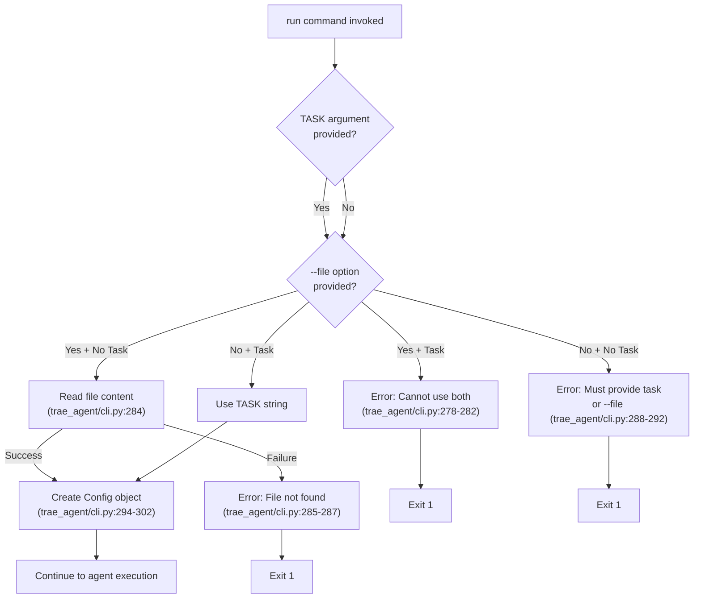

**Sources:** [trae_agent/cli.py:277-292]()

### Execution Flow

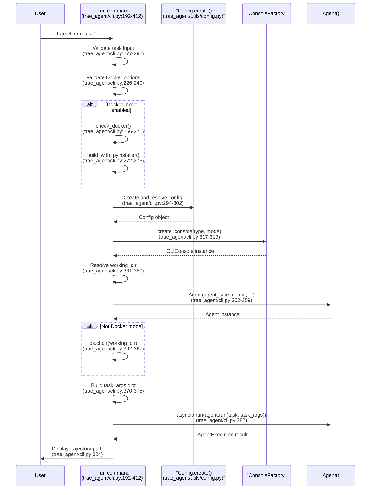

**Sources:** [trae_agent/cli.py:192-412]()

### Working Directory Requirements

The working directory must be an absolute path (validated at [trae_agent/cli.py:346-350]()):

```python
# Ensure working directory is an absolute path
if not Path(working_dir).is_absolute():
    console.print(
        f"[red]Working directory must be an absolute path: {working_dir}, "
        f"it should start with `/`[/red]"
    )
    sys.exit(1)
```

**Behavior:**
- If `--working-dir` is provided: Creates directory if needed [trae_agent/cli.py:332-337](), converts to absolute path [trae_agent/cli.py:343]().
- If not provided: Uses current working directory (`os.getcwd()`) [trae_agent/cli.py:331]().
- Docker mode: Working directory is used for mounting workspace.
- Non-Docker mode: Agent changes to working directory via `os.chdir()` [trae_agent/cli.py:363]().

**Sources:** [trae_agent/cli.py:330-367]()

### Docker Mode Initialization

When any Docker option is specified, the CLI performs initialization checks at [trae_agent/cli.py:265-275]():

1. **Docker Availability Check:** Executes `check_docker()` function ([trae_agent/cli.py:53-86]()) which verifies:
   - Docker CLI installed (`shutil.which("docker")`) [trae_agent/cli.py:55]().
   - Docker daemon running (`docker version` command) [trae_agent/cli.py:64-69]().
   - Returns status dict with `cli`, `daemon`, `version`, and `error` fields.

2. **Tool Building:** On first Docker mode use, builds standalone tool binaries with PyInstaller:
   - Checks for `trae_agent/dist/` and `trae_agent/dist/_internal/` directories [trae_agent/cli.py:272-273]().
   - Builds `edit_tool` and `json_edit_tool` executables ([trae_agent/cli.py:89-116]()).
   - These binaries are copied into Docker containers for tool execution.

**Sources:** [trae_agent/cli.py:53-116, 265-275]()

## `interactive` Command

The `interactive` command starts a REPL (Read-Eval-Print Loop) session for iterative task execution. See [Interactive Mode](#3.3) for detailed usage patterns.

### Basic Syntax

```bash
trae-cli interactive [OPTIONS]
```

### Options

| Option | Short | Type | Default | Description |
|--------|-------|------|---------|-------------|
| `--provider` | `-p` | string | None | LLM provider to use [trae_agent/cli.py:415]() |
| `--model` | `-m` | string | None | Specific model name [trae_agent/cli.py:416]() |
| `--model-base-url` | - | string | None | Base URL for model API [trae_agent/cli.py:417]() |
| `--api-key` | `-k` | string | None | API key for provider [trae_agent/cli.py:418]() |
| `--config-file` | - | path | trae_config.yaml | Path to configuration file [trae_agent/cli.py:423-427]() |
| `--max-steps` | - | int | 20 | Maximum steps per task [trae_agent/cli.py:419]() |
| `--trajectory-file` | `-t` | path | auto-generated | Path to save trajectory [trae_agent/cli.py:428]() |
| `--console-type` | `-ct` | choice | simple | Console type: simple or rich [trae_agent/cli.py:430-435]() |
| `--agent-type` | `-at` | choice | trae_agent | Agent type to use [trae_agent/cli.py:436-441]() |

### Interactive Session Commands

When in interactive mode, special commands are available (implemented in simple console at [trae_agent/cli.py:516-596]()):

| Command | Description | Code Reference |
|---------|-------------|----------------|
| `<task description>` | Execute a task | [trae_agent/cli.py:576-586]() |
| `status` | Show agent information | [trae_agent/cli.py:548-560]() |
| `help` | Display available commands | [trae_agent/cli.py:531-544]() |
| `clear` | Clear the screen | [trae_agent/cli.py:562-564]() |
| `exit` or `quit` | End the session | [trae_agent/cli.py:526-529]() |

### Console Type Behavior

The interactive command supports two console types:

**Simple Console** ([trae_agent/cli.py:516-596]()):
- Traditional REPL loop with `input()` prompts.
- Prompts for task and working directory for each execution [trae_agent/cli.py:566-574]().
- Displays formatted panels for status and help.
- Handles `KeyboardInterrupt` and `EOFError` for graceful exit [trae_agent/cli.py:588-592]().

**Rich Console** ([trae_agent/cli.py:598-612]()):
- Textual-based TUI with advanced features.
- Agent context set via `set_agent_context()` method [trae_agent/cli.py:607-608]().
- Single `await cli_console.start()` call runs entire UI [trae_agent/cli.py:611]().

**Sources:** [trae_agent/cli.py:440-612]()

## `show-config` Command

The `show-config` command displays the current resolved configuration, showing values from all sources (CLI args, config file, environment variables, defaults).

### Implementation

The command reads from the resolved `Config` object and displays values using Rich library tables [trae_agent/cli.py:666-703](). It masks API keys for security, showing only the first and last 4 characters [trae_agent/cli.py:692]().

### Examples

```bash
# Show current configuration
trae-cli show-config

# Show config with overrides
trae-cli show-config --provider openai --model gpt-4o
```

**Sources:** [trae_agent/cli.py:614-704]()

## `tools` Command

The `tools` command lists all available tools registered in the tool ecosystem.

### Implementation

The command iterates through the `tools_registry` at [trae_agent/cli.py:709-722]():

1. Imports `tools_registry` from `trae_agent.tools`.
2. Iterates over all registered tool names.
3. Instantiates each tool to retrieve its `name` and `description` [trae_agent/cli.py:716]().
4. Displays the information in a `rich.table.Table` [trae_agent/cli.py:711-722]().

**Sources:** [trae_agent/cli.py:706-723]()

## Configuration File Resolution

The CLI supports backward compatibility between YAML and JSON configuration formats through the `resolve_config_file()` function at [trae_agent/cli.py:31-51]():

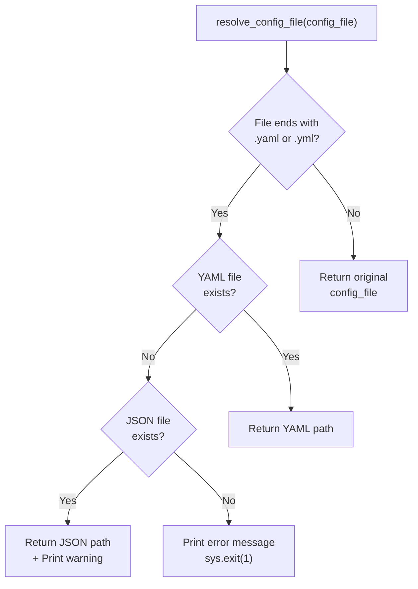

**Sources:** [trae_agent/cli.py:31-51]()

## Error Handling

The CLI implements comprehensive error handling for common failure scenarios:

| Error Category | Scenario | Behavior | Code Reference |
|----------------|----------|----------|----------------|
| **Task Input** | Both task string and `--file` | Exit 1 with error message | [trae_agent/cli.py:278-282]() |
| **Task Input** | Neither task nor `--file` | Exit 1 with error message | [trae_agent/cli.py:288-292]() |
| **Docker** | Multiple Docker options | Exit 1 with error message | [trae_agent/cli.py:237-240]() |
| **Docker** | Daemon not reachable | Exit 1 with error message | [trae_agent/cli.py:269-271]() |
| **Path** | Working dir not absolute | Exit 1 with error message | [trae_agent/cli.py:346-350]() |
| **Config** | Missing agent config | Exit 1 with error message | [trae_agent/cli.py:471-473]() |
| **Runtime** | KeyboardInterrupt | Graceful exit with message | [trae_agent/cli.py:386-389]() |

**Sources:** [trae_agent/cli.py:237-411](), [tests/test_cli.py]()

## Testing

The CLI is tested via Click's `CliRunner` in [tests/test_cli.py](). Key test cases include:
- Long prompt handling [tests/test_cli.py:18-47]()
- File argument reading [tests/test_cli.py:54-86]()
- Non-existent file error [tests/test_cli.py:89-93]()
- Working directory validation [tests/test_cli.py:110-138]()

**Sources:** [tests/test_cli.py]()

---

# Page: Configuration

# Configuration

<details>
<summary>Relevant source files</summary>

The following files were used as context for generating this wiki page:

- [.gitignore](.gitignore)
- [.vscode/launch.template.json](.vscode/launch.template.json)
- [docs/legacy_config.md](docs/legacy_config.md)
- [tests/utils/test_config.py](tests/utils/test_config.py)
- [trae_agent/utils/config.py](trae_agent/utils/config.py)
- [trae_agent/utils/legacy_config.py](trae_agent/utils/legacy_config.py)
- [trae_config.json.example](trae_config.json.example)
- [trae_config.yaml.example](trae_config.yaml.example)

</details>


This document explains how to configure trae-agent using YAML files, environment variables, and command-line arguments. It covers the configuration system architecture, priority resolution, and the various configuration formats supported.

For the complete reference of all configuration options and their defaults, see [Configuration Reference](). For CLI command syntax and options, see [CLI Commands]().

## Configuration System Overview

The trae-agent configuration system implements a hierarchical approach with multiple sources and automatic resolution. The system supports both modern YAML configuration and legacy JSON formats for backward compatibility.

**Configuration Architecture**

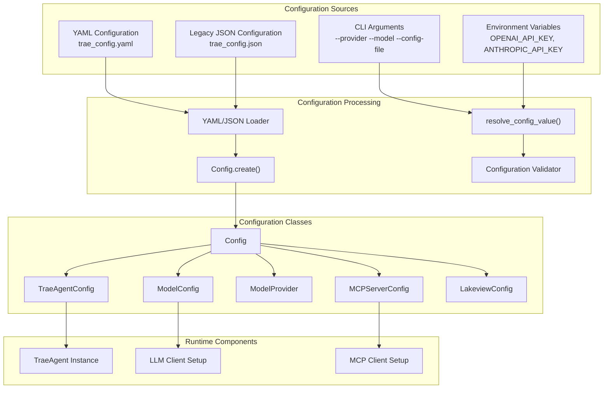

Sources: [trae_agent/utils/config.py:205-230](), [trae_agent/utils/config.py:394-410]()

## Configuration Sources and Priority

The configuration system resolves values using a strict priority hierarchy implemented in the `resolve_config_value` function:

| Priority | Source | Example |
|----------|--------|---------|
| 1 (Highest) | Command-line arguments | `--provider openai --model gpt-4o` |
| 2 | Environment variables | `OPENAI_API_KEY=sk-...` |
| 3 | Configuration file | `trae_config.yaml` or `trae_config.json` |
| 4 (Lowest) | Default values | Built-in defaults |

**Priority Resolution Flow**

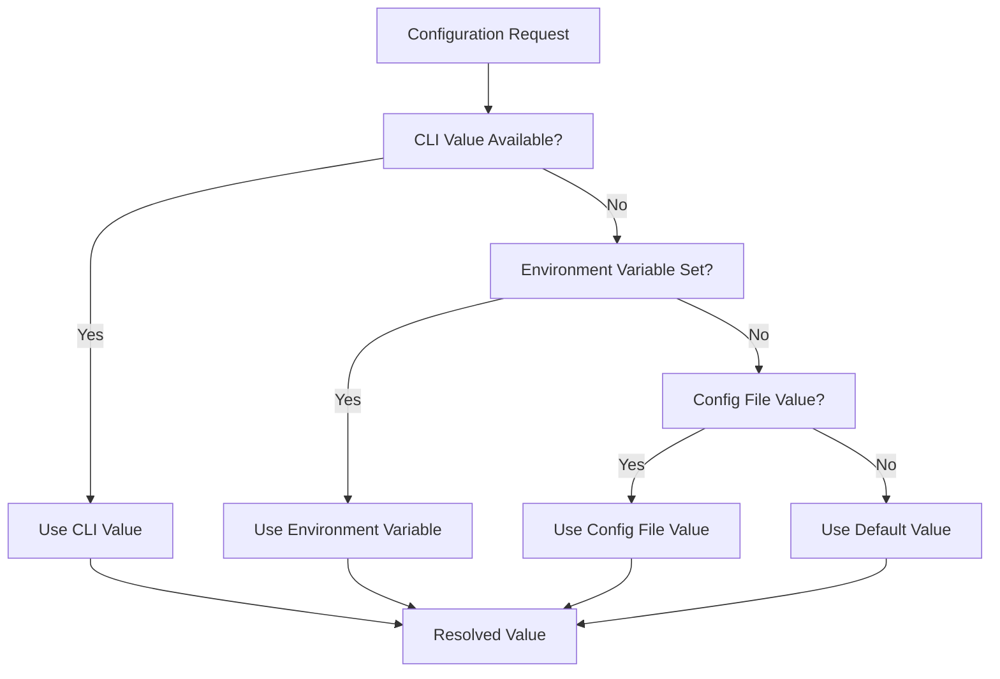

Sources: [trae_agent/utils/config.py:394-410](), [docs/legacy_config.md:28-33]()

## YAML Configuration Format

The modern YAML configuration format provides a structured approach to configuring all aspects of trae-agent. The configuration is organized into logical sections for agents, models, providers, and services.

### Basic YAML Structure

```yaml
# Agent configurations
agents:
    trae_agent:
        enable_lakeview: true
        model: trae_agent_model
        max_steps: 200
        tools:
            - bash
            - str_replace_based_edit_tool
            - sequentialthinking
            - task_done

# MCP server configuration
allow_mcp_servers:
    - playwright
mcp_servers:
    playwright:
        command: npx
        args:
            - "@playwright/mcp@0.0.27"

# Lakeview configuration
lakeview:
    model: lakeview_model

# Model provider configurations
model_providers:
    anthropic:
        api_key: your_anthropic_api_key
        provider: anthropic

# Model configurations
models:
    trae_agent_model:
        model_provider: anthropic
        model: claude-4-sonnet
        max_tokens: 4096
        temperature: 0.5
        top_p: 1
        top_k: 0
        max_retries: 10
        parallel_tool_calls: true
```

The YAML configuration is processed by the `Config.create()` method which validates the structure and creates the appropriate configuration objects.

Sources: [trae_config.yaml.example:1-45](), [trae_agent/utils/config.py:205-230]()

### Configuration Classes Mapping

The configuration system uses several `dataclass` definitions to represent the system state.

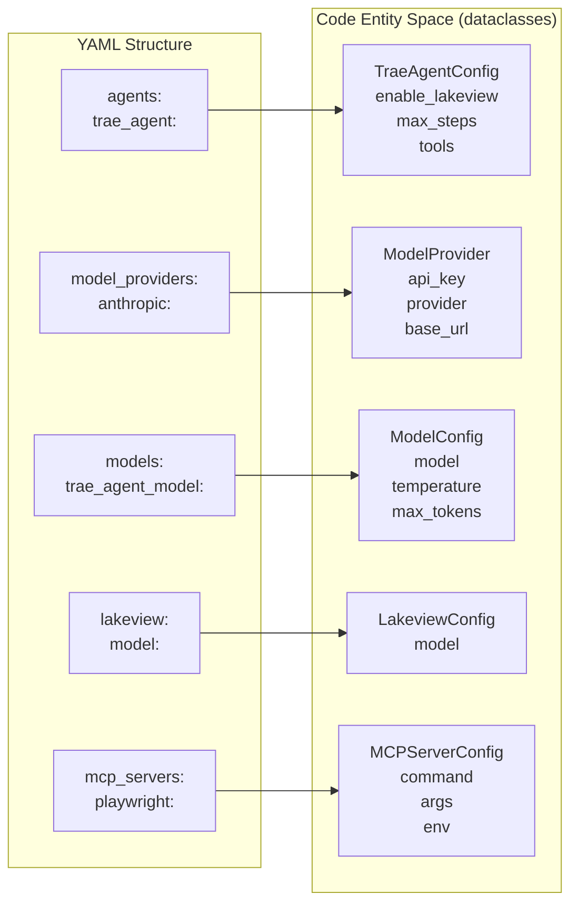

Sources: [trae_agent/utils/config.py:16-27](), [trae_agent/utils/config.py:29-46](), [trae_agent/utils/config.py:120-143](), [trae_agent/utils/config.py:159-172](), [trae_agent/utils/config.py:185-191]()

## Environment Variables

Environment variables provide a secure way to configure API keys and base URLs without storing them in configuration files. The system automatically maps provider names to environment variable patterns.

### Environment Variable Patterns

| Provider | API Key Variable | Base URL Variable |
|----------|------------------|-------------------|
| OpenAI | `OPENAI_API_KEY` | `OPENAI_BASE_URL` |
| Anthropic | `ANTHROPIC_API_KEY` | `ANTHROPIC_BASE_URL` |
| Google | `GOOGLE_API_KEY` | `GOOGLE_BASE_URL` |
| Azure | `AZURE_API_KEY` | `AZURE_BASE_URL` |
| Doubao | `DOUBAO_API_KEY` | `DOUBAO_BASE_URL` |

The environment variable resolution is implemented in the `resolve_config_values` method of `ModelConfig`:

```python
# Map providers to their environment variable names
env_var_api_key = str(self.model_provider.provider).upper() + "_API_KEY"
env_var_api_base_url = str(self.model_provider.provider).upper() + "_BASE_URL"
```

Sources: [trae_agent/utils/config.py:96-110]()

## Command-line Override

Command-line arguments provide the highest priority configuration mechanism, allowing users to override any configuration file or environment variable setting for common parameters.

### Supported CLI Overrides

| CLI Argument | Configuration Target | Example |
|--------------|---------------------|---------|
| `--provider` | Model provider | `--provider openai` |
| `--model` | Model name | `--model gpt-4o` |
| `--api-key` | API key | `--api-key sk-...` |
| `--model-base-url` | Base URL | `--model-base-url https://api.openai.com/v1` |
| `--max-steps` | Agent max steps | `--max-steps 50` |

The CLI override mechanism works through the `resolve_config_values` method which is called after configuration loading.

Sources: [trae_agent/utils/config.py:66-78](), [trae_agent/utils/config.py:174-182]()

## Legacy JSON Configuration

For backward compatibility, the system supports legacy JSON configuration files through the `LegacyConfig` class. The legacy format is automatically detected and converted to the modern configuration structure.

### Legacy Format Structure

```json
{
  "default_provider": "anthropic",
  "max_steps": 20,
  "enable_lakeview": true,
  "model_providers": {
    "anthropic": {
      "model": "claude-sonnet-4-20250514",
      "api_key": "your-api-key",
      "base_url": "https://api.anthropic.com",
      "max_tokens": 4096,
      "temperature": 0.5,
      "top_p": 1,
      "top_k": 0,
      "parallel_tool_calls": false,
      "max_retries": 10
    }
  }
}
```

The legacy configuration is processed by `Config.create_from_legacy_config()` which converts the flat structure to the modern hierarchical format defined in `trae_agent/utils/config.py`.

Sources: [trae_agent/utils/legacy_config.py:71-166](), [trae_agent/utils/config.py:218-219]()

## Configuration Resolution Process

The configuration resolution process involves loading, validating, and resolving configuration values from multiple sources. This process is coordinated by the `Config` class.

**Configuration Resolution Sequence**

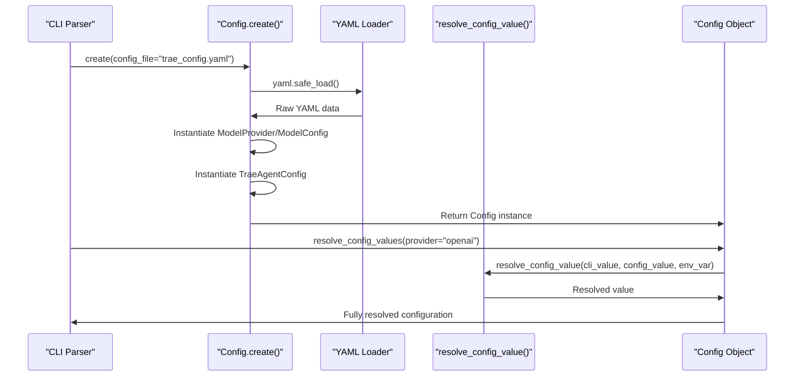

Sources: [trae_agent/utils/config.py:205-300](), [trae_agent/utils/config.py:66-118]()

## MCP Server Configuration

Model Context Protocol (MCP) servers extend trae-agent's capabilities by providing external tools. MCP servers are configured in the `mcp_servers` section and managed by the `MCPServerConfig` class.

### MCP Configuration Structure

The `MCPServerConfig` class supports multiple transport mechanisms:

| Transport | Configuration Fields | Usage |
|-----------|---------------------|--------|
| stdio | `command`, `args`, `env`, `cwd` | Local command execution |
| SSE | `url` | Server-sent events |
| HTTP | `http_url`, `headers` | HTTP streaming |
| WebSocket | `tcp` | TCP socket connection |

Sources: [trae_agent/utils/config.py:120-143](), [trae_config.yaml.example:13-17]()

## Model Provider and Model Configuration

The configuration system separates model providers (authentication and connection details) from model configurations (model-specific parameters).

### Token Parameter Resolution

The system handles different token parameter naming conventions across providers through the `get_max_tokens_param()` and `should_use_max_completion_tokens()` methods in `ModelConfig`:

- **Standard**: `max_tokens` (most providers).
- **Azure OpenAI (new models)**: `max_completion_tokens` is used for `gpt-5`, `o3`, or `o4-mini` models if available.
- **Priority**: `max_completion_tokens` takes precedence over `max_tokens`.

Sources: [trae_agent/utils/config.py:48-64]()

---

# Page: Interactive Mode

# Interactive Mode

<details>
<summary>Relevant source files</summary>

The following files were used as context for generating this wiki page:

- [tests/test_cli.py](tests/test_cli.py)
- [trae_agent/cli.py](trae_agent/cli.py)
- [trae_agent/utils/cli/rich_console.py](trae_agent/utils/cli/rich_console.py)
- [trae_agent/utils/cli/rich_console.tcss](trae_agent/utils/cli/rich_console.tcss)
- [trae_agent/utils/trajectory_recorder.py](trae_agent/utils/trajectory_recorder.py)

</details>


## Purpose and Scope

Interactive Mode provides a REPL (Read-Eval-Print-Loop) interface for iteratively executing software engineering tasks with Trae Agent. This mode enables conversational interaction where users can submit multiple tasks in sequence, check agent status, and maintain context across executions within a single session.

This document covers the interactive command interface, console implementations, and task execution flow. For basic CLI commands and one-shot task execution, see [CLI Commands](). For configuration options that apply to interactive mode, see [Configuration]().

---

## Starting Interactive Mode

Interactive Mode is initiated via the `interactive` command in the CLI [trae_agent/cli.py:440-449](). The command accepts configuration overrides similar to the `run` command.

### Basic Usage

```bash
# Start with default configuration
trae-cli interactive

# Start with specific provider and model
trae-cli interactive --provider openai --model gpt-4o

# Use custom console type
trae-cli interactive --console-type rich
```

### Command-Line Options

| Option | Short | Type | Description |
|--------|-------|------|-------------|
| `--provider` | `-p` | string | LLM provider to use (overrides config) |
| `--model` | `-m` | string | Specific model to use (overrides config) |
| `--model-base-url` | | string | Base URL for model API |
| `--api-key` | `-k` | string | API key for the provider |
| `--config-file` | | string | Path to configuration file (default: `trae_config.yaml`) |
| `--max-steps` | | int | Maximum number of execution steps (default: 20) |
| `--trajectory-file` | `-t` | string | Path to save trajectory file |
| `--console-type` | `-ct` | choice | Console type: `simple` or `rich` (default: `simple`) |
| `--agent-type` | `-at` | choice | Agent type: `trae_agent` (default: `trae_agent`) |

**Sources:** [trae_agent/cli.py:414-449]()

---

## Console Types

Interactive Mode supports two console implementations that provide different user experiences:

### Simple Console

The `simple` console type provides a basic terminal interface with standard input/output. It displays plain text output and uses basic prompts for user input.

**Characteristics:**
- Text-based output with Rich formatting.
- Sequential command execution.
- Manual input for task and working directory [trae_agent/cli.py:526](), [trae_agent/cli.py:546]().
- Basic error handling with stacktraces [trae_agent/cli.py:593-595]().

**Implementation:** [trae_agent/cli.py:516-596]()

### Rich Console

The `rich` console type provides an advanced Terminal User Interface (TUI) using the Textual framework. It offers a more sophisticated interactive experience with visual components.

**Characteristics:**
- Textual-based TUI with panels and widgets [trae_agent/utils/cli/rich_console.py:80-104]().
- Integrated agent context management via `set_agent_context` [trae_agent/cli.py:605]().
- Real-time token usage display via `TokenDisplay` [trae_agent/utils/cli/rich_console.py:30-55]().
- Enhanced visual feedback using `RichLog` [trae_agent/utils/cli/rich_console.py:86]().

**Implementation:** [trae_agent/cli.py:598-612](), [trae_agent/utils/cli/rich_console.py:57-234]()

### Console Selection Flow

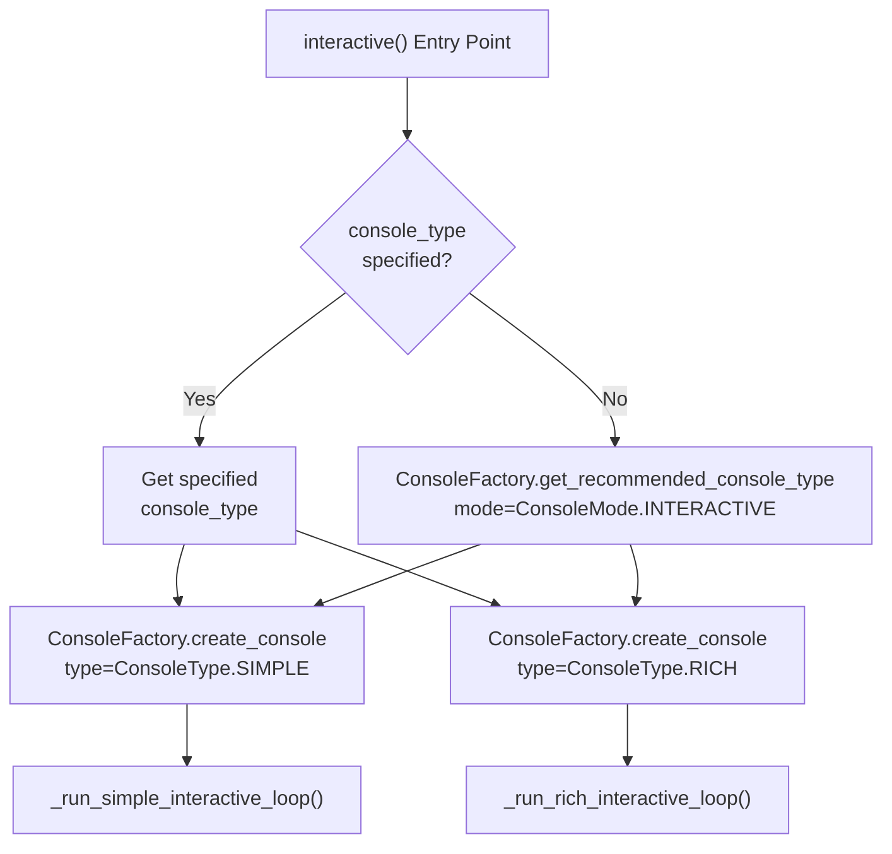

**Sources:** [trae_agent/cli.py:476-488](), [trae_agent/cli.py:501-513]()

---

## Interactive Commands

Interactive Mode provides several built-in commands that can be typed at the prompt.

### Available Commands

| Command | Description | Implementation |
|---------|-------------|----------------|
| Task description | Any non-command text is executed as a task | [trae_agent/cli.py:525-586]() |
| `status` | Display agent configuration and current state | [trae_agent/cli.py:548-560]() |
| `help` | Show available commands and usage information | [trae_agent/cli.py:531-544]() |
| `clear` | Clear the terminal screen | [trae_agent/cli.py:562-564]() |
| `exit` or `quit` | End the interactive session | [trae_agent/cli.py:528-529](), [trae_agent/cli.py:591-592]() |

### Status Command Output

When the `status` command is issued, it displays:
- **Provider**: The active LLM provider (e.g., `openai`, `anthropic`).
- **Model**: The model identifier (e.g., `gpt-4o`).
- **Available Tools**: Count of tools available to the agent.
- **Config File**: Path to the active configuration file.
- **Working Directory**: Current working directory path.

**Sources:** [trae_agent/cli.py:548-560]()

---

## Task Execution Flow

### Simple Console Execution

The simple console implementation uses a straightforward event loop that sequentially processes user input.

```mermaid
sequenceDiagram
    participant User
    participant Loop as "_run_simple_interactive_loop"
    participant Console as "CLIConsole"
    participant Agent
    participant AgentImpl as "TraeAgent Implementation"
    
    User->>Loop: Start interactive session
    
    loop Interactive Session
        Loop->>Console: get_task_input()
        Console->>User: Prompt for task
        User-->>Console: Task description
        Console-->>Loop: task
        
        alt Command Processing
            Loop->>Loop: Check if task == "help"
            Loop->>Loop: Check if task == "status"
            Loop->>Loop: Check if task == "clear"
            Loop->>Loop: Check if task == "exit"
        else Task Execution
            Loop->>Console: get_working_dir_input()
            Console->>User: Prompt for working directory
            User-->>Console: Working directory path
            Console-->>Loop: working_dir
            
            Loop->>Loop: Build task_args dict
            
            Note over Loop,Agent: Parallel execution
            Loop->>Console: asyncio.create_task(console.start())
            Loop->>Agent: asyncio.create_task(agent.run(task, task_args))
            
            Agent->>AgentImpl: Execute task
            AgentImpl-->>Agent: AgentExecution result
            Agent-->>Loop: Execution complete
            
            Loop->>Console: Display trajectory file path
        end
    end
    
    User->>Loop: exit/quit
    Loop-->>User: Goodbye!
```

**Key Implementation Details:**

1. **Input Collection**: The loop calls `cli_console.get_task_input()` to retrieve user task descriptions and `get_working_dir_input()` for the working directory [trae_agent/cli.py:526](), [trae_agent/cli.py:546]().
2. **Task Argument Construction**: Task arguments are assembled into a dictionary with `project_path`, `issue`, and `must_patch` keys [trae_agent/cli.py:569-573]().
3. **Concurrent Execution**: Both console output and agent execution run as concurrent asyncio tasks [trae_agent/cli.py:579-584]().
4. **Trajectory Recording**: Each task execution automatically saves to the trajectory file specified during session initialization [trae_agent/cli.py:567](), [trae_agent/cli.py:586]().

**Sources:** [trae_agent/cli.py:516-596]()

### Rich Console Execution

The rich console implementation delegates the entire interaction loop to the `RichConsoleApp` (a Textual `App`), which manages task execution internally.

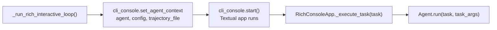

The rich console receives references to the `Agent` instance and configuration via `set_agent_context` [trae_agent/cli.py:605](). When a task is submitted in the UI, `RichConsoleApp._execute_task` is triggered, which calls `agent.run` [trae_agent/utils/cli/rich_console.py:157-182]().

**Sources:** [trae_agent/cli.py:598-612](), [trae_agent/utils/cli/rich_console.py:157-182]()

---

## Configuration and Initialization

### Configuration Resolution

Interactive Mode follows the same configuration priority as `run` mode:
1. **Command-line arguments** (highest priority) [trae_agent/cli.py:461-467]()
2. **YAML configuration file** [trae_agent/cli.py:456]()
3. **Environment variables**
4. **Default values** (lowest priority)

The configuration is resolved by creating a `Config` object and calling `resolve_config_values()` with CLI-provided overrides [trae_agent/cli.py:459-467]().

### Agent Initialization

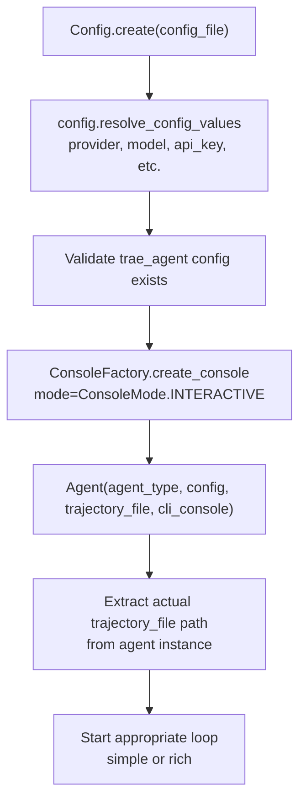

**Key Steps:**
1. **Config Creation**: Load configuration from file path with backward compatibility for JSON format [trae_agent/cli.py:456-467]().
2. **Validation**: Ensure `trae_agent` configuration section exists [trae_agent/cli.py:469-473]().
3. **Console Creation**: Factory creates appropriate console with `ConsoleMode.INTERACTIVE` [trae_agent/cli.py:476-488]().
4. **Agent Instantiation**: Create `Agent` wrapper with configuration and console [trae_agent/cli.py:495]().
5. **Trajectory Path Extraction**: Get the auto-generated trajectory file path if not specified [trae_agent/cli.py:498]().

**Sources:** [trae_agent/cli.py:440-513]()

---

## Session State Management

### Trajectory Recording

Each interactive session creates a trajectory file that accumulates data. The `TrajectoryRecorder` handles serialization of `LLMMessage`, `ToolCall`, and `ToolResult` [trae_agent/utils/trajectory_recorder.py:77-189]().

- **Explicit path**: If `--trajectory-file` is provided, that path is used [trae_agent/cli.py:441]().
- **Auto-generated**: If not provided, a timestamped file is created [trae_agent/utils/trajectory_recorder.py:29-31]().

**Sources:** [trae_agent/cli.py:498](), [trae_agent/utils/trajectory_recorder.py:20-51]()

### Agent Context Persistence

The `Agent` instance persists across all tasks in the session. This means:
- Tool initialization happens once at session start.
- LLM client connections are maintained.
- Configuration remains constant.

**Sources:** [trae_agent/cli.py:495-513](), [trae_agent/cli.py:516-596]()

---

## Error Handling

Interactive Mode implements multiple error handling strategies to maintain session continuity:

### Keyboard Interrupts
- **During task execution**: Displays warning message and continues session [trae_agent/cli.py:588-589]().

### EOF Errors
- **Trigger**: User presses Ctrl+D or input stream closes.
- **Behavior**: Gracefully exits with "Goodbye!" message [trae_agent/cli.py:590-592]().

### General Exceptions
- **Simple console**: Displays error message and continues to next prompt [trae_agent/cli.py:593-595]().
- **Rich console**: Errors are logged to the `RichLog` widget [trae_agent/utils/cli/rich_console.py:188-189]().

**Sources:** [trae_agent/cli.py:524-596](), [trae_agent/utils/cli/rich_console.py:187-191]()

---

# Page: Docker Mode

# Docker Mode

<details>
<summary>Relevant source files</summary>

The following files were used as context for generating this wiki page:

- [tests/test_cli.py](tests/test_cli.py)
- [trae_agent/agent/agent.py](trae_agent/agent/agent.py)
- [trae_agent/agent/docker_manager.py](trae_agent/agent/docker_manager.py)
- [trae_agent/cli.py](trae_agent/cli.py)
- [trae_agent/dist/dist_tools/edit_tool](trae_agent/dist/dist_tools/edit_tool)
- [trae_agent/dist/dist_tools/json_edit_tool](trae_agent/dist/dist_tools/json_edit_tool)
- [trae_agent/tools/docker_tool_executor.py](trae_agent/tools/docker_tool_executor.py)
- [trae_agent/tools/edit_tool_cli.py](trae_agent/tools/edit_tool_cli.py)
- [trae_agent/tools/json_edit_tool_cli.py](trae_agent/tools/json_edit_tool_cli.py)

</details>


## Purpose and Scope

This document covers Docker Mode in Trae Agent, which provides isolated execution environments for tool operations. Docker Mode enables tasks to run inside Docker containers for reproducibility, security, and environment consistency. 

For general agent architecture, see [Agent System](). For detailed tool documentation, see [Tools Reference]().

## Overview

Docker Mode isolates tool execution within Docker containers, providing:

- **Environment Isolation**: Tools run in containerized environments separate from the host.
- **Reproducibility**: Consistent execution environments across different machines.
- **Security**: Potentially unsafe code executes in sandboxed containers.
- **Workspace Mounting**: Host directories can be mounted into containers for file access.

When Docker Mode is enabled, specific tools (by default: `bash`, `str_replace_based_edit_tool`, `json_edit_tool`) execute inside the container while other tools run on the host.

**Sources**: [trae_agent/cli.py:144-175](), [trae_agent/agent/docker_manager.py:10-14]()

## Enabling Docker Mode

Docker Mode is enabled by providing one of four mutually exclusive CLI options:

| Option | Description | Example |
|--------|-------------|---------|
| `--docker-image` | Specify a Docker image to pull/use | `--docker-image python:3.12` |
| `--docker-container-id` | Attach to existing container | `--docker-container-id 91998a56056c` |
| `--dockerfile-path` | Build from a Dockerfile | `--dockerfile-path /path/to/Dockerfile` |
| `--docker-image-file` | Load from tar archive | `--docker-image-file image.tar` |

### CLI Examples

```bash
# Use a pre-built Docker image
trae-cli run "Add tests" --docker-image python:3.11

# Mount workspace directory
trae-cli run "write a script" --docker-image python:3.12 --working-dir test_workdir/

# Attach to existing container
trae-cli run "Update API" --docker-container-id 91998a56056c

# Build from Dockerfile
trae-cli run "Debug auth" --dockerfile-path /abs/path/Dockerfile

# Load from tar file
trae-cli run "Fix bug" --docker-image-file custom_image.tar

# Control container cleanup
trae-cli run "Add tests" --docker-image python:3.11 --docker-keep false
```

**Sources**: [trae_agent/cli.py:144-175]()

## Architecture Overview

The following diagram maps the high-level Docker integration to the specific classes and files in the codebase.

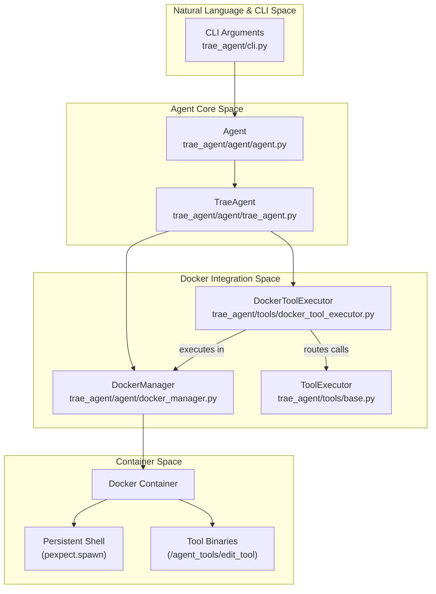

**Docker Mode Architecture**: Shows how CLI arguments flow through the agent system to initialize `DockerManager` and `DockerToolExecutor`.

**Sources**: [trae_agent/cli.py:207-213](), [trae_agent/agent/agent.py:45-47](), [trae_agent/tools/docker_tool_executor.py:9-28]()

## Container Specification Methods

Docker Mode supports four methods for specifying containers, handled in `DockerManager.__init__` [trae_agent/agent/docker_manager.py:18-44]():

### 1. Docker Image (`--docker-image`)
Pulls an existing image and creates a new container. If `workspace_dir` is provided, it is mounted to `/workspace` in `rw` mode [trae_agent/agent/docker_manager.py:93-98]().

### 2. Container ID (`--docker-container-id`)
Attaches to an existing running container. Sets `_is_managed = False` so the container is not destroyed on exit [trae_agent/agent/docker_manager.py:84-88]().

### 3. Dockerfile Path (`--dockerfile-path`)
Builds a new image from a local Dockerfile with a unique tag `trae-agent-custom:{uuid}` [trae_agent/agent/docker_manager.py:48-68]().

### 4. Docker Image File (`--docker-image-file`)
Loads an image from a local `.tar` archive using `client.images.load()` [trae_agent/agent/docker_manager.py:70-82]().

**Sources**: [trae_agent/agent/docker_manager.py:45-121]()

## DockerManager Lifecycle

```mermaid
sequenceDiagram
    participant Agent as Agent/TraeAgent
    participant DM as DockerManager
    participant DClient as docker.from_env()
    participant Shell as pexpect.spawn

    Agent->>DM: start()
    alt build from dockerfile
        DM->>DClient: images.build()
    else load from tar
        DM->>DClient: images.load()
    end

    DM->>DClient: containers.run("sleep infinity")
    DM->>DM: _copy_tools_to_container()
    DM->>Shell: _start_persistent_shell()
    
    Note over DM, Shell: docker exec -it /bin/bash

    loop Execution
        Agent->>DM: execute(command)
        DM->>Shell: sendline(command)
        Shell-->>DM: output + exit_code
    end

    Agent->>DM: stop()
    DM->>Shell: close(force=True)
    alt is_managed
        DM->>DClient: container.stop()
        DM->>DClient: container.remove()
    end
```

**DockerManager Lifecycle**: Illustrates the initialization, command execution loop via `pexpect`, and cleanup logic.

**Sources**: [trae_agent/agent/docker_manager.py:45-159]()

### Key Lifecycle Methods

- **`start()`**: Handles image preparation, container creation, tool injection, and shell initialization [trae_agent/agent/docker_manager.py:45-127]().
- **`execute(command, timeout)`**: Uses `_execute_interactive` to send commands to the persistent bash session and capture output using a marker `---CMD_DONE---$?` to extract the exit code [trae_agent/agent/docker_manager.py:128-139]().
- **`stop()`**: Terminates the shell and cleans up the container if it was created by the agent (`_is_managed`) [trae_agent/agent/docker_manager.py:140-159]().

## Tool Execution Routing

The `DockerToolExecutor` routes tool calls based on whether the tool name exists in `_docker_tools_set` [trae_agent/tools/docker_tool_executor.py:61-68]().

```mermaid
graph TD
    subgraph "DockerToolExecutor.sequential_tool_call"
        Call["ToolCall"]
        Check{"In docker_tools_set?"}
        Local["OriginalExecutor.sequential_tool_call"]
        Docker["_execute_in_docker"]
    end

    subgraph "_execute_in_docker"
        Translate["_translate_path(args['path'])"]
        Build["Build Command String"]
        DMExec["DockerManager.execute()"]
    end

    Call --> Check
    Check -->|No| Local
    Check -->|Yes| Docker
    Docker --> Translate
    Translate --> Build
    Build --> DMExec
```

**Tool Execution Routing**: Shows the decision logic and path translation step for Docker-bound tools.

**Sources**: [trae_agent/tools/docker_tool_executor.py:57-81]()

### Command Building Logic

The `_execute_in_docker` method translates high-level tool calls into CLI commands executed inside the container:

- **Bash**: Directly executes the provided `command` string [trae_agent/tools/docker_tool_executor.py:97-101]().
- **Edit Tool (`str_replace_based_edit_tool`)**: Invokes the binary at `/agent_tools/edit_tool` with arguments like `--path`, `--old_str`, and `--new_str` [trae_agent/tools/docker_tool_executor.py:104-125]().
- **JSON Edit Tool (`json_edit_tool`)**: Invokes the binary at `/agent_tools/json_edit_tool`, serializing the `value` argument to a JSON string [trae_agent/tools/docker_tool_executor.py:127-142]().

**Sources**: [trae_agent/tools/docker_tool_executor.py:94-155]()

## Path Translation

To ensure the agent can interact with files regardless of the environment, `DockerToolExecutor` performs path translation [trae_agent/tools/docker_tool_executor.py:35-47]().

If a host workspace is configured, it identifies if the provided path is within that workspace and converts it to the corresponding container path (default `/workspace`) [trae_agent/tools/docker_tool_executor.py:40-46]().

**Sources**: [trae_agent/tools/docker_tool_executor.py:35-47]()

## Packaged Tool Binaries

Trae Agent uses PyInstaller to package `edit_tool_cli.py` and `json_edit_tool_cli.py` into standalone binaries [trae_agent/cli.py:89-116](). This avoids dependency issues inside the Docker container.

- **`edit_tool`**: Handles `view`, `create`, `str_replace`, and `insert` operations [trae_agent/tools/edit_tool_cli.py:161-170]().
- **`json_edit_tool`**: Handles JSONPath-based edits using `jsonpath_ng` [trae_agent/tools/json_edit_tool_cli.py:127-210]().

These binaries are copied into the container's `/agent_tools` directory during startup [trae_agent/agent/docker_manager.py:162-180]().

**Sources**: [trae_agent/cli.py:89-116](), [trae_agent/agent/docker_manager.py:162-180]()

---

# Page: Architecture

# Architecture

<details>
<summary>Relevant source files</summary>

The following files were used as context for generating this wiki page:

- [README.md](README.md)

</details>


## Purpose and Scope

This document provides a comprehensive overview of Trae Agent's system architecture, design patterns, and component interactions. It explains how the major subsystems work together to enable LLM-based software engineering tasks.

For detailed information on specific subsystems, see:
- Agent execution lifecycle and state management: [Agent System](#4.1)
- Tool framework and execution mechanisms: [Tool System](#4.2)
- Multi-provider LLM abstraction: [LLM Integration](#4.3)
- Container-based execution: [Docker Integration](#4.4)
- External tool discovery: [MCP Integration](#4.5)
- Execution logging and summarization: [Trajectory Recording and Lakeview](#4.6)

## System Overview

Trae Agent follows a layered architecture with clear separation of concerns. The system orchestrates LLM interactions, tool execution, and environment management to solve software engineering tasks autonomously.

### High-Level Architecture

```mermaid
graph TB
    CLI["trae-cli<br/>(cli.py)"]
    Config["Config<br/>(config.py)"]
    
    subgraph "Agent Layer"
        TraeAgent["TraeAgent<br/>(trae_agent.py)"]
        BaseAgent["BaseAgent<br/>(base_agent.py)"]
        AgentExecution["AgentExecution<br/>(agent_basics.py)"]
    end
    
    subgraph "LLM Layer"
        LLMClient["LLMClient<br/>(llm_client.py)"]
        OpenAIClient["OpenAIClient"]
        AnthropicClient["AnthropicClient"]
        OtherClients["...7 providers total"]
    end
    
    subgraph "Tool Layer"
        ToolExecutor["ToolExecutor<br/>(base.py)"]
        DockerToolExecutor["DockerToolExecutor<br/>(docker_tool_executor.py)"]
        BashTool["BashTool<br/>(bash_tool.py)"]
        EditTool["TextEditorTool<br/>(edit_tool.py)"]
        OtherTools["...5+ tools"]
    end
    
    subgraph "Execution Environment"
        DockerManager["DockerManager<br/>(docker_manager.py)"]
        Container["Docker Container"]
    end
    
    subgraph "Observability"
        TrajectoryRecorder["TrajectoryRecorder<br/>(trajectory_recorder.py)"]
        CLIConsole["CLIConsole<br/>(cli.py)"]
    end
    
    CLI --> Config
    CLI --> TraeAgent
    Config --> TraeAgent
    
    TraeAgent --> BaseAgent
    TraeAgent --> AgentExecution
    
    BaseAgent --> LLMClient
    BaseAgent --> ToolExecutor
    BaseAgent --> DockerToolExecutor
    BaseAgent --> TrajectoryRecorder
    BaseAgent --> CLIConsole
    
    LLMClient --> OpenAIClient
    LLMClient --> AnthropicClient
    LLMClient --> OtherClients
    
    ToolExecutor --> BashTool
    ToolExecutor --> EditTool
    ToolExecutor --> OtherTools
    
    DockerToolExecutor --> DockerManager
    DockerToolExecutor --> ToolExecutor
    DockerManager --> Container
    
    TraeAgent -.->|records to| TrajectoryRecorder
    BaseAgent -.->|updates| CLIConsole
```

**Sources:** [trae_agent/agent/trae_agent.py:30-40](), [trae_agent/agent/base_agent.py:24-40](), [trae_agent/agent/docker_manager.py:15-30]()

### Key Components

| Component | File Path | Responsibility |
|-----------|-----------|----------------|
| `TraeAgent` | [trae_agent/agent/trae_agent.py]() | Implements software engineering-specific agent logic, MCP integration |
| `BaseAgent` | [trae_agent/agent/base_agent.py]() | Provides abstract agent execution framework and lifecycle management |
| `LLMClient` | [trae_agent/utils/llm_clients/llm_client.py]() | Abstracts LLM provider interactions via unified interface |
| `ToolExecutor` | [trae_agent/tools/base.py]() | Executes tools locally in the host environment |
| `DockerToolExecutor` | [trae_agent/tools/docker_tool_executor.py]() | Routes tool execution to Docker containers |
| `DockerManager` | [trae_agent/agent/docker_manager.py]() | Manages container lifecycle and persistent shell sessions |
| `TrajectoryRecorder` | [trae_agent/utils/trajectory_recorder.py]() | Records complete execution traces for debugging and analysis |
| `CLIConsole` | [trae_agent/utils/cli.py]() | Provides real-time user feedback during execution |

**Sources:** [trae_agent/agent/trae_agent.py:30-50](), [trae_agent/agent/base_agent.py:24-45](), [trae_agent/agent/docker_manager.py:15-30]()

## Core Design Patterns

### Template Method Pattern

`BaseAgent` implements the template method pattern for task execution. The abstract class defines the execution skeleton while allowing subclasses to customize specific behaviors.

```mermaid
graph TB
    subgraph "BaseAgent Template Methods"
        execute_task["execute_task()<br/>[base_agent.py:147-200]"]
        _run_llm_step["_run_llm_step()<br/>[base_agent.py:209-236]"]
        _finalize_step["_finalize_step()<br/>[base_agent.py:238-244]"]
    end
    
    subgraph "Abstract Methods (Override Required)"
        new_task["new_task()<br/>[base_agent.py:137-145]"]
        cleanup_mcp_clients["cleanup_mcp_clients()<br/>[base_agent.py:280-283]"]
    end
    
    subgraph "Hook Methods (Override Optional)"
        reflect_on_result["reflect_on_result()<br/>[base_agent.py:246-257]"]
        llm_indicates_task_completed["llm_indicates_task_completed()<br/>[base_agent.py:259-270]"]
        _is_task_completed["_is_task_completed()<br/>[base_agent.py:272-274]"]
        task_incomplete_message["task_incomplete_message()<br/>[base_agent.py:276-278]"]
    end
    
    subgraph "TraeAgent Overrides"
        trae_new_task["new_task()<br/>[trae_agent.py:103-154]"]
        trae_cleanup["cleanup_mcp_clients()<br/>[trae_agent.py:252-258]"]
        trae_system_prompt["get_system_prompt()<br/>[trae_agent.py:172-174]"]
        trae_task_completed["llm_indicates_task_completed()<br/>[trae_agent.py:229-233]"]
        trae_is_completed["_is_task_completed()<br/>[trae_agent.py:236-244]"]
        trae_incomplete_msg["task_incomplete_message()<br/>[trae_agent.py:247-249]"]
    end
    
    execute_task --> _run_llm_step
    _run_llm_step --> _finalize_step
    
    new_task -.->|implemented by| trae_new_task
    cleanup_mcp_clients -.->|implemented by| trae_cleanup
    llm_indicates_task_completed -.->|overridden by| trae_task_completed
    _is_task_completed -.->|overridden by| trae_is_completed
    task_incomplete_message -.->|overridden by| trae_incomplete_msg
```

**Sources:** [trae_agent/agent/base_agent.py:24-353](), [trae_agent/agent/trae_agent.py:30-259]()

### Strategy Pattern

The system uses the strategy pattern for tool execution, allowing seamless switching between local and Docker-based execution.

```mermaid
graph LR
    BaseAgent["BaseAgent<br/>[base_agent.py:24]"]
    ToolExecutorInterface["Union[ToolExecutor,<br/>DockerToolExecutor]<br/>[base_agent.py:27]"]
    
    ToolExecutor["ToolExecutor<br/>(Local Strategy)<br/>[base.py]"]
    DockerToolExecutor["DockerToolExecutor<br/>(Docker Strategy)<br/>[docker_tool_executor.py]"]
    
    BaseAgent --> ToolExecutorInterface
    ToolExecutorInterface --> ToolExecutor
    ToolExecutorInterface --> DockerToolExecutor
    
    InitLogic["__init__() logic<br/>[base_agent.py:48-73]"]
    Condition{"docker_config<br/>provided?"}
    
    InitLogic --> Condition
    Condition -->|No| ToolExecutor
    Condition -->|Yes| DockerToolExecutor
```

The strategy is selected during initialization in [trae_agent/agent/base_agent.py:48-73]():

```python
original_tool_executor = ToolExecutor(self._tools)
if docker_config:
    # ... create DockerManager ...
    self._tool_caller = DockerToolExecutor(
        original_executor=original_tool_executor,
        docker_manager=self.docker_manager,
        docker_tools=["bash", "str_replace_based_edit_tool", "json_edit_tool"],
        host_workspace_dir=docker_config.get("workspace_dir"),
        container_workspace_dir=self.docker_manager.container_workspace,
    )
else:
    self._tool_caller = original_tool_executor
```

**Sources:** [trae_agent/agent/base_agent.py:27-73](), [trae_agent/tools/docker_tool_executor.py]()

### Factory Pattern

`LLMClient` uses the factory pattern to instantiate the appropriate provider client based on configuration.

| Provider | Client Class | Module Path |
|----------|--------------|-------------|
| OpenAI | `OpenAIClient` | [trae_agent/utils/llm_clients/openai_client.py]() |
| Anthropic | `AnthropicClient` | [trae_agent/utils/llm_clients/anthropic_client.py]() |
| Google | `GoogleClient` | [trae_agent/utils/llm_clients/google_client.py]() |
| Azure | `AzureClient` | [trae_agent/utils/llm_clients/azure_client.py]() |
| Ollama | `OllamaClient` | [trae_agent/utils/llm_clients/ollama_client.py]() |
| OpenRouter | `OpenRouterClient` | [trae_agent/utils/llm_clients/openrouter_client.py]() |
| Doubao | `DoubaoClient` | [trae_agent/utils/llm_clients/doubao_client.py]() |

**Sources:** [trae_agent/utils/llm_clients/llm_client.py]()

### Registry Pattern

The `tools_registry` dictionary serves as a central registry for tool discovery and instantiation in [trae_agent/tools/__init__.py]():

```python
tools_registry = {
    "bash": BashTool,
    "str_replace_based_edit_tool": TextEditorTool,
    "sequentialthinking": SequentialThinkingTool,
    "task_done": TaskDoneTool,
    "json_edit_tool": JSONEditTool,
    # ... additional tools
}
```

Tools are instantiated by name in [trae_agent/agent/trae_agent.py:117-119]():

```python
self._tools: list[Tool] = [
    tools_registry[tool_name](model_provider=provider) for tool_name in tool_names
]
```

**Sources:** [trae_agent/tools/__init__.py](), [trae_agent/agent/trae_agent.py:117-119]()

## Task Execution Flow

### Complete Execution Lifecycle

```mermaid
sequenceDiagram
    participant User
    participant CLI as "CLI.run()<br/>[cli.py]"
    participant TraeAgent as "TraeAgent<br/>[trae_agent.py]"
    participant BaseAgent as "BaseAgent.execute_task()<br/>[base_agent.py:147]"
    participant LLMClient as "LLMClient.chat()<br/>[llm_client.py]"
    participant ToolExecutor as "ToolExecutor<br/>[base.py]"
    participant Recorder as "TrajectoryRecorder<br/>[trajectory_recorder.py]"
    
    User->>CLI: "trae-cli run 'task'"
    CLI->>TraeAgent: "__init__(config)"
    CLI->>TraeAgent: "initialise_mcp()"
    Note over TraeAgent: Discover MCP tools asynchronously
    CLI->>TraeAgent: "new_task(task, extra_args)"
    TraeAgent->>Recorder: "start_recording()"
    
    CLI->>BaseAgent: "execute_task()"
    Note over BaseAgent: step_number = 1
    
    loop Until max_steps or task complete
        BaseAgent->>BaseAgent: "_run_llm_step()"
        BaseAgent->>LLMClient: "chat(messages, model_config, tools)"
        LLMClient-->>BaseAgent: "LLMResponse with tool_calls"
        
        alt Tool calls present
            BaseAgent->>BaseAgent: "_tool_call_handler()"
            BaseAgent->>ToolExecutor: "sequential_tool_call() or parallel_tool_call()"
            ToolExecutor-->>BaseAgent: "List[ToolResult]"
            BaseAgent->>BaseAgent: "reflect_on_result(tool_results)"
        end
        
        BaseAgent->>BaseAgent: "_finalize_step()"
        BaseAgent->>Recorder: "record_agent_step()"
        
        alt Task completed
            Note over BaseAgent: execution.agent_state = COMPLETED
            BaseAgent->>BaseAgent: "Break loop"
        else Step limit reached
            Note over BaseAgent: step_number > max_steps
            BaseAgent->>BaseAgent: "Set ERROR state"
        end
        
        Note over BaseAgent: step_number += 1
    end
    
    BaseAgent->>TraeAgent: "cleanup_mcp_clients()"
    BaseAgent->>Recorder: "finalize_recording()"
    BaseAgent-->>CLI: "AgentExecution"
    CLI-->>User: "Task result"
```

**Sources:** [trae_agent/agent/base_agent.py:147-200](), [trae_agent/agent/trae_agent.py:103-170](), [trae_agent/utils/cli.py]()

### Step State Machine

Each agent step transitions through defined states tracked in `AgentStepState`:

```mermaid
stateDiagram-v2
    [*] --> THINKING: "Step created<br/>[base_agent.py:164]"
    THINKING --> CALLING_TOOL: "Tool calls received<br/>[base_agent.py:327]"
    CALLING_TOOL --> REFLECTING: "Tool errors detected<br/>[base_agent.py:344]"
    CALLING_TOOL --> COMPLETED: "Tools successful<br/>[base_agent.py:241]"
    REFLECTING --> COMPLETED: "Reflection added<br/>[base_agent.py:241]"
    THINKING --> ERROR: "Exception during step<br/>[base_agent.py:176]"
    CALLING_TOOL --> ERROR: "Tool execution fails"
    COMPLETED --> [*]
    ERROR --> [*]
```

The states are defined in [trae_agent/agent/agent_basics.py]():

| State | Description | File Reference |
|-------|-------------|----------------|
| `THINKING` | Agent is waiting for LLM response | [trae_agent/agent/base_agent.py:213]() |
| `CALLING_TOOL` | Agent is executing tool calls | [trae_agent/agent/base_agent.py:327]() |
| `REFLECTING` | Agent is analyzing tool failures | [trae_agent/agent/base_agent.py:344]() |
| `COMPLETED` | Step finished successfully | [trae_agent/agent/base_agent.py:241]() |
| `ERROR` | Step encountered an error | [trae_agent/agent/base_agent.py:175-177]() |

**Sources:** [trae_agent/agent/agent_basics.py](), [trae_agent/agent/base_agent.py:147-352]()

## Component Interaction Patterns

### Message Flow During Tool Execution

```mermaid
graph TB
    LLMResponse["LLMResponse<br/>(from LLM)"]
    ToolCalls["List[ToolCall]<br/>[llm_basics.py]"]
    
    subgraph "Tool Execution"
        Executor["ToolExecutor or<br/>DockerToolExecutor"]
        ParallelCall["parallel_tool_call()<br/>[base.py]"]
        SequentialCall["sequential_tool_call()<br/>[base.py]"]
    end
    
    ToolResults["List[ToolResult]<br/>[base.py]"]
    
    subgraph "Message Construction"
        UserMessages["List[LLMMessage]<br/>role='user'<br/>tool_result=ToolResult"]
        ReflectionMessage["LLMMessage<br/>role='assistant'<br/>content=reflection"]
    end
    
    NextLLMCall["Next LLM chat() call"]
    
    LLMResponse --> ToolCalls
    ToolCalls --> Executor
    
    Executor --> ParallelCall
    Executor --> SequentialCall
    
    ParallelCall --> ToolResults
    SequentialCall --> ToolResults
    
    ToolResults --> UserMessages
    ToolResults --> ReflectionMessage
    
    UserMessages --> NextLLMCall
    ReflectionMessage --> NextLLMCall
```

The flow is implemented in [trae_agent/agent/base_agent.py:314-352]():

1. **Tool Call Extraction** [trae_agent/agent/base_agent.py:235](): Extract `tool_calls` from `LLMResponse`
2. **Execution Strategy** [trae_agent/agent/base_agent.py:331-334](): Choose parallel or sequential based on `model_config.parallel_tool_calls`
3. **Result Conversion** [trae_agent/agent/base_agent.py:337-340](): Convert `ToolResult` objects to `LLMMessage` objects with `role="user"`
4. **Reflection** [trae_agent/agent/base_agent.py:342-350](): Optionally add reflection message if tool execution failed
5. **Message Return** [trae_agent/agent/base_agent.py:352](): Return messages to be appended to conversation history

**Sources:** [trae_agent/agent/base_agent.py:314-352](), [trae_agent/utils/llm_clients/llm_basics.py](), [trae_agent/tools/base.py]()

### Docker Path Translation

When using Docker mode, `DockerToolExecutor` translates paths between host and container filesystems:

```mermaid
graph LR
    subgraph "Host Environment"
        HostPath["/home/user/project/src/file.py"]
        HostWorkspace["/home/user/project"]
    end
    
    subgraph "DockerToolExecutor<br/>[docker_tool_executor.py]"
        PathTranslation["_translate_paths()<br/>replace host_workspace<br/>with container_workspace"]
    end
    
    subgraph "Container Environment"
        ContainerWorkspace["/workspace"]
        ContainerPath["/workspace/src/file.py"]
    end
    
    HostPath --> PathTranslation
    HostWorkspace -.->|mapping| PathTranslation
    ContainerWorkspace -.->|mapping| PathTranslation
    PathTranslation --> ContainerPath
    
    ContainerPath --> Tool["Tool executes<br/>in container"]
    Tool --> ResultPath["/workspace/output.txt"]
    ResultPath --> ReverseTranslation["_reverse_translate_paths()"]
    ReverseTranslation --> HostResult["/home/user/project/output.txt"]
```

**Sources:** [trae_agent/tools/docker_tool_executor.py](), [trae_agent/agent/docker_manager.py:40]()

### MCP Tool Discovery

MCP (Model Context Protocol) integration enables dynamic tool discovery from external servers:

```mermaid
graph TB
    subgraph "Configuration<br/>[config.py]"
        MCPServersConfig["mcp_servers_config:<br/>Dict[str, MCPServerConfig]"]
        AllowList["allow_mcp_servers:<br/>List[str]"]
    end
    
    subgraph "TraeAgent Initialization<br/>[trae_agent.py:65-100]"
        InitMCP["initialise_mcp()"]
        DiscoverLoop["Loop over configured servers"]
        Filter{"Server in<br/>allow_list?"}
    end
    
    subgraph "MCP Client<br/>[mcp_client.py]"
        MCPClient["MCPClient"]
        Connect["connect_and_discover()"]
        ListTools["List available tools"]
        ConvertTools["Convert to Tool objects"]
    end
    
    MCPToolsList["mcp_tools: List[Tool]<br/>[trae_agent.py:58]"]
    RegisteredTools["_tools.extend(mcp_tools)<br/>[trae_agent.py:70]"]
    
    MCPServersConfig --> InitMCP
    AllowList --> InitMCP
    InitMCP --> DiscoverLoop
    DiscoverLoop --> Filter
    
    Filter -->|Yes| MCPClient
    Filter -->|No| Skip["Skip server"]
    
    MCPClient --> Connect
    Connect --> ListTools
    ListTools --> ConvertTools
    ConvertTools --> MCPToolsList
    
    MCPToolsList --> RegisteredTools
```

The discovery happens asynchronously in [trae_agent/agent/trae_agent.py:65-100]():

```python
async def initialise_mcp(self):
    """Async factory to create and initialize TraeAgent."""
    await self.discover_mcp_tools()
    if self.mcp_tools:
        self._tools.extend(self.mcp_tools)
```

**Sources:** [trae_agent/agent/trae_agent.py:65-100](), [trae_agent/utils/mcp_client.py](), [trae_agent/utils/config.py]()

## Configuration and Extension Points

### Configuration Hierarchy

Configuration flows through multiple layers with clear override semantics:

```mermaid
graph TB
    subgraph "Configuration Sources"
        CLIArgs["CLI Arguments<br/>--provider, --model"]
        YAMLFile["trae_config.yaml"]
        EnvVars["Environment Variables<br/>OPENAI_API_KEY"]
        Defaults["Built-in Defaults"]
    end
    
    subgraph "Config Object Graph<br/>[config.py]"
        Config["Config"]
        ModelProviders["model_providers:<br/>Dict[str, ModelProvider]"]
        Models["models:<br/>Dict[str, ModelConfig]"]
        TraeAgentConfig["trae_agent:<br/>TraeAgentConfig"]
        MCPServers["mcp_servers:<br/>Dict[str, MCPServerConfig]"]
    end
    
    subgraph "Runtime Objects"
        TraeAgent["TraeAgent instance"]
        LLMClient["LLMClient instance"]
        Tools["Tool instances"]
    end
    
    CLIArgs -->|highest priority| Config
    YAMLFile -->|medium priority| Config
    EnvVars -->|low priority| Config
    Defaults -->|fallback| Config
    
    Config --> ModelProviders
    Config --> Models
    Config --> TraeAgentConfig
    Config --> MCPServers
    
    Models -.->|references| ModelProviders
    TraeAgentConfig -.->|references| Models
    
    TraeAgentConfig --> TraeAgent
    Models --> LLMClient
    TraeAgentConfig --> Tools
```

The priority order is:
1. **CLI Arguments** - Highest priority, used for quick overrides [README.md:123]()
2. **YAML File** - Primary configuration source [README.md:44-81]()
3. **Environment Variables** - For secrets and deployment-specific values [README.md:94-109]()
4. **Defaults** - Fallback values built into the code [README.md:123]()

**Sources:** [trae_agent/utils/config.py](), [trae_agent/utils/cli.py](), [README.md:123]()

### Extension Points

The architecture provides several extension points for customization:

| Extension Point | Interface/Base Class | Purpose | Example |
|-----------------|---------------------|---------|---------|
| **Custom Agent** | `BaseAgent` | Implement domain-specific agent logic | `TraeAgent` extends for software engineering |
| **Custom Tool** | `Tool` | Add new capabilities | Bash, Edit, Sequential Thinking tools |
| **Custom LLM Provider** | Abstract LLM client interface | Support new LLM APIs | Doubao, Ollama implementations |
| **Custom Console** | `CLIConsole` | Change user feedback mechanism | Rich TUI vs Simple console |
| **MCP Servers** | MCP protocol | Add external tools dynamically | Playwright, filesystem servers |

Each extension point is documented in detail in its respective subsection page.

**Sources:** [trae_agent/agent/base_agent.py](), [trae_agent/tools/base.py](), [trae_agent/utils/llm_clients/](), [trae_agent/utils/cli.py]()

## Summary

The Trae Agent architecture achieves flexibility and maintainability through:

- **Layered Design**: Clear separation between agent logic, LLM integration, tool execution, and environment management.
- **Design Patterns**: Template method, strategy, factory, and registry patterns enable extensibility.
- **Abstraction**: Abstract base classes allow swapping implementations (e.g., different LLM providers, execution environments).
- **Configuration**: Hierarchical configuration system supports multiple deployment scenarios.
- **Observability**: Built-in trajectory recording and console feedback support debugging and analysis.

For detailed information on each subsystem, refer to the child pages: [Agent System](#4.1), [Tool System](#4.2), [LLM Integration](#4.3), [Docker Integration](#4.4), [MCP Integration](#4.5), and [Trajectory Recording and Lakeview](#4.6).

---

# Page: Agent System

# Agent System

<details>
<summary>Relevant source files</summary>

The following files were used as context for generating this wiki page:

- [.github/workflows/pre-commit.yml](.github/workflows/pre-commit.yml)
- [.github/workflows/unit-test.yml](.github/workflows/unit-test.yml)
- [Makefile](Makefile)
- [tests/agent/test_trae_agent.py](tests/agent/test_trae_agent.py)
- [trae_agent/agent/agent_basics.py](trae_agent/agent/agent_basics.py)
- [trae_agent/agent/base_agent.py](trae_agent/agent/base_agent.py)
- [trae_agent/agent/trae_agent.py](trae_agent/agent/trae_agent.py)

</details>


## Purpose and Scope

The Agent System provides the core orchestration framework for LLM-based software engineering tasks in `trae-agent`. This system manages the complete lifecycle of agent execution, from task initialization through iterative LLM interactions to completion. It handles state management, tool coordination, and execution environments. [trae_agent/agent/trae_agent.py:4-31]()

For information about the underlying tool framework, see [Tool System](#4.2). For LLM integration details, see [LLM Integration](#4.3). For Docker execution specifics, see [Docker Integration](#4.4).

## Architecture Overview

The agent system follows a layered architecture with clear separation between abstract framework, concrete implementations, and execution environments:

Title: Agent Architecture Layers
```mermaid
graph TB
    subgraph "Agent Factory Layer"
        AgentFactory["Agent"]
        AgentType["AgentType.TraeAgent"]
    end
    
    subgraph "Core Agent Framework"
        BaseAgent["BaseAgent<br/>Abstract Framework"]
        TraeAgent["TraeAgent<br/>Software Engineering Agent"]
        AgentExecution["AgentExecution<br/>Execution State"]
        AgentStep["AgentStep<br/>Step State"]
    end
    
    subgraph "Execution Components"
        ToolExecutor["ToolExecutor<br/>Local Execution"]
        DockerToolExecutor["DockerToolExecutor<br/>Container Execution"]
        DockerManager["DockerManager<br/>Container Lifecycle"]
    end
    
    subgraph "External Integrations"
        LLMClient["LLMClient"]
        TrajectoryRecorder["TrajectoryRecorder"]
        CLIConsole["CLIConsole"]
        MCPClient["MCPClient"]
    end
    
    AgentFactory --> TraeAgent
    AgentType --> AgentFactory
    TraeAgent --> BaseAgent
    BaseAgent --> AgentExecution
    AgentExecution --> AgentStep
    
    BaseAgent --> ToolExecutor
    BaseAgent --> DockerToolExecutor
    DockerToolExecutor --> DockerManager
    
    BaseAgent --> LLMClient
    BaseAgent --> TrajectoryRecorder
    BaseAgent --> CLIConsole
    TraeAgent --> MCPClient
```
**Sources:** [trae_agent/agent/base_agent.py:24-82](), [trae_agent/agent/trae_agent.py:30-64](), [trae_agent/agent/agent_basics.py:19-81]()

## Core Classes and Relationships

### BaseAgent Framework

The `BaseAgent` class provides the abstract foundation for all agent implementations, managing the `LLMClient`, `ToolExecutor`, and execution loop. [trae_agent/agent/base_agent.py:24-29]()

| Component | Type | Purpose |
|-----------|------|---------|
| `BaseAgent` | Abstract Class | Core execution framework and lifecycle management [trae_agent/agent/base_agent.py:24]() |
| `AgentExecution` | State Container | Tracks overall execution progress and results [trae_agent/agent/agent_basics.py:67]() |
| `AgentStep` | State Container | Represents individual execution steps with LLM interactions [trae_agent/agent/agent_basics.py:39]() |
| `AgentStepState` | Enum | Step states: `THINKING`, `CALLING_TOOL`, `REFLECTING`, `COMPLETED`, `ERROR` [trae_agent/agent/agent_basics.py:19]() |
| `AgentState` | Enum | Execution states: `IDLE`, `RUNNING`, `COMPLETED`, `ERROR` [trae_agent/agent/agent_basics.py:29]() |

Title: Class Relationship Diagram
```mermaid
classDiagram
    class BaseAgent {
        <<abstract>>
        +_llm_client: LLMClient
        +_tools: list[Tool]
        +_tool_caller: ToolExecutor|DockerToolExecutor
        +new_task(task, extra_args)*
        +execute_task() AgentExecution
        +_run_llm_step(step, messages, execution)
        +llm_indicates_task_completed(response) bool
        +_is_task_completed(response) bool
    }
    
    class TraeAgent {
        +project_path: str
        +mcp_tools: list[Tool]
        +mcp_clients: list[MCPClient]
        +new_task(task, extra_args, tool_names)
        +execute_task() AgentExecution
        +get_system_prompt() str
        +discover_mcp_tools()
    }
    
    class AgentExecution {
        +task: str
        +steps: list[AgentStep]
        +agent_state: AgentState
        +success: bool
        +final_result: str
        +execution_time: float
        +total_tokens: LLMUsage
    }
    
    class AgentStep {
        +step_number: int
        +state: AgentStepState
        +llm_response: LLMResponse
        +tool_calls: list[ToolCall]
        +tool_results: list[ToolResult]
        +reflection: str
        +error: str
    }
    
    BaseAgent <|-- TraeAgent
    BaseAgent --> AgentExecution
    AgentExecution --> AgentStep
```
**Sources:** [trae_agent/agent/base_agent.py:24-147](), [trae_agent/agent/agent_basics.py:19-81](), [trae_agent/agent/trae_agent.py:30-170]()

## Task Execution Lifecycle

### Task Initialization

Task initialization occurs through the `new_task()` method in `TraeAgent`, which sets up the execution context, project path, and toolset. [trae_agent/agent/trae_agent.py:103-109]()

Title: Task Initialization Flow
```mermaid
flowchart TD
    start["TraeAgent.new_task(task, extra_args, tool_names)"] --> validate{"extra_args validation"}
    validate -->|Missing| error["raise AgentError('Project path required')"]
    validate -->|Valid| extract["Extract: project_path, issue, base_commit, must_patch, patch_path"]
    
    extract --> tools{"tool_names provided?"}
    tools -->|No| default["Use TraeAgentToolNames<br/>+ tools_registry lookup"]
    tools -->|Yes| custom["Use provided tool_names"]
    
    default --> init_tools["Initialize Tool instances<br/>Pass model_provider to each"]
    custom --> init_tools
    
    init_tools --> messages["Build _initial_messages list"]
    messages --> system["Add system message:<br/>get_system_prompt() -> TRAE_AGENT_SYSTEM_PROMPT"]
    system --> user["Add user message:<br/>project_path + issue"]
    
    user --> recorder{"_trajectory_recorder set?"}
    recorder -->|Yes| start_rec["trajectory_recorder.start_recording()<br/>Pass: task, provider, model, max_steps"]
    recorder -->|No| ready
    start_rec --> ready["Task Ready for Execution"]
```

The `TraeAgentToolNames` constant defines the default tool set for software engineering tasks:
- `str_replace_based_edit_tool`
- `sequentialthinking`
- `json_edit_tool`
- `task_done`
- `bash`
[trae_agent/agent/trae_agent.py:21-27]()

**Sources:** [trae_agent/agent/trae_agent.py:103-154](), [trae_agent/agent/base_agent.py:42-45]()

### Execution Loop

The main execution loop in `BaseAgent.execute_task()` implements an iterative LLM interaction pattern until completion or max steps are reached. [trae_agent/agent/base_agent.py:147-163]()

Title: Main Execution Loop
```mermaid
flowchart TD
    start["BaseAgent.execute_task()"] --> docker_start{"self.docker_manager exists?"}
    docker_start -->|Yes| dm_start["docker_manager.start()"]
    docker_start -->|No| init_exec
    dm_start --> init_exec["execution = AgentExecution(task, steps=[])"]
    
    init_exec --> loop_start["step_number = 1<br/>execution.agent_state = RUNNING"]
    
    loop_start --> step_create["step = AgentStep(step_number)<br/>step.state = THINKING"]
    step_create --> try_block["try:"]
    try_block --> llm_step["messages = _run_llm_step(step, messages, execution)"]
    
    llm_step --> finalize_call["_finalize_step(step, messages, execution)"]
    finalize_call --> state_check{"execution.agent_state == COMPLETED?"}
    state_check -->|Yes| break_loop["break"]
    state_check -->|No| increment["step_number++"]
    
    try_block --> except_block["except Exception:"]
    except_block --> error_state["execution.agent_state = ERROR<br/>step.state = ERROR<br/>step.error = str(error)"]
    error_state --> error_finalize["_finalize_step(step, messages, execution)"]
    error_finalize --> break_loop
    
    increment --> max_check{"step_number > _max_steps?"}
    max_check -->|Yes| max_exceeded["execution.agent_state = ERROR<br/>final_result = 'exceeded maximum steps'"]
    max_check -->|No| step_create
    
    break_loop --> finally_block["finally:"]
    max_exceeded --> finally_block
    
    finally_block --> docker_stop{"docker_manager exists AND not docker_keep?"}
    docker_stop -->|Yes| dm_stop["docker_manager.stop()"]
    docker_stop -->|No| close_tools
    dm_stop --> close_tools["_close_tools()"]
    
    close_tools --> cleanup_mcp["cleanup_mcp_clients()"]
    cleanup_mcp --> console_update["_update_cli_console(step, execution)"]
    console_update --> result["return execution"]
```
**Sources:** [trae_agent/agent/base_agent.py:147-201]()

### Task Completion Detection

`TraeAgent` overrides the base completion detection to verify that a valid patch has been generated if `must_patch` is set. [trae_agent/agent/trae_agent.py:229-249]()

| Method | Purpose | Implementation Details |
|--------|---------|----------------------|
| `llm_indicates_task_completed()` | Detects completion signals | Checks if any `tool_call.name == "task_done"` in `llm_response.tool_calls`. [trae_agent/agent/trae_agent.py:229]() |
| `_is_task_completed()` | Validates actual completion | If `must_patch == "true"`: calls `get_git_diff()`, applies `remove_patches_to_tests()`, verifies patch is non-empty. [trae_agent/agent/trae_agent.py:240]() |
| `get_git_diff()` | Generates patch | Executes `git --no-pager diff` in project directory. [trae_agent/agent/trae_agent.py:180]() |

Title: Completion Verification Flow
```mermaid
flowchart TD
    start["llm_indicates_task_completed()"] --> check_calls{"llm_response.tool_calls is None?"}
    check_calls -->|Yes| return_false["return False"]
    check_calls -->|No| search["Search for tool_call.name == 'task_done'"]
    search --> found{"Found?"}
    found -->|Yes| is_complete["_is_task_completed()"]
    found -->|No| return_false
    
    is_complete --> must_patch{"self.must_patch == 'true'?"}
    must_patch -->|No| return_true["return True"]
    must_patch -->|Yes| git_diff["model_patch = get_git_diff()"]
    git_diff --> filter["patch = remove_patches_to_tests(model_patch)"]
    filter --> empty_check{"patch.strip() is empty?"}
    empty_check -->|Yes| return_false
    empty_check -->|No| return_true
```
**Sources:** [trae_agent/agent/trae_agent.py:180-249](), [tests/agent/test_trae_agent.py:89-98]()

## State Management

### AgentExecution State

The `AgentExecution` object tracks the complete execution lifecycle. [trae_agent/agent/agent_basics.py:67-82]()

Title: Execution State Machine
```mermaid
stateDiagram-v2
    [*] --> RUNNING: execute_task()
    RUNNING --> COMPLETED: Task completed successfully
    RUNNING --> ERROR: Max steps exceeded
    RUNNING --> ERROR: Exception occurred
    COMPLETED --> [*]: Return execution
    ERROR --> [*]: Return execution
    
    state RUNNING {
        [*] --> StepExecution
        StepExecution --> StepExecution: Continue steps
        StepExecution --> [*]: Completion detected
    }
```

### AgentStep State Transitions

Individual steps follow a defined state progression within the loop. [trae_agent/agent/agent_basics.py:19-27]()

Title: Step State Machine
```mermaid
stateDiagram-v2
    [*] --> THINKING: Create step
    THINKING --> CALLING_TOOL: Tool calls present
    THINKING --> COMPLETED: No tools needed
    CALLING_TOOL --> REFLECTING: Tool execution complete + reflection needed
    CALLING_TOOL --> COMPLETED: Tool execution complete
    REFLECTING --> COMPLETED: Reflection added
    THINKING --> ERROR: Exception
    CALLING_TOOL --> ERROR: Exception
    REFLECTING --> ERROR: Exception
    COMPLETED --> [*]: Step finalized
    ERROR --> [*]: Step finalized
```
**Sources:** [trae_agent/agent/agent_basics.py:19-82](), [trae_agent/agent/base_agent.py:147-201]()

## Docker Integration

The agent system supports containerized tool execution through `DockerToolExecutor` and `DockerManager`. [trae_agent/agent/base_agent.py:49-71]()

Title: Docker Tool Execution Mapping
```mermaid
graph TB
    subgraph "Natural Language Space"
        Request["'Run bash command in sandbox'"]
    end

    subgraph "Code Entity Space"
        BaseAgent["BaseAgent (trae_agent/agent/base_agent.py)"]
        DTE["DockerToolExecutor (trae_agent/tools/docker_tool_executor.py)"]
        DM["DockerManager (trae_agent/agent/docker_manager.py)"]
        Tool["BashTool (trae_agent/tools/bash.py)"]
    end

    Request --> BaseAgent
    BaseAgent -- "uses" --> DTE
    DTE -- "orchestrates" --> DM
    DTE -- "wraps" --> Tool
```

**Sources:** [trae_agent/agent/base_agent.py:49-74](), [trae_agent/tools/docker_tool_executor.py:16-65]()

## MCP Integration

`TraeAgent` supports Model Context Protocol (MCP) for external tool discovery. [trae_agent/agent/trae_agent.py:65-71]()

Title: MCP Tool Discovery Flow
```mermaid
flowchart TD
    start["discover_mcp_tools()"] --> check_config{"self.mcp_servers_config exists?"}
    check_config -->|No| return_empty["return"]
    check_config -->|Yes| loop_start["for mcp_server_name, mcp_server_config"]
    
    loop_start --> check_allow{"allow_mcp_servers is None?"}
    check_allow -->|Yes| return_empty
    check_allow -->|No| in_list{"mcp_server_name in allow_mcp_servers?"}
    in_list -->|No| continue["continue to next server"]
    
    in_list -->|Yes| create_client["mcp_client = MCPClient()"]
    create_client --> try_connect["try:"]
    try_connect --> connect["await mcp_client.connect_and_discover(<br/>mcp_server_name,<br/>mcp_server_config,<br/>self.mcp_tools,<br/>self._llm_client.provider.value)"]
    
    connect --> success["mcp_clients.append(mcp_client)"]
    success --> loop_start
    
    try_connect --> except_block["except Exception / asyncio.CancelledError:"]
    except_block --> cleanup["await mcp_client.cleanup(mcp_server_name)"]
    cleanup --> continue
```
**Sources:** [trae_agent/agent/trae_agent.py:72-101]()

## Integration Points

### External System Integration

The agent system integrates with several external components:

| Component | Purpose | Integration Point |
|-----------|---------|------------------|
| `LLMClient` | AI model communication | `BaseAgent._llm_client` [trae_agent/agent/base_agent.py:37]() |
| `TrajectoryRecorder` | Execution logging | `BaseAgent._trajectory_recorder` [trae_agent/agent/base_agent.py:78]() |
| `CLIConsole` | Progress display | `BaseAgent._cli_console` [trae_agent/agent/base_agent.py:75]() |
| `ToolExecutor` | Tool coordination | `BaseAgent._tool_caller` [trae_agent/agent/base_agent.py:73]() |
| `MCPClient` | External tool discovery | `TraeAgent.mcp_clients` [trae_agent/agent/trae_agent.py:59]() |

**Sources:** [trae_agent/agent/base_agent.py:37-82](), [trae_agent/agent/trae_agent.py:52-63]()

---

# Page: Tool System

# Tool System

<details>
<summary>Relevant source files</summary>

The following files were used as context for generating this wiki page:

- [tests/tools/test_bash_tool.py](tests/tools/test_bash_tool.py)
- [trae_agent/agent/agent.py](trae_agent/agent/agent.py)
- [trae_agent/dist/dist_tools/edit_tool](trae_agent/dist/dist_tools/edit_tool)
- [trae_agent/dist/dist_tools/json_edit_tool](trae_agent/dist/dist_tools/json_edit_tool)
- [trae_agent/tools/__init__.py](trae_agent/tools/__init__.py)
- [trae_agent/tools/base.py](trae_agent/tools/base.py)
- [trae_agent/tools/bash_tool.py](trae_agent/tools/bash_tool.py)
- [trae_agent/tools/docker_tool_executor.py](trae_agent/tools/docker_tool_executor.py)
- [trae_agent/tools/edit_tool.py](trae_agent/tools/edit_tool.py)
- [trae_agent/tools/edit_tool_cli.py](trae_agent/tools/edit_tool_cli.py)
- [trae_agent/tools/json_edit_tool_cli.py](trae_agent/tools/json_edit_tool_cli.py)
- [trae_agent/tools/run.py](trae_agent/tools/run.py)
- [trae_agent/tools/sequential_thinking_tool.py](trae_agent/tools/sequential_thinking_tool.py)
- [trae_agent/tools/task_done_tool.py](trae_agent/tools/task_done_tool.py)
- [trae_agent/utils/cli/simple_console.py](trae_agent/utils/cli/simple_console.py)
- [trae_agent/utils/mcp_client.py](trae_agent/utils/mcp_client.py)

</details>


## Purpose and Scope

The Tool System is the core mechanism that enables the trae-agent to interact with external systems and perform concrete actions during task execution. It provides a standardized framework for registering, discovering, and executing tools that can perform operations such as running shell commands, editing files, structured data manipulation, and reasoning tasks.

The system supports both built-in tools (implemented directly in the codebase) and external tools discovered through the Model Context Protocol (MCP). This hybrid approach allows the agent to leverage both curated, high-performance tools and dynamically discovered external capabilities. Furthermore, it supports execution in isolated environments via the `DockerToolExecutor`.

For information about how tools are integrated into the agent's execution loop, see [Agent System](4.1). For detailed documentation of individual tools and their usage, see [Tools Reference](5).

## Architecture Overview

The Tool System follows a registry-based architecture where tools are registered by name and executed through a centralized `ToolExecutor` or a specialized `DockerToolExecutor`.

### Tool System Architecture

```mermaid
graph TB
    subgraph "Tool Registry and Discovery"
        tools_registry["tools_registry<br/>dict[str, type[Tool]]<br/>trae_agent/tools/__init__.py:27-34"]
        MCPClient["MCPClient<br/>trae_agent/utils/mcp_client.py:26-104"]
        MCPDiscovery["MCP Tool Discovery<br/>connect_and_discover()"]
    end
    
    subgraph "Base Framework"
        Tool["Tool<br/>Abstract Base Class<br/>trae_agent/tools/base.py:74-180"]
        ToolExecutor["ToolExecutor<br/>trae_agent/tools/base.py:182-244"]
        DockerToolExecutor["DockerToolExecutor<br/>trae_agent/tools/docker_tool_executor.py:9-163"]
        ToolParameter["ToolParameter<br/>trae_agent/tools/base.py:63-72"]
    end
    
    subgraph "Built-in Tools"
        BashTool["BashTool<br/>trae_agent/tools/bash_tool.py:162-247<br/>name: 'bash'"]
        TextEditorTool["TextEditorTool<br/>trae_agent/tools/edit_tool.py:27-285<br/>name: 'str_replace_based_edit_tool'"]
        JSONEditTool["JSONEditTool<br/>trae_agent/tools/json_edit_tool_cli.py:49-184<br/>name: 'json_edit_tool'"]
        SequentialThinkingTool["SequentialThinkingTool<br/>trae_agent/tools/sequential_thinking_tool.py:32-212<br/>name: 'sequentialthinking'"]
        TaskDoneTool["TaskDoneTool<br/>trae_agent/tools/task_done_tool.py:14-53<br/>name: 'task_done'"]
        CKGTool["CKGTool<br/>trae_agent/tools/ckg_tool.py<br/>name: 'ckg'"]
    end
    
    subgraph "External Tools"
        MCPTool["MCPTool<br/>Dynamic MCP Wrappers"]
        ExternalMCPServers["External MCP Servers<br/>Playwright, etc."]
    end
    
    subgraph "Execution Pipeline"
        execute_tool_call["execute_tool_call()<br/>trae_agent/tools/base.py:205-236"]
        docker_execute["_execute_in_docker()<br/>trae_agent/tools/docker_tool_executor.py:77-163"]
    end
    
    subgraph "Data Flow"
        ToolCall["ToolCall<br/>trae_agent/tools/base.py:49-60"]
        ToolExecResult["ToolExecResult<br/>trae_agent/tools/base.py:25-31"]
        ToolResult["ToolResult<br/>trae_agent/tools/base.py:34-43"]
    end
    
    tools_registry --> BashTool
    tools_registry --> TextEditorTool
    tools_registry --> JSONEditTool
    tools_registry --> SequentialThinkingTool
    tools_registry --> TaskDoneTool
    tools_registry --> CKGTool
    
    MCPClient --> MCPDiscovery
    MCPDiscovery --> MCPTool
    MCPTool --> ExternalMCPServers
    
    Tool <|-- BashTool
    Tool <|-- TextEditorTool
    Tool <|-- JSONEditTool
    Tool <|-- SequentialThinkingTool
    Tool <|-- TaskDoneTool
    Tool <|-- CKGTool
    Tool <|-- MCPTool
    
    ToolExecutor --> execute_tool_call
    DockerToolExecutor --> docker_execute
    
    ToolCall --> execute_tool_call
    ToolCall --> docker_execute
    execute_tool_call --> ToolResult
    docker_execute --> ToolResult
    Tool --> ToolExecResult
    ToolExecResult --> ToolResult
    
    Tool --> ToolParameter
```

**Sources:** [trae_agent/tools/__init__.py:27-34](), [trae_agent/tools/base.py:74-180](), [trae_agent/tools/base.py:182-244](), [trae_agent/tools/bash_tool.py:162-247](), [trae_agent/utils/mcp_client.py:26-104](), [trae_agent/tools/docker_tool_executor.py:9-163]()

## Tool Discovery and Management

The tool system uses a dual approach for tool discovery and management:

1. **Built-in Tools**: Registered in `tools_registry` dictionary in [trae_agent/tools/__init__.py:27-34]().
2. **External MCP Tools**: Dynamically discovered through the Model Context Protocol.

### Built-in Tool Registry

The `tools_registry` dictionary maps tool names to their implementation classes:

| Tool Name | Tool Class | Purpose | Registry Key |
|-----------|------------|---------|--------------|
| `bash` | `BashTool` | Execute shell commands and scripts | `"bash"` |
| `str_replace_based_edit_tool` | `TextEditorTool` | File viewing, creation, and editing | `"str_replace_based_edit_tool"` |
| `json_edit_tool` | `JSONEditTool` | JSON data manipulation using JSONPath | `"json_edit_tool"` |
| `sequentialthinking` | `SequentialThinkingTool` | Structured problem-solving and reasoning | `"sequentialthinking"` |
| `task_done` | `TaskDoneTool` | Signal task completion with verification | `"task_done"` |
| `ckg` | `CKGTool` | Code knowledge graph analysis | `"ckg"` |

**Sources:** [trae_agent/tools/__init__.py:27-34]()

### MCP Tool Discovery

External tools are discovered through the `MCPClient` system:

```mermaid
sequenceDiagram
    participant Agent as "TraeAgent"
    participant MCPClient as "MCPClient"
    participant ExternalServer as "External MCP Server"
    participant MCPTool as "MCPTool Wrapper"
    
    Agent->>MCPClient: "connect_and_discover()"
    Note over MCPClient: trae_agent/utils/mcp_client.py:39-72
    MCPClient->>ExternalServer: "stdio_client(params)"
    MCPClient->>ExternalServer: "session.initialize()"
    MCPClient->>ExternalServer: "session.list_tools()"
    ExternalServer-->>MCPClient: "Available tools list"
    
    loop For each discovered tool
        MCPClient->>MCPTool: "MCPTool(client, tool, provider)"
        MCPTool-->>Agent: "Tool instance added to container"
    end
```

**Sources:** [trae_agent/utils/mcp_client.py:39-72](), [trae_agent/utils/mcp_client.py:97-99]()

### Tool Name Normalization

The `ToolExecutor` implements name normalization in `_normalize_name()` to handle variations in tool name formatting by making it lowercase and removing underscores [trae_agent/tools/base.py:195-197](). This allows flexible tool calling while maintaining consistent internal lookup.

## Tool Execution Framework

### ToolExecutor (Local)

The `ToolExecutor` manages local tool instances. It uses a `_tool_map` for fast lookup and handles the conversion from `ToolCall` to `ToolResult`.

- **Lookup**: Normalizes the requested tool name and retrieves the instance from the internal map [trae_agent/tools/base.py:207-217]().
- **Execution**: Calls the tool's `execute` method with provided arguments [trae_agent/tools/base.py:220]().
- **Error Handling**: Catches exceptions during execution and returns a failed `ToolResult` [trae_agent/tools/base.py:219-236]().

### DockerToolExecutor (Isolated)

The `DockerToolExecutor` delegates tool calls to either the local `ToolExecutor` or a Docker container based on a set of `docker_tools` [trae_agent/tools/docker_tool_executor.py:15-28]().

#### Path Translation
When executing in Docker, host paths must be translated to container paths. `_translate_path` calculates the relative path from the host workspace and joins it with the container workspace path [trae_agent/tools/docker_tool_executor.py:35-47]().

#### Docker Execution Logic (`_execute_in_docker`)
1. **Argument Preprocessing**: Automatically translates any argument named `"path"` using `_translate_path` [trae_agent/tools/docker_tool_executor.py:84-91]().
2. **Command Building**:
   - For `bash`: Runs the command directly [trae_agent/tools/docker_tool_executor.py:97-101]().
   - For `str_replace_based_edit_tool` and `json_edit_tool`: Invokes pre-compiled binary versions (e.g., `/edit_tool` or `/json_edit_tool`) located in the container's tools path [trae_agent/tools/docker_tool_executor.py:113-142]().
3. **Execution**: Uses `DockerManager.execute()` to run the built command and captures the exit code and output [trae_agent/tools/docker_tool_executor.py:149-155]().

**Sources:** [trae_agent/tools/docker_tool_executor.py:9-163](), [trae_agent/tools/base.py:182-244]()

## Tool Execution Lifecycle

```mermaid
sequenceDiagram
    participant Agent as "TraeAgent"
    participant DTE as "DockerToolExecutor"
    participant TE as "ToolExecutor"
    participant Tool as "Tool Instance"
    participant Docker as "DockerManager"
    
    Agent->>DTE: "sequential_tool_call(tool_calls)"
    
    alt tool in docker_tools_set
        DTE->>DTE: "_translate_path(args['path'])"
        DTE->>Docker: "execute(built_command)"
        Docker-->>DTE: "(exit_code, output)"
        DTE-->>Agent: "ToolResult"
    else tool NOT in docker_tools_set
        DTE->>TE: "sequential_tool_call(tool_calls)"
        TE->>Tool: "execute(arguments)"
        Tool-->>TE: "ToolExecResult"
        TE-->>Agent: "ToolResult"
    end
```

**Sources:** [trae_agent/tools/docker_tool_executor.py:57-68](), [trae_agent/tools/docker_tool_executor.py:77-163](), [trae_agent/tools/base.py:205-236]()

## Base Classes and Interfaces

### Tool Abstract Base Class

The `Tool` class defines the interface for all tools. It includes metadata methods and the core `execute` logic.

| Method | Description | Source |
|--------|-------------|--------|
| `get_name()` | Returns the unique identifier for the tool. | [trae_agent/tools/base.py:100-103]() |
| `get_description()` | Provides instructions for the LLM on how to use the tool. | [trae_agent/tools/base.py:105-108]() |
| `get_parameters()` | Defines the expected arguments as `ToolParameter` objects. | [trae_agent/tools/base.py:110-113]() |
| `execute()` | Performs the tool's action and returns a `ToolExecResult`. | [trae_agent/tools/base.py:115-118]() |
| `close()` | Cleans up resources (e.g., closing shell sessions). | [trae_agent/tools/base.py:177-179]() |

### Tool Parameter Schema System

Tools define their input parameters using `ToolParameter`. The `get_input_schema()` method converts these into JSON Schema format [trae_agent/tools/base.py:127-175]().

- **OpenAI Strict Mode**: If the provider is `"openai"`, the schema is adjusted to mark all parameters as `required` (making optional ones nullable) and sets `additionalProperties: false` to comply with strict schema requirements [trae_agent/tools/base.py:144-172]().

**Sources:** [trae_agent/tools/base.py:63-72](), [trae_agent/tools/base.py:127-175]()

## Built-in Tool Examples

### BashTool
Maintains a persistent shell session using `_BashSession` [trae_agent/tools/bash_tool.py:19-160](). It uses sentinels to detect command completion and capture exit codes [trae_agent/tools/bash_tool.py:108-141]().

### TextEditorTool
Supports sub-commands: `view`, `create`, `str_replace`, and `insert` [trae_agent/tools/edit_tool.py:18-23](). It validates paths to ensure they are absolute and handles file operations with line-based context [trae_agent/tools/edit_tool.py:134-152]().

### SequentialThinkingTool
A specialized tool for breaking down complex problems. It maintains a `thought_history` and allows the agent to revise or branch thoughts [trae_agent/tools/sequential_thinking_tool.py:154-157]().

**Sources:** [trae_agent/tools/bash_tool.py:162-247](), [trae_agent/tools/edit_tool.py:27-132](), [trae_agent/tools/sequential_thinking_tool.py:32-212]()

---

# Page: LLM Integration

# LLM Integration

<details>
<summary>Relevant source files</summary>

The following files were used as context for generating this wiki page:

- [tests/utils/test_config.py](tests/utils/test_config.py)
- [trae_agent/utils/config.py](trae_agent/utils/config.py)
- [trae_agent/utils/legacy_config.py](trae_agent/utils/legacy_config.py)
- [trae_agent/utils/llm_clients/base_client.py](trae_agent/utils/llm_clients/base_client.py)
- [trae_agent/utils/llm_clients/llm_basics.py](trae_agent/utils/llm_clients/llm_basics.py)
- [trae_agent/utils/llm_clients/llm_client.py](trae_agent/utils/llm_clients/llm_client.py)
- [trae_config.yaml.example](trae_config.yaml.example)

</details>


## Purpose and Scope

The LLM integration system provides a unified abstraction layer for communicating with multiple Large Language Model providers. This system enables Trae Agent to work with seven different LLM providers through a common interface: OpenAI, Anthropic, Google Gemini, Azure OpenAI, Ollama, OpenRouter, and Doubao.

The integration handles model configuration, API communication, message formatting, and tool calling support. It supports flexible configuration through YAML files, environment variables, and CLI arguments.

For detailed information about individual provider implementations, see [LLM Provider Clients](#4.3.1). For information about how the agent uses LLM responses, see [Agent System](#4.1).

## Architecture Overview

The LLM integration uses a three-tier configuration model that separates provider credentials from model definitions and agent configurations. This design enables model reuse across agents and easy provider switching without code changes.

### LLM Integration System Architecture

```mermaid
graph TB
    subgraph "Configuration Layer"
        ConfigFile["trae_config.yaml<br/>Config.create()"]
        ModelProviders["model_providers:<br/>ModelProvider instances"]
        Models["models:<br/>ModelConfig instances"]
        AgentConfigs["agents:<br/>TraeAgentConfig"]
    end
    
    subgraph "Runtime Components"
        LLMClient["LLMClient<br/>llm_client.py:27-87"]
        BaseLLMClient["BaseLLMClient<br/>base_client.py:13-45"]
        ModelConfig["ModelConfig<br/>config.py:30-117"]
        ModelProvider["ModelProvider<br/>config.py:17-26"]
    end
    
    subgraph "LLM Client Layer"
        OpenAIClient["OpenAIClient<br/>openai_client.py"]
        AnthropicClient["AnthropicClient<br/>anthropic_client.py"]
        GoogleClient["GoogleClient<br/>google_client.py"]
        OllamaClient["OllamaClient<br/>ollama_client.py"]
        OpenRouterClient["OpenRouterClient<br/>openrouter_client.py"]
        DoubaoClient["DoubaoClient<br/>doubao_client.py"]
        AzureClient["AzureClient<br/>azure_client.py"]
    end
    
    ConfigFile --> ModelProviders
    ConfigFile --> Models
    ConfigFile --> AgentConfigs
    
    Models --> ModelProviders
    AgentConfigs --> Models
    
    LLMClient --> ModelConfig
    LLMClient --> BaseLLMClient
    
    ModelConfig --> ModelProvider
    
    BaseLLMClient -.-> OpenAIClient
    BaseLLMClient -.-> AnthropicClient
    BaseLLMClient -.-> GoogleClient
    BaseLLMClient -.-> OllamaClient
    BaseLLMClient -.-> OpenRouterClient
    BaseLLMClient -.-> DoubaoClient
    BaseLLMClient -.-> AzureClient
```

Sources: [trae_agent/utils/config.py:17-117](), [trae_agent/utils/llm_clients/llm_client.py:27-87](), [trae_agent/utils/llm_clients/base_client.py:13-45](), [trae_config.yaml.example:1-44]()

## Core Components

### Three-Tier Configuration Model

The LLM integration uses a hierarchical configuration structure that separates concerns and enables flexible model management.

### Three-Tier Configuration Flow

```mermaid
graph LR
    Tier1["Tier 1:<br/>model_providers<br/>ModelProvider"]
    Tier2["Tier 2:<br/>models<br/>ModelConfig"]
    Tier3["Tier 3:<br/>agents<br/>TraeAgentConfig"]
    
    Tier1 --> Tier2
    Tier2 --> Tier3
    
    subgraph "Tier 1: Provider Credentials"
        OpenAI["openai:<br/>api_key, provider"]
        Anthropic["anthropic:<br/>api_key, provider"]
    end
    
    subgraph "Tier 2: Model Definitions"
        Model1["trae_agent_model:<br/>model_provider: anthropic<br/>model: claude-4-sonnet"]
        Model2["lakeview_model:<br/>model_provider: anthropic<br/>model: claude-3.5-sonnet"]
    end
    
    subgraph "Tier 3: Agent Usage"
        Agent["trae_agent:<br/>model: trae_agent_model"]
        Lakeview["lakeview:<br/>model: lakeview_model"]
    end
    
    OpenAI -.-> Model1
    Anthropic -.-> Model1
    Anthropic -.-> Model2
    
    Model1 -.-> Agent
    Model2 -.-> Lakeview
```

Sources: [trae_config.yaml.example:21-44](), [trae_agent/utils/config.py:194-204]()

### ModelProvider Class

The `ModelProvider` dataclass defined in [trae_agent/utils/config.py:17-26]() contains provider-specific connection and authentication settings.

| Field | Type | Required | Description |
|-------|------|----------|-------------|
| `api_key` | `str` | Yes | Authentication key for the provider |
| `provider` | `str` | Yes | Provider identifier ("openai", "anthropic", "google", "azure", "ollama", "openrouter", "doubao") |
| `base_url` | `str \| None` | No | Custom API endpoint URL (optional for official providers) |
| `api_version` | `str \| None` | No | API version (required for Azure) |

Sources: [trae_agent/utils/config.py:17-26](), [trae_config.yaml.example:21-24]()

### ModelConfig Class

The `ModelConfig` dataclass defined in [trae_agent/utils/config.py:30-117]() encapsulates model parameters and generation settings. It references a `ModelProvider` instance and includes provider-specific parameters.

| Field | Type | Default | Description |
|-------|------|---------|-------------|
| `model` | `str` | Required | Model identifier (e.g., "gpt-4o", "claude-sonnet-4") |
| `model_provider` | `ModelProvider` | Required | Reference to provider configuration |
| `temperature` | `float` | Required | Sampling temperature (0.0-2.0) |
| `top_p` | `float` | Required | Nucleus sampling parameter |
| `top_k` | `int` | Required | Top-k sampling parameter |
| `parallel_tool_calls` | `bool` | Required | Enable parallel tool execution |
| `max_retries` | `int` | Required | Maximum retry attempts on API failures |
| `max_tokens` | `int \| None` | `None` | Legacy maximum tokens parameter |
| `max_completion_tokens` | `int \| None` | `None` | Azure OpenAI-specific maximum tokens |
| `supports_tool_calling` | `bool` | `True` | Whether model supports tool calling |
| `candidate_count` | `int \| None` | `None` | Gemini-specific candidate count |
| `stop_sequences` | `list[str] \| None` | `None` | Custom stop sequences |

**Key Methods:**

- `get_max_tokens_param()` - Returns effective max tokens, prioritizing `max_completion_tokens` over `max_tokens` [trae_agent/utils/config.py:48-56]()
- `should_use_max_completion_tokens()` - Determines if Azure's newer parameter should be used for gpt-5/o3/o4-mini models [trae_agent/utils/config.py:58-64]()
- `resolve_config_values()` - Applies CLI/environment variable overrides to configuration [trae_agent/utils/config.py:66-117]()

Sources: [trae_agent/utils/config.py:30-117](), [trae_config.yaml.example:27-44]()

## Configuration Resolution

The system resolves configuration values using a priority hierarchy, allowing flexible overrides at runtime.

### Configuration Priority and Resolution

```mermaid
graph TB
    CLI["CLI Arguments<br/>--provider, --model, --api-key"]
    Env["Environment Variables<br/>OPENAI_API_KEY, etc."]
    YAML["YAML Configuration<br/>trae_config.yaml"]
    Defaults["Built-in Defaults"]
    
    CLI --> Resolution["resolve_config_value()"]
    Env --> Resolution
    YAML --> Resolution
    Defaults --> Resolution
    
    Resolution --> Final["Final ModelConfig"]
    
    Final --> ClientInit["LLMClient.__init__<br/>llm_client.py:30-62"]
```

### Configuration Resolution Process

The `ModelConfig.resolve_config_values()` method in [trae_agent/utils/config.py:66-117]() implements the priority cascade:

1. **CLI Arguments** (Highest Priority) - Direct overrides via command-line flags.
2. **Environment Variables** - Provider-specific environment variables constructed as `PROVIDER_API_KEY` and `PROVIDER_BASE_URL` [trae_agent/utils/config.py:97-110]().
3. **Configuration File** - Values from `trae_config.yaml` or legacy JSON config [trae_agent/utils/config.py:217-227]().

Sources: [trae_agent/utils/config.py:66-117](), [trae_agent/utils/config.py:217-227]()

## LLM Client Interface

The `LLMClient` class acts as a factory and wrapper for provider-specific implementations. It instantiates the correct `BaseLLMClient` subclass based on the `LLMProvider` enum [trae_agent/utils/llm_clients/llm_client.py:30-62]().

### Common Client Capabilities

All LLM clients provide:

1. **Message-based Communication** - `chat()` method for conversation [trae_agent/utils/llm_clients/llm_client.py:72-80]().
2. **Tool Calling Support** - Checkable via `supports_tool_calling()` [trae_agent/utils/llm_clients/llm_client.py:82-86]().
3. **Trajectory Recording** - Integration with `TrajectoryRecorder` for logging interactions [trae_agent/utils/llm_clients/llm_client.py:64-66]().
4. **History Management** - `set_chat_history()` for stateful interactions [trae_agent/utils/llm_clients/llm_client.py:68-70]().

### Standard Data Formats

The integration uses standardized dataclasses for communication [trae_agent/utils/llm_clients/llm_basics.py:10-53]():
- `LLMMessage`: Standardized message with role, content, and optional tool calls/results.
- `LLMResponse`: Unified response containing text, usage metrics, and tool calls.
- `LLMUsage`: Token consumption tracking including reasoning and cache metrics.

Sources: [trae_agent/utils/llm_clients/llm_client.py:15-87](), [trae_agent/utils/llm_clients/llm_basics.py:10-53](), [trae_agent/utils/llm_clients/base_client.py:13-45]()

## Provider-Specific Configurations

### Multi-Provider Configuration Example

The YAML configuration format enables defining multiple providers and models in a single file, allowing easy switching between providers:

```yaml
model_providers:
    anthropic:
        api_key: your_anthropic_api_key
        provider: anthropic

models:
    trae_agent_model:
        model_provider: anthropic
        model: claude-4-sonnet
        max_tokens: 4096
        temperature: 0.5
        parallel_tool_calls: true
```

### Base URL Customization

Providers support custom base URLs for local execution (Ollama), proxies (OpenRouter), or enterprise endpoints (Azure). The `OpenAIClient` and `AnthropicClient` both support passing a `base_url` to their respective underlying SDKs [tests/utils/test_config.py:72-94](), [tests/utils/test_config.py:117-140]().

Sources: [trae_config.yaml.example:21-44](), [tests/utils/test_config.py:14-140]()

## Tool Calling Support

The LLM integration system supports function/tool calling for models that provide this capability. Tool calling enables the LLM to request tool executions via the `ToolCall` and `ToolResult` structures [trae_agent/utils/llm_clients/llm_basics.py:7-17]().

### Tool Calling Workflow

```mermaid
sequenceDiagram
    participant Agent as "TraeAgent"
    participant LLM as "LLMClient"
    participant Provider as "Sub-Client (e.g. OpenAIClient)"
    
    Agent->>LLM: chat(messages, tools)
    LLM->>Provider: chat(messages, model_config, tools)
    Provider-->>LLM: LLMResponse(tool_calls=[...])
    LLM-->>Agent: LLMResponse
    
    Note over Agent: Agent executes tools and<br/>appends ToolResult to history
```

**Key Considerations:**

- The `parallel_tool_calls` parameter in `ModelConfig` controls whether the model can request multiple tool executions simultaneously [trae_agent/utils/config.py:40]().
- The `supports_tool_calling()` method verifies if the client and model configuration allow tool use [trae_agent/utils/llm_clients/base_client.py:42-44]().

Sources: [trae_agent/utils/llm_clients/llm_client.py:72-86](), [trae_agent/utils/llm_clients/llm_basics.py:10-53](), [trae_agent/utils/config.py:30-46]()

## LLM Provider Clients

For detailed information about individual provider implementations, see the child page:
- [LLM Provider Clients](#4.3.1) — Detail each LLM provider client implementation including OpenAI, Anthropic, Google, Ollama, OpenRouter, Azure, and Doubao.

---

# Page: LLM Provider Clients

# LLM Provider Clients

<details>
<summary>Relevant source files</summary>

The following files were used as context for generating this wiki page:

- [tests/utils/test_google_client.py](tests/utils/test_google_client.py)
- [tests/utils/test_ollama_client_utils.py](tests/utils/test_ollama_client_utils.py)
- [tests/utils/test_openrouter_client_utils.py](tests/utils/test_openrouter_client_utils.py)
- [trae_agent/utils/llm_clients/anthropic_client.py](trae_agent/utils/llm_clients/anthropic_client.py)
- [trae_agent/utils/llm_clients/azure_client.py](trae_agent/utils/llm_clients/azure_client.py)
- [trae_agent/utils/llm_clients/doubao_client.py](trae_agent/utils/llm_clients/doubao_client.py)
- [trae_agent/utils/llm_clients/google_client.py](trae_agent/utils/llm_clients/google_client.py)
- [trae_agent/utils/llm_clients/ollama_client.py](trae_agent/utils/llm_clients/ollama_client.py)
- [trae_agent/utils/llm_clients/openai_client.py](trae_agent/utils/llm_clients/openai_client.py)
- [trae_agent/utils/llm_clients/openai_compatible_base.py](trae_agent/utils/llm_clients/openai_compatible_base.py)
- [trae_agent/utils/llm_clients/openrouter_client.py](trae_agent/utils/llm_clients/openrouter_client.py)
- [trae_agent/utils/llm_clients/retry_utils.py](trae_agent/utils/llm_clients/retry_utils.py)

</details>


This document details the individual LLM provider client implementations within the `trae-agent` system. These clients provide a standardized interface for communicating with various language model providers, handling authentication, request formatting, response parsing, and tool-calling abstractions.

## Architecture Overview

The LLM provider clients follow a hierarchical architecture that promotes code reuse while allowing provider-specific specializations. Most modern providers utilize the `OpenAICompatibleClient` base, while unique APIs like Anthropic and Google Gemini have dedicated implementations.

### Client Class Hierarchy

```mermaid
classDiagram
    class BaseLLMClient {
        <<abstract>>
        +ModelConfig model_config
        +str api_key
        +str base_url
        +chat(messages, model_config, tools, reuse_history)
        +set_chat_history(messages)
    }

    class OpenAICompatibleClient {
        +ProviderConfig provider_config
        +chat(messages, model_config, tools, reuse_history)
    }

    class OpenAIClient {
        +chat(messages, model_config, tools, reuse_history)
    }

    class AnthropicClient {
        +chat(messages, model_config, tools, reuse_history)
    }

    class GoogleClient {
        +chat(messages, model_config, tools, reuse_history)
    }

    class OllamaClient {
        +chat(messages, model_config, tools, reuse_history)
    }

    BaseLLMClient <|-- OpenAICompatibleClient
    BaseLLMClient <|-- OpenAIClient
    BaseLLMClient <|-- AnthropicClient
    BaseLLMClient <|-- GoogleClient
    BaseLLMClient <|-- OllamaClient
    
    OpenAICompatibleClient <|-- AzureClient
    OpenAICompatibleClient <|-- DoubaoClient
    OpenAICompatibleClient <|-- OpenRouterClient
```

Sources: [trae_agent/utils/llm_clients/openai_compatible_base.py:65-68](), [trae_agent/utils/llm_clients/openai_client.py:27-30](), [trae_agent/utils/llm_clients/anthropic_client.py:19-22](), [trae_agent/utils/llm_clients/google_client.py:21-24](), [trae_agent/utils/llm_clients/ollama_client.py:28-30]()

### Natural Language to Code Entity Mapping

The following diagram bridges high-level provider concepts to specific code entities responsible for their execution.

```mermaid
graph LR
    subgraph "Natural Language Space"
        UserIntent["'I want to use Claude 3.5'"]
        ConfigIntent["'Set temperature to 0.7'"]
        ToolIntent["'Let the model use the Bash tool'"]
    end

    subgraph "Code Entity Space"
        direction TB
        MConfig["ModelConfig (trae_agent/utils/config.py)"]
        AClient["AnthropicClient (trae_agent/utils/llm_clients/anthropic_client.py)"]
        RetryUtil["retry_with (trae_agent/utils/llm_clients/retry_utils.py)"]
        TCall["ToolCall (trae_agent/tools/base.py)"]
    end

    UserIntent --> AClient
    ConfigIntent --> MConfig
    ToolIntent --> TCall
    AClient --> RetryUtil
```

Sources: [trae_agent/utils/llm_clients/anthropic_client.py:19](), [trae_agent/utils/llm_clients/retry_utils.py:13](), [trae_agent/tools/base.py:27]()

## OpenAI Compatible Base Architecture

Many providers (Azure, Doubao, OpenRouter) share the OpenAI API structure. The `OpenAICompatibleClient` uses a `ProviderConfig` strategy pattern to inject provider-specific logic like headers and service names.

### Provider Strategy Pattern

| Provider | Class | Service Name | Trajectory Provider ID |
|----------|-------|--------------|------------------------|
| Azure | `AzureProvider` | "Azure OpenAI" | "azure" |
| Doubao | `DoubaoProvider` | "Doubao" | "doubao" |
| OpenRouter | `OpenRouterProvider` | "OpenRouter" | "openrouter" |

Sources: [trae_agent/utils/llm_clients/azure_client.py:15-37](), [trae_agent/utils/llm_clients/doubao_client.py:15-31](), [trae_agent/utils/llm_clients/openrouter_client.py:17-32]()

## Provider Specific Implementations

### Anthropic Client
The `AnthropicClient` handles the unique Anthropic Message API. It specifically supports the `text_editor_20250429` and `bash_20250124` tool types natively.

- **Tool Handling**: Maps `str_replace_based_edit_tool` to `text_editor_20250429` [trae_agent/utils/llm_clients/anthropic_client.py:76-82]().
- **System Prompt**: Handled separately from message history via the `system` parameter [trae_agent/utils/llm_clients/anthropic_client.py:46]().

### Google Gemini Client
The `GoogleClient` utilizes the `google-genai` SDK. It distinguishes between `system_instruction` and standard chat `contents`.

- **History Management**: Separates system instructions during message parsing [trae_agent/utils/llm_clients/google_client.py:171-179]().
- **Tool Mapping**: Wraps tool schemas in `types.FunctionDeclaration` [trae_agent/utils/llm_clients/google_client.py:82-88]().

### Ollama Client
The `OllamaClient` provides local inference support. While it uses an OpenAI-compatible client for some operations, it wraps the `ollama.chat` function for primary inference to support local tool calling structures.

- **Default URL**: Defaults to `http://localhost:11434/v1` [trae_agent/utils/llm_clients/ollama_client.py:37]().
- **ID Generation**: Uses `uuid.uuid4()` to generate `call_id` for local tool calls [trae_agent/utils/llm_clients/ollama_client.py:113-122]().

## Resilience and Retries

All clients wrap their core API calls with the `retry_with` decorator. This provides a uniform retry mechanism across all providers.

```python
# Example from OpenAICompatibleClient
retry_decorator = retry_with(
    func=self._create_response,
    provider_name=self.provider_config.get_service_name(),
    max_retries=model_config.max_retries,
)
response = retry_decorator(model_config, tool_schemas, extra_headers)
```
Sources: [trae_agent/utils/llm_clients/openai_compatible_base.py:142-147]()

### Backoff Logic
The `retry_with` utility implements a randomized backoff strategy, sleeping between 3 to 30 seconds between attempts to avoid synchronized retry storms.

Sources: [trae_agent/utils/llm_clients/retry_utils.py:44-50]()

## Data Flow: Chat Request

```mermaid
sequenceDiagram
    participant Agent as "TraeAgent"
    participant Client as "LLM Client (e.g. OpenAIClient)"
    participant Retry as "retry_with Decorator"
    participant API as "Provider API"

    Agent->>Client: chat(messages, tools)
    Client->>Client: parse_messages(messages)
    Client->>Retry: wrapped_api_call(parsed_msgs, tools)
    
    loop Max Retries
        Retry->>API: POST /chat/completions
        alt Success
            API-->>Retry: 200 OK (Response)
            Retry-->>Client: Response Object
        else Failure
            API-->>Retry: 429/500 Error
            Retry->>Retry: random_sleep(3, 30)
        end
    end

    Client->>Agent: LLMResponse (standardized)
```

Sources: [trae_agent/utils/llm_clients/openai_client.py:62-101](), [trae_agent/utils/llm_clients/retry_utils.py:34-50]()

## Testing and Verification

Provider clients are verified through unit tests that mock the underlying SDKs or check configuration parameters.

- **Ollama Testing**: Verifies initialization and tool calling support detection [tests/utils/test_ollama_client_utils.py:27-51, 100-123]().
- **OpenRouter Testing**: Validates API key handling and base URL configuration [tests/utils/test_openrouter_client_utils.py:32-50]().
- **Google Testing**: Uses `unittest.mock.patch` to verify `genai.Client` interaction without live keys [tests/utils/test_google_client.py:28-44]().

Sources: [tests/utils/test_ollama_client_utils.py](), [tests/utils/test_openrouter_client_utils.py](), [tests/utils/test_google_client.py]()

---

# Page: Docker Integration

# Docker Integration

<details>
<summary>Relevant source files</summary>

The following files were used as context for generating this wiki page:

- [trae_agent/agent/agent.py](trae_agent/agent/agent.py)
- [trae_agent/agent/docker_manager.py](trae_agent/agent/docker_manager.py)
- [trae_agent/dist/dist_tools/edit_tool](trae_agent/dist/dist_tools/edit_tool)
- [trae_agent/dist/dist_tools/json_edit_tool](trae_agent/dist/dist_tools/json_edit_tool)
- [trae_agent/tools/docker_tool_executor.py](trae_agent/tools/docker_tool_executor.py)
- [trae_agent/tools/edit_tool_cli.py](trae_agent/tools/edit_tool_cli.py)
- [trae_agent/tools/json_edit_tool_cli.py](trae_agent/tools/json_edit_tool_cli.py)

</details>


## Purpose and Scope

This document describes the Docker integration subsystem in Trae Agent, which provides isolated execution environments for tool operations. Docker mode enables reproducible, secure execution by running tools inside containers with controlled workspace access. This page covers the `DockerManager` class, container lifecycle management, tool execution routing via `DockerToolExecutor`, and path translation mechanisms.

For information about the tool system architecture, see [Tool System](). For CLI usage of Docker mode, see [Docker Mode](). For tool implementations, see [Tools Reference]().

---

## Overview

Docker integration is an optional execution mode that wraps tool execution in isolated containers. When enabled, specific tools (`bash`, `str_replace_based_edit_tool`, `json_edit_tool`) execute inside a Docker container while other tools execute locally. The system manages container lifecycle, maintains persistent shell sessions, and translates file paths between host and container filesystems.

**Key Components:**
- **DockerManager**: Manages container lifecycle and command execution using `docker-py` and `pexpect`. [trae_agent/agent/docker_manager.py:10-14]()
- **DockerToolExecutor**: Routes tool calls and performs path translation between host and container. [trae_agent/tools/docker_tool_executor.py:9-13]()
- **Packaged Tools**: Standalone binaries built from `edit_tool_cli.py` and `json_edit_tool_cli.py` for execution inside the container. [trae_agent/cli.py:89-116]()

**Sources:** [trae_agent/agent/docker_manager.py:1-243](), [trae_agent/tools/docker_tool_executor.py:1-164](), [trae_agent/agent/agent.py:14-58]()

---

## DockerManager Architecture

### Container Initialization Options

The `DockerManager` class supports four methods for specifying or creating containers:

```mermaid
graph TB
    subgraph "Container Initialization [DockerManager.__init__]"
        Init["DockerManager.__init__()"]
        
        Option1["dockerfile_path"]
        Option2["docker_image_file"]
        Option3["image"]
        Option4["container_id"]
        
        Build["client.images.build()<br/>tag: trae-agent-custom:uuid"]
        Load["client.images.load()<br/>from tar archive"]
        Pull["client.containers.run()<br/>from registry image"]
        Attach["client.containers.get()<br/>attach existing ID"]
        
        Container["self.container<br/>(docker.models.containers.Container)"]
    end
    
    Init --> Option1
    Init --> Option2
    Init --> Option3
    Init --> Option4
    
    Option1 --> Build
    Option2 --> Load
    Option3 --> Pull
    Option4 --> Attach
    
    Build --> Container
    Load --> Container
    Pull --> Container
    Attach --> Container
    
    Container --> Workspace["Workspace Mount<br/>host_dir -> /workspace"]
    Container --> Tools["Tools Copy<br/>tools_dir -> /agent_tools"]
```

**Initialization Parameters:**

| Parameter | Type | Purpose | Code Location |
|-----------|------|---------|---------------|
| `dockerfile_path` | `str \| None` | Absolute path to Dockerfile for building | [trae_agent/agent/docker_manager.py:35]() |
| `docker_image_file` | `str \| None` | Path to `.tar` image archive | [trae_agent/agent/docker_manager.py:36]() |
| `image` | `str \| None` | Docker registry image name | [trae_agent/agent/docker_manager.py:33]() |
| `container_id` | `str \| None` | Existing container ID to attach | [trae_agent/agent/docker_manager.py:34]() |
| `workspace_dir` | `str \| None` | Host directory to mount as `/workspace` | [trae_agent/agent/docker_manager.py:37]() |
| `tools_dir` | `str \| None` | Host directory containing packaged tools | [trae_agent/agent/docker_manager.py:38]() |

**Sources:** [trae_agent/agent/docker_manager.py:18-43](), [trae_agent/agent/docker_manager.py:48-121]()

---

### Container Lifecycle

The `DockerManager` follows a sequence of building/loading, starting, tool injection, and cleanup:

```mermaid
sequenceDiagram
    participant Agent as "Agent/TraeAgent"
    participant DM as "DockerManager"
    participant Docker as "Docker Daemon"
    participant Shell as "Persistent Shell (pexpect)"
    
    Agent->>DM: start()
    
    alt dockerfile_path
        DM->>Docker: images.build(...)
    else docker_image_file
        DM->>Docker: images.load(...)
    else container_id
        DM->>Docker: containers.get(id)
    else image
        DM->>Docker: containers.run(detach=True, volumes=...)
    end
    
    DM->>DM: _copy_tools_to_container()
    Note over DM: docker cp host_tools_dir container:/agent_tools
    
    DM->>Shell: _start_persistent_shell()
    Note over Shell: pexpect.spawn("docker exec -it ... /bin/bash")
    
    loop Tool Execution
        Agent->>DM: execute(command, timeout)
        DM->>Shell: sendline(command)
        DM->>Shell: sendline("echo MARKER$?")
        Shell-->>DM: output + exit_code
        DM-->>Agent: (exit_code, output)
    end
    
    Agent->>DM: stop()
    DM->>Shell: close(force=True)
    
    alt _is_managed == True
        DM->>Docker: container.stop()
        DM->>Docker: container.remove()
    end
```

**Sources:** [trae_agent/agent/docker_manager.py:45-123](), [trae_agent/agent/docker_manager.py:140-158](), [trae_agent/agent/docker_manager.py:162-179]()

---

### Command Execution with Persistent Shell

The `DockerManager` maintains a stateful shell session using `pexpect` to ensure that environment changes (e.g., `cd`, `export`) persist across tool calls:

1.  **Shell Initialization**: `_start_persistent_shell` spawns a `docker exec -it` process and waits for a prompt (`$ ` or `# `). [trae_agent/agent/docker_manager.py:181-205]()
2.  **Command Injection**: `execute` sends the tool command followed by `echo MARKER$?`. [trae_agent/agent/docker_manager.py:213-217]()
3.  **Exit Code Detection**: It expects the pattern `MARKER(\d+)` to extract the command's exit status. [trae_agent/agent/docker_manager.py:218-228]()
4.  **Output Cleaning**: The raw output is stripped of the command echo and the marker line before being returned. [trae_agent/agent/docker_manager.py:229-239]()

**Sources:** [trae_agent/agent/docker_manager.py:128-138](), [trae_agent/agent/docker_manager.py:207-242]()

---

## DockerToolExecutor Integration

### Tool Routing Architecture

`DockerToolExecutor` acts as a proxy, intercepting tool calls and deciding whether to run them locally or inside the container:

```mermaid
graph TB
    subgraph "TraeAgent / ToolCaller"
        TC["sequential_tool_call(tool_calls)"]
    end
    
    subgraph "DockerToolExecutor"
        DTE["DockerToolExecutor"]
        Router{"tool_call.name in<br/>docker_tools_set?"}
        
        Translate["_translate_path()<br/>Host -> Container"]
        DockerExec["_execute_in_docker()"]
        
        LocalExec["_original_executor.<br/>sequential_tool_call()"]
    end
    
    subgraph "Execution Targets"
        DM["DockerManager.execute()"]
        Local["Local ToolExecutor"]
    end
    
    TC --> DTE
    DTE --> Router
    
    Router -->|Yes| Translate
    Translate --> DockerExec
    DockerExec --> DM
    
    Router -->|No| LocalExec
    LocalExec --> Local
```

**Sources:** [trae_agent/tools/docker_tool_executor.py:57-68](), [trae_agent/tools/docker_tool_executor.py:77-146]()

---

### Tool Execution Translation

When a tool is routed to Docker, `_execute_in_docker` builds the appropriate shell command for the container environment:

| Tool Name | Container Executable Path | Command Construction Logic |
|-----------|---------------------------|----------------------------|
| `bash` | (Direct Shell) | Executes `arguments['command']` directly. [trae_agent/tools/docker_tool_executor.py:97-101]() |
| `str_replace_based_edit_tool` | `/agent_tools/edit_tool` | Appends subcommand and arguments as CLI flags (e.g., `--path`, `--old_str`). [trae_agent/tools/docker_tool_executor.py:104-125]() |
| `json_edit_tool` | `/agent_tools/json_edit_tool` | Serializes the `value` argument to a JSON string for CLI pass-through. [trae_agent/tools/docker_tool_executor.py:127-142]() |

**Sources:** [trae_agent/tools/docker_tool_executor.py:128-142](), [trae_agent/tools/docker_tool_executor.py:113-125]()

---

## Path Translation Mechanism

### Host-to-Container Path Mapping

The `_translate_path` function ensures that the agent (which sees host paths) can interact with the container filesystem (where the workspace is mounted at `/workspace`).

```mermaid
graph LR
    subgraph "Path Translation Logic [_translate_path]"
        Input["Host Path<br/>/home/user/repo/src/main.py"]
        
        WorkspaceCheck{"Is inside<br/>host_workspace_dir?"}
        
        CalcRel["Calculate Relative Path<br/>src/main.py"]
        Join["Join with<br/>container_workspace_dir"]
        
        Output["Container Path<br/>/workspace/src/main.py"]
        NoChange["Return Original Path"]
    end
    
    Input --> WorkspaceCheck
    WorkspaceCheck -->|Yes| CalcRel
    CalcRel --> Join
    Join --> Output
    WorkspaceCheck -->|No| NoChange
```

**Implementation Details:**
- It uses `os.path.commonpath` to verify if the requested path is within the configured `host_workspace_dir`. [trae_agent/tools/docker_tool_executor.py:40-43]()
- If within the workspace, it replaces the host prefix with `container_workspace_dir` (defaulting to `/workspace`). [trae_agent/tools/docker_tool_executor.py:44-46]()
- Paths outside the workspace are passed through unchanged. [trae_agent/tools/docker_tool_executor.py:47]()

**Sources:** [trae_agent/tools/docker_tool_executor.py:35-47]()

---

## Packaged Tools for Docker Execution

### PyInstaller-Built Binaries

Trae Agent uses PyInstaller to bundle tool logic into standalone ELF binaries. This avoids the need to install Python dependencies inside the user's Docker container.

- **`edit_tool`**: Compiled from `trae_agent/tools/edit_tool_cli.py`. [trae_agent/cli.py:91-102]()
- **`json_edit_tool`**: Compiled from `trae_agent/tools/json_edit_tool_cli.py`. [trae_agent/cli.py:104-116]()

These binaries are copied into the container's `/agent_tools` directory during the `DockerManager.start()` sequence. [trae_agent/agent/docker_manager.py:16-162]()

**CLI Interface for Container Tools:**
The `edit_tool_cli.py` and `json_edit_tool_cli.py` files provide a standard `argparse` interface so they can be invoked via `docker exec` strings.

- `TextEditorTool` (in `edit_tool_cli.py`) supports `view`, `create`, `str_replace`, and `insert`. [trae_agent/tools/edit_tool_cli.py:161-170]()
- `JSONEditTool` (in `json_edit_tool_cli.py`) supports JSONPath-based editing including `view`, `set`, `add`, and `remove`. [trae_agent/tools/json_edit_tool_cli.py:109-176]()

**Sources:** [trae_agent/tools/edit_tool_cli.py:145-171](), [trae_agent/tools/json_edit_tool_cli.py:72-176](), [trae_agent/agent/docker_manager.py:162-179]()

---

## Resource Management

### Cleanup and Lifecycle

The `Agent` class manages the high-level execution, while `TraeAgent` (via `BaseAgent`) handles the Docker lifecycle.

1.  **Start**: `TraeAgent` calls `docker_manager.start()` before the task loop begins. [trae_agent/agent/trae_agent.py:151-152]()
2.  **Execution**: Tools are routed through `DockerToolExecutor`. [trae_agent/tools/docker_tool_executor.py:57-68]()
3.  **Cleanup**: In the `finally` block of `execute_task`, the agent stops the manager if `docker_keep` is false. [trae_agent/agent/trae_agent.py:183-185]()

```python
# Cleanup logic in trae_agent.py
finally:
    if self.docker_manager and not self.docker_keep:
        self.docker_manager.stop()
```

The `stop()` method in `DockerManager` ensures the `pexpect` shell is closed and managed containers are removed from the Docker daemon. [trae_agent/agent/docker_manager.py:140-158]()

**Sources:** [trae_agent/agent/agent.py:90-100](), [trae_agent/agent/docker_manager.py:140-158](), [trae_agent/agent/trae_agent.py:183-191]()

---

# Page: MCP Integration

# MCP Integration

<details>
<summary>Relevant source files</summary>

The following files were used as context for generating this wiki page:

- [tests/tools/test_mcp_tool.py](tests/tools/test_mcp_tool.py)
- [tests/utils/test_mcp_client.py](tests/utils/test_mcp_client.py)
- [trae_agent/agent/trae_agent.py](trae_agent/agent/trae_agent.py)
- [trae_agent/tools/__init__.py](trae_agent/tools/__init__.py)
- [trae_agent/tools/mcp_tool.py](trae_agent/tools/mcp_tool.py)
- [trae_agent/utils/cli/simple_console.py](trae_agent/utils/cli/simple_console.py)
- [trae_agent/utils/mcp_client.py](trae_agent/utils/mcp_client.py)

</details>


## Purpose and Scope

This document explains the Multi-Client Protocol (MCP) integration in Trae Agent, which enables dynamic discovery and execution of external tools from MCP servers. MCP allows Trae Agent to extend its capabilities beyond built-in tools by connecting to external services like Playwright for browser automation or filesystem operations.

For information about the core tool system architecture, see [Tool System](). For details on built-in tools, see [Tools Reference]().

## Overview

MCP is a protocol for exposing tools and resources to LLM-based agents. Trae Agent integrates MCP to dynamically discover tools from external servers at runtime, allowing extensibility without modifying the agent's core code.

The integration currently focuses on `stdio` transport for local processes and handles the full lifecycle of MCP client connections including initialization, tool discovery, and cleanup.

**Sources:** [trae_agent/agent/trae_agent.py:19-27](), [trae_agent/utils/mcp_client.py:26-31]()

## Configuration System

### MCPServerConfig Data Class

MCP servers are configured through the `MCPServerConfig` dataclass. While the protocol supports several transports, the current implementation in `MCPClient` focuses on `stdio`.

| Transport Type | Configuration Fields | Implementation Status |
|----------------|---------------------|-----------------------|
| **stdio** | `command`, `args`, `env`, `cwd` | Fully Supported [trae_agent/utils/mcp_client.py:51-58]() |
| **SSE** | `url` | Not implemented [trae_agent/utils/mcp_client.py:49-50]() |
| **HTTP** | `http_url`, `headers` | Not implemented [trae_agent/utils/mcp_client.py:47-48]() |

**Sources:** [trae_agent/utils/config.py:119-143](), [trae_agent/utils/mcp_client.py:39-64]()

### Configuration Loading

MCP configuration is stored within the `TraeAgentConfig` and passed to the agent during initialization.

```mermaid
flowchart TD
    Config["TraeAgentConfig"] --> AgentInit["TraeAgent.__init__"]
    AgentInit --> StoreConfig["self.mcp_servers_config:<br/>dict[str, MCPServerConfig]"]
    AgentInit --> StoreAllowList["self.allow_mcp_servers:<br/>list[str]"]
    
    subgraph "TraeAgent State"
        StoreConfig
        StoreAllowList
        MCPTools["self.mcp_tools: list[Tool]"]
        MCPClients["self.mcp_clients: list[MCPClient]"]
    end
```

**Sources:** [trae_agent/agent/trae_agent.py:52-59](), [trae_agent/utils/config.py:269-272]()

## MCP Integration Architecture

### Component Overview

The integration bridges the gap between the `mcp` library's types and the Trae Agent's internal `Tool` abstractions.

```mermaid
graph TB
    subgraph "TraeAgent [trae_agent/agent/trae_agent.py]"
        direction TB
        InitMCP["initialise_mcp()"]
        Discover["discover_mcp_tools()"]
        ToolsList["_tools: list[Tool]"]
    end
    
    subgraph "MCP Client Logic [trae_agent/utils/mcp_client.py]"
        MCPC["class MCPClient"]
        Connect["connect_and_discover()"]
        Call["call_tool()"]
    end
    
    subgraph "Tool Abstraction [trae_agent/tools/mcp_tool.py]"
        MCPT["class MCPTool(Tool)"]
        Execute["execute()"]
    end

    InitMCP --> Discover
    Discover --> MCPC
    MCPC --> Connect
    Connect --> MCPT
    MCPT --> ToolsList
    MCPT -- uses --> Call
```

**Sources:** [trae_agent/agent/trae_agent.py:65-71](), [trae_agent/utils/mcp_client.py:26-45](), [trae_agent/tools/mcp_tool.py:8-13]()

## Tool Discovery Process

### Initialization Flow

MCP tool discovery happens asynchronously during agent initialization via `initialise_mcp`.

```mermaid
sequenceDiagram
    participant Agent as TraeAgent
    participant Client as MCPClient
    participant Session as mcp.ClientSession
    participant Server as External Process

    Agent->>Agent: discover_mcp_tools()
    loop For each allowed server
        Agent->>Client: connect_and_discover(name, config)
        Client->>Server: stdio_client(command, args)
        Server-->>Client: transport
        Client->>Session: initialize()
        Client->>Session: list_tools()
        Session-->>Client: list[mcp.types.Tool]
        loop For each tool
            Client->>Agent: Wrap in MCPTool and append
        end
    end
    Agent->>Agent: _tools.extend(mcp_tools)
```

**Sources:** [trae_agent/agent/trae_agent.py:65-88](), [trae_agent/utils/mcp_client.py:39-70]()

### Discovery Implementation

The `discover_mcp_tools` method iterates through configured servers, checking them against the `allow_mcp_servers` whitelist. For each valid server, it instantiates an `MCPClient` and calls `connect_and_discover`.

```python
# From trae_agent/agent/trae_agent.py:72-88
async def discover_mcp_tools(self):
    if self.mcp_servers_config:
        for mcp_server_name, mcp_server_config in self.mcp_servers_config.items():
            if self.allow_mcp_servers is None:
                return
            if mcp_server_name not in self.allow_mcp_servers:
                continue
            mcp_client = MCPClient()
            try:
                await mcp_client.connect_and_discover(
                    mcp_server_name,
                    mcp_server_config,
                    self.mcp_tools,
                    self._llm_client.provider.value,
                )
                self.mcp_clients.append(mcp_client)
```

**Sources:** [trae_agent/agent/trae_agent.py:72-88]()

## MCPTool Implementation

The `MCPTool` class (defined in `trae_agent/tools/mcp_tool.py`) acts as a wrapper that allows external MCP tools to be treated like native Trae Agent tools.

### Parameter Mapping
`MCPTool.get_parameters()` maps JSON Schema properties from the MCP server to `ToolParameter` objects used by Trae Agent.

```python
# From trae_agent/tools/mcp_tool.py:30-44
def properties_to_parameter():
    parameters = []
    inputSchema = self.tool.inputSchema
    required = inputSchema.get("required", [])
    properties = inputSchema.get("properties", {})
    for name, prop in properties.items():
        tool_para = ToolParameter(
            name=name,
            type=prop["type"],
            items=prop.get("items", None),
            description=prop["description"],
            required=name in required,
        )
        parameters.append(tool_para)
    return parameters
```

### Execution
When the agent executes an `MCPTool`, it delegates the call back to the `MCPClient` which communicates with the external server.

```python
# From trae_agent/tools/mcp_tool.py:49-58
async def execute(self, arguments: ToolCallArguments) -> ToolExecResult:
    try:
        output = await self.client.call_tool(self.get_name(), arguments)
        if output.isError:
            return ToolExecResult(output=None, error=output.content[0].text)
        else:
            return ToolExecResult(output=output.content[0].text)
    except Exception as e:
        return ToolExecResult(error=f"Error running mcp tool: {e}", error_code=-1)
```

**Sources:** [trae_agent/tools/mcp_tool.py:27-58]()

## Lifecycle and State Management

### Server Status
The `MCPClient` tracks the connection status of each server using the `MCPServerStatus` enum.

| Status | Description |
|--------|-------------|
| `DISCONNECTED` | Server is offline or encountered errors [trae_agent/utils/mcp_client.py:12]() |
| `CONNECTING` | Server is currently establishing a connection [trae_agent/utils/mcp_client.py:13]() |
| `CONNECTED` | Server is ready for tool discovery/execution [trae_agent/utils/mcp_client.py:14]() |

**Sources:** [trae_agent/utils/mcp_client.py:11-14](), [trae_agent/utils/mcp_client.py:33-37]()

### Cleanup Process
To prevent resource leaks, TraeAgent maintains a list of active `mcp_clients`. These are cleaned up using an `AsyncExitStack` managed within the `MCPClient`.

```python
# From trae_agent/utils/mcp_client.py:101-105
async def cleanup(self, mcp_server_name):
    """Clean up resources"""
    await self.exit_stack.aclose()
    self.update_mcp_server_status(mcp_server_name, MCPServerStatus.DISCONNECTED)
```

**Sources:** [trae_agent/agent/trae_agent.py:89-98](), [trae_agent/utils/mcp_client.py:30](), [trae_agent/utils/mcp_client.py:101-105]()

## Error Handling

The integration includes robust error handling for the discovery phase:

1.  **Whitelist Enforcement**: Only servers explicitly listed in `allow_mcp_servers` are initialized [trae_agent/agent/trae_agent.py:77-78]().
2.  **Connection Failure Isolation**: If one MCP server fails to connect, the agent catches the exception, cleans up that specific client, and continues to the next server [trae_agent/agent/trae_agent.py:89-93]().
3.  **Async Cancellation**: `asyncio.CancelledError` is specifically handled to ensure cleanup happens even if the initialization task is aborted [trae_agent/agent/trae_agent.py:94-98]().
4.  **Tool Execution Errors**: `MCPTool.execute` wraps external server errors and exceptions into a standard `ToolExecResult` with an error message and code [trae_agent/tools/mcp_tool.py:52-58]().

**Sources:** [trae_agent/agent/trae_agent.py:72-98](), [trae_agent/tools/mcp_tool.py:49-58]()

---

# Page: Trajectory Recording and Lakeview

# Trajectory Recording and Lakeview

<details>
<summary>Relevant source files</summary>

The following files were used as context for generating this wiki page:

- [CONTRIBUTING.md](CONTRIBUTING.md)
- [LICENSE](LICENSE)
- [docs/TRAJECTORY_RECORDING.md](docs/TRAJECTORY_RECORDING.md)
- [docs/roadmap.md](docs/roadmap.md)
- [trae_agent/utils/lake_view.py](trae_agent/utils/lake_view.py)
- [trae_agent/utils/trajectory_recorder.py](trae_agent/utils/trajectory_recorder.py)

</details>


The trajectory recording system captures detailed execution traces of agent operations and LLM interactions. The `TrajectoryRecorder` class [trae_agent/utils/trajectory_recorder.py:20-230]() provides comprehensive logging for debugging, analysis, and auditing. The Lakeview feature, implemented via the `LakeView` class [trae_agent/utils/lake_view.py:78-185](), adds step-level summarization and semantic tagging to trajectory data.

For core agent execution, see page 4.1. For tool execution, see page 4.2. For LLM provider integration, see page 4.3.

## Overview

The `TrajectoryRecorder` class captures two primary data streams:

1. **LLM Interactions**: Input messages, responses, token usage statistics, and tool calls from all LLM providers [trae_agent/utils/trajectory_recorder.py:77-128]().
2. **Agent Steps**: State transitions, tool executions, results, reflections, and errors [trae_agent/utils/trajectory_recorder.py:130-189]().

All data is serialized to JSON files with continuous persistence after each recorded event [trae_agent/utils/trajectory_recorder.py:220-230]().

### Integration Architecture

```mermaid
graph TB
    subgraph "Agent Layer"
        TraeAgent["TraeAgent<br/>trae_agent.py"]
        BaseAgent["BaseAgent<br/>base_agent.py"]
        ExecuteTask["execute_task()"]
        NewTask["new_task()"]
    end
    
    subgraph "LLM Clients"
        AnthropicClient["AnthropicClient<br/>anthropic_client.py"]
        OpenAIClient["OpenAIClient<br/>openai_client.py"]
        GoogleClient["GoogleClient<br/>google_client.py"]
        AzureClient["AzureOpenAIClient<br/>azure_client.py"]
        DoubaoClient["DoubaoClient<br/>doubao_client.py"]
        OllamaClient["OllamaClient<br/>ollama_client.py"]
        OpenRouterClient["OpenRouterClient<br/>openrouter_client.py"]
    end
    
    subgraph "TrajectoryRecorder"
        Recorder["TrajectoryRecorder<br/>trajectory_recorder.py:20"]
        StartRecording["start_recording()<br/>:54-75"]
        RecordLLM["record_llm_interaction()<br/>:77-128"]
        RecordStep["record_agent_step()<br/>:130-189"]
        UpdateLakeview["update_lakeview()<br/>:191-196"]
        Finalize["finalize_recording()<br/>:198-218"]
        SaveTraj["save_trajectory()<br/>:220-230"]
    end
    
    subgraph "Storage"
        JSONFile["trajectory_YYYYMMDD_HHMMSS.json"]
        TrajectoryData["trajectory_data dict<br/>llm_interactions[]<br/>agent_steps[]"]
    end
    
    NewTask --> StartRecording
    ExecuteTask --> Finalize
    
    AnthropicClient --> RecordLLM
    OpenAIClient --> RecordLLM
    GoogleClient --> RecordLLM
    AzureClient --> RecordLLM
    DoubaoClient --> RecordLLM
    OllamaClient --> RecordLLM
    OpenRouterClient --> RecordLLM
    
    BaseAgent --> RecordStep
    TraeAgent --> RecordStep
    
    StartRecording --> SaveTraj
    RecordLLM --> SaveTraj
    RecordStep --> SaveTraj
    UpdateLakeview --> SaveTraj
    Finalize --> SaveTraj
    
    SaveTraj --> TrajectoryData
    TrajectoryData --> JSONFile
```

**Sources**: [trae_agent/utils/trajectory_recorder.py:20-230](), [docs/TRAJECTORY_RECORDING.md:15-145]()

### Recording Lifecycle

```mermaid
sequenceDiagram
    participant TA as TraeAgent
    participant TR as TrajectoryRecorder
    participant FS as File System
    
    TA->>TR: start_recording(task, provider, model, max_steps)
    Note over TR: Initialize trajectory_data dict<br/>Set start_time
    TR->>FS: save_trajectory() → trajectory_*.json
    
    loop Agent Execution Loop
        TA->>LLM: LLM call with messages + tools
        LLM-->>TA: LLMResponse with tool_calls
        TA->>TR: record_llm_interaction(messages, response)
        Note over TR: Append to llm_interactions[]<br/>Serialize messages
        TR->>FS: save_trajectory()
        
        TA->>ToolExec: Execute tool_calls
        ToolExec-->>TA: ToolResults
        TA->>TR: record_agent_step(step_number, state, tool_calls, tool_results)
        Note over TR: Append to agent_steps[]<br/>Serialize results
        TR->>FS: save_trajectory()
        
        opt Lakeview Enabled
            Note over TA: Lakeview Processor runs
            TA->>TR: update_lakeview(step_number, summary)
            Note over TR: Add lakeview_summary field to step
            TR->>FS: save_trajectory()
        end
    end
    
    TA->>TR: finalize_recording(success, final_result)
    Note over TR: Set end_time, execution_time
    TR->>FS: save_trajectory() final write
```

**Sources**: [trae_agent/utils/trajectory_recorder.py:54-230](), [docs/TRAJECTORY_RECORDING.md:130-145]()

## TrajectoryRecorder Class

The `TrajectoryRecorder` class [trae_agent/utils/trajectory_recorder.py:20-230]() manages trajectory lifecycle and persistence.

### Initialization

```python
class TrajectoryRecorder:
    def __init__(self, trajectory_path: str | None = None)
```

**Constructor behavior** [trae_agent/utils/trajectory_recorder.py:23-52]():
- If `trajectory_path` is `None`, generates default path: `trajectories/trajectory_YYYYMMDD_HHMMSS.json`.
- Creates parent directories with `mkdir(parents=True, exist_ok=True)`.
- Initializes `trajectory_data` dict with keys: `task`, `start_time`, `end_time`, `provider`, `model`, `max_steps`, `llm_interactions`, `agent_steps`, `success`, `final_result`, `execution_time`.

### Core Methods

| Method | Purpose | Key Fields Written |
|--------|---------|-------------------|
| `start_recording()` [trae_agent/utils/trajectory_recorder.py:54-75]() | Initialize metadata | `task`, `start_time`, `provider`, `model`, `max_steps` |
| `record_llm_interaction()` [trae_agent/utils/trajectory_recorder.py:77-128]() | Log LLM IO | Appends to `llm_interactions[]` array |
| `record_agent_step()` [trae_agent/utils/trajectory_recorder.py:130-189]() | Log agent logic | Appends to `agent_steps[]` array |
| `update_lakeview()` [trae_agent/utils/trajectory_recorder.py:191-196]() | Enrich steps | Adds `lakeview_summary` field to existing step |
| `finalize_recording()` [trae_agent/utils/trajectory_recorder.py:198-218]() | Close session | `end_time`, `success`, `final_result`, `execution_time` |
| `save_trajectory()` [trae_agent/utils/trajectory_recorder.py:220-230]() | Persist to disk | Writes `trajectory_data` to JSON file |

**Sources**: [trae_agent/utils/trajectory_recorder.py:23-230]()

### LLM Integration Points

Each LLM client records interactions through `record_llm_interaction()` when a recorder is attached. The pattern is consistent across all providers [docs/TRAJECTORY_RECORDING.md:26-126]().

**Supported providers**:

| Provider | Provider String | Implementation File |
|----------|----------------|---------------------|
| AnthropicClient | `"anthropic"` | `trae_agent/utils/anthropic_client.py` |
| OpenAIClient | `"openai"` | `trae_agent/utils/openai_client.py` |
| GoogleClient | `"google"` | `trae_agent/utils/google_client.py` |
| AzureOpenAIClient | `"azure"` | `trae_agent/utils/azure_client.py` |
| DoubaoClient | `"doubao"` | `trae_agent/utils/doubao_client.py` |
| OllamaClient | `"openai"` | `trae_agent/utils/ollama_client.py` |
| OpenRouterClient | `"openrouter"` | `trae_agent/utils/openrouter_client.py` |

**Sources**: [docs/TRAJECTORY_RECORDING.md:26-126]()

## Lakeview Summarization

Lakeview adds human-readable summaries and semantic labels to agent steps. It uses a separate LLM instance to analyze the agent's actions and categorize them [trae_agent/utils/lake_view.py:78-185]().

### Lakeview Feature Components

1. **Task Extraction**: Summarizes "what task is the agent performing" in two granularities: concise `<task>` and detailed `<details>` [trae_agent/utils/lake_view.py:16-30]().
2. **Semantic Tagging**: Categorizes steps using predefined tags like `WRITE_TEST`, `EXAMINE_CODE`, or `WRITE_FIX` [trae_agent/utils/lake_view.py:32-66]().

### Semantic Tags Reference

| Tag | Emoji | Description |
|-----|-------|-------------|
| `WRITE_TEST` | ☑️ | Writing/modifying reproduction scripts |
| `VERIFY_TEST` | ✅ | Running tests to verify environment |
| `EXAMINE_CODE` | 👁️ | Exploring repository to understand bugs |
| `WRITE_FIX` | 📝 | Modifying source code to fix bugs |
| `VERIFY_FIX` | 🔥 | Running tests to verify the fix |
| `THINK` | 🧠 | Analyzing without concrete actions |

**Sources**: [trae_agent/utils/lake_view.py:32-66]()

### Lakeview Implementation Detail

```mermaid
sequenceDiagram
    participant Agent as TraeAgent
    participant LV as LakeView<br/>lake_view.py:78
    participant TR as TrajectoryRecorder
    
    Agent->>LV: extract_task_in_step(prev, this)
    Note over LV: Uses EXTRACTOR_PROMPT<br/>to generate task/details
    LV-->>Agent: (task, details)
    
    Agent->>LV: extract_tag_in_step(step)
    Note over LV: Uses TAGGER_PROMPT<br/>to choose semantic tags
    LV-->>Agent: list[tags]
    
    Agent->>TR: update_lakeview(step_num, summary)
    Note over TR: Updates JSON on disk
```

**Sources**: [trae_agent/utils/lake_view.py:94-185](), [trae_agent/utils/trajectory_recorder.py:191-196]()

## JSON File Format

The trajectory system generates structured JSON documents [docs/TRAJECTORY_RECORDING.md:192-243]().

### llm_interactions[] Entry Structure

Each entry in the `llm_interactions` array captures the raw model interaction [trae_agent/utils/trajectory_recorder.py:94-127]():

```json
{
  "timestamp": "2025-06-12T22:05:47.000000",
  "provider": "anthropic",
  "model": "claude-sonnet-4-20250514",
  "input_messages": [
    { "role": "system", "content": "..." },
    { "role": "user", "content": "..." }
  ],
  "response": {
    "content": "...",
    "usage": {
      "input_tokens": 150,
      "output_tokens": 75,
      "cache_read_input_tokens": 0
    },
    "tool_calls": [
      { "name": "bash", "arguments": { "command": "ls" } }
    ]
  },
  "tools_available": ["bash", "str_replace_based_edit_tool"]
}
```

### agent_steps[] Entry Structure

Each entry in the `agent_steps` array represents a logical execution step [trae_agent/utils/trajectory_recorder.py:153-188]():

```json
{
  "step_number": 1,
  "state": "executing",
  "tool_calls": [...],
  "tool_results": [
    {
      "call_id": "...",
      "success": true,
      "result": "..."
    }
  ],
  "lakeview_summary": "The agent is examining source code. [italic]The agent is searching for function_name...[/italic]"
}
```

**Sources**: [trae_agent/utils/trajectory_recorder.py:94-188](), [docs/TRAJECTORY_RECORDING.md:192-243]()

## Persistence Strategy

The system calls `save_trajectory()` after every recorded event, ensuring data integrity if execution is interrupted [trae_agent/utils/trajectory_recorder.py:220-230]().

### save_trajectory() Implementation

Method [trae_agent/utils/trajectory_recorder.py:220-230]():
- Creates parent directories with `mkdir(parents=True, exist_ok=True)`.
- Writes entire `trajectory_data` dict to file with `json.dump()`.
- Uses `indent=2` for readable formatting.
- Prints warning on failure but does not raise exception (allows execution to continue).

### File Path Resolution

Constructor [trae_agent/utils/trajectory_recorder.py:23-37]():
- Default naming: `trajectories/trajectory_YYYYMMDD_HHMMSS.json`.
- Example: `trajectories/trajectory_20250612_143022.json`.
- Path is resolved to an absolute path using `.resolve()`.

**Sources**: [trae_agent/utils/trajectory_recorder.py:23-37](), [trae_agent/utils/trajectory_recorder.py:220-230]()

---

# Page: Tools Reference

# Tools Reference

<details>
<summary>Relevant source files</summary>

The following files were used as context for generating this wiki page:

- [docs/tools.md](docs/tools.md)
- [tests/tools/test_bash_tool.py](tests/tools/test_bash_tool.py)
- [trae_agent/tools/base.py](trae_agent/tools/base.py)
- [trae_agent/tools/bash_tool.py](trae_agent/tools/bash_tool.py)
- [trae_agent/tools/edit_tool.py](trae_agent/tools/edit_tool.py)
- [trae_agent/tools/run.py](trae_agent/tools/run.py)
- [trae_agent/tools/sequential_thinking_tool.py](trae_agent/tools/sequential_thinking_tool.py)
- [trae_agent/tools/task_done_tool.py](trae_agent/tools/task_done_tool.py)

</details>


This document provides a comprehensive reference for the `trae-agent` tool system, covering the tool framework architecture, available tools, and their usage patterns. The tool system enables LLM agents to interact with the environment through a standardized interface for executing actions such as file editing, command execution, and structured reasoning.

For detailed information about specific tools, see the individual tool documentation pages. For information about the underlying agent architecture that orchestrates tool usage, see [Agent System](#4.1).

## Tool System Overview

The `trae-agent` tool system is built around a polymorphic architecture centered on the `Tool` abstract base class defined in [trae_agent/tools/base.py:74-180](). Tools are managed by a `ToolExecutor` [trae_agent/tools/base.py:182-235]() that handles tool discovery, validation, and execution.

### Tool Architecture

```mermaid
graph TB
    subgraph "Tool Base Framework [trae_agent/tools/base.py]"
        TB["Tool (ABC)"]
        TE["ToolExecutor"]
        TC["ToolCall"]
        TR["ToolResult"]
        TER["ToolExecResult"]
        TP["ToolParameter"]
    end
    
    subgraph "Built-in Tools"
        BT["BashTool [trae_agent/tools/bash_tool.py]"]
        ET["TextEditorTool [trae_agent/tools/edit_tool.py]"]
        ST["SequentialThinkingTool [trae_agent/tools/sequential_thinking_tool.py]"]
        TD["TaskDoneTool [trae_agent/tools/task_done_tool.py]"]
        JT["JSONEditTool"]
        CT["CKGTool"]
    end
    
    subgraph "Execution Flow"
        PARSE["Tool Call Parsing"]
        EXEC["Tool Execution [ToolExecutor.execute_tool_call]"]
        RESULT["Result Processing"]
    end
    
    TB --> BT
    TB --> ET
    TB --> ST
    TB --> TD
    TB --> JT
    
    TE --> TB
    TC --> PARSE
    PARSE --> EXEC
    EXEC --> TR
    EXEC --> TER
    TR --> RESULT
    
    TE --> TC
    TE --> TR
```

**Sources:** [trae_agent/tools/base.py:74-176](), [trae_agent/tools/bash_tool.py:162-166](), [trae_agent/tools/edit_tool.py:27-39](), [trae_agent/tools/sequential_thinking_tool.py:32-41](), [trae_agent/tools/task_done_tool.py:9-21]()

The `Tool` class defines the interface that all tools must implement:

| Method | Purpose | Return Type |
|--------|---------|-------------|
| `get_name()` | Tool identifier used by LLM | `str` |
| `get_description()` | Instructions for LLM on when to use | `str` |
| `get_parameters()` | JSON Schema parameter definitions | `list[ToolParameter]` |
| `execute(arguments)` | Core tool logic implementation | `ToolExecResult` |

**Sources:** [trae_agent/tools/base.py:100-118]()

### Tool Data Model

```mermaid
graph LR
    subgraph "Input Models [trae_agent/tools/base.py]"
        TC["ToolCall [Class]"]
        TCA["ToolCallArguments [TypeAlias]"]
        TP["ToolParameter [Class]"]
    end
    
    subgraph "Output Models [trae_agent/tools/base.py]"
        TER["ToolExecResult [Class]"]
        TR["ToolResult [Class]"]
        TE_ERR["ToolError [Exception]"]
    end
    
    subgraph "ToolCall Properties"
        TC_NAME["name: str"]
        TC_ID["call_id: str"]
        TC_ARGS["arguments: ToolCallArguments"]
    end
    
    subgraph "ToolResult Properties"
        TR_SUCCESS["success: bool"]
        TR_RESULT["result: str | None"]
        TR_ERROR["error: str | None"]
    end
    
    TC --> TC_NAME
    TC --> TC_ID
    TC --> TC_ARGS
    TC_ARGS --> TCA
    
    TR --> TR_SUCCESS
    TR_SUCCESS -->|Computed from| TER_EC["error_code == 0"]
    TR --> TR_RESULT
    TR --> TR_ERROR
    
    TER --> TR
    TE_ERR --> TR
```

**Sources:** [trae_agent/tools/base.py:16-72]()

## Available Tools

The `trae-agent` system includes several built-in tools optimized for software engineering workflows:

| Tool Name | Purpose | Reference |
|-----------|---------|-----------|
| `bash` | Execute shell commands in a persistent session | [Bash Tool](#5.2) |
| `str_replace_based_edit_tool` | View, create, and edit files via exact string replacement | [Text Editor Tool](#5.3) |
| `sequentialthinking` | Dynamic problem-solving with branching and revisions | [Sequential Thinking Tool](#5.4) |
| `task_done` | Signal task completion after verification | [Task Done Tool](#5.5) |
| `json_edit_tool` | Manipulate JSON files using JSONPath expressions | [JSON Edit Tool](#5.6) |
| `ckg` | Query code structure using Code Knowledge Graphs | [Code Knowledge Graph (CKG) Tool](#5.7) |

**Sources:** [trae_agent/tools/bash_tool.py:162-166](), [trae_agent/tools/edit_tool.py:38-39](), [trae_agent/tools/sequential_thinking_tool.py:40-41](), [trae_agent/tools/task_done_tool.py:20-21]()

## Tool Execution Model

The `ToolExecutor` manages the execution lifecycle. It maps the LLM's requested tool name to the internal implementation using a normalization strategy that removes underscores and converts to lowercase [trae_agent/tools/base.py:195-203]().

### Tool Execution Flow

1. **Normalization**: The `ToolExecutor` normalizes the name in the `ToolCall` [trae_agent/tools/base.py:207-208]().
2. **Lookup**: It retrieves the `Tool` instance from its internal `_tool_map` [trae_agent/tools/base.py:217]().
3. **Execution**: It awaits the `tool.execute(arguments)` method [trae_agent/tools/base.py:220]().
4. **Result Mapping**: It converts the internal `ToolExecResult` into a provider-agnostic `ToolResult` [trae_agent/tools/base.py:221-228]().

**Sources:** [trae_agent/tools/base.py:205-235]()

## Tool Schema Generation

Tools automatically generate JSON schemas compatible with different LLM providers through the `get_input_schema()` method [trae_agent/tools/base.py:127-175]().

- **OpenAI Strict Mode**: If the `model_provider` is set to `"openai"`, the schema generation enforces `additionalProperties: false` and makes optional parameters "nullable" to comply with OpenAI's structured output requirements [trae_agent/tools/base.py:144-151]().
- **Standard Schema**: For other providers, it generates a standard JSON schema based on the `ToolParameter` definitions [trae_agent/tools/base.py:152-160]().

**Sources:** [trae_agent/tools/base.py:127-175]()

## Error Handling

The system distinguishes between different failure modes:
- **Tool Discovery Errors**: Handled in `ToolExecutor` if the tool name is unknown [trae_agent/tools/base.py:209-215]().
- **Logic Errors**: Tools raise `ToolError` or return a non-zero `error_code` in `ToolExecResult` [trae_agent/tools/base.py:16-22](), [trae_agent/tools/base.py:25-31]().
- **Timeout Errors**: Utility functions like `run` in `trae_agent/tools/run.py` enforce timeouts (default 120s) for shell operations [trae_agent/tools/run.py:30-50]().

**Sources:** [trae_agent/tools/base.py:209-235](), [trae_agent/tools/run.py:30-50]()

## Child Pages Reference

For detailed documentation on each component, refer to the following pages:

- [Tool Framework](#5.1): Deep dive into the base classes and how to create custom tools.
- [Bash Tool](#5.2): Persistent shell sessions and platform-specific execution.
- [Text Editor Tool](#5.3): File manipulation via `str_replace`, `insert`, and `view`.
- [Sequential Thinking Tool](#5.4): Branching logic and thought revision for complex reasoning.
- [Task Done Tool](#5.5): Finalizing tasks and the verification requirement.
- [JSON Edit Tool](#5.6): Using JSONPath for structured data manipulation.
- [Code Knowledge Graph (CKG) Tool](#5.7): Querying functions, classes, and methods using tree-sitter.

---

# Page: Tool Framework

# Tool Framework

<details>
<summary>Relevant source files</summary>

The following files were used as context for generating this wiki page:

- [tests/tools/test_bash_tool.py](tests/tools/test_bash_tool.py)
- [trae_agent/tools/__init__.py](trae_agent/tools/__init__.py)
- [trae_agent/tools/base.py](trae_agent/tools/base.py)
- [trae_agent/tools/bash_tool.py](trae_agent/tools/bash_tool.py)
- [trae_agent/utils/cli/simple_console.py](trae_agent/utils/cli/simple_console.py)
- [trae_agent/utils/mcp_client.py](trae_agent/utils/mcp_client.py)

</details>


The Tool Framework provides the foundation for all tools available to `trae-agent`, including both built-in tools and external tools discovered via MCP (Model Context Protocol). This framework defines the interfaces, execution patterns, and registration mechanisms that enable the agent to interact with various capabilities in a standardized way. [trae_agent/tools/base.py:4-10]()

This document covers the core tool architecture, base classes, and execution patterns. For specific tool implementations, see individual tool reference pages: [Bash Tool](#5.2), [Text Editor Tool](#5.3), [Sequential Thinking Tool](#5.4), [Task Done Tool](#5.5), [JSON Edit Tool](#5.6), and [Code Knowledge Graph (CKG) Tool](#5.7). For MCP integration details, see [MCP Integration](#4.5).

## Core Architecture

The Tool Framework follows a plugin-based architecture where all tools implement a common interface, enabling uniform execution and integration with different LLM providers. [trae_agent/tools/base.py:74-75]()

### Tool Framework Class Hierarchy

This diagram maps the high-level Natural Language concepts of "Tools" and "Parameters" to the specific Python classes and data structures used in the codebase.

```mermaid
classDiagram
    class Tool {
        <<abstract>>
        +__init__(model_provider: str)
        +get_name()* str
        +get_description()* str  
        +get_parameters()* list[ToolParameter]
        +execute(arguments: ToolCallArguments)* ToolExecResult
        +json_definition() dict
        +get_input_schema() dict
        +close()
    }
    
    class ToolExecutor {
        +__init__(tools: list[Tool])
        +execute_tool_call(tool_call: ToolCall) ToolResult
        +close_tools()
        +tools: dict[str, Tool]
    }
    
    class ToolParameter {
        +name: str
        +type: str | list[str]
        +description: str
        +enum: list[str] | None
        +items: dict | None
        +required: bool
    }
    
    class ToolCall {
        +name: str
        +call_id: str
        +arguments: ToolCallArguments
        +id: str | None
    }
    
    class ToolResult {
        +call_id: str
        +name: str
        +success: bool
        +result: str | None
        +error: str | None
        +id: str | None
    }
    
    class ToolExecResult {
        +output: str | None
        +error: str | None
        +error_code: int
    }
    
    class BashTool {
        +get_name() "bash"
        +execute(arguments) ToolExecResult
        -_session: _BashSession
    }
    
    Tool <|-- BashTool
    ToolExecutor o-- Tool
    Tool ..> ToolParameter
    Tool ..> ToolExecResult
    ToolExecutor ..> ToolCall
    ToolExecutor ..> ToolResult
```
**Sources:** [trae_agent/tools/base.py:24-181](), [trae_agent/tools/bash_tool.py:162-171]()

### Tool Execution Flow

The following sequence shows how a request moves from the `Agent` through the `ToolExecutor` to a concrete `Tool` implementation.

```mermaid
sequenceDiagram
    participant "Agent" as agent
    participant "ToolExecutor" as executor
    participant "Tool" as tool
    
    agent->>executor: "execute_tool_call(ToolCall)"
    executor->>executor: "_normalize_name(tool_call.name)"
    executor->>executor: "lookup in self.tools"
    executor->>tool: "execute(tool_call.arguments)"
    
    alt "Tool execution successful (error_code == 0)"
        tool->>tool: "Internal Logic"
        tool-->>executor: "ToolExecResult(output, error_code=0)"
        executor-->>agent: "ToolResult(success=True, result=output)"
    else "Tool execution failed (error_code != 0)" 
        tool-->>executor: "ToolExecResult(error, error_code=-1)"
        executor-->>agent: "ToolResult(success=False, error=error)"
    end
```
**Sources:** [trae_agent/tools/base.py:205-236](), [trae_agent/tools/bash_tool.py:87-159]()

## Base Classes and Interfaces

### Tool Abstract Base Class

The `Tool` class is an abstract base class (`ABC`) that defines the mandatory interface for all agent capabilities. [trae_agent/tools/base.py:74-75]()

```python
class Tool(ABC):
    def __init__(self, model_provider: str | None = None):
        self._model_provider = model_provider

    @abstractmethod
    def get_name(self) -> str: ...
    
    @abstractmethod 
    def get_description(self) -> str: ...
    
    @abstractmethod
    def get_parameters(self) -> list[ToolParameter]: ...
    
    @abstractmethod
    async def execute(self, arguments: ToolCallArguments) -> ToolExecResult: ...
```
**Sources:** [trae_agent/tools/base.py:74-118]()

The base class provides a `get_input_schema()` method that automatically generates JSON schemas. It includes specific logic for **OpenAI strict mode**, where it ensures all parameters are marked as `required` and uses `nullable` types for optional ones. [trae_agent/tools/base.py:127-175]()

### Data Structures

| Class | Purpose | Key Fields |
|-------|---------|------------|
| `ToolParameter` | Defines a single input parameter schema. | `name`, `type`, `description`, `required`. [trae_agent/tools/base.py:63-71]() |
| `ToolCall` | Represents an LLM's request to run a tool. | `name`, `call_id`, `arguments`. [trae_agent/tools/base.py:49-55]() |
| `ToolExecResult` | The raw output/error from a tool's internal logic. | `output`, `error`, `error_code`. [trae_agent/tools/base.py:25-30]() |
| `ToolResult` | The final formatted result sent back to the LLM. | `success`, `result`, `error`. [trae_agent/tools/base.py:34-42]() |

## Tool Registration System

Tools are registered in a centralized dictionary within `trae_agent/tools/__init__.py`. This registry maps logical tool names to their implementation classes. [trae_agent/tools/__init__.py:27-34]()

```python
tools_registry: dict[str, type[Tool]] = {
    "bash": BashTool,
    "str_replace_based_edit_tool": TextEditorTool,
    "json_edit_tool": JSONEditTool,
    "sequentialthinking": SequentialThinkingTool,
    "task_done": TaskDoneTool,
    "ckg": CKGTool,
}
```

The `ToolExecutor` uses a `_normalize_name` helper to ensure that tool lookups are resilient to minor naming variations (e.g., case sensitivity or underscores). [trae_agent/tools/base.py:195-203]()

## Tool Execution Patterns

### ToolExecutor Class

The `ToolExecutor` is responsible for managing the lifecycle of tools and routing calls. [trae_agent/tools/base.py:182-184]()

*   **Initialization**: It accepts a list of `Tool` instances and builds an internal map for fast lookup. [trae_agent/tools/base.py:185-187]()
*   **Execution**: `execute_tool_call` handles the mapping, execution, and error wrapping if a tool is not found. [trae_agent/tools/base.py:205-236]()
*   **Cleanup**: `close_tools` iterates through all tools and calls their `close()` method to release resources (like shell processes or DB connections). [trae_agent/tools/base.py:189-193]()

### Error Handling

The framework distinguishes between two types of errors:
1.  **Framework Errors**: Raised as `ToolError` for issues like an unstarted session or a timeout. [trae_agent/tools/base.py:16-21](), [trae_agent/tools/bash_tool.py:89-99]()
2.  **Execution Errors**: Captured in `ToolExecResult` (e.g., a bash command returning a non-zero exit code). [trae_agent/tools/base.py:25-30]()

## External Tool Integration

### MCP Tool Integration

The framework supports external tools via the Model Context Protocol (MCP). The `MCPClient` manages connections to external servers via `stdio`. [trae_agent/utils/mcp_client.py:26-30]()

```mermaid
graph TB
    subgraph "MCP Integration Space"
        mcp_client["MCPClient"]
        mcp_discovery["connect_and_discover()"]
    end
    
    subgraph "Code Entity Space"
        stdio_params["StdioServerParameters"]
        client_session["ClientSession"]
        mcp_tool_class["MCPTool"]
    end
    
    mcp_client --> mcp_discovery
    mcp_discovery --> stdio_params
    mcp_discovery --> client_session
    client_session --> mcp_tool_class
```
**Sources:** [trae_agent/utils/mcp_client.py:39-73](), [trae_agent/utils/mcp_client.py:83-88]()

MCP tools are dynamically discovered and wrapped in an `MCPTool` instance, which inherits from the base `Tool` class, allowing them to be used by the `ToolExecutor` just like built-in tools. [trae_agent/utils/mcp_client.py:68-70]()

## Creating Custom Tools

To create a custom tool, follow these steps:

1.  **Inherit**: Create a class inheriting from `Tool`. [trae_agent/tools/base.py:74]()
2.  **Define Metadata**: Implement `get_name()`, `get_description()`, and `get_parameters()`. [trae_agent/tools/base.py:101-113]()
3.  **Implement Logic**: Override the `async def execute()` method. Ensure it returns a `ToolExecResult`. [trae_agent/tools/base.py:115-118]()
4.  **Cleanup**: If your tool uses external resources (sockets, files), override `close()`. [trae_agent/tools/base.py:177-179]()
5.  **Register**: Add your tool class to the `tools_registry` in `trae_agent/tools/__init__.py`. [trae_agent/tools/__init__.py:27-34]()

**Sources:** [trae_agent/tools/base.py:74-181](), [trae_agent/tools/bash_tool.py:162-247]()

---

# Page: Bash Tool

# Bash Tool

<details>
<summary>Relevant source files</summary>

The following files were used as context for generating this wiki page:

- [tests/tools/test_bash_tool.py](tests/tools/test_bash_tool.py)
- [trae_agent/tools/base.py](trae_agent/tools/base.py)
- [trae_agent/tools/bash_tool.py](trae_agent/tools/bash_tool.py)

</details>


## Overview

The Bash Tool enables LLM agents to execute shell commands in a persistent bash (Unix) or cmd.exe (Windows) session. This tool provides stateful command execution where environment variables, working directories, and session state persist across multiple command invocations. The tool is implemented in [trae_agent/tools/bash_tool.py]() and inherits from the base `Tool` class defined in [trae_agent/tools/base.py]().

For information about the tool framework and how tools are registered, see [Tool Framework](#5.1). For Docker-isolated execution of bash commands, see [Docker Integration](#4.4).

**Sources:** [trae_agent/tools/bash_tool.py:1-247](), [trae_agent/tools/base.py:1-180]()

---

## Class Architecture

The Bash Tool implementation consists of two primary classes: `_BashSession` for managing the underlying shell process, and `BashTool` as the public interface conforming to the Tool framework.

### Class Diagram: BashTool Components

```mermaid
classDiagram
    class Tool {
        <<abstract>>
        +model_provider: str
        +get_name()* str
        +get_description()* str
        +get_parameters()* list[ToolParameter]
        +execute(arguments)* ToolExecResult
        +close()
    }
    
    class BashTool {
        -_session: _BashSession
        -_model_provider: str
        +get_name() str
        +get_description() str
        +get_parameters() list[ToolParameter]
        +execute(arguments) ToolExecResult
        +close()
    }
    
    class _BashSession {
        -_started: bool
        -_timed_out: bool
        -_process: asyncio.subprocess.Process
        +command: str
        -_output_delay: float
        -_timeout: float
        -_sentinel: str
        +start()
        +stop()
        +run(command) ToolExecResult
    }
    
    class ToolExecResult {
        +output: str
        +error: str
        +error_code: int
    }
    
    class ToolParameter {
        +name: str
        +type: str
        +description: str
        +required: bool
    }
    
    Tool <|-- BashTool
    BashTool o-- _BashSession
    BashTool ..> ToolExecResult
    BashTool ..> ToolParameter
    _BashSession ..> ToolExecResult
```

**Sources:** [trae_agent/tools/bash_tool.py:19-247](), [trae_agent/tools/base.py:24-31](), [trae_agent/tools/base.py:62-72](), [trae_agent/tools/base.py:74-120]()

---

## Persistent Shell Session

The `_BashSession` class manages a long-running subprocess that maintains state across command executions. This design allows environment variables, directory changes, and other session state to persist between commands.

### Session Configuration

| Parameter | Value | Purpose |
|-----------|-------|---------|
| `command` | `/bin/bash` (Unix) or `cmd.exe /v:on` (Windows) | Shell executable |
| `_output_delay` | 0.2 seconds | Polling interval for output |
| `_timeout` | 120.0 seconds | Maximum command execution time |
| `_sentinel` | `,,,,bash-command-exit-__ERROR_CODE__-banner,,,,` | Command completion marker |

**Sources:** [trae_agent/tools/bash_tool.py:25-28](), [trae_agent/tools/bash_tool.py:41-59]()

### Session Lifecycle

```mermaid
stateDiagram-v2
    [*] --> NotStarted: _BashSession()
    NotStarted --> Starting: start()
    Starting --> Running: subprocess created
    Running --> Running: run(command)
    Running --> TimedOut: timeout exceeded
    Running --> Terminated: stop()
    TimedOut --> [*]: must restart
    Terminated --> [*]: cleanup complete
    
    note right of Running
        Persistent state:
        - Working directory
        - Environment variables
        - Background processes
    end note
    
    note right of TimedOut
        _timed_out = True
        Further commands raise ToolError
    end note
```

**Sources:** [trae_agent/tools/bash_tool.py:30-160]()

---

## Command Execution Flow

Command execution in `_BashSession.run()` follows a sentinel-based protocol to reliably detect command completion and capture exit codes.

### Execution Sequence

```mermaid
sequenceDiagram
    participant Agent
    participant BashTool
    participant _BashSession
    participant Process as asyncio.subprocess.Process
    participant Shell as bash/cmd.exe
    
    Agent->>BashTool: execute({"command": "ls -la"})
    BashTool->>BashTool: Check if restart requested
    
    alt Session not initialized
        BashTool->>_BashSession: __init__()
        BashTool->>_BashSession: start()
        _BashSession->>Process: create_subprocess_shell()
        Process->>Shell: spawn process
    end
    
    BashTool->>_BashSession: run("ls -la")
    
    _BashSession->>_BashSession: Check _started and _timed_out flags
    _BashSession->>_BashSession: Wrap command with sentinel echo
    
    Note over _BashSession,Shell: Command format:<br/>(command); echo sentinel-$?-banner
    
    _BashSession->>Process: stdin.write(wrapped_command)
    
    loop Poll until sentinel found (max 120s)
        _BashSession->>_BashSession: sleep(0.2s)
        _BashSession->>Process: Read stdout._buffer
        _BashSession->>_BashSession: Check for sentinel in output
    end
    
    _BashSession->>_BashSession: Parse exit code from sentinel
    _BashSession->>Process: Read stderr._buffer
    _BashSession->>_BashSession: Clear stdout and stderr buffers
    
    _BashSession-->>BashTool: ToolExecResult(output, error, error_code)
    BashTool-->>Agent: ToolExecResult
```

**Sources:** [trae_agent/tools/bash_tool.py:87-160](), [trae_agent/tools/bash_tool.py:213-238]()

### Sentinel Protocol

The sentinel mechanism ensures reliable command completion detection across platforms. Each command is wrapped to emit a unique marker containing the exit code:

```
(
<user_command>
); echo ,,,,bash-command-exit-$?-banner,,,,
```

On Windows, the equivalent uses delayed expansion:
```
(
<user_command>
)& echo ,,,,bash-command-exit-!errorlevel!-banner,,,,
```

The session polls the output buffer `_process.stdout._buffer`, looking for the sentinel pattern. When found, it:
1. Extracts the exit code from between `sentinel_before` and `sentinel_after` markers.
2. Strips the sentinel from the output.
3. Clears the `stdout` and `stderr` buffers for the next command.

**Sources:** [trae_agent/tools/bash_tool.py:106-159]()

---

## Platform Differences

The Bash Tool adapts to platform-specific shell environments and process management capabilities.

### Unix Systems (Linux, macOS)

| Feature | Implementation |
|---------|----------------|
| Shell | `/bin/bash` |
| Process Group | `preexec_fn=os.setsid` creates new session |
| Exit Code | `$?` captures return code |
| Command Separator | `;` semicolon |

The `os.setsid` call on line 49 creates a new session and process group, allowing proper cleanup of child processes.

**Sources:** [trae_agent/tools/bash_tool.py:41-50](), [trae_agent/tools/bash_tool.py:111-112]()

### Windows Systems

| Feature | Implementation |
|---------|----------------|
| Shell | `cmd.exe /v:on` (delayed expansion enabled) |
| Process Group | Not available (no `os.setsid`) |
| Exit Code | `!errorlevel!` with delayed expansion |
| Command Separator | `&` ampersand |

The `/v:on` flag enables delayed environment variable expansion, which is required for `!errorlevel!` to capture the exit code correctly.

**Sources:** [trae_agent/tools/bash_tool.py:51-59](), [trae_agent/tools/bash_tool.py:111-112]()

### Platform Detection Logic

```mermaid
flowchart TD
    Start["start() called"]
    CheckOS{"os.name != 'nt'?"}
    UnixSetup["Create subprocess with:<br/>- command: /bin/bash<br/>- preexec_fn: os.setsid"]
    WindowsSetup["Create subprocess with:<br/>- command: cmd.exe /v:on<br/>- No preexec_fn"]
    SessionReady["_started = True"]
    
    Start --> CheckOS
    CheckOS -->|Yes - Unix| UnixSetup
    CheckOS -->|No - Windows| WindowsSetup
    UnixSetup --> SessionReady
    WindowsSetup --> SessionReady
```

**Sources:** [trae_agent/tools/bash_tool.py:39-61]()

---

## Restart Mechanism

The restart mechanism allows agents to recover from session issues or reset environment state.

### Restart Process

When `execute()` receives `{"restart": True}`:

1. **Stop existing session** - If `_session` exists, call `stop()` to terminate the subprocess.
2. **Create new session** - Instantiate fresh `_BashSession` object.
3. **Start session** - Call `start()` to spawn new shell process.
4. **Return confirmation** - Return `ToolExecResult(output="tool has been restarted.")`.

**Sources:** [trae_agent/tools/bash_tool.py:214-220]()

### Session Stop Procedure

The `stop()` method implements graceful shutdown with fallback to forceful termination:

```mermaid
flowchart TD
    Stop["stop() called"]
    CheckStarted{"Session started?"}
    CheckProcess{"Process exists?"}
    CheckReturn{"returncode != None?"}
    Terminate["process.terminate()"]
    Wait1["wait_for(communicate(), 5s)"]
    Timeout1{"TimeoutError?"}
    Kill["process.kill()"]
    Wait2["wait_for(communicate(), 2s)"]
    Timeout2{"TimeoutError?"}
    Return["Return None"]
    
    Stop --> CheckStarted
    CheckStarted -->|No| RaiseError["Raise ToolError"]
    CheckStarted -->|Yes| CheckProcess
    CheckProcess -->|None| Return
    CheckProcess -->|Exists| CheckReturn
    CheckReturn -->|Process ended| Return
    CheckReturn -->|Running| Terminate
    Terminate --> Wait1
    Wait1 --> Timeout1
    Timeout1 -->|No| Return
    Timeout1 -->|Yes| Kill
    Kill --> Wait2
    Wait2 --> Timeout2
    Timeout2 -->|No| Return
    Timeout2 -->|Yes| Return
```

**Sources:** [trae_agent/tools/bash_tool.py:63-86]()

---

## Timeout and Error Handling

The Bash Tool implements comprehensive error handling for various failure scenarios.

### Timeout Configuration

Commands that exceed the `_timeout` threshold (120 seconds) trigger a timeout error:

```python
async with asyncio.timeout(self._timeout):
    # polling loop
```

When a timeout occurs:
1. `_timed_out` flag is set to `True`.
2. `ToolError` is raised with message: `"timed out: bash has not returned in {self._timeout} seconds and must be restarted"`.
3. Subsequent commands raise `ToolError` until session is restarted.

**Sources:** [trae_agent/tools/bash_tool.py:124-146]()

### Error Scenarios

| Scenario | Error Detection | Response |
|----------|----------------|-----------|
| Session not started | `not self._started` check | Raise `ToolError` |
| Process terminated | `self._process.returncode is not None` | Return error with code -1 |
| Session timed out | `self._timed_out` flag | Raise `ToolError` |
| Command timeout | `asyncio.timeout()` | Set `_timed_out`, raise `ToolError` |
| Invalid command | Non-zero exit code | Return result with error message and code |
| Missing command parameter | `command not in arguments` | Return error with code -1 |

**Sources:** [trae_agent/tools/bash_tool.py:87-100](), [trae_agent/tools/bash_tool.py:222-238]()

### Error Code Handling

The tool captures exit codes through the sentinel protocol:

```python
error_code = int(error_code_str)  # Extracted from sentinel banner
return ToolExecResult(output=output, error=error, error_code=error_code)
```

Exit codes follow standard conventions:
- `0` - Success.
- Non-zero - Error (specific meaning depends on command, e.g., 127 for command not found).
- `-1` - Internal tool error (session issues, missing parameters).

**Sources:** [trae_agent/tools/bash_tool.py:140-159](), [tests/tools/test_bash_tool.py:28-33]()

---

## Tool Parameters

The `BashTool` defines two parameters with platform-specific requirements.

### Parameter Definitions

```mermaid
graph LR
    subgraph Parameters
        Command["command<br/>(string, required)"]
        Restart["restart<br/>(boolean, conditional)"]
    end
    
    subgraph Provider_Requirements
        OpenAI["OpenAI:<br/>restart required=True"]
        Others["Other providers:<br/>restart required=False"]
    end
    
    Parameters --> Provider_Requirements
    
    Command -.->|Always| Description1["The bash command to run"]
    Restart -.->|When true| Description2["Restart the bash session"]
```

### OpenAI Compatibility

OpenAI models require all parameters to be marked as required in the schema. The implementation handles this through conditional logic in `get_parameters()`:

```python
restart_required = self.model_provider == "openai"

return [
    ToolParameter(
        name="command",
        type="string",
        description="The bash command to run.",
        required=True,
    ),
    ToolParameter(
        name="restart",
        type="boolean",
        description="Set to true to restart the bash session.",
        required=restart_required,
    ),
]
```

For OpenAI, the base class `get_input_schema()` method transforms non-required parameters to be "nullable" to comply with strict mode requirements.

**Sources:** [trae_agent/tools/bash_tool.py:192-210](), [trae_agent/tools/base.py:144-151]()

---

## Integration with Tool Framework

The `BashTool` class integrates with the broader tool execution system through the `Tool` base class interface.

### Tool Interface Implementation

```mermaid
classDiagram
    class ToolExecutor {
        -_tools: list[Tool]
        -_tool_map: dict[str, Tool]
        +execute_tool_call(tool_call) ToolResult
        +close_tools()
    }
    
    class BashTool {
        +get_name() "bash"
        +get_description() str
        +get_parameters() list[ToolParameter]
        +execute(arguments) ToolExecResult
        +close()
    }
    
    class ToolCall {
        +name: str
        +call_id: str
        +arguments: ToolCallArguments
    }
    
    class ToolResult {
        +name: str
        +call_id: str
        +success: bool
        +result: str
        +error: str
    }
    
    ToolExecutor --> BashTool: manages
    ToolExecutor --> ToolCall: receives
    ToolExecutor --> ToolResult: returns
    BashTool --> ToolExecResult: produces
```

### Execution Flow Through ToolExecutor

When an agent invokes the bash tool:

1. **LLM generates ToolCall** - LLM response includes bash tool with command argument.
2. **ToolExecutor.execute_tool_call()** - Looks up tool by normalized name.
3. **Tool name normalization** - `"bash"` → `"bash"` (lowercase, underscores removed).
4. **BashTool.execute()** - Runs command in persistent session.
5. **ToolExecResult → ToolResult** - Maps execution result to agent result format.
6. **Success determination** - `success = (tool_exec_result.error_code == 0)`.

**Sources:** [trae_agent/tools/base.py:182-236](), [trae_agent/tools/bash_tool.py:213-238]()

### Cleanup and Resource Management

The `BashTool.close()` method ensures proper subprocess cleanup:

```python
async def close(self):
    """Properly close self._process."""
    if self._session:
        ret = await self._session.stop()
        self._session = None
        return ret
```

This is called by `ToolExecutor.close_tools()` when the agent completes its task, ensuring no zombie processes remain.

**Sources:** [trae_agent/tools/bash_tool.py:240-246](), [trae_agent/tools/base.py:189-193]()

---

## Usage Examples

Based on test cases in `tests/tools/test_bash_tool.py`, common usage patterns include:

### Basic Command Execution

```python
result = await bash_tool.execute({"command": "echo hello world"})
# result.output: "hello world"
# result.error: ""
# result.error_code: 0
```

### Error Handling

```python
result = await bash_tool.execute({"command": "invalid_command_123"})
# result.error: contains "not found" or "not recognized"
# result.error_code: != 0
```

### Session Restart

```python
# First session
await bash_tool.execute({"command": "export MY_VAR=value1"})

# Restart clears environment
restart_result = await bash_tool.execute({"restart": True})
# restart_result.output: "tool has been restarted."

# MY_VAR no longer exists in new session
```

**Sources:** [tests/tools/test_bash_tool.py:28-64]()

---

# Page: Text Editor Tool

# Text Editor Tool

<details>
<summary>Relevant source files</summary>

The following files were used as context for generating this wiki page:

- [tests/tools/test_edit_tool.py](tests/tools/test_edit_tool.py)
- [trae_agent/tools/edit_tool.py](trae_agent/tools/edit_tool.py)
- [trae_agent/tools/run.py](trae_agent/tools/run.py)
- [trae_agent/tools/sequential_thinking_tool.py](trae_agent/tools/sequential_thinking_tool.py)
- [trae_agent/tools/task_done_tool.py](trae_agent/tools/task_done_tool.py)

</details>


This document covers the `TextEditorTool`, a core component of the Trae Agent system that provides file viewing, creation, and editing capabilities. The tool enables the agent to interact with the file system through a controlled interface using string-based replacement and insertion operations.

## Overview

The `TextEditorTool` class (registered as `str_replace_based_edit_tool`) implements a comprehensive file manipulation interface through four primary commands: `view`, `create`, `str_replace`, and `insert` [trae_agent/tools/edit_tool.py:27-40](). It is designed with safety mechanisms to prevent accidental overwrites and ensures precise editing by requiring exact string matches for replacements.

### Natural Language to Code Entity Mapping

The following diagram bridges the gap between the natural language commands used by the LLM and the internal class structure of the `TextEditorTool`.

```mermaid
graph TD
    subgraph "Natural Language Space (LLM Prompts)"
        NL_View["'View this file'"]
        NL_Create["'Create a new script'"]
        NL_Replace["'Replace this line'"]
        NL_Insert["'Add code after line X'"]
    end

    subgraph "Code Entity Space (trae_agent/tools/edit_tool.py)"
        ToolClass["class TextEditorTool"]
        
        subgraph "Command Dispatcher (execute method)"
            Cmd_View["command: 'view'"]
            Cmd_Create["command: 'create'"]
            Cmd_Replace["command: 'str_replace'"]
            Cmd_Insert["command: 'insert'"]
        end

        subgraph "Internal Handlers"
            H_View["_view_handler()"]
            H_Create["_create_handler()"]
            H_Replace["_str_replace_handler()"]
            H_Insert["_insert_handler()"]
        end
    end

    NL_View --> Cmd_View
    NL_Create --> Cmd_Create
    NL_Replace --> Cmd_Replace
    NL_Insert --> Cmd_Insert

    Cmd_View --> H_View
    Cmd_Create --> H_Create
    Cmd_Replace --> H_Replace
    Cmd_Insert --> H_Insert
    
    H_View -.-> ToolClass
    H_Create -.-> ToolClass
    H_Replace -.-> ToolClass
    H_Insert -.-> ToolClass
```

**Sources:** [trae_agent/tools/edit_tool.py:18-23](), [trae_agent/tools/edit_tool.py:117-126]()

## Command Reference

The tool supports four distinct commands defined in `EditToolSubCommands` [trae_agent/tools/edit_tool.py:18-23]().

| Command | Purpose | Required Parameters | Optional Parameters |
|---------|---------|-------------------|-------------------|
| `view` | Display file content or directory listing | `path` | `view_range` |
| `create` | Create new files | `path`, `file_text` | None |
| `str_replace` | Replace exact string matches | `path`, `old_str` | `new_str` |
| `insert` | Insert content at specific line | `path`, `insert_line`, `new_str` | None |

### Parameter Specifications

Parameters are defined in `get_parameters()` [trae_agent/tools/edit_tool.py:56-98]():

- **`path`**: Absolute path to file or directory (e.g., `/repo/file.py`).
- **`file_text`**: The full content for the `create` command.
- **`old_str`**: The exact string to be replaced. Must be unique in the file [trae_agent/tools/edit_tool.py:49-51]().
- **`new_str`**: The replacement string or content to insert.
- **`insert_line`**: Integer specifying the line number *after* which content is inserted.
- **`view_range`**: Array of two integers `[start, end]`. Use `[start, -1]` for end-of-file [trae_agent/tools/edit_tool.py:93-97]().

**Sources:** [trae_agent/tools/edit_tool.py:56-98]()

## Implementation Details and Data Flow

The `execute` method serves as the entry point, performing initial validation before dispatching to specific handlers [trae_agent/tools/edit_tool.py:101-133]().

### Execution Logic Flow

```mermaid
flowchart TD
    Start["execute(arguments)"] --> GetCmd["Extract 'command' & 'path'"]
    GetCmd --> ValidatePath["validate_path()"]
    
    subgraph "Path Validation Logic"
        ValidatePath --> IsAbs{"is_absolute?"}
        IsAbs -->|No| ErrAbs["ToolError: Path must be absolute"]
        IsAbs -->|Yes| Exists{"exists?"}
        Exists -->|No & cmd!=create| ErrExist["ToolError: Path does not exist"]
        Exists -->|Yes & cmd==create| ErrOverwrite["ToolError: Cannot overwrite with create"]
    end

    ValidatePath --> Dispatch{"Match command"}
    
    Dispatch -->|view| V["_view_handler()"]
    Dispatch -->|create| C["_create_handler()"]
    Dispatch -->|str_replace| R["_str_replace_handler()"]
    Dispatch -->|insert| I["_insert_handler()"]

    V --> ViewImpl["_view()"]
    R --> ReplaceImpl["_str_replace()"]
    I --> InsertImpl["_insert()"]
```

**Sources:** [trae_agent/tools/edit_tool.py:101-153]()

### View Command Implementation
The `view` command handles directories by listing files (up to 2 levels deep) and files by reading content with line numbers [trae_agent/tools/edit_tool.py:154-196](). If the output is too long, it is truncated using `maybe_truncate` [trae_agent/tools/run.py:21-27]().

### String Replace Logic
The `_str_replace` method ensures precision [trae_agent/tools/edit_tool.py:197-236]():
1. Reads file content and expands tabs.
2. Counts occurrences of `old_str`.
3. If occurrences $\neq 1$, it raises a `ToolError` to prevent ambiguous edits [trae_agent/tools/edit_tool.py:212-215]().
4. Performs replacement and writes back to disk.
5. Returns a snippet of the changed area for agent verification [trae_agent/tools/edit_tool.py:234-236]().

### Insert Logic
The `_insert` method adds `new_str` after `insert_line` [trae_agent/tools/edit_tool.py:238-274](). It splits the file into lines, performs a list insertion, and joins them back. It includes a safety check to ensure `insert_line` is within the file's actual line count [trae_agent/tools/edit_tool.py:255-259]().

**Sources:** [trae_agent/tools/edit_tool.py:197-274](), [trae_agent/tools/run.py:21-27]()

## Path Validation and Safety

The `validate_path` method enforces strict rules to prevent filesystem corruption [trae_agent/tools/edit_tool.py:134-153]():

- **Absolute Paths**: All paths must start with `/`. If a relative path is provided, the tool suggests an absolute alternative [trae_agent/tools/edit_tool.py:136-140]().
- **Create Protection**: The `create` command explicitly fails if the file already exists to prevent accidental data loss [trae_agent/tools/edit_tool.py:144-147]().
- **Directory Restrictions**: Only the `view` command is permitted on directories. `str_replace`, `create`, and `insert` require a file path [trae_agent/tools/edit_tool.py:149-152]().

**Sources:** [trae_agent/tools/edit_tool.py:134-153]()

## Error Handling

The tool uses a custom `ToolError` to provide descriptive feedback to the LLM, allowing it to self-correct.

| Scenario | Code Entity | Resulting Action |
|----------|-------------|------------------|
| Relative Path | `validate_path` | Raises `ToolError` with suggested absolute path [trae_agent/tools/edit_tool.py:139]() |
| Ambiguous Replace | `_str_replace` | Raises `ToolError` listing all line numbers where `old_str` appears [trae_agent/tools/edit_tool.py:214]() |
| Missing File | `validate_path` | Raises `ToolError` "The path ... does not exist" [trae_agent/tools/edit_tool.py:143]() |
| Long Output | `maybe_truncate` | Appends `<response clipped>` and instructions to use `grep` [trae_agent/tools/run.py:17]() |

**Sources:** [trae_agent/tools/edit_tool.py:131-153](), [trae_agent/tools/run.py:17-27]()

---

# Page: Sequential Thinking Tool

# Sequential Thinking Tool

<details>
<summary>Relevant source files</summary>

The following files were used as context for generating this wiki page:

- [trae_agent/tools/edit_tool.py](trae_agent/tools/edit_tool.py)
- [trae_agent/tools/run.py](trae_agent/tools/run.py)
- [trae_agent/tools/sequential_thinking_tool.py](trae_agent/tools/sequential_thinking_tool.py)
- [trae_agent/tools/task_done_tool.py](trae_agent/tools/task_done_tool.py)

</details>


## Purpose and Scope

The Sequential Thinking Tool is a structured problem-solving tool within the `trae-agent` system that helps break down complex problems into manageable, sequential thoughts. This tool enables dynamic and reflective analysis through a flexible thinking process that can adapt, revise, and evolve as understanding deepens. It is specifically designed to handle tasks where the full scope might not be clear initially or where course correction is required.

This document covers the `SequentialThinkingTool` class implementation, thought management patterns, and integration within the broader tool ecosystem. For information about the overall tool framework, see [Tool Framework](5.1).

Sources: [trae_agent/tools/sequential_thinking_tool.py:32-37](), [trae_agent/tools/sequential_thinking_tool.py:45-56]()

## Architecture Overview

The tool follows the standard `trae-agent` tool architecture, extending the base `Tool` class and utilizing a specialized dataclass for state management.

**Sequential Thinking Tool Architecture**

```mermaid
graph TB
    subgraph "Tool Interface [trae_agent/tools/base.py]"
        Tool["Tool<br/>(Base Class)"]
        ToolParameter["ToolParameter"]
        ToolCallArguments["ToolCallArguments"]
        ToolExecResult["ToolExecResult"]
    end
    
    subgraph "Sequential Thinking Implementation [trae_agent/tools/sequential_thinking_tool.py]"
        SequentialThinkingTool["SequentialThinkingTool"]
        ThoughtData["ThoughtData<br/>(dataclass)"]
        ThoughtHistory["thought_history: list[ThoughtData]"]
        Branches["branches: dict[str, list[ThoughtData]]"]
    end
    
    subgraph "Core Methods"
        GetName["get_name()"]
        GetDescription["get_description()"]
        GetParameters["get_parameters()"]
        Execute["execute()"]
        ValidateThoughtData["_validate_thought_data()"]
    end
    
    subgraph "Thought Management Logic"
        ValidationLogic["Validation Logic"]
        HistoryTracking["History Tracking"]
        BranchManagement["Branch Management"]
    end
    
    Tool --> SequentialThinkingTool
    SequentialThinkingTool --> ThoughtData
    SequentialThinkingTool --> ThoughtHistory
    SequentialThinkingTool --> Branches
    
    SequentialThinkingTool --> GetName
    SequentialThinkingTool --> GetDescription
    SequentialThinkingTool --> GetParameters
    SequentialThinkingTool --> Execute
    SequentialThinkingTool --> ValidateThoughtData
    
    Execute --> ValidationLogic
    Execute --> HistoryTracking
    Execute --> BranchManagement
    
    ToolParameter --> GetParameters
    ToolCallArguments --> Execute
    ToolExecResult --> Execute
```

Sources: [trae_agent/tools/sequential_thinking_tool.py:19-41](), [trae_agent/tools/sequential_thinking_tool.py:154-158](), [trae_agent/tools/base.py:1-50]()

## Core Components

### SequentialThinkingTool Class

The `SequentialThinkingTool` class manages the state of the agent's internal monologue. Unlike stateless tools, it maintains a `thought_history` and a dictionary of `branches` to support non-linear reasoning.

| Method | Purpose | Return Type |
|--------|---------|-------------|
| `get_name()` | Returns tool identifier: `"sequentialthinking"` | `str` |
| `get_description()` | Provides instructions on when to branch, revise, or extend thoughts | `str` |
| `get_parameters()` | Defines the schema for the thinking step | `list[ToolParameter]` |
| `execute()` | Validates arguments, updates history/branches, and returns status | `ToolExecResult` |
| `_validate_thought_data()` | Validates types and constraints of input arguments | `ThoughtData` |

Sources: [trae_agent/tools/sequential_thinking_tool.py:32-41](), [trae_agent/tools/sequential_thinking_tool.py:101-152](), [trae_agent/tools/sequential_thinking_tool.py:154-158](), [trae_agent/tools/sequential_thinking_tool.py:163-247]()

### ThoughtData Structure

The `ThoughtData` dataclass is the internal representation of a single reasoning step.

| Field | Type | Purpose |
|-------|------|---------|
| `thought` | `str` | The actual analytical content or hypothesis |
| `thought_number` | `int` | Current position in the sequence |
| `total_thoughts` | `int` | Estimated total thoughts (can be adjusted dynamically) |
| `next_thought_needed` | `bool` | Signal to the agent to continue thinking |
| `is_revision` | `bool \| None` | True if this thought corrects a previous one |
| `revises_thought` | `int \| None` | Index of the thought being reconsidered |
| `branch_from_thought` | `int \| None` | Index where a new line of reasoning starts |
| `branch_id` | `str \| None` | Identifier for the specific reasoning branch |
| `needs_more_thoughts` | `bool \| None` | Explicit flag to extend the process |

Sources: [trae_agent/tools/sequential_thinking_tool.py:19-30]()

## Thought Processing Flow

When the agent calls the tool, it goes through a validation and state update cycle.

**Sequential Thinking Execution Flow**

```mermaid
sequenceDiagram
    participant Agent
    participant STTool as SequentialThinkingTool
    participant Validator as _validate_thought_data
    participant History as thought_history
    
    Agent->>STTool: execute(arguments)
    STTool->>Validator: Validate arguments
    
    alt Validation Fails
        Validator-->>STTool: Raise ValueError
        STTool-->>Agent: ToolExecResult(error, status="failed")
    else Validation Success
        Validator-->>STTool: Return ThoughtData object
    end
    
    STTool->>STTool: Adjust total_thoughts if needed
    STTool->>History: append(ThoughtData)
    
    alt Is Branching
        STTool->>STTool: Update self.branches[branch_id]
    end
    
    STTool-->>Agent: ToolExecResult(json_output)
```

Sources: [trae_agent/tools/sequential_thinking_tool.py:277-319]()

## Parameter Configuration

The tool uses `ToolParameter` objects to define its interface to the LLM.

### Required Parameters
*   `thought` (string): The current analytical step.
*   `next_thought_needed` (boolean): Whether to continue the chain.
*   `thought_number` (integer): Current sequence index (min: 1).
*   `total_thoughts` (integer): Estimated total steps (min: 1).

### Optional Parameters
*   `is_revision` (boolean): Indicates if this thought revises previous thinking.
*   `revises_thought` (integer): Which thought number is being reconsidered.
*   `branch_from_thought` (integer): The starting point for a new branch.
*   `branch_id` (string): Identifier for the current branch.
*   `needs_more_thoughts` (boolean): If reaching the end but realizing more steps are needed.

Sources: [trae_agent/tools/sequential_thinking_tool.py:101-152]()

## State Management and Validation

The tool maintains internal state in `self.thought_history` (a list) and `self.branches` (a dictionary).

**Thought State Management Architecture**

```mermaid
graph TB
    subgraph "State Storage [SequentialThinkingTool]"
        ThoughtHistory["thought_history: list[ThoughtData]"]
        BranchesDict["branches: dict[str, list[ThoughtData]]"]
    end
    
    subgraph "Validation Rules [_validate_thought_data]"
        CheckReq["Check required fields presence"]
        CheckTypes["Validate types (str, int, bool)"]
        CheckMin["thought_number & total_thoughts >= 1"]
    end
    
    subgraph "State Transitions [execute]"
        AppendHist["Append to history"]
        UpdateBranch["Update branch mapping"]
    end
    
    CheckReq --> CheckTypes
    CheckTypes --> CheckMin
    CheckMin --> AppendHist
    AppendHist --> UpdateBranch
```

Sources: [trae_agent/tools/sequential_thinking_tool.py:154-158](), [trae_agent/tools/sequential_thinking_tool.py:163-247](), [trae_agent/tools/sequential_thinking_tool.py:277-300]()

### Validation Logic
The `_validate_thought_data` method performs strict type checking and constraint validation:
1.  Verifies presence of required keys in `ToolCallArguments`.
2.  Ensures `thought_number` and `total_thoughts` are at least 1.
3.  Validates that `revises_thought` and `branch_from_thought` are integers if provided.
4.  Raises `ValueError` if any constraint is violated, which is caught in `execute` to return a failure status.

Sources: [trae_agent/tools/sequential_thinking_tool.py:163-247]()

## Response Format

The `execute` method returns a `ToolExecResult` containing a JSON-formatted string of the current state. This allows the agent to see its progress and any active branches.

```json
{
  "thought_number": 3,
  "total_thoughts": 5,
  "next_thought_needed": true,
  "branches": ["refactor-attempt-1"],
  "thought_history_length": 3
}
```

If an error occurs during validation, the tool returns:
```json
{
  "error": "Invalid thought_number: must be a number",
  "status": "failed"
}
```

Sources: [trae_agent/tools/sequential_thinking_tool.py:301-319]()

---

# Page: Task Done Tool

# Task Done Tool

<details>
<summary>Relevant source files</summary>

The following files were used as context for generating this wiki page:

- [trae_agent/tools/edit_tool.py](trae_agent/tools/edit_tool.py)
- [trae_agent/tools/run.py](trae_agent/tools/run.py)
- [trae_agent/tools/sequential_thinking_tool.py](trae_agent/tools/sequential_thinking_tool.py)
- [trae_agent/tools/task_done_tool.py](trae_agent/tools/task_done_tool.py)

</details>


This document describes the `TaskDoneTool`, a specialized tool in the Trae Agent system that signals task completion. The `TaskDoneTool` provides a formal mechanism for agents to indicate when they have successfully completed their assigned tasks and performed necessary verification.

For information about the broader tool framework and base classes, see [Tool Framework](#5.1). For details about other available tools, see [Tools Reference](#5). For agent execution lifecycle details, see [Agent System](#4.1).

## Purpose and Functionality

The `TaskDoneTool` serves as a completion signal mechanism within the Trae Agent system. It allows agents to formally declare task completion after performing appropriate verification steps. The tool enforces a verification-first approach by requiring agents to validate their solutions before marking tasks as complete.

The tool is implemented as a minimal, parameter-less tool that returns a simple completion message when invoked. Despite its simplicity, it plays a crucial role in the agent execution lifecycle by providing a clear termination point for task execution.

**Sources:** [trae_agent/tools/task_done_tool.py:9-34]()

## Tool Implementation

### Class Structure

The `TaskDoneTool` class follows the standard tool implementation pattern, inheriting from the base `Tool` class and implementing all required abstract methods:

Title: TaskDoneTool Class Hierarchy
```mermaid
classDiagram
    class "Tool" {
        <<abstract>>
        +get_name() str
        +get_description() str
        +get_parameters() list[ToolParameter]
        +execute(arguments) ToolExecResult
    }
    
    class "TaskDoneTool" {
        +get_name() "task_done"
        +get_description() str
        +get_parameters() list[ToolParameter]
        +execute(arguments) ToolExecResult
    }
    
    "Tool" <|-- "TaskDoneTool"
```

**Tool Properties:**
- **Name**: `task_done` [trae_agent/tools/task_done_tool.py:21-21]()
- **Parameters**: None (empty list) [trae_agent/tools/task_done_tool.py:28-29]()
- **Model Provider**: Configurable via constructor [trae_agent/tools/task_done_tool.py:12-13]()
- **Execution**: Returns simple success message [trae_agent/tools/task_done_tool.py:32-33]()

**Sources:** [trae_agent/tools/task_done_tool.py:9-34]()

### Implementation Details

The tool implementation is minimal but follows all framework conventions:

| Method | Return Value | Purpose |
|--------|--------------|---------|
| `get_name()` | `"task_done"` | Tool identifier for registration [trae_agent/tools/task_done_tool.py:21-21]() |
| `get_description()` | Verification requirement message | Guidance for agent usage [trae_agent/tools/task_done_tool.py:25-25]() |
| `get_parameters()` | `[]` (empty list) | No input parameters required [trae_agent/tools/task_done_tool.py:29-29]() |
| `execute()` | `ToolExecResult(output="Task done.")` | Completion signal [trae_agent/tools/task_done_tool.py:33-33]() |

The tool's description emphasizes the verification requirement: *"Note that you cannot call this tool before any verification is done. You can write reproduce / test script to verify your solution."* [trae_agent/tools/task_done_tool.py:25-25]()

**Sources:** [trae_agent/tools/task_done_tool.py:20-33]()

## Tool Execution Flow

### Standard Execution Path

Title: TaskDoneTool Execution Sequence
```mermaid
sequenceDiagram
    participant Agent as "TraeAgent"
    participant ToolExecutor as "ToolExecutor"
    participant TaskDoneTool as "TaskDoneTool"
    
    Agent->>ToolExecutor: "execute_tool_call(ToolCall)"
    ToolExecutor->>TaskDoneTool: "execute(arguments={})"
    Note over TaskDoneTool: "Return completion signal"
    TaskDoneTool-->>ToolExecutor: "ToolExecResult(output='Task done.')"
    ToolExecutor-->>Agent: "ToolResult(success=true, result='Task done.')"
```

The execution flow is straightforward since the tool requires no parameters and performs no complex operations. The tool simply returns a `ToolExecResult` with the output message "Task done." [trae_agent/tools/task_done_tool.py:32-33]()

**Sources:** [trae_agent/tools/task_done_tool.py:32-33]()

### Integration with Tool Framework

The `TaskDoneTool` integrates with the broader tool system through standard registration and execution mechanisms.

Title: System Component Interaction
```mermaid
graph TB
    subgraph "Tool Registration"
        Registry["ToolRegistry"] --> TDT["TaskDoneTool"]
    end
    
    subgraph "Execution System"
        Executor["ToolExecutor"] --> Call["ToolCall(name='task_done')"]
        Call --> TDT
    end
    
    subgraph "Agent Integration"
        Agent["TraeAgent"] --> Executor
        TDT --> Result["ToolExecResult"]
        Result --> Agent
    end
```

**Sources:** [trae_agent/tools/task_done_tool.py:9-34](), [trae_agent/tools/base.py:15-16]()

## Usage Patterns

### Agent Workflow Integration

The `TaskDoneTool` is typically used at the end of agent execution workflows after verification steps:

1.  **Problem Analysis**: Agent analyzes the task requirements (often using `SequentialThinkingTool`).
2.  **Solution Implementation**: Agent implements changes using other tools like `TextEditorTool` [trae_agent/tools/edit_tool.py:27-30]() or `BashTool`.
3.  **Verification**: Agent creates and runs test scripts to validate the solution.
4.  **Completion Signal**: Agent calls `task_done` to indicate successful completion [trae_agent/tools/task_done_tool.py:25-25]().

### Verification Enforcement

The tool's description explicitly requires verification before completion. Common verification patterns include:

-   Running existing test suites via shell commands.
-   Creating reproduction scripts to test fixes.
-   Validating file changes with `view` commands in `TextEditorTool` [trae_agent/tools/edit_tool.py:154-156]().

**Sources:** [trae_agent/tools/task_done_tool.py:25-25](), [trae_agent/tools/edit_tool.py:43-53]()

## Tool Schema and Parameters

### JSON Schema Definition

The `TaskDoneTool` generates a minimal JSON schema since it requires no parameters:

```json
{
  "name": "task_done",
  "description": "Report the completion of the task. Note that you cannot call this tool before any verification is done...",
  "parameters": {
    "type": "object",
    "properties": {},
    "required": []
  }
}
```

**Sources:** [trae_agent/tools/task_done_tool.py:21-29]()

## Relationship to Agent Lifecycle

The `TaskDoneTool` serves as a formal termination point in the agent execution lifecycle. It provides a clear signal for task completion that can be used by the orchestrating system to finalize execution and generate results.

For more details on agent execution patterns and lifecycle management, see [Agent System](#4.1). For information about other available tools that agents use before task completion, see [Bash Tool](#5.2), [Text Editor Tool](#5.3), and [Sequential Thinking Tool](#5.4).

**Sources:** [trae_agent/tools/task_done_tool.py:1-34]()

---

# Page: JSON Edit Tool

# JSON Edit Tool

<details>
<summary>Relevant source files</summary>

The following files were used as context for generating this wiki page:

- [tests/tools/test_json_edit_tool.py](tests/tools/test_json_edit_tool.py)
- [trae_agent/prompt/__init__.py](trae_agent/prompt/__init__.py)
- [trae_agent/prompt/agent_prompt.py](trae_agent/prompt/agent_prompt.py)
- [trae_agent/tools/json_edit_tool.py](trae_agent/tools/json_edit_tool.py)

</details>


The JSON Edit Tool provides structured editing capabilities for JSON files using JSONPath expressions. This tool enables precise manipulation of JSON data structures through operations including viewing, setting, adding, and removing values. It is implemented as a Python class that leverages the `jsonpath-ng` library for robust path-based targeting.

For information about the base tool framework and creating custom tools, see [Tool Framework](5.1). For other file editing capabilities, see [Text Editor Tool](5.3).

## Tool Overview

The `JSONEditTool` class in [trae_agent/tools/json_edit_tool.py:17-155]() implements the `Tool` interface to provide safe, validated JSON manipulations. It supports targeted modifications to JSON structures while preserving formatting where possible.

```mermaid
graph TB
    subgraph "Natural Language Space"
        NL_Req["'Update the database host in config.json'"]
        NL_View["'Show me the first user's name'"]
    end

    subgraph "Code Entity Space (trae_agent/tools/json_edit_tool.py)"
        JSONEditTool["JSONEditTool class"]
        execute["execute(arguments)"]
        _view_json["_view_json()"]
        _set_json_value["_set_json_value()"]
        _add_json_value["_add_json_value()"]
        _remove_json_value["_remove_json_value()"]
        
        _load_json["_load_json_file()"]
        _save_json["_save_json_file()"]
        _parse_path["_parse_jsonpath()"]
    end

    NL_Req --> execute
    NL_View --> execute
    
    execute --> _view_json
    execute --> _set_json_value
    execute --> _add_json_value
    execute --> _remove_json_value

    _view_json --> _load_json
    _set_json_value --> _load_json
    _add_json_value --> _load_json
    _remove_json_value --> _load_json

    _set_json_value --> _save_json
    _add_json_value --> _save_json
    _remove_json_value --> _save_json

    _view_json --> _parse_path
    _set_json_value --> _parse_path
```
**Sources:** [trae_agent/tools/json_edit_tool.py:17-155]()

## Core Operations

The tool supports four primary operations defined in the `get_parameters` method [trae_agent/tools/json_edit_tool.py:64]():

| Operation | Purpose | Requires JSONPath | Requires Value | Modifies File |
|-----------|---------|-------------------|----------------|---------------|
| `view` | Display JSON content or specific paths | Optional | No | No |
| `set` | Update existing values at specified paths | Yes | Yes | Yes |
| `add` | Add new key-value pairs or array elements | Yes | Yes | Yes |
| `remove` | Delete elements at specified paths | Yes | No | Yes |

### View Operation
Implemented in `_view_json()` at [trae_agent/tools/json_edit_tool.py:207-224](). If a `json_path` is provided, it uses `jsonpath_expr.find(data)` to extract specific matches. If no path is provided, it returns the entire formatted JSON content.

### Set Operation
Implemented in `_set_json_value()` at [trae_agent/tools/json_edit_tool.py:226-242](). It uses `jsonpath_expr.update(data, value)` to modify the JSON structure in-place at all locations matching the path. It returns an error if the path does not exist.

### Add Operation
Implemented in `_add_json_value()` at [trae_agent/tools/json_edit_tool.py:244-275](). This operation distinguishes between objects and arrays:
- **Objects**: Uses `jsonpath_ng.Fields` to add a new key-value pair to a parent object.
- **Arrays**: Uses `jsonpath_ng.Index` to insert a value at a specific index in a parent array.

### Remove Operation
Implemented in `_remove_json_value()` at [trae_agent/tools/json_edit_tool.py:277-310](). It processes matches in reverse order to ensure that removing items from an array does not shift the indices of subsequent matches.

**Sources:** [trae_agent/tools/json_edit_tool.py:207-310]()

## JSONPath Syntax Support

The tool utilizes `jsonpath-ng` to parse expressions [trae_agent/tools/json_edit_tool.py:11](). Supported syntax includes:

| Syntax | Description | Example |
|--------|-------------|---------|
| `$` | Root element | `$` |
| `.key` | Object property access | `$.config.host` |
| `[index]` | Array index access | `$.users[0]` |
| `[*]` | Wildcard (all elements) | `$.items[*].price` |
| `..key` | Recursive descent | `$..id` |
| `[start:end]` | Array slicing | `$.users[0:2]` |

**Sources:** [trae_agent/tools/json_edit_tool.py:46-53]()

## Technical Implementation

### Execution Flow
The `execute` method [trae_agent/tools/json_edit_tool.py:93-155]() acts as the primary dispatcher. It validates that the `file_path` is absolute [trae_agent/tools/json_edit_tool.py:105-108]() and ensures that required parameters for specific operations (like `value` for `set` and `add`) are present.

```mermaid
graph TD
    subgraph "Execution Logic (trae_agent/tools/json_edit_tool.py)"
        Execute["execute(arguments)"]
        Load["_load_json_file()"]
        ParsePath["_parse_jsonpath()"]
        Save["_save_json_file()"]
    end

    subgraph "External Libraries"
        JSON["Python json module"]
        JSONPathNG["jsonpath-ng"]
    end

    Execute --> Load
    Load --> JSON
    Execute --> ParsePath
    ParsePath --> JSONPathNG
    
    subgraph "Mutation Logic"
        Update["jsonpath_expr.update()"]
        Manual["Manual parent_obj manipulation"]
    end

    Execute --> Update
    Execute --> Manual
    Execute --> Save
    Save --> JSON
```
**Sources:** [trae_agent/tools/json_edit_tool.py:93-155](), [trae_agent/tools/json_edit_tool.py:186-205]()

### File Handling and Formatting
- **Loading**: `_load_json_file` [trae_agent/tools/json_edit_tool.py:157-171]() reads the file with UTF-8 encoding and performs `json.loads()`.
- **Saving**: `_save_json_file` [trae_agent/tools/json_edit_tool.py:173-184]() writes back to the file. If `pretty_print` is enabled (default), it uses an indentation of 2 spaces [trae_agent/tools/json_edit_tool.py:182]().

### Error Handling
The tool provides detailed error messages for common failure modes:
- **Path Validation**: `_parse_jsonpath` [trae_agent/tools/json_edit_tool.py:186-194]() catches `JSONPathError` and provides feedback on invalid syntax.
- **File Errors**: Catches `FileNotFoundError`, `JSONDecodeError`, and general `IOError` during file operations [trae_agent/tools/json_edit_tool.py:168-171]().
- **Operation Errors**: Validates that `json_path` exists before attempting `set` or `remove` operations [trae_agent/tools/json_edit_tool.py:231-232]().

**Sources:** [trae_agent/tools/json_edit_tool.py:157-194]()

## Parameters Reference

The tool defines the following parameters in `get_parameters` [trae_agent/tools/json_edit_tool.py:56-90]():

- **`operation`** (string, required): One of `view`, `set`, `add`, `remove`.
- **`file_path`** (string, required): The **ABSOLUTE** path to the JSON file.
- **`json_path`** (string, optional): The JSONPath expression targeting the data.
- **`value`** (object, optional): The JSON-serializable value to set or add.
- **`pretty_print`** (boolean, optional): Whether to format output with indentation (defaults to `true`).

**Sources:** [trae_agent/tools/json_edit_tool.py:58-90](), [trae_agent/prompt/agent_prompt.py:6-9]()

---

# Page: Code Knowledge Graph (CKG) Tool

# Code Knowledge Graph (CKG) Tool

<details>
<summary>Relevant source files</summary>

The following files were used as context for generating this wiki page:

- [trae_agent/tools/ckg/base.py](trae_agent/tools/ckg/base.py)
- [trae_agent/tools/ckg/ckg_database.py](trae_agent/tools/ckg/ckg_database.py)
- [trae_agent/tools/ckg_tool.py](trae_agent/tools/ckg_tool.py)
- [trae_agent/utils/constants.py](trae_agent/utils/constants.py)

</details>


The Code Knowledge Graph (CKG) tool enables the agent to perform structural queries across a codebase. Unlike simple text searches, the CKG tool uses `tree-sitter` to parse source code into Abstract Syntax Trees (ASTs), allowing it to identify and index specific code entities such as functions, classes, and methods [trae_agent/tools/ckg_tool.py:14-15](). This structural understanding allows the agent to navigate complex codebases more effectively by retrieving exact definitions and their metadata.

## Overview and Purpose

The `CKGTool` serves as a high-level interface for querying a SQLite-backed knowledge graph [trae_agent/tools/ckg_tool.py:20-27](). It is designed to help the agent:
- Locate function definitions across multiple files.
- Understand class structures, including their fields and methods.
- Retrieve the implementation body of specific code symbols without reading entire files.
- Maintain a persistent index of the codebase that survives across different tool calls [trae_agent/tools/ckg_tool.py:40-40]().

### Supported Languages
The tool supports structural parsing for the following languages via `extension_to_language` mapping [trae_agent/tools/ckg/base.py:40-54]():
- **Python**: `.py`
- **Java**: `.java`
- **C/C++**: `.c`, `.h`, `.cpp`, `.hpp`, `.cc`, etc.
- **TypeScript/JavaScript**: `.ts`, `.tsx`, `.js`, `.jsx`

## Architecture and Data Flow

The CKG system consists of the tool interface, a database manager, and a parsing engine.

### Data Flow: From Source to Query
The following diagram illustrates how natural language requests for code entities are transformed into structural queries within the `CKGDatabase`.

**Structural Code Retrieval Flow**
```mermaid
graph TD
    subgraph "Natural Language Space"
        User["User/LLM Request"] -- "search_function('get_config')" --> CKGTool["CKGTool.execute()"]
    end

    subgraph "Code Entity Space"
        CKGTool -- "query_function('get_config')" --> DB["CKGDatabase"]
        DB -- "SQL Select" --> SQLite[(".trae-agent/ckg/{hash}.db")]
        SQLite -- "Return Rows" --> DB
        DB -- "FunctionEntry objects" --> CKGTool
    end

    subgraph "Indexing Engine"
        DB -- "if hash mismatch" --> Parser["tree-sitter Parser"]
        Parser -- "Walk AST" --> Extractor["Entity Extractor"]
        Extractor -- "Insert" --> SQLite
    end
```
Sources: [trae_agent/tools/ckg_tool.py:81-131](), [trae_agent/tools/ckg/ckg_database.py:148-189]()

## Key Components

### CKGTool Class
The `CKGTool` manages the interaction between the agent and the underlying databases. It handles argument validation and formats the output for the LLM, including truncation if the output exceeds `MAX_RESPONSE_LEN` [trae_agent/tools/ckg_tool.py:155-160]().

**Commands:**
- `search_function`: Finds functions by name [trae_agent/tools/ckg_tool.py:135-162]().
- `search_class`: Finds classes and lists their fields/methods [trae_agent/tools/ckg_tool.py:164-194]().
- `search_class_method`: Finds specific methods within classes [trae_agent/tools/ckg_tool.py:196-223]().

### CKGDatabase Class
The `CKGDatabase` handles the persistence and indexing logic. It uses a snapshot hashing strategy to determine if the codebase has changed and needs re-indexing [trae_agent/tools/ckg/ckg_database.py:172-186]().

**Storage Details:**
- **Path**: Databases are stored in `~/.trae-agent/ckg/` [trae_agent/tools/ckg/ckg_database.py:18](), [trae_agent/utils/constants.py:6-6]().
- **Schema**: Two primary tables: `functions` and `classes` [trae_agent/tools/ckg/ckg_database.py:122-145]().
- **Caching**: Databases older than 7 days are automatically cleared [trae_agent/tools/ckg/ckg_database.py:20-20](), [trae_agent/tools/ckg/ckg_database.py:107-120]().

### Snapshot Hashing
To ensure the graph is up-to-date, the system calculates a `codebase_snapshot_hash` [trae_agent/tools/ckg/ckg_database.py:97-104]():
1. **Git Strategy**: If the path is a git repository, it combines the `HEAD` commit hash with a porcelain status hash (to detect uncommitted changes) [trae_agent/tools/ckg/ckg_database.py:51-76]().
2. **Metadata Strategy**: For non-git directories, it generates an MD5 hash based on file names, modification times (`mtime`), and sizes [trae_agent/tools/ckg/ckg_database.py:83-94]().

## Entity Mapping

The tool maps AST nodes to internal dataclasses before storing them in SQLite.

**Entity Mapping Diagram**
```mermaid
classDiagram
    class FunctionEntry {
        +String name
        +String file_path
        +String body
        +int start_line
        +int end_line
        +String parent_function
        +String parent_class
    }
    class ClassEntry {
        +String name
        +String file_path
        +String body
        +String fields
        +String methods
        +int start_line
        +int end_line
    }
    class CKGDatabase {
        +_db_connection: sqlite3.Connection
        +query_function(identifier)
        +query_class(identifier)
    }
    CKGDatabase ..> FunctionEntry : returns
    CKGDatabase ..> ClassEntry : returns
```
Sources: [trae_agent/tools/ckg/base.py:9-37](), [trae_agent/tools/ckg/ckg_database.py:148-150]()

## Implementation Details

### Database Schema
The SQLite database uses the following schema to store code structure [trae_agent/tools/ckg/ckg_database.py:122-145]():

| Table | Columns |
| :--- | :--- |
| `functions` | `id`, `name`, `file_path`, `body`, `start_line`, `end_line`, `parent_function`, `parent_class` |
| `classes` | `id`, `name`, `file_path`, `body`, `fields`, `methods`, `start_line`, `end_line` |

### Query Logic
When a query is performed, the `CKGDatabase` executes SQL selects against these tables. For example, `query_function` retrieves `FunctionEntry` objects which include the full source code `body` and line ranges [trae_agent/tools/ckg_tool.py:148-151]().

### Known Limitations
- **Subdirectory Redundancy**: If a subdirectory of an already indexed codebase is queried, the tool may rebuild the CKG for that subdirectory [trae_agent/tools/ckg/ckg_database.py:25-25]().
- **JS/TS Parsing**: The current AST implementation may miss anonymous functions or complex arrow function patterns in JavaScript and TypeScript [trae_agent/tools/ckg/ckg_database.py:27-28]().

Sources: [trae_agent/tools/ckg_tool.py:1-223](), [trae_agent/tools/ckg/ckg_database.py:1-189](), [trae_agent/tools/ckg/base.py:1-54](), [trae_agent/utils/constants.py:1-7]()

---

# Page: Configuration Reference

# Configuration Reference

<details>
<summary>Relevant source files</summary>

The following files were used as context for generating this wiki page:

- [.gitignore](.gitignore)
- [.vscode/launch.template.json](.vscode/launch.template.json)
- [docs/legacy_config.md](docs/legacy_config.md)
- [tests/utils/test_config.py](tests/utils/test_config.py)
- [trae_agent/utils/config.py](trae_agent/utils/config.py)
- [trae_agent/utils/legacy_config.py](trae_agent/utils/legacy_config.py)
- [trae_config.json.example](trae_config.json.example)
- [trae_config.yaml.example](trae_config.yaml.example)

</details>


This document provides a comprehensive reference for all configuration options available in `trae-agent`. It covers configuration file formats, environment variables, CLI parameter overrides, and the resolution priority system used to determine final configuration values.

## Configuration File Formats

trae-agent supports two configuration file formats, managed by the `Config` and `LegacyConfig` classes.

### YAML Configuration (Recommended)
The primary configuration format uses YAML files, typically named `trae_config.yaml`. This format provides better readability and structured definitions for models and providers separately.

### Legacy JSON Configuration
The system maintains backward compatibility with JSON configuration files (e.g., `trae_config.json`). If a `.json` file is provided to `Config.create`, it invokes `Config.create_from_legacy_config` to map old fields to the new dataclass structure.

Sources: [trae_agent/utils/config.py:205-230](), [trae_agent/utils/legacy_config.py:71-166](), [docs/legacy_config.md:1-5]()

## Configuration Loading and Resolution Flow

The following diagram illustrates how raw configuration data from various sources is ingested into the system's internal dataclasses.

### Data Flow: From Source to Code Entities
```mermaid
flowchart TD
    subgraph "Natural Language Space (Input Sources)"
        YAML["trae_config.yaml"]
        JSON["trae_config.json"]
        ENV["Environment Variables<br/>(e.g., OPENAI_API_KEY)"]
        CLI["CLI Flags<br/>(e.g., --max-steps)"]
    end

    subgraph "Code Entity Space (Internal Logic)"
        Config_create["Config.create()"]
        Legacy_Loader["Config.create_from_legacy_config()"]
        Value_Resolver["resolve_config_value()"]
        
        T_Agent_Config["TraeAgentConfig"]
        M_Config["ModelConfig"] 
        M_Provider["ModelProvider"]
        MCP_Config["MCPServerConfig"]
    end

    YAML --> Config_create
    JSON --> Legacy_Loader
    Legacy_Loader --> Config_create
    
    Config_create --> T_Agent_Config
    Config_create --> M_Config
    Config_create --> MCP_Config
    
    M_Config --> M_Provider
    
    ENV --> Value_Resolver
    CLI --> Value_Resolver
    Value_Resolver --> T_Agent_Config
    Value_Resolver --> M_Config
```
Sources: [trae_agent/utils/config.py:205-230](), [trae_agent/utils/config.py:324-392](), [trae_agent/utils/config.py:394-411]()

## Configuration Structure

The configuration system is strictly typed using Python dataclasses.

### Configuration Class Diagram
```mermaid
classDiagram
    class Config {
        +lakeview: LakeviewConfig
        +model_providers: dict[str, ModelProvider]
        +models: dict[str, ModelConfig]
        +trae_agent: TraeAgentConfig
        +create(config_file) Config
    }
    
    class ModelConfig {
        +model: str
        +model_provider: ModelProvider
        +temperature: float
        +max_tokens: int
        +max_completion_tokens: int
        +get_max_tokens_param() int
        +should_use_max_completion_tokens() bool
    }
    
    class ModelProvider {
        +api_key: str
        +provider: str
        +base_url: str
        +api_version: str
    }
    
    class TraeAgentConfig {
        +enable_lakeview: bool
        +max_steps: int
        +tools: list[str]
        +mcp_servers_config: dict[str, MCPServerConfig]
    }

    Config *-- TraeAgentConfig
    Config *-- ModelConfig
    Config *-- ModelProvider
    ModelConfig o-- ModelProvider
    TraeAgentConfig o-- ModelConfig
```
Sources: [trae_agent/utils/config.py:16-57](), [trae_agent/utils/config.py:145-172](), [trae_agent/utils/config.py:194-203]()

## Configuration Sections

### Agents Section
The `agents` section (specifically `trae_agent`) defines the operational limits and toolset for the agent.

| Field | Type | Default | Description |
|-------|------|---------|-------------|
| `enable_lakeview` | bool | `True` | Whether to enable the Lakeview trajectory summarizer. |
| `max_steps` | int | Required | The maximum number of steps the agent can take per task. |
| `tools` | list[str] | `["bash", ...]` | List of tool names available to the agent. |
| `model` | str | Required | Reference to a key in the `models` section. |

Sources: [trae_agent/utils/config.py:158-172](), [trae_config.yaml.example:2-10]()

### Model Providers Section
Defines connection credentials for LLM backends.

| Field | Type | Required | Description |
|-------|------|----------|-------------|
| `api_key` | str | Yes | API credential. Can be overridden by env vars. |
| `provider` | str | Yes | Backend type (e.g., `openai`, `anthropic`, `azure`, `doubao`). |
| `base_url` | str | No | Custom endpoint URL. |
| `api_version` | str | No | Specific to Azure OpenAI. |

Sources: [trae_agent/utils/config.py:17-27](), [trae_config.yaml.example:21-25]()

### Models Section
Configures generation parameters for specific model instances.

| Field | Type | Default | Description |
|-------|------|---------|-------------|
| `model` | str | Required | The model string (e.g., `gpt-4o`). |
| `temperature` | float | Required | Sampling temperature. |
| `max_tokens` | int | `4096` | Legacy token limit. |
| `max_completion_tokens`| int | `None` | Preferred token limit for newer Azure/O-series models. |
| `parallel_tool_calls` | bool | Required | Whether the model supports multiple tool calls in one turn. |

Sources: [trae_agent/utils/config.py:30-64](), [trae_config.yaml.example:26-44]()

### MCP Servers Section
Configures external tools via the Model Context Protocol.

| Field | Type | Description |
|-------|------|-------------|
| `command` | str | The executable to run for stdio transport. |
| `args` | list[str] | Arguments passed to the command. |
| `env` | dict | Environment variables for the server process. |
| `url` | str | URL for SSE transport. |

Sources: [trae_agent/utils/config.py:120-143](), [trae_config.yaml.example:13-17]()

## Environment Variables

Environment variables follow a strict naming convention: `{PROVIDER_NAME}_API_KEY` and `{PROVIDER_NAME}_BASE_URL`. These are resolved in `ModelConfig.resolve_config_values`.

| Variable | Target |
|----------|--------|
| `OPENAI_API_KEY` | OpenAI Provider |
| `ANTHROPIC_API_KEY` | Anthropic Provider |
| `AZURE_API_KEY` | Azure Provider |
| `DOUBAO_API_KEY` | Doubao Provider |
| `GOOGLE_API_KEY` | Google Provider |

Sources: [trae_agent/utils/config.py:96-117](), [trae_config.json.example:13-82]()

## Configuration Resolution Priority

The `resolve_config_value` function determines which value takes precedence when multiple sources define the same parameter.

1.  **CLI Arguments** (Highest): Values passed via command line flags.
2.  **Environment Variables**: System-level variables (e.g., `ANTHROPIC_API_KEY`).
3.  **Configuration File**: Values defined in `trae_config.yaml` or `trae_config.json`.
4.  **Default Values** (Lowest): Hardcoded defaults within the dataclasses.

Sources: [trae_agent/utils/config.py:394-411](), [docs/legacy_config.md:28-33]()

---

# Page: Development

# Development

<details>
<summary>Relevant source files</summary>

The following files were used as context for generating this wiki page:

- [.github/workflows/pre-commit.yml](.github/workflows/pre-commit.yml)
- [.github/workflows/unit-test.yml](.github/workflows/unit-test.yml)
- [CONTRIBUTING.md](CONTRIBUTING.md)
- [Makefile](Makefile)
- [docs/TRAJECTORY_RECORDING.md](docs/TRAJECTORY_RECORDING.md)
- [docs/roadmap.md](docs/roadmap.md)
- [tests/tools/test_edit_tool.py](tests/tools/test_edit_tool.py)
- [trae_agent/agent/agent_basics.py](trae_agent/agent/agent_basics.py)

</details>


This guide provides developers with the essential information needed to contribute to or extend the `trae-agent` codebase. It covers development environment setup, build system usage, testing practices, and CI/CD integration.

For detailed contribution guidelines and workflows, see [Contributing](#7.1). For an in-depth explanation of the repository structure and package organization, see [Project Structure](#7.2). For comprehensive testing documentation and best practices, see [Testing](#7.3).

## Development Environment Setup

The `trae-agent` project uses modern Python tooling with `uv` as the primary package manager and build tool. The development environment setup is streamlined through `make` targets defined in the project's `Makefile`.

### Prerequisites

- **Python**: Version 3.12 or higher [CONTRIBUTING.md:84-84]()
- **uv**: Fast Python package installer and resolver [Makefile:19-22]()
- **Docker**: Optional, for containerized tool execution and testing

### Quick Setup

The recommended development setup uses the `install-dev` make target:

```bash
make install-dev
```

This command creates a virtual environment and installs all dependencies including test and evaluation extras. Under the hood, it executes `uv venv` followed by `uv sync --all-extras` [Makefile:18-23]().

**Development Build System Overview**

```mermaid
graph TD
    Developer["Developer"] --> MakeCommand["make install-dev"]
    MakeCommand --> UvVenv["uv venv"]
    MakeCommand --> UvSync["uv sync --all-extras"]
    
    UvVenv --> VirtualEnv[".venv/"]
    UvSync --> Dependencies["Dependencies Installed"]
    
    Dependencies --> CoreDeps["Core Dependencies"]
    Dependencies --> TestDeps["Test Dependencies"] 
    Dependencies --> EvalDeps["Evaluation Dependencies"]
    
    Developer --> TestCommand["make uv-test"]
    TestCommand --> PytestRunner["uv run pytest"]
    PytestRunner --> TestExecution["Test Execution"]
    
    Developer --> PreCommitCommand["make uv-pre-commit"]
    PreCommitCommand --> PreCommitRunner["uv run pre-commit"]
    PreCommitRunner --> CodeQuality["Code Quality Checks"]
    
    CodeQuality --> RuffFormat["ruff format"]
    CodeQuality --> RuffCheck["ruff check"]
    CodeQuality --> OtherHooks["Other Pre-commit Hooks"]
```

Sources: [Makefile:18-23](), [.github/workflows/unit-test.yml:30-36]()

## Build System and Make Targets

The project uses a `Makefile` to standardize development commands. All primary development tasks are accessible through make targets:

| Command | Purpose | Implementation |
|---------|---------|----------------|
| `make install-dev` | Complete development setup | `uv venv && uv sync --all-extras` [Makefile:23-23]() |
| `make uv-test` | Run test suite with skips | `uv run pytest` with `SKIP_*` env vars [Makefile:41-42]() |
| `make uv-pre-commit` | Run code quality checks | `uv run pre-commit run --all-files` [Makefile:26-27]() |
| `make fix-format` | Auto-fix formatting issues | `ruff format . && ruff check --fix .` [Makefile:36-38]() |
| `make clean` | Clean build artifacts | Remove build, cache, and temporary files [Makefile:47-57]() |

### Test Environment Configuration

The test runner automatically skips external service tests to ensure consistent CI/CD execution without requiring external API keys:

```bash
SKIP_OLLAMA_TEST=true SKIP_OPENROUTER_TEST=true SKIP_GOOGLE_TEST=true uv run pytest tests/ -v --tb=short --continue-on-collection-errors
```

Sources: [Makefile:1-58](), [Makefile:42-44]()

## Testing Framework Architecture

The project uses `pytest` as the test runner and leverages `unittest.IsolatedAsyncioTestCase` for testing asynchronous components like tools and agents.

**Testing Framework Structure**

```mermaid
graph TD
    TestFramework["pytest Framework"] --> TestClasses["Test Classes"]
    
    TestClasses --> IsolatedAsyncioTestCase["unittest.IsolatedAsyncioTestCase"]
    TestClasses --> StandardTestCase["unittest.TestCase"]
    
    IsolatedAsyncioTestCase --> ToolTests["Tool Tests"]
    IsolatedAsyncioTestCase --> AgentTests["Agent Tests"]
    
    ToolTests --> TestTextEditorTool["TestTextEditorTool"]
    ToolTests --> OtherToolTests["Other Tool Test Classes"]
    
    TestTextEditorTool --> MockFileSystem["mock_file_system()"]
    TestTextEditorTool --> TestMethods["test_create_file(), test_str_replace_success(), etc."]
    
    MockFileSystem --> PathMocks["patch('pathlib.Path.exists')"]
    MockFileSystem --> ReadWriteMocks["patch('pathlib.Path.read_text')"]
    
    TestMethods --> ToolCallArguments["ToolCallArguments"]
    TestMethods --> AssertionChecks["Assertion Checks"]
    
    AgentTests --> AgentStepState["AgentStepState"]
    AgentTests --> AgentExecution["AgentExecution"]
    AgentTests --> ToolCall["ToolCall"]
    AgentTests --> ToolResult["ToolResult"]
```

Sources: [tests/tools/test_edit_tool.py:1-132](), [trae_agent/agent/agent_basics.py:19-101]()

### Testing Patterns

The codebase demonstrates several key testing patterns:

1. **Async Test Structure**: Tests inherit from `unittest.IsolatedAsyncioTestCase` for async tool execution [tests/tools/test_edit_tool.py:12-12]().
2. **Mock File System**: Helper methods like `mock_file_system()` abstract common mocking patterns for `pathlib.Path` operations [tests/tools/test_edit_tool.py:19-35]().
3. **Tool Testing**: Uses `ToolCallArguments` to simulate tool execution with structured parameters [tests/tools/test_edit_tool.py:39-41]().
4. **Error Testing**: Validates both success and error cases with specific error codes and messages [tests/tools/test_edit_tool.py:66-72]().

Example test pattern from `TestTextEditorTool`:

```python
async def test_str_replace_success(self):
    self.mock_file_system(content="old_content\nline2")
    result = await self.tool.execute(
        ToolCallArguments({
            "command": "str_replace",
            "path": str(self.test_file),
            "old_str": "old_content",
            "new_str": "new_content",
        })
    )
    self.mock_write.assert_called_once()
    self.assertIn("edited", result.output)
```

Sources: [tests/tools/test_edit_tool.py:88-101]()

## Continuous Integration Pipeline

The project implements a comprehensive CI/CD pipeline using GitHub Actions with two primary workflows: unit testing and code quality checks.

**CI/CD Pipeline Architecture**

```mermaid
graph TD
    GitHubEvent["GitHub Event (PR/Push)"] --> TriggerCI["Trigger CI Workflows"]
    
    TriggerCI --> UnitTestWorkflow["unit-test.yml"]
    TriggerCI --> PreCommitWorkflow["pre-commit.yml"]
    
    UnitTestWorkflow --> UnitTestJob["test job"]
    PreCommitWorkflow --> PreCommitJob["pre-commit job"]
    
    UnitTestJob --> SetupPython["Setup Python 3.12"]
    UnitTestJob --> InstallUv["Install uv"]
    UnitTestJob --> MakeUvSync["make uv-sync"]
    UnitTestJob --> MakeUvTest["make uv-test"]
    
    PreCommitJob --> SetupPython2["Setup Python 3.12"]
    PreCommitJob --> InstallUv2["Install uv"]
    PreCommitJob --> MakeUvSync2["make uv-sync"]
    PreCommitJob --> MakeUvPreCommit["make uv-pre-commit"]
    
    MakeUvTest --> PytestExecution["pytest with SKIP_* environment variables"]
    MakeUvPreCommit --> PreCommitHooks["pre-commit hooks execution"]
    
    PreCommitHooks --> RuffFormatter["ruff format"]
    PreCommitHooks --> RuffLinter["ruff check"]
    PreCommitHooks --> OtherQualityChecks["Other quality checks"]
```

Sources: [.github/workflows/unit-test.yml:1-37](), [.github/workflows/pre-commit.yml:1-40]()

### Workflow Configuration

Both workflows share common setup patterns:
- Target `ubuntu-latest` runner [unit-test.yml:16]().
- Use Python 3.12 [unit-test.yml:25]().
- Install `uv` via `astral-sh/setup-uv@v6` [unit-test.yml:28]().
- Execute through `make` targets for consistency across local and CI environments [unit-test.yml:36]().

The workflows only run for the official `bytedance/trae-agent` repository to manage resource usage [unit-test.yml:15]().

## Core Development Data Structures

Understanding the core data structures is essential for extending the agent system. The `trae_agent/agent/agent_basics.py` module defines the fundamental types used throughout the codebase.

### Agent Execution Model

The agent execution model uses several key enums and dataclasses to track state and progress:

| Type | Purpose | Key Values |
|------|---------|------------|
| `AgentStepState` | Step-level execution states | `THINKING`, `CALLING_TOOL`, `REFLECTING`, `COMPLETED`, `ERROR` [trae_agent/agent/agent_basics.py:19-26]() |
| `AgentState` | Overall agent lifecycle states | `IDLE`, `RUNNING`, `COMPLETED`, `ERROR` [trae_agent/agent/agent_basics.py:29-35]() |
| `AgentStep` | Individual execution step record | Contains `step_number`, `state`, `tool_calls`, `tool_results`, `llm_response` [trae_agent/agent/agent_basics.py:39-56]() |
| `AgentExecution` | Complete task summary | Contains `task`, `steps`, `final_result`, `success`, `total_tokens` [trae_agent/agent/agent_basics.py:67-81]() |

### Trajectory Recording

For debugging and analysis, the agent system supports trajectory recording. This system captures:
- **Raw LLM interactions**: Messages and responses for all providers [docs/TRAJECTORY_RECORDING.md:9-9]().
- **Agent execution steps**: State transitions and tool interactions [docs/TRAJECTORY_RECORDING.md:10-10]().
- **Metadata**: Timestamps and token usage [docs/TRAJECTORY_RECORDING.md:11-11]().

The `TrajectoryRecorder` class handles the serialization of these events to JSON files [docs/TRAJECTORY_RECORDING.md:15-17]().

Sources: [trae_agent/agent/agent_basics.py:19-101](), [docs/TRAJECTORY_RECORDING.md:1-25]()

## Code Quality Standards

The project enforces strict code quality through automated tooling:

- **Formatting**: `ruff format` ensures consistent code style [Makefile:37-37]().
- **Linting**: `ruff check` enforces best practices and identifies potential bugs [Makefile:38-38]().
- **Type Hints**: Developers are encouraged to use type hints throughout the codebase [CONTRIBUTING.md:79-80]().
- **Pre-commit Hooks**: Automated execution of checks before every commit via `make pre-commit-install` [CONTRIBUTING.md:30-30]().

Developers can fix formatting issues automatically using `make fix-format` [Makefile:36-38]().

Sources: [Makefile:36-38](), [CONTRIBUTING.md:78-85]()

---

# Page: Contributing

# Contributing

<details>
<summary>Relevant source files</summary>

The following files were used as context for generating this wiki page:

- [.github/ISSUE_TEMPLATE/bug-report.yml](.github/ISSUE_TEMPLATE/bug-report.yml)
- [.github/ISSUE_TEMPLATE/config.yml](.github/ISSUE_TEMPLATE/config.yml)
- [.github/ISSUE_TEMPLATE/feature-request.yml](.github/ISSUE_TEMPLATE/feature-request.yml)
- [.github/ISSUE_TEMPLATE/proposal.yml](.github/ISSUE_TEMPLATE/proposal.yml)
- [.github/ISSUE_TEMPLATE/question.yml](.github/ISSUE_TEMPLATE/question.yml)
- [.github/pull_request_template.md](.github/pull_request_template.md)
- [.pre-commit-config.yaml](.pre-commit-config.yaml)
- [tests/tools/test_edit_tool.py](tests/tools/test_edit_tool.py)

</details>


This document provides comprehensive guidelines for contributing to the Trae Agent project. It covers development environment setup, code quality standards, testing practices, and the pull request workflow.

For information about the project structure and module organization, see [Project Structure](#7.2). For details on the testing framework and CI/CD pipelines, see [Testing](#7.3).

## Issue Reporting and Proposals

Before contributing code, please engage with the community through the appropriate channels.

| Template Type | Purpose | Labels |
| :--- | :--- | :--- |
| **Bug Report** | Report reproducible errors or unexpected behavior. | `type/bug`, `status/need_triage` |
| **Feature Request** | Suggest a new feature or update to an existing one. | `type/feature`, `status/need-triage` |
| **Feature Proposal** | Provide a detailed implementation plan for a new feature. | `type/feature`, `status/need-triage` |
| **Question** | Ask for clarification or help regarding Trae Agent. | `type/question`, `status/need-triage` |

**Sources:** [.github/ISSUE_TEMPLATE/bug-report.yml:1-4](), [.github/ISSUE_TEMPLATE/feature-request.yml:1-3](), [.github/ISSUE_TEMPLATE/proposal.yml:1-3](), [.github/ISSUE_TEMPLATE/question.yml:1-3]()

## Development Environment Setup

### Prerequisites

Trae Agent uses modern Python tooling for fast, reliable dependency management and development workflows:

- **Python 3.12+**: Required for all development work.
- **uv**: Fast Python package installer and resolver.
- **pre-commit**: Git hook framework for code quality checks.

### Initial Setup

The project provides a `Makefile` with convenient commands for development tasks:

```bash
# Create virtual environment and install all dependencies
make install-dev

# Or step by step:
make uv-venv    # Create .venv using uv
make uv-sync    # Install dependencies with all extras
```

**Sources:** [Makefile:1-58]()

### Development Workflow

The following diagram illustrates the lifecycle of a contribution from local setup to Pull Request.

**Contribution Lifecycle**
```mermaid
graph TB
    subgraph "Local Environment"
        Clone["git clone"]
        Install["make install-dev"]
        Hook["make pre-commit-install"]
    end
    
    subgraph "Feature Development"
        Branch["git checkout -b feat/my-feature"]
        Code["Edit Source Code"]
        Test["make uv-test"]
    end
    
    subgraph "Quality Enforcement"
        Commit["git commit"]
        Hooks["pre-commit hooks"]
        Ruff["Ruff Linter/Formatter"]
        Mypy["Mypy Type Check"]
        Codespell["Codespell"]
    end
    
    subgraph "Submission"
        Push["git push origin"]
        PR["Create Pull Request"]
    end

    Clone --> Install --> Hook
    Hook --> Branch --> Code --> Test
    Test --> Commit
    Commit --> Hooks
    Hooks --> Ruff
    Hooks --> Mypy
    Hooks --> Codespell
    Codespell --> Push
    Push --> PR
```

**Sources:** [Makefile:1-58](), [.pre-commit-config.yaml:1-35]()

## Code Quality Standards

### Linting and Formatting

Trae Agent uses **Ruff** for both linting and formatting. The project enforces strict rules to maintain a clean codebase.

- **Ruff**: Configured to run with `--fix` to automatically resolve linting issues and format code. [.pre-commit-config.yaml:12-17]()
- **Mypy**: Performs static type checking, excluding specific directories like `evaluation/patch_selection`. [.pre-commit-config.yaml:28-32]()
- **Codespell**: Checks for common misspellings, excluding `.jsonl` files. [.pre-commit-config.yaml:19-26]()

### Pre-commit Hooks

Pre-commit hooks are mandatory and ensure that code meets quality standards before it enters the repository.

```bash
# Install hooks
make pre-commit-install

# Run manually on all files
make pre-commit-run
```

**Hooks included:**
- Trailing whitespace removal. [.pre-commit-config.yaml:5]()
- YAML and TOML syntax validation. [.pre-commit-config.yaml:7-8]()
- Large file detection and private key detection. [.pre-commit-config.yaml:9-10]()

**Sources:** [.pre-commit-config.yaml:1-35](), [Makefile:25-38]()

## Testing Standards

### Writing Unit Tests

Contributors are expected to write tests for all new features. The project utilizes `unittest.IsolatedAsyncioTestCase` for testing asynchronous components like tools.

**Testing Implementation Pattern (Example: `TextEditorTool`)**
```mermaid
graph LR
    subgraph "Test Class: TestTextEditorTool"
        SetUp["setUp(): Initialize Tool"]
        MockFS["mock_file_system(): Mock Path methods"]
        TestExec["test_create_file(): await tool.execute()"]
    end

    subgraph "Code Entities"
        Tool["trae_agent.tools.edit_tool.TextEditorTool"]
        Args["trae_agent.tools.base.ToolCallArguments"]
        Path["pathlib.Path"]
    end

    SetUp --> Tool
    MockFS --> Path
    TestExec --> Args
    TestExec --> Tool
```

**Sources:** [tests/tools/test_edit_tool.py:8-14](), [tests/tools/test_edit_tool.py:19-35]()

### Key Testing Practices:
1. **Mocking**: Use `unittest.mock.patch` to isolate tests from the filesystem or network. [tests/tools/test_edit_tool.py:19-35]()
2. **Async Testing**: Use `await self.tool.execute(...)` for testing tool logic. [tests/tools/test_edit_tool.py:39-47]()
3. **Error Codes**: Validate that invalid inputs return the correct error codes (e.g., `-1`). [tests/tools/test_edit_tool.py:70]()

## Pull Request Process

### Submission Guidelines

When opening a Pull Request (PR), use the provided template to ensure all necessary information is captured.

1. **Description**: Briefly explain what the PR does and why it is needed. [.github/pull_request_template.md:1-3]()
2. **Validation**: Detail the steps taken to test the changes. [.github/pull_request_template.md:9-11]()
3. **Linked Issues**: Reference any issues that this PR resolves using keywords like `Closes #123`. [.github/pull_request_template.md:13-29]()

### CI/CD Integration

Every PR triggers a suite of automated checks.

- **Unit Tests**: Runs the test suite via `make uv-test`. [.github/workflows/unit-test.yml:34-36]()
- **Pre-commit**: Runs linting and formatting checks. [.github/workflows/pre-commit.yml:36-39]()

Both workflows verify the repository origin to prevent unauthorized execution on forks. [.github/workflows/unit-test.yml:15](), [.github/workflows/pre-commit.yml:16]()

**Sources:** [.github/pull_request_template.md:1-30](), [.github/workflows/unit-test.yml:1-37](), [.github/workflows/pre-commit.yml:1-40]()

---

# Page: Project Structure

# Project Structure

<details>
<summary>Relevant source files</summary>

The following files were used as context for generating this wiki page:

- [.gitignore](.gitignore)
- [.vscode/launch.template.json](.vscode/launch.template.json)
- [pyproject.toml](pyproject.toml)
- [trae_agent/__init__.py](trae_agent/__init__.py)
- [trae_agent/agent/__init__.py](trae_agent/agent/__init__.py)
- [trae_config.json.example](trae_config.json.example)
- [uv.lock](uv.lock)

</details>


This document explains the repository structure, package organization, and build system configuration for the trae-agent project. It covers the directory layout, dependency management, configuration files, and development tooling setup.

## Package Organization

The trae-agent repository follows standard Python packaging conventions with a modular design centered around the `trae_agent` package.

**Directory Layout**
```text
trae-agent/
├── trae_agent/              # Main Python package
│   ├── __init__.py
│   ├── cli.py              # CLI entry point (trae-cli command)
│   ├── base_agent.py       # BaseAgent abstract base class
│   ├── trae_agent.py       # TraeAgent implementation
│   ├── agent.py            # AgentExecution state management
│   ├── config.py           # Configuration system
│   ├── trajectory_recorder.py  # TrajectoryRecorder for execution logging
│   ├── console.py          # CLIConsole user feedback
│   ├── docker_manager.py   # DockerManager container lifecycle
│   ├── tools/              # Tool ecosystem
│   │   ├── __init__.py
│   │   ├── base.py         # Tool, ToolParameter, ToolCall, ToolResult
│   │   ├── bash_tool.py    # BashTool shell execution
│   │   ├── edit_tool.py    # TextEditorTool file manipulation
│   │   ├── thinking_tool.py # SequentialThinkingTool reasoning
│   │   ├── task_done_tool.py # TaskDoneTool completion signal
│   │   ├── json_edit_tool.py # JSONEditTool JSONPath operations
│   │   ├── executor.py     # ToolExecutor and DockerToolExecutor
│   │   └── registry.py     # Tool registration system
│   ├── llm/                # LLM provider integration
│   │   ├── __init__.py
│   │   ├── base.py         # LLMClient abstract interface
│   │   ├── openai_client.py    # OpenAI API client
│   │   ├── anthropic_client.py # Anthropic API client
│   │   ├── google_client.py    # Google Gemini client
│   │   ├── azure_client.py     # Azure OpenAI client
│   │   ├── ollama_client.py    # Ollama local LLM client
│   │   ├── openrouter_client.py # OpenRouter API client
│   │   └── doubao_client.py    # Doubao API client
│   └── mcp/                # Model Context Protocol integration
│       ├── __init__.py
│       └── client.py       # MCP client for dynamic tool discovery
├── tests/                  # Test suite
│   ├── unit/              # Unit tests
│   └── integration/       # Integration tests
├── pyproject.toml         # Package definition and dependencies
├── uv.lock                # Locked dependency versions
├── trae_config.json.example # Configuration template
└── .gitignore             # Version control exclusions
```

**Package Structure Diagram**

Title: Trae Agent Package and Module Organization
```mermaid
graph TB
    subgraph "Repository Root"
        PyProject["pyproject.toml"]
        UVLock["uv.lock"]
        GitIgnore[".gitignore"]
        ConfigExample["trae_config.json.example"]
    end
    
    subgraph "trae_agent Package"
        CLI["cli.py<br/>main(), run(), interactive()"]
        BaseAgent["base_agent.py<br/>BaseAgent"]
        TraeAgent["trae_agent.py<br/>TraeAgent"]
        AgentState["agent.py<br/>AgentExecution"]
        Trajectory["trajectory_recorder.py<br/>TrajectoryRecorder"]
        Docker["docker_manager.py<br/>DockerManager"]
    end
    
    subgraph "trae_agent/tools"
        ToolBase["base.py<br/>Tool, ToolParameter, ToolCall"]
        BashTool["bash_tool.py<br/>BashTool"]
        EditTool["edit_tool.py<br/>TextEditorTool"]
        ThinkingTool["thinking_tool.py<br/>SequentialThinkingTool"]
        TaskDone["task_done_tool.py<br/>TaskDoneTool"]
        JSONEdit["json_edit_tool.py<br/>JSONEditTool"]
        Executor["executor.py<br/>ToolExecutor, DockerToolExecutor"]
    end
    
    subgraph "trae_agent/llm"
        LLMBase["base.py<br/>LLMClient"]
        OpenAI["openai_client.py<br/>OpenAIClient"]
        Anthropic["anthropic_client.py<br/>AnthropicClient"]
        Google["google_client.py<br/>GoogleClient"]
        Azure["azure_client.py<br/>AzureClient"]
        Ollama["ollama_client.py<br/>OllamaClient"]
        OpenRouter["openrouter_client.py<br/>OpenRouterClient"]
        Doubao["doubao_client.py<br/>DoubaoClient"]
    end
    
    subgraph "trae_agent/mcp"
        MCPClient["client.py<br/>MCPClient"]
    end
    
    CLI --> BaseAgent
    CLI --> TraeAgent
    TraeAgent --> AgentState
    TraeAgent --> Trajectory
    TraeAgent --> Docker
    TraeAgent --> Executor
    TraeAgent --> LLMBase
    TraeAgent --> MCPClient
    Executor --> ToolBase
    Executor --> BashTool
    Executor --> EditTool
    LLMBase --> OpenAI
    LLMBase --> Anthropic
```

**CLI Entry Point**
The `trae-cli` command is defined as `trae-cli = trae_agent.cli:main` in [pyproject.toml:45](), mapping to the `main()` function in `cli.py`.

Sources: [pyproject.toml:1-102](), [trae_agent/__init__.py:1-14](), [trae_agent/agent/__init__.py:1-11]()

## Core Module Breakdown

The `trae_agent` package is organized into several key modules with distinct responsibilities:

| Module | Key Classes/Functions | Purpose |
|--------|----------------------|---------|
| `cli.py` | `main()` | Command-line interface entry point [pyproject.toml:45]() |
| `base_agent.py` | `BaseAgent` | Abstract base class for agent implementations [trae_agent/__init__.py:8]() |
| `trae_agent.py` | `TraeAgent` | Software engineering agent implementation [trae_agent/__init__.py:9]() |
| `agent.py` | `Agent` | Agent execution state and results [trae_agent/agent/__init__.py:6]() |
| `tools/base.py` | `Tool`, `ToolExecutor` | Tool framework abstractions [trae_agent/__init__.py:10]() |
| `llm_clients/llm_client.py` | `LLMClient` | Abstract LLM provider interface [trae_agent/__init__.py:11]() |

**Tool Implementations**
- `tools/bash_tool.py`: `BashTool` for shell command execution.
- `tools/edit_tool.py`: `TextEditorTool` supporting file manipulation.
- `tools/thinking_tool.py`: `SequentialThinkingTool` for branching reasoning.
- `tools/task_done_tool.py`: `TaskDoneTool` for task completion signaling.
- `tools/json_edit_tool.py`: `JSONEditTool` for JSONPath-based JSON manipulation.

**LLM Provider Implementations**
- `llm/openai_client.py`: `OpenAIClient` for OpenAI API.
- `llm/anthropic_client.py`: `AnthropicClient` for Anthropic Claude API.
- `llm/google_client.py`: `GoogleClient` for Google Gemini API.
- `llm/azure_client.py`: `AzureClient` for Azure OpenAI API.
- `llm/ollama_client.py`: `OllamaClient` for local Ollama models.
- `llm/openrouter_client.py`: `OpenRouterClient` for OpenRouter gateway.
- `llm/doubao_client.py`: `DoubaoClient` for Doubao API.

Sources: [trae_agent/__init__.py:1-14](), [trae_agent/agent/__init__.py:1-11]()

## Build System Configuration

The project uses modern Python packaging tools with hatchling as the build backend and uv for dependency management.

Title: Build and Packaging Configuration
```mermaid
graph TB
    subgraph "Build Configuration"
        BuildSystem["[build-system]<br/>requires = hatchling<br/>build-backend = hatchling.build"]
        HatchConfig["[tool.hatch.build.targets.wheel]<br/>packages = [trae_agent]"]
    end
    
    subgraph "Dependency Management"
        ProjectDeps["[project]<br/>dependencies = [...]<br/>Core Runtime Dependencies"]
        OptionalDeps["[project.optional-dependencies]<br/>test = [...], evaluation = [...]"]
        DependencyGroups["[dependency-groups]<br/>dev = [...]"]
    end
    
    subgraph "Development Tools"
        PyTest["[tool.pytest.ini_options]<br/>Test Configuration"]
        Coverage["[tool.coverage.*]<br/>Coverage Settings"]
        Ruff["[tool.ruff.*]<br/>Linting Configuration"]
    end
    
    BuildSystem --> HatchConfig
    ProjectDeps --> OptionalDeps
    OptionalDeps --> DependencyGroups
```

**Build System Details**
- **Build Backend**: Uses `hatchling.build` as specified in [pyproject.toml:48-49]().
- **Package Selection**: Only the `trae_agent` package is included in wheels via [pyproject.toml:52]().
- **Entry Points**: The `trae-cli` command maps to `trae_agent.cli:main` function [pyproject.toml:45]().

Sources: [pyproject.toml:47-53]()

## Dependency Architecture

The project has a comprehensive dependency structure supporting LLM providers, development tools, and optional features.

| Category | Dependencies | Purpose |
|----------|-------------|---------|
| **LLM Providers** | `openai`, `anthropic`, `google-genai`, `ollama` | Multi-provider LLM integration [pyproject.toml:8-17]() |
| **CLI Framework** | `click`, `asyncclick`, `rich`, `textual` | Command-line interface and TUI [pyproject.toml:10-25]() |
| **Data Processing** | `pydantic`, `jsonpath-ng`, `pyyaml` | Configuration and data validation [pyproject.toml:12-24]() |
| **External Tools** | `mcp`, `tree-sitter`, `tree-sitter-languages` | MCP protocol and code analysis [pyproject.toml:19-22]() |
| **Development** | `ruff`, `pyinstaller` | Code quality and packaging [pyproject.toml:21-26]() |

**Optional Dependencies**
- **Testing**: `pytest`, `pytest-asyncio`, `pytest-mock`, `pytest-cov`, `pre-commit` [pyproject.toml:30-36]().
- **Evaluation**: `datasets`, `docker`, `pexpect`, `unidiff` [pyproject.toml:37-42]().

Sources: [pyproject.toml:7-42]()

## Configuration System Structure

The project supports multiple configuration formats and sources with a hierarchical precedence system.

Title: Configuration Template Structure
```mermaid
graph TB
    subgraph "Configuration Structure"
        DefaultProvider["default_provider: anthropic"]
        MaxSteps["max_steps: 20"]
        EnableLakeview["enable_lakeview: true"]
        MCPServers["mcp_servers: {...}"]
        ModelProviders["model_providers: {...}"]
    end
    
    subgraph "Model Provider Configs"
        OpenAI["openai: {api_key, base_url, model, ...}"]
        Anthropic["anthropic: {api_key, base_url, model, ...}"]
        Google["google: {api_key, model, ...}"]
        Azure["azure: {api_key, base_url, api_version, ...}"]
        Ollama["ollama: {api_key, base_url, model, ...}"]
        Others["openrouter, doubao"]
    end
    
    DefaultProvider --> ModelProviders
    ModelProviders --> OpenAI
    ModelProviders --> Anthropic
    ModelProviders --> Google
    ModelProviders --> Azure
    ModelProviders --> Ollama
    ModelProviders --> Others
```

**Ignored Configuration Files**
The `.gitignore` excludes actual configuration files to prevent accidental commit of sensitive data:
- `trae-config-local.json` [.gitignore:176]()
- `trae_config.json` [.gitignore:177]()
- `trae_config.yaml` [.gitignore:178]()

Sources: [trae_config.json.example:1-88](), [.gitignore:176-178]()

## Development Environment Setup

The project includes comprehensive development tooling configuration for code quality, testing, and debugging.

**Development Tool Configuration**
- **Ruff**: Line length 100, comprehensive linting rules [pyproject.toml:86-96]().
- **Pytest**: Async support, multiple test markers [pyproject.toml:54-65]().
- **Coverage**: Source tracking for `trae_agent` package, excludes test files [pyproject.toml:67-83]().

**VS Code Integration**
The template launch configuration enables debugging of the CLI module directly:
- Module target: `trae_agent.cli` [.vscode/launch.template.json:11]().
- Environment: `PYTHONPATH` set to workspace root [.vscode/launch.template.json:17-18]().

Sources: [pyproject.toml:54-96](), [.vscode/launch.template.json:1-21](), [.gitignore:1-189]()

---

# Page: Testing

# Testing

<details>
<summary>Relevant source files</summary>

The following files were used as context for generating this wiki page:

- [.github/workflows/pre-commit.yml](.github/workflows/pre-commit.yml)
- [.github/workflows/unit-test.yml](.github/workflows/unit-test.yml)
- [Makefile](Makefile)
- [tests/agent/test_trae_agent.py](tests/agent/test_trae_agent.py)
- [tests/test_cli.py](tests/test_cli.py)
- [tests/utils/test_ollama_client_utils.py](tests/utils/test_ollama_client_utils.py)
- [trae_agent/agent/agent_basics.py](trae_agent/agent/agent_basics.py)
- [trae_agent/cli.py](trae_agent/cli.py)

</details>


## Purpose and Scope

This document explains the testing framework, test organization, and CI/CD pipelines for the Trae Agent codebase. It covers how to run tests locally, write new tests, and understand the automated testing infrastructure.

For information about contributing code and following coding standards, see [Contributing](#7.1). For details about the project structure, see [Project Structure](#7.2).

---

## Testing Framework

Trae Agent uses a combination of **pytest** as the test runner and Python's standard **unittest** framework for test implementation. This hybrid approach provides pytest's powerful test discovery and execution features while maintaining compatibility with unittest's rich assertion and mocking capabilities.

### Core Testing Dependencies

| Package | Purpose |
|---------|---------|
| `pytest` | Test runner with advanced features (markers, fixtures, parameterization) |
| `unittest` | Standard library test framework for test class structure |
| `unittest.mock` | Mocking framework for isolating components under test |
| `pytest-cov` | Code coverage analysis and reporting |

The test infrastructure uses `unittest.IsolatedAsyncioTestCase` for testing asynchronous code, ensuring proper async context management and event loop handling.

**Sources:** [Makefile:40-45](), [tests/agent/test_trae_agent.py:4-14](), [tests/utils/test_ollama_client_utils.py:12-17]()

---

## Test Organization

### Directory Structure

```
tests/
├── agent/
│   └── test_trae_agent.py          # TraeAgent unit tests [tests/agent/test_trae_agent.py:8-151]()
├── utils/
│   └── test_ollama_client_utils.py  # Ollama client tests [tests/utils/test_ollama_client_utils.py:17-126]()
├── test_cli.py                     # CLI command tests [tests/test_cli.py:9-170]()
└── ...                              # Additional test modules
```

Test files follow the naming convention `test_*.py` to enable automatic discovery by pytest. Each test module corresponds to a specific component or module in the source code.

### Test Class Structure

Tests are organized into classes that inherit from `unittest.TestCase` or `unittest.IsolatedAsyncioTestCase`:

```python
class TestTraeAgentExtended(unittest.TestCase):
    def setUp(self):
        # Initialize test fixtures [tests/agent/test_trae_agent.py:15-45]()
        
    def tearDown(self):
        # Clean up resources [tests/agent/test_trae_agent.py:46-48]()
        
    def test_specific_functionality(self):
        # Test implementation
```

The `setUp()` method creates test fixtures before each test, while `tearDown()` performs cleanup. This ensures test isolation and repeatability.

**Sources:** [tests/agent/test_trae_agent.py:14-152](), [tests/test_cli.py:9-170]()

### Test Categories and Markers

The test suite uses environment variables and pytest configurations to categorize tests:

| Variable | Purpose | Usage |
|--------|---------|-------|
| `SKIP_OLLAMA_TEST` | Skips Ollama local LLM tests | Used in `TestOllamaClient` [tests/utils/test_ollama_client_utils.py:22-25]() |
| `SKIP_OPENROUTER_TEST` | Skips OpenRouter API tests | Defined in `Makefile` [Makefile:42]() |
| `SKIP_GOOGLE_TEST` | Skips Google Gemini API tests | Defined in `Makefile` [Makefile:42]() |

Tests can be run selectively using pytest expressions:

```bash
pytest tests/ -v              # Run all discovered tests
pytest -k "cli"               # Run only tests matching "cli"
```

**Sources:** [Makefile:40-45](), [tests/utils/test_ollama_client_utils.py:22-25]()

---

## Running Tests Locally

### Using Makefile Commands

The project provides convenient Makefile targets for common testing workflows:

**Test Execution Logic**
Title: Local Test Execution Flow
```mermaid
graph LR
    Developer["Developer"]
    
    subgraph "Makefile Targets"
        UVTest["make uv-test"]
        Test["make test"]
        UVSync["make uv-sync"]
    end
    
    subgraph "Execution Commands"
        PytestUV["uv run pytest"]
        SkipEnv["SKIP_OLLAMA_TEST=true<br/>SKIP_OPENROUTER_TEST=true<br/>SKIP_GOOGLE_TEST=true"]
        PytestArgs["tests/ -v --tb=short<br/>--continue-on-collection-errors"]
    end
    
    subgraph "Test Discovery"
        TestFiles["tests/**/*.py"]
        TestCollection["pytest collection"]
    end
    
    Developer -->|"installs deps"| UVSync
    Developer -->|"runs tests"| UVTest
    Developer -->|"runs tests"| Test
    
    UVTest --> SkipEnv
    Test --> SkipEnv
    
    SkipEnv --> PytestUV
    PytestUV --> PytestArgs
    PytestArgs --> TestCollection
    TestCollection --> TestFiles
```

**Test Execution Commands:**

```bash
# Install dependencies first [Makefile:21-23]()
make uv-sync

# Run all tests (skips external service tests) [Makefile:41-42]()
make uv-test

# Alternative test command [Makefile:43-44]()
make test

# Run tests with custom pytest options
uv run pytest tests/ -v --tb=short -k "test_specific"
```

**Sources:** [Makefile:40-45](), [.github/workflows/unit-test.yml:34-36]()

---

## Test Patterns and Best Practices

### Mocking LLM Clients

Since tests should not make actual API calls to LLM providers, the test suite uses mocking to isolate the agent logic.

**Agent Mocking Strategy**
Title: TraeAgent Mocking Architecture
```mermaid
graph TB
    subgraph "Test Setup [tests/agent/test_trae_agent.py]"
        TestCase["TestTraeAgentExtended.setUp()"]
        ConfigCreation["Config.create_from_legacy_config()"]
        MockLLM["patch('trae_agent.agent.base_agent.LLMClient')"]
    end
    
    subgraph "Mock Configuration"
        LegacyConfig["LegacyConfig<br/>{test_config}"]
        MockClient["mock_llm_client.return_value.client<br/>= MagicMock()"]
    end
    
    subgraph "Agent Initialization"
        TraeAgent["TraeAgent(config.trae_agent)"]
        RealTools["Real Tool Instances"]
        MockedLLM["Mocked LLM Client"]
    end
    
    TestCase --> ConfigCreation
    TestCase --> MockLLM
    
    LegacyConfig --> ConfigCreation
    MockLLM --> MockClient
    
    ConfigCreation --> TraeAgent
    MockClient --> MockedLLM
    
    TraeAgent --> RealTools
    TraeAgent --> MockedLLM
```

The test setup at [tests/agent/test_trae_agent.py:35-37]() demonstrates the mocking pattern:

1. A patch is created for the `LLMClient` class in the base agent module.
2. The mocked client returns a `MagicMock` instance instead of making real API calls.
3. The agent is initialized with this mocked client, allowing tests to verify agent behavior without external dependencies.

**Sources:** [tests/agent/test_trae_agent.py:15-48]()

### CLI Testing Pattern

The `TestCli` class at [tests/test_cli.py:9-170]() uses `click.testing.CliRunner` to simulate command-line interactions.

**CLI Execution Mocking**
Title: CLI Command Space to Code Entity Mapping
```mermaid
graph TB
    subgraph "Natural Language / CLI Space"
        Cmd["trae run 'task' --working-dir /tmp"]
    end

    subgraph "Code Entity Space"
        Runner["click.testing.CliRunner [tests/test_cli.py:11]()"]
        CLI_Fn["trae_agent.cli.cli [trae_agent/cli.py:121]()"]
        Agent_Class["trae_agent.agent.Agent [trae_agent/cli.py:21]()"]
        Config_Create["trae_agent.utils.config.Config.create [trae_agent/cli.py:23]()"]
    end

    Cmd --> Runner
    Runner --> CLI_Fn
    CLI_Fn -.->|"Mocked"| Agent_Class
    CLI_Fn -.->|"Mocked"| Config_Create
```

Key CLI testing patterns:
- **File System Isolation**: Using `self.runner.isolated_filesystem()` [tests/test_cli.py:75-77]() to test file-based tasks.
- **Dependency Mocking**: Patching `asyncio.run` and `Agent.run` [tests/test_cli.py:15-24]() to prevent actual execution during CLI unit tests.
- **Error Handling**: Verifying exit codes and error messages for invalid inputs like non-existent files [tests/test_cli.py:89-94]().

**Sources:** [tests/test_cli.py:9-170](), [trae_agent/cli.py:121-213]()

---

## CI/CD Pipelines

### GitHub Actions Workflow Architecture

Title: CI/CD Pipeline Flow
```mermaid
graph TB
    subgraph "Trigger Events"
        PR["Pull Request"]
        Push["Push to main branch"]
    end
    
    subgraph "Repository Check"
        RepoValidation["if: github.repository == 'bytedance/trae-agent'"]
        Skip["Skip execution for forks"]
    end
    
    subgraph "Unit Test Workflow (.github/workflows/unit-test.yml)"
        UnitJob["test job<br/>runs-on: ubuntu-latest"]
        
        Checkout["Checkout code<br/>actions/checkout@v4"]
        SetupPython["Set up Python 3.12<br/>actions/setup-python@v5"]
        InstallUV["Install uv<br/>astral-sh/setup-uv@v6"]
        SyncDeps["make uv-sync"]
        RunTests["make uv-test"]
    end
    
    subgraph "Pre-commit Workflow (.github/workflows/pre-commit.yml)"
        PrecommitJob["pre-commit job<br/>runs-on: ubuntu-latest"]
        
        Checkout2["Checkout code"]
        SetupPython2["Set up Python 3.12"]
        InstallUV2["Install uv"]
        SyncDeps2["make uv-sync"]
        ActivateVenv["source .venv/bin/activate"]
        RunPrecommit["make uv-pre-commit"]
    end
    
    PR --> RepoValidation
    Push --> RepoValidation
    
    RepoValidation -->|"Yes"| UnitJob
    RepoValidation -->|"Yes"| PrecommitJob
    RepoValidation -->|"No"| Skip
    
    UnitJob --> Checkout
    Checkout --> SetupPython
    SetupPython --> InstallUV
    InstallUV --> SyncDeps
    SyncDeps --> RunTests
    
    PrecommitJob --> Checkout2
    Checkout2 --> SetupPython2
    SetupPython2 --> InstallUV2
    InstallUV2 --> SyncDeps2
    SyncDeps2 --> ActivateVenv
    ActivateVenv --> RunPrecommit
```

**Sources:** [.github/workflows/unit-test.yml:1-37](), [.github/workflows/pre-commit.yml:1-40]()

### Workflow Details

1. **Unit Tests**: Executes on `ubuntu-latest` using Python 3.12 [.github/workflows/unit-test.yml:16-25](). It utilizes `uv` for fast dependency synchronization via `make uv-sync` [.github/workflows/unit-test.yml:32]() and runs tests via `make uv-test` [.github/workflows/unit-test.yml:36]().
2. **Pre-commit**: Runs linting and formatting checks. It specifically executes `make uv-pre-commit` [.github/workflows/pre-commit.yml:39]() which maps to `uv run pre-commit run --all-files` [Makefile:27]().
3. **Security**: Workflows only execute if the repository is `bytedance/trae-agent` [.github/workflows/unit-test.yml:15](), preventing unauthorized CI usage from forks.

**Sources:** [.github/workflows/unit-test.yml:1-37](), [.github/workflows/pre-commit.yml:1-40](), [Makefile:1-58]()

---

## Summary of Test Coverage

The test suite covers several critical areas:

- **Agent Logic**: Initialization, task setup, git diff generation, and completion detection [tests/agent/test_trae_agent.py:49-115]().
- **CLI Interface**: Argument parsing, configuration resolution, and error messaging [tests/test_cli.py:18-170]().
- **LLM Clients**: Basic initialization and chat history management for providers like Ollama [tests/utils/test_ollama_client_utils.py:27-123]().
- **Access Control**: Enforcement of protected attribute restrictions within agent classes [tests/agent/test_trae_agent.py:116-134]().

**Sources:** [tests/agent/test_trae_agent.py:1-152](), [tests/test_cli.py:1-170](), [tests/utils/test_ollama_client_utils.py:1-127]()

---

# Page: Evaluation Framework

# Evaluation Framework

<details>
<summary>Relevant source files</summary>

The following files were used as context for generating this wiki page:

- [evaluation/README.md](evaluation/README.md)
- [evaluation/__init__.py](evaluation/__init__.py)

</details>


The Trae Agent evaluation framework provides a standardized system for benchmarking the agent's performance on real-world software engineering tasks. It supports industry-standard benchmarks including **SWE-bench**, **SWE-bench-Live**, and **Multi-SWE-bench**, allowing for rigorous testing of the agent's ability to resolve GitHub issues across multiple programming languages.

## Framework Overview

The evaluation system is designed to automate the lifecycle of benchmark execution, from environment preparation to patch verification. It utilizes Docker to ensure isolated and reproducible execution environments for each task instance.

### Core Benchmarks
*   **SWE-bench**: Real-world software engineering tasks from popular Python repositories [evaluation/README.md:7-7]().
*   **SWE-bench-Live**: A live benchmark updated monthly to provide up-to-date task instances and prevent model contamination [evaluation/README.md:9-9]().
*   **Multi-SWE-bench**: A multilingual benchmark spanning 7 languages (Java, TypeScript, JavaScript, Go, Rust, C, and C++) [evaluation/README.md:11-11]().

### Evaluation Workflow
The process follows a three-stage pipeline managed by the evaluation scripts:
1.  **Setup**: Automated environment preparation using `setup.sh` to clone harnesses and install dependencies [evaluation/README.md:37-44]().
2.  **Execution**: Running the agent on specific task instances to generate patches [evaluation/README.md:15-15]().
3.  **Evaluation**: Testing generated patches against ground-truth unit tests using the benchmark harness [evaluation/README.md:16-16]().

### System Architecture: Evaluation Flow
The following diagram illustrates how the evaluation script interacts with Docker and the benchmark harness to bridge the gap between natural language issue descriptions and verifiable code patches.

**Evaluation Execution Pipeline**
```mermaid
graph TD
    subgraph "Natural Language Space"
        A["GitHub Issue Description"]
        B["Problem Statement"]
    end

    subgraph "Evaluation Orchestrator"
        C["run_evaluation.py"]
        D["trae_config.yaml"]
    end

    subgraph "Code & Execution Space"
        E["Docker Instance Container"]
        F["TraeAgent"]
        G["Benchmark Harness"]
        H["Generated Patch (.diff)"]
    end

    A -->|Input| C
    D -->|Configures| F
    C -->|Spawns| E
    F -->|Executes Tools| E
    E -->|Produces| H
    H -->|Verified by| G
    G -->|Pass/Fail| C
```
Sources: [evaluation/README.md:112-123](), [evaluation/README.md:188-205]()

---

## SWE-bench Evaluation

The primary entry point for running benchmarks is `run_evaluation.py` [evaluation/README.md:112-112](). This script manages the execution modes and parallelization of tasks.

### Execution Modes
The framework supports three distinct modes of operation [evaluation/README.md:143-147]():
*   **`expr` (Expression)**: Generates patches only; no evaluation is performed.
*   **`eval` (Evaluation)**: Evaluates existing patches against the harness.
*   **`e2e` (End-to-End)**: Performs both generation and evaluation in a single run.

For detailed instructions on setup, Docker image preparation, and running specific datasets like `SWE-bench_Verified` or `Multi-SWE-bench-flash`, see **[SWE-bench Evaluation](#8.1)**.

Sources: [evaluation/README.md:143-158]()

---

## Patch Selection

To improve success rates, the framework supports ensemble-based patch selection. Instead of relying on a single agent trajectory, multiple trajectories can be generated, and a specialized **Selector Agent** is used to determine the best candidate patch.

### Selection Strategies
*   **Majority Voting**: Selecting the patch most frequently generated across different seeds.
*   **Group-based Selection**: Analyzing patches in groups to find commonalities.
*   **Sandbox Execution**: Running candidate patches in a sandbox to verify they at least compile or pass basic checks before final selection.

For details on the Selector Agent implementation, input formats, and analysis tools, see **[Patch Selection](#8.2)**.

---

## Evaluation Components Mapping

This diagram maps the high-level evaluation concepts to the specific files and configurations used within the `evaluation/` directory.

**Evaluation Component Map**
```mermaid
graph LR
    subgraph "Configuration"
        Config["trae_config.yaml"]
        DockerEnv["docker_env_config.json"]
    end

    subgraph "Execution Logic"
        RunEval["run_evaluation.py"]
        Setup["setup.sh"]
    end

    subgraph "Artifacts"
        TraeTar["trae-agent.tar"]
        UvTar["uv.tar"]
    end

    Setup -->|Prepares| RunEval
    RunEval -->|Uses| Config
    RunEval -->|Mounts| DockerEnv
    RunEval -->|Builds| TraeTar
    RunEval -->|Builds| UvTar
```
Sources: [evaluation/README.md:39-43](), [evaluation/README.md:58-60](), [evaluation/README.md:94-96](), [evaluation/README.md:197-199]()

| File | Purpose |
| :--- | :--- |
| `run_evaluation.py` | Main orchestrator for running benchmark instances [evaluation/README.md:112-112](). |
| `setup.sh` | Automates the cloning and installation of benchmark harnesses [evaluation/README.md:39-43](). |
| `trae_config.yaml` | Defines the agent's model, tools (e.g., `bash`, `str_replace_based_edit_tool`), and limits [evaluation/README.md:58-70](). |
| `docker_env_config.json` | (Optional) Custom environment variables for Docker containers [evaluation/README.md:94-106](). |

Sources: [evaluation/README.md:39-112]()

---

# Page: SWE-bench Evaluation

# SWE-bench Evaluation

<details>
<summary>Relevant source files</summary>

The following files were used as context for generating this wiki page:

- [evaluation/run_evaluation.py](evaluation/run_evaluation.py)
- [evaluation/setup.sh](evaluation/setup.sh)
- [evaluation/utils.py](evaluation/utils.py)

</details>


This page describes the evaluation framework for benchmarking Trae Agent on software engineering benchmarks including **SWE-bench**, **SWE-bench-Live**, and **Multi-SWE-bench**. The framework handles the end-to-end lifecycle of an evaluation run: environment preparation, agent execution, patch generation, and result verification using official benchmark harnesses.

## Overview

Trae Agent is evaluated by its ability to resolve real-world GitHub issues. The evaluation system uses Docker to ensure isolated and reproducible environments for each benchmark instance. It supports three primary execution modes:
- **expr (Experiment):** Runs the agent to generate patches for a set of instances.
- **eval (Evaluation):** Takes existing patches and runs them through the benchmark's test harness to calculate pass rates.
- **e2e (End-to-End):** Performs both `expr` and `eval` in a single sequence.

Sources: [evaluation/run_evaluation.py:23-40](), [evaluation/run_evaluation.py:304-320]()

## Setup and Installation

Before running evaluations, the environment must be prepared by cloning the respective benchmark repositories and setting up their Python virtual environments.

### 1. Benchmark Harness Setup
The `evaluation/setup.sh` script automates the installation of the official harnesses:
```bash
# Setup SWE-bench
bash evaluation/setup.sh swe_bench

# Setup SWE-bench-Live
bash evaluation/setup.sh swe_bench_live

# Setup Multi-SWE-bench
bash evaluation/setup.sh multi_swe_bench
```
Sources: [evaluation/setup.sh:6-36]()

### 2. Docker Image Preparation
The evaluation suite requires specific Docker images for each instance (e.g., `swebench/sweb.eval.x86_64.<instance_id>`). The `BenchmarkEvaluation` class automatically checks for these images and pulls missing ones during initialization.
Sources: [evaluation/run_evaluation.py:106-139]()

## Execution Flow

The evaluation logic is encapsulated in the `BenchmarkEvaluation` class. It manages a `ThreadPoolExecutor` to run multiple instances in parallel.

### Data Flow: Natural Language to Code Patch
The following diagram illustrates how a benchmark instance (Natural Language Problem Statement) is processed by the `BenchmarkEvaluation` and `TraeAgent` to produce a code patch.

**Evaluation Data Flow**
```mermaid
graph TD
    subgraph "Natural Language Space"
        A["Benchmark Dataset (HuggingFace/JSONL)"] -- "instance['problem_statement']" --> B["problem_statement.txt"]
    end

    subgraph "Code Entity Space"
        B --> C["BenchmarkEvaluation.run_experiment()"]
        C --> D["Docker Container (Instance Image)"]
        D -- "Mounts" --> E["trae-agent.tar"]
        D -- "Executes" --> F["trae_agent.main.main()"]
        F -- "Tool Use (Bash/Editor)" --> G["Repository Source Code"]
        G -- "git diff" --> H["model_patch (predictions.json)"]
    end

    C -- "Parallel Execution" --> I["ThreadPoolExecutor"]
    I --> D
```
Sources: [evaluation/run_evaluation.py:23-40](), [evaluation/run_evaluation.py:159-179](), [evaluation/run_evaluation.py:215-235]()

### Key Components and Classes

| Class/Function | Responsibility |
| :--- | :--- |
| `BenchmarkEvaluation` | Orchestrates the entire evaluation process, including image pulling, workspace setup, and parallel execution. |
| `BenchmarkConfig` | Dataclass defining benchmark-specific behaviors (image naming, dataset loading, harness execution). |
| `BENCHMARK_CONFIG` | A registry mapping benchmark names (`SWE-bench`, `Multi-SWE-bench`, etc.) to their configurations. |
| `docker_exec` | Utility to run commands inside a Docker container and return status/output. |

Sources: [evaluation/run_evaluation.py:23-27](), [evaluation/utils.py:15-30](), [evaluation/utils.py:170-181]()

## Implementation Details

### Workspace Preparation
For every instance, the evaluator creates a dedicated directory in the `working_dir`. It builds a "Trae Agent" artifact (a tarball containing the source and dependencies via `uv`) and mounts it into the instance's Docker container. This ensures the agent runs in the same environment as the code it is fixing.
Sources: [evaluation/run_evaluation.py:140-179]()

### Execution Modes

#### Experiment Mode (`expr`)
1. Prepares the problem statement file.
2. Starts the Docker container for the instance.
3. Installs the Trae Agent artifact inside the container.
4. Executes `python3 -m trae_agent.main` with the task instructions.
5. Extracts the final `git diff` as the `model_patch`.

Sources: [evaluation/run_evaluation.py:215-265]()

#### Evaluation Mode (`eval`)
This mode invokes the specific harness for the benchmark. For `SWE-bench`, it typically runs `python -m swebench.harness.run_evaluation`. The results are then post-processed to a standard `results.json` format.
Sources: [evaluation/run_evaluation.py:280-302](), [evaluation/utils.py:32-53]()

### System Integration Diagram
This diagram shows the relationship between the `BenchmarkEvaluation` class and the code entities it interacts with during a run.

**System Integration**
```mermaid
graph LR
    subgraph "evaluation/run_evaluation.py"
        BE["BenchmarkEvaluation"]
        BE -- "uses" --> BC["BenchmarkConfig"]
    end

    subgraph "Docker Engine"
        CONT["Instance Container"]
        CONT -- "runs" --> AGENT["trae_agent.main"]
    end

    subgraph "Harness (External)"
        SWE["SWE-bench Harness"]
        MSWE["Multi-SWE-bench Harness"]
    end

    BE -- "docker.from_env()" --> CONT
    BE -- "subprocess.run()" --> SWE
    BE -- "subprocess.run()" --> MSWE
    BC -- "defines" --> PS["problem_statement()"]
    BC -- "defines" --> EH["evaluate_harness()"]
```
Sources: [evaluation/run_evaluation.py:64](), [evaluation/run_evaluation.py:290-302](), [evaluation/utils.py:170-179]()

## Result Interpretation

Results are stored in the `results/<task_id>` directory. Key artifacts include:
- `predictions.json`: A list of dictionaries containing `instance_id` and the generated `model_patch`.
- `results.json`: The final report generated by the benchmark harness, indicating which instances passed or failed.
- `logs/`: Individual execution logs for each instance for debugging.

Sources: [evaluation/run_evaluation.py:87-90](), [evaluation/utils.py:32-36]()

## Supported Benchmarks

| Benchmark | Datasets | Image Pattern |
| :--- | :--- | :--- |
| **SWE-bench** | Verified, Lite, Full | `swebench/sweb.eval.x86_64.<id>` |
| **SWE-bench-Live** | Latest GitHub issues | `swebench/sweb.live.x86_64.<id>` |
| **Multi-SWE-bench** | Multiple issues per instance | `multi-swe-bench/<id>` |

Sources: [evaluation/utils.py:182-225]()

---

# Page: Patch Selection

# Patch Selection

<details>
<summary>Relevant source files</summary>

The following files were used as context for generating this wiki page:

- [evaluation/patch_selection/README.md](evaluation/patch_selection/README.md)
- [evaluation/patch_selection/analysis.py](evaluation/patch_selection/analysis.py)
- [evaluation/patch_selection/example/example.jsonl](evaluation/patch_selection/example/example.jsonl)
- [evaluation/patch_selection/selector.py](evaluation/patch_selection/selector.py)
- [evaluation/patch_selection/trae_selector/__init__.py](evaluation/patch_selection/trae_selector/__init__.py)
- [evaluation/patch_selection/trae_selector/sandbox.py](evaluation/patch_selection/trae_selector/sandbox.py)
- [evaluation/patch_selection/trae_selector/selector_agent.py](evaluation/patch_selection/trae_selector/selector_agent.py)
- [evaluation/patch_selection/trae_selector/selector_evaluation.py](evaluation/patch_selection/trae_selector/selector_evaluation.py)
- [evaluation/patch_selection/trae_selector/tools/tools/base.py](evaluation/patch_selection/trae_selector/tools/tools/base.py)
- [evaluation/patch_selection/trae_selector/utils.py](evaluation/patch_selection/trae_selector/utils.py)

</details>


The Selector Agent is an ensemble-based reasoning system designed to identify the optimal solution from a set of candidate patches generated for a repository-level issue [evaluation/patch_selection/README.md:1-5](). It treats patch selection as a search problem, utilizing modular agents for generation, pruning, and final selection to handle large ensemble spaces and complex codebase understanding [evaluation/patch_selection/README.md:4-6]().

## System Architecture

The selection process is orchestrated by the `SelectorEvaluation` class, which manages the lifecycle of multiple `SelectorAgent` instances across different issue groups [evaluation/patch_selection/selector.py:81-98]().

### Patch Selection Data Flow

The diagram below illustrates how natural language issue descriptions and candidate code patches are processed through the selector system.

**Natural Language to Code Entity Mapping**
```mermaid
graph TD
    subgraph "Natural Language Space"
        Issue["Issue Description (JSONL)"]
        Requirement["System Prompt (Expert Evaluator)"]
    end

    subgraph "Selector Logic (Code Entity Space)"
        SA["SelectorAgent Class"]
        CP["CandidatePatch Class"]
        SE["SelectorEvaluation Class"]
    end

    subgraph "Execution Space (Sandbox)"
        Docker["Docker Container"]
        Tool["execute_bash.py / execute_str_replace_editor.py"]
    end

    Issue --> SE
    Requirement --> SA
    SE -->|Instantiates| CP
    SE -->|Orchestrates| SA
    SA -->|Uses| Docker
    Docker -->|Runs| Tool
```
Sources: [evaluation/patch_selection/trae_selector/selector_agent.py:14-20](), [evaluation/patch_selection/trae_selector/selector_agent.py:153-164](), [evaluation/patch_selection/trae_selector/selector_evaluation.py:18-33](), [evaluation/patch_selection/trae_selector/selector_agent.py:61-75]()

## Input Format and Preparation

Patch candidates are provided in a JSON line (`.jsonl`) file [evaluation/patch_selection/README.md:20-22](). Each entry must contain the `instance_id`, the original `issue`, a list of `patches` (diff strings), and a `success_id` array for ground-truth verification [evaluation/patch_selection/README.md:24-47]().

### Regression Testing
If regression test results are available (e.g., from Agentless), they are included in the `regressions` field [evaluation/patch_selection/README.md:12-15](). An empty array `[]` indicates a patch passed all regression tests, while non-empty values trigger pruning of that candidate [evaluation/patch_selection/trae_selector/selector_evaluation.py:173-189]().

## Selection Mechanism

The selection logic follows a structured workflow to minimize the search space and ensure correctness.

### 1. Group-Based Selection
When dealing with a large number of candidates (e.g., 50), the system divides them into smaller sets based on the `--group_size` parameter [evaluation/patch_selection/selector.py:27-29](). A selection is made for each group, and the final patch is chosen from these group winners [evaluation/patch_selection/README.md:70-71]().

### 2. Majority Voting
Enabled via the `--majority_voting` flag, this mode conducts multiple selection trials for a single group [evaluation/patch_selection/selector.py:36-36](). The patch with the highest selection frequency across trials is chosen as the final answer [evaluation/patch_selection/README.md:72-73]().

### 3. Pruning and Deduplication
Before the LLM analyzes patches, the `run_instance_by_group` function performs:
*   **Regression Filtering**: Candidates that failed regression tests are removed if any candidates passed [evaluation/patch_selection/trae_selector/selector_evaluation.py:185-189]().
*   **Deduplication**: Patches are "cleaned" by removing comments and whitespace via `clean_patch` to identify logically identical candidates [evaluation/patch_selection/trae_selector/utils.py:33-74](), [evaluation/patch_selection/trae_selector/selector_evaluation.py:194-200]().

## Sandbox Execution

The `Sandbox` class manages isolated environments using Docker to validate patches [evaluation/patch_selection/trae_selector/sandbox.py:8-18]().

**Sandbox and Tool Interaction**
```mermaid
sequenceDiagram
    participant SA as SelectorAgent
    participant SB as Sandbox
    participant DK as Docker Container
    participant TE as Tool Executor

    SA->>SB: get_session()
    SB->>DK: docker exec -it /bin/bash
    SA->>SB: execute(cmd)
    SB->>DK: pexpect.spawn(command)
    DK->>TE: python3 execute_bash.py --args
    TE-->>DK: Tool Call Status: 0/1
    DK-->>SB: Captured Output
    SB-->>SA: result_message
```
Sources: [evaluation/patch_selection/trae_selector/sandbox.py:44-52](), [evaluation/patch_selection/trae_selector/sandbox.py:61-88](), [evaluation/patch_selection/trae_selector/selector_agent.py:61-87]()

### Tool Integration
The agent uses specialized tools within the sandbox:
*   `bash`: Executed via `execute_bash.py` [evaluation/patch_selection/trae_selector/selector_agent.py:71-74]().
*   `str_replace_based_edit_tool`: Executed via `execute_str_replace_editor.py` [evaluation/patch_selection/trae_selector/selector_agent.py:69-70]().

These tools require a Python 3.12 environment pre-installed in the container at `/home/swe-bench/py312` [evaluation/patch_selection/README.md:18-19]().

## Analysis and Statistics

After execution, results are stored in four directories: `log` (LLM history), `output` (stdout/stderr), `patch` (the selected diff), and `statistics` (success/failure data) [evaluation/patch_selection/README.md:78-96]().

The `analysis.py` script visualizes these results, calculating metrics such as:
*   **Completion Rate**: Percentage of instances processed [evaluation/patch_selection/analysis.py:140]().
*   **Success Rate in Need to Select**: Performance on instances where candidates were not all identical or all failing [evaluation/patch_selection/analysis.py:146-149]().
*   **Success Rate Among All**: Overall performance across the entire benchmark set [evaluation/patch_selection/analysis.py:150]().

Sources: [evaluation/patch_selection/analysis.py:110-151](), [evaluation/patch_selection/trae_selector/utils.py:116-143]()

---

# Page: Glossary

# Glossary

<details>
<summary>Relevant source files</summary>

The following files were used as context for generating this wiki page:

- [.github/workflows/pre-commit.yml](.github/workflows/pre-commit.yml)
- [.github/workflows/unit-test.yml](.github/workflows/unit-test.yml)
- [Makefile](Makefile)
- [README.md](README.md)
- [evaluation/patch_selection/README.md](evaluation/patch_selection/README.md)
- [tests/tools/test_bash_tool.py](tests/tools/test_bash_tool.py)
- [tests/utils/test_config.py](tests/utils/test_config.py)
- [trae_agent/agent/agent_basics.py](trae_agent/agent/agent_basics.py)
- [trae_agent/agent/trae_agent.py](trae_agent/agent/trae_agent.py)
- [trae_agent/tools/base.py](trae_agent/tools/base.py)
- [trae_agent/tools/bash_tool.py](trae_agent/tools/bash_tool.py)
- [trae_agent/tools/ckg/base.py](trae_agent/tools/ckg/base.py)
- [trae_agent/tools/ckg/ckg_database.py](trae_agent/tools/ckg/ckg_database.py)
- [trae_agent/utils/config.py](trae_agent/utils/config.py)
- [trae_agent/utils/constants.py](trae_agent/utils/constants.py)
- [trae_agent/utils/legacy_config.py](trae_agent/utils/legacy_config.py)
- [trae_agent/utils/trajectory_recorder.py](trae_agent/utils/trajectory_recorder.py)
- [trae_config.yaml.example](trae_config.yaml.example)

</details>


This glossary defines the core concepts, terminology, and technical components specific to the **Trae Agent** codebase. It is intended to help onboarding engineers navigate the system's architecture and implementation details.

## Core Agent Concepts

### TraeAgent
The primary implementation of the software engineering agent. It extends `BaseAgent` and specializes in repository-level tasks such as bug fixing, feature implementation, and code refactoring. It manages the lifecycle of a task, including tool initialization (including MCP), environment setup, and git diff generation.
*   **Implementation:** [trae_agent/agent/trae_agent.py:30-32]()
*   **Key Methods:** `new_task` [trae_agent/agent/trae_agent.py:103-109](), `execute_task` [trae_agent/agent/trae_agent.py:156-158](), `initialise_mcp` [trae_agent/agent/trae_agent.py:65-66]().

### AgentExecution & AgentStep
`AgentExecution` encapsulates the entire lifecycle of a single task, while `AgentStep` represents an individual iteration (turn) within that execution. Each step transitions through various `AgentStepState` values like `THINKING`, `CALLING_TOOL`, and `REFLECTING`.
*   **Implementation:** [trae_agent/agent/agent_basics.py:39-45](), [trae_agent/agent/agent_basics.py:67-73]()
*   **States:** [trae_agent/agent/agent_basics.py:19-26]()

### Trajectory
A detailed record of the agent's actions, LLM interactions, and tool outputs saved during execution. It is used for debugging, auditing, and analysis.
*   **Recorder:** `TrajectoryRecorder` in [trae_agent/utils/trajectory_recorder.py:20-21]()
*   **Data Structure:** [trae_agent/utils/trajectory_recorder.py:39-51]()

---

## Tool System Terminology

### Tool
The base abstract class for all capabilities provided to the agent. Every tool must define its name, description, parameters (using `ToolParameter`), and an `execute` method.
*   **Implementation:** [trae_agent/tools/base.py:74-75]()
*   **Registration:** Tools are typically registered in a `tools_registry` and initialized based on the agent configuration [trae_agent/agent/trae_agent.py:117-119]().

### ToolExecutor
A manager class that handles the mapping and execution of `ToolCall` objects. it normalizes tool names (lowercase, no underscores) to ensure robust matching between LLM output and internal tool instances.
*   **Implementation:** [trae_agent/tools/base.py:182-183]()
*   **Normalization:** [trae_agent/tools/base.py:195-197]()

### MCP (Model Context Protocol)
A protocol that allows Trae Agent to connect to external servers to discover and use additional tools dynamically. This enables extensibility without modifying the core agent code.
*   **Client:** `MCPClient` in [trae_agent/agent/trae_agent.py:19]()
*   **Discovery:** `discover_mcp_tools` [trae_agent/agent/trae_agent.py:72-73]()

### Bash Session
A persistent shell environment maintained by the `BashTool`. Unlike simple subprocess calls, `_BashSession` keeps the shell open across multiple tool calls to preserve environment variables and working directories.
*   **Implementation:** [trae_agent/tools/bash_tool.py:19-20]()
*   **Sentinel:** Uses a unique banner to detect command completion and capture exit codes [trae_agent/tools/bash_tool.py:28-29]().

---

## Configuration & LLM Space

### ModelProvider & ModelConfig
`ModelProvider` stores credentials and endpoint information (API key, base URL) for LLM services. `ModelConfig` defines model-specific hyperparameters like temperature, max tokens, and tool-calling support.
*   **Implementation:** [trae_agent/utils/config.py:17-21](), [trae_agent/utils/config.py:30-33]()

### Lakeview
A feature that provides short, concise summarization of agent steps. It uses a separate LLM call (configured via `LakeviewConfig`) to condense complex trajectories into human-readable summaries.
*   **Configuration:** [trae_agent/utils/config.py:185-192]()
*   **Usage:** [trae_agent/agent/trae_agent.py:56-57]()

---

## Data Flow Diagrams

### From Task to Execution
The following diagram illustrates how natural language input is transformed into code entities and executed.

**Task Initialization Flow**
```mermaid
graph TD
    "User Instruction" -- "trae-cli run" --> CLI["trae_cli/main.py"]
    CLI -- "Load Config" --> Config["trae_agent/utils/config.py:Config"]
    Config -- "Init" --> Agent["trae_agent/agent/trae_agent.py:TraeAgent"]
    Agent -- "new_task()" --> Prompt["trae_agent/prompt/agent_prompt.py:TRAE_AGENT_SYSTEM_PROMPT"]
    Agent -- "discover_mcp_tools()" --> MCP["trae_agent/utils/mcp_client.py:MCPClient"]
    Agent -- "execute_task()" --> Loop["Agent Loop"]
    Loop -- "LLM Interaction" --> LLM["trae_agent/utils/llm_clients/"]
    Loop -- "record_agent_step()" --> Rec["trae_agent/utils/trajectory_recorder.py:TrajectoryRecorder"]
```
**Sources:** [trae_agent/agent/trae_agent.py:65-170](), [trae_agent/utils/config.py:194-204](), [trae_agent/utils/trajectory_recorder.py:77-128]()

### Tool Execution Logic
This diagram bridges the "Tool Call" received from an LLM to the specific implementation in the codebase.

**Tool Dispatch Mechanism**
```mermaid
graph LR
    "LLM Response" -- "contains" --> TC["trae_agent/tools/base.py:ToolCall"]
    TC -- "name & arguments" --> Exec["trae_agent/tools/base.py:ToolExecutor"]
    Exec -- "_normalize_name()" --> Map["_tool_map"]
    Map -- "matches" --> ToolImpl["trae_agent/tools/base.py:Tool"]
    
    subgraph Implementations
        ToolImpl -.-> Bash["trae_agent/tools/bash_tool.py:BashTool"]
        ToolImpl -.-> Edit["trae_agent/tools/text_editor.py"]
        ToolImpl -.-> MCPT["trae_agent/agent/trae_agent.py:mcp_tools"]
    end
    
    ToolImpl -- "execute()" --> Res["trae_agent/tools/base.py:ToolExecResult"]
    Res -- "wrap" --> Final["trae_agent/tools/base.py:ToolResult"]
```
**Sources:** [trae_agent/tools/base.py:182-225](), [trae_agent/agent/trae_agent.py:21-27](), [trae_agent/tools/bash_tool.py:162-170]()

---

## Glossary Table

| Term | Definition | Code Pointer |
| :--- | :--- | :--- |
| **must_patch** | A flag indicating if the agent is required to produce a git patch file upon completion. | [trae_agent/agent/trae_agent.py:50]() |
| **Trajectory** | The JSON file containing the full history of an agent's run. | [trae_agent/utils/trajectory_recorder.py:33]() |
| **Sequential Thinking** | A specialized tool that allows the agent to break down complex problems into steps. | [trae_agent/agent/trae_agent.py:23]() |
| **Base URL** | The endpoint used for LLM API calls, allowing for proxies or local providers like Ollama. | [trae_agent/utils/config.py:25]() |
| **Sentinel** | A specific string used in the `BashTool` to mark the end of a command's output in a stream. | [trae_agent/tools/bash_tool.py:28]() |
| **Project Path** | The local directory where the agent executes its software engineering tasks. | [trae_agent/agent/trae_agent.py:48]() |

**Sources:** [trae_agent/agent/trae_agent.py:21-51](), [trae_agent/utils/trajectory_recorder.py:33](), [trae_agent/utils/config.py:25](), [trae_agent/tools/bash_tool.py:28]()