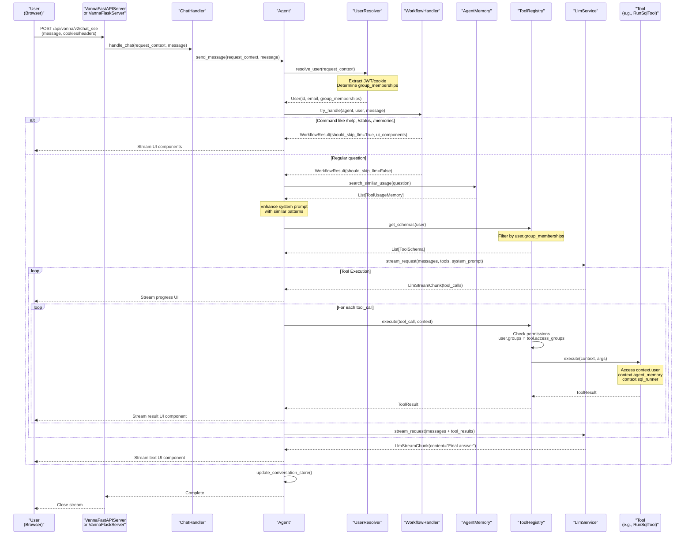

<!-- source: DeepWiki mcp.deepwiki.com · repo vanna-ai/vanna · page 1.3 Architecture Overview · fetched 2026-10-29 -->

# Architecture Overview

<details>
<summary>Relevant source files</summary>

The following files were used as context for generating this wiki page:

- [MIGRATION_GUIDE.md](MIGRATION_GUIDE.md)
- [README.md](README.md)
- [img/architecture.png](img/architecture.png)
- [img/vanna2.svg](img/vanna2.svg)
- [notebooks/quickstart.ipynb](notebooks/quickstart.ipynb)
- [pyproject.toml](pyproject.toml)
- [src/vanna/__init__.py](src/vanna/__init__.py)
- [src/vanna/integrations/anthropic/llm.py](src/vanna/integrations/anthropic/llm.py)
- [src/vanna/integrations/openai/llm.py](src/vanna/integrations/openai/llm.py)
- [src/vanna/servers/fastapi/app.py](src/vanna/servers/fastapi/app.py)
- [src/vanna/servers/flask/app.py](src/vanna/servers/flask/app.py)

</details>


## Purpose and Scope

This document provides a high-level architectural overview of the Vanna Agents framework, showing how the core components interact to deliver a user-aware, LLM-powered data analysis system. It covers the system's layered architecture, component responsibilities, request processing flow, and deployment patterns.

For detailed information about specific subsystems, see:
- Core agent mechanics and message processing: [Agent System](#2.1)
- Tool creation and execution: [Tool System](#7)
- Database connectivity: [Database Connectors](#6)
- LLM provider integrations: [LLM Integrations](#5)
- Memory and learning systems: [Agent Memory System](#4)
- Security and permissions: [Security and Access Control](#3)
- Web deployment: [Server and Deployment](#8)

**Sources:** [README.md:1-312](), [src/vanna/__init__.py:1-173]()

---

## System Layers

Vanna is organized into six architectural layers, each with distinct responsibilities:

```mermaid
graph TB
    subgraph "Layer 1: Client Interfaces"
        WebComponent["vanna-chat<br/>Web Component"]
        CLI["vanna CLI<br/>(server_runner)"]
        HTTPClient["Direct HTTP Clients"]
    end
    
    subgraph "Layer 2: Server Protocols"
        FastAPI["VannaFastAPIServer<br/>(fastapi/app.py)"]
        Flask["VannaFlaskServer<br/>(flask/app.py)"]
        SSE["SSE Endpoint<br/>(/api/vanna/v2/chat_sse)"]
        WebSocket["WebSocket Endpoint<br/>(/api/vanna/v2/chat_ws)"]
        Polling["Polling Endpoint<br/>(/api/vanna/v2/chat)"]
    end
    
    subgraph "Layer 3: Agent Core"
        Agent["Agent<br/>(core/agent/agent.py)"]
        ChatHandler["ChatHandler<br/>(servers/base.py)"]
        UserResolver["UserResolver<br/>(core/user.py)"]
        WorkflowHandler["WorkflowHandler<br/>(core/workflow)"]
        ConversationStore["ConversationStore<br/>(core/conversation.py)"]
    end
    
    subgraph "Layer 4: Execution Services"
        ToolRegistry["ToolRegistry<br/>(core/registry.py)"]
        LlmService["LlmService<br/>(core/llm.py)"]
        AgentMemory["AgentMemory<br/>(core/memory.py)"]
        SystemPromptBuilder["SystemPromptBuilder<br/>(core/prompt.py)"]
    end
    
    subgraph "Layer 5: Tool Implementations"
        RunSqlTool["RunSqlTool<br/>(tools/run_sql.py)"]
        VisualizeDataTool["VisualizeDataTool<br/>(tools/visualize_data.py)"]
        SaveMemoryTool["SaveQuestionToolArgsTool<br/>(tools/agent_memory.py)"]
        SearchMemoryTool["SearchSavedCorrectToolUsesTool<br/>(tools/agent_memory.py)"]
        CustomTools["Custom Tool<br/>Implementations"]
    end
    
    subgraph "Layer 6: Backend Integrations"
        subgraph "LLM Providers"
            OpenAI["OpenAILlmService<br/>(integrations/openai)"]
            Anthropic["AnthropicLlmService<br/>(integrations/anthropic)"]
            AzureOpenAI["AzureOpenAILlmService<br/>(integrations/azure_openai)"]
            Ollama["OllamaLlmService<br/>(integrations/ollama)"]
        end
        
        subgraph "Vector Stores"
            ChromaDB["ChromaAgentMemory<br/>(integrations/chromadb)"]
            Qdrant["QdrantAgentMemory<br/>(integrations/qdrant)"]
            FAISS["FAISSAgentMemory<br/>(integrations/faiss)"]
            Pinecone["PineconeAgentMemory<br/>(integrations/pinecone)"]
        end
        
        subgraph "SQL Databases"
            Postgres["PostgresRunner<br/>(integrations/postgres)"]
            SQLite["SqliteRunner<br/>(integrations/sqlite)"]
            Snowflake["SnowflakeRunner<br/>(integrations/snowflake)"]
            BigQuery["BigQueryRunner<br/>(integrations/bigquery)"]
        end
    end
    
    WebComponent --> FastAPI
    CLI --> Agent
    HTTPClient --> Flask
    
    FastAPI --> SSE
    FastAPI --> WebSocket
    Flask --> SSE
    Flask --> Polling
    
    SSE --> ChatHandler
    WebSocket --> ChatHandler
    Polling --> ChatHandler
    
    ChatHandler --> Agent
    Agent --> UserResolver
    Agent --> WorkflowHandler
    Agent --> ConversationStore
    Agent --> ToolRegistry
    Agent --> LlmService
    Agent --> SystemPromptBuilder
    
    WorkflowHandler --> AgentMemory
    ToolRegistry --> RunSqlTool
    ToolRegistry --> VisualizeDataTool
    ToolRegistry --> SaveMemoryTool
    ToolRegistry --> SearchMemoryTool
    ToolRegistry --> CustomTools
    
    LlmService --> OpenAI
    LlmService --> Anthropic
    LlmService --> AzureOpenAI
    LlmService --> Ollama
    
    RunSqlTool --> Postgres
    RunSqlTool --> SQLite
    RunSqlTool --> Snowflake
    RunSqlTool --> BigQuery
    
    SaveMemoryTool --> AgentMemory
    SearchMemoryTool --> AgentMemory
    AgentMemory --> ChromaDB
    AgentMemory --> Qdrant
    AgentMemory --> FAISS
    AgentMemory --> Pinecone
```



**Layer Responsibilities:**

| Layer | Purpose | Key Components |
|-------|---------|---------------|
| **Client Interfaces** | User-facing entry points | Web component, CLI, HTTP clients |
| **Server Protocols** | Handle HTTP/WebSocket connections | FastAPI/Flask servers, SSE/WebSocket/polling endpoints |
| **Agent Core** | Orchestrate request processing | `Agent`, `ChatHandler`, `UserResolver`, workflow handlers |
| **Execution Services** | Provide execution infrastructure | `ToolRegistry`, `LlmService`, `AgentMemory`, prompt builders |
| **Tool Implementations** | Concrete capabilities | SQL execution, visualization, memory tools, custom extensions |
| **Backend Integrations** | External service connectors | LLM providers, vector databases, SQL databases |

**Sources:** [src/vanna/__init__.py:12-83](), [pyproject.toml:40-81](), [README.md:108-112]()

---

## Core Components

### Agent

The `Agent` class [src/vanna/core/agent/agent.py]() is the central orchestrator that coordinates all system components. It manages the complete lifecycle of a user request:

```python
# Initialization pattern
agent = Agent(
    llm_service=llm_service,      # LlmService implementation
    tool_registry=tool_registry,  # ToolRegistry with registered tools
    user_resolver=user_resolver,  # UserResolver for authentication
    config=config,                # AgentConfig for behavior tuning
    agent_memory=agent_memory,    # Optional AgentMemory for learning
    conversation_store=conv_store # Optional ConversationStore
)
```

**Key responsibilities:**
- User authentication via `UserResolver`
- Pre-LLM workflow interception via `WorkflowHandler`
- System prompt construction via `SystemPromptBuilder`
- LLM request orchestration with tool schemas
- Tool execution loop with permission validation
- UI component streaming to clients
- Conversation persistence

**Sources:** [notebooks/quickstart.ipynb:127-133](), [README.md:175-183]()

### ToolRegistry

The `ToolRegistry` class [src/vanna/core/registry.py]() manages tool registration, schema generation, and execution with access control:

```python
tools = ToolRegistry()

# Register tools with access groups
tools.register_local_tool(
    RunSqlTool(sql_runner=postgres_runner),
    access_groups=['admin', 'user']
)

tools.register_local_tool(
    SaveQuestionToolArgsTool(),
    access_groups=['admin']  # Admin-only
)
```

**Capabilities:**
- Tool registration with group-based access control
- JSON schema generation for LLM tool descriptions
- Permission checking (`user.group_memberships ∩ tool.access_groups`)
- Tool execution with `ToolContext` injection
- Argument transformation for row-level security

**Sources:** [notebooks/quickstart.ipynb:109-114](), [README.md:221-233]()

### LlmService

The `LlmService` interface [src/vanna/core/llm.py]() abstracts LLM provider differences. Implementations handle provider-specific payload construction and response parsing:

| Implementation | Location | Model Support |
|----------------|----------|---------------|
| `OpenAILlmService` | [src/vanna/integrations/openai/llm.py:27-268]() | GPT-4, GPT-5, o1-series |
| `AnthropicLlmService` | [src/vanna/integrations/anthropic/llm.py:27-271]() | Claude 3.5 Sonnet, Opus, Haiku |
| `AzureOpenAILlmService` | [src/vanna/integrations/azure_openai/]() | Azure-hosted OpenAI models |
| `OllamaLlmService` | [src/vanna/integrations/ollama/]() | Local open-source models |

**Core methods:**
- `send_request(request: LlmRequest) -> LlmResponse` - Non-streaming
- `stream_request(request: LlmRequest) -> AsyncGenerator[LlmStreamChunk]` - Streaming
- `validate_tools(tools: List[ToolSchema]) -> List[str]` - Schema validation

**Sources:** [src/vanna/integrations/openai/llm.py:27-67](), [src/vanna/integrations/anthropic/llm.py:27-64](), [notebooks/quickstart.ipynb:123-124]()

### AgentMemory

The `AgentMemory` interface [src/vanna/core/memory.py]() enables the learning loop by storing and retrieving successful tool usage patterns:

```python
# Store a successful pattern
await agent_memory.save_tool_usage(
    question="Show Q4 sales by region",
    tool_name="run_sql",
    tool_args={"sql": "SELECT region, SUM(sales)..."},
    metadata={"success": True, "user_id": user.id}
)

# Retrieve similar patterns
similar = await agent_memory.search_similar_usage(
    question="Show Q1 sales by region",
    limit=5
)
```

**Available implementations:**

| Implementation | Backend | Use Case |
|----------------|---------|----------|
| `DemoAgentMemory` | In-memory (Python dict) | Testing, demos |
| `ChromaAgentMemory` | ChromaDB | Local persistence |
| `QdrantAgentMemory` | Qdrant | Cloud-hosted vector search |
| `FAISSAgentMemory` | FAISS | High-performance local search |
| `PineconeAgentMemory` | Pinecone | Managed cloud service |

**Sources:** [notebooks/quickstart.ipynb:112-114](), [pyproject.toml:55-76]()

### SqlRunner

The `SqlRunner` interface [src/vanna/capabilities/sql_runner.py]() abstracts database connectivity. `RunSqlTool` uses it to execute queries:

```python
# PostgreSQL example
postgres_runner = PostgresRunner(
    host="localhost",
    dbname="analytics",
    user="readonly_user",
    password="secret",
    port=5432
)

tools.register_local_tool(
    RunSqlTool(sql_runner=postgres_runner),
    access_groups=['user', 'admin']
)
```

**Available runners:** PostgreSQL, MySQL, SQLite, Snowflake, BigQuery, DuckDB, ClickHouse, Oracle, MSSQL, Hive, Presto

**Sources:** [notebooks/quickstart.ipynb:110](), [pyproject.toml:45-50]()

---

## Request Processing Flow

The following sequence diagram shows the complete flow from user message to streamed response:



**Key phases:**

1. **Authentication** - `UserResolver` extracts identity from HTTP context
2. **Workflow Interception** - Commands handled without LLM
3. **Context Enhancement** - Similar patterns retrieved from `AgentMemory`
4. **Permission Filtering** - Tools filtered by `user.group_memberships`
5. **LLM Interaction** - Streaming request with tool schemas
6. **Tool Execution Loop** - Permission checks, execution, learning
7. **Conversation Persistence** - Full history saved

**Sources:** [src/vanna/servers/base.py](), [src/vanna/core/agent/agent.py]()

---

## Plugin Architecture

Vanna's extensibility is achieved through interface-driven design. All major subsystems can be swapped by implementing well-defined interfaces:

```mermaid
graph TB
    subgraph "Core Interfaces"
        LlmInterface["LlmService<br/>(core/llm.py)"]
        MemoryInterface["AgentMemory<br/>(core/memory.py)"]
        ToolInterface["Tool[T]<br/>(core/tool.py)"]
        SqlRunnerInterface["SqlRunner<br/>(capabilities/sql_runner.py)"]
        ConvInterface["ConversationStore<br/>(core/conversation.py)"]
        UserResolverInterface["UserResolver<br/>(core/user.py)"]
        WorkflowInterface["WorkflowHandler<br/>(core/workflow/interface.py)"]
    end
    
    subgraph "LLM Implementations"
        OpenAI["OpenAILlmService<br/>(integrations/openai)"]
        Anthropic["AnthropicLlmService<br/>(integrations/anthropic)"]
        Azure["AzureOpenAILlmService"]
        Ollama["OllamaLlmService"]
        Gemini["GeminiLlmService"]
        Mistral["MistralAILlmService"]
    end
    
    subgraph "Memory Implementations"
        DemoMemory["DemoAgentMemory<br/>(integrations/local)"]
        Chroma["ChromaAgentMemory<br/>(integrations/chromadb)"]
        Qdrant["QdrantAgentMemory<br/>(integrations/qdrant)"]
        FAISS["FAISSAgentMemory<br/>(integrations/faiss)"]
        Pinecone["PineconeAgentMemory<br/>(integrations/pinecone)"]
    end
    
    subgraph "SqlRunner Implementations"
        PostgresSQL["PostgresRunner<br/>(integrations/postgres)"]
        MySQL["MySQLRunner<br/>(integrations/mysql)"]
        SQLite["SqliteRunner<br/>(integrations/sqlite)"]
        Snowflake["SnowflakeRunner<br/>(integrations/snowflake)"]
        BigQuery["BigQueryRunner<br/>(integrations/bigquery)"]
    end
    
    subgraph "Tool Implementations"
        RunSql["RunSqlTool<br/>(tools/run_sql.py)"]
        Visualize["VisualizeDataTool<br/>(tools/visualize_data.py)"]
        SaveMemory["SaveQuestionToolArgsTool<br/>(tools/agent_memory.py)"]
        SearchMemory["SearchSavedCorrectToolUsesTool"]
        Custom["CustomTool<br/>(user-defined)"]
    end
    
    LlmInterface -.implements.-> OpenAI
    LlmInterface -.implements.-> Anthropic
    LlmInterface -.implements.-> Azure
    LlmInterface -.implements.-> Ollama
    LlmInterface -.implements.-> Gemini
    LlmInterface -.implements.-> Mistral
    
    MemoryInterface -.implements.-> DemoMemory
    MemoryInterface -.implements.-> Chroma
    MemoryInterface -.implements.-> Qdrant
    MemoryInterface -.implements.-> FAISS
    MemoryInterface -.implements.-> Pinecone
    
    SqlRunnerInterface -.implements.-> PostgresSQL
    SqlRunnerInterface -.implements.-> MySQL
    SqlRunnerInterface -.implements.-> SQLite
    SqlRunnerInterface -.implements.-> Snowflake
    SqlRunnerInterface -.implements.-> BigQuery
    
    ToolInterface -.implements.-> RunSql
    ToolInterface -.implements.-> Visualize
    ToolInterface -.implements.-> SaveMemory
    ToolInterface -.implements.-> SearchMemory
    ToolInterface -.implements.-> Custom
```



**Interface characteristics:**

| Interface | Key Methods | Implementations |
|-----------|-------------|-----------------|
| `LlmService` | `send_request()`, `stream_request()`, `validate_tools()` | 10+ providers |
| `AgentMemory` | `save_tool_usage()`, `search_similar_usage()`, `save_text_memory()` | 9+ vector stores |
| `Tool[T]` | `execute()`, `get_args_schema()`, `name`, `access_groups` | Unlimited custom |
| `SqlRunner` | `run_sql()`, `get_connection()` | 12+ databases |
| `ConversationStore` | `create_conversation()`, `update_conversation()`, `get_conversation()` | 2 (memory, filesystem) |
| `UserResolver` | `resolve_user()` | User-defined |
| `WorkflowHandler` | `try_handle()` | `DefaultWorkflowHandler` + custom |

**Benefits:**
- **Swappable backends** - Change LLM provider or vector database without touching agent code
- **Testing** - Mock implementations for unit tests
- **Extensibility** - Add new capabilities by implementing interfaces
- **Multi-tenancy** - Different configurations per tenant

**Sources:** [src/vanna/__init__.py:12-20](), [pyproject.toml:40-81](), [README.md:94-98]()

---

## Deployment Patterns

Vanna supports two server implementations with identical interfaces:

### FastAPI Deployment

```python
from vanna import Agent, AgentConfig
from vanna.servers.fastapi import VannaFastAPIServer
from vanna.integrations.anthropic import AnthropicLlmService
from vanna.core.registry import ToolRegistry

# Configure agent
llm = AnthropicLlmService(model="claude-sonnet-4-5")
tools = ToolRegistry()
# ... register tools

agent = Agent(
    llm_service=llm,
    tool_registry=tools,
    user_resolver=user_resolver,
    config=AgentConfig()
)

# Create server
server = VannaFastAPIServer(agent)
app = server.create_app()

# Deploy with: uvicorn main:app --host 0.0.0.0 --port 8000
```

**Endpoints registered:**
- `GET /` - Optional web UI (if `dev_mode=True`)
- `POST /api/vanna/v2/chat_sse` - Server-Sent Events streaming
- `POST /api/vanna/v2/chat_ws` - WebSocket streaming
- `POST /api/vanna/v2/chat` - Polling (non-streaming)
- `GET /health` - Health check

**Sources:** [src/vanna/servers/fastapi/app.py:16-81](), [README.md:158-192]()

### Flask Deployment

```python
from vanna.servers.flask import VannaFlaskServer

# Use same agent configuration
server = VannaFlaskServer(agent)
app = server.create_app()

# Deploy with: python main.py or gunicorn main:app
if __name__ == "__main__":
    server.run(host='0.0.0.0', port=5000)
```

**Endpoints registered:**
- `GET /` - Optional web UI (if `dev_mode=True`)
- `POST /api/vanna/v2/chat_sse` - Server-Sent Events streaming
- `POST /api/vanna/v2/chat` - Polling (non-streaming)
- `GET /health` - Health check

**Sources:** [src/vanna/servers/flask/app.py:16-133]()

### Protocol Comparison

| Protocol | FastAPI | Flask | Use Case |
|----------|---------|-------|----------|
| **SSE** | ✅ | ✅ | Streaming responses, broad browser support |
| **WebSocket** | ✅ | ❌ | Real-time bidirectional, lower latency |
| **Polling** | ✅ | ✅ | Legacy clients, compatibility |

### Environment-Specific Handling

Both servers detect execution environment and adapt automatically:

**Jupyter/Colab detection:**
```python
# Automatically applied when running in notebooks
import nest_asyncio
nest_asyncio.apply()  # Allow nested event loops
```

**Colab port forwarding:**
```python
# Automatically set up in Google Colab
from google.colab import output
output.serve_kernel_port_as_window(port)
```

**Sources:** [src/vanna/servers/fastapi/app.py:82-164](), [src/vanna/servers/flask/app.py:60-133]()

---

## Integration with Web Component

The `vanna-chat` web component connects to any Vanna server:

```html
<!-- CDN (production) -->
<script src="https://img.vanna.ai/vanna-components.js"></script>
<vanna-chat
  sse-endpoint="https://api.example.com/api/vanna/v2/chat_sse"
  theme="dark"
  header-text="Ask questions about your data">
</vanna-chat>
```

**Authentication flow:**
1. User's browser sends request with cookies/headers
2. Server extracts `RequestContext` from HTTP request
3. `UserResolver.resolve_user()` authenticates and returns `User` object
4. `User.group_memberships` determine tool access
5. Responses streamed back as UI components

**Component rendering:**
- `SimpleTextComponent` → Text blocks
- `DataFrameComponent` → Interactive tables
- `ChartComponent` → Plotly visualizations
- `StatusCardComponent` → Progress indicators
- `NotificationComponent` → Feedback messages

**Sources:** [README.md:43-53](), [README.md:195-198]()

---

## Configuration and Customization

### AgentConfig

The `AgentConfig` class [src/vanna/core/agent/config.py]() controls agent behavior:

```python
config = AgentConfig(
    max_tool_iterations=10,        # Limit tool execution loops
    stream_responses=True,          # Enable streaming
    temperature=0.7,                # LLM creativity (0.0-1.0)
    ui_features=UiFeatures(...),   # Control UI permissions
    audit_config=AuditConfig(...)  # Configure audit logging
)
```

For detailed configuration options, see [AgentConfig and Configuration](#2.2).

### Custom Tools

Extend functionality by implementing the `Tool[T]` interface:

```python
from vanna.core.tool import Tool, ToolContext, ToolResult
from pydantic import BaseModel, Field
from typing import Type

class EmailArgs(BaseModel):
    recipient: str = Field(description="Email address")
    subject: str = Field(description="Email subject")
    body: str = Field(description="Email body")

class EmailTool(Tool[EmailArgs]):
    @property
    def name(self) -> str:
        return "send_email"
    
    @property
    def access_groups(self) -> list[str]:
        return ["admin", "sales"]  # Group-based access control
    
    def get_args_schema(self) -> Type[EmailArgs]:
        return EmailArgs
    
    async def execute(
        self, 
        context: ToolContext, 
        args: EmailArgs
    ) -> ToolResult:
        # Access user context
        user = context.user
        
        # Your business logic
        await send_email(
            from_email=user.email,
            to=args.recipient,
            subject=args.subject,
            body=args.body
        )
        
        return ToolResult(
            success=True,
            result_for_llm=f"Email sent to {args.recipient}"
        )
```

For complete tool development guide, see [Tool System](#7).

**Sources:** [README.md:203-243]()

---

## Summary

Vanna's architecture achieves modularity through:

1. **Layered design** - Clear separation between clients, servers, agent core, execution services, tools, and backends
2. **Interface-driven** - All major components implement well-defined interfaces
3. **User-aware** - Identity and permissions flow through every layer
4. **Streaming-first** - Rich UI components streamed progressively
5. **Extensible** - Plugin architecture for LLMs, databases, vector stores, and tools
6. **Production-ready** - FastAPI/Flask servers, audit logging, error handling

This architecture enables teams to start quickly with pre-built components while maintaining the flexibility to customize any aspect of the system.

**Sources:** [README.md:1-312](), [pyproject.toml:1-223](), [src/vanna/__init__.py:1-173]()

---

