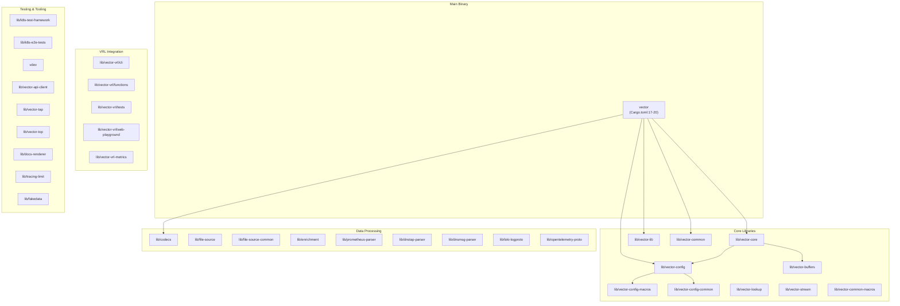
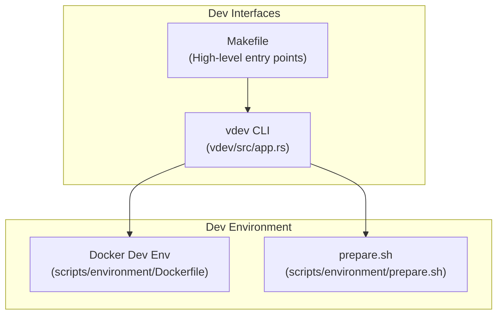
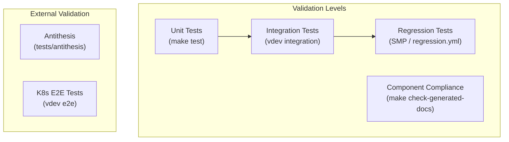

<!-- source: DeepWiki mcp.deepwiki.com · repo vectordotdev/vector · page 8 Development · fetched 2026-10-29 -->

# Development

Relevant source files

The following files were used as context for generating this wiki page:

- [.github/PULL_REQUEST_TEMPLATE.md](.github/PULL_REQUEST_TEMPLATE.md)
- [.github/workflows/changelog.yaml](.github/workflows/changelog.yaml)
- [CHANGELOG.md](CHANGELOG.md)
- [CONTRIBUTING.md](CONTRIBUTING.md)
- [RELEASES.md](RELEASES.md)
- [VERSIONING.md](VERSIONING.md)
- [changelog.d/README.md](changelog.d/README.md)
- [docs/DEVELOPING.md](docs/DEVELOPING.md)
- [docs/DOCUMENTING.md](docs/DOCUMENTING.md)
- [docs/README.md](docs/README.md)
- [rfcs/2020-08-04-3325-remap-v2.md](rfcs/2020-08-04-3325-remap-v2.md)
- [rfcs/2020-10-15-3480-file-source-rework.md](rfcs/2020-10-15-3480-file-source-rework.md)
- [scripts/build.sh](scripts/build.sh)
- [scripts/cue.sh](scripts/cue.sh)
- [scripts/package-archive.sh](scripts/package-archive.sh)
- [vdev/src/commands/build/mod.rs](vdev/src/commands/build/mod.rs)
- [vdev/src/commands/build/vrl_wasm.rs](vdev/src/commands/build/vrl_wasm.rs)
- [vdev/src/commands/changelog/mod.rs](vdev/src/commands/changelog/mod.rs)
- [vdev/src/commands/changelog/new.rs](vdev/src/commands/changelog/new.rs)
- [vdev/src/commands/check/changelog_fragments.rs](vdev/src/commands/check/changelog_fragments.rs)
- [vdev/src/commands/check/examples.rs](vdev/src/commands/check/examples.rs)
- [vdev/src/commands/check/mod.rs](vdev/src/commands/check/mod.rs)
- [vdev/src/commands/complete.rs](vdev/src/commands/complete.rs)
- [vdev/src/commands/meta/mod.rs](vdev/src/commands/meta/mod.rs)
- [vdev/src/commands/mod.rs](vdev/src/commands/mod.rs)
- [vdev/src/commands/release/generate_cue.rs](vdev/src/commands/release/generate_cue.rs)
- [vdev/src/commands/release/mod.rs](vdev/src/commands/release/mod.rs)
- [vdev/src/commands/release/prepare.rs](vdev/src/commands/release/prepare.rs)

This document covers Vector's development workflow, including environment setup, testing infrastructure, CI/CD pipelines, build processes, and dependency management. Vector is a high-performance observability data pipeline written in Rust, utilizing a monorepo structure with 93+ crates and a sophisticated automation suite.

For details on the development environment and tools, see [Environment Setup](#8.1).

## Workspace Structure

Vector uses a monorepo structure managed via a Cargo workspace. The workspace members are defined in the root configuration, organizing the system into the main binary, shared libraries, and specialized processing crates.

**Workspace Structure Diagram**

**Workspace Configuration**
Common dependencies and workspace members are centralized in the root `Cargo.toml`.

| Category | Description | Source |
|----------|-------------|--------|
| **Members** | 93+ crates including `lib/vector-core` and `vdev`. | [Cargo.toml:101-137]() |
| **Binary Targets** | Defines `vector`, `graphql-schema`, and `secret-backend-example`. | [Cargo.toml:17-34]() |
| **Shared Deps** | Centralized versions for `tokio`, `serde`, and `vrl`. | [Cargo.toml:139-210]() |

Sources: [Cargo.toml:1-210]()

## Environment Setup

Vector utilizes a `Makefile`-based abstraction to manage the development environment, supporting both local and Docker-based workflows. The `vdev` CLI tool serves as the primary entry point for common tasks such as building, checking, and running tests.

**Development Tools Overview**

Key features include:
- **vdev CLI**: A Rust-based utility for common dev tasks like `vdev check rust` or `vdev test`. [vdev/src/commands/mod.rs:90-110](), [vdev/src/commands/check/mod.rs:14-29]()
- **Makefile Abstraction**: Provides a unified interface for formatting (`make fmt`), linting (`make check-clippy`), and testing (`make test`). [docs/DEVELOPING.md:120-126](), [docs/DEVELOPING.md:71-99]()
- **Bootstrap Script**: `scripts/environment/prepare.sh` installs required Rust and npm tooling for the environment. [docs/DEVELOPING.md:60-66]()

For details, see [Environment Setup](#8.1).

Sources: [docs/DEVELOPING.md:40-126](), [vdev/src/commands/mod.rs:90-110](), [vdev/src/commands/check/mod.rs:14-29]()

## Testing Infrastructure

Vector maintains a comprehensive testing infrastructure covering multiple levels of validation, from unit tests to large-scale integration and E2E scenarios.

**Testing Hierarchy**

- **Integration Testing**: Requires Docker to verify Vector works with real external services. Managed via `vdev integration`. [vdev/src/commands/mod.rs:80](), [docs/DEVELOPING.md:84-90]()
- **Component Compliance**: PRs for new components must include instrumentation and documentation. [CONTRIBUTING.md:87-92]()
- **Behavior Testing**: Validation of documentation and configuration schema via `make check-docs` and `make check-generated-docs`. [docs/DOCUMENTING.md:98-131](), [vdev/src/commands/check/mod.rs:17-21]()

For details, see [Testing Infrastructure](#8.2).

Sources: [CONTRIBUTING.md:87-92](), [docs/DEVELOPING.md:71-99](), [docs/DOCUMENTING.md:118-131](), [vdev/src/commands/mod.rs:70-110]()

## CI/CD Pipeline

The CI/CD pipeline is built on GitHub Actions and uses a sophisticated change detection system to minimize unnecessary compute.

- **Smart Change Detection**: The `changes.yml` workflow identifies exactly which components or tests need to run based on the files modified. [CONTRIBUTING.md:98-99]()
- **Changelog Enforcement**: PRs are required to add a fragment in `changelog.d/` unless the `no-changelog` label is present. This is validated via `vdev check changelog-fragments`. [.github/workflows/changelog.yaml:30-63](), [changelog.d/README.md:47-54]()
- **PR Template**: Standardizes contribution information including change type, breaking status, and testing methodology. [.github/PULL_REQUEST_TEMPLATE.md:1-66]()

For details, see [CI/CD Pipeline](#8.3).

Sources: [CONTRIBUTING.md:94-100](), [.github/workflows/changelog.yaml:30-63](), [changelog.d/README.md:47-54](), [.github/PULL_REQUEST_TEMPLATE.md:1-66]()

## Build and Release

Vector supports cross-compilation for various platforms and utilizes the `vdev release` command to prepare new versions.

- **Release Preparation**: The `vdev release prepare` command automates version pinning, Dockerfile updates, and CUE generation for website release notes. [vdev/src/commands/release/prepare.rs:83-111]()
- **Release Highlights**: Significant changes are documented as highlights in `website/content/en/highlights` to populate the release notes. [vdev/src/commands/release/generate_cue.rs:137-155](), [docs/DOCUMENTING.md:157-163]()
- **CUE-based Metadata**: Release metadata is stored in structured CUE files under `website/cue/reference/releases/`. [vdev/src/commands/release/generate_cue.rs:17-18](), [changelog.d/README.md:42-45]()

For details, see [Build and Release](#8.4).

Sources: [vdev/src/commands/release/prepare.rs:83-111](), [vdev/src/commands/release/generate_cue.rs:17-179](), [docs/DOCUMENTING.md:157-163](), [changelog.d/README.md:42-45]()

## Dependency Management

Vector manages a complex set of dependencies with a focus on security, license compliance, and internal consistency.

- **License Compliance**: Developers must run `make build-licenses` if `Cargo.lock` is modified to regenerate license inventories. [.github/PULL_REQUEST_TEMPLATE.md:45-46](), [vdev/src/commands/check/mod.rs:9]()
- **Security Scanning**: Includes `make check-deny` to verify license compliance and security advisories using `cargo-deny`. [vdev/src/commands/check/mod.rs:4](), [docs/DEVELOPING.md:60-61]()
- **VRL Versioning**: The release process includes explicit steps to pin the `vrl` crate version in the workspace `Cargo.toml`. [vdev/src/commands/release/prepare.rs:152-165]()

For details, see [Dependency Management](#8.5).

Sources: [.github/PULL_REQUEST_TEMPLATE.md:45-46](), [docs/DEVELOPING.md:60-61](), [vdev/src/commands/release/prepare.rs:152-165](), [vdev/src/commands/check/mod.rs:4-9]()

---

