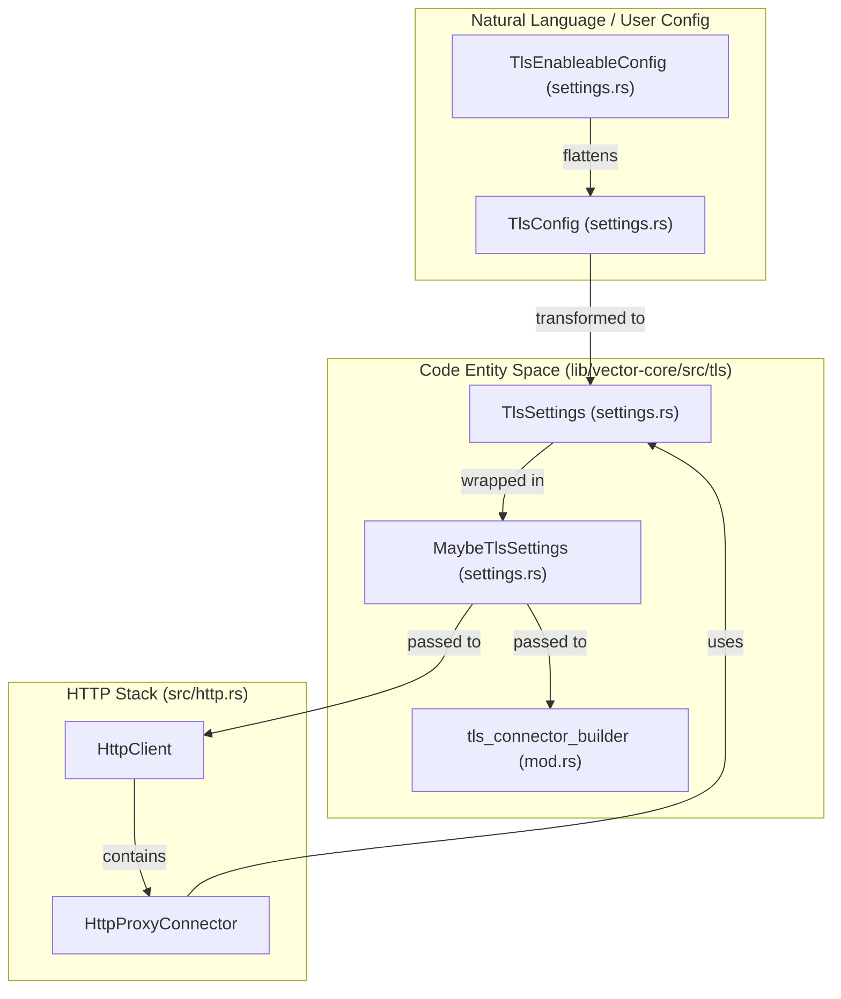
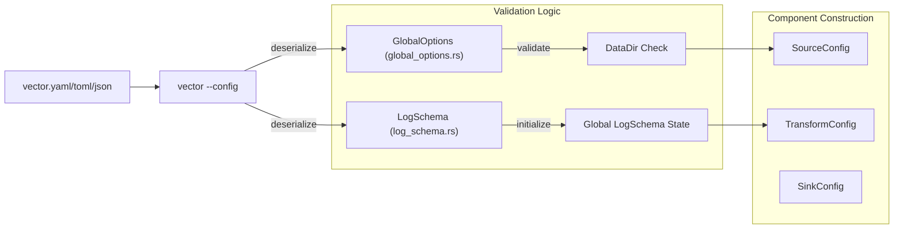

<!-- source: DeepWiki mcp.deepwiki.com · repo vectordotdev/vector · page 9.2 Global Configuration and TLS · fetched 2026-10-29 -->

# Global Configuration and TLS

Relevant source files

The following files were used as context for generating this wiki page:

- [changelog.d/tls_server_name_openssl_verify.fix.md](changelog.d/tls_server_name_openssl_verify.fix.md)
- [lib/codecs/src/decoding/format/bytes.rs](lib/codecs/src/decoding/format/bytes.rs)
- [lib/codecs/src/decoding/format/gelf.rs](lib/codecs/src/decoding/format/gelf.rs)
- [lib/codecs/src/decoding/format/json.rs](lib/codecs/src/decoding/format/json.rs)
- [lib/codecs/src/decoding/format/native.rs](lib/codecs/src/decoding/format/native.rs)
- [lib/codecs/src/decoding/format/native_json.rs](lib/codecs/src/decoding/format/native_json.rs)
- [lib/codecs/src/decoding/format/syslog.rs](lib/codecs/src/decoding/format/syslog.rs)
- [lib/codecs/src/decoding/mod.rs](lib/codecs/src/decoding/mod.rs)
- [lib/vector-config/src/external/vrl.rs](lib/vector-config/src/external/vrl.rs)
- [lib/vector-core/src/config/global_options.rs](lib/vector-core/src/config/global_options.rs)
- [lib/vector-core/src/config/mod.rs](lib/vector-core/src/config/mod.rs)
- [lib/vector-core/src/schema/definition.rs](lib/vector-core/src/schema/definition.rs)
- [lib/vector-core/src/schema/requirement.rs](lib/vector-core/src/schema/requirement.rs)
- [lib/vector-core/src/tls/incoming.rs](lib/vector-core/src/tls/incoming.rs)
- [lib/vector-core/src/tls/mod.rs](lib/vector-core/src/tls/mod.rs)
- [lib/vector-core/src/tls/reload.rs](lib/vector-core/src/tls/reload.rs)
- [lib/vector-core/src/tls/settings.rs](lib/vector-core/src/tls/settings.rs)
- [src/config/graph.rs](src/config/graph.rs)
- [src/config/unit_test/tests.rs](src/config/unit_test/tests.rs)
- [src/config/unit_test/unit_test_components.rs](src/config/unit_test/unit_test_components.rs)
- [src/config/vars.rs](src/config/vars.rs)
- [src/http.rs](src/http.rs)
- [src/internal_events/mod.rs](src/internal_events/mod.rs)
- [src/sinks/mod.rs](src/sinks/mod.rs)
- [src/sources/mod.rs](src/sources/mod.rs)
- [src/sources/prometheus/mod.rs](src/sources/prometheus/mod.rs)
- [src/topology/schema.rs](src/topology/schema.rs)
- [src/transforms/mod.rs](src/transforms/mod.rs)
- [website/content/en/docs/reference/configuration/_index.md](website/content/en/docs/reference/configuration/_index.md)
- [website/content/en/docs/reference/configuration/sources/prometheus_pushgateway.md](website/content/en/docs/reference/configuration/sources/prometheus_pushgateway.md)
- [website/cue/reference/configuration.cue](website/cue/reference/configuration.cue)
- [website/cue/reference/urls.cue](website/cue/reference/urls.cue)
- [website/data/redirects.yaml](website/data/redirects.yaml)

Vector's operational behavior is governed by a set of global options that define the environment, data persistence, and security defaults. These settings provide a foundation for individual components (sources, transforms, and sinks) while offering a robust TLS implementation for encrypted communication across the pipeline.

## Global Configuration Options

The global configuration defines top-level parameters that apply to the entire Vector instance. These options are typically defined at the root of the configuration file.

### Key Global Parameters

| Parameter | Type | Description |
| :--- | :--- | :--- |
| `data_dir` | `PathBuf` | The directory used for persisting Vector state data, such as disk buffers and file checkpoints [lib/vector-core/src/config/global_options.rs:64-72](). |
| `log_schema` | `LogSchema` | Defines default field names for standard event metadata (e.g., `message`, `timestamp`) [lib/vector-core/src/config/global_options.rs:82-92](). |
| `timezone` | `TimeZone` | The default timezone for parsing timestamps that lack explicit offset information [lib/vector-core/src/config/global_options.rs:102-112](). |
| `acknowledgements` | `AcknowledgementsConfig` | Controls end-to-end acknowledgements. When enabled, sinks wait for final delivery before acknowledging sources [lib/vector-core/src/config/global_options.rs:119-131](). |
| `expire_metrics_secs` | `f64` | The time internal metrics persist before removal [lib/vector-core/src/config/global_options.rs:142-149](). |
| `wildcard_matching` | `WildcardMatching` | Mode for input matching (Strict vs Relaxed) [lib/vector-core/src/config/global_options.rs:74-80](). |

### Implementation Details
The global options are encapsulated in the `GlobalOptions` struct [lib/vector-core/src/config/global_options.rs:61-205](). These settings are initialized and stored globally to provide defaults for components. For example, the `log_schema` is initialized via `init_log_schema` to be accessible throughout the event processing lifecycle [lib/vector-core/src/config/mod.rs:15]().

**Sources:**
- [lib/vector-core/src/config/global_options.rs:61-205]()
- [lib/vector-core/src/config/mod.rs:7-22]()
- [website/content/en/docs/reference/configuration/_index.md:22-30]()

---

## TLS Configuration and Settings

Vector provides a unified TLS framework used by both sources (incoming) and sinks (outgoing). This is primarily handled via the `TlsConfig` and `TlsSettings` structures.

### Data Flow: Config to Runtime Settings
The configuration starts as a user-facing `TlsConfig` and is transformed into `TlsSettings` for use in the networking stack.

1.  **`TlsConfig`**: The raw configuration containing paths to `ca_file`, `crt_file`, `key_file`, and `key_pass` [lib/vector-core/src/tls/settings.rs:87-161]().
2.  **`TlsEnableableConfig`**: A wrapper that adds an `enabled` flag to the core `TlsConfig` [lib/vector-core/src/tls/settings.rs:44-55]().
3.  **`TlsSourceConfig`**: Extends the enableable config with source-specific metadata like `client_metadata_key` for identity propagation [lib/vector-core/src/tls/settings.rs:74-83]().

### Certificate and Hostname Verification
Vector supports strict verification protocols:
*   **`verify_certificate`**: Validates the certificate chain against a trusted CA. For servers (sources), this enables mTLS by requiring valid client certificates [lib/vector-core/src/tls/settings.rs:90-100]().
*   **`verify_hostname`**: Ensures the remote host matches the Common Name (CN) or Subject Alternative Name (SAN) in the certificate. This is primarily relevant for outgoing connections [lib/vector-core/src/tls/settings.rs:102-110]().

### TLS Entity Relationship Diagram
This diagram maps the configuration structures to the underlying OpenSSL abstractions and runtime components.

**Sources:**
- [lib/vector-core/src/tls/settings.rs:42-161]()
- [src/http.rs:37-41]()
- [src/http.rs:83-118]()

---

## IP Allowlisting

IP allowlisting is implemented in network-based sources to restrict access to specific CIDR ranges. While not a global setting, it is a standard security feature for components that receive data. Internal events track connection lifecycle, such as `HttpServerRequestReceived` and `HttpServerResponseSent`, which are triggered after security checks [src/http.rs:39-40]().

**Sources:**
- [src/http.rs:39-41]()
- [src/internal_events/mod.rs:137-148]()

---

## Template Syntax and Dynamic Field References

Vector supports dynamic configuration via template syntax, allowing field references to be resolved at runtime based on event content.

### Field References and Path Resolution
*   **Syntax**: Vector uses a standard template syntax (e.g., `{{ field_name }}`) that is resolved using the internal `lookup` logic [lib/vector-core/src/schema/definition.rs:3-5]().
*   **VRL Integration**: Remap transforms and other VRL-enabled components use `OwnedTargetPath` and `OwnedValuePath` to dynamically reference and modify fields [lib/vector-core/src/schema/definition.rs:167-176]().
*   **Dynamic Sinks**: Sinks like `aws_s3` use templates for `key_prefix` to partition data dynamically based on event timestamps or metadata [website/content/en/docs/reference/configuration/_index.md:70-73]().

**Sources:**
- [website/content/en/docs/reference/configuration/_index.md:70-73]()
- [lib/vector-core/src/schema/definition.rs:3-9]()
- [lib/vector-core/src/schema/definition.rs:167-180]()

---

## Configuration Specification and Schema

Vector uses a multi-layered system to define, validate, and generate documentation for its configuration, primarily driven by the `vector-config` crate and CUE definitions.

### CUE-Based Schema
The configuration specification is defined in CUE files, which act as the source of truth for the documentation website and validation logic.
*   **`configuration`**: The top-level schema defining global options and enrichment tables [website/cue/reference/configuration.cue:3-11]().
*   **`enrichment_tables`**: Defines the outputs for memory-based enrichment tables, including `default` and `expired` streams [website/cue/reference/configuration.cue:55-70]().

### Configuration Processing Flow
This diagram illustrates the transition from a raw configuration file to the internal validated state.

### Supported Formats
Vector supports `YAML`, `TOML`, and `JSON` to ensure compatibility with various infrastructure-as-code workflows [website/content/en/docs/reference/configuration/_index.md:252-255](). The configuration can be loaded from multiple files, which Vector merges during startup [website/content/en/docs/reference/configuration/_index.md:263-268]().

**Sources:**
- [website/cue/reference/configuration.cue:3-72]()
- [website/content/en/docs/reference/configuration/_index.md:250-268]()
- [lib/vector-core/src/config/global_options.rs:24-42]()

---

