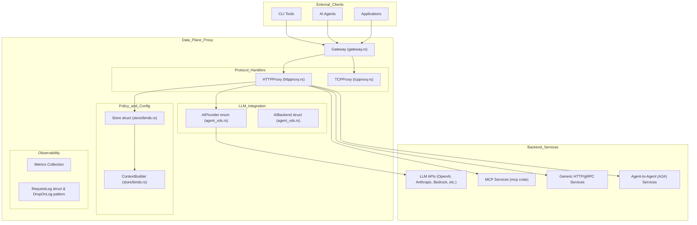
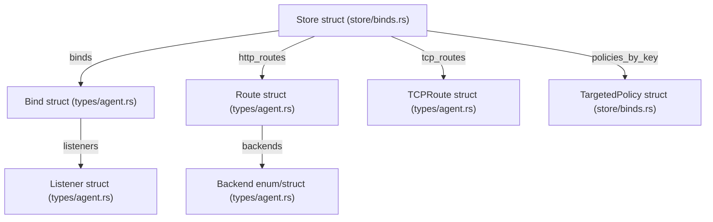
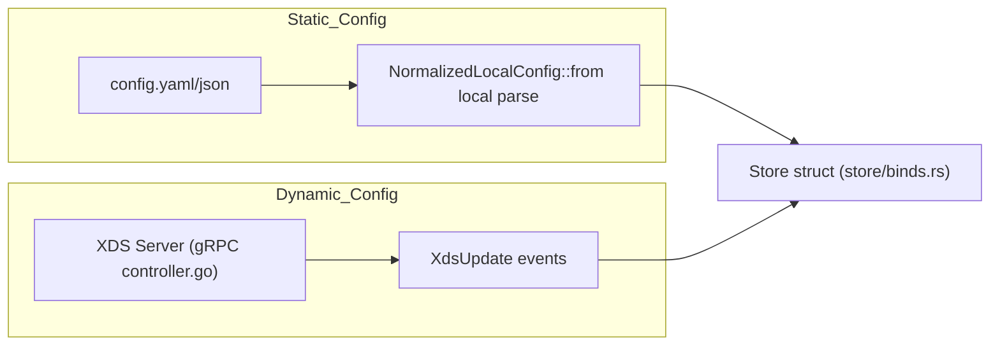
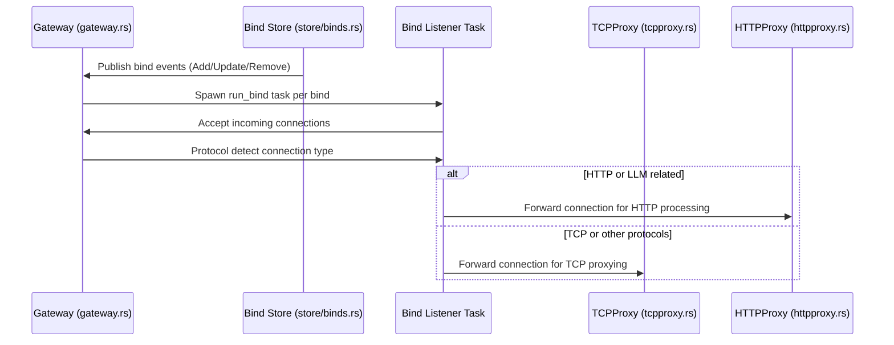
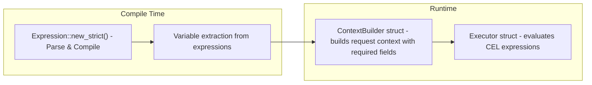
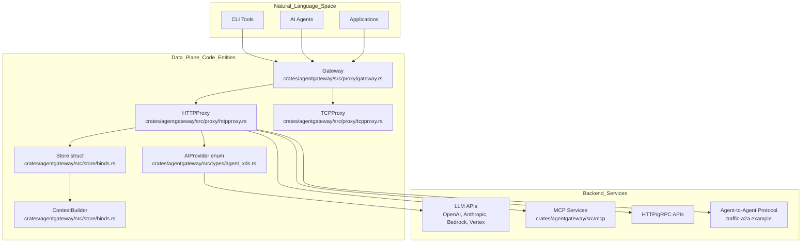

<!-- source: DeepWiki mcp.deepwiki.com · repo agentgateway/agentgateway · page 1.2 Architecture Overview · fetched 2026-10-21 -->

# Architecture Overview

Relevant source files

The following files were used as context for generating this wiki page:

- [CODE_OF_CONDUCT.md](CODE_OF_CONDUCT.md)
- [README.md](README.md)
- [architecture/cel.md](architecture/cel.md)
- [img/UI-homepage.png](img/UI-homepage.png)
- [img/architecture.svg](img/architecture.svg)
- [img/blacksmith-light.svg](img/blacksmith-light.svg)
- [img/blacksmith.svg](img/blacksmith.svg)
- [img/lf-stacked-color.png](img/lf-stacked-color.png)

This page provides a comprehensive view of the `agentgateway` system architecture. It covers the core subsystems, their roles within the data plane and control plane, details the configuration model, and highlights key code entities that implement major functions. The scope focuses on the high-level system organization, data flow, and runtime components, bridging natural language conceptual components to concrete code symbols.

Agentgateway is a multi-protocol gateway designed primarily to enable and govern connectivity for **agentic AI** applications, including LLM provider routing, Model Context Protocol (MCP), Agent-to-Agent (A2A) communication, and generic HTTP/gRPC proxies.

---

## System Components

Agentgateway is architected as a modern multi-language system with distinct components:

| Component             | Language | Role                                                                                       |
|-----------------------|----------|--------------------------------------------------------------------------------------------|
| **Data Plane Proxy**   | Rust     | Core proxy functionality: accepts inbound connections, protocol detection, routing, policy enforcement, LLM & AI protocol integration. Located in `crates/agentgateway`. Managed at runtime by the `App` and `Gateway` structs. |
| **Kubernetes Controller** | Go    | Watches Kubernetes Gateway API and agentgateway CRDs, generates XDS configs, and pushes dynamic updates to the proxy via gRPC. Located in `controller/`.                                            |
| **Web UI**             | Next.js  | Browser-based configuration management, playgrounds, and admin UI for users and operators. Located in `ui/`.                                                                                           |

At runtime, the `App` struct in the standalone proxy binary (`crates/agentgateway-app/src/main.rs`) instantiates and drives the `Gateway` (`crates/agentgateway/src/proxy/gateway.rs`), which manages network binds, listeners, request dispatch, and protocol-specific proxy modules.

Sources: [crates/agentgateway/src/proxy/gateway.rs:134-175](), [README.md:30-33]()

---

## High-Level Architecture Diagram

Below is a high-level component diagram showing the flow from external clients through the data plane proxy to backend services and subsystems.

Sources: [crates/agentgateway/src/proxy/gateway.rs:169-254](), [crates/agentgateway/src/proxy/httpproxy.rs:74-242](), [crates/agentgateway/src/store/binds.rs:93-115](), [crates/agentgateway/src/types/agent_xds.rs:1-139]()

---

## Data Model and Runtime State

The core in-memory data model is maintained by the `Store` struct, which aggregates configuration and runtime state. Key entities reflect the hierarchical nature of networking and routing configuration.

### Description of Key Data Entities

| Entity                | Responsibility                                                | Reference                                                |
|-----------------------|---------------------------------------------------------------|----------------------------------------------------------|
| `Store`               | Aggregates runtime configuration state, including binds, routes, backends, and policies. | [crates/agentgateway/src/store/binds.rs:93-115]()       |
| `Bind`                | Represents an IP:port bind, associated with listeners and protocols. | [crates/agentgateway/src/types/agent.rs:48-57]()        |
| `Listener`            | Logical frontend listener matching hostnames and protocols.    | [crates/agentgateway/src/types/agent.rs:118-127]()      |
| `Route` (HTTP)        | HTTP layer routes with matching rules and backend targets.    | [crates/agentgateway/src/types/agent.rs:33]()           |
| `TCPRoute`             | Routing at the TCP socket level.                              | [crates/agentgateway/src/types/agent.rs:128-134]()      |
| `Backend`             | Defines upstream destinations: LLM providers, MCP, HTTP backends. | [crates/agentgateway/src/types/agent.rs:27-38]()        |
| `TargetedPolicy`      | Policy fragments keyed by bind, route, and backend for runtime evaluation. | [crates/agentgateway/src/store/binds.rs:200-230]()      |

Sources: [crates/agentgateway/src/store/binds.rs:93-115](), [crates/agentgateway/src/types/agent.rs:20-134]()

---

## Configuration Architecture

Agentgateway supports dual configuration paradigms:

- **Static Local Configuration:** Parsed from JSON/YAML files (e.g., `config.yaml`), represented internally by `NormalizedLocalConfig`. Enables simple file-based deployment.  
- **Dynamic Configuration via XDS:** Provided by the Kubernetes controller using CRDs and Gateway API watches; delivered dynamically to the proxy via gRPC streams (`XdsUpdate` events).

Both are unified in the runtime `Store` for seamless hot reload and traffic continuity.

The runtime `Store` converts protobuf definitions like `XdsBind`, `XdsRoute`, and `XdsBackend` to internal Rust structs reflecting binds, routes, backends, policies, and listeners.

Sources: [crates/agentgateway/src/store/binds.rs:6-40](), [crates/agentgateway/src/types/local.rs:70-94](), [schema/config.json:1-122]()

---

## Request Processing Architecture

### Gateway and Connection Lifecycle

- The `Gateway` struct in `crates/agentgateway/src/proxy/gateway.rs` is the main runtime entrypoint for incoming network connections.
- It manages the lifecycle of **binds** (physical IP:port configurations), dynamically adding, updating, and removing them at runtime by subscribing to the bind store updates.
- For each bind, `Gateway::run_bind` is spawned asynchronously to listen and accept connections with protocol detection.
- Connections are protocol sniffed (HTTP/1.1, HTTP/2, TCP, TLS, HBONE).
- Based on the protocol and bind configuration, connections are dispatched to protocol-specific proxy modules like `HTTPProxy` or `TCPProxy`.

The `Gateway` supports per-core listeners for CPU affinity optimizations by spawning dedicated Tokio runtimes pinned to CPU cores.

Sources: [crates/agentgateway/src/proxy/gateway.rs:134-233](), [crates/agentgateway/src/proxy/tcpproxy.rs:32-200](), [crates/agentgateway/src/proxy/httpproxy.rs:60-120]()

---

### HTTP Proxy Processing

- The `HTTPProxy` subsystem handles HTTP/1.x, HTTP/2, gRPC requests, and LLM API routing.
- It matches incoming requests against HTTP routes based on host, path, method, and headers.
- Routes can delegate to route groups enabling flexible route composition.
- Applies multi-phase policies: authentication (JWT, API Keys, OIDC), authorization (CEL-based), rate limiting, CORS, request/response header & body transformations, and observability logging.
- Integrated AI/LLM routing layer translates requests/responses to/from unified AIProvider abstractions, supporting a range of backend providers transparently.
- Uses a `Client` abstraction to perform upstream backend requests supporting various transport protocols including TLS, HBONE tunnel, and connection pooling.

Sources: [crates/agentgateway/src/proxy/httpproxy.rs:60-242](), [crates/agentgateway/src/client/mod.rs:20-220]()

---

### TCP Proxy Processing

- `TCPProxy` implements Layer 4 TCP proxying capabilities with backend routing.
- Listeners route traffic based on SNI (extracted by TLS sniffing) or socket address.
- Applies network-level policy enforcement including authorization and external authorization (ExtAuthz).
- Supports TCP forwarding and TLS termination as configured.
- Can route traffic via waypoint proxies and HBONE tunnels for secure, mTLS-based traffic forwarding.

Sources: [crates/agentgateway/src/proxy/tcpproxy.rs:32-200]()

---

## CEL Expression Engine in Architecture

Agentgateway uses [CEL (Common Expression Language)](https://cel.dev) extensively for dynamic, user-defined policy expressions, request transformations, authorization, and logging.

- CEL expressions are compiled on configuration change, extracting the variables and attributes referenced.
- At runtime, `ContextBuilder` conditionally includes fields into evaluation contexts only if referenced, optimizing performance.
- This allows CEL to be used for policies such as authentication, authorization, header/body transformation, rate limiting, and observability attributes.

Sources: [crates/agentgateway/src/store/binds.rs:200-230](), [architecture/cel.md:1-37]()

---

## Observability and Telemetry Integration

Observability is core to agentgateway, providing detailed metrics, logging, and tracing features:

- **Request Logging:** Per-request `RequestLog` captures metadata, including source context, TLS info, backend call details, enriched via CEL expressions.
- **DropOnLog:** RAII pattern ensures logs and metrics are flushed when request processing completes.
- **Metrics:** Prometheus-compatible counters and gauges with rich labeling per bind, listener, route, backend, and transport protocol.
- **Tracing:** OpenTelemetry spans trace requests through asynchronous processing stages, protocol proxies, and backend calls.
- Provides rich telemetry to administrators for traffic flows, error rates, latency, and policy decision insights.

Sources: [crates/agentgateway/src/proxy/httpproxy.rs:117-158](), [crates/agentgateway/src/store/binds.rs:200-230]()

---

## Appendix: System Architecture Visual Reference

This diagram bridges between the "natural language space" (how external components are known conceptually) and "code entity space" (concrete implementations in code), organizing major subsystems with file path references.

This visual map aids developers and operators tracing from conceptual elements down to actual code modules for debugging, development, or extension.

Sources: [crates/agentgateway/src/proxy/gateway.rs:169-254](), [crates/agentgateway/src/proxy/httpproxy.rs:74-115](), [crates/agentgateway/src/store/binds.rs:93-115](), [crates/agentgateway/src/types/agent_xds.rs:1-15]()

---

# References

- Main Rust Proxy Implementation: `crates/agentgateway/`
- Kubernetes Controller and XDS Protocol: `controller/`
- Web UI Frontend: `ui/`
- Configuration Schema: `schema/config.json`, `schema/config.md`
- Architecture Diagrams: `img/architecture.svg`
- CEL Engine: `architecture/cel.md`

This document provides a comprehensive technical orientation on the agentgateway architecture to empower developers, integrators, and operators with a solid understanding of the internal system design, data flow, and code structure. Further detailed technical specifics are available in child pages covering protocol handling, configuration, policy evaluation, security, and observability subsystems.

Sources:  
[crates/agentgateway/src/proxy/gateway.rs:1-236](),  
[crates/agentgateway/src/proxy/tcpproxy.rs:1-200](),  
[crates/agentgateway/src/proxy/httpproxy.rs:60-242](),  
[crates/agentgateway/src/store/binds.rs:93-230](),  
[crates/agentgateway/src/types/agent_xds.rs:1-139](),  
[crates/agentgateway/src/types/agent.rs:20-134](),  
[crates/agentgateway/src/types/local.rs:70-94](),  
[architecture/cel.md:1-37](),  
[README.md:30-33]()

---

