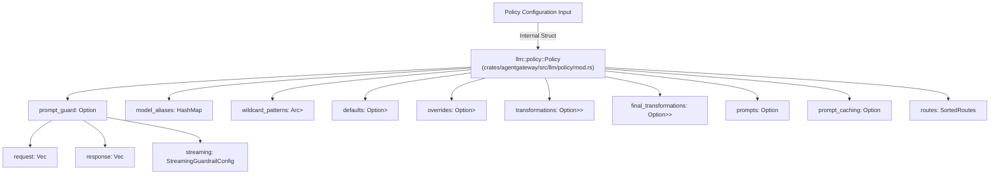
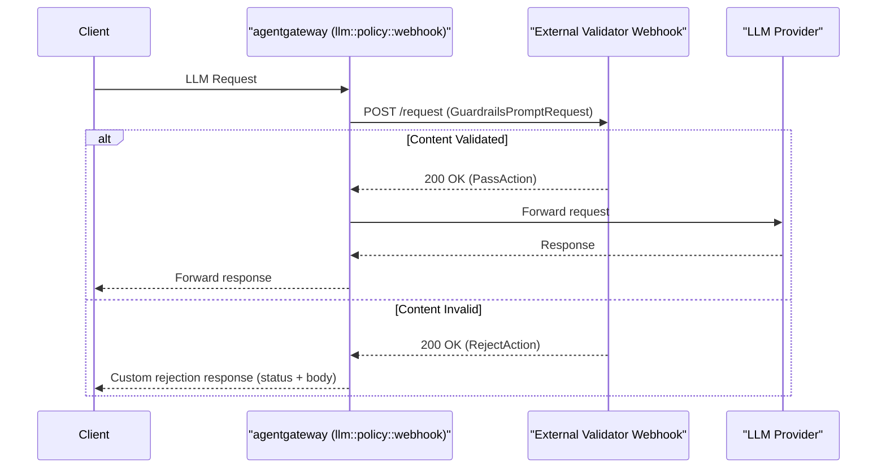
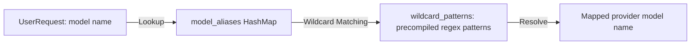
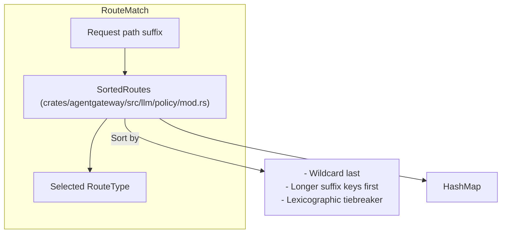
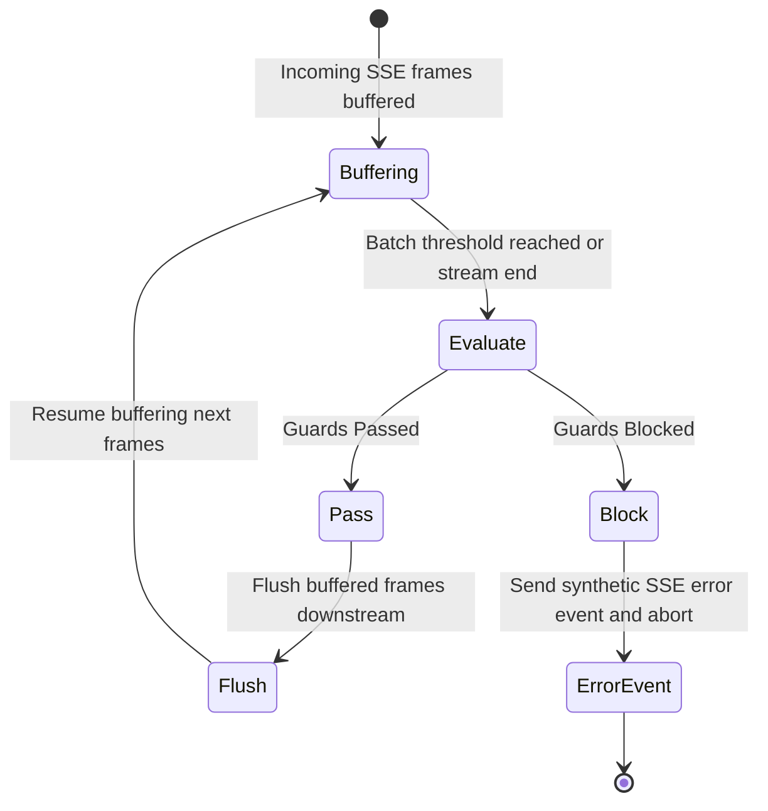

<!-- source: DeepWiki mcp.deepwiki.com · repo agentgateway/agentgateway · page 8.5 AI Policies and Prompt Guards · fetched 2026-10-21 -->

# AI Policies and Prompt Guards

<details>
<summary>Relevant source files</summary>

The following files were used as context for generating this wiki page:

- [controller/api/v1alpha1/agentgateway/ai_policy.go](controller/api/v1alpha1/agentgateway/ai_policy.go)
- [controller/pkg/agentgateway/plugins/ai_policies.go](controller/pkg/agentgateway/plugins/ai_policies.go)
- [crates/agentgateway/src/llm/policy/azure_content_safety.rs](crates/agentgateway/src/llm/policy/azure_content_safety.rs)
- [crates/agentgateway/src/llm/policy/bedrock_guardrails.rs](crates/agentgateway/src/llm/policy/bedrock_guardrails.rs)
- [crates/agentgateway/src/llm/policy/google_model_armor.rs](crates/agentgateway/src/llm/policy/google_model_armor.rs)
- [crates/agentgateway/src/llm/policy/mod.rs](crates/agentgateway/src/llm/policy/mod.rs)
- [crates/agentgateway/src/llm/policy/moderation.rs](crates/agentgateway/src/llm/policy/moderation.rs)
- [crates/agentgateway/src/llm/policy/streaming_guardrails.rs](crates/agentgateway/src/llm/policy/streaming_guardrails.rs)
- [crates/agentgateway/src/llm/policy/tests.rs](crates/agentgateway/src/llm/policy/tests.rs)
- [crates/agentgateway/src/llm/policy/webhook.rs](crates/agentgateway/src/llm/policy/webhook.rs)

</details>


AI Policies provide LLM-specific request and response processing capabilities such as prompt validation, content filtering, model aliasing, parameter injection, and prompt/message enrichment. These policies are applied to requests routed to AI backends within the LLM processing pipeline to ensure safe, compliant, and enriched interactions with language models.

This section is a **parent page** covering the high-level policy framework, moderation integrations, model routing, and prompt enrichment features. For detailed subtopics, refer to the following child pages:

- [PII Detection and Redaction](#8.5.1) — Built-in PII recognizers and redaction/rejection behavior in prompt guards.
- [Streaming Guardrails](#8.5.2) — Guardrail evaluation semantics over streaming responses and buffered text windows.

For related topics:  
- General traffic policies (e.g., rate limiting, authentication) are discussed in [Section 6. Traffic Management](../6).  
- LLM provider abstraction and request/response format translation appear in [Section 8.2. Provider Abstraction Layer](../8.2).

---

## Overview

AI Policies are represented by the `llm::policy::Policy` Rust struct and can be configured at various hierarchical levels (global, route, backend). Policies merge according to precedence rules to compose effective guardrails and transformation rules.

The policy system supports the following key functions:

- **Prompt Guards:** Content validation and filtering for both prompts (requests) and model outputs (responses) using regex, webhooks, or managed cloud service integrations.
- **Model Aliasing:** Mapping of logical or user-friendly model names to concrete provider-specific model identifiers, including wildcard aliases.
- **Prompt Enrichment:** Static messages prepended or appended around client prompts to control or influence model behavior.
- **Defaults and Overrides:** Inject default values for request fields or forcibly override user-provided parameters.
- **CEL Transformations:** Dynamic request modifications using CEL expressions, applied before and after provider format conversion.
- **Route Type Overrides:** Dynamic routing of requests based on path suffixes to select specific LLM interaction routes, such as chat or embeddings.
- **Prompt Caching:** Settings to enable prompt caching markers for compatible AI providers.

These capabilities collectively enable configurable, extensible, and composable AI request and response handling.

Sources: [crates/agentgateway/src/llm/policy/mod.rs:159-201]()

---

## Policy Structure

The main AI policy struct `llm::policy::Policy` organizes various components for each policy configuration:



- `prompt_guard` contains the collection of request and response content guards.  
- `model_aliases` map user-friendly model names to provider-specific identifiers, with support for wildcard aliasing.  
- `defaults` and `overrides` allow injecting or replacing request parameters.  
- `transformations` and `final_transformations` employ CEL for dynamic request body transformations before and after provider format conversion.  
- `prompts` enable static insertion (prepend/append) of messages around user prompts (prompt enrichment).  
- `routes` support suffix-based request path routing overrides with deterministic sorting order.  
- `wildcard_patterns` hold compiled regex-like patterns for efficient alias resolution runtime.  
- `prompt_caching` configures caching markers for supported providers.

Sources: [crates/agentgateway/src/llm/policy/mod.rs:159-201]()

---

## Prompt Guards and Moderation Integrations

Prompt Guards perform content validation and moderation at two phases: **requests** (before sending to the model) and **responses** (after receiving from the model). Guards evaluate content for compliance, block or mask inappropriate content, or audit suspicious data without enforcement.

### Request and Response Guards Overview

- Guards inspect message content in the prompt or response, potentially using request/response HTTP headers or other context.
- Evaluation produces a `GuardrailOutcome` that controls the enforcement action: allow, mask, audit, or reject.
- Each guard can specify customized rejection response content and status code.

Integrated prompt guard types include:

| Guard Type          | Function                                   | Implementation Location                          |
|---------------------|--------------------------------------------|------------------------------------------------|
| Regex / PII         | Pattern matching to detect/mask/reject PII | `llm::policy::pii` (see [PII Detection and Redaction](#8.5.1))             |
| Webhook              | HTTP webhook calls for real-time validation | `llm::policy::webhook` ([webhook.rs])          |
| OpenAI Moderation    | OpenAI moderation API integration           | `llm::policy::moderation` ([moderation.rs])    |
| Google Model Armor   | GCP Model Armor content filtering            | `llm::policy::google_model_armor` ([google_model_armor.rs]) |
| AWS Bedrock Guardrails | AWS Bedrock ApplyGuardrail API integration  | `llm::policy::bedrock_guardrails` ([bedrock_guardrails.rs])         |
| Azure Content Safety | Azure AI content safety analysis            | `llm::policy::azure_content_safety` ([azure_content_safety.rs]) |

---

### Webhook Guards

Webhook guards forward prompt or response content to an external HTTP webhook for evaluation. The gateway sends JSON payloads describing the prompt messages or response choices.

The webhook reply includes an action: pass, mask, or reject. This allows flexible custom guard logic external to the gateway.

Failure modes govern behavior during webhook errors or downtime: `FailOpen` permits requests, `FailClosed` rejects them.

Selective forwarding of original request headers to the webhook can be controlled by header matching rules.

#### Webhook Guard Execution Flow



Sources: [crates/agentgateway/src/llm/policy/webhook.rs:41-197](), [crates/agentgateway/src/llm/policy/tests.rs:9-63]()

---

### Provider-Specific Guards

The gateway supports integration with managed cloud AI content safety and moderation services for enhanced guardrail effectiveness:

- **Google Model Armor:** Detects Responsible AI (RAI) violations, jailbreak attempts, CSAM, malicious URLs, virus scans, and sensitive data protection via sanitization API calls.  
- **AWS Bedrock Guardrails:** Leverages Bedrock's content safety ApplyGuardrail API reporting block/mask events and redacting sensitive metadata.  
- **Azure Content Safety:** Provides harmful content category analysis and jailbreak detection APIs with configurable severity thresholds.  
- **OpenAI Moderation:** Calls OpenAI moderation endpoints with configurable model versions to assess user prompt content.

These integrations utilize backend policies to configure authentication, TLS, and endpoint URLs.

Sources:  
- Google Model Armor: [crates/agentgateway/src/llm/policy/google_model_armor.rs:1-219]()  
- AWS Bedrock Guardrails: [crates/agentgateway/src/llm/policy/bedrock_guardrails.rs:1-201]()  
- Azure Content Safety: [crates/agentgateway/src/llm/policy/azure_content_safety.rs:1-179]()  
- OpenAI Moderation: [crates/agentgateway/src/llm/policy/moderation.rs:1-56]()

---

## Model Aliasing

Model aliasing allows logical or user-friendly model names in requests to be automatically rewritten to specific AI provider backend model identifiers. This supports model upgrades, environment-specific naming, and failover routing.

Key points:

- Aliases are stored as a mapping from string keys to provider model names.
- Wildcards (`*`) are supported, allowing prefix matching with longest key priority.
- Internally, wildcard patterns are compiled and sorted to ensure efficient and deterministic matching.
- Aliasing happens early in the LLM request processing pipeline before transformations and routing.

### Model Alias Resolution Flow



Sources: [crates/agentgateway/src/llm/policy/mod.rs:179-191]()

---

## Route Resolution

Requests can be routed dynamically based on path suffixes to support different LLM route types such as chat, embeddings, or text completions. The `SortedRoutes` container maintains the suffix-to-route-type mappings.

- Routes are stored in deterministic order: the wildcard `"*"` is always last, longer suffixes take precedence, with lexicographic tie-breakers.
- This ordering ensures that the most specific suffix match is used for routing decisions in LLM request handling.

### Route Sorting Logic



This flexible route suffix resolution supports multiple LLM usage scenarios within a unified gateway configuration.

Sources: [crates/agentgateway/src/llm/policy/mod.rs:79-155](), [crates/agentgateway/src/llm/policy/mod.rs:194-200]()

---

## Streaming Guardrails

AI responses delivered as streaming data (e.g., Server-Sent Events, SSE) require guard evaluation over partial, incrementally received text chunks instead of complete static responses.

### Streaming Guard Evaluation Pipeline

1. Incoming SSE byte frames are buffered without immediate forwarding.  
2. Extracted text deltas accumulate until a configurable threshold (`DEFAULT_EVAL_THRESHOLD` ≈ 1024 bytes).  
3. For guard evaluation, the window combines an **overlap tail** from previous evaluation batches (`OVERLAP_BYTES` ≈ 256 bytes) plus the new batch, ensuring guards detect patterns crossing batch boundaries.  
4. Registered streaming evaluators asynchronously run guard checks over this window.  
5. If all guards pass: buffered frames are flushed downstream, and buffering resumes for the next batch.  
6. If any guard blocks: buffered frames are dropped, and a synthetic SSE error event aborts the stream, preventing further downstream content.  
   
This approach balances low-latency streaming with early guardrail enforcement but may miss patterns spanning larger contexts than the sliding window.

### Streaming Guardrail Evaluation State Diagram



Sources: [crates/agentgateway/src/llm/policy/streaming_guardrails.rs:41-86]()

---

## Prompt Enrichment and Defaults

The gateway supports static prompt enrichment where messages can be prepended or appended around the client prompt to provide additional instruction or context to the model.

- Enrichment messages specify roles (e.g., SYSTEM, USER) and content per configured policies.  
- This static enrichment applies uniformly to all requests routed by the policy, distinguishing it from dynamic context injection such as RAG.  
- Some providers (e.g., Anthropic) mandate prompt fields as dedicated JSON keys instead of role-based messages; these are supported via default request field injection.  
- Policies also support default and override request body field settings with static values or CEL expressions.

### Prompt Enrichment Example Configuration

```yaml
ai:
  promptEnrichment:
    prepend:
      - role: SYSTEM
        content: "Answer all questions in French."
    append:
      - role: USER
        content: "Describe the painting as if you were a famous 17th-century art critic."
```

Sources: [controller/api/v1alpha1/agentgateway/ai_policy.go:8-60]()

---

# Child Pages

- **[PII Detection and Redaction](#8.5.1):** Covers built-in PII recognizers, regex processing, masking, rejection actions, and configuration details.  
- **[Streaming Guardrails](#8.5.2):** Explains architecture and implementation of guardrail evaluation over streaming responses, event buffering, and error injection.

---

This page provides a high-level overview of the AI Policies and Prompt Guards framework within Agentgateway, focusing on composable prompt validation, moderation integrations, dynamic model routing, and policy-driven prompt enrichment.

Sources:  
- [crates/agentgateway/src/llm/policy/mod.rs:1-202]()  
- [crates/agentgateway/src/llm/policy/tests.rs:1-227]()  
- [controller/api/v1alpha1/agentgateway/ai_policy.go:1-196]()  
- [crates/agentgateway/src/llm/policy/bedrock_guardrails.rs:1-216]()  
- [crates/agentgateway/src/llm/policy/google_model_armor.rs:1-219]()  
- [crates/agentgateway/src/llm/policy/moderation.rs:1-56]()  
- [crates/agentgateway/src/llm/policy/azure_content_safety.rs:1-179]()  
- [crates/agentgateway/src/llm/policy/webhook.rs:1-197]()  
- [crates/agentgateway/src/llm/policy/streaming_guardrails.rs:1-86]()

---

