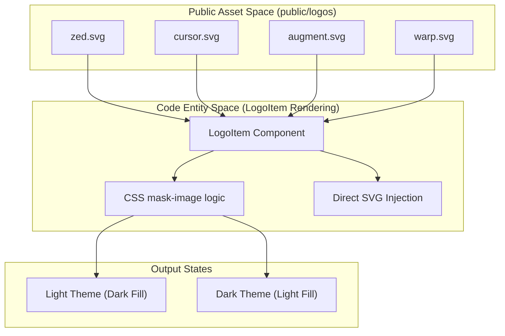
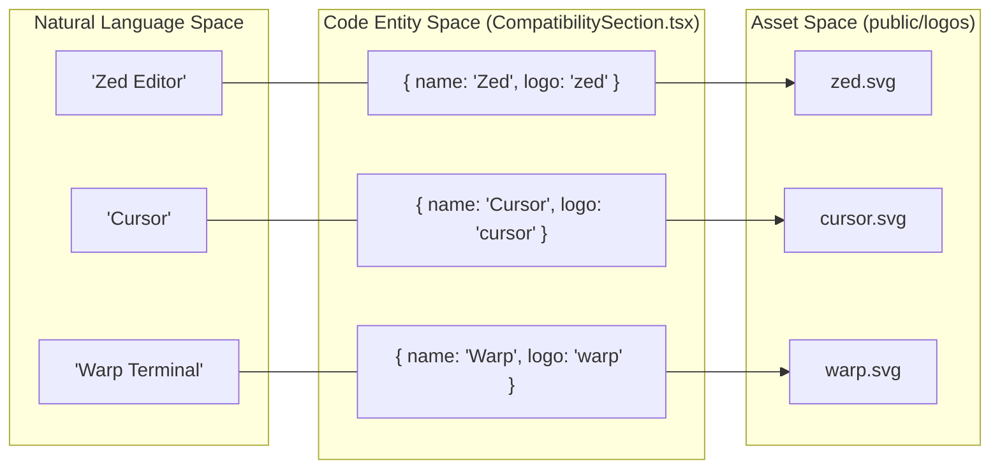

<!-- source: DeepWiki mcp.deepwiki.com · repo agentsmd/agents.md · extra page Single-Variant Logos · fetched 2026-10-21 -->

# Single-Variant Logos

<details>
<summary>Relevant source files</summary>

The following files were used as context for generating this wiki page:

- [public/logos/augment.svg](public/logos/augment.svg)
- [public/logos/copilot.svg](public/logos/copilot.svg)
- [public/logos/cursor.svg](public/logos/cursor.svg)
- [public/logos/goose.svg](public/logos/goose.svg)
- [public/logos/warp.svg](public/logos/warp.svg)
- [public/logos/zed.svg](public/logos/zed.svg)

</details>


## Purpose and Scope

This document describes the single-variant logo assets in the `public/logos/` directory that use either CSS masking techniques or standalone color schemes. These logos differ from theme-aware logo pairs (see [Theme-Aware Logo Pairs](#5.1.1)) by using a single SVG file that either adapts to theme changes through CSS manipulation or maintains consistent branding regardless of theme.

Single-variant logos fall into two categories:
1. **CSS-maskable logos**: SVG files with a single fill color designed to be recolored via CSS `mask-image` property.
2. **Standalone logos**: SVG files with embedded brand colors that remain constant across themes.

For additional agent logos with lower importance scores, see [Additional Agent Logos](#5.1.3). For rendering implementation details, see [LogoItem Rendering](#4.1.3).

---

## Asset Organization

Single-variant logos follow a simplified naming convention without light/dark suffixes:

| Agent | File Path | Primary Fill | Implementation Type |
| :--- | :--- | :--- | :--- |
| **Zed** | `public/logos/zed.svg` | `white` | CSS-Maskable |
| **Cursor** | `public/logos/cursor.svg` | `#26251e` | CSS-Maskable |
| **Goose** | `public/logos/goose.svg` | `black` | CSS-Maskable |
| **Copilot** | `public/logos/copilot.svg` | Implicit black | CSS-Maskable |
| **Warp** | `public/logos/warp.svg` | `black` | CSS-Maskable (Scaled) |
| **Augment** | `public/logos/augment.svg` | `#000` | CSS-Maskable |

**Sources:** [public/logos/zed.svg:1-4](), [public/logos/cursor.svg:1-15](), [public/logos/goose.svg:1-12](), [public/logos/copilot.svg:1-1](), [public/logos/warp.svg:1-8](), [public/logos/augment.svg:1-8]()

---

## Logo Asset Structure

This diagram maps the relationship between the physical SVG files and the logical rendering paths within the Next.js application.

**Logo Data Flow Diagram**


**Sources:** [public/logos/zed.svg:1-4](), [public/logos/cursor.svg:1-15](), [public/logos/augment.svg:1-8](), [public/logos/warp.svg:1-8]()

---

## CSS-Maskable Logos

CSS-maskable logos are designed with a single fill color and simple path structures that allow the `LogoItem` component to apply CSS masking for theme-aware recoloring.

### Zed Editor
The Zed logo uses a white fill with complex path geometry representing the "Z" letterform. It utilizes `fill-rule="evenodd"` and `clip-rule="evenodd"` to handle the complex overlapping segments of the vector.

**Key characteristics:**
- **File:** `public/logos/zed.svg` [public/logos/zed.svg:1-4]()
- **Viewbox:** `0 0 260 260`
- **Fill color:** `white` [public/logos/zed.svg:2]()

### Cursor IDE
The Cursor logo uses a dark fill (`#26251e`) defined within an internal `<style>` block. It applies a global transform to the path group for alignment.

**Key characteristics:**
- **File:** `public/logos/cursor.svg` [public/logos/cursor.svg:1-15]()
- **Fill color:** `#26251e` [public/logos/cursor.svg:7]()
- **Structure:** Uses a `.st0` class for the fill property [public/logos/cursor.svg:12-13]()

### Augment
The Augment logo consists of multiple paths all sharing a `#000` (black) fill. It represents a bracketed design with interior circular elements.

**Key characteristics:**
- **File:** `public/logos/augment.svg` [public/logos/augment.svg:1-8]()
- **Path Count:** 6 distinct `<path>` elements [public/logos/augment.svg:2-7]()
- **Fill color:** `#000`

### Goose
The Goose logo uses a specialized clipping path for its silhouette.

**Key characteristics:**
- **File:** `public/logos/goose.svg` [public/logos/goose.svg:1-12]()
- **Structure:** Defines a `<clipPath>` with ID `clip0_2096_5193` [public/logos/goose.svg:8-10]()
- **Fill color:** `black` [public/logos/goose.svg:5]()

### Warp Terminal
The Warp logo includes a transform scale adjustment to ensure visual weight consistency with other icons in the marquee.

**Key characteristics:**
- **File:** `public/logos/warp.svg` [public/logos/warp.svg:1-8]()
- **Transform:** `scale(0.82)` applied to the main group [public/logos/warp.svg:3]()
- **Optimization:** Explicitly scaled down to reduce visual weight [public/logos/warp.svg:2]()

---

## SVG Implementation Comparison

The following table details the technical properties of the primary single-variant logos.

| Agent | Viewbox | Path Count | Masking Method | Fill Value |
| :--- | :--- | :--- | :--- | :--- |
| **Zed** | `0 0 260 260` | 1 | Compound Path | `white` |
| **Augment** | `0 0 512 512` | 6 | Multi-path | `#000` |
| **Goose** | `0 0 24 24` | 1 | ClipPath Group | `black` |
| **Cursor** | `0 0 680 720` | 1 | CSS Class | `#26251e` |
| **Copilot** | `0 0 24 24` | 2 | Standard Paths | Implicit |

**Sources:** [public/logos/zed.svg:1-2](), [public/logos/augment.svg:1-7](), [public/logos/goose.svg:3-6](), [public/logos/cursor.svg:2-13](), [public/logos/copilot.svg:1]()

---

## Technical Implementation Details

### Transform and Scaling Logic
Some logos, specifically Warp, require manual scaling within the SVG to match the visual footprint of surrounding logos in the `Marquee` system.

**Warp Transform Detail:**
```xml
<g transform="translate(32 32) scale(0.82) translate(-32 -32)">
  <!-- Path data -->
</g>
```
The sequence `translate(32 32) -> scale(0.82) -> translate(-32 -32)` performs a "scale-from-center" operation, reducing the icon size to 82% of its original viewbox footprint.

**Sources:** [public/logos/warp.svg:3-6]()

### Component Association Diagram
This diagram bridges the natural language names of the agents to their specific code representations and asset paths.



**Sources:** [public/logos/zed.svg:1](), [public/logos/cursor.svg:1](), [public/logos/warp.svg:1]()

### Complexity and Rendering
- **Zed:** High path complexity (~800 characters of path data) requiring `evenodd` fill rules [public/logos/zed.svg:2]().
- **Augment:** High element count (6 paths) with precise coordinate positioning [public/logos/augment.svg:2-7]().
- **Copilot:** Low complexity, using standard 24x24 viewbox typical of UI icon sets [public/logos/copilot.svg:1]().

**Sources:** [public/logos/zed.svg:2](), [public/logos/augment.svg:2-7](), [public/logos/copilot.svg:1]()

---

