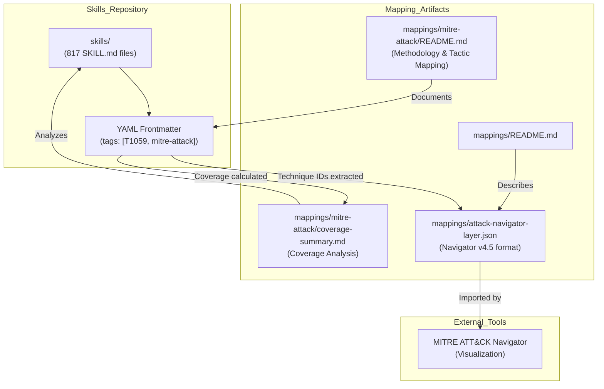
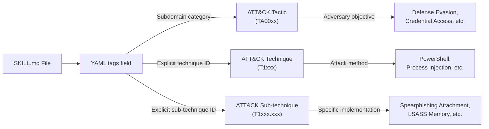
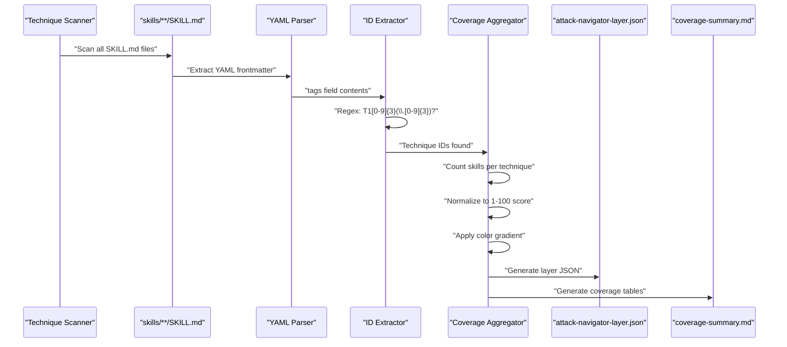

<!-- source: DeepWiki mcp.deepwiki.com · repo mukul975/Anthropic-Cybersecurity-Skills · page 4.1 MITRE ATT&CK Mapping · fetched 2026-10-26 -->

# MITRE ATT&CK Mapping

Relevant source files

The following files were used as context for generating this wiki page:

- [mappings/README.md](mappings/README.md)
- [mappings/attack-navigator-layer.json](mappings/attack-navigator-layer.json)
- [mappings/mitre-attack/README.md](mappings/mitre-attack/README.md)
- [mappings/mitre-attack/coverage-summary.md](mappings/mitre-attack/coverage-summary.md)
- [mappings/nist-csf/README.md](mappings/nist-csf/README.md)
- [mappings/nist-csf/csf-alignment.md](mappings/nist-csf/csf-alignment.md)
- [mappings/owasp/README.md](mappings/owasp/README.md)

## Purpose and Scope

This document explains how the 817 cybersecurity skills in this repository map to the [MITRE ATT&CK](https://attack.mitre.org) framework (Enterprise v16). The mapping enables threat-informed skill discovery, gap analysis, and automated security workflows driven by adversary behavior models.

For detailed coverage analysis across the 14 ATT&CK tactics and 291 unique techniques, see [ATT&CK Coverage Analysis](#4.1.1). For visualization and Navigator layer integration, see [ATT&CK Navigator Integration](#4.1.2). For mappings to other frameworks, see [NIST CSF 2.0 Mapping](#4.2) and [OWASP Top 10 Mapping](#4.3).

Sources: [mappings/mitre-attack/README.md:1-13]()

## Overview

MITRE ATT&CK is a curated knowledge base modeling cyber adversary behavior across attack lifecycle phases and target platforms. The framework organizes adversary tactics (objectives), techniques (methods), and sub-techniques (specific implementations) into a matrix that security practitioners use for:

- **Threat-informed defense** -- Prioritize skill development based on real-world adversary behavior observed in the wild.
- **Gap analysis** -- Identify ATT&CK techniques not yet covered by available skills in the repository.
- **Purple team exercises** -- Pair offensive (red team) and defensive (blue team) skills for each technique to validate detection coverage.
- **Agent-driven discovery** -- Enable AI agents to query skills by ATT&CK technique ID for automated security workflow execution.

This repository maps skills to ATT&CK Enterprise v16, which includes 14 tactics and hundreds of techniques spanning reconnaissance through impact phases of the attack lifecycle.

Sources: [mappings/mitre-attack/README.md:6-13]()

## Mapping Architecture

The MITRE ATT&CK mapping system consists of three primary artifacts located in the `mappings/` directory structure:

**Mapping Architecture Diagram** - Shows the flow from skill frontmatter tags through coverage analysis artifacts to external visualization tools.

### File Structure

| File Path | Purpose | Format |
|-----------|---------|--------|
| `mappings/mitre-attack/README.md` | Documents mapping methodology, tactic-to-subdomain alignment, and contribution guidelines. | Markdown |
| `mappings/mitre-attack/coverage-summary.md` | Provides detailed coverage statistics across 14 tactics, subdomain heat map, and technique-to-skill mappings. | Markdown |
| `mappings/attack-navigator-layer.json` | Machine-readable ATT&CK Navigator layer (v4.5 format) with technique coverage scores and color gradients. | JSON |
| `mappings/README.md` | High-level overview of the Navigator layer, viewing instructions, and coverage statistics. | Markdown |

Sources: [mappings/README.md:1-18](), [mappings/mitre-attack/README.md:1-5]()

### Coverage Statistics

The current mapping encompasses a significant portion of the Enterprise matrix:

| Metric | Value |
|--------|-------|
| Total skills scanned | 742 |
| Unique ATT&CK techniques referenced | 218 |
| Parent techniques | 94 |
| Sub-techniques | 124 |
| Tactics with coverage | 14/14 (100%) |

Sources: [mappings/README.md:20-28]()

## Mapping Methodology

Skills map to ATT&CK at three hierarchical levels: tactics, techniques, and sub-techniques. Each level serves a distinct purpose in connecting hands-on capabilities to adversary behavior models.

**Skill-to-ATT&CK Mapping Hierarchy** - Illustrates the three-level mapping from skill tags to ATT&CK framework elements.

### Tactic Mapping (TA00xx)

Each of the 14 ATT&CK Enterprise tactics represents a distinct adversary objective. Skills map to tactics through their **subdomain category**, which determines whether the skill addresses offensive execution or defensive detection/prevention.

Key mappings include:

| Tactic | ID | Offensive Subdomains | Defensive Subdomains |
|--------|-----|---------------------|---------------------|
| Reconnaissance | TA0043 | `penetration-testing`, `red-teaming` | `threat-intelligence`, `phishing-defense` |
| Initial Access | TA0001 | `web-application-security`, `penetration-testing` | `phishing-defense`, `endpoint-security` |
| Credential Access | TA0006 | `penetration-testing`, `red-teaming` | `identity-access-management`, `soc-operations` |
| Defense Evasion | TA0005 | `red-teaming` | `malware-analysis`, `endpoint-security`, `threat-hunting` |
| Lateral Movement | TA0008 | `red-teaming`, `penetration-testing` | `network-security`, `threat-hunting`, `soc-operations` |

Sources: [mappings/mitre-attack/README.md:14-35]()

### Technique Mapping (T1xxx)

Skills map to specific techniques through **explicit technique IDs** in their YAML frontmatter `tags` field. 

Example technique mappings:

| Technique | ID | Example Skills |
|-----------|-----|---------------|
| Phishing | T1566 | `analyzing-phishing-email-headers`, `analyzing-certificate-transparency-for-phishing` |
| Exploit Public-Facing Application | T1190 | 41 `web-application-security` skills covering SQL injection, XSS, SSRF |
| OS Credential Dumping | T1003 | `penetration-testing` credential harvesting skills |
| PowerShell | T1059.001 | `analyzing-windows-event-logs-in-splunk`, malware analysis script skills |

Sources: [mappings/mitre-attack/README.md:37-52](), [mappings/README.md:58-71]()

### Sub-technique Mapping (T1xxx.xxx)

For precision, skills map to **sub-techniques** when applicable. 

Example sub-technique mappings:

| Sub-technique | ID | Example Skills |
|---------------|-----|---------------|
| Spearphishing Attachment | T1566.001 | `analyzing-email-headers-for-phishing-investigation` |
| Spearphishing Link | T1566.002 | `analyzing-certificate-transparency-for-phishing` |
| LSASS Memory | T1003.001 | `analyzing-memory-dumps-with-volatility` |
| DLL Side-Loading | T1574.002 | `analyzing-bootkit-and-rootkit-samples` |

Sources: [mappings/mitre-attack/README.md:54-60]()

## Technique Extraction Process

The ATT&CK Navigator layer and coverage statistics are generated by scanning all `SKILL.md` files for technique ID patterns:

**Technique Extraction Workflow** - Shows the automated process of extracting technique IDs from skill frontmatter and generating coverage artifacts.

Sources: [mappings/README.md:73-75]()

## Color Gradient Scoring

The ATT&CK Navigator layer applies a blue gradient to indicate coverage depth per technique:

| Coverage | Color Hex | Meaning |
|----------|-----------|---------|
| 1-2 skills | `#cfe2f3` | Light blue - Basic coverage |
| 3-5 skills | `#6fa8dc` | Medium blue - Moderate coverage |
| 6-10 skills | `#3d85c6` | Dark blue - Strong coverage |
| 11+ skills | `#1155cc` | Deep blue - Extensive coverage |

Sources: [mappings/README.md:49-56]()

## Using the Mappings

### For AI Agents
AI agents can query skills by technique ID or tactic keyword to automate security workflows. This is supported by the `mitre-attack` tag and specific technique IDs in the YAML frontmatter.

### For Human Users
The `coverage-summary.md` provides:
- **Subdomain Heat Map**: Shows which subdomains contribute skills to each tactic (H/M/L intensity).
- **Tactic Coverage Matrix**: Lists relevant subdomains and skill counts for all 14 tactics.

### For Visualization
Import `attack-navigator-layer.json` into the [MITRE ATT&CK Navigator](https://mitre-attack.github.io/attack-navigator) tool to view the matrix with blue-shaded techniques indicating coverage.

Sources: [mappings/README.md:11-18](), [mappings/mitre-attack/README.md:63-77](), [mappings/mitre-attack/coverage-summary.md:24-53]()

## Coverage Gaps

Analysis identifies areas where additional skill development is needed:
- **Firmware attacks**: T1542 (Pre-OS Boot)
- **Hardware additions**: T1200
- **Traffic signaling**: T1205

Sources: [mappings/mitre-attack/coverage-summary.md:167-177]()

## Contributing to Mappings

To add or update ATT&CK mappings:
1. Identify the skill's purpose (offensive/defensive).
2. Find the matching technique ID on [attack.mitre.org](https://attack.mitre.org).
3. Add the ID to the skill's YAML `tags` field.
4. Submit a PR with the technique URL as justification.

Sources: [mappings/mitre-attack/README.md:88-95]()

## Tactic Coverage Distribution

| Tactic | ID | Skills Count | Primary Subdomains |
|--------|-----|--------------|---------------------|
| Reconnaissance | TA0043 | ~48 | threat-intelligence, penetration-testing |
| Initial Access | TA0001 | ~45 | web-application-security, phishing-defense |
| Privilege Escalation | TA0004 | ~40 | penetration-testing, red-teaming, iam |
| Discovery | TA0007 | ~35 | penetration-testing, threat-hunting |
| Impact | TA0040 | ~35 | ransomware-defense, incident-response |

Sources: [mappings/mitre-attack/coverage-summary.md:7-22]()

---

