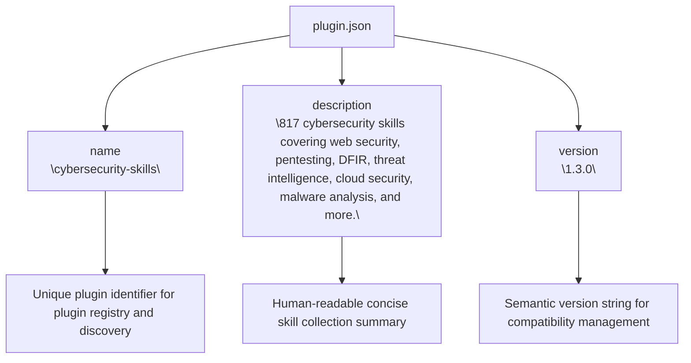
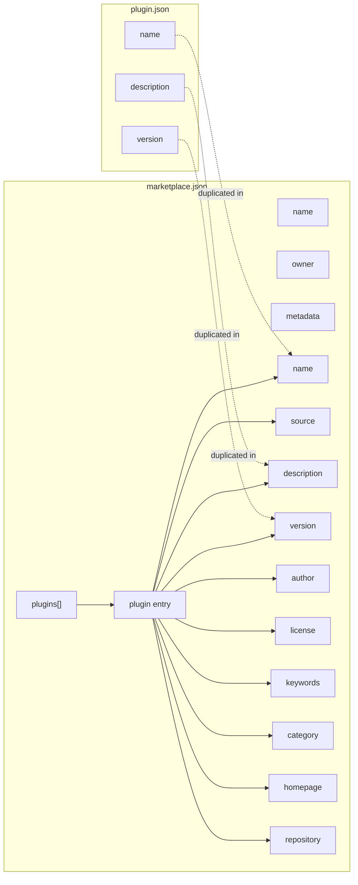
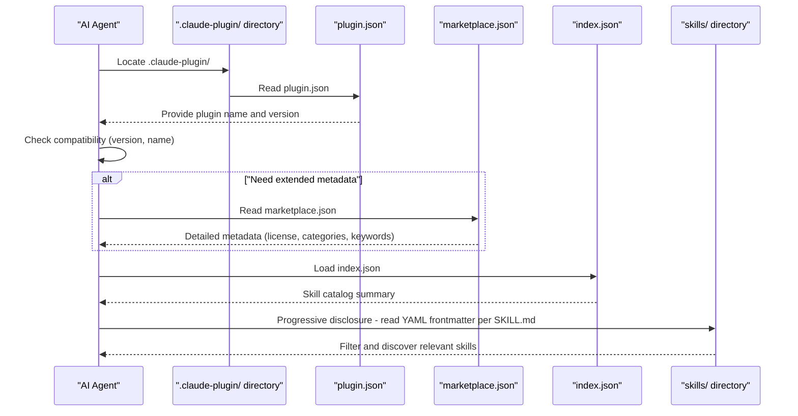
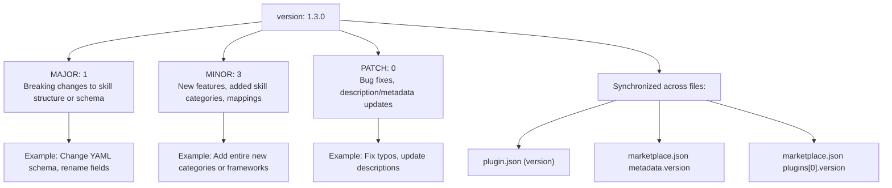
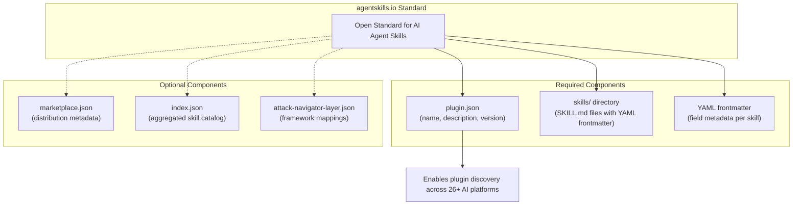
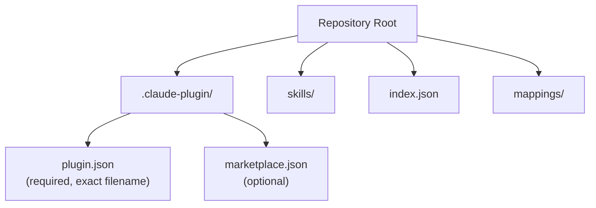
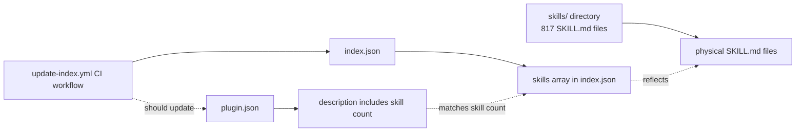
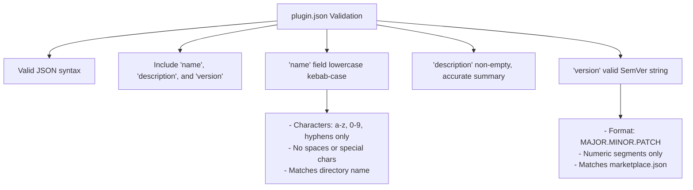
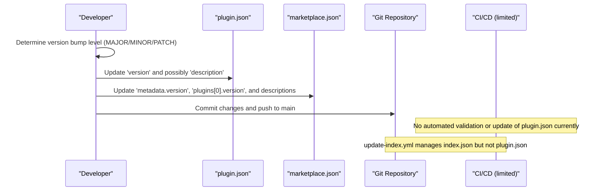

<!-- source: DeepWiki mcp.deepwiki.com · repo mukul975/Anthropic-Cybersecurity-Skills · page 5.2 Plugin Metadata · fetched 2026-10-26 -->

# Plugin Metadata

Relevant source files

The following files were used as context for generating this wiki page:

- [.claude-plugin/marketplace.json](.claude-plugin/marketplace.json)
- [.claude-plugin/plugin.json](.claude-plugin/plugin.json)
- [.github/workflows/sync-marketplace-version.yml](.github/workflows/sync-marketplace-version.yml)
- [.github/workflows/update-index.yml](.github/workflows/update-index.yml)
- [.github/workflows/validate-skills.yml](.github/workflows/validate-skills.yml)
- [CODE_OF_CONDUCT.md](CODE_OF_CONDUCT.md)
- [README.md](README.md)

The `plugin.json` file provides essential metadata that enables AI agents to discover and identify the cybersecurity skills collection within the agentskills.io ecosystem. This lightweight configuration serves as the primary interface for plugin identification and versioning.

This page explains the structure of `plugin.json`, its role in skill discovery and versioning, relationships with other metadata files like `marketplace.json` and `index.json`, and the conventions followed for maintaining consistency and compatibility. The explanations include data flow diagrams and detail how versioning synchronizes across files for reliable plugin usage.

For broader marketplace distribution settings including ownership and repository information, see the related [Marketplace Configuration](#5.1). For the complete catalog of skill metadata, see [Skills Index](#3.2).

---

## Purpose and Scope

The `plugin.json` file is the minimal metadata descriptor required by the agentskills.io standard for AI agent skills collections. It provides a compact, essential summary of the plugin identity, used primarily for discovery by agent platforms.

- It includes **only three fields**:  
  - `name` — the unique plugin identifier  
  - `description` — a brief summary of the skills collection  
  - `version` — semantic version string

- Located at `.claude-plugin/plugin.json` relative to repository root, it keeps plugin identification lightweight and fast without including extensive metadata.

This structural minimalism is intentional to enable agents to quickly identify compatible skill collections before deciding to load full metadata from `marketplace.json` or individual skill files.

Sources: `.claude-plugin/plugin.json:1-5`  

---

## File Structure

The structure of `plugin.json` is a flat JSON object containing exactly three fields:

| Field       | Type   | Required | Purpose                                                | Example Value                                               |
|-------------|--------|----------|--------------------------------------------------------|-------------------------------------------------------------|
| `name`      | string | Yes      | Unique plugin identifier, matches directory and marketplace naming | `"cybersecurity-skills"`                                     |
| `description` | string | Yes    | A concise description summarizing the skills included | `"817 cybersecurity skills covering web security, pentesting, ..." ` |
| `version`   | string | Yes      | Semantic version compatible with SemVer 2.0.0          | `"1.3.0"`                                                   |

The `name` must exactly match the plugin name defined in `marketplace.json` for consistency.

Sources: `.claude-plugin/plugin.json:1-5`, `.claude-plugin/marketplace.json:12-35`

---

## Metadata vs Marketplace Configuration

The `plugin.json` file contains minimal essential metadata. In contrast, `marketplace.json` — located in the same `.claude-plugin` directory — includes extended metadata required for marketplace publishing, ownership, licensing, and skill categorization.

- `plugin.json` provides a **lightweight, quick-access snapshot** of the plugin identity.  
- `marketplace.json` serves the **broader publishing ecosystem** with detailed entries for author contact, license, keywords, category, homepage URL, and repository location.  
- Fields **`name`**, **`description`**, and **`version`** appear in both places, maintaining metadata alignment.

| Aspect                 | plugin.json                        | marketplace.json                                 |
|------------------------|----------------------------------|-------------------------------------------------|
| **Purpose**            | Plugin identification and version compatibility | Marketplace distribution, licensing, ownership  |
| **Field count**        | 3                                | 10+ per plugin entry                             |
| **Size**               | ~200 bytes                       | ~1 KB                                           |
| **Key fields**         | `name`, `description`, `version` | All plugin fields including author and license  |
| **Update triggers**    | Version bumps                    | Metadata changes and version bumps               |
| **Audience**           | AI agents at discovery time      | Plugin marketplaces and registries               |

Sources: `.claude-plugin/plugin.json`, `.claude-plugin/marketplace.json`

---

## Discovery Mechanism

The plugin discovery process enabled by `plugin.json` works as follows:

**Plugin Discovery Flow Summary:**

1. Agent scans repository root for `.claude-plugin/`  
2. Reads `plugin.json` for fast plugin identity and version  
3. Checks internal version compatibility for safe usage  
4. Optionally reads `marketplace.json` for detailed metadata (optional)  
5. Loads the full skill index from `index.json` for catalog overview  
6. Uses progressive disclosure to selectively read individual skill metadata before loading full skill details

This mechanism enables efficient discovery and early filtering by agents, greatly improving performance and scalability given the large skill set.

Sources: `.claude-plugin/plugin.json`, `.claude-plugin/marketplace.json`, `index.json`, `.github/workflows/update-index.yml:11-63`

---

## Versioning Strategy

The `version` field in `plugin.json` uses [Semantic Versioning 2.0.0](https://semver.org), facilitating compatibility tracking and evolution management of the skills collection.

### Version Increment Guidelines

| Segment | When to increment                                   | Example                      |
|---------|----------------------------------------------------|------------------------------|
| **MAJOR** | Breaking changes to skill file structure or frontmatter schema | `1.0.0` → `2.0.0`            |
| **MINOR** | New skill categories or framework mappings, backward-compatible new features | `1.2.0` → `1.3.0`            |
| **PATCH** | Non-breaking fixes such as spelling corrections and metadata tweaks | `1.3.0` → `1.3.1`            |

### Synchronization

When the version is updated, these three locations must be changed simultaneously for consistency:

- `plugin.json.version`  
- `marketplace.json.metadata.version`  
- `marketplace.json.plugins[0].version`  

This workflow is currently manual but automated in the release CI workflow `.github/workflows/sync-marketplace-version.yml` which updates and commits these files automatically on GitHub release tag pushes.

Sources: `.claude-plugin/plugin.json:4`, `.claude-plugin/marketplace.json:7-10`, `.claude-plugin/marketplace.json:11-36`, `.github/workflows/sync-marketplace-version.yml:1-44`

---

## Relationship to agentskills.io Standard

The `plugin.json` file is a core requirement of the [agentskills.io standard](https://agentskills.io), complementing individual skill files that contain detailed skill metadata in their YAML frontmatter.

- `plugin.json` enables **efficient, standardized detection** of the plugin by agents and platforms.  
- Every skill in `/skills/` conforms to a defined YAML frontmatter schema [validated by CI workflows].  
- Full skill catalogs aggregate in `index.json` for rapid indexing.  
- `marketplace.json` and `attack-navigator-layer.json` provide optional but recommended additional metadata for distribution and visualization.

Sources: `.claude-plugin/plugin.json`, `.claude-plugin/marketplace.json`, `.github/workflows/validate-skills.yml`

---

## File Location and Naming

- The `plugin.json` file **must reside at** `.claude-plugin/plugin.json` relative to the root of the repository.  
- The directory `.claude-plugin` is a hidden folder by naming convention (leading dot) and standardized for agentskills.io compliance.  
- The filename is strictly `plugin.json`, lowercase, no variations.  
- The file must be valid JSON with UTF-8 encoding.  
- The file size stays minimal (~200 bytes as of current version).  

Sources: `.claude-plugin/plugin.json`

---

## Integration with Skills Catalog

- The `description` field in `plugin.json` includes an approximate skill count for human-readable context.  
- The official skill count and metadata are aggregated in `index.json` under the `skills` array.  
- The actual skills exist as directories with `SKILL.md` files inside the `/skills` directory.  
- The CI workflow `.github/workflows/update-index.yml` automatically regenerates `index.json` after any skill changes and synchronizes some metadata fields in `README.md` and `marketplace.json`. However, it **does not automatically update** `plugin.json` descriptions or version—this requires manual edits.

Sources: `.claude-plugin/plugin.json`, `index.json`, `.github/workflows/update-index.yml:11-113`

---

## Usage by AI Agent Platforms

Platforms that consume this skills collection use `plugin.json` for discovery and compatibility checks. Examples include:

| Platform             | Discovery Method                          | plugin.json Usage                                  |
|----------------------|------------------------------------------|---------------------------------------------------|
| **Claude Code**       | Scans `.claude-plugin/` via `/plugin` command | Reads `name` and `version` to identify plugin     |
| **GitHub Copilot**    | Detects `.skills/` directories or `.claude-plugin` | References metadata to catalog skill set           |
| **Cursor**            | Scans project files including `.claude-plugin` directory | Uses `plugin.json` to verify skill collection      |
| **Gemini CLI**        | Parses context files including `.claude-plugin` | Reads metadata for plugin info                      |
| **NPX skills CLI**    | Downloads plugin repository, reads `.claude-plugin` | Validates and catalogs plugin by `plugin.json`    |

All these consume the three core fields to quickly identify and version-check the skills repository before loading full skill details or marketplace metadata.

Sources: `.claude-plugin/plugin.json`, `.claude-plugin/marketplace.json`

---

## Validation Requirements

Valid `plugin.json` files must meet these criteria:

- Currently, no automated CI workflow explicitly validates `plugin.json` beyond JSON syntax.  
- Manual enforcement relies on these rules to ensure compatibility and proper discovery.  
- The same validations for `name` format (kebab-case, lowercase) come from the agentskills.io naming conventions.  

Sources: `.claude-plugin/plugin.json`, `.github/workflows/validate-skills.yml`

---

## Modification Workflow

### Notes

- Changing skill structure or breaking schema requires a **MAJOR** version bump.  
- Adding categories or features raise the **MINOR** version.  
- Fixes and metadata updates raise the **PATCH** version.  
- The associated `marketplace.json` must be updated to keep synchronization.  
- The release process automates version update via GitHub Action (`sync-marketplace-version.yml`) on tagging.  
- No automated CI workflow updates or validates `plugin.json` beyond semantic versioning and manual checks.

Sources: `.claude-plugin/plugin.json`, `.claude-plugin/marketplace.json`, `.github/workflows/sync-marketplace-version.yml`

---

# Summary

The `plugin.json` file in the `.claude-plugin` directory is the essential metadata descriptor for the Anthropic Cybersecurity Skills plugin compatible with agentskills.io. It enables fast discovery, compatibility checking, and version tracking by AI platforms. Its structure is minimal—name, description, version—duplicated in the richer marketplace.json metadata file.

The versioning follows semver best practices and synchronizes with marketplace.json for consistency. Discovery workflows leverage `plugin.json` as the starting point before querying detailed skill metadata. Though no automated validation or update currently covers `plugin.json` fully, the repository includes release workflows to keep versions aligned.

This strategic separation and minimalism facilitate scalability of the large skill library (817 skills), ensuring compatibility across 26+ AI integration platforms.

---

Sources:  
`.claude-plugin/plugin.json`  
`.claude-plugin/marketplace.json`  
`.github/workflows/update-index.yml:11-113`  
`.github/workflows/sync-marketplace-version.yml:1-44`  
`.github/workflows/validate-skills.yml:1-129`  
`index.json` (implied by code and metadata references)

---

