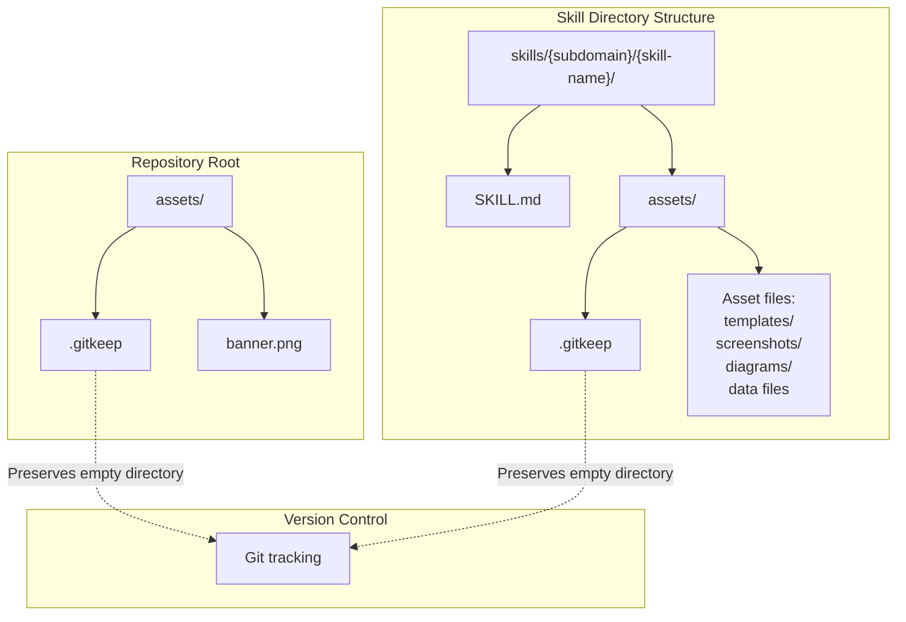
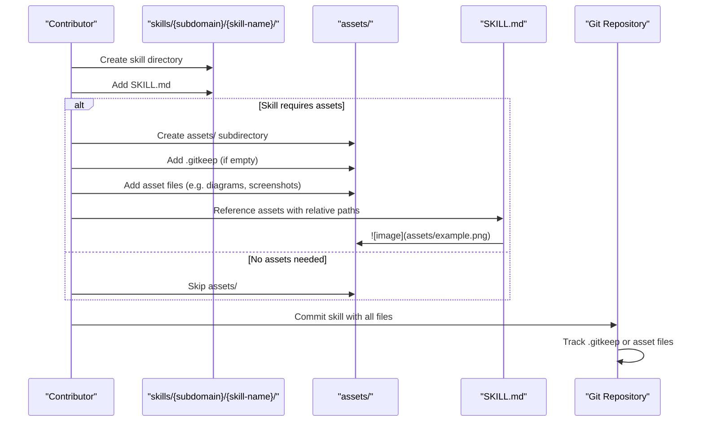
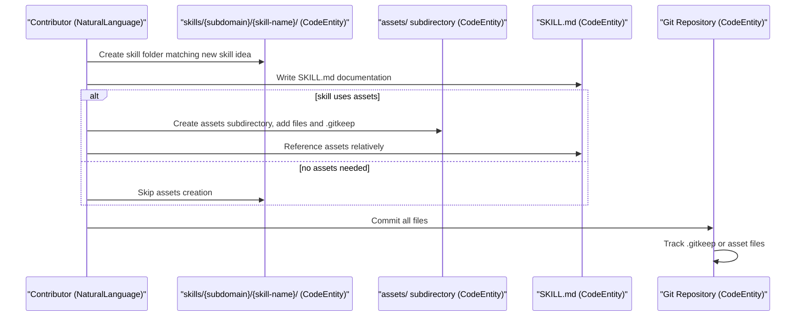

<!-- source: DeepWiki mcp.deepwiki.com · repo mukul975/Anthropic-Cybersecurity-Skills · page 9.2 Assets and Media · fetched 2026-10-26 -->

# Assets and Media

<details>
<summary>Relevant source files</summary>

The following files were used as context for generating this wiki page:

- [assets/.gitkeep](assets/.gitkeep)
- [assets/banner.png](assets/banner.png)

</details>


This document details the assets and media management system within the Anthropic Cybersecurity Skills repository, covering both repository-level visual assets and skill-specific asset organization patterns.

For information about skill directory structure, see [Skill Structure](#3.1). For repository configuration including `.gitignore` patterns, see [Repository Configuration](#9.1).

## Overview

The repository maintains a minimal assets directory structure to support visual branding and skill-specific resource files. The primary asset management strategy relies on the `.gitkeep` pattern to preserve empty directories in version control while allowing individual skills to maintain their own asset subdirectories.

**Sources:** [assets/.gitkeep:1]()

## Repository-Level Assets Directory

The top-level `assets/` directory exists at the root of the repository and serves as a placeholder for repository-wide visual assets and media files.

### .gitkeep Pattern

The directory contains a `.gitkeep` file, which is a conventional empty placeholder file used to ensure Git tracks the otherwise-empty `assets/` directory. Git does not track empty directories by default, so the `.gitkeep` file (or any minimal file) forces directory preservation in the repository structure.

```
assets/
└── .gitkeep
```

This pattern allows the directory to exist in the repository even when no assets are currently stored, maintaining the expected directory structure for future use or documentation purposes.

**Sources:** [assets/.gitkeep:1]()

## Repository Visual Assets

The primary known visual asset at the repository level is `banner.png` stored in the `assets/` directory. It is intended for use in repository metadata, documentation headers, or README banners to provide consistent branding and visual identity.

- **File:** `assets/banner.png`
- **Format:** PNG image with embedded color profiles and metadata, suitable for web and documentation display
- **Usage:** Referenced in markdown documents or UI systems by relative path `assets/banner.png`

The visual asset is directly version-controlled and maintained under the `assets/` directory alongside the `.gitkeep` placeholder, ensuring it remains part of the repository.

**Sources:** [assets/banner.png:1-35](), [assets/.gitkeep:1]()

## Skill-Level Assets

Each individual skill directory within `skills/{subdomain}/{skill-name}/` may contain its own `assets/` subdirectory. This local directory stores skill-specific resources like:

- Configuration templates (.yaml, .json)
- Screenshots (.png, .jpg)
- Workflow diagrams (.png, .svg)
- Sample data files or inputs (.txt, .csv)
- Any supplementary materials needed for the skill's demonstration or execution

Similar to the repository-level directory, skill `assets/` directories may contain a `.gitkeep` file to maintain structure in Git if no asset files are present initially.

**Asset Reference and Linking**

Within a skill's `SKILL.md` file, assets are referenced via relative paths. For example:

```markdown


Refer to the sample configuration: [config.yaml](assets/sample-config.yaml)
```

This relative referencing allows easy access and portability, keeping skill directories self-contained.

**Sources:** [assets/.gitkeep:1]()

## Asset Directory Architecture

The following diagram illustrates the relationship between the repository root assets directory, skill directories, and version control mechanisms:



**Sources:** [assets/.gitkeep:1](), [assets/banner.png:1-35]()

## Asset Management in Skill Lifecycle

The flow of asset creation, referencing, and integration during skill development is as follows:



This process ensures assets are versioned together with skill metadata and documentation, supporting consistency and portability.

**Sources:** [assets/.gitkeep:1]()

## Directory Structure Reference

| Directory Level | Path                              | Purpose                            | Contents                                          |
|-----------------|----------------------------------|----------------------------------|--------------------------------------------------|
| Repository      | `assets/`                        | Repository-wide visual assets    | `.gitkeep`, `banner.png`                          |
| Skill           | `skills/{subdomain}/{skill-name}/assets/` | Skill-specific resources         | Config templates, screenshots, diagrams, data    |

**Sources:** [assets/.gitkeep:1](), [assets/banner.png:1-35]()

## Asset Referencing Guidelines

### From `SKILL.md` Files

Always reference assets using relative paths from the skill directory:

```markdown


See the [configuration template](assets/config.yaml).
```

### File Naming and Types

- Prefer lowercase filenames with hyphens (e.g., `sample-config.yaml`)
- Use descriptive names that match content and use case
- Allowed file types include `.png`, `.jpg`, `.svg`, `.yaml`, `.json`, `.txt`, `.csv`, and similar

These recommendations facilitate consistency and ease of discovery for asset files.

**Sources:** [assets/.gitkeep:1]()

## Git Tracking Behavior

Since Git does not track empty directories, the `.gitkeep` file is used as a placeholder to preserve directory structures in version control. The main reasons for using `.gitkeep` are:

1. **Directory Preservation:** Ensures empty asset directories remain visible in the repository.
2. **Structure Consistency:** Maintains uniform directory layout across clones and forks.
3. **Minimal Overhead:** `.gitkeep` files are typically empty and have no functional impact.

When actual asset files are added to a directory, `.gitkeep` can be optionally removed, though often retained for consistency.

**Sources:** [assets/.gitkeep:1]()

## Asset Management Best Practices

### Size and Performance

- Keep individual asset files reasonably sized (under 1MB recommended)
- Use compressed and optimized image formats (`.png`, `.jpg`) to minimize storage and load times
- Large or numerous assets should be carefully evaluated to prevent repository bloat

### Organization

- Group related assets in meaningful subfolders (e.g., `templates/`, `screenshots/`, `diagrams/`) inside the skill's `assets/` directory
- Keep the repository-level `assets/` directory minimal and focused on global repository branding assets

### Documentation

- Reference all assets explicitly within the corresponding `SKILL.md` file
- Provide contextual descriptions or captions to clarify asset purpose
- Attribute third-party assets properly if applicable

Adhering to these practices ensures clarity and maintainability across the skills collection.

**Sources:** [assets/.gitkeep:1]()

---

# Mapping Natural Language Space to Code Entity Space: Assets Overview

```mermaid
graph LR
    "NaturalLanguage: Repository Assets" --> "CodeEntity: assets/"
    "NaturalLanguage: Banner Image" --> "CodeEntity: assets/banner.png"
    "NaturalLanguage: Empty Directory Placeholder" --> ".gitkeep (in assets)"
    "NaturalLanguage: Skill Asset Folder" --> "SkillDir/assets/"
    "NaturalLanguage: Skill Documentation" --> "SKILL.md"
    "NaturalLanguage: Asset Reference in Markdown" --> "SKILL.md referencing assets/*.png or assets/*.yaml"
```

**Sources:** [assets/.gitkeep:1](), [assets/banner.png:1-35]()

# Mapping Natural Language Space to Code Entity Space: Asset Lifecycle in Skill Development



**Sources:** [assets/.gitkeep:1]()

---

This concludes the detailed documentation on Assets and Media management within the Anthropic Cybersecurity Skills repository.

---

