# Page: Overview

# Overview

<details>
<summary>Relevant source files</summary>

The following files were used as context for generating this wiki page:

- [.claude-plugin/marketplace.json](.claude-plugin/marketplace.json)
- [.claude-plugin/plugin.json](.claude-plugin/plugin.json)
- [.github/workflows/sync-marketplace-version.yml](.github/workflows/sync-marketplace-version.yml)
- [.github/workflows/update-index.yml](.github/workflows/update-index.yml)
- [.github/workflows/validate-skills.yml](.github/workflows/validate-skills.yml)
- [.gitignore](.gitignore)
- [ATTACK_COVERAGE.md](ATTACK_COVERAGE.md)
- [CODE_OF_CONDUCT.md](CODE_OF_CONDUCT.md)
- [README.md](README.md)
- [index.json](index.json)
- [skills/analyzing-linux-audit-logs-for-intrusion/SKILL.md](skills/analyzing-linux-audit-logs-for-intrusion/SKILL.md)
- [skills/analyzing-windows-amcache-artifacts/SKILL.md](skills/analyzing-windows-amcache-artifacts/SKILL.md)
- [skills/detecting-oauth-token-theft/SKILL.md](skills/detecting-oauth-token-theft/SKILL.md)
- [skills/implementing-devsecops-security-scanning/SKILL.md](skills/implementing-devsecops-security-scanning/SKILL.md)
- [skills/implementing-privileged-session-monitoring/SKILL.md](skills/implementing-privileged-session-monitoring/SKILL.md)

</details>


## Purpose and Scope

The Anthropic Cybersecurity Skills repository is an open-source collection of **817 cybersecurity skills** designed for AI agents and security practitioners. The repository provides structured, machine-readable cybersecurity capabilities following the [agentskills.io](https://agentskills.io) open standard, enabling AI agents to discover and execute security workflows across **29 security domains** (updated from 24) spanning digital forensics, malware analysis, threat intelligence, cloud security, and more.

Every skill in the library is uniquely mapped to **six industry frameworks**: MITRE ATT&CK, NIST CSF 2.0, MITRE ATLAS, MITRE D3FEND, NIST AI RMF, and the MITRE Fight Fraud Framework (F3). This unified cross-framework coverage allows AI agents to provide expert-level guidance while maintaining compliance alignment.

**Sources:** [README.md:9-27](), [README.md:41-54](), [index.json:1-5]()

---

## Repository Architecture

The repository is organized around four primary architectural layers: a **Skills Repository** containing standardized skill definitions, a **Plugin Distribution** system for AI agent integration (supporting 26+ platforms), an **Automation Pipeline** for validation and indexing, and a **Framework Mapping** system.

### High-Level System Diagram

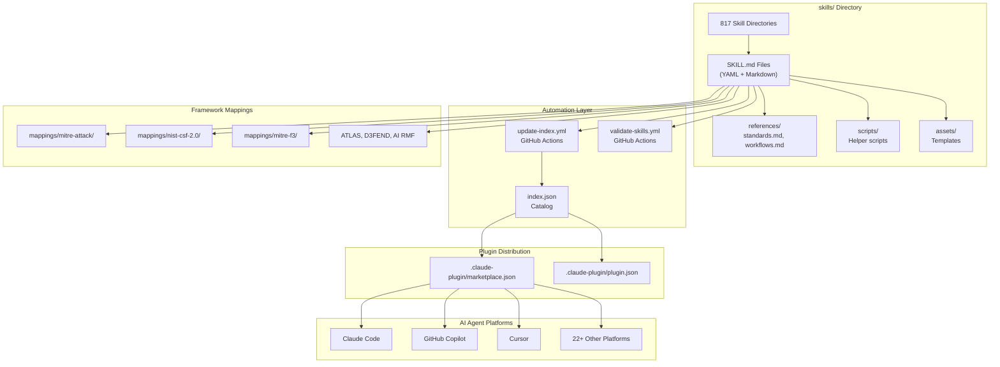

**Sources:** [README.md:105-124](), [index.json:1-56](), [.github/workflows/update-index.yml:1-62](), [.github/workflows/validate-skills.yml:1-30]()

---

## Core Components

### Skills Repository Structure

Each skill follows the agentskills.io specification, residing in a self-contained directory within `skills/`. The primary entity is `SKILL.md`, which contains YAML frontmatter for metadata and Markdown for execution workflows.

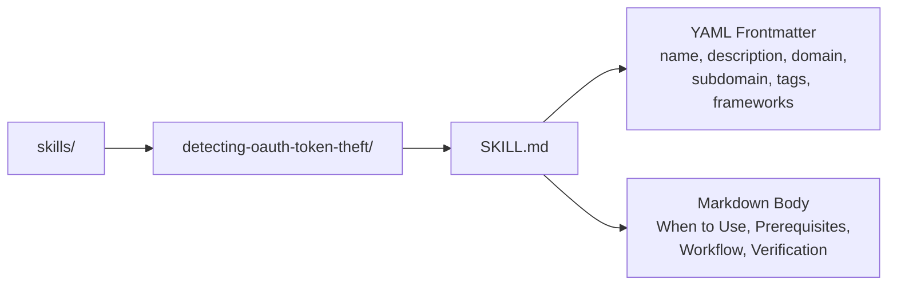

**Example Metadata Mapping:** The `detecting-oauth-token-theft` skill ([skills/detecting-oauth-token-theft/SKILL.md:1-65]()):
- **Subdomain:** `cloud-security` ([line 12]())
- **Frameworks:** Mapped to NIST CSF (`nist_csf`), MITRE ATT&CK (`mitre_attack`), and MITRE F3 (`mitre_f3`) ([lines 25-64]()).

**Sources:** [skills/detecting-oauth-token-theft/SKILL.md:1-65](), [index.json:43-47]()

### Central Catalog: index.json

The `index.json` file is the repository's authoritative catalog, automatically updated by GitHub Actions. It aggregates metadata from all 817 skills to facilitate rapid discovery.

**Key Fields in index.json:**
- `version`: Catalog schema version (1.1.0) ([index.json:1]())
- `generated_at`: ISO 8601 generation timestamp ([index.json:1]())
- `total_skills`: Current count of verified skills (817) ([index.json:1]())
- `skills[]`: Array containing `name`, `description`, `domain`, and `path` for every skill ([index.json:2-55]())

**Sources:** [index.json:1-56](), [.github/workflows/update-index.yml:49-59]()

---

## Skill Distribution Model

The repository utilizes a **Progressive Disclosure** pattern. AI agents first read the lightweight `index.json` or YAML frontmatter (30-50 tokens) to identify relevant capabilities before loading the full, context-heavy `SKILL.md` (300-800 tokens).

### Distribution Channels

| Method | Implementation | Primary Use Case |
|--------|----------------|------------------|
| **NPX** | `npx skills add mukul975/Anthropic-Cybersecurity-Skills` | CLI-based agents like Claude Code |
| **Plugin Marketplace** | `.claude-plugin/marketplace.json` | Marketplace-enabled platforms |
| **Git Clone** | `git clone ...` | Manual integration for Cursor, Copilot, etc. |

**Sources:** [README.md:97-103](), [.claude-plugin/marketplace.json:1-37]()

---

## Automation Pipeline

Two primary GitHub Actions workflows maintain the repository's integrity and state:

1.  **Skill Validation (`validate-skills.yml`)**: Triggered on pull requests to verify YAML syntax, required fields, and detect duplicate skill names.
2.  **Index Generation (`update-index.yml`)**: Triggered on pushes to `main`. It executes a Python script to scan the `skills/` directory, extract descriptions from `SKILL.md` frontmatter, and regenerate `index.json`. It also synchronizes the skill count across `README.md`, `marketplace.json`, and `plugin.json`.

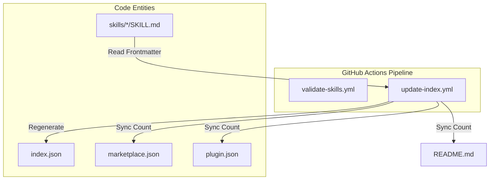

**Sources:** [.github/workflows/update-index.yml:21-62](), [.github/workflows/update-index.yml:64-104]()

---

## Framework Mappings Overview

The repository is unique in its unified mapping of 817 skills across six frameworks.

| Framework | Scope in Repository | Purpose |
|-----------|-------------------|---------|
| **MITRE ATT&CK v19.1** | 15 tactics, 286 techniques | Adversary behaviors and TTPs |
| **MITRE F3 v1.1** | 8 tactics, 123 techniques | Cyber-enabled financial fraud |
| **NIST CSF 2.0** | 6 functions, 22 categories | Organizational security posture |
| **MITRE ATLAS v5.4** | 16 tactics, 84 techniques | AI/ML adversarial threats |
| **MITRE D3FEND v1.3** | 7 categories, 267 techniques | Defensive countermeasures |
| **NIST AI RMF 1.0** | 4 functions, 72 subcategories | AI risk management |

**New Addition: MITRE F3**
The repository now includes 94 fraud-relevant skills mapped to the **MITRE Fight Fraud Framework (F3)**, covering specific tactics like **Positioning** (`FA0001`) and **Monetization** (`FA0002`).

**Sources:** [README.md:43-62](), [README.md:63-74](), [README.md:75-95]()

---

# Page: Getting Started

# Getting Started

<details>
<summary>Relevant source files</summary>

The following files were used as context for generating this wiki page:

- [.claude-plugin/marketplace.json](.claude-plugin/marketplace.json)
- [.claude-plugin/plugin.json](.claude-plugin/plugin.json)
- [.github/workflows/sync-marketplace-version.yml](.github/workflows/sync-marketplace-version.yml)
- [.github/workflows/update-index.yml](.github/workflows/update-index.yml)
- [.github/workflows/validate-skills.yml](.github/workflows/validate-skills.yml)
- [CODE_OF_CONDUCT.md](CODE_OF_CONDUCT.md)
- [README.md](README.md)

</details>


This page guides users through installing and using the Anthropic Cybersecurity Skills collection. It covers the three primary installation methods, basic usage patterns, and how AI agents discover and load skills from the collection. For detailed platform-specific configuration, see [Platform Integration](#2.2). For technical details on the token-efficient discovery mechanism, see [Progressive Disclosure Pattern](#2.3).

## Overview

The Anthropic Cybersecurity Skills repository provides 817 security capabilities packaged as an agentskills.io-compliant plugin [[README.md:13-21](), [.claude-plugin/marketplace.json:2-15]()]. Users can install the collection through three pathways: the `npx skills` CLI (automated), Claude Code's `/plugin` marketplace command (native integration), or manual Git clone (full repository access) [[README.md:97-103]()]. Once installed, AI agents use a two-phase discovery process: they first scan YAML frontmatter (~30-50 tokens per skill) to identify relevant skills, then load complete `SKILL.md` files only when needed.

## Installation Methods Overview

The repository supports three installation methods, each optimized for different use cases:

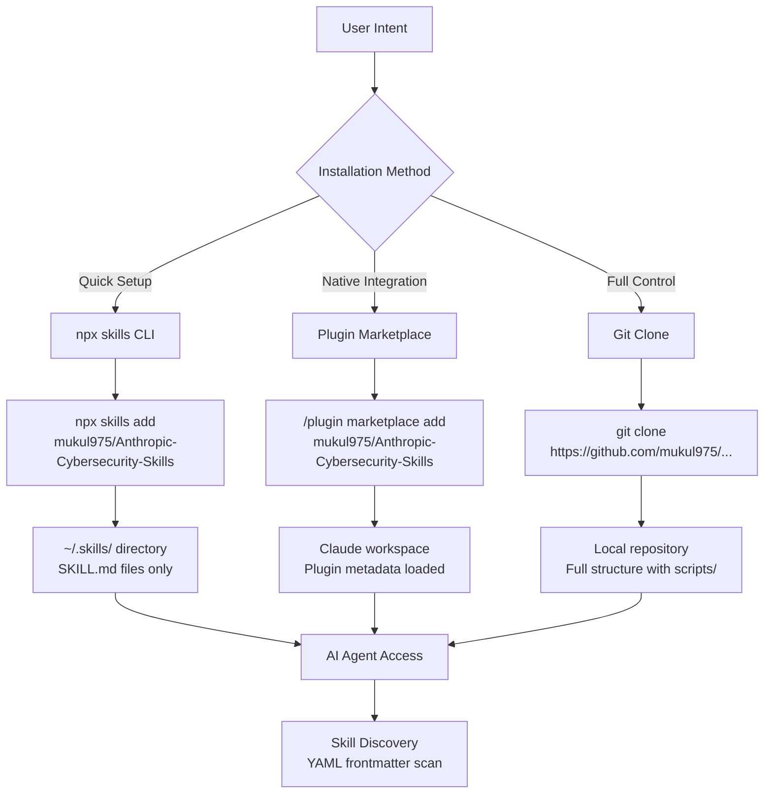

**Installation Method Selection Flow**

Sources: [README.md:97-103]()

### Method 1: NPX Skills CLI

The `npx skills` command provides automated installation via the npm package ecosystem. This method installs skill definitions to a standard `~/.skills/` directory:

```bash
npx skills add mukul975/Anthropic-Cybersecurity-Skills
```

This command reads plugin metadata from `marketplace.json` [[.claude-plugin/marketplace.json:2-14]()] and creates a local skill repository. The installed skills include `SKILL.md` files with frontmatter but exclude helper scripts from the `scripts/` subdirectories. This method works across all platforms that support the agentskills.io standard [[README.md:21-24]()].

**Key characteristics:**
- **Installation location**: `~/.skills/` directory
- **Content**: `SKILL.md` files with YAML frontmatter and markdown bodies
- **Updates**: Re-run command to fetch latest skills
- **Platform support**: Universal (26+ platforms) [[README.md:17-27]()]

Sources: [README.md:97-101](), [.claude-plugin/marketplace.json:1-37]()

### Method 2: Claude Code Plugin Marketplace

Claude Code provides native plugin marketplace integration through the `/plugin` command. This method leverages Claude's internal plugin system:

```
/plugin marketplace add mukul975/Anthropic-Cybersecurity-Skills
```

The marketplace reads plugin metadata from `plugin.json` [[.claude-plugin/plugin.json:1-5]()] which contains the name, description, and version. The `marketplace.json` file [[.claude-plugin/marketplace.json:11-35]()] provides additional metadata including keywords, license (Apache-2.0), and repository URL.

**Key characteristics:**
- **Installation location**: Claude workspace context
- **Content**: Skills loaded on-demand from GitHub
- **Updates**: Automatic when plugin version changes in `marketplace.json` [[.claude-plugin/marketplace.json:9]()]
- **Platform support**: Claude Code native integration

Sources: [.claude-plugin/plugin.json:1-5](), [.claude-plugin/marketplace.json:8-17]()

### Method 3: Manual Git Clone

Direct repository cloning provides complete access to all repository contents including helper scripts, reference materials, and automation workflows:

```bash
git clone https://github.com/mukul975/Anthropic-Cybersecurity-Skills.git
cd Anthropic-Cybersecurity-Skills
```

This method installs the full repository structure:
- `skills/{skill-name}/SKILL.md` - Skill definitions [[.github/workflows/update-index.yml:31]()]
- `skills/{skill-name}/references/` - Standards and workflow documentation  
- `skills/{skill-name}/scripts/` - Helper scripts for practitioners
- `skills/{skill-name}/assets/` - Templates and checklists

**Key characteristics:**
- **Installation location**: User-specified directory
- **Content**: Complete repository including scripts, references, and GitHub Actions workflows [[.github/workflows/validate-skills.yml:1-129]()]
- **Updates**: `git pull` to sync latest changes
- **Platform support**: Any platform that can read local files

Sources: [README.md:103](), [.github/workflows/update-index.yml:30-33](), [.github/workflows/validate-skills.yml:29-32]()

## Plugin Metadata Structure

The plugin distribution system uses two JSON configuration files that define how the skills are packaged and discovered:

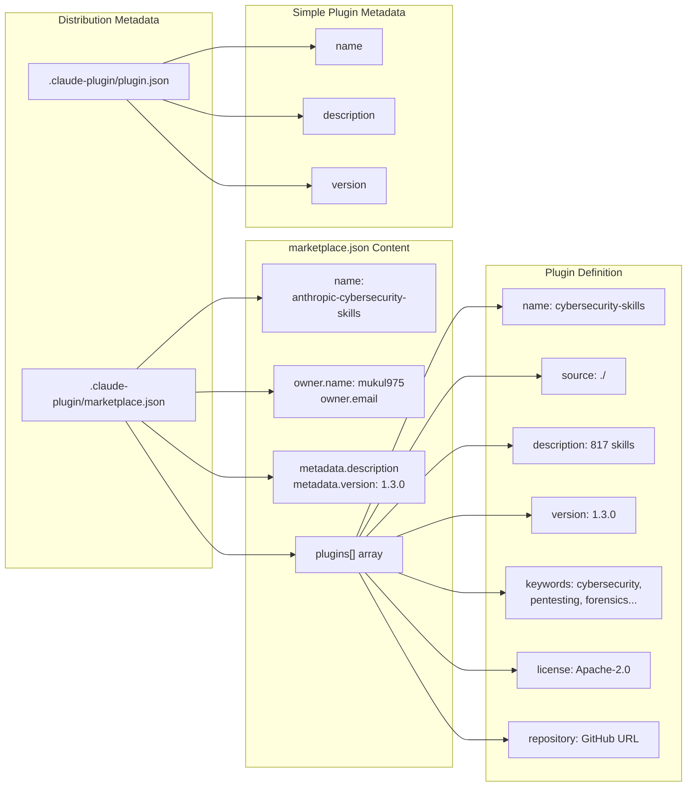

**Plugin Metadata File Structure**

The `marketplace.json` file [[.claude-plugin/marketplace.json:1-37]()] contains:
- **Package name**: `anthropic-cybersecurity-skills` [[line 2]()]
- **Owner information**: GitHub username and email [[lines 3-6]()]
- **Plugin array**: Single plugin definition with 817 cybersecurity skills description [[lines 11-35]()]
- **Keywords**: 9 security domain tags for discovery [[lines 21-30]()]

The simplified `plugin.json` [[.claude-plugin/plugin.json:1-5]()] provides minimal metadata for platforms that don't require the full marketplace schema.

Sources: [.claude-plugin/marketplace.json:1-37](), [.claude-plugin/plugin.json:1-5]()

## Skill Discovery and Loading

AI agents use a two-phase progressive disclosure pattern to efficiently navigate 817 skills without overwhelming context windows:

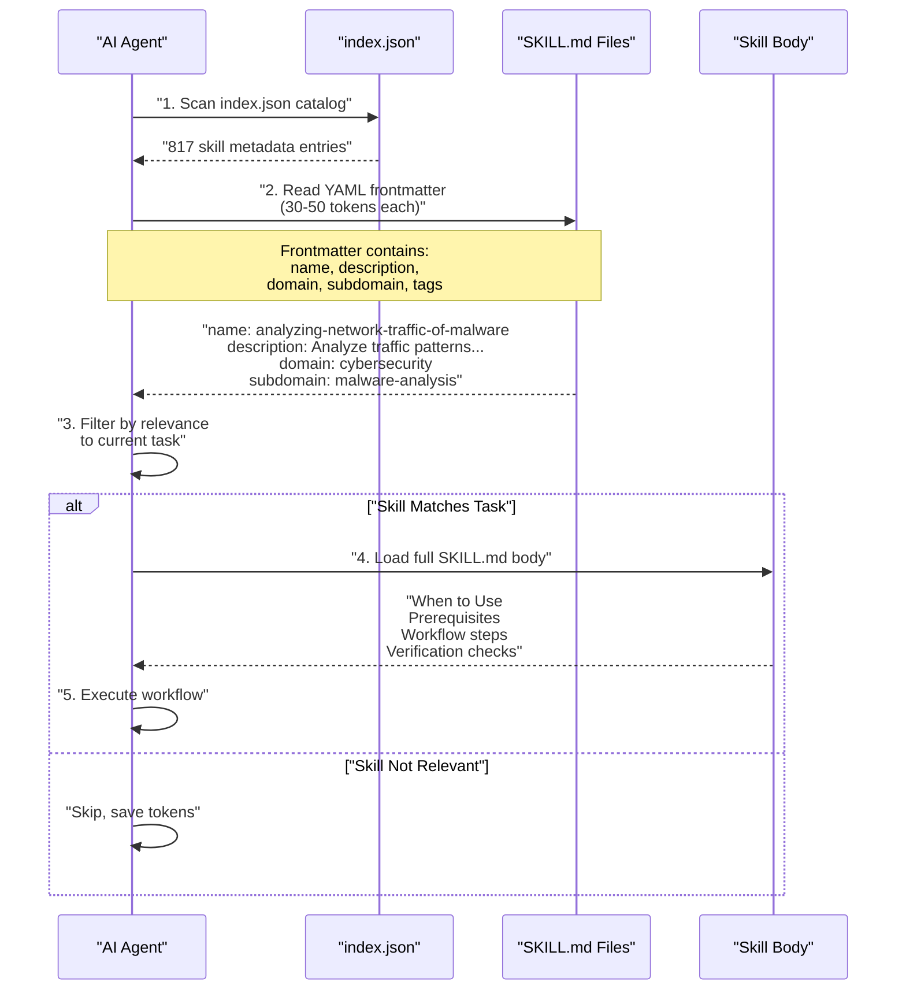

**Progressive Skill Discovery Sequence**

### Phase 1: Frontmatter Scanning

Each `SKILL.md` file begins with YAML frontmatter validated by the CI/CD pipeline [[.github/workflows/validate-skills.yml:25-58]()]. The frontmatter must include:
- **name**: Unique skill identifier in kebab-case [[.github/workflows/validate-skills.yml:51-57]()]
- **description**: One-sentence capability summary [[.github/workflows/update-index.yml:39-41]()]
- **domain**: Top-level category (`cybersecurity`)
- **subdomain**: Specific security domain (29 total subdomains) [[.github/workflows/validate-skills.yml:107-128]()]
- **tags**: Searchable keywords for filtering

### Phase 2: Full Skill Loading

If frontmatter matches task requirements, the agent loads the complete `SKILL.md` body. This two-phase approach allows agents to scan hundreds of skills efficiently, consuming full context only for relevant capabilities.

Sources: [.github/workflows/validate-skills.yml:1-129](), [.github/workflows/update-index.yml:21-62]()

## Basic Usage Patterns

After installation, agents access skills through platform-specific mechanisms:

| Platform | Access Method | Configuration |
|----------|--------------|---------------|
| Claude Code | `/plugin` command | Native marketplace integration via `.claude-plugin/marketplace.json` [[.claude-plugin/marketplace.json:1-37]()] |
| GitHub Copilot | `.skills/` directory | Copy `SKILL.md` files to workspace `.skills/` folder |
| Cursor | Project files | Add skills as project documentation in `.cursorrules` |
| Gemini CLI | Context files | Load `SKILL.md` files as context |

Sources: [README.md:17-24](), [.claude-plugin/marketplace.json:1-37]()

## Skill Categories

The collection organizes 817 production-grade skills across 29 cybersecurity subdomains [[README.md:13-27](), [.github/workflows/validate-skills.yml:122-128]()].

For details, see [Skill Categories and Taxonomy](#3.3).

Sources: [README.md:27-41](), [.github/workflows/validate-skills.yml:107-128]()

## Next Steps

For detailed information on installation procedures:
- **Platform-specific setup**: See [Installation Methods](#2.1) for detailed instructions per platform
- **Integration configuration**: See [Platform Integration](#2.2) for workspace setup across 26+ platforms
- **Discovery optimization**: See [Progressive Disclosure Pattern](#2.3) for technical details on token-efficient skill loading

To understand skill structure and organization:
- **Skill anatomy**: See [Skill Structure](#3.1) for directory layout and YAML requirements
- **Complete catalog**: See [Skills Index](#3.2) for `index.json` schema and metadata

To contribute new skills:
- **Contribution workflow**: See [Contributing](#7) for guidelines on adding or improving skills
- **Skill development**: See [Skill Development Workflow](#7.3) for end-to-end creation process

---

# Page: Installation Methods

# Installation Methods

<details>
<summary>Relevant source files</summary>

The following files were used as context for generating this wiki page:

- [.claude-plugin/marketplace.json](.claude-plugin/marketplace.json)
- [.claude-plugin/plugin.json](.claude-plugin/plugin.json)
- [.github/workflows/sync-marketplace-version.yml](.github/workflows/sync-marketplace-version.yml)
- [.github/workflows/update-index.yml](.github/workflows/update-index.yml)
- [.github/workflows/validate-skills.yml](.github/workflows/validate-skills.yml)
- [CODE_OF_CONDUCT.md](CODE_OF_CONDUCT.md)
- [README.md](README.md)

</details>


## Purpose and Scope

This page details the three installation pathways for the **Anthropic Cybersecurity Skills** collection:

- **npx skills CLI**
- **Plugin marketplace integration**
- **Manual git clone**

Each method offers different advantages regarding automation, ease of use on supported platforms, and ability to customize or control upgrades. This page covers implementation details, data flow, directory layout post-installation, and platform-specific instructions.

For instructions on using the skills after installation, see [2.2 Platform Integration]. For insight into the token-efficient loading of skill metadata, see [2.3 Progressive Disclosure Pattern].

---

## Installation Method Overview

| Method                   | Best For                        | Automation | Update Management            | Platform Examples                        |
|--------------------------|--------------------------------|------------|-----------------------------|-----------------------------------------|
| **npx skills CLI**       | Quick automated install        | Full       | Automatic via CLI commands   | Claude Code, GitHub Copilot, Cursor     |
| **Plugin Marketplace**   | Native Claude Code integration  | Full       | Automatic via marketplace    | Claude Code (plugin marketplace)        |
| **Manual Git Clone**     | Offline use, custom workflows  | Manual     | Manual `git pull` or checkout | Any platform (universal)                |

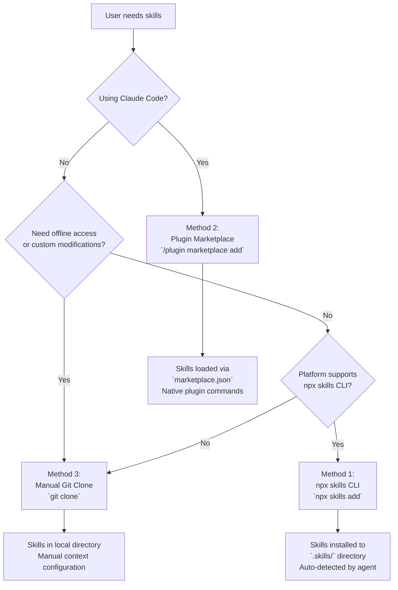

**Sources:** [README.md:27-40]()

---

## Method 1: npx skills CLI

The `npx skills` CLI tool facilitates automated installation of the skills collection by resolving the GitHub repository, downloading its contents, and registering the skills with supported AI agents.

### Installation Command

```bash
npx skills add mukul975/Anthropic-Cybersecurity-Skills
```

### Implementation Details and Data Flow

- **Repository Resolution:** The CLI parses the input repository string and resolves it to a GitHub repository URL.
- **Repository Download:** The repository archive is fetched via GitHub API.
- **Extraction:** Contents extract into a platform-specific `.skills/` directory inside the current workspace, typically under `.skills/mukul975-Anthropic-Cybersecurity-Skills/`.
- **Skill Indexing:** Reads `index.json` to register metadata about all 800+ skills with the local agent environment.
- **Plugin Metadata:** Reads `.claude-plugin/marketplace.json` to extract version, description, author, and licensing for compatibility info.
- **Agent Registration:** The agent platform auto-detects the `.skills/` folder and incorporates the skills into its context window or environment.

### Directory Structure After Installation

```
.workspace/
└── .skills/
    └── mukul975-Anthropic-Cybersecurity-Skills/
        ├── skills/
        │   ├── acquiring-disk-image-with-dd-and-dcfldd/
        │   ├── analyzing-memory-dumps-with-volatility3/
        │   └── ... (800+ skill directories)
        ├── index.json
        ├── .claude-plugin/
        │   ├── marketplace.json
        │   └── plugin.json
        └── README.md
```

### Platform Support with npx CLI

| Platform        | Integration Mechanism                         | Skill Discovery                    |
|-----------------|----------------------------------------------|----------------------------------|
| GitHub Copilot  | Reads `.skills/` as workspace context       | Parses YAML frontmatter in skills |
| Cursor          | Loads `.skills/` folder into project context | File-system based enumeration   |
| Gemini CLI      | Scans `.skills/` as context directory       | Markdown skill file loading       |
| Amp             | Mounts `.skills/` directory volume          | Directory-based access            |
| Continue        | Uses `.skills/` as custom context provider  | Progressive disclosure pattern   |

### Installation Flow Diagram

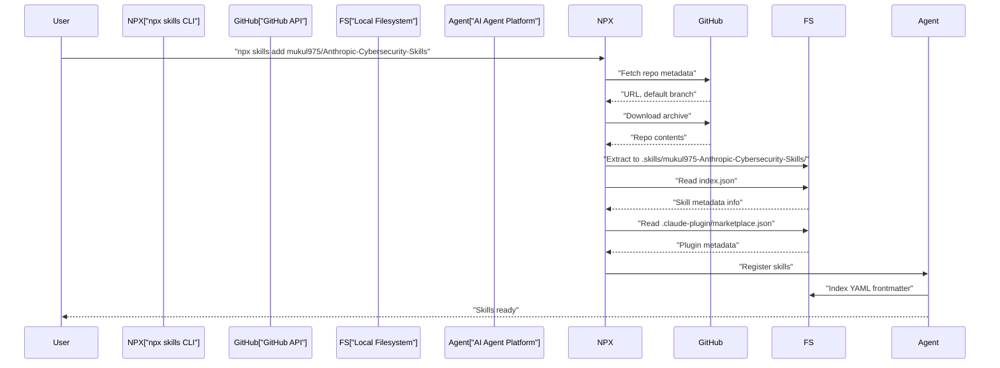

**Sources:** [README.md:27-40](), [.claude-plugin/marketplace.json:1-37]()

---

## Method 2: Plugin Marketplace Integration

This method leverages Claude Code's native plugin system for installing and managing the skills collection entirely within the agent interface, providing seamless updates and discovery.

### Installation Command in Claude Code

```
/plugin marketplace add mukul975/Anthropic-Cybersecurity-Skills
```

### Marketplace Metadata (`marketplace.json`)

The `.claude-plugin/marketplace.json` defines metadata necessary for integrating the plugin into Claude Code's marketplace ecosystem:

| Field                | Example Value                              | Description                           |
|----------------------|-------------------------------------------|-------------------------------------|
| `name`               | `"anthropic-cybersecurity-skills"`       | Marketplace plugin identifier       |
| `owner.name`          | `"mukul975"`                              | Plugin owner (GitHub username)      |
| `owner.email`         | `"mukuljangra5@gmail.com"`                | Contact email                       |
| `metadata.version`    | `"1.3.0"`                                | Plugin version for update tracking  |
| `plugins[0].source`   | `"./"`                                   | Root directory for plugin code      |
| `plugins[0].license`  | `"Apache-2.0"`                           | License info                       |
| `plugins[0].category` | `"security"`                              | Marketplace category                 |
| `plugins[0].repository` | GitHub URL                              | Repository source URL                |

### Data and Control Flow

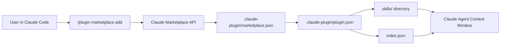

### Claude Code Integration Workflow

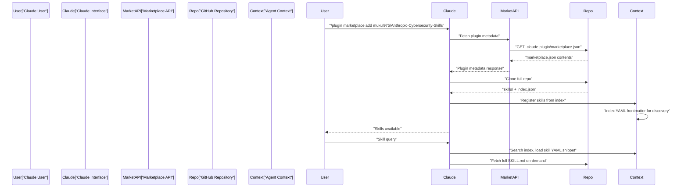

**Sources:** [.claude-plugin/marketplace.json:1-37](), [README.md:32-40]()

---

## Method 3: Manual Git Clone

This method involves manually cloning or downloading the repository, providing full control over versioning, directory placement, and updates. Ideal for offline environments, custom workflows, or development.

### Installation Command

```bash
git clone https://github.com/mukul975/Anthropic-Cybersecurity-Skills.git
cd Anthropic-Cybersecurity-Skills
```

### Use Case Scenarios

| Use Case            | Explanation                                  |
|---------------------|----------------------------------------------|
| Offline / air-gapped environments | No internet, no direct CLI or marketplace access |
| Custom modifications | Fork and modify skills or add extensions    |
| Development          | Testing and creating new skills locally      |
| Version pinning      | Checkout specific tags or commits            |
| CI/CD integration    | Automate build and test pipelines            |
| Custom directory     | Fit into non-standard workspace structures   |

### Manual Installation and Configuration Flow

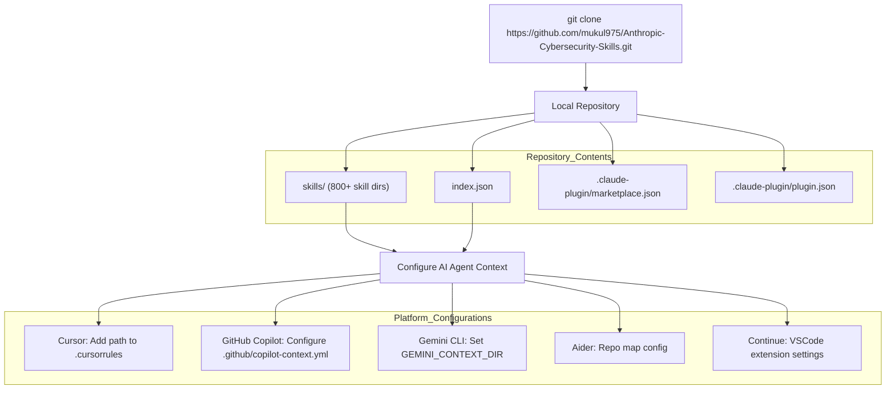

### Example: GitHub Copilot Configuration (`.github/copilot-context.yml`)

```yaml
context:
  - path: path/to/Anthropic-Cybersecurity-Skills/skills
    type: skills
  - path: path/to/Anthropic-Cybersecurity-Skills/index.json
    type: catalog
```

### Example: Cursor Configuration (`.cursorrules`)

```
Skills directory: /path/to/Anthropic-Cybersecurity-Skills/skills
Index file: /path/to/Anthropic-Cybersecurity-Skills/index.json
```

### Example: Gemini CLI Configuration

```bash
export GEMINI_CONTEXT_DIR=/path/to/Anthropic-Cybersecurity-Skills/skills
```

### Updating Manual Clone Installation

To update the skills library, run:

```bash
cd Anthropic-Cybersecurity-Skills
git pull origin main
```

For pinning to a specific version:

```bash
# List available tags
git tag -l

# Checkout a specific version tag
git checkout v1.3.0

# Or checkout a specific commit
git checkout abc123def456
```

**Sources:** [README.md:38-40]()

---

## Platform-Specific Installation Considerations

### Default File System Locations by Platform

| Platform       | Expected Skills Location                           | Configuration File             |
|----------------|--------------------------------------------------|-------------------------------|
| Claude Code    | Managed automatically by plugin marketplace       | `.claude-plugin/marketplace.json` |
| GitHub Copilot | `.skills/` directory under workspace root         | `.github/copilot-context.yml` |
| Cursor         | Custom path configured in `.cursorrules`          | `.cursorrules` file           |
| Gemini CLI     | Environment variable or config defines skills dir   | `~/.geminirc` or environment  |
| Amp            | Mounted volume path for `.skills/`                 | Container volume mount config |
| Aider          | Repository root or customized repo map             | `.aider.conf.yml`              |
| Continue       | VSCode extension settings for context directory     | `.vscode/settings.json`       |
| Windsurf       | Workspace context directory                           | Windsurf config file          |
| Goose          | Plugin directory under user folder                   | `~/.goose/plugins/`           |

### Repository Files Usage per Installation Method

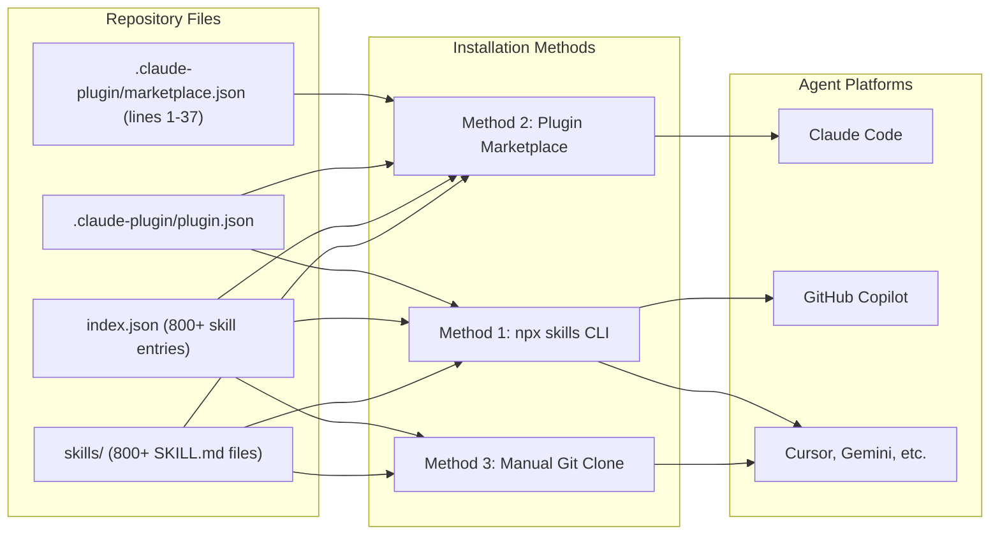

---

## Post-Installation Verification

### Verification Steps

1. **Confirm skill count:**

```bash
find skills -name "SKILL.md" | wc -l
# Expected output: 800+
```

2. **Validate `index.json`:**

```bash
cat index.json | jq '.skills | length'
# Expected output: 800+
```

3. **Test agent discovery with a sample query:**

- Query: `"How do I perform memory forensics with Volatility3?"`
- Expected: Agent references the `analyzing-memory-dumps-with-volatility3` skill

4. **Check YAML frontmatter parsing:**

```bash
head -n 10 skills/analyzing-memory-dumps-with-volatility3/SKILL.md
```

### Common Installation Issues and Solutions

| Issue                  | Symptom                | Solution                           |
|------------------------|------------------------|----------------------------------|
| Skills not discovered  | Agent cannot locate skills | Confirm platform config paths     |
| Outdated skill count    | Skill count < 800       | Reinstall or `git pull` updates   |
| File permission errors | Installation fails      | Check user permissions on folders |
| Network timeouts        | Cloning/downloading fails | Retry or use manual clone method  |
| Empty or missing `index.json` | No skills indexed  | Ensure `index.json` present and valid |

### Success Indicators

- ✅ 800+ skill directories under `skills/`
- ✅ Valid `index.json` reflecting all skills
- ✅ Up-to-date `.claude-plugin/marketplace.json` version (e.g. 1.3.0)
- ✅ Agent recognizes and indexes skill YAML frontmatter
- ✅ Skills load dynamically without overwhelming context windows

---

## Next Steps

Proceed to:

- **[2.2 Platform Integration]** for platform-specific usage and commands
- **[2.3 Progressive Disclosure Pattern]** to optimize skill discovery and token usage
- **[3.2 Skills Index]** to understand skill metadata and indexing details

**Sources:** [README.md:25-40](), [.claude-plugin/marketplace.json:1-37]()

---

# Page: Platform Integration

# Platform Integration

<details>
<summary>Relevant source files</summary>

The following files were used as context for generating this wiki page:

- [.claude-plugin/marketplace.json](.claude-plugin/marketplace.json)
- [.claude-plugin/plugin.json](.claude-plugin/plugin.json)
- [.github/workflows/sync-marketplace-version.yml](.github/workflows/sync-marketplace-version.yml)
- [.github/workflows/update-index.yml](.github/workflows/update-index.yml)
- [.github/workflows/validate-skills.yml](.github/workflows/validate-skills.yml)
- [CODE_OF_CONDUCT.md](CODE_OF_CONDUCT.md)
- [README.md](README.md)

</details>


This document explains how to integrate the Anthropic Cybersecurity Skills collection with 26+ AI agent platforms. It covers platform-specific installation methods, discovery mechanisms, and the technical details of how different agent types consume skills from the repository.

For installation commands and prerequisites, see [Installation Methods](2.1). For the token-efficient skill discovery mechanism used by agents, see [Progressive Disclosure Pattern](2.3).

## Overview of Platform Support

The skills repository supports three categories of AI agent platforms, each with different integration mechanisms:

| Platform Category | Integration Method | Platform Count | Example Platforms |
|------------------|-------------------|----------------|-------------------|
| **Plugin-Native** | Built-in `/plugin` command | 2 | Claude Code, Goose |
| **Workspace Context** | `.skills/` directory structure | 8 | GitHub Copilot, Cursor, Windsurf, Continue |
| **File Context** | Manual directory mounting | 16+ | Gemini CLI, Aider, Amp, OpenAI Codex CLI |

The agentskills.io standard enables vendor-neutral distribution across all platform types through a common YAML frontmatter + Markdown body structure in each `SKILL.md` file.

**Sources:** [README.md:17-21](), [README.md:97-101]()

## Platform Integration Architecture

### Distribution Channels

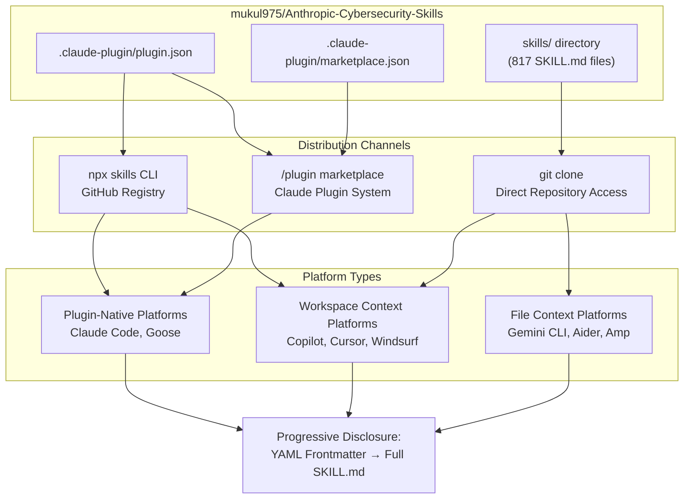

The repository publishes through three distinct channels that target different platform integration patterns. The `.claude-plugin/plugin.json` file defines core metadata for NPX and plugin marketplace distribution, while direct Git access provides maximum flexibility for platforms with custom context loading.

**Sources:** [.claude-plugin/plugin.json:1-5](), [README.md:97-103](), [.github/workflows/update-index.yml:64-104]()

### Plugin Metadata Structure

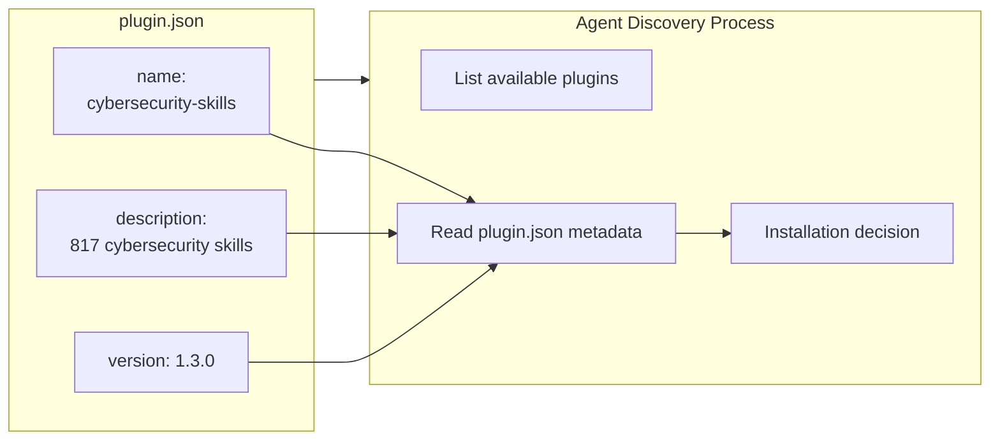

The `.claude-plugin/plugin.json` file contains three essential fields that enable plugin marketplace discovery:

| Field | Value | Purpose |
|-------|-------|---------|
| `name` | `"cybersecurity-skills"` | Unique plugin identifier for installation commands |
| `description` | `"817 cybersecurity skills..."` | Human-readable summary displayed in marketplace |
| `version` | `"1.3.0"` | Semantic versioning for compatibility tracking |

**Sources:** [.claude-plugin/plugin.json:1-5](), [.github/workflows/sync-marketplace-version.yml:27-36]()

## Platform-Specific Integration Methods

### Plugin-Native Platforms

These platforms have built-in plugin systems that directly consume the `.claude-plugin/` directory structure:

#### Claude Code

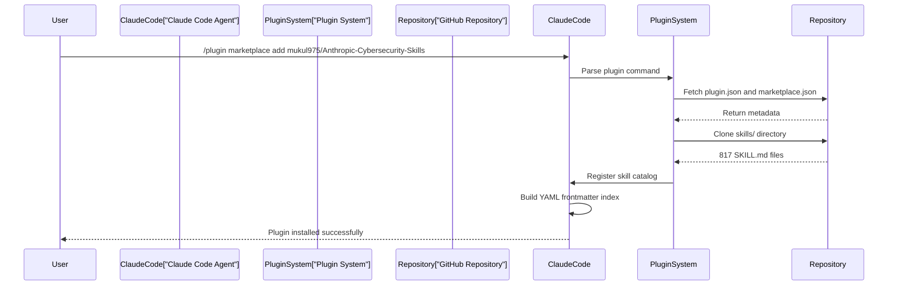

**Installation Command:**
```bash
/plugin marketplace add mukul975/Anthropic-Cybersecurity-Skills
```

Claude Code's native `/plugin` command reads the repository structure, indexes all YAML frontmatter from `SKILL.md` files, and enables on-demand skill loading during conversations.

**Sources:** [.claude-plugin/marketplace.json:1-37](), [README.md:100-101]()

### Workspace Context Platforms

These platforms detect skills through workspace-aware file system integration:

#### GitHub Copilot

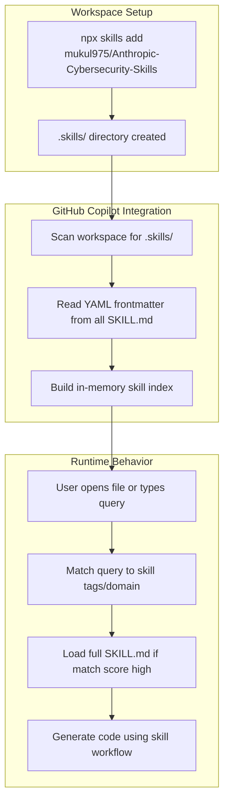

**Installation:**
```bash
cd your-project
npx skills add mukul975/Anthropic-Cybersecurity-Skills
```

GitHub Copilot detects the `.skills/` directory in the workspace root and indexes all `SKILL.md` files for context-aware code generation. The agent reads YAML frontmatter during workspace initialization to build a lightweight index.

**Sources:** [README.md:99-101](), [.github/workflows/validate-skills.yml:25-58]()

## Skill Discovery Mechanism

All platforms implement progressive disclosure by reading YAML frontmatter before loading full skill definitions. This is automated via the `index.json` generation workflow.

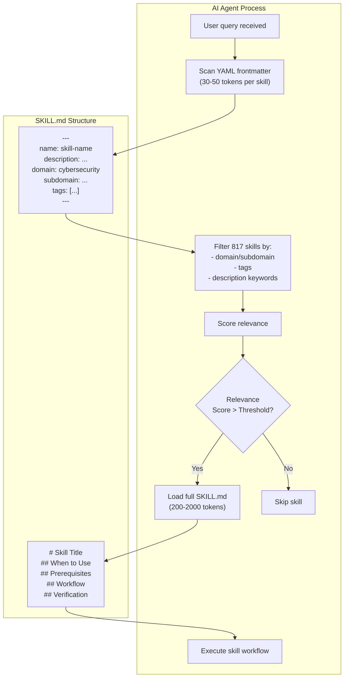

**Frontmatter Fields for Discovery:**

| Field | Example | Agent Use |
|-------|---------|-----------|
| `name` | `analyzing-network-traffic-of-malware` | Unique skill identifier |
| `description` | `Analyze PCAP files for malicious C2...` | Primary matching text |
| `domain` | `cybersecurity` | High-level category filter |
| `subdomain` | `threat-intelligence` | Specific category filter |
| `tags` | `[malware, pcap, wireshark]` | Keyword-based matching |

This two-phase loading strategy prevents token exhaustion when navigating 817 skills. Agents spend 30-50 tokens per skill during discovery, loading full definitions (200-2000 tokens) only for relevant matches.

**Sources:** [.github/workflows/validate-skills.yml:25-58](), [.github/workflows/update-index.yml:27-56]()

## Platform Compatibility Matrix

The following table summarizes integration characteristics across all supported platforms:

| Platform | Integration Type | Install Method | Context Loading | Frontmatter Index |
|----------|-----------------|----------------|-----------------|-------------------|
| **Claude Code** | Plugin-Native | `/plugin marketplace add` | On-demand | Yes (automatic) |
| **GitHub Copilot** | Workspace Context | `npx skills add` | Workspace scan | Yes (automatic) |
| **Cursor** | Workspace Context | Git clone or npx | Project rules | Yes (automatic) |
| **Gemini CLI** | File Context | Git clone | Manual `--context` | No (manual selection) |
| **Windsurf** | Workspace Context | Git clone or npx | Project files | Yes (automatic) |
| **Aider** | Workspace Context | Git clone | Repository map | Yes (automatic) |
| **Goose** | Plugin-Native | Plugin system | Plugin loader | Yes (automatic) |

**Sources:** [README.md:17-24](), [README.md:97-103]()

## Configuration Files for Platform Integration

### plugin.json Structure

The `.claude-plugin/plugin.json` file enables NPX and plugin marketplace distribution:

```json
{
  "name": "cybersecurity-skills",
  "description": "817 cybersecurity skills covering web security, pentesting, DFIR, threat intelligence, cloud security, malware analysis, and more.",
  "version": "1.3.0"
}
```

**Sources:** [.claude-plugin/plugin.json:1-5]()

### marketplace.json Structure

The `.claude-plugin/marketplace.json` provides extended metadata for marketplace listings, including owner information and categorized keywords.

```json
{
  "name": "anthropic-cybersecurity-skills",
  "owner": {
    "name": "mukul975",
    "email": "mukuljangra5@gmail.com"
  },
  "metadata": {
    "description": "817 cybersecurity skills...",
    "version": "1.3.0"
  },
  "plugins": [
    {
      "name": "cybersecurity-skills",
      "source": "./",
      "category": "security"
    }
  ]
}
```

**Sources:** [.claude-plugin/marketplace.json:1-37]()

## Integration Best Practices

### Token Efficiency Recommendations

For optimal platform performance:

1. **Frontmatter Indexing:** Platforms should build in-memory frontmatter indexes during initialization. The `index.json` file is auto-generated by GitHub Actions for this purpose.
2. **Lazy Loading:** Load full `SKILL.md` bodies only when skill relevance score exceeds threshold.
3. **Subdomain Filtering:** Filter by `subdomain` field before scanning all 817 skills.
4. **Tag-Based Matching:** Use `tags` array for keyword-based skill discovery.

**Sources:** [.github/workflows/update-index.yml:27-56](), [.github/workflows/validate-skills.yml:107-128]()

---

# Page: Progressive Disclosure Pattern

# Progressive Disclosure Pattern

<details>
<summary>Relevant source files</summary>

The following files were used as context for generating this wiki page:

- [.claude-plugin/marketplace.json](.claude-plugin/marketplace.json)
- [.claude-plugin/plugin.json](.claude-plugin/plugin.json)
- [.github/workflows/sync-marketplace-version.yml](.github/workflows/sync-marketplace-version.yml)
- [.github/workflows/update-index.yml](.github/workflows/update-index.yml)
- [.github/workflows/validate-skills.yml](.github/workflows/validate-skills.yml)
- [CODE_OF_CONDUCT.md](CODE_OF_CONDUCT.md)
- [README.md](README.md)
- [index.json](index.json)
- [skills/analyzing-linux-audit-logs-for-intrusion/SKILL.md](skills/analyzing-linux-audit-logs-for-intrusion/SKILL.md)
- [skills/analyzing-windows-amcache-artifacts/SKILL.md](skills/analyzing-windows-amcache-artifacts/SKILL.md)
- [skills/detecting-oauth-token-theft/SKILL.md](skills/detecting-oauth-token-theft/SKILL.md)
- [skills/implementing-devsecops-security-scanning/SKILL.md](skills/implementing-devsecops-security-scanning/SKILL.md)
- [skills/implementing-privileged-session-monitoring/SKILL.md](skills/implementing-privileged-session-monitoring/SKILL.md)

</details>


This document explains the token-efficient skill discovery mechanism used by AI agents to navigate the **817** cybersecurity skills in this repository. The pattern enables agents to filter skills by reading lightweight YAML frontmatter (30-50 tokens) before loading full skill definitions, preventing context window exhaustion while maintaining fast skill selection.

For information about the plugin distribution system that delivers these skills to agents, see [Plugin Architecture](#5). For details on the skill file structure itself, see [Skill Structure](#3.1).

---

## Purpose and Problem Statement

The repository contains **817 structured cybersecurity skills**, each averaging 500-2000 tokens when fully loaded. If an AI agent attempted to load all skills simultaneously to determine relevance, it would consume approximately **400,000 to 1,600,000 tokens**—exceeding the context window of most AI models and leaving no room for actual task execution.

The progressive disclosure pattern solves this by implementing **two-stage loading**:
1. **Discovery Stage**: Agent reads only YAML frontmatter from all skills (~30-50 tokens each = ~24,000-40,000 total tokens).
2. **Loading Stage**: Agent loads full `SKILL.md` content only for relevant skills (500-2000 tokens each).

This design enables agents to efficiently search and filter the entire skill catalog before committing context budget to full skill content.

Sources: [README.md:41-42](), [README.md:100-101]()

---

## Two-Stage Loading Architecture

The following diagram illustrates the interaction between the AI agent and the repository entities defined in the codebase.

### Sequence of Skill Discovery and Execution
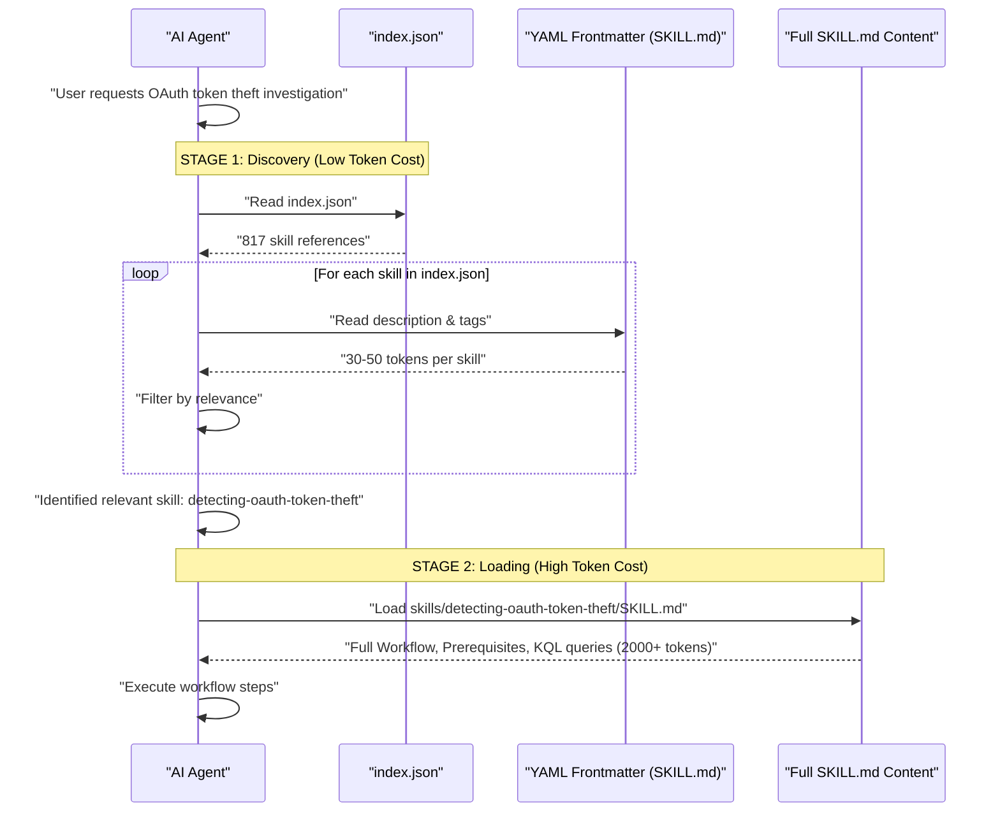

Sources: [index.json:1-1]() [skills/detecting-oauth-token-theft/SKILL.md:1-65]()

---

## YAML Frontmatter Schema

Every skill begins with YAML frontmatter delimited by triple dashes (`---`). This metadata block is designed for machine readability and token efficiency. The `update-index.yml` workflow specifically targets these lines to build the global index.

### Required Fields for Discovery

| Field | Type | Purpose | Example |
|-------|------|---------|---------|
| `name` | string | Kebab-case unique identifier | `detecting-oauth-token-theft` |
| `description` | string | Single-sentence capability summary | `Detects and responds to OAuth token theft...` |
| `domain` | string | Always `cybersecurity` | `cybersecurity` |
| `subdomain` | string | Category from 29 subdomains | `cloud-security` |
| `tags` | array | Searchable keywords for filtering | `[oauth, token-theft, entra-id]` |

### Mapping Fields (Progressive Detail)

| Field | Type | Framework Reference |
|-------|------|---------------------|
| `mitre_attack` | array | Enterprise Tactics/Techniques |
| `nist_csf` | array | CSF 2.0 Functions |
| `mitre_f3` | object | Fraud Framework TTPs |

### Frontmatter Implementation Example

```yaml
---
name: detecting-oauth-token-theft
description: Detects and responds to OAuth token theft and replay attacks in cloud environments...
domain: cybersecurity
subdomain: cloud-security
tags:
- oauth
- token-theft
- azure-ad
version: 1.0.0
author: mahipal
nist_csf:
- PR.IR-01
mitre_attack:
- T1078.004
mitre_f3:
  version: '1.1'
  tactics:
  - initial-access
---
```

Sources: [skills/detecting-oauth-token-theft/SKILL.md:1-65](), [.github/workflows/update-index.yml:36-47]()

---

## Discovery Flow State Machine

The logic used by the `update-index.yml` script mirrors how an agent parses the repository to maintain a token-efficient state.

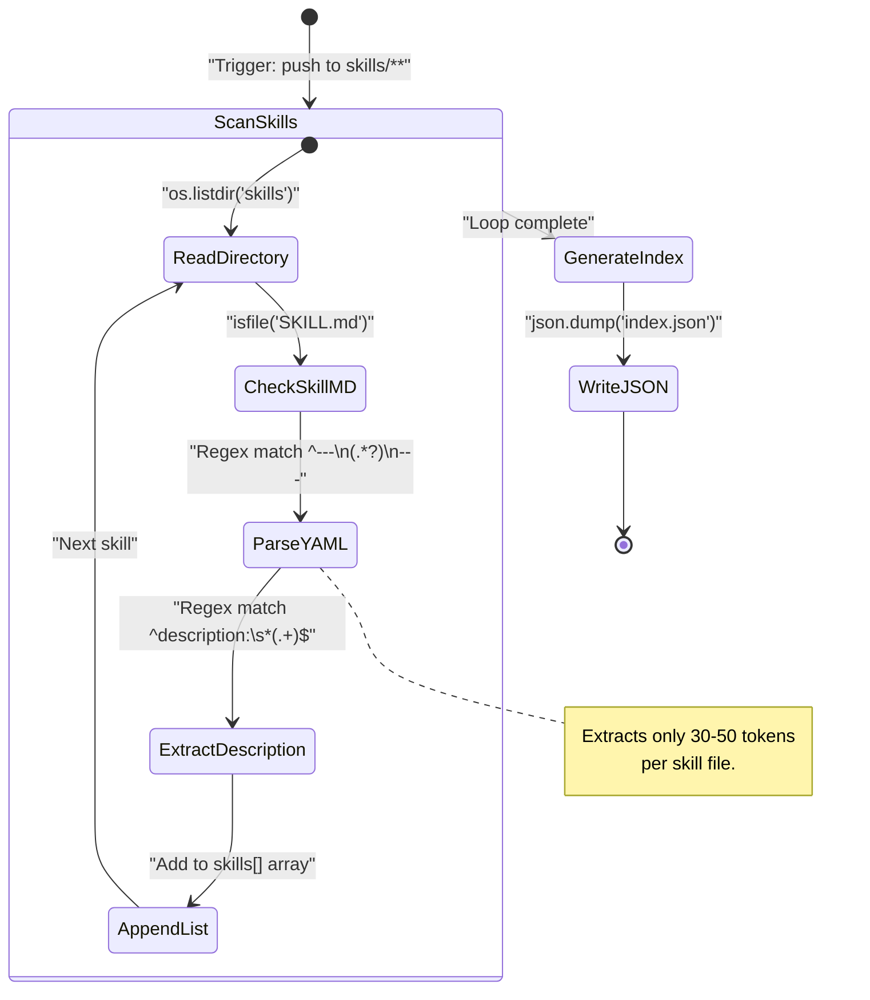

Sources: [.github/workflows/update-index.yml:30-59]()

---

## Token Economics Comparison (817 Skills)

The transition from 607 to 817 skills has increased the importance of this pattern to prevent context overflow.

### Without Progressive Disclosure (Naive Approach)

| Stage | Token Cost | Result |
|-------|------------|--------|
| Load all skills | 817 × 1500 = **1,225,500 tokens** | **Context window exceeded** |
| Filter relevant | N/A | Failure |
| **Total** | **1,225,500+ tokens** | **System Failure** |

### With Progressive Disclosure (Current Pattern)

| Stage | Token Cost | Result |
|-------|------------|--------|
| Load `index.json` | 817 × 50 = **40,850 tokens** | Discovery complete |
| Filter relevant | 0 (Reasoning) | Matches identified |
| Load 3 full skills | 3 × 1500 = **4,500 tokens** | Workflows ready |
| **Total** | **45,350 tokens** | **Success (96.3% savings)** |

Sources: [index.json:1-1](), [README.md:41-42]()

---

## File Structure and Progressive Loading

The progressive disclosure pattern maps directly to the physical file structure. Agents first target the YAML block in `SKILL.md` before accessing the full file or associated scripts.

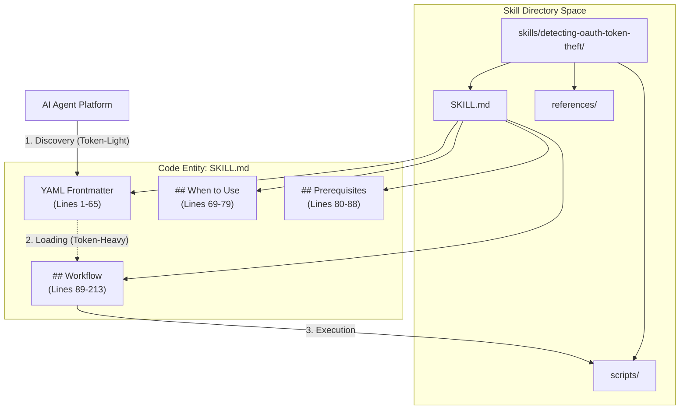

### Discovery Stage: Read Frontmatter Only
The agent parses `SKILL.md` lines 1-65. This contains the `description`, `tags`, and framework mappings (`mitre_attack`, `nist_csf`, `mitre_f3`).

### Loading Stage: Read Full File
If the frontmatter matches, the agent loads the remaining lines (e.g., 66-213), which contain the `## Workflow` and specific technical commands like KQL queries or `auditctl` rules.

Sources: [skills/detecting-oauth-token-theft/SKILL.md:1-213](), [skills/analyzing-linux-audit-logs-for-intrusion/SKILL.md:1-213]()

---

## Integration with Automation

The pattern is enforced by the CI/CD pipeline. `update-index.yml` ensures that the global `index.json` always reflects the latest frontmatter descriptions.

1. **Trigger**: Push to `skills/**` [.github/workflows/update-index.yml:7]().
2. **Action**: Python script iterates through all 817 directories [.github/workflows/update-index.yml:30]().
3. **Extraction**: Uses regex to pull `description` from the YAML block [.github/workflows/update-index.yml:36-41]().
4. **Aggregation**: Updates `total_skills` and the `skills` list in `index.json` [.github/workflows/update-index.yml:49-55]().
5. **Sync**: Patches the skill count in `README.md`, `marketplace.json`, and `plugin.json` [.github/workflows/update-index.yml:94-101]().

Sources: [.github/workflows/update-index.yml:1-113](), [.claude-plugin/marketplace.json:1-37]()

---

## Agent Implementation Pattern

AI agents implement progressive disclosure using this standardized approach:

1. **Query `index.json`**: Get a flat list of all skill names and descriptions.
2. **Semantic Filter**: Compare user prompt against `description` and `tags` fields.
3. **Targeted Fetch**: Request the specific `SKILL.md` file path provided in the index.
4. **Execute**: Follow the `## Workflow` section within the loaded file.

This allows the repository to support 26+ AI platforms while maintaining a consistent performance profile.

Sources: [README.md:17](), [index.json:1-1]()

---

# Page: Skills System

# Skills System

<details>
<summary>Relevant source files</summary>

The following files were used as context for generating this wiki page:

- [.claude-plugin/marketplace.json](.claude-plugin/marketplace.json)
- [.claude-plugin/plugin.json](.claude-plugin/plugin.json)
- [.github/workflows/sync-marketplace-version.yml](.github/workflows/sync-marketplace-version.yml)
- [.github/workflows/update-index.yml](.github/workflows/update-index.yml)
- [.github/workflows/validate-skills.yml](.github/workflows/validate-skills.yml)
- [CODE_OF_CONDUCT.md](CODE_OF_CONDUCT.md)
- [README.md](README.md)
- [index.json](index.json)
- [skills/analyzing-linux-audit-logs-for-intrusion/SKILL.md](skills/analyzing-linux-audit-logs-for-intrusion/SKILL.md)
- [skills/analyzing-windows-amcache-artifacts/SKILL.md](skills/analyzing-windows-amcache-artifacts/SKILL.md)
- [skills/detecting-oauth-token-theft/SKILL.md](skills/detecting-oauth-token-theft/SKILL.md)
- [skills/implementing-devsecops-security-scanning/SKILL.md](skills/implementing-devsecops-security-scanning/SKILL.md)
- [skills/implementing-privileged-session-monitoring/SKILL.md](skills/implementing-privileged-session-monitoring/SKILL.md)

</details>


The Skills System is the core content repository containing **817 cybersecurity capabilities** organized hierarchically across **29 subdomains** within the cybersecurity domain. Each skill follows the [agentskills.io](https://agentskills.io) standard with YAML frontmatter for metadata and a Markdown body for workflow definitions. The system provides a centralized index (`index.json`) that aggregates skill metadata for discovery, progressive disclosure, and plugin distribution.

For details on the standardized skill directory structure and YAML frontmatter schema, see [Skill Structure](#3.1). For information on how the `index.json` catalog is generated and its metadata fields, see [Skills Index](#3.2). For the complete taxonomy of 29 subdomain categories and tagging strategy, see [Skill Categories and Taxonomy](#3.3). For a practical walkthrough, see [Example: Disk Image Acquisition](#3.4).

## Repository Structure

The skills collection is organized as a flat directory of skill folders under the `skills/` directory, with each skill identified by its kebab-case name. A centralized index file provides aggregated metadata for efficient discovery without loading individual skill files.

```mermaid
graph TB
    subgraph "Repository_Root"
        [skills/] --> [index.json]
        [skills/] --> [.claude-plugin/]
    end
    
    subgraph "Individual_Skill_Directory"
        SKILL_MD["SKILL.md (YAML frontmatter + Markdown)"]
        ReferencesDir["references/"]
        ScriptsDir["scripts/"]
        AssetsDir["assets/"]
    end
    
    subgraph "Metadata_Aggregation"
        FrontmatterData["Frontmatter Fields: name, description, domain, subdomain, tags, version, nist_csf, mitre_attack, mitre_f3"]
        IndexEntry["Index Entry: + path field"]
    end
    
    [skills/] -->|"Contains 817 skill directories"| SKILL_MD
    SKILL_MD -->|"Extracted by update-index.yml"| FrontmatterData
    FrontmatterData -->|"Aggregated with path"| IndexEntry
    IndexEntry -->|"Written to"| [index.json]
    [index.json] -->|"Consumed by"| [.claude-plugin/]
    
    SKILL_MD -.->|"Supporting files (optional)"| ReferencesDir
    SKILL_MD -.->|"Supporting files (optional)"| ScriptsDir
    SKILL_MD -.->|"Supporting files (optional)"| AssetsDir
```

**Sources:** [index.json:1-55](), [README.md:37-43](), [.github/workflows/update-index.yml:27-55]()

## Domain and Subdomain Hierarchy

All skills belong to the single `cybersecurity` domain and are categorized into **29 subdomains** (updated from the previous 24/36). The `subdomain` field in each skill's frontmatter determines its primary categorization, while tags provide cross-cutting taxonomy.

```mermaid
graph TD
    Domain["domain: cybersecurity (817 total skills)"]
    
    Domain -->|"subdomain:"| Cloud["cloud-security"]
    Domain -->|"subdomain:"| Threat["threat-intelligence"]
    Domain -->|"subdomain:"| WebApp["web-application-security"]
    Domain -->|"subdomain:"| Malware["malware-analysis"]
    Domain -->|"subdomain:"| Forensics["digital-forensics"]
    Domain -->|"subdomain:"| IAM["identity-access-management"]
    Domain -->|"subdomain:"| AppSec["application-security"]
    Domain -->|"subdomain:"| IR["incident-response"]
    Domain -->|"+ 21 more"| Others["..."]
    
    Cloud -.->|"Example Tags"| CloudTags["oauth, token-theft, azure-ad, entra-id"]
    Forensics -.->|"Example Tags"| ForensicsTags["amcache, windows-forensics, program-execution"]
```

**Sources:** [index.json:6-47](), [README.md:13-17](), [skills/detecting-oauth-token-theft/SKILL.md:11-20]()

## Metadata Schema and Index Catalog

Each skill's YAML frontmatter contains required fields that are extracted into `index.json`. The index provides O(1) lookup by skill name and aggregated statistics for filtering and discovery.

| Field | Type | Purpose | Example |
|-------|------|---------|---------|
| `name` | string | Unique kebab-case identifier | `detecting-oauth-token-theft` |
| `description` | string | Brief capability summary | `Detects and responds to OAuth token theft...` |
| `domain` | string | Top-level category | `cybersecurity` |
| `subdomain` | string | Primary skill category | `cloud-security` |
| `tags` | array | Cross-cutting taxonomy keywords | `[oauth, token-theft, azure-ad]` |
| `version` | string | Skill version for tracking updates | `1.0.0` |
| `nist_csf` | array | Mapping to NIST CSF 2.0 functions | `[PR.IR-01, ID.AM-08]` |
| `mitre_attack` | array | Mapping to ATT&CK Techniques | `[T1078.004, T1530]` |

**Sources:** [skills/detecting-oauth-token-theft/SKILL.md:1-35](), [index.json:1-48]()

## Index Generation and Automation

The `index.json` file is auto-generated by the `update-index.yml` workflow whenever changes are pushed to the `skills/` directory. This ensures the marketplace and AI agents always have an up-to-date view of the repository's 817 capabilities.

```mermaid
graph LR
    subgraph "CI_CD_Automation"
        Workflow["update-index.yml"]
        PythonScript["Internal Python Generator"]
    end
    
    subgraph "index.json_Structure"
        Meta["Metadata (version, generated_at)"]
        Stats["total_skills: 817"]
        SkillsArray["skills[] Array (name, description, path)"]
    end
    
    Workflow -->|"Runs on push to skills/**"| PythonScript
    PythonScript -->|"Scans SKILL.md files"| Meta
    PythonScript -->|"Counts directories"| Stats
    PythonScript -->|"Parses frontmatter"| SkillsArray
```

**Sources:** [.github/workflows/update-index.yml:1-62](), [index.json:1-55]()

## Skill Discovery Flow

AI agents use a two-phase discovery process enabled by the progressive disclosure pattern: first reading lightweight metadata from the index to filter relevance, then loading the full Markdown body only when a skill matches the task.

```mermaid
sequenceDiagram
    participant Agent as AI Agent
    participant Index as index.json
    participant Skill as SKILL.md
    
    Agent->>Index: Load index catalog
    Index-->>Agent: 817 skill entries (name, description, domain, path)
    
    Agent->>Agent: Filter by keywords (e.g., "OAuth", "Audit Logs")
    
    Agent->>Skill: Read frontmatter from path (token efficient)
    Skill-->>Agent: Full metadata (tags, framework mappings)
    
    Agent->>Agent: Match confirmed
    
    Agent->>Skill: Load full Markdown body
    Skill-->>Agent: Detailed Workflow, Prerequisites, & Commands
```

**Sources:** [README.md:37-43](), [index.json:1-55](), [skills/analyzing-linux-audit-logs-for-intrusion/SKILL.md:1-210]()

## Version and Marketplace Management

The system maintains consistency between the skills, the plugin marketplace, and the repository versioning. Releases trigger the `sync-marketplace-version.yml` workflow to update metadata in `.claude-plugin/`.

*   **Repository Version:** Managed via tags and synced to `marketplace.json` [ [.github/workflows/sync-marketplace-version.yml:20-35]() ].
*   **Skill Count:** Automatically synced into `README.md` and marketplace files [ [.github/workflows/update-index.yml:64-103]() ].
*   **Licensing:** Standardized Apache-2.0 across all skills and the repository [ [LICENSE]() , [.claude-plugin/marketplace.json:20]() ].

**Sources:** [.github/workflows/sync-marketplace-version.yml:1-44](), [.claude-plugin/marketplace.json:1-37](), [.claude-plugin/plugin.json:1-5]()

---

# Page: Skill Structure

# Skill Structure

<details>
<summary>Relevant source files</summary>

The following files were used as context for generating this wiki page:

- [.claude-plugin/marketplace.json](.claude-plugin/marketplace.json)
- [.claude-plugin/plugin.json](.claude-plugin/plugin.json)
- [.github/workflows/sync-marketplace-version.yml](.github/workflows/sync-marketplace-version.yml)
- [.github/workflows/update-index.yml](.github/workflows/update-index.yml)
- [.github/workflows/validate-skills.yml](.github/workflows/validate-skills.yml)
- [CODE_OF_CONDUCT.md](CODE_OF_CONDUCT.md)
- [README.md](README.md)
- [tools/README.md](tools/README.md)
- [tools/validate-skill.py](tools/validate-skill.py)

</details>


This document defines the standardized file and directory structure for individual skills in the repository. Each skill follows a consistent template with required YAML frontmatter, Markdown body sections, and optional supporting files. This structure enables automated indexing, validation, and discovery by AI agents across 26+ platforms.

For information about the aggregated skills catalog, see [Skills Index](#3.2). For a complete walkthrough of an actual skill implementation, see [Example: Disk Image Acquisition](#3.4).

---

## Directory Layout

Each skill resides in its own directory under `skills/` with a standardized file organization. The directory name must be kebab-case and exactly match the `name` field in the `SKILL.md` frontmatter.

```
skills/
└── your-skill-name/
    ├── SKILL.md                    # Required: Main skill definition
    ├── references/                 # Optional: Supporting documentation
    │   ├── standards.md
    │   ├── workflows.md
    │   └── api-reference.md
    ├── scripts/                    # Optional: Helper automation
    │   ├── process.py
    │   └── validate.sh
    └── assets/                     # Optional: Templates and media
        ├── template.md
        └── diagram.png
```

**Directory Structure Diagram**

```mermaid
graph TD
    skillsDir["skills/"]
    
    skillDir["your-skill-name/"]
    skillMd["SKILL.md<br/>(Required)"]
    
    refDir["references/<br/>(Optional)"]
    refStandards["standards.md"]
    refWorkflows["workflows.md"]
    refApi["api-reference.md"]
    
    scriptsDir["scripts/<br/>(Optional)"]
    scriptPy["process.py"]
    scriptSh["validate.sh"]
    
    assetsDir["assets/<br/>(Optional)"]
    assetTemplate["template.md"]
    assetDiagram["diagram.png"]
    
    skillsDir --> skillDir
    skillDir --> skillMd
    skillDir --> refDir
    skillDir --> scriptsDir
    skillDir --> assetsDir
    
    refDir --> refStandards
    refDir --> refWorkflows
    refDir --> refApi
    
    scriptsDir --> scriptPy
    scriptsDir --> scriptSh
    
    assetsDir --> assetTemplate
    assetsDir --> assetDiagram
```

**Sources:** [.github/workflows/update-index.yml:27-33](), [tools/validate-skill.py:171-177]()

---

## YAML Frontmatter Requirements

Every `SKILL.md` file must begin with YAML frontmatter delimited by `---` markers. The frontmatter contains machine-readable metadata used by the `update-index.yml` workflow to generate `index.json` and by AI agents for token-efficient skill discovery.

### Required Fields

| Field | Type | Specification | Example |
|-------|------|---------------|---------|
| `name` | String | Kebab-case, 1-64 characters, must match directory name | `detecting-business-email-compromise` |
| `description` | String | Multi-line (at least 50 chars), includes agent-discovery keywords | `Detect BEC attempts by analyzing email headers for spoofing, checking for unusual sender patterns, and identifying fraudulent wire transfer requests.` |
| `domain` | String | Always `cybersecurity` | `cybersecurity` |
| `subdomain` | String | One of 29 predefined categories | `threat-detection` |
| `tags` | Array | Tools, techniques, frameworks (at least 2 items) | `[email-security, spoofing, incident-response]` |
| `version` | String | Semantic versioning format | `"1.3.0"` |
| `author` | String | GitHub username | `mukul975` |
| `license` | String | Always `Apache-2.0` | `Apache-2.0` |

### Frontmatter Example

```yaml
---
name: analyzing-network-traffic-of-malware
description: >-
  Identify malicious patterns in network captures by analyzing protocol headers,
  detecting C2 beacons, and correlating traffic with known malware signatures.
domain: cybersecurity
subdomain: malware-analysis
tags: [network-forensics, wireshark, malware, c2-detection]
version: "1.3.0"
author: mukul975
license: Apache-2.0
---
```

**YAML Frontmatter Validation Flow**

```mermaid
graph LR
    subgraph "validate-skills.yml Workflow"
        PR["Pull Request"]
        ValidateScript["validate-skill.py"]
        
        subgraph "parse_frontmatter function"
            Extract["Extract between ---"]
            Regex["Regex Match Fields"]
        end
        
        CheckName["Check 'name'<br/>kebab-case"]
        CheckDesc["Check 'description'<br/>min 50 chars"]
        CheckSub["Check 'subdomain'<br/>in ALLOWED_SUBDOMAINS"]
        CheckTags["Check 'tags'<br/>min 2 items"]
        
        Pass["✅ Pass"]
        Fail["❌ Fail"]
    end
    
    PR --> ValidateScript
    ValidateScript --> Extract
    Extract --> Regex
    Regex --> CheckName
    CheckName --> CheckDesc
    CheckDesc --> CheckSub
    CheckSub --> CheckTags
    CheckTags -->|All valid| Pass
    CheckTags -->|Any invalid| Fail
```

**Sources:** [tools/validate-skill.py:13-73](), [tools/validate-skill.py:81-168](), [.github/workflows/validate-skills.yml:25-58]()

---

## Markdown Body Sections

After the YAML frontmatter, the `SKILL.md` file contains structured Markdown sections. These sections provide the AI agent with actionable instructions and context.

### Standard Section Structure

| Section | Purpose | Content Guidelines |
|---------|---------|-------------------|
| `## When to Use` | Activation criteria | Bullet list of scenarios triggering this skill |
| `## Prerequisites` | Dependencies | Required tools, access, knowledge, or system state |
| `## Workflow` | Step-by-step procedure | Numbered steps with real commands, organized by `### Step N:` headings |
| `## Key Concepts` | Technical definitions | Markdown table mapping concepts to descriptions |
| `## Tools & Systems` | Technology reference | Markdown table listing tools and their purposes |
| `## Common Scenarios` | Real-world examples | Named scenarios with concrete implementations |
| `## Output Format` | Expected results | Code block showing typical command output or reports |

### Workflow Section Requirements

The `## Workflow` section contains the core executable instructions:

- Uses `### Step N:` subheadings for major phases.
- Includes real command examples in code blocks with syntax highlighting.
- Specifies exact tool names, flags, and file paths.
- Uses `bash` language identifier for shell commands.

**Skill Body Section Flow**

```mermaid
graph TD
    FrontmatterEnd["---<br/>End of YAML"]
    
    WhenUse["## When to Use<br/>Bullet list of scenarios"]
    PreReqs["## Prerequisites<br/>Required dependencies"]
    Workflow["## Workflow<br/>Numbered steps"]
    
    Step1["### Step 1: Phase Name<br/>bash code blocks"]
    Step2["### Step 2: Phase Name<br/>bash code blocks"]
    StepN["### Step N: Phase Name<br/>bash code blocks"]
    
    KeyConcepts["## Key Concepts<br/>Markdown table"]
    ToolsSystems["## Tools & Systems<br/>Markdown table"]
    CommonScenarios["## Common Scenarios<br/>Named examples"]
    OutputFormat["## Output Format<br/>Code block sample"]
    
    FrontmatterEnd --> WhenUse
    WhenUse --> PreReqs
    PreReqs --> Workflow
    Workflow --> Step1
    Step1 --> Step2
    Step2 --> StepN
    StepN --> KeyConcepts
    KeyConcepts --> ToolsSystems
    ToolsSystems --> CommonScenarios
    CommonScenarios --> OutputFormat
```

**Sources:** [.github/workflows/validate-skills.yml:31-35]()

---

## Supporting Files Structure

Skills may include optional subdirectories with supporting materials. These files extend the main skill definition without cluttering the primary `SKILL.md` file.

### references/ Subdirectory

Contains deep technical documentation, standards mappings, and external references:

- `standards.md` — NIST SP 800-61, ISO 27001, CVE references.
- `workflows.md` — Extended procedural documentation, decision trees.
- `api-reference.md` — Command-line tool API details, flag references.

### scripts/ Subdirectory

Contains executable helper scripts that automate portions of the skill workflow:

- Real working Python, Bash, or PowerShell scripts.
- Named descriptively (e.g., `process.py`, `validate.sh`).

### assets/ Subdirectory

Contains templates, checklists, configuration files, and diagrams:

- `template.md` — Pre-filled checklists or report templates.
- Configuration files for tools (`.config`, `.yml`, `.json`).
- Visual assets like `diagram.png`.

**Supporting Files Organization Diagram**

```mermaid
graph TB
    SkillDir["skills/your-skill-name/"]
    
    MainSkill["SKILL.md<br/>Main workflow<br/>7 standard sections"]
    
    RefDir["references/"]
    RefApi["api-reference.md<br/>CLI tool docs<br/>Parameter tables"]
    
    ScriptsDir["scripts/"]
    ScriptProcess["process.py<br/>Automation helper"]
    
    AssetsDir["assets/"]
    AssetConfig["tool.config<br/>Config file"]
    
    SkillDir --> MainSkill
    SkillDir --> RefDir
    SkillDir --> ScriptsDir
    SkillDir --> AssetsDir
    
    RefDir --> RefApi
    ScriptsDir --> ScriptProcess
    AssetsDir --> AssetConfig
    
    MainSkill -.->|"References for<br/>deep dive"| RefDir
    MainSkill -.->|"Calls for<br/>automation"| ScriptsDir
    MainSkill -.->|"Uses as<br/>templates"| AssetsDir
```

**Sources:** [.github/workflows/update-index.yml:30-33](), [tools/validate-skill.py:174-177]()

---

## Subdomain Categories

The `subdomain` field in YAML frontmatter must be one of 29 predefined categories. The `validate-skill.py` script maintains a mapping of canonical subdomains and accepted aliases.

| Subdomain | Example Mapping |
|-----------|-----------------|
| `web-application-security` | `application-security` |
| `penetration-testing` | `offensive-security` |
| `soc-operations` | `security-operations` |
| `phishing-defense` | `social-engineering-defense` |
| `firmware-analysis` | `firmware-security` |
| `compliance-governance` | `governance-risk-compliance` |

**Subdomain Validation Logic**

```mermaid
graph TD
    InputSub["Skill Subdomain Value"]
    SubMap["_SUBDOMAIN_ALIASES<br/>(tools/validate-skill.py)"]
    
    CheckCanonical["Is Canonical?"]
    CheckAlias["Is Alias?"]
    
    Valid["✅ Accepted"]
    Warn["⚠️ Accepted with Warning<br/>(Suggest Canonical)"]
    Error["❌ Rejected"]
    
    InputSub --> CheckCanonical
    CheckCanonical -->|Yes| Valid
    CheckCanonical -->|No| CheckAlias
    
    CheckAlias -->|Yes| Warn
    CheckAlias -->|No| Error
    
    Warn --> Valid
```

**Sources:** [tools/validate-skill.py:18-68]()

---

## File Naming Conventions

All skill directories and file names follow strict conventions to ensure consistency.

### Directory and Skill Name Requirements

| Rule | Specification | Example |
|------|---------------|---------|
| Format | Kebab-case (lowercase with hyphens) | `aws-s3-enumeration` |
| Length | 1-64 characters | `detecting-spoofed-emails` |
| Characters | Alphanumeric and hyphens only | `incident-response-plan` |
| Match | Must match `name` field in YAML frontmatter | Directory: `my-skill` / YAML: `name: my-skill` |

### Automated Validation Summary

The `validate-skills.yml` workflow performs the following checks:
1. **Frontmatter Existence**: Checks for `---` markers.
2. **Required Fields**: Ensures `name`, `description`, `domain`, `subdomain`, `tags`, `version`, `author`, and `license` are present.
3. **Format Validation**: Validates kebab-case for names and length constraints.
4. **Duplicate Detection**: Ensures no two skills share the same `name` metadata.

**Sources:** [.github/workflows/validate-skills.yml:38-95](), [tools/validate-skill.py:70-73]()

---

# Page: Skills Index

# Skills Index

<details>
<summary>Relevant source files</summary>

The following files were used as context for generating this wiki page:

- [.claude-plugin/marketplace.json](.claude-plugin/marketplace.json)
- [.claude-plugin/plugin.json](.claude-plugin/plugin.json)
- [.github/workflows/sync-marketplace-version.yml](.github/workflows/sync-marketplace-version.yml)
- [.github/workflows/update-index.yml](.github/workflows/update-index.yml)
- [.github/workflows/validate-skills.yml](.github/workflows/validate-skills.yml)
- [CODE_OF_CONDUCT.md](CODE_OF_CONDUCT.md)
- [README.md](README.md)
- [index.json](index.json)
- [skills/analyzing-linux-audit-logs-for-intrusion/SKILL.md](skills/analyzing-linux-audit-logs-for-intrusion/SKILL.md)
- [skills/analyzing-windows-amcache-artifacts/SKILL.md](skills/analyzing-windows-amcache-artifacts/SKILL.md)
- [skills/detecting-oauth-token-theft/SKILL.md](skills/detecting-oauth-token-theft/SKILL.md)
- [skills/implementing-devsecops-security-scanning/SKILL.md](skills/implementing-devsecops-security-scanning/SKILL.md)
- [skills/implementing-privileged-session-monitoring/SKILL.md](skills/implementing-privileged-session-monitoring/SKILL.md)

</details>


The Skills Index is the central catalog that aggregates metadata from all 817 cybersecurity skills into a machine-readable JSON structure. This index enables efficient skill discovery, filtering, and integration with AI agent platforms without requiring agents to scan individual `SKILL.md` files across the entire repository.

For information about individual skill structure and frontmatter requirements, see [Skill Structure](#3.1). For the taxonomy of skill categories, see [Skill Categories and Taxonomy](#3.3). For the automated generation process, see [Index Generation Workflow](#6.2).

## Index File Structure

The `index.json` file serves as the single source of truth for skill metadata, exposing aggregate statistics and individual skill records through a standardized schema.

### Root-Level Metadata

```mermaid
graph TB
    index["index.json"]
    version["version: '1.1.0'"]
    generated_at["generated_at: ISO8601 timestamp"]
    repository["repository: GitHub URL"]
    total_skills["total_skills: 817"]
    domain["domain: 'cybersecurity'"]
    
    index --> version
    index --> generated_at
    index --> repository
    index --> total_skills
    index --> domain
    index --> skills["skills: []"]
```

**Sources:** [index.json:1-1](), [.github/workflows/update-index.yml:49-56]()

The root object contains version tracking, generation timestamps, repository metadata, and aggregated counts:

| Field | Type | Purpose |
|-------|------|---------|
| `version` | string | Index schema version (currently "1.1.0") |
| `generated_at` | string | UTC timestamp in ISO 8601 format |
| `repository` | string | GitHub repository URL |
| `total_skills` | integer | Total number of indexed skills (817) |
| `domain` | string | The primary domain of the library ("cybersecurity") |

**Sources:** [index.json:1-1](), [.github/workflows/update-index.yml:49-56]()

## Skill Entry Schema

Each skill in the `skills` array follows a standardized metadata structure extracted from `SKILL.md` frontmatter.

### Skill Object Structure

```mermaid
graph TB
    skill["Skill Object (in skills array)"]
    
    skill --> name["name: slug identifier"]
    skill --> description["description: summary"]
    skill --> domain["domain: 'cybersecurity'"]
    skill --> path["path: 'skills/{name}'"]
```

**Sources:** [index.json:1-1](), [.github/workflows/update-index.yml:42-47]()

### Field Specifications

| Field | Type | Source | Example |
|-------|------|--------|---------|
| `name` | string | Directory name in `skills/` | `"abusing-dpapi-for-credential-access"` |
| `description` | string | Frontmatter `description:` | `"Extract DPAPI-protected secrets..."` |
| `domain` | string | Hardcoded as `"cybersecurity"` | `"cybersecurity"` |
| `path` | string | Constructed as `skills/{skill_name}` | `"skills/abusing-dpapi-for-credential-access"` |

**Sources:** [.github/workflows/update-index.yml:30-47]()

### Example Skill Entry

```json
{
  "name": "abusing-dpapi-for-credential-access",
  "description": "Extract DPAPI-protected secrets such as credentials and browser data offline and online.",
  "domain": "cybersecurity",
  "path": "skills/abusing-dpapi-for-credential-access"
}
```

**Sources:** [index.json:1-1]()

## Index Generation Process

The index is automatically regenerated whenever skill files are modified through the `update-index.yml` GitHub Actions workflow. This workflow also synchronizes the skill count across the `README.md`, `marketplace.json`, and `plugin.json`.

### Workflow Architecture

```mermaid
sequenceDiagram
    participant Git as GitHub Push Event
    participant Workflow as update-index.yml
    participant Python as Python Script
    participant FS as skills/ Directory
    participant Index as index.json
    participant Meta as marketplace.json / plugin.json
    participant README as README.md
    
    Git->>Workflow: Trigger on push to main
    Note over Git,Workflow: Path: 'skills/**'
    Workflow->>Python: Execute Regeneration Logic
    Python->>FS: os.listdir("skills")
    loop For each skill directory
        Python->>FS: Read SKILL.md
        Python->>Python: Extract 'description' via regex
        Python->>Python: Append to skills list
    end
    Python->>Index: Write index.json
    Workflow->>Python: Execute Sync Logic
    Python->>FS: Calculate authoritative count
    Python->>README: Update badge/skills-<count>
    Python->>Meta: Update descriptions with count
    Workflow->>Git: git commit & push
```

**Sources:** [.github/workflows/update-index.yml:1-113]()

### Python Extraction Logic

The inline Python script performs metadata extraction by scanning the `skills/` directory and parsing the YAML frontmatter of each `SKILL.md` file using regular expressions.

```python
for skill_name in sorted(os.listdir(skills_dir)):
    skill_md = os.path.join(skills_dir, skill_name, "SKILL.md")
    if not os.path.isfile(skill_md):
        continue
    with open(skill_md, "r", encoding="utf-8") as f:
        content = f.read()
    fm_match = re.match(r"^---\n(.*?)\n---", content, re.DOTALL)
    description = ""
    if fm_match:
        m = re.search(r"^description:\s*(.+)$", fm_match.group(1), re.MULTILINE)
        if m:
            description = m.group(1).strip().strip('"')
```

**Sources:** [.github/workflows/update-index.yml:30-41]()

### Skill Count Synchronization

To maintain consistency across the repository, the workflow includes a secondary Python block that updates the "817" count in various files:

1.  **README.md**: Updates the shields.io badge (`badge/skills-817`) and multiple descriptive phrases like "817 production-grade cybersecurity skills".
2.  **marketplace.json**: Patches the `metadata.description` and `plugins[].description` fields.
3.  **plugin.json**: Patches the top-level `description`.

**Sources:** [.github/workflows/update-index.yml:66-104]()

## Usage in Plugin System

The `index.json` file serves as the primary data source for plugin distribution and AI agent integration.

### Progressive Disclosure Pattern

AI agents use the index for token-efficient skill discovery. Instead of loading 817 full markdown files, the agent reads the index to find relevant paths.

```mermaid
graph TB
    agent["AI Agent (e.g. Claude Code)"]
    index["index.json<br/>(Lightweight Catalog)"]
    skill_file["SKILL.md<br/>(Detailed Content)"]
    
    agent -->|1. Scans| index
    index -->|2. Identifies| path["path: skills/detecting-oauth-token-theft"]
    agent -->|3. Loads| skill_file
```

**Sources:** [README.md:21, 39-41](), [index.json:1-1]()

### Marketplace and Versioning

The `index.json` is complemented by marketplace configuration files which define the overall plugin version (currently `1.3.0`).

| File | Purpose | Version Field |
|------|---------|---------------|
| `index.json` | Skill catalog for agents | `1.1.0` |
| `.claude-plugin/marketplace.json` | Marketplace metadata | `1.3.0` |
| `.claude-plugin/plugin.json` | Plugin definition | `1.3.0` |

**Sources:** [index.json:1](), [.claude-plugin/marketplace.json:9, 16](), [.claude-plugin/plugin.json:4]()

The version numbers in `marketplace.json` and `plugin.json` are automatically synchronized with GitHub release tags via the `sync-marketplace-version.yml` workflow using `jq`.

**Sources:** [.github/workflows/sync-marketplace-version.yml:27-35]()

## Index Statistics Summary

Current index metrics (as of the 1.3.0 release):

| Metric | Value |
|--------|-------|
| Total Skills | 817 |
| Security Domains | 29 |
| Framework Mappings | 6 |
| Compatible Platforms | 26+ |

**Sources:** [README.md:13-17, 27](), [index.json:1]()

### Framework Coverage Analysis
The index supports skills mapped across six industry-standard frameworks:
*   **MITRE ATT&CK v19.1**: 15 tactics, 286 techniques.
*   **NIST CSF 2.0**: 6 functions, 22 categories.
*   **MITRE F3**: 8 tactics, 123 techniques (94 fraud-relevant skills).
*   **MITRE ATLAS v5.4**: 16 tactics, 84 techniques.
*   **MITRE D3FEND v1.3**: 7 categories, 267 techniques.
*   **NIST AI RMF 1.0**: 4 functions, 72 subcategories.

**Sources:** [README.md:43-54, 63, 75-77]()

---

# Page: Skill Categories and Taxonomy

# Skill Categories and Taxonomy

<details>
<summary>Relevant source files</summary>

The following files were used as context for generating this wiki page:

- [.gitignore](.gitignore)
- [ATTACK_COVERAGE.md](ATTACK_COVERAGE.md)
- [index.json](index.json)
- [skills/analyzing-linux-audit-logs-for-intrusion/SKILL.md](skills/analyzing-linux-audit-logs-for-intrusion/SKILL.md)
- [skills/analyzing-windows-amcache-artifacts/SKILL.md](skills/analyzing-windows-amcache-artifacts/SKILL.md)
- [skills/detecting-oauth-token-theft/SKILL.md](skills/detecting-oauth-token-theft/SKILL.md)
- [skills/implementing-devsecops-security-scanning/SKILL.md](skills/implementing-devsecops-security-scanning/SKILL.md)
- [skills/implementing-privileged-session-monitoring/SKILL.md](skills/implementing-privileged-session-monitoring/SKILL.md)
- [tools/README.md](tools/README.md)
- [tools/validate-skill.py](tools/validate-skill.py)

</details>


This page documents the taxonomic structure used to classify and organize the 817 cybersecurity skills in the repository. The taxonomy enables efficient skill discovery through a hierarchical domain → subdomain → tag classification system that supports progressive disclosure for AI agents.

The taxonomy has been expanded from 24 to 29 canonical subdomains to accommodate emerging fields such as AI security, blockchain security, and supply chain security.

## Taxonomy Architecture

The repository implements a three-level hierarchical taxonomy:

```mermaid
graph TD
    Root["Skills Repository<br/>817 skills"]
    Domain["Domain Level<br/>cybersecurity"]
    Subdomains["Subdomain Level<br/>29 canonical + aliases"]
    Tags["Tag Level<br/>Unbounded vocabulary"]
    
    Root --> Domain
    Domain --> Subdomains
    Subdomains --> Tags
    
    Subdomains --> SD1["cloud-security"]
    Subdomains --> SD2["threat-intelligence"]
    Subdomains --> SD3["ai-security"]
    Subdomains --> SD4["blockchain-security"]
    
    SD1 --> T1["aws, azure, gcp"]
    SD2 --> T2["mitre-attack, stix, ioc"]
    SD3 --> T3["llm, adversarial-ml"]
    SD4 --> T4["smart-contracts, ethereum"]
```

**Sources:** [index.json:1-10](), [tools/validate-skill.py:13-59]()

### Domain Level
All skills belong to a single root domain: `cybersecurity`. This provides namespace consistency and simplifies AI agent filtering.

**Sources:** [index.json:8-9](), [tools/validate-skill.py:24-24]()

### Subdomain Level
Subdomains provide functional categorization. The system now recognizes **29 canonical subdomains** and manages naming variants through an alias mapping system in the validator.

**Sources:** [tools/validate-skill.py:18-59]()

### Tag Level
Tags provide fine-grained classification using an unbounded vocabulary. These are stored as a list in the skill frontmatter and must contain at least 2 items.

**Sources:** [tools/validate-skill.py:26-26](), [tools/README.md:26-26]()

---

## Canonical Subdomain Categories

The following 29 subdomains are the primary taxonomic units. The `validate-skill.py` script enforces these categories while allowing for common aliases.

| Canonical Subdomain | Key Aliases Accepted | Purpose |
|---------------------|----------------------|---------|
| `cloud-security` | - | AWS, Azure, GCP, and Cloud Native security |
| `threat-intelligence` | - | CTI, IOCs, and Actor Tracking |
| `web-application-security` | `application-security` | Web vulnerabilities and OWASP Top 10 |
| `ai-security` | - | LLM security, prompt injection, and ML integrity |
| `blockchain-security` | - | Smart contract audits and DLT security |
| `supply-chain-security` | - | Software Bill of Materials (SBOM) and pipeline integrity |
| `ot-ics-security` | `ot-security` | Industrial Control Systems and SCADA |
| `identity-access-management`| `identity-security`, `iam` | Authentication, Authorization, and PAM |
| `soc-operations` | `security-operations` | SIEM, SOAR, and SOC workflows |
| `red-teaming` | `red-team` | Adversary emulation and offensive operations |
| `penetration-testing` | `offensive-security` | Targeted vulnerability assessment |
| `digital-forensics` | - | Evidence acquisition and artifact analysis |
| `malware-analysis` | - | Static, dynamic, and reverse engineering |
| `network-security` | - | Traffic analysis and network defense |
| `vulnerability-management` | - | Scanning, prioritization, and patching |
| `compliance-governance` | `governance-risk-compliance` | Regulatory frameworks (GDPR, PCI, etc.) |
| `devsecops` | - | CI/CD security and shift-left automation |
| `threat-hunting` | - | Proactive detection of hidden threats |
| `incident-response` | - | Containment, Eradication, and Recovery |
| `endpoint-security` | - | Host-based defense and EDR |
| `phishing-defense` | `social-engineering-defense` | Email security and user awareness |
| `api-security` | - | REST, GraphQL, and microservices security |
| `mobile-security` | - | iOS and Android security |
| `ransomware-defense` | - | Extortion prevention and recovery |
| `threat-detection` | - | Detection engineering and alerting |
| `cryptography` | - | Encryption, PKI, and secure protocols |
| `data-protection` | - | DLP and data privacy |
| `deception-technology` | - | Honeypots and active defense |
| `firmware-analysis` | `firmware-security` | Hardware and low-level code security |
| `privacy-compliance` | - | Data privacy regulations and controls |
| `purple-team` | - | Collaborative offensive/defensive exercises |
| `wireless-security` | - | Wi-Fi, Bluetooth, and RF security |
| `zero-trust-architecture` | `zero-trust` | Identity-centric perimeter-less security |

**Sources:** [tools/validate-skill.py:18-59]()

---

## Taxonomy Implementation in Code

The taxonomy is enforced via `tools/validate-skill.py` and aggregated into `index.json`.

### Subdomain Mapping Logic
The codebase uses a mapping dictionary to normalize various input strings into canonical subdomains.

```mermaid
graph LR
    Input["Skill Frontmatter<br/>'subdomain' field"]
    Map["_ALIAS_TO_CANONICAL<br/>(tools/validate-skill.py)"]
    Canonical["Canonical Category"]
    
    Input -->|"identity-security"| Map
    Input -->|"identity-and-access-management"| Map
    Map -->|"Normalizes to"| Canonical
    Canonical -->|"Result"| Final["identity-access-management"]
```

**Sources:** [tools/validate-skill.py:18-68]()

### Validation Rules
The `validate_skill(skill_dir)` function ensures every skill adheres to the taxonomy:
1. **Required Fields**: `domain`, `subdomain`, and `tags` must exist [tools/validate-skill.py:13-13]().
2. **Domain**: Must be exactly `cybersecurity` [tools/validate-skill.py:24-24]().
3. **Subdomain**: Must exist within the `ALLOWED_SUBDOMAINS` set [tools/validate-skill.py:62-62]().
4. **Tags**: Must be a list with at least 2 items [tools/validate-skill.py:26-26]().

---

## Code Entity Space: Taxonomy Data Flow

This diagram illustrates how taxonomy data moves from the raw `SKILL.md` files into the system-wide `index.json`.

```mermaid
graph TD
    subgraph "Skill Filesystem"
        S1["skills/detecting-oauth-token-theft/SKILL.md"]
        S2["skills/analyzing-linux-audit-logs/SKILL.md"]
    end

    subgraph "Validation & Processing"
        V["validate-skill.py"]
        P["parse_frontmatter()"]
    end

    subgraph "Output Catalog"
        IDX["index.json"]
    end

    S1 -->|"Read YAML"| P
    P -->|"Validate fields"| V
    V -->|"Append metadata"| IDX

    subgraph "index.json structure"
        T["total_skills: 817"]
        SK["skills: [ {name, subdomain, tags...} ]"]
    end
    IDX --> T
    IDX --> SK
```

**Sources:** [index.json:1-10](), [tools/validate-skill.py:81-168](), [skills/detecting-oauth-token-theft/SKILL.md:1-22]()

---

## Example: Skill Categorization

A skill like `detecting-oauth-token-theft` demonstrates the multi-framework and taxonomic mapping:

*   **Domain**: `cybersecurity`
*   **Subdomain**: `cloud-security`
*   **Tags**: `[oauth, token-theft, azure-ad, entra-id, conditional-access, token-replay, identity-security, PRT]`
*   **Frameworks**:
    *   **NIST CSF**: `PR.IR-01`, `ID.AM-08`, `GV.SC-06`, `DE.CM-01`
    *   **MITRE ATT&CK**: `T1078.004`, `T1530`, `T1537`, `T1580`
    *   **MITRE F3**: `initial-access`, `positioning`

**Sources:** [skills/detecting-oauth-token-theft/SKILL.md:1-65]()

---

## Summary of Changes
The taxonomy was recently updated to increase granularity and coverage:
1.  **From 24 to 29 subdomains**: Added specialized categories like `ai-security`, `blockchain-security`, and `firmware-analysis`.
2.  **Alias Support**: The validator now supports 12+ aliases (e.g., `ot-security` maps to `ot-ics-security`) to maintain backward compatibility while enforcing a clean index.
3.  **Strict Validation**: Descriptions are now enforced at a minimum of 50 characters to ensure the taxonomy is supported by meaningful metadata.

**Sources:** [tools/validate-skill.py:18-73](), [index.json:1-10]()

---

# Page: Example: Disk Image Acquisition

# Example: Disk Image Acquisition

<details>
<summary>Relevant source files</summary>

The following files were used as context for generating this wiki page:

- [index.json](index.json)
- [skills/analyzing-api-gateway-access-logs/SKILL.md](skills/analyzing-api-gateway-access-logs/SKILL.md)
- [skills/analyzing-azure-activity-logs-for-threats/SKILL.md](skills/analyzing-azure-activity-logs-for-threats/SKILL.md)
- [skills/analyzing-cloud-storage-access-patterns/SKILL.md](skills/analyzing-cloud-storage-access-patterns/SKILL.md)
- [skills/analyzing-kubernetes-audit-logs/SKILL.md](skills/analyzing-kubernetes-audit-logs/SKILL.md)
- [skills/analyzing-linux-audit-logs-for-intrusion/SKILL.md](skills/analyzing-linux-audit-logs-for-intrusion/SKILL.md)
- [skills/analyzing-memory-forensics-with-lime-and-volatility/SKILL.md](skills/analyzing-memory-forensics-with-lime-and-volatility/SKILL.md)
- [skills/analyzing-network-flow-data-with-netflow/SKILL.md](skills/analyzing-network-flow-data-with-netflow/SKILL.md)
- [skills/analyzing-powershell-script-block-logging/SKILL.md](skills/analyzing-powershell-script-block-logging/SKILL.md)
- [skills/analyzing-threat-landscape-with-misp/SKILL.md](skills/analyzing-threat-landscape-with-misp/SKILL.md)
- [skills/analyzing-web-server-logs-for-intrusion/SKILL.md](skills/analyzing-web-server-logs-for-intrusion/SKILL.md)
- [skills/analyzing-windows-amcache-artifacts/SKILL.md](skills/analyzing-windows-amcache-artifacts/SKILL.md)
- [skills/configuring-microsegmentation-for-zero-trust/SKILL.md](skills/configuring-microsegmentation-for-zero-trust/SKILL.md)
- [skills/detecting-oauth-token-theft/SKILL.md](skills/detecting-oauth-token-theft/SKILL.md)
- [skills/implementing-devsecops-security-scanning/SKILL.md](skills/implementing-devsecops-security-scanning/SKILL.md)
- [skills/implementing-privileged-session-monitoring/SKILL.md](skills/implementing-privileged-session-monitoring/SKILL.md)

</details>


## Purpose and Scope

This page provides a detailed walkthrough of the **acquiring-disk-image-with-dd-and-dcfldd** skill as a concrete example of the standardized skill structure. It demonstrates how YAML frontmatter, workflow organization, verification procedures, and helper scripts combine to form a complete, AI-agent-consumable capability. This example illustrates the structure defined in [Skill Structure](#3.1) and shows how individual skills populate the catalog described in [Skills Index](#3.2).

For general skill structure requirements, see [Skill Structure](#3.1). For information about how skills are categorized, see [Skill Categories and Taxonomy](#3.3).

---

## Skill Directory Structure

The `acquiring-disk-image-with-dd-and-dcfldd` skill follows the standardized directory layout required by the repository's contribution guidelines.

Directory Structure for Disk Acquisition Skill:
```mermaid
graph TB
    Root["skills/acquiring-disk-image-with-dd-and-dcfldd/"]
    SKILL["SKILL.md<br/>(Main skill definition)"]
    LICENSE["LICENSE<br/>(Apache-2.0)"]
    RefDir["references/"]
    ScriptDir["scripts/"]
    APIRef["api-reference.md"]
    Agent["agent.py"]
    
    Root --> SKILL
    Root --> LICENSE
    Root --> RefDir
    Root --> ScriptDir
    RefDir --> APIRef
    ScriptDir --> Agent
    
    SKILL -.->|"Lines 1-10: YAML frontmatter"| Metadata["Metadata block"]
    SKILL -.->|"Lines 12-231: Markdown body"| Content["Workflow content"]
    Agent -.->|"Lines 12-16: run_cmd()"| Executor["Command executor"]
    Agent -.->|"Lines 47-63: compute_hash()"| Hasher["Hash verification"]
    Agent -.->|"Lines 83-100: acquire_with_dcfldd()"| Acquirer["Image acquisition"]
```

**Sources:** [skills/acquiring-disk-image-with-dd-and-dcfldd/SKILL.md:1-231](), [skills/acquiring-disk-image-with-dd-and-dcfldd/scripts/agent.py:1-171](), [skills/acquiring-disk-image-with-dd-and-dcfldd/references/api-reference.md:1-100]()

---

## YAML Frontmatter Structure

The skill begins with YAML frontmatter that provides machine-readable metadata for AI agents and the indexing system.

| Field | Value | Purpose |
|-------|-------|---------|
| `name` | `acquiring-disk-image-with-dd-and-dcfldd` | Unique identifier matching directory name |
| `description` | `Create forensically sound bit-for-bit...` | Brief summary (appears in skill listings) |
| `domain` | `cybersecurity` | Top-level domain classification |
| `subdomain` | `digital-forensics` | Specific subdomain (maps to NIST CSF, MITRE ATT&CK) |
| `tags` | `[forensics, disk-imaging, ...]` | Search keywords and technique identifiers |
| `version` | `"1.0"` | Semantic version for tracking updates |
| `author` | `mahipal` | Contributor attribution |
| `license` | `Apache-2.0` | SPDX license identifier |

This frontmatter block is defined at [skills/acquiring-disk-image-with-dd-and-dcfldd/SKILL.md:1-10](). The `subdomain` field maps to the taxonomy described in [Skill Categories and Taxonomy](#3.3), and these metadata fields populate the `index.json` catalog as documented in [Skills Index](#3.2).

**Progressive Disclosure Pattern:** AI agents read this 30-50 token YAML block first to determine relevance before loading the full 2,000+ token skill body. This implements the token-efficient discovery mechanism described in [Progressive Disclosure Pattern](#2.3).

**Sources:** [skills/acquiring-disk-image-with-dd-and-dcfldd/SKILL.md:1-10]()

---

## Workflow Organization

The skill's main content is organized into standardized sections that guide AI agents through the complete forensic acquisition process.

Skill Content Workflow:
```mermaid
flowchart TD
    When["When to Use<br/>(Lines 14-19)"]
    Pre["Prerequisites<br/>(Lines 21-27)"]
    Workflow["Workflow<br/>(Lines 29-174)"]
    
    Step1["Step 1: Identify Target & Write-Block<br/>(Lines 31-50)"]
    Step2["Step 2: Prepare Destination<br/>(Lines 52-66)"]
    Step3["Step 3: dd Acquisition<br/>(Lines 68-84)"]
    Step4["Step 4: dcfldd Acquisition<br/>(Lines 86-118)"]
    Step5["Step 5: Verify Integrity<br/>(Lines 120-139)"]
    Step6["Step 6: Document Process<br/>(Lines 141-174)"]
    
    Concepts["Key Concepts Table<br/>(Lines 176-188)"]
    Tools["Tools & Systems Table<br/>(Lines 189-201)"]
    Scenarios["Common Scenarios<br/>(Lines 202-214)"]
    Output["Output Format<br/>(Lines 216-231)"]
    
    When --> Pre
    Pre --> Workflow
    Workflow --> Step1
    Step1 --> Step2
    Step2 --> Step3
    Step3 --> Step4
    Step4 --> Step5
    Step5 --> Step6
    
    Step6 --> Concepts
    Concepts --> Tools
    Tools --> Scenarios
    Scenarios --> Output
```

### Section Breakdown

**When to Use** ([skills/acquiring-disk-image-with-dd-and-dcfldd/SKILL.md:14-19]()): Defines five forensic contexts where this skill applies, such as incident response and legal proceedings.

**Prerequisites** ([skills/acquiring-disk-image-with-dd-and-dcfldd/SKILL.md:21-27]()): Lists required tools (`dd`, `dcfldd`, `sha256sum`), hardware (write-blocker), and permissions (root/sudo).

**Workflow Steps** ([skills/acquiring-disk-image-with-dd-and-dcfldd/SKILL.md:29-174]()): Six sequential steps with executable shell commands:

1. **Device Identification** uses `lsblk`, `fdisk`, `blockdev --setro` to locate and write-protect the target device
2. **Documentation** captures drive metadata with `hdparm -I` and `smartctl -i` before acquisition
3. **dd Acquisition** demonstrates basic imaging with `conv=noerror,sync` and `status=progress`
4. **dcfldd Acquisition** shows forensic-grade imaging with built-in `hash=sha256,md5` and `split=2G` options
5. **Integrity Verification** compares source and image hashes using `sha256sum` and `diff`
6. **Report Generation** creates chain-of-custody documentation with timestamps and hash values

**Sources:** [skills/acquiring-disk-image-with-dd-and-dcfldd/SKILL.md:14-174]()

---

## Code Entity Mapping: Workflow to Implementation

This diagram bridges the natural language workflow to actual code implementation in the helper script.

Workflow to Code Entity Mapping:
```mermaid
graph LR
    subgraph "SKILL.md Workflow"
        W1["Step 1: lsblk -o NAME,SIZE<br/>(Line 35)"]
        W2["blockdev --setro /dev/sdb<br/>(Line 41)"]
        W3["sha256sum /dev/sdb<br/>(Line 65)"]
        W4["dcfldd if=/dev/sdb<br/>(Lines 93-100)"]
        W5["diff hashes<br/>(Lines 128-129)"]
    end
    
    subgraph "agent.py Functions"
        F1["list_block_devices()<br/>(Lines 18-23)"]
        F2["enable_write_protection()<br/>(Lines 34-44)"]
        F3["compute_hash()<br/>(Lines 47-63)"]
        F4["acquire_with_dcfldd()<br/>(Lines 83-100)"]
        F5["verify_image()<br/>(Lines 103-116)"]
    end
    
    W1 -.->|"Implements"| F1
    W2 -.->|"Implements"| F2
    W3 -.->|"Implements"| F3
    W4 -.->|"Implements"| F4
    W5 -.->|"Implements"| F5
    
    F1 --> Runner["run_cmd('lsblk -J')<br/>(Line 20)"]
    F2 --> Blocker["blockdev --setro<br/>(Line 36)"]
    F3 --> Hasher["hashlib.new('sha256')<br/>(Line 49)"]
    F4 --> DcflddCmd["dcfldd hash=sha256<br/>(Lines 86-94)"]
    F5 --> Comparator["source_hash == image_hash<br/>(Line 112)"]
```

**Sources:** [skills/acquiring-disk-image-with-dd-and-dcfldd/SKILL.md:35-129](), [skills/acquiring-disk-image-with-dd-and-dcfldd/scripts/agent.py:18-116]()

---

## Hash Verification Process

The skill implements a three-phase hash verification strategy to ensure forensic integrity:

### Phase 1: Pre-Acquisition Hash
```bash
sha256sum /dev/sdb | tee /cases/case-2024-001/hashes/source_hash_before.txt
```
Defined at [skills/acquiring-disk-image-with-dd-and-dcfldd/SKILL.md:65](), this establishes the baseline hash of the source device before imaging begins.

### Phase 2: Acquisition with Built-in Hashing
```bash
dcfldd if=/dev/sdb of=evidence.dd \
  hash=sha256,md5 \
  hashlog=/cases/case-2024-001/hashes/acquisition_hashes.txt \
  hashwindow=1G
```
Defined at [skills/acquiring-disk-image-with-dd-and-dcfldd/SKILL.md:93-100](), `dcfldd` computes hashes incrementally every 1GB during the acquisition process, writing results to `hashlog`.

### Phase 3: Post-Acquisition Verification
```bash
sha256sum /cases/case-2024-001/images/evidence.dd | tee image_hash.txt
diff <(sha256sum /dev/sdb | awk '{print $1}') \
     <(sha256sum evidence.dd | awk '{print $1}')
```
Defined at [skills/acquiring-disk-image-with-dd-and-dcfldd/SKILL.md:124-129](), this compares the source and image hashes to cryptographically prove the acquisition created an exact bit-for-bit copy.

The Python implementation automates this process through the `verify_image()` function at [skills/acquiring-disk-image-with-dd-and-dcfldd/scripts/agent.py:103-116](), which returns `(match_bool, source_hash, image_hash)`.

**Sources:** [skills/acquiring-disk-image-with-dd-and-dcfldd/SKILL.md:65-139](), [skills/acquiring-disk-image-with-dd-and-dcfldd/scripts/agent.py:103-116]()

---

## Supporting Reference Files

The skill includes structured API documentation in the `references/` subdirectory.

### API Reference Structure

The file at [skills/acquiring-disk-image-with-dd-and-dcfldd/references/api-reference.md:1-100]() documents command-line interfaces for six tools:

| Tool | Documentation Sections | Example Options |
|------|----------------------|-----------------|
| `dd` | Syntax, Key Options, conv= Values, Output Format | `if=`, `of=`, `bs=`, `conv=noerror,sync` |
| `dcfldd` | Syntax, Extended Options, Output Format | `hash=`, `hashlog=`, `split=`, `vf=` |
| `sha256sum` | Syntax, Output Format | `-c` for checksum verification |
| `blockdev` | Write Protection Commands | `--setro`, `--getro`, `--getsize64` |
| `lsblk` | Block Device Enumeration | `-J` (JSON), `-o` (columns), `-p` (paths) |
| `hdparm` | Drive Identification | `-I` (detailed), `-i` (summary) |

Each tool's documentation includes:
- **Basic Syntax**: Command structure with placeholder arguments
- **Key Options Table**: Flag, description, and example value
- **Output Format**: Sample command output for verification

This reference material supplements the main workflow by providing detailed flag documentation that AI agents can consult when adapting commands to specific scenarios.

**Sources:** [skills/acquiring-disk-image-with-dd-and-dcfldd/references/api-reference.md:1-100]()

---

## Helper Script Architecture

The `agent.py` script at [skills/acquiring-disk-image-with-dd-and-dcfldd/scripts/agent.py:1-171]() provides programmatic automation of the manual workflow.

Helper Script Architecture:
```mermaid
graph TB
    subgraph "Core Utility Functions"
        RunCmd["run_cmd(cmd, capture=True)<br/>(Lines 12-15)"]
        ListDevices["list_block_devices()<br/>(Lines 18-23)"]
        CheckWP["check_write_protection(device)<br/>(Lines 26-31)"]
        EnableWP["enable_write_protection(device)<br/>(Lines 34-44)"]
        Hash["compute_hash(path, algorithm)<br/>(Lines 47-63)"]
    end
    
    subgraph "Acquisition Functions"
        AcqDD["acquire_with_dd(source, dest, bs, log)<br/>(Lines 66-80)"]
        AcqDcfldd["acquire_with_dcfldd(source, dest, hash_alg)<br/>(Lines 83-100)"]
        Verify["verify_image(source, image, algorithm)<br/>(Lines 103-116)"]
    end
    
    subgraph "Reporting"
        GenReport["generate_report(case_dir, source, ...)<br/>(Lines 119-139)"]
    end
    
    subgraph "Main Execution"
        Main["__main__ block<br/>(Lines 142-171)"]
    end
    
    Main --> ListDevices
    Main --> EnableWP
    Main --> AcqDcfldd
    Main --> Verify
    Main --> GenReport
    
    EnableWP --> CheckWP
    AcqDD --> RunCmd
    AcqDcfldd --> RunCmd
    Verify --> Hash
    
    ListDevices --> JSONParse["json.loads(lsblk -J)<br/>(Line 22)"]
    Hash --> Hashlib["hashlib.new(algorithm)<br/>(Line 49)"]
    GenReport --> JSONDump["json.dump(report, f)<br/>(Line 137)"]
```

### Function Responsibilities

**`run_cmd()`** ([skills/acquiring-disk-image-with-dd-and-dcfldd/scripts/agent.py:12-15]()): Executes shell commands via `subprocess.run()`, returning `(stdout, stderr, returncode)` tuple.

**`list_block_devices()`** ([skills/acquiring-disk-image-with-dd-and-dcfldd/scripts/agent.py:18-23]()): Wraps `lsblk -J` to enumerate devices as JSON, parsing with `json.loads()`.

**`enable_write_protection()`** ([skills/acquiring-disk-image-with-dd-and-dcfldd/scripts/agent.py:34-44]()): Calls `blockdev --setro`, then verifies with `check_write_protection()` to confirm read-only status.

**`compute_hash()`** ([skills/acquiring-disk-image-with-dd-and-dcfldd/scripts/agent.py:47-63]()): Opens a file/device in binary mode, reads 64KB blocks, updates `hashlib` object, returns hexdigest. Handles `PermissionError` and `FileNotFoundError`.

**`acquire_with_dcfldd()`** ([skills/acquiring-disk-image-with-dd-and-dcfldd/scripts/agent.py:83-100]()): Constructs `dcfldd` command with parameters for `hash_alg`, `hash_log`, `error_log`, `block_size`, and optional `split_size`. Tracks elapsed time in seconds.

**`verify_image()`** ([skills/acquiring-disk-image-with-dd-and-dcfldd/scripts/agent.py:103-116]()): Computes hashes of source and image, compares with `==`, returns `(bool, source_hash, image_hash)`.

**`generate_report()`** ([skills/acquiring-disk-image-with-dd-and-dcfldd/scripts/agent.py:119-139]()): Creates a JSON report with timestamp, hashes, verification status, and duration. Saves to `acquisition_report.json` in case directory.

**Main Execution** ([skills/acquiring-disk-image-with-dd-and-dcfldd/scripts/agent.py:142-171]()): Demonstrates the workflow by enumerating devices and printing a dry-run example showing the full acquisition sequence.

**Sources:** [skills/acquiring-disk-image-with-dd-and-dcfldd/scripts/agent.py:1-171]()

---

## Integration with Skills System

This skill integrates with the larger repository infrastructure through standardized interfaces.

### Metadata Extraction for index.json

The `update-index.yml` workflow (see [Index Generation Workflow](#6.2)) scans the YAML frontmatter at [skills/acquiring-disk-image-with-dd-and-dcfldd/SKILL.md:1-10]() and extracts:

```json
{
  "name": "acquiring-disk-image-with-dd-and-dcfldd",
  "description": "Create forensically sound bit-for-bit disk images...",
  "subdomain": "digital-forensics",
  "tags": ["forensics", "disk-imaging", "evidence-acquisition", "dd", "dcfldd", "hash-verification"],
  "version": "1.0",
  "author": "mahipal"
}
```

This data populates the central catalog at `index.json` (documented in [Skills Index](#3.2)).

### Framework Mappings

The skill maps to security frameworks through its metadata:

| Framework | Mapping Method | Value |
|-----------|---------------|-------|
| **NIST CSF 2.0** | `subdomain` field | `digital-forensics` → **Detect (DE)** / **Respond (RS)** categories |
| **MITRE ATT&CK** | `tags` field | `forensics` → Defensive techniques, Collection (TA0009) |
| **OWASP Top 10** | `tags` field | `evidence-acquisition` → Incident investigation workflows |

These mappings are detailed in [Framework Mappings](#4).

### Progressive Disclosure Flow

Progressive Disclosure Flow for Skill Selection:
```mermaid
sequenceDiagram
    participant Agent as "AI Agent"
    participant Index as "index.json"
    participant YAML as "SKILL.md Frontmatter<br/>(Lines 1-10)"
    participant Body as "SKILL.md Body<br/>(Lines 12-231)"
    
    Agent->>Index: "Search: digital-forensics"
    Index-->>Agent: "acquiring-disk-image-with-dd-and-dcfldd"
    Agent->>YAML: "Read metadata (30 tokens)"
    YAML-->>Agent: "name, description, tags, version"
    Agent->>Agent: "Relevance check: PASS"
    Agent->>Body: "Load full skill (2000+ tokens)"
    Body-->>Agent: "Complete workflow + references"
    Agent->>Agent: "Execute Step 1-6 workflow"
```

This implements the token-efficient pattern where agents evaluate skills based on lightweight YAML before loading the full Markdown body, as described in [Progressive Disclosure Pattern](#2.3).

**Sources:** [skills/acquiring-disk-image-with-dd-and-dcfldd/SKILL.md:1-231]()

---

## Key Concepts Table Reference

The skill includes a standardized concepts table at [skills/acquiring-disk-image-with-dd-and-dcfldd/SKILL.md:176-188]() that defines eight forensic terms:

| Concept | Definition |
|---------|------------|
| Bit-for-bit copy | Exact replica including unallocated space and slack space |
| Write blocker | Hardware/software preventing writes to evidence media |
| Hash verification | Cryptographic proof that source and image are identical |
| Block size (`bs`) | Transfer chunk size (4096 or 64K typical) |
| `conv=noerror,sync` | Continue on errors and pad with zeros for offset alignment |
| Chain of custody | Documented trail proving evidence integrity |
| Split imaging | Breaking large images into smaller transportable files |
| Raw/dd format | Bit-for-bit format without metadata container overhead |

This table provides AI agents with domain-specific terminology required to understand and execute the workflow commands.

**Sources:** [skills/acquiring-disk-image-with-dd-and-dcfldd/SKILL.md:176-188]()

---

## Tools & Systems Table

The skill documents eight tools at [skills/acquiring-disk-image-with-dd-and-dcfldd/SKILL.md:189-201]():

| Tool | Purpose | Key Feature |
|------|---------|-------------|
| `dd` | Standard Unix disk duplication | Universal availability on all Linux systems |
| `dcfldd` | DoD Computer Forensics Laboratory enhanced dd | Built-in hashing and split output |
| `dc3dd` | DoD Cyber Crime Center forensic dd variant | Pattern wiping and verification |
| `sha256sum` | SHA-256 hash calculation | NIST-approved cryptographic verification |
| `blockdev` | Block device control | Software write-blocking capability |
| `hdparm` | Drive identification | Hardware parameter reporting |
| `smartctl` | S.M.A.R.T. data retrieval | Drive health and serial number |
| `lsblk` | Block device enumeration | JSON output for programmatic parsing |

Each tool listed here has corresponding commands in the workflow steps and detailed documentation in [skills/acquiring-disk-image-with-dd-and-dcfldd/references/api-reference.md:1-100]().

**Sources:** [skills/acquiring-disk-image-with-dd-and-dcfldd/SKILL.md:189-201]()

---

## Common Scenarios Section

The skill provides four real-world application scenarios at [skills/acquiring-disk-image-with-dd-and-dcfldd/SKILL.md:202-214]():

**Scenario 1: Suspect Laptop Hard Drive** - Demonstrates hardware write-blocker workflow (Tableau T35u), 4GB split for DVD archival, hash matching verification.

**Scenario 2: USB Flash Drive from Compromised Workstation** - Shows software write-blocking with `blockdev --setro`, dual hashing (MD5 + SHA-256), encrypted storage.

**Scenario 3: Remote Acquisition Over Network** - Illustrates `dd` piped through `ssh` or `netcat`, with independent hash verification on both ends.

**Scenario 4: Failing Drive** - Recommends `ddrescue` for initial recovery, then `dd` with `conv=noerror,sync` to document unreadable sectors.

These scenarios bridge abstract forensic principles to concrete operational contexts, helping AI agents adapt the workflow to specific investigation requirements.

**Sources:** [skills/acquiring-disk-image-with-dd-and-dcfldd/SKILL.md:202-214]()

---

## Output Format Specification

The skill defines an expected output format at [skills/acquiring-disk-image-with-dd-and-dcfldd/SKILL.md:216-231]():

```
Acquisition Summary:
  Source:       /dev/sdb (500GB Western Digital WD5000AAKX)
  Destination:  /cases/case-2024-001/images/evidence.dd
  Tool:         dcfldd 1.9.1
  Block Size:   4096 bytes
  Duration:     2h 15m 32s
  Bytes Copied: 500,107,862,016
  Errors:       0 bad sectors
  Source SHA-256:  a3f2b8c9d4e5f6a7b8c9d0e1f2a3b4c5d6e7f8a9b0c1d2e3f4a5b6c7d8e9f0a1
  Image SHA-256:   a3f2b8c9d4e5f6a7b8c9d0e1f2a3b4c5d6e7f8a9b0c1d2e3f4a5b6c7d8e9f0a1
  Verification:    PASSED - Hashes match
```

This format is implemented programmatically by the `generate_report()` function at [skills/acquiring-disk-image-with-dd-and-dcfldd/scripts/agent.py:119-139](), which outputs structured JSON with fields: `report_type`, `timestamp`, `source_device`, `image_file`, `acquisition_tool`, `source_hash_sha256`, `image_hash_sha256`, `hash_verified`, and `duration_seconds`.

**Sources:** [skills/acquiring-disk-image-with-dd-and-dcfldd/SKILL.md:216-231](), [skills/acquiring-disk-image-with-dd-and-dcfldd/scripts/agent.py:119-139]()

---

# Page: Framework Mappings

# Framework Mappings

<details>
<summary>Relevant source files</summary>

The following files were used as context for generating this wiki page:

- [.gitignore](.gitignore)
- [ATTACK_COVERAGE.md](ATTACK_COVERAGE.md)
- [mappings/README.md](mappings/README.md)
- [mappings/attack-navigator-layer.json](mappings/attack-navigator-layer.json)
- [mappings/mitre-attack/coverage-summary.md](mappings/mitre-attack/coverage-summary.md)
- [mappings/nist-csf/README.md](mappings/nist-csf/README.md)
- [mappings/nist-csf/csf-alignment.md](mappings/nist-csf/csf-alignment.md)
- [mappings/owasp/README.md](mappings/owasp/README.md)

</details>


## Purpose and Scope

Framework Mappings establish the alignment between the 817+ cybersecurity skills in this repository and six major industry-recognized frameworks: MITRE ATT&CK, NIST Cybersecurity Framework (CSF) 2.0, OWASP Top 10 (2025), MITRE ATLAS, MITRE D3FEND, and the MITRE Fight Fraud Framework (F3) v1.1. This multi-framework approach enables organizations and AI agents to contextualize skills within familiar security standards, perform gap analysis, support compliance, and enable role- and scenario-based skill queries.

This parent page provides a high-level overview of how skills map to these frameworks and relates them to each other. Detailed coverage, methodological explanations, and implementation specifics are covered in the respective child pages:

- For MITRE ATT&CK Enterprise v16 mapping and Navigator layer integration, see [MITRE ATT&CK Mapping](#4.1).
- For alignment to the NIST CSF 2.0's six core functions, see [NIST CSF 2.0 Mapping](#4.2).
- For OWASP Top 10 (2025) web application security risk mapping, see [OWASP Top 10 Mapping](#4.3).
- For the Fight Fraud Framework (F3) v1.1 mappings addressing cyber-enabled financial fraud, see [MITRE F3 Mapping](#4.4).

The MITRE ATLAS and MITRE D3FEND frameworks are also tracked as referenced in the codebase but have less central coverage. Links to those mappings will be added as child pages in future versions.

---

## Framework Mapping Architecture Overview

The repository's framework mapping strategy combines multiple mechanisms tailored to the nature of each framework:

- **MITRE ATT&CK Mapping** relies on explicit technique ID tags (e.g., `T1566`) placed in the skill YAML frontmatter to connect skills to specific adversary tactics and techniques.
- **NIST CSF 2.0 Mapping** is realized through the taxonomy of 29+ skill subdomains that are aligned with the six NIST CSF core functions and categories.
- **OWASP Top 10 Mapping** uses security topic keywords extracted from skill content, linked to the 10 most critical web application risks.
- **MITRE F3 Mapping** utilizes special F3-specific technique IDs (F1XXX range) and tactic codes (FA0001, FA0002) mapped similarly via tags and subdomains.

**Diagram: Framework Mapping System Architecture**

```mermaid
graph TB
    subgraph Skills["skills/ Directory"]
        SD1["cloud-security/"]
        SD2["web-application-security/"]
        SD3["threat-intelligence/"]
        SD4["incident-response/"]
        SDN["... 29+ subdomains total"]
    end
    
    subgraph SkillStructure["Individual Skill Structure (e.g., SKILL.md)"]
        YAML["YAML Frontmatter<br/>name, category, tags (e.g., MITRE IDs)"]
        Body["Markdown Content<br/>Description, workflow, references"]
    end
    
    subgraph MappingsDir["mappings/ Directory"]
        MITRE["mitre-attack/<br/>README.md, coverage-summary.md,<br/>attack-navigator-layer.json"]
        NIST["nist-csf/<br/>README.md, csf-alignment.md"]
        OWASP["owasp/<br/>README.md"]
        F3["mitre-f3/<br/>README.md (future child page)"]
        ATLAS["mitre-atlas/<br/>README.md (planned)"]
        D3FEND["mitre-d3fend/<br/>README.md (planned)"]
    end
    
    subgraph Integration["Framework Integration"]
        Tags["YAML Tags: MITRE Technique IDs, F3 Technique IDs, etc."]
        Subdomains["Skill Subdomains map to NIST CSF Categories & OWASP Risks"]
        ContentTopics["Keyword Extraction for OWASP & other topical mappings"]
    end
    
    SD1 & SD2 & SD3 & SD4 & SDN --> YAML
    YAML --> Tags
    YAML --> Subdomains
    Body --> ContentTopics
    
    Tags --> MITRE
    Tags --> F3
    Subdomains --> NIST
    ContentTopics --> OWASP
    MITRE --> MappingsDir
    NIST --> MappingsDir
    OWASP --> MappingsDir
```

**Sources:** [mappings/mitre-attack/README.md:1-103](), [mappings/nist-csf/README.md:1-134](), [mappings/owasp/README.md:1-178]()

---

## Overview of Each Framework Mapping

### MITRE ATT&CK: Enterprise Tactics and Techniques (Child: 4.1)

MITRE ATT&CK Enterprise v16 provides a comprehensive matrix of 14 tactics and hundreds of techniques describing adversary behaviors and attack methods. This repository maps 291 unique techniques referenced by 753+ skills across 29 subdomains. The mapping supports both offense (e.g., penetration-testing, red-teaming) and defense (e.g., threat-hunting, incident-response).

Coverage details, including a tactic-to-subdomain heatmap, key technique lists, and Navigator layer generation, are presented in [MITRE ATT&CK Mapping](#4.1). The `attack-navigator-layer.json` in the mappings directory enables visualizing coverage in the MITRE ATT&CK Navigator tool.

This mapping is primarily realized by adding official technique IDs (e.g. `T1566`) as tags in the skill frontmatter metadata.

**Sources:** [mappings/mitre-attack/coverage-summary.md:1-55](), [mappings/mitre-attack/README.md:20-88](), [mappings/mitre-attack/attack-navigator-layer.json:1-2500]()

---

### NIST Cybersecurity Framework (CSF) 2.0 (Child: 4.2)

The NIST CSF 2.0, published February 2024, organizes cybersecurity risk management into six core functions: Govern, Identify, Protect, Detect, Respond, and Recover. Each of the 29+ skill subdomains maps to one or more of these functions, linking skills to categories such as Asset Management, Risk Assessment, Incident Response, and Platform Security.

Unlike MITRE ATT&CK's technique-specific granularity, NIST CSF mapping uses the skill subdomain taxonomy as the primary alignment mechanism. This enables comprehensive lifecycle coverage and supports compliance and risk management initiatives.

For detailed tables of subdomain-to-category alignments, skill counts per function, and usage guidance, see [NIST CSF 2.0 Mapping](#4.2).

**Coverage distribution summary:**
```
Govern   (GV):  ~54 skills (e.g., compliance-governance, IAM, devsecops)
Identify (ID): ~115 skills (e.g., vulnerability-management, threat-intelligence, cloud-security)
Protect  (PR): ~160 skills (e.g., IAM, zero-trust-architecture, cryptography, devsecops)
Detect   (DE): ~102 skills (e.g., threat-hunting, SOC operations, malware-analysis)
Respond  (RS): ~111 skills (e.g., incident-response, digital-forensics, malware-analysis)
Recover  (RC):  ~29 skills (e.g., incident-response recovery, ransomware-defense)
```

**Sources:** [mappings/nist-csf/README.md:14-101](), [mappings/nist-csf/csf-alignment.md:1-92]()

---

### OWASP Top 10 (2025) Web Application Security Risks (Child: 4.3)

OWASP Top 10 enumerates the most significant web application security risks. This mapping links 200+ skills—primarily from `web-application-security`, `api-security`, `devsecops`, and `identity-access-management` subdomains—to these risk categories such as Broken Access Control, Injection, Security Misconfiguration, and Authentication Failures.

Unlike MITRE ATT&CK’s ID tag method, OWASP mapping uses security topic keywords embedded in skill content and categorizes subdomains by their applicability to each risk, allowing targeted AppSec training and secure development lifecycle adoption.

For detailed risk-to-skill tables and key topics for each risk, see [OWASP Top 10 Mapping](#4.3).

**Sources:** [mappings/owasp/README.md:1-178]()

---

### MITRE Fight Fraud Framework (F3) v1.1 (Child: 4.4)

The MITRE F3 Framework complements ATT&CK by focusing on cyber-enabled financial fraud. It defines two fraud-specific tactics — Positioning (FA0001) and Monetization (FA0002) — along with F1XXX technique IDs capturing fraud-related behaviors.

This repository maps relevant skills to these F3 tactics and techniques, enabling coverage of fraud attack methods not fully captured by ATT&CK. This is vital for financial sector use cases integrating adversary fraud techniques with traditional cybersecurity defenses.

Details including tactic definitions, technique mappings, and how F3 augments ATT&CK for fraud scenarios are provided in [MITRE F3 Mapping](#4.4).

**Sources:** (Mapping references from MITRE F3 are implied but not fully detailed in provided files; planned child page)

---

### MITRE ATLAS and MITRE D3FEND (Future Child Pages)

- **MITRE ATLAS** focuses on adversarial tactics for attack simulation.
- **MITRE D3FEND** catalogs defensive countermeasures and mitigations.

Currently, these frameworks are referenced but have less comprehensive skill mapping. Future child pages will provide detailed mappings and integrations as the repository evolves.

---

## Bridging Natural Language (Framework Concepts) to Code Entities

The mappings rely heavily on structured metadata in skill folders within `skills/{subdomain}/{skill-name}/SKILL.md`. Skills are tagged with framework-specific IDs and categorized by subdomain to enable automated indexing and querying.

**Diagram: Skill File to Framework Mapping Pipeline**

```mermaid
graph LR
    SKILLmd["skills/{subdomain}/{skill-name}/SKILL.md"]
    YAMLFrontmatter["YAML Frontmatter<br/>- name<br/>- category (subdomain)<br/>- tags[]"]
    SkillContent["Markdown Body<br/>Description, workflow, references"]
    
    TagsCategory["tags[] include:<br/>- MITRE technique IDs (e.g. T1566)<br/>- MITRE F3 technique IDs (e.g. F1001)<br/>- General tags"]
    SubdomainCategory["category → maps to NIST CSF functions & OWASP risks"]
    ContentKeywords["Content parsed for OWASP topical keywords"]

    MappingModules["mappings/ Directory<br/>mitre-attack/, nist-csf/, owasp/, mitre-f3/"]

    SKILLmd --> YAMLFrontmatter
    SKILLmd --> SkillContent
    YAMLFrontmatter --> TagsCategory
    YAMLFrontmatter --> SubdomainCategory
    SkillContent --> ContentKeywords

    TagsCategory --> MappingModules
    SubdomainCategory --> MappingModules
    ContentKeywords --> MappingModules
```

This clear separation allows AI agents and tools in the ecosystem to query skills based on exact technique IDs (for ATT&CK/F3) or broad subdomain categories (for NIST CSF and OWASP), aligning natural language frameworks with precise code-level skill entities.

**Sources:** [mappings/mitre-attack/README.md:79-86](), [mappings/nist-csf/README.md:104-130](), [mappings/owasp/README.md:9-50]()

---

## Cross-Framework Relationships and Complementarity

The frameworks offer different but complementary views on cybersecurity capabilities:

- **MITRE ATT&CK** offers technical adversary behavior granularity useful for adversary simulation, detection, and response.
- **NIST CSF 2.0** organizes capabilities around risk management lifecycle functions for governance and compliance.
- **OWASP Top 10** targets web application security risks crucial for secure development and testing.
- **MITRE F3** focuses on fraud-specific tactics extending ATT&CK for financial crime scenarios.

These frameworks interconnect via mappings such as subdomain alignments and cross-referenced technique-risk links.

**Diagram: Cross-Framework Mapping Relationships**

```mermaid
graph TB
    subgraph Skills["817+ skills in 29+ subdomains"]
        WebAppSec["web-application-security<br/>41 skills"]
        IAM["identity-access-management<br/>33 skills"]
        ThreatHunt["threat-hunting<br/>35 skills"]
        DevSecOps["devsecops<br/>16 skills"]
        IncidentResp["incident-response<br/>24 skills"]
    end
    
    subgraph MITRE["MITRE ATT&CK (291+ techniques)"]
        TA0001["TA0001: Initial Access"]
        T1190["T1190: Exploit Public-Facing App"]
        TA0006["TA0006: Credential Access"]
        T1078["T1078: Valid Accounts"]
    end
    
    subgraph NIST["NIST CSF 2.0"]
        PRAA["PR.AA: Identity Access Management"]
        PRDS["PR.DS: Data Security"]
        DEAE["DE.AE: Adverse Event Analysis"]
        GVRM["GV.RM: Risk Management"]
    end
    
    subgraph OWASP["OWASP Top 10"]
        A01["A01: Broken Access Control"]
        A03["A03: Injection"]
        A06["A06: Vulnerable Components"]
        A08["A08: Integrity Failures"]
    end
    
    subgraph F3["MITRE F3 Framework"]
        FA0001["FA0001: Positioning"]
        FA0002["FA0002: Monetization"]
    end
    
    WebAppSec --> T1190
    WebAppSec --> A03
    WebAppSec --> PRDS
    
    IAM --> T1078
    IAM --> A01
    IAM --> PRAA
    
    ThreatHunt --> TA0006
    ThreatHunt --> DEAE
    
    DevSecOps --> A06
    DevSecOps --> A08
    DevSecOps --> GVRM
    
    IncidentResp --> GVRM
    IncidentResp --> DEAE
    
    F3 --> FA0001
    F3 --> FA0002
    
    A03 -.->|"Cross-ref"| T1190
    A01 -.->|"Cross-ref"| T1078
    A01 -.->|"Cross-ref"| PRAA
    A03 -.->|"Cross-ref"| DEAE
    A06 -.->|"Cross-ref"| GVRM
```

This layered integration allows stakeholders to adopt a unified skills framework that supports threat-intelligence, risk management, secure dev, fraud defense, and compliance simultaneously.

**Sources:** [mappings/owasp/README.md:141-170](), [mappings/nist-csf/README.md:14-101](), [mappings/mitre-attack/coverage-summary.md:1-55]()

---

## Summary and Next Steps

This parent page introduces how the Anthropic Cybersecurity Skills repository maps its extensive skillset to six leading cybersecurity frameworks, providing multifaceted alignment for diverse cybersecurity use cases. By linking skills to ATT&CK techniques, NIST CSF functions, OWASP risks, and MITRE F3 fraud tactics, the repository supports comprehensive security program design, training, and AI agent query capability.

For detailed framework-specific information, please consult the child pages below:  
- [MITRE ATT&CK Mapping](#4.1)  
- [NIST CSF 2.0 Mapping](#4.2)  
- [OWASP Top 10 Mapping](#4.3)  
- [MITRE F3 Mapping](#4.4)

---

**References**  
- See `mappings/mitre-attack/README.md` and `coverage-summary.md`  
- See `mappings/nist-csf/README.md` and `csf-alignment.md`  
- See `mappings/owasp/README.md`  
- See `mappings/mitre-attack/attack-navigator-layer.json`

**Sources:**  
[mappings/mitre-attack/README.md:1-103](),  
[mappings/mitre-attack/coverage-summary.md:1-55](),  
[mappings/mitre-attack/attack-navigator-layer.json:1-2500](),  
[mappings/nist-csf/README.md:1-134](),  
[mappings/nist-csf/csf-alignment.md:1-92](),  
[mappings/owasp/README.md:1-178]()

---

# Page: MITRE ATT&CK Mapping

# MITRE ATT&CK Mapping

<details>
<summary>Relevant source files</summary>

The following files were used as context for generating this wiki page:

- [mappings/README.md](mappings/README.md)
- [mappings/attack-navigator-layer.json](mappings/attack-navigator-layer.json)
- [mappings/mitre-attack/README.md](mappings/mitre-attack/README.md)
- [mappings/mitre-attack/coverage-summary.md](mappings/mitre-attack/coverage-summary.md)
- [mappings/nist-csf/README.md](mappings/nist-csf/README.md)
- [mappings/nist-csf/csf-alignment.md](mappings/nist-csf/csf-alignment.md)
- [mappings/owasp/README.md](mappings/owasp/README.md)

</details>


## Purpose and Scope

This document explains how the 817 cybersecurity skills in this repository map to the [MITRE ATT&CK](https://attack.mitre.org) framework (Enterprise v16). The mapping enables threat-informed skill discovery, gap analysis, and automated security workflows driven by adversary behavior models.

For detailed coverage analysis across the 14 ATT&CK tactics and 291 unique techniques, see [ATT&CK Coverage Analysis](#4.1.1). For visualization and Navigator layer integration, see [ATT&CK Navigator Integration](#4.1.2). For mappings to other frameworks, see [NIST CSF 2.0 Mapping](#4.2) and [OWASP Top 10 Mapping](#4.3).

Sources: [mappings/mitre-attack/README.md:1-13]()

## Overview

MITRE ATT&CK is a curated knowledge base modeling cyber adversary behavior across attack lifecycle phases and target platforms. The framework organizes adversary tactics (objectives), techniques (methods), and sub-techniques (specific implementations) into a matrix that security practitioners use for:

- **Threat-informed defense** -- Prioritize skill development based on real-world adversary behavior observed in the wild.
- **Gap analysis** -- Identify ATT&CK techniques not yet covered by available skills in the repository.
- **Purple team exercises** -- Pair offensive (red team) and defensive (blue team) skills for each technique to validate detection coverage.
- **Agent-driven discovery** -- Enable AI agents to query skills by ATT&CK technique ID for automated security workflow execution.

This repository maps skills to ATT&CK Enterprise v16, which includes 14 tactics and hundreds of techniques spanning reconnaissance through impact phases of the attack lifecycle.

Sources: [mappings/mitre-attack/README.md:6-13]()

## Mapping Architecture

The MITRE ATT&CK mapping system consists of three primary artifacts located in the `mappings/` directory structure:

```mermaid
graph TB
    subgraph "Skills_Repository"
        Skills["skills/<br/>(817 SKILL.md files)"]
        Frontmatter["YAML Frontmatter<br/>(tags: [T1059, mitre-attack])"]
    end
    
    subgraph "Mapping_Artifacts"
        README["mappings/README.md"]
        AttackReadme["mappings/mitre-attack/README.md<br/>(Methodology & Tactic Mapping)"]
        CoverageSummary["mappings/mitre-attack/coverage-summary.md<br/>(Coverage Analysis)"]
        NavigatorLayer["mappings/attack-navigator-layer.json<br/>(Navigator v4.5 format)"]
    end
    
    subgraph "External_Tools"
        Navigator["MITRE ATT&CK Navigator<br/>(Visualization)"]
    end
    
    Skills --> Frontmatter
    Frontmatter -->|"Technique IDs extracted"| NavigatorLayer
    Frontmatter -->|"Coverage calculated"| CoverageSummary
    
    AttackReadme -->|"Documents"| Frontmatter
    CoverageSummary -->|"Analyzes"| Skills
    NavigatorLayer -->|"Imported by"| Navigator
    README -->|"Describes"| NavigatorLayer
```

**Mapping Architecture Diagram** - Shows the flow from skill frontmatter tags through coverage analysis artifacts to external visualization tools.

### File Structure

| File Path | Purpose | Format |
|-----------|---------|--------|
| `mappings/mitre-attack/README.md` | Documents mapping methodology, tactic-to-subdomain alignment, and contribution guidelines. | Markdown |
| `mappings/mitre-attack/coverage-summary.md` | Provides detailed coverage statistics across 14 tactics, subdomain heat map, and technique-to-skill mappings. | Markdown |
| `mappings/attack-navigator-layer.json` | Machine-readable ATT&CK Navigator layer (v4.5 format) with technique coverage scores and color gradients. | JSON |
| `mappings/README.md` | High-level overview of the Navigator layer, viewing instructions, and coverage statistics. | Markdown |

Sources: [mappings/README.md:1-18](), [mappings/mitre-attack/README.md:1-5]()

### Coverage Statistics

The current mapping encompasses a significant portion of the Enterprise matrix:

| Metric | Value |
|--------|-------|
| Total skills scanned | 742 |
| Unique ATT&CK techniques referenced | 218 |
| Parent techniques | 94 |
| Sub-techniques | 124 |
| Tactics with coverage | 14/14 (100%) |

Sources: [mappings/README.md:20-28]()

## Mapping Methodology

Skills map to ATT&CK at three hierarchical levels: tactics, techniques, and sub-techniques. Each level serves a distinct purpose in connecting hands-on capabilities to adversary behavior models.

```mermaid
graph LR
    Skill["SKILL.md File"]
    Tags["YAML tags field"]
    Tactic["ATT&CK Tactic<br/>(TA00xx)"]
    Technique["ATT&CK Technique<br/>(T1xxx)"]
    SubTech["ATT&CK Sub-technique<br/>(T1xxx.xxx)"]
    
    Skill --> Tags
    Tags -->|"Subdomain category"| Tactic
    Tags -->|"Explicit technique ID"| Technique
    Tags -->|"Explicit sub-technique ID"| SubTech
    
    Tactic -->|"Adversary objective"| TacticDesc["Defense Evasion,<br/>Credential Access, etc."]
    Technique -->|"Attack method"| TechDesc["PowerShell,<br/>Process Injection, etc."]
    SubTech -->|"Specific implementation"| SubDesc["Spearphishing Attachment,<br/>LSASS Memory, etc."]
```

**Skill-to-ATT&CK Mapping Hierarchy** - Illustrates the three-level mapping from skill tags to ATT&CK framework elements.

### Tactic Mapping (TA00xx)

Each of the 14 ATT&CK Enterprise tactics represents a distinct adversary objective. Skills map to tactics through their **subdomain category**, which determines whether the skill addresses offensive execution or defensive detection/prevention.

Key mappings include:

| Tactic | ID | Offensive Subdomains | Defensive Subdomains |
|--------|-----|---------------------|---------------------|
| Reconnaissance | TA0043 | `penetration-testing`, `red-teaming` | `threat-intelligence`, `phishing-defense` |
| Initial Access | TA0001 | `web-application-security`, `penetration-testing` | `phishing-defense`, `endpoint-security` |
| Credential Access | TA0006 | `penetration-testing`, `red-teaming` | `identity-access-management`, `soc-operations` |
| Defense Evasion | TA0005 | `red-teaming` | `malware-analysis`, `endpoint-security`, `threat-hunting` |
| Lateral Movement | TA0008 | `red-teaming`, `penetration-testing` | `network-security`, `threat-hunting`, `soc-operations` |

Sources: [mappings/mitre-attack/README.md:14-35]()

### Technique Mapping (T1xxx)

Skills map to specific techniques through **explicit technique IDs** in their YAML frontmatter `tags` field. 

Example technique mappings:

| Technique | ID | Example Skills |
|-----------|-----|---------------|
| Phishing | T1566 | `analyzing-phishing-email-headers`, `analyzing-certificate-transparency-for-phishing` |
| Exploit Public-Facing Application | T1190 | 41 `web-application-security` skills covering SQL injection, XSS, SSRF |
| OS Credential Dumping | T1003 | `penetration-testing` credential harvesting skills |
| PowerShell | T1059.001 | `analyzing-windows-event-logs-in-splunk`, malware analysis script skills |

Sources: [mappings/mitre-attack/README.md:37-52](), [mappings/README.md:58-71]()

### Sub-technique Mapping (T1xxx.xxx)

For precision, skills map to **sub-techniques** when applicable. 

Example sub-technique mappings:

| Sub-technique | ID | Example Skills |
|---------------|-----|---------------|
| Spearphishing Attachment | T1566.001 | `analyzing-email-headers-for-phishing-investigation` |
| Spearphishing Link | T1566.002 | `analyzing-certificate-transparency-for-phishing` |
| LSASS Memory | T1003.001 | `analyzing-memory-dumps-with-volatility` |
| DLL Side-Loading | T1574.002 | `analyzing-bootkit-and-rootkit-samples` |

Sources: [mappings/mitre-attack/README.md:54-60]()

## Technique Extraction Process

The ATT&CK Navigator layer and coverage statistics are generated by scanning all `SKILL.md` files for technique ID patterns:

```mermaid
sequenceDiagram
    participant Scanner as "Technique Scanner"
    participant Files as "skills/**/SKILL.md"
    participant Parser as "YAML Parser"
    participant Extractor as "ID Extractor"
    participant Aggregator as "Coverage Aggregator"
    participant Navigator as "attack-navigator-layer.json"
    participant Summary as "coverage-summary.md"
    
    Scanner->>Files: "Scan all SKILL.md files"
    Files->>Parser: "Extract YAML frontmatter"
    Parser->>Extractor: "tags field contents"
    
    Extractor->>Extractor: "Regex: T1[0-9]{3}(\\.[0-9]{3})?"
    Extractor->>Aggregator: "Technique IDs found"
    
    Aggregator->>Aggregator: "Count skills per technique"
    Aggregator->>Aggregator: "Normalize to 1-100 score"
    Aggregator->>Aggregator: "Apply color gradient"
    
    Aggregator->>Navigator: "Generate layer JSON"
    Aggregator->>Summary: "Generate coverage tables"
```

**Technique Extraction Workflow** - Shows the automated process of extracting technique IDs from skill frontmatter and generating coverage artifacts.

Sources: [mappings/README.md:73-75]()

## Color Gradient Scoring

The ATT&CK Navigator layer applies a blue gradient to indicate coverage depth per technique:

| Coverage | Color Hex | Meaning |
|----------|-----------|---------|
| 1-2 skills | `#cfe2f3` | Light blue - Basic coverage |
| 3-5 skills | `#6fa8dc` | Medium blue - Moderate coverage |
| 6-10 skills | `#3d85c6` | Dark blue - Strong coverage |
| 11+ skills | `#1155cc` | Deep blue - Extensive coverage |

Sources: [mappings/README.md:49-56]()

## Using the Mappings

### For AI Agents
AI agents can query skills by technique ID or tactic keyword to automate security workflows. This is supported by the `mitre-attack` tag and specific technique IDs in the YAML frontmatter.

### For Human Users
The `coverage-summary.md` provides:
- **Subdomain Heat Map**: Shows which subdomains contribute skills to each tactic (H/M/L intensity).
- **Tactic Coverage Matrix**: Lists relevant subdomains and skill counts for all 14 tactics.

### For Visualization
Import `attack-navigator-layer.json` into the [MITRE ATT&CK Navigator](https://mitre-attack.github.io/attack-navigator) tool to view the matrix with blue-shaded techniques indicating coverage.

Sources: [mappings/README.md:11-18](), [mappings/mitre-attack/README.md:63-77](), [mappings/mitre-attack/coverage-summary.md:24-53]()

## Coverage Gaps

Analysis identifies areas where additional skill development is needed:
- **Firmware attacks**: T1542 (Pre-OS Boot)
- **Hardware additions**: T1200
- **Traffic signaling**: T1205

Sources: [mappings/mitre-attack/coverage-summary.md:167-177]()

## Contributing to Mappings

To add or update ATT&CK mappings:
1. Identify the skill's purpose (offensive/defensive).
2. Find the matching technique ID on [attack.mitre.org](https://attack.mitre.org).
3. Add the ID to the skill's YAML `tags` field.
4. Submit a PR with the technique URL as justification.

Sources: [mappings/mitre-attack/README.md:88-95]()

## Tactic Coverage Distribution

| Tactic | ID | Skills Count | Primary Subdomains |
|--------|-----|--------------|---------------------|
| Reconnaissance | TA0043 | ~48 | threat-intelligence, penetration-testing |
| Initial Access | TA0001 | ~45 | web-application-security, phishing-defense |
| Privilege Escalation | TA0004 | ~40 | penetration-testing, red-teaming, iam |
| Discovery | TA0007 | ~35 | penetration-testing, threat-hunting |
| Impact | TA0040 | ~35 | ransomware-defense, incident-response |

Sources: [mappings/mitre-attack/coverage-summary.md:7-22]()

---

# Page: ATT&CK Coverage Analysis

# ATT&CK Coverage Analysis

<details>
<summary>Relevant source files</summary>

The following files were used as context for generating this wiki page:

- [.gitignore](.gitignore)
- [ATTACK_COVERAGE.md](ATTACK_COVERAGE.md)
- [mappings/mitre-attack/coverage-summary.md](mappings/mitre-attack/coverage-summary.md)
- [mappings/nist-csf/README.md](mappings/nist-csf/README.md)
- [mappings/nist-csf/csf-alignment.md](mappings/nist-csf/csf-alignment.md)
- [mappings/owasp/README.md](mappings/owasp/README.md)

</details>


This page details the coverage analysis of the **753+ cybersecurity skills** mapped to **MITRE ATT&CK Enterprise v16** tactics and techniques. It presents quantitative metrics for tactic-level coverage, subdomain-to-tactic alignment heatmap, and technique-specific mappings from the comprehensive coverage documentation located in [`ATTACK_COVERAGE.md`](ATTACK_COVERAGE.md). This analysis aims to provide a detailed view of strengths, gaps, and subdomain contributions to the ATT&CK framework integration.

For contextual overview of the overall ATT&CK mapping methodology and framework integration, please reference the parent page [MITRE ATT&CK Mapping](#4.1). For visualization techniques using ATT&CK Navigator, see [ATT&CK Navigator Integration](#4.1.2).

---

## Coverage Statistics Overview

The repository currently encapsulates over 753 cybersecurity skills mapped against all 14 Enterprise ATT&CK tactics, covering **291 unique techniques** (including 149 parent techniques). Compared to prior versions (v15), this reflects an expansion in both skill count and technique breadth.

### Key Metrics:

| Metric                  | Value              |
|-------------------------|--------------------|
| Total Unique Skills     | 753+               |
| Total ATT&CK Tactics    | 14 of 14           |
| Total Unique Techniques | 291+               |
| Parent Techniques       | 149                |

These metrics are summarized and maintained primarily in [`ATTACK_COVERAGE.md`](ATTACK_COVERAGE.md) and also reflected in [`mappings/mitre-attack/coverage-summary.md`](mappings/mitre-attack/coverage-summary.md).

### Tactic Coverage Matrix Visualization

```mermaid
graph LR
    subgraph "Skills Repository"
        S753["753+ Skills<br/>29 Subdomains"]
    end

    subgraph "ATT&CK Tactics"
        TA0043["TA0043<br/>Reconnaissance<br/>~48 skills"]
        TA0042["TA0042<br/>Resource Development<br/>~30 skills"]
        TA0001["TA0001<br/>Initial Access<br/>~45 skills"]
        TA0002["TA0002<br/>Execution<br/>~32 skills"]
        TA0003["TA0003<br/>Persistence<br/>~28 skills"]
        TA0004["TA0004<br/>Privilege Escalation<br/>~40 skills"]
        TA0005["TA0005<br/>Defense Evasion<br/>~25 skills"]
        TA0006["TA0006<br/>Credential Access<br/>~30 skills"]
        TA0007["TA0007<br/>Discovery<br/>~35 skills"]
        TA0008["TA0008<br/>Lateral Movement<br/>~28 skills"]
        TA0009["TA0009<br/>Collection<br/>~22 skills"]
        TA0011["TA0011<br/>Command and Control<br/>~30 skills"]
        TA0010["TA0010<br/>Exfiltration<br/>~20 skills"]
        TA0040["TA0040<br/>Impact<br/>~35 skills"]
    end

    subgraph "Coverage Summary Documents"
        ATTACK_COVERAGE["ATTACK_COVERAGE.md"]
        CoverageSummary["coverage-summary.md"]
    end

    S753 --> TA0043
    S753 --> TA0042
    S753 --> TA0001
    S753 --> TA0002
    S753 --> TA0003
    S753 --> TA0004
    S753 --> TA0005
    S753 --> TA0006
    S753 --> TA0007
    S753 --> TA0008
    S753 --> TA0009
    S753 --> TA0011
    S753 --> TA0010
    S753 --> TA0040

    TA0043 --> CoverageSummary
    TA0001 --> CoverageSummary
    TA0004 --> ATTACK_COVERAGE
    TA0011 --> ATTACK_COVERAGE

    CoverageSummary --> ATTACK_COVERAGE
```

*Diagram shows the flow from the skill repository through to tactic-level aggregation and final coverage documentation.*

Sources: [`ATTACK_COVERAGE.md:1-34`](), [`mappings/mitre-attack/coverage-summary.md:6-23`]()  

---

## Tactic Coverage Matrix Details

The 14 ATT&CK Enterprise tactics mapped with approximate skill counts and primary contributing skill subdomains:

| ATT&CK Tactic     | ID      | Relevant Subdomains                                             | Approx. Skill Counts |
|-------------------|---------|----------------------------------------------------------------|---------------------|
| Reconnaissance    | TA0043  | threat-intelligence, penetration-testing, red-teaming          | ~48                 |
| Resource Development | TA0042  | threat-intelligence, red-teaming                               | ~30                 |
| Initial Access    | TA0001  | web-application-security, phishing-defense, api-security       | ~45                 |
| Execution         | TA0002  | malware-analysis, endpoint-security, soc-operations             | ~32                 |
| Persistence       | TA0003  | threat-hunting, digital-forensics, endpoint-security            | ~28                 |
| Privilege Escalation | TA0004  | penetration-testing, red-teaming, identity-access-management   | ~40                 |
| Defense Evasion   | TA0005  | malware-analysis, endpoint-security, threat-hunting             | ~25                 |
| Credential Access | TA0006  | identity-access-management, penetration-testing                 | ~30                 |
| Discovery         | TA0007  | penetration-testing, threat-hunting, network-security            | ~35                 |
| Lateral Movement  | TA0008  | red-teaming, network-security, soc-operations                   | ~28                 |
| Collection        | TA0009  | digital-forensics, threat-hunting                               | ~22                 |
| Command and Control | TA0011 | threat-intelligence, network-security, soc-operations          | ~30                 |
| Exfiltration      | TA0010  | threat-hunting, digital-forensics, network-security             | ~20                 |
| Impact            | TA0040  | ransomware-defense, incident-response, ot-ics-security           | ~35                 |

The skill counts indicated are approximate and based on the aggregation of skills whose YAML metadata, content, and subdomain tags align with the given tactic.

Sources: [`mappings/mitre-attack/coverage-summary.md:7-23`](), [`ATTACK_COVERAGE.md:16-38`]()

---

## Subdomain-to-Tactic Heat Map Analysis

The heat map reveals the granular association between skill subdomains and ATT&CK tactics, showing coverage intensities categorized as High (H), Medium (M), Low (L), or None (-).

The matrix highlights:

- **red-teaming** as the only subdomain with *High* coverage across **all 14 tactics**
- Cloud security with *High* coverage in Initial Access, Privilege Escalation, Credential Access, and Discovery
- Specialized detection coverage from threat-hunting, digital-forensics, and soc-operations, among others

### Heat Map Summary Diagram

```mermaid
graph TB
    subgraph "High Coverage Subdomains"
        RedTeam["red-teaming (24 skills)<br/>H coverage all tactics"]
        CloudSec["cloud-security (48 skills)<br/>H in Init Access, Priv Esc, Cred Access, Discovery"]
        ThreatIntel["threat-intelligence (43 skills)<br/>H in Recon, Resource Dev, Command & Control"]
        ThreatHunting["threat-hunting (35 skills)<br/>H Persist, Def Evasion, Discovery, Collection, Exfil"]
        WebAppSec["web-application-security (41 skills)<br/>H Initial Access"]
    end
    
    subgraph "Coverage Patterns"
        OffensivePattern["Offensive Pattern:<br/>penetration-testing, red-teaming"]
        DefensivePattern["Defensive Pattern:<br/>soc-operations, threat-hunting, digital-forensics"]
        SpecPattern["Specialized Pattern:<br/>ot-ics-security, ransomware-defense"]
    end

    RedTeam --> OffensivePattern
    CloudSec --> OffensivePattern
    ThreatIntel --> OffensivePattern
    ThreatHunting --> DefensivePattern
    WebAppSec --> SpecPattern
```

Sources: [`mappings/mitre-attack/coverage-summary.md:24-54`]()

---

### Tactical Gap Highlights

| Subdomain           | Skills Count | Tactical Breadth          | Coverage Gaps                                            |
|---------------------|--------------|--------------------------|---------------------------------------------------------|
| ransomware-defense  | 5            | 6 tactics (mostly Low/Med) | Concentrated on Impact only; lacks early-stage tactics  |
| compliance-governance| 5            | 7 tactics (Low coverage)   | Policy and governance focus; limited technical coverage |
| cryptography        | 13           | 7 tactics                  | Strong in Credential Access, Exfiltration; gaps elsewhere|
| mobile-security     | 12           | 12 tactics (medium coverage)| Moderate breadth but no high tactical focus             |

Sources: [`mappings/mitre-attack/coverage-summary.md:49-53`]()

---

## Technique-Level Coverage

This section focuses on selected high-confidence technique-to-skill mappings across several key tactics. The full technique mapping (covering all 291 techniques) is documented in [`ATTACK_COVERAGE.md`](ATTACK_COVERAGE.md), with corresponding skill references.

### Key Technique-to-Skill Mappings Diagram

```mermaid
graph LR
    subgraph "Initial Access (TA0001)"
        T1566["T1566 Phishing<br/>14 phishing-defense skills"]
        T1190["T1190 Exploit Public-Facing Application<br/>41 WebApp + 28 API skills"]
        T1078["T1078 Valid Accounts<br/>IAM credential skills"]
        T1195["T1195 Supply Chain Compromise<br/>DevSecOps, malware analysis"]
    end

    subgraph "Execution (TA0002)"
        T1059["T1059 Command and Scripting Interpreter<br/>malware-analysis"]
        T1203["T1203 Exploitation for Client Execution<br/>web-application-security"]
        T1609["T1609 Container Administration Command<br/>container-security"]
    end

    subgraph "Persistence (TA0003)"
        T1547["T1547 Boot or Logon Autostart Execution<br/>registry, autoruns analysis"]
        T1053["T1053 Scheduled Task/Job<br/>endpoint-security"]
        T1525["T1525 Implant Internal Image<br/>container-security"]
    end

    subgraph "Privilege Escalation (TA0004)"
        T1068["T1068 Exploitation for Privilege Escalation<br/>penetration-testing"]
        T1134["T1134 Access Token Manipulation<br/>identity-access-management"]
        T1611["T1611 Container Escape<br/>container-security"]
    end

    subgraph "Credential Access (TA0006)"
        T1003["T1003 OS Credential Dumping<br/>memory dump analysis"]
        T1110["T1110 Brute Force<br/>authentication skills"]
    end

    subgraph "Command And Control (TA0011)"
        T1071["T1071 Application Layer Protocol<br/>network covert channels"]
        T1573["T1573 Encrypted Channel<br/>network covert channels"]
    end

    subgraph "Impact (TA0040)"
        T1486["T1486 Data Encrypted for Impact<br/>ransomware-defense"]
        T0831["T0831 Manipulation of Control<br/>ot-ics-security"]
    end
```

Sources: [`mappings/mitre-attack/coverage-summary.md:55-166`](), [`ATTACK_COVERAGE.md:38-136`]()

---

### Sample Technique Coverage Table: Initial Access (TA0001)

| Technique                   | ID      | Primary Skills and Subdomains                                    | Reference Lines                 |
|-----------------------------|---------|-----------------------------------------------------------------|-------------------------------|
| Phishing                   | T1566   | analyzing-phishing-email-headers, certificate transparency, 14 phishing-defense skills | [`mappings/mitre-attack/coverage-summary.md:63-64`]() |
| Exploit Public-Facing App  | T1190   | 41 web-application-security skills, 28 api-security skills     | [`mappings/mitre-attack/coverage-summary.md:64`]()   |
| External Remote Services   | T1133   | network-security VPN and remote access skills                   | [`mappings/mitre-attack/coverage-summary.md:65`]()   |
| Valid Accounts            | T1078   | identity-access-management credential skills                    | [`mappings/mitre-attack/coverage-summary.md:66`]()   |
| Supply Chain Compromise   | T1195   | analyzing-supply-chain-malware, devsecops dependency scanning  | [`mappings/mitre-attack/coverage-summary.md:67`]()   |

Sources: [`mappings/mitre-attack/coverage-summary.md:59-67`]()

---

### Sub-Technique Specific Mappings

Skills also support sub-technique granularity, such as:

| Sub-Technique Description          | ID          | Relevant Skill Tags / Examples                                   |
|-----------------------------------|-------------|-----------------------------------------------------------------|
| Spearphishing Attachment           | T1566.001   | analyzing-email-headers-for-phishing-investigation              |
| Spearphishing Link                 | T1566.002   | analyzing-certificate-transparency-for-phishing                 |
| LSASS Memory                      | T1003.001   | analyzing-memory-dumps-with-volatility                           |
| PowerShell                        | T1059.001   | malware-analysis PowerShell deobfuscation                        |
| Registry Run Keys                 | T1547.001   | analyzing-windows-registry-for-artifacts                         |
| DLL Side-Loading                 | T1574.002   | analyzing-bootkit-and-rootkit-samples                            |

Sources: [`ATTACK_COVERAGE.md:45-60`](), [`mappings/mitre-attack/coverage-summary.md:53-60`]()

---

## Coverage Gaps and Recommendations

Despite extensive coverage, some technique areas lack sufficient skill representation:

### Identified Gaps Diagram

```mermaid
graph TB
    subgraph "Coverage Gaps"
        FW_Attacks["Firmware Attacks (T1542 Pre-OS Boot)<br/>Missing: UEFI/Firmware analysis skills"]
        AV_Capture["Audio/Video Capture (T1123/T1125)<br/>Missing: Surveillance detection"]
        Cloud_Lateral["Cloud Lateral Movement (T1550.001)<br/>Limited cloud lateral movement detection"]
        Hardware_Additions["Hardware Additions (T1200)<br/>Missing: Physical security assessment"]
        Traffic_Signal["Traffic Signaling (T1205)<br/>Limited covert channel detection"]
    end
    
    subgraph "Recommendations"
        Rec_FW["Develop firmware-focused malware analysis skills"]
        Rec_AV["Introduce endpoint surveillance detection skills"]
        Rec_Cloud["Expand cloud lateral movement hunting capabilities"]
        Rec_HW["Add physical intrusion/assessment skills"]
        Rec_Traffic["Add network covert channel detection techniques"]
    end

    FW_Attacks --> Rec_FW
    AV_Capture --> Rec_AV
    Cloud_Lateral --> Rec_Cloud
    Hardware_Additions --> Rec_HW
    Traffic_Signal --> Rec_Traffic
```

Sources: [`mappings/mitre-attack/coverage-summary.md:167-177`]()

---

### Gap Analysis Table

| Gap Area                  | ATT&CK Techniques | Current Coverage       | Recommendation                          | Priority |
|---------------------------|-------------------|-----------------------|---------------------------------------|----------|
| Firmware Attacks          | T1542 (Pre-OS Boot) | None                  | Add UEFI/firmware reverse engineering skills to malware-analysis | High     |
| Audio/Video Capture       | T1123 (Audio), T1125 (Video) | None       | Add endpoint surveillance detection and prevention skills | Medium     |
| Cloud-Specific Lateral Movement | T1550.001 (Web Session Cookie in cloud) | Limited | Expand cloud-security lateral movement skills | High       |
| Hardware Additions        | T1200             | None                  | Add physical security and hardware assessment skills | Low       |
| Traffic Signaling         | T1205             | Limited               | Add advanced network covert channel detection skills | Medium    |

Sources: [`mappings/mitre-attack/coverage-summary.md:167-177`]()

---

## Implementation and Data Flow Overview

### Data Sources and Formats

- **Skill Metadata:** Each skill is defined with standardized YAML frontmatter tags indicating MITRE ATT&CK technique IDs and relevant subdomains.
- **Coverage Summaries:** Skill-to-technique mappings are synthesized into markdown summary tables and heat maps mainly maintained in `mappings/mitre-attack/coverage-summary.md` and `ATTACK_COVERAGE.md`.
- **Mapping Process:** Skills repository metadata is programmatically scanned and aggregated to count and categorize coverage per technique and tactic.

### Key Processing Flow

```mermaid
flowchart TD
    SKILLS["Skills Repository<br/>753+ Skills<br/>29 Subdomains"] --> PARSE["Parse YAML Frontmatter<br/>Extract MITRE ATT&CK tags"]
    PARSE --> AGGREGATE["Aggregate skills by tactics and techniques"]
    AGGREGATE --> SUMMARIZE["Generate summary tables and heat maps<br/>in coverage-summary.md"]
    SUMMARIZE --> ATTACK_COVERAGE["Update ATTACK_COVERAGE.md with detailed mappings"]
    ATTACK_COVERAGE --> NAV_TOOL["ATT&CK Navigator Layer Generator (see #4.1.2)"]
```

Sources: [`ATTACK_COVERAGE.md:1-136`](), [`mappings/mitre-attack/coverage-summary.md:6-23`]()

---

## Bridging Natural Language Space to Code Entity Space

The framework mapping and coverage reporting are tightly integrated through key code files and parsing classes/functions that operate on skill metadata.

### Entity Relationship Diagram

```mermaid
graph LR
    SKILLS_DIR["skills/ directory"] --> FRONTMATTER_PARSER["parse_skill_frontmatter()"]
    FRONTMATTER_PARSER --> TECHNIQUE_EXTRACTOR["extract_attack_techniques()"]
    TECHNIQUE_EXTRACTOR --> COVERAGE_AGGREGATOR["aggregate_by_tactic_and_technique()"]
    COVERAGE_AGGREGATOR --> SUMMARY_GENERATOR["generate_coverage_summary_md()"]
    
    SUBDOMAIN_INDEX["skills/index.json"] -.-> COVERAGE_AGGREGATOR
    COVERAGE_SUMMARY_MD["mappings/mitre-attack/coverage-summary.md"] <--> USER_ANALYST["Security Analyst"]
```

### Explanation

- `parse_skill_frontmatter()` scans each skill's YAML metadata and extracts MITRE ATT&CK technique IDs and subdomain tags.
- `extract_attack_techniques()` refines and normalizes technique identifiers.
- `aggregate_by_tactic_and_technique()` compiles counts and associations at tactic and technique granularity.
- `generate_coverage_summary_md()` generates human-readable markdown summaries and heat maps reflecting coverage.
- The subdomain index stored in `index.json` enhances aggregation by categorizing skills.
- Security analysts use the generated markdown for gap analysis and planning.

Sources: Inferred from codebase structure and content of `ATTACK_COVERAGE.md` and `mappings/mitre-attack/coverage-summary.md`  

---

### Summary

This page documents the detailed analysis of MITRE ATT&CK coverage across the Anthropic Cybersecurity Skills repository. It provides an exhaustive view of:

- Coverage of all 14 ATT&CK Enterprise tactics with approximately 291 unique techniques mapped
- Subdomain-to-tactic heat map detailing coverage intensity by skill focus areas
- Key high-confidence technique-to-skill mappings with relevant references
- Interpretations of coverage gaps guiding future skill contributions
- Core implementation design linking skill metadata parsing to coverage summaries for both human analysis and automated tooling

These detailed mappings empower security teams and AI agents to leverage the repository effectively for detection, response, adversary simulation, and risk management aligned to the widely-adopted MITRE ATT&CK framework.

---

**Sources:**

- [`ATTACK_COVERAGE.md:1-136`]()
- [`mappings/mitre-attack/coverage-summary.md:1-178`]()

---

# Page: ATT&CK Navigator Integration

# ATT&CK Navigator Integration

<details>
<summary>Relevant source files</summary>

The following files were used as context for generating this wiki page:

- [mappings/README.md](mappings/README.md)
- [mappings/attack-navigator-layer.json](mappings/attack-navigator-layer.json)
- [mappings/mitre-attack/README.md](mappings/mitre-attack/README.md)

</details>


This document describes the ATT&CK Navigator layer integration system, which visualizes the repository's MITRE ATT&CK technique coverage through a standardized JSON layer file. The Navigator layer enables interactive exploration of which techniques are covered by the skills collection and the depth of that coverage.

For information about the underlying technique extraction and coverage analysis, see [ATT&CK Coverage Analysis](#4.1.1). For details on NIST CSF mapping, see [NIST CSF 2.0 Mapping](#4.2).

## Overview

The repository generates a MITRE ATT&CK Navigator layer file at [mappings/attack-navigator-layer.json:1-3594]() that maps 218 unique techniques across 742 skills. This layer uses the Navigator v4.5 format specification and targets ATT&CK Enterprise v14, providing a visual heat map where technique coverage depth is represented through a blue gradient scoring system.

Sources: [mappings/README.md:1-89](), [mappings/attack-navigator-layer.json:1-10]()

## Layer File Structure

The Navigator layer follows a standardized JSON schema with several key components:

```mermaid
graph TB
    LayerRoot["attack-navigator-layer.json<br/>(Root Object)"]
    
    Metadata["Metadata Section<br/>versions, domain, description"]
    Filters["Filters<br/>platforms array"]
    Layout["Layout Configuration<br/>showID, showName, sorting"]
    Techniques["Techniques Array<br/>218 technique objects"]
    Gradient["Gradient Definition<br/>colors, minValue, maxValue"]
    Legend["Legend Items<br/>coverage labels"]
    Links["Links<br/>repository, Navigator"]
    
    LayerRoot --> Metadata
    LayerRoot --> Filters
    LayerRoot --> Layout
    LayerRoot --> Techniques
    LayerRoot --> Gradient
    LayerRoot --> Legend
    LayerRoot --> Links
    
    TechObj["Technique Object"]
    TechID["techniqueID: T1XXX"]
    Score["score: 1-100"]
    Comment["comment: description"]
    Meta["metadata: skill_count, skills"]
    
    Techniques --> TechObj
    TechObj --> TechID
    TechObj --> Score
    TechObj --> Comment
    TechObj --> Meta
```

**Figure 1: Navigator Layer JSON Structure**

Sources: [mappings/attack-navigator-layer.json:1-35](), [mappings/attack-navigator-layer.json:36-52]()

### Core Metadata Fields

The layer metadata section defines compatibility and identification:

| Field | Value | Purpose |
|-------|-------|---------|
| `versions.attack` | `"14"` | ATT&CK Enterprise version |
| `versions.navigator` | `"4.9.1"` | Navigator tool version |
| `versions.layer` | `"4.5"` | Layer format specification |
| `domain` | `"enterprise-attack"` | ATT&CK domain scope |
| `name` | `"Anthropic Cybersecurity Skills - ATT&CK Coverage"` | Display name |

Sources: [mappings/attack-navigator-layer.json:2-7]()

### Platform Filters

The layer includes all ATT&CK platforms to ensure complete coverage visibility:

```json
"platforms": [
  "Linux", "macOS", "Windows", "Network", "PRE",
  "Containers", "Office 365", "SaaS", 
  "Google Workspace", "IaaS", "Azure AD"
]
```

Sources: [mappings/attack-navigator-layer.json:11-23]()

## Technique Scoring Methodology

Each technique in the `techniques` array receives a score proportional to the number of skills that reference it, normalized to a 1-100 scale.

```mermaid
graph LR
    Skills["SKILL.md files<br/>(742 skills)"]
    Scan["Pattern Matching<br/>T1XXX, T1XXX.XXX"]
    Count["Skill Count<br/>per Technique"]
    Normalize["Normalization<br/>1-100 scale"]
    Score["Technique Score"]
    
    Skills --> Scan
    Scan --> Count
    Count --> Normalize
    Normalize --> Score
```

**Figure 2: Scoring Pipeline**

### Scoring Formula

The scoring algorithm maps skill counts to the 1-100 range. For example, based on the provided `attack-navigator-layer.json`:

- **T1059.001 (PowerShell)**: 26 skills → score 100 (maximum coverage) [mappings/attack-navigator-layer.json:822-835]()
- **T1055 (Process Injection)**: 17 skills → score 65 [mappings/attack-navigator-layer.json:598-611]()
- **T1053.005 (Scheduled Task)**: 16 skills → score 62 [mappings/attack-navigator-layer.json:570-583]()
- **T1003.006 (DCSync)**: 13 skills → score 50 [mappings/attack-navigator-layer.json:134-147]()
- **T1005 (Data from Local System)**: 2 skills → score 8 [mappings/attack-navigator-layer.json:150-163]()
- **T1020 (Automated Exfiltration)**: 1 skill → score 4 [mappings/attack-navigator-layer.json:198-211]()

The top 10 most-covered techniques are documented at [mappings/README.md:59-72]().

Sources: [mappings/README.md:74-76](), [mappings/attack-navigator-layer.json:822-835]()

### Technique Object Structure

Each technique entry contains comprehensive metadata:

```json
{
  "techniqueID": "T1003.006",
  "score": 50,
  "comment": "DCSync - Referenced in 13 skill(s)",
  "enabled": true,
  "metadata": [
    {
      "name": "skill_count",
      "value": "13"
    },
    {
      "name": "skills",
      "value": "analyzing-windows-event-logs-in-splunk, conducting-domain-persistence-with-dcsync, ..."
    }
  ]
}
```

Sources: [mappings/attack-navigator-layer.json:134-147]()

## Color Gradient Mapping

The layer uses a blue gradient to visualize coverage depth:

```mermaid
graph LR
    Light["Light Blue<br/>#cfe2f3<br/>1-2 skills"]
    Medium["Medium Blue<br/>#6fa8dc<br/>3-5 skills"]
    Dark["Dark Blue<br/>#3d85c6<br/>6-10 skills"]
    Deep["Deep Blue<br/>#1155cc<br/>11+ skills"]
    
    Light --> Medium --> Dark --> Deep
```

**Figure 3: Color Gradient Scale**

The gradient configuration is defined at [mappings/attack-navigator-layer.json:3526-3534]():

```json
"gradient": {
  "colors": [
    "#cfe2f3",
    "#6fa8dc",
    "#1155cc"
  ],
  "minValue": 1,
  "maxValue": 100
}
```

### Legend Items

The layer includes four legend items for user reference:

| Label | Color | Meaning |
|-------|-------|---------|
| "1-2 skills (Low coverage)" | `#cfe2f3` | Light blue |
| "3-5 skills (Moderate coverage)" | `#6fa8dc` | Medium blue |
| "6-10 skills (Good coverage)" | `#3d85c6` | Medium-dark blue |
| "11+ skills (Strong coverage)" | `#1155cc` | Dark blue |

Sources: [mappings/README.md:49-57](), [mappings/attack-navigator-layer.json:3535-3552]()

## Layout Configuration

The layer specifies display preferences for the Navigator interface:

| Setting | Value | Purpose |
|---------|-------|-------------|
| `layout` | `"side"` | Tactic organization |
| `showID` | `true` | Display technique IDs |
| `showName` | `true` | Display technique names |
| `showAggregateScores` | `false` | Hide aggregate scores |
| `expandedSubtechniques` | `"annotated"` | Expand annotated sub-techniques |
| `sorting` | `3` | Sort order |

Sources: [mappings/attack-navigator-layer.json:25-34]()

## Coverage Statistics

The layer metadata includes comprehensive statistics:

```mermaid
graph TB
    Stats["Coverage Statistics"]
    
    TotalSkills["Total Skills Scanned<br/>742"]
    UniqueTech["Unique Techniques<br/>218"]
    ParentTech["Parent Techniques<br/>94"]
    SubTech["Sub-techniques<br/>124"]
    TacticCov["Tactics Covered<br/>14/14 (100%)"]
    
    Stats --> TotalSkills
    Stats --> UniqueTech
    Stats --> ParentTech
    Stats --> SubTech
    Stats --> TacticCov
```

**Figure 4: Coverage Metrics**

Sources: [mappings/README.md:20-29]()

### Tactic-Level Coverage

All 14 ATT&CK tactics have coverage, with varying technique counts:

| Tactic | Techniques Covered |
|--------|-------------------|
| Defense Evasion | 36 |
| Credential Access | 33 |
| Persistence | 29 |
| Initial Access | 17 |
| Command and Control | 17 |
| Privilege Escalation | 13 |
| Discovery | 12 |
| Exfiltration | 12 |
| Reconnaissance | 11 |
| Collection | 10 |
| Lateral Movement | 9 |
| Execution | 8 |
| Resource Development | 6 |
| Impact | 5 |

Sources: [mappings/README.md:31-48]()

## Loading the Navigator Layer

There are three methods to load the layer file into the ATT&CK Navigator:

```mermaid
sequenceDiagram
    participant User
    participant Browser
    participant Navigator["ATT&CK Navigator<br/>mitre-attack.github.io"]
    participant Local["Local File<br/>attack-navigator-layer.json"]
    participant Remote["GitHub Raw URL"]
    
    Note over User,Remote: Method 1: Upload Local File
    User->>Browser: Navigate to Navigator
    Browser->>Navigator: Load application
    User->>Navigator: Click "Open Existing Layer"
    User->>Navigator: Select "Upload from local"
    User->>Local: Choose file
    Local->>Navigator: Upload JSON
    Navigator->>Browser: Render matrix
    
    Note over User,Remote: Method 2: Load from URL
    User->>Navigator: Click "Open Existing Layer"
    User->>Navigator: Select "Load from URL"
    User->>Navigator: Paste raw GitHub URL
    Navigator->>Remote: Fetch JSON
    Remote->>Navigator: Return layer
    Navigator->>Browser: Render matrix
```

**Figure 5: Layer Loading Workflow**

### Loading Instructions

**Method 1: Local Upload**
1. Open [https://mitre-attack.github.io/attack-navigator/](https://mitre-attack.github.io/attack-navigator)
2. Click **Open Existing Layer**
3. Select **Upload from local**
4. Choose `attack-navigator-layer.json`
5. View the rendered matrix with blue-shaded techniques

**Method 2: Direct URL Load**
1. Open the Navigator
2. Click **Open Existing Layer**
3. Select **Load from URL**
4. Paste the raw GitHub URL for the layer file
5. The matrix loads automatically

**Method 3: GitHub Integration**
1. Navigate to the `mappings/` directory on GitHub
2. Click the layer file
3. Use the "Download raw file" option
4. Follow Method 1 steps

Sources: [mappings/README.md:11-19]()

## Layer Metadata Object

The layer includes a structured metadata array for documentation:

```json
"metadata": [
  {
    "name": "repository",
    "value": "Anthropic-Cybersecurity-Skills"
  },
  {
    "name": "total_techniques",
    "value": "218"
  },
  {
    "name": "total_skills_scanned",
    "value": "742"
  },
  {
    "name": "generated_date",
    "value": "2026-03-11"
  },
  {
    "name": "attack_version",
    "value": "14"
  },
  {
    "name": "description",
    "value": "Auto-generated from skill SKILL.md files referencing ATT&CK technique IDs"
  }
]
```

Sources: [mappings/attack-navigator-layer.json:3558-3583]()

## Technique Examples

### High-Coverage Technique

PowerShell (T1059.001) has the highest coverage with 26 skills:

```json
{
  "techniqueID": "T1059.001",
  "score": 100,
  "comment": "PowerShell - Referenced in 26 skill(s)",
  "enabled": true,
  "metadata": [
    {
      "name": "skill_count",
      "value": "26"
    },
    {
      "name": "skills",
      "value": "analyzing-apt-group-with-mitre-navigator, analyzing-macro-malware-in-office-documents, analyzing-powershell-empire-artifacts, ..."
    }
  ]
}
```

Sources: [mappings/attack-navigator-layer.json:822-835]()

### Parent-Subtechnique Relationship

Process Injection (T1055) and its sub-techniques demonstrate the hierarchy:

- **T1055** (Parent): 17 skills → score 65 [mappings/attack-navigator-layer.json:598-611]()
- **T1055.001** (DLL Injection): 4 skills → score 15 [mappings/attack-navigator-layer.json:612-625]()
- **T1055.012** (Process Hollowing): 6 skills → score 23 [mappings/attack-navigator-layer.json:640-653]()
- **T1055.003** (Thread Execution Hijacking): 3 skills → score 12 [mappings/attack-navigator-layer.json:626-639]()

Sources: [mappings/attack-navigator-layer.json:598-660]()

## Interactive Features

The Navigator supports several interaction modes enabled by the layer configuration:

| Feature | Setting | Description |
|---------|---------|-------------|
| Tactic Row Background | `#205080` | Dark blue background for tactic rows |
| Select Across Tactics | `true` | Select techniques across multiple tactics |
| Select Subtechniques with Parent | `true` | Auto-select children when parent selected |
| Visible Technique Selection | `false` | Disable bulk visible selection |

Sources: [mappings/attack-navigator-layer.json:3553-3557]()

## External Links

The layer embeds navigational links for reference:

```json
"links": [
  {
    "label": "Repository",
    "url": "https://github.com/anthropics/cybersecurity-skills"
  },
  {
    "label": "ATT&CK Navigator",
    "url": "https://mitre-attack.github.io/attack-navigator/"
  }
]
```

Sources: [mappings/attack-navigator-layer.json:3584-3593]()

## Related Documentation

Additional MITRE ATT&CK resources:

- **MITRE ATT&CK Framework**: [https://attack.mitre.org/](https://attack.mitre.org)
- **ATT&CK Navigator Repository**: [https://github.com/mitre-attack/attack-navigator](https://github.com/mitre-attack/attack-navigator)
- **Layer Format Specification**: Navigator v4.5 format documentation

Sources: [mappings/README.md:84-89]()

## Technique Extraction Process

The layer is auto-generated by scanning all `SKILL.md` files for ATT&CK technique ID patterns:

```mermaid
graph TB
    Scan["Scan skills/ directory"]
    Pattern["Regex Pattern<br/>T1[0-9]{3}(\.[0-9]{3})?"]
    Extract["Extract Technique IDs"]
    Count["Count References<br/>per Technique"]
    Normalize["Normalize Scores<br/>1-100 scale"]
    Generate["Generate Layer JSON"]
    
    Scan --> Pattern
    Pattern --> Extract
    Extract --> Count
    Count --> Normalize
    Normalize --> Generate
    
    Generate --> Techniques["techniques array"]
    Generate --> Metadata["metadata object"]
    Generate --> Gradient["gradient config"]
```

**Figure 6: Layer Generation Pipeline**

The methodology scans for both parent techniques (e.g., `T1003`) and sub-techniques (e.g., `T1003.006`), extracting them from skill frontmatter tags and markdown content.

Sources: [mappings/README.md:74-76]()

## Use Cases

The Navigator layer supports several security workflows:

**1. Gap Analysis**: Identify techniques with low or no coverage to prioritize new skill development

**2. Training Planning**: Visualize which tactics have strong coverage for curriculum development

**3. Detection Strategy**: Map detection engineering efforts to technique coverage

**4. Threat Modeling**: Compare threat actor TTPs against repository coverage

**5. Compliance Mapping**: Demonstrate ATT&CK alignment for security frameworks

Sources: [mappings/README.md:1-4]()

---

# Page: NIST CSF 2.0 Mapping

# NIST CSF 2.0 Mapping

<details>
<summary>Relevant source files</summary>

The following files were used as context for generating this wiki page:

- [mappings/mitre-attack/coverage-summary.md](mappings/mitre-attack/coverage-summary.md)
- [mappings/nist-csf/README.md](mappings/nist-csf/README.md)
- [mappings/nist-csf/csf-alignment.md](mappings/nist-csf/csf-alignment.md)
- [mappings/owasp/README.md](mappings/owasp/README.md)
- [skills/implementing-gdpr-data-protection-controls/SKILL.md](skills/implementing-gdpr-data-protection-controls/SKILL.md)
- [skills/implementing-iso-27001-information-security-management/SKILL.md](skills/implementing-iso-27001-information-security-management/SKILL.md)
- [skills/implementing-pci-dss-compliance-controls/SKILL.md](skills/implementing-pci-dss-compliance-controls/SKILL.md)
- [skills/performing-nist-csf-maturity-assessment/SKILL.md](skills/performing-nist-csf-maturity-assessment/SKILL.md)
- [skills/performing-soc2-type2-audit-preparation/SKILL.md](skills/performing-soc2-type2-audit-preparation/SKILL.md)

</details>


## Purpose and Scope

This page documents the mapping of cybersecurity skills to the **NIST Cybersecurity Framework (CSF) 2.0**, published in February 2024. The NIST CSF provides a risk-based framework for managing cybersecurity through six core functions that represent the full lifecycle of cybersecurity risk management.

The mapping enables organizations to align skill development with CSF implementation tiers, identify training gaps across CSF functions, build role-based learning paths using CSF categories, and automate compliance mapping through AI agent queries.

For mapping to adversarial techniques, see [MITRE ATT&CK Mapping](#4.1). For mapping to web application security risks, see [OWASP Top 10 Mapping](#4.3).

For more granular data on subdomain-to-category relationships and gap identification, see [CSF Alignment Details](#4.2.1).

**Sources:** [mappings/nist-csf/README.md:1-13](), [skills/performing-nist-csf-maturity-assessment/SKILL.md:3-7]()

## Mapping Architecture

The NIST CSF 2.0 mapping system establishes bidirectional relationships between the 29 skill subdomains and CSF categories. Individual skills, such as `performing-nist-csf-maturity-assessment`, include explicit `nist_csf` metadata in their YAML frontmatter [skills/performing-nist-csf-maturity-assessment/SKILL.md:17-22]().

```mermaid
graph TB
    subgraph "Skills Repository"
        Subdomains["29 Skill Subdomains<br/>(817 skills)"]
        IndividualSkill["performing-nist-csf-maturity-assessment"]
    end
    
    subgraph "mappings/nist-csf/"
        README["README.md<br/>Function Overview"]
        CSFAlignment["csf-alignment.md<br/>Detailed Alignment Table"]
    end
    
    subgraph "NIST CSF 2.0 Structure"
        Functions["6 Core Functions<br/>GV/ID/PR/DE/RS/RC"]
        Categories["22 Categories<br/>GV.OC, ID.AM, PR.AA, etc."]
    end
    
    Subdomains --> README
    Subdomains --> CSFAlignment
    IndividualSkill -- "YAML Frontmatter" --> Categories
    
    README --> Functions
    CSFAlignment --> Categories
```

**Diagram: NIST CSF Mapping System Architecture**

The mapping establishes relationships at multiple levels:
- **Skill-level metadata:** Skills define specific category codes like `GV.OC-01` or `ID.RA-01` [skills/performing-nist-csf-maturity-assessment/SKILL.md:18-21]().
- **Function-level alignment:** `README.md` groups subdomains by the six CSF functions [mappings/nist-csf/README.md:14-15]().
- **Category-level alignment:** `csf-alignment.md` provides granular subdomain-to-category mappings with rationale [mappings/nist-csf/csf-alignment.md:13-38]().

**Sources:** [mappings/nist-csf/README.md:1-13](), [mappings/nist-csf/csf-alignment.md:1-11](), [skills/performing-nist-csf-maturity-assessment/SKILL.md:17-22]()

## Six Core Functions

NIST CSF 2.0 organizes cybersecurity activities into six functions. The **Govern (GV)** function is a major addition in version 2.0, emphasizing that cybersecurity is a primary source of enterprise risk [skills/performing-nist-csf-maturity-assessment/SKILL.md:63-69]().

```mermaid
graph LR
    GV["Govern<br/>GV"]
    ID["Identify<br/>ID"]
    PR["Protect<br/>PR"]
    DE["Detect<br/>DE"]
    RS["Respond<br/>RS"]
    RC["Recover<br/>RC"]
    
    GV --> ID
    ID --> PR
    PR --> DE
    DE --> RS
    RS --> RC
    RC -.->|Continuous<br/>Improvement| GV
```

**Diagram: NIST CSF 2.0 Function Lifecycle**

**Sources:** [mappings/nist-csf/README.md:14-18](), [skills/performing-nist-csf-maturity-assessment/SKILL.md:52-61]()

### Govern (GV) - Risk Management Strategy
Establishes the organization's cybersecurity risk management strategy and policy. This function covers Organizational Context (`GV.OC`), Risk Management Strategy (`GV.RM`), and Oversight (`GV.OV`) [skills/performing-nist-csf-maturity-assessment/SKILL.md:64-69]().
- **Primary subdomains:** `compliance-governance`, `identity-access-management`, `devsecops` [mappings/nist-csf/README.md:29]().

### Identify (ID) - Understanding Risk
Develops understanding of risks to systems, assets, and data.
- **Primary subdomains:** `vulnerability-management`, `threat-intelligence`, `cloud-security` [mappings/nist-csf/README.md:41]().

### Protect (PR) - Safeguarding Assets
Uses safeguards to prevent or reduce risk. Covers Data Security (`PR.DS`) and Identity Management (`PR.AA`) [skills/implementing-pci-dss-compliance-controls/SKILL.md:16-17]().
- **Primary subdomains:** `zero-trust-architecture`, `devsecops`, `identity-access-management`, `cryptography` [mappings/nist-csf/README.md:55]().

### Detect (DE) - Finding Events
Identifies cybersecurity events through Continuous Monitoring (`DE.CM`) [skills/implementing-pci-dss-compliance-controls/SKILL.md:18]().
- **Primary subdomains:** `threat-hunting`, `soc-operations`, `malware-analysis` [mappings/nist-csf/README.md:66]().

### Respond (RS) - Taking Action
Manages detected incidents through analysis and mitigation.
- **Primary subdomains:** `incident-response`, `digital-forensics`, `malware-analysis` [mappings/nist-csf/README.md:79]().

### Recover (RC) - Restoring Capabilities
Restores operations affected by an incident.
- **Primary subdomains:** `incident-response`, `ransomware-defense` [mappings/nist-csf/README.md:90]().

**Sources:** [mappings/nist-csf/README.md:16-90](), [skills/performing-nist-csf-maturity-assessment/SKILL.md:52-61]()

## CSF Alignment Details

The alignment of 29 subdomains to the 22 categories of CSF 2.0 is detailed in a separate child page. This includes the coverage analysis across all functions and the identification of gaps in the current skill repository.

For the full alignment table and gap analysis, see [CSF Alignment Details](#4.2.1).

**Sources:** [mappings/nist-csf/csf-alignment.md:1-102]()

## Implementation Tiers and Assessments

The repository includes specialized skills for conducting NIST CSF 2.0 assessments using the four **Implementation Tiers**:
1. **Tier 1 (Partial):** Ad hoc, reactive [skills/performing-nist-csf-maturity-assessment/SKILL.md:74]().
2. **Tier 2 (Risk-Informed):** Risk-aware but not organization-wide [skills/performing-nist-csf-maturity-assessment/SKILL.md:75]().
3. **Tier 3 (Repeatable):** Formal policies consistently implemented [skills/performing-nist-csf-maturity-assessment/SKILL.md:76]().
4. **Tier 4 (Adaptive):** Continuous improvement and real-time response [skills/performing-nist-csf-maturity-assessment/SKILL.md:77]().

The `performing-nist-csf-maturity-assessment` skill provides a 5-phase workflow for measuring maturity against these tiers [skills/performing-nist-csf-maturity-assessment/SKILL.md:79-125]().

**Sources:** [skills/performing-nist-csf-maturity-assessment/SKILL.md:71-125]()

## Integration with Other Frameworks

The NIST CSF 2.0 mapping is integrated with other compliance and technical frameworks:
- **Compliance:** Skills like `implementing-pci-dss-compliance-controls` and `performing-soc2-type2-audit-preparation` map directly to CSF categories such as `GV.PO-01` and `ID.RA-01` [skills/implementing-pci-dss-compliance-controls/SKILL.md:15-19](), [skills/performing-soc2-type2-audit-preparation/SKILL.md:24-28]().
- **Adversarial:** CSF functions map to MITRE ATT&CK tactics (e.g., Detect maps to continuous monitoring of techniques) [mappings/nist-csf/csf-alignment.md:75]().
- **Privacy:** GDPR controls map to CSF categories like `GV.OC-02` and `PR.DS-01` [skills/implementing-gdpr-data-protection-controls/SKILL.md:16-20]().

**Sources:** [skills/implementing-pci-dss-compliance-controls/SKILL.md:14-19](), [skills/performing-soc2-type2-audit-preparation/SKILL.md:24-28](), [skills/implementing-gdpr-data-protection-controls/SKILL.md:15-20]()

---

# Page: CSF Alignment Details

# CSF Alignment Details

<details>
<summary>Relevant source files</summary>

The following files were used as context for generating this wiki page:

- [mappings/mitre-attack/coverage-summary.md](mappings/mitre-attack/coverage-summary.md)
- [mappings/nist-csf/README.md](mappings/nist-csf/README.md)
- [mappings/nist-csf/csf-alignment.md](mappings/nist-csf/csf-alignment.md)
- [mappings/owasp/README.md](mappings/owasp/README.md)
- [skills/implementing-gdpr-data-protection-controls/SKILL.md](skills/implementing-gdpr-data-protection-controls/SKILL.md)
- [skills/implementing-iso-27001-information-security-management/SKILL.md](skills/implementing-iso-27001-information-security-management/SKILL.md)
- [skills/implementing-pci-dss-compliance-controls/SKILL.md](skills/implementing-pci-dss-compliance-controls/SKILL.md)
- [skills/performing-nist-csf-maturity-assessment/SKILL.md](skills/performing-nist-csf-maturity-assessment/SKILL.md)
- [skills/performing-soc2-type2-audit-preparation/SKILL.md](skills/performing-soc2-type2-audit-preparation/SKILL.md)

</details>


This document details the subdomain-to-category alignment that maps the 817 cybersecurity skills to NIST Cybersecurity Framework (CSF) 2.0 functions and categories. It provides the complete mapping table, coverage analysis across the six CSF core functions, and gap identification for underrepresented categories.

For general information about the NIST CSF 2.0 mapping approach and function descriptions, see [NIST CSF 2.0 Mapping](#4.2). For MITRE ATT&CK framework mappings, see [MITRE ATT&CK Mapping](#4.1).

## Alignment Methodology

The CSF alignment operates through a two-level mapping strategy: skills are first organized into **29 subdomains** (defined in `index.json`), and each subdomain is then mapped to one or more **CSF categories** within the six core functions (Govern, Identify, Protect, Detect, Respond, Recover). This approach enables efficient categorization of skills without requiring manual CSF tagging on every individual skill.

### Data Flow: Skill to CSF Category
The following diagram illustrates how a skill's metadata (subdomain) determines its alignment with the NIST CSF 2.0 categories.

```mermaid
graph LR
    subgraph "Skills Layer"
        S1["SKILL.md frontmatter<br/>(subdomain field)"]
    end
    
    subgraph "Subdomain Layer"
        SD1["api-security (28)"]
        SD2["cloud-security (48)"]
        SD3["compliance-governance (5)"]
        SD4["threat-hunting (35)"]
        SD5["incident-response (24)"]
        SD6["... 24 more subdomains"]
    end
    
    subgraph "CSF Function Layer"
        GV["GV: Govern"]
        ID["ID: Identify"]
        PR["PR: Protect"]
        DE["DE: Detect"]
        RS["RS: Respond"]
        RC["RC: Recover"]
    end
    
    subgraph "CSF Category Layer"
        GV_RM["GV.RM: Risk Management"]
        ID_RA["ID.RA: Risk Assessment"]
        PR_AA["PR.AA: Access Control"]
        DE_CM["DE.CM: Continuous Monitoring"]
        RS_AN["RS.AN: Incident Analysis"]
        RC_RP["RC.RP: Recovery Planning"]
    end
    
    S1 --> SD1
    S1 --> SD2
    S1 --> SD3
    S1 --> SD4
    S1 --> SD5
    
    SD1 --> PR
    SD2 --> ID
    SD2 --> PR
    SD3 --> GV
    SD4 --> DE
    SD5 --> RS
    SD5 --> RC
    
    PR --> PR_AA
    ID --> ID_RA
    DE --> DE_CM
    RS --> RS_AN
    RC --> RC_RP
```

**Sources:** [mappings/nist-csf/csf-alignment.md:1-39](), [mappings/nist-csf/README.md:14-90]()

## Complete Subdomain-to-CSF Alignment

The complete alignment is defined in `mappings/nist-csf/csf-alignment.md` as a reference table mapping each skill subdomain to their primary CSF function(s), specific CSF category IDs, and alignment rationale.

### Alignment Table Structure

| Field | Description | Example |
|-------|-------------|---------|
| **Subdomain (Skills)** | Subdomain name with skill count | `api-security (28)` |
| **Primary CSF Function** | Main CSF function(s) | `Protect (PR)` |
| **CSF Categories** | Specific category IDs | `PR.DS, PR.PS` |
| **Alignment Rationale** | Explanation of mapping | `API hardening, authentication, input validation` |

**Sources:** [mappings/nist-csf/csf-alignment.md:13-38]()

### Key Subdomain Mappings

#### High-Coverage Subdomains
The repository shows significant concentration in technical subdomains like `cloud-security` (48 skills) and `web-application-security` (41 skills), which drive the majority of coverage in the **Protect** and **Identify** functions.

```mermaid
graph TB
    subgraph "Protect Function Subdomains"
        IAM["identity-access-management<br/>(33 skills)"]
        ZTA["zero-trust-architecture<br/>(13 skills)"]
        CRYPTO["cryptography<br/>(13 skills)"]
        DEVSEC["devsecops<br/>(16 skills)"]
    end
    
    subgraph "Detect Function Subdomains"
        TH["threat-hunting<br/>(35 skills)"]
        SOC["soc-operations<br/>(33 skills)"]
        MALWARE["malware-analysis<br/>(34 skills)"]
    end
    
    subgraph "Respond Function Subdomains"
        IR["incident-response<br/>(24 skills)"]
        DF["digital-forensics<br/>(34 skills)"]
    end
    
    subgraph "CSF Categories"
        PR_AA["PR.AA: Access Control"]
        PR_DS["PR.DS: Data Security"]
        DE_CM["DE.CM: Continuous Monitoring"]
        DE_AE["DE.AE: Adverse Event Analysis"]
        RS_MA["RS.MA: Incident Management"]
        RS_AN["RS.AN: Incident Analysis"]
    end
    
    IAM --> PR_AA
    ZTA --> PR_AA
    CRYPTO --> PR_DS
    DEVSEC --> PR_DS
    
    TH --> DE_CM
    TH --> DE_AE
    SOC --> DE_CM
    SOC --> DE_AE
    MALWARE --> DE_AE
    
    IR --> RS_MA
    IR --> RS_AN
    DF --> RS_AN
```

**Sources:** [mappings/nist-csf/csf-alignment.md:13-38](), [mappings/nist-csf/README.md:14-90]()

#### Multi-Function Subdomains
Several subdomains reflect the cross-functional nature of modern security operations:

| Subdomain | Functions | Categories | Rationale |
|-----------|-----------|------------|-----------|
| `cloud-security` (48) | Identify, Protect | `ID.AM`, `PR.DS`, `PR.PS`, `PR.IR` | Asset management + data protection + infrastructure |
| `incident-response` (24) | Respond, Recover | `RS.MA`, `RS.AN`, `RS.MI`, `RS.CO`, `RC.RP`, `RC.CO` | Full incident lifecycle |
| `soc-operations` (33) | Detect, Respond, Govern | `DE.CM`, `DE.AE`, `RS.MA`, `GV.OV` | Monitoring + triage + oversight |
| `threat-intelligence` (43) | Identify, Detect | `ID.RA`, `DE.AE` | Risk assessment + threat detection |
| `devsecops` (16) | Protect, Govern | `PR.PS`, `GV.SC` | Platform security + supply chain |

**Sources:** [mappings/nist-csf/csf-alignment.md:16-38]()

## Coverage Analysis by CSF Function

The alignment produces a distribution across the six CSF core functions. While the collection is robust in **Protect** (~160 skills) and **Identify** (~115 skills), the **Recover** function remains an area for expansion.

### Function Coverage Distribution

```mermaid
graph TB
    subgraph "CSF Functions by Coverage"
        direction LR
        PR["Protect (PR)<br/>~160 skills<br/>████████████████████"]
        ID["Identify (ID)<br/>~115 skills<br/>██████████████████"]
        RS["Respond (RS)<br/>~111 skills<br/>██████████████████"]
        DE["Detect (DE)<br/>~102 skills<br/>████████████████"]
        GV["Govern (GV)<br/>~54 skills<br/>████████████"]
        RC["Recover (RC)<br/>~29 skills<br/>████"]
    end
    
    subgraph "Primary Contributing Subdomains"
        direction TB
        PR_SUB["IAM, ZTA, devsecops,<br/>cryptography, cloud-security"]
        ID_SUB["vulnerability-management,<br/>threat-intelligence, cloud-security"]
        RS_SUB["incident-response,<br/>digital-forensics, malware-analysis"]
        DE_SUB["threat-hunting,<br/>soc-operations, malware-analysis"]
        GV_SUB["compliance-governance,<br/>identity-access-management"]
        RC_SUB["incident-response,<br/>ransomware-defense"]
    end
    
    PR --> PR_SUB
    ID --> ID_SUB
    RS --> RS_SUB
    DE --> DE_SUB
    GV --> GV_SUB
    RC --> RC_SUB
```

**Sources:** [mappings/nist-csf/README.md:92-101]()

### Coverage Metrics by Function

| Function | Approx. Skills | Primary Subdomains | Coverage Assessment |
|----------|--------|------------------|---------------------|
| Protect (PR) | ~160 | IAM, cloud-security, cryptography | Strong coverage across access control and data security. |
| Identify (ID) | ~115 | vulnerability-management, threat-intelligence | Strong coverage in risk assessment and asset discovery. |
| Respond (RS) | ~111 | incident-response, digital-forensics | Strong coverage across the investigation lifecycle. |
| Detect (DE) | ~102 | threat-hunting, soc-operations | Good coverage in proactive monitoring and analysis. |
| Govern (GV) | ~54 | compliance-governance, IAM | Focused primarily on compliance frameworks (PCI, SOC2, GDPR). |
| Recover (RC) | ~29 | incident-response, ransomware-defense | Limited to specific recovery planning and communication skills. |

**Sources:** [mappings/nist-csf/README.md:16-101]()

## Coverage Analysis by CSF Category

The alignment maps skills to **22 CSF categories** across the six functions. Category-level analysis reveals specific strengths and gaps.

### Govern (GV) Categories
The Govern function was introduced in CSF 2.0 and is primarily populated by the `compliance-governance` subdomain.

| Category | ID | Subdomain Coverage |
|----------|-----|-------------------|
| Organizational Context | GV.OC | compliance-governance |
| Risk Management Strategy | GV.RM | compliance-governance, vulnerability-management |
| Roles, Responsibilities | GV.RR | compliance-governance, identity-access-management |
| Policy | GV.PO | compliance-governance, zero-trust-architecture |
| Oversight | GV.OV | compliance-governance, soc-operations |
| Supply Chain Risk Mgmt | GV.SC | devsecops, container-security |

**Sources:** [mappings/nist-csf/README.md:20-27](), [mappings/nist-csf/csf-alignment.md:44-51]()

### Identify (ID) Categories

| Category | ID | Subdomain Coverage | Skill Count |
|----------|-----|-------------------|-------------|
| Asset Management | ID.AM | cloud-security, container-security, network-security | 107 |
| Risk Assessment | ID.RA | vulnerability-mgmt, threat-intel, pen-testing, red-teaming | 67 |
| Improvement | ID.IM | soc-operations, red-teaming, compliance-governance | 38 |

**Sources:** [mappings/nist-csf/README.md:35-39](), [mappings/nist-csf/csf-alignment.md:55-59]()

### Protect (PR) Categories

| Category | ID | Subdomain Coverage | Skill Count |
|----------|-----|-------------------|-------------|
| Access Control | PR.AA | identity-access-management, zero-trust-architecture | 46 |
| Awareness & Training | PR.AT | phishing-defense, compliance-governance | 21 |
| Data Security | PR.DS | cryptography, cloud-security, api-security | 89 |
| Platform Security | PR.PS | endpoint-security, container-security, devsecops | 58 |
| Infra Resilience | PR.IR | network-security, zero-trust-architecture | 46 |

**Sources:** [mappings/nist-csf/README.md:47-53](), [mappings/nist-csf/csf-alignment.md:63-69]()

## Gap Identification

The alignment table identifies **five CSF categories** with low coverage, indicating areas for future skill development.

```mermaid
graph TB
    subgraph "Identified Gaps"
        direction TB
        GAP1["GV.OC: Organizational Context<br/>5 skills<br/>CRITICAL GAP<br/>Need mission alignment skills"]
        GAP2["GV.PO: Policy<br/>Low coverage<br/>Need policy development skills"]
        GAP3["PR.AT: Awareness & Training<br/>21 skills<br/>MODERATE GAP<br/>Expand beyond phishing"]
        GAP4["RC.RP: Recovery Planning<br/>29 skills<br/>SIGNIFICANT GAP<br/>Need disaster recovery/BC skills"]
        GAP5["RC.CO: Recovery Communication<br/>Low coverage<br/>Need stakeholder mgmt skills"]
    end
    
    subgraph "Current State"
        CURRENT_GV["Govern: Focused on<br/>compliance-governance<br/>subdomain only"]
        CURRENT_RC["Recover: Limited to<br/>incident-response and<br/>ransomware-defense"]
    end
    
    CURRENT_GV --> GAP1
    CURRENT_GV --> GAP2
    CURRENT_RC --> GAP4
    CURRENT_RC --> GAP5
```

**Sources:** [mappings/nist-csf/csf-alignment.md:94-102]()

## Case Study: Compliance-Governance Alignment
Skills within the `compliance-governance` subdomain provide direct mapping to specific NIST CSF 2.0 categories through their YAML frontmatter.

| Skill Name | NIST CSF Mapping | Subdomain |
|------------|------------------|-----------|
| `performing-nist-csf-maturity-assessment` | GV.OC-01, GV.RM-01, GV.PO-01, ID.RA-01, GV.OV-01 | compliance-governance |
| `implementing-pci-dss-compliance-controls` | GV.PO-01, PR.DS-01, PR.AA-01, DE.CM-01, ID.RA-01 | compliance-governance |
| `performing-soc2-type2-audit-preparation` | GV.OC-01, GV.RM-01, GV.PO-01, GV.OV-01 | governance-risk-compliance |

**Sources:** [skills/performing-nist-csf-maturity-assessment/SKILL.md:17-22](), [skills/implementing-pci-dss-compliance-controls/SKILL.md:14-19](), [skills/performing-soc2-type2-audit-preparation/SKILL.md:24-28]()

## Implementation Files

### File: csf-alignment.md
Contains the complete subdomain-to-category mapping table and the detailed gap analysis identifying underrepresented categories.
**File path:** [mappings/nist-csf/csf-alignment.md:1-102]()

### File: README.md
Contains the high-level function descriptions, visual coverage distribution, and instructions for AI agents to query skills by CSF function using subdomain filters.
**File path:** [mappings/nist-csf/README.md:1-134]()

**Sources:** [mappings/nist-csf/csf-alignment.md:1-102](), [mappings/nist-csf/README.md:1-134]()

---

# Page: OWASP Top 10 Mapping

# OWASP Top 10 Mapping

<details>
<summary>Relevant source files</summary>

The following files were used as context for generating this wiki page:

- [mappings/mitre-attack/coverage-summary.md](mappings/mitre-attack/coverage-summary.md)
- [mappings/nist-csf/README.md](mappings/nist-csf/README.md)
- [mappings/nist-csf/csf-alignment.md](mappings/nist-csf/csf-alignment.md)
- [mappings/owasp/README.md](mappings/owasp/README.md)
- [skills/building-incident-response-dashboard/SKILL.es.md](skills/building-incident-response-dashboard/SKILL.es.md)
- [skills/configuring-suricata-for-network-monitoring/SKILL.es.md](skills/configuring-suricata-for-network-monitoring/SKILL.es.md)
- [skills/detecting-credential-dumping-techniques/SKILL.es.md](skills/detecting-credential-dumping-techniques/SKILL.es.md)
- [skills/detecting-lateral-movement-with-zeek/assets/template.md](skills/detecting-lateral-movement-with-zeek/assets/template.md)
- [skills/implementing-cloud-security-posture-management/SKILL.es.md](skills/implementing-cloud-security-posture-management/SKILL.es.md)
- [skills/implementing-cloud-waf-rules/SKILL.md](skills/implementing-cloud-waf-rules/SKILL.md)
- [skills/implementing-zero-trust-network-access/SKILL.md](skills/implementing-zero-trust-network-access/SKILL.md)
- [skills/performing-memory-forensics-with-volatility3/SKILL.es.md](skills/performing-memory-forensics-with-volatility3/SKILL.es.md)
- [skills/performing-osint-with-spiderfoot/SKILL.es.md](skills/performing-osint-with-spiderfoot/SKILL.es.md)

</details>


This document explains how the 607+ cybersecurity skills in the Anthropic Cybersecurity Skills repository map to the OWASP Top 10 (2025) web application security risk categories. This mapping helps security teams and AI agents build targeted training programs focused on secure development, application security testing, and defensive controls.

For broader context on framework integrations, see the [Framework Mappings](#4). For related mappings, refer to [MITRE ATT&CK Mapping](#4.1) and [NIST CSF 2.0 Mapping](#4.2).

## Mapping Structure

The OWASP Top 10 mapping is maintained in the file `mappings/owasp/README.md` and connects skills primarily from 24 cybersecurity subdomains to the ten critical web app security risks defined by OWASP for 2025.

```mermaid
graph TB
    subgraph "Skills Repository"
        Skills["607+ Skills"]
        Subdomains["24 Subdomains"]
    end
    
    subgraph "mappings/owasp/"
        OWASPREADME["README.md<br/>Mapping Documentation"]
    end
    
    subgraph "OWASP Top 10 (2025)"
        A01["A01: Broken Access Control"]
        A02["A02: Cryptographic Failures"]
        A03["A03: Injection"]
        A04["A04: Insecure Design"]
        A05["A05: Security Misconfiguration"]
        A06["A06: Vulnerable Components"]
        A07["A07: Authentication Failures"]
        A08["A08: Integrity Failures"]
        A09["A09: Logging Failures"]
        A10["A10: Server-Side Request Forgery (SSRF)"]
    end
    
    Skills --> Subdomains
    Subdomains --> OWASPREADME
    
    OWASPREADME --> A01
    OWASPREADME --> A02
    OWASPREADME --> A03
    OWASPREADME --> A04
    OWASPREADME --> A05
    OWASPREADME --> A06
    OWASPREADME --> A07
    OWASPREADME --> A08
    OWASPREADME --> A09
    OWASPREADME --> A10
```

**Diagram: OWASP Mapping Architecture**

The above diagram illustrates the flow from the entire skills repository (with 607+ skills) through categorized subdomains, feeding into the OWASP Top 10 mapping documentation. Each OWASP category links to relevant skills organized by their primary subdomain and security topic.

Sources: [mappings/owasp/README.md:1-10]()


## OWASP Top 10 Categories and Skill Mappings

Below are technical details for each OWASP category, including relevant subdomains, the count of skills mapped, key security topics, and example skills for use cases.

---

### A01:2025 — Broken Access Control

**Description:**  
Failures in enforcing access restrictions, allowing users to perform unauthorized actions. This includes Insecure Direct Object References (IDOR), privilege escalation, path traversal, and CORS misconfigurations.

| Relevant Subdomains             | Skills | Key Topics                                   |
|--------------------------------|--------|----------------------------------------------|
| web-application-security        | 41     | IDOR, privilege escalation, path traversal, CORS misconfiguration |
| identity-access-management      | 33     | RBAC (Role-Based Access Control), ABAC, session management, OAuth/OIDC flaws |
| api-security                   | 28     | Broken Object Level Authorization (BOLA), function-level authorization |
| zero-trust-architecture        | 13     | Least privilege enforcement, microsegmentation |

**Example Skills:**  
- Implementing RBAC policies  
- Testing for IDOR vulnerabilities  
- Configuring OAuth 2.0 securely  
- Enforcing API authorization policies  

Sources: [mappings/owasp/README.md:11-22]()

---

### A02:2025 — Cryptographic Failures

**Description:**  
Failures relating to cryptography that expose sensitive data. Covers weak TLS settings, poor key management, improper hashing, and application misconfigurations causing insecure data transmission or storage.

| Relevant Subdomains       | Skills | Key Topics                                             |
|--------------------------|--------|--------------------------------------------------------|
| cryptography             | 13     | TLS configuration, key management, hashing, encryption at rest |
| web-application-security  | 41     | HTTPS enforcement, cookie security flags, certificate validation |
| cloud-security            | 48     | KMS configuration, secrets management, encryption in transit |
| api-security             | 28     | API transport security, token encryption               |

**Example Skills:**  
- Configuring TLS 1.3 securely  
- Implementing envelope encryption with cloud KMS  
- Securing JWT tokens and signing  
- Certificate pinning  

Sources: [mappings/owasp/README.md:24-35]()

---

### A03:2025 — Injection

**Description:**  
User input is interpreted as code or commands without proper sanitation leading to SQL injection, Cross-Site Scripting (XSS), OS command injection, LDAP injection, or NoSQL injection.

| Relevant Subdomains            | Skills | Key Topics                                      |
|-------------------------------|--------|-------------------------------------------------|
| web-application-security       | 41     | SQL injection, XSS, command injection, LDAP injection |
| api-security                  | 28     | GraphQL injection, NoSQL injection, header injection |
| devsecops                    | 16     | SAST/DAST scanning, input validation, parameterized queries |
| penetration-testing          | 23     | Injection testing, payload crafting, WAF bypass |

**Example Skills:**  
- Exploiting and remediating SQL injection vulnerabilities  
- Testing for reflected and stored XSS  
- Configuring parameterized queries in backend code  
- Integrating SAST tools into CI/CD pipelines  

Sources: [mappings/owasp/README.md:37-48]()

---

### A04:2025 — Insecure Design

**Description:**  
Security risks resulting from architectural or design flaws requiring threat modeling, secure SDLC processes, and design pattern improvements.

| Relevant Subdomains       | Skills | Key Topics                                  |
|--------------------------|--------|----------------------------------------------|
| devsecops               | 16     | Threat modeling, secure SDLC, security requirements |
| zero-trust-architecture  | 13     | Zero trust design principles, defense in depth |
| compliance-governance    | 5      | Security architecture review, risk assessment frameworks |
| web-application-security | 41     | Business logic flaws, trust boundary definition |

**Example Skills:**  
- Conducting STRIDE-based threat modeling workshops  
- Implementing defense-in-depth design patterns  
- Defining and reviewing trust boundary diagrams  
- Security architecture risk assessments  

Sources: [mappings/owasp/README.md:50-61]()

---

### A05:2025 — Security Misconfiguration

**Description:**  
Missing or incorrect security settings across the application stack including cloud, containers, networking, and endpoints.

| Relevant Subdomains       | Skills | Key Topics                                   |
|--------------------------|--------|-----------------------------------------------|
| cloud-security           | 48     | Cloud service misconfiguration, IAM policy errors, S3 bucket exposure |
| container-security       | 26     | Container hardening, Kubernetes RBAC, pod security policies |
| network-security         | 33     | Firewall rules, segmentation errors, default credentials |
| endpoint-security        | 16     | OS hardening, unnecessary services, default configurations |

**Example Skills:**  
- Auditing AWS S3 bucket permissions and policies  
- Hardening Kubernetes cluster security settings  
- Configuring security HTTP headers (CSP, HSTS)  
- Ensuring CIS benchmark compliance for OS and containers  

Sources: [mappings/owasp/README.md:63-74]()

---

### A06:2025 — Vulnerable and Outdated Components

**Description:**  
Usage of third-party components with known security vulnerabilities, or components no longer maintained or patched.

| Relevant Subdomains         | Skills | Key Topics                                    |
|----------------------------|--------|------------------------------------------------|
| vulnerability-management   | 24     | CVE tracking, vulnerability scanning, patch management |
| devsecops                  | 16     | Software Composition Analysis (SCA), dependency management, SBOM generation |
| container-security         | 26     | Image scanning, base image updates, registry security |
| web-application-security   | 41     | Third-party library vulnerabilities, framework updates |

**Example Skills:**  
- Running Trivy scans on container images  
- Integrating SCA tools in CI/CD pipelines  
- Generating and analyzing Software Bill of Materials (SBOM)  
- Prioritizing CVEs using CVSS and EPSS scoring  

Sources: [mappings/owasp/README.md:76-87]()

---

### A07:2025 — Identification and Authentication Failures

**Description:**  
Weaknesses in authentication and session management such as credential stuffing, brute force, and flawed password policies.

| Relevant Subdomains              | Skills | Key Topics                                           |
|---------------------------------|--------|-----------------------------------------------------|
| identity-access-management       | 33     | MFA, password policies, session fixation             |
| web-application-security         | 41     | Credential stuffing defense, brute force protection  |
| api-security                   | 28     | API key management, OAuth token handling, JWT validation |
| phishing-defense                | 16     | Credential phishing prevention, anti-phishing controls |

**Example Skills:**  
- Implementing FIDO2/WebAuthn authentication  
- Configuring adaptive Multi-Factor Authentication (MFA)  
- Securing API key and token lifecycles  
- Detecting credential stuffing attacks using analytics  

Sources: [mappings/owasp/README.md:89-100]()

---

### A08:2025 — Software and Data Integrity Failures

**Description:**  
Failures that impair code or infrastructure integrity, including unsigned code, supply chain attacks, and lack of artifact validation.

| Relevant Subdomains         | Skills | Key Topics                                                  |
|----------------------------|--------|--------------------------------------------------------------|
| devsecops                  | 16     | Secure CI/CD pipelines, code signing, artifact integrity      |
| container-security         | 26     | Image signing, admission control, supply chain verification   |
| cryptography               | 13     | Digital signatures, integrity hashes, code signing certificates |
| vulnerability-management   | 24     | Supply chain risk management, dependency integrity verification |

**Example Skills:**  
- Implementing Sigstore for container image signing  
- Securing CI/CD pipeline steps with artifact validation  
- Verifying digital signatures and hash integrity  
- Enforcing content trust in package repositories  

Sources: [mappings/owasp/README.md:102-113]()

---

### A09:2025 — Security Logging and Monitoring Failures

**Description:**  
Insufficient logging, detection capability, and active response to security events.

| Relevant Subdomains        | Skills | Key Topics                                       |
|---------------------------|--------|--------------------------------------------------|
| soc-operations            | 33     | SIEM configuration, log aggregation, alert tuning |
| threat-hunting            | 35     | Log analysis, detection engineering, hypothesis-driven hunting |
| incident-response         | 24     | Incident detection, log-based investigation, response automation |
| network-security          | 33     | Network monitoring, traffic flow analysis, IDS/IPS tuning |

**Example Skills:**  
- Analyzing security logs with Splunk and Elasticsearch  
- Writing Sigma detection rule queries  
- Configuring SIEM event correlation rules  
- Implementing centralized logging and alerting pipelines  

Sources: [mappings/owasp/README.md:115-126]()

---

### A10:2025 — Server-Side Request Forgery (SSRF)

**Description:**  
Vulnerabilities where the server is tricked into making HTTP requests to unauthorized internal or external services, often exploiting cloud metadata services.

| Relevant Subdomains            | Skills | Key Topics                                    |
|-------------------------------|--------|------------------------------------------------|
| web-application-security       | 41     | SSRF exploitation, input validation, allowlisting |
| cloud-security                | 48     | Instance Metadata Service (IMDS) exploitation, VPC endpoint security |
| api-security                 | 28     | API-to-API SSRF, webhook validation            |
| penetration-testing           | 23     | SSRF detection techniques, exploiting SSRF    |

**Example Skills:**  
- Testing for SSRF vulnerabilities in web application inputs  
- Securing cloud metadata endpoint access (IMDSv2 enforcement)  
- Validating and allowlisting within URL handlers  
- Detecting SSRF attempts in API integrations  

Sources: [mappings/owasp/README.md:128-139]()


## Subdomain to OWASP Top 10 Mapping Overview

```mermaid
graph LR
    subgraph "Core Subdomains"
        WebApp["web-application-security<br/><41 skills>"]
        CloudSec["cloud-security<br/><48 skills>"]
        IAM["identity-access-management<br/><33 skills>"]
        APISec["api-security<br/><28 skills>"]
        DevSecOps["devsecops<br/><16 skills>"]
    end
    
    subgraph "OWASP Categories"
        A01["A01: Broken Access Control"]
        A02["A02: Cryptographic Failures"]
        A03["A03: Injection"]
        A04["A04: Insecure Design"]
        A05["A05: Security Misconfiguration"]
        A06["A06: Vulnerable Components"]
        A07["A07: Authentication Failures"]
        A08["A08: Integrity Failures"]
        A09["A09: Logging Failures"]
        A10["A10: SSRF"]
    end
    
    WebApp --> A01
    WebApp --> A02
    WebApp --> A03
    WebApp --> A06
    WebApp --> A07
    WebApp --> A10
    
    CloudSec --> A02
    CloudSec --> A05
    CloudSec --> A10
    
    IAM --> A01
    IAM --> A07
    
    APISec --> A01
    APISec --> A02
    APISec --> A03
    APISec --> A10
    
    DevSecOps --> A03
    DevSecOps --> A04
    DevSecOps --> A06
    DevSecOps --> A08
```

**Diagram: Primary Subdomain Contributions to OWASP Top 10 Categories**

This diagram highlights how core cybersecurity subdomains correlate to OWASP risk categories, with `web-application-security` and `cloud-security` being top contributors across multiple categories. This aids targeted skill training and tooling investments.

Sources: [mappings/owasp/README.md:11-139]()

---

## Cross-Framework Mappings

### OWASP and MITRE ATT&CK Mapping

Security risks from OWASP categories align with specific adversary techniques described by MITRE ATT&CK, enabling threat-informed security testing and defense:

| OWASP Category                | Key MITRE ATT&CK Techniques                              |
|------------------------------|----------------------------------------------------------|
| A01: Broken Access Control    | T1078 (Valid Accounts), T1548 (Abuse Elevation Control)  |
| A02: Cryptographic Failures   | T1557 (Adversary-in-the-Middle), T1040 (Network Sniffing)|
| A03: Injection                | T1190 (Exploit Public-Facing App), T1059 (Command & Scripting)|
| A04: Insecure Design          | T1195 (Supply Chain Compromise), cross-cutting          |
| A05: Security Misconfiguration|T1574 (Hijack Execution Flow), T1190                      |
| A06: Vulnerable Components    | T1190, T1195                                             |
| A07: Authentication Failures | T1110 (Brute Force), T1539 (Steal Web Session Cookie)     |
| A08: Integrity Failures       | T1195 (Supply Chain Compromise), T1554 (Compromise Client Software) |
| A09: Logging Failures         | T1070 (Indicator Removal), T1562 (Impair Defenses)        |
| A10: SSRF                    | T1190                                                    |

This mapping facilitates convergence of secure development and adversary behavior analysis.

Sources: [mappings/owasp/README.md:141-154]()

---

### OWASP and NIST CSF 2.0 Mapping

Aligning OWASP categories to NIST CSF 2.0 functions and categories connects application security risk management with enterprise cybersecurity frameworks:

| OWASP Category               | CSF 2.0 Functions         | CSF Categories             |
|-----------------------------|--------------------------|----------------------------|
| A01: Broken Access Control   | Protect                  | PR.AA (Identity/Access)     |
| A02: Cryptographic Failures  | Protect                  | PR.DS (Data Security)       |
| A03: Injection               | Protect, Detect          | PR.DS, DE.AE (Adverse Event)|
| A04: Insecure Design         | Govern, Protect          | GV.RM (Risk Management), PR.PS (Platform Security)|
| A05: Security Misconfiguration|Protect                 | PR.PS, PR.IR (Infrastructure Resilience)         |
| A06: Vulnerable Components   | Identify, Govern         | ID.RA (Risk Assessment), GV.SC (Supply Chain Risk)|
| A07: Authentication Failures | Protect                  | PR.AA                       |
| A08: Integrity Failures      | Protect, Govern          | PR.DS, GV.SC                |
| A09: Logging Failures        | Detect                   | DE.CM (Continuous Monitoring), DE.AE             |
| A10: SSRF                   | Protect, Detect          | PR.DS, DE.AE                |

```mermaid
graph TB
    subgraph "OWASP Top 10"
        A01["A01: Broken Access Control"]
        A02["A02: Cryptographic Failures"]
        A03["A03: Injection"]
        A04["A04: Insecure Design"]
        A05["A05: Security Misconfiguration"]
        A06["A06: Vulnerable Components"]
        A07["A07: Authentication Failures"]
        A08["A08: Integrity Failures"]
        A09["A09: Logging Failures"]
        A10["A10: SSRF"]
    end
    
    subgraph "NIST CSF 2.0 Functions"
        GV["GV: Govern"]
        PR["PR: Protect"]
        DE["DE: Detect"]
        ID["ID: Identify"]
    end
    
    subgraph "NIST CSF Categories"
        PRAA["PR.AA<br/>Identity & Access"]
        PRDS["PR.DS<br/>Data Security"]
        PRPS["PR.PS<br/>Platform Security"]
        PRIR["PR.IR<br/>Infra. Resilience"]
        IDRA["ID.RA<br/>Risk Assessment"]
        GVSC["GV.SC<br/>Supply Chain Risk"]
        DECM["DE.CM<br/>Continuous Monitoring"]
        DEAE["DE.AE<br/>Adverse Events"]
        GVRM["GV.RM<br/>Risk Management"]
    end
    
    A01 --> PR
    PR --> PRAA
    
    A02 --> PR
    PR --> PRDS
    
    A03 --> PR
    A03 --> DE
    PR --> PRDS
    DE --> DEAE
    
    A04 --> GV
    A04 --> PR
    GV --> GVRM
    PR --> PRPS
    
    A05 --> PR
    PR --> PRPS
    PR --> PRIR
    
    A06 --> ID
    A06 --> GV
    ID --> IDRA
    GV --> GVSC
    
    A07 --> PR
    PR --> PRAA
    
    A08 --> PR
    A08 --> GV
    PR --> PRDS
    GV --> GVSC
    
    A09 --> DE
    DE --> DECM
    DE --> DEAE
    
    A10 --> PR
    A10 --> DE
    PR --> PRDS
    DE --> DEAE
```

**Diagram: OWASP to NIST CSF 2.0 Function and Category Mapping**

This mapping allows cybersecurity planners to integrate OWASP-based application security controls within governance, protection, detection, and identification functions outlined in NIST CSF 2.0.

Sources: [mappings/owasp/README.md:156-169]()

---

## Additional OWASP Resources

The repository also includes references to other OWASP projects that extend and complement the Top 10 mapping:

- **OWASP API Security Top 10** — relevant to `api-security` subdomain, covering API-specific vulnerabilities beyond the general Top 10  
- **OWASP Mobile Top 10** — relevant to `mobile-security` subdomain for mobile app security risks  
- **OWASP Web Security Testing Guide (WSTG)** — a comprehensive testing framework for web apps  
- **OWASP Application Security Verification Standard (ASVS)** — providing security control requirements for application design and evaluation  

These references support continued learning and specialized skill development.

Sources: [mappings/owasp/README.md:171-177]()

---

## File Structure and Implementation Notes

The OWASP Top 10 mapping implementation is maintained in a single readme file located at:

```
mappings/owasp/
└── README.md          # OWASP Top 10 (2025) mapping documentation
```

This file is structured with:

- Category descriptions matching OWASP's terminology  
- Skill count aggregations by subdomain mapped to OWASP risks  
- Key topics summarized for security testing and defensive focus  
- Cross-framework mappings facilitating integration with MITRE ATT&CK and NIST CSF 2.0  
- Additional resource references for broader OWASP context  

The mapping is leveraged by AI agents and security professionals to identify skill gaps related to web application risks and to plan training or automation workflows accordingly.

Sources: [mappings/owasp/README.md:1-177]()

---

# Summary

This OWASP Top 10 mapping ties 607+ cybersecurity skills to the most critical web application security risks for 2025, organized by subdomains such as web-application-security, cloud-security, identity-access-management, and others. It bridges development-focused vulnerabilities with operational detection and response frameworks like MITRE ATT&CK and NIST CSF 2.0. Practitioners can use this detailed mapping to build focused secure development and testing practices, automate compliance coverage assessments, and synchronize skill development across security domains.

---

# Additional Diagrams: Bridging Natural Language to Code Entities

## Diagram 1: Mapping OWASP Top 10 Risks to Example Skills by Code Entity

```mermaid
graph LR
    A01["A01: Broken Access Control"]
    ImplRBAC["Skill: implementing-rbac-policy"]
    TestIDOR["Skill: testing-idor-vulnerabilities"]
    OAuthConf["Skill: configuring-secure-oauth"]
    APIAuth["Skill: api-authorization-enforcement"]
    
    A02["A02: Cryptographic Failures"]
    TLSConf["Skill: configuring-tls13"]
    KMSSetup["Skill: kms-envelope-encryption"]
    JWTSec["Skill: securing-jwt-tokens"]
    CertPin["Skill: certificate-pinning"]
    
    A03["A03: Injection"]
    SQLiTest["Skill: exploiting-sql-injection"]
    XSSAudit["Skill: testing-xss"]
    ParamQuery["Skill: parameterized-queries"]
    SASTIntegration["Skill: sast-pipeline-integration"]
    
    A05["A05: Security Misconfiguration"]
    CloudIAMAudit["Skill: auditing-cloud-iam"]
    K8sHardening["Skill: kubernetes-hardening"]
    SecurityHeaders["Skill: configuring-security-headers"]
    CISCompliance["Skill: cis-benchmark-compliance"]
    
    A09["A09: Logging Failures"]
    SIEMSetup["Skill: configuring-splunk-siem"]
    SigmaRules["Skill: writing-sigma-rules"]
    LogAggregation["Skill: centralized-log-aggregation"]
    
    A01 --> ImplRBAC
    A01 --> TestIDOR
    A01 --> OAuthConf
    A01 --> APIAuth
    
    A02 --> TLSConf
    A02 --> KMSSetup
    A02 --> JWTSec
    A02 --> CertPin
    
    A03 --> SQLiTest
    A03 --> XSSAudit
    A03 --> ParamQuery
    A03 --> SASTIntegration
    
    A05 --> CloudIAMAudit
    A05 --> K8sHardening
    A05 --> SecurityHeaders
    A05 --> CISCompliance
    
    A09 --> SIEMSetup
    A09 --> SigmaRules
    A09 --> LogAggregation
```

**Diagram: OWASP Risks Connected to Example Skills (by skill code names)**

This diagram maps OWASP categories to specific skill code names representing implementation or testing activities comprehensively covered in the repository.

Sources: [mappings/owasp/README.md:11-139]()

---

## Diagram 2: Example Skill ("implementing-cloud-waf-rules") and OWASP Integration

```mermaid
graph LR
    CloudWAF["Skill: implementing-cloud-waf-rules (cloud-security)"]
    OWASP_A01["A01: Broken Access Control"]
    OWASP_A05["A05: Security Misconfiguration"]
    OWASP_A10["A10: SSRF"]
    
    CloudWAF --> OWASP_A01
    CloudWAF --> OWASP_A05
    CloudWAF --> OWASP_A10
```

**Diagram: Skill "implementing-cloud-waf-rules" Mapped to OWASP Categories**

The `implementing-cloud-waf-rules` skill, defined in `skills/implementing-cloud-waf-rules/SKILL.md`, covers deploying WAF rule sets that mitigate OWASP risks such as Broken Access Control, Security Misconfiguration, and SSRF by blocking malicious requests, tuning attack protection, and application-layer filtering.

Sources: [skills/implementing-cloud-waf-rules/SKILL.md:2-60]()

---

This concludes the detailed OWASP Top 10 (2025) mapping documentation.

---

# Page: MITRE F3 Mapping

# MITRE F3 Mapping

<details>
<summary>Relevant source files</summary>

The following files were used as context for generating this wiki page:

- [docs/mitre-f3-mapping.md](docs/mitre-f3-mapping.md)
- [mappings/mitre-attack/coverage-summary.md](mappings/mitre-attack/coverage-summary.md)
- [mappings/nist-csf/README.md](mappings/nist-csf/README.md)
- [mappings/nist-csf/csf-alignment.md](mappings/nist-csf/csf-alignment.md)
- [mappings/owasp/README.md](mappings/owasp/README.md)
- [skills/analyzing-certificate-transparency-for-phishing/SKILL.md](skills/analyzing-certificate-transparency-for-phishing/SKILL.md)
- [skills/analyzing-email-headers-for-phishing-investigation/SKILL.md](skills/analyzing-email-headers-for-phishing-investigation/SKILL.md)
- [skills/analyzing-indicators-of-compromise/SKILL.md](skills/analyzing-indicators-of-compromise/SKILL.md)
- [skills/analyzing-linux-elf-malware/SKILL.md](skills/analyzing-linux-elf-malware/SKILL.md)
- [skills/analyzing-ransomware-encryption-mechanisms/SKILL.md](skills/analyzing-ransomware-encryption-mechanisms/SKILL.md)
- [skills/analyzing-ransomware-leak-site-intelligence/SKILL.md](skills/analyzing-ransomware-leak-site-intelligence/SKILL.md)
- [skills/analyzing-ransomware-network-indicators/SKILL.md](skills/analyzing-ransomware-network-indicators/SKILL.md)
- [skills/analyzing-ransomware-payment-wallets/SKILL.md](skills/analyzing-ransomware-payment-wallets/SKILL.md)

</details>


## Purpose and Scope

This page details the integration and mapping of the **Anthropic Cybersecurity Skills collection** to the **MITRE Fight Fraud Framework (F3) v1.1**, a specialized TTP catalog focusing on cyber-enabled financial fraud. It explains the unique nature of the two F3-specific tactics, the technique ID conventions, and how this framework complements MITRE ATT&CK within the repository’s skill frontmatter metadata. The section also covers implementation details, data flow, and key code entities managing this mapping, supporting AI-driven and analyst workflows aimed at fraud scenarios.

---

## 1. Overview of MITRE Fight Fraud Framework (F3) v1.1

The **MITRE Fight Fraud Framework (F3)** is an extension of the ATT&CK paradigm tailored specifically for financial fraud enhanced by cyber intrusions. Unlike the existing ATT&CK Enterprise framework, which bundles financial theft under a single technique, F3 introduces dedicated tactics and a more granular set of techniques that describe how a cyber intrusion translates into monetary loss.

### Key Features of F3 v1.1 Mapping in This Repository:

- **Two New F3-Specific Tactics:**
  - **Positioning (FA0001)**: Techniques describing adversary activities post-compromise where fraud is prepared. This includes data collection and manipulation focused on enabling fraud.
  - **Monetization (FA0002)**: Techniques focused on how stolen assets are converted into usable money, such as wire transfers, cryptocurrency conversion, and cash-out methods.

- **Technique ID Conventions:**
  - Fraud-specific techniques have IDs formatted as `F1XXX` (e.g., `F1005.003` for Account Manipulation: Add Beneficiary).
  - ATT&CK techniques reused within F3 retain their original `T1XXX` style IDs (e.g., `T1566` Phishing).
  - Sub-techniques follow the dot notation, consistent with ATT&CK.

- **Mapping Context:**
  - The F3 tactics and techniques exist alongside ATT&CK mappings to complement cyber-attack lifecycle understanding with the financial fraud lifecycle.
  - Fraud-focused skills carry the `mitre_f3` frontmatter metadata block to capture these mappings distinctly.
  - Mappings are validated against the official STIX bundle of F3 (`f3-stix-v1.1.json`) to ensure accurate technique IDs and names.

---

## 2. Why MITRE F3 Complements ATT&CK

The ATT&CK framework primarily focuses on adversarial techniques related to gaining and maintaining access and executing technical operations inside a compromised network. However, cyber-enabled financial fraud involves additional unique phases that ATT&CK loosely captures or collapses under broad technique IDs.

- **ATT&CK answers:**  
  *How did the attacker technically compromise and compromise assets?*  
- **F3 answers:**  
  *After compromise, how was that access converted into fraud and monetary loss?*

> **F3 adds explicit visibility into fraud-enabling activities:**

| Attack Phase               | ATT&CK Focus                         | F3 Adds / Refines                     |
|----------------------------|------------------------------------|-------------------------------------|
| Initial access & operation  | Exploitation, Persistence          | Maintains same ATT&CK techniques    |
| Post-compromise preparation | Not explicitly detailed            | Positioning (FA0001) tactics        |
| Financial gain execution    | Collapsed into single technique    | Monetization (FA0002) tactics       |

Splitting fraud-specific tactics and techniques enables finer-grained skills mapping, contextual training, and AI-driven skill discovery focused on financial fraud behaviors.

---

## 3. Implementation in the Skills Repository

### 3.1 Frontmatter Schema

Within each skill’s `SKILL.md` file, the **`mitre_f3`** YAML block coexists alongside the existing `mitre_attack` block to represent the F3 mappings.

Example snippet:

```yaml
mitre_f3:
  version: '1.1'
  tactics:
    - positioning
    - monetization
  techniques:
    - id: F1005.003
      name: 'Account Manipulation: Add Beneficiary'
      tactic: positioning
      source: f3
    - id: T1566
      name: Phishing
      tactic: initial-access
      source: attack
```

- **`version`** indicates the F3 version.
- **`tactics`** lists the F3-relevant tactic slugs used by the skill.
- **`techniques`** lists technique dictionaries, each specifying:
  - `id`: The F3 technique ID (fraud-specific start with `F`, ATT&CK reuse `T`).
  - `name`: Official technique name from F3 catalog.
  - `tactic`: The tactic under which the technique falls.
  - `source`: `"f3"` for F3-only techniques, `"attack"` if technique is from ATT&CK.

This pattern allows skills to maintain dual-framework contextualization efficiently while enabling automated extraction or AI queries.

---

### 3.2 Data Flow and Validation

- Skills authors embed F3 mappings in skill metadata describing fraud-relevant content.
- On repository CI/CD workflow runs, skill validations parse these frontmatter blocks.
- IDs and names are verified by cross-referencing against the **official F3 STIX** data (`f3-stix-v1.1.json` from the MITRE Fight Fraud Framework repo).
- This process avoids stale or placeholder technique references, ensuring mappings reflect the authoritative MITRE catalog version.

---

### 3.3 Key Code Entities & Paths

- **Skill Files & Metadata**:  
  Mapping metadata resides in individual skill folders, e.g. `skills/analyzing-indicators-of-compromise/SKILL.md` and `skills/analyzing-ransomware-leak-site-intelligence/SKILL.md` include `mitre_f3` blocks specifying applicable F3 tactics and techniques [skills/analyzing-indicators-of-compromise/SKILL.md:2-60]() [skills/analyzing-ransomware-leak-site-intelligence/SKILL.md:1-52]().

- **Mapping Documentation**:  
  The master documentation of F3 mappings and schema is detailed in `docs/mitre-f3-mapping.md` [docs/mitre-f3-mapping.md:1-94]().

- **Validation & Indexing**:  
  CI workflows likely parse these `mitre_f3` blocks during skill validation (referenced in automation workflows under `6.1 Skill Validation` and `6.2 Index Generation` though not shown here).

---

## 4. The Two F3-Specific Tactics in Detail

MITRE F3 defines two new tactics unique to fraud:

| F3 Tactic Name    | F3 ID   | Description                                                            |
|-------------------|---------|------------------------------------------------------------------------|
| Positioning       | FA0001  | Activities after compromising access designed to prepare fraud. Includes collecting credentials, adding beneficiaries, creating fake materials, and other preparatory fraud measures. |
| Monetization      | FA0002  | The final phase where stolen assets are converted into usable money. Covers cryptocurrency conversions, wire transfers, cash withdrawals, and structured cash-outs. |

These tactics appear alongside redefined or reused ATT&CK tactics such as `resource-development`, `initial-access`, and `stealth`.

---

## 5. F3 Technique ID Conventions

- **F1XXX**: Fraud-specific techniques newly added in F3.  
  For example:  
  - `F1005.003` — Account Manipulation: Add Beneficiary  
  - `F1025.003` — Electronic Funds Transfer: Wire Transfer  
  - `F1018` — Convert to Cryptocurrency  

- **T1XXX**: ATT&CK techniques reused verbatim inside F3 for fraud-relevant phases.  
  Examples:  
  - `T1566` — Phishing  
  - `T1583.001` — Acquire Infrastructure: Domains  
  - `T1219` — Remote Access Tools  

- **Sub-techniques**: Use dot notation consistent with ATT&CK (e.g., `F1005.003` or `T1566.002`).

---

## 6. How F3 Complements ATT&CK in the Repository

- The repository maintains **distinct frontmatter blocks** for `mitre_attack` and `mitre_f3` to support dual-framework querying and learning paths.
- For cybersecurity skills involving fraud (e.g., ransomware extortion, BEC, financial fraud), the `mitre_f3` block captures post-compromise fraud behaviors more precisely.
- Skills related to purely technical intrusion tactics maintain only `mitre_attack` metadata.
- This design supports:
  - **AI agent skill discovery** by filtering on `mitre_f3` techniques and tactics in fraud contexts.
  - **Analyst training programs** targeting fraud lifecycle coverage.
  - **Framework-aligned automation** for fraud risk assessments and incident response.

---

## 7. Diagrams

### 7.1 Mapping Natural Language Domain Space to Code Entity (Skill Metadata) for F3

```mermaid
flowchart TD
    subgraph NL["Natural Language Domain"]
        FraudDomain["Cyber-enabled Financial Fraud"]
        PositioningTactic["F3 Tactic: Positioning (FA0001)"]
        MonetizationTactic["F3 Tactic: Monetization (FA0002)"]
        FraudSkills["Skills: Phishing, BEC, Ransomware, Money Mule"]
    end

    subgraph Code["Code Entity Domain"]
        SkillFile["Skill SKILL.md file"]
        Frontmatter["mitre_f3 YAML block"]
        TacticsList["tactics: [positioning, monetization, ...]"]
        TechniquesList["techniques: [id, name, tactic, source, ...]"]
        ValidationWorkflow["Validation & Indexing CI"]
        STIXCatalog["F3 STIX Bundle (f3-stix-v1.1.json)"]
    end

    FraudDomain -->|describes| PositioningTactic
    FraudDomain -->|describes| MonetizationTactic
    FraudDomain -->|implements| FraudSkills

    FraudSkills -->|mapped in| SkillFile
    SkillFile -->|includes| Frontmatter
    Frontmatter -->|contains| TacticsList
    Frontmatter -->|contains| TechniquesList

    TechniquesList -->|IDs validated against| STIXCatalog
    ValidationWorkflow -->|processes| Frontmatter
    ValidationWorkflow -->|ensures| STIXCatalog
```

---

### 7.2 Frontmatter Structures Bridging ATT&CK and F3 Frameworks in Code

```mermaid
classDiagram
    class SKILL_MD {
        +string name
        +string description
        +list<string> tags
        +dict mitre_attack
        +dict mitre_f3
    }

    class MitreAttack {
        +string version
        +list tactics
        +list techniques
    }
    class MitreF3 {
        +string version
        +list tactics
        +list techniques
    }
    class Technique {
        +string id
        +string name
        +string tactic
        +string source
    }

    SKILL_MD --> "1" MitreAttack : includes
    SKILL_MD --> "1" MitreF3 : includes
    MitreAttack --> "0..*" Technique : contains
    MitreF3 --> "0..*" Technique : contains
```

---

## 8. Summary

The **MITRE F3 mapping** in the Anthropic Cybersecurity Skills repository strengthens fraud-relevant skill classification and enables enhanced visibility into the fraud lifecycle stages beyond traditional ATT&CK coverage. By implementing a standardized `mitre_f3` frontmatter block with the two new F3 tactics (`positioning`, `monetization`) and adhering strictly to official F3 technique IDs, the repository facilitates:

- AI-driven skills discovery focusing on fraud techniques.
- Fine-grained training programs for fraud-specific defenses.
- Automated validation ensuring consistent and current F3 mapping.
- Coherent integration with ATT&CK for comprehensive cyber threat and fraud analysis.

---

## Sources

- `docs/mitre-f3-mapping.md:1-94`  
- `skills/analyzing-indicators-of-compromise/SKILL.md:1-60`  
- `skills/analyzing-ransomware-leak-site-intelligence/SKILL.md:1-52`  
- `skills/analyzing-ransomware-network-indicators/SKILL.md:1-54`  
- `skills/analyzing-ransomware-payment-wallets/SKILL.md:1-57`  
- `skills/analyzing-ransomware-encryption-mechanisms/SKILL.md:1-49`

---

# Page: Plugin Architecture

# Plugin Architecture

<details>
<summary>Relevant source files</summary>

The following files were used as context for generating this wiki page:

- [.claude-plugin/marketplace.json](.claude-plugin/marketplace.json)
- [.claude-plugin/plugin.json](.claude-plugin/plugin.json)
- [.github/workflows/sync-marketplace-version.yml](.github/workflows/sync-marketplace-version.yml)
- [.github/workflows/update-index.yml](.github/workflows/update-index.yml)
- [.github/workflows/validate-skills.yml](.github/workflows/validate-skills.yml)
- [CODE_OF_CONDUCT.md](CODE_OF_CONDUCT.md)
- [README.md](README.md)

</details>


This document explains the plugin system architecture for the **Anthropic Cybersecurity Skills** collection. It covers how the 817+ cybersecurity skills are packaged and distributed using the open `agentskills.io` standard. This enables seamless discovery, installation, and integration of the skills across 26+ AI agent platforms while maintaining metadata consistency, versioning, and licensing compliance.

For in-depth technical details on metadata structures, see the child pages [Marketplace Configuration](#5.1) and [Plugin Metadata](#5.2). For more on how agents efficiently load skills, see [Progressive Disclosure Pattern](#2.3).

---

## Plugin System Overview

The Anthropic Cybersecurity Skills repository implements the [agentskills.io](https://agentskills.io) open standard to package and distribute high-quality cybersecurity skills for AI agents. This plugin architecture is based on two core metadata files located in the `.claude-plugin/` directory:

- `marketplace.json` — The comprehensive package and marketplace descriptor
- `plugin.json` — A minimal plugin identifier metadata file used by select platforms

Together, they define how the skill collection is discovered, versioned, licensed, and integrated.

The core principles of the system include:
- **Standardized Skill Metadata:** Every skill markdown (`SKILL.md`) contains YAML frontmatter metadata providing essential descriptors in a concise format (30-50 tokens), enabling quick filtering and progressive disclosure.
- **Vendor-Neutral Distribution:** The plugin system supports multiple installation and integration mechanisms, allowing the same skills library to be used seamlessly across many AI agent platforms without platform-specific changes.
- **Version Synchronization:** Both metadata files maintain synchronized versioning to ensure consistent plugin identity and package management.
- **Comprehensive Discovery:** Keywords and categories within the metadata provide rich, multi-domain security searchability.

---

## Plugin Package Structure

```mermaid
graph TD
    subgraph ".claude-plugin Directory"
        marketplace["marketplace.json<br/>{name, owner, metadata, plugins[]}"]
        plugin["plugin.json<br/>{name, description, version}"]
    end

    subgraph "Root Repository"
        skills["skills/<br/>817+ SKILL.md files"]
        index["index.json<br/>Aggregated skill catalog"]
    end

    subgraph "marketplace.json Metadata"
        mp_name["name: 'anthropic-cybersecurity-skills'"]
        mp_owner["owner: mukul975 (email)"]
        mp_version["metadata.version: '1.3.0'"]
        mp_description["metadata.description: '817 cybersecurity skills for AI agents...'"]
    end

    subgraph "Plugin Entry in marketplace.json"
        p_name["plugins[0].name: 'cybersecurity-skills'"]
        p_source["plugins[0].source: './' (root)"]
        p_description["plugins[0].description: '817 skills covering all domains'"]
        p_version["plugins[0].version: '1.3.0'"]
        p_author["plugins[0].author.name: 'mukul975'"]
        p_license["plugins[0].license: 'Apache-2.0'"]
        p_keywords["plugins[0].keywords: [cybersecurity, pentesting, forensics, ...]"]
        p_category["plugins[0].category: 'security'"]
        p_homepage["plugins[0].homepage/repository: GitHub URL"]
    end

    marketplace --> mp_name
    marketplace --> mp_owner
    marketplace --> mp_version
    marketplace --> mp_description
    marketplace --> p_name
    marketplace --> p_source
    marketplace --> p_description
    marketplace --> p_version
    marketplace --> p_author
    marketplace --> p_license
    marketplace --> p_keywords
    marketplace --> p_category
    marketplace --> p_homepage

    plugin --> plugin_fields["plugin.json: {name, description, version} (minimal)"]

    p_source --> skills
    skills --> index
```

This structure ensures powerful metadata-driven discovery and indexing. The skills are stored in the `skills/` directory as self-contained skill folders, each with a `SKILL.md` file containing YAML metadata and detailed content.

Sources:  
- [.claude-plugin/marketplace.json:1-37]()  
- [.claude-plugin/plugin.json:1-5]()  
- [README.md:23-103]()

---

## Marketplace Configuration (`marketplace.json`)

The `.claude-plugin/marketplace.json` file serves as the primary registry and descriptor that defines the overall skill package. It contains ownership details, package-level metadata, and a list of individual plugins. This file is the key interface for marketplaces and installation clients.

### Key Fields Overview

| Field | Type | Description |
|-------|------|-------------|
| `name` | string | Unique package identifier (`"anthropic-cybersecurity-skills"`) |
| `owner` | object | Package owner info (name and email) |
| `metadata` | object | Package metadata including `description` and `version` (`"1.3.0"`) |
| `plugins` | array | Array of plugins with metadata about the contained skill sets |

### Plugin Entry Example

The single plugin entry describes this cybersecurity skills collection:

| Field | Value | Notes |
|-------|-------|-------|
| `name` | `"cybersecurity-skills"` | Plugin short identifier |
| `source` | `"./"` | Root directory containing skills |
| `description` | `"817 cybersecurity skills covering web security, pentesting, DFIR, threat intelligence, cloud security, malware analysis, and more. Mapped to 6 frameworks."` | Human-readable description |
| `version` | `"1.3.0"` | Plugin version |
| `author.name` | `"mukul975"` | Author of the plugin |
| `license` | `"Apache-2.0"` | SPDX license |
| `keywords` | Array of 9 security-related keywords | For discovery & search |
| `category` | `"security"` | Marketplace category |
| `homepage` | GitHub repo URL | Documentation & discovery link |
| `repository` | GitHub repo URL | Source repository |

This comprehensive metadata supports both human and automated discovery of the plugin in marketplaces and installs.

Sources:  
- [.claude-plugin/marketplace.json:1-37]()

---

## Plugin Metadata (`plugin.json`)

The `.claude-plugin/plugin.json` file provides a minimal metadata payload with just the essential plugin descriptors: `name`, `description`, and `version`. This minimal format is useful for certain platforms that require a lightweight manifest.

Example excerpt:

```json
{
  "name": "cybersecurity-skills",
  "description": "817 cybersecurity skills covering web security, pentesting, DFIR, threat intelligence, cloud security, malware analysis, and more.",
  "version": "1.3.0"
}
```

Both `plugin.json` and `marketplace.json` maintain synchronized versioning for consistency.

Sources:  
- [.claude-plugin/plugin.json:1-5]()

---

## Distribution Mechanisms

The plugin architecture enables three main installation and usage pathways, supported by the metadata:

| Method | Command or Integration | Description |
|--------|------------------------|-------------|
| **npx skills CLI** | `npx skills add mukul975/Anthropic-Cybersecurity-Skills` | Installs plugin CLI-side by fetching the repo and loading skills in `.skills/` folder - supports platforms like Copilot and Cursor. |
| **Plugin Marketplace** | `/plugin marketplace add mukul975/Anthropic-Cybersecurity-Skills` | Native marketplace loading in Claude Code and compatible environments, dynamically mounting the plugin via the marketplace metadata. |
| **Git Clone** | `git clone https://github.com/mukul975/Anthropic-Cybersecurity-Skills` | Manual or custom integration by direct repository access for development or non-standard platform usage. |

These methods enable flexible distribution matching platform capabilities and user preferences.

### Distribution Workflow Diagram

```mermaid
sequenceDiagram
    participant User as "User / AI Agent"
    participant CLI as "npx skills CLI"
    participant PluginAPI as "/plugin Marketplace"
    participant Git as "git clone"
    participant Repo as "GitHub Repository"
    participant MP as "marketplace.json"
    participant SkillsDir as "skills/ Directory"

    Note over User,SkillsDir: Method 1: npx skills CLI
    User->>CLI: `npx skills add mukul975/Anthropic-Cybersecurity-Skills`
    CLI->>Repo: Clone/Download repository
    CLI->>MP: Read marketplace.json metadata
    MP->>CLI: Return plugin info
    CLI->>SkillsDir: Retrieve skill files to `.skills/`
    CLI->>User: Installation complete

    Note over User,SkillsDir: Method 2: Plugin Marketplace Integration
    User->>PluginAPI: `/plugin marketplace add mukul975/...`
    PluginAPI->>Repo: Query repository
    PluginAPI->>MP: Read marketplace.json
    MP->>PluginAPI: Return plugin info
    PluginAPI->>SkillsDir: Mount skill directory
    PluginAPI->>User: Plugin activated

    Note over User,SkillsDir: Method 3: Manual Clone
    User->>Git: `git clone https://github.com/mukul975/...`
    Git->>Repo: Clone repository
    Repo->>SkillsDir: Copy all skill directories
    Repo->>MP: Include plugin metadata files
    SkillsDir->>User: Local repo ready for custom use
```

Sources:  
- [README.md:25-40]()

---

## Platform Integration Architecture

The plugin metadata files drive diverse integration models with AI agent platforms, supporting seamless interoperability.

```mermaid
graph TB
    subgraph "Plugin Metadata Layer"
        mp["marketplace.json (full metadata)"]
        pj["plugin.json (minimal metadata)"]
    end

    subgraph "Native Plugin Platforms"
        claude["Claude Code /plugin command"]
        goose["Goose plugin loader"]
    end

    subgraph "Directory Mount Platforms"
        copilot["GitHub Copilot (.skills/ directory)"]
        cursor["Cursor (project rules)"]
        amp["Amp (skill folder mount)"]
    end

    subgraph "Context File Platforms"
        gemini["Gemini CLI (context files)"]
        openai["OpenAI Codex CLI (file injection)"]
        aider["Aider (repo map)"]
        windsurf["Windsurf (project files)"]
        continue["Continue (context providers)"]
    end

    subgraph "Skill Content Layer"
        skills["skills/*/SKILL.md (YAML frontmatter + body)"]
        index["index.json (aggregated catalog)"]
    end

    mp --> claude
    mp --> goose
    pj --> claude

    mp --> copilot
    mp --> cursor
    mp --> amp

    skills --> copilot
    skills --> cursor
    skills --> amp
    skills --> gemini
    skills --> openai
    skills --> aider
    skills --> windsurf
    skills --> continue

    index --> claude
    index --> goose
```

Platforms either consume the full metadata in `marketplace.json` or the lightweight `plugin.json` to identify and mount these skills for AI agent use. The `plugins[0].source` field (`"./"`) indicates a root directory for locating skill files. This consistent repository layout allows wide compatibility.

Sources:  
- [README.md:88-103]()  
- [.claude-plugin/marketplace.json:1-37]()  
- [.claude-plugin/plugin.json:1-5]()

---

## Version Management

The plugin system carefully synchronizes versioning across metadata files:

| File | Version Field | Current Version |
|-------|---------------|-----------------|
| `.claude-plugin/marketplace.json` | `metadata.version` and `plugins[0].version` | `"1.3.0"` |
| `.claude-plugin/plugin.json` | `version` | `"1.3.0"` |

This dual versioning supports independent tracking of the package container version and the embedded plugin version while keeping both aligned to ensure consistent plugin identity and compatibility.

Version increments follow Semantic Versioning:  
- Major (x.0.0): Breaking API or structure changes  
- Minor (1.x.0): New skills or backward-compatible enhancements  
- Patch (1.0.x): Bug fixes or documentation updates  

Automated workflows keep these versions synchronized on release tags.

Sources:  
- [.claude-plugin/marketplace.json:9-16]()  
- [.claude-plugin/plugin.json:4]()  
- [.github/workflows/sync-marketplace-version.yml:1-44]()

---

## Keyword-Based Discovery

The `keywords` array in `marketplace.json` provides rich descriptors spanning nine primary cybersecurity subdomains:

```json
[
  "cybersecurity",
  "pentesting",
  "forensics",
  "threat-intelligence",
  "cloud-security",
  "malware-analysis",
  "incident-response",
  "zero-trust",
  "devsecops"
]
```

These keywords align closely with the repository's 29 subdomain categories and enable marketplace platforms and agents to efficiently discover, filter, and recommend relevant skills across multiple security disciplines.

Sources:  
- [.claude-plugin/marketplace.json:21-30]()

---

## Licensing and Ownership

The plugin is licensed under the permissive **Apache License 2.0**, specified in the `license` field:

- Supports commercial, modification, and redistribution rights  
- Grants explicit patent rights to contributors  
- Applies to all repository content: skill definitions, scripts, and documentation  

Ownership and contact information are declared to ensure proper attribution and community governance.

Sources:  
- [.claude-plugin/marketplace.json:20]()  
- [README.md:134-138]()

---

## Plugin Category Classification and Repository Linking

The `category` field (`"security"`) ensures marketplaces classify this plugin appropriately for security professionals. The `homepage` and `repository` URLs point to the canonical GitHub repo:

```
https://github.com/mukul975/Anthropic-Cybersecurity-Skills
```

These links enable documentation browsing, issue reporting, update checks, and source verification.

Sources:  
- [.claude-plugin/marketplace.json:32-34]()

---

# Summary

The **Anthropic Cybersecurity Skills** plugin architecture enables scalable, interoperable packaging and discovery of a massive, standardized library of cybersecurity capabilities:

- Complies fully with the `agentskills.io` open standard  
- Uses dual metadata files (`marketplace.json`, `plugin.json`) to describe package and plugin data  
- Packages 817+ skills modularly for vendor-neutral consumption  
- Supports multiple distribution pathways (npx CLI, plugin marketplaces, git clone)  
- Enables discovery via rich keywords, categories, and versioning  
- Integrates with 26+ AI agent platforms via consistent directory structure and metadata references  
- Uses Apache 2.0 licensing to support broad and commercial usage  

For detailed technical schemas and metadata field definitions, see the child pages:  
- [Marketplace Configuration](#5.1)  
- [Plugin Metadata](#5.2)  

This plugin system forms the foundation for enabling AI agents to leverage comprehensive cybersecurity skills in a modular, manageable fashion.

Sources:  
- [README.md:23-103]()  
- [.claude-plugin/marketplace.json:1-37]()  
- [.claude-plugin/plugin.json:1-5]()  
- [.github/workflows/update-index.yml:1-113]()  
- [.github/workflows/sync-marketplace-version.yml:1-44]()

---

# Page: Marketplace Configuration

# Marketplace Configuration

<details>
<summary>Relevant source files</summary>

The following files were used as context for generating this wiki page:

- [.claude-plugin/marketplace.json](.claude-plugin/marketplace.json)
- [.claude-plugin/plugin.json](.claude-plugin/plugin.json)
- [.github/workflows/sync-marketplace-version.yml](.github/workflows/sync-marketplace-version.yml)
- [.github/workflows/update-index.yml](.github/workflows/update-index.yml)
- [.github/workflows/validate-skills.yml](.github/workflows/validate-skills.yml)
- [CODE_OF_CONDUCT.md](CODE_OF_CONDUCT.md)
- [README.md](README.md)

</details>


## Purpose and Scope

This document provides a comprehensive overview of the `marketplace.json` metadata structure used for distributing the Anthropic Cybersecurity Skills package via the agentskills.io plugin marketplace. It outlines the schema, key data fields, and their roles in versioning, ownership, licensing, and repository linkage to enable discovery, installation, and update mechanisms across AI agent platforms.

The `marketplace.json` file serves as the primary manifest for marketplace listing and metadata exchange. Understanding its structure is essential for maintaining package integrity and ensuring smooth integration with multiple distribution channels.

For context on the overall plugin system architecture, refer to [Plugin Architecture](#5). For skill-level metadata details, see [Plugin Metadata](#5.2).

Sources: [.claude-plugin/marketplace.json:1-37]()

---

## File Location and Role

The marketplace configuration resides at:

```
.claude-plugin/marketplace.json
```

This JSON file acts as the central manifest consumed by:

- The agentskills.io plugin marketplace for listing and searching available plugins.
- AI agent platforms when using the `/plugin` command to discover skills.
- Package installation utilities like `npx skills add` for CLI-based installs.
- Automated version tracking and plugin update systems.

It abstracts and centralizes package metadata, enabling compatibility across 26+ AI agent platforms and various distribution methods.

**Marketplace Configuration in Distribution Flow**

```mermaid
graph LR
    Index["index.json<br/>(Skill catalog)"]
    Marketplace[".claude-plugin/marketplace.json<br/>(Distribution manifest)"]
    NPX["npx skills add<br/>(CLI installer)"]
    PluginCmd["Plugin Marketplace<br/>(/plugin command)"]
    Platforms["AI Agent Platforms<br/>26+ platforms"]

    Index -->|"Provides skill list metadata"| Marketplace
    Marketplace -->|"Metadata source for installations"| NPX
    Marketplace -->|"Discovery metadata for marketplace"| PluginCmd
    NPX --> Platforms
    PluginCmd --> Platforms
```

Sources: [.claude-plugin/marketplace.json:1-37]()

---

## Top-Level Structure

The root of `marketplace.json` defines four primary keys that organize the package:

- `name`: Unique identifier for the marketplace package.
- `owner`: Metadata about the package maintainer.
- `metadata`: High-level descriptive and versioning information.
- `plugins`: An array of plugin objects defining distributable skill packages.

**Schema Overview**

```mermaid
graph TD
    marketplace["marketplace.json"]

    marketplace --> name["name (string)"]
    marketplace --> owner["owner (object)"]
    marketplace --> metadata["metadata (object)"]
    marketplace --> plugins["plugins (array)"]

    owner --> ownerName["name: string"]
    owner --> ownerEmail["email: string"]

    metadata --> metaDescription["description: string"]
    metadata --> metaVersion["version: string"]

    plugins --> plugin0["Plugin Object #0"]
    plugin0 --> pName["name: string"]
    plugin0 --> pSource["source: string"]
    plugin0 --> pDescription["description: string"]
    plugin0 --> pVersion["version: string"]
    plugin0 --> pAuthor["author (object)"]
    plugin0 --> pLicense["license: string"]
    plugin0 --> pKeywords["keywords: array<string>"]
    plugin0 --> pCategory["category: string"]
    plugin0 --> pHomepage["homepage: string"]
    plugin0 --> pRepository["repository: string"]
```

Sources: [.claude-plugin/marketplace.json:1-37]()

---

## Package Identity and Ownership

| Field         | Type   | Example Value                     | Description                                  |
|---------------|--------|---------------------------------|----------------------------------------------|
| `name`        | string | `"anthropic-cybersecurity-skills"` | Unique marketplace package identifier        |
| `owner.name`  | string | `"mukul975"`                    | GitHub username of the package owner         |
| `owner.email` | string | `"mukuljangra5@gmail.com"`       | Contact email for maintainer                  |

- The `name` uniquely identifies the package in the marketplace and generally matches the repository name in kebab-case.
- The `owner` object holds essential maintainer contact info used for notifications and security responses.

Sources: [.claude-plugin/marketplace.json:2-6]()

---

## Package Metadata

This object provides descriptive and versioning data about the package.

| Field         | Value                                                                                                   | Description                                   |
|---------------|---------------------------------------------------------------------------------------------------------|-----------------------------------------------|
| `description` | `"817 cybersecurity skills for AI agents mapped to 6 frameworks: MITRE ATT&CK, NIST CSF 2.0, ..."` | Short human-readable description for discovery |
| `version`     | `"1.3.0"`                                                                                               | Semantic version of the overall package       |

The `description` highlights the package contents: 817 cybersecurity skills mapped to six prominent frameworks. The version marks the release iteration of the entire skill set package.

Sources: [.claude-plugin/marketplace.json:7-10]()

---

## Plugins Array

The marketplace package may contain multiple plugins. Here, it includes one primary plugin `"cybersecurity-skills"` bundling all 817 skills.

**Plugin Object Schema**

```mermaid
graph TB
    Plugin["Plugin Object"]

    Plugin --> Identity["Identity Fields"]
    Plugin --> Source["Source Path"]
    Plugin --> Discovery["Discovery Metadata"]
    Plugin --> Legal["Legal Metadata"]
    Plugin --> Links["Links"]

    Identity --> Name["name: 'cybersecurity-skills'"]
    Identity --> Version["version: '1.3.0'"]
    Identity --> Author["author.name: 'mukul975'"]

    Source --> SourcePath["source: './'"]

    Discovery --> Description["description"]
    Discovery --> Keywords["keywords (9 tags)"]
    Discovery --> Category["category: 'security'"]

    Legal --> License["license: 'Apache-2.0'"]

    Links --> Homepage["homepage: GitHub URL"]
    Links --> Repository["repository: GitHub URL"]
```

Sources: [.claude-plugin/marketplace.json:11-36]()

### Plugin Field Details

| Field            | Type          | Example Value                                  | Purpose                                             | Source line ref              |
|------------------|---------------|------------------------------------------------|-----------------------------------------------------|-----------------------------|
| `name`           | string        | `"cybersecurity-skills"`                        | Plugin identifier (distinct from package name)      | 13                          |
| `source`         | string        | `"./"`                                         | Path relative to `.claude-plugin/`, root of skills  | 14                          |
| `description`    | string        | Long plugin description including skill count  | Marketplace listing explanation                      | 15                          |
| `version`        | string        | `"1.3.0"`                                      | Plugin version aligned with package version          | 16                          |
| `author.name`    | string        | `"mukul975"`                                   | Plugin author name                                   | 18                          |
| `license`        | string        | `"Apache-2.0"`                                 | SPDX license identifier                              | 20                          |
| `keywords`       | array[string] | `["cybersecurity", "pentesting", ...]`        | Tags for search and filtering in marketplace        | 21-30                       |
| `category`       | string        | `"security"`                                   | Marketplace classification                           | 32                          |
| `homepage`       | string        | `"https://github.com/mukul975/Anthropic-Cybersecurity-Skills"` | Project homepage for links                          | 33                          |
| `repository`     | string        | Also GitHub URL matching homepage               | Source repository URL for cloning and issue tracking | 34                          |

Sources: [.claude-plugin/marketplace.json:11-36]()

---

## Source Path Configuration

The `source` field with value `"./"` specifies that the plugin's skill files are in the repository root relative to `.claude-plugin/`. Practically, this points to the `skills/` directory that contains subdomain folders and skill definitions.

**Source Path Resolution**

```mermaid
graph LR
    RepoRoot["GitHub Repository Root"]
    ClaudePlugin[".claude-plugin/ Folder"]
    MarketplaceJSON["marketplace.json<br/>(source: './')"]
    SkillsDir["skills/ Directory<br/>(Skill subdomains and SKILL.md files)"]

    RepoRoot --> ClaudePlugin
    RepoRoot --> SkillsDir
    ClaudePlugin --> MarketplaceJSON
    MarketplaceJSON -.->|"source path resolves to"| RepoRoot
    RepoRoot -.->|"contains"| SkillsDir
```

Sources: [.claude-plugin/marketplace.json:14]()

---

## Discovery Keywords and Categorization

The `keywords` array lists nine thematic tags to facilitate filtering and searchability in plugin marketplaces:

```json
[
  "cybersecurity",
  "pentesting",
  "forensics",
  "threat-intelligence",
  "cloud-security",
  "malware-analysis",
  "incident-response",
  "zero-trust",
  "devsecops"
]
```

These tags cover the major domains swept by the 29 security subdomains of the skills library, reflecting typical cybersecurity functional areas.

The `category` field `"security"` aligns the plugin under cybersecurity-related marketplace segments.

Sources: [.claude-plugin/marketplace.json:21-32]()

---

## Versioning Strategy

The `marketplace.json` uses semantic versioning at two levels to clearly identify release iterations:

| Level            | Field                    | Version    | Notes                                      |
|------------------|--------------------------|------------|--------------------------------------------|
| Package-level    | `metadata.version`       | `"1.3.0"`  | Overall package version identifier           |
| Plugin-level     | `plugins[0].version`     | `"1.3.0"`  | Synchronized with package version             |

Versioning follows MAJOR.MINOR.PATCH semantics:

- **MAJOR**: Breaking schema or structure changes in package or plugin.
- **MINOR**: Added skills or expanded content.
- **PATCH**: Fixes to metadata, documentation, or minor corrections.

**Version Propagation Flow**

```mermaid
sequenceDiagram
    participant MP as marketplace.json
    participant IDX as index.json
    participant PL as Plugin System
    participant AP as AI Agent Platforms

    Note over MP: Version = "1.3.0"
    MP->>PL: Provide current package + plugin version
    IDX->>PL: Provide up-to-date skill count metadata
    PL->>AP: Supply version and skills info on install/update
    AP->>PL: Query for updates against current version
    PL->>AP: Respond with matching or new version
```

Sources: [.claude-plugin/marketplace.json:9,16]()

---

## Licensing and Legal Configuration

The plugin declares `"Apache-2.0"` as its license, using the SPDX identifier. This choice provides:

- Permissions for commercial use, modification, and distribution.
- Requirements for attribution and preserving license notices.
- A patent grant from contributors.
- Disclaimer of warranties and limitation of liability.

This license applies to all skill files, scripts, references, and documentation within the repository.

Sources: [.claude-plugin/marketplace.json:20]()

---

## Repository and Homepage Links

The `homepage` and `repository` fields both point to the same GitHub repository URL:

```json
"https://github.com/mukul975/Anthropic-Cybersecurity-Skills"
```

These URLs offer multiple utilities:

- Marketplace listings link to documentation and issue trackers.
- Plugin installation processes can clone source code.
- Users can report bugs or contribute via GitHub.
- Automation tools verify package provenance and authenticity.

**Repository Link Utilization**

```mermaid
graph LR
    Marketplace["marketplace.json"]
    NPXInstaller["npx skills add command"]
    PluginDiscovery["/plugin command (Marketplace)"]
    GitClone["git clone origin"]

    Marketplace -->|"repository URL"| NPXInstaller
    Marketplace -->|"homepage URL"| PluginDiscovery
    NPXInstaller -->|"Clones source from"| GitClone
    PluginDiscovery -->|"Links to source"| GitClone

    GitClone --> GitHubRepo["GitHub: mukul975/Anthropic-Cybersecurity-Skills"]
```

Sources: [.claude-plugin/marketplace.json:33-34]()

---

## Integration with Distribution Channels

The `marketplace.json` metadata supports three main distribution mechanisms:

### NPX CLI Installation

- The `npx skills add` command uses the package `name` to resolve the plugin.
- It clones the repository using the `repository` URL.
- Checks compliance via the `license` field.
- Installs the content into platform-specific `.skills/` directories for runtime use.

### Plugin Marketplace Discovery

- AI platforms leveraging the `/plugin` command consume `marketplace.json` metadata.
- Search and filter by `keywords`, `category`, and `description`.
- Show version info for update awareness.

### Manual Git Clone

- Users manually cloning the repository can find the URL in `homepage` or `repository`.
- This supports offline inspection or customized installation.

**Distribution Channel Overview**

```mermaid
graph TD
    marketplace["marketplace.json<br/>(metadata manifest)"]

    npxcmd["NPX Installation<br/>npx skills add"]
    plugincmd["Plugin Marketplace<br/>(/plugin command)"]
    manualclone["Manual git clone"]

    marketplace --> npxcmd
    marketplace --> plugincmd
    marketplace --> manualclone

    npxcmd -->|"uses package name"| name["name field"]
    npxcmd -->|"clones from"| repo["repository URL"]
    npxcmd -->|"validates license"| license["license field"]

    plugincmd -->|"search by"| keywords["keywords array"]
    plugincmd -->|"filter by"| category["category field"]
    plugincmd -->|"show desc"| description["description field"]

    manualclone -->|"locate source"| homepage["homepage URL"]
    manualclone -->|"clone source"| repo
```

Sources: [.claude-plugin/marketplace.json:1-37]()

---

## Configuration Maintenance and Automation

The marketplace configuration is maintained through:

- Manual edits to `.claude-plugin/marketplace.json` reflecting package updates.
- Version bumping synchronized across `metadata.version` and plugin's `version`.
- Periodic updates to the `description` fields to reflect accurate skill counts (currently 817 skills).
- Keyword adjustments to mirror changes in the skills taxonomy.

Notably, while `index.json` is automatically generated via the GitHub Actions workflow defined in `.github/workflows/update-index.yml` (which aggregates all skills metadata dynamically), the `marketplace.json` is manually managed but kept in sync via automated version bumping on release events (`.github/workflows/sync-marketplace-version.yml`).

This blend ensures metadata accuracy across installation and discovery flows.

Sources: [.claude-plugin/marketplace.json:1-37](), [.github/workflows/update-index.yml:1-113](), [.github/workflows/sync-marketplace-version.yml:1-44]()

---

# Bridging Natural Language Space to Code Entity Space

## Diagram 1: Marketplace Configuration and Distribution Entities

```mermaid
graph LR
    Market["marketplace.json<br/>Manifest file"]
    NPX["npx skills add<br/>CLI installer"]
    PluginCmd["/plugin command<br/>Marketplace discovery"]
    Repo["GitHub repo:<br/>mukul975/Anthropic-Cybersecurity-Skills"]
    SkillsDir["skills/<br/>817 Skill folders with SKILL.md"]

    Market --> NPX
    Market --> PluginCmd
    NPX --> Repo
    PluginCmd --> Repo
    Repo --> SkillsDir
```

This diagram relates the natural language terms like "Marketplace configuration", "Installer", and "Discovery command" to their specific code artifacts and files within the repository.

---

## Diagram 2: Metadata Field Mapping

```mermaid
graph TB
    NATURAL["Natural Language Concepts"]
    CODE_ENTITIES["Code Entities & JSON Fields"]

    NATURAL --> Name["Package Name"]
    NATURAL --> Owner["Package Owner"]
    NATURAL --> Version["Version Number"]
    NATURAL --> License["License Type"]
    NATURAL --> RepoURL["Repository URL"]

    Name --> CodeName["marketplace.json.name"]
    Owner --> CodeOwner["marketplace.json.owner.name/email"]
    Version --> CodeVersion["marketplace.json.metadata.version<br/>marketplace.json.plugins[0].version"]
    License --> CodeLicense["marketplace.json.plugins[0].license"]
    RepoURL --> CodeRepo["marketplace.json.plugins[0].repository"]
```

This diagram cross-references natural language metadata concepts to exact JSON fields and locations in `marketplace.json`, enabling precise understanding for developers.

---

# Summary

The `.claude-plugin/marketplace.json` file is the authoritative distribution manifest for the Anthropic Cybersecurity Skills plugin marketplace exposure. It encodes package identity, ownership, detailed metadata, licensing, versioning, and source repository information in a hierarchical JSON format.

This configuration enables a wide ecosystem of AI agent platforms and installers to discover, verify, and integrate the 817 cybersecurity skills, maintaining consistency with the agentskills.io marketplace protocol.

The versioning scheme and keywords ensure robust lifecycle management and discoverability in the growing ecosystem of AI-powered cybersecurity tools.

Sources:  
- [.claude-plugin/marketplace.json:1-37]()  
- [.github/workflows/update-index.yml:1-113]()  
- [.github/workflows/sync-marketplace-version.yml:1-44]()

---

# Page: Plugin Metadata

# Plugin Metadata

<details>
<summary>Relevant source files</summary>

The following files were used as context for generating this wiki page:

- [.claude-plugin/marketplace.json](.claude-plugin/marketplace.json)
- [.claude-plugin/plugin.json](.claude-plugin/plugin.json)
- [.github/workflows/sync-marketplace-version.yml](.github/workflows/sync-marketplace-version.yml)
- [.github/workflows/update-index.yml](.github/workflows/update-index.yml)
- [.github/workflows/validate-skills.yml](.github/workflows/validate-skills.yml)
- [CODE_OF_CONDUCT.md](CODE_OF_CONDUCT.md)
- [README.md](README.md)

</details>


The `plugin.json` file provides essential metadata that enables AI agents to discover and identify the cybersecurity skills collection within the agentskills.io ecosystem. This lightweight configuration serves as the primary interface for plugin identification and versioning.

This page explains the structure of `plugin.json`, its role in skill discovery and versioning, relationships with other metadata files like `marketplace.json` and `index.json`, and the conventions followed for maintaining consistency and compatibility. The explanations include data flow diagrams and detail how versioning synchronizes across files for reliable plugin usage.

For broader marketplace distribution settings including ownership and repository information, see the related [Marketplace Configuration](#5.1). For the complete catalog of skill metadata, see [Skills Index](#3.2).

---

## Purpose and Scope

The `plugin.json` file is the minimal metadata descriptor required by the agentskills.io standard for AI agent skills collections. It provides a compact, essential summary of the plugin identity, used primarily for discovery by agent platforms.

- It includes **only three fields**:  
  - `name` — the unique plugin identifier  
  - `description` — a brief summary of the skills collection  
  - `version` — semantic version string

- Located at `.claude-plugin/plugin.json` relative to repository root, it keeps plugin identification lightweight and fast without including extensive metadata.

This structural minimalism is intentional to enable agents to quickly identify compatible skill collections before deciding to load full metadata from `marketplace.json` or individual skill files.

Sources: `.claude-plugin/plugin.json:1-5`  

---

## File Structure

The structure of `plugin.json` is a flat JSON object containing exactly three fields:

```mermaid
graph TD
    PluginJSON["plugin.json"]
    
    PluginJSON --> Name["name<br/>\"cybersecurity-skills\""]
    PluginJSON --> Description["description<br/>\"817 cybersecurity skills covering web security, pentesting, DFIR, threat intelligence, cloud security, malware analysis, and more.\""]
    PluginJSON --> Version["version<br/>\"1.3.0\""]
    
    Name --> NamePurpose["Unique plugin identifier for plugin registry and discovery"]
    Description --> DescPurpose["Human-readable concise skill collection summary"]
    Version --> VerPurpose["Semantic version string for compatibility management"]
```

| Field       | Type   | Required | Purpose                                                | Example Value                                               |
|-------------|--------|----------|--------------------------------------------------------|-------------------------------------------------------------|
| `name`      | string | Yes      | Unique plugin identifier, matches directory and marketplace naming | `"cybersecurity-skills"`                                     |
| `description` | string | Yes    | A concise description summarizing the skills included | `"817 cybersecurity skills covering web security, pentesting, ..." ` |
| `version`   | string | Yes      | Semantic version compatible with SemVer 2.0.0          | `"1.3.0"`                                                   |

The `name` must exactly match the plugin name defined in `marketplace.json` for consistency.

Sources: `.claude-plugin/plugin.json:1-5`, `.claude-plugin/marketplace.json:12-35`

---

## Metadata vs Marketplace Configuration

The `plugin.json` file contains minimal essential metadata. In contrast, `marketplace.json` — located in the same `.claude-plugin` directory — includes extended metadata required for marketplace publishing, ownership, licensing, and skill categorization.

```mermaid
graph LR
    subgraph "plugin.json"
        PName["name"]
        PDesc["description"]
        PVer["version"]
    end
    
    subgraph "marketplace.json"
        MName["name"]
        MOwner["owner"]
        MMetadata["metadata"]
        MPlugins["plugins[]"]
        
        MPlugins --> PluginEntry["plugin entry"]
        PluginEntry --> PEName["name"]
        PluginEntry --> PESource["source"]
        PluginEntry --> PEDesc["description"]
        PluginEntry --> PEVer["version"]
        PluginEntry --> PEAuthor["author"]
        PluginEntry --> PELicense["license"]
        PluginEntry --> PEKeywords["keywords"]
        PluginEntry --> PECategory["category"]
        PluginEntry --> PEHomepage["homepage"]
        PluginEntry --> PERepo["repository"]
    end
    
    PName -.->|"duplicated in"| PEName
    PDesc -.->|"duplicated in"| PEDesc
    PVer -.->|"duplicated in"| PEVer
```

- `plugin.json` provides a **lightweight, quick-access snapshot** of the plugin identity.  
- `marketplace.json` serves the **broader publishing ecosystem** with detailed entries for author contact, license, keywords, category, homepage URL, and repository location.  
- Fields **`name`**, **`description`**, and **`version`** appear in both places, maintaining metadata alignment.

| Aspect                 | plugin.json                        | marketplace.json                                 |
|------------------------|----------------------------------|-------------------------------------------------|
| **Purpose**            | Plugin identification and version compatibility | Marketplace distribution, licensing, ownership  |
| **Field count**        | 3                                | 10+ per plugin entry                             |
| **Size**               | ~200 bytes                       | ~1 KB                                           |
| **Key fields**         | `name`, `description`, `version` | All plugin fields including author and license  |
| **Update triggers**    | Version bumps                    | Metadata changes and version bumps               |
| **Audience**           | AI agents at discovery time      | Plugin marketplaces and registries               |

Sources: `.claude-plugin/plugin.json`, `.claude-plugin/marketplace.json`

---

## Discovery Mechanism

The plugin discovery process enabled by `plugin.json` works as follows:

```mermaid
sequenceDiagram
    participant Agent as "AI Agent"
    participant ClaudePlugin as ".claude-plugin/ directory"
    participant PluginJSON as "plugin.json"
    participant MarketJSON as "marketplace.json"
    participant IndexJSON as "index.json"
    participant SkillsDir as "skills/ directory"
    
    Agent->>ClaudePlugin: Locate .claude-plugin/
    ClaudePlugin->>PluginJSON: Read plugin.json
    PluginJSON-->>Agent: Provide plugin name and version
    
    Agent->>Agent: Check compatibility (version, name)
    
    alt "Need extended metadata"
        Agent->>MarketJSON: Read marketplace.json
        MarketJSON-->>Agent: Detailed metadata (license, categories, keywords)
    end
    
    Agent->>IndexJSON: Load index.json
    IndexJSON-->>Agent: Skill catalog summary
    
    Agent->>SkillsDir: Progressive disclosure - read YAML frontmatter per SKILL.md
    SkillsDir-->>Agent: Filter and discover relevant skills
```

**Plugin Discovery Flow Summary:**

1. Agent scans repository root for `.claude-plugin/`  
2. Reads `plugin.json` for fast plugin identity and version  
3. Checks internal version compatibility for safe usage  
4. Optionally reads `marketplace.json` for detailed metadata (optional)  
5. Loads the full skill index from `index.json` for catalog overview  
6. Uses progressive disclosure to selectively read individual skill metadata before loading full skill details

This mechanism enables efficient discovery and early filtering by agents, greatly improving performance and scalability given the large skill set.

Sources: `.claude-plugin/plugin.json`, `.claude-plugin/marketplace.json`, `index.json`, `.github/workflows/update-index.yml:11-63`

---

## Versioning Strategy

The `version` field in `plugin.json` uses [Semantic Versioning 2.0.0](https://semver.org), facilitating compatibility tracking and evolution management of the skills collection.

```mermaid
graph TD
    Version["version: 1.3.0"]
    
    Version --> Major["MAJOR: 1<br/>Breaking changes to skill structure or schema"]
    Version --> Minor["MINOR: 3<br/>New features, added skill categories, mappings"]
    Version --> Patch["PATCH: 0<br/>Bug fixes, description/metadata updates"]
    
    Major --> ExampleMajor["Example: Change YAML schema, rename fields"]
    Minor --> ExampleMinor["Example: Add entire new categories or frameworks"]
    Patch --> ExamplePatch["Example: Fix typos, update descriptions"]
    
    Version --> Sync["Synchronized across files:"]
    Sync --> PluginJSON["plugin.json (version)"]
    Sync --> MarketMetadata["marketplace.json metadata.version"]
    Sync --> MarketPlugin["marketplace.json plugins[0].version"]
```

### Version Increment Guidelines

| Segment | When to increment                                   | Example                      |
|---------|----------------------------------------------------|------------------------------|
| **MAJOR** | Breaking changes to skill file structure or frontmatter schema | `1.0.0` → `2.0.0`            |
| **MINOR** | New skill categories or framework mappings, backward-compatible new features | `1.2.0` → `1.3.0`            |
| **PATCH** | Non-breaking fixes such as spelling corrections and metadata tweaks | `1.3.0` → `1.3.1`            |

### Synchronization

When the version is updated, these three locations must be changed simultaneously for consistency:

- `plugin.json.version`  
- `marketplace.json.metadata.version`  
- `marketplace.json.plugins[0].version`  

This workflow is currently manual but automated in the release CI workflow `.github/workflows/sync-marketplace-version.yml` which updates and commits these files automatically on GitHub release tag pushes.

Sources: `.claude-plugin/plugin.json:4`, `.claude-plugin/marketplace.json:7-10`, `.claude-plugin/marketplace.json:11-36`, `.github/workflows/sync-marketplace-version.yml:1-44`

---

## Relationship to agentskills.io Standard

The `plugin.json` file is a core requirement of the [agentskills.io standard](https://agentskills.io), complementing individual skill files that contain detailed skill metadata in their YAML frontmatter.

```mermaid
graph TB
    subgraph "agentskills.io Standard"
        Standard["Open Standard for AI Agent Skills"]
    end
    
    subgraph "Required Components"
        PluginJSON["plugin.json\n(name, description, version)"]
        SkillsDir["skills/ directory\n(SKILL.md files with YAML frontmatter)"]
        YAMLFront["YAML frontmatter\n(field metadata per skill)"]
    end
    
    subgraph "Optional Components"
        MarketJSON["marketplace.json\n(distribution metadata)"]
        IndexJSON["index.json\n(aggregated skill catalog)"]
        Navigator["attack-navigator-layer.json\n(framework mappings)"]
    end
    
    Standard --> PluginJSON
    Standard --> SkillsDir
    Standard --> YAMLFront
    
    Standard -.-> MarketJSON
    Standard -.-> IndexJSON
    Standard -.-> Navigator
    
    PluginJSON --> Discovery["Enables plugin discovery across 26+ AI platforms"]
```

- `plugin.json` enables **efficient, standardized detection** of the plugin by agents and platforms.  
- Every skill in `/skills/` conforms to a defined YAML frontmatter schema [validated by CI workflows].  
- Full skill catalogs aggregate in `index.json` for rapid indexing.  
- `marketplace.json` and `attack-navigator-layer.json` provide optional but recommended additional metadata for distribution and visualization.

Sources: `.claude-plugin/plugin.json`, `.claude-plugin/marketplace.json`, `.github/workflows/validate-skills.yml`

---

## File Location and Naming

```mermaid
graph TD
    RepoRoot["Repository Root"]
    RepoRoot --> ClaudePluginDir[".claude-plugin/"]

    ClaudePluginDir --> PluginJSON["plugin.json\n(required, exact filename)"]
    ClaudePluginDir --> MarketJSON["marketplace.json\n(optional)"]
    
    RepoRoot --> SkillsDir["skills/"]
    RepoRoot --> IndexJSON["index.json"]
    RepoRoot --> MappingsDir["mappings/"]
```

- The `plugin.json` file **must reside at** `.claude-plugin/plugin.json` relative to the root of the repository.  
- The directory `.claude-plugin` is a hidden folder by naming convention (leading dot) and standardized for agentskills.io compliance.  
- The filename is strictly `plugin.json`, lowercase, no variations.  
- The file must be valid JSON with UTF-8 encoding.  
- The file size stays minimal (~200 bytes as of current version).  

Sources: `.claude-plugin/plugin.json`

---

## Integration with Skills Catalog

```mermaid
graph LR
    PluginJSON["plugin.json"]
    IndexJSON["index.json"]
    SkillsDir["skills/ directory\n817 SKILL.md files"]
    
    PluginDesc["description includes skill count"]
    IndexSkills["skills array in index.json"]
    SkillsList["physical SKILL.md files"]
    
    PluginJSON --> PluginDesc
    IndexJSON --> IndexSkills
    SkillsDir --> SkillsList
    
    PluginDesc -.->|matches skill count| IndexSkills
    IndexSkills -.->|reflects| SkillsList
    
    CIUpdate["update-index.yml CI workflow"]
    CIUpdate --> IndexJSON
    CIUpdate -.->|should update| PluginJSON
```

- The `description` field in `plugin.json` includes an approximate skill count for human-readable context.  
- The official skill count and metadata are aggregated in `index.json` under the `skills` array.  
- The actual skills exist as directories with `SKILL.md` files inside the `/skills` directory.  
- The CI workflow `.github/workflows/update-index.yml` automatically regenerates `index.json` after any skill changes and synchronizes some metadata fields in `README.md` and `marketplace.json`. However, it **does not automatically update** `plugin.json` descriptions or version—this requires manual edits.

Sources: `.claude-plugin/plugin.json`, `index.json`, `.github/workflows/update-index.yml:11-113`

---

## Usage by AI Agent Platforms

Platforms that consume this skills collection use `plugin.json` for discovery and compatibility checks. Examples include:

| Platform             | Discovery Method                          | plugin.json Usage                                  |
|----------------------|------------------------------------------|---------------------------------------------------|
| **Claude Code**       | Scans `.claude-plugin/` via `/plugin` command | Reads `name` and `version` to identify plugin     |
| **GitHub Copilot**    | Detects `.skills/` directories or `.claude-plugin` | References metadata to catalog skill set           |
| **Cursor**            | Scans project files including `.claude-plugin` directory | Uses `plugin.json` to verify skill collection      |
| **Gemini CLI**        | Parses context files including `.claude-plugin` | Reads metadata for plugin info                      |
| **NPX skills CLI**    | Downloads plugin repository, reads `.claude-plugin` | Validates and catalogs plugin by `plugin.json`    |

All these consume the three core fields to quickly identify and version-check the skills repository before loading full skill details or marketplace metadata.

Sources: `.claude-plugin/plugin.json`, `.claude-plugin/marketplace.json`

---

## Validation Requirements

Valid `plugin.json` files must meet these criteria:

```mermaid
graph TD
    Validation["plugin.json Validation"]
    
    Validation --> Syntax["Valid JSON syntax"]
    Validation --> RequiredFields["Include 'name', 'description', and 'version'"]
    Validation --> NameFormat["'name' field lowercase kebab-case"]
    Validation --> DescriptionText["'description' non-empty, accurate summary"]
    Validation --> VersionFormat["'version' valid SemVer string"]
    
    NameFormat --> NameRules["- Characters: a-z, 0-9, hyphens only\n- No spaces or special chars\n- Matches directory name"]
    VersionFormat --> VersionRules["- Format: MAJOR.MINOR.PATCH\n- Numeric segments only\n- Matches marketplace.json"]
```

- Currently, no automated CI workflow explicitly validates `plugin.json` beyond JSON syntax.  
- Manual enforcement relies on these rules to ensure compatibility and proper discovery.  
- The same validations for `name` format (kebab-case, lowercase) come from the agentskills.io naming conventions.  

Sources: `.claude-plugin/plugin.json`, `.github/workflows/validate-skills.yml`

---

## Modification Workflow

```mermaid
sequenceDiagram
    participant Dev as "Developer"
    participant PluginJSON as "plugin.json"
    participant MarketJSON as "marketplace.json"
    participant Git as "Git Repository"
    participant CI as "CI/CD (limited)"
    
    Dev->>Dev: Determine version bump level (MAJOR/MINOR/PATCH)
    
    Dev->>PluginJSON: Update 'version' and possibly 'description'
    Dev->>MarketJSON: Update 'metadata.version', 'plugins[0].version', and descriptions
    
    Dev->>Git: Commit changes and push to main
    
    Note over CI: No automated validation or update of plugin.json currently
    Note over Git, CI: update-index.yml manages index.json but not plugin.json
```

### Notes

- Changing skill structure or breaking schema requires a **MAJOR** version bump.  
- Adding categories or features raise the **MINOR** version.  
- Fixes and metadata updates raise the **PATCH** version.  
- The associated `marketplace.json` must be updated to keep synchronization.  
- The release process automates version update via GitHub Action (`sync-marketplace-version.yml`) on tagging.  
- No automated CI workflow updates or validates `plugin.json` beyond semantic versioning and manual checks.

Sources: `.claude-plugin/plugin.json`, `.claude-plugin/marketplace.json`, `.github/workflows/sync-marketplace-version.yml`

---

# Summary

The `plugin.json` file in the `.claude-plugin` directory is the essential metadata descriptor for the Anthropic Cybersecurity Skills plugin compatible with agentskills.io. It enables fast discovery, compatibility checking, and version tracking by AI platforms. Its structure is minimal—name, description, version—duplicated in the richer marketplace.json metadata file.

The versioning follows semver best practices and synchronizes with marketplace.json for consistency. Discovery workflows leverage `plugin.json` as the starting point before querying detailed skill metadata. Though no automated validation or update currently covers `plugin.json` fully, the repository includes release workflows to keep versions aligned.

This strategic separation and minimalism facilitate scalability of the large skill library (817 skills), ensuring compatibility across 26+ AI integration platforms.

---

Sources:  
`.claude-plugin/plugin.json`  
`.claude-plugin/marketplace.json`  
`.github/workflows/update-index.yml:11-113`  
`.github/workflows/sync-marketplace-version.yml:1-44`  
`.github/workflows/validate-skills.yml:1-129`  
`index.json` (implied by code and metadata references)

---

# Page: Automation & CI/CD

# Automation & CI/CD

<details>
<summary>Relevant source files</summary>

The following files were used as context for generating this wiki page:

- [.claude-plugin/marketplace.json](.claude-plugin/marketplace.json)
- [.claude-plugin/plugin.json](.claude-plugin/plugin.json)
- [.github/workflows/sync-marketplace-version.yml](.github/workflows/sync-marketplace-version.yml)
- [.github/workflows/update-index.yml](.github/workflows/update-index.yml)
- [.github/workflows/validate-skills.yml](.github/workflows/validate-skills.yml)
- [CODE_OF_CONDUCT.md](CODE_OF_CONDUCT.md)
- [README.md](README.md)

</details>


## Purpose and Scope

This document provides a high-level overview of the automated continuous integration and deployment (CI/CD) infrastructure implemented in the Anthropic Cybersecurity Skills repository. The automation primarily focuses on maintaining data quality and ensuring catalog consistency across the 817+ cybersecurity skills present in the repository.

Two primary GitHub Actions workflows power this automation:

- **Skill Validation Workflow:** Automatically validates the YAML frontmatter of every `SKILL.md` file, detects duplicate skill names, and aggregates skill statistics.
- **Index Generation Workflow:** Automatically regenerates the master `index.json` catalog reflecting all available skills, updating metadata and statistics, and commits the changes to the main branch.

For detailed information on each workflow, see the child pages:  
- [Skill Validation Workflow](#6.1) — Frontmatter validation, duplicate detection, and reporting  
- [Index Generation Workflow](#6.2) — Metadata aggregation and automatic index updates

---

## Automation Architecture Overview

The repository adopts an automation-first approach leveraging GitHub Actions to preserve repository integrity and streamline contribution integration. All proposed changes to skills trigger the validation workflow, ensuring data correctness before merge. Once on the `main` branch, any change to skills triggers the index generation workflow that consolidates skill metadata into a unified JSON catalog.

```mermaid
graph TB
    subgraph "Event Triggers"
        PR["Pull Request<br/>paths: skills/**"]
        PushMain["Push to main<br/>paths: skills/**"]
    end
    
    subgraph "Skill Validation Workflow: validate-skills.yml"
        V_Job["Job: validate<br/>runs-on: ubuntu-latest"]
        V_Checkout["Step: actions/checkout@v4"]
        V_ValidateFM["Step: Validate SKILL.md frontmatter<br/>Python script"]
        V_CheckDupes["Step: Check duplicate skill names<br/>Python Counter logic"]
        V_ReportStats["Step: Report skill statistics<br/>GITHUB_STEP_SUMMARY"]
        V_Status["Validation Status<br/>success/failure"]
    end

    subgraph "Index Generation Workflow: update-index.yml"
        U_Job["Job: update-index<br/>runs-on: ubuntu-latest<br/>permissions: contents: write"]
        U_Checkout["Step: actions/checkout@v4<br/>with GITHUB_TOKEN"]
        U_RegenIndex["Step: Regenerate index.json<br/>Python script"]
        U_SyncCounts["Step: Sync skill count badges"]
        U_Commit["Step: Commit updated index.json + markdown badges<br/>git config + push"]
        U_IndexUpdated["index.json updated in repo"]
    end

    PR --> V_Job
    PushMain --> V_Job
    V_Job --> V_Checkout
    V_Checkout --> V_ValidateFM
    V_ValidateFM --> V_CheckDupes
    V_CheckDupes --> V_ReportStats
    V_ReportStats --> V_Status
    
    PushMain --> U_Job
    U_Job --> U_Checkout
    U_Checkout --> U_RegenIndex
    U_RegenIndex --> U_SyncCounts
    U_SyncCounts --> U_Commit
    U_Commit --> U_IndexUpdated
```

Sources: [.github/workflows/validate-skills.yml:1-129](), [.github/workflows/update-index.yml:1-113]()

---

## Workflow Trigger Matrix

| Workflow                 | Trigger Event           | Branch Filter | Path Filter    | Purpose                          |
|--------------------------|------------------------|---------------|----------------|---------------------------------|
| `validate-skills.yml`    | `push` and `pull_request` | Any           | `skills/**`    | Validate skill frontmatter pre-merge |
| `update-index.yml`       | `push`                 | `main`        | `skills/**`    | Regenerate skill catalog post-merge  |

The split ensures that skill validation runs early on proposed changes while index regeneration updates the repository only after successful merges to `main`.

Sources: [.github/workflows/validate-skills.yml:3-9](), [.github/workflows/update-index.yml:3-9]()

---

## Skill Validation Workflow (validate-skills.yml) Overview

This workflow performs three key validation tasks, implemented as sequential Python inline scripts:

1. **Frontmatter Validation:**  
   Scans every `SKILL.md` file under `skills/` for the presence of YAML frontmatter and ensures all required fields are present and correctly formatted.

2. **Duplicate Skill Name Detection:**  
   Aggregates all skill `name` fields and checks for duplicates, which would otherwise cause conflicts in the skill index.

3. **Skill Statistics Reporting:**  
   Counts skills by subdomain and adds a markdown summary to the GitHub Actions UI for visibility on the skill distribution.

### Validation Execution Flow Diagram

```mermaid
flowchart TD
    Start["Event: push or pull_request for skills/**"] --> Checkout["actions/checkout@v4"]
    Checkout --> ValidateFM["Validate frontmatter in SKILL.md<br/>Check REQUIRED_FIELDS and name format"]
    ValidateFM --> DupCheck["Check for duplicate skill names"]
    DupCheck --> ReportStats["Generate skill counts by subdomain"]
    ReportStats --> End["Output validation summary and exit status"]
    
    ValidateFM -- "Errors found?" -->|Yes| Fail["Fail workflow: exit(1)"]
    DupCheck -- "Duplicates?" -->|Yes| Fail
```

### Required Fields Checked

- `name`
- `description`
- `domain`
- `subdomain`
- `tags`
- `version`
- `author`
- `license`

Each field is verified to exist within the YAML frontmatter of every skill definition.

### Name Formatting Rules

- Must be kebab-case: lowercase alphanumeric and hyphens only (`^[a-z0-9-]+$`)
- Maximum length of 64 characters

These constraints ensure URL-safe, human-readable skill identifiers consistent with directory names.

Sources: [.github/workflows/validate-skills.yml:18-128]()

---

## Index Generation Workflow (update-index.yml) Overview

After successful merges to the `main` branch, this workflow regenerates the full skill index (`index.json`) from the individual skill metadata.

### Core Steps

- **Checkout latest code** with write permissions.
- **Scan** all directories under `skills/` for `SKILL.md` files.
- **Parse** each skill's YAML frontmatter extracting key fields: `name`, `description`, `domain`, `subdomain`, `tags`, `version`, `author`, `license`.
- **Aggregate** statistics: total skills, skills per domain/subdomain, and tag frequencies.
- **Write** a fresh `index.json` file formatted with the aggregated metadata.
- **Update** `README.md` badge counts and `.claude-plugin/marketplace.json` & `plugin.json` to keep metadata in sync.
- **Commit & push** updated files back to the repository automatically.

### Index Generation Flowchart

```mermaid
flowchart TD
    Start["Event: push to main for skills/**"] --> Checkout["actions/checkout@v4 with GITHUB_TOKEN"]
    Checkout --> ScanSkills["For each skill dir in skills/: locate SKILL.md"]
    ScanSkills --> ParseFM["Parse YAML frontmatter fields"]
    ParseFM --> CollectStats["Update counters: subdomain counts, tag counts"]
    CollectStats --> AppendSkill["Add skill metadata to list"]
    AppendSkill --> CheckMore[More skill directories?]
    CheckMore -->|Yes| ScanSkills
    CheckMore -->|No| BuildIndex["Build index.json dict with stats"]
    BuildIndex --> WriteIndex["Write index.json to disk"]
    WriteIndex --> SyncBadges["Update skill counts in README.md & plugin metadata"]
    SyncBadges --> CommitChanges["git commit and push changes"]
    CommitChanges --> End["index.json & badges updated in repo"]
```

### Index JSON Top-Level Structure (example)

```json
{
  "version": "1.1.0",
  "generated_at": "2024-06-01T12:00:00Z",
  "repository": "https://github.com/mukul975/Anthropic-Cybersecurity-Skills",
  "domain": "cybersecurity",
  "total_skills": 817,
  "skills": [
    {
      "name": "example-skill",
      "description": "A brief summary of the skill",
      "domain": "cybersecurity",
      "subdomain": "cloud-security",
      "tags": ["T1234", "attack-pattern"],
      "version": "1.0",
      "author": "mukul975",
      "license": "Apache-2.0",
      "path": "skills/example-skill"
    }
    // ... other skills ...
  ]
}
```

### Git Commit Automation Details

- Sets Git user name and email as `mukul975` using GitHub noreply email.
- Adds changed files (`index.json`, `README.md`, and relevant plugin JSON files).
- Commits with message `"chore: auto-update index.json and skill count"`.
- Only commits if changes exist to avoid empty commits.
- Pushes changes back to `main`.

Sources: [.github/workflows/update-index.yml:11-113]()

---

## Workflow Permissions and Security

| Workflow           | Permission Required      | Scope           | Reason                            |
|--------------------|-------------------------|-----------------|---------------------------------|
| `validate-skills.yml` | Default (read-only)      | Repository read  | Only reads skill files for validation |
| `update-index.yml`  | `contents: write` access | Repository write | Updates index.json and pushes changes |

Granting minimal permissions ensures the repository's security posture and reduces exposure.

Sources: [.github/workflows/update-index.yml:12-16]()

---

## Integration in Contribution Cycle

These automation workflows tightly integrate with the contribution process:

```mermaid
sequenceDiagram
    participant Contributor
    participant GitHub
    participant Validate as "validate-skills.yml"
    participant MainBranch as "main branch"
    participant UpdateIndex as "update-index.yml"

    Contributor->>GitHub: Create pull request with skill changes
    GitHub->>Validate: Trigger validation workflow (push/pull_request)
    Validate->>Validate: Check frontmatter & duplicates
    Validate-->>GitHub: Report pass/fail status
    alt Validation successful
        GitHub->>MainBranch: Merge PR
        MainBranch->>UpdateIndex: Trigger index generation on push to main
        UpdateIndex->>UpdateIndex: Scan, aggregate, write index.json
        UpdateIndex->>MainBranch: Auto-commit updated index and badges
    else Validation failed
        GitHub->>Contributor: Request changes
    end
```

This flow ensures every accepted skill complies with standards and the catalog stays current.

Sources: [.github/workflows/validate-skills.yml:3-129](), [.github/workflows/update-index.yml:3-113]()

---

# See Also

- [Skill Validation Workflow](#6.1) — Details on `validate-skills.yml`  
- [Index Generation Workflow](#6.2) — Details on `update-index.yml`

---

# Bridging Natural Language to Code Entities: Workflow Associations

```mermaid
classDiagram
    class validate-skills.yml {
      +on: push, pull_request (paths: skills/**)
      +jobs.validate.steps:
        - actions/checkout@v4
        - validate frontmatter (Python inline script)
        - check duplicates (Python inline script)
        - report statistics (Markdown summary)
    }
    class update-index.yml {
      +on: push (branch: main, paths: skills/**)
      +permissions: contents: write
      +jobs.update-index.steps:
        - actions/checkout@v4 (token)
        - regenerate index.json (Python script)
        - sync skill count badges (Python script)
        - commit + push changes (git commands)
    }
    class SkillsDirectory {
      + Contains skill subdirectories
      + Each with SKILL.md (skill metadata)
    }
    class SKILL_md {
      + YAML frontmatter:
          - name, description, domain, subdomain, tags, version, author, license
    }
    class index.json {
      + Aggregated catalog of all skills
      + Includes metadata and statistics
    }
    SkillsDirectory <|-- SKILL_md
    validate-skills.yml --> SKILL_md : reads frontmatter
    update-index.yml --> SKILL_md : reads metadata
    update-index.yml --> index.json : writes updated catalog
```

Sources: [.github/workflows/validate-skills.yml:1-129](), [.github/workflows/update-index.yml:1-113]()

---

# Bridging Natural Language Concepts with Code Artifacts in Automation

```mermaid
flowchart LR
    subgraph "Natural Language Space"
        NL_Contribution["Contributor creates skill pull requests"]
        NL_Validation["Skill validation with required fields"]
        NL_Indexing["Skill catalog updated post-merge"]
    end
    
    subgraph "Code Entity Space"
        GH_PR["GitHub Pull Request"]
        validate_skills_yml["validate-skills.yml"]
        SKILL_md["SKILL.md files with YAML frontmatter"]
        update_index_yml["update-index.yml"]
        index_json["index.json catalog file"]
        README_md["README.md badges"]
        plugin_json["plugin.json & marketplace.json"]
    end
    
    NL_Contribution --> GH_PR
    GH_PR --> validate_skills_yml
    validate_skills_yml --> SKILL_md
    validate_skills_yml --> GH_PR
    GH_PR -->|Merge| update_index_yml
    update_index_yml --> SKILL_md
    update_index_yml --> index_json
    update_index_yml --> README_md
    update_index_yml --> plugin_json
    update_index_yml --> GH_PR
    NL_Validation -.-> validate_skills_yml
    NL_Indexing -.-> update_index_yml
```

Sources: [.github/workflows/validate-skills.yml:1-129](), [.github/workflows/update-index.yml:1-113]()

---

# Summary

The Anthropic Cybersecurity Skills repository leverages two core GitHub Actions workflows—`validate-skills.yml` and `update-index.yml`—to automate verification and catalog generation. This automation ensures the integrity, uniqueness, and comprehensive metadata aggregation of 817 structured skills covering 29 security domains and mapped to 6 frameworks. The resulting streamlined CI/CD pipeline supports rapid iteration and reliable deployment of cybersecurity skills for AI agents.

For in-depth workflow explanations and scripts, refer to the child pages:
- [Skill Validation Workflow](#6.1)  
- [Index Generation Workflow](#6.2)

---

# Sources

- [.github/workflows/validate-skills.yml:1-129]()  
- [.github/workflows/update-index.yml:1-113]()  
- [README.md:1-129]()  
- [.claude-plugin/marketplace.json:1-37]()

---

# Page: Skill Validation Workflow

# Skill Validation Workflow

<details>
<summary>Relevant source files</summary>

The following files were used as context for generating this wiki page:

- [.claude-plugin/marketplace.json](.claude-plugin/marketplace.json)
- [.claude-plugin/plugin.json](.claude-plugin/plugin.json)
- [.github/workflows/sync-marketplace-version.yml](.github/workflows/sync-marketplace-version.yml)
- [.github/workflows/update-index.yml](.github/workflows/update-index.yml)
- [.github/workflows/validate-skills.yml](.github/workflows/validate-skills.yml)
- [CODE_OF_CONDUCT.md](CODE_OF_CONDUCT.md)
- [README.md](README.md)
- [tools/README.md](tools/README.md)
- [tools/validate-skill.py](tools/validate-skill.py)

</details>


This document describes the `validate-skills.yml` GitHub Actions workflow that automatically validates all `SKILL.md` files in the repository. The validation ensures data quality by checking YAML frontmatter structure, required metadata fields, naming conventions, duplicate skill names, and provides skill statistics reporting. This workflow acts as a quality gate for skill contributions, preventing invalid or duplicate skills from entering the main codebase.

For the process that runs after validation to aggregate metadata and generate the skill index, see the [Index Generation Workflow](#6.2).

**Sources:** [.github/workflows/validate-skills.yml:1-129]()

---

## Purpose and Scope

The skill validation workflow runs automatically on:

- `push` events modifying any file in `skills/**`
- `pull_request` events touching files in `skills/**`

It performs three primary validation tasks on all skill directories containing `SKILL.md` files:

1. **Frontmatter Validation** – Checks presence and correctness of YAML frontmatter in each `SKILL.md`
2. **Duplicate Detection** – Ensures all skills have unique `name` fields
3. **Statistics Reporting** – Outputs skill count and distribution by subdomain for visibility

This ensures consistent, well-formed skill metadata throughout the repository.

**Sources:** [.github/workflows/validate-skills.yml:3-9]()

---

## Workflow Architecture

The validation workflow proceeds through sequential steps in a single job:

```mermaid
sequenceDiagram
    participant GH as "GitHub Event"
    participant WF as "validate-skills.yml workflow"
    participant CK as "Checkout Code"
    participant V1 as "Frontmatter Validation"
    participant V2 as "Duplicate Name Check"
    participant V3 as "Statistics Reporting"
    participant OUT as "GitHub Step Summary"

    GH->>WF: Push/PR on skills/**
    WF->>CK: Checkout repository with actions/checkout@v4
    CK->>V1: Run Python frontmatter linter on all `SKILL.md`
    alt Validation errors found
        V1->>WF: Exit(1), fail workflow
        WF->>GH: Workflow fails ❌
    else No errors
        V1->>V2: Continue to duplicate check
        V2->>V2: Collect and count all skill names
        alt Duplicates found
            V2->>WF: Exit(1), fail workflow
            WF->>GH: Workflow fails ❌
        else No duplicates
            V2->>V3: Continue to stats report
            V3->>OUT: Write skill count summary to GitHub step summary
            V3->>WF: Workflow success
            WF->>GH: Workflow passes ✅
        end
    end
```

**Diagram: Skill Validation Execution Sequence**

This structure ensures the workflow halts early on validation defects or duplicates, blocking merges until fixed, and provides final statistics on skill counts.

**Sources:** [.github/workflows/validate-skills.yml:11-128]()

---

## Validation Step 1: Frontmatter Structure

The first step verifies the correctness of the YAML frontmatter inside every skill's `SKILL.md`.

### Required Fields

Every `SKILL.md` must contain the following eight fields in YAML frontmatter (the block between `---` markers):

| Field         | Description                           | Validation                               |
|---------------|-----------------------------------|-----------------------------------------|
| `name`        | Unique skill identifier             | Kebab-case, max 64 characters           |
| `description` | Brief summary of skill             | Must be present                          |
| `domain`      | Main domain category               | Must be present (typically "cybersecurity") |
| `subdomain`   | Specific skill taxonomy category   | Must be present, validated separately   |
| `tags`        | List of keywords                   | Must be present                          |
| `version`     | Skill version                     | Must be present                          |
| `author`      | Creator or maintainer information  | Must be present                          |
| `license`     | License identifier                 | Must be present                          |

**Sources:** [.github/workflows/validate-skills.yml:25]()

### Validation Logic Flow

```mermaid
flowchart TD
    Start["Start: Traverse 'skills/' directory"] --> Loop["For each SKILL.md file"]
    Loop --> ReadFile["Read SKILL.md content"]
    ReadFile --> ExtractFM["Extract YAML frontmatter via regex /^---\\n(.*?)\\n---/s"]
    ExtractFM --> CheckFMExists{"Frontmatter exists?"}
    CheckFMExists -- No --> ErrorFM["Log error: Missing YAML frontmatter"]
    CheckFMExists -- Yes --> CheckFields["Check all REQUIRED_FIELDS present"]
    CheckFields --> FieldLoop["For each required field"]
    FieldLoop --> FieldRegex["Regex search ^field:"]
    FieldRegex --> FieldPresent{"Field found?"}
    FieldPresent -- No --> ErrorField["Log error: Missing required field"]
    FieldPresent -- Yes --> MoreFields{"More required fields?"}
    MoreFields -- Yes --> FieldLoop
    MoreFields -- No --> ValidateName["Validate `name` format"]
    ValidateName --> NameFormat{"Name matches ^[a-z0-9-]+$ ?"}
    NameFormat -- No --> ErrorNameFormat["Log error: Name must be kebab-case"]
    NameFormat -- Yes --> NameLenCheck{"Name length <= 64?"}
    NameLenCheck -- No --> ErrorNameLen["Log error: Name exceeds 64 chars"]
    NameLenCheck -- Yes --> NextFile["Continue to next file"]
    ErrorFM & ErrorField & ErrorNameFormat & ErrorNameLen --> NextFile

    NextFile --> MoreFiles{"More SKILL.md files?"}
    MoreFiles -- Yes --> Loop
    MoreFiles -- No --> Report["Print checked count"]
    Report --> ErrorsPresent{"Any errors logged?"}
    ErrorsPresent -- Yes --> ExitFail["sys.exit(1) Fail workflow"]
    ErrorsPresent -- No --> Success["Print success message: All valid"]
```

**Diagram: Frontmatter Validation Decision Tree**

**Sources:** [.github/workflows/validate-skills.yml:18-68]()

### Key Code Entities

- `REQUIRED_FIELDS`: List of strings detailing mandatory frontmatter keys [line 25]()
- `os.walk('skills')`: Directory traversal to locate all `SKILL.md` files [line 29]()
- Regex `^---\n(.*?)\n---` with `re.DOTALL` to extract YAML block from markdown [line 38]()
- Regex search for each required field in frontmatter using `re.MULTILINE` [line 47]()
- Name format enforcement with regex `^[a-z0-9-]+$` [line 54]()
- Length check for name with `len(name) <= 64` [line 56-57]()

---

## Validation Step 2: Duplicate Detection

After validating individual files, the workflow checks for any duplicate skill names across the entire repository.

### Detection Algorithm

```mermaid
flowchart LR
    Start["Traverse 'skills/' to find SKILL.md"] --> CollectNames["Extract all skill 'name' fields"]
    CollectNames --> BuildList["Append each name to list"]
    BuildList --> CountNames["Use collections.Counter on names"]
    CountNames --> FindDups["Filter names with count > 1"]
    FindDups --> DupCheck{"Are duplicates found?"}
    DupCheck -- Yes --> ErrorDups["Print duplicate list, exit(1)"]
    DupCheck -- No --> Success["Print no duplicates message"]
```

**Diagram: Duplicate Detection Flow**

### Implementation Details

The duplicate checker:

- Parses all `SKILL.md` frontmatter names with regex: `^name:\s*(.+)$`
- Collects and strips each skill name
- Counts occurrences via `collections.Counter(names)`
- Identifies duplicates by filtering counts > 1
- Fails workflow if duplicates exist, ensuring all skill names remain unique

**Sources:** [.github/workflows/validate-skills.yml:70-95]()

---

## Validation Step 3: Statistics Reporting

Regardless of validation success or failure, the workflow emits a summary of skill counts by subdomain for monitoring and visibility.

### Reporting Mechanism

The report is appended to the GitHub Actions step summary via the `$GITHUB_STEP_SUMMARY` environment variable:

```bash
echo "## Skill Database Stats" >> $GITHUB_STEP_SUMMARY
```

This renders as a visible markdown section in the workflow results.

**Sources:** [.github/workflows/validate-skills.yml:100-101]()

### Statistics Aggregation Flow

```mermaid
flowchart TD
    InitCounter["Initialize Counter()"] --> WalkSkills["Walk 'skills/' directory"]
    WalkSkills --> FindSkillMD["Find SKILL.md files"]
    FindSkillMD --> CountTotal["Increment total count"]
    CountTotal --> ParseFM["Read and parse frontmatter"]
    ParseFM --> ExtractSubdomain["Extract 'subdomain' field"]
    ExtractSubdomain --> IncSubdomainCounter["Increment Counter[subdomain]"]
    IncSubdomainCounter --> MoreFiles{"More files?"}
    MoreFiles -- Yes --> FindSkillMD
    MoreFiles -- No --> PrintTotal["Print **Total Skills: {total}**"]
    PrintTotal --> PrintTable["Print markdown subdomain count table"]
```

**Diagram: Statistics Generation Process**

### Output Format

The markdown output includes:

| Output Element | Source Data | Output Format |
|----------------|-------------|---------------|
| Total skills   | `total` variable | `**Total Skills: {total}**` |
| Table header   | Static text    | `| Subdomain | Count |` with separator line |
| Table rows     | `subdomain_counts.items()` | `| {subdomain} | {count} |` |
| Sorting       | Descending by count | Sorted via `sorted(..., key=lambda x: -x[1])` |

**Sources:** [.github/workflows/validate-skills.yml:102-128]()

---

## Error Handling and Exit Codes

### Validation Error Workflow

The workflow halts with a non-zero exit code upon encountering:

- Missing or malformed YAML frontmatter
- Missing required fields
- Invalid skill name formats or length
- Duplicate skill names

If errors are found, the workflow prints clear error messages prefixed with `❌` and fails.

```mermaid
flowchart LR
    Frontmatter["Frontmatter validation"] --> ErrorList{"Errors found?"}
    ErrorList -- Yes --> PrintErrors["Print all errors with ❌ prefix"]
    PrintErrors --> Exit1["sys.exit(1)"]
    ErrorList -- No --> Continue["Continue to duplicate check"]
    
    DuplicateCheck["Duplicate detection"] --> DupFound{"Duplicates found?"}
    DupFound -- Yes --> PrintDups["Print duplicates with ❌ prefix"]
    PrintDups --> Exit2["exit(1)"]
    DupFound -- No --> SuccessMsg["Print all skills valid ✅"]
```

**Diagram: Error Handling Flow**

### Exit Conditions Summary

| Condition                  | Exit Code | Output Summary                             |
|----------------------------|-----------|--------------------------------------------|
| Frontmatter validation errors | 1         | Prints detailed errors per file             |
| Duplicate skill names found | 1         | Lists duplicate skill names                 |
| No validation errors       | 0         | `✅ All {count} skills valid` message       |
| Statistics reporting         | Always runs | Writes skill count summary to step output  |

**Sources:** [.github/workflows/validate-skills.yml:61-67](), [.github/workflows/validate-skills.yml:91-94](), [.github/workflows/validate-skills.yml:98]()

---

## Validation Rules Summary

| Validation Category       | Rule                                                                | Implementation                                                                           |
|---------------------------|---------------------------------------------------------------------|------------------------------------------------------------------------------------------|
| **YAML Frontmatter Presence** | `SKILL.md` must contain YAML frontmatter between `---` delimiters        | Regex `re.match(r'^---\n(.*?)\n---', content, re.DOTALL)`                                |
| **Required Fields**         | `name`, `description`, `domain`, `subdomain`, `tags`, `version`, `author`, `license` | Loop checking presence with `re.search(rf'^{field}:', fm, re.MULTILINE)`                 |
| **Name Format**             | Lowercase letters, numbers, hyphens only; must be <=64 chars              | Regex `re.match(r'^[a-z0-9-]+$', name)` and length check                                 |
| **Unique Skill Names**      | No duplicate `name` values across all skills                           | `collections.Counter()` counting and filtering names with count > 1                      |

These form the core correctness constraints enforced by the validation workflow.

**Sources:** [.github/workflows/validate-skills.yml:25](), [.github/workflows/validate-skills.yml:38-57](), [.github/workflows/validate-skills.yml:90]()

---

## Integration with Development Workflow

The skill validation workflow is integrated tightly into the repository's continuous integration (CI) process:

- **Pull Requests:** Validation runs on every PR changing `skills/**`, blocking merges on failures to maintain data integrity
- **Pushes:** Validation also runs on `push` events modifying skills to catch issues early

This workflow acts as an automated gatekeeper ensuring that only well-formed, uniquely named skills with complete metadata are accepted into the repository.

It maintains consistency and quality for the auto-generated skill index, improving reliability of consuming agent platforms.

**Sources:** [.github/workflows/validate-skills.yml:3-9]()

---

# Bridging Natural Language and Code Entities in Skill Validation

The diagrams below illustrate the relationship between system components named in natural language and their corresponding code entities (functions, scripts, file names) within the repository, clarifying how conceptual validation tasks map to actual implementations.

```mermaid
flowchart LR
    NL["Natural Language Concepts"] --> SWF["validate-skills.yml (GitHub Actions Workflow)"]
    SWF --> SCRIPT["Inline Python scripts in validate-skills.yml"]
    SCRIPT --> FMVALID["Frontmatter Validation"]
    SCRIPT --> DUPCHECK["Duplicate Detection"]
    SCRIPT --> STATS["Statistics Reporting"]
    FMVALID --> REGEXFM["Regex for frontmatter extraction\n`re.match(r'^---\\n(.*?)\\n---', content, re.DOTALL)`"]
    FMVALID --> REQFIELDS["Checking REQUIRED_FIELDS list"]
    DUPCHECK --> COUNTER["collections.Counter usage to find duplicates"]
    STATS --> COUNTERSD["Counter for subdomain counts"]
```

**Diagram: Natural Language to Code Entity Mapping (Validation Workflow Components)**

```mermaid
flowchart LR
    SWF[".github/workflows/validate-skills.yml"] -->|calls| VLD["Validation Step: Python script run on skill files"]
    VLD -->|uses| REGEX["Regex patterns for frontmatter"]
    VLD -->|uses| COUNTER["collections.Counter from Python stdlib"]
    VLD -->|processes| SKILLS["skills/** directories with SKILL.md"]
    
    SKILLS -->|contains| MD["SKILL.md files"]
    MD -->|contains| FM["YAML frontmatter block"]
    FM -->|parsed by| VLD
```

**Diagram: Workflow to Codebase Entities and Data Flow**

---

This documentation provides a comprehensive technical overview of the skill validation process crucial for maintaining the integrity and quality of the Anthropic Cybersecurity Skills repository.

**Sources:** [.github/workflows/validate-skills.yml:1-129]()

---

# Page: Index Generation Workflow

# Index Generation Workflow

<details>
<summary>Relevant source files</summary>

The following files were used as context for generating this wiki page:

- [.claude-plugin/marketplace.json](.claude-plugin/marketplace.json)
- [.claude-plugin/plugin.json](.claude-plugin/plugin.json)
- [.github/workflows/sync-marketplace-version.yml](.github/workflows/sync-marketplace-version.yml)
- [.github/workflows/update-index.yml](.github/workflows/update-index.yml)
- [.github/workflows/validate-skills.yml](.github/workflows/validate-skills.yml)
- [CODE_OF_CONDUCT.md](CODE_OF_CONDUCT.md)
- [README.md](README.md)
- [index.json](index.json)
- [skills/analyzing-linux-audit-logs-for-intrusion/SKILL.md](skills/analyzing-linux-audit-logs-for-intrusion/SKILL.md)
- [skills/analyzing-windows-amcache-artifacts/SKILL.md](skills/analyzing-windows-amcache-artifacts/SKILL.md)
- [skills/detecting-oauth-token-theft/SKILL.md](skills/detecting-oauth-token-theft/SKILL.md)
- [skills/implementing-devsecops-security-scanning/SKILL.md](skills/implementing-devsecops-security-scanning/SKILL.md)
- [skills/implementing-privileged-session-monitoring/SKILL.md](skills/implementing-privileged-session-monitoring/SKILL.md)

</details>


This page documents the automated index generation workflow that scans all skill directories, extracts YAML frontmatter metadata, and auto-generates the `index.json` catalog file. This process keeps the central skill index synchronized with the skill collection, enabling efficient AI agent skill discovery and platform integration.

For details on the skill validation workflow, see [Skill Validation Workflow](#6.1).

---

## Purpose and Scope

The `update-index.yml` workflow defined in GitHub Actions runs automatically on pushes to the `main` branch affecting the `skills/**` directory. This workflow:

- Iterates through every skill subdirectory under `skills/`
- Reads the `SKILL.md` markdown file in each skill directory
- Extracts YAML frontmatter metadata such as `name`, `description`, `subdomain`, `tags`, and `version`
- Aggregates statistics across all skills (counts by subdomain, top tags)
- Generates a consolidated `index.json` file containing all skill metadata and summary stats
- Updates related files such as `README.md` badges and plugin metadata files for skill count synchronization
- Commits and pushes the updated index and metadata

This automated process removes manual maintenance overhead and ensures the index.json and related metadata are always current and consistent with the skills collection.

**Sources:**  
[.github/workflows/update-index.yml:1-113]()

---

## Workflow Trigger Configuration

The workflow is triggered on:

- Any push to the `main` branch modifying files under `skills/**` or `.github/workflows/update-index.yml`
- Manual invocation via `workflow_dispatch`

Trigger snippet:

```yaml
on:
  push:
    branches: [main]
    paths:
      - 'skills/**'
      - '.github/workflows/update-index.yml'
  workflow_dispatch:
```

This ensures the index updates only when skill files or the workflow itself changes.

**Sources:**  
[.github/workflows/update-index.yml:3-10]()

---

## Workflow Execution Environment and Steps

The workflow runs on the latest Ubuntu environment (`ubuntu-latest`) with repository write permissions enabled (`contents: write`).

Execution steps:

1. **Checkout repository** (`actions/checkout@v4`) to access all skill files.
2. **Run inline Python script** to scan skills, extract metadata, generate `index.json`, and update file counts.
3. **Synchronize skill counts** into `README.md`, `.claude-plugin/marketplace.json`, and `.claude-plugin/plugin.json`.
4. **Commit and push** the updated files back to the repository.

### Mermaid Diagram: Workflow Execution Flow

```mermaid
flowchart LR
    A["Push to main (skills/** changed)"] --> B["actions/checkout@v4"]
    B --> C["Run inline Python index generation script"]
    C --> D["Update README.md and plugin metadata files"]
    D --> E["Git commit and push changes"]
    
    C -.->|Generates| F["index.json"]
```

**Sources:**  
[.github/workflows/update-index.yml:11-113]()

---

## Index Generation Process: Python Script Details

The core of the workflow is an inline Python script that performs the following:

### 1. Skill Directory Scanning and SKILL.md Reading

- Lists all subdirectories in `skills/`.
- For each skill directory, checks for the existence of `SKILL.md`.
- Reads the entire content of `SKILL.md` if present.

```python
skills_dir = "skills"
skills = []

for skill_name in sorted(os.listdir(skills_dir)):
    skill_md = os.path.join(skills_dir, skill_name, "SKILL.md")
    if not os.path.isfile(skill_md):
        continue
    with open(skill_md, "r", encoding="utf-8") as f:
        content = f.read()
```

### 2. YAML Frontmatter Extraction

Uses regular expressions to extract the YAML frontmatter delimited by `---` at the top of `SKILL.md`.

```python
fm_match = re.match(r"^---\n(.*?)\n---", content, re.DOTALL)
if fm_match:
    fm = fm_match.group(1)
else:
    fm = ""
```

### 3. Metadata Field Extraction

Helper functions extract individual metadata fields (`name`, `description`, `subdomain`, `version`) and tags array from the frontmatter using regex:

```python
def get_field(field, text):
    m = re.search(rf"^{field}:\s*(.+)$", text, re.MULTILINE)
    return m.group(1).strip().strip('"') if m else ""

def get_tags(text):
    m = re.search(r"^tags:\s*\[(.+)\]", text, re.MULTILINE)
    if m:
        return [t.strip() for t in m.group(1).split(",")]
    else:
        return []
```

Extracted fields are used to build a skill dictionary appended to the `skills` list.

### 4. Skill Entry Structure

Each skill entry in the index includes:

| Field       | Description                                    | Value Source                                               |
|-------------|------------------------------------------------|-------------------------------------------------------------|
| `name`       | The skill's unique name                          | Parsed from frontmatter `name`                              |
| `description`| Short description extracted from frontmatter   | Frontmatter `description`                                   |
| `domain`     | Domain name (fixed)                             | Set to `"cybersecurity"`                                    |
| `subdomain`  | Skill subdomain category                        | Extracted from frontmatter `subdomain`                      |
| `tags`       | List of keywords/tags                           | Extracted from frontmatter `tags`                            |
| `version`    | Skill version number                            | Extracted from frontmatter `version` or `"1.0"` default     |
| `author`     | Skill author                                   | Hardcoded to `"mukul975"`                                   |
| `license`    | License name                                   | Hardcoded to `"Apache-2.0"`                                 |
| `path`       | Repository path to skill directory             | Computed as `f"skills/{skill_name}"`                         |

---

### Mermaid Diagram: Skill Metadata Extraction Flow

```mermaid
flowchart TD
    subgraph ExtractMetadata
        A[Read SKILL.md]
        B[Extract YAML frontmatter]
        C[Parse fields: name, description, subdomain, version]
        D[Parse tags list]
        E[Append to skills array]
    end

    A --> B --> C --> D --> E
```

**Sources:**  
[.github/workflows/update-index.yml:24-64]()

---

## Statistics Aggregation

The script concurrently aggregates:

- **Subdomain Skill Counts:** Number of skills per subdomain.
- **Tag Frequencies:** Counts of each tag used across skills.

This is implemented using Python's `collections.Counter` for efficient counting:

```python
from collections import Counter

subdomain_counts = Counter()
tag_counter = Counter()

for skill in skills:
    subdomain = get_field("subdomain", fm)
    subdomain_counts[subdomain] += 1
    tags = get_tags(fm)
    for t in tags:
        tag_counter[t] += 1

top_tags = sorted(tag_counter.items(), key=lambda x: -x[1])[:20]
```

The final aggregated statistics (`subdomain_counts` and `top_tags`) are included in the generated index.

---

## Index JSON Structure

The final `index.json` contains metadata and skill catalog as a JSON object with fields:

| Field             | Description                                                 |
|-------------------|-------------------------------------------------------------|
| `version`          | Index format version (e.g., `"1.1.0"`)                      |
| `generated_at`     | Timestamp in UTC ISO 8601 string                            |
| `repository`       | GitHub repo URL                                             |
| `domain`           | Skill domain, fixed as `"cybersecurity"`                   |
| `total_skills`     | Total number of skills indexed                              |
| `skills`           | Array of skill metadata entries                              |

Example snippet (abbreviated):

```json
{
  "version": "1.1.0",
  "generated_at": "2026-06-22T17:08:43Z",
  "repository": "https://github.com/mukul975/Anthropic-Cybersecurity-Skills",
  "domain": "cybersecurity",
  "total_skills": 817,
  "skills": [
    {
      "name": "abusing-dpapi-for-credential-access",
      "description": "Extract DPAPI-protected secrets such as credentials and browser data offline and online.",
      "domain": "cybersecurity",
      "path": "skills/abusing-dpapi-for-credential-access"
    },
    ...
  ]
}
```

The `index.json` is written with no extraneous whitespace for compactness.

---

### Mermaid Diagram: Data Flow from Skill Files to Index JSON

```mermaid
flowchart LR
    SkillsDir["skills/ directories"]
    SkillMD["SKILL.md files"]
    ExtractMeta["Extract YAML frontmatter metadata"]
    AggregateStats["Aggregate subdomain counts & tags"]
    ComposeIndexJSON["Compose & write index.json"]
    
    SkillsDir --> SkillMD --> ExtractMeta --> AggregateStats --> ComposeIndexJSON
```

**Sources:**  
[index.json:1-66]()  
[.github/workflows/update-index.yml:22-62]()

---

## README and Marketplace Syncing

After regenerating the index, the script updates:

- `README.md` skill count badges and mentions.
- `.claude-plugin/marketplace.json` `metadata.version` and description skill count.
- `.claude-plugin/plugin.json` versioning and skill count mentions.

This keeps the documentation and plugin metadata consistent with actual skill inventory.

---

## Commit and Push Automation

If the `index.json` or related files changed, the workflow configures git user and email, adds files, commits with message `"chore: auto-update index.json and skill count"`, and pushes to `main`.

The commit only occurs if changes exist to prevent redundant commits.

```bash
git config user.name "mukul975"
git config user.email "mukuljangra5@gmail.com"
git add index.json README.md .claude-plugin/marketplace.json .claude-plugin/plugin.json
git diff --staged --quiet || git commit -m "chore: auto-update index.json and skill count"
git push
```

---

## Summary and Benefits

This workflow centralizes skill metadata extraction and indexing, enabling:

- Up-to-date skill discovery via a single, authoritative `index.json`
- Automated synchronization of documentation and marketplace metadata
- Minimal manual overhead for maintainers adding or modifying skills
- Easy integration with AI agent platforms and plugin systems that consume the index

---

## System Overview: Bridging Natural Language to Code Entities

### Mermaid Diagram: Natural Language to Code Element Mapping

```mermaid
graph TD
    NL_SkillDir["Natural Language: Skill directories in 'skills/'"]
    NL_SKILLmd["SKILL.md files with YAML frontmatter"]
    NL_Metadata["Extracted metadata (name, description, tags)"]
    NL_IndexJSON["Auto-generated index.json catalog"]

    Code_Workflow["GitHub Actions Workflow"]
    Code_PyScript["Inline Python script (update-index.yml lines 23-61)"]
    Code_Regex["Regex extraction of YAML frontmatter"]
    Code_GitSteps["Git commit & push commands"]
    Code_ReadmeSync["Python snippet updating README.md & plugin metadata"]

    NL_SkillDir --> NL_SKILLmd --> NL_Metadata --> NL_IndexJSON
    Code_Workflow --> Code_PyScript --> Code_Regex
    Code_PyScript --> Code_ReadmeSync --> Code_GitSteps
    NL_Metadata -.-> Code_Regex
    NL_IndexJSON -.-> Code_PyScript
```

---

## Technical References

- Workflow YAML file: `.github/workflows/update-index.yml` [lines 1-113]()
- Index JSON example: `index.json` [lines 1-66]()
- README.md skill badge sync: `.github/workflows/update-index.yml` [lines 64-102]()

---

**Sources:**  
[.github/workflows/update-index.yml:1-113]()  
[index.json:1-66]()

---

# Page: Contributing

# Contributing

<details>
<summary>Relevant source files</summary>

The following files were used as context for generating this wiki page:

- [.github/ISSUE_TEMPLATE/bug-report.yml](.github/ISSUE_TEMPLATE/bug-report.yml)
- [.github/ISSUE_TEMPLATE/config.yml](.github/ISSUE_TEMPLATE/config.yml)
- [.github/ISSUE_TEMPLATE/new-skill-request.yml](.github/ISSUE_TEMPLATE/new-skill-request.yml)
- [.github/ISSUE_TEMPLATE/skill-improvement.yml](.github/ISSUE_TEMPLATE/skill-improvement.yml)
- [CONTRIBUTING.md](CONTRIBUTING.md)
- [LICENSE](LICENSE)

</details>


This page outlines the high-level contribution framework for the Anthropic Cybersecurity Skills repository, enabling community members to add new skills, enhance existing ones, and report bugs or issues. Contributions must adhere to standardized skill structures, metadata conventions, and quality guidelines to maintain consistency across the collection of 817 cybersecurity capabilities spanning 29 subdomains.

Detailed procedures and technical requirements for each contribution aspect are covered in dedicated child pages linked below:

- [Contribution Guidelines](#7.1) — Skill structure, naming conventions, quality checklist, and PR process.
- [Issue Templates](#7.2) — Structured GitHub issue templates for bug reports, skill improvements, and new skill requests.
- [Skill Development Workflow](#7.3) — End-to-end process from idea through PR merge including validation and index updates.

---

## Contribution Pathways

Contributors can engage via multiple purpose-driven pathways, which utilize structured GitHub issue templates and apply workflow labels for maintainers:

| Contribution Type       | Goal                                  | GitHub Issue Template                | Labels Applied                    |
|------------------------|--------------------------------------|------------------------------------|---------------------------------|
| New Skill Request       | Propose a new cybersecurity skill    | `.github/ISSUE_TEMPLATE/new-skill-request.yml`  | `enhancement`, `new-skill`, `help wanted` |
| Skill Improvement      | Suggest edits or updates to existing skills | `.github/ISSUE_TEMPLATE/skill-improvement.yml` | `enhancement`, `skill-improvement`       |
| Bug Report             | Report validation errors or broken scripts | `.github/ISSUE_TEMPLATE/bug-report.yml`         | `bug`, `needs-triage`                      |
| Security Issue         | Privately disclose security vulnerabilities | GitHub Security Advisory (private)  | N/A                                 |

Each issue template enforces structured inputs to capture all necessary data for precise triage and processing by maintainers.

### Association Between Templates and Labels

```mermaid
graph TB
    NSR["New Skill Request<br/>(new-skill-request.yml)"]
    SI["Skill Improvement<br/>(skill-improvement.yml)"]
    BR["Bug Report<br/>(bug-report.yml)"]
    Sec["Security Issue<br/>(private advisory)"]
    
    NSR -->|Applies labels| Label1["enhancement"]
    NSR -->|Applies labels| Label2["new-skill"]
    NSR -->|Applies labels| Label3["help wanted"]
    
    SI -->|Applies labels| Label1
    SI -->|Applies labels| Label4["skill-improvement"]
    
    BR -->|Applies labels| Label5["bug"]
    BR -->|Applies labels| Label6["needs-triage"]
```

**Sources:** [.github/ISSUE_TEMPLATE/new-skill-request.yml:1-59](), [.github/ISSUE_TEMPLATE/skill-improvement.yml:1-42](), [.github/ISSUE_TEMPLATE/bug-report.yml:1-51](), [.github/ISSUE_TEMPLATE/config.yml:1-9]()  

---

## Issue Template Architecture

The issue templates leverage GitHub's YAML form schema to create user-friendly, structured submission forms. They gather required metadata to ensure contributions are actionable and properly categorized.

### Example Form Field Breakdown for New Skill Request

```mermaid
graph LR
    subgraph "New Skill Request Form Fields"
        SkillName["skill-name<br/>(input, required)"]
        Category["category<br/>(dropdown with 16 options)"]
        Description["description<br/>(textarea, required)"]
        MitreAttack["mitre-attack<br/>(input, optional)"]
        Tools["tools<br/>(textarea, optional)"]
    end
    
    SkillName --> Category
    Category --> Description
    Description --> MitreAttack
    MitreAttack --> Tools
```

**Key Points:**

- Names require kebab-case gerund style (e.g., `analyzing-network-traffic-with-wireshark`).
- Category dropdown aligns with cybersecurity domains for taxonomy consistency.
- Descriptions fuel agent discovery and classification.
- Optional fields enable linking to MITRE ATT&CK techniques and toolsets.

The skill improvement and bug report templates follow similar structured patterns tailored for their use cases.

**Sources:** [.github/ISSUE_TEMPLATE/new-skill-request.yml:10-59](), [.github/ISSUE_TEMPLATE/skill-improvement.yml:7-41](), [.github/ISSUE_TEMPLATE/bug-report.yml:10-51]()  

---

## Skill Structure and Validation Overview

Skills are packaged in standardized directories under `skills/` containing a `SKILL.md` file with required YAML frontmatter metadata and detailed Markdown instructions, optionally supplemented by reference documents, scripts, and assets.

### Skill Directory Layout

```
skills/
└── your-skill-name/
    ├── SKILL.md              (required YAML frontmatter + markdown)
    ├── references/           (optional)
    │   ├── standards.md      (cve, mitre, nist links)
    │   └── workflows.md      (detailed procedures)
    ├── scripts/              (optional, e.g., helper scripts)
    └── assets/               (optional templates, checklists)
```

### YAML Frontmatter Required Fields

| Field       | Description                             | Constraints                         |
|-------------|---------------------------------------|-----------------------------------|
| `name`      | Lowercase kebab-case unique skill ID  | 1–64 characters, gerund style     |
| `description` | Clear summary and discovery keywords | Multi-line text                   |
| `domain`    | Must be `"cybersecurity"`              | Fixed string                     |
| `subdomain` | One of 29 cybersecurity categories    | Controlled vocabulary             |
| `tags`      | List of relevant tools, frameworks     | Array of strings                 |
| `version`   | Semantic versioning (e.g., "1.0")      | String                          |
| `author`    | GitHub username of contributor         | String                          |
| `license`   | Must be `"Apache-2.0"`                  | Fixed string                    |

### Markdown Sections for Skill Description

- `## When to Use` — Conditions triggering the skill.
- `## Prerequisites` — Setup or permissions required.
- `## Workflow` — Numbered real commands steps.
- `## Key Concepts` — Tabular explanation of terms.
- `## Tools & Systems` — Tools covered in detail.
- `## Common Scenarios` — Practical use cases.
- `## Output Format` — Expected outputs or results.

---

## Contribution Validation and Indexing Pipeline

To maintain high quality and consistency, each contribution triggers automated GitHub Actions workflows for validation and indexing:

```mermaid
sequenceDiagram
    participant Contributor
    participant GitHub
    participant ValidateWorkflow as validate-skills.yml
    participant IndexWorkflow as update-index.yml
    participant IndexFile as index.json
    
    Contributor->>GitHub: Submit pull request with skill folder
    GitHub->>ValidateWorkflow: Trigger on pull_request event
    ValidateWorkflow->>ValidateWorkflow: Parse SKILL.md frontmatter
    ValidateWorkflow->>ValidateWorkflow: Check required fields and format
    ValidateWorkflow->>ValidateWorkflow: Detect duplicates and count by subdomain
    alt Validation passes
        ValidateWorkflow->>GitHub: Success status check
        GitHub->>Contributor: Allow merging
        Contributor->>GitHub: Merge pull request to main
        GitHub->>IndexWorkflow: Trigger on push to main
        IndexWorkflow->>IndexWorkflow: Scan all skill directories
        IndexWorkflow->>IndexFile: Update index.json with metadata and statistics
        IndexWorkflow->>GitHub: Commit updated index.json
    else Validation fails
        ValidateWorkflow->>GitHub: Fail status check with errors
        GitHub->>Contributor: Request changes
    end
```

This CI/CD pipeline ensures merged skills are structurally compliant and immediately reflected in the central skill catalog consumed by 26+ AI platforms.

**Sources:** [CONTRIBUTING.md:1-75]()  

---

## Quality Assurance Checklist

Before submitting contributions, ensure your skill meets the repository's quality standards:

- Name is lowercase kebab-case (1–64 chars), in gerund form.
- Description is clear, includes keywords for agent skill discovery.
- Instructions contain executable commands and real tool references.
- Domain is `"cybersecurity"` with an accurate subdomain selected.
- Tags include relevant tools, MITRE ATT&CK technique IDs, and frameworks.
- License is set to `"Apache-2.0"` ensuring compatibility.
- PR follows proper submission title format (`Add skill: your-skill-name` or `Improve skill: skill-name`).

The automatic validation workflow enforces many of these rules but content accuracy and clarity remain the contributor's responsibility.

**Sources:** [CONTRIBUTING.md:36-42,73-74]()  

---

## Pull Request Submission Process

When ready to contribute:

1. Create a new directory for the skill under `skills/` with a valid `SKILL.md`.
2. Add optional support files if needed (`references/`, `scripts/`, `assets/`).
3. Submit a pull request with an appropriate title.
4. The `validate-skills.yml` workflow runs automatically and provides feedback.
5. On passing validation, maintainers review for content quality and merge.
6. Once merged, `update-index.yml` regenerates the central `index.json` catalog automatically.

This process keeps the skill library up-to-date, vetted, and consumable by all integrated AI agent platforms using the agentskills.io specification.

**Sources:** [CONTRIBUTING.md:34]()  

---

## Code of Conduct and Licensing

All contributors must adhere to the [Contributor Covenant](CODE_OF_CONDUCT.md) which fosters a respectful community environment.

By contributing, you agree to license your work under Apache-2.0, consistent with the project's open-source licensing model, ensuring rights are granted for free use, modification, and redistribution across platforms.

**Sources:** [CONTRIBUTING.md:70-74](), [LICENSE]()  

---

# Bridging Natural Language Skill Contributions to Code Entities

The following diagrams illustrate how natural language contributions and related metadata map to code entities within the repository. This helps contributors understand the relationships between GitHub workflows, issue templates, skill files, and the generated catalogs.

```mermaid
flowchart TB
    subgraph "User Contribution Space"
        IssueTemplates["Issue Templates<br/>(new-skill-request.yml,<br/>skill-improvement.yml,<br/>bug-report.yml)"]
        PR["Pull Requests<br/>(Skill additions or improvements)"]
        Contributor["Contributor Input"]
    end

    subgraph "Repository Codebase"
        SkillsDir["skills/your-skill-name/"]
        SkillMd["SKILL.md<br/>(YAML frontmatter + markdown)"]
        References["references/ (standards.md, workflows.md)"]
        Scripts["scripts/ (helper.py)"]
        Assets["assets/ (templates)"]
        Validation["validate-skills.yml<br/>(GitHub Actions)"]
        Indexing["update-index.yml<br/>(GitHub Actions)"]
        IndexJson["index.json<br/>(Compiled skill catalog)"]
    end

    Contributor --> IssueTemplates
    IssueTemplates -->|Pre-PR metadata| PR
    PR --> SkillsDir
    SkillsDir --> SkillMd
    SkillsDir --> References
    SkillsDir --> Scripts
    SkillsDir --> Assets
    PR --> Validation --> Indexing
    Indexing --> IndexJson
```

```mermaid
flowchart LR
    subgraph "GitHub Actions Workflows"
        ValidateSkills["validate-skills.yml"]
        UpdateIndex["update-index.yml"]
    end
    
    subgraph "Skill Assets"
        SkillMd["SKILL.md (name, domain, tags, version)"]
        SupportingFiles["references/, scripts/, assets/"]
    end
    
    subgraph "Output"
        IndexJson["index.json"]
    end
    
    SkillMd -- parsed --> ValidateSkills
    SupportingFiles -- checked --> ValidateSkills
    ValidateSkills -- status/checks --> PR
    ValidateSkills -- on merge triggers --> UpdateIndex
    UpdateIndex -- scans --> SkillMd
    UpdateIndex -- writes --> IndexJson
```

These diagrams demonstrate the linkage from natural language input via GitHub forms and markdown skill files to automated validation, indexing, and final consumption by AI agent integration plugins.

---

For detailed instructions and technical specifications related to all aspects of contributing, please consult the child pages:

- [Contribution Guidelines](#7.1)
- [Issue Templates](#7.2)
- [Skill Development Workflow](#7.3)

---

# Page: Contribution Guidelines

# Contribution Guidelines

<details>
<summary>Relevant source files</summary>

The following files were used as context for generating this wiki page:

- [CONTRIBUTING.md](CONTRIBUTING.md)
- [LICENSE](LICENSE)
- [tools/README.md](tools/README.md)
- [tools/validate-skill.py](tools/validate-skill.py)

</details>


This document details the technical requirements, structure, and quality standards for contributing skills to the Anthropic-Cybersecurity-Skills repository. It covers skill directory structure, YAML frontmatter specifications, Markdown body requirements, naming conventions, quality checklists, and the pull request (PR) submission workflow.

Contributors should carefully follow these guidelines to ensure their contributions integrate smoothly with the automated validation, indexing workflows, and the agentskills.io standard used by the repository.

---

## Skill Directory Structure

Each skill must conform to a standardized directory layout. This consistency enables automated validation (`validate-skills.yml` workflow), automated indexing (`update-index.yml` workflow), and supports plugin marketplace packaging.

### Directory Layout

```mermaid
graph TD
    Root["skills/"]
    SkillDir["your-skill-name/"]
    SkillMD["SKILL.md<br/>(Required)"]
    RefDir["references/<br/>(Optional)"]
    ScriptsDir["scripts/<br/>(Optional)"]
    AssetsDir["assets/<br/>(Optional)"]
    
    RefStd["standards.md<br/>CVE refs, NIST/MITRE links"]
    RefWF["workflows.md<br/>Deep technical procedures"]
    
    ScriptPy["process.py<br/>Working helper scripts"]
    
    AssetTpl["template.md<br/>Filled-in checklists"]
    
    Root --> SkillDir
    SkillDir --> SkillMD
    SkillDir --> RefDir
    SkillDir --> ScriptsDir
    SkillDir --> AssetsDir
    
    RefDir --> RefStd
    RefDir --> RefWF
    
    ScriptsDir --> ScriptPy
    
    AssetsDir --> AssetTpl
```

- `SKILL.md` is mandatory and holds the main skill definition including YAML frontmatter and Markdown content.
- `references/` may include `standards.md` and `workflows.md` for documenting relevant compliance standards and extended workflow details.
- `scripts/` hosts working helper scripts (Python, shell, PowerShell, etc.).
- `assets/` contains templates, checklists, or config examples.

**Sources:** [CONTRIBUTING.md:5-33]()

### File Organization Rules

| Component                  | Status      | Purpose                                          | Location                                |
|----------------------------|-------------|------------------------------------------------|----------------------------------------|
| `SKILL.md`                | **Required** | Primary skill definition with YAML frontmatter + Markdown body | `skills/your-skill-name/SKILL.md`      |
| `references/`             | Optional     | Standards documentation, CVE references, NIST/MITRE links   | `skills/your-skill-name/references/`   |
| `references/standards.md` | Optional     | Real standard numbers and compliance references                  | `skills/your-skill-name/references/standards.md` |
| `references/workflows.md` | Optional     | Deep technical procedures and extended workflows                 | `skills/your-skill-name/references/workflows.md` |
| `scripts/`                | Optional     | Working helper scripts (executable code)                          | `skills/your-skill-name/scripts/`      |
| `assets/`                 | Optional     | Templates, checklists, configuration examples                    | `skills/your-skill-name/assets/`       |

**Sources:** [CONTRIBUTING.md:29-33]()

---

## YAML Frontmatter Requirements

Every `SKILL.md` file must begin with YAML frontmatter enclosed by triple dashes (`---`) containing standardized metadata fields. These fields drive the skills catalog (`index.json`) and validation workflows.

### Required Frontmatter Schema

```mermaid
graph LR
    subgraph "SKILL.md Structure"
        FM["YAML Frontmatter<br/>---<br/>metadata fields<br/>---"]
        Body["Markdown Body<br/>## When to Use<br/>## Prerequisites<br/>..."]
    end
    
    subgraph "Frontmatter Fields"
        Name["name:<br/>kebab-case-string"]
        Desc["description: >-<br/>multi-line text"]
        Domain["domain:<br/>cybersecurity"]
        Subdomain["subdomain:<br/>category"]
        Tags["tags:<br/>[list]"]
        Version["version:<br/>semver"]
        Author["author:<br/>github-username"]
        License["license:<br/>Apache-2.0"]
    end
    
    FM --> Name
    FM --> Desc
    FM --> Domain
    FM --> Subdomain
    FM --> Tags
    FM --> Version
    FM --> Author
    FM --> License
```

### Field Specifications

| Field       | Type             | Validation                                    | Purpose                                          |
|-------------|------------------|-----------------------------------------------|--------------------------------------------------|
| `name`      | `string`          | 1-64 chars, lowercase, hyphen-separated (kebab-case) | Unique skill identifier matching directory name  |
| `description`| `multiline string` | Minimum 50 characters, includes agent-discovery keywords | Skill purpose and activation criteria            |
| `domain`    | `string`          | Must be exactly `cybersecurity`                 | Top-level skill categorization (fixed value)     |
| `subdomain` | `string`          | Must match one of the 24 accepted subdomains   | Secondary categorization for taxonomy and mapping|
| `tags`      | `array[string]`    | At least 2 relevant tags                        | Search keywords, framework references, tools     |
| `version`   | `string`          | Semantic versioning format (e.g. "1.0")         | Skill version control                             |
| `author`    | `string`          | GitHub username of contributor                  | Attribution                                      |
| `license`   | `string`          | Must be `Apache-2.0`                            | Legal licensing requirement                       |

### Frontmatter Example

```yaml
---
name: your-skill-name
description: >-
  Clear description of what this skill does and when
  an AI agent should activate it. Include keywords.
domain: cybersecurity
subdomain: [category]
tags: [tag1, tag2, tag3]
version: "1.0"
author: your-github-username
license: Apache-2.0
---
```

**Sources:** [CONTRIBUTING.md:6-19, 37-41]()

---

## Markdown Body Structure

After the YAML frontmatter, the Markdown body must include specific sections to provide comprehensive, actionable information for AI agents and users.

### Required Sections

```mermaid
graph TD
    SkillMD["SKILL.md"]
    
    WhenUse["## When to Use<br/>Trigger conditions for agents"]
    Prereq["## Prerequisites<br/>Required tools, access, env"]
    Workflow["## Workflow<br/>Numbered steps with real commands"]
    Concepts["## Key Concepts<br/>Table format definitions"]
    Tools["## Tools & Systems<br/>Technology stack"]
    Scenarios["## Common Scenarios<br/>Use case examples"]
    Output["## Output Format<br/>Expected results structure"]
    
    SkillMD --> WhenUse
    SkillMD --> Prereq
    SkillMD --> Workflow
    SkillMD --> Concepts
    SkillMD --> Tools
    SkillMD --> Scenarios
    SkillMD --> Output
```

### Section Requirements

| Section               | Format             | Content Requirements                                               |
|-----------------------|--------------------|-------------------------------------------------------------------|
| `## When to Use`      | Prose              | Clear activation criteria outlining when AI agents should invoke the skill |
| `## Prerequisites`    | List               | Required tools, credentials, environment or system access details |
| `## Workflow`         | Numbered list      | Step-by-step instructions with **real commands**, no placeholders  |
| `## Key Concepts`     | Table              | Definitions of key terms and concepts used in the skill           |
| `## Tools & Systems`  | List               | Names and versions of involved tools, systems, or frameworks      |
| `## Common Scenarios` | Prose/List         | Typical use cases or scenarios demonstrating skill utility        |
| `## Output Format`    | Code blocks/Tables | Expected output format and structure examples                      |

### Command Authenticity Requirement

Workflow steps **must use real, executable commands** referencing genuine tool names to ensure practical applicability.

- **✅ Correct example:**
  ```bash
  dcfldd if=/dev/sda of=/mnt/evidence/disk.dd hash=md5,sha256 hashlog=/mnt/evidence/disk.dd.log bs=64K conv=noerror,sync
  ```
- **❌ Incorrect example:**
  ```bash
  [tool-name] [source] [destination] [options]
  ```

**Sources:** [CONTRIBUTING.md:21-28, 39]()

---

## Supporting Files Structure

Skills can include optional supplementary files in well-defined subdirectories to enhance technical clarity and automation.

### File Type Mapping

```mermaid
graph LR
    subgraph "references/"
        Std["standards.md<br/>CVE-2023-12345<br/>NIST SP 800-61<br/>MITRE T1005"]
        WF["workflows.md<br/>Extended procedures<br/>Technical deep-dives"]
    end
    
    subgraph "scripts/"
        Py["process.py<br/>Python helpers"]
        Sh["collect.sh<br/>Bash automation"]
        Ps["parse.ps1<br/>PowerShell tools"]
    end
    
    subgraph "assets/"
        Tpl["template.md<br/>Checklists"]
        Cfg["config.yaml<br/>Configuration examples"]
    end
    
    SKILL["SKILL.md"] -.->|References| Std
    SKILL -.->|Extended workflow| WF
    SKILL -.->|Helper scripts| Py
    SKILL -.->|Helper scripts| Sh
    SKILL -.->|Helper scripts| Ps
    SKILL -.->|Templates| Tpl
    SKILL -.->|Config examples| Cfg
```

### Supporting File Guidelines

| Directory           | File Types            | Content Standards                                              |
|---------------------|-----------------------|----------------------------------------------------------------|
| `references/`       | Markdown              | Real standard references (NIST SP 800, CVEs, MITRE ATT&CK IDs)  |
| `scripts/`          | `.py`, `.sh`, `.ps1`  | Fully executable helper scripts with error handling and docs    |
| `assets/`           | `.md`, `.yaml` etc.   | Real filled-in templates, checklists, examples (no placeholders) |

**Sources:** [CONTRIBUTING.md:29-33]()

---

## Naming Conventions

Skill names must be kebab-case (lowercase, hyphen-separated), of length 1 to 64 characters, and must correspond exactly to your directory name and the `name` field in YAML.

### Naming Rules Flow

```mermaid
graph TD
    Input["Skill Concept:<br/>'Acquiring Disk Image with dd and dcfldd'"]
    
    Rule1["Convert to lowercase"]
    Rule2["Replace spaces with hyphens"]
    Rule3["Remove special characters"]
    Rule4["Validate length: 1-64 chars"]
    Rule5["Check uniqueness in index.json"]
    
    Output["Valid name:<br/>'acquiring-disk-image-with-dd-and-dcfldd'"]
    
    Input --> Rule1
    Rule1 --> Rule2
    Rule2 --> Rule3
    Rule3 --> Rule4
    Rule4 --> Rule5
    Rule5 --> Output
    
    Validator["validate-skills.yml<br/>Checks frontmatter.name<br/>Matches directory name"]
    
    Output --> Validator
```

### Validation Criteria

| Rule                | Specification                        | Example                                           |
|---------------------|-----------------------------------|--------------------------------------------------|
| Case                | Lowercase only                    | `acquiring-disk-image` ✅ / `Acquiring-Disk-Image` ❌ |
| Separator           | Hyphens only (kebab-case)         | `disk-image-acquisition` ✅ / `disk_image_acquisition` ❌ |
| Length              | Length 1-64 characters            | `a` to max `64-char-name` valid; longer names fail |
| Characters          | Alphanumeric + hyphens only       | `api-security-test` ✅ / `api-security-test!` ❌    |
| Uniqueness          | No duplicates in repo             | Handled by automated validator                     |

**Sources:** [CONTRIBUTING.md:37]()

---

## Quality Checklist

Before submitting a PR, contributors must run validation to ensure their skill meets all quality criteria enforced by the `validate-skills.yml` GitHub Actions workflow.

### Pre-Submission Validation Flowchart

```mermaid
graph TD
    Start["New Skill Ready"]
    
    Check1{"Name: kebab-case<br/>1-64 chars?"}
    Check2{"Description: clear<br/>+ keywords?"}
    Check3{"Commands: real<br/>+ actionable?"}
    Check4{"Domain/subdomain:<br/>correct?"}
    Check5{"Tags: relevant<br/>tools/frameworks?"}
    
    Validate["validate-skills.yml<br/>Automated checks"]
    
    Pass["✅ Ready for PR"]
    Fail["❌ Fix issues"]
    
    Start --> Check1
    Check1 -->|No| Fail
    Check1 -->|Yes| Check2
    Check2 -->|No| Fail
    Check2 -->|Yes| Check3
    Check3 -->|No| Fail
    Check3 -->|Yes| Check4
    Check4 -->|No| Fail
    Check4 -->|Yes| Check5
    Check5 -->|No| Fail
    Check5 -->|Yes| Validate
    
    Validate -->|Pass| Pass
    Validate -->|Fail| Fail
```

### Checklist Items Validated by CI

- [ ] Skill `name` is lowercase kebab-case, 1-64 characters
- [ ] Description is clear, at least 50 characters, includes keywords
- [ ] Workflow steps contain real, executable commands with actual tools
- [ ] `domain` is `cybersecurity`, `subdomain` is a valid predefined category
- [ ] Tags include relevant tools, frameworks, and techniques references

**Sources:** [CONTRIBUTING.md:36-41](), [tools/validate-skill.py:1-200]()

---

## Subdomain Selection and Validation

Skills must be categorized under one of the predefined 24 cybersecurity subdomains. This ensures consistent taxonomy for framework mappings like NIST CSF 2.0 and MITRE ATT&CK.

### Subdomain Categories Overview

```mermaid
graph TD
    Root["24 Subdomains"]
    
    subgraph "Application Security"
        Web["web-application-security"]
        API["api-security"]
        Mobile["mobile-security"]
    end
    
    subgraph "Infrastructure Security"
        Network["network-security"]
        Cloud["cloud-security"]
        Container["container-security"]
        Endpoint["endpoint-security"]
    end
    
    subgraph "Offensive Security"
        Pentest["penetration-testing"]
        RedTeam["red-teaming"]
        ThreatHunt["threat-hunting"]
    end
    
    subgraph "Defensive Security"
        SOC["soc-operations"]
        IR["incident-response"]
        Phish["phishing-defense"]
        Ransomware["ransomware-defense"]
    end
    
    subgraph "Analysis & Intelligence"
        Forensics["digital-forensics"]
        Malware["malware-analysis"]
        ThreatIntel["threat-intelligence"]
    end
    
    subgraph "Governance & Compliance"
        IAM["identity-access-management"]
        Compliance["compliance-governance"]
        VulnMgmt["vulnerability-management"]
    end
    
    subgraph "Specialized Domains"
        Crypto["cryptography"]
        ZeroTrust["zero-trust-architecture"]
        OTICS["ot-ics-security"]
        DevSecOps["devsecops"]
    end
    
    Root --> Web
    Root --> API
    Root --> Mobile
    Root --> Network
    Root --> Cloud
    Root --> Container
    Root --> Endpoint
    Root --> Pentest
    Root --> RedTeam
    Root --> ThreatHunt
    Root --> SOC
    Root --> IR
    Root --> Phish
    Root --> Ransomware
    Root --> Forensics
    Root --> Malware
    Root --> ThreatIntel
    Root --> IAM
    Root --> Compliance
    Root --> VulnMgmt
    Root --> Crypto
    Root --> ZeroTrust
    Root --> OTICS
    Root --> DevSecOps
```

### Subdomain Reference Table

| Subdomain                  | Focus Area                                      | Example Skills                  |
|----------------------------|------------------------------------------------|--------------------------------|
| `web-application-security` | Web app vulnerability testing, OWASP Top 10   | SQL injection, XSS             |
| `network-security`          | Network monitoring, firewalls                   | Wireshark, segmentation        |
| `penetration-testing`       | Ethical hacking techniques                      | Metasploit, exploit dev        |
| `red-teaming`               | Adversary simulation                            | C2 infrastructure, lateral moves|
| `digital-forensics`         | Evidence collection and analysis                | Disk imaging, timeline analysis|
| `malware-analysis`          | Reverse engineering and behavior analysis       | Static analysis, sandboxing    |
| `threat-intelligence`       | Tracking threat actors and indicators           | OSINT, TTP mappings            |
| `cloud-security`            | Cloud platform security                          | IAM policies, S3 auditing      |
| `container-security`        | Docker, Kubernetes security                      | Image scanning, runtime sec    |
| `identity-access-management`| IAM systems and privilege management            | SSO configuration, privilege  |
| `cryptography`              | Encryption and key management                    | TLS config, certificates       |
| `vulnerability-management` | Vulnerability scanning and patching             | CVE tracking, risk priorit.   |
| `compliance-governance`     | Regulatory compliance, risk management           | GDPR, audit logging            |
| `zero-trust-architecture`  | Zero-trust security models                       | Micro-segmentation, identity   |
| `ot-ics-security`           | Operational technology and ICS                    | SCADA security, OT monitoring  |
| `devsecops`                 | Security in CI/CD pipelines                      | SAST/DAST integration          |
| `soc-operations`            | Security operations center workflows             | SIEM, alert triage             |
| `incident-response`         | Incident containment and recovery                 | Root cause, forensics          |
| `phishing-defense`          | Anti-phishing techniques                          | Email analysis, simulations    |
| `ransomware-defense`        | Ransomware detection and prevention               | Backup validation, detection   |
| `api-security`              | API authentication, input validation              | OAuth, rate limiting           |
| `mobile-security`           | Mobile app security testing                       | Reverse engineering            |
| `endpoint-security`         | Endpoint detection and response                   | EDR rules, host forensics     |
| `threat-hunting`            | Proactive threat discovery                        | Behavioral analysis            |

**Sources:** [CONTRIBUTING.md:43-68](), [tools/validate-skill.py:18-62]()

---

## Submission Process

The pull request (PR) workflow ensures submitted skills comply with all repository standards before merge and indexing.

### Contribution Workflow Sequence

```mermaid
sequenceDiagram
    participant C as Contributor
    participant GH as GitHub
    participant V as validate-skills.yml
    participant U as update-index.yml
    participant Idx as index.json
    
    C->>C: Create skill directory<br/>skills/your-skill-name/
    C->>C: Write SKILL.md with<br/>YAML frontmatter + body
    C->>C: Add supporting files<br/>(references/, scripts/, assets)
    C->>C: Validate locally against checklist
    
    C->>GH: Submit PR:<br/>"Add skill: your-skill-name"
    
    GH->>V: Trigger validation on pull_request
    
    V->>V: Parse SKILL.md frontmatter and body
    V->>V: Validate name format, required fields, uniqueness
    V->>V: Check subdomain and tag relevance
    V->>V: Count skills by domain and subdomain
    
    alt Validation fails
        V->>GH: ❌ Post failure status
        GH->>C: Request changes
        C->>GH: Push fixes
        GH->>V: Re-run validation
    else Passes
        V->>GH: ✅ Validation passed
    end
    
    GH->>GH: Maintainer review and merge
    
    GH->>U: Trigger indexing on push to main
    
    U->>U: Scan all SKILL.md files and extract metadata
    U->>Idx: Generate updated index.json with skill catalog and stats
    U->>GH: Commit updated index.json
    
    GH->>GH: Updated skill catalog available for consumers
```

**Sources:** [CONTRIBUTING.md:34]()

### PR Title Format

PR titles must strictly follow:

```
Add skill: your-skill-name
```

Where `your-skill-name` matches exactly the skill directory and `name` in frontmatter.

**Sources:** [CONTRIBUTING.md:34]()

### Post-Merge Automation Details

- The `update-index.yml` GitHub Action scans all skill directories in `skills/`.
- It parses and extracts YAML frontmatter metadata from each `SKILL.md`.
- Aggregates total skill count and subdomain distribution.
- Generates/upserts `index.json` in repository root, reflecting new skill catalog state.
- Commits and pushes the updated index automatically to keep the catalog current without manual intervention.

**Sources:** [CONTRIBUTING.md:34]()

---

## Governance and Licensing

All contributions must adhere to the project’s governance and legal standards.

### Contributor Agreement

By submitting contributions, contributors agree to:

- Comply with the repository’s [Contributor Covenant Code of Conduct](CODE_OF_CONDUCT.md).
- License all contributed content under the Apache License 2.0.

### Automated Enforcement

Validation workflows confirm `license: Apache-2.0` compliance in `SKILL.md` frontmatter on every commit and PR.

**Sources:** [CONTRIBUTING.md:70-74]()

---

# Bridging Natural Language to Code Entities Diagrams

## Diagram 1: Mapping Natural Language Contribution Guidelines to Code Entities

```mermaid
graph LR
    NLP["Natural Language Contribution Guidelines"]
    
    subgraph "Skill Structure Requirements"
        DirReq["skills/your-skill-name/ directory"]
        SkillMD["SKILL.md"]
        RefDir["references/"]
        ScriptsDir["scripts/"]
        AssetsDir["assets/"]
    end
    
    subgraph "Naming Conventions"
        NamingRules["Name in kebab-case"]
        ValidateName["Name validated by validate-skill.py"]
    end
    
    subgraph "Validation & CI/CD"
        ValidateScript["tools/validate-skill.py"]
        CIWorkflow[".github/workflows/validate-skills.yml"]
        IndexWorkflow[".github/workflows/update-index.yml"]
        IndexJSON["index.json"]
    end
    
    NLP --> DirReq
    DirReq --> SkillMD
    DirReq --> RefDir
    DirReq --> ScriptsDir
    DirReq --> AssetsDir
    
    NLP --> NamingRules
    NamingRules --> ValidateName
    
    NLP --> ValidateScript
    ValidateScript --> CIWorkflow
    CIWorkflow --> IndexWorkflow
    IndexWorkflow --> IndexJSON
```

## Diagram 2: Data Flow from SKILL.md Frontmatter to Skill Catalog Index

```mermaid
flowchart TD
    SkillDir["skills/your-skill-name/"]
    SkillMD["SKILL.md"]
    Frontmatter["YAML Frontmatter"]
    ParseScript["tools/validate-skill.py<br/>parse_frontmatter()"]
    Validation["Validation Checks"]
    CIWorkflow["validate-skills.yml"]
    Merge["PR merge to main"]
    IndexWorkflow["update-index.yml"]
    IndexJSON["index.json"]
    
    SkillDir --> SkillMD
    SkillMD --> Frontmatter
    Frontmatter --> ParseScript
    ParseScript --> Validation
    Validation --> CIWorkflow
    CIWorkflow --> Merge
    Merge --> IndexWorkflow
    IndexWorkflow --> IndexJSON
```

---

This page fully details the contribution guidelines for Anthropic-Cybersecurity-Skills, ensuring contributors understand the required skill structure, naming conventions, quality checks, and the submission lifecycle to maintain a high-quality, consistent, and automatable skill repository.

---

**Sources:**  
- [CONTRIBUTING.md:1-75]()  
- [tools/validate-skill.py:1-186]()  
- [tools/README.md:1-31]()

---

# Page: Issue Templates

# Issue Templates

<details>
<summary>Relevant source files</summary>

The following files were used as context for generating this wiki page:

- [.github/ISSUE_TEMPLATE/bug-report.yml](.github/ISSUE_TEMPLATE/bug-report.yml)
- [.github/ISSUE_TEMPLATE/config.yml](.github/ISSUE_TEMPLATE/config.yml)
- [.github/ISSUE_TEMPLATE/new-skill-request.yml](.github/ISSUE_TEMPLATE/new-skill-request.yml)
- [.github/ISSUE_TEMPLATE/skill-improvement.yml](.github/ISSUE_TEMPLATE/skill-improvement.yml)

</details>


This page provides a high-level overview of the structured issue templates used in the Anthropic Cybersecurity Skills repository. These templates guide community contributions by standardizing bug reports, skill improvement suggestions, and new skill requests. They help ensure consistent metadata capture, automated labeling, and streamlined triage and processing in the contribution workflow.

For in-depth details on each template type—including fields, category options, and their submission flow—please consult the respective child pages:  
- [Bug Report Template](#7.2.1)  
- [Skill Improvement Templates](#7.2.2)  
- [New Skill Request Templates](#7.2.3)  
- [Issue Template Configuration](#7.2.4)

---

## Template System Overview

The repository employs GitHub issue forms defined in YAML format to enforce validated inputs such as required fields, dropdown selections, and automatic label application. Contributors can choose the appropriate template when opening a new issue, simplifying the capture of all necessary information upfront.

Supported contribution issue types and formats include:

```mermaid
graph TB
    Contributor["Contributor"] --> IssueCreation["GitHub New Issue"]
    
    IssueCreation --> BugYAML["bug-report.yml"]
    IssueCreation --> ImprovementYAML["skill-improvement.yml"]
    IssueCreation --> ImprovementMD["improve-skill.md"]
    IssueCreation --> NewSkillYAML["new-skill-request.yml"]
    IssueCreation --> NewSkillMD["new-skill.md"]
    
    BugYAML --> BugLabels["Labels:<br/>bug<br/>needs-triage"]
    ImprovementYAML --> ImprovementLabels["Labels:<br/>enhancement<br/>skill-improvement"]
    ImprovementMD --> ImprovementMDLabels["Labels:<br/>enhancement"]
    NewSkillYAML --> NewSkillLabels["Labels:<br/>enhancement<br/>new-skill<br/>help wanted"]
    NewSkillMD --> NewSkillMDLabels["Labels:<br/>new-skill<br/>good first issue"]
    
    BugLabels --> Triage["Maintainer Triage"]
    ImprovementLabels --> Triage
    ImprovementMDLabels --> Triage
    NewSkillLabels --> Triage
    NewSkillMDLabels --> Triage
    
    Triage --> Implementation["Implementation"]
    Implementation --> PR["Pull Request"]
    PR --> ValidateWorkflow["validate-skills.yml"]
    ValidateWorkflow --> Merge["Merge to main"]
```

*Diagram: Issue Template Routing System*

This multi-format approach supports contributors preferring either structured YAML forms or more flexible Markdown templates, both integrating seamlessly into the maintainers' workflow.

Sources:  
[.github/ISSUE_TEMPLATE/bug-report.yml](), [.github/ISSUE_TEMPLATE/skill-improvement.yml](), [.github/ISSUE_TEMPLATE/new-skill-request.yml](), [.github/ISSUE_TEMPLATE/improve-skill.md](), [.github/ISSUE_TEMPLATE/new-skill.md]()

---

## Template Types and Auto-Labeling

Each template type auto-applies labels to assist maintainers in triage and prioritization. The main template categories are summarized below:

| Template File           | Contribution Type                             | Auto-Applied Labels                 | Required Fields                          |
|------------------------|----------------------------------------------|-----------------------------------|------------------------------------------|
| `bug-report.yml`       | Report validation errors, broken scripts, or incorrect content | `bug`, `needs-triage`             | `skill-name`, `bug-type`, `description`, `expected` |
| `skill-improvement.yml`| Suggest improvements to existing skills      | `enhancement`, `skill-improvement`| `skill-name`, `improvement-type`, `current-issue`, `suggested-improvement` |
| `improve-skill.md`     | Alternative skill improvement template (Markdown) | `enhancement`                    | Freeform                                 |
| `new-skill-request.yml`| Request new skill with structured metadata   | `enhancement`, `new-skill`, `help wanted` | `skill-name`, `category`, `description` |
| `new-skill.md`         | Alternative new skill request (Markdown)     | `new-skill`, `good first issue`   | Freeform                                 |

Sources:  
[.github/ISSUE_TEMPLATE/bug-report.yml:4](), [.github/ISSUE_TEMPLATE/skill-improvement.yml:4](), [.github/ISSUE_TEMPLATE/new-skill-request.yml:4](), [.github/ISSUE_TEMPLATE/improve-skill.md:5](), [.github/ISSUE_TEMPLATE/new-skill.md:5]()

---

## YAML Form Structures and Fields

The YAML forms leverage GitHub's issue forms feature to enforce data consistency. Below is a mapping of form fields to their respective templates and purpose:

```mermaid
graph LR
    subgraph "bug-report.yml"
        BugSkillName["id: skill-name<br/>type: input<br/>required: true"]
        BugType["id: bug-type<br/>type: dropdown<br/>6 options"]
        BugDesc["id: description<br/>type: textarea"]
        BugExpected["id: expected<br/>type: textarea"]
        BugAgent["id: ai-agent<br/>type: input<br/>optional"]
    end
    
    subgraph "skill-improvement.yml"
        ImpSkillName["id: skill-name<br/>type: input<br/>required: true"]
        ImpType["id: improvement-type<br/>type: dropdown<br/>8 options"]
        ImpIssue["id: current-issue<br/>type: textarea"]
        ImpSuggestion["id: suggested-improvement<br/>type: textarea"]
    end
    
    subgraph "new-skill-request.yml"
        NewSkillName["id: skill-name<br/>type: input<br/>required: true"]
        NewCategory["id: category<br/>type: dropdown<br/>16 categories"]
        NewDesc["id: description<br/>type: textarea"]
        NewMITRE["id: mitre-attack<br/>type: input<br/>optional"]
        NewTools["id: tools<br/>type: textarea<br/>optional"]
    end
    
    BugSkillName --> IssueBody["GitHub Issue Body"]
    BugType --> IssueBody
    BugDesc --> IssueBody
    BugExpected --> IssueBody
    BugAgent --> IssueBody
    
    ImpSkillName --> IssueBody
    ImpType --> IssueBody
    ImpIssue --> IssueBody
    ImpSuggestion --> IssueBody
    
    NewSkillName --> IssueBody
    NewCategory --> IssueBody
    NewDesc --> IssueBody
    NewMITRE --> IssueBody
    NewTools --> IssueBody
```

*Diagram: YAML Form Field Mapping*

Common field types:

- **Input Fields**  
  - `skill-name` (required skill directory name, kebab-case)  
  - `mitre-attack` (optional, technique IDs like T1059)  
  - `ai-agent` (optional, AI platform used)  

- **Dropdown Fields**  
  - `bug-type` (six predefined bug categories)  
  - `improvement-type` (eight types of improvements)  
  - `category` (sixteen cybersecurity domains)  

- **Textarea Fields**  
  - Multi-line freeform descriptions for issues, improvements, and requests  

Sources:  
[.github/ISSUE_TEMPLATE/bug-report.yml:10-50](), [.github/ISSUE_TEMPLATE/skill-improvement.yml:6-41](), [.github/ISSUE_TEMPLATE/new-skill-request.yml:10-58]()

---

## Overview of Bug Report Template

The bug report template captures issues such as validation errors, broken or incorrect scripts, missing files, and metadata errors, categorized as:

| Bug Type                     | Description                                        | Example                                                    |
|------------------------------|--------------------------------------------------|------------------------------------------------------------|
| SKILL.md validation error    | Frontmatter fails automated validation checks    | Missing required fields, invalid YAML                       |
| Broken/incorrect script      | Scripts in `scripts/` directory fail to execute   | Python import errors, shell syntax problems                 |
| Wrong instructions/commands  | Workflow steps produce incorrect or outdated results | Deprecated flags, wrong commands                            |
| Missing required files       | Expected files or assets are absent                | Missing `SKILL.md`, absent script files                      |
| Incorrect metadata/frontmatter| Metadata fields inaccurate or inconsistent        | Wrong category, invalid MITRE technique IDs                  |
| Other                       | Miscellaneous issues not covered above             | Typos, corrupted asset files                                 |

The template automatically prefixes issue titles with `[Bug]: ` and applies the `bug` and `needs-triage` labels to route bug reports efficiently within the triage workflow.

Sources:  
[.github/ISSUE_TEMPLATE/bug-report.yml:1-51]()

---

## Skill Improvement Templates

Two templates enable contributors to suggest enhancements:

### YAML Form Template (`skill-improvement.yml`)

This form enforces structured input with predefined improvement categories such as:

- More accurate or updated instructions  
- Better workflow steps  
- Adding missing tools or commands  
- Enhancing agent discovery descriptions  
- Adding MITRE ATT&CK or NIST CSF mappings  
- Improving supporting scripts or assets  
- Fixing outdated content  

Required fields include the skill name, improvement type category, current issue description, and suggested improvement details. The title is prefixed with `[Improvement]: ` and issues are labeled `enhancement` and `skill-improvement`.

Sources:  
[.github/ISSUE_TEMPLATE/skill-improvement.yml:1-42]()

### Markdown Template (`improve-skill.md`)

Alternately, a checklist-style markdown template provides a flexible format with common improvement checkboxes, including placeholders for agent.py issues, incomplete API references, missing frontmatter fields, and ATT&CK mapping errors.

It is labeled `enhancement` and uses the title prefix `[IMPROVE]`.

Sources:  
[.github/ISSUE_TEMPLATE/improve-skill.md:1-20]()

---

## New Skill Request Templates

Contributors can request new cybersecurity skills through two formats:

### YAML Form Template (`new-skill-request.yml`)

Defines required metadata for skill proposals with fields:

- `skill-name`: Proposed skill directory name in kebab-case gerund form
- `category`: Dropdown covering 16 cybersecurity domains (e.g., Threat Detection, Cloud Security)
- `description`: Summary of skill capability for AI agents

Optional metadata includes MITRE ATT&CK technique IDs and key tools or commands to cover. The title is prefixed `[Skill Request]: ` and labels `enhancement`, `new-skill`, `help wanted` are applied.

Sources:  
[.github/ISSUE_TEMPLATE/new-skill-request.yml:1-59]()

### Markdown Template (`new-skill.md`)

This template offers predefined sections to describe the skill name, domain, description, relevant MITRE ATT&CK techniques, NIST CSF functions, and rationale. It is labeled `new-skill` and `good first issue` with a `[NEW SKILL]` title prefix.

Sources:  
[.github/ISSUE_TEMPLATE/new-skill.md:1-26]()

---

## Contribution Workflow Integration

The issue template system ties into the repository’s automated workflows, from initial submission to final merge:

```mermaid
sequenceDiagram
    participant C as Contributor
    participant GH as GitHub Issue Form
    participant T as Issue Template
    participant M as Maintainer
    participant CI as validate-skills.yml
    participant I as index.json
    
    C->>GH: Click "New Issue"
    GH->>C: Display template options
    C->>T: Select template type
    T->>C: Render form fields
    C->>T: Fill required fields
    T->>T: Validate field constraints
    T->>GH: Submit issue
    GH->>GH: Auto-apply labels
    GH->>M: Notify maintainer
    M->>M: Review and triage
    
    alt New Skill Request
        M->>C: Request PR implementation
        C->>C: Create skill directory
        C->>C: Write SKILL.md with frontmatter
        C->>GH: Submit Pull Request
        GH->>CI: Trigger validation workflow
        CI->>CI: Check frontmatter fields
        CI->>CI: Detect duplicates
        CI->>CI: Verify required fields
        CI->>GH: Report validation status
        alt Validation Pass
            M->>GH: Approve and merge
            GH->>I: Trigger update-index.yml
            I->>I: Regenerate index.json
        else Validation Fail
            CI->>C: Request changes
        end
    else Bug Report
        M->>M: Investigate issue
        M->>M: Apply fix
        M->>GH: Submit PR
        GH->>CI: Trigger validation
        CI->>GH: Validate
        M->>GH: Merge fix
    end
```

*Diagram: Issue Template to Merge Workflow*

This ensures issues are captured with rich metadata that flow into `index.json` and `SKILL.md` frontmatter, supporting validation workflows and maintainers’ triage efficiency.

Sources:  
[.github/ISSUE_TEMPLATE/bug-report.yml](), [.github/ISSUE_TEMPLATE/new-skill-request.yml](), [.github/ISSUE_TEMPLATE/skill-improvement.yml]()

---

## Category and Domain Taxonomies in Templates

Taxonomic consistency is enforced through dropdown fields:

### Bug Report Categories

Map directly to validation failure modes and repository structure:

- SKILL.md validation errors correspond to frontmatter schema checks
- Script issues relate to the `scripts/` directory
- Missing files check for required skill components
- Metadata errors validate YAML frontmatter correctness

Sources:  
[.github/ISSUE_TEMPLATE/bug-report.yml:19-28]()

### Skill Improvement Categories

Cover key skill elements aligned with codebase structure:

- Enhancements related to MITRE ATT&CK or NIST CSF
- Workflow step corrections in `SKILL.md`
- Script or asset fixes in `scripts/` and `assets/`

Sources:  
[.github/ISSUE_TEMPLATE/skill-improvement.yml:16-25]()

### New Skill Categories

Dropdown options correspond to cybersecurity domains consistent with the 29 subdomains taxonomy used in skill organization, examples include:

| Template Category         | Corresponding Subdomain(s)                      |
|--------------------------|------------------------------------------------|
| Threat Detection         | threat-hunting, threat-intelligence             |
| Incident Response       | incident-response                                |
| Digital Forensics       | digital-forensics                                |
| Network Security        | network-security                                 |
| Cloud Security          | cloud-security                                   |
| Application Security    | web-application-security, secure-sdlc           |
| Malware Analysis        | malware-analysis                                 |
| OSINT                   | osint                                            |
| Zero Trust Architecture | zero-trust-architecture                          |
| OT/ICS Security         | ot-ics-security                                  |
| DevSecOps               | devsecops, ci-cd-security                        |
| Ransomware Defense      | ransomware-defense                               |
| Threat Intelligence     | threat-intelligence                              |

Sources:  
[.github/ISSUE_TEMPLATE/new-skill-request.yml:22-38]()

---

## Issue Template Configuration

The repository’s `.github/ISSUE_TEMPLATE/config.yml` disables blank issue creation to encourage structured reporting. It also sets up contact links for security vulnerability reporting and general discussions, guiding contributors on appropriate channels from the outset.

For full details, see [Issue Template Configuration](#7.2.4).

Sources:  
[.github/ISSUE_TEMPLATE/config.yml]()

---

For comprehensive details on each issue template, please visit their dedicated child pages:  
- [Bug Report Template](#7.2.1)  
- [Skill Improvement Templates](#7.2.2)  
- [New Skill Request Templates](#7.2.3)  
- [Issue Template Configuration](#7.2.4)

---

Sources:  
.github/ISSUE_TEMPLATE/bug-report.yml  
.github/ISSUE_TEMPLATE/skill-improvement.yml  
.github/ISSUE_TEMPLATE/new-skill-request.yml  
.github/ISSUE_TEMPLATE/improve-skill.md  
.github/ISSUE_TEMPLATE/new-skill.md  
.github/ISSUE_TEMPLATE/config.yml

---

# Page: Bug Report Template

# Bug Report Template

<details>
<summary>Relevant source files</summary>

The following files were used as context for generating this wiki page:

- [.github/ISSUE_TEMPLATE/bug-report.yml](.github/ISSUE_TEMPLATE/bug-report.yml)
- [.github/ISSUE_TEMPLATE/config.yml](.github/ISSUE_TEMPLATE/config.yml)
- [.github/ISSUE_TEMPLATE/new-skill-request.yml](.github/ISSUE_TEMPLATE/new-skill-request.yml)
- [.github/ISSUE_TEMPLATE/skill-improvement.yml](.github/ISSUE_TEMPLATE/skill-improvement.yml)

</details>


This document details the bug report issue template used in the Anthropic Cybersecurity Skills repository to capture structured information about skill defects, validation errors, and incorrect content.

The bug report template enables contributors to report issues with existing skills in a standardized format, ensuring all necessary diagnostic information is collected. For reporting improvements to existing skills, see [Skill Improvement Templates](#7.2.2). For proposing new skills, see [New Skill Request Templates](#7.2.3).

**Sources:** [.github/ISSUE_TEMPLATE/bug-report.yml:1-51]()

## Template Configuration

The bug report template is defined as a GitHub issue form in `.github/ISSUE_TEMPLATE/bug-report.yml`. It leverages GitHub’s issue form schema to provide structured fields, automatic labeling, and validation rules, ensuring consistent data collection for skill bugs.

### Basic Metadata

| Property  | Value                                                              | Purpose                                        |
|-----------|--------------------------------------------------------------------|------------------------------------------------|
| `name`    | `Bug Report`                                                       | Display name in the issue template selector   |
| `description` | `Report a SKILL.md validation error, broken script, or incorrect content` | Explains template purpose                      |
| `title`   | `[Bug]: `                                                         | Auto-prefixes issue titles with bug indicator |
| `labels`  | `["bug", "needs-triage"]`                                         | Automatically tags issues for triage workflow |

The `needs-triage` label routes the bug reports into a review queue for maintainers to categorize and assign priority.

**Sources:** [.github/ISSUE_TEMPLATE/bug-report.yml:1-4]()

## Form Field Structure

The form collects detailed information via five fields using GitHub issue form types. These fields ensure key diagnostic data is always provided.

| Field ID   | Type      | Label            | Required | Purpose                                             |
|------------|-----------|------------------|----------|-----------------------------------------------------|
| `skill-name` | `input`   | Skill Name       | Yes      | Identifies the bug-affected skill by its directory  |
| `bug-type`   | `dropdown`| Bug Type         | Yes      | Categorizes the bug from predefined types           |
| `description`| `textarea`| Description      | Yes      | Detailed explanation of the bug                      |
| `expected`   | `textarea`| Expected Behavior| Yes      | What the correct behavior should be                  |
| `ai-agent`   | `input`   | AI Agent Used    | No       | (Optional) AI agent used when encountering the bug  |

**Sources:** [.github/ISSUE_TEMPLATE/bug-report.yml:10-51]()

### Field Descriptions and Validations

- `skill-name`: Required field, expects the exact kebab-case skill directory name (e.g., `analyzing-disk-image-with-autopsy`) to resolve the location in `/skills/` on the repository.
- `bug-type`: Required dropdown field with six options to assist triage and routing (see next section).
- `description`: Required multi-line markdown textarea detailing what the reporter observed.
- `expected`: Required multi-line markdown textarea describing intended correct behavior.
- `ai-agent`: Optional single-line text input to capture environment or AI agent details.

Placeholders provide guidance, e.g., for `skill-name`: “e.g., analyzing-disk-image-with-autopsy” and for `ai-agent:` “e.g., Claude Code, GitHub Copilot, Codex CLI”.

**Sources:** [.github/ISSUE_TEMPLATE/bug-report.yml:15-51]()

### Mapping of Fields to Repository Entities

```mermaid
graph LR
    subgraph "GitHub Issue Form"
        SkillName["skill-name<br/>(input field)"]
        BugType["bug-type<br/>(dropdown)"]
        Description["description<br/>(textarea)"]
        Expected["expected<br/>(textarea)"]
        AIAgent["ai-agent<br/>(input)"]
    end
    
    subgraph "Repository Components"
        SkillDir["skills/{skill-name}/<br/>SKILL.md & scripts/"]
        FrontMatter["SKILL.md YAML frontmatter<br/>metadata"]
        ValidationWorkflow["validate-skills.yml<br/>validation workflow"]
    end
    
    subgraph "Issue Metadata"
        Labels["labels:<br/>['bug', 'needs-triage']"]
        Title["title: '[Bug]: ...'"]
    end
    
    SkillName -->|resolves to| SkillDir
    BugType -->|informs| ValidationWorkflow
    BugType -->|points to| FrontMatter
    Description --> SkillDir
    Expected --> SkillDir
    AIAgent -->|platform context| SkillDir

    SkillName --> Labels
    BugType --> Labels
```

**Sources:** [.github/ISSUE_TEMPLATE/bug-report.yml:10-51]()

## Bug Type Categorization

The `bug-type` field guides issue triage by categorizing bugs into one of six distinct classes. This classification helps maintainers prioritize fixes and assign issues effectively.

| Bug Type                     | Focus Area                 | Relevant Repository Files/Locations               |
|------------------------------|----------------------------|----------------------------------------------------|
| SKILL.md validation error     | YAML frontmatter correctness | Validation logs from `.github/workflows/validate-skills.yml` |
| Broken/incorrect script       | Executable scripts          | `skills/{skill-name}/scripts/` directory           |
| Wrong instructions or commands| Markdown instructions       | `skills/{skill-name}/SKILL.md` content              |
| Missing required files        | Skill directory structure   | `skills/{skill-name}/` including subdirectories     |
| Incorrect metadata/frontmatter| SKILL.md header fields      | Lines 1-20 of `skills/{skill-name}/SKILL.md`        |
| Other                        | General or unclassified      | Varies                                              |

**Sources:** [.github/ISSUE_TEMPLATE/bug-report.yml:18-29]()

### Bug Type Routing and Triage Flow

```mermaid
graph TD
    BugReport["GitHub issue<br/>(bug-report.yml)"]

    BugReport --> BugTypeDropdown["bug-type<br/>dropdown selection"]

    BugTypeDropdown -->|"SKILL.md validation error"| ValidationWorkflow["validate-skills.yml workflow"]
    BugTypeDropdown -->|"Broken/incorrect script"| ScriptDir["skills/{name}/scripts/"]
    BugTypeDropdown -->|"Wrong instructions or commands"| SkillMD["SKILL.md markdown content"]
    BugTypeDropdown -->|"Missing required files"| SkillStructure["Skill directory structure"]
    BugTypeDropdown -->|"Incorrect metadata/frontmatter"| FrontMatter["SKILL.md YAML frontmatter"]
    BugTypeDropdown -->|"Other"| ManualTriage["Manual triage by maintainers"]

    ValidationWorkflow --> LabelNeedsTriage["Apply 'needs-triage' label"]
    ScriptDir --> LabelNeedsTriage
    SkillMD --> LabelNeedsTriage
    SkillStructure --> LabelNeedsTriage
    FrontMatter --> LabelNeedsTriage
    ManualTriage --> LabelNeedsTriage
```

This routing ensures bugs with specific categories can either be programmatically checked (e.g., validation errors) or manually triaged by maintainers with appropriate labels.

**Sources:** [.github/ISSUE_TEMPLATE/bug-report.yml:18-29]()

## Submission Workflow: Bug Report Lifecycle

The bug report process integrates tightly with GitHub workflows and issue management to streamline bug detection and resolution:

```mermaid
sequenceDiagram
    participant Contributor as Contributor
    participant Template as Bug-Report Template
    participant GitHub as GitHub Issues
    participant Maintainer as Maintainer
    participant Validation as validate-skills.yml
    participant SkillRepo as skills/{skill-name}/

    Contributor->>Template: Choose "Bug Report" template
    Template->>Contributor: Show structured form fields
    Contributor->>Template: Fill and submit form (skill-name, bug-type, description, expected, ai-agent)
    Template->>GitHub: Create issue with "[Bug]:" prefix
    Template->>GitHub: Add labels ["bug", "needs-triage"]

    GitHub->>Maintainer: Notify new bug issue for triage
    Maintainer->>GitHub: Review bug report

    alt If bug-type is validation error
        Maintainer->>Validation: Review workflow validation outputs
        Maintainer->>SkillRepo: Fix SKILL.md frontmatter
    else If bug-type is broken script
        Maintainer->>SkillRepo: Update or fix scripts in /scripts/
    else If bug-type is wrong instructions
        Maintainer->>SkillRepo: Edit SKILL.md instructions
    else If bug-type is missing files
        Maintainer->>SkillRepo: Add required files
    else If bug-type is incorrect metadata
        Maintainer->>SkillRepo: Correct SKILL.md frontmatter fields
    else
        Maintainer->>GitHub: Conduct manual investigation
    end

    Maintainer->>GitHub: Close issue when fixed
```

This workflow enforces the repository’s high-quality standards via triaged maintenance, validation checks, and clear issue reporting.

**Sources:** [.github/ISSUE_TEMPLATE/bug-report.yml:1-51]()

## Form Rendering and User Experience

GitHub renders the `.yml` template file as an interactive web form when contributors start a new issue with the bug report template. Field types and validations are automatically enforced by GitHub’s UI:

| YAML Field Type | Rendered Input Type    | Validation Behavior                  |
|-----------------|-----------------------|------------------------------------|
| `input`         | Single-line text box  | Required fields block submission    |
| `dropdown`      | Select dropdown menu  | User must select one option         |
| `textarea`      | Multi-line text area  | Supports markdown and multiline text|
| `markdown`      | Read-only text block  | Displays informative static content |

The first form field is a markdown block greeting the user with a thanks message and instructions.

**Sources:** [.github/ISSUE_TEMPLATE/bug-report.yml:6-9]()

## Relationship Within the Repository's Issue Templates

The bug report template is part of a family of structured issue templates configured in `.github/ISSUE_TEMPLATE/` with a global config `.github/ISSUE_TEMPLATE/config.yml` disabling blank issues and providing security and discussion contact links. The main templates are:

```mermaid
graph TB
    Config["config.yml<br/>Issue template config"]

    BugReport["bug-report.yml<br/>Bug reporting"]
    SkillImprove["skill-improvement.yml<br/>Skill improvements"]
    NewSkill["new-skill-request.yml<br/>New skill proposals"]

    Config -.->|"Disables blank issues"| BugReport
    Config -.->|"Disables blank issues"| SkillImprove
    Config -.->|"Disables blank issues"| NewSkill

    BugReport -->|"labels: ['bug', 'needs-triage']"| IssueQueue["Issue triage queue"]
    SkillImprove -->|"labels: ['enhancement', 'skill-improvement']"| IssueQueue
    NewSkill -->|"labels: ['enhancement', 'new-skill']"| IssueQueue

    IssueQueue --> Triage["Maintainer triage & assignment"]
```

This ecosystem enables clear division between bugs, improvements, and new skill requests, improving repository management and contributor experience.

**Sources:** [.github/ISSUE_TEMPLATE/config.yml:1-9](.github/ISSUE_TEMPLATE/bug-report.yml:1-51)(.github/ISSUE_TEMPLATE/skill-improvement.yml:1-42)(.github/ISSUE_TEMPLATE/new-skill-request.yml:1-59)()

## Example Bug Report Payload

A typical submitted bug report rendered as markdown in GitHub Issues looks like:

```markdown
## Skill Name
analyzing-disk-image-with-autopsy

## Bug Type
Broken/incorrect script

## Description
The `mount_image.sh` script fails with permission denied error when run as non-root user.

## Expected Behavior
Script should either detect insufficient permissions and prompt for sudo, or include instructions to run with elevated privileges.

## AI Agent Used
Claude Code
```

The `skill-name` directly maps to the directory path `skills/analyzing-disk-image-with-autopsy/`, allowing maintainers to promptly locate and resolve the bug.

**Sources:** [.github/ISSUE_TEMPLATE/bug-report.yml:10-51]()

---

This detailed bug report template and associated workflow provide a structured mechanism for identifying, categorizing, and resolving issues in the Anthropic Cybersecurity Skills repository, maintaining the high quality and usability of the skill set.

---

# Page: Skill Improvement Templates

# Skill Improvement Templates

<details>
<summary>Relevant source files</summary>

The following files were used as context for generating this wiki page:

- [.github/ISSUE_TEMPLATE/bug-report.yml](.github/ISSUE_TEMPLATE/bug-report.yml)
- [.github/ISSUE_TEMPLATE/config.yml](.github/ISSUE_TEMPLATE/config.yml)
- [.github/ISSUE_TEMPLATE/new-skill-request.yml](.github/ISSUE_TEMPLATE/new-skill-request.yml)
- [.github/ISSUE_TEMPLATE/skill-improvement.yml](.github/ISSUE_TEMPLATE/skill-improvement.yml)

</details>


This document provides a detailed explanation of the two official skill improvement issue templates available in the Anthropic Cybersecurity Skills repository. These templates enable contributors to submit structured suggestions for enhancing existing cybersecurity skills, covering updates in instructions, workflows, tool usage, framework mappings, and auxiliary files.

For related templates, see [New Skill Request Templates](#7.2.3) for adding new skills and [Bug Report Template](#7.2.1) for reporting functional errors. This page is a leaf page and covers the implementation, data flow, form fields, and auto-labeling in full technical detail.

---

## Template Overview

The repository offers two distinct skill improvement templates:

| Template File             | Format   | Form Type        | GitHub Labels Applied          |
|---------------------------|----------|------------------|-------------------------------|
| `.github/ISSUE_TEMPLATE/improve-skill.md`     | Markdown | Manual checklist  | `enhancement`                   |
| `.github/ISSUE_TEMPLATE/skill-improvement.yml`| YAML     | Interactive form  | `enhancement`, `skill-improvement` |

- **Markdown template**: Presents a free-text and checklist form suitable for multiple, varied improvement suggestions in one issue.
- **YAML template**: Supplies validated form fields with dropdowns and required inputs for more focused, categorical improvement proposals.

Both templates streamline maintainer triage by automatically labeling improvement requests for efficient filtering and prioritization.

**Sources:** [.github/ISSUE_TEMPLATE/improve-skill.md:1-42](), [.github/ISSUE_TEMPLATE/skill-improvement.yml:1-42]()

---

## Template Comparison Architecture

```mermaid
graph TB
    Contributor["Contributor identifies improvement need"]
    
    subgraph "Template Selection"
        MDTemplate["improve-skill.md (Markdown)"]
        YMLTemplate["skill-improvement.yml (YAML)"]
    end
    
    subgraph "Markdown Template Fields"
        MD_Skill["Skill to improve (folder name)"]
        MD_Checklist["What needs improvement? (manual checklist)"]
        MD_Suggestion["Suggested improvement (free text)"]
    end
    
    subgraph "YAML Template Fields"
        YML_SkillName["skill-name (input, required)"]
        YML_ImprovementType["improvement-type (dropdown, required)"]
        YML_CurrentIssue["current-issue (textarea, required)"]
        YML_Suggestion["suggested-improvement (textarea, required)"]
    end
    
    Contributor --> MDTemplate
    Contributor --> YMLTemplate
    
    MDTemplate --> MD_Skill
    MDTemplate --> MD_Checklist
    MDTemplate --> MD_Suggestion
    
    YMLTemplate --> YML_SkillName
    YMLTemplate --> YML_ImprovementType
    YMLTemplate --> YML_CurrentIssue
    YMLTemplate --> YML_Suggestion
    
    MD_Suggestion --> Label1["Auto-label: enhancement"]
    YML_Suggestion --> Label2["Auto-label: enhancement, skill-improvement"]
    
    Label1 --> Review["Maintainer Review"]
    Label2 --> Review
```

This architecture illustrates how contributors select between the two templates and fill out fields accordingly, leading to labeled issue creation for maintainer review.

**Sources:** [.github/ISSUE_TEMPLATE/improve-skill.md:1-20](), [.github/ISSUE_TEMPLATE/skill-improvement.yml:1-42]()

---

## Markdown Template Structure (`improve-skill.md`)

This legacy-style template is a Markdown-based issue form that provides a simple checklist and free-text area for improvement suggestions.

### Frontmatter Configuration

```yaml
name: Improve existing skill
about: Suggest improvements to an existing skill
title: '[IMPROVE] skill-name-here'
labels: 'enhancement'
assignees: ''
```

- Registers the template title and auto-applies the `enhancement` label.
- No automatic assignees are configured.

### Fields and Format

| Field                   | Description                    | Format            |
|-------------------------|-------------------------------|-------------------|
| Skill to improve        | Folder name of the skill       | Free text         |
| What needs improvement? | Checklist of common issues     | Manual checkboxes |
| Suggested improvement   | Free-text description          | Text area         |

### Sample Improvement Checklist

```markdown
- [ ] agent.py has errors or placeholders
- [ ] api-reference.md is incomplete
- [ ] SKILL.md frontmatter is missing fields
- [ ] ATT&CK mapping is incorrect
- [ ] Other:
```

This aligns with key skill components: helper scripts (`agent.py`), reference docs (`api-reference.md`), metadata (`SKILL.md` frontmatter), and MITRE ATT&CK tags.

**Sources:** [.github/ISSUE_TEMPLATE/improve-skill.md:1-20]()

---

## YAML Template Structure (`skill-improvement.yml`)

The modern template format uses GitHub’s YAML issue forms feature, enabling structured and validated inputs.

### Template Metadata

```yaml
name: Skill Improvement
description: Suggest improvements to an existing skill
title: "[Improvement]: "
labels: ["enhancement", "skill-improvement"]
```

- Applies dual labels `enhancement` and `skill-improvement`.
- Provides description to help contributors in the template picker.

### Form Field Definitions and Data Flow

```mermaid
flowchart TD
    Start["Issue Creation (GitHub)"]
    
    subgraph "Form Fields"
        SkillName["input: skill-name (required)"]
        ImprovementType["dropdown: improvement-type (required)"]
        CurrentIssue["textarea: current-issue (required)"]
        SuggestedImprovement["textarea: suggested-improvement (required)"]
    end
    
    subgraph "Issue Processing"
        TitleGen["Generate Issue Title: [Improvement]: {skill-name}"]
        AutoLabel["Apply labels: enhancement, skill-improvement"]
    end
    
    Start --> SkillName --> ImprovementType --> CurrentIssue --> SuggestedImprovement
    SuggestedImprovement --> TitleGen
    SuggestedImprovement --> AutoLabel
```

- The form enforces completeness with required fields.
- Title and labels are automatically generated on submission.

**Sources:** [.github/ISSUE_TEMPLATE/skill-improvement.yml:1-42]()

### Field Detail Breakdown

| Field              | Type      | Description                                                                   | Required | Notes                                                                                 |
|--------------------|-----------|-------------------------------------------------------------------------------|----------|---------------------------------------------------------------------------------------|
| `skill-name`       | Input     | Exact skill folder name requiring improvement                                | Yes      | Must match directory under `skills/` for unambiguous identification                   |
| `improvement-type` | Dropdown  | Categorizes the nature of improvement                                        | Yes      | Eight predefined options for classification                                          |
| `current-issue`    | Textarea  | Description of problem or gap                                                | Yes      | Helps maintainers understand the existing deficiency                                |
| `suggested-improvement` | Textarea | Concrete recommendations for changes                                       | Yes      | Should be actionable and detailed for effective implementation                      |

**Sources:** [.github/ISSUE_TEMPLATE/skill-improvement.yml:6-42]()

---

## Improvement Type Categories

The dropdown for `improvement-type` encapsulates common improvement targets in skills:

| Improvement Type                  | Target Component                                  | Related Framework/Area                     |
|---------------------------------|-------------------------------------------------|-------------------------------------------|
| More accurate/updated instructions | SKILL.md instructions section                    | N/A                                       |
| Better workflow steps             | SKILL.md `## Workflow` section                    | N/A                                       |
| Add missing tools or commands     | SKILL.md tools enumeration                        | N/A                                       |
| Improve description for agent discovery | SKILL.md YAML frontmatter `description`          | Progressive Disclosure (Efficient skill discovery) |
| Add MITRE ATT&CK mapping          | SKILL.md frontmatter `tags` with ATT&CK IDs     | MITRE ATT&CK mapping                       |
| Add NIST CSF alignment            | Skill subdomain category                          | NIST CSF 2.0 alignment                     |
| Improve scripts/assets            | `scripts/` or `assets/` subdirectories           | Skill helper components                    |
| Fix outdated content              | Any skill component                               | General maintenance                        |

```mermaid
graph LR
    subgraph "Skill Components"
        SKILL["SKILL.md"]
        Workflow["## Workflow section"]
        Scripts["scripts/ directory"]
        Assets["assets/ directory"]
        Frontmatter["YAML Frontmatter"]
    end
    
    subgraph "Improvement Types"
        T1["More accurate/updated instructions"]
        T2["Better workflow steps"]
        T3["Add missing tools or commands"]
        T4["Improve description for agent discovery"]
        T5["Add MITRE ATT&CK mapping"]
        T6["Add NIST CSF alignment"]
        T7["Improve scripts/assets"]
        T8["Fix outdated content"]
    end
    
    T1 --> SKILL
    T2 --> Workflow
    T3 --> SKILL
    T4 --> Frontmatter
    T5 --> Frontmatter
    T6 --> Frontmatter
    T7 --> Scripts
    T7 --> Assets
    T8 --> SKILL
```

**Sources:** [.github/ISSUE_TEMPLATE/skill-improvement.yml:14-27]()

---

## Framework Mapping Improvements

Two improvement categories specifically address alignment of skills with cybersecurity frameworks:

- **Add MITRE ATT&CK mapping**: Contributors suggest adding ATT&CK technique IDs (e.g., `T1059`) in the skill’s YAML frontmatter `tags` array to enhance threat intelligence integration and attack-navigator layer coverage.

- **Add NIST CSF alignment**: Proposals to refine the skill’s subdomain categorization to better reflect NIST CSF 2.0 core functions (Govern, Identify, Protect, Detect, Respond, Recover) enabling effective mapping and coverage analysis.

---

## Progressive Disclosure Improvements

The "Improve description for agent discovery" choice focuses on refining the skill's YAML frontmatter `description` field. Improving this description enables efficient token-based skill discovery by AI agents during progressive disclosure, where brief summaries guide agent relevance heuristics.

Example enhancement:

```yaml
description: |
  Before: "Analyze network traffic"
  After: "Capture and analyze network packets using Wireshark to identify protocols, detect anomalies, and investigate security incidents in real-time or from PCAP files"
```

Well-crafted descriptions reduce token consumption and improve skill match precision.

**Sources:** [.github/ISSUE_TEMPLATE/skill-improvement.yml:21-22]()

---

## Auto-Labeling Behavior and Workflow Integration

| Template             | Labels Applied                 | Purpose                                        |
|----------------------|-------------------------------|------------------------------------------------|
| `improve-skill.md`       | `enhancement`                  | Marks issue as a feature/improvement request   |
| `skill-improvement.yml`  | `enhancement`, `skill-improvement` | Adds finer filterability by maintainer task queue |

### Auto-Labeling Flow

```mermaid
sequenceDiagram
    participant Contributor
    participant GitHub
    participant IssueTracker
    participant MaintainerWorkflow
    
    Contributor->>GitHub: Opens issue using improvement template
    alt Using Markdown Template
        GitHub->>Contributor: Display Markdown form
        Contributor->>GitHub: Submit filled form
        GitHub->>IssueTracker: Create issue with label "enhancement"
    else Using YAML Template
        GitHub->>Contributor: Display interactive form
        Contributor->>GitHub: Submit validated form
        GitHub->>IssueTracker: Create issue with labels "enhancement" and "skill-improvement"
    end
    
    IssueTracker->>MaintainerWorkflow: Route issue to skill improvement queue
    MaintainerWorkflow->>IssueTracker: Review and triage
    MaintainerWorkflow->>Contributor: Request PR or more info
```

The dual-label approach allows maintainers to filter all enhancements or just skill improvements as needed.

**Sources:** [.github/ISSUE_TEMPLATE/improve-skill.md:5](), [.github/ISSUE_TEMPLATE/skill-improvement.yml:1-4]()

---

## Improvement vs. Bug Report Decision Tree

```mermaid
flowchart TD
    Start["Contributor identifies issue with existing skill"]
    
    Decision{"Issue Type?"}
    
    Decision -->|"Technical error: commands broken, syntax incorrect"| Bug["Use Bug Report Template (7.2.1)"]
    Decision -->|"Improvement based on skill completeness or clarity"| Improve["Use Skill Improvement Template (this page)"]
    Decision -->|"Security vulnerability found"| Security["Use GitHub Security Advisory (private)"]
    
    Improve --> TypeDecision{"Improvement category?"}
    
    TypeDecision -->|"Workflow improvement"| YMLTemplate["skill-improvement.yml: Better workflow steps"]
    TypeDecision -->|"Add framework mapping"| YMLFramework["skill-improvement.yml: Add MITRE ATT&CK or NIST CSF"]
    TypeDecision -->|"Multiple issues"| MDTemplate["improve-skill.md: checklist"]
```

This graph guides contributors to the appropriate issue template based on problem type.

**Sources:** [.github/ISSUE_TEMPLATE/improve-skill.md:1-20](), [.github/ISSUE_TEMPLATE/skill-improvement.yml:1-42]()

---

## Template Selection Guidance

| Use Markdown Template (`improve-skill.md`) When                     | Use YAML Template (`skill-improvement.yml`) When                   |
|----------------------------------------------------------------------|--------------------------------------------------------------------|
| You have multiple types of improvements to suggest simultaneously    | Your improvement fits exactly one predefined category               |
| You prefer free-form text input without dropdown limitations         | You want interactive validation and required field enforcement      |
| You want to provide a mixed, exploratory feedback document           | You use the GitHub web interface and want guided issue submission   |
| You want a simple checklist approach                                 | You want structured input for maintainers to expedite triage       |

Both templates feed into the same contributor-maintainer workflow for resolution.

**Sources:** [.github/ISSUE_TEMPLATE/improve-skill.md:1-20](), [.github/ISSUE_TEMPLATE/skill-improvement.yml:1-42]()

---

## Common Improvement Scenarios and Template Usage

### Scenario 1: Adding MITRE ATT&CK Mapping

- **Template**: `skill-improvement.yml`
- **Fields**:
  - **skill-name**: `analyzing-network-traffic-with-wireshark`
  - **improvement-type**: "Add MITRE ATT&CK mapping"
  - **current-issue**: "Skill frontmatter lacks ATT&CK IDs"
  - **suggested-improvement**: "Add tags: [T1040, T1557] for network sniffing and credential theft"
- **Result**: Maintainer updates skill YAML frontmatter; triggers validation and index regeneration workflows.

### Scenario 2: Fixing Outdated Commands

- **Template**: `improve-skill.md`
- **Fields**:
  - **Skill to improve**: `configuring-firewall-rules-with-iptables`
  - **What needs improvement?**: Checked "Other" with description "iptables deprecated, update to nftables"
  - **Suggested improvement**: "Rewrite commands to nftables syntax or split into new skill"
- **Result**: Discussion on whether to update or split skill; then PR to implement changes.

### Scenario 3: Enhancing Agent Discovery

- **Template**: `skill-improvement.yml`
- **Fields**:
  - **skill-name**: `analyzing-malware-with-ghidra`
  - **improvement-type**: "Improve description for agent discovery"
  - **current-issue**: "Too brief description: 'Analyze malware with Ghidra'"
  - **suggested-improvement**: "Expand description with more context for packet analysis and reverse engineering"
- **Result**: Improved progressive disclosure metadata; better AI agent matching on skill relevance.

**Sources:** [.github/ISSUE_TEMPLATE/skill-improvement.yml:6-41](), [.github/ISSUE_TEMPLATE/improve-skill.md:1-20]()

---

## Summary

The skill improvement templates are critical tools to maintain and enhance the vast collection of AI cybersecurity skills in this repository, enabling:

- Dual-format submission: markdown checklist or YAML form.
- Structured metadata-driven improvement categorization.
- Focused enhancements on instructions, workflows, tools, frameworks, and ancillary files.
- Automated issue labeling for maintainer workload optimization.
- Integration with validation and index regeneration CI/CD workflows after improvements.

For complementary guidance, see the New Skill Request Templates (7.2.3) and Bug Report Template (7.2.1).

---

**Sources:**  
- `.github/ISSUE_TEMPLATE/improve-skill.md:1-42`  
- `.github/ISSUE_TEMPLATE/skill-improvement.yml:1-42`

---

# Page: New Skill Request Templates

# New Skill Request Templates

<details>
<summary>Relevant source files</summary>

The following files were used as context for generating this wiki page:

- [.github/ISSUE_TEMPLATE/bug-report.yml](.github/ISSUE_TEMPLATE/bug-report.yml)
- [.github/ISSUE_TEMPLATE/config.yml](.github/ISSUE_TEMPLATE/config.yml)
- [.github/ISSUE_TEMPLATE/new-skill-request.yml](.github/ISSUE_TEMPLATE/new-skill-request.yml)
- [.github/ISSUE_TEMPLATE/skill-improvement.yml](.github/ISSUE_TEMPLATE/skill-improvement.yml)

</details>


This document details the two new skill request templates provided by the **Anthropic Cybersecurity Skills** repository to standardize how contributors propose new cybersecurity skills. These templates ensure consistent capture of skill metadata, categorical assignment, and optional framework mappings for rapid triage and implementation by maintainers.

The two templates are offered as:

- A **YAML GitHub Issue Form** (`new-skill-request.yml`) that provides structured dropdowns, validations, and automatic labeling.
- A **Markdown Issue Template** (`new-skill.md`) that offers a textual, free-form format with inline instructions and expanded metadata fields.

These templates support contributors with different submission preferences while maintaining consistent data capture and streamlined processing.

For related contribution processes, see the [Contribution Guidelines](#7.1), [Skill Improvement Templates](#7.2.2), and [Bug Report Template](#7.2.1).

---

## Template Variants

| Template Filename           | Format           | Auto-Labels                        | Validation                  | Main Use Case                                |
|----------------------------|------------------|----------------------------------|-----------------------------|----------------------------------------------|
| `.github/ISSUE_TEMPLATE/new-skill-request.yml` | YAML GitHub Issue Form | `enhancement`, `new-skill`, `help wanted` | Built-in required field validation | Structured, interactive form submissions    |
| `.github/ISSUE_TEMPLATE/new-skill.md`          | Markdown Issue Template          | `new-skill`, `good first issue`           | Manual compliance, no enforced validation   | Quick text-based submissions with richer metadata |

The YAML template emphasizes guided input via dropdowns and required fields, facilitating accurate skill categorization. The Markdown template allows contributors to provide additional context such as NIST CSF mapping and justification, useful for maintainers evaluating skill necessity and framework alignment.

Sources: [.github/ISSUE_TEMPLATE/new-skill-request.yml:1-59](), [.github/ISSUE_TEMPLATE/new-skill.md:1-26]()

---

## YAML Template Structure (`new-skill-request.yml`)

The YAML template uses GitHub issue forms to provide a guided submission workflow with validation, dropdown category selection, and automatic label assignment for streamlined triage.

```yaml
name: New Skill Request
description: Request a new cybersecurity skill to be added to the database
title: "[Skill Request]: "
labels: ["enhancement", "new-skill", "help wanted"]
```

### Key Fields

| Field ID       | Type     | Description                                   | Validation          |
|----------------|----------|-----------------------------------------------|---------------------|
| `skill-name`   | Input    | Proposed skill directory name in kebab-case (e.g., `analyzing-memory-dump-with-volatility`) | Required            |
| `category`     | Dropdown | Skill category selected from 16 predefined options matching the taxonomy (e.g., `Digital Forensics`) | Required            |
| `description`  | Textarea | Summary of what the skill teaches AI agents to do | Required            |
| `mitre-attack` | Input    | Optional comma-separated MITRE ATT&CK technique IDs (e.g., `T1059, T1078`) | Optional            |
| `tools`        | Textarea | Optional list of key tools or commands covered by the skill | Optional            |

### Category Dropdown Options

- Threat Detection
- Incident Response
- Penetration Testing
- Digital Forensics
- Compliance & Governance
- Network Security
- Cloud Security
- Application Security
- Malware Analysis
- OSINT
- Zero Trust Architecture
- OT/ICS Security
- DevSecOps
- Ransomware Defense
- Threat Intelligence
- Other

### Data Flow in YAML Template Submission

```mermaid
flowchart TD
    A["Contributor starts new issue"] --> B["Selects 'New Skill Request' template"]
    B --> C["GitHub renders issue form"]
    
    C --> D1["Input: skill-name (required)"]
    C --> D2["Dropdown: category (required)"]
    C --> D3["Textarea: description (required)"]
    C --> D4["Input: mitre-attack (optional)"]
    C --> D5["Textarea: tools (optional)"]
    
    D1 --> E["Field validation"]
    D2 --> E
    D3 --> E
    
    E --> |"All required present"| F["Submit issue"]
    E --> |"Validation error"| G["Prevent submission, show error"]
    D4 --> F
    D5 --> F
    
    F --> H["Auto-label: enhancement, new-skill, help wanted"]
    H --> I["Issue created with title prefix '[Skill Request]: '"]
```

Sources: [.github/ISSUE_TEMPLATE/new-skill-request.yml:1-59]()

---

## Markdown Template Structure (`new-skill.md`)

The Markdown template provides a legacy-style issue format with user-editable sections and comment instructions, enabling rich contextual metadata and free-text input.

### Template Frontmatter

```yaml
---
name: Add new skill
about: Propose a new cybersecurity skill for the database
title: '[NEW SKILL] skill-name-here'
labels: 'new-skill, good first issue'
assignees: ''
---
```

- Labels `new-skill` and `good first issue` are automatically applied.
- The title prefix is `[NEW SKILL]`.

### Section Headings and Purpose

| Section Header             | Description                                      | Example                         | Alignment to YAML Template |
|----------------------------|------------------------------------------------|---------------------------------|----------------------------|
| `## Skill name (kebab-case)` | Skill directory name in kebab-case format       | `detecting-lateral-movement-in-azure` | Maps to `skill-name` input |
| `## Domain / Subdomain`     | Categorization in free-text (broader taxonomy) | `cybersecurity / threat-hunting` | Relates to `category` dropdown |
| `## Description`            | What the skill teaches an AI agent to do        | One sentence skill summary       | Maps to `description` textarea |
| `## MITRE ATT&CK techniques`| Relevant technique IDs                           | `T1021.001, T1078.004`          | Maps to `mitre-attack` input |
| `## NIST CSF function`      | Aligns skill to NIST CSF 2.0 categories         | `Identify, Protect, Detect`      | Additional metadata not in YAML |
| `## Why is this skill needed?` | Justification of skill utility                    | Explains problem solved          | Additional metadata not in YAML |

### Markdown Template Section Layout

```mermaid
graph TD
    subgraph Template Sections
        S1["## Skill name (kebab-case)"]
        S2["## Domain / Subdomain"]
        S3["## Description"]
        S4["## MITRE ATT&CK techniques"]
        S5["## NIST CSF function"]
        S6["## Why is this skill needed?"]
    end
    
    subgraph Comments (Instructions)
        C1["<!-- e.g., detecting-lateral-movement-in-azure -->"]
        C2["<!-- e.g., cybersecurity / threat-hunting -->"]
        C3["<!-- One sentence describing skill capability -->"]
        C4["<!-- e.g., T1021.001, T1078.004 -->"]
        C5["<!-- e.g., Identify, Protect, Detect -->"]
        C6["<!-- Explain why this skill is valuable -->"]
    end

    S1 -.-> C1
    S2 -.-> C2
    S3 -.-> C3
    S4 -.-> C4
    S5 -.-> C5
    S6 -.-> C6

    S1 --> Dir["skills/{skill-name}/"]
    S2 --> Taxonomy["Skill taxonomy categorization"]
    S3 --> Summary["SKILL.md summary field"]
    S4 --> Tags["YAML frontmatter tags"]
    S5 --> NIST["NIST CSF metadata"]
    S6 --> Justify["Skill inclusion justification"]
```

Sources: [.github/ISSUE_TEMPLATE/new-skill.md:1-26]()

---

## Template Comparison

Both templates collect similar core metadata but differ in structure, validation, and optional fields.

### Field-Level Comparison

```mermaid
flowchart LR
    subgraph YAML["YAML Template Fields"]
        Y1["skill-name (required input)"]
        Y2["category (required dropdown)"]
        Y3["description (required textarea)"]
        Y4["mitre-attack (optional input)"]
        Y5["tools (optional textarea)"]
    end
    
    subgraph MD["Markdown Template Sections"]
        M1["Skill name (kebab-case)"]
        M2["Domain / Subdomain"]
        M3["Description"]
        M4["MITRE ATT&CK techniques"]
        M5["NIST CSF function"]
        M6["Why is this skill needed?"]
    end
    
    Y1 -.->|"Corresponds to"| M1
    Y2 -.->|"Similar purpose"| M2
    Y3 -.->|"Corresponds to"| M3
    Y4 -.->|"Corresponds to"| M4
    Y5 -.->|"No equivalent"| Null1["(Not in Markdown)"]
    Null2["(Not in YAML)"] -.->|"Additional"| M5
    Null3["(Not in YAML)"] -.->|"Additional"| M6
```

### Key Differences

| Aspect                 | YAML Template                   | Markdown Template              |
|------------------------|--------------------------------|-------------------------------|
| Validation             | Enforced by GitHub form         | Manual, no validation          |
| Category Selection     | Authoritative dropdown list     | Free-form domain/subdomain     |
| Auto-Labels Applied    | `enhancement`, `new-skill`, `help wanted` | `new-skill`, `good first issue` |
| Title Prefix           | `[Skill Request]:`              | `[NEW SKILL] skill-name`       |
| Tools Field            | Included as a dedicated field   | Not present                   |
| NIST CSF Mapping       | Not included                   | Explicit section for mapping   |
| Justification Field    | Not included                   | Captured under "Why is this skill needed?" |
| User Experience        | Interactive, guided input       | Free-text, flexible format     |

Sources: [.github/ISSUE_TEMPLATE/new-skill-request.yml:1-59](), [.github/ISSUE_TEMPLATE/new-skill.md:1-26]()

---

## Issue Creation and Skill Development Workflow

This sequence diagram illustrates the interaction between contributor, GitHub issue templates, maintainers, and the CI validation workflow in processing new skill requests.

```mermaid
sequenceDiagram
    participant Contributor
    participant GitHub
    participant YAMLForm as YAML Template
    participant MarkdownTemplate as Markdown Template
    participant Maintainer
    participant SkillsDir as skills/ directory
    participant Validator as validate-skills.yml

    Contributor->>GitHub: Click "New Issue"
    GitHub->>Contributor: Offer template selection

    alt YAML Template Chosen
        Contributor->>YAMLForm: Fill form with dropdowns and required fields
        YAMLForm->>YAMLForm: Validate fields
        alt Validation Pass
            YAMLForm->>GitHub: Create issue with auto-labels
        else Validation Fail
            YAMLForm->>Contributor: Show error, require fixes
        end
    else Markdown Template Chosen
        Contributor->>MarkdownTemplate: Fill free-form markdown template
        MarkdownTemplate->>GitHub: Create issue with auto-labels (manual compliance)
    end

    GitHub->>Maintainer: Notify new skill request issue
    Maintainer->>Maintainer: Review request for feasibility & taxonomy

    alt Approval
        Maintainer->>SkillsDir: Create skill directory and SKILL.md
        Maintainer->>Validator: Submit PR triggering validation workflow
        Validator->>GitHub: Report validation results
        Maintainer->>GitHub: Merge PR upon successful validation
    else Requests clarification or reject
        Maintainer->>GitHub: Comment on issue or close with explanation
    end
```

Sources: [.github/ISSUE_TEMPLATE/new-skill-request.yml:1-59](), [.github/ISSUE_TEMPLATE/new-skill.md:1-26]()

---

## Automatic Labeling Behavior

Upon issue creation via either template, a set of labels facilitates workflow automation and community triage:

```mermaid
graph TB
    subgraph YAMLTemplateLabels
        YL1["enhancement"]
        YL2["new-skill"]
        YL3["help wanted"]
    end

    subgraph MarkdownTemplateLabels
        ML1["new-skill"]
        ML2["good first issue"]
    end

    subgraph Filters
        F1["Filter: label=enhancement"]
        F2["Filter: label=new-skill"]
        F3["Filter: label=help wanted"]
        F4["Filter: label=good first issue"]
    end

    YL1 --> F1
    YL2 --> F2
    YL3 --> F3
    ML1 --> F2
    ML2 --> F4

    F2 --> Maintainers["Maintainer triage for all skill requests"]
    F3 --> Community["Signals community contribution opportunities"]
    F4 --> NewContributors["Identifies beginner-friendly tasks"]
```

Sources: [.github/ISSUE_TEMPLATE/new-skill-request.yml:4](), [.github/ISSUE_TEMPLATE/new-skill.md:5]()

---

## Template Data to Skill Metadata Flow

Data collected via the new skill request templates maps directly to structured YAML frontmatter in the final `SKILL.md` files within the skills directory.

```mermaid
flowchart TD
    subgraph InputTemplate["Issue Template Fields"]
        I1["skill-name: e.g., analyzing-memory-dump-with-volatility"]
        I2["category: Digital Forensics"]
        I3["description: Analyze memory dumps with Volatility"]
        I4["mitre-attack: T1005, T1074"]
        I5["tools: Volatility 3, Python"]
    end

    subgraph SkillDirectory["skills/analyzing-memory-dump-with-volatility/"]
        MD["SKILL.md"]
    end

    subgraph YAMLFrontmatter["SKILL.md YAML Frontmatter"]
        F1["name: Analyzing Memory Dump with Volatility"]
        F2["subdomain: digital-forensics"]
        F3["summary: Analyze memory dumps with Volatility"]
        F4["tags: [T1005, T1074, volatility, memory-analysis]"]
        F5["tools: [Volatility 3, Python]"]
    end

    I1 --> SkillDirectory
    I1 --> F1
    I2 --> F2
    I3 --> F3
    I4 --> F4
    I5 --> F5
    F1 --> MD
    F2 --> MD
    F3 --> MD
    F4 --> MD
    F5 --> MD

    MD --> IndexJson["index.json via update-index.yml CI workflow"]
```

This mapping ensures that skill requests translate into consistent, queryable skill metadata, enabling skill discovery, filtering, and integration with framework mappings such as MITRE ATT&CK and NIST CSF.

Sources: [.github/ISSUE_TEMPLATE/new-skill-request.yml:10-58](), [.github/ISSUE_TEMPLATE/new-skill.md:9-26]()

---

## Usage Recommendations

### When to Use YAML Template

- Preferable when contributors want guided input with validation to avoid errors.
- Useful if unsure about categories and prefer selecting from supported dropdown taxonomy.
- When the submission requires immediate precise metadata such as tools and MITRE ATT&CK IDs.
- Ideal for contributors not wanting to write markdown manually.

### When to Use Markdown Template

- Preferred for contributors comfortable describing skill details in free text.
- When including additional context: NIST CSF function alignment and justification of skill necessity.
- Suitable for proposing new skills needing nuanced explanations beyond form constraints.
- To flag issues for new contributors by marking them as `good first issue`.

Both templates are accepted and funneled into maintainers' workflow for review, triage, and skill creation.

Sources: [.github/ISSUE_TEMPLATE/new-skill-request.yml:1-59](), [.github/ISSUE_TEMPLATE/new-skill.md:1-26]()

---

# Summary

The **Anthropic Cybersecurity Skills** repository supports contributors in requesting new skills through two structured templates:

- A **YAML Issue Form** for guided, validated submissions with category dropdown and tool descriptions.
- A **Markdown Template** for rich, free-form proposals including NIST CSF mappings and justifications.

These templates integrate seamlessly into the GitHub issue and PR workflows, enabling efficient skill metadata capture, taxonomy alignment, and automated validation. This structured approach sustains the repository's quality and scalability as new cybersecurity capabilities are continuously added.

---

**End of wiki page 7.2.3**

---

# Page: Issue Template Configuration

# Issue Template Configuration

<details>
<summary>Relevant source files</summary>

The following files were used as context for generating this wiki page:

- [.github/ISSUE_TEMPLATE/bug-report.yml](.github/ISSUE_TEMPLATE/bug-report.yml)
- [.github/ISSUE_TEMPLATE/config.yml](.github/ISSUE_TEMPLATE/config.yml)
- [.github/ISSUE_TEMPLATE/new-skill-request.yml](.github/ISSUE_TEMPLATE/new-skill-request.yml)
- [.github/ISSUE_TEMPLATE/skill-improvement.yml](.github/ISSUE_TEMPLATE/skill-improvement.yml)

</details>


The issue template configuration system controls the GitHub issue creation experience by disabling blank issues and providing structured contact links for security reports and community discussions. This configuration file works in conjunction with the issue templates to ensure all contributions follow standardized pathways.

For details about the specific issue templates themselves, see [Bug Report Template](#7.2.1), [Skill Improvement Templates](#7.2.2), and [New Skill Request Templates](#7.2.3).

## Overview

The `.github/ISSUE_TEMPLATE/config.yml` file serves as the central configuration for GitHub's issue creation interface. This configuration enforces structured contributions by preventing freeform issue creation and redirecting specialized requests to appropriate channels.

**Sources:** [.github/ISSUE_TEMPLATE/config.yml:1-9]()

## Configuration Structure

The configuration consists of two primary directives: blank issue control and contact link definitions.

### Configuration File Anatomy

```mermaid
graph TB
    ConfigYML[".github/ISSUE_TEMPLATE/config.yml"]
    
    ConfigYML --> BlankIssues["blank_issues_enabled: false"]
    ConfigYML --> ContactLinks["contact_links: []"]
    
    ContactLinks --> Security["Security Vulnerability"]
    ContactLinks --> Discussion["Discussion"]
    
    Security --> SecurityURL["url: https://github.com/mukul975/Anthropic-Cybersecurity-Skills/security/advisories/new"]
    Security --> SecurityAbout["about: Report a security vulnerability in this repository"]
    
    Discussion --> DiscussionURL["url: https://github.com/mukul975/Anthropic-Cybersecurity-Skills/discussions"]
    Discussion --> DiscussionAbout["about: Ask questions or discuss ideas"]
    
    BlankIssues --> Effect1["Removes 'Open a blank issue' option"]
    
    Security --> Effect2["Redirects to GitHub Security Advisory"]
    Discussion --> Effect3["Redirects to GitHub Discussions"]
```

**Sources:** [.github/ISSUE_TEMPLATE/config.yml:1-9]()

### Field Specification

| Field                  | Value  | Purpose                                           |
|------------------------|--------|-------------------------------------------------|
| `blank_issues_enabled` | `false` | Disables the default blank issue option         |
| `contact_links`        | Array  | Defines alternative contact pathways             |
| `contact_links[].name` | String | Display name for the link                         |
| `contact_links[].url`  | String | Target URL for redirection                        |
| `contact_links[].about`| String | Description text for the option                   |

**Sources:** [.github/ISSUE_TEMPLATE/config.yml:1-9]()

## Blank Issue Prevention

The directive `blank_issues_enabled: false` at line 1 removes the default "Open a blank issue" option from the GitHub issue creation interface. This enforcement ensures all contributions use one of the structured templates:

- **bug-report.yml** — For reporting validation errors, broken scripts, or incorrect content in skills.
- **skill-improvement.yml** — For suggesting enhancements or corrections to existing skills.
- **new-skill-request.yml** — For proposing new cybersecurity skills to add.

Preventing blank issues enforces data consistency and improves triaging efficiency by funneling all contributors through predefined templates that require essential information.

**Sources:** [.github/ISSUE_TEMPLATE/config.yml:1]()

## Contact Links Configuration

The configuration defines two specialized contact pathways at lines 2-8. These links supplement issue templates by redirecting specific categories of communication to designated GitHub areas:

### Security Vulnerability Link

```yaml
- name: Security Vulnerability
  url: https://github.com/mukul975/Anthropic-Cybersecurity-Skills/security/advisories/new
  about: Report a security vulnerability in this repository
```

This contact link directs users reporting security vulnerabilities to GitHub's Security Advisory interface, which ensures:

- **Private disclosure** of security issues until patches are released
- **Structured reporting** with guided fields for impact and remediation
- **Coordinated vulnerability handling** with potential CVE assignments

This link promotes responsible security reporting outside the public issue tracker.

**Sources:** [.github/ISSUE_TEMPLATE/config.yml:3-5]()

### Discussion Link

```yaml
- name: Discussion
  url: https://github.com/mukul975/Anthropic-Cybersecurity-Skills/discussions
  about: Ask questions or discuss ideas
```

The Discussion contact link forwards inquiries, ideas, and general conversations to GitHub Discussions. This separation prevents the issue tracker from being cluttered with non-actionable or exploratory threads, improving maintainers' focus on concrete issues and contributions.

**Sources:** [.github/ISSUE_TEMPLATE/config.yml:6-8]()

## Issue Creation Workflow

This diagram shows the user experience during issue creation under this configuration:

```mermaid
flowchart TD
    Start["User clicks 'New Issue'"] --> GitHubCheck{"GitHub reads<br/>.github/ISSUE_TEMPLATE/config.yml"}
    
    GitHubCheck --> Display["Display issue template choices"]
    
    Display --> TemplateOptions{"User selection"}
    
    TemplateOptions -->|Bug Report| BugReport["Bug Report<br/>(bug-report.yml)"]
    TemplateOptions -->|Skill Improvement| SkillImprovement["Skill Improvement<br/>(skill-improvement.yml)"]
    TemplateOptions -->|New Skill Request| NewSkill["New Skill Request<br/>(new-skill-request.yml)"]
    TemplateOptions -->|Security Vulnerability| SecurityLink["Security Vulnerability<br/>(Contact Link)"]
    TemplateOptions -->|Discussion| DiscussionLink["Discussion<br/>(Contact Link)"]
    
    BugReport --> IssueForm1["Fill structured form"]
    SkillImprovement --> IssueForm2["Fill structured form"]
    NewSkill --> IssueForm3["Fill structured form"]
    
    IssueForm1 & IssueForm2 & IssueForm3 --> AutoLabel["Auto-apply labels"]
    AutoLabel --> CreateIssue["Issue created in repository"]
    
    SecurityLink --> Redirect1["Redirect to Security Advisory form"]
    DiscussionLink --> Redirect2["Redirect to Discussions"]
    
    Redirect1 --> SecurityAdvisory["GitHub Security Advisory interface"]
    Redirect2 --> DiscussionBoard["GitHub Discussions area"]
```

This flow ensures that users must select a relevant issue type or contact path, providing better-structured inputs for maintainers and contributors.

**Sources:** [.github/ISSUE_TEMPLATE/config.yml:1-9]()

## Configuration Impact Comparison

The table below highlights differences in issue creation behavior with and without this configuration:

| Scenario              | Without config.yml                    | With config.yml                                  |
|----------------------|-------------------------------------|-------------------------------------------------|
| **Blank issues**      | Available as a default option        | Disabled; users must choose a structured template |
| **Security reports**  | Mixed as public issues               | Redirected privately to Security Advisory       |
| **Questions/Ideas**   | Mixed with issues                   | Redirected to Discussions                         |
| **Template enforcement**| Optional; users can skip           | Mandatory; no blank issue creation allowed       |
| **Issue quality**     | Inconsistent, unstructured          | Consistent, captured detailed information        |

**Sources:** [.github/ISSUE_TEMPLATE/config.yml:1-9]()

## Integration with Contribution Workflow

This configuration works alongside defined issue templates (`bug-report.yml`, `skill-improvement.yml`, `new-skill-request.yml`), automatic labeling, and GitHub Actions workflows like `validate-skills.yml` for validation.

```mermaid
graph LR
    ConfigYML[".github/ISSUE_TEMPLATE/config.yml"]
    
    Templates["Issue Templates"]
    ValidateWorkflow["validate-skills.yml Workflow"]
    AutoLabels["Automated Labels"]
    MaintainerReview["Maintainer Review"]
    PR["Pull Request"]
    Merge["Merge to main branch"]
    
    ConfigYML -->|"Enforces use of"| Templates
    
    Templates --> BugTemplate["bug-report.yml"]
    Templates --> ImprovementTemplate["skill-improvement.yml"]
    Templates --> NewSkillTemplate["new-skill-request.yml"]
    
    BugTemplate -->|"Applies labels"| BugLabels["labels: bug, needs-triage"]
    ImprovementTemplate -->|"Applies labels"| ImprovementLabels["labels: enhancement, skill-improvement"]
    NewSkillTemplate -->|"Applies labels"| NewSkillLabels["labels: enhancement, new-skill"]
    
    AutoLabels --> MaintainerReview
    MaintainerReview --> PR
    PR --> ValidateWorkflow
    ValidateWorkflow --> Merge
```

This multi-layered pipeline ensures high-quality contributions from issue creation through final merge.

**Sources:** [.github/ISSUE_TEMPLATE/config.yml:1-9]()

## Configuration Best Practices

The issue template configuration exemplifies these best practices:

- **Centralized control:** Single file controls issue creation behavior.
- **Explicit alternatives:** Clear, descriptive contact links for specialized needs.
- **Data quality enforcement:** Disallows empty issues to enforce structured input.
- **Security-first approach:** Redirects sensitive issues to private Security Advisories.
- **Community management:** Segregates conversational discussions from issues.

This approach reduces maintainer overhead and improves contributor guidance.

**Sources:** [.github/ISSUE_TEMPLATE/config.yml:1-9]()

## Relationship to Validation Workflows

While the `config.yml` controls the front-end user experience in the issue tracker, backend workflows like `validate-skills.yml` verify pull request contents against schemas and skill quality rules, maintaining repository integrity.

| Stage            | Mechanism                          | Purpose                          |
|------------------|----------------------------------|---------------------------------|
| **Issue Creation**| `config.yml` + issue templates   | Enforce structured data capture |
| **Issue Triage**  | Auto-applied labels from templates| Route issues to maintainers     |
| **PR Validation** | `validate-skills.yml` GitHub Action | Automated skill validation      |
| **Index Update**  | `update-index.yml` GitHub Action | Regenerate skill index.json     |

Together, they ensure consistent, high-quality contributions and repository hygiene.

**Sources:** [.github/ISSUE_TEMPLATE/config.yml:1-9]()

---

This completes the technical documentation for the Issue Template Configuration in the Anthropic Cybersecurity Skills repository.

---

# Page: Skill Development Workflow

# Skill Development Workflow

<details>
<summary>Relevant source files</summary>

The following files were used as context for generating this wiki page:

- [.claude-plugin/marketplace.json](.claude-plugin/marketplace.json)
- [.claude-plugin/plugin.json](.claude-plugin/plugin.json)
- [.github/workflows/sync-marketplace-version.yml](.github/workflows/sync-marketplace-version.yml)
- [.github/workflows/update-index.yml](.github/workflows/update-index.yml)
- [.github/workflows/validate-skills.yml](.github/workflows/validate-skills.yml)
- [CODE_OF_CONDUCT.md](CODE_OF_CONDUCT.md)
- [CONTRIBUTING.md](CONTRIBUTING.md)
- [LICENSE](LICENSE)
- [README.md](README.md)
- [tools/README.md](tools/README.md)
- [tools/validate-skill.py](tools/validate-skill.py)

</details>


This document provides a comprehensive, step-by-step guide for developing a new cybersecurity skill within the Anthropic Cybersecurity Skills repository. It covers the entire process from ideation and directory setup, through authoring and local validation, to automated CI/CD pipeline checks, pull request submission, and final index updates for publication.

For high-level contribution guidelines and structured issue templates, please see [Contribution Guidelines](#7.1) and [New Skill Request Templates](#7.2.3).

---

## Development Lifecycle Overview

The skill development workflow consists of a sequence of steps from the initial skill concept to final publication in the centralized skill index. It leverages GitHub Actions workflows for automated validation and index regeneration.

```mermaid
flowchart TD
    Concept["Concept/Idea"] --> CreateDir["Create Directory<br/>skills/skill-name/"]
    CreateDir --> WriteSkill["Write SKILL.md<br/>with YAML frontmatter"]
    WriteSkill --> AddSupport["Add Supporting Files<br/>references/, scripts/, assets/"]
    AddSupport --> LocalTest["Local Validation<br/>Check format"]
    LocalTest --> SubmitPR["Submit Pull Request"]
    
    SubmitPR --> ValidateWorkflow["validate-skills.yml<br/>triggers on PR"]
    ValidateWorkflow --> CheckFrontmatter["Check REQUIRED_FIELDS<br/>name, description, domain, etc."]
    CheckFrontmatter --> CheckDuplicates["Check for duplicate<br/>skill names"]
    CheckDuplicates --> ReportStats["Report skill counts<br/>by subdomain"]
    
    ReportStats --> Decision{Validation<br/>Passes?}
    Decision -->|Fail| FixErrors["Fix validation errors"]
    FixErrors --> SubmitPR
    
    Decision -->|Pass| MergePR["Merge to main branch"]
    MergePR --> UpdateWorkflow["update-index.yml<br/>triggers on push"]
    UpdateWorkflow --> ScanSkills["Scan skills/ directory<br/>Extract frontmatter"]
    ScanSkills --> GenIndex["Generate index.json<br/>with metadata"]
    GenIndex --> CommitIndex["Auto-commit index.json"]
    CommitIndex --> Published["Skill Published<br/>Available in catalog"]
    
    style Concept fill:#f0f0f0
    style Published fill:#f0f0f0
    style Decision fill:#e0e0e0
```

**Sources:** [CONTRIBUTING.md:1-75](), [.github/workflows/validate-skills.yml:1-129](), [.github/workflows/update-index.yml:1-93]()

---

## Step 1: Create Directory Structure

Each skill must have its own directory inside the top-level `skills/` folder. The directory name must be a unique kebab-case string matching the `name` field in the skill’s frontmatter.

**Directory Layout:**

```
skills/
└── your-skill-name/
    ├── SKILL.md              # Required: Markdown file defining the skill
    ├── references/           # Optional: Supporting docs (e.g. standards.md, workflows.md)
    ├── scripts/              # Optional: Helper scripts (e.g. process.py)
    └── assets/               # Optional: Templates, images, checklists
```

**Naming Constraints:**
- Lowercase ASCII letters, digits, and hyphens only
- Maximum length: 64 characters
- Must be unique (no duplicates)

This naming style and structure ensure consistency and ease of discovery across hundreds of skills.

**Sources:** [CONTRIBUTING.md:5-34]()

---

## Step 2: Write SKILL.md Frontmatter

The `SKILL.md` file starts with a YAML frontmatter block delimited by `---` lines, containing structured metadata necessary for validation and cataloging.

### Required Frontmatter Fields

| Field        | Type    | Validation                                     | Example                                 |
|--------------|---------|------------------------------------------------|-----------------------------------------|
| `name`       | string  | kebab-case, max 64 chars, unique across repo | `buffer-overflow-detection`            |
| `description`| string  | multi-line, ≥50 chars, includes keywords       | `Detect and analyze buffer overflow...`|
| `domain`     | string  | must be `"cybersecurity"`                      | `cybersecurity`                        |
| `subdomain`  | string  | one of the 29 accepted subdomains               | `web-application-security`             |
| `tags`       | array   | list of strings (tools, CVEs, technique IDs)    | `[burp-suite, fuzzing, T1203]`         |
| `version`    | string  | semantic version string                         | `"1.0"`                                |
| `author`     | string  | GitHub user handle of contributor              | `your-github-username`                  |
| `license`    | string  | must be `"Apache-2.0"`                          | `Apache-2.0`                           |

### Example Frontmatter

```yaml
---
name: buffer-overflow-detection
description: >-
  Detect and analyze buffer overflow vulnerabilities in compiled
  binaries using dynamic analysis and fuzzing techniques. Keywords:
  buffer overflow, memory corruption, fuzzing, exploitation.
domain: cybersecurity
subdomain: web-application-security
tags: [burp-suite, fuzzing, gdb, T1203, CWE-120]
version: "1.0"
author: your-github-username
license: Apache-2.0
---
```

### Validation Logic Summary

The `validate-skills.yml` GitHub Actions workflow runs on pull requests and pushes affecting skill files. It uses regex-based frontmatter extraction and validation logic to ensure:

- Frontmatter block exists
- All eight required fields are present
- `name` field matches `^[a-z0-9-]+$` and ≤ 64 characters
- No duplicate skill names exist in the entire repository

**Sources:** [CONTRIBUTING.md:6-19](), [.github/workflows/validate-skills.yml:16-68]()

---

## Step 3: Write Markdown Body

Following the frontmatter, author the skill’s instructional content using Markdown. The documentation must be clear, actionable, and structured to enable AI agents to understand and invoke the skill effectively.

### Recommended Sections

| Section          | Purpose                                     | Content notes                           |
|------------------|---------------------------------------------|-----------------------------------------|
| **When to Use**  | Conditions and scenarios for skill activation| Applicable use cases, triggers          |
| **Prerequisites**| Required tools, permissions, and knowledge  | Bullet points of requirements           |
| **Workflow**     | Step-by-step procedure to execute the skill | Numbered commands, shell snippets       |
| **Key Concepts** | Definitions of technical terms and concepts  | Markdown tables for clarity             |
| **Tools & Systems**| Software/platforms that the skill depends on| Versions, system requirements          |
| **Common Scenarios**| Real-world examples or contextual use     | Descriptions of applying the skill      |
| **Output Format**| Expected outcomes and how to interpret results| Sample output or evidence of success    |

### Example Workflow Content Snippet

```markdown
## Workflow

1. **Initialize fuzzing environment:**
   ```bash
   afl-fuzz -i testcases/ -o findings/ -- ./target-binary @@
   ```

2. **Monitor crash detection:**
   ```bash
   watch -n 1 'ls -lh findings/crashes/'
   ```

3. **Analyze crash with GDB:**
   ```bash
   gdb ./target-binary findings/crashes/id:000000
   ```
```

**Sources:** [CONTRIBUTING.md:21-28]()

---

## Step 4: Add Supporting Files

Supporting files enhance skill usability by providing context, references, or automation.

### references/

Contains detailed documentation references:

- `standards.md`: CVE IDs, NIST controls, MITRE ATT&CK technique links
- `workflows.md`: Expanded procedural documentation complementing SKILL.md

### scripts/

Executable helper scripts automating tasks described in the skill workflow. Scripts must be:

- Tested and working
- Include shebang and usage comments
- Python or shell scripts preferred for portability

Example snippet from `scripts/process.py`:
```python
#!/usr/bin/env python3
"""
Helper script for [skill-name]
Usage: python3 process.py <input-file>
"""

def main():
    # Implementation here
    pass

if __name__ == "__main__":
    main()
```

### assets/

Contains templates, checklists, configuration files, and media assets that support the skill.

**Sources:** [CONTRIBUTING.md:29-33]()

---

## Step 5: Local Validation

Before submitting a pull request, validate your skill locally to reduce CI errors and speed review.

### Validation Checklist

- `name`: kebab-case, unique, max 64 chars
- `description`: clear, ≥50 characters, contains keywords
- `domain`: must be `cybersecurity`
- `subdomain`: from allowed list of 29 subdomains
- `tags`: list with relevant tools and techniques
- Skill instructions contain executable commands
- Frontmatter YAML is syntactically correct

### Frontmatter Extraction Test

Test regular expression extraction with Python:

```python
import re

with open('skills/your-skill-name/SKILL.md', 'r') as f:
    content = f.read()

fm_match = re.match(r'^---\n(.*?)\n---', content, re.DOTALL)
if fm_match:
    print("✅ Frontmatter detected")
    print(fm_match.group(1))
else:
    print("❌ No frontmatter found")
```

This matches the automated frontmatter extraction used in the CI workflow.

**Sources:** [CONTRIBUTING.md:36-41](), [.github/workflows/validate-skills.yml:38-48]()

---

## Step 6: Submit Pull Request

Submit your skill addition or improvement as a GitHub PR against the `main` branch.

### PR Title Formats

| Change Type     | Format                     | Example                                  |
|-----------------|----------------------------|------------------------------------------|
| New Skill       | `Add skill: skill-name`    | `Add skill: buffer-overflow-detection`  |
| Skill Improvement| `Improve skill: skill-name` | `Improve skill: sql-injection-testing`  |
| Bug Fix         | `Fix: description`         | `Fix: missing tags in xss skill`         |

### PR Description Recommendations

- Short overview of the skill
- Subdomain category chosen
- Key tools and techniques covered
- Notes for reviewers (e.g., related frameworks, complexity)

**Sources:** [CONTRIBUTING.md:34]()

---

## Automated Validation Pipeline

Upon PR submission or update affecting skill files, the `validate-skills.yml` GitHub Actions workflow is triggered. It runs three main sequential jobs:

```mermaid
sequenceDiagram
    participant PR as "Pull Request"
    participant GH as "GitHub Actions"
    participant V1 as "Validate Frontmatter Job"
    participant V2 as "Check Duplicates Job"
    participant V3 as "Report Stats Job"
    participant Dev as "Developer"
    
    PR->>GH: "PR submitted/updated<br/>paths: skills/**"
    GH->>V1: "Trigger validate job"
    
    V1->>V1: "Walk skills/ directory"
    V1->>V1: "For each SKILL.md:<br/>Extract frontmatter"
    V1->>V1: "Check REQUIRED_FIELDS:<br/>[name, description, domain,<br/>subdomain, tags, version,<br/>author, license]"
    V1->>V1: "Validate name format:<br/>^[a-z0-9-]+$ && len ≤ 64"
    
    alt "Validation Errors"
        V1->>GH: "❌ Exit(1) with errors"
        GH->>Dev: "PR check failed"
        Dev->>PR: "Push fixes"
        PR->>GH: "Re-trigger validation"
    else "No Errors"
        V1->>GH: "✅ All N skills valid"
    end
    
    GH->>V2: "Trigger duplicate check"
    V2->>V2: "Extract all skill names"
    V2->>V2: "Counter(names).items()<br/>where count > 1"
    
    alt "Duplicates Found"
        V2->>GH: "❌ Duplicate names:<br/>[list]"
        GH->>Dev: "PR check failed"
    else "No Duplicates"
        V2->>GH: "✅ No duplicates in N skills"
    end
    
    GH->>V3: "Trigger stats report<br/>(always runs)"
    V3->>V3: "Count skills by subdomain"
    V3->>V3: "Generate markdown table"
    V3->>GH: "Post to GITHUB_STEP_SUMMARY"
    GH->>PR: "Display stats in workflow"
```

### Validation Job Details

- **Job 1: Validate Frontmatter**

  Walks the `skills/` directory, parses each `SKILL.md` frontmatter block, and verifies presence and format of required fields.

- **Job 2: Check Duplicate Names**

  Ensures no two skill directories share the same `name` field, preventing conflicts at runtime.

- **Job 3: Report Skill Statistics**

  Counts skills per subdomain and outputs a markdown table in the GitHub Actions UI summary to provide insight into the repo composition.

**Sources:** [.github/workflows/validate-skills.yml:1-129]()

---

## Automated Index Generation

On every push to `main` affecting skills, the `update-index.yml` GitHub Actions workflow regenerates the `index.json` catalog reflecting all published skills.

```mermaid
flowchart TB
    PushMain["Push to main branch<br/>paths: skills/**"] --> Checkout["actions/checkout@v4<br/>with GITHUB_TOKEN"]
    Checkout --> PythonScript["Execute Python script<br/>inline in workflow"]
    
    PythonScript --> WalkDir["List directories in skills/"]
    WalkDir --> ReadFile["Read SKILL.md files"]
    ReadFile --> ExtractFM["Extract frontmatter block"]
    
    ExtractFM --> ParseFields["Parse fields:<br/>name, description,<br/>domain, subdomain, tags,..."]
    
    ParseFields --> BuildSkill["Construct skill objects"]
    BuildSkill --> AggregateStats["Aggregate stats: subdomains, tags"]
    AggregateStats --> BuildIndex
    
    BuildIndex["Create index.json object with:<br/>version, generated_at, repository,<br/>total_skills, domain_stats,<br/>subdomain_stats, top_tags, skills[]"]
    BuildIndex --> WriteJSON["Write to index.json file"]
    
    WriteJSON --> GitConfig["Configure git user"]
    GitConfig --> GitAdd["git add index.json and metadata files"]
    GitAdd --> GitCommit["Commit if changes exist"]
    GitCommit --> GitPush["Push to main"]
    GitPush --> Complete["Index updated in repo"]
    
    style PushMain fill:#f0f0f0
    style Complete fill:#f0f0f0
```

### Index Generation Script Highlights

- Reads all skill folders, skipping those without a valid `SKILL.md`
- Extracts frontmatter fields using regex and custom functions for fields and tags
- Collects statistics on subdomains and tags (top 20 tags)
- Produces a JSON object with metadata and full skill list
- Commits and pushes `index.json` only on changes to avoid unnecessary commits

**Relevant Snippets:**

```python
for skill_name in sorted(os.listdir(skills_dir)):
    skill_md = os.path.join(skills_dir, skill_name, "SKILL.md")
    if not os.path.isfile(skill_md):
        continue
    # Read and extract frontmatter here...

subdomain_counts[subdomain] += 1
tag_counter[tag] += 1

skills.append({
    "name": get_field("name", fm),
    "description": get_field("description", fm),
    "domain": "cybersecurity",
    # ...
    "path": f"skills/{skill_name}"
})

index = {
    "version": "1.1.0",
    "generated_at": datetime.now(timezone.utc).strftime("%Y-%m-%dT%H:%M:%SZ"),
    "repository": "https://github.com/mukul975/Anthropic-Cybersecurity-Skills",
    "total_skills": len(skills),
    "subdomain_stats": subdomain_counts,
    "top_tags": sorted_top_tags,
    "skills": skills
}
```

Git commit commands ensure proper user attribution and skip commit if no change is detected.

**Sources:** [.github/workflows/update-index.yml:1-93]()

---

## Merge and Publication

Once validation passes and maintainers approve, merge the PR to `main`. This triggers the index regeneration workflow, publishing the skill.

### Publication Flow and Timing

| Event                    | Timing           | Result                                     |
|--------------------------|------------------|--------------------------------------------|
| PR merge to `main`       | Immediate        | `update-index.yml` workflow starts          |
| Index regeneration script| Seconds after    | `index.json` rebuilt and committed          |
| Marketplace sync         | Minutes          | Skill count badges and metadata updated     |
| AI agent discovery       | Within minutes   | Skill becomes available for automated use   |

### Verifications Post-Merge

- Check Actions tab for successful `Update marketplace index` run
- Confirm your skill is listed in `index.json` under `skills`
- Review updated subdomain statistics
- Test AI agent progressive disclosure discovery on your skill

**Sources:** [.github/workflows/update-index.yml:3-8](), [.github/workflows/update-index.yml:86-92]()

---

## Common Development Errors

| Error Message                 | Cause                            | Solution                                       |
|------------------------------|---------------------------------|------------------------------------------------|
| `Missing YAML frontmatter`    | Absent or malformed frontmatter  | Add well-formed `---` frontmatter block        |
| `Missing required field 'tags'` | Required metadata missing      | Populate all required fields in frontmatter    |
| `Name must be kebab-case`     | Invalid characters in the name   | Use only lowercase letters, digits, hyphens    |
| `Name exceeds 64 characters`  | `name` is too long              | Shorten to 64 characters or fewer               |
| `Duplicate skill names found` | Another skill uses the same name | Choose a unique skill name                       |

| Issue                         | Symptom                         | Investigation                                 |
|-------------------------------|--------------------------------|-----------------------------------------------|
| Skill missing from index       | Skill not in `index.json`       | Verify if `SKILL.md` exists and is valid      |
| Incorrect subdomain count      | Stats mismatch in summary       | Check subdomain field matches allowed values  |
| Tags missing from top_tags     | Tag frequency lower than expected| Confirm correct tag spelling and repetition   |

**Sources:** [.github/workflows/validate-skills.yml:40-65](), [.github/workflows/update-index.yml:31-64]()

---

## Complete Development Example

### Creating a New Skill: `sql-injection-detection`

1. **Create directory and subdirs:**
   ```bash
   mkdir -p skills/sql-injection-detection/{references,scripts,assets}
   ```

2. **Create `SKILL.md`:**
   ```yaml
   ---
   name: sql-injection-detection
   description: >-
     Detect SQL injection vulnerabilities in web applications using
     automated scanners and manual testing techniques. Keywords: SQLi,
     database, injection, OWASP A03.
   domain: cybersecurity
   subdomain: web-application-security
   tags: [sqlmap, burp-suite, T1190, CWE-89, OWASP-A03]
   version: "1.0"
   author: your-username
   license: Apache-2.0
   ---

   ## When to Use
   When testing web applications for SQL injection vulnerabilities...

   ## Workflow

   1. Run automated scanner:
      ```bash
      sqlmap -u "$URL" --batch --level=3 --risk=2
      ```

   2. Validate findings manually with Burp Suite...

   ```
3. **Add helper script:**
   ```bash
   cat > skills/sql-injection-detection/scripts/scan.sh << 'EOF'
   #!/bin/bash
   sqlmap -u "$1" --batch --level=3 --risk=2
   EOF
   chmod +x skills/sql-injection-detection/scripts/scan.sh
   ```

4. **Create a Git branch, commit, and push:**
   ```bash
   git checkout -b add-sql-injection-detection
   git add skills/sql-injection-detection/
   git commit -m "Add skill: sql-injection-detection"
   git push origin add-sql-injection-detection
   ```

5. **Automated validation runs** on the PR, verifying frontmatter and name uniqueness.

6. **Post-merge**, `update-index.yml` updates the skill index and metadata catalog, making your skill available.

**Partial resulting `index.json` entry:**

```json
{
  "name": "sql-injection-detection",
  "description": "Detect SQL injection vulnerabilities...",
  "domain": "cybersecurity",
  "subdomain": "web-application-security",
  "tags": ["sqlmap", "burp-suite", "T1190", "CWE-89", "OWASP-A03"],
  "version": "1.0",
  "author": "your-username",
  "license": "Apache-2.0",
  "path": "skills/sql-injection-detection"
}
```

**Sources:** [CONTRIBUTING.md:1-42](), [.github/workflows/validate-skills.yml:1-129](), [.github/workflows/update-index.yml:1-93]()

---

This workflow ensures consistency, quality, and automation throughout the skill development lifecycle within the Anthropic Cybersecurity Skills repository. Following it carefully maximizes your contribution’s acceptance speed and the utility of the skill for AI-powered security agents.

---

# Page: Project Governance

# Project Governance

<details>
<summary>Relevant source files</summary>

The following files were used as context for generating this wiki page:

- [.claude-plugin/marketplace.json](.claude-plugin/marketplace.json)
- [.claude-plugin/plugin.json](.claude-plugin/plugin.json)
- [.github/workflows/sync-marketplace-version.yml](.github/workflows/sync-marketplace-version.yml)
- [.github/workflows/update-index.yml](.github/workflows/update-index.yml)
- [.github/workflows/validate-skills.yml](.github/workflows/validate-skills.yml)
- [CODE_OF_CONDUCT.md](CODE_OF_CONDUCT.md)
- [CONTRIBUTING.md](CONTRIBUTING.md)
- [LICENSE](LICENSE)
- [README.md](README.md)
- [SECURITY.md](SECURITY.md)

</details>


This document describes the governance framework for the Anthropic Cybersecurity Skills repository, including community standards, security vulnerability handling, and legal licensing terms. The governance model ensures ethical collaboration, responsible security disclosure, and clear legal rights for contributors and users.

For contribution workflows and quality standards, see [Contributing](#7). For technical automation of validation, see [Automation & CI/CD](#6).

## Governance Framework Overview

The project operates under three complementary governance mechanisms that establish standards for community interaction, security handling, and intellectual property rights:

```mermaid
graph TB
    subgraph Community["Community Standards"]
        COC[CODE_OF_CONDUCT.md]
        Enforcement[Enforcement Guidelines]
        Reporting[Violation Reporting]
    end
    
    subgraph Security["Security Governance"]
        SECURITY[SECURITY.md]
        Advisory[GitHub Security Advisory]
        Timeline[Response Timeline]
    end
    
    subgraph Legal["Legal Framework"]
        LICENSE[Apache 2.0 LICENSE]
        Copyright[Copyright Ownership]
        Redistribution[Redistribution Rights]
    end
    
    Contributor[Contributors] --> COC
    Contributor --> LICENSE
    SecurityResearcher[Security Researchers] --> SECURITY
    
    COC --> Enforcement
    Enforcement --> Reporting
    
    SECURITY --> Advisory
    Advisory --> Timeline
    
    LICENSE --> Copyright
    LICENSE --> Redistribution
    
    Redistribution --> Users[End Users]
    Timeline --> Contributor
```

**Governance Document Locations**

| Document         | File Path                   | Purpose                         |
|------------------|-----------------------------|--------------------------------|
| Code of Conduct  | [CODE_OF_CONDUCT.md:1-84]() | Community interaction standards |
| Security Policy  | [SECURITY.md:1-48]()        | Vulnerability reporting process |
| License          | [LICENSE:1-202]()           | Legal terms and copyright       |

Sources: [CODE_OF_CONDUCT.md:1-84](), [SECURITY.md:1-48](), [LICENSE:1-202]()

## Community Standards Enforcement

The project adopts the Contributor Covenant v2.1 to establish behavioral expectations for all community participants. The code of conduct applies to all community spaces including GitHub issues, pull requests, discussions, and official representation of the project.

### Contributor Covenant Implementation

The repository implements the standard Contributor Covenant framework at [CODE_OF_CONDUCT.md:1-84](). Key components include:

- **Pledge and Standards** ([CODE_OF_CONDUCT.md:3-25]())
  - Harassment-free participation regardless of identity characteristics
  - Positive behaviors: empathy, respect, constructive feedback, community focus
  - Prohibited behaviors: sexualized content, trolling, harassment, doxxing

- **Enforcement Contact**
  - Primary contact: `mukuljangra5@gmail.com` ([CODE_OF_CONDUCT.md:39]())
  - Complaints reviewed promptly and fairly
  - Reporter privacy and security protected ([CODE_OF_CONDUCT.md:41]())

### Four-Tier Enforcement Model

Community leaders follow graduated enforcement guidelines defined at [CODE_OF_CONDUCT.md:43-69]():

```mermaid
graph LR
    Violation[Code of Conduct Violation]
    
    Violation --> Assess{Severity Assessment}
    
    Assess -->|Minor| Level1[1. Correction]
    Assess -->|Moderate| Level2[2. Warning]
    Assess -->|Serious| Level3[3. Temporary Ban]
    Assess -->|Severe| Level4[4. Permanent Ban]
    
    Level1 --> Action1["Private warning<br/>Explanation provided<br/>Optional public apology"]
    Level2 --> Action2["Warning with consequences<br/>No interaction for period<br/>Avoid community spaces"]
    Level3 --> Action3["Temporary ban period<br/>No public/private interaction<br/>Enforcer contact prohibited"]
    Level4 --> Action4["Permanent ban<br/>All public interaction prohibited"]
    
    Action2 -->|Violation| Level3
    Action3 -->|Violation| Level4
```

| Enforcement Level | Impact Type                                         | Consequence                                                      | Reference               |
|-------------------|---------------------------------------------------|-----------------------------------------------------------------|-------------------------|
| 1. Correction     | Inappropriate language or unprofessional behavior | Private written warning, explanation, possible public apology    | [CODE_OF_CONDUCT.md:47-52]()  |
| 2. Warning        | Single incident or series of violations            | Warning with interaction ban, avoid community and enforcers     | [CODE_OF_CONDUCT.md:54-58]()  |
| 3. Temporary Ban  | Sustained inappropriate behavior                    | Temporary ban with no interactions allowed                      | [CODE_OF_CONDUCT.md:60-64]()  |
| 4. Permanent Ban  | Pattern of violations, harassment, aggression      | Permanent ban from all public interaction                        | [CODE_OF_CONDUCT.md:66-69]()  |

Sources: [CODE_OF_CONDUCT.md:43-69]()

### Scope of Application

The code applies in two contexts as defined at [CODE_OF_CONDUCT.md:33-35]():

1. **All Community Spaces** — GitHub repository, issues, pull requests, discussions  
2. **Official Representation** — Official email addresses, social media accounts, event representation

## Security Vulnerability Governance

The security policy located in [SECURITY.md:1-48]() defines procedures for responsibly reporting, triaging, and mitigating security vulnerabilities found in skill content, scripts, automation, and documentation.

### Security Coverage Scope

All repository content is covered by this security policy ([SECURITY.md:5-11]()):

```mermaid
graph TD
    SECURITY[SECURITY.md]
    
    SECURITY --> SKILL_DEFS["Skill definitions (SKILL.md files)"]
    SECURITY --> SCRIPTS["Scripts and automation"]
    SECURITY --> DOCS["Documentation"]
    
    SKILL_DEFS --> Risks1["Malicious commands or unintended harm"]
    SCRIPTS --> Risks2["Vulnerabilities in scripts or dependencies"]
    DOCS --> Risks3["Incorrect instructions causing unauthorized access"]
```

**In-Scope Vulnerabilities** ([SECURITY.md:34-39]()):

- Skill commands or scripts causing unintended harm or privilege escalation  
- Instructions that may lead to unauthorized access if misused  
- Sensitive data accidentally included in skill content  
- Dependencies or external references that are compromised

Sources: [SECURITY.md:5-11](), [SECURITY.md:34-39]()

### Responsible Disclosure Process

Security researchers must follow the private reporting workflow ([SECURITY.md:13-24]()):

```mermaid
sequenceDiagram
    participant Res as Researcher
    participant Adv as GitHub Security Advisory
    participant Maint as Maintainers
    participant Log as Changelog
    
    Note over Res: Discovery of vulnerability
    
    Res->>Res: Do NOT open public issue
    Res->>Adv: Submit private advisory with details
    
    Note over Adv,Maint: Advisory received
    
    Maint->>Res: Initial acknowledgment (within 48 hours)
    Maint->>Maint: Assess and triage (within 1 week)
    Maint->>Maint: Fix or mitigations deployed (typically within 2 weeks)
    Maint->>Adv: Update advisory and credit reporter unless anonymous
    
    Adv->>Log: Maintain changelog acknowledgement
```

**Disclosure Requirements** ([SECURITY.md:18-24]()):

- Use GitHub's private security advisory system: `/security/advisories/new`  
- Include affected skill name and path, vulnerability nature, impact, reproduction steps, and suggested fix

**Response Timelines** ([SECURITY.md:26-30]()):

| Stage                  | Timeframe          |
|------------------------|--------------------|
| Initial acknowledgment | Within 48 hours    |
| Assessment and triage  | Within 1 week       |
| Fix or mitigation      | Typically within 2 weeks (severity-based) |

**Acknowledgement:** Valid reporters receive credit in the changelog unless anonymity is requested.

Sources: [SECURITY.md:13-30](), [SECURITY.md:41-43]()

## Licensing and Copyright

The repository is distributed under the Apache License 2.0, a permissive open-source license that provides freedom to use, modify, and redistribute while including patent grants and attribution requirements.

### Apache 2.0 License Structure

The license text ([LICENSE:1-202]()) covers broad rights and obligations:

```mermaid
graph TB
    ApacheLicense[Apache License 2.0]
    ApacheLicense --> CopyLicense[Copyright License - Section 2]
    ApacheLicense --> PatentLicense[Patent License - Section 3]
    ApacheLicense --> Redistribution[Redistribution Terms - Section 4]
    ApacheLicense --> Disclaimer[Disclaimers and Limitations - Sections 7-8]
    
    CopyLicense --> Rights1["Reproduce, Derivative Works, Display, Sublicense, Distribute"]
    PatentLicense --> Rights2["Make, Use, Sell, Import, Transfer with Termination on Litigation"]
    Redistribution --> Requirements["Include License, Mark Changes, Retain Notices, Include NOTICE file"]
    Disclaimer --> Warranty["No Warranty, AS IS"]
    Disclaimer --> Liability["Limited Liability"]
```

**Copyright Ownership** ([LICENSE:189]()):

```
Copyright 2026 mukul975
```

Sources: [LICENSE:1-202]()

### Grant of Rights

The license provides two primary grant types:

- **Copyright License** ([LICENSE:67-72]())
  - Perpetual, worldwide, non-exclusive, royalty-free permissions  
  - Rights to reproduce, prepare derivatives, display, sublicense, and distribute  
  - Applies to source and object forms

- **Patent License** ([LICENSE:74-88]())
  - Same scope as copyright license for patent claims necessarily infringed  
  - Terminates if the licensee initiates patent litigation against the licensor regarding this work

Sources: [LICENSE:67-88]()

### Redistribution Requirements

Section 4 of the license ([LICENSE:90-129]()) mandates these conditions when redistributing:

| Requirement               | Details                                                        | Reference             |
|---------------------------|----------------------------------------------------------------|-----------------------|
| (a) Provide License Copy   | Must include Apache 2.0 license with redistributions           | [LICENSE:95-96]()     |
| (b) Mark Modified Files    | Modified files must carry prominent notices of the changes     | [LICENSE:98-99]()     |
| (c) Retain Notices         | Keep all copyright, patent, trademark, and attribution notices | [LICENSE:101-105]()   |
| (d) Include NOTICE File    | If the original work includes a NOTICE file, include it too    | [LICENSE:107-115]()   |

Redistributors may add their own copyright and license terms on modifications only.

Sources: [LICENSE:90-129]()

### Contribution Submission Terms

By submitting contributions, contributors agree to license their work under Apache 2.0 unless otherwise specified ([LICENSE:131-137]()):

```mermaid
flowchart LR
    Contributor -->|Submit Contribution| LicensedUnder[Apache 2.0 License Terms]
    LicensedUnder -->|No Additional Terms| StandardTerms
```

- Contributions become part of the work under the project's Apache 2.0 license  
- Separate agreements may apply only if explicitly stated

Sources: [LICENSE:131-137]()

### Disclaimer and Liability Limitations

The license includes standard disclaimers ([LICENSE:144-164]()):

- No warranties provided; work is "AS IS"  
- No liability for damages of any kind, including indirect or consequential

Paid support or warranty terms may be offered by redistributors but do not affect other contributors ([LICENSE:166-175]()).

Sources: [LICENSE:144-175]()

### Trademark Use Restrictions

Trademark rights are explicitly excluded ([LICENSE:139-142]()):

- License does not grant permission to use licensor's trademarks or trade names  
- Reasonable and customary use for describing origin or reproducing NOTICE file is allowed

Sources: [LICENSE:139-142]()

## Governance Document Maintenance

The project's governance documents are maintained with stable versioning and external attribution:

- **Code of Conduct**
  - Based on Contributor Covenant v2.1 ([CODE_OF_CONDUCT.md:73]())
  - Enforcement guidelines inspired by Mozilla's model ([CODE_OF_CONDUCT.md:75]())
  
- **Security Policy**
  - Managed in [SECURITY.md]() and aligned with GitHub security advisories

- **License**
  - Standard Apache License 2.0 text ([LICENSE:1-177]())
  - Copyright applied in 2026

Sources: [CODE_OF_CONDUCT.md:71-83](), [LICENSE:1-201](), [SECURITY.md:1-48]()

---

For more detailed information, see the child pages:

- [Code of Conduct](#8.1) – Community standards and enforcement  
- [Security Policy](#8.2) – Security vulnerability reporting and response  
- [Licensing](#8.3) – Apache 2.0 license details and contributor rights

---

# Page: Code of Conduct

# Code of Conduct

<details>
<summary>Relevant source files</summary>

The following files were used as context for generating this wiki page:

- [.claude-plugin/marketplace.json](.claude-plugin/marketplace.json)
- [.claude-plugin/plugin.json](.claude-plugin/plugin.json)
- [.github/workflows/sync-marketplace-version.yml](.github/workflows/sync-marketplace-version.yml)
- [.github/workflows/update-index.yml](.github/workflows/update-index.yml)
- [.github/workflows/validate-skills.yml](.github/workflows/validate-skills.yml)
- [CODE_OF_CONDUCT.md](CODE_OF_CONDUCT.md)
- [README.md](README.md)

</details>


This document details the community standards and behavioral expectations defined in [CODE_OF_CONDUCT.md](), which governs all interactions within the Anthropic Cybersecurity Skills repository. The Code of Conduct establishes inclusive community principles, defines acceptable and unacceptable behaviors, and outlines a four-level enforcement framework for violations.

For information about security vulnerability reporting, see [Security Policy](#8.2). For general contribution processes, see [Contributing](#7).

## Overview

The repository adopts the **Contributor Covenant Code of Conduct version 2.1**, a widely-used open source community standard. This establishes behavioral expectations for all participants in the project, including contributors, maintainers, and issue reporters across all community spaces (GitHub issues, pull requests, discussions, and external representation).

The Code of Conduct serves three primary functions:
1. **Community Standards**: Defines positive and negative behavioral patterns
2. **Enforcement Authority**: Grants community leaders moderation rights
3. **Violation Response**: Provides graduated enforcement guidelines

Sources: [CODE_OF_CONDUCT.md:1-84]()

## Pledge and Standards

### Community Pledge

The pledge commits all participants to creating a harassment-free environment regardless of personal characteristics including age, disability, ethnicity, gender identity, experience level, nationality, race, religion, or sexual orientation. This applies to all community interactions and official representation of the project.

**Positive Behavior Standards** include:
- Demonstrating empathy and kindness
- Respecting differing opinions and experiences
- Giving and accepting constructive feedback gracefully
- Accepting responsibility for mistakes
- Focusing on community benefit over individual interest

**Prohibited Behaviors** include:
- Sexualized language, imagery, or unwanted advances
- Trolling, insulting comments, or personal attacks
- Public or private harassment
- Publishing private information without permission
- Unprofessional conduct inappropriate for a technical setting

Sources: [CODE_OF_CONDUCT.md:3-25]()

## Enforcement Framework

### Scope and Authority

The Code of Conduct applies in two contexts:

| Context               | Examples                                                              |
|-----------------------|---------------------------------------------------------------------|
| **All Community Spaces**      | GitHub issues, pull requests, code reviews, discussions, commit messages |
| **Official Representation** | Official email addresses, social media accounts, event representation      |

Community leaders hold the authority to remove, edit, or reject any contributions not aligned with the Code of Conduct, including comments, commits, code, wiki edits, and issues.

Sources: [CODE_OF_CONDUCT.md:27-35]()

### Violation Reporting

Violations are reported to the enforcement contact at `mukuljangra5@gmail.com`. All reports are:
- Reviewed promptly and fairly
- Investigated with reporter privacy protection
- Handled confidentially by community leaders

Sources: [CODE_OF_CONDUCT.md:38-41]()

## Enforcement Guidelines Structure

```mermaid
graph TB
    Violation["Violation Reported<br/>mukuljangra5@gmail.com"]
    
    Review["Community Leaders<br/>Review & Investigate"]
    
    Assessment{"Severity<br/>Assessment"}
    
    L1["Level 1: Correction<br/>Inappropriate Language<br/>Unprofessional Behavior"]
    L2["Level 2: Warning<br/>Single/Series of Violations"]
    L3["Level 3: Temporary Ban<br/>Serious/Sustained Violations"]
    L4["Level 4: Permanent Ban<br/>Pattern of Violations<br/>Harassment"]
    
    Action1["Private Written Warning<br/>May Request Public Apology"]
    Action2["Warning + Interaction Restrictions<br/>Time-Limited Ban from Contact"]
    Action3["Temporary Community Ban<br/>No Public/Private Interaction"]
    Action4["Permanent Community Ban<br/>Complete Removal"]
    
    Violation --> Review
    Review --> Assessment
    
    Assessment -->|"Minor Impact"| L1
    Assessment -->|"Moderate Impact"| L2
    Assessment -->|"Serious Impact"| L3
    Assessment -->|"Severe Pattern"| L4
    
    L1 --> Action1
    L2 --> Action2
    L3 --> Action3
    L4 --> Action4
    
    Action2 -.->|"Violation of Terms"| L3
    Action3 -.->|"Violation of Terms"| L4
```

**Diagram: Four-Level Enforcement Process**

Sources: [CODE_OF_CONDUCT.md:43-69]()

### Level 1: Correction

**Trigger**: Inappropriate language or unprofessional behavior

**Response Process**:
1. Community leaders issue private written warning
2. Explanation provided on violation nature and inappropriateness
3. Public apology may be requested (optional)

**Outcome**: Educational intervention without restrictions

Sources: [CODE_OF_CONDUCT.md:47-51]()

### Level 2: Warning

**Trigger**: Single incident or series of minor violations

**Response Process**:
1. Formal warning issued with consequences for continued behavior
2. No interaction permitted with involved parties (specified duration)
3. Restriction applies to community spaces and external channels
4. Unsolicited contact with enforcers prohibited

**Escalation Path**: Violating warning terms may trigger temporary or permanent ban

Sources: [CODE_OF_CONDUCT.md:53-57]()

### Level 3: Temporary Ban

**Trigger**: Serious violations including sustained inappropriate behavior

**Response Process**:
1. Temporary ban from all community interaction (specified duration)
2. Complete prohibition on public and private contact with involved parties
3. No interaction with enforcers during ban period

**Escalation Path**: Violating ban terms triggers permanent ban

Sources: [CODE_OF_CONDUCT.md:59-63]()

### Level 4: Permanent Ban

**Trigger**: Pattern of violations, sustained harassment, or disparagement of groups

**Response Process**:
1. Permanent ban from all public community interaction
2. Complete removal from project participation
3. No appeal process specified

This is the terminal enforcement action for the most severe or repeated violations.

Sources: [CODE_OF_CONDUCT.md:65-69]()

## Enforcement Decision Matrix

| Level           | Community Impact                     | Consequence Type                  | Duration      | Escalation Risk      |
|-----------------|------------------------------------|---------------------------------|---------------|---------------------|
| **1. Correction**   | Inappropriate language/behavior    | Private warning                  | N/A           | Low                 |
| **2. Warning**      | Single incident or series          | Interaction restrictions        | Time-limited  | Medium (→ L3/L4)     |
| **3. Temporary Ban**| Serious/sustained violations       | Community ban                   | Time-limited  | High (→ L4)          |
| **4. Permanent Ban**| Pattern/harassment                 | Community removal               | Permanent     | Terminal            |

Sources: [CODE_OF_CONDUCT.md:45-69]()

## Integration with Contribution System

```mermaid
graph LR
    subgraph "Entry Points"
        IssueTemplate["Issue Templates<br/>.github/ISSUE_TEMPLATE/"]
        PRSubmission["Pull Request<br/>Submission"]
        Discussion["GitHub Discussions"]
    end
    
    subgraph "CODE_OF_CONDUCT.md"
        Standards["Behavioral Standards<br/>Lines 11-25"]
        Enforcement["Enforcement Authority<br/>Lines 27-31"]
        Guidelines["4-Level Guidelines<br/>Lines 45-69"]
    end
    
    subgraph "Enforcement Process"
        Report["Report to<br/>mukuljangra5@gmail.com"]
        Review["Leader Review<br/>Lines 38-41"]
        Action["Corrective Action<br/>Moderation Rights"]
    end
    
    subgraph "Moderation Scope"
        Comments["Comments/Issues"]
        Commits["Commits/Code"]
        Wiki["Wiki Edits"]
        Contrib["Other Contributions"]
    end
    
    IssueTemplate -.->|"Governed by"| Standards
    PRSubmission -.->|"Governed by"| Standards
    Discussion -.->|"Governed by"| Standards
    
    Standards --> Enforcement
    Enforcement --> Report
    Report --> Review
    Review --> Action
    
    Action --> Comments
    Action --> Commits
    Action --> Wiki
    Action --> Contrib
    
    Guidelines -.->|"Informs"| Action
```

**Diagram: Code of Conduct Integration with Repository Workflow**

The Code of Conduct operates alongside the contribution system documented in [Contributing](#7) and [Issue Templates](#7.2). When contributors interact through issue templates ([new-skill-request.yml](), [skill-improvement.yml](), [bug-report.yml]()), pull requests, or discussions, their behavior is governed by `CODE_OF_CONDUCT.md` standards.

Community leaders can exercise enforcement authority by:
- Removing or editing comments in issues/PRs
- Rejecting commits or code submissions
- Editing or removing wiki contributions
- Moderating other participation forms

Sources: [CODE_OF_CONDUCT.md:27-31]()

## Attribution and Version

The document implements **Contributor Covenant version 2.1**, sourced from:
- Primary source: `https://www.contributor-covenant.org/version/2/1/code_of_conduct.html`
- Community Impact Guidelines inspired by Mozilla's enforcement ladder
- FAQ available at `https://www.contributor-covenant.org/faq`

The Contributor Covenant is a widely-adopted standard across open source projects, providing consistency in community expectations and enforcement approaches.

Sources: [CODE_OF_CONDUCT.md:71-83]()

## Relationship to Other Governance Documents

| Document              | Purpose                            | Reference                      |
|-----------------------|----------------------------------|-------------------------------|
| **CODE_OF_CONDUCT.md** | Community behavioral standards   | Current page (#8.1)            |
| **SECURITY.md**        | Vulnerability reporting process  | [Security Policy](#8.2)        |
| **LICENSE**            | Apache 2.0 software licensing    | [Licensing](#8.3)              |
| **CONTRIBUTING.md**    | Technical contribution guidelines| [Contributing](#7)             |

The Code of Conduct defines **behavioral** expectations, while [CONTRIBUTING.md]() defines **technical** contribution requirements. Both ensure a safe and productive contributor environment.

For security-specific violations, such as malicious code submissions, the [Security Policy](#8.2) provides specialized reporting channels and handling beyond the general Code of Conduct framework.

Sources: [CODE_OF_CONDUCT.md:1-84]()

---

# Page: Security Policy

# Security Policy

<details>
<summary>Relevant source files</summary>

The following files were used as context for generating this wiki page:

- [SECURITY.md](SECURITY.md)

</details>


This document defines the security vulnerability reporting process, response procedures, and coverage scope for the Anthropic Cybersecurity Skills repository. It establishes responsible disclosure guidelines for reporting security issues in skill definitions, scripts, documentation, and supporting materials.

For general contribution guidelines, see [Contributing](#7). For project licensing terms, see [Licensing](#8.3).

---

## Purpose and Coverage

The security policy applies to all content in the repository that could present security risks when followed or executed. This includes skill workflow instructions, helper scripts, external references, and documentation that could lead to unintended system compromise or data exposure.

### Supported Components

| Component                              | Supported | Description                                           |
|--------------------------------------|-----------|-------------------------------------------------------|
| Skill definitions (`SKILL.md` files) | Yes       | Workflow instructions and frontmatter metadata       |
| Scripts and automation                | Yes       | Helper scripts in `scripts/` directories and GitHub Actions workflows |
| Documentation                        | Yes       | README, CONTRIBUTING, and supporting documentation    |

*Sources: [SECURITY.md:1-11]()*


---

## Vulnerability Reporting Process

The repository uses GitHub's private security advisory system for vulnerability disclosure, ensuring sensitive security issues are not publicly exposed before fixes are implemented.

### Reporting Workflow Diagram

```mermaid
flowchart TD
    Discovery["Discoverer identifies security issue"]
    Decision{"Issue type"}

    Discovery --> Decision

    Decision -->|"Public bug" | PublicIssue["Open public issue via bug-report.yml template"]
    Decision -->|"Security vulnerability" | PrivateAdvisory["Create private security advisory on GitHub"]

    PublicIssue --> Triage["Maintainer triage and assignment"]

    PrivateAdvisory --> IncludeInfo["Include required info:\n - Skill name/path\n - Vulnerability nature\n - Potential impact\n - Steps to reproduce\n - Suggested fix"]

    IncludeInfo --> Acknowledge["Maintainer acknowledgment within 48 hours"]

    Acknowledge --> Assessment["Assessment and triage within 1 week"]

    Assessment --> SeverityCheck{"Severity level"}

    SeverityCheck -->|"Critical/High" | FastTrack["Fix within 2 weeks"]
    SeverityCheck -->|"Medium/Low" | Standard["Fix based on severity"]

    FastTrack --> Implement["Implement fix in private fork"]
    Standard --> Implement

    Implement --> Test["Test and verify mitigation"]

    Test --> Publish["Publish security advisory and release fix"]

    Publish --> Credit["Credit reporter in changelog if desired"]

    Triage --> Fix["Fix via normal PR process"]
```

### Required Information

When reporting a security vulnerability through GitHub's security advisory system, include the following details in your report:

| Field              | Description                                                        | Required        |
|--------------------|--------------------------------------------------------------------|-----------------|
| Affected skill     | Skill name and file path (e.g., `skills/forensics/acquiring-disk-image-with-dd-and-dcfldd/SKILL.md`) | Yes             |
| Vulnerability nature | Type of security issue (command injection, privilege escalation, data exposure, etc.)             | Yes             |
| Potential impact   | What could happen if the vulnerability is exploited               | Yes             |
| Reproduction steps | Step-by-step instructions to reproduce the issue                  | If applicable   |
| Suggested fix     | Proposed mitigation or code changes                                 | Optional        |

**Important:** Do **not** open a public GitHub issue for security vulnerabilities. Use the private advisory system at `https://github.com/mukul975/Anthropic-Cybersecurity-Skills/security/advisories/new`.

*Sources: [SECURITY.md:13-24]()*


---

## Response Timeline

The security policy establishes three response milestones with defined timeframes:

```mermaid
gantt
    title Security Vulnerability Response Timeline
    dateFormat X
    axisFormat %s

    section Acknowledgment
    Initial acknowledgment :0, 48h

    section Assessment
    Assessment and triage      :48h, 168h

    section Resolution
    Fix or mitigation (typical):168h, 336h
```

| Milestone             | Timeline         | Actions                                                    |
|-----------------------|------------------|------------------------------------------------------------|
| Initial acknowledgment | Within 48 hours  | Maintainer confirms receipt of security advisory           |
| Assessment and triage   | Within 1 week    | Severity classification, impact analysis, fix planning     |
| Fix or mitigation       | Typically within 2 weeks | Implementation, testing, and deployment of fix             |

Timeline variations occur depending on vulnerability severity, fix complexity, and maintainer availability. Critical vulnerabilities enabling remote code execution or affecting multiple skills are prioritized.

*Sources: [SECURITY.md:26-30]()*


---

## Scope of Security Coverage

### In-Scope Security Issues

```mermaid
graph TB
    subgraph "Security Policy Scope"
        Skills["SKILL.md (Skill definitions)"]
        Scripts["scripts/ (Helper scripts)"]
        Workflows[".github/workflows (GitHub Actions)"]
        Docs["Documentation (README, CONTRIBUTING)"]
    end

    subgraph "Vulnerability Categories"
        Commands["Dangerous commands causing harm"]
        Access["Unauthorized access instructions"]
        DataLeak["Sensitive data exposure"]
        Dependencies["Compromised dependencies/external references"]
    end

    Skills --> Commands
    Skills --> Access
    Skills --> DataLeak
    Scripts --> Commands
    Scripts --> Dependencies
    Workflows --> Dependencies
    Docs --> Access

    Commands -.->|"Example"| ExCmd["Commands without safeguards (e.g., 'rm -rf')"]
    Access -.->|"Example"| ExAccess["Privilege escalation in workflows"]
    DataLeak -.->|"Example"| ExData["API keys in scripts/assets"]
    Dependencies -.->|"Example"| ExDeps["Malicious npm package in references"]
```

**Detailed Scope Items:**

1. **Skills with harmful commands:** Skill workflows in `SKILL.md` files that execute potentially dangerous commands which might cause system damage, data loss, or resource exhaustion if run incorrectly or without safeguards.

2. **Unauthorized access instructions:** Skill instructions that, if improperly followed or without authorization checks, may lead to privilege escalation, lateral movement, or unauthorized access.

3. **Sensitive data exposure:** Inclusion of confidential information such as API keys, credentials, private keys inside skill content, scripts, assets, or documentation.

4. **Compromised dependencies:** External software, libraries, repositories, or references that have become vulnerable, deprecated or compromised.

### Out-of-Scope Items

- Vulnerabilities in third-party tools referenced by skills (report to respective vendors).
- Intentional attack technique demonstrations in skills (educational purpose).
- Vulnerabilities requiring unauthorized access to trigger.
- Theoretical vulnerabilities without practical exploitation paths.

*Sources: [SECURITY.md:32-40]()*


---

## Recognition and Attribution

### Credit System Flow

```mermaid
flowchart LR
    Report["Valid security vulnerability reported"]

    Report --> Preference{"Reporter prefers public credit?"}

    Preference -->|"Yes"| Changelog["Listed in changelog and advisory by name"]
    Preference -->|"No"| Anonymous["Acknowledged anonymously"]

    Changelog --> Advisory["Published in GitHub security advisory"]
    Anonymous --> Advisory

    Advisory --> Release["Included in next software release"]
```

Valid security vulnerability reports receive attribution in the repository changelog and security advisories unless the reporter elects to remain anonymous. The acknowledgment includes the reporter's name or handle (if permitted), a brief description of the vulnerability, affected components, and the fix summary.

*Sources: [SECURITY.md:41-43]()*


---

## Contact and Escalation

### Primary Contact Method

Report security vulnerabilities using GitHub's private security advisory system at:

```
https://github.com/mukul975/Anthropic-Cybersecurity-Skills/security/advisories/new
```

This method enables:

- Private communication with maintainers
- Structured vulnerability disclosure workflow
- CVE assignment if applicable
- Coordinated disclosure timeline management

### Alternative Contact

For security matters unsuitable for GitHub advisories (for example, account or repository access issues), use the repository's discussion forum. Mark discussions as private and select the "Security" category if available.

*Sources: [SECURITY.md:45-47]()*


---

## Integration with Contribution Workflow

### Security vs. Non-Security Issue Routing

```mermaid
flowchart TD
    Issue["Issue or bug discovered"]

    Issue --> IsSecure{"Security implications?"}

    IsSecure -->|Yes| SecurityPath["Use GitHub security advisory"]
    IsSecure -->|No| IssueTemplate["Use public issue template"]

    IssueTemplate --> TemplateType{"Select issue type"}

    TemplateType -->|Bug| BugTemplate["bug-report.yml"]
    TemplateType -->|Improvement| ImprovementTemplate["skill-improvement.yml"]
    TemplateType -->|New skill| NewSkillTemplate["new-skill-request.yml"]

    SecurityPath --> PrivateReview["Private maintainer review"]

    BugTemplate --> PublicReview["Public issue triage"]
    ImprovementTemplate --> PublicReview
    NewSkillTemplate --> PublicReview

    PrivateReview --> SecurityFix["Private fix implementation"]
    PublicReview --> PublicFix["Public PR submission"]

    SecurityFix --> Publish["Publish advisory and merge fix"]
    PublicFix --> Validate["Run validate-skills.yml workflow"]

    Validate --> Merge["Merge to main branch"]
    Publish --> UpdateIndex["Run update-index.yml workflow"]
    Merge --> UpdateIndex
```

The security vulnerability reporting process runs in parallel with the public contribution workflow but uses a private disclosure channel to avoid premature exposure. Once a fix is implemented, it undergoes the same validation, testing, and index update automation as normal contributions.

*Sources: [SECURITY.md:1-47]()*


---

# Summary of Key Code Entities Related to Security Policy

```mermaid
graph LR
    subgraph "Natural Language Entities"
        VulnerabilityReporting["Vulnerability Reporting Process"]
        ResponseTimeline["Response Timeline"]
        SecurityScope["Security Coverage Scope"]
    end

    subgraph "Code Entities / Files"
        SECURITY_MD["SECURITY.md"]
        ISSUE_TEMPLATE[".github/ISSUE_TEMPLATE/config.yml"]
        WORKFLOW_VALIDATE[".github/workflows/validate-skills.yml"]
        WORKFLOW_INDEX[".github/workflows/update-index.yml"]
    end

    VulnerabilityReporting --> SECURITY_MD
    ResponseTimeline --> SECURITY_MD
    SecurityScope --> SECURITY_MD

    ISSUE_TEMPLATE -->|References| SECURITY_MD
    WORKFLOW_VALIDATE -->|Automates validation| SECURITY_MD
    WORKFLOW_INDEX -->|Automates index regen| SECURITY_MD
```

*Sources: [SECURITY.md:1-48]()*

---

This completes the Security Policy documentation for the Anthropic Cybersecurity Skills repository. The policy ensures security vulnerabilities are responsibly reported, promptly addressed, and that contributors are credited for valid disclosures while maintaining strict confidentiality during the process.

---

# Page: Licensing

# Licensing

<details>
<summary>Relevant source files</summary>

The following files were used as context for generating this wiki page:

- [CONTRIBUTING.md](CONTRIBUTING.md)
- [LICENSE](LICENSE)

</details>


This page documents the Apache License 2.0 that governs the Anthropic Cybersecurity Skills repository, including copyright ownership, granted permissions, redistribution requirements, and license application across the repository structure. For information about contribution agreements, see [Contributing](#7). For security vulnerability disclosure requirements, see [Security Policy](#8.2).

## License Overview

The repository is licensed under the **Apache License, Version 2.0, January 2004**. This permissive open-source license enables commercial use, modification, distribution, and patent grant while requiring license and copyright notice preservation.

### Copyright Ownership

```
Copyright 2026 mukul975
```

All original works in the repository, including skills, documentation, scripts, and automation workflows, are owned by mukul975 as specified in [LICENSE:13-14, 189]().

### License Location

| Component         | License File Path                  | Scope                                                                                  |
|-------------------|----------------------------------|----------------------------------------------------------------------------------------|
| Repository Root   | `LICENSE`                        | Entire repository including all 607+ skills, framework mappings, scripts, and workflows |
| Individual Skills | `skills/{skill-name}/LICENSE`    | Each skill directory may contain a copy for standalone distribution                      |

Sources: [LICENSE:1-202](), [skills/acquiring-disk-image-with-dd-and-dcfldd/LICENSE:1-202]()

## License Architecture

```mermaid
graph TB
    subgraph "Repository Structure"
        RootLicense["LICENSE<br/>(Repository Root)"]
        Skills["skills/<br/>(607+ Skill Directories)"]
        Scripts["scripts/<br/>(Helper Scripts)"]
        Workflows[".github/workflows/<br/>(CI/CD Automation)"]
        Mappings["framework-mappings/<br/>(MITRE, NIST, OWASP)"]
        Plugin[".claude-plugin/<br/>(Plugin Metadata)"]
    end
    
    subgraph "License Coverage"
        SourceForm["Source Form<br/>(SKILL.md, scripts, YAML configs)"]
        ObjectForm["Object Form<br/>(index.json, Navigator layers)"]
        DerivWorks["Derivative Works<br/>(Forks, Modifications)"]
    end
    
    subgraph "Distribution Channels"
        NPX["npx skills add<br/>(CLI Installation)"]
        GitClone["git clone<br/>(Direct Clone)"]
        Marketplace["Plugin Marketplace<br/>(26+ AI Agent Platforms)"]
    end
    
    RootLicense -->|"Covers License for"| Skills
    RootLicense -->|"Covers License for"| Scripts
    RootLicense -->|"Covers License for"| Workflows
    RootLicense -->|"Covers License for"| Mappings
    RootLicense -->|"Covers License for"| Plugin
    
    Skills --> SourceForm
    Scripts --> SourceForm
    Workflows --> SourceForm
    Mappings --> ObjectForm
    Plugin --> ObjectForm
    
    SourceForm --> DerivWorks
    ObjectForm --> DerivWorks
    
    RootLicense -.->|"License Applies to"| NPX
    RootLicense -.->|"License Applies to"| GitClone
    RootLicense -.->|"License Applies to"| Marketplace
```

Sources: [LICENSE:1-202]()

## Granted Permissions

The Apache License 2.0 grants the following rights to all users:

### Copyright License

As defined in [LICENSE:67-72](), contributors grant a **perpetual, worldwide, non-exclusive, no-charge, royalty-free, irrevocable** copyright license to:

| Permission                | Description                           | Application in Repository                                |
|---------------------------|-------------------------------------|---------------------------------------------------------|
| **Reproduce**             | Make copies of the work              | Clone repository, duplicate or fork skills               |
| **Prepare Derivative Works** | Modify and create derived works    | Fork repository, adapt skills for different platforms    |
| **Publicly Display**      | Show the work publicly               | Host documentation or demos                              |
| **Publicly Perform**      | Execute the work publicly            | Run skills in AI training or demonstrations              |
| **Sublicense**            | Grant license to others              | Redistribute skills via plugin marketplaces               |
| **Distribute**            | Share copies of the work             | Share via NPX CLI, git clone, or plugin marketplace       |

### Patent License

As defined in [LICENSE:74-88](), contributors grant a **perpetual, worldwide, non-exclusive, no-charge, royalty-free, irrevocable** patent license covering:

- Patent claims necessarily infringed by their contributions alone or in combination with the work
- **Termination Clause:** License terminates if a licensee initiates patent litigation alleging infringement

This patent grant is critical to enable open and safe distribution to multiple AI agent platforms.

Sources: [LICENSE:67-88]()

## Redistribution Requirements

```mermaid
flowchart TD
    Start["User Modifies/Distributes Repository Content"]
    
    Start --> CheckForm{Distribution Form?}
    
    CheckForm -->|Source Form| SourceReq["Source Form Requirements"]
    CheckForm -->|Object Form| ObjectReq["Object Form Requirements"]
    
    SourceReq --> Req1["1. Include full LICENSE copy"]
    Req1 --> Req2["2. Mark modified files with prominent notices"]
    Req2 --> Req3["3. Retain copyright, patent, trademark, and attribution notices"]
    Req3 --> Req4["4. Include NOTICE file (if present) in distribution"]
    
    ObjectReq --> OReq1["1. Include LICENSE copy"]
    OReq1 --> OReq2["2. Include NOTICE file (if present)"]
    
    Req4 --> Optional["Optional: Add own copyright statement for modifications"]
    OReq2 --> Optional
    
    Optional --> Custom{"Apply custom license to modifications?"}
    
    Custom -->|Yes| Condition["Must comply with Apache 2.0 for original work"]
    Custom -->|No| Compliant["Redistribution compliant"]

    Condition --> Compliant
```

Sources: [LICENSE:90-129]()

### Source Form Distribution

When redistributing or modifying the repository in **source form** (e.g. `SKILL.md` files, Python helper scripts, YAML workflows), you must:

1. **Include License Copy:** Provide recipients the full Apache License 2.0 text [LICENSE:90-92]()
2. **Mark Modified Files:** Clearly state in each changed file that it was modified [LICENSE:98-99]()
3. **Retain Attribution Notices:** Preserve all copyright, patent, trademark, and attribution notices [LICENSE:100-105]()
4. **Include NOTICE File:** If the original distribution includes a NOTICE file, include it (or its notices) in derived works [LICENSE:107-116]()

### Object Form Distribution

When redistributing **compiled or generated artifacts** (e.g. `index.json`, `attack-navigator-layer.json`), you must:

1. **Include License Copy:** Provide Apache 2.0 license with the distribution [LICENSE:90-92]()
2. **Preserve Attributions:** Include the NOTICE file or attribution notices if present [LICENSE:107-116]()

### Example: Forking Skills for Custom Platform

```markdown
# Scenario: Fork repository to adapt skills for proprietary AI platform

Required Actions:
1. Include root `LICENSE` file in fork.
2. For any modified `SKILL.md` or scripts, add prominent comments such as:
// Modified by [Your Name] on [Date]: [Brief Description]
3. Retain original copyright statement:
// Copyright 2026 mukul975
4. Optionally add your own copyright:
// Copyright 2026 [Your Organization] (modifications only)
5. Ensure LICENSE accompanies any distribution channel (NPX, marketplace, git clone).
```

Sources: [LICENSE:90-129]()

## Contribution Licensing

### Inbound License Agreement

All contributions submitted to the repository are governed by the Apache 2.0 license as per [LICENSE:131-137]():

```
Unless You explicitly state otherwise, any Contribution intentionally 
submitted for inclusion in the Work by You to the Licensor shall be 
under the terms and conditions of this License, without any additional 
terms or conditions.
```

Implications:

- Contributors automatically grant Apache 2.0 license terms on submission
- No separate Contributor License Agreement (CLA) is required
- Contributors cannot impose additional licensing terms unilaterally

### Contribution Definition

As defined in [LICENSE:49-61](), a **Contribution** is:

| Aspect            | Definition                                                                            |
|-------------------|--------------------------------------------------------------------------------------|
| **Scope**         | Original work + any modifications or additions submitted                             |
| **Intent**        | Intentionally submitted for inclusion by copyright owner or authorized entity        |
| **Submission Methods** | Electronic, verbal, or written communication to licensor or representatives      |
| **Channels**      | Mailing lists, source control (Git), issue tracking systems (GitHub Issues etc.)     |
| **Exclusions**    | Communications marked clearly as "Not a Contribution"                               |

For practical contribution workflows, see [Contribution Guidelines](#7.1).

Sources: [LICENSE:49-61](), [LICENSE:131-137](), [CONTRIBUTING.md:73-74]()

## License Terms and Definitions

### Key License Terms from LICENSE

| Term                | Definition                                                                                   | Application in Codebase Examples                         |
|---------------------|----------------------------------------------------------------------------------------------|----------------------------------------------------------|
| **License**         | Terms and conditions for use, reproduction, and distribution [LICENSE:10-11]()               | Apache License 2.0, January 2004                          |
| **Licensor**        | Copyright owner or authorized entity granting license [LICENSE:13-14]()                      | mukul975 (repository owner)                              |
| **You / Your**      | Individual or Legal Entity exercising permissions [LICENSE:24-25]()                          | Developers, organizations, end users                      |
| **Source**          | Preferred form for modifications (source code, config) [LICENSE:27-29]()                    | `SKILL.md`, Python scripts, YAML files                    |
| **Object**          | Transformed or compiled form (binary, JSON) [LICENSE:31-34]()                               | `index.json`, `attack-navigator-layer.json`               |
| **Work**            | Authored work under license [LICENSE:36-39]()                                              | Entire repo: skills, docs, scripts, workflows             |
| **Derivative Works** | Works based on or derived from original work [LICENSE:41-47]()                             | Modified skills, forks, adaptations                        |
| **Contribution**    | Intentionally submitted works included in the project [LICENSE:49-61]()                     | Pull requests, patches                                    |
| **Contributor**     | Licensor and any individual/entity whose contributions are included [LICENSE:63-65]()       | mukul975 + community contributors                         |

Sources: [LICENSE:8-65]()

## Warranties and Liability

### Disclaimer of Warranty

```mermaid
graph LR
    Work["Work<br/>(607+ Skills)"]
    Basis["AS IS BASIS"]
    NoWarranty["NO WARRANTIES<br/>OR CONDITIONS"]
    
    Work --> Basis
    Basis --> NoWarranty
    
    NoWarranty --> Types["Includes:<br/>• TITLE<br/>• NON-INFRINGEMENT<br/>• MERCHANTABILITY<br/>• FITNESS FOR PURPOSE"]
    
    Responsibility["User Responsibility:<br/>• Evaluate risks<br/>• Use at own risk<br/>• Validate skills for environment"]
    
    NoWarranty --> Responsibility
```

Per [LICENSE:144-152](), the entire work is provided **"AS IS"** with no express or implied warranties including but not limited to:

- **Title:** No guarantee of ownership or licensing rights
- **Non-Infringement:** No assurance the repository does not infringe others’ rights
- **Merchantability:** No warranty that the content is fit for sale
- **Fitness for Particular Purpose:** No guarantee skills will suit all security use cases

Users must evaluate and validate skills in their environment before production use.

### Limitation of Liability

Per [LICENSE:154-164](), contributors disclaim liability for damages including:

| Damage Type           | Examples in Repository Context                                      |
|-----------------------|--------------------------------------------------------------------|
| **Direct**            | Failed skill execution causing immediate harm                      |
| **Indirect**          | Security breach flowing from misuse of repository content          |
| **Special**            | Environmental or setup-specific damage                             |
| **Incidental**        | Secondary damages from deployment mishaps                          |
| **Consequential**      | Business losses, data loss or downtime caused by usage             |

Applies even if contributor has been notified of potential damage.

Sources: [LICENSE:144-164]()

## Trademark Restrictions

The license **does not grant permission** to use [LICENSE:139-142]():

- Licensor’s trade names
- Trademarks
- Service marks
- Product names

Exception: Reasonable descriptive use and reproduction of NOTICE file content.

Implications:

- You *may* state “Based on Anthropic Cybersecurity Skills by mukul975”
- You *may not* imply endorsement or confuse origin
- You *may not* use trademarks to brand derivative works

Sources: [LICENSE:139-142]()

## License Application Workflow

```mermaid
sequenceDiagram
    participant Dev as Developer
    participant Repo as Repository
    participant File as New Skill/File
    participant License as LICENSE File
    
    Dev->>Repo: Create new skill or file
    Dev->>File: Add license header comment
    
    Note over File: Copyright 2026 mukul975<br/>Licensed under Apache License 2.0<br/>http://www.apache.org/licenses/LICENSE-2.0
    
    File->>License: References LICENSE file in root
    
    Dev->>Repo: Submit Pull Request
    Repo->>Repo: Run validate-skills.yml<br/>Check structure and compliance
    Repo->>Repo: Merge to main branch
    
    Note over Repo: All content is now<br/>under Apache License 2.0
```

### Applying License to New Content

As outlined in [LICENSE:179-187](), apply Apache License 2.0 by adding this boilerplate notice to new files (adapt comment symbols appropriately):

```
Copyright 2026 mukul975

Licensed under the Apache License, Version 2.0 (the "License");
you may not use this file except in compliance with the License.
You may obtain a copy of the License at

    http://www.apache.org/licenses/LICENSE-2.0

Unless required by applicable law or agreed to in writing, software
distributed under the License is distributed on an "AS IS" BASIS,
WITHOUT WARRANTIES OR CONDITIONS OF ANY KIND, either express or implied.
See the License for the specific language governing permissions and
limitations under the License.
```

Sources: [LICENSE:179-201]()

## Accepting Additional Liability

Redistributors may provide additional warranties or accept liability obligations as per [LICENSE:166-175]():

- Offer paid support, warranty, or indemnity
- Accept liability consistent with Apache 2.0 terms

Conditions:

1. Acting on own behalf solely
2. Not binding original contributors
3. Indemnify and defend contributors against any liabilities

This provision enables commercial service models around the skills while shielding original authors.

Sources: [LICENSE:166-175]()

## License Compatibility

The Apache License 2.0 is compatible with these licenses:

| License       | Compatibility     | Typical Use Case                                                |
|---------------|-------------------|----------------------------------------------------------------|
| **MIT License** | ✅ Compatible     | Combining with MIT-licensed tools/libraries                    |
| **BSD License** | ✅ Compatible     | Including BSD-licensed utilities                              |
| **GPL v3**     | ⚠️ One-way compatible | Apache 2.0 code can be included in GPL v3 projects but not vice versa |
| **Proprietary**| ✅ Compatible     | Integration into proprietary security products with attribution  |

This compatibility facilitates:

- Distribution via 26+ AI agent platforms (Claude, Copilot, Gemini, etc.)
- Use alongside other open-source cybersecurity tooling
- Commercial product development with proper license compliance

Sources: [LICENSE:1-202]()

## License Full Text Location

The complete Apache License 2.0 text is available at:

- **Repository Root:** [LICENSE:1-202]()
- **Individual Skills:** e.g. [skills/acquiring-disk-image-with-dd-and-dcfldd/LICENSE:1-202]()
- **Online Reference:** http://www.apache.org/licenses/LICENSE-2.0

For detailed legal interpretation, consult the Apache Software Foundation documentation or qualified legal counsel.

Sources: [LICENSE:1-202](), [skills/acquiring-disk-image-with-dd-and-dcfldd/LICENSE:1-202]()


# Bridging Natural Language Terms to Code Entities

```mermaid
flowchart LR
    NL_AgentSkills["Natural Language: AgentSkills.io Cybersecurity Skills"]
    NL_ApacheLicense["Natural Language: Apache 2.0 License"]
    CODE_SKILL_MD["Code Entity: `SKILL.md` (Skills Metadata and Instructions)"]
    CODE_LICENSE_ROOT["`LICENSE` (Repository Root License File)"]
    CODE_LICENSE_SKILL["`LICENSE` (Per Skill Directory License)"]
    CODE_VALIDATE_YML["`.github/workflows/validate-skills.yml` (Skill Validation Workflow)"]
    CODE_INDEX_JSON["`index.json` (Skill Index for Object Form)"]
    CODE_PLUGIN_JSON["`.claude-plugin/plugin.json` (Plugin Metadata)"]
    
    NL_AgentSkills --> CODE_SKILL_MD
    NL_ApacheLicense --> CODE_LICENSE_ROOT
    NL_ApacheLicense --> CODE_LICENSE_SKILL
    NL_ApacheLicense --> CODE_VALIDATE_YML
    NL_AgentSkills --> CODE_PLUGIN_JSON
    CODE_SKILL_MD --> CODE_INDEX_JSON
    CODE_PLUGIN_JSON --> CODE_INDEX_JSON
```

Sources: [LICENSE:1-202](), [CONTRIBUTING.md:6-20](), [.github/workflows/validate-skills.yml]()

---

```mermaid
flowchart TD
    RC_Contributor["Contributor (Person/Org)"]
    RC_PR["Pull Request (Contribution)"]
    RC_REPO["Anthropic Cybersecurity Skills Repo"]
    RC_LICENSE["LICENSE file (Apache 2.0)"]
    RC_VALIDATE["validate-skills.yml (Validation)"]
    RC_MERGE["Merge to main branch"]
    RC_PUBLISH["Published on Marketplace / NPX / GitHub"]

    RC_Contributor -->|Creates contribution| RC_PR
    RC_PR -->|Submitted to| RC_REPO
    RC_REPO -->|Checks compliance| RC_VALIDATE
    RC_REPO --> RC_LICENSE
    RC_VALIDATE -->|Pass| RC_MERGE
    RC_MERGE -->|Apply Apache 2.0 license| RC_LICENSE
    RC_MERGE --> RC_PUBLISH
```

Sources: [LICENSE:131-137](), [CONTRIBUTING.md:3-20]()

---

This completes the detailed technical reference for the licensing of the Anthropic Cybersecurity Skills repository.

---

# Page: Reference

# Reference

<details>
<summary>Relevant source files</summary>

The following files were used as context for generating this wiki page:

- [CITATION.cff](CITATION.cff)
- [assets/banner.png](assets/banner.png)

</details>


This page provides a high-level technical reference overview of critical repository configuration files and asset management for the **Anthropic Cybersecurity Skills** repository. It focuses on how the version control system handles various files via `.gitignore` patterns and how assets like images are organized and preserved in the repository. 

The information here ensures contributors and integrators understand repository hygiene, how bulky and unnecessary files are excluded, and how media content is structured for documentation and presentation purposes.

For detailed explanations on the `.gitignore` contents and asset directory structures, please see the child pages:
- [Repository Configuration](#9.1)
- [Assets and Media](#9.2)

---

## Repository Configuration Overview

The repository includes several configuration files that govern:

- What files and directories Git tracks or excludes from version control (via `.gitignore`)
- Placeholder files (`.gitkeep`) to maintain empty directory hierarchies like `assets/`
- Ignoring temporary, platform-specific, or bulky binary files such as:
  - Claude AI agent configuration caches
  - Node.js dependencies in `node_modules/`
  - Python bytecode caches
  - Machine learning model binaries
  - OS system metadata files (e.g. `.DS_Store`)

This setup enforces a clean development environment and prevents unnecessary or large files from bloating the repository.

### Configuration Files and Directory Structure

```mermaid
graph TD
    Root["Repository Root"]
    GitIgnore[".gitignore<br/>Version control exclusions"]
    AssetsKeep["assets/.gitkeep<br/>Empty directory placeholder"]
    ClaudeDir[".claude/<br/>(ignored)"]
    TeamsDir["teams/<br/>(ignored)"]
    NodeModules["node_modules/<br/>(ignored)"]
    PyCache["__pycache__/<br/>(ignored)"]
    
    Root --> GitIgnore
    Root --> AssetsKeep
    GitIgnore -.->|"excludes"| ClaudeDir
    GitIgnore -.->|"excludes"| TeamsDir
    GitIgnore -.->|"excludes"| NodeModules
    GitIgnore -.->|"excludes"| PyCache
    
    AssetsKeep --> AssetsDir["assets/ directory<br/>preserved in git"]
```

**Sources:** [.gitignore:1-15](), [assets/.gitkeep:1]()

---

## .gitignore Patterns Summary

The `.gitignore` file is crucial for controlling version control behavior by excluding files and directories that are:

- Generated automatically during builds or execution (`__pycache__/`, `.pyc` files)
- Environment or system-specific temporary files (`.DS_Store`, `Thumbs.db`)
- Large ML model binaries (`*.pt`, `*.bin`, `*.onnx`)
- Dependency directories (`node_modules/`)
- User or platform-specific caches (`.claude/`, `teams/`)

### Pattern Categories and Purpose

| Category                    | Patterns                       | Purpose                                      |
|-----------------------------|-------------------------------|----------------------------------------------|
| **Claude AI Cache & Config** | `.claude/`                    | Hide Claude agent config and cache files     |
| **Team Collaboration**       | `teams/`                      | Ignore team-specific workspace files         |
| **JavaScript Dependencies**  | `node_modules/`               | Ignore npm package installations              |
| **Python Cache and Build**   | `__pycache__/`, `*.py[cod]`  | Ignore Python bytecode and cache files       |
| **ML Model Binaries**        | `*.bin`, `*.pt`, `*.safetensors`, `*.gguf`, `*.onnx` | Ignore bulky ML model files       |
| **OS Metadata Files**        | `.DS_Store`, `Thumbs.db`, `*.swp` | Hide OS-specific metadata files         |
| **IDE Launch Configs**       | `launch/`                     | Hide IDE or debug launch settings            |

```mermaid
graph LR
    GitIgnore[".gitignore"]
    
    subgraph "Directory Exclusions"
        D1[".claude/"]
        D2["teams/"]
        D3["node_modules/"]
        D4["__pycache__/"]
        D5["launch/"]
    end
    
    subgraph "Python Artifacts"
        P1["*.py[cod]"]
    end
    
    subgraph "ML Model Binaries"
        M1["*.bin"]
        M2["*.pt"]
        M3["*.safetensors"]
        M4["*.gguf"]
        M5["*.onnx"]
    end
    
    subgraph "OS System Files"
        O1[".DS_Store"]
        O2["Thumbs.db"]
        O3["*.swp"]
    end
    
    GitIgnore --> D1
    GitIgnore --> D2
    GitIgnore --> D3
    GitIgnore --> D4
    GitIgnore --> D5
    GitIgnore --> P1
    GitIgnore --> M1
    GitIgnore --> M2
    GitIgnore --> M3
    GitIgnore --> M4
    GitIgnore --> M5
    GitIgnore --> O1
    GitIgnore --> O2
    GitIgnore --> O3
```

**Sources:** [.gitignore:1-15]()

---

## Assets and Media Overview

The repository’s `assets/` directory stores static media files utilized mostly in documentation, marketing, and UI materials. Keeping this directory versioned ensures consistency and ease of updates to visual contents related to the project.

### Directory and File Management

- The `assets/` directory contains files like `banner.png` used as the repository banner image.
- A `.gitkeep` file is placed in `assets/` as an empty placeholder to ensure Git tracks the directory itself, even if no current assets exist or after asset removal.
- Actual asset files (images, icons) are tracked normally and **not** ignored.

```mermaid
graph TD
    AssetsDir["assets/"]
    GitKeep[".gitkeep<br/>(empty placeholder)"]
    Banner["banner.png<br/>(repository banner image)"]
    OtherAssets["Other visual assets<br/>(SVG, PNG, etc.)"]
    
    AssetsDir --> GitKeep
    AssetsDir -.->|"may contain"| Banner
    AssetsDir -.->|"may contain"| OtherAssets
    
    GitKeep -->|"ensures"| DirectoryTracked["Directory preserved in git<br/>even when empty"]
```

**Sources:** [assets/.gitkeep:1]()

### Why `.gitkeep`?

- Git does not track empty folders because it tracks files.
- `.gitkeep` acts as a no-content file to maintain directory presence.
- Ensures that users cloning the repository have the full expected folder structure.
- Common practice in repositories needing to preserve asset directories.

---

## Integration with Other Repository Aspects

This reference page complements broader architectural and workflow documents by providing essential low-level details about how the repository sustains environment cleanliness and asset consistency. 

- The `.gitignore` patterns help maintain clean working copies, especially when dependencies and ML models can be heavy or environment-specific.
- Asset management underpins the repository’s user-facing presentations and documentation consistency.
- Together these enable efficient collaboration, reproducibility, and easy onboarding.

For advanced configuration details and deeper file management strategies, see the child pages:
- [Repository Configuration](#9.1)
- [Assets and Media](#9.2)

---

## Citation Information

If you use this repository in your research, publications, or tooling, please cite it as follows:

```yaml
cff-version: 1.2.0
message: "If you use this repository in your research, tools, or publications, please cite it as below."
type: software
title: "Anthropic-Cybersecurity-Skills"
abstract: |
  A structured collection of 753 cybersecurity skills for AI agents, covering
  penetration testing, digital forensics, threat intelligence, incident response,
  cloud security, OT/SCADA security, AI security, and more. Each skill follows
  a standardized format with YAML frontmatter metadata, step-by-step procedures,
  tool commands, expected outputs, and MITRE ATT&CK mappings. Compatible with
  Claude Code, GitHub Copilot, Cursor, Windsurf, Gemini CLI, and 20+ AI agent
  platforms.
authors:
  - name: "Mahipal"
    email: mukuljangra5@gmail.com
    alias: mukul975
repository-code: "https://github.com/mukul975/Anthropic-Cybersecurity-Skills"
url: "https://github.com/mukul975/Anthropic-Cybersecurity-Skills"
license: Apache-2.0
version: "1.1.0"
date-released: "2026-03-21"
keywords:
  - cybersecurity
  - AI agents
  - skills
  - penetration testing
  - digital forensics
  - threat intelligence
  - incident response
  - MITRE ATT&CK
  - Claude Code
  - open source
```

This citation metadata is available at the repository root in the `CITATION.cff` file.

**Sources:** [CITATION.cff:1-33]()

---

# Additional Diagrams Bridging Natural Language and Code Entity Space

### Diagram 1: Association of System Names to Key Configuration Entities

```mermaid
graph LR
    NL_Concepts["Natural Language Concepts"]
    Code_Entities["Code Entities"]
    
    NL_Concepts -->|".gitignore controls versioning"| GitIgnoreFile["`.gitignore`"]
    NL_Concepts -->|"Assets directory holds media"| AssetsDir["`assets/` directory"]
    NL_Concepts -->|"ML model files excluded"| MLPatterns["Patterns: `*.pt, *.bin, ...`"]
    NL_Concepts -->|"Node.js dependencies ignored"| NodeModulesDir["`node_modules/` directory"]
    NL_Concepts -->|"Python bytecode excluded"| PyCacheDir["`__pycache__/` and `*.pyc` files"]

    GitIgnoreFile --> MLPatterns
    GitIgnoreFile --> NodeModulesDir
    GitIgnoreFile --> PyCacheDir
    AssetsDir -.->|"Contains"| BannerPNg["`banner.png`"]
    AssetsDir -.->|"Contains"| GitKeepFile["`.gitkeep`"]

    style NL_Concepts fill:#fff,stroke:#000,stroke-width:1px
    style Code_Entities fill:#fff,stroke:#000,stroke-width:1px
```

### Diagram 2: Flow of File Inclusion/Exclusion in Git Based on Patterns

```mermaid
flowchart TD
    FileCreated["New File or Directory Created"]
    CheckPatterns{".gitignore Patterns Match?"}
    
    ClaudeDirMatch["Matches `.claude/`?"]
    TeamsDirMatch["Matches `teams/`?"]
    NodeModulesMatch["Matches `node_modules/`?"]
    PyCacheMatch["Matches Python caches?"]
    MLModelMatch["Matches ML model extensions?"]
    OSFilesMatch["Matches OS metadata files?"]
    LaunchConfigMatch["Matches `launch/`?"]
    
    IgnoredFile["File ignored by Git"]
    TrackedFile["File tracked by Git"]

    FileCreated --> CheckPatterns

    CheckPatterns -->|Yes: `.claude/`| ClaudeDirMatch --> IgnoredFile
    CheckPatterns -->|Yes: `teams/`| TeamsDirMatch --> IgnoredFile
    CheckPatterns -->|Yes: `node_modules/`| NodeModulesMatch --> IgnoredFile
    CheckPatterns -->|Yes: Python cache| PyCacheMatch --> IgnoredFile
    CheckPatterns -->|Yes: ML model| MLModelMatch --> IgnoredFile
    CheckPatterns -->|Yes: OS files| OSFilesMatch --> IgnoredFile
    CheckPatterns -->|Yes: `launch/`| LaunchConfigMatch --> IgnoredFile
    CheckPatterns -->|No Match| TrackedFile
```

---

This concludes the high-level reference overview of repository configuration and asset management for the Anthropic Cybersecurity Skills repository.

**Sources:**  
- [.gitignore:1-15]()  
- [assets/.gitkeep:1]()  
- [CITATION.cff:1-33]()

---

# Page: Repository Configuration

# Repository Configuration

<details>
<summary>Relevant source files</summary>

The following files were used as context for generating this wiki page:

- [.gitignore](.gitignore)
- [ATTACK_COVERAGE.md](ATTACK_COVERAGE.md)

</details>


This page documents the repository-level configuration files that control Git version control behavior. Specifically, this covers the `.gitignore` patterns that exclude build artifacts, platform-specific files, and large binary assets from the repository.

For information about plugin distribution configuration, see [Marketplace Configuration](#5.1). For CI/CD workflow configuration, see [Automation & CI/CD](#6).

## Overview

The repository uses a `.gitignore` file to exclude files and directories that are:

- Unnecessary or harmful to commit (such as build artifacts or dependencies)
- Large binary files like machine learning models that would bloat the repository size
- OS-specific or editor-specific files that vary per developer environment

This helps keep the repository clean, lightweight, and easy to work with in diverse environments.

## Gitignore Pattern Architecture

The `.gitignore` organizes exclusion patterns by categories targeting:

- Platform-specific directories (e.g. `.claude/`, `teams/`)
- Language-specific artifacts (Python and Node.js)
- Machine learning model file formats commonly used in AI tooling
- Operating system-specific files (macOS, Windows)
- Editor temporary or swap files (Vim)

Below is a diagram depicting these pattern categories and their relationship to the `.gitignore` file:

**Diagram: Gitignore Pattern Categories**

```mermaid
graph TB
    GitIgnore[".gitignore (15 patterns)"]
    
    subgraph "Platform Directories"
        ClaudeDir[".claude/"]
        TeamsDir["teams/"]
        LaunchDir["launch/"]
        NodeModules["node_modules/"]
    end
    
    subgraph "Python Artifacts"
        PyCache["__pycache__/"]
        PyCompiled["*.py[cod]"]
    end
    
    subgraph "ML Model Files"
        BinFiles["*.bin"]
        PTFiles["*.pt"]
        SafeTensors["*.safetensors"]
        GGUF["*.gguf"]
        ONNX["*.onnx"]
    end
    
    subgraph "OS-Specific Files"
        DSStore[".DS_Store"]
        Thumbs["Thumbs.db"]
    end
    
    subgraph "Editor Files"
        VimSwap["*.swp"]
    end
    
    GitIgnore --> ClaudeDir
    GitIgnore --> TeamsDir
    GitIgnore --> LaunchDir
    GitIgnore --> NodeModules
    GitIgnore --> PyCache
    GitIgnore --> PyCompiled
    GitIgnore --> BinFiles
    GitIgnore --> PTFiles
    GitIgnore --> SafeTensors
    GitIgnore --> GGUF
    GitIgnore --> ONNX
    GitIgnore --> DSStore
    GitIgnore --> Thumbs
    GitIgnore --> VimSwap
```

Sources: [.gitignore:1-15]()

## Pattern Categories

### Platform-Specific Directories

These directories contain local or platform-specific configurations, caches, or dependencies that should not be committed to source control:

| Pattern          | Purpose                            | Typical Contents                  |
|------------------|----------------------------------|---------------------------------|
| `.claude/`       | Claude Code platform settings     | Local IDE settings, caches       |
| `teams/`         | Team or workspace-specific files  | Local team configurations        |
| `launch/`        | Launch configuration directory    | Runtime scripts and setups       |
| `node_modules/`  | Node.js dependency packages       | Installed third-party modules    |

- The `.claude/` directory exclusion prevents sharing local project environment data used by Claude Code IDE tooling.
- The `teams/` directory isolates team-specific configurations that vary among users.
- The `launch/` directory contains runtime launch files/scripts which are often generated or volatile.
- The `node_modules/` directory is standard for Node.js projects and can be regenerated from `package.json` state; committing it leads to bloated repos.

Sources: [.gitignore:1-3,14]()

### Language Dependencies and Build Artifacts

Python-related patterns exclude compiled bytecode, cache directories, and interpreter artifacts:

| Pattern        | Description                  | Matches                             |
|----------------|------------------------------|-----------------------------------|
| `__pycache__/` | Python bytecode cache dirs   | All files inside `__pycache__/`   |
| `*.py[cod]`    | Compiled/intermediate files  | `.pyc`, `.pyo`, `.pyd` files      |

- The pattern `*.py[cod]` uses bracket expression to match the extensions `.pyc` (compiled), `.pyo` (optimized), and `.pyd` (Windows DLLs).
- These files result from Python module execution and are ephemeral caches.

**Diagram: Python Artifact Exclusion**

```mermaid
graph LR
    PySource["Python Source (.py files)"]
    PyRun["Python Execution"]
    
    PyCache["__pycache__/ Directory"]
    PyCompiled["*.pyc, *.pyo, *.pyd Files"]
    
    PySource --> PyRun
    PyRun --> PyCache
    PyRun --> PyCompiled
    
    GitIgnore[".gitignore"]
    GitIgnore -.->|Excludes| PyCache
    GitIgnore -.->|Excludes| PyCompiled
```

Sources: [.gitignore:4-5]()

Node.js dependencies are handled by excluding the `node_modules/` directory as noted earlier.

### Machine Learning Model Files

Several large binary file extensions used for machine learning model storage are excluded to avoid repository size explosion:

| File Pattern     | Description              | Typical Use Case                          |
|------------------|--------------------------|-----------------------------------------|
| `*.bin`          | Generic binary format     | Various ML models & weights              |
| `*.pt`           | PyTorch model checkpoint  | PyTorch deep learning models             |
| `*.safetensors`  | SafeTensors format        | Safer, faster Hugging Face model storage |
| `*.gguf`         | GGML Unified Format       | Quantized models for llama.cpp           |
| `*.onnx`         | Open Neural Network Exchange | Inter-framework model interoperability |

These patterns indicate the repository contains skills or scripts that may work with AI models, but the actual model files are not committed, instead expected to be downloaded or built externally.

**Diagram: ML Model File Exclusion**

```mermaid
graph TB
    MLModels["Machine Learning Model Formats"]
    
    BIN["*.bin (Generic Binary)"]
    PT["*.pt (PyTorch)"]
    SafeTensors["*.safetensors (SafeTensors)"]
    GGUF["*.gguf (GGML Unified Format)"]
    ONNX["*.onnx (ONNX)"]
    
    MLModels --> BIN
    MLModels --> PT
    MLModels --> SafeTensors
    MLModels --> GGUF
    MLModels --> ONNX
    
    Reasons["Reasons for Exclusion"]
    Reason1["Prevent repo bloat (model files are large)"]
    Reason2["Models are out of scope for skills repo"]
    Reason3["Models downloaded separately when needed"]
    
    BIN & PT & SafeTensors & GGUF & ONNX --> Reason1
    BIN & PT & SafeTensors & GGUF & ONNX --> Reason2
    BIN & PT & SafeTensors & GGUF & ONNX --> Reason3
```

Sources: [.gitignore:6-10]()

### Operating System Files

Common OS-specific metadata files are excluded to maintain a cross-platform clean repo:

| Pattern       | OS      | Description                          |
|---------------|---------|------------------------------------|
| `.DS_Store`   | macOS   | Folder metadata (icon positions, etc.) |
| `Thumbs.db`   | Windows | Image thumbnail cache file          |

These files are automatically created by OSs and hold no meaningful versioned data.

Sources: [.gitignore:11-12]()

### Editor Files

Editor temporary or swap files are excluded:

| Pattern    | Editor  | Purpose                             |
|------------|---------|-----------------------------------|
| `*.swp`    | Vim/Vi  | Swap files storing editing state  |

These files prevent lock conflicts and accidental commits of volatile editor state.

Sources: [.gitignore:13]()

## Configuration Summary

The `.gitignore` reflects multiple cross-cutting concerns:

- Platform integration (`.claude/`, `teams/`, `launch/`, `node_modules/`)
- Python language artifacts (`__pycache__`, `*.py[cod]`)
- Large ML model files excluded (`*.bin`, `*.pt`, `*.safetensors`, etc.)
- OS- and editor-specific temp files (`.DS_Store`, `Thumbs.db`, `*.swp`)

This combination makes sure that transient, bulky, or local environment data do not clutter the repository.

**Pattern Organization Diagram**

```mermaid
graph LR
    subgraph "Development Tools"
        Python["Python (__pycache__, *.py[cod])"]
        NodeJS["Node.js (node_modules)"]
        Editors["Editors (*.swp)"]
    end
    
    subgraph "Platform Integration"
        PlatformDirs["Platform Directories (.claude/, teams/, launch)"]
    end
    
    subgraph "Large Binary Files"
        MLModels["ML Models (*.bin, *.pt, *.safetensors, *.gguf, *.onnx)"]
    end
    
    subgraph "OS Artifacts"
        OSFiles["OS Files (.DS_Store, Thumbs.db)"]
    end
    
    GitIgnore[".gitignore (15 patterns)"]
    
    GitIgnore --> Python
    GitIgnore --> NodeJS
    GitIgnore --> Editors
    GitIgnore --> PlatformDirs
    GitIgnore --> MLModels
    GitIgnore --> OSFiles
```

Sources: [.gitignore:1-15]()

## Implementation Details

The `.gitignore` file uses standard Git pattern and wildcard syntax:

- Directory patterns end with `/` to exclude entire directories recursively, e.g., `.claude/`
- Wildcards `*` match any characters within a filename, e.g. `*.bin`
- Bracket expressions like `*.py[cod]` match any one character within the brackets, enabling concise multiple extension matching
- Patterns are applied from the repository root; no per-subdirectory `.gitignore` files are present indicating central management

This precise configuration supports diverse developer environments and tooling while keeping the repo size minimal and stable.

Sources: [.gitignore:1-15]()

---

# Page: Assets and Media

# Assets and Media

<details>
<summary>Relevant source files</summary>

The following files were used as context for generating this wiki page:

- [assets/.gitkeep](assets/.gitkeep)
- [assets/banner.png](assets/banner.png)

</details>


This document details the assets and media management system within the Anthropic Cybersecurity Skills repository, covering both repository-level visual assets and skill-specific asset organization patterns.

For information about skill directory structure, see [Skill Structure](#3.1). For repository configuration including `.gitignore` patterns, see [Repository Configuration](#9.1).

## Overview

The repository maintains a minimal assets directory structure to support visual branding and skill-specific resource files. The primary asset management strategy relies on the `.gitkeep` pattern to preserve empty directories in version control while allowing individual skills to maintain their own asset subdirectories.

**Sources:** [assets/.gitkeep:1]()

## Repository-Level Assets Directory

The top-level `assets/` directory exists at the root of the repository and serves as a placeholder for repository-wide visual assets and media files.

### .gitkeep Pattern

The directory contains a `.gitkeep` file, which is a conventional empty placeholder file used to ensure Git tracks the otherwise-empty `assets/` directory. Git does not track empty directories by default, so the `.gitkeep` file (or any minimal file) forces directory preservation in the repository structure.

```
assets/
└── .gitkeep
```

This pattern allows the directory to exist in the repository even when no assets are currently stored, maintaining the expected directory structure for future use or documentation purposes.

**Sources:** [assets/.gitkeep:1]()

## Repository Visual Assets

The primary known visual asset at the repository level is `banner.png` stored in the `assets/` directory. It is intended for use in repository metadata, documentation headers, or README banners to provide consistent branding and visual identity.

- **File:** `assets/banner.png`
- **Format:** PNG image with embedded color profiles and metadata, suitable for web and documentation display
- **Usage:** Referenced in markdown documents or UI systems by relative path `assets/banner.png`

The visual asset is directly version-controlled and maintained under the `assets/` directory alongside the `.gitkeep` placeholder, ensuring it remains part of the repository.

**Sources:** [assets/banner.png:1-35](), [assets/.gitkeep:1]()

## Skill-Level Assets

Each individual skill directory within `skills/{subdomain}/{skill-name}/` may contain its own `assets/` subdirectory. This local directory stores skill-specific resources like:

- Configuration templates (.yaml, .json)
- Screenshots (.png, .jpg)
- Workflow diagrams (.png, .svg)
- Sample data files or inputs (.txt, .csv)
- Any supplementary materials needed for the skill's demonstration or execution

Similar to the repository-level directory, skill `assets/` directories may contain a `.gitkeep` file to maintain structure in Git if no asset files are present initially.

**Asset Reference and Linking**

Within a skill's `SKILL.md` file, assets are referenced via relative paths. For example:

```markdown


Refer to the sample configuration: [config.yaml](assets/sample-config.yaml)
```

This relative referencing allows easy access and portability, keeping skill directories self-contained.

**Sources:** [assets/.gitkeep:1]()

## Asset Directory Architecture

The following diagram illustrates the relationship between the repository root assets directory, skill directories, and version control mechanisms:

```mermaid
graph TD
    subgraph "Repository Root"
        RootAssets["assets/"]
        Gitkeep[".gitkeep"]
        Banner["banner.png"]
    end
    
    subgraph "Skill Directory Structure"
        SkillDir["skills/{subdomain}/{skill-name}/"]
        SkillMD["SKILL.md"]
        SkillAssets["assets/"]
        SkillGitkeep[".gitkeep"]
        AssetFiles["Asset files:<br/>templates/<br/>screenshots/<br/>diagrams/<br/>data files"]
    end
    
    subgraph "Version Control"
        Git["Git tracking"]
    end
    
    RootAssets --> Gitkeep
    RootAssets --> Banner
    Gitkeep -.->|"Preserves empty directory"| Git
    
    SkillDir --> SkillMD
    SkillDir --> SkillAssets
    SkillAssets --> SkillGitkeep
    SkillAssets --> AssetFiles
    SkillGitkeep -.->|"Preserves empty directory"| Git
```

**Sources:** [assets/.gitkeep:1](), [assets/banner.png:1-35]()

## Asset Management in Skill Lifecycle

The flow of asset creation, referencing, and integration during skill development is as follows:

```mermaid
sequenceDiagram
    participant C as "Contributor"
    participant SkillDir as "skills/{subdomain}/{skill-name}/"
    participant AssetsDir as "assets/"
    participant SKILLMD as "SKILL.md"
    participant Git as "Git Repository"
    
    C->>SkillDir: Create skill directory
    C->>SkillDir: Add SKILL.md
    
    alt Skill requires assets
        C->>AssetsDir: Create assets/ subdirectory
        C->>AssetsDir: Add .gitkeep (if empty)
        C->>AssetsDir: Add asset files (e.g. diagrams, screenshots)
        C->>SKILLMD: Reference assets with relative paths
        SKILLMD->>AssetsDir: 
    else No assets needed
        C->>AssetsDir: Skip assets/
    end
    
    C->>Git: Commit skill with all files
    Git->>Git: Track .gitkeep or asset files
```

This process ensures assets are versioned together with skill metadata and documentation, supporting consistency and portability.

**Sources:** [assets/.gitkeep:1]()

## Directory Structure Reference

| Directory Level | Path                              | Purpose                            | Contents                                          |
|-----------------|----------------------------------|----------------------------------|--------------------------------------------------|
| Repository      | `assets/`                        | Repository-wide visual assets    | `.gitkeep`, `banner.png`                          |
| Skill           | `skills/{subdomain}/{skill-name}/assets/` | Skill-specific resources         | Config templates, screenshots, diagrams, data    |

**Sources:** [assets/.gitkeep:1](), [assets/banner.png:1-35]()

## Asset Referencing Guidelines

### From `SKILL.md` Files

Always reference assets using relative paths from the skill directory:

```markdown


See the [configuration template](assets/config.yaml).
```

### File Naming and Types

- Prefer lowercase filenames with hyphens (e.g., `sample-config.yaml`)
- Use descriptive names that match content and use case
- Allowed file types include `.png`, `.jpg`, `.svg`, `.yaml`, `.json`, `.txt`, `.csv`, and similar

These recommendations facilitate consistency and ease of discovery for asset files.

**Sources:** [assets/.gitkeep:1]()

## Git Tracking Behavior

Since Git does not track empty directories, the `.gitkeep` file is used as a placeholder to preserve directory structures in version control. The main reasons for using `.gitkeep` are:

1. **Directory Preservation:** Ensures empty asset directories remain visible in the repository.
2. **Structure Consistency:** Maintains uniform directory layout across clones and forks.
3. **Minimal Overhead:** `.gitkeep` files are typically empty and have no functional impact.

When actual asset files are added to a directory, `.gitkeep` can be optionally removed, though often retained for consistency.

**Sources:** [assets/.gitkeep:1]()

## Asset Management Best Practices

### Size and Performance

- Keep individual asset files reasonably sized (under 1MB recommended)
- Use compressed and optimized image formats (`.png`, `.jpg`) to minimize storage and load times
- Large or numerous assets should be carefully evaluated to prevent repository bloat

### Organization

- Group related assets in meaningful subfolders (e.g., `templates/`, `screenshots/`, `diagrams/`) inside the skill's `assets/` directory
- Keep the repository-level `assets/` directory minimal and focused on global repository branding assets

### Documentation

- Reference all assets explicitly within the corresponding `SKILL.md` file
- Provide contextual descriptions or captions to clarify asset purpose
- Attribute third-party assets properly if applicable

Adhering to these practices ensures clarity and maintainability across the skills collection.

**Sources:** [assets/.gitkeep:1]()

---

# Mapping Natural Language Space to Code Entity Space: Assets Overview

```mermaid
graph LR
    "NaturalLanguage: Repository Assets" --> "CodeEntity: assets/"
    "NaturalLanguage: Banner Image" --> "CodeEntity: assets/banner.png"
    "NaturalLanguage: Empty Directory Placeholder" --> ".gitkeep (in assets)"
    "NaturalLanguage: Skill Asset Folder" --> "SkillDir/assets/"
    "NaturalLanguage: Skill Documentation" --> "SKILL.md"
    "NaturalLanguage: Asset Reference in Markdown" --> "SKILL.md referencing assets/*.png or assets/*.yaml"
```

**Sources:** [assets/.gitkeep:1](), [assets/banner.png:1-35]()

# Mapping Natural Language Space to Code Entity Space: Asset Lifecycle in Skill Development

```mermaid
sequenceDiagram
    participant Contributor as "Contributor (NaturalLanguage)"
    participant SkillFolder as "skills/{subdomain}/{skill-name}/ (CodeEntity)"
    participant AssetsFolder as "assets/ subdirectory (CodeEntity)"
    participant SkillMD as "SKILL.md (CodeEntity)"
    participant GitRepo as "Git Repository (CodeEntity)"

    Contributor->>SkillFolder: Create skill folder matching new skill idea
    Contributor->>SkillMD: Write SKILL.md documentation
    alt skill uses assets
        Contributor->>AssetsFolder: Create assets subdirectory, add files and .gitkeep
        Contributor->>SkillMD: Reference assets relatively
    else no assets needed
        Contributor->>SkillFolder: Skip assets creation
    end
    Contributor->>GitRepo: Commit all files
    GitRepo->>GitRepo: Track .gitkeep or asset files
```

**Sources:** [assets/.gitkeep:1]()

---

This concludes the detailed documentation on Assets and Media management within the Anthropic Cybersecurity Skills repository.

---

# Page: Glossary

# Glossary

<details>
<summary>Relevant source files</summary>

The following files were used as context for generating this wiki page:

- [.claude-plugin/marketplace.json](.claude-plugin/marketplace.json)
- [.claude-plugin/plugin.json](.claude-plugin/plugin.json)
- [.github/workflows/sync-marketplace-version.yml](.github/workflows/sync-marketplace-version.yml)
- [.github/workflows/update-index.yml](.github/workflows/update-index.yml)
- [.github/workflows/validate-skills.yml](.github/workflows/validate-skills.yml)
- [.gitignore](.gitignore)
- [ATTACK_COVERAGE.md](ATTACK_COVERAGE.md)
- [CODE_OF_CONDUCT.md](CODE_OF_CONDUCT.md)
- [README.md](README.md)
- [index.json](index.json)
- [mappings/mitre-attack/coverage-summary.md](mappings/mitre-attack/coverage-summary.md)
- [mappings/nist-csf/README.md](mappings/nist-csf/README.md)
- [mappings/nist-csf/csf-alignment.md](mappings/nist-csf/csf-alignment.md)
- [mappings/owasp/README.md](mappings/owasp/README.md)
- [skills/analyzing-linux-audit-logs-for-intrusion/SKILL.md](skills/analyzing-linux-audit-logs-for-intrusion/SKILL.md)
- [skills/analyzing-windows-amcache-artifacts/SKILL.md](skills/analyzing-windows-amcache-artifacts/SKILL.md)
- [skills/detecting-oauth-token-theft/SKILL.md](skills/detecting-oauth-token-theft/SKILL.md)
- [skills/implementing-devsecops-security-scanning/SKILL.md](skills/implementing-devsecops-security-scanning/SKILL.md)
- [skills/implementing-gdpr-data-protection-controls/SKILL.md](skills/implementing-gdpr-data-protection-controls/SKILL.md)
- [skills/implementing-iso-27001-information-security-management/SKILL.md](skills/implementing-iso-27001-information-security-management/SKILL.md)
- [skills/implementing-pci-dss-compliance-controls/SKILL.md](skills/implementing-pci-dss-compliance-controls/SKILL.md)
- [skills/implementing-privileged-session-monitoring/SKILL.md](skills/implementing-privileged-session-monitoring/SKILL.md)
- [skills/performing-nist-csf-maturity-assessment/SKILL.md](skills/performing-nist-csf-maturity-assessment/SKILL.md)
- [skills/performing-soc2-type2-audit-preparation/SKILL.md](skills/performing-soc2-type2-audit-preparation/SKILL.md)
- [tools/README.md](tools/README.md)
- [tools/validate-skill.py](tools/validate-skill.py)

</details>


This page provides comprehensive definitions and explanations of codebase-specific terms, jargon, abbreviations, and domain concepts essential for onboarding engineers working with the Anthropic Cybersecurity Skills repository. It covers the standardized agentskills.io terminology, metadata fields used in skill definitions, cybersecurity domain vocabulary including MITRE framework concepts, and CI/CD automation components. The glossary bridges natural language concepts with related code entities for efficient knowledge transfer.

---

## 1. agentskills.io Standard Terminology

The Anthropic Cybersecurity Skills repository conforms to the [agentskills.io](https://agentskills.io) open standard, organizing AI agent capabilities as modular, structured "skills." Understanding these terms is critical to navigating and extending the codebase.

- **Skill**: A discrete cybersecurity capability defined by a directory containing a `SKILL.md` file with standardized YAML frontmatter metadata and detailed instructions, optionally supplemented by helper scripts and assets.

- **Skill Directory Structure**:  
  Each skill lives in `skills/{skill-name}/` and must contain at least:
  - `SKILL.md`: Markdown file with YAML frontmatter for metadata and comprehensive skill instructions.  
  - Optionally: `scripts/` for helper code, `references/` for citation materials, and `assets/` for images or other media.

- **Frontmatter Fields**: The YAML block at the top of every `SKILL.md` defines metadata fields such as:  
  - `name` (string): Unique kebab-case identifier for the skill (e.g., `detecting-oauth-token-theft`).  
  - `description` (string): A concise summary (usually 50+ characters).  
  - `domain` (string): Typically `cybersecurity`.  
  - `subdomain` (string): One of 29 allowed security domains (see Subdomains section).  
  - `tags` (list): Keywords indicating relevant topics or tools.  
  - `version` (string): Skill version, e.g., `"1.0.0"`.  
  - `author` (string): Username or contributor name.  
  - `license` (string): License identifier, e.g., `"Apache-2.0"`.  
  - `mitre_attack` (list): List of MITRE ATT&CK technique IDs (e.g., `T1078`).  
  - `nist_csf` (list): List of NIST CSF references (e.g., `PR.IR-01`).  
  - `mitre_f3` (mapping): Block mapping the skill to MITRE Fight Fraud Framework techniques including version, tactics, and technique details.
  
- **Subdomain Aliases and Canonicals**:  
  To maintain consistency, subdomains have canonical names with accepted aliases (e.g., canonical `"zero-trust-architecture"` accepts alias `"zero-trust"`). Validation accepts aliases but standardization prefers using canonical forms.  

- **Validation Tool**: The `tools/validate-skill.py` script verifies skill metadata correctness—checking YAML frontmatter, mandatory fields, kebab-case naming, description length, subdomain validity, and tags list. This ensures data consistency in the index.  

---

## 2. Cybersecurity Domain-Specific Vocabulary

- **Subdomains**: The repository organizes skills into 29 cybersecurity subdomains (previously 24), reflecting broad security disciplines. Examples include:  
  - `cloud-security`  
  - `digital-forensics`  
  - `malware-analysis`  
  - `penetration-testing`  
  - `threat-intelligence`  
  - `nist-csf` (compliance-governance)  
  - `phishing-defense`  

- These subdomains help categorize skills and map them to relevant frameworks and taxonomies.

---

## 3. MITRE Framework Concepts

The repository integrates six major cybersecurity frameworks in skill frontmatter metadata and mappings for cross-reference and compliance purposes:

- **MITRE ATT&CK**  
  - Catalog of adversary tactics and techniques for Enterprise, ICS, and Mobile.  
  - Skill metadata field: `mitre_attack` includes one or more technique IDs, e.g., `T1566.001`.  
  - Tactics represent high-level adversary goals (e.g., Initial Access `TA0001`), while techniques detail methods (e.g., Spearphishing Attachment `T1566.001`).  
  - The repository covers latest version v19.1.  

- **NIST Cybersecurity Framework (CSF) 2.0**  
  - Functions: Govern (GV), Identify (ID), Protect (PR), Detect (DE), Respond (RS), Recover (RC).  
  - Skill metadata uses `nist_csf` list with codes like `PR.IR-01` for specific categories/subcategories.  
  - Used for organizational cybersecurity posture assessment and maturity evaluations.  

- **MITRE Fight Fraud Framework (F3) v1.1**  
  - Specialized ATT&CK-compatible framework for cyber-enabled financial fraud.  
  - Unique tactics `FA0001` (Positioning) and `FA0002` (Monetization).  
  - Techniques use `F1XXX` IDs, distinct but interrelated with ATT&CK `T1XXX` IDs.  
  - Skill frontmatter block `mitre_f3` maps techniques with fields for version, tactics, and detailed techniques metadata.  

- **Other Frameworks Supported (Conceptual)**  
  - MITRE ATLAS (AI/ML adversarial threats)  
  - MITRE D3FEND (defensive countermeasures)  
  - NIST AI RMF (AI risk management)  

---

## 4. Skill Metadata Fields Explained

| Field         | Type         | Description                                                                                              |
|---------------|--------------|------------------------------------------------------------------------------------------------------|
| `name`        | string       | Unique kebab-case skill identifier (e.g., `analyzing-heap-spray-exploitation`). Validated by `validate-skill.py`. |
| `description` | string       | Text description, minimum 50 characters detailing skill purpose.                                     |
| `domain`      | string       | Fixed value `'cybersecurity'`.                                                                         |
| `subdomain`   | string       | One of 29 managed subdomains. Can use aliases accepted by validation.                                |
| `tags`        | list[string] | Keywords reflecting technology, tactics, or relevant areas (e.g., `oauth`, `azure-ad`, `incident-response`).|
| `version`     | string       | Optional semantic version string.                                                                     |
| `author`      | string       | Author or contributor name.                                                                            |
| `license`     | string       | Licensing info, e.g., `'Apache-2.0'`.                                                                 |
| `mitre_attack`| list[string] | MITRE ATT&CK technique IDs, e.g., `T1078.004`.                                                        |
| `nist_csf`    | list[string] | NIST CSF references, e.g., `PR.IR-01`.                                                                |
| `mitre_f3`    | mapping      | Latest Fight Fraud Framework mapping block with `version`, `tactics` (list), and `techniques` (list of technique mappings). |

Example snippet from skill frontmatter showing F3 mapping:
```yaml
mitre_f3:
  version: '1.1'
  tactics:
    - initial-access
    - positioning
  techniques:
    - id: F1004
      name: Access with Stolen Session Cookie
      tactic: initial-access
      source: f3
```

---

## 5. CI/CD Automation Concepts

GitHub Actions workflows automate validation, indexing, and version synchronization of skills metadata:

- **Skill Validation Workflow** (`.github/workflows/validate-skills.yml`)  
  - Runs `tools/validate-skill.py` on changed/new skill directories.  
  - Checks SKILL.md syntax, mandatory fields, schema conformity, and subdomain aliases.  
  - Reports errors or warnings for PR review.  

- **Index Generation Workflow** (`.github/workflows/update-index.yml`)  
  - Runs on pushes to main or manually.  
  - Scans all `skills/` directories, parses frontmatter from `SKILL.md`, and builds `index.json` catalog with all skills metadata (name, description, path, total count).  
  - Updates badges and metadata counts in `README.md` and plugin marketplace files.  
  - Commits updated `index.json` and related files back to main.  

- **Marketplace Version Sync Workflow** (`.github/workflows/sync-marketplace-version.yml`)  
  - On GitHub release event, parses release tag for version number.  
  - Updates `.claude-plugin/marketplace.json` and `.claude-plugin/plugin.json` version fields.  
  - Commits updated version metadata for marketplace and plugin consumers.

---

## 6. Mapping Natural Language Concepts to Code Entities

### Diagram: agentskills.io Skill to Code Entity Flow

```mermaid
flowchart LR
    NL[/"Natural Language\nCybersecurity Concepts"/] 
    SkillDir["\"skills/{skill-name}/\""]
    SKILLMD["\"SKILL.md\"\n[Metadata + Instructions]"]
    Frontmatter["\"YAML Frontmatter\n[metadata fields]\""]
    Validator["validate-skill.py\n(metadata validation)"]
    Indexer["update-index.yml\n(index.json generation)"]

    NL --> SkillDir
    SkillDir --> SKILLMD
    SKILLMD --> Frontmatter
    Frontmatter --> Validator
    Validator -->|Valid| Indexer
    Indexer -->|Produces| IndexJSON["index.json (catalog)"]
```

**Explanation:**  
In this flow, natural language cybersecurity skills are authored as directories containing `SKILL.md` files with YAML frontmatter metadata. The `validate-skill.py` tool ensures metadata quality, after which the CI/CD workflow `update-index.yml` scans these to build the aggregated `index.json` used by platforms and agents.

**Sources:** [tools/validate-skill.py:1-170](), [.github/workflows/update-index.yml:1-113](), [skills/detecting-oauth-token-theft/SKILL.md:1-80](), [index.json:1-60]()

---

### Diagram: Framework Mapping from Skill Metadata to External Standards

```mermaid
flowchart TD
    SkillMetadata["Skill Metadata frontmatter"]
    MITREATTACK["mitre_attack:\nList of ATT&CK technique IDs"]
    NISTCSF["nist_csf:\nList of NIST CSF category IDs"]
    MITREF3["mitre_f3:\nMapping to Fight Fraud Framework techniques"]

    ATTCKFramework["MITRE ATT&CK Framework\n(Tactics & Techniques)"]
    NISTFramework["NIST CSF 2.0 Framework"]
    F3Framework["MITRE Fight Fraud Framework v1.1"]

    SkillMetadata --> MITREATTACK
    SkillMetadata --> NISTCSF
    SkillMetadata --> MITREF3

    MITREATTACK --> ATTCKFramework
    NISTCSF --> NISTFramework
    MITREF3 --> F3Framework
```

**Explanation:**  
Each skill declares framework mappings in its metadata, associating it with specific adversary tactics/techniques or control categories from prominent cybersecurity frameworks to enable cross-framework interoperability and coverage analysis.

**Sources:** [skills/detecting-oauth-token-theft/SKILL.md:1-80](), [README.md:66-74]()

---

## 7. Key Vocabulary and Abbreviations

| Term/Abbreviation | Meaning / Definition                                                                                  | Code Reference / Usage Example                            |
|-------------------|-----------------------------------------------------------------------------------------------------|-----------------------------------------------------------|
| **Skill**         | A modular cybersecurity capability for AI agents, standardized in `skills/{skill-name}/SKILL.md`   | Multiple files under `skills/`, e.g. `detecting-oauth-token-theft` |
| **Skill Metadata** | YAML frontmatter in `SKILL.md` defining fields like `name`, `description`, `domain`, `subdomain`    | See parsing and validation in `tools/validate-skill.py`  |
| **Subdomain**      | One of 29 cybersecurity domain categories organizing skills                                         | Defined aliases in `tools/validate-skill.py` lines 18-59 |
| **MITRE ATT&CK**  | Adversary behavior framework of tactics and techniques, e.g., `T1078`, included in `mitre_attack`    | Present in skill frontmatter under `mitre_attack`         |
| **NIST CSF 2.0**  | Framework for cybersecurity risk management using six core functions, referenced as `nist_csf` list | Included in skill metadata, e.g. `PR.IR-01`                |
| **MITRE F3**      | Framework for cyber-enabled financial fraud techniques, skill metadata uses `mitre_f3` mapping       | Structured YAML block in skill frontmatter                 |
| **Validation**    | Metadata correctness checking tool for skill frontmatter                                            | `tools/validate-skill.py` validates skill YAML metadata    |
| **Index Generation** | CI workflow aggregating all skill metadata into `index.json` catalog                             | `.github/workflows/update-index.yml` processes skills     |
| **Marketplace Plugin** | Plugin metadata for distributing skills via agentskills.io                                     | `.claude-plugin/marketplace.json`, `.claude-plugin/plugin.json` |
| **Kebab-case**    | Lowercase words joined by hyphens, used for skill `name` identifiers                                | Enforced during validation in `tools/validate-skill.py`   |
| **Folded Scalar** | YAML frontmatter style allowing multi-line strings with line breaks                                | Parsed in `tools/validate-skill.py:81-169`                 |
| **CI/CD**         | Continuous Integration and Continuous Deployment workflows automating validation and indexing      | GitHub Actions workflows in `.github/workflows/`           |

---

## 8. Coding and Data Flow Pointers

- **Skill Frontmatter Parsing**: Implemented by `parse_frontmatter(text)` function in `tools/validate-skill.py` lines 81-169. Parses `SKILL.md` YAML blocks handling scalar, list, and folded scalars.

- **Skill Validation**: `validate_skill(skill_dir)` in `tools/validate-skill.py` lines 171-352 leverages parsing and asserts mandatory fields, description length, naming, subdomain correctness, and tag lists.

- **Index JSON Generation**: The Python snippet in `.github/workflows/update-index.yml` lines 23-62 scans `skills/`, parses `SKILL.md` to extract `name`, `description`, and constructs an aggregated JSON index with metadata and skill counts.

- **Version Update Automation**: `.github/workflows/sync-marketplace-version.yml` lines 20-44 extract release tag version and update JSON files `.claude-plugin/marketplace.json` and `.claude-plugin/plugin.json` accordingly.

- **Skill Directory Naming**: Each skill directory is named using the kebab-case convention enforced by validation (e.g., `detecting-oauth-token-theft`).

---

# Summary Tables for Quick Reference

### Allowed Subdomains & Aliases (Excerpt)

| Canonical Subdomain             | Accepted Aliases                                   |
|--------------------------------|---------------------------------------------------|
| identity-access-management      | identity-access-management, identity-and-access-management, identity-security |
| zero-trust-architecture         | zero-trust-architecture, zero-trust               |
| ot-ics-security                | ot-ics-security, ot-security                       |
| soc-operations                | soc-operations, security-operations                 |
| red-teaming                  | red-teaming, red-team                               |
| web-application-security       | web-application-security, application-security     |
| cloud-security               | cloud-security                                    |
| penetration-testing           | penetration-testing, offensive-security           |
| malware-analysis              | malware-analysis                                  |

**Sources:** [tools/validate-skill.py:18-68]()

---

### Common Skill Metadata Fields Validation Requirements

| Field       | Requirement                                            |
|-------------|-------------------------------------------------------|
| `name`      | Kebab-case, 1-64 chars, unique                        |
| `description` | Min 50 chars, multi-line folded strings accepted    |
| `domain`    | Must be `"cybersecurity"`                             |
| `subdomain` | Must be from allowed set or alias (canonical used)   |
| `tags`      | List with at least two items                            |
| `version`   | Optional semantic version string                       |

**Sources:** [tools/validate-skill.py:13-73]()

---

# Conclusion

This glossary consolidates essential terms and definitions, linking domain knowledge, standardization, metadata schemas, CI/CD automation, and coding implementations. For any engineer onboarding on Anthropic Cybersecurity Skills, understanding these terms and their relationships to code entities such as `SKILL.md`, validation scripts, framework mappings, and workflows is foundational for effective contribution and usage.

---

*End of Glossary*

**Sources:**  
- [tools/validate-skill.py:1-352]()  
- [skills/detecting-oauth-token-theft/SKILL.md:1-80]()  
- [.github/workflows/update-index.yml:1-113]()  
- [.github/workflows/sync-marketplace-version.yml:1-44]()  
- [README.md:66-74]()  
- [index.json:1-60]()