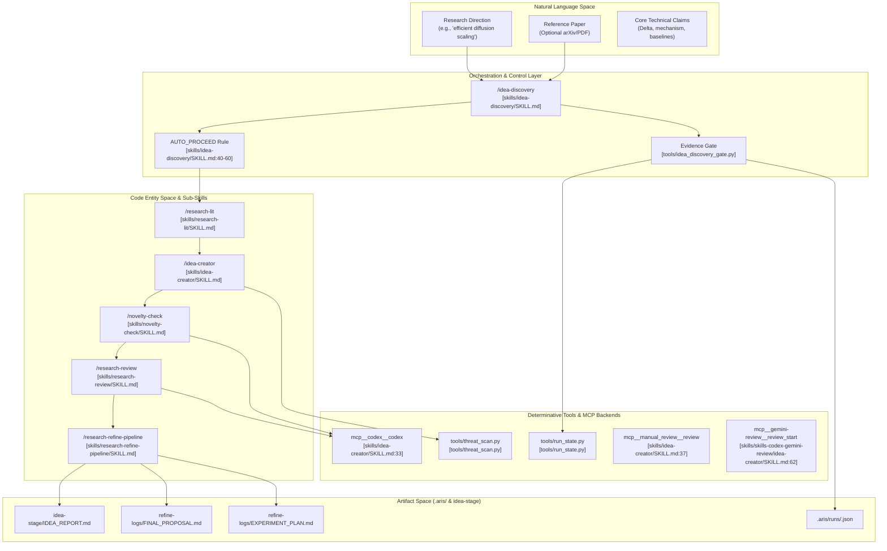
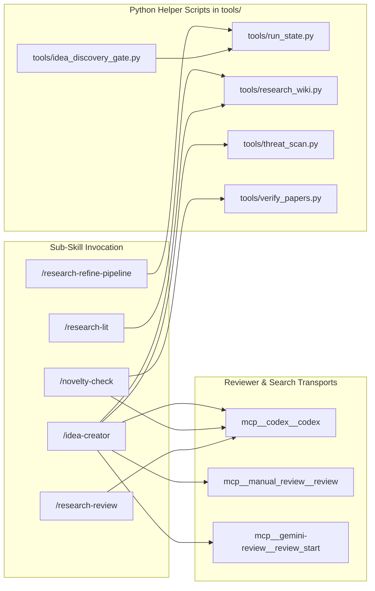

<!-- source: DeepWiki mcp.deepwiki.com · repo wanshuiyin/Auto-claude-code-research-in-sleep · page 3.1 Workflow 1: Idea Discovery · fetched 2026-10-26 -->

# Workflow 1: Idea Discovery

<details>
<summary>Relevant source files</summary>

The following files were used as context for generating this wiki page:

- [skills/idea-creator/SKILL.md](skills/idea-creator/SKILL.md)
- [skills/idea-discovery/SKILL.md](skills/idea-discovery/SKILL.md)
- [skills/novelty-check/SKILL.md](skills/novelty-check/SKILL.md)
- [skills/skills-codex-claude-review/novelty-check/SKILL.md](skills/skills-codex-claude-review/novelty-check/SKILL.md)
- [skills/skills-codex-gemini-review/idea-creator/SKILL.md](skills/skills-codex-gemini-review/idea-creator/SKILL.md)
- [skills/skills-codex-gemini-review/idea-discovery/SKILL.md](skills/skills-codex-gemini-review/idea-discovery/SKILL.md)
- [skills/skills-codex-gemini-review/novelty-check/SKILL.md](skills/skills-codex-gemini-review/novelty-check/SKILL.md)
- [skills/skills-codex/idea-creator/SKILL.md](skills/skills-codex/idea-creator/SKILL.md)
- [skills/skills-codex/idea-discovery/SKILL.md](skills/skills-codex/idea-discovery/SKILL.md)
- [skills/skills-codex/novelty-check/SKILL.md](skills/skills-codex/novelty-check/SKILL.md)
- [tests/test_idea_discovery_gate.py](tests/test_idea_discovery_gate.py)
- [tools/idea_discovery_gate.py](tools/idea_discovery_gate.py)

</details>


**Purpose**: This page documents Workflow 1, the core research pipeline in ARIS that transforms a broad natural-language research direction into a validated, pilot-tested idea with deterministic evidence records. It orchestrates literature review, idea generation, novelty checking, critical review, and parallel pilots into a cohesive automated pipeline that concludes with an `IDEA_REPORT.md` and `EXPERIMENT_PLAN.md`.

**Scope**: Covers the `/idea-discovery` orchestrator skill [skills/idea-discovery/SKILL.md:2-3](), its underlying sub-skills (`/research-lit`, `/idea-creator`, `/novelty-check`, `/research-review`, `/research-refine-pipeline`) [skills/idea-discovery/SKILL.md:17-21](), checkpoint execution rules [skills/idea-discovery/SKILL.md:40-60](), resource budgets, deterministic gates (`tools/idea_discovery_gate.py`) [tools/idea_discovery_gate.py:2-25](), and run-state tracking (`tools/run_state.py`).

---

## Overview & Pipeline Orchestration

Workflow 1 is driven by the `/idea-discovery` orchestrator skill. It executes an ordered series of phases, ensuring that each phase produces a verifiable artifact before downstream tasks proceed [skills/idea-discovery/SKILL.md:14-21]().

```
/research-lit → /idea-creator → /novelty-check → /research-review → /research-refine-pipeline
  (survey)      (brainstorm)    (verify novel)    (critical feedback)  (refine method + plan experiments)
```

The workflow operates under strict configuration constants and can run autonomously (`AUTO_PROCEED = true`) or interactively (`AUTO_PROCEED = false`) [skills/idea-discovery/SKILL.md:25-30]().

Sources: [skills/idea-discovery/SKILL.md:14-30]()

---

## Pipeline Architecture & Natural-Language to Code Space Bridges

To understand how high-level research concepts translate into concrete software execution, the architecture spans both Natural Language Space (research intents, claims, briefs) and Code Entity Space (MCP servers, Python gateway scripts, state managers, and markdown deliverables).

### Diagram: Idea Discovery End-to-End Architecture

Sources: [skills/idea-discovery/SKILL.md:14-21](), [skills/idea-creator/SKILL.md:30-45](), [tools/idea_discovery_gate.py:18-32]()

### Diagram: Sub-Skill to Tool Mapping (Mapping System Names to Code Entities)

Sources: [skills/idea-discovery/SKILL.md:64-98](), [skills/idea-creator/SKILL.md:65-90](), [tools/idea_discovery_gate.py:12-16]()

---

## Phase-by-Phase Execution & Implementation

### Phase 1: Literature Survey
* **Purpose**: Map the research landscape, identify gaps, survey local libraries, and query academic search engines [skills/idea-discovery/SKILL.md:81-83]().
* **Execution**: Invokes `/research-lit`. Scans local `papers/` and `literature/` folders, interfaces with Zotero/Obsidian MCPs if configured, and fetches metadata via Semantic Scholar and arXiv APIs [skills/skills-codex-gemini-review/idea-discovery/SKILL.md:70-74]().
* **Artifact**: `idea-stage/IDEA_REPORT.md#literature-landscape` [skills/idea-discovery/SKILL.md:83]().

Sources: [skills/idea-discovery/SKILL.md:81-83](), [skills/skills-codex-gemini-review/idea-discovery/SKILL.md:70-74]()

### Phase 2: Idea Generation & Parallel Pilots
* **Purpose**: Systematically generate 8-12 ideas, filter them objectively, and execute parallel pilot experiments on available GPUs [skills/skills-creator/SKILL.md:14-22]().
* **Execution**: Invokes `/idea-creator`. If `research-wiki/` is present, it loads `query_pack.md` via `tools/research_wiki.py`, passing it through `tools/threat_scan.py` (strict scope check) to use historical banlists and known prior work [skills/idea-creator/SKILL.md:54-124](). Brainstorming runs via the selected backend (`REVIEWER_BACKEND`: `codex`, `manual`, or `gemini`) [skills/idea-creator/SKILL.md:23-45]().
* **Pilot Budgets & Constraints**:
  - `PILOT_MAX_HOURS = 2` — Skip pilot experiments estimated to take > 2 hours per GPU [skills/idea-discovery/SKILL.md:25]().
  - `PILOT_TIMEOUT_HOURS = 3` — Hard timeout on running pilots [skills/idea-discovery/SKILL.md:26]().
  - `MAX_PILOT_IDEAS = 3` — Run pilots for at most 3 top ideas in parallel [skills/idea-discovery/SKILL.md:27]().
  - `MAX_TOTAL_GPU_HOURS = 8` — Total GPU budget across all parallel pilots [skills/idea-discovery/SKILL.md:28]().
* **Artifact**: `idea-stage/IDEA_REPORT.md#ranked-ideas` [skills/idea-discovery/SKILL.md:85]()

Sources: [skills/idea-discovery/SKILL.md:25-28](), [skills/idea-creator/SKILL.md:23-124]()

### Phase 3: Deep Novelty Verification
* **Purpose**: Rigorously verify that the proposed method and its core technical claims are genuinely novel against recent (2024-2026) literature [skills/novelty-check/SKILL.md:18-35]().
* **Execution**: Invokes `/novelty-check`. Extracts 3-5 core claims, performs multi-source literature searches, and enforces **Citation Discipline (Policy D1)**: every paper in the prior-work table must be verified via `verify_papers.py` (with arXiv/CrossRef/Semantic Scholar fallback) to prevent hallucinated citations [skills/novelty-check/SKILL.md:20-42, 138](). The external reviewer assesses the dossier under strict **Novelty Verdict Limits** (`PROCEED`, `PROCEED WITH CAUTION`, or `ABANDON`, where `ABANDON` requires naming a specific published paper) [skills/novelty-check/SKILL.md:64-93]().
* **Artifact**: `idea-stage/IDEA_REPORT.md#novelty-verification` [skills/idea-discovery/SKILL.md:85]()

Sources: [skills/novelty-check/SKILL.md:18-93, 138](), [skills/idea-discovery/SKILL.md:85]()

### Phase 4: External Critical Review
* **Purpose**: Subject the top candidate ideas to adversarial review by a senior reviewer model from a different model family (or provisional same-family agent) [skills/idea-discovery/SKILL.md:89-94]().
* **Execution**: Invokes `/research-review` to evaluate methodology soundness, experimental risks, and potential reviewer pushback.
* **Artifact**: `idea-stage/IDEA_REPORT.md#external-critical-review` [skills/idea-discovery/SKILL.md:86]()

Sources: [skills/idea-discovery/SKILL.md:86-94]()

### Phase 5: Method Refinement & Planning
* **Purpose**: Freeze a Problem Anchor and generate concrete execution artifacts [skills/idea-discovery/SKILL.md:21]().
* **Execution**: Invokes `/research-refine-pipeline`. Consolidates pilot signals, novelty checks, and critical reviews into a refined proposal and experiment roadmap.
* **Artifacts**: `refine-logs/FINAL_PROPOSAL.md` and `refine-logs/EXPERIMENT_PLAN.md` [skills/idea-discovery/SKILL.md:21]()

Sources: [skills/idea-discovery/SKILL.md:21]()

---

## State Management & Deterministic Evidence Gates

When `RESUMABLE = true`, Workflow 1 records stage progression under `.aris/runs/<run_id>.json` using `tools/run_state.py` and enforces strict evaluation via `tools/idea_discovery_gate.py` [skills/idea-discovery/SKILL.md:36, 62-68]().

### Required Phases & Artifact Locators
| Phase Name | Artifact Locator | Reviewer Bearing? |
| :--- | :--- | :--- |
| `research-lit` | `idea-stage/IDEA_REPORT.md#literature-landscape` | No |
| `idea-creator` | `idea-stage/IDEA_REPORT.md#ranked-ideas` | No |
| `novelty-check` | `idea-stage/IDEA_REPORT.md#novelty-verification` | **Yes** (`accept` or `mark-provisional`) |
| `research-review` | `idea-stage/IDEA_REPORT.md#external-critical-review` | **Yes** (`accept` or `mark-provisional`) |
| `research-refine-pipeline` | `refine-logs/FINAL_PROPOSAL.md` | No |

Sources: [skills/idea-discovery/SKILL.md:81-88](), [tools/idea_discovery_gate.py:19-30]()

### Evidence Gate Validation Logic
The deterministic gate (`tools/idea_discovery_gate.py`) verifies that:
1. All 5 required phases are recorded and have `done`, `accepted`, or `provisional` status [tools/idea_discovery_gate.py:139-148]().
2. Reviewer-bearing phases (`novelty-check` and `research-review`) possess valid review receipts (`verdict_id` and `reviewer` strings) [tools/idea_discovery_gate.py:80-92]().
3. Model families and reviewer independence match the execution context (cross-family acceptance vs. same-family provisional advances when `--provisional-advances` is authorized) [tools/idea_discovery_gate.py:93-130]().
4. Referenced artifact files exist on disk and contain non-empty markdown headings matching the specified anchor [tools/idea_discovery_gate.py:154-170]().

Sources: [tools/idea_discovery_gate.py:80-170](), [tests/test_idea_discovery_gate.py:84-118]()

---

## Configuration Constants Reference

| Constant | Default | Scope & Description |
| :--- | :--- | :--- |
| `PILOT_MAX_HOURS` | `2` | Skip any pilot experiment estimated to take > 2 hours per GPU [skills/idea-discovery/SKILL.md:25]() |
| `PILOT_TIMEOUT_HOURS` | `3` | Hard timeout: kill running pilots exceeding 3 hours [skills/idea-discovery/SKILL.md:26]() |
| `MAX_PILOT_IDEAS` | `3` | Run parallel pilots for at most 3 top ideas [skills/idea-discovery/SKILL.md:27]() |
| `MAX_TOTAL_GPU_HOURS` | `8` | Total GPU budget across all workflow pilots [skills/idea-discovery/SKILL.md:28]() |
| `AUTO_PROCEED` | `true` | Non-blocking checkpoints (`true`) vs. blocking user prompts (`false`) [skills/idea-discovery/SKILL.md:29]() |
| `REVIEWER_MODEL` | `gpt-6-astra` | Primary reviewer model via Codex MCP or backend bridge [skills/idea-discovery/SKILL.md:30]() |
| `OUTPUT_DIR` | `idea-stage/` | Destination directory for all idea-stage artifacts [skills/idea-discovery/SKILL.md:31]() |
| `COMPACT` | `false` | Generate compact `idea-stage/IDEA_CANDIDATES.md` for context recovery [skills/idea-discovery/SKILL.md:33]() |
| `RENDER_HTML` | `true` | Auto-render `IDEA_REPORT.md` to HTML via `/render-html` at workflow end [skills/idea-discovery/SKILL.md:34]() |
| `RESUMABLE` | `true` | Record stage evidence under `.aris/runs/` and enforce evidence gate [skills/idea-discovery/SKILL.md:36]() |

Sources: [skills/idea-discovery/SKILL.md:25-36]()

---

