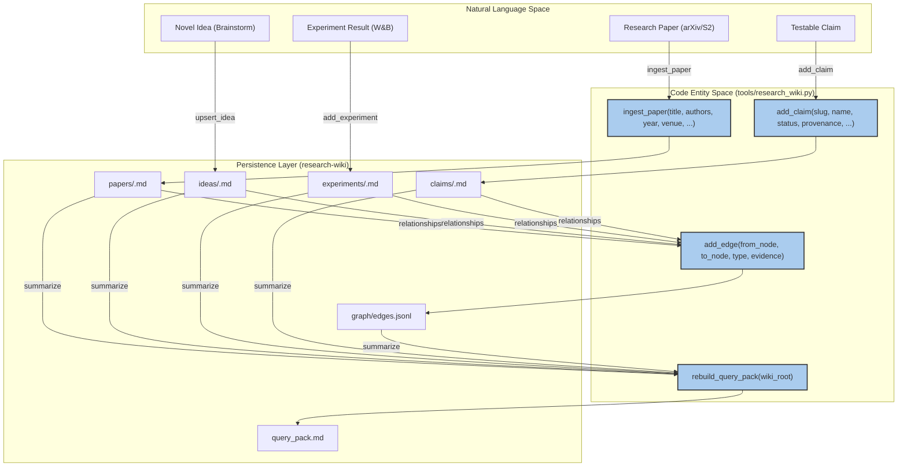
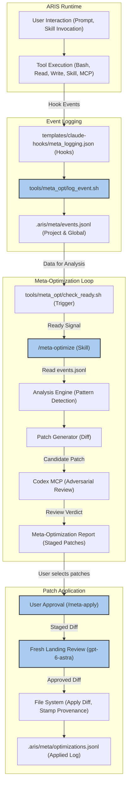

<!-- source: DeepWiki mcp.deepwiki.com · repo wanshuiyin/Auto-claude-code-research-in-sleep · page 4.7 Research Wiki & Meta-Optimize Skills · fetched 2026-10-26 -->

# Research Wiki & Meta-Optimize Skills

Relevant source files

The following files were used as context for generating this wiki page:

- [skills/meta-apply/SKILL.md](skills/meta-apply/SKILL.md)
- [skills/research-lit/SKILL.md](skills/research-lit/SKILL.md)
- [skills/research-wiki/SKILL.md](skills/research-wiki/SKILL.md)
- [skills/skills-codex/meta-apply/SKILL.md](skills/skills-codex/meta-apply/SKILL.md)
- [skills/skills-codex/research-lit/SKILL.md](skills/skills-codex/research-lit/SKILL.md)
- [skills/wiki-enrich/SKILL.md](skills/wiki-enrich/SKILL.md)
- [templates/claude-hooks/meta_logging.json](templates/claude-hooks/meta_logging.json)
- [tests/test_codex_skill_mirror.py](tests/test_codex_skill_mirror.py)
- [tests/test_research_wiki_claims.py](tests/test_research_wiki_claims.py)
- [tests/test_research_wiki_encoding.py](tests/test_research_wiki_encoding.py)
- [tools/check_skills_inventory.py](tools/check_skills_inventory.py)
- [tools/meta_opt/check_ready.sh](tools/meta_opt/check_ready.sh)
- [tools/meta_opt/log_event.sh](tools/meta_opt/log_event.sh)
- [tools/research_wiki.py](tools/research_wiki.py)
- [tools/verify_papers.py](tools/verify_papers.py)

This section documents the two primary skills responsible for the long-term intelligence and self-improvement of the ARIS (Auto-claude-code-research-in-sleep) system. While the core workflows focus on immediate research artifacts (papers, code, experiments), the `/research-wiki` and `/meta-optimize` skills manage the **knowledge layer** and the **harness optimization layer**, respectively. Together, they implement a "spiral learning" mechanism where the system becomes more effective with every research session.

## 1. Research Wiki: Persistent Knowledge Graph

The Research Wiki is a per-project structured knowledge base that persists across context window compactions and multiple research sessions [skills/research-wiki/SKILL.md:12-16](). It is inspired by the "LLM Wiki" pattern, prioritizing structured, retrievable summaries over raw text to maintain a high "knowledge-to-token" ratio [skills/research-wiki/SKILL.md:16-17]().

### 1.1 Entity Architecture and Schema
The wiki organizes research into four primary entity types, each stored in a dedicated subdirectory within the `research-wiki/` folder [skills/research-wiki/SKILL.md:44-62]().

| Entity | Node ID Format | Purpose |
| :--- | :--- | :--- |
| **Paper** | `paper:<slug>` | A published or preprint research paper [skills/research-wiki/SKILL.md:24](). |
| **Idea** | `idea:<id>` | A research idea (proposed, tested, or failed) [skills/research-wiki/SKILL.md:25](). |
| **Experiment** | `exp:<id>` | A concrete experiment run with results [skills/research-wiki/SKILL.md:26](). |
| **Claim** | `claim:<id>` | A theorem/headline with an honest PROOF status — born via `/proof-checker` [skills/research-wiki/SKILL.md:27](). |

### 1.2 Relationship Graph (Edges)
Relationships are stored in a centralized `graph/edges.jsonl` file using a typed schema [skills/research-wiki/SKILL.md:29-42, 61](). Edges are auto-generated from the graph into page `## Connections` sections [skills/research-wiki/SKILL.md:42]().

**Key Relationship Types:**
*   `extends`: One paper builds on prior work [skills/research-wiki/SKILL.md:33]().
*   `contradicts`: Disagrees with results/claims [skills/research-wiki/SKILL.md:34]().
*   `addresses_gap`: Targets a known field gap [skills/research-wiki/SKILL.md:35]().
*   `inspired_by`: Idea sourced from this paper [skills/research-wiki/SKILL.md:36]().
*   `tested_by`: Tested in this experiment [skills/research-wiki/SKILL.md:37]().
*   `supports`: Experiment confirms claim [skills/research-wiki/SKILL.md:38]().
*   `invalidates`: Experiment disproves claim [skills/research-wiki/SKILL.md:39]().
*   `supersedes`: Newer work replaces older [skills/research-wiki/SKILL.md:40]().

### 1.3 Implementation: `research_wiki.py` and `query_pack.md`
The `tools/research_wiki.py` script provides the underlying logic for the wiki [tools/research_wiki.py:1-7](). It is resolved via a canonical chain to ensure portability across different ARIS installations [skills/research-wiki/SKILL.md:76-109]().

The most critical function for "Spiral Learning" is the generation of `query_pack.md`. This is a compressed summary (max 8000 chars) of the entire wiki, auto-generated for `/idea-creator` [skills/research-wiki/SKILL.md:51, 142](). Skills like `/idea-creator` load this pack to:
*   Treat failed ideas as a **banlist** (do NOT regenerate similar ideas).
*   Treat top papers as known prior work to avoid redundant searches.
*   Prioritize listed field gaps as search seeds.

The `research_wiki.py` helper also includes functionality for:
*   `init`: Initializes the wiki directory structure [tools/research_wiki.py:124-152]().
*   `slug`: Generates a canonical slug for papers based on author, year, and keywords [tools/research_wiki.py:96-122](). This ensures distinct slugs for non-ASCII titles, preventing silent overwrites [tests/test_research_wiki_encoding.py:44-50]().
*   `add_edge`: Adds typed relationships between nodes [tools/research_wiki.py:12]().
*   `rebuild_query_pack`: Rebuilds the compressed summary for `/idea-creator` [tools/research_wiki.py:13]().
*   `rebuild_index`: Rebuilds the wiki index [tools/research_wiki.py:14]().
*   `stats`: Provides statistics about the wiki [tools/research_wiki.py:15]().
*   `log`: Appends messages to the wiki log [tools/research_wiki.py:16]().
*   `ingest_paper`: Ingests paper metadata, either from arXiv ID or manually provided details [tools/research_wiki.py:19-26]().
*   `sync`: Batch backfills paper metadata from arXiv IDs or a file [tools/research_wiki.py:28-29]().
*   `add_claim`: Adds claims with status, provenance, statement, scope, and evidence, supporting complex relationships like `extends`, `uses`, `depends-on`, and `refutes` [tools/research_wiki.py:31-36]().

The wiki ensures UTF-8 encoding for all content, including non-ASCII characters in edge evidence and slugs, to prevent data corruption issues observed in non-UTF-8 default locales [tests/test_research_wiki_encoding.py:1-10, 30-36, 44-50]().

### Research Wiki Data Flow
The following diagram illustrates how the `research_wiki.py` utility bridges natural language research concepts into a structured file-based graph.

**Wiki Entity to Code Mapping**

Sources: [skills/research-wiki/SKILL.md:21-42, 44-62, 120-154](), [tools/research_wiki.py:1-36, 96-152](), [tests/test_research_wiki_encoding.py:1-50]()

---

## 2. Meta-Optimize: Self-Improving Harness

The `/meta-optimize` skill implements an "outer loop" that observes ARIS usage and proposes optimizations to the system's own prompts, constants, and workflow sequences [skills/meta-optimize/SKILL.md:8-14]().

### 2.1 Passive Event Logging
Optimization is driven by data collected via Claude Code hooks. The `templates/claude-hooks/meta_logging.json` file configures hooks like `PostToolUse` and `SessionEnd` to trigger logging [templates/claude-hooks/meta_logging.json:3-72]().

The `tools/meta_opt/log_event.sh` script processes these hooks and appends structured records to `.aris/meta/events.jsonl` [tools/meta_opt/log_event.sh:8-10](). This logging occurs for both project-level and global logs [tools/meta_opt/log_event.sh:9-10](). The Python script embedded within `log_event.sh` parses the Claude Code hook payload, extracts relevant information (event name, session ID, tool name, skill, arguments, prompt previews), and formats it as a JSONL record [tools/meta_opt/log_event.sh:21-91]().

**Captured Analytics [skills/meta-optimize/SKILL.md:60-84]():**
*   **Frequency**: Most used skills and common parameter overrides (suggesting bad defaults).
*   **Failure**: Repeating error patterns (OOM, compilation, timeouts).
*   **Convergence**: Rounds taken in `auto-review-loop` to reach score thresholds.
*   **Human Intervention**: Where users interrupt with manual prompts or corrections.

### 2.2 Optimization Pipeline
When `/meta-optimize` is invoked, it follows a multi-step pipeline [skills/meta-optimize/SKILL.md:38-185]():

1.  **Data Availability Check**: Requires at least 5 skill invocations logged since the last optimization run [tools/meta_opt/check_ready.sh:53-55](). It also checks for model changes, which can trigger a "harness diet" optimization [tools/meta_opt/check_ready.sh:61-79]().
2.  **Pattern Analysis**: Identifies signals for improvement (e.g., 60% of users overriding a threshold) [skills/meta-optimize/SKILL.md:95]().
3.  **Patch Generation**: Creates a concrete `diff` for `SKILL.md` or configuration files with a data-driven justification [skills/meta-optimize/SKILL.md:103-123]().
4.  **Adversarial Review**: Sends the patch to `gpt-5.5` (xhigh) via Codex MCP to verify if the usage data actually supports the change and if it's safe [skills/meta-optimize/SKILL.md:124-152]().
5.  **Reporting**: Outputs a `Meta-Optimization Report` for human approval [skills/meta-optimize/SKILL.md:153-185]().

### 2.3 `/meta-apply`: The Landing Gate
The `/meta-apply` skill is a privileged applier that lands patches approved by the user after a `/meta-optimize` run [skills/meta-apply/SKILL.md:3-5](). It enforces a **privilege boundary**, ensuring that `/meta-optimize` (which is read-only) can only *stage* candidate patches, while `/meta-apply` is the sole mechanism for applying them [skills/meta-apply/SKILL.md:15-21]().

Key rules for `/meta-apply`:
1.  **Human-invoked only**: Requires explicit user invocation [skills/meta-apply/SKILL.md:23-25]().
2.  **Fresh landing review**: Spawns a fresh `gpt-6-astra` reviewer (or equivalent) to perform an `ultra` reasoning effort review on the staged diff, independent of any prior producer-written verdict [skills/meta-apply/SKILL.md:36-45, 83-93]().
3.  **Record review class honestly**: Records `review_independence: same-family` and `acceptance_status: provisional` for base Codex reviews, or `accepted` for cross-family overlays [skills/meta-apply/SKILL.md:46-50, 101-108]().
4.  **Landing survivors**: Only patches that pass the fresh landing review and are explicitly named by the user are applied. This involves backing up the target file, applying the diff using `Edit/Write` tools, and stamping provenance [skills/meta-apply/SKILL.md:95-111]().
5.  **Logging**: Logs the applied optimization to `.aris/meta/optimizations.jsonl` [skills/meta-apply/SKILL.md:109-111]().

### Meta-Optimize System Architecture
This diagram shows the relationship between the logging infrastructure and the optimization logic.

**Meta-Optimize Component Interaction**

Sources: [templates/claude-hooks/meta_logging.json:3-72](), [tools/meta_opt/log_event.sh:1-91](), [tools/meta_opt/check_ready.sh:1-79](), [skills/meta-optimize/SKILL.md:1-185](), [skills/meta-apply/SKILL.md:1-111]()

---

## 3. Collaborative Integration

The Research Wiki and Meta-Optimize skills work together to ensure the system evolves both in domain knowledge and operational efficiency.

### 3.1 Cross-Skill Wiki Updates
Multiple skills update the wiki as a side effect to ensure the knowledge base stays current:
*   **Literature Skills**: `/research-lit`, `/arxiv`, `/alphaxiv`, `/deepxiv`, `/semantic-scholar`, and `/exa-search` all call `ingest_paper` when a paper is meaningfully read [skills/research-lit/SKILL.md:1-83](), [skills/skills-codex/research-lit/SKILL.md:1-92](). The `verify_papers.py` helper is used by these skills to ensure the existence of candidate papers, preventing hallucinated references from entering the wiki [tools/verify_papers.py:1-12]().
*   **Result Verification**: `/result-to-claim` creates experiment pages and updates claim statuses (e.g., `supported`, `partial`) based on Codex verdicts.
*   **Idea Creation**: `/idea-creator` records ideas via `upsert_idea`.
*   **Proof Checking**: `/proof-checker` mints claims via `add_claim`.
*   **Wiki Enrichment**: `/wiki-enrich` populates the wiki with claims via `/proof-checker` [skills/wiki-enrich/SKILL.md:1-10]().

### 3.2 Readiness Triggers
To avoid premature optimization, the system uses `tools/meta_opt/check_ready.sh`. This script is called at the end of every session via the `SessionEnd` hook [templates/claude-hooks/meta_logging.json:65-71](). It calculates the number of skill runs since the last optimization and alerts the user if the threshold (5 skill invocations) is met [tools/meta_opt/check_ready.sh:29-32, 53-55](). It also triggers a reminder if the active model has changed since the last optimization, prompting a "harness diet" review [tools/meta_opt/check_ready.sh:61-79]().

### Summary of Wiki & Meta Commands

| Command | Primary Tool | Output Artifact |
| :--- | :--- | :--- |
| `/research-wiki init` | `research_wiki.py` | `research-wiki/` directory structure [skills/research-wiki/SKILL.md:100-111]() |
| `/research-wiki ingest` | `research_wiki.py` | `papers/<slug>.md` [skills/research-wiki/SKILL.md:120-134]() |
| `/research-wiki query` | `research_wiki.py` | `query_pack.md` [skills/research-wiki/SKILL.md:144-146]() |
| `/meta-optimize` | `SKILL.md` (Bash) | `Meta-Optimization Report` [skills/meta-optimize/SKILL.md:157-175]() |
| `/meta-apply` | `SKILL.md` (Bash) | Applied patches to `SKILL.md` or config files, `.aris/meta/optimizations.jsonl` [skills/meta-apply/SKILL.md:95-111]() |

Sources: [skills/research-wiki/SKILL.md:100-146](), [skills/meta-optimize/SKILL.md:157-175](), [skills/meta-apply/SKILL.md:95-111](), [skills/research-lit/SKILL.md:1-83](), [skills/skills-codex/research-lit/SKILL.md:1-92](), [tools/verify_papers.py:1-12](), [skills/wiki-enrich/SKILL.md:1-10](), [tools/meta_opt/check_ready.sh:29-79](), [templates/claude-hooks/meta_logging.json:65-71]()

---

