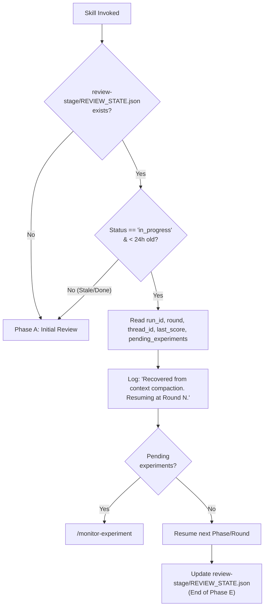
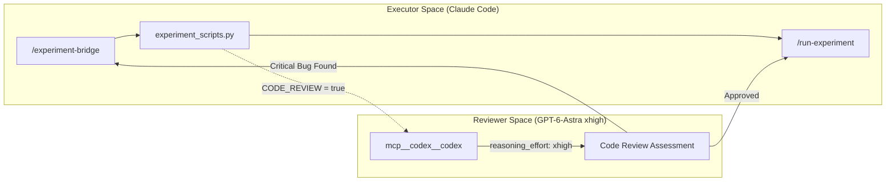
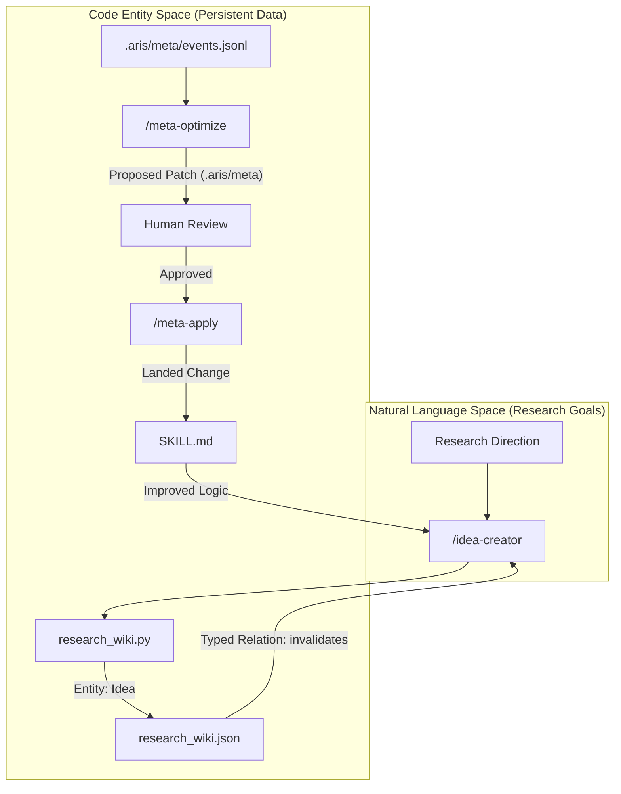
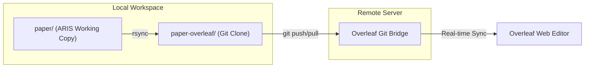

<!-- source: DeepWiki mcp.deepwiki.com · repo wanshuiyin/Auto-claude-code-research-in-sleep · page 8 Advanced Topics · fetched 2026-10-26 -->

# Advanced Topics

Relevant source files

The following files were used as context for generating this wiki page:

- [skills/experiment-bridge/SKILL.md](skills/experiment-bridge/SKILL.md)
- [skills/meta-optimize/SKILL.md](skills/meta-optimize/SKILL.md)
- [skills/shared-references/review-scope-limits.md](skills/shared-references/review-scope-limits.md)
- [skills/skills-codex-gemini-review/auto-review-loop/SKILL.md](skills/skills-codex-gemini-review/auto-review-loop/SKILL.md)
- [skills/skills-codex/auto-review-loop/SKILL.md](skills/skills-codex/auto-review-loop/SKILL.md)
- [skills/skills-codex/experiment-bridge/SKILL.md](skills/skills-codex/experiment-bridge/SKILL.md)
- [skills/skills-codex/meta-optimize/SKILL.md](skills/skills-codex/meta-optimize/SKILL.md)
- [skills/skills-codex/shared-references/review-scope-limits.md](skills/skills-codex/shared-references/review-scope-limits.md)

This section provides a deep dive into the advanced system capabilities, internal mechanisms, and resource management strategies of ARIS. These features enable the system to handle long-running research tasks, manage expensive GPU compute, and maintain high-quality outputs through cross-model verification and self-improvement loops.

For basic configuration and setup, see [Configuration & Setup](#6). For common usage patterns, see [Usage Patterns](#7).

---

## State Persistence & Recovery

ARIS workflows are designed for multi-hour or multi-day execution, which often exceeds the context window of the executor model (Claude). To handle this, the system implements a "Compact Recovery" mechanism using persistent JSON state files and specialized hooks.

### Recovery Mechanisms

The system uses specific state files to track progress. If a session is interrupted or context is compacted, the skill reads these files to resume from the exact phase and round where it left off.

| File | Primary Role | Key Fields |
| :--- | :--- | :--- |
| `REVIEW_STATE.json` | Tracks the autonomous review loop | `run_id`, `round`, `agent_id`, `status`, `last_score`, `pending_experiments` |
| `PAPER_IMPROVEMENT_STATE.json` | Tracks the iterative paper writing | `round`, `status`, `last_score`, `improvement_log` |
| `CLAUDE.md` | High-level dashboard | `Pipeline Status`, `Current Phase`, `Active Experiments` |

### The threadId Preservation Pattern

In Workflow 2 (`/auto-review-loop`), preserving the `thread_id` (or `agent_id` in some contexts) is critical. This ID allows the `mcp__codex__codex-reply` or `mcp__gemini-review__review_reply_start` tool to continue the exact conversation with the reviewer, ensuring the reviewer remembers previous critiques and doesn't repeat old suggestions. The system also implements a 24-hour staleness threshold to decide whether to resume or restart.
Sources: [skills/skills-codex/auto-review-loop/SKILL.md:59-72](), [skills/skills-codex-gemini-review/auto-review-loop/SKILL.md:51-55]()

### State Transition Logic

Sources: [skills/skills-codex/auto-review-loop/SKILL.md:55-68](), [skills/skills-codex-gemini-review/auto-review-loop/SKILL.md:51-60]()

For details, see [State Persistence & Recovery](#8.1).

---

## Resource Budget Management

Autonomous research can quickly consume significant GPU resources. ARIS enforces strict budgets, especially during the pilot phase of Workflow 1 (`/idea-discovery`).

### Budget Constants and Enforcement

The system uses a set of constants to decide whether an experiment is too expensive to run autonomously. If an idea's estimated cost exceeds these limits, it is flagged for human review rather than executed.

*   `PILOT_MAX_HOURS` (Default: 2h): Maximum time for a single pilot experiment.
*   `PILOT_TIMEOUT_HOURS` (Default: 3h): Hard wall-clock timeout to kill runaway processes.
*   `MAX_PILOT_IDEAS` (Default: 3): Limit on concurrent pilot attempts.
*   `MAX_TOTAL_GPU_HOURS` (Default: 8h): Total budget for all pilots in a discovery session.

Sources: [skills/experiment-bridge/SKILL.md:23-28](), [skills/skills-codex/experiment-bridge/SKILL.md:23-28]()

For details, see [Resource Budget Management](#8.2).

---

## Cross-Model Verification Strategies

ARIS rejects the "self-play" approach (using one model for both execution and review) to avoid local minima. Instead, it employs an adversarial executor-reviewer architecture.

### Speed vs. Rigor

| Role | Model | Characteristic | Responsibility |
| :--- | :--- | :--- | :--- |
| **Executor** | Claude 3.5/3.7 | Fast, fluid, high context | Writing code, running bash, drafting LaTeX |
| **Reviewer (Codex)** | GPT-6-Astra xhigh | Slow, rigorous, "adversarial" | Scoring, identifying logic bugs, critiquing claims |
| **Reviewer (Gemini)** | Gemini-review | Cross-family, independent | Providing `cross-family` `accepted` verdicts |

Sources: [skills/skills-codex/auto-review-loop/SKILL.md:8-11](), [skills/skills-codex-gemini-review/auto-review-loop/SKILL.md:10-11]()

### Code Entity Mapping: Verification Flow

Sources: [skills/experiment-bridge/SKILL.md:112-147](), [skills/skills-codex/experiment-bridge/SKILL.md:114-147]()

The `review-scope-limits.md` shared reference defines what a reviewer may propose, ensuring that the focus remains on actual defects rather than speculative hardening. This contract is applied verbatim in reviewer prompts.
Sources: [skills/shared-references/review-scope-limits.md:1-38](), [skills/skills-codex/shared-references/review-scope-limits.md:1-38]()

For details, see [Cross-Model Verification Strategies](#8.3).

---

## Watchdog & Experiment Monitoring

For persistent, server-side monitoring that survives local disconnection, ARIS uses the `watchdog.py` daemon. This script runs on the remote GPU server and tracks the health of training processes.

### Anomaly Detection

The watchdog monitors for several failure states:
*   `DEAD`: Process crashed or exited unexpectedly.
*   `IDLE`: Process exists but GPU utilization is 0% for extended periods.
*   `STALLED`: Log file hasn't been updated in X minutes.
*   `SLOW`: Training speed (it/s) dropped significantly below the baseline.

For details, see [Watchdog & Experiment Monitoring](#8.5).

---

## LaTeX Templates & Venue Support

ARIS supports professional paper generation across multiple major AI conferences. The `/paper-write` skill selects templates based on the `TARGET_VENUE` constant.

### Supported Venues

| Venue | Page Limit (Main) | Style/Reference Counting |
| :--- | :--- | :--- |
| **ICLR** | 9 Pages | References not counted |
| **NeurIPS** | 9 Pages | References not counted |
| **CVPR** | 8 Pages | References not counted |
| **ACL** | 8 Pages | References not counted |
| **IEEE_JOURNAL** | 12-14 Pages | **References ARE counted** |
| **IEEE_CONF** | 5-8 Pages | **References ARE counted** |

For details, see [LaTeX Templates & Venue Support](#8.6).

---

## Meta-Optimize & Research Wiki

ARIS features advanced self-improvement and persistent memory mechanisms through the `/meta-optimize` and `/research-wiki` skills.

### Knowledge Graph & Self-Improvement

The system uses a persistent knowledge graph to prevent repeating failed experiments and to optimize its own skill definitions based on usage logs. The `/meta-optimize` skill analyzes event logs (`.aris/meta/events.jsonl`) to identify bottlenecks and propose improvements to `SKILL.md` files, reviewer prompts, and workflow defaults. This is a read-only producer, meaning it proposes changes but does not apply them directly, requiring human intervention via `/meta-apply`.
Sources: [skills/meta-optimize/SKILL.md:12-16](), [skills/skills-codex/meta-optimize/SKILL.md:12-16]()

Sources: [skills/meta-optimize/SKILL.md:12-43](), [skills/skills-codex/meta-optimize/SKILL.md:12-35]()

For details, see [Meta-Optimize & Self-Improvement](#8.7) and [Research Wiki Deep Dive](#8.8).

---

## Overleaf Integration

ARIS provides a secure bridge to Overleaf via the `/overleaf-sync` skill, allowing for local automated auditing while maintaining a collaborative web-based editing environment.

### Sync Architecture

The system enforces strict security protocols, such as using the `osxkeychain` or `manager` credential helpers and installing a `pre-commit` hook to prevent token leaks.

---

## Quality Metrics & Case Studies

The effectiveness of the ARIS pipeline is measured by the score progression provided by the adversarial reviewer.

### Observed Score Progression

*   **Workflow 2 (Auto Review)**: Typically starts at a baseline of 4.5-5.0/10 and reaches a "Weak Accept" (6.5-7.5/10) within 3-4 rounds.
*   **Workflow 3 (Paper Writing)**: Initial drafts often score 4/10 due to formatting and narrative gaps, improving to 8.5/10 after the two-round refinement loop.

For details, see [Quality Metrics & Case Studies](#8.4).

---

