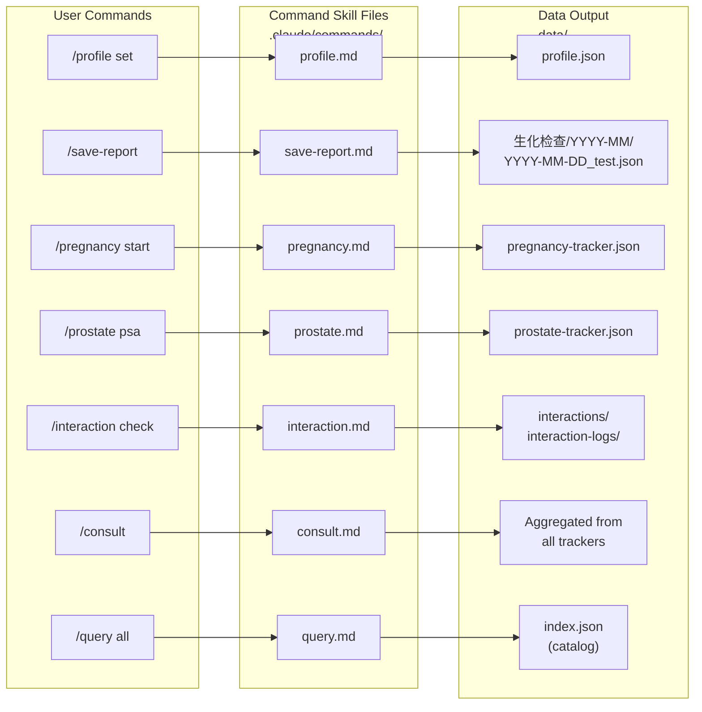
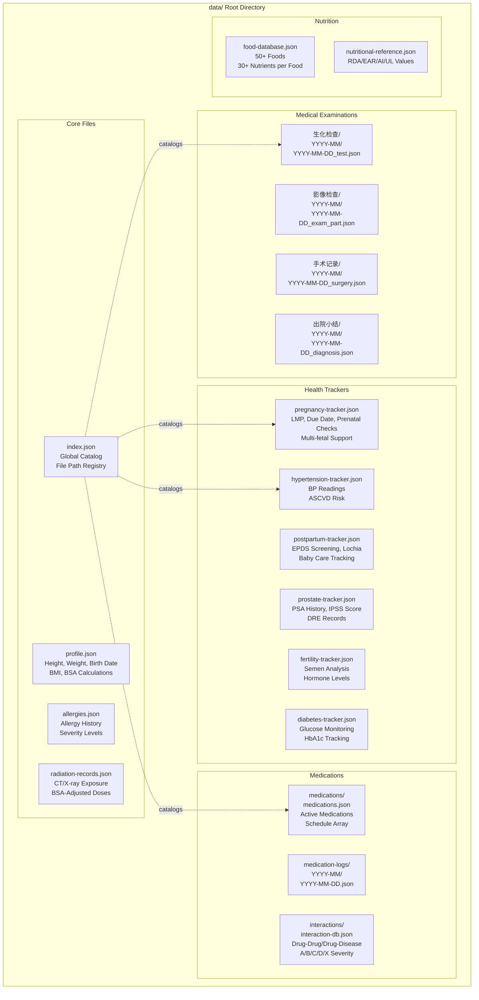
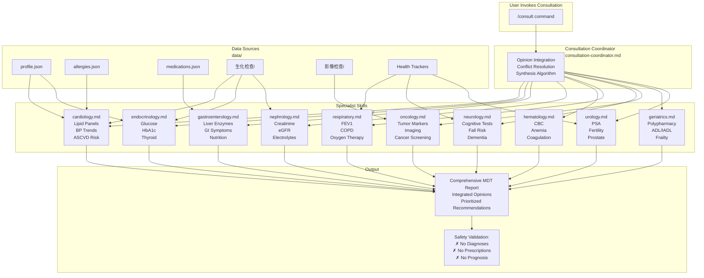
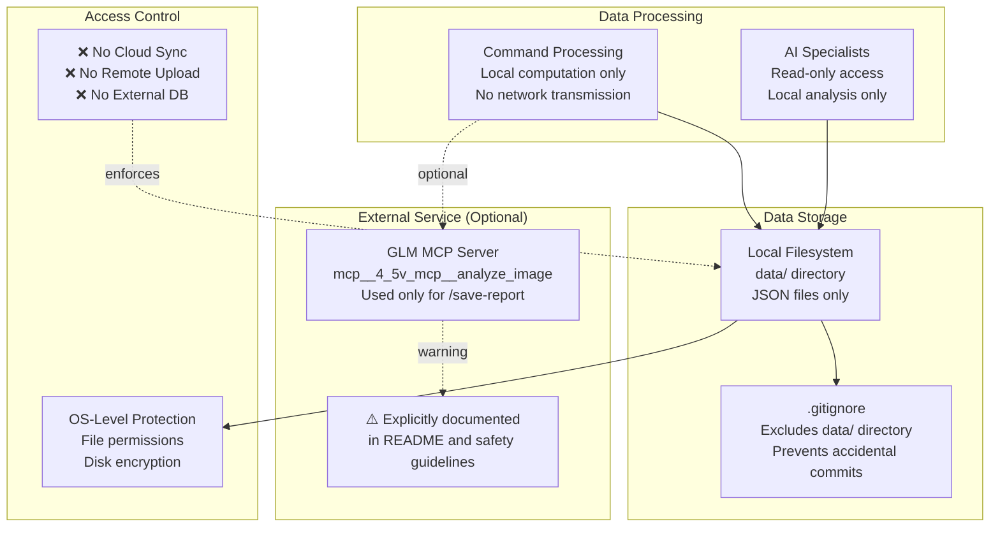
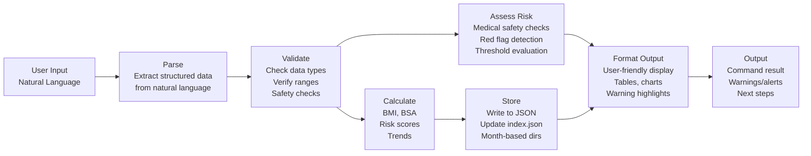
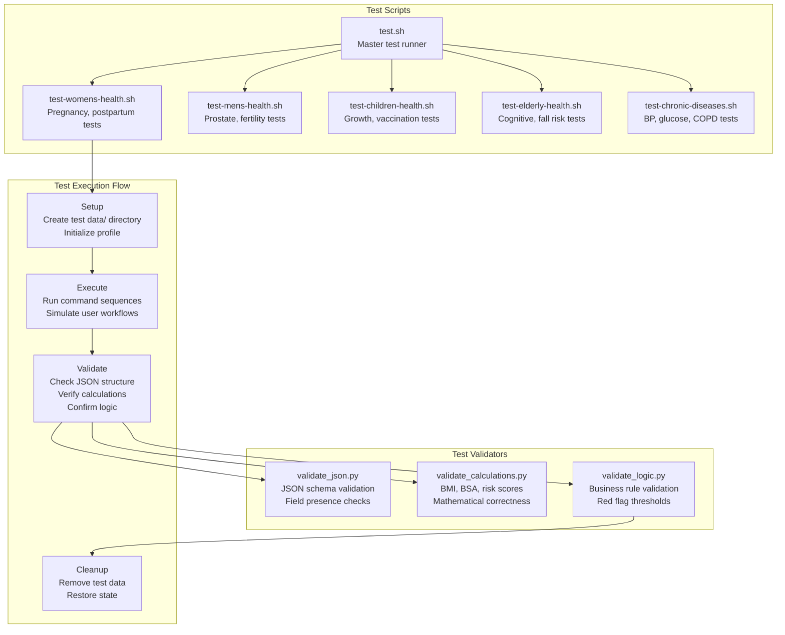

<!-- source: DeepWiki mcp.deepwiki.com · repo huifer/Claude-Ally-Health · page 1 Overview · fetched 2026-10-26 -->

# Overview

<details>
<summary>Relevant source files</summary>

The following files were used as context for generating this wiki page:

- [.claude/settings.local.json](.claude/settings.local.json)
- [README.md](README.md)
- [README.zh-CN.md](README.zh-CN.md)
- [docs/data-structures.md](docs/data-structures.md)
- [todo/01-womens-health.md](todo/01-womens-health.md)
- [todo/02-mens-health.md](todo/02-mens-health.md)

</details>


## Purpose and Scope

Claude-Ally-Health is a privacy-first personal health information management system that enables comprehensive health tracking and AI-assisted health analysis through local file storage and Claude Code slash commands. The system stores all health data as JSON files on the local filesystem, never transmitting data to external services (with the documented exception of optional AI image analysis via GLM's MCP server).

This document provides a technical overview of the system's architecture, command interface, data storage model, and AI specialist framework. For detailed command usage, see [Getting Started](#2). For data structure specifications, see [Data Storage & Privacy Model](#3.2). For AI consultation capabilities, see [AI Consultation System](#7).

**Sources:** [README.md:1-192](), [README.zh-CN.md:1-191]()

---

## System Architecture

Claude-Ally-Health implements a three-tier architecture: the **Command Interface Layer** (slash commands), the **Processing Layer** (command handlers and AI specialists), and the **Data Layer** (JSON files organized by domain).

```mermaid
graph TB
    subgraph "Command Interface Layer"
        User["User"]
        CLI["Claude Code CLI<br/>.claude/commands/"]
    end
    
    subgraph "Processing Layer"
        Commands["Command Handlers"]
        Specialists["AI Specialists<br/>.claude/specialists/"]
        
        subgraph "Core Commands"
            Profile["/profile<br/>profile.md"]
            SaveReport["/save-report<br/>save-report.md"]
            Query["/query<br/>query.md"]
            Medication["/medication<br/>medication.md"]
            Interaction["/interaction<br/>interaction.md"]
        end
        
        subgraph "Health Tracking Commands"
            Pregnancy["/pregnancy<br/>pregnancy.md"]
            Postpartum["/postpartum<br/>postpartum.md"]
            Prostate["/prostate<br/>prostate.md"]
            Fertility["/fertility<br/>fertility.md"]
            BP["/bp<br/>hypertension.md"]
            Glucose["/glucose<br/>diabetes.md"]
        end
        
        subgraph "AI Specialists"
            Cardio["cardiology.md"]
            Endo["endocrinology.md"]
            Geri["geriatrics.md"]
            Uro["urology.md"]
            Coord["consultation-coordinator.md"]
        end
    end
    
    subgraph "Data Layer - data/"
        ProfileData["profile.json"]
        Index["index.json"]
        Allergies["allergies.json"]
        
        subgraph "Health Trackers"
            PregnancyData["pregnancy-tracker.json"]
            PostpartumData["postpartum-tracker.json"]
            ProstateData["prostate-tracker.json"]
            HypertensionData["hypertension-tracker.json"]
            DiabetesData["diabetes-tracker.json"]
        end
        
        subgraph "Medical Records"
            Biochem["生化检查/YYYY-MM/"]
            Imaging["影像检查/YYYY-MM/"]
            Surgery["手术记录/YYYY-MM/"]
        end
        
        subgraph "Medication & Interactions"
            MedData["medications/medications.json"]
            InteractionDB["interactions/interaction-db.json"]
            InteractionLogs["interactions/interaction-logs/"]
        end
    end
    
    User --> CLI
    CLI --> Commands
    Commands --> Profile
    Commands --> SaveReport
    Commands --> Query
    Commands --> Pregnancy
    Commands --> Prostate
    
    Profile --> ProfileData
    SaveReport --> Biochem
    SaveReport --> Imaging
    Pregnancy --> PregnancyData
    Postpartum --> PostpartumData
    Prostate --> ProstateData
    BP --> HypertensionData
    
    Query --> Index
    Index -.catalogs.-> PregnancyData
    Index -.catalogs.-> Biochem
    Index -.catalogs.-> MedData
    
    Commands --> Specialists
    Specialists --> Coord
    Coord --> Cardio
    Coord --> Endo
    Coord --> Geri
```



**Architecture Analysis:**

The **Command Interface Layer** exposes 20+ slash commands defined as Markdown files in `.claude/commands/`. Each command file contains structured instructions for Claude Code to parse user input, validate data, and execute operations.

The **Processing Layer** contains command handlers that implement business logic (calculations, validations, risk assessments) and AI specialists that provide domain-specific medical analysis. Command handlers transform natural language inputs into structured JSON data, while specialists analyze aggregated health data to generate insights.

The **Data Layer** organizes all health information as JSON files with domain-specific schemas. The `index.json` file serves as a global catalog enabling cross-domain queries without scanning all files. Month-based directory structures (YYYY-MM) provide efficient temporal organization for medical records.

**Sources:** [README.md:40-90](), [README.zh-CN.md:39-89](), [.claude/settings.local.json:1-37]()

---

## Command-to-File Mapping

The system implements a consistent pattern where each user-facing command maps to a Markdown skill file that defines its behavior.



**Command Categories:**

| Category | Commands | Purpose |
|----------|----------|---------|
| **Core Management** | `/profile`, `/save-report`, `/query` | User profile, medical report storage, data retrieval |
| **Women's Health** | `/pregnancy`, `/postpartum`, `/menopause`, `/screening` | Pregnancy tracking, postpartum care, gynecological screening |
| **Men's Health** | `/prostate`, `/fertility`, `/andropause` | Prostate health, male fertility, testosterone monitoring |
| **Chronic Diseases** | `/bp`, `/glucose`, `/copd` | Hypertension, diabetes, COPD management |
| **Safety & Medication** | `/medication`, `/interaction`, `/allergy` | Medication tracking, drug interaction detection, allergy management |
| **AI Consultation** | `/consult`, `/specialist` | Multi-disciplinary consultation, single specialist consultation |
| **Emergency** | `/emergency-card` | Emergency medical information card generation |

**Sources:** [README.md:118-134](), [README.zh-CN.md:117-133](), [todo/01-womens-health.md:1-727](), [todo/02-mens-health.md:1-728]()

---

## Data Storage Architecture

All health data is stored as JSON files with domain-specific schemas. The system uses a hierarchical directory structure with month-based partitioning for temporal data.



**Data Schema Examples:**

**Profile Data** (`profile.json`):
```json
{
  "basic_info": {
    "height": 175,
    "height_unit": "cm",
    "weight": 70,
    "weight_unit": "kg",
    "birth_date": "1990-01-01"
  },
  "calculated": {
    "age": 35,
    "bmi": 22.9,
    "bmi_status": "正常",
    "body_surface_area": 1.85,
    "bsa_unit": "m²"
  }
}
```

**Index Catalog** (`index.json`):
```json
{
  "biochemical_exams": [
    {
      "id": "20251231123456789",
      "date": "2025-12-31",
      "type": "生化检查",
      "file_path": "data/生化检查/2025-12/2025-12-31_血常规.json"
    }
  ],
  "imaging_exams": [...],
  "pregnancy_trackers": [...],
  "medications": [...],
  "last_updated": "2025-12-31T12:34:56.789Z"
}
```

**Pregnancy Tracker** (`pregnancy-tracker.json`):
```json
{
  "pregnancy_id": "pregnancy_20250101",
  "lmp_date": "2025-01-01",
  "due_date": "2025-10-08",
  "pregnancy_type": "twins",
  "current_week": 12,
  "fetuses": [
    {
      "id": "A",
      "estimated_weight": 1500,
      "position": "cephalic",
      "heart_rate": 145
    },
    {
      "id": "B",
      "estimated_weight": 1400,
      "position": "breech",
      "heart_rate": 142
    }
  ],
  "weight_tracking": [...]
}
```

**Directory Organization Patterns:**

- **Month-based partitioning**: Medical records use `YYYY-MM/` directories to enable efficient temporal queries
- **Descriptive filenames**: Files include date, type, and identifying information (e.g., `2025-12-31_CT_chest.json`)
- **Tracker persistence**: Health tracking files (pregnancy, diabetes, etc.) are stored at the root level for continuous monitoring
- **Index registry**: `index.json` maintains paths to all data files, enabling fast lookups without filesystem scans

**Sources:** [README.md:40-90](), [docs/data-structures.md:1-510](), [todo/01-womens-health.md:72-164]()

---

## AI Specialist Framework

The system implements a subagent architecture where specialized AI "doctors" provide domain-specific medical analysis. Each specialist is defined as a Markdown skill file in `.claude/specialists/`.



**Specialist Roles:**

| Specialist | File | Domain Focus |
|-----------|------|--------------|
| **Cardiology** | `cardiology.md` | Lipid panels, blood pressure trends, ASCVD risk scoring, cardiovascular medications |
| **Endocrinology** | `endocrinology.md` | Glucose monitoring, HbA1c tracking, thyroid function, hormone levels, diabetes management |
| **Gastroenterology** | `gastroenterology.md` | Liver enzymes (ALT, AST), GI symptoms, digestive health, nutritional status |
| **Nephrology** | `nephrology.md` | Creatinine, eGFR calculation, electrolyte balance, kidney function assessment |
| **Hematology** | `hematology.md` | Complete blood count (CBC), anemia evaluation, coagulation studies, blood disorders |
| **Respiratory** | `respiratory.md` | Lung function (FEV1, FVC), COPD management, oxygen therapy, CAT/mMRC scores |
| **Neurology** | `neurology.md` | Cognitive assessments (MMSE, MoCA), fall risk evaluation, dementia screening |
| **Oncology** | `oncology.md` | Tumor markers (CA125, PSA, CEA), imaging analysis for suspicious findings, cancer screening schedules |
| **Geriatrics** | `geriatrics.md` | Polypharmacy management, Beers Criteria, ADL/IADL function, frailty assessment, fall prevention |
| **Urology** | `urology.md` | PSA tracking, prostate health, male fertility (semen analysis), urinary symptoms (IPSS) |

**Consultation Coordinator** (`consultation-coordinator.md`):
- Orchestrates parallel specialist analysis
- Implements opinion integration algorithms
- Resolves conflicts using prioritization rules (urgency > routine, safety-first, specialist priority within domain)
- Synthesizes unified recommendations
- Enforces medical safety constraints (no diagnoses, no prescriptions, no prognosis)

**Safety Validation Layer:**
All specialist outputs pass through safety validation to ensure compliance with medical ethics boundaries. The system explicitly refuses to:
1. Provide specific medication dosages
2. Prescribe prescription drugs
3. Predict life prognosis
4. Replace professional medical diagnosis

**Sources:** [README.md:31-32,56-66](), [README.zh-CN.md:30-31,55-65]()

---

## Health Domain Coverage

The system provides comprehensive health tracking across the complete lifecycle and multiple medical specialties.

```mermaid
graph TB
    subgraph "Life Stage Modules"
        subgraph "Women's Health"
            W1["pregnancy.md<br/>pregnancy-tracker.json<br/>LMP Calculations<br/>Multi-fetal Support"]
            W2["postpartum.md<br/>postpartum-tracker.json<br/>EPDS Screening<br/>Baby Tracking"]
            W3["menopause.md<br/>menopause-tracker.json<br/>HRT Monitoring<br/>Bone Density"]
            W4["screening.md<br/>screening-tracker.json<br/>HPV/TCT<br/>Tumor Markers"]
        end
        
        subgraph "Men's Health"
            M1["prostate.md<br/>prostate-tracker.json<br/>PSA Velocity<br/>IPSS Score"]
            M2["fertility.md<br/>fertility-tracker.json<br/>Semen Analysis<br/>Hormone Panels"]
            M3["andropause.md<br/>andropause-tracker.json<br/>Testosterone<br/>TRT Monitoring"]
        end
        
        subgraph "Child & Adolescent"
            C1["growth.md<br/>growth-tracker.json<br/>WHO Standards<br/>Percentiles"]
            C2["vaccination.md<br/>vaccination-tracker.json<br/>Schedule<br/>Coverage Status"]
            C3["puberty.md<br/>puberty-tracker.json<br/>Tanner Staging<br/>Bone Age"]
        end
        
        subgraph "Elderly Health"
            E1["cognitive.md<br/>cognitive-tracker.json<br/>MMSE/MoCA<br/>ADL/IADL"]
            E2["fall-risk.md<br/>fall-tracker.json<br/>TUG/Berg<br/>Risk Scoring"]
            E3["polypharmacy.md<br/>polypharmacy-tracker.json<br/>Beers Criteria<br/>ACB Score"]
        end
    end
    
    subgraph "Chronic Disease Management"
        CD1["hypertension.md<br/>hypertension-tracker.json<br/>BP Tracking<br/>ASCVD Risk"]
        CD2["diabetes.md<br/>diabetes-tracker.json<br/>Glucose/HbA1c<br/>TIR Calculation"]
        CD3["copd.md<br/>copd-tracker.json<br/>FEV1<br/>CAT/mMRC Scores"]
    end
    
    subgraph "Cross-Cutting Systems"
        X1["interaction.md<br/>interaction-db.json<br/>Drug-Drug/Drug-Disease<br/>A/B/C/D/X Severity"]
        X2["emergency-card.md<br/>Aggregates All Trackers<br/>Critical Allergies<br/>Current Medications"]
        X3["consult.md<br/>consultation-coordinator.md<br/>10 Specialists<br/>Opinion Integration"]
    end
    
    X1 -.checks.-> W2
    X1 -.checks.-> M3
    X1 -.checks.-> E3
    
    X2 -.aggregates.-> W1
    X2 -.aggregates.-> M1
    X2 -.aggregates.-> CD1
    
    X3 -.consults.-> C1
    X3 -.consults.-> E1
    X3 -.consults.-> CD2
```



**Health Domain Statistics:**

| Domain | Commands | Data Files | Features |
|--------|----------|------------|----------|
| **Women's Health** | 4 | 4 trackers | Pregnancy (multi-fetal), postpartum (EPDS), menopause (HRT), gynecological screening (HPV/TCT) |
| **Men's Health** | 3 | 3 trackers | Prostate (PSA velocity), fertility (semen analysis), andropause (testosterone/TRT) |
| **Child & Adolescent** | 3 | 3 trackers | Growth (WHO standards), vaccination (schedule), puberty (Tanner staging) |
| **Elderly Health** | 3 | 3 trackers | Cognitive (MMSE/MoCA), fall risk (TUG/Berg), polypharmacy (Beers Criteria) |
| **Chronic Diseases** | 3 | 3 trackers | Hypertension (ASCVD), diabetes (TIR), COPD (GOLD grading) |
| **Safety & Medication** | 3 | 2 databases | Medication tracking, drug interaction (5-level severity), allergy management |
| **Medical Records** | 2 | Month-based dirs | Biochemical tests, imaging reports (9 templates), surgery records, discharge summaries |
| **AI Consultation** | 2 | N/A | Multi-disciplinary consultation (10 specialists), single specialist consultation |

**Key Features:**

- **Pregnancy Tracking**: Supports singleton, twins, triplets, quadruplets with adjusted due dates and weight gain recommendations
- **EPDS Screening**: Edinburgh Postnatal Depression Scale with automatic risk stratification (0-9: low, 10-12: moderate, 13+: high)
- **PSA Velocity**: Calculates annual PSA change rate with >0.75 ng/mL/year threshold for prostate cancer risk
- **Drug Interaction Detection**: 5-level severity system (A: no interaction, B: minor, C: moderate, D: major, X: contraindicated)
- **ASCVD Risk**: 10-year atherosclerotic cardiovascular disease risk calculation for hypertension management
- **Time-in-Range (TIR)**: Glucose monitoring with target range 3.9-10.0 mmol/L for diabetes management

**Sources:** [todo/01-womens-health.md:1-727](), [todo/02-mens-health.md:1-728](), [README.md:23-39]()

---

## Privacy and Security Model

Claude-Ally-Health implements a privacy-first architecture with local-only data storage and explicit security boundaries.



**Security Features:**

| Feature | Implementation | File Reference |
|---------|---------------|----------------|
| **Local Storage** | All data stored in `data/` directory as JSON files | [README.md:112-116]() |
| **Git Exclusion** | `.gitignore` prevents `data/` directory from version control | [README.md:40-90]() |
| **No Cloud Sync** | Architecture explicitly excludes cloud synchronization | [README.md:25,112-116]() |
| **No External DB** | Pure filesystem storage, no database dependencies | [README.md:25,139]() |
| **OS Protection** | Relies on operating system file permissions and disk encryption (BitLocker/FileVault) | System-level |
| **Read-Only Specialists** | AI specialists have read-only access, cannot modify data | [README.md:56-66]() |

**External Service Usage:**

The system documents one exception to local-only processing:
- **GLM MCP Server**: Optional AI image recognition for medical report extraction via `mcp__4_5v_mcp__analyze_image`
- **Usage**: Only invoked by `/save-report` command when processing medical report images
- **Documentation**: Explicitly stated in README disclaimer and safety guidelines
- **User Control**: Users control when to invoke this feature by choosing to use `/save-report` with images

**Data Sovereignty Guarantees:**

1. **Complete local control**: All health data resides on user's local machine
2. **No automatic transmission**: System never automatically sends data externally
3. **Transparent exceptions**: External service usage is explicitly documented
4. **User choice**: Users decide whether to use features requiring external services

**Medical Safety Boundaries:**

The system enforces strict medical ethics boundaries in all AI analysis:
- ❌ **No specific medication dosages**: Cannot prescribe exact drug amounts
- ❌ **No prescription drugs**: Cannot recommend specific prescription medications
- ❌ **No prognosis predictions**: Cannot predict life expectancy or disease outcomes
- ❌ **No diagnoses**: Cannot provide definitive medical diagnoses

All analysis outputs include disclaimers stating that professional medical consultation is required for all medical decisions.

**Sources:** [README.md:112-116,149-159](), [README.zh-CN.md:110-115,148-158](), [README.md:17]()

---

## Technical Implementation

**Programming Model:**
- **No programming required**: All interactions via natural language slash commands
- **Command definitions**: Markdown files in `.claude/commands/` define command behavior
- **Data structures**: JSON schemas specified in `docs/data-structures.md`
- **Testing framework**: Native Shell + Python test scripts in `scripts/` directory

**Key Technologies:**
- **Claude Code**: Slash command interface and natural language processing
- **JSON**: Data serialization format for all health records
- **Filesystem**: Directory-based organization with month partitioning
- **AI Image Recognition**: GLM's `mcp__4_5v_mcp__analyze_image` for medical report extraction

**Calculation Examples:**

**Body Surface Area (BSA)** - Mosteller Formula:
```
BSA (m²) = √[(height(cm) × weight(kg)) / 3600]
```
Used for: Radiation dose adjustment, medication dosing reference

**Body Mass Index (BMI)**:
```
BMI = weight(kg) / [height(m)]²
```
Classifications: <18.5 (underweight), 18.5-24.9 (normal), 25-29.9 (overweight), ≥30 (obese)

**PSA Velocity**:
```
PSAV (ng/mL/year) = (current_PSA - previous_PSA) / time_interval_years
```
Threshold: >0.75 ng/mL/year suggests increased prostate cancer risk

**Time-in-Range (TIR)** for Diabetes:
```
TIR (%) = (readings in range 3.9-10.0 mmol/L / total readings) × 100%
```
Target: ≥70% for optimal glucose control

**ASCVD Risk Score**:
Pooled Cohort Equations incorporating: age, sex, race, total cholesterol, HDL, systolic BP, diabetes, smoking status
Output: 10-year risk percentage

**Sources:** [README.md:136-146](), [docs/data-structures.md:98-132](), [todo/01-womens-health.md:72-164](), [todo/02-mens-health.md:28-154]()

---

## Command Processing Pipeline

The system follows a consistent processing pipeline for all commands: Parse → Validate → Calculate → Store → Format → Output.



**Example: `/pregnancy weight 62.5` Command Processing:**

1. **Parse**: Extract weight value (62.5 kg) and current gestational week from `pregnancy-tracker.json`
2. **Validate**: Verify numeric value, check reasonable range (30-150 kg)
3. **Calculate**: 
   - Weight gain = 62.5 - pre-pregnancy weight
   - BMI = weight / height²
   - Recommended gain based on BMI and pregnancy type (singleton vs. multiples)
4. **Assess Risk**:
   - Compare actual gain vs. recommended range
   - Check for excessive gain (>0.5 kg/week in 2nd/3rd trimester)
   - Generate warnings if outside target range
5. **Store**: Append weight record to `weight_tracking` array in `pregnancy-tracker.json`
6. **Format**: Display weight, gain, BMI, target range, visual indicator (✓/⚠️)
7. **Output**: Present formatted data with any warnings or recommendations

**Risk Assessment Thresholds:**

| Health Domain | Red Flag Threshold | Action |
|--------------|-------------------|--------|
| **Pregnancy - EPDS** | Score ≥13 or Q10 ≥2 | ⚠️ Immediate referral for depression screening |
| **Pregnancy - BP** | ≥140/90 mmHg | ⚠️ Contact physician (preeclampsia risk) |
| **Postpartum - Bleeding** | >1 pad/hour | 🚨 Emergency - contact physician immediately |
| **Prostate - PSA Velocity** | >0.75 ng/mL/year | ⚠️ Urology consultation recommended |
| **Diabetes - Hypoglycemia** | <3.9 mmol/L | ⚠️ Log event, review medication timing |
| **Fall Risk - TUG** | >12 seconds | ⚠️ High fall risk, home safety assessment |
| **Drug Interaction** | Severity X | 🚨 Absolute contraindication - do not combine |

**Sources:** [README.md:136-146](), [todo/01-womens-health.md:195-222,372-397](), [todo/02-mens-health.md:28-176]()

---

## Testing Architecture

The system uses a native Shell + Python testing framework without external dependencies.



**Test Coverage by Module:**

| Module | Test Script | Test Cases | Validation Points |
|--------|------------|------------|-------------------|
| **Women's Health** | `test-womens-health.sh` | 21 | Pregnancy tracking, multi-fetal support, EPDS screening, postpartum recovery |
| **Men's Health** | `test-mens-health.sh` | 18 | PSA velocity, IPSS scoring, semen analysis, testosterone monitoring |
| **Children's Health** | `test-children-health.sh` | 15 | WHO growth standards, vaccination tracking, Tanner staging |
| **Elderly Health** | `test-elderly-health.sh` | 12 | MMSE/MoCA tests, fall risk (TUG/Berg), polypharmacy (Beers Criteria) |
| **Chronic Diseases** | `test-chronic-diseases.sh` | 14 | BP tracking (ASCVD), glucose monitoring (TIR), COPD (FEV1/CAT) |

**Test Execution:**
```bash
# Run all tests
./scripts/test.sh

# Run specific module tests
./scripts/test-womens-health.sh
./scripts/test-mens-health.sh
```

**Test Validation Approach:**
1. **Structural validation**: JSON schema compliance, required fields presence
2. **Calculation validation**: Mathematical correctness (BMI, BSA, risk scores)
3. **Logic validation**: Business rule enforcement (red flag thresholds, safety constraints)
4. **Integration validation**: Index updates, cross-reference integrity

**Sources:** [.claude/settings.local.json:20-33](), [todo/01-womens-health.md:296-302,401-410]()

---

## System Limitations and Disclaimers

**Medical Safety Boundaries:**

Claude-Ally-Health is designed for personal health information management and tracking only. The system explicitly:

- ❌ Does **NOT** provide medical diagnoses
- ❌ Does **NOT** prescribe medications or dosages
- ❌ Does **NOT** predict medical outcomes or prognosis
- ❌ Does **NOT** replace professional medical consultation

**Intended Use:**
- ✅ Personal health data organization and tracking
- ✅ Trend analysis and visualization
- ✅ Medical record digitization and storage
- ✅ Health metric calculations (BMI, risk scores)
- ✅ Medication adherence tracking
- ✅ Emergency information card generation

**Required Professional Consultation:**
All health decisions require consultation with licensed medical professionals:
- Diagnosis: Requires physician evaluation
- Treatment: Requires medical prescription
- Medication changes: Requires physician or pharmacist guidance
- Emergencies: Call emergency services (911/999/112)

**Data Accuracy:**
- User-entered data accuracy depends on correct input
- AI image recognition may have errors in medical report extraction
- Calculations use standard formulas but may not account for individual variations
- Risk scores are population-based estimates, not individual predictions

**External Service Disclosure:**
The system uses GLM's `mcp__4_5v_mcp__analyze_image` for medical report image recognition. This involves transmitting images to an external service. Users should review privacy implications before using this feature.

**Sources:** [README.md:149-159](), [README.zh-CN.md:148-158](), [README.md:17]()

---

