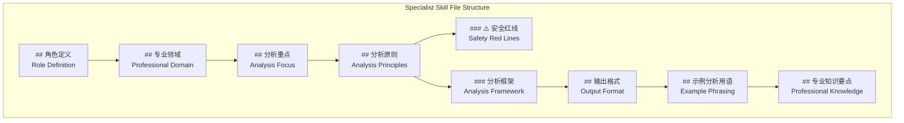
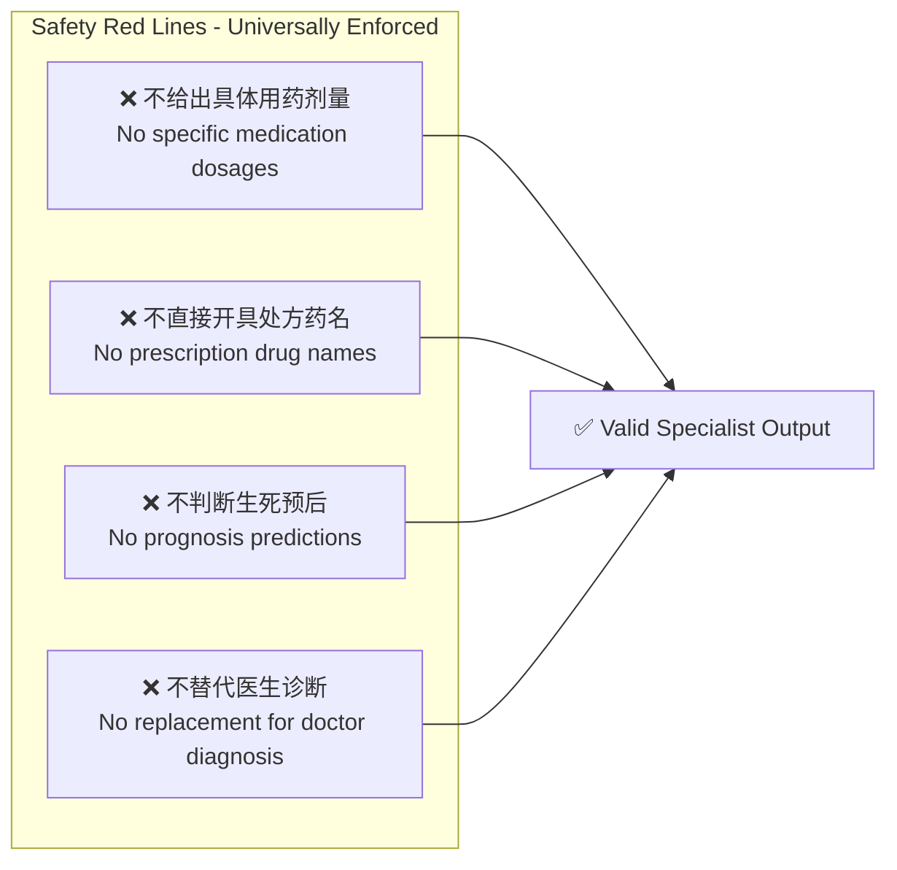
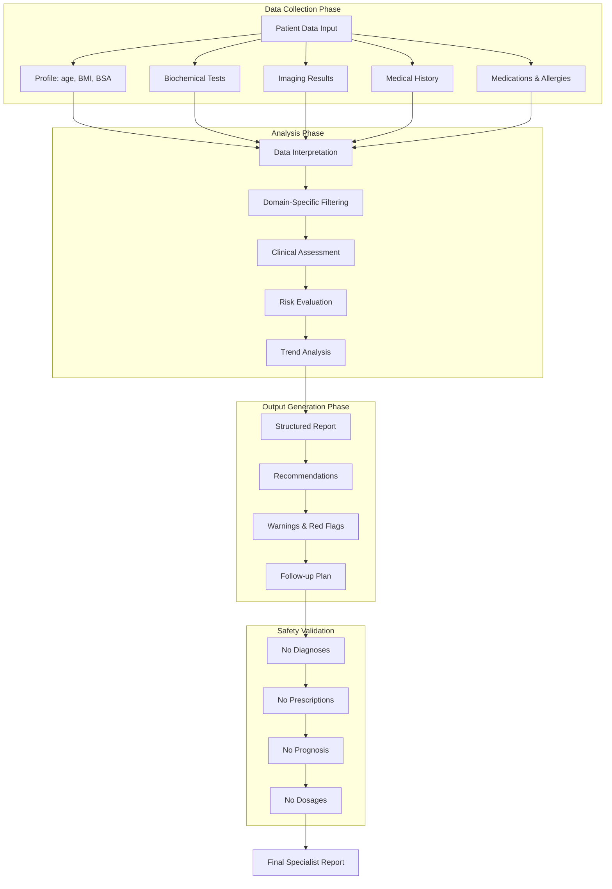
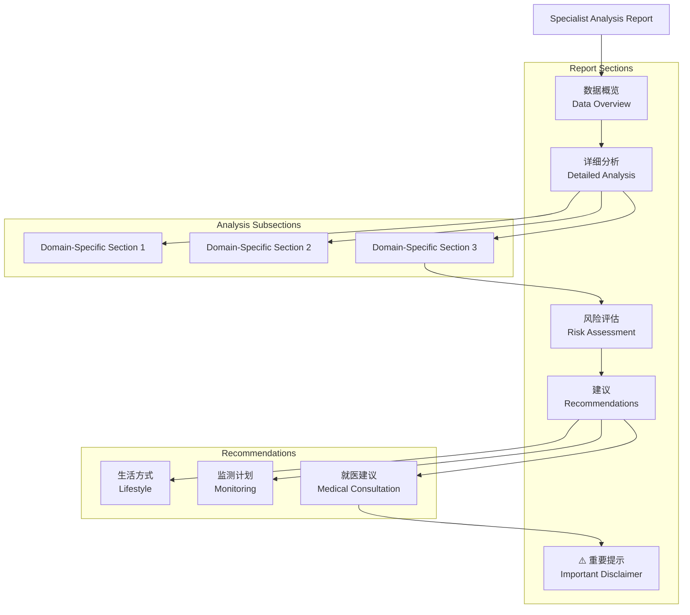
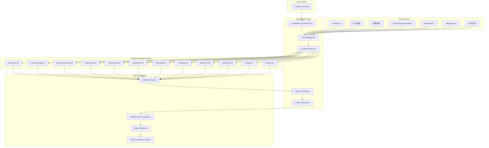
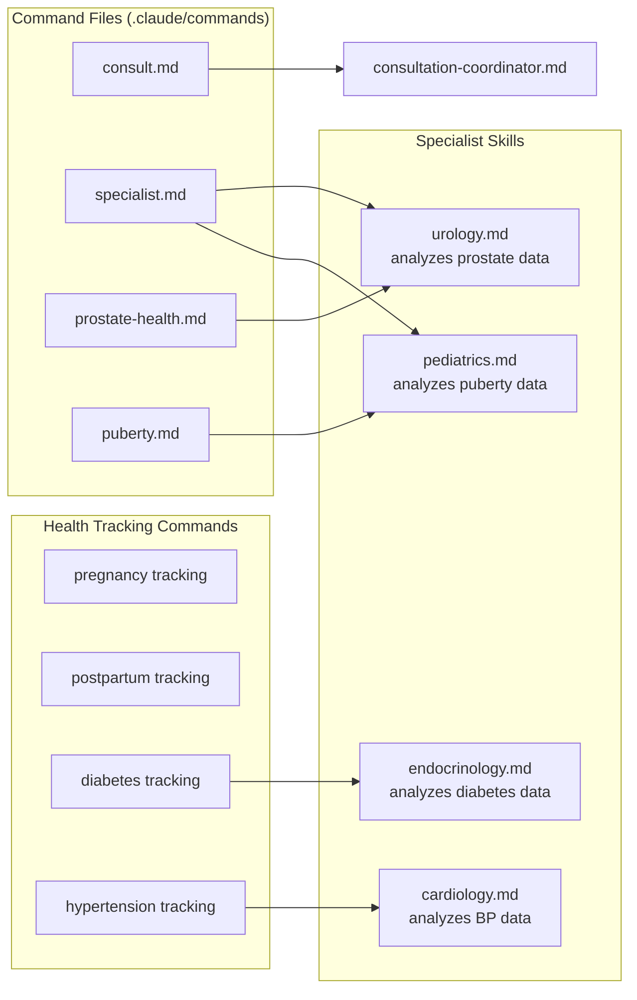
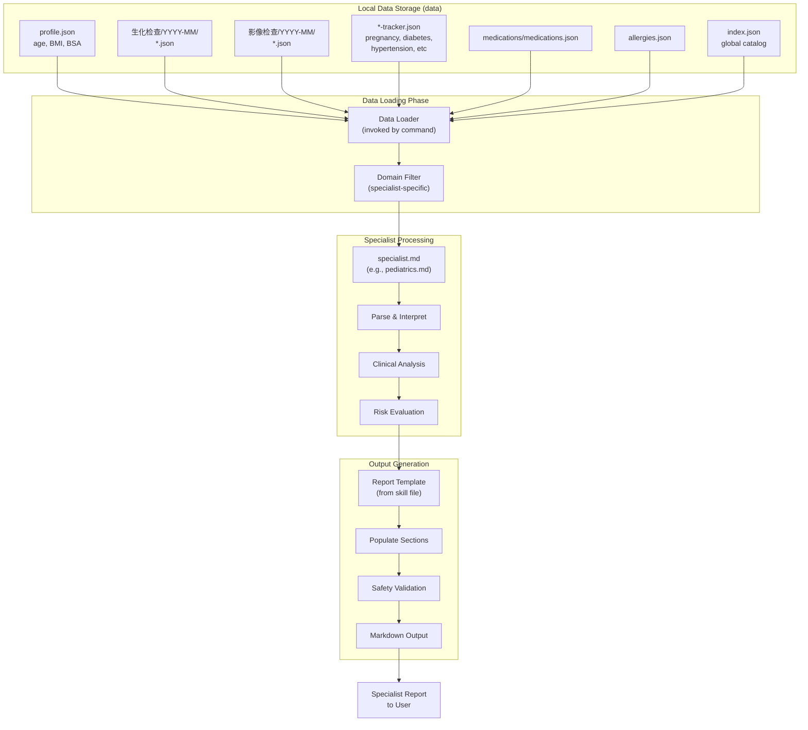

<!-- source: DeepWiki mcp.deepwiki.com · repo huifer/Claude-Ally-Health · page 3.3 AI Specialist Framework · fetched 2026-10-26 -->

# AI Specialist Framework

<details>
<summary>Relevant source files</summary>

The following files were used as context for generating this wiki page:

- [.claude/commands/prostate-health.md](.claude/commands/prostate-health.md)
- [.claude/commands/puberty.md](.claude/commands/puberty.md)
- [.claude/specialists/pediatrics.md](.claude/specialists/pediatrics.md)
- [.claude/specialists/urology.md](.claude/specialists/urology.md)
- [README.md](README.md)
- [README.zh-CN.md](README.zh-CN.md)
- [data-example/andropause-tracker.json](data-example/andropause-tracker.json)
- [data-example/child-vaccinations.json](data-example/child-vaccinations.json)
- [docs/data-structures.md](docs/data-structures.md)

</details>


This document describes the AI Specialist Framework, which provides domain-specific medical expertise through specialized analysis agents. Each specialist is defined as a markdown skill file that analyzes patient data within its medical domain while adhering to strict safety constraints.

For information about how users interact with specialists through commands, see [AI Consultation System](#7). For details on the overall system architecture, see [Core Architecture](#3).

---

## Specialist Architecture Overview

The AI Specialist Framework implements a multi-agent architecture where each specialist represents a medical domain expert. Specialists operate independently during analysis and collaborate through a coordination layer for multi-disciplinary consultations.

```mermaid
graph TB
    subgraph "Command Layer"
        ConsultCmd["/consult command"]
        SpecialistCmd["/specialist command"]
    end
    
    subgraph "Specialist Skill Files (.claude/specialists)"
        Coordinator["consultation-coordinator.md"]
        Cardiology["cardiology.md"]
        Endocrinology["endocrinology.md"]
        Gastroenterology["gastroenterology.md"]
        Nephrology["nephrology.md"]
        Hematology["hematology.md"]
        Respiratory["respiratory.md"]
        Neurology["neurology.md"]
        Oncology["oncology.md"]
        Geriatrics["geriatrics.md"]
        Pediatrics["pediatrics.md"]
        Urology["urology.md"]
        General["general.md"]
    end
    
    subgraph "Data Sources"
        Profile["profile.json"]
        Biochem["生化检查/"]
        Imaging["影像检查/"]
        Chronic["chronic-disease-trackers/"]
        Meds["medications/"]
        Allergies["allergies.json"]
    end
    
    subgraph "Analysis Output"
        Report["Specialist Analysis Report"]
        MDTReport["MDT Consultation Report"]
    end
    
    ConsultCmd --> Coordinator
    SpecialistCmd --> Cardiology
    SpecialistCmd --> Urology
    SpecialistCmd --> Pediatrics
    
    Coordinator --> Cardiology
    Coordinator --> Endocrinology
    Coordinator --> Gastroenterology
    Coordinator --> Nephrology
    Coordinator --> Hematology
    Coordinator --> Respiratory
    Coordinator --> Neurology
    Coordinator --> Oncology
    Coordinator --> Geriatrics
    Coordinator --> Pediatrics
    Coordinator --> Urology
    Coordinator --> General
    
    Profile --> Coordinator
    Biochem --> Coordinator
    Imaging --> Coordinator
    Chronic --> Coordinator
    Meds --> Coordinator
    Allergies --> Coordinator
    
    Cardiology --> Report
    Urology --> Report
    Coordinator --> MDTReport
```



**Sources:** [README.md:31-66](), [README.md:139-140](), Diagram 3 from high-level architecture

---

## Specialist Role Definitions

Each specialist is defined as a markdown file in `.claude/specialists/` that specifies its role, domain expertise, analysis framework, and output format. The system currently implements 12 specialized medical domains plus a consultation coordinator.

### Available Specialists

| Specialist | File | Primary Domain |
|------------|------|----------------|
| Cardiology | `cardiology.md` | Heart and cardiovascular system |
| Endocrinology | `endocrinology.md` | Hormones and metabolism |
| Gastroenterology | `gastroenterology.md` | Digestive system |
| Nephrology | `nephrology.md` | Kidney function |
| Hematology | `hematology.md` | Blood analysis |
| Respiratory | `respiratory.md` | Lung and respiratory system |
| Neurology | `neurology.md` | Nervous system |
| Oncology | `oncology.md` | Cancer screening |
| Geriatrics | `geriatrics.md` | Elderly health |
| Pediatrics | `pediatrics.md` | Child and adolescent health |
| Urology | `urology.md` | Urinary and male reproductive system |
| General | `general.md` | General medical assessment |

**Sources:** [README.md:56-65](), [README.zh-CN.md:56-65]()

---

## Specialist Skill File Structure

Each specialist skill file follows a standardized markdown structure that defines its behavior, analysis approach, and output format.



### Example: Pediatrics Specialist Structure

The pediatrics specialist demonstrates the complete skill file structure:

**Role Definition** [.claude/specialists/pediatrics.md:1-4]()
- Establishes the specialist's identity and core mission
- Example: "您是一位经验丰富的**儿科专家**，专注于儿童和青少年健康评估与发育指导"

**Professional Domain** [.claude/specialists/pediatrics.md:6-14]()
- Lists specific medical conditions and areas of expertise
- Includes: neonatal diseases, respiratory diseases, digestive disorders, growth assessment, nutritional disorders, infectious diseases, vaccinations, behavioral issues

**Analysis Focus** [.claude/specialists/pediatrics.md:16-48]()
- Specifies which biochemical indicators to prioritize
- Defines imaging examination focus areas
- Age-specific reference values emphasis

**Analysis Principles** [.claude/specialists/pediatrics.md:50-67]()
- Safety red lines (strict constraints)
- Analysis framework (systematic approach)

**Output Format** [.claude/specialists/pediatrics.md:69-140]()
- Structured markdown template
- Sections: data overview, detailed analysis, risk assessment, recommendations

**Example Phrasing** [.claude/specialists/pediatrics.md:142-155]()
- ✅ Approved expressions
- ❌ Prohibited expressions

**Professional Knowledge** [.claude/specialists/pediatrics.md:157-295]()
- Age classification
- Growth standards (WHO)
- Vaccination schedules
- Common pediatric conditions

**Sources:** [.claude/specialists/pediatrics.md:1-295]()

---

## Safety Constraints and Medical Ethics

All specialists operate under strict safety constraints that prevent the system from crossing ethical boundaries. These "safety red lines" are universally enforced across all specialist skills.

### The Four Safety Red Lines



### Implementation Examples

**Pediatrics Safety Red Lines** [.claude/specialists/pediatrics.md:52-57]()
```markdown
### ⚠️ 安全红线（严格遵守）
1. **不给出具体用药剂量**
2. **不直接开具处方药名**
3. **不判断生死预后**
4. **不替代医生诊断**
5. **特别注意年龄特异性参考值**
6. **关注儿童生长发育的特殊性**
```

**Urology Safety Red Lines** [.claude/specialists/urology.md:35-38]()
```markdown
### ⚠️ 安全红线(严格遵守)
1. **不给出具体用药剂量**
2. **不直接开具处方药名**
3. **不判断癌症风险**
4. **不替代医生诊断**
```

### Approved vs Prohibited Expressions

Specialists provide concrete examples of acceptable and unacceptable language to guide AI outputs.

**Pediatrics Examples** [.claude/specialists/pediatrics.md:144-154]()

✅ **Approved:**
- "6个月婴儿血红蛋白95g/L，轻度贫血，建议补充铁剂，继续母乳喂养，及时添加富含铁的辅食，1个月后复查血常规"
- "身高处于第3百分位，生长速度减慢，建议查生长激素、甲状腺功能，骨龄片，儿科内分泌就诊"

❌ **Prohibited:**
- "服用阿莫西林干混悬剂" (prescription drug)
- "布洛芬混悬液 5ml" (specific dosage)
- "肯定性早熟，打针治疗" (definitive diagnosis)
- "长不高了" (prognosis prediction)

**Urology Examples** [.claude/specialists/urology.md:141-153]()

✅ **Approved:**
- "PSA值轻度升高,建议3个月后复查PSA和游离PSA"
- "IPSS评分中度,建议泌尿科评估是否需要药物治疗"

❌ **Prohibited:**
- "服用非那雄胺 5mg每日" (dosage specification)
- "PSA 10,肯定是前列腺癌" (cancer diagnosis)
- "给予睾酮凝胶治疗" (direct prescription)

**Sources:** [.claude/specialists/pediatrics.md:50-155](), [.claude/specialists/urology.md:33-153](), [README.md:149-158]()

---

## Specialist Analysis Process

Each specialist follows a structured analysis framework that processes patient data through systematic evaluation stages.



### Pediatrics Analysis Framework

The pediatrics specialist implements a 7-step analysis framework [.claude/specialists/pediatrics.md:59-66]():

1. **数据解读 (Data Interpretation)**: Interpret indicators considering age factors
2. **生长评估 (Growth Assessment)**: Assess height, weight, head circumference development
3. **营养评估 (Nutrition Assessment)**: Evaluate nutritional status and micronutrients
4. **发育评估 (Development Assessment)**: Assess motor, language, social development
5. **疾病识别 (Disease Identification)**: Identify common pediatric diseases
6. **预防保健 (Preventive Care)**: Vaccination, health guidance
7. **就医建议 (Medical Consultation Advice)**: Pediatric/specialty follow-up recommendations

### Urology Analysis Framework

The urology specialist follows a 6-step framework [.claude/specialists/urology.md:40-45]():

1. **数据解读 (Data Interpretation)**: Explain clinical significance of indicators
2. **异常识别 (Abnormality Identification)**: Flag out-of-range values
3. **风险评估 (Risk Assessment)**: Evaluate disease risk factors
4. **趋势分析 (Trend Analysis)**: Compare historical data
5. **生活方式建议 (Lifestyle Recommendations)**: Diet, exercise, routine advice
6. **就医建议 (Medical Consultation)**: Whether urgent or specialist consultation needed

**Sources:** [.claude/specialists/pediatrics.md:59-66](), [.claude/specialists/urology.md:40-45]()

---

## Domain-Specific Analysis Focus

Each specialist defines which data types and indicators receive priority attention within their domain expertise.

### Pediatrics Biochemical Focus

[.claude/specialists/pediatrics.md:18-42]()

**Blood Count** (age-specific reference values):
- Hemoglobin (anemia assessment)
- White blood cell count (infection assessment)
- Platelet count

**Nutritional Indicators**:
- Iron, ferritin
- Zinc, calcium, magnesium
- Vitamins A, D, E, B12
- Folate

**Liver and Kidney Function**:
- ALT, AST
- Creatinine, blood urea nitrogen

**Infection Markers**:
- C-reactive protein (CRP)
- Procalcitonin (PCT)

**Allergy Markers**:
- Total IgE
- Eosinophils

### Urology Analysis Focus

[.claude/specialists/urology.md:14-30]()

**Prostate Health**:
- PSA testing: total PSA, free PSA, PSA velocity, free/total PSA ratio
- IPSS score: 0-35 points
- Digital rectal exam (DRE): size, texture, nodules
- Prostate ultrasound: volume, residual urine, inner gland size

**Male Infertility**:
- Semen analysis: sperm density, motility (PR/NP), morphology, volume, pH
- Hormone levels: testosterone, LH, FSH, prolactin, estradiol
- Physical examination: varicocele, testicular volume

**Andropause**:
- Symptom assessment: sexual, somatic, psychological symptoms
- Testosterone levels: total testosterone, free testosterone, SHBG
- Questionnaires: ADAM questionnaire, AMS score

**Sources:** [.claude/specialists/pediatrics.md:18-42](), [.claude/specialists/urology.md:14-30]()

---

## Specialist Output Format

All specialists generate structured markdown reports following a standardized template that ensures consistency and completeness.

### Standard Report Structure



### Pediatrics Report Template

[.claude/specialists/pediatrics.md:70-140]()

```markdown
## 儿科分析报告

### 数据概览
- 年龄：[年龄]
- 主要异常：[列出异常指标]

### 详细分析

#### 1. 生长发育评估
- 身高：[数值+百分位/标准差] - [评估]
- 体重：[数值+百分位/标准差] - [评估]
- BMI：[数值] - [评估]
- 生长发育速度：[评估]
- 骨龄：[如有，与实际年龄比较]

#### 2. 营养评估
- 血红蛋白：[数值] - [贫血评估]
- 铁/铁蛋白：[数值] - [铁储备评估]
- 锌：[数值] - [评估]
- 维生素D：[数值] - [充足/不足/缺乏]

#### 3. 常见疾病筛查
- [呼吸系统：如有]
- [消化系统：如有]

#### 4. 发育评估（如有）
- 运动发育：[评估]
- 语言发育：[评估]

### 风险评估
- 营养不良风险：[评估]
- 肥胖风险：[评估]
- 贫血风险：[评估]

### 建议

#### 营养指导
- 母乳喂养/配方奶：[建议]
- 辅食添加：[时间和种类]

#### 生活方式
- 睡眠：[建议睡眠时间]
- 运动：[年龄适宜的运动]

#### 检查建议
- [建议的检查项目]

#### 就医建议
- 需要立即就医：[是/否及原因]
- 建议就诊时间：[时间范围]
- 推荐科室：[儿科/儿童保健科/儿科亚专科]
```

### Urology Report Template

[.claude/specialists/urology.md:50-130]()

```markdown
## 泌尿科分析报告

### 数据概览
- 主要异常指标: [列出异常指标]
- 数据完整性: [完整/部分缺失]

### 详细分析

#### 1. 前列腺健康评估
**PSA检测**:
- 总PSA: [数值] ng/mL - [正常/异常]
- 游离PSA: [数值] ng/mL
- PSA趋势: [稳定/上升/下降]

**IPSS评分**:
- 总分: [X/35分] - [轻度/中度/重度]

#### 2. 生育健康评估
**精液分析**:
- 精液量: [X mL]
- 精子密度: [X × 10⁶/mL]

#### 3. 更年期评估
**睾酮水平**:
- 总睾酮: [X nmol/L]

### 建议

#### 生活方式调整
- **饮食**: [具体建议]
- **运动**: [具体建议]

#### 监测计划
- **前列腺**: [下次PSA检测时间]

#### 就医建议
- **立即就医**: [如有需要,说明原因]
- **专科复查**: [建议就诊的科室和时间]
```

**Sources:** [.claude/specialists/pediatrics.md:70-140](), [.claude/specialists/urology.md:50-130]()

---

## Consultation Coordination

The consultation coordinator orchestrates multi-disciplinary consultations by aggregating data, distributing it to all specialists, and synthesizing their independent analyses into a unified report.



### Coordination Responsibilities

The `consultation-coordinator.md` file [README.md:66]() serves as the orchestration layer with these responsibilities:

1. **Data Collection**: Aggregate all available patient data from multiple sources
2. **Distribution**: Send complete dataset to all relevant specialists simultaneously
3. **Opinion Integration**: Collect independent analyses from each specialist
4. **Conflict Resolution**: Apply prioritization rules when specialists disagree:
   - Urgency > Routine
   - Safety-first principle
   - Specialist priority within their domain
5. **Synthesis**: Generate unified recommendations from multiple perspectives
6. **Safety Validation**: Ensure all outputs adhere to safety red lines

### Integration Algorithms

The coordinator employs opinion integration algorithms (Diagram 3) to synthesize findings:

- **Prioritization Rules**: When conflicts arise, urgent findings take precedence over routine observations
- **Domain Authority**: Within a specialist's domain, their opinion carries higher weight
- **Safety-First**: Any safety concern raised by any specialist is preserved
- **Cross-Validation**: Findings confirmed by multiple specialists are highlighted

**Sources:** [README.md:66](), [README.zh-CN.md:65](), Diagram 3 from high-level architecture

---

## Integration with Command Layer

Specialists are invoked through the command layer, which prepares data and formats requests for specialist analysis.



### Single Specialist Consultation

The `/specialist` command [README.md:132]() enables consultation with a specific medical specialist:

```bash
/specialist cardiology
/specialist urology
/specialist pediatrics
```

The command loads relevant patient data for the specialist's domain and invokes that specialist's skill file for analysis.

### Multi-Disciplinary Consultation (MDT)

The `/consult` command [README.md:131]() triggers a comprehensive multi-disciplinary team consultation:

```bash
/consult
```

This command:
1. Loads all available patient data
2. Invokes `consultation-coordinator.md`
3. Coordinator distributes data to all 12 specialists
4. Specialists analyze in parallel
5. Coordinator integrates opinions
6. Unified MDT report generated

### Domain-Specific Command Integration

Health tracking commands integrate with specialists for domain-specific analysis:

**Prostate Health** [.claude/commands/prostate-health.md:1-9]()
- Command: `/prostate psa`, `/prostate ipss`, `/prostate status`
- Invokes: `urology.md` specialist skill
- Analyzes: PSA levels, IPSS scores, prostate volume, DRE findings

**Puberty Assessment** [.claude/commands/puberty.md:1-9]()
- Command: `/growth puberty breast`, `/growth puberty testicular`
- Invokes: `pediatrics.md` specialist skill
- Analyzes: Tanner staging, bone age, precocious puberty screening

**Sources:** [README.md:131-132](), [.claude/commands/prostate-health.md:1-9](), [.claude/commands/puberty.md:1-9]()

---

## Data Flow Through Specialist System

This section maps how data flows from local storage through the specialist analysis pipeline to final output.



### Data Preparation

Commands prepare data before invoking specialists:

1. **Load Profile**: Read `profile.json` for age, BMI, BSA
2. **Query Index**: Use `index.json` to locate relevant data files
3. **Load Domain Data**: Retrieve biochemical tests, imaging, trackers specific to the specialist's domain
4. **Load Medications & Allergies**: Include current medications and allergy history
5. **Historical Context**: Include previous records for trend analysis

### Specialist Data Processing

Each specialist processes the data according to its defined analysis framework:

1. **Data Interpretation**: Parse numerical values, units, and reference ranges
2. **Domain Filtering**: Focus on indicators relevant to the specialist's domain
3. **Clinical Assessment**: Apply medical knowledge from the skill file
4. **Risk Evaluation**: Identify abnormal findings and calculate risk scores
5. **Trend Analysis**: Compare with historical data if available

### Output Formatting

The specialist generates output following its template:

1. **Template Loading**: Load structured markdown template from skill file
2. **Section Population**: Fill each section with analysis results
3. **Safety Validation**: Check for safety red line violations
4. **Markdown Generation**: Format final report as readable markdown

**Sources:** [docs/data-structures.md:1-509](), Diagram 2 from high-level architecture

---

## Specialist Knowledge Bases

Each specialist skill file contains embedded medical knowledge that guides its analysis. This knowledge is encoded as markdown sections within the skill file.

### Pediatrics Knowledge Examples

**Age Classification** [.claude/specialists/pediatrics.md:156-174]()
- Neonatal period (0-28 days)
- Infancy (28 days - 1 year)
- Toddler (1-3 years)
- Preschool (3-6 years)
- School age (6-12 years)
- Adolescence (12-18 years)

**WHO Growth Standards** [.claude/specialists/pediatrics.md:176-192]()
- Length/height for age
- Weight for age
- BMI for age
- Head circumference (0-3 years)
- Percentile interpretation (P3-P97)

**Tanner Staging** [.claude/specialists/pediatrics.md:367-445]()
- Female breast development (B1-B5)
- Female pubic hair (P1-P5)
- Male testicular volume (G1-G5)
- Male pubic hair (P1-P5)
- Menarche timing
- Voice change timing

**Vaccination Schedule** [.claude/specialists/pediatrics.md:225-283]()
- Complete immunization timeline from birth to 6 years
- Class 1 (national program) vaccines
- Class 2 (optional) vaccines
- Contraindications and adverse reactions

### Urology Knowledge Examples

**PSA Reference Values** [.claude/specialists/urology.md:157-162]()
```markdown
- 总PSA < 4.0 ng/mL: 一般参考值
- 总PSA 4.0-10.0 ng/mL: 灰区,需进一步评估
- 总PSA > 10.0 ng/mL: 需泌尿科进一步检查
- 游离/总PSA比值 > 0.25: 提示良性
- PSA速率 > 0.75 ng/mL/年: 需进一步评估
```

**IPSS Score Interpretation** [.claude/specialists/urology.md:164-168]()
```markdown
- 0-7分: 轻度症状,观察随访
- 8-19分: 中度症状,可考虑药物治疗
- 20-35分: 重度症状,建议泌尿科评估
```

**Semen Analysis Standards (WHO 2021)** [.claude/specialists/urology.md:170-175]()
```markdown
- 精液量 ≥ 1.5 mL: 正常
- 精子密度 ≥ 15 × 10⁶/mL: 正常
- 前向运动(PR) ≥ 32%: 正常
- 正常形态 ≥ 4%: 正常
- pH 7.2-8.0: 正常
```

**Testosterone Reference** [.claude/specialists/urology.md:177-182]()
```markdown
- 总睾酮 ≥ 10 nmol/L: 正常
- 总睾酮 8-10 nmol/L + 症状: 可能性腺功能减退
- 总睾酮 < 8 nmol/L: 确诊性腺功能减退(需重复测定)
- 测定时间: 早晨8-11点
- 至少2次测定确认
```

**Sources:** [.claude/specialists/pediatrics.md:156-283](), [.claude/specialists/urology.md:157-182]()

---

## Specialist Skill File Locations

The complete mapping of specialist skill files to their filesystem locations:

| Specialist | File Path | Lines |
|------------|-----------|-------|
| Consultation Coordinator | `.claude/specialists/consultation-coordinator.md` | N/A |
| Cardiology | `.claude/specialists/cardiology.md` | N/A |
| Endocrinology | `.claude/specialists/endocrinology.md` | N/A |
| Gastroenterology | `.claude/specialists/gastroenterology.md` | N/A |
| Nephrology | `.claude/specialists/nephrology.md` | N/A |
| Hematology | `.claude/specialists/hematology.md` | N/A |
| Respiratory | `.claude/specialists/respiratory.md` | N/A |
| Neurology | `.claude/specialists/neurology.md` | N/A |
| Oncology | `.claude/specialists/oncology.md` | N/A |
| Geriatrics | `.claude/specialists/geriatrics.md` | N/A |
| Pediatrics | `.claude/specialists/pediatrics.md` | 660 |
| Urology | `.claude/specialists/urology.md` | 186 |
| General Practice | `.claude/specialists/general.md` | N/A |

### Data Structure Integration

Specialists reference standardized data structures documented in `docs/data-structures.md`:

- **Biochemical Exam Structure** [docs/data-structures.md:1-36]()
- **Imaging Exam Structure** [docs/data-structures.md:38-70]()
- **User Profile Structure** [docs/data-structures.md:98-132]()
- **Medication Records** [docs/data-structures.md:277-327]()
- **Allergy Records** (referenced by specialists for interaction checking)

### Example Data Files

Example tracker files showing data format specialists process:

- **Andropause Tracker** [data-example/andropause-tracker.json:1-189]() - processed by Urology specialist
- **Child Vaccinations** [data-example/child-vaccinations.json:1-131]() - processed by Pediatrics specialist

**Sources:** [README.md:56-66](), [docs/data-structures.md:1-509](), [data-example/andropause-tracker.json:1-189](), [data-example/child-vaccinations.json:1-131]()

---

## Summary

The AI Specialist Framework provides domain-specific medical expertise through:

1. **Markdown-Based Skill Definitions**: Each specialist is a self-contained markdown file defining role, domain, analysis approach, and output format
2. **Strict Safety Constraints**: Universal enforcement of four safety red lines prevents medical malpractice
3. **Structured Analysis**: Systematic frameworks ensure comprehensive evaluation
4. **Consultation Coordination**: Multi-disciplinary analysis with opinion integration
5. **Domain-Specific Knowledge**: Embedded medical reference data guides specialist decisions
6. **Command Integration**: Seamless invocation through slash commands
7. **Local Data Processing**: Privacy-first architecture with no external data transmission

This architecture enables comprehensive health analysis while maintaining clear boundaries between AI assistance and professional medical practice.

**Sources:** All sections as cited throughout document

---

