# Page: Overview

# Overview

<details>
<summary>Relevant source files</summary>

The following files were used as context for generating this wiki page:

- [.claude/settings.local.json](.claude/settings.local.json)
- [README.md](README.md)
- [README.zh-CN.md](README.zh-CN.md)
- [docs/data-structures.md](docs/data-structures.md)
- [todo/01-womens-health.md](todo/01-womens-health.md)
- [todo/02-mens-health.md](todo/02-mens-health.md)

</details>


## Purpose and Scope

Claude-Ally-Health is a privacy-first personal health information management system that enables comprehensive health tracking and AI-assisted health analysis through local file storage and Claude Code slash commands. The system stores all health data as JSON files on the local filesystem, never transmitting data to external services (with the documented exception of optional AI image analysis via GLM's MCP server).

This document provides a technical overview of the system's architecture, command interface, data storage model, and AI specialist framework. For detailed command usage, see [Getting Started](#2). For data structure specifications, see [Data Storage & Privacy Model](#3.2). For AI consultation capabilities, see [AI Consultation System](#7).

**Sources:** [README.md:1-192](), [README.zh-CN.md:1-191]()

---

## System Architecture

Claude-Ally-Health implements a three-tier architecture: the **Command Interface Layer** (slash commands), the **Processing Layer** (command handlers and AI specialists), and the **Data Layer** (JSON files organized by domain).

```mermaid
graph TB
    subgraph "Command Interface Layer"
        User["User"]
        CLI["Claude Code CLI<br/>.claude/commands/"]
    end
    
    subgraph "Processing Layer"
        Commands["Command Handlers"]
        Specialists["AI Specialists<br/>.claude/specialists/"]
        
        subgraph "Core Commands"
            Profile["/profile<br/>profile.md"]
            SaveReport["/save-report<br/>save-report.md"]
            Query["/query<br/>query.md"]
            Medication["/medication<br/>medication.md"]
            Interaction["/interaction<br/>interaction.md"]
        end
        
        subgraph "Health Tracking Commands"
            Pregnancy["/pregnancy<br/>pregnancy.md"]
            Postpartum["/postpartum<br/>postpartum.md"]
            Prostate["/prostate<br/>prostate.md"]
            Fertility["/fertility<br/>fertility.md"]
            BP["/bp<br/>hypertension.md"]
            Glucose["/glucose<br/>diabetes.md"]
        end
        
        subgraph "AI Specialists"
            Cardio["cardiology.md"]
            Endo["endocrinology.md"]
            Geri["geriatrics.md"]
            Uro["urology.md"]
            Coord["consultation-coordinator.md"]
        end
    end
    
    subgraph "Data Layer - data/"
        ProfileData["profile.json"]
        Index["index.json"]
        Allergies["allergies.json"]
        
        subgraph "Health Trackers"
            PregnancyData["pregnancy-tracker.json"]
            PostpartumData["postpartum-tracker.json"]
            ProstateData["prostate-tracker.json"]
            HypertensionData["hypertension-tracker.json"]
            DiabetesData["diabetes-tracker.json"]
        end
        
        subgraph "Medical Records"
            Biochem["生化检查/YYYY-MM/"]
            Imaging["影像检查/YYYY-MM/"]
            Surgery["手术记录/YYYY-MM/"]
        end
        
        subgraph "Medication & Interactions"
            MedData["medications/medications.json"]
            InteractionDB["interactions/interaction-db.json"]
            InteractionLogs["interactions/interaction-logs/"]
        end
    end
    
    User --> CLI
    CLI --> Commands
    Commands --> Profile
    Commands --> SaveReport
    Commands --> Query
    Commands --> Pregnancy
    Commands --> Prostate
    
    Profile --> ProfileData
    SaveReport --> Biochem
    SaveReport --> Imaging
    Pregnancy --> PregnancyData
    Postpartum --> PostpartumData
    Prostate --> ProstateData
    BP --> HypertensionData
    
    Query --> Index
    Index -.catalogs.-> PregnancyData
    Index -.catalogs.-> Biochem
    Index -.catalogs.-> MedData
    
    Commands --> Specialists
    Specialists --> Coord
    Coord --> Cardio
    Coord --> Endo
    Coord --> Geri
```

**Architecture Analysis:**

The **Command Interface Layer** exposes 20+ slash commands defined as Markdown files in `.claude/commands/`. Each command file contains structured instructions for Claude Code to parse user input, validate data, and execute operations.

The **Processing Layer** contains command handlers that implement business logic (calculations, validations, risk assessments) and AI specialists that provide domain-specific medical analysis. Command handlers transform natural language inputs into structured JSON data, while specialists analyze aggregated health data to generate insights.

The **Data Layer** organizes all health information as JSON files with domain-specific schemas. The `index.json` file serves as a global catalog enabling cross-domain queries without scanning all files. Month-based directory structures (YYYY-MM) provide efficient temporal organization for medical records.

**Sources:** [README.md:40-90](), [README.zh-CN.md:39-89](), [.claude/settings.local.json:1-37]()

---

## Command-to-File Mapping

The system implements a consistent pattern where each user-facing command maps to a Markdown skill file that defines its behavior.

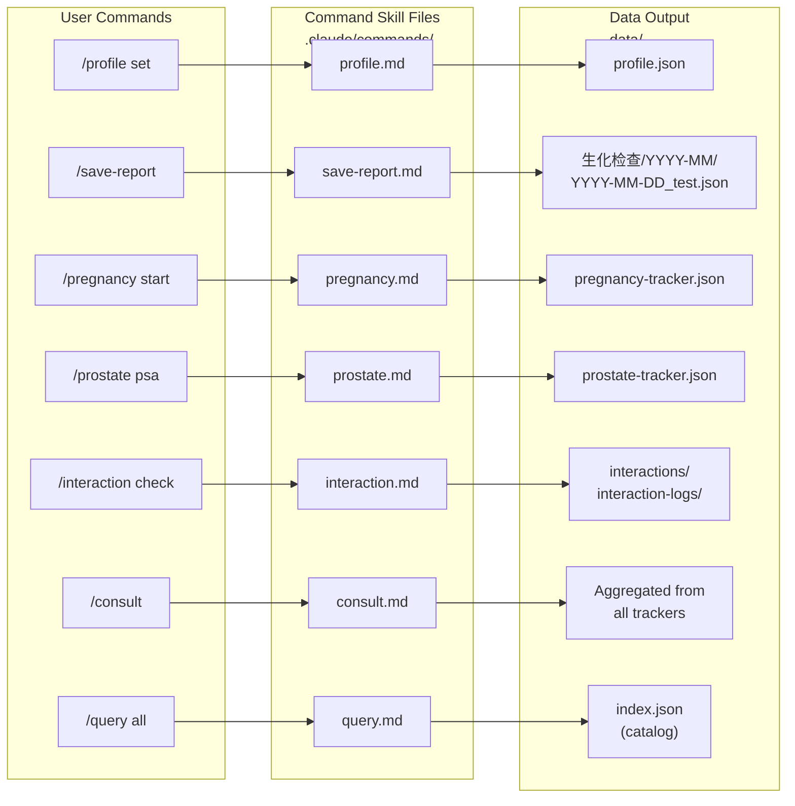

**Command Categories:**

| Category | Commands | Purpose |
|----------|----------|---------|
| **Core Management** | `/profile`, `/save-report`, `/query` | User profile, medical report storage, data retrieval |
| **Women's Health** | `/pregnancy`, `/postpartum`, `/menopause`, `/screening` | Pregnancy tracking, postpartum care, gynecological screening |
| **Men's Health** | `/prostate`, `/fertility`, `/andropause` | Prostate health, male fertility, testosterone monitoring |
| **Chronic Diseases** | `/bp`, `/glucose`, `/copd` | Hypertension, diabetes, COPD management |
| **Safety & Medication** | `/medication`, `/interaction`, `/allergy` | Medication tracking, drug interaction detection, allergy management |
| **AI Consultation** | `/consult`, `/specialist` | Multi-disciplinary consultation, single specialist consultation |
| **Emergency** | `/emergency-card` | Emergency medical information card generation |

**Sources:** [README.md:118-134](), [README.zh-CN.md:117-133](), [todo/01-womens-health.md:1-727](), [todo/02-mens-health.md:1-728]()

---

## Data Storage Architecture

All health data is stored as JSON files with domain-specific schemas. The system uses a hierarchical directory structure with month-based partitioning for temporal data.

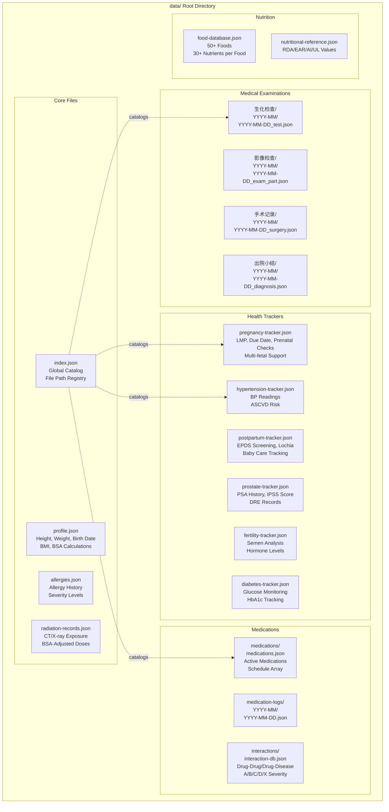

**Data Schema Examples:**

**Profile Data** (`profile.json`):
```json
{
  "basic_info": {
    "height": 175,
    "height_unit": "cm",
    "weight": 70,
    "weight_unit": "kg",
    "birth_date": "1990-01-01"
  },
  "calculated": {
    "age": 35,
    "bmi": 22.9,
    "bmi_status": "正常",
    "body_surface_area": 1.85,
    "bsa_unit": "m²"
  }
}
```

**Index Catalog** (`index.json`):
```json
{
  "biochemical_exams": [
    {
      "id": "20251231123456789",
      "date": "2025-12-31",
      "type": "生化检查",
      "file_path": "data/生化检查/2025-12/2025-12-31_血常规.json"
    }
  ],
  "imaging_exams": [...],
  "pregnancy_trackers": [...],
  "medications": [...],
  "last_updated": "2025-12-31T12:34:56.789Z"
}
```

**Pregnancy Tracker** (`pregnancy-tracker.json`):
```json
{
  "pregnancy_id": "pregnancy_20250101",
  "lmp_date": "2025-01-01",
  "due_date": "2025-10-08",
  "pregnancy_type": "twins",
  "current_week": 12,
  "fetuses": [
    {
      "id": "A",
      "estimated_weight": 1500,
      "position": "cephalic",
      "heart_rate": 145
    },
    {
      "id": "B",
      "estimated_weight": 1400,
      "position": "breech",
      "heart_rate": 142
    }
  ],
  "weight_tracking": [...]
}
```

**Directory Organization Patterns:**

- **Month-based partitioning**: Medical records use `YYYY-MM/` directories to enable efficient temporal queries
- **Descriptive filenames**: Files include date, type, and identifying information (e.g., `2025-12-31_CT_chest.json`)
- **Tracker persistence**: Health tracking files (pregnancy, diabetes, etc.) are stored at the root level for continuous monitoring
- **Index registry**: `index.json` maintains paths to all data files, enabling fast lookups without filesystem scans

**Sources:** [README.md:40-90](), [docs/data-structures.md:1-510](), [todo/01-womens-health.md:72-164]()

---

## AI Specialist Framework

The system implements a subagent architecture where specialized AI "doctors" provide domain-specific medical analysis. Each specialist is defined as a Markdown skill file in `.claude/specialists/`.

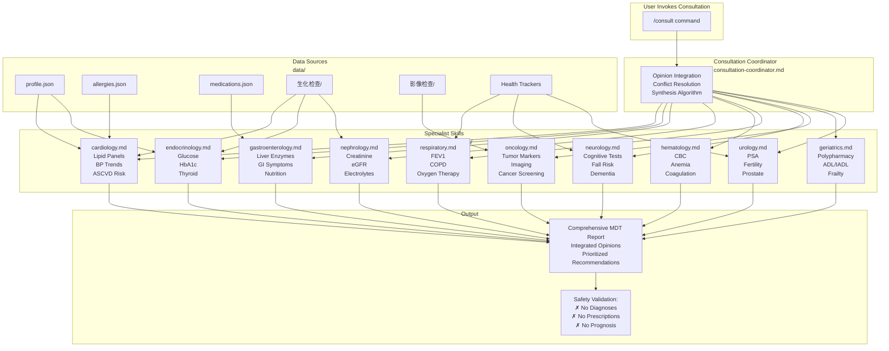

**Specialist Roles:**

| Specialist | File | Domain Focus |
|-----------|------|--------------|
| **Cardiology** | `cardiology.md` | Lipid panels, blood pressure trends, ASCVD risk scoring, cardiovascular medications |
| **Endocrinology** | `endocrinology.md` | Glucose monitoring, HbA1c tracking, thyroid function, hormone levels, diabetes management |
| **Gastroenterology** | `gastroenterology.md` | Liver enzymes (ALT, AST), GI symptoms, digestive health, nutritional status |
| **Nephrology** | `nephrology.md` | Creatinine, eGFR calculation, electrolyte balance, kidney function assessment |
| **Hematology** | `hematology.md` | Complete blood count (CBC), anemia evaluation, coagulation studies, blood disorders |
| **Respiratory** | `respiratory.md` | Lung function (FEV1, FVC), COPD management, oxygen therapy, CAT/mMRC scores |
| **Neurology** | `neurology.md` | Cognitive assessments (MMSE, MoCA), fall risk evaluation, dementia screening |
| **Oncology** | `oncology.md` | Tumor markers (CA125, PSA, CEA), imaging analysis for suspicious findings, cancer screening schedules |
| **Geriatrics** | `geriatrics.md` | Polypharmacy management, Beers Criteria, ADL/IADL function, frailty assessment, fall prevention |
| **Urology** | `urology.md` | PSA tracking, prostate health, male fertility (semen analysis), urinary symptoms (IPSS) |

**Consultation Coordinator** (`consultation-coordinator.md`):
- Orchestrates parallel specialist analysis
- Implements opinion integration algorithms
- Resolves conflicts using prioritization rules (urgency > routine, safety-first, specialist priority within domain)
- Synthesizes unified recommendations
- Enforces medical safety constraints (no diagnoses, no prescriptions, no prognosis)

**Safety Validation Layer:**
All specialist outputs pass through safety validation to ensure compliance with medical ethics boundaries. The system explicitly refuses to:
1. Provide specific medication dosages
2. Prescribe prescription drugs
3. Predict life prognosis
4. Replace professional medical diagnosis

**Sources:** [README.md:31-32,56-66](), [README.zh-CN.md:30-31,55-65]()

---

## Health Domain Coverage

The system provides comprehensive health tracking across the complete lifecycle and multiple medical specialties.

```mermaid
graph TB
    subgraph "Life Stage Modules"
        subgraph "Women's Health"
            W1["pregnancy.md<br/>pregnancy-tracker.json<br/>LMP Calculations<br/>Multi-fetal Support"]
            W2["postpartum.md<br/>postpartum-tracker.json<br/>EPDS Screening<br/>Baby Tracking"]
            W3["menopause.md<br/>menopause-tracker.json<br/>HRT Monitoring<br/>Bone Density"]
            W4["screening.md<br/>screening-tracker.json<br/>HPV/TCT<br/>Tumor Markers"]
        end
        
        subgraph "Men's Health"
            M1["prostate.md<br/>prostate-tracker.json<br/>PSA Velocity<br/>IPSS Score"]
            M2["fertility.md<br/>fertility-tracker.json<br/>Semen Analysis<br/>Hormone Panels"]
            M3["andropause.md<br/>andropause-tracker.json<br/>Testosterone<br/>TRT Monitoring"]
        end
        
        subgraph "Child & Adolescent"
            C1["growth.md<br/>growth-tracker.json<br/>WHO Standards<br/>Percentiles"]
            C2["vaccination.md<br/>vaccination-tracker.json<br/>Schedule<br/>Coverage Status"]
            C3["puberty.md<br/>puberty-tracker.json<br/>Tanner Staging<br/>Bone Age"]
        end
        
        subgraph "Elderly Health"
            E1["cognitive.md<br/>cognitive-tracker.json<br/>MMSE/MoCA<br/>ADL/IADL"]
            E2["fall-risk.md<br/>fall-tracker.json<br/>TUG/Berg<br/>Risk Scoring"]
            E3["polypharmacy.md<br/>polypharmacy-tracker.json<br/>Beers Criteria<br/>ACB Score"]
        end
    end
    
    subgraph "Chronic Disease Management"
        CD1["hypertension.md<br/>hypertension-tracker.json<br/>BP Tracking<br/>ASCVD Risk"]
        CD2["diabetes.md<br/>diabetes-tracker.json<br/>Glucose/HbA1c<br/>TIR Calculation"]
        CD3["copd.md<br/>copd-tracker.json<br/>FEV1<br/>CAT/mMRC Scores"]
    end
    
    subgraph "Cross-Cutting Systems"
        X1["interaction.md<br/>interaction-db.json<br/>Drug-Drug/Drug-Disease<br/>A/B/C/D/X Severity"]
        X2["emergency-card.md<br/>Aggregates All Trackers<br/>Critical Allergies<br/>Current Medications"]
        X3["consult.md<br/>consultation-coordinator.md<br/>10 Specialists<br/>Opinion Integration"]
    end
    
    X1 -.checks.-> W2
    X1 -.checks.-> M3
    X1 -.checks.-> E3
    
    X2 -.aggregates.-> W1
    X2 -.aggregates.-> M1
    X2 -.aggregates.-> CD1
    
    X3 -.consults.-> C1
    X3 -.consults.-> E1
    X3 -.consults.-> CD2
```

**Health Domain Statistics:**

| Domain | Commands | Data Files | Features |
|--------|----------|------------|----------|
| **Women's Health** | 4 | 4 trackers | Pregnancy (multi-fetal), postpartum (EPDS), menopause (HRT), gynecological screening (HPV/TCT) |
| **Men's Health** | 3 | 3 trackers | Prostate (PSA velocity), fertility (semen analysis), andropause (testosterone/TRT) |
| **Child & Adolescent** | 3 | 3 trackers | Growth (WHO standards), vaccination (schedule), puberty (Tanner staging) |
| **Elderly Health** | 3 | 3 trackers | Cognitive (MMSE/MoCA), fall risk (TUG/Berg), polypharmacy (Beers Criteria) |
| **Chronic Diseases** | 3 | 3 trackers | Hypertension (ASCVD), diabetes (TIR), COPD (GOLD grading) |
| **Safety & Medication** | 3 | 2 databases | Medication tracking, drug interaction (5-level severity), allergy management |
| **Medical Records** | 2 | Month-based dirs | Biochemical tests, imaging reports (9 templates), surgery records, discharge summaries |
| **AI Consultation** | 2 | N/A | Multi-disciplinary consultation (10 specialists), single specialist consultation |

**Key Features:**

- **Pregnancy Tracking**: Supports singleton, twins, triplets, quadruplets with adjusted due dates and weight gain recommendations
- **EPDS Screening**: Edinburgh Postnatal Depression Scale with automatic risk stratification (0-9: low, 10-12: moderate, 13+: high)
- **PSA Velocity**: Calculates annual PSA change rate with >0.75 ng/mL/year threshold for prostate cancer risk
- **Drug Interaction Detection**: 5-level severity system (A: no interaction, B: minor, C: moderate, D: major, X: contraindicated)
- **ASCVD Risk**: 10-year atherosclerotic cardiovascular disease risk calculation for hypertension management
- **Time-in-Range (TIR)**: Glucose monitoring with target range 3.9-10.0 mmol/L for diabetes management

**Sources:** [todo/01-womens-health.md:1-727](), [todo/02-mens-health.md:1-728](), [README.md:23-39]()

---

## Privacy and Security Model

Claude-Ally-Health implements a privacy-first architecture with local-only data storage and explicit security boundaries.

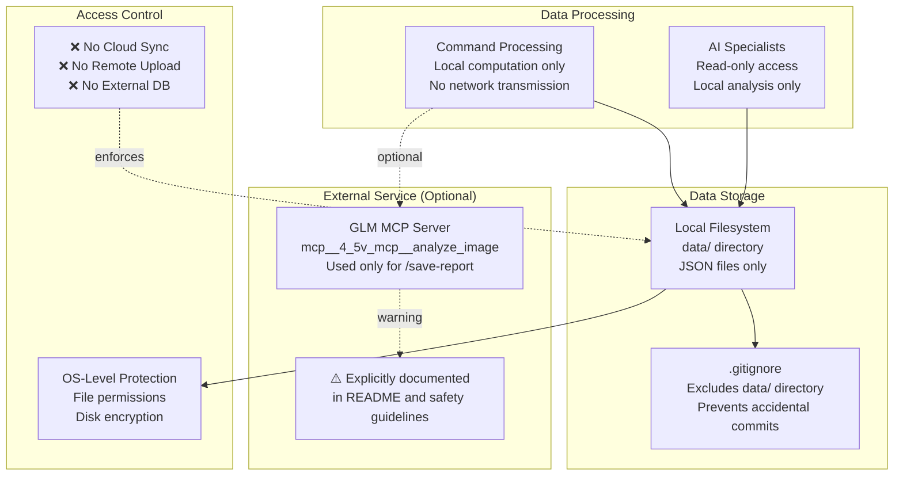

**Security Features:**

| Feature | Implementation | File Reference |
|---------|---------------|----------------|
| **Local Storage** | All data stored in `data/` directory as JSON files | [README.md:112-116]() |
| **Git Exclusion** | `.gitignore` prevents `data/` directory from version control | [README.md:40-90]() |
| **No Cloud Sync** | Architecture explicitly excludes cloud synchronization | [README.md:25,112-116]() |
| **No External DB** | Pure filesystem storage, no database dependencies | [README.md:25,139]() |
| **OS Protection** | Relies on operating system file permissions and disk encryption (BitLocker/FileVault) | System-level |
| **Read-Only Specialists** | AI specialists have read-only access, cannot modify data | [README.md:56-66]() |

**External Service Usage:**

The system documents one exception to local-only processing:
- **GLM MCP Server**: Optional AI image recognition for medical report extraction via `mcp__4_5v_mcp__analyze_image`
- **Usage**: Only invoked by `/save-report` command when processing medical report images
- **Documentation**: Explicitly stated in README disclaimer and safety guidelines
- **User Control**: Users control when to invoke this feature by choosing to use `/save-report` with images

**Data Sovereignty Guarantees:**

1. **Complete local control**: All health data resides on user's local machine
2. **No automatic transmission**: System never automatically sends data externally
3. **Transparent exceptions**: External service usage is explicitly documented
4. **User choice**: Users decide whether to use features requiring external services

**Medical Safety Boundaries:**

The system enforces strict medical ethics boundaries in all AI analysis:
- ❌ **No specific medication dosages**: Cannot prescribe exact drug amounts
- ❌ **No prescription drugs**: Cannot recommend specific prescription medications
- ❌ **No prognosis predictions**: Cannot predict life expectancy or disease outcomes
- ❌ **No diagnoses**: Cannot provide definitive medical diagnoses

All analysis outputs include disclaimers stating that professional medical consultation is required for all medical decisions.

**Sources:** [README.md:112-116,149-159](), [README.zh-CN.md:110-115,148-158](), [README.md:17]()

---

## Technical Implementation

**Programming Model:**
- **No programming required**: All interactions via natural language slash commands
- **Command definitions**: Markdown files in `.claude/commands/` define command behavior
- **Data structures**: JSON schemas specified in `docs/data-structures.md`
- **Testing framework**: Native Shell + Python test scripts in `scripts/` directory

**Key Technologies:**
- **Claude Code**: Slash command interface and natural language processing
- **JSON**: Data serialization format for all health records
- **Filesystem**: Directory-based organization with month partitioning
- **AI Image Recognition**: GLM's `mcp__4_5v_mcp__analyze_image` for medical report extraction

**Calculation Examples:**

**Body Surface Area (BSA)** - Mosteller Formula:
```
BSA (m²) = √[(height(cm) × weight(kg)) / 3600]
```
Used for: Radiation dose adjustment, medication dosing reference

**Body Mass Index (BMI)**:
```
BMI = weight(kg) / [height(m)]²
```
Classifications: <18.5 (underweight), 18.5-24.9 (normal), 25-29.9 (overweight), ≥30 (obese)

**PSA Velocity**:
```
PSAV (ng/mL/year) = (current_PSA - previous_PSA) / time_interval_years
```
Threshold: >0.75 ng/mL/year suggests increased prostate cancer risk

**Time-in-Range (TIR)** for Diabetes:
```
TIR (%) = (readings in range 3.9-10.0 mmol/L / total readings) × 100%
```
Target: ≥70% for optimal glucose control

**ASCVD Risk Score**:
Pooled Cohort Equations incorporating: age, sex, race, total cholesterol, HDL, systolic BP, diabetes, smoking status
Output: 10-year risk percentage

**Sources:** [README.md:136-146](), [docs/data-structures.md:98-132](), [todo/01-womens-health.md:72-164](), [todo/02-mens-health.md:28-154]()

---

## Command Processing Pipeline

The system follows a consistent processing pipeline for all commands: Parse → Validate → Calculate → Store → Format → Output.

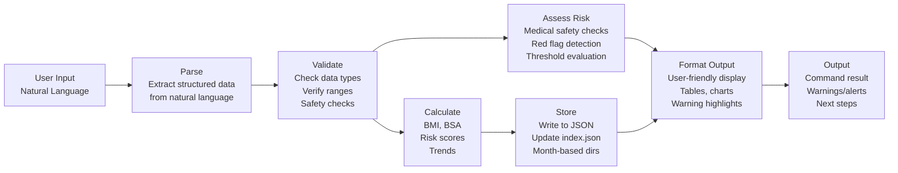

**Example: `/pregnancy weight 62.5` Command Processing:**

1. **Parse**: Extract weight value (62.5 kg) and current gestational week from `pregnancy-tracker.json`
2. **Validate**: Verify numeric value, check reasonable range (30-150 kg)
3. **Calculate**: 
   - Weight gain = 62.5 - pre-pregnancy weight
   - BMI = weight / height²
   - Recommended gain based on BMI and pregnancy type (singleton vs. multiples)
4. **Assess Risk**:
   - Compare actual gain vs. recommended range
   - Check for excessive gain (>0.5 kg/week in 2nd/3rd trimester)
   - Generate warnings if outside target range
5. **Store**: Append weight record to `weight_tracking` array in `pregnancy-tracker.json`
6. **Format**: Display weight, gain, BMI, target range, visual indicator (✓/⚠️)
7. **Output**: Present formatted data with any warnings or recommendations

**Risk Assessment Thresholds:**

| Health Domain | Red Flag Threshold | Action |
|--------------|-------------------|--------|
| **Pregnancy - EPDS** | Score ≥13 or Q10 ≥2 | ⚠️ Immediate referral for depression screening |
| **Pregnancy - BP** | ≥140/90 mmHg | ⚠️ Contact physician (preeclampsia risk) |
| **Postpartum - Bleeding** | >1 pad/hour | 🚨 Emergency - contact physician immediately |
| **Prostate - PSA Velocity** | >0.75 ng/mL/year | ⚠️ Urology consultation recommended |
| **Diabetes - Hypoglycemia** | <3.9 mmol/L | ⚠️ Log event, review medication timing |
| **Fall Risk - TUG** | >12 seconds | ⚠️ High fall risk, home safety assessment |
| **Drug Interaction** | Severity X | 🚨 Absolute contraindication - do not combine |

**Sources:** [README.md:136-146](), [todo/01-womens-health.md:195-222,372-397](), [todo/02-mens-health.md:28-176]()

---

## Testing Architecture

The system uses a native Shell + Python testing framework without external dependencies.

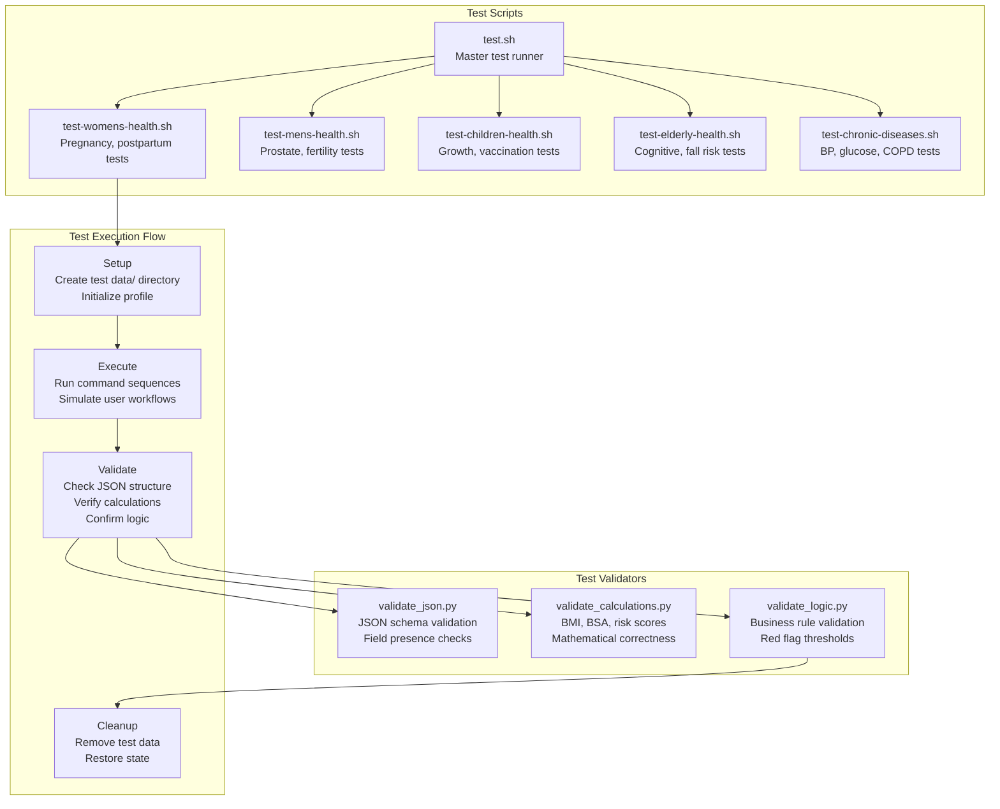

**Test Coverage by Module:**

| Module | Test Script | Test Cases | Validation Points |
|--------|------------|------------|-------------------|
| **Women's Health** | `test-womens-health.sh` | 21 | Pregnancy tracking, multi-fetal support, EPDS screening, postpartum recovery |
| **Men's Health** | `test-mens-health.sh` | 18 | PSA velocity, IPSS scoring, semen analysis, testosterone monitoring |
| **Children's Health** | `test-children-health.sh` | 15 | WHO growth standards, vaccination tracking, Tanner staging |
| **Elderly Health** | `test-elderly-health.sh` | 12 | MMSE/MoCA tests, fall risk (TUG/Berg), polypharmacy (Beers Criteria) |
| **Chronic Diseases** | `test-chronic-diseases.sh` | 14 | BP tracking (ASCVD), glucose monitoring (TIR), COPD (FEV1/CAT) |

**Test Execution:**
```bash
# Run all tests
./scripts/test.sh

# Run specific module tests
./scripts/test-womens-health.sh
./scripts/test-mens-health.sh
```

**Test Validation Approach:**
1. **Structural validation**: JSON schema compliance, required fields presence
2. **Calculation validation**: Mathematical correctness (BMI, BSA, risk scores)
3. **Logic validation**: Business rule enforcement (red flag thresholds, safety constraints)
4. **Integration validation**: Index updates, cross-reference integrity

**Sources:** [.claude/settings.local.json:20-33](), [todo/01-womens-health.md:296-302,401-410]()

---

## System Limitations and Disclaimers

**Medical Safety Boundaries:**

Claude-Ally-Health is designed for personal health information management and tracking only. The system explicitly:

- ❌ Does **NOT** provide medical diagnoses
- ❌ Does **NOT** prescribe medications or dosages
- ❌ Does **NOT** predict medical outcomes or prognosis
- ❌ Does **NOT** replace professional medical consultation

**Intended Use:**
- ✅ Personal health data organization and tracking
- ✅ Trend analysis and visualization
- ✅ Medical record digitization and storage
- ✅ Health metric calculations (BMI, risk scores)
- ✅ Medication adherence tracking
- ✅ Emergency information card generation

**Required Professional Consultation:**
All health decisions require consultation with licensed medical professionals:
- Diagnosis: Requires physician evaluation
- Treatment: Requires medical prescription
- Medication changes: Requires physician or pharmacist guidance
- Emergencies: Call emergency services (911/999/112)

**Data Accuracy:**
- User-entered data accuracy depends on correct input
- AI image recognition may have errors in medical report extraction
- Calculations use standard formulas but may not account for individual variations
- Risk scores are population-based estimates, not individual predictions

**External Service Disclosure:**
The system uses GLM's `mcp__4_5v_mcp__analyze_image` for medical report image recognition. This involves transmitting images to an external service. Users should review privacy implications before using this feature.

**Sources:** [README.md:149-159](), [README.zh-CN.md:148-158](), [README.md:17]()

---

# Page: Getting Started

# Getting Started

<details>
<summary>Relevant source files</summary>

The following files were used as context for generating this wiki page:

- [.claude/commands/get-profile.md](.claude/commands/get-profile.md)
- [.github/CONTRIBUTING.en.md](.github/CONTRIBUTING.en.md)
- [.github/SECURITY.en.md](.github/SECURITY.en.md)
- [README.md](README.md)
- [README.zh-CN.md](README.zh-CN.md)
- [docs/data-structures.md](docs/data-structures.md)

</details>


This document provides step-by-step instructions for setting up Claude-Ally-Health and performing initial configuration. It covers prerequisites, installation, first-time setup, and basic usage patterns to help you begin managing your personal health data.

For information about specific health tracking modules (pregnancy, diabetes, etc.), see [Health Tracking Modules](#4). For advanced features like multi-disciplinary consultations, see [AI Consultation System](#7).

---

## Purpose and Scope

This guide will help you:
- Install and configure Claude-Ally-Health on your local machine
- Set up your initial health profile
- Understand the file-based storage structure
- Execute your first commands
- Verify the system is working correctly

By the end of this guide, you will have a functioning local health information system ready to store medical reports, track health metrics, and provide AI-assisted analysis.

Sources: [README.md:99-109](), [README.zh-CN.md:98-109]()

---

## Prerequisites

### Required Software

Claude-Ally-Health operates entirely through the Claude Code CLI interface. Before beginning, ensure you have:

| Requirement | Description | Status Check |
|------------|-------------|--------------|
| **Claude Code** | Command-line interface for Claude AI | Must be installed and functional |
| **File System Access** | Read/write permissions to a local directory | Required for data storage |
| **Operating System** | Windows, macOS, or Linux | Any modern OS |

**Verification Steps:**

1. Open a terminal or command prompt
2. Navigate to your desired working directory
3. Verify Claude Code is accessible and you can execute commands

### Optional Components

| Component | Purpose | When Needed |
|-----------|---------|-------------|
| **GLM MCP Server** | Image recognition for medical reports | When using `/save-report` with images |
| **Disk Encryption** | Additional data security | Recommended for sensitive health data |
| **Backup Solution** | Data protection | Strongly recommended |

**Important Security Note:** The system stores all data locally in plain JSON files. Enable disk encryption (BitLocker on Windows, FileVault on macOS) to protect sensitive health information. See [Security & Privacy](#8.2) for detailed security practices.

Sources: [README.md:100-101](), [.github/SECURITY.en.md:63-84]()

---

## Installation & Project Setup

### Directory Structure Creation

Claude-Ally-Health uses a specific directory structure. The system will automatically create data directories when needed, but you must set up the command structure manually.

**Setup Diagram:**

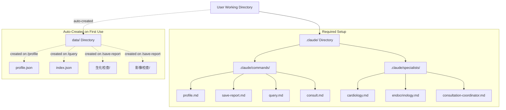

Sources: [README.md:42-90](), [README.zh-CN.md:41-89]()

**Installation Steps:**

1. **Clone or Download Repository:**
   ```bash
   git clone https://github.com/huifer/Claude-Ally-Health.git
   cd Claude-Ally-Health
   ```

2. **Verify Directory Structure:**
   The repository includes pre-configured command and specialist files in the `.claude/` directory. Verify these exist:
   - `.claude/commands/` - Contains all slash command definitions
   - `.claude/specialists/` - Contains AI specialist skill definitions

3. **Initialize Working Directory:**
   Open Claude Code in the project root directory. The `data/` directory will be created automatically on first use.

Sources: [README.md:40-90]()

---

## Initial Configuration

### User Profile Setup

The first step in using Claude-Ally-Health is establishing your basic health profile. This profile provides foundational data for all calculations and assessments.

**Profile Command Structure:**

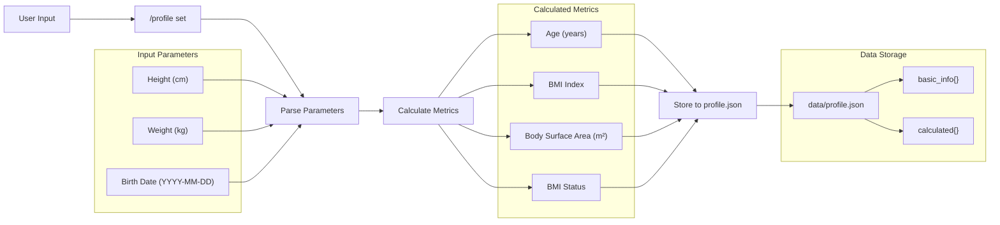

Sources: [.claude/commands/get-profile.md:1-156](), [docs/data-structures.md:98-132]()

**First-Time Setup Command:**

```bash
/profile set 175 70 1990-01-01
```

**Parameter Specification:**

| Position | Parameter | Type | Format | Example | Validation |
|----------|-----------|------|--------|---------|------------|
| 1 | Height | Integer | Centimeters | 175 | 50-250 cm |
| 2 | Weight | Number | Kilograms | 70 | 20-300 kg |
| 3 | Birth Date | String | YYYY-MM-DD | 1990-01-01 | Valid date, not future |

**Generated Data Structure:**

The profile command creates [data/profile.json]() with the following structure:

```json
{
  "basic_info": {
    "height": 175,
    "height_unit": "cm",
    "weight": 70,
    "weight_unit": "kg",
    "birth_date": "1990-01-01"
  },
  "calculated": {
    "age": 35,
    "bmi": 22.9,
    "bmi_status": "正常",
    "body_surface_area": 1.85,
    "bsa_unit": "m²"
  }
}
```

**Key Calculated Metrics:**

- **BMI (Body Mass Index):** Weight (kg) / [Height (m)]² - Used for nutritional assessment
- **BSA (Body Surface Area):** Calculated using Mosteller formula - Critical for radiation dose adjustments
- **Age:** Automatically calculated from birth date - Used for age-specific reference ranges

**Verification:**

Execute the following command to verify profile creation:

```bash
/get-profile
```

This displays a formatted visualization of your profile data as defined in [.claude/commands/get-profile.md:23-60]().

Sources: [README.md:103](), [.claude/commands/get-profile.md:1-156](), [docs/data-structures.md:98-132]()

---

## Understanding the File Structure

### Data Directory Organization

Claude-Ally-Health uses a hierarchical file system structure for data storage. Understanding this organization is essential for troubleshooting and data management.

**Data Directory Hierarchy:**

```mermaid
graph TB
    Root["data/"]
    
    subgraph "Core Files"
        Profile["profile.json<br/>User basic parameters"]
        Index["index.json<br/>Global catalog"]
        Allergies["allergies.json<br/>Allergy history"]
        Radiation["radiation-records.json<br/>Exposure tracking"]
    end
    
    subgraph "Medical Examinations"
        Biochem["生化检查/<br/>Biochemical tests"]
        BiochemMonth["YYYY-MM/<br/>Month directories"]
        BiochemFile["YYYY-MM-DD_test_name.json"]
        
        Imaging["影像检查/<br/>Medical imaging"]
        ImagingMonth["YYYY-MM/<br/>Month directories"]
        ImagingFile["YYYY-MM-DD_test_name_part.json"]
        ImagingImg["images/<br/>Original image backup"]
    end
    
    subgraph "Medications"
        MedDir["medications/"]
        MedFile["medications.json<br/>Active medication list"]
        MedLogs["medication-logs/<br/>Daily adherence records"]
        
        IntDir["interactions/"]
        IntDB["interaction-db.json<br/>Interaction rules"]
        IntLogs["interaction-logs/<br/>Check history"]
    end
    
    subgraph "Health Tracking"
        Pregnancy["pregnancy-tracker.json<br/>Pregnancy data"]
        Postpartum["postpartum-tracker.json<br/>Postpartum care"]
        Chronic["chronic-disease-trackers/<br/>hypertension.json<br/>diabetes.json<br/>copd.json"]
    end
    
    Root --> Profile
    Root --> Index
    Root --> Allergies
    Root --> Radiation
    
    Root --> Biochem
    Biochem --> BiochemMonth
    BiochemMonth --> BiochemFile
    
    Root --> Imaging
    Imaging --> ImagingMonth
    ImagingMonth --> ImagingFile
    ImagingMonth --> ImagingImg
    
    Root --> MedDir
    MedDir --> MedFile
    MedDir --> MedLogs
    
    Root --> IntDir
    IntDir --> IntDB
    IntDir --> IntLogs
    
    Root --> Pregnancy
    Root --> Postpartum
    Root --> Chronic
```

Sources: [README.md:67-89](), [README.zh-CN.md:66-88]()

**Directory Purposes:**

| Directory | Purpose | File Format | Auto-Created |
|-----------|---------|-------------|--------------|
| `data/` | Root data directory | N/A | Yes |
| `data/生化检查/` | Biochemical test results | JSON | On first `/save-report` |
| `data/影像检查/` | Medical imaging reports | JSON + Images | On first `/save-report` |
| `data/medications/` | Medication management | JSON | On first `/medication` |
| `data/interactions/` | Drug interaction database | JSON | Pre-configured |
| `data/pregnancy-tracker.json` | Pregnancy tracking | JSON | On `/pregnancy start` |
| `data/hypertension-tracker.json` | Blood pressure data | JSON | On first `/bp record` |

**Month-Based Organization:**

Medical examination data uses month-based subdirectories (`YYYY-MM/`) to organize historical records efficiently. This structure enables:

- Fast queries by date range
- Easy archival of old data
- Reduced file system overhead

**Example File Paths:**

```
data/生化检查/2025-12/2025-12-31_血常规.json
data/影像检查/2025-12/2025-12-31_胸部CT_胸部.json
data/影像检查/2025-12/images/original_20251231123456.jpg
data/medications/medication-logs/2025-12/2025-12-31.json
```

Sources: [README.md:67-89](), [docs/data-structures.md:1-510]()

### Index File Structure

The [data/index.json]() file serves as a global catalog of all medical records, enabling efficient queries across multiple data sources.

**Index Organization:**

```json
{
  "biochemical_exams": [
    {
      "id": "20251231123456789",
      "date": "2025-12-31",
      "type": "生化检查",
      "file_path": "data/生化检查/2025-12/2025-12-31_血常规.json"
    }
  ],
  "imaging_exams": [
    {
      "id": "20251231123456789",
      "date": "2025-12-31",
      "type": "影像检查",
      "subtype": "CT",
      "file_path": "data/影像检查/2025-12/2025-12-31_胸部CT_胸部.json"
    }
  ],
  "last_updated": "2025-12-31T12:34:56.789Z"
}
```

The index is automatically maintained by commands that create or modify data files. You never need to edit it manually.

Sources: [docs/data-structures.md:133-163]()

---

## Basic Workflow

### Command Execution Patterns

All operations in Claude-Ally-Health follow a consistent command → process → store → respond pattern.

**Command Processing Flow:**

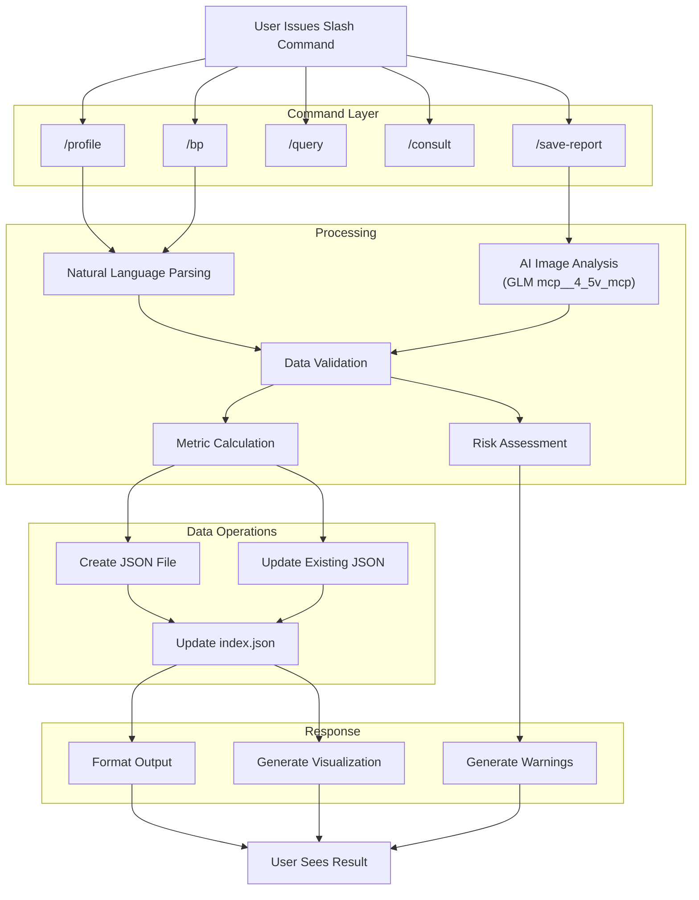

Sources: [README.md:118-133]()

### Common First Commands

After setting up your profile, execute these commands to familiarize yourself with the system:

**1. Save a Medical Report**

```bash
/save-report /path/to/blood_test.jpg
```

This command:
- Invokes AI image recognition via GLM MCP server
- Extracts biochemical test values and reference ranges
- Creates a JSON file in `data/生化检查/YYYY-MM/`
- Updates `data/index.json` catalog
- Returns formatted test results with abnormal value highlighting

Command definition: [.claude/commands/save-report.md]()

**2. Query All Records**

```bash
/query all
```

Returns a chronological list of all medical records from [data/index.json]().

Command definition: [.claude/commands/query.md]()

**3. Record Blood Pressure**

```bash
/bp record 120/80
```

Creates or updates [data/hypertension-tracker.json]() with:
- Systolic/diastolic readings
- Timestamp
- ACOG classification (Normal/Elevated/Stage 1/Stage 2)
- Trend analysis if multiple readings exist

See [Hypertension Management](#4.5.1) for detailed tracking features.

**4. Check Drug Interactions**

```bash
/interaction check
```

Analyzes current medications in [data/medications/medications.json]() against the interaction database in [data/interactions/interaction-db.json](), checking for:
- Drug-drug interactions
- Drug-disease interactions
- Drug-dose warnings
- Drug-food interactions

Returns severity-graded warnings (A/B/C/D/X levels). Command definition: [.claude/commands/interaction.md]()

**5. View User Profile**

```bash
/get-profile
```

Displays formatted visualization of [data/profile.json]() including BMI status and body surface area calculations.

Sources: [README.md:99-109](), [README.md:118-133]()

---

## Verification & Testing

### System Health Check

After initial setup, verify the system is functioning correctly:

**Verification Command Sequence:**

| Step | Command | Expected Behavior | Verification File |
|------|---------|-------------------|-------------------|
| 1 | `/profile set 175 70 1990-01-01` | Profile created successfully | `data/profile.json` exists |
| 2 | `/get-profile` | Displays formatted profile with BMI 22.9 | Visual output shows calculated metrics |
| 3 | `/query all` | Returns empty list or existing records | `data/index.json` exists |
| 4 | `/bp record 120/80` | Creates hypertension tracker | `data/hypertension-tracker.json` exists |
| 5 | `/query all` | Returns blood pressure record | Index shows hypertension entry |

**File System Verification:**

After executing the above commands, verify the following files exist:

```
data/
├── profile.json
├── index.json
└── hypertension-tracker.json
```

**Common Issues:**

| Issue | Symptom | Solution |
|-------|---------|----------|
| Commands not recognized | "Command not found" error | Verify `.claude/commands/` directory exists |
| Data not saving | No files created in `data/` | Check write permissions on working directory |
| Image recognition failing | "Cannot analyze image" | Verify GLM MCP server is configured |
| Profile calculation errors | Incorrect BMI/BSA values | Check input parameter formats |

Sources: [README.md:99-109](), [.github/SECURITY.en.md:106-115]()

---

## Understanding Data Privacy

### Local-Only Storage Model

Claude-Ally-Health implements a **zero-cloud** architecture where all data remains on your local machine.

**Privacy Architecture:**

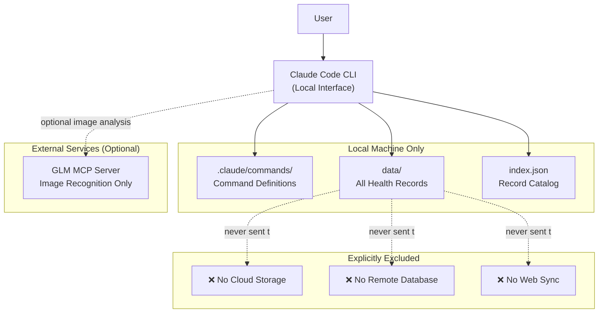

Sources: [README.md:111-116](), [.github/SECURITY.en.md:54-84]()

**Security Features:**

1. **Local Storage:** All JSON files stored in `data/` directory on local file system
2. **No Cloud Sync:** System never uploads data to external services
3. **No External Database:** Pure file-based storage, no network connections
4. **Git Exclusion:** `.gitignore` prevents accidental commits of `data/` directory
5. **OS-Level Protection:** Relies on operating system access controls and disk encryption

**Single Exception:**

When using the `/save-report` command with image files, the system may call external AI services (GLM MCP server) for image recognition. The original image is sent to the service for analysis, then results are stored locally. This is documented in [README.md:17]() and [README.zh-CN.md:17]().

**Recommended Security Practices:**

- Enable disk encryption (BitLocker/FileVault/LUKS)
- Use strong computer account passwords
- Regularly backup the `data/` directory to encrypted storage
- Verify `.gitignore` excludes `data/` before committing code changes
- Review security policy: [.github/SECURITY.en.md]()

Sources: [README.md:111-116](), [.github/SECURITY.en.md:54-99]()

---

## Next Steps

After completing initial setup, explore these capabilities:

### Core Features to Explore

| Feature | Documentation | Command |
|---------|---------------|---------|
| **Medical Report Management** | [Saving Medical Reports](#5.1) | `/save-report` |
| **Query System** | [Querying Health Records](#5.2) | `/query` |
| **Emergency Information** | [Emergency Medical Information Card](#5.3) | `/emergency-card` |
| **Drug Safety** | [Drug Interaction Detection](#6.1) | `/interaction` |
| **AI Consultations** | [AI Consultation System](#7) | `/consult` |

### Health Domain Modules

Depending on your health management needs, explore specialized tracking modules:

| Life Stage | Module | Documentation |
|------------|--------|---------------|
| Women | Pregnancy, Postpartum, Menopause | [Women's Health](#4.1) |
| Men | Prostate, Fertility, Andropause | [Men's Health](#4.2) |
| Child | Growth, Vaccination, Puberty | [Child & Adolescent Health](#4.3) |
| Elderly | Cognitive, Fall Risk, Polypharmacy | [Elderly Health](#4.4) |
| Chronic Disease | Hypertension, Diabetes, COPD | [Chronic Disease Management](#4.5) |

### Advanced Topics

- **User Profile Management:** See [User Profile Setup](#2.1) for detailed profile configuration
- **Data Storage Architecture:** See [Data Storage & Privacy Model](#3.2)
- **Multi-Disciplinary Consultations:** See [Multi-Disciplinary Team (MDT) Consultation](#7.1)
- **Contributing to the Project:** See [Development & Contributing](#8)

### Learning Resources

- **Full User Guide:** Comprehensive command documentation in [docs/user-guide.md]() (Chinese) or [docs/user-guide.en.md]() (English)
- **Data Structure Reference:** Complete JSON schemas in [docs/data-structures.md]()
- **Medical Safety Principles:** Critical safety information in [docs/safety-guidelines.md]() (Chinese)

Sources: [README.md:92-97](), [README.md:118-133]()

---

## Quick Reference

### Essential Commands

```bash
# Profile Management
/profile set [height] [weight] [birth_date]  # Create/update profile
/get-profile                                  # View profile

# Medical Records
/save-report [image_path]                     # Save medical report
/query all                                    # List all records
/query recent                                 # Recent records

# Health Tracking
/bp record [systolic/diastolic]               # Blood pressure
/glucose record [value]                       # Blood glucose
/pregnancy start                              # Start pregnancy tracking

# Safety & Medication
/interaction check                            # Check drug interactions
/allergy add [allergen]                       # Record allergy

# AI Consultation
/consult                                      # Multi-disciplinary consultation
/specialist [specialty]                       # Single specialist consultation
```

### Data File Locations

```bash
data/profile.json                             # User profile
data/index.json                               # Global catalog
data/生化检查/YYYY-MM/                         # Biochemical tests
data/影像检查/YYYY-MM/                         # Imaging reports
data/medications/medications.json             # Active medications
data/interactions/interaction-db.json         # Interaction rules
data/[condition]-tracker.json                 # Condition-specific trackers
```

### Support Resources

- **GitHub Repository:** https://github.com/huifer/Claude-Ally-Health
- **Issue Tracker:** https://github.com/huifer/Claude-Ally-Health/issues
- **Security Contact:** huifer97@163.com
- **Developer:** WellAlly Tech (https://www.wellally.tech)

Sources: [README.md:1-190](), [.github/SECURITY.en.md:129-131]()

---

# Page: User Profile Setup

# User Profile Setup

<details>
<summary>Relevant source files</summary>

The following files were used as context for generating this wiki page:

- [.claude/commands/get-profile.md](.claude/commands/get-profile.md)
- [.github/CONTRIBUTING.en.md](.github/CONTRIBUTING.en.md)
- [.github/SECURITY.en.md](.github/SECURITY.en.md)
- [README.md](README.md)
- [README.zh-CN.md](README.zh-CN.md)
- [docs/data-structures.md](docs/data-structures.md)

</details>


## Purpose and Scope

This document explains the user profile management system in Claude-Ally-Health, which stores and manages basic health parameters including height, weight, birth date, and automatically calculated metrics such as BMI (Body Mass Index) and BSA (Body Surface Area). The profile serves as foundational data used throughout the system for medical calculations, radiation dose adjustments, and emergency information generation.

For information about emergency information cards that aggregate profile data with other health records, see [Emergency Medical Information Card](#5.3).

**Sources:** [README.md:103](), [README.md:122]()

---

## Profile Data Structure

The user profile is stored as a JSON file at `data/profile.json` with two primary sections: basic information entered by the user and calculated metrics derived from that information.

### JSON Schema

```json
{
  "basic_info": {
    "height": 175,
    "height_unit": "cm",
    "weight": 70,
    "weight_unit": "kg",
    "birth_date": "1990-01-01"
  },
  "calculated": {
    "age": 35,
    "bmi": 22.9,
    "bmi_status": "正常",
    "body_surface_area": 1.85,
    "bsa_unit": "m²"
  }
}
```

### Field Definitions

| Field | Type | Description | Source |
|-------|------|-------------|--------|
| `basic_info.height` | Number | User height value | User input |
| `basic_info.height_unit` | String | Unit of measurement, always "cm" | System default |
| `basic_info.weight` | Number | User weight value | User input |
| `basic_info.weight_unit` | String | Unit of measurement, always "kg" | System default |
| `basic_info.birth_date` | String | Date in YYYY-MM-DD format | User input |
| `calculated.age` | Number | Age in years | Calculated from birth_date |
| `calculated.bmi` | Number | Body Mass Index | Calculated: weight/(height/100)² |
| `calculated.bmi_status` | String | BMI classification (偏瘦/正常/超重/肥胖) | Derived from BMI |
| `calculated.body_surface_area` | Number | Body surface area in m² | Mosteller formula |
| `calculated.bsa_unit` | String | Unit, always "m²" | System default |

**Sources:** [docs/data-structures.md:100-132]()

---

## Profile Command Interface

### Command: `/profile set`

The `/profile` command is defined in `.claude/commands/profile.md` and provides functionality for setting user profile parameters.

**Syntax:**
```
/profile set <height> <weight> <birth_date>
```

**Parameters:**
- `height`: Height in centimeters (integer)
- `weight`: Weight in kilograms (number, can include decimals)
- `birth_date`: Date of birth in YYYY-MM-DD format

**Example:**
```bash
/profile set 175 70 1990-01-01
```

This creates or updates the profile with:
- Height: 175 cm
- Weight: 70 kg  
- Birth Date: January 1, 1990

### Command: `/get-profile`

The `/get-profile` command is defined in `.claude/commands/get-profile.md` and displays the user's profile information with calculated metrics and visualization.

**Syntax:**
```
/get-profile
```

**Output:** The command generates a formatted display showing:
- Basic information (height, weight, birth date, age)
- BMI with visual indicator on a scale
- Body surface area
- Record metadata (creation date, last update)
- Weight history trend (if available)

**Sources:** [README.md:103](), [.claude/commands/get-profile.md:1-156]()

---

## Profile Data Flow

### Diagram: Profile Command Processing Pipeline

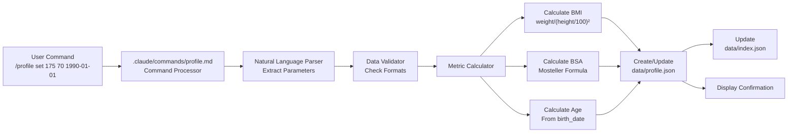

**Sources:** [README.md:103](), [README.md:140-144](), [docs/data-structures.md:100-132]()

### Diagram: Profile Data Usage Across System

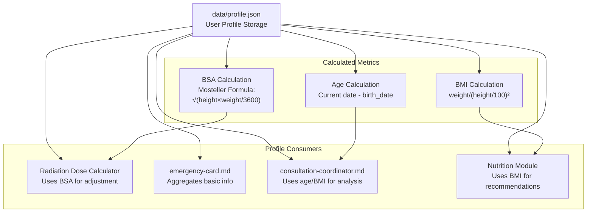

**Sources:** [README.md:42-88](), [.claude/commands/get-profile.md:48-49]()

---

## Calculated Health Metrics

### Body Mass Index (BMI)

BMI is calculated using the formula:
```
BMI = weight (kg) / [height (m)]²
```

The system automatically categorizes BMI values using Chinese health standards:

| BMI Range | Status | Classification |
|-----------|--------|----------------|
| < 18.5 | 偏瘦 | Underweight |
| 18.5 - 23.9 | 正常 | Normal |
| 24.0 - 27.9 | 超重 | Overweight |
| ≥ 28.0 | 肥胖 | Obese |

**Implementation Note:** The BMI status is recalculated every time the profile is queried or updated to ensure accuracy with current weight values.

**Sources:** [.claude/commands/get-profile.md:107-113](), [docs/data-structures.md:127-130]()

### Body Surface Area (BSA)

BSA is calculated using the Mosteller formula:
```
BSA (m²) = √[(height (cm) × weight (kg)) / 3600]
```

**Purpose:** BSA is a critical metric used throughout the system for:
- **Radiation Dose Adjustment**: Different body sizes result in different effective radiation doses for the same imaging procedure. The radiation tracking system uses BSA to calculate adjustment factors and actual doses received.
- **Medication Dosing**: Some medications (particularly chemotherapy) are dosed based on BSA rather than weight.
- **Physiological Calculations**: BSA is used in various physiological calculations across medical specialties.

The BSA value is stored in `calculated.body_surface_area` and updated automatically whenever height or weight changes.

**Sources:** [docs/data-structures.md:130-131](), [.claude/commands/get-profile.md:118-123](), [docs/data-structures.md:80-97]()

---

## Profile Storage and File Management

### File Location

The profile is stored at:
```
data/profile.json
```

This file is excluded from version control via `.gitignore` to maintain data privacy.

### Directory Structure Context

```
my-his/
├── .claude/
│   └── commands/
│       ├── profile.md          # Profile set command
│       └── get-profile.md      # Profile query command
└── data/
    ├── profile.json            # User profile storage
    └── index.json              # Global catalog (references profile)
```

**Sources:** [README.md:40-90](), [docs/data-structures.md:99-132]()

### Data Privacy Protections

The profile system implements privacy-first design:

1. **Local Storage Only**: All data remains on the local filesystem with no cloud synchronization.
2. **Version Control Exclusion**: The `data/` directory is excluded via `.gitignore` to prevent accidental commits.
3. **No External Dependencies**: Profile data never leaves the local machine except when explicitly using optional AI image analysis features.

**Sources:** [README.md:111-116](), [.github/SECURITY.en.md:54-84]()

---

## Profile Update Workflow

### Diagram: Profile Creation and Update Lifecycle

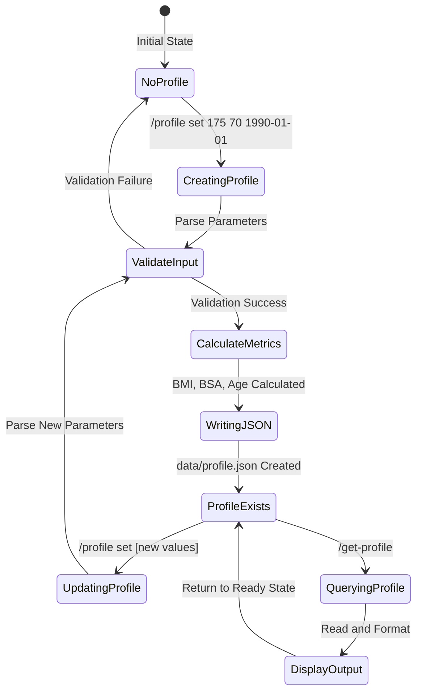

**Sources:** [README.md:103](), [.claude/commands/get-profile.md:12-17]()

### Update History Tracking

The profile system can optionally maintain a `history` array for tracking weight changes over time:

```json
{
  "basic_info": { ... },
  "calculated": { ... },
  "history": [
    {
      "date": "2025-12-31",
      "weight": 70.0,
      "bmi": 22.9
    },
    {
      "date": "2025-11-15", 
      "weight": 71.5,
      "bmi": 23.4
    }
  ]
}
```

When history data exists, the `/get-profile` command displays weight trends showing the most recent 5 entries with calculated BMI and percentage change.

**Sources:** [.claude/commands/get-profile.md:127-142]()

---

## Integration with Other System Components

### Profile as Foundation Data

The user profile serves as foundational data referenced by multiple system components:

| Component | Uses Profile For | Specific Fields Used |
|-----------|------------------|---------------------|
| Radiation Tracking | Dose adjustment calculations | `body_surface_area` |
| Emergency Card | Basic patient identification | `height`, `weight`, `birth_date`, `age` |
| MDT Consultation | Age-appropriate medical analysis | `age`, `bmi` |
| Nutrition Tracking | BMI-based recommendations | `bmi`, `bmi_status` |
| Child Health Modules | Age-appropriate assessments | `birth_date`, `age` |
| Elderly Health Modules | Geriatric-specific analysis | `age` |

### Global Index Integration

When the profile is created or updated, the system updates `data/index.json` to maintain a global catalog. While the index primarily tracks medical records, it also stores profile metadata for quick access without reading the full profile file.

**Sources:** [README.md:31-38](), [docs/data-structures.md:133-163]()

---

## Profile Validation Rules

The profile command processor implements the following validation rules:

### Height Validation
- **Range**: 50 cm - 250 cm
- **Type**: Integer
- **Purpose**: Ensure physiologically plausible values

### Weight Validation  
- **Range**: 2 kg - 300 kg
- **Type**: Number (decimals allowed)
- **Purpose**: Support pediatric to adult ranges

### Birth Date Validation
- **Format**: YYYY-MM-DD (ISO 8601)
- **Range**: Must be in the past
- **Maximum Age**: Typically validated to not exceed 150 years
- **Purpose**: Prevent future dates and implausible ages

**Sources:** [.claude/commands/get-profile.md:15-17]()

---

## Common Operations

### Initial Profile Setup
```bash
# First time usage
/profile set 175 70 1990-01-01
```

### Updating Weight Only
```bash
# When weight changes, re-run with current height and birth date
/profile set 175 68.5 1990-01-01
```

### Viewing Current Profile
```bash
/get-profile
```

### Viewing Profile with History
If weight history is tracked, the `/get-profile` command automatically displays trends when the `history` array contains data.

**Sources:** [README.md:103](), [.claude/commands/get-profile.md:145-155]()

---

## Error Handling

### Profile Not Found
When `/get-profile` is executed before profile setup:

```
┌────────────────────────────────────────────┐
│         ⚠️  数据未设置                      │
├────────────────────────────────────────────┤
│                                            │
│  还未设置个人健康档案信息                   │
│  请使用以下命令设置：                       │
│  /profile set 175 70 1990-01-01            │
│                                            │
└────────────────────────────────────────────┘
```

### Incomplete Data
When some profile fields are missing, the system displays available data with placeholders for missing values and prompts for completion.

**Sources:** [.claude/commands/get-profile.md:84-101]()

---

# Page: Core Architecture

# Core Architecture

<details>
<summary>Relevant source files</summary>

The following files were used as context for generating this wiki page:

- [.claude/commands/query.md](.claude/commands/query.md)
- [.claude/commands/save-report.md](.claude/commands/save-report.md)
- [.gitignore](.gitignore)
- [README.md](README.md)
- [README.zh-CN.md](README.zh-CN.md)
- [docs/data-structures.md](docs/data-structures.md)

</details>


## Purpose and Scope

This document describes the fundamental architectural design of Claude-Ally-Health, including its three-layer architecture (Command Interface, Data Storage, AI Specialist Framework), command processing pipeline, and data flow patterns. For specific health tracking modules and their implementations, see [Health Tracking Modules](#4). For setup and basic usage, see [Getting Started](#2).

## System Overview

Claude-Ally-Health implements a three-layer architecture built on Claude Code's slash command system and local file storage. The system operates entirely locally with no cloud dependencies, processing user commands through a structured pipeline that coordinates data operations and AI specialist analysis.

### Architectural Layers

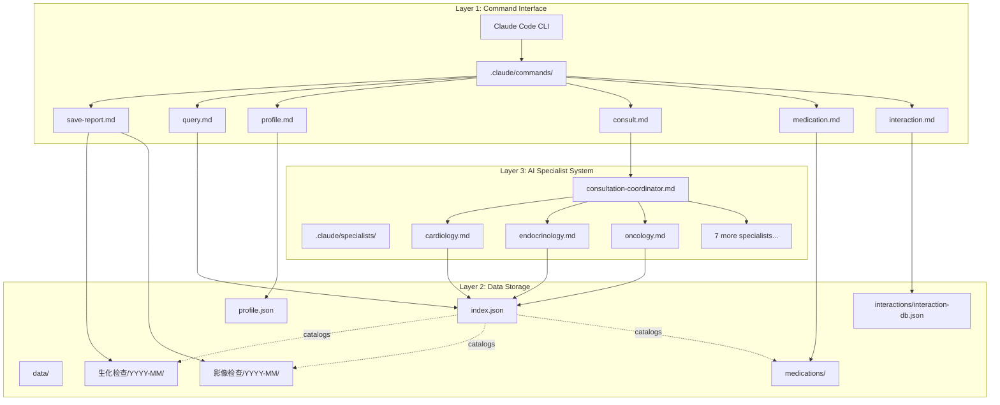

**Sources:** [README.md:40-90](), [.gitignore:1-17]()

| Layer | Location | Purpose | Key Components |
|-------|----------|---------|----------------|
| **Command Interface** | `.claude/commands/` | User interaction via slash commands | `save-report.md`, `query.md`, `profile.md`, `consult.md`, `medication.md`, `interaction.md` |
| **Data Storage** | `data/` | Local JSON file storage with month-based directories | `index.json`, `profile.json`, `生化检查/`, `影像检查/`, `medications/`, `interactions/` |
| **AI Specialist System** | `.claude/specialists/` | Domain-specific medical analysis | `consultation-coordinator.md`, 10+ specialist skill files |

**Sources:** [README.md:40-90](), [README.zh-CN.md:39-89]()

## Command Processing Pipeline

The system processes user commands through a structured five-stage pipeline: Parse → Validate → Process → Store → Output. Each command defined in `.claude/commands/` follows this pattern.

### Command Execution Flow

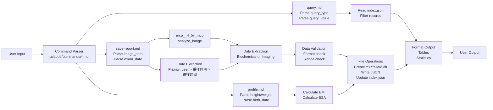

**Sources:** [.claude/commands/save-report.md:1-407](), [.claude/commands/query.md:1-104]()

### Command Argument Processing

Commands use a declarative YAML front-matter format for argument specification. The system parses these arguments from natural language input.

**Example from `save-report.md`:**
```yaml
---
arguments:
  - name: image_path
    description: 检查单图片的本地路径
    required: true
  - name: exam_date
    description: 检查日期（格式：YYYY-MM-DD）
    required: false
---
```

**Date Priority Resolution** (used in `save-report.md`):
1. User-provided `exam_date` parameter (highest priority)
2. 采样时间 (sample collection time) from image
3. 送样时间 (sample submission time) from image  
4. 检测时间/报告时间 (test/report time) from image
5. Other date identifiers from image
6. Current date (fallback only)

**Sources:** [.claude/commands/save-report.md:1-25](), [.claude/commands/save-report.md:63-76]()

### Image Recognition Integration

The `save-report` command integrates with GLM's MCP server (`mcp__4_5v_mcp__analyze_image`) for medical report extraction. Different report types use specialized prompts.

**Report Type Detection:**
- **生化检查 (Biochemical)**: Blood tests, urine analysis → extracts items with values, units, reference ranges
- **影像检查 (Imaging)**: B超, CT, MRI, X光, etc. → extracts findings, measurements, conclusions

**Specialized Imaging Templates** (9 types):
1. B超/彩超 - extracts TI-RADS grading, nodule sizes
2. X光 - extracts fracture lines, density descriptions
3. CT - extracts CT values (HU), RECIST assessments
4. MRI - extracts ADC values, BI-RADS/PI-RADS grading
5. 内窥镜 - extracts polyp location, Paris classification
6. 病理 - extracts TNM staging, immunohistochemistry
7. 心电图 - extracts PR/QRS/QT intervals, heart rate
8. 乳腺钼靶 - extracts BI-RADS 0-6 classification
9. PET-CT - extracts SUVmax, metabolic tumor volume

**Sources:** [.claude/commands/save-report.md:205-380](), [README.md:17]()

## Data Storage Architecture

The system uses a hierarchical file-based storage model with month-based directories and a global index for efficient queries.

### Directory Structure and File Organization

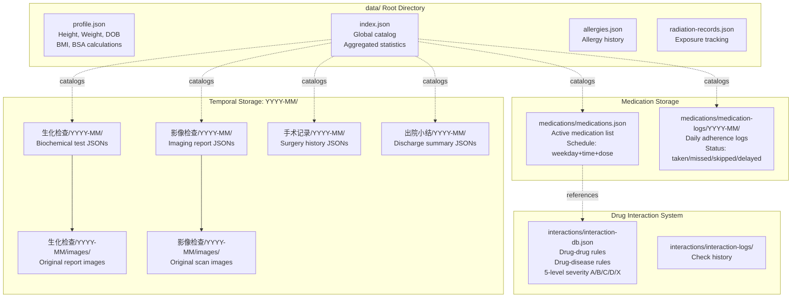

**Sources:** [README.md:40-90](), [docs/data-structures.md:1-509]()

### File Naming Conventions

| Data Type | Path Format | Example |
|-----------|-------------|---------|
| Biochemical Tests | `data/生化检查/YYYY-MM/YYYY-MM-DD_test_name.json` | `data/生化检查/2025-10/2025-10-07_血液常规.json` |
| Imaging Reports | `data/影像检查/YYYY-MM/YYYY-MM-DD_test_name_body_part.json` | `data/影像检查/2025-10/2025-10-07_B超_甲状腺.json` |
| Surgery Records | `data/手术记录/YYYY-MM/YYYY-MM-DD_surgery_name.json` | `data/手术记录/2025-08/2025-08-15_胆囊切除.json` |
| Discharge Summaries | `data/出院小结/YYYY-MM/YYYY-MM-DD_main_diagnosis.json` | `data/出院小结/2025-08/2025-08-20_胆囊结石.json` |
| Medication Logs | `data/medications/medication-logs/YYYY-MM/YYYY-MM-DD.json` | `data/medications/medication-logs/2025-12/2025-12-31.json` |

**Sources:** [README.md:66-88](), [docs/data-structures.md:98-101]()

### Data Structure Specifications

**`index.json` Global Catalog:**
```json
{
  "biochemical_exams": [
    {
      "id": "20251231123456789",
      "date": "2025-12-31",
      "type": "生化检查",
      "file_path": "data/生化检查/2025-12/2025-12-31_血常规.json"
    }
  ],
  "imaging_exams": [...],
  "medications": [...],
  "medication_logs": [...],
  "last_updated": "2025-12-31T12:34:56.789Z"
}
```

**Biochemical Test Record:**
```json
{
  "id": "{{timestamp}}",
  "type": "生化检查",
  "date": "YYYY-MM-DD",
  "hospital": "医院名称",
  "original_image": "images/{{filename}}",
  "items": [
    {
      "name": "检查项目",
      "value": "数值",
      "unit": "单位",
      "min_ref": "最小值",
      "max_ref": "最大值",
      "is_abnormal": true/false
    }
  ]
}
```

**Imaging Report Record with Target Tracking:**
```json
{
  "id": "{{timestamp}}",
  "type": "影像检查",
  "subtype": "B超/CT/MRI/X光",
  "date": "YYYY-MM-DD",
  "body_part": "检查部位",
  "findings": {
    "description": "描述",
    "targets": [
      {
        "name": "结节/病灶名称",
        "location": "具体位置",
        "size": {
          "length": "长径",
          "width": "短径",
          "unit": "mm/cm"
        },
        "characteristics": {
          "morphology": "形态",
          "border": "边界",
          "density": "密度/回声"
        }
      }
    ],
    "measurements": {},
    "conclusion": "结论"
  }
}
```

**Sources:** [docs/data-structures.md:133-161](), [docs/data-structures.md:3-70](), [.claude/commands/save-report.md:98-160]()

### Medication Schedule Structure

The medication system uses explicit `schedule` arrays that define every dose for every day of the week.

**Schedule Generation Rules:**
- Daily 1x: 7 records (Monday-Sunday, 1 time each)
- Daily 2x: 14 records (Monday-Sunday, 2 times each)
- Daily 3x: 21 records (Monday-Sunday, 3 times each)
- Every other day: 4 records (specific weekdays)
- Weekly: 1 record (specific weekday)

**Example - Daily 2x medication:**
```json
{
  "id": "med_20251231123456789",
  "name": "阿司匹林",
  "dosage": {"value": 100, "unit": "mg"},
  "frequency": {"type": "daily", "times_per_day": 2},
  "schedule": [
    {"weekday": 1, "time": "08:00", "timing_label": "早餐后", "dose": {"value": 100, "unit": "mg"}},
    {"weekday": 1, "time": "20:00", "timing_label": "晚餐后", "dose": {"value": 100, "unit": "mg"}},
    {"weekday": 2, "time": "08:00", "timing_label": "早餐后", "dose": {"value": 100, "unit": "mg"}},
    {"weekday": 2, "time": "20:00", "timing_label": "晚餐后", "dose": {"value": 100, "unit": "mg"}},
    // ... continues for all 7 days = 14 records total
  ]
}
```

**Adherence Status Values:**
- `taken`: Taken on time or with delay
- `missed`: Not taken when scheduled
- `skipped`: Intentionally skipped per medical instruction
- `delayed`: Taken but later than scheduled time

**Adherence Calculation:**
```
Adherence % = (taken + delayed) / (total_scheduled - skipped) × 100
```

**Sources:** [docs/data-structures.md:277-474]()

### Privacy Protection Mechanisms

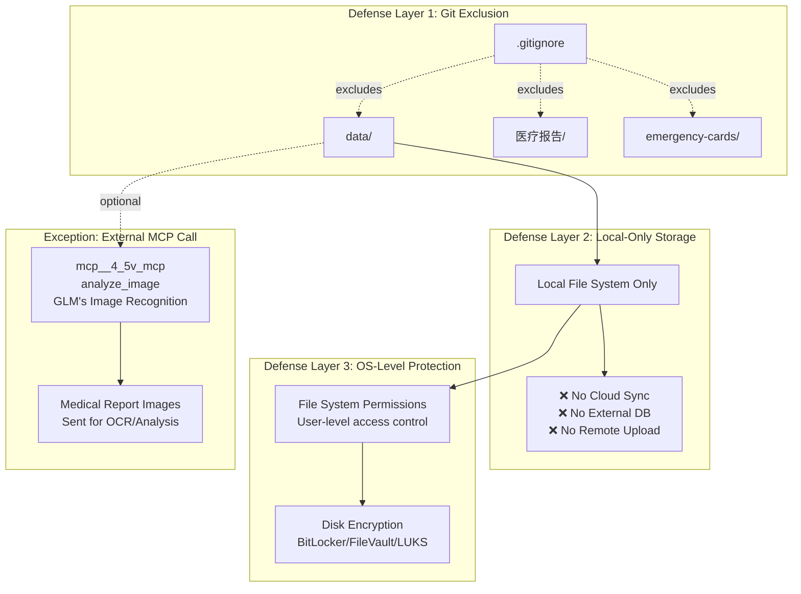

**`.gitignore` Exclusions:**
```
data/
医疗报告/
emergency-cards/*
*.tmp
*.log
```

**Privacy Guarantee:**
All health data remains on the local machine in the `data/` directory. The only exception is optional use of `mcp__4_5v_mcp__analyze_image` for image recognition, which sends report images to GLM's MCP server. Users can avoid this by manually entering data.

**Sources:** [.gitignore:1-17](), [README.md:111-116](), [README.zh-CN.md:110-115]()

## AI Specialist Framework

The system implements a subagent architecture where specialized AI "doctors" provide domain-specific medical analysis. This framework operates through two mechanisms: Multi-Disciplinary Team (MDT) consultations and individual specialist consultations.

### Specialist Skill Architecture

```mermaid
graph TB
    subgraph "Command Entry Points"
        ConsultCmd["/consult command<br/>consult.md"]
        SpecialistCmd["/specialist command<br/>specialist.md"]
    end
    
    subgraph "Coordination Layer"
        Coordinator[".claude/specialists/<br/>consultation-coordinator.md<br/>Data aggregation<br/>Parallel dispatch<br/>Opinion integration"]
    end
    
    subgraph "Medical Specialist Skills"
        Cardiology[".claude/specialists/cardiology.md<br/>Lipids, BP, ECG, ASCVD"]
        Endocrinology[".claude/specialists/endocrinology.md<br/>Glucose, HbA1c, Thyroid, Hormones"]
        Gastroenterology[".claude/specialists/gastroenterology.md<br/>Liver enzymes, Endoscopy, GI imaging"]
        Nephrology[".claude/specialists/nephrology.md<br/>Creatinine, eGFR, Electrolytes"]
        Hematology[".claude/specialists/hematology.md<br/>CBC, Coagulation, Blood smear"]
        Respiratory[".claude/specialists/respiratory.md<br/>PFT, Chest imaging, COPD"]
        Neurology[".claude/specialists/neurology.md<br/>Cognitive tests, Brain imaging"]
        Oncology[".claude/specialists/oncology.md<br/>Tumor markers, Imaging, Pathology"]
        Geriatrics[".claude/specialists/geriatrics.md<br/>ADL/IADL, Fall risk, Polypharmacy"]
        General[".claude/specialists/general.md<br/>Comprehensive overview"]
    end
    
    subgraph "Data Sources"
        ProfileData["profile.json"]
        AllergiesData["allergies.json"]
        MedData["medications/medications.json"]
        BiochemData["生化检查/YYYY-MM/*.json"]
        ImagingData["影像检查/YYYY-MM/*.json"]
        ChronicData["chronic-disease trackers"]
        IndexData["index.json"]
    end
    
    ConsultCmd --> Coordinator
    SpecialistCmd --> Cardiology
    SpecialistCmd --> Endocrinology
    SpecialistCmd --> Oncology
    
    Coordinator --> ProfileData
    Coordinator --> AllergiesData
    Coordinator --> MedData
    Coordinator --> BiochemData
    Coordinator --> ImagingData
    Coordinator --> ChronicData
    Coordinator --> IndexData
    
    Coordinator -.parallel_dispatch.-> Cardiology
    Coordinator -.parallel_dispatch.-> Endocrinology
    Coordinator -.parallel_dispatch.-> Gastroenterology
    Coordinator -.parallel_dispatch.-> Nephrology
    Coordinator -.parallel_dispatch.-> Hematology
    Coordinator -.parallel_dispatch.-> Respiratory
    Coordinator -.parallel_dispatch.-> Neurology
    Coordinator -.parallel_dispatch.-> Oncology
    Coordinator -.parallel_dispatch.-> Geriatrics
    Coordinator -.parallel_dispatch.-> General
    
    Cardiology --> Integration["Opinion Integration<br/>Conflict resolution<br/>Priority: urgency > safety"]
    Endocrinology --> Integration
    Gastroenterology --> Integration
    Nephrology --> Integration
    Hematology --> Integration
    Respiratory --> Integration
    Neurology --> Integration
    Oncology --> Integration
    Geriatrics --> Integration
    General --> Integration
    
    Integration --> SafetyCheck["Safety Validation<br/>❌ No diagnoses<br/>❌ No prescriptions<br/>❌ No prognosis"]
    SafetyCheck --> Report["Comprehensive MDT Report"]
```

**Sources:** [README.md:54-66](), [README.zh-CN.md:53-65]()

### Specialist Capabilities

| Specialist | File | Domain Expertise | Key Data Sources |
|------------|------|------------------|------------------|
| **Cardiology** | `cardiology.md` | Lipid panels, blood pressure trends, ECG, ASCVD risk scoring | Biochemical tests (cholesterol, triglycerides), hypertension tracker, ECG reports |
| **Endocrinology** | `endocrinology.md` | Glucose metabolism, HbA1c, thyroid function, hormones | Diabetes tracker, biochemical tests (TSH, T3, T4, glucose), hormone panels |
| **Gastroenterology** | `gastroenterology.md` | Liver enzymes, endoscopy findings, GI imaging | Biochemical tests (ALT, AST, bilirubin), endoscopy reports, abdominal imaging |
| **Nephrology** | `nephrology.md` | Renal function, electrolytes, eGFR calculations | Biochemical tests (creatinine, BUN, electrolytes), urine analysis |
| **Hematology** | `hematology.md` | Complete blood count, coagulation, blood smear analysis | Biochemical tests (WBC, RBC, platelets, PT/INR) |
| **Respiratory** | `respiratory.md` | Pulmonary function tests, chest imaging, COPD assessment | COPD tracker, chest X-ray/CT, spirometry results |
| **Neurology** | `neurology.md` | Cognitive assessment, brain imaging, neurological exams | Cognitive assessment tracker, brain MRI/CT reports |
| **Oncology** | `oncology.md` | Tumor markers, imaging surveillance, pathology review | Tumor markers (CEA, CA19-9, PSA), imaging reports, pathology results |
| **Geriatrics** | `geriatrics.md` | Functional status, fall risk, medication safety | ADL/IADL tracker, fall risk assessment, polypharmacy management |
| **General** | `general.md` | Comprehensive health overview, cross-system integration | All data sources |

**Sources:** [README.md:56-65](), [README.zh-CN.md:55-64]()

### MDT Consultation Workflow

The Multi-Disciplinary Team consultation (`/consult` command) implements parallel specialist analysis with opinion integration.

**Execution Stages:**

1. **Data Aggregation** - `consultation-coordinator.md` loads all available patient data
2. **Parallel Dispatch** - All specialists analyze data simultaneously (subagent architecture)
3. **Domain Analysis** - Each specialist generates independent assessment within their domain
4. **Opinion Collection** - Coordinator aggregates all specialist opinions
5. **Conflict Resolution** - Priority rules: urgency > safety > specialist domain expertise
6. **Synthesis** - Unified recommendation set with prioritized actions
7. **Safety Validation** - Enforce medical ethics boundaries (no diagnoses/prescriptions/prognosis)
8. **Report Generation** - Comprehensive MDT report with specialist sections

**Conflict Resolution Rules:**
- Emergency findings override routine recommendations
- Safety concerns take precedence over optimization
- Within-domain specialists have priority (e.g., Cardiology overrides General for cardiac issues)
- Multiple specialists agreeing on a recommendation elevates its priority

**Sources:** [README.md:54](), [README.zh-CN.md:53]()

### Safety Red Lines

All specialist outputs are validated against these constraints:

| Constraint | Implementation | Rationale |
|------------|----------------|-----------|
| **No Specific Diagnoses** | Specialists provide "findings suggest consideration of..." not "diagnosis is..." | Legal and ethical boundaries - diagnosis requires licensed physician |
| **No Prescription Details** | Recommend "discuss medication options" not "prescribe Drug X at Y mg" | Medication requires individual assessment and prescription authority |
| **No Prognosis Predictions** | Avoid "life expectancy" or "survival probability" statements | Ethical concerns, highly individual factors |
| **No Treatment Decisions** | Suggest "consult specialist for treatment options" not "you should do Treatment Z" | Treatment decisions require doctor-patient relationship |

**Validation Point:** Safety validation occurs after opinion integration, before report generation. Any specialist output violating these constraints is filtered or rewritten.

**Sources:** [README.md:148-159](), [README.zh-CN.md:147-158]()

## Integration and Data Flow

The three architectural layers (Command Interface, Data Storage, AI Specialist System) integrate through the `index.json` global catalog and standardized JSON data structures.

### Cross-Layer Data Flow

```mermaid
sequenceDiagram
    participant User
    participant SaveReport as "save-report.md"
    participant MCP as "mcp__4_5v_mcp"
    participant FileSystem as "data/"
    participant Index as "index.json"
    participant Query as "query.md"
    participant Consult as "consult.md"
    participant Coordinator as "consultation-coordinator.md"
    participant Specialists as "10 Specialists"
    
    User->>SaveReport: /save-report @report.jpg 2025-10-07
    SaveReport->>MCP: analyze_image(report.jpg)
    MCP-->>SaveReport: Extracted data + date
    SaveReport->>SaveReport: Validate date (user param > extracted)
    SaveReport->>FileSystem: Write data/生化检查/2025-10/2025-10-07_血常规.json
    SaveReport->>FileSystem: Copy images/report.jpg
    SaveReport->>Index: Update biochemical_exams array
    SaveReport-->>User: Success + summary
    
    User->>Query: /query abnormal
    Query->>Index: Read index.json
    Query->>FileSystem: Load all biochemical JSONs
    Query->>Query: Filter is_abnormal=true items
    Query-->>User: Formatted abnormal results
    
    User->>Consult: /consult
    Consult->>Coordinator: Invoke coordination
    Coordinator->>Index: Load index.json
    Coordinator->>FileSystem: Aggregate profile.json
    Coordinator->>FileSystem: Aggregate allergies.json
    Coordinator->>FileSystem: Aggregate medications/
    Coordinator->>FileSystem: Load all biochemical tests
    Coordinator->>FileSystem: Load all imaging reports
    
    par Parallel Specialist Analysis
        Coordinator->>Specialists: Dispatch to all 10 specialists
        Specialists-->>Coordinator: Cardiology opinion
        Specialists-->>Coordinator: Endocrinology opinion
        Specialists-->>Coordinator: Oncology opinion
        Specialists-->>Coordinator: ... 7 more opinions
    end
    
    Coordinator->>Coordinator: Integrate opinions
    Coordinator->>Coordinator: Resolve conflicts
    Coordinator->>Coordinator: Apply safety validation
    Coordinator-->>User: Comprehensive MDT report
```

**Sources:** [.claude/commands/save-report.md:1-407](), [.claude/commands/query.md:1-104](), [README.md:54-66]()

### Query System Implementation

The query system (`query.md`) provides six query types, all operating through `index.json`:

**Query Types and Index Usage:**

| Query Type | Command | Index Usage | Additional Processing |
|------------|---------|-------------|----------------------|
| **All Records** | `/query all` | Read all arrays in `index.json` | Sort by date descending |
| **Biochemical Only** | `/query biochemical` | Read `biochemical_exams` array | Load referenced JSON files |
| **Imaging Only** | `/query imaging` | Read `imaging_exams` array | Load referenced JSON files |
| **Recent N** | `/query recent 10` | Read all arrays, sort, slice first N | Load top N JSON files |
| **By Date** | `/query date 2025-10-07` | Filter all arrays by `date` field | Support YYYY-MM or YYYY-MM-DD |
| **Abnormal Values** | `/query abnormal` | Read `biochemical_exams`, load files | Filter items where `is_abnormal=true` |

**Index Update Trigger Points:**
- After `save-report` writes new biochemical/imaging record
- After `medication` command adds/updates medication
- After `surgery` command records surgery
- After `discharge` command saves discharge summary

**Sources:** [.claude/commands/query.md:1-104](), [docs/data-structures.md:133-161]()

### Drug Interaction Detection System

The interaction detection system (`interaction.md`) implements a 5-level severity classification (A/B/C/D/X) for drug-drug, drug-disease, drug-dose, and drug-food interactions.

**Severity Levels:**

| Level | Name | Meaning | Clinical Action |
|-------|------|---------|----------------|
| **A** | No Known Interaction | No documented interaction | No action required |
| **B** | Minor | Minimal clinical significance | Monitor for symptoms |
| **C** | Moderate | May require monitoring or adjustment | Monitor closely, consider alternatives |
| **D** | Major | May cause serious adverse effects | Avoid combination if possible, intensive monitoring |
| **X** | Contraindicated | Absolutely contraindicated | Never use together, find alternatives |

**Detection Algorithm:**
1. Load active medications from `medications/medications.json`
2. Load allergies from `allergies.json`
3. Load interaction rules from `interactions/interaction-db.json`
4. Check all pairwise drug combinations
5. Check each drug against disease history
6. Check dose ranges against recommendations
7. Generate severity-graded warnings with management recommendations
8. Log check results to `interactions/interaction-logs/`

**Sources:** [README.md:161-186](), [README.zh-CN.md:160-184]()

---

**Key Takeaways:**
- Three-layer architecture: Command Interface (`.claude/commands/`) → Data Storage (`data/`) → AI Specialists (`.claude/specialists/`)
- Command processing follows Parse → Validate → Process → Store → Output pipeline
- All data stored locally in month-based directories (`YYYY-MM/`) with JSON format
- `index.json` serves as global catalog enabling efficient cross-domain queries
- Medication system uses explicit weekly schedules with adherence tracking
- AI specialist system implements parallel subagent analysis with opinion integration
- Privacy enforced through `.gitignore`, local-only storage, and OS-level protections
- Safety red lines prevent diagnoses, prescriptions, and prognosis predictions

---

# Page: Command Interface System

# Command Interface System

<details>
<summary>Relevant source files</summary>

The following files were used as context for generating this wiki page:

- [.claude/commands/query.md](.claude/commands/query.md)
- [.claude/commands/save-report.md](.claude/commands/save-report.md)
- [.gitignore](.gitignore)
- [README.md](README.md)
- [README.zh-CN.md](README.zh-CN.md)
- [docs/data-structures.md](docs/data-structures.md)

</details>


## Purpose and Scope

This document describes the command interface system that provides the primary user interaction layer for Claude-Ally-Health. The system implements a slash command architecture where users issue natural language commands (e.g., `/save-report`, `/query all`) that trigger structured processing pipelines. This page covers command definition structure, argument parsing, natural language processing, and the execution flow from user input to data storage.

For information about how commands interact with stored data structures, see [Data Storage & Privacy Model](#3.2). For details on specialized consultation commands that leverage AI specialists, see [AI Specialist Framework](#3.3).

## Command System Architecture

The command interface is implemented using Claude Code's slash command feature, where each command is defined as a Markdown file in `.claude/commands/` with structured frontmatter metadata. Commands operate on JSON files stored in the `data/` directory and maintain system state through a global index.

```mermaid
graph TB
    subgraph "User Interface"
        User["User Input<br/>/save-report @image.jpg<br/>/query all<br/>/profile set 175 70"]
    end
    
    subgraph "Command Definitions - .claude/commands/"
        SaveReport["save-report.md"]
        Query["query.md"]
        Profile["profile.md"]
        Radiation["radiation.md"]
        Surgery["surgery.md"]
        Discharge["discharge.md"]
        Medication["medication.md"]
        Interaction["interaction.md"]
        Consult["consult.md"]
        Specialist["specialist.md"]
    end
    
    subgraph "Processing Pipeline"
        Parser["Frontmatter Parser<br/>Extract: description, arguments"]
        NLPParser["Natural Language Parser<br/>Extract structured data"]
        Validator["Argument Validator<br/>Required fields, formats"]
        Calculator["Metric Calculator<br/>BMI, BSA, risk scores"]
        ImageAI["Image Analysis<br/>mcp__4_5v_mcp__analyze_image"]
    end
    
    subgraph "Data Layer - data/"
        ProfileJSON["profile.json"]
        IndexJSON["index.json"]
        BiochemDir["生化检查/YYYY-MM/"]
        ImagingDir["影像检查/YYYY-MM/"]
        MedicationDir["medications/"]
        InteractionDir["interactions/"]
    end
    
    User --> SaveReport
    User --> Query
    User --> Profile
    
    SaveReport --> Parser
    Query --> Parser
    Profile --> Parser
    
    Parser --> NLPParser
    Parser --> Validator
    
    NLPParser --> Calculator
    NLPParser --> ImageAI
    
    Validator --> Calculator
    
    Calculator --> ProfileJSON
    Calculator --> BiochemDir
    Calculator --> ImagingDir
    ImageAI --> BiochemDir
    ImageAI --> ImagingDir
    
    BiochemDir --> IndexJSON
    ImagingDir --> IndexJSON
    
    Query --> IndexJSON
    
    style Parser fill:#f9f9f9
    style NLPParser fill:#f9f9f9
    style ImageAI fill:#f9f9f9
```

**Sources:** [README.md:40-89](), [.claude/commands/save-report.md:1-10](), [.claude/commands/query.md:1-10]()

## Command Definition Structure

Each command is defined using YAML frontmatter followed by Markdown instructions. The frontmatter specifies metadata and argument definitions that control command parsing and validation.

```mermaid
graph LR
    subgraph "Command File Structure"
        Frontmatter["Frontmatter (YAML)<br/>---<br/>description<br/>arguments[]<br/>---"]
        Instructions["Processing Instructions<br/>- Task steps<br/>- Data extraction rules<br/>- JSON structures<br/>- Error handling"]
    end
    
    subgraph "Frontmatter Schema"
        Desc["description: string<br/>User-facing command description"]
        Args["arguments: array"]
        ArgName["- name: string"]
        ArgDesc["  description: string"]
        ArgReq["  required: boolean"]
    end
    
    Frontmatter --> Desc
    Frontmatter --> Args
    Args --> ArgName
    Args --> ArgDesc
    Args --> ArgReq
    
    Frontmatter --> Instructions
```

### Example: save-report.md Frontmatter

```yaml
---
description: 保存医疗检查单到个人医疗数据中心
arguments:
  - name: image_path
    description: 检查单图片的本地路径
    required: true
  - name: exam_date
    description: 检查日期（格式：YYYY-MM-DD，如未提供则从图片中提取）
    required: false
---
```

**Sources:** [.claude/commands/save-report.md:1-10](), [.claude/commands/query.md:1-10]()

### Available Commands

| Command | File | Purpose | Key Arguments |
|---------|------|---------|---------------|
| `/profile` | `profile.md` | User profile setup | height, weight, birth_date |
| `/save-report` | `save-report.md` | Save medical reports | image_path, exam_date |
| `/query` | `query.md` | Query health records | query_type, query_value |
| `/radiation` | `radiation.md` | Radiation tracking | exam_type, body_part |
| `/surgery` | `surgery.md` | Surgery history | natural language description |
| `/discharge` | `discharge.md` | Discharge summaries | image_path |
| `/medication` | `medication.md` | Medication management | natural language description |
| `/interaction` | `interaction.md` | Drug interactions | check/list operation |
| `/consult` | `consult.md` | MDT consultation | none (uses all data) |
| `/specialist` | `specialist.md` | Single specialist | specialist_name |

**Sources:** [README.md:118-133]()

## Natural Language Processing Pipeline

Commands implement a multi-stage pipeline that transforms natural language inputs into structured data. The pipeline varies by command type but follows a consistent pattern.

```mermaid
graph TB
    subgraph "Input Processing"
        RawInput["User Input<br/>/save-report @image.jpg 2025-12-31"]
        CommandSplit["Command Splitter"]
        CommandName["Command: save-report"]
        Arguments["Arguments:<br/>- @image.jpg<br/>- 2025-12-31"]
    end
    
    subgraph "Argument Resolution"
        FileRef["File Reference Resolution<br/>@image.jpg → absolute path"]
        ParamParse["Parameter Parsing<br/>2025-12-31 → exam_date"]
        Required["Required Check<br/>image_path: present ✓"]
        Format["Format Validation<br/>YYYY-MM-DD format ✓"]
    end
    
    subgraph "Natural Language Extraction"
        ImageRead["Read File<br/>image_path → binary data"]
        ImageAnalysis["mcp__4_5v_mcp__analyze_image<br/>Extract text, dates, values"]
        DateExtract["Date Extraction<br/>Priority: user > 采样时间 > 送检时间"]
        DataExtract["Data Extraction<br/>Item name, value, unit, range"]
    end
    
    subgraph "Structured Output"
        JSONGen["JSON Generation<br/>id, type, date, items[]"]
        FileWrite["File Write<br/>data/生化检查/YYYY-MM/"]
        IndexUpdate["Index Update<br/>data/index.json"]
    end
    
    RawInput --> CommandSplit
    CommandSplit --> CommandName
    CommandSplit --> Arguments
    
    Arguments --> FileRef
    Arguments --> ParamParse
    ParamParse --> Required
    Required --> Format
    
    Format --> ImageRead
    ImageRead --> ImageAnalysis
    ImageAnalysis --> DateExtract
    ImageAnalysis --> DataExtract
    
    DateExtract --> JSONGen
    DataExtract --> JSONGen
    JSONGen --> FileWrite
    FileWrite --> IndexUpdate
```

**Sources:** [.claude/commands/save-report.md:20-91](), [README.md:143]()

### Date Extraction Priority System

The `/save-report` command implements a sophisticated date extraction system with six priority levels:

```mermaid
graph TD
    Start["Date Determination"]
    P1["Priority 1: exam_date parameter"]
    P2["Priority 2: 采样时间<br/>Sample collection time"]
    P3["Priority 3: 送检时间<br/>Submission time"]
    P4["Priority 4: 检测时间/报告时间<br/>Test/report time"]
    P5["Priority 5: Other date fields"]
    P6["Priority 6: Current date<br/>Fallback only"]
    
    Output["Final Date<br/>YYYY-MM-DD format"]
    
    Start --> P1
    P1 -->|Not provided| P2
    P1 -->|Provided| Output
    P2 -->|Not found| P3
    P2 -->|Found| Output
    P3 -->|Not found| P4
    P3 -->|Found| Output
    P4 -->|Not found| P5
    P4 -->|Found| Output
    P5 -->|Not found| P6
    P5 -->|Found| Output
    P6 --> Output
```

**Sources:** [.claude/commands/save-report.md:62-75]()

## Command Categories and Data Flow

Commands are organized into functional categories based on their data operations and target storage locations.

```mermaid
graph TB
    subgraph "Profile Management"
        ProfileCmd["/profile set<br/>profile.md"]
        ProfileData["data/profile.json<br/>height, weight, birth_date<br/>BMI, BSA calculations"]
    end
    
    subgraph "Medical Reports"
        SaveReportCmd["/save-report<br/>save-report.md"]
        BiochemData["data/生化检查/YYYY-MM/<br/>YYYY-MM-DD_test.json"]
        ImagingData["data/影像检查/YYYY-MM/<br/>YYYY-MM-DD_type_part.json"]
        ImageBackup["images/<br/>Original image files"]
    end
    
    subgraph "Medical History"
        RadiationCmd["/radiation<br/>radiation.md"]
        SurgeryCmd["/surgery<br/>surgery.md"]
        DischargeCmd["/discharge<br/>discharge.md"]
        RadiationData["data/radiation-records.json"]
        SurgeryData["data/手术记录/YYYY-MM/"]
        DischargeData["data/出院小结/YYYY-MM/"]
    end
    
    subgraph "Medication Safety"
        MedicationCmd["/medication<br/>medication.md"]
        InteractionCmd["/interaction<br/>interaction.md"]
        MedData["data/medications/<br/>medications.json"]
        InteractionDB["data/interactions/<br/>interaction-db.json"]
        InteractionLogs["data/interactions/<br/>interaction-logs/"]
    end
    
    subgraph "Query & Consultation"
        QueryCmd["/query<br/>query.md"]
        ConsultCmd["/consult<br/>consult.md"]
        SpecialistCmd["/specialist<br/>specialist.md"]
        Index["data/index.json<br/>Global catalog"]
    end
    
    ProfileCmd --> ProfileData
    
    SaveReportCmd --> BiochemData
    SaveReportCmd --> ImagingData
    SaveReportCmd --> ImageBackup
    
    RadiationCmd --> RadiationData
    SurgeryCmd --> SurgeryData
    DischargeCmd --> DischargeData
    
    MedicationCmd --> MedData
    InteractionCmd --> InteractionDB
    InteractionCmd --> InteractionLogs
    
    BiochemData --> Index
    ImagingData --> Index
    SurgeryData --> Index
    DischargeData --> Index
    MedData --> Index
    
    QueryCmd --> Index
    ConsultCmd --> Index
    SpecialistCmd --> Index
```

**Sources:** [README.md:40-89](), [README.md:118-133]()

## File Path Mapping and Naming Conventions

Commands follow strict conventions for file naming and directory organization to maintain consistency and enable efficient querying.

### Biochemical Examination Path Pattern

```
data/生化检查/YYYY-MM/YYYY-MM-DD_检查类型.json
```

**Example:** `data/生化检查/2025-12/2025-12-31_血液常规.json`

### Imaging Examination Path Pattern

```
data/影像检查/YYYY-MM/YYYY-MM-DD_检查类型_检查部位.json
```

**Example:** `data/影像检查/2025-12/2025-12-31_B超_腹部.json`

### Image Backup Path Pattern

```
data/[检查类型]/YYYY-MM/images/[original_filename]
```

**Example:** `data/生化检查/2025-12/images/血液检查_原图.jpg`

### Surgery Records Path Pattern

```
data/手术记录/YYYY-MM/YYYY-MM-DD_手术名称.json
```

### Discharge Summaries Path Pattern

```
data/出院小结/YYYY-MM/YYYY-MM-DD_主要诊断.json
```

**Sources:** [.claude/commands/save-report.md:98-101](), [README.md:67-88]()

## Query Command Interface

The `/query` command provides a unified interface for retrieving medical records with multiple query types that operate on `data/index.json`.

```mermaid
graph TB
    QueryInput["/query [type] [value]"]
    
    subgraph "Query Types"
        All["/query all<br/>All records, time-sorted"]
        Biochem["/query biochemical<br/>Lab tests only"]
        Imaging["/query imaging<br/>Imaging studies only"]
        Recent["/query recent 5<br/>Last N records"]
        Date["/query date 2025-12<br/>Date/month filter"]
        Abnormal["/query abnormal<br/>Out-of-range values"]
    end
    
    subgraph "Index Operations"
        ReadIndex["Read data/index.json"]
        FilterType["Filter by type:<br/>生化检查 vs 影像检查"]
        FilterDate["Filter by date:<br/>YYYY-MM or YYYY-MM-DD"]
        FilterAbnormal["Filter is_abnormal: true"]
        SortTime["Sort by date DESC"]
        LimitN["Limit to N records"]
    end
    
    subgraph "Output Formatting"
        BiochemTable["Biochemical Table<br/>项目|数值|单位|参考范围|状态"]
        ImagingReport["Imaging Report<br/>所见/测量/结论"]
        Stats["Statistics<br/>Total, time span"]
    end
    
    QueryInput --> All
    QueryInput --> Biochem
    QueryInput --> Imaging
    QueryInput --> Recent
    QueryInput --> Date
    QueryInput --> Abnormal
    
    All --> ReadIndex
    Biochem --> ReadIndex
    Imaging --> ReadIndex
    Recent --> ReadIndex
    Date --> ReadIndex
    Abnormal --> ReadIndex
    
    ReadIndex --> FilterType
    FilterType --> FilterDate
    FilterDate --> FilterAbnormal
    FilterAbnormal --> SortTime
    SortTime --> LimitN
    
    LimitN --> BiochemTable
    LimitN --> ImagingReport
    BiochemTable --> Stats
    ImagingReport --> Stats
```

**Sources:** [.claude/commands/query.md:1-103]()

### Query Output Formats

#### Biochemical Test Output

```
日期：YYYY-MM-DD
检查类型：血液常规
━━━━━━━━━━━━━━━━━━━━━━━━━━
检查项目          | 数值  | 单位    | 参考范围    | 状态
────────────────────────────────────────
白细胞计数        | 6.5   | ×10^9/L | 3.5-9.5     | ✅ 正常
血红蛋白          | 145   | g/L     | 130-175     | ✅ 正常
```

#### Imaging Study Output

```
日期：YYYY-MM-DD
检查类型：B超
检查部位：腹部
━━━━━━━━━━━━━━━━━━━━━━━━━━
检查所见：
[描述内容]

测量数据：
- 尺寸：XXX

检查结论：
[结论内容]
```

**Sources:** [.claude/commands/query.md:50-76]()

## Index Management System

The `data/index.json` file serves as a global catalog that enables efficient querying without reading all data files. Commands that create or modify records must update the index.

```mermaid
graph TB
    subgraph "Index Structure - data/index.json"
        IndexRoot["Root Object"]
        BiochemArray["biochemical_exams: []"]
        ImagingArray["imaging_exams: []"]
        SurgeryArray["surgery_records: []"]
        DischargeArray["discharge_summaries: []"]
        MedArray["medications: []"]
        MedLogArray["medication_logs: []"]
        LastUpdated["last_updated: ISO-8601"]
    end
    
    subgraph "Index Entry Schema"
        Entry["Entry Object"]
        ID["id: string"]
        Type["type: string"]
        Date["date: YYYY-MM-DD"]
        FilePath["file_path: relative path"]
        Subtype["subtype: string (optional)"]
    end
    
    IndexRoot --> BiochemArray
    IndexRoot --> ImagingArray
    IndexRoot --> SurgeryArray
    IndexRoot --> DischargeArray
    IndexRoot --> MedArray
    IndexRoot --> MedLogArray
    IndexRoot --> LastUpdated
    
    BiochemArray --> Entry
    ImagingArray --> Entry
    Entry --> ID
    Entry --> Type
    Entry --> Date
    Entry --> FilePath
    Entry --> Subtype
```

### Index Update Operations

When a command creates a new record, it must:

1. Read existing `data/index.json`
2. Append new entry to appropriate array
3. Update `last_updated` timestamp
4. Write modified index back to disk

**Example index entry for biochemical exam:**

```json
{
  "id": "20251231123456789",
  "type": "生化检查",
  "date": "2025-12-31",
  "file_path": "data/生化检查/2025-12/2025-12-31_血液常规.json"
}
```

**Sources:** [.claude/commands/save-report.md:170-183](), [docs/data-structures.md:133-163]()

## Image Analysis Integration

The `/save-report` command integrates with an external image analysis service (`mcp__4_5v_mcp__analyze_image`) to extract structured data from medical report images.

```mermaid
graph TB
    ImageInput["User provides image path<br/>@medical_report.jpg"]
    
    subgraph "Image Processing Pipeline"
        ReadFile["Read tool reads image<br/>Binary data"]
        AnalyzeImage["mcp__4_5v_mcp__analyze_image<br/>GLM vision model"]
        PromptTemplate["Prompt template based on<br/>exam type (biochem vs imaging)"]
    end
    
    subgraph "Extraction Rules"
        DateExtract["Date Extraction<br/>采样时间 > 送检时间 > 报告时间"]
        BiochemExtract["Biochemical Items<br/>name, value, unit, ref_range"]
        ImagingExtract["Imaging Findings<br/>description, measurements, conclusion"]
        TargetExtract["Target Tracking<br/>name, location, size, characteristics"]
    end
    
    subgraph "Specialized Templates"
        UltrasoundTpl["B超 Template<br/>TI-RADS, nodes, dimensions"]
        CTTpl["CT Template<br/>HU values, RECIST, staging"]
        MRITpl["MRI Template<br/>T1WI/T2WI signals, ADC values"]
        XRayTpl["X-ray Template<br/>Morphology, density, angle"]
        EndoscopyTpl["Endoscopy Template<br/>Paris type, Forrest grade"]
        PathologyTpl["Pathology Template<br/>TNM, IHC markers, Ki-67"]
        ECGTpl["ECG Template<br/>HR, PR, QRS, QTc intervals"]
        MammogramTpl["Mammography Template<br/>BI-RADS, calcifications"]
        PETCTTpl["PET-CT Template<br/>SUVmax, MTV, TLG"]
    end
    
    ImageInput --> ReadFile
    ReadFile --> AnalyzeImage
    AnalyzeImage --> PromptTemplate
    
    PromptTemplate --> DateExtract
    PromptTemplate --> BiochemExtract
    PromptTemplate --> ImagingExtract
    
    ImagingExtract --> TargetExtract
    
    PromptTemplate --> UltrasoundTpl
    PromptTemplate --> CTTpl
    PromptTemplate --> MRITpl
    PromptTemplate --> XRayTpl
    PromptTemplate --> EndoscopyTpl
    PromptTemplate --> PathologyTpl
    PromptTemplate --> ECGTpl
    PromptTemplate --> MammogramTpl
    PromptTemplate --> PETCTTpl
    
    DateExtract --> Output["Structured JSON"]
    BiochemExtract --> Output
    ImagingExtract --> Output
    TargetExtract --> Output
```

### Image Analysis Prompt Templates

The system uses nine specialized prompt templates for different imaging modalities:

| Modality | Template Focus | Key Extractions |
|----------|---------------|-----------------|
| B超/彩超 | Ultrasound | TI-RADS grade, node dimensions, echo characteristics |
| CT | Computed Tomography | HU values, 3D measurements, RECIST assessment |
| MRI | Magnetic Resonance | T1WI/T2WI signals, ADC values, BI-RADS/PI-RADS |
| X光 | X-ray | Morphology, density, CTR ratio, fracture healing |
| 内窥镜 | Endoscopy | Paris type, Forrest grade, LA classification |
| 病理 | Pathology | TNM staging, IHC markers (ER/PR/HER2), Ki-67 |
| 心电图 | ECG | HR, PR interval, QRS duration, QTc, axis |
| 乳腺钼靶 | Mammography | ACR density, BI-RADS grade, calcification pattern |
| PET-CT | PET-CT | SUVmax, MTV, TLG, metabolic activity |

**Sources:** [.claude/commands/save-report.md:205-380](), [README.md:17]()

### Example: B超 Analysis Prompt

```markdown
请详细识别这张B超/彩超检查报告的所有内容，包括：
1. 检查日期
2. 医院名称
3. 检查部位：如甲状腺、乳腺、肝脏、胆囊、子宫附件等
4. 监测目标：明确识别报告中描述的"结节"、"囊肿"、"占位"、"息肉"等具体对象
5. 核心量化指标：精准提取尺寸描述，例如 15mm*10mm*8mm 或 大小约1.2x0.8cm，并解析为结构化的长、宽、高数值
6. 关键定性描述：
   - 形态：类圆形、不规则形等
   - 边界：清晰、模糊等
   - 内部回声：低回声、强回声、无回声等
   - 有无钙化：微钙化、粗大钙化
   - 血流信号：CDFI描述
7. 诊断结论：提取"超声提示"或"诊断意见"，如"甲状腺结节（TI-RADS 3类）"等重要分级结论
```

**Sources:** [.claude/commands/save-report.md:209-226]()

## Parameter Validation and Error Handling

Commands implement validation at multiple stages to ensure data integrity and provide clear error messages.

```mermaid
graph TB
    subgraph "Validation Stages"
        Stage1["Stage 1: Argument Presence<br/>Required fields check"]
        Stage2["Stage 2: Format Validation<br/>Date, number, path formats"]
        Stage3["Stage 3: Business Rules<br/>Date in past, ranges"]
        Stage4["Stage 4: File System<br/>Path exists, writable"]
    end
    
    subgraph "Error Types"
        MissingArg["Missing Required Argument<br/>Error: image_path required"]
        InvalidFormat["Invalid Format<br/>Error: Date must be YYYY-MM-DD"]
        InvalidValue["Invalid Value<br/>Error: Date cannot be future"]
        FileError["File System Error<br/>Error: Image file not found"]
    end
    
    subgraph "Error Responses"
        UserMessage["Clear Error Message<br/>What went wrong"]
        Example["Usage Example<br/>Correct command syntax"]
        Suggestion["Suggestion<br/>Possible fix"]
    end
    
    Stage1 -->|Fails| MissingArg
    Stage2 -->|Fails| InvalidFormat
    Stage3 -->|Fails| InvalidValue
    Stage4 -->|Fails| FileError
    
    MissingArg --> UserMessage
    InvalidFormat --> UserMessage
    InvalidValue --> UserMessage
    FileError --> UserMessage
    
    UserMessage --> Example
    Example --> Suggestion
```

### Common Validation Rules

| Field | Rule | Error Message |
|-------|------|---------------|
| `image_path` | File exists, readable | "Image file not found at [path]" |
| `exam_date` | YYYY-MM-DD format | "Date format must be YYYY-MM-DD" |
| `exam_date` | Not future date | "Exam date cannot be in the future" |
| `query_type` | One of valid types | "Invalid query type. Use: all, biochemical, imaging, recent, date, abnormal" |
| `query_value` | Integer for 'recent' | "Recent query requires a number (e.g., /query recent 10)" |
| `height` | Positive number | "Height must be a positive number" |
| `weight` | Positive number | "Weight must be a positive number" |

**Sources:** [.claude/commands/save-report.md:192-204](), [.claude/commands/query.md:86-92]()

## Success Output Format

Commands provide consistent, informative success messages that summarize the operation performed and key results.

### save-report Success Output

```
✅ 检查单保存成功！

类型：生化检查（血液常规）
日期：2025-10-07（使用用户指定日期）
提取到 15 项检查指标
文件路径：data/生化检查/2025-10/2025-10-07_血液常规.json

关键指标：
- 白细胞计数：6.5 ×10^9/L（正常）
- 血红蛋白：145 g/L（正常）
...
```

### query Success Output

```
📊 查询结果：最近5条记录

记录 1/5
日期：2025-12-31
类型：生化检查（血液常规）
━━━━━━━━━━━━━━━━━━━━━━━━━━
[详细数据表格]

统计摘要：
━━━━━━━━━━━━━━━━━━━━━━━━━━
总记录数：45
生化检查：30 | 影像检查：15
时间跨度：2024-01-15 至 2025-12-31
```

**Sources:** [.claude/commands/save-report.md:382-407](), [.claude/commands/query.md:50-84]()

## Command Execution Examples

### Example 1: Save Biochemical Report with Auto Date Extraction

```bash
/save-report @医疗报告/血液检查.jpg
```

**Execution flow:**
1. Parse command: `save-report`, argument: `@医疗报告/血液检查.jpg`
2. Resolve file reference to absolute path
3. Read image file
4. Call `mcp__4_5v_mcp__analyze_image` with biochemical prompt
5. Extract date using priority system (采样时间 first)
6. Extract items: name, value, unit, reference ranges
7. Generate ID: `20251231123456789`
8. Create JSON at `data/生化检查/2025-12/2025-12-31_血液检查.json`
9. Copy image to `data/生化检查/2025-12/images/`
10. Update `data/index.json`
11. Output success message with summary

### Example 2: Save Report with Manual Date Override

```bash
/save-report @医疗报告/血液检查.jpg 2025-10-07
```

**Execution flow:**
1. Parse command and arguments
2. Detect user-provided date: `2025-10-07`
3. Validate date format (YYYY-MM-DD ✓)
4. Process image (extract for verification only, do not override date)
5. Use user-provided date: `2025-10-07`
6. Generate and save JSON with specified date
7. Output: "日期：2025-10-07（使用用户指定日期）"

### Example 3: Query Abnormal Values

```bash
/query abnormal
```

**Execution flow:**
1. Parse command: `query`, type: `abnormal`
2. Read `data/index.json`
3. Filter for `type: "生化检查"`
4. For each biochemical exam:
   - Read JSON file
   - Filter items where `is_abnormal: true`
5. Format output with ❌ markers
6. Display statistics

**Sources:** [.claude/commands/save-report.md:382-407](), [.claude/commands/query.md:93-103]()

---

# Page: Data Storage & Privacy Model

# Data Storage & Privacy Model

<details>
<summary>Relevant source files</summary>

The following files were used as context for generating this wiki page:

- [.claude/commands/cognitive.md](.claude/commands/cognitive.md)
- [.claude/commands/fall.md](.claude/commands/fall.md)
- [.claude/commands/polypharmacy.md](.claude/commands/polypharmacy.md)
- [.claude/commands/query.md](.claude/commands/query.md)
- [.claude/commands/save-report.md](.claude/commands/save-report.md)
- [.claude/specialists/geriatrics.md](.claude/specialists/geriatrics.md)
- [.gitignore](.gitignore)
- [README.md](README.md)
- [README.zh-CN.md](README.zh-CN.md)
- [data-example/index.json](data-example/index.json)
- [docs/data-structures.md](docs/data-structures.md)
- [scripts/test-elderly-health.sh](scripts/test-elderly-health.sh)
- [todo/03-children-health.md](todo/03-children-health.md)
- [todo/04-elderly-health.md](todo/04-elderly-health.md)

</details>


## Purpose and Scope

This document describes the file-based storage architecture and privacy protection mechanisms of Claude-Ally-Health. It covers:

- JSON-based data storage patterns and directory organization
- The global `index.json` catalog system for cross-domain queries
- Privacy-first design principles including local-only storage and version control exclusions
- Data access patterns and file lifecycle management

For information about how medical reports are saved to storage, see [Saving Medical Reports](#5.1). For query operations that access this stored data, see [Querying Health Records](#5.2).

---

## Storage Architecture Overview

Claude-Ally-Health uses a **pure file system approach** with no external database dependencies. All health data is stored as JSON files organized in a hierarchical directory structure within the `data/` folder.

### Core Architecture Principles

1. **Local Storage Only**: All data remains on the user's local filesystem
2. **JSON Format**: Structured data stored in human-readable JSON files
3. **Monthly Partitioning**: Medical records organized by `YYYY-MM/` subdirectories
4. **Global Catalog**: `index.json` maintains paths to all data files
5. **Privacy by Design**: `data/` directory excluded from version control

### Storage Architecture Diagram

```mermaid
graph TB
    subgraph "Application Layer"
        CMD["Slash Commands<br/>/save-report /query /profile"]
        SPEC["AI Specialists<br/>cardiology.md endocrinology.md"]
    end
    
    subgraph "Data Directory Structure - data/"
        INDEX["index.json<br/>Global Catalog<br/>statistics"]
        
        subgraph "Core Records"
            PROFILE["profile.json<br/>Height Weight BSA BMI"]
            ALLERGY["allergies.json<br/>Allergy History"]
            RAD["radiation-records.json<br/>Exposure Tracking"]
            VAX["vaccinations.json<br/>Vaccine Records"]
        end
        
        subgraph "Medical Examinations"
            BIO["生化检查/<br/>YYYY-MM/<br/>YYYY-MM-DD_test.json"]
            IMG["影像检查/<br/>YYYY-MM/<br/>YYYY-MM-DD_exam_part.json<br/>images/"]
            SURG["手术记录/<br/>YYYY-MM/<br/>YYYY-MM-DD_surgery.json"]
            DISC["出院小结/<br/>YYYY-MM/<br/>YYYY-MM-DD_diagnosis.json"]
        end
        
        subgraph "Medications & Interactions"
            MED["medications/<br/>medications.json<br/>medication-logs/"]
            INTER["interactions/<br/>interaction-db.json<br/>interaction-logs/"]
        end
        
        subgraph "Health Tracking"
            PREG["pregnancy-tracker.json<br/>孕期记录/"]
            POST["postpartum-tracker.json"]
            MENO["menopause-tracker.json<br/>更年期记录/"]
            SCREEN["screening-tracker.json<br/>筛查记录/"]
            CHRONIC["chronic-disease-trackers/<br/>hypertension.json<br/>diabetes.json<br/>copd.json"]
        end
        
        subgraph "Elderly Health"
            COG["cognitive-assessment.json<br/>MMSE MoCA ADL IADL"]
            FALL["fall-risk-assessment.json<br/>TUG Berg Gait Home"]
            POLY["polypharmacy-management.json<br/>Beers ACB Deprescribe"]
        end
        
        subgraph "Nutrition"
            FOOD["food-database.json<br/>50+ Foods 30+ Nutrients"]
            REF["nutritional-reference.json<br/>RDA EAR AI UL"]
        end
    end
    
    subgraph "Privacy Protection"
        GIT[".gitignore<br/>Excludes data/"]
        LOCAL["No Cloud Sync<br/>No External DB"]
        OS["OS-Level Protection<br/>Disk Encryption"]
    end
    
    CMD --> INDEX
    SPEC --> INDEX
    
    INDEX -.catalogs.-> PROFILE
    INDEX -.catalogs.-> BIO
    INDEX -.catalogs.-> IMG
    INDEX -.catalogs.-> PREG
    INDEX -.catalogs.-> CHRONIC
    INDEX -.catalogs.-> MED
    INDEX -.catalogs.-> COG
    
    GIT -.excludes.-> INDEX
    GIT -.excludes.-> PROFILE
    GIT -.excludes.-> BIO
    LOCAL -.protects.-> PROFILE
    OS -.encrypts.-> BIO
```

**Sources**: [README.md:40-90](), [README.zh-CN.md:39-89](), [.gitignore:1-17]()

---

## Directory Structure and Organization

### Root Data Directory

The `data/` directory is the root container for all health information. Its structure follows consistent organizational patterns:

| Directory/File | Purpose | Partition Pattern |
|----------------|---------|-------------------|
| `profile.json` | User basic profile (height, weight, birth date, BMI, BSA) | Single file |
| `index.json` | Global catalog of all records with statistics | Single file |
| `allergies.json` | Allergy history with severity levels | Single file |
| `radiation-records.json` | Medical radiation exposure tracking | Single file |
| `vaccinations.json` | Vaccination records and schedule | Single file |
| `生化检查/` | Biochemical test results (blood, urine) | `YYYY-MM/` subdirectories |
| `影像检查/` | Imaging exams (CT, MRI, X-ray, ultrasound) with original images | `YYYY-MM/` with `images/` |
| `手术记录/` | Surgical history and implant information | `YYYY-MM/` |
| `出院小结/` | Discharge summaries | `YYYY-MM/` |
| `medications/` | Active medications and adherence logs | `medications.json` + `medication-logs/` |
| `interactions/` | Drug interaction database and check logs | `interaction-db.json` + `interaction-logs/` |
| `pregnancy-tracker.json` | Pregnancy tracking data | Single file |
| `孕期记录/` | Prenatal checkup records | `YYYY-MM/` |
| `postpartum-tracker.json` | Postpartum recovery tracking | Single file |
| `menopause-tracker.json` | Menopause symptom tracking | Single file |
| `screening-tracker.json` | Gynecological cancer screening | Single file |
| `chronic-disease-trackers/` | Hypertension, diabetes, COPD trackers | Individual JSON files |
| `cognitive-assessment.json` | MMSE/MoCA cognitive tests | Single file |
| `fall-risk-assessment.json` | Fall risk and balance assessments | Single file |
| `polypharmacy-management.json` | Medication list and Beers criteria screening | Single file |
| `food-database.json` | Nutrition database (50+ foods, 30+ nutrients) | Single file |
| `nutritional-reference.json` | RDA/EAR/AI/UL reference values | Single file |

### Monthly Partitioning Pattern

Medical examination records use a **two-level hierarchical structure**:

```
data/
├── 生化检查/
│   ├── 2025-06/
│   │   ├── 2025-06-15_血常规.json
│   │   ├── 2025-06-20_生化全套.json
│   │   └── images/
│   │       ├── 2025-06-15_血常规.jpg
│   │       └── 2025-06-20_生化全套.jpg
│   └── 2025-07/
│       └── 2025-07-10_肝功能.json
├── 影像检查/
│   ├── 2025-06/
│   │   ├── 2025-06-18_CT_胸部.json
│   │   └── images/
│   │       └── 2025-06-18_CT_胸部.jpg
│   └── 2025-07/
└── 手术记录/
    └── 2024-08/
        └── 2024-08-15_胆囊切除术.json
```

This pattern:
- Enables efficient temporal queries (e.g., "all records from June 2025")
- Keeps directories manageable (typically <50 files per month)
- Supports archival strategies (older months can be compressed/backed up)
- Preserves original medical report images alongside extracted JSON data

**Sources**: [README.md:40-90](), [.claude/commands/save-report.md:98-101]()

---

## JSON Data Format Standards

### Common Structure Elements

All JSON data files share consistent structural patterns:

#### 1. Unique Identifier Generation

Every record uses a timestamp-based ID:

```json
{
  "id": "20251231123456789"
}
```

Generated using: `date + timestamp` (YYYYMMDD + milliseconds)

#### 2. Date Format Standardization

All dates use **ISO 8601 format**:
- Date fields: `YYYY-MM-DD`
- Timestamp fields: `YYYY-MM-DDTHH:mm:ss.sssZ`

```json
{
  "date": "2025-12-31",
  "created_at": "2025-12-31T12:34:56.789Z",
  "last_updated": "2025-12-31T12:34:56.789Z"
}
```

#### 3. Metadata Section Pattern

Most records include a `metadata` or top-level timestamp fields:

```json
{
  "metadata": {
    "created_at": "2025-12-31T12:34:56.789Z",
    "last_updated": "2025-12-31T12:34:56.789Z"
  }
}
```

### Core Data Structures

#### Profile Data (`profile.json`)

```json
{
  "basic_info": {
    "height": 175,
    "height_unit": "cm",
    "weight": 70,
    "weight_unit": "kg",
    "birth_date": "1990-01-01"
  },
  "calculated": {
    "age": 35,
    "bmi": 22.9,
    "bmi_status": "正常",
    "body_surface_area": 1.85,
    "bsa_unit": "m²"
  }
}
```

The `calculated` section is **auto-computed** when `basic_info` changes. BMI uses the formula: `weight(kg) / (height(m))²`. BSA uses the Mosteller formula: `√(height(cm) × weight(kg) / 3600)`.

**Sources**: [docs/data-structures.md:98-131]()

#### Biochemical Examination Data

```json
{
  "id": "20251231123456789",
  "type": "生化检查",
  "date": "2025-12-31",
  "hospital": "XX医院",
  "items": [
    {
      "name": "白细胞计数",
      "value": "6.5",
      "unit": "×10^9/L",
      "min_ref": "3.5",
      "max_ref": "9.5",
      "is_abnormal": false
    }
  ]
}
```

The `is_abnormal` flag is set when `value < min_ref` or `value > max_ref`. This enables the `/query abnormal` command to filter concerning results.

**Sources**: [docs/data-structures.md:1-36]()

#### Imaging Examination Data

```json
{
  "id": "20251231123456789",
  "type": "影像检查",
  "subtype": "B超",
  "date": "2025-12-31",
  "hospital": "XX医院",
  "body_part": "腹部",
  "findings": {
    "description": "检查所见描述",
    "targets": [
      {
        "name": "病灶/监测目标名称",
        "location": "具体位置",
        "size": {
          "length": "长径数值",
          "width": "短径数值",
          "height": "高度数值",
          "unit": "单位"
        },
        "characteristics": {
          "morphology": "形态描述",
          "border": "边界描述",
          "density": "密度/回声描述"
        }
      }
    ],
    "measurements": {},
    "conclusion": "检查结论"
  },
  "original_image": "images/original.jpg"
}
```

The `targets` array enables **longitudinal tracking** of specific lesions (nodules, cysts, tumors) across multiple scans. Each target's `size` object supports precise comparison over time.

**Sources**: [docs/data-structures.md:38-70](), [.claude/commands/save-report.md:126-160]()

#### Medication Data with Weekly Schedule

Medication records use a **mandatory weekly schedule pattern**:

```json
{
  "medications": [
    {
      "id": "med_20251231123456789",
      "name": "阿司匹林",
      "dosage": {
        "value": 100,
        "unit": "mg"
      },
      "frequency": {
        "type": "daily",
        "times_per_day": 1
      },
      "schedule": [
        {"weekday": 1, "time": "08:00", "timing_label": "早餐后", "dose": {"value": 100, "unit": "mg"}},
        {"weekday": 2, "time": "08:00", "timing_label": "早餐后", "dose": {"value": 100, "unit": "mg"}},
        {"weekday": 3, "time": "08:00", "timing_label": "早餐后", "dose": {"value": 100, "unit": "mg"}},
        {"weekday": 4, "time": "08:00", "timing_label": "早餐后", "dose": {"value": 100, "unit": "mg"}},
        {"weekday": 5, "time": "08:00", "timing_label": "早餐后", "dose": {"value": 100, "unit": "mg"}},
        {"weekday": 6, "time": "08:00", "timing_label": "早餐后", "dose": {"value": 100, "unit": "mg"}},
        {"weekday": 7, "time": "08:00", "timing_label": "早餐后", "dose": {"value": 100, "unit": "mg"}}
      ],
      "active": true
    }
  ]
}
```

The `schedule` array **must contain 7 entries** for daily medications (one per weekday, where `1=Monday` and `7=Sunday`). This enables accurate adherence calculation and reminder generation.

**Sources**: [docs/data-structures.md:278-426]()

---

## Global Index System (`index.json`)

### Index Architecture

The `index.json` file serves as a **centralized catalog** that enables efficient cross-domain queries without scanning the entire file system. It maintains:

1. **File Path Registry**: Paths to all data files
2. **Aggregated Statistics**: Counts and summaries across domains
3. **Last Updated Timestamps**: System-wide modification tracking

### Index Data Flow

```mermaid
graph LR
    subgraph "Write Operations"
        SAVE_CMD["/save-report"]
        PREG_CMD["/pregnancy"]
        MED_CMD["/medication"]
        COG_CMD["/cognitive"]
    end
    
    subgraph "Index Update"
        READ_IDX["Read index.json"]
        UPDATE["Update records array<br/>Update statistics"]
        WRITE_IDX["Write index.json"]
    end
    
    subgraph "Read Operations"
        QUERY_CMD["/query"]
        CONSULT_CMD["/consult"]
        EMERGENCY["/emergency-card"]
    end
    
    subgraph "Data Files"
        BIO_FILE["data/生化检查/<br/>YYYY-MM/<br/>*.json"]
        IMG_FILE["data/影像检查/<br/>YYYY-MM/<br/>*.json"]
        PREG_FILE["data/<br/>pregnancy-tracker.json"]
        COG_FILE["data/<br/>cognitive-assessment.json"]
    end
    
    SAVE_CMD --> BIO_FILE
    SAVE_CMD --> IMG_FILE
    SAVE_CMD --> READ_IDX
    
    PREG_CMD --> PREG_FILE
    PREG_CMD --> READ_IDX
    
    MED_CMD --> READ_IDX
    COG_CMD --> READ_IDX
    
    READ_IDX --> UPDATE
    UPDATE --> WRITE_IDX
    
    QUERY_CMD --> WRITE_IDX
    QUERY_CMD -.loads.-> BIO_FILE
    QUERY_CMD -.loads.-> IMG_FILE
    
    CONSULT_CMD --> WRITE_IDX
    CONSULT_CMD -.loads.-> PREG_FILE
    CONSULT_CMD -.loads.-> COG_FILE
    
    EMERGENCY --> WRITE_IDX
    EMERGENCY -.loads.-> PREG_FILE
```

**Sources**: [.claude/commands/save-report.md:170-183](), [.claude/commands/query.md:38-41]()

### Index Structure

```json
{
  "user_profile": "data/profile.json",
  "radiation_records": "data/radiation-records.json",
  "allergy_records": "data/allergies.json",
  "interaction_db": "data/interactions/interaction-db.json",
  "pregnancy_tracker": "data/pregnancy-tracker.json",
  "menopause_tracker": "data/menopause-tracker.json",
  "screening_tracker": "data/screening-tracker.json",
  
  "records": [
    {
      "id": "20251231123456789",
      "type": "生化检查",
      "date": "2025-12-31",
      "file_path": "data/生化检查/2025-12/2025-12-31_血常规.json"
    },
    {
      "id": "20251231987654321",
      "type": "影像检查",
      "subtype": "B超",
      "date": "2025-12-31",
      "file_path": "data/影像检查/2025-12/2025-12-31_腹部B超.json"
    }
  ],
  
  "last_updated": "2025-12-31T12:34:56.789Z",
  
  "statistics": {
    "total_records": 42,
    "biochemical_count": 25,
    "imaging_count": 17,
    "radiation_count": 8,
    "allergy_count": 2,
    "vaccination_count": 15,
    "interaction_check_count": 5,
    "cycle_count": 12,
    "pregnancy_count": 1,
    "current_pregnancy": true,
    "menopause_tracking": false,
    "screening_current": true,
    "total_medications": 3,
    "date_range": {
      "earliest": "2023-01-15",
      "latest": "2025-12-31"
    }
  }
}
```

### Index Update Rules

1. **Append-Only for `records` Array**: New entries are appended; deletions are rare
2. **Statistics Auto-Recalculation**: All counts recomputed on each write
3. **Atomic Updates**: File is read → modified → written in a single operation
4. **Last Updated Timestamp**: Set to current UTC time on every modification

### Query Optimization Patterns

The index enables efficient queries without file system traversal:

| Query Type | Index Usage | Example |
|------------|-------------|---------|
| `/query all` | Read `records` array, then load each file | Lists all medical records |
| `/query recent 10` | Sort `records` by `date`, load top 10 files | Recent records |
| `/query date 2025-12` | Filter `records` where `file_path` contains `2025-12/` | Monthly query |
| `/query biochemical` | Filter `records` where `type == "生化检查"` | Type filtering |
| `/consult` | Read tracker paths (`pregnancy_tracker`, `menopause_tracker`), load files | MDT consultation data gathering |

**Sources**: [data-example/index.json:1-61](), [docs/data-structures.md:133-163]()

---

## Privacy Protection Mechanisms

### Defense-in-Depth Privacy Architecture

Claude-Ally-Health implements **three layers** of privacy protection:

```mermaid
graph TB
    subgraph "Layer 1: Version Control Exclusion"
        GIT[".gitignore"]
        EXCLUDE["Excludes:<br/>data/<br/>医疗报告/<br/>emergency-cards/"]
    end
    
    subgraph "Layer 2: Local-Only Architecture"
        NO_CLOUD["No Cloud Sync<br/>No External DB<br/>No Remote Upload"]
        LOCAL["All Data on<br/>Local Filesystem"]
    end
    
    subgraph "Layer 3: OS-Level Protection"
        PERMS["File System<br/>Access Controls"]
        ENCRYPT["Disk Encryption<br/>BitLocker/FileVault"]
        BACKUP["User-Controlled<br/>Backup Strategy"]
    end
    
    subgraph "Protected Data"
        DATA["data/<br/>All Health Records"]
        REPORTS["医疗报告/<br/>Original Images"]
        EMERGENCY["emergency-cards/<br/>Generated Cards"]
    end
    
    GIT --> EXCLUDE
    EXCLUDE -.prevents.-> DATA
    EXCLUDE -.prevents.-> REPORTS
    EXCLUDE -.prevents.-> EMERGENCY
    
    NO_CLOUD -.ensures.-> LOCAL
    LOCAL -.stores.-> DATA
    
    PERMS -.restricts.-> DATA
    ENCRYPT -.protects.-> DATA
    BACKUP -.user-managed.-> DATA
```

**Sources**: [.gitignore:1-17](), [README.md:111-116]()

### Layer 1: Version Control Exclusion

The `.gitignore` file explicitly excludes all health data from Git:

```
# 医疗数据隐私保护 - 不要提交到版本控制
data/
医疗报告/
emergency-cards/*
```

This prevents **accidental commits** of sensitive health information when users version control their project directory. Even if a user runs `git add .`, health data will not be staged.

**Sources**: [.gitignore:1-3](), [.gitignore:7-8]()

### Layer 2: Local-Only Architecture

The system **never transmits health data externally**:

- ❌ **No cloud synchronization**: No integration with Dropbox, Google Drive, iCloud
- ❌ **No external databases**: No connections to PostgreSQL, MySQL, MongoDB
- ❌ **No remote APIs**: No health data sent to external services
- ✅ **One exception**: Optional AI image analysis via `mcp__4_5v_mcp__analyze_image` (documented in security policies)

This architecture ensures **complete user data sovereignty**. Health information never leaves the local machine unless the user explicitly chooses to use the image analysis feature.

**Sources**: [README.md:111-116](), [README.md:17]()

### Layer 3: OS-Level Protection

Users are encouraged to leverage operating system security features:

1. **File System Permissions**: Standard Unix/Windows ACLs restrict data access
2. **Full-Disk Encryption**: BitLocker (Windows) or FileVault (macOS) encrypts data at rest
3. **User-Controlled Backups**: Users manage their own backup strategy (local external drives, encrypted archives)

The system **does not implement its own encryption** to avoid key management complexity. Instead, it relies on battle-tested OS-level encryption.

**Sources**: [README.md:111-116]()

### Privacy-First Design Decisions

| Design Choice | Privacy Benefit | Trade-off |
|---------------|-----------------|-----------|
| JSON text files | Human-readable, auditable | Larger file sizes vs binary |
| No database | No connection strings, no query logs | Slower complex queries |
| Local file system | No network attack surface | No multi-device sync |
| `.gitignore` exclusion | Prevents accidental exposure | Requires user awareness |
| Original image preservation | Data integrity, offline access | Increased storage usage |

---

## Data Access Patterns

### Read-Modify-Write Pattern

All data operations follow a consistent **atomic update pattern**:

```mermaid
sequenceDiagram
    participant CMD as "Command<br/>/save-report"
    participant FS as "File System"
    participant INDEX as "index.json"
    participant DATA as "Data File<br/>*.json"
    
    CMD->>FS: Check data/ directory exists
    FS-->>CMD: Directory status
    
    CMD->>INDEX: Read index.json
    INDEX-->>CMD: Current index data
    
    CMD->>DATA: Write new data file
    DATA-->>CMD: Write confirmed
    
    CMD->>CMD: Update index records array
    CMD->>CMD: Recalculate statistics
    
    CMD->>INDEX: Write updated index.json
    INDEX-->>CMD: Update confirmed
    
    CMD->>CMD: Report success to user
```

This pattern ensures that:
1. Data files are written **before** index updates (data integrity)
2. Index is **never left in inconsistent state** (if write fails, index remains valid)
3. Statistics are **always current** (recalculated on each write)

**Sources**: [.claude/commands/save-report.md:162-183]()

### Query Access Pattern

The `/query` command demonstrates efficient index-based access:

```mermaid
sequenceDiagram
    participant USER as "User"
    participant QUERY as "/query"
    participant INDEX as "index.json"
    participant FILES as "Data Files"
    
    USER->>QUERY: /query recent 10
    
    QUERY->>INDEX: Read index.json
    INDEX-->>QUERY: records array + statistics
    
    QUERY->>QUERY: Filter records by query type
    QUERY->>QUERY: Sort by date (descending)
    QUERY->>QUERY: Take top 10 entries
    
    loop For each record
        QUERY->>FILES: Read data file at file_path
        FILES-->>QUERY: Record data
    end
    
    QUERY->>QUERY: Format output table
    QUERY->>USER: Display results + statistics
```

Key optimization: The index is read **once**, then filtered in memory. Only the matching files are loaded from disk.

**Sources**: [.claude/commands/query.md:36-83]()

### Specialist Consultation Access Pattern

The MDT consultation system (`/consult`) loads data from **multiple domains**:

```mermaid
graph LR
    subgraph "Consultation Coordinator"
        COORD["consultation-coordinator.md"]
    end
    
    subgraph "Data Aggregation"
        INDEX["index.json"]
        PROFILE["profile.json"]
        ALLERGY["allergies.json"]
        MED["medications/medications.json"]
        CHRONIC["chronic-disease-trackers/"]
    end
    
    subgraph "Specialists"
        CARDIO["cardiology.md"]
        ENDO["endocrinology.md"]
        GERI["geriatrics.md"]
    end
    
    COORD --> INDEX
    INDEX --> PROFILE
    INDEX --> ALLERGY
    INDEX --> MED
    INDEX --> CHRONIC
    
    PROFILE --> CARDIO
    ALLERGY --> CARDIO
    MED --> CARDIO
    CHRONIC --> CARDIO
    
    PROFILE --> ENDO
    MED --> ENDO
    CHRONIC --> ENDO
    
    PROFILE --> GERI
    ALLERGY --> GERI
    MED --> GERI
    CHRONIC --> GERI
```

The coordinator reads the index to discover available data, then loads relevant files for each specialist's domain.

**Sources**: [README.md:54-55]()

---

## Data Lifecycle Management

### File Creation

New data files are created through command operations:

1. **Biochemical/Imaging Reports**: `/save-report` extracts data from medical images
2. **Health Tracking**: Commands like `/pregnancy`, `/bp`, `/glucose` create tracker files
3. **Assessment Data**: `/cognitive`, `/fall`, `/polypharmacy` create assessment files

**File Naming Convention**:
- Single-instance trackers: `{domain}-tracker.json` (e.g., `pregnancy-tracker.json`)
- Medical records: `YYYY-MM-DD_{exam_type}[_{body_part}].json`
- Medications: Fixed `medications.json` + dated logs

**Sources**: [.claude/commands/save-report.md:98-101]()

### File Updates

Files are updated using the read-modify-write pattern:

```python
# Pseudo-code for update pattern
def update_data_file(file_path, update_func):
    # 1. Read existing data
    data = read_json(file_path)
    
    # 2. Modify data structure
    updated_data = update_func(data)
    
    # 3. Update timestamps
    updated_data["last_updated"] = current_utc_timestamp()
    
    # 4. Write back atomically
    write_json(file_path, updated_data)
    
    # 5. Update index
    update_index(file_path, updated_data)
```

**Update Frequency**:
- Profile: Infrequent (height/weight changes)
- Medications: Daily (adherence logs)
- Trackers: Variable (pregnancy: weekly; BP: daily; cognitive: yearly)

### File Retention

The system does **not implement automatic deletion**. All data is retained indefinitely unless the user manually removes files. This design choice:

- ✅ Preserves complete medical history for longitudinal analysis
- ✅ Enables trend detection over years (e.g., cognitive decline, disease progression)
- ✅ Supports comprehensive specialist consultations
- ⚠️ Requires user awareness of storage growth

### Archival Strategy (User-Managed)

Users may implement their own archival strategies:

1. **Compress old months**: `tar -czf 2023.tar.gz data/生化检查/2023-* data/影像检查/2023-*`
2. **Move to external storage**: Transfer year-based archives to external drives
3. **Selective deletion**: Remove old imaging files (largest storage consumers)

The index will reflect missing files, but queries will gracefully handle file-not-found scenarios.

---

## Data Integrity Guarantees

### JSON Schema Validation

While the system does not enforce strict JSON schemas at runtime, all data structures follow **documented patterns** in [Data Structure Specification](#) (page 3.2). Commands validate:

- Required fields are present
- Date formats match `YYYY-MM-DD`
- Numeric fields contain valid numbers
- Enumerated values match allowed options (e.g., `type: "生化检查" | "影像检查"`)

### Index Consistency

The index maintains **eventual consistency**:

1. If a data file write fails, the index is **not updated** (preventing orphaned index entries)
2. If index update fails after data write, the data file exists but is **not queryable** (user can manually rebuild index)
3. Statistics are **always recomputed** from current data (no cached stale values)

### Error Handling

Commands report errors gracefully:

- **File not found**: "Record not found. It may have been moved or deleted."
- **JSON parse error**: "Data file is corrupted. Please check: {file_path}"
- **Index corruption**: "Index is inconsistent. Recommend rebuilding with /rebuild-index"

**Sources**: [.claude/commands/save-report.md:191-203](), [.claude/commands/query.md:86-91]()

---

## Storage Capacity Considerations

### Typical Storage Requirements

| Data Type | File Size | Monthly Growth | Annual Growth |
|-----------|-----------|----------------|---------------|
| Profile/trackers | 5-50 KB | N/A (single file) | N/A |
| Biochemical exam (JSON) | 2-10 KB | 10-50 KB | 120-600 KB |
| Biochemical exam (images) | 500 KB - 2 MB | 2-10 MB | 24-120 MB |
| Imaging exam (JSON) | 3-15 KB | 15-75 KB | 180-900 KB |
| Imaging exam (images) | 1-5 MB | 5-25 MB | 60-300 MB |
| Medications/logs | 5-20 KB | 5-20 KB | 60-240 KB |
| **Total (with images)** | - | **7-35 MB/month** | **~400 MB/year** |
| **Total (JSON only)** | - | **30-150 KB/month** | **~2 MB/year** |

### Storage Optimization Options

1. **Disable image preservation**: Modify save-report to skip image copying (reduces storage by ~95%)
2. **Compress images**: Convert JPEG to lower quality (reduces by 50-70%)
3. **Offload old images**: Move `images/` directories >1 year old to external storage
4. **Archive completed trackers**: Compress and remove completed pregnancy/postpartum records

**Sources**: [.claude/commands/save-report.md:161-169]()

---

## Security Best Practices for Users

### Recommended Configuration

1. **Enable full-disk encryption**: BitLocker (Windows) or FileVault (macOS)
2. **Use strong user account passwords**: Protects access to encrypted data
3. **Regular backups to encrypted external drives**: Prevents data loss
4. **Verify `.gitignore` before commits**: Ensure `data/` is excluded
5. **Limit user access**: Avoid shared accounts on multi-user systems

### What the System Does NOT Protect Against

- ❌ **Physical access attacks**: If an attacker has physical access to an unlocked computer, they can access `data/`
- ❌ **Malware**: Malicious software running with user privileges can read JSON files
- ❌ **Backup exposure**: Unencrypted cloud backups (Dropbox, Google Drive) may expose data
- ❌ **Screen capture**: Screenshots or screen recording can capture displayed health data

### Risk Mitigation

| Risk | System Design Mitigation | User Action Required |
|------|-------------------------|---------------------|
| Accidental cloud sync | `.gitignore` exclusions | Verify backup tools respect exclusions |
| Data loss | JSON text format (recoverable) | Regular local backups |
| Unauthorized local access | No built-in encryption | Enable OS-level disk encryption |
| Network exposure | No network features | Use firewall, no port forwarding |
| Version control leaks | `.gitignore` excludes `data/` | Double-check before `git push` |

**Sources**: [README.md:111-116](), [.gitignore:1-17]()

---

## Future Considerations

### Potential Enhancements

1. **Index Rebuild Command**: `/rebuild-index` to scan `data/` and regenerate `index.json`
2. **Data Export**: `/export` command to create encrypted ZIP archives for portability
3. **Selective Sync**: Optional encrypted cloud sync for specific trackers (not images)
4. **Data Validation Tool**: Batch validator to check JSON integrity across all files
5. **Storage Analytics**: `/storage-usage` command to report disk usage by domain

### Scalability Limits

The current file-based architecture is suitable for:
- ✅ **Single user, single device**: Primary design target
- ✅ **Decades of data**: 30+ years of records (~10-15 GB with images)
- ✅ **Thousands of records**: Index-based queries remain fast (<1 second)
- ⚠️ **Multi-device sync**: Would require external sync solution
- ⚠️ **Multiple family members**: Would need user separation (separate `data/` directories)

### Database Migration Path

For users requiring advanced features (SQL queries, multi-user, web interface), a future migration could:
1. Export JSON to SQLite (embedded, still local-only)
2. Preserve existing JSON files as archival copies
3. Maintain `.gitignore` exclusions for SQLite database file

This would preserve the privacy-first architecture while enabling richer queries.

**Sources**: [README.md:25](), [README.md:137-146]()

---

# Page: AI Specialist Framework

# AI Specialist Framework

<details>
<summary>Relevant source files</summary>

The following files were used as context for generating this wiki page:

- [.claude/commands/prostate-health.md](.claude/commands/prostate-health.md)
- [.claude/commands/puberty.md](.claude/commands/puberty.md)
- [.claude/specialists/pediatrics.md](.claude/specialists/pediatrics.md)
- [.claude/specialists/urology.md](.claude/specialists/urology.md)
- [README.md](README.md)
- [README.zh-CN.md](README.zh-CN.md)
- [data-example/andropause-tracker.json](data-example/andropause-tracker.json)
- [data-example/child-vaccinations.json](data-example/child-vaccinations.json)
- [docs/data-structures.md](docs/data-structures.md)

</details>


This document describes the AI Specialist Framework, which provides domain-specific medical expertise through specialized analysis agents. Each specialist is defined as a markdown skill file that analyzes patient data within its medical domain while adhering to strict safety constraints.

For information about how users interact with specialists through commands, see [AI Consultation System](#7). For details on the overall system architecture, see [Core Architecture](#3).

---

## Specialist Architecture Overview

The AI Specialist Framework implements a multi-agent architecture where each specialist represents a medical domain expert. Specialists operate independently during analysis and collaborate through a coordination layer for multi-disciplinary consultations.

```mermaid
graph TB
    subgraph "Command Layer"
        ConsultCmd["/consult command"]
        SpecialistCmd["/specialist command"]
    end
    
    subgraph "Specialist Skill Files (.claude/specialists)"
        Coordinator["consultation-coordinator.md"]
        Cardiology["cardiology.md"]
        Endocrinology["endocrinology.md"]
        Gastroenterology["gastroenterology.md"]
        Nephrology["nephrology.md"]
        Hematology["hematology.md"]
        Respiratory["respiratory.md"]
        Neurology["neurology.md"]
        Oncology["oncology.md"]
        Geriatrics["geriatrics.md"]
        Pediatrics["pediatrics.md"]
        Urology["urology.md"]
        General["general.md"]
    end
    
    subgraph "Data Sources"
        Profile["profile.json"]
        Biochem["生化检查/"]
        Imaging["影像检查/"]
        Chronic["chronic-disease-trackers/"]
        Meds["medications/"]
        Allergies["allergies.json"]
    end
    
    subgraph "Analysis Output"
        Report["Specialist Analysis Report"]
        MDTReport["MDT Consultation Report"]
    end
    
    ConsultCmd --> Coordinator
    SpecialistCmd --> Cardiology
    SpecialistCmd --> Urology
    SpecialistCmd --> Pediatrics
    
    Coordinator --> Cardiology
    Coordinator --> Endocrinology
    Coordinator --> Gastroenterology
    Coordinator --> Nephrology
    Coordinator --> Hematology
    Coordinator --> Respiratory
    Coordinator --> Neurology
    Coordinator --> Oncology
    Coordinator --> Geriatrics
    Coordinator --> Pediatrics
    Coordinator --> Urology
    Coordinator --> General
    
    Profile --> Coordinator
    Biochem --> Coordinator
    Imaging --> Coordinator
    Chronic --> Coordinator
    Meds --> Coordinator
    Allergies --> Coordinator
    
    Cardiology --> Report
    Urology --> Report
    Coordinator --> MDTReport
```

**Sources:** [README.md:31-66](), [README.md:139-140](), Diagram 3 from high-level architecture

---

## Specialist Role Definitions

Each specialist is defined as a markdown file in `.claude/specialists/` that specifies its role, domain expertise, analysis framework, and output format. The system currently implements 12 specialized medical domains plus a consultation coordinator.

### Available Specialists

| Specialist | File | Primary Domain |
|------------|------|----------------|
| Cardiology | `cardiology.md` | Heart and cardiovascular system |
| Endocrinology | `endocrinology.md` | Hormones and metabolism |
| Gastroenterology | `gastroenterology.md` | Digestive system |
| Nephrology | `nephrology.md` | Kidney function |
| Hematology | `hematology.md` | Blood analysis |
| Respiratory | `respiratory.md` | Lung and respiratory system |
| Neurology | `neurology.md` | Nervous system |
| Oncology | `oncology.md` | Cancer screening |
| Geriatrics | `geriatrics.md` | Elderly health |
| Pediatrics | `pediatrics.md` | Child and adolescent health |
| Urology | `urology.md` | Urinary and male reproductive system |
| General | `general.md` | General medical assessment |

**Sources:** [README.md:56-65](), [README.zh-CN.md:56-65]()

---

## Specialist Skill File Structure

Each specialist skill file follows a standardized markdown structure that defines its behavior, analysis approach, and output format.

```mermaid
graph TB
    subgraph "Specialist Skill File Structure"
        Role["## 角色定义<br/>Role Definition"]
        Domain["## 专业领域<br/>Professional Domain"]
        Focus["## 分析重点<br/>Analysis Focus"]
        Principles["## 分析原则<br/>Analysis Principles"]
        RedLines["### ⚠️ 安全红线<br/>Safety Red Lines"]
        Framework["### 分析框架<br/>Analysis Framework"]
        Output["## 输出格式<br/>Output Format"]
        Examples["## 示例分析用语<br/>Example Phrasing"]
        Knowledge["## 专业知识要点<br/>Professional Knowledge"]
    end
    
    Role --> Domain
    Domain --> Focus
    Focus --> Principles
    Principles --> RedLines
    Principles --> Framework
    Framework --> Output
    Output --> Examples
    Examples --> Knowledge
```

### Example: Pediatrics Specialist Structure

The pediatrics specialist demonstrates the complete skill file structure:

**Role Definition** [.claude/specialists/pediatrics.md:1-4]()
- Establishes the specialist's identity and core mission
- Example: "您是一位经验丰富的**儿科专家**，专注于儿童和青少年健康评估与发育指导"

**Professional Domain** [.claude/specialists/pediatrics.md:6-14]()
- Lists specific medical conditions and areas of expertise
- Includes: neonatal diseases, respiratory diseases, digestive disorders, growth assessment, nutritional disorders, infectious diseases, vaccinations, behavioral issues

**Analysis Focus** [.claude/specialists/pediatrics.md:16-48]()
- Specifies which biochemical indicators to prioritize
- Defines imaging examination focus areas
- Age-specific reference values emphasis

**Analysis Principles** [.claude/specialists/pediatrics.md:50-67]()
- Safety red lines (strict constraints)
- Analysis framework (systematic approach)

**Output Format** [.claude/specialists/pediatrics.md:69-140]()
- Structured markdown template
- Sections: data overview, detailed analysis, risk assessment, recommendations

**Example Phrasing** [.claude/specialists/pediatrics.md:142-155]()
- ✅ Approved expressions
- ❌ Prohibited expressions

**Professional Knowledge** [.claude/specialists/pediatrics.md:157-295]()
- Age classification
- Growth standards (WHO)
- Vaccination schedules
- Common pediatric conditions

**Sources:** [.claude/specialists/pediatrics.md:1-295]()

---

## Safety Constraints and Medical Ethics

All specialists operate under strict safety constraints that prevent the system from crossing ethical boundaries. These "safety red lines" are universally enforced across all specialist skills.

### The Four Safety Red Lines

```mermaid
graph LR
    subgraph "Safety Red Lines - Universally Enforced"
        R1["❌ 不给出具体用药剂量<br/>No specific medication dosages"]
        R2["❌ 不直接开具处方药名<br/>No prescription drug names"]
        R3["❌ 不判断生死预后<br/>No prognosis predictions"]
        R4["❌ 不替代医生诊断<br/>No replacement for doctor diagnosis"]
    end
    
    R1 --> ValidOutput["✅ Valid Specialist Output"]
    R2 --> ValidOutput
    R3 --> ValidOutput
    R4 --> ValidOutput
```

### Implementation Examples

**Pediatrics Safety Red Lines** [.claude/specialists/pediatrics.md:52-57]()
```markdown
### ⚠️ 安全红线（严格遵守）
1. **不给出具体用药剂量**
2. **不直接开具处方药名**
3. **不判断生死预后**
4. **不替代医生诊断**
5. **特别注意年龄特异性参考值**
6. **关注儿童生长发育的特殊性**
```

**Urology Safety Red Lines** [.claude/specialists/urology.md:35-38]()
```markdown
### ⚠️ 安全红线(严格遵守)
1. **不给出具体用药剂量**
2. **不直接开具处方药名**
3. **不判断癌症风险**
4. **不替代医生诊断**
```

### Approved vs Prohibited Expressions

Specialists provide concrete examples of acceptable and unacceptable language to guide AI outputs.

**Pediatrics Examples** [.claude/specialists/pediatrics.md:144-154]()

✅ **Approved:**
- "6个月婴儿血红蛋白95g/L，轻度贫血，建议补充铁剂，继续母乳喂养，及时添加富含铁的辅食，1个月后复查血常规"
- "身高处于第3百分位，生长速度减慢，建议查生长激素、甲状腺功能，骨龄片，儿科内分泌就诊"

❌ **Prohibited:**
- "服用阿莫西林干混悬剂" (prescription drug)
- "布洛芬混悬液 5ml" (specific dosage)
- "肯定性早熟，打针治疗" (definitive diagnosis)
- "长不高了" (prognosis prediction)

**Urology Examples** [.claude/specialists/urology.md:141-153]()

✅ **Approved:**
- "PSA值轻度升高,建议3个月后复查PSA和游离PSA"
- "IPSS评分中度,建议泌尿科评估是否需要药物治疗"

❌ **Prohibited:**
- "服用非那雄胺 5mg每日" (dosage specification)
- "PSA 10,肯定是前列腺癌" (cancer diagnosis)
- "给予睾酮凝胶治疗" (direct prescription)

**Sources:** [.claude/specialists/pediatrics.md:50-155](), [.claude/specialists/urology.md:33-153](), [README.md:149-158]()

---

## Specialist Analysis Process

Each specialist follows a structured analysis framework that processes patient data through systematic evaluation stages.

```mermaid
graph TB
    subgraph "Data Collection Phase"
        Input["Patient Data Input"]
        Profile["Profile: age, BMI, BSA"]
        Lab["Biochemical Tests"]
        Image["Imaging Results"]
        History["Medical History"]
        Meds["Medications & Allergies"]
    end
    
    subgraph "Analysis Phase"
        Parse["Data Interpretation"]
        Filter["Domain-Specific Filtering"]
        Assess["Clinical Assessment"]
        Risk["Risk Evaluation"]
        Trend["Trend Analysis"]
    end
    
    subgraph "Output Generation Phase"
        Structure["Structured Report"]
        Recommend["Recommendations"]
        Warning["Warnings & Red Flags"]
        FollowUp["Follow-up Plan"]
    end
    
    subgraph "Safety Validation"
        Check1["No Diagnoses"]
        Check2["No Prescriptions"]
        Check3["No Prognosis"]
        Check4["No Dosages"]
    end
    
    Input --> Profile
    Input --> Lab
    Input --> Image
    Input --> History
    Input --> Meds
    
    Profile --> Parse
    Lab --> Parse
    Image --> Parse
    History --> Parse
    Meds --> Parse
    
    Parse --> Filter
    Filter --> Assess
    Assess --> Risk
    Risk --> Trend
    
    Trend --> Structure
    Structure --> Recommend
    Recommend --> Warning
    Warning --> FollowUp
    
    FollowUp --> Check1
    Check1 --> Check2
    Check2 --> Check3
    Check3 --> Check4
    Check4 --> Output["Final Specialist Report"]
```

### Pediatrics Analysis Framework

The pediatrics specialist implements a 7-step analysis framework [.claude/specialists/pediatrics.md:59-66]():

1. **数据解读 (Data Interpretation)**: Interpret indicators considering age factors
2. **生长评估 (Growth Assessment)**: Assess height, weight, head circumference development
3. **营养评估 (Nutrition Assessment)**: Evaluate nutritional status and micronutrients
4. **发育评估 (Development Assessment)**: Assess motor, language, social development
5. **疾病识别 (Disease Identification)**: Identify common pediatric diseases
6. **预防保健 (Preventive Care)**: Vaccination, health guidance
7. **就医建议 (Medical Consultation Advice)**: Pediatric/specialty follow-up recommendations

### Urology Analysis Framework

The urology specialist follows a 6-step framework [.claude/specialists/urology.md:40-45]():

1. **数据解读 (Data Interpretation)**: Explain clinical significance of indicators
2. **异常识别 (Abnormality Identification)**: Flag out-of-range values
3. **风险评估 (Risk Assessment)**: Evaluate disease risk factors
4. **趋势分析 (Trend Analysis)**: Compare historical data
5. **生活方式建议 (Lifestyle Recommendations)**: Diet, exercise, routine advice
6. **就医建议 (Medical Consultation)**: Whether urgent or specialist consultation needed

**Sources:** [.claude/specialists/pediatrics.md:59-66](), [.claude/specialists/urology.md:40-45]()

---

## Domain-Specific Analysis Focus

Each specialist defines which data types and indicators receive priority attention within their domain expertise.

### Pediatrics Biochemical Focus

[.claude/specialists/pediatrics.md:18-42]()

**Blood Count** (age-specific reference values):
- Hemoglobin (anemia assessment)
- White blood cell count (infection assessment)
- Platelet count

**Nutritional Indicators**:
- Iron, ferritin
- Zinc, calcium, magnesium
- Vitamins A, D, E, B12
- Folate

**Liver and Kidney Function**:
- ALT, AST
- Creatinine, blood urea nitrogen

**Infection Markers**:
- C-reactive protein (CRP)
- Procalcitonin (PCT)

**Allergy Markers**:
- Total IgE
- Eosinophils

### Urology Analysis Focus

[.claude/specialists/urology.md:14-30]()

**Prostate Health**:
- PSA testing: total PSA, free PSA, PSA velocity, free/total PSA ratio
- IPSS score: 0-35 points
- Digital rectal exam (DRE): size, texture, nodules
- Prostate ultrasound: volume, residual urine, inner gland size

**Male Infertility**:
- Semen analysis: sperm density, motility (PR/NP), morphology, volume, pH
- Hormone levels: testosterone, LH, FSH, prolactin, estradiol
- Physical examination: varicocele, testicular volume

**Andropause**:
- Symptom assessment: sexual, somatic, psychological symptoms
- Testosterone levels: total testosterone, free testosterone, SHBG
- Questionnaires: ADAM questionnaire, AMS score

**Sources:** [.claude/specialists/pediatrics.md:18-42](), [.claude/specialists/urology.md:14-30]()

---

## Specialist Output Format

All specialists generate structured markdown reports following a standardized template that ensures consistency and completeness.

### Standard Report Structure

```mermaid
graph TB
    Report["Specialist Analysis Report"]
    
    subgraph "Report Sections"
        Overview["数据概览<br/>Data Overview"]
        Analysis["详细分析<br/>Detailed Analysis"]
        Risk["风险评估<br/>Risk Assessment"]
        Recommend["建议<br/>Recommendations"]
        Disclaimer["⚠️ 重要提示<br/>Important Disclaimer"]
    end
    
    subgraph "Analysis Subsections"
        Domain1["Domain-Specific Section 1"]
        Domain2["Domain-Specific Section 2"]
        Domain3["Domain-Specific Section 3"]
    end
    
    subgraph "Recommendations"
        Lifestyle["生活方式<br/>Lifestyle"]
        Monitoring["监测计划<br/>Monitoring"]
        Medical["就医建议<br/>Medical Consultation"]
    end
    
    Report --> Overview
    Overview --> Analysis
    Analysis --> Domain1
    Analysis --> Domain2
    Analysis --> Domain3
    Domain3 --> Risk
    Risk --> Recommend
    Recommend --> Lifestyle
    Recommend --> Monitoring
    Recommend --> Medical
    Medical --> Disclaimer
```

### Pediatrics Report Template

[.claude/specialists/pediatrics.md:70-140]()

```markdown
## 儿科分析报告

### 数据概览
- 年龄：[年龄]
- 主要异常：[列出异常指标]

### 详细分析

#### 1. 生长发育评估
- 身高：[数值+百分位/标准差] - [评估]
- 体重：[数值+百分位/标准差] - [评估]
- BMI：[数值] - [评估]
- 生长发育速度：[评估]
- 骨龄：[如有，与实际年龄比较]

#### 2. 营养评估
- 血红蛋白：[数值] - [贫血评估]
- 铁/铁蛋白：[数值] - [铁储备评估]
- 锌：[数值] - [评估]
- 维生素D：[数值] - [充足/不足/缺乏]

#### 3. 常见疾病筛查
- [呼吸系统：如有]
- [消化系统：如有]

#### 4. 发育评估（如有）
- 运动发育：[评估]
- 语言发育：[评估]

### 风险评估
- 营养不良风险：[评估]
- 肥胖风险：[评估]
- 贫血风险：[评估]

### 建议

#### 营养指导
- 母乳喂养/配方奶：[建议]
- 辅食添加：[时间和种类]

#### 生活方式
- 睡眠：[建议睡眠时间]
- 运动：[年龄适宜的运动]

#### 检查建议
- [建议的检查项目]

#### 就医建议
- 需要立即就医：[是/否及原因]
- 建议就诊时间：[时间范围]
- 推荐科室：[儿科/儿童保健科/儿科亚专科]
```

### Urology Report Template

[.claude/specialists/urology.md:50-130]()

```markdown
## 泌尿科分析报告

### 数据概览
- 主要异常指标: [列出异常指标]
- 数据完整性: [完整/部分缺失]

### 详细分析

#### 1. 前列腺健康评估
**PSA检测**:
- 总PSA: [数值] ng/mL - [正常/异常]
- 游离PSA: [数值] ng/mL
- PSA趋势: [稳定/上升/下降]

**IPSS评分**:
- 总分: [X/35分] - [轻度/中度/重度]

#### 2. 生育健康评估
**精液分析**:
- 精液量: [X mL]
- 精子密度: [X × 10⁶/mL]

#### 3. 更年期评估
**睾酮水平**:
- 总睾酮: [X nmol/L]

### 建议

#### 生活方式调整
- **饮食**: [具体建议]
- **运动**: [具体建议]

#### 监测计划
- **前列腺**: [下次PSA检测时间]

#### 就医建议
- **立即就医**: [如有需要,说明原因]
- **专科复查**: [建议就诊的科室和时间]
```

**Sources:** [.claude/specialists/pediatrics.md:70-140](), [.claude/specialists/urology.md:50-130]()

---

## Consultation Coordination

The consultation coordinator orchestrates multi-disciplinary consultations by aggregating data, distributing it to all specialists, and synthesizing their independent analyses into a unified report.

```mermaid
graph TB
    subgraph "User Initiates"
        User["/consult command"]
    end
    
    subgraph "Coordination Layer"
        Coordinator["consultation-coordinator.md"]
        DataAgg["Data Aggregation"]
        Distribution["Parallel Distribution"]
        Integration["Opinion Integration"]
        Conflict["Conflict Resolution"]
    end
    
    subgraph "Parallel Specialist Analysis"
        S1["cardiology.md"]
        S2["endocrinology.md"]
        S3["gastroenterology.md"]
        S4["nephrology.md"]
        S5["hematology.md"]
        S6["respiratory.md"]
        S7["neurology.md"]
        S8["oncology.md"]
        S9["geriatrics.md"]
        S10["pediatrics.md"]
        S11["urology.md"]
        S12["general.md"]
    end
    
    subgraph "Data Sources"
        Profile["profile.json"]
        Labs["生化检查/"]
        Images["影像检查/"]
        Chronic["chronic-disease-trackers/"]
        Meds["medications/"]
        Allergies["allergies.json"]
        Surgery["手术记录/"]
    end
    
    subgraph "Output Synthesis"
        Reports["Individual Reports"]
        Synthesis["Unified Recommendations"]
        Safety["Safety Validation"]
        Final["MDT Consultation Report"]
    end
    
    User --> Coordinator
    Coordinator --> DataAgg
    
    Profile --> DataAgg
    Labs --> DataAgg
    Images --> DataAgg
    Chronic --> DataAgg
    Meds --> DataAgg
    Allergies --> DataAgg
    Surgery --> DataAgg
    
    DataAgg --> Distribution
    
    Distribution --> S1
    Distribution --> S2
    Distribution --> S3
    Distribution --> S4
    Distribution --> S5
    Distribution --> S6
    Distribution --> S7
    Distribution --> S8
    Distribution --> S9
    Distribution --> S10
    Distribution --> S11
    Distribution --> S12
    
    S1 --> Reports
    S2 --> Reports
    S3 --> Reports
    S4 --> Reports
    S5 --> Reports
    S6 --> Reports
    S7 --> Reports
    S8 --> Reports
    S9 --> Reports
    S10 --> Reports
    S11 --> Reports
    S12 --> Reports
    
    Reports --> Integration
    Integration --> Conflict
    Conflict --> Synthesis
    Synthesis --> Safety
    Safety --> Final
```

### Coordination Responsibilities

The `consultation-coordinator.md` file [README.md:66]() serves as the orchestration layer with these responsibilities:

1. **Data Collection**: Aggregate all available patient data from multiple sources
2. **Distribution**: Send complete dataset to all relevant specialists simultaneously
3. **Opinion Integration**: Collect independent analyses from each specialist
4. **Conflict Resolution**: Apply prioritization rules when specialists disagree:
   - Urgency > Routine
   - Safety-first principle
   - Specialist priority within their domain
5. **Synthesis**: Generate unified recommendations from multiple perspectives
6. **Safety Validation**: Ensure all outputs adhere to safety red lines

### Integration Algorithms

The coordinator employs opinion integration algorithms (Diagram 3) to synthesize findings:

- **Prioritization Rules**: When conflicts arise, urgent findings take precedence over routine observations
- **Domain Authority**: Within a specialist's domain, their opinion carries higher weight
- **Safety-First**: Any safety concern raised by any specialist is preserved
- **Cross-Validation**: Findings confirmed by multiple specialists are highlighted

**Sources:** [README.md:66](), [README.zh-CN.md:65](), Diagram 3 from high-level architecture

---

## Integration with Command Layer

Specialists are invoked through the command layer, which prepares data and formats requests for specialist analysis.

```mermaid
graph LR
    subgraph "Command Files (.claude/commands)"
        ConsultCmd["consult.md"]
        SpecialistCmd["specialist.md"]
        ProstateMgmt["prostate-health.md"]
        PubertyMgmt["puberty.md"]
    end
    
    subgraph "Health Tracking Commands"
        PregnancyCmd["pregnancy tracking"]
        PostpartumCmd["postpartum tracking"]
        DiabetesCmd["diabetes tracking"]
        HypertensionCmd["hypertension tracking"]
    end
    
    subgraph "Specialist Skills"
        UrologySkill["urology.md<br/>analyzes prostate data"]
        PediatricsSkill["pediatrics.md<br/>analyzes puberty data"]
        EndoSkill["endocrinology.md<br/>analyzes diabetes data"]
        CardioSkill["cardiology.md<br/>analyzes BP data"]
    end
    
    ConsultCmd --> CoordinatorSkill["consultation-coordinator.md"]
    SpecialistCmd --> UrologySkill
    SpecialistCmd --> PediatricsSkill
    
    ProstateMgmt --> UrologySkill
    PubertyMgmt --> PediatricsSkill
    DiabetesCmd --> EndoSkill
    HypertensionCmd --> CardioSkill
```

### Single Specialist Consultation

The `/specialist` command [README.md:132]() enables consultation with a specific medical specialist:

```bash
/specialist cardiology
/specialist urology
/specialist pediatrics
```

The command loads relevant patient data for the specialist's domain and invokes that specialist's skill file for analysis.

### Multi-Disciplinary Consultation (MDT)

The `/consult` command [README.md:131]() triggers a comprehensive multi-disciplinary team consultation:

```bash
/consult
```

This command:
1. Loads all available patient data
2. Invokes `consultation-coordinator.md`
3. Coordinator distributes data to all 12 specialists
4. Specialists analyze in parallel
5. Coordinator integrates opinions
6. Unified MDT report generated

### Domain-Specific Command Integration

Health tracking commands integrate with specialists for domain-specific analysis:

**Prostate Health** [.claude/commands/prostate-health.md:1-9]()
- Command: `/prostate psa`, `/prostate ipss`, `/prostate status`
- Invokes: `urology.md` specialist skill
- Analyzes: PSA levels, IPSS scores, prostate volume, DRE findings

**Puberty Assessment** [.claude/commands/puberty.md:1-9]()
- Command: `/growth puberty breast`, `/growth puberty testicular`
- Invokes: `pediatrics.md` specialist skill
- Analyzes: Tanner staging, bone age, precocious puberty screening

**Sources:** [README.md:131-132](), [.claude/commands/prostate-health.md:1-9](), [.claude/commands/puberty.md:1-9]()

---

## Data Flow Through Specialist System

This section maps how data flows from local storage through the specialist analysis pipeline to final output.

```mermaid
graph TB
    subgraph "Local Data Storage (data)"
        ProfileJSON["profile.json<br/>age, BMI, BSA"]
        BiochemDir["生化检查/YYYY-MM/<br/>*.json"]
        ImagingDir["影像检查/YYYY-MM/<br/>*.json"]
        TrackerFiles["*-tracker.json<br/>pregnancy, diabetes,<br/>hypertension, etc"]
        MedsJSON["medications/medications.json"]
        AllergyJSON["allergies.json"]
        IndexJSON["index.json<br/>global catalog"]
    end
    
    subgraph "Data Loading Phase"
        Loader["Data Loader<br/>(invoked by command)"]
        Filter["Domain Filter<br/>(specialist-specific)"]
    end
    
    subgraph "Specialist Processing"
        SkillFile["specialist.md<br/>(e.g., pediatrics.md)"]
        Parser["Parse & Interpret"]
        Analyzer["Clinical Analysis"]
        RiskEval["Risk Evaluation"]
    end
    
    subgraph "Output Generation"
        Template["Report Template<br/>(from skill file)"]
        Populate["Populate Sections"]
        Validate["Safety Validation"]
        Format["Markdown Output"]
    end
    
    ProfileJSON --> Loader
    BiochemDir --> Loader
    ImagingDir --> Loader
    TrackerFiles --> Loader
    MedsJSON --> Loader
    AllergyJSON --> Loader
    IndexJSON --> Loader
    
    Loader --> Filter
    Filter --> SkillFile
    
    SkillFile --> Parser
    Parser --> Analyzer
    Analyzer --> RiskEval
    
    RiskEval --> Template
    Template --> Populate
    Populate --> Validate
    Validate --> Format
    
    Format --> UserOutput["Specialist Report<br/>to User"]
```

### Data Preparation

Commands prepare data before invoking specialists:

1. **Load Profile**: Read `profile.json` for age, BMI, BSA
2. **Query Index**: Use `index.json` to locate relevant data files
3. **Load Domain Data**: Retrieve biochemical tests, imaging, trackers specific to the specialist's domain
4. **Load Medications & Allergies**: Include current medications and allergy history
5. **Historical Context**: Include previous records for trend analysis

### Specialist Data Processing

Each specialist processes the data according to its defined analysis framework:

1. **Data Interpretation**: Parse numerical values, units, and reference ranges
2. **Domain Filtering**: Focus on indicators relevant to the specialist's domain
3. **Clinical Assessment**: Apply medical knowledge from the skill file
4. **Risk Evaluation**: Identify abnormal findings and calculate risk scores
5. **Trend Analysis**: Compare with historical data if available

### Output Formatting

The specialist generates output following its template:

1. **Template Loading**: Load structured markdown template from skill file
2. **Section Population**: Fill each section with analysis results
3. **Safety Validation**: Check for safety red line violations
4. **Markdown Generation**: Format final report as readable markdown

**Sources:** [docs/data-structures.md:1-509](), Diagram 2 from high-level architecture

---

## Specialist Knowledge Bases

Each specialist skill file contains embedded medical knowledge that guides its analysis. This knowledge is encoded as markdown sections within the skill file.

### Pediatrics Knowledge Examples

**Age Classification** [.claude/specialists/pediatrics.md:156-174]()
- Neonatal period (0-28 days)
- Infancy (28 days - 1 year)
- Toddler (1-3 years)
- Preschool (3-6 years)
- School age (6-12 years)
- Adolescence (12-18 years)

**WHO Growth Standards** [.claude/specialists/pediatrics.md:176-192]()
- Length/height for age
- Weight for age
- BMI for age
- Head circumference (0-3 years)
- Percentile interpretation (P3-P97)

**Tanner Staging** [.claude/specialists/pediatrics.md:367-445]()
- Female breast development (B1-B5)
- Female pubic hair (P1-P5)
- Male testicular volume (G1-G5)
- Male pubic hair (P1-P5)
- Menarche timing
- Voice change timing

**Vaccination Schedule** [.claude/specialists/pediatrics.md:225-283]()
- Complete immunization timeline from birth to 6 years
- Class 1 (national program) vaccines
- Class 2 (optional) vaccines
- Contraindications and adverse reactions

### Urology Knowledge Examples

**PSA Reference Values** [.claude/specialists/urology.md:157-162]()
```markdown
- 总PSA < 4.0 ng/mL: 一般参考值
- 总PSA 4.0-10.0 ng/mL: 灰区,需进一步评估
- 总PSA > 10.0 ng/mL: 需泌尿科进一步检查
- 游离/总PSA比值 > 0.25: 提示良性
- PSA速率 > 0.75 ng/mL/年: 需进一步评估
```

**IPSS Score Interpretation** [.claude/specialists/urology.md:164-168]()
```markdown
- 0-7分: 轻度症状,观察随访
- 8-19分: 中度症状,可考虑药物治疗
- 20-35分: 重度症状,建议泌尿科评估
```

**Semen Analysis Standards (WHO 2021)** [.claude/specialists/urology.md:170-175]()
```markdown
- 精液量 ≥ 1.5 mL: 正常
- 精子密度 ≥ 15 × 10⁶/mL: 正常
- 前向运动(PR) ≥ 32%: 正常
- 正常形态 ≥ 4%: 正常
- pH 7.2-8.0: 正常
```

**Testosterone Reference** [.claude/specialists/urology.md:177-182]()
```markdown
- 总睾酮 ≥ 10 nmol/L: 正常
- 总睾酮 8-10 nmol/L + 症状: 可能性腺功能减退
- 总睾酮 < 8 nmol/L: 确诊性腺功能减退(需重复测定)
- 测定时间: 早晨8-11点
- 至少2次测定确认
```

**Sources:** [.claude/specialists/pediatrics.md:156-283](), [.claude/specialists/urology.md:157-182]()

---

## Specialist Skill File Locations

The complete mapping of specialist skill files to their filesystem locations:

| Specialist | File Path | Lines |
|------------|-----------|-------|
| Consultation Coordinator | `.claude/specialists/consultation-coordinator.md` | N/A |
| Cardiology | `.claude/specialists/cardiology.md` | N/A |
| Endocrinology | `.claude/specialists/endocrinology.md` | N/A |
| Gastroenterology | `.claude/specialists/gastroenterology.md` | N/A |
| Nephrology | `.claude/specialists/nephrology.md` | N/A |
| Hematology | `.claude/specialists/hematology.md` | N/A |
| Respiratory | `.claude/specialists/respiratory.md` | N/A |
| Neurology | `.claude/specialists/neurology.md` | N/A |
| Oncology | `.claude/specialists/oncology.md` | N/A |
| Geriatrics | `.claude/specialists/geriatrics.md` | N/A |
| Pediatrics | `.claude/specialists/pediatrics.md` | 660 |
| Urology | `.claude/specialists/urology.md` | 186 |
| General Practice | `.claude/specialists/general.md` | N/A |

### Data Structure Integration

Specialists reference standardized data structures documented in `docs/data-structures.md`:

- **Biochemical Exam Structure** [docs/data-structures.md:1-36]()
- **Imaging Exam Structure** [docs/data-structures.md:38-70]()
- **User Profile Structure** [docs/data-structures.md:98-132]()
- **Medication Records** [docs/data-structures.md:277-327]()
- **Allergy Records** (referenced by specialists for interaction checking)

### Example Data Files

Example tracker files showing data format specialists process:

- **Andropause Tracker** [data-example/andropause-tracker.json:1-189]() - processed by Urology specialist
- **Child Vaccinations** [data-example/child-vaccinations.json:1-131]() - processed by Pediatrics specialist

**Sources:** [README.md:56-66](), [docs/data-structures.md:1-509](), [data-example/andropause-tracker.json:1-189](), [data-example/child-vaccinations.json:1-131]()

---

## Summary

The AI Specialist Framework provides domain-specific medical expertise through:

1. **Markdown-Based Skill Definitions**: Each specialist is a self-contained markdown file defining role, domain, analysis approach, and output format
2. **Strict Safety Constraints**: Universal enforcement of four safety red lines prevents medical malpractice
3. **Structured Analysis**: Systematic frameworks ensure comprehensive evaluation
4. **Consultation Coordination**: Multi-disciplinary analysis with opinion integration
5. **Domain-Specific Knowledge**: Embedded medical reference data guides specialist decisions
6. **Command Integration**: Seamless invocation through slash commands
7. **Local Data Processing**: Privacy-first architecture with no external data transmission

This architecture enables comprehensive health analysis while maintaining clear boundaries between AI assistance and professional medical practice.

**Sources:** All sections as cited throughout document

---

# Page: Health Tracking Modules

# Health Tracking Modules

<details>
<summary>Relevant source files</summary>

The following files were used as context for generating this wiki page:

- [.claude/settings.local.json](.claude/settings.local.json)
- [README.md](README.md)
- [README.zh-CN.md](README.zh-CN.md)
- [docs/data-structures.md](docs/data-structures.md)
- [todo/01-womens-health.md](todo/01-womens-health.md)
- [todo/02-mens-health.md](todo/02-mens-health.md)

</details>


## Purpose and Scope

This document provides a comprehensive overview of the health tracking modules in Claude-Ally-Health, organized by life stage and medical specialty. Each module implements domain-specific health monitoring with standardized command interfaces, local JSON storage, and AI specialist integration.

For information about the underlying command system, see [Command Interface System](#3.1). For data storage architecture, see [Data Storage & Privacy Model](#3.2). For individual module details, see sections [4.1](#4.1) through [4.6](#4.6).

**Sources:** [README.md:23-91](), [README.zh-CN.md:22-89](), [todo/01-womens-health.md:1-705](), [todo/02-mens-health.md:1-728]()

## Module Organization

Claude-Ally-Health organizes health tracking into six primary categories based on life stage and medical domain:

| Category | Module Count | Primary Focus | Target Population |
|----------|--------------|---------------|-------------------|
| **Women's Health** | 4 modules | Pregnancy, postpartum, menopause, cancer screening | Women across reproductive lifespan |
| **Men's Health** | 3 modules | Prostate, fertility, andropause | Men across reproductive and aging stages |
| **Child & Adolescent** | 3 modules | Growth monitoring, vaccination, puberty | Ages 0-18 years |
| **Elderly Health** | 3 modules | Cognitive assessment, fall risk, polypharmacy | Ages 65+ years |
| **Chronic Disease** | 3 modules | Hypertension, diabetes, COPD | All ages with chronic conditions |
| **Nutrition** | 1 module | Diet tracking, nutrient analysis | All populations |

**Sources:** [README.md:23-39](), [todo/01-womens-health.md:13-20](), [todo/02-mens-health.md:13-18]()

## Architecture Pattern

### Command-Data-Specialist Flow

All health tracking modules follow a consistent three-layer architecture:

```mermaid
graph TB
    subgraph "User Interface Layer"
        CMD1["/pregnancy start"]
        CMD2["/prostate psa"]
        CMD3["/bp record"]
        CMD4["/glucose log"]
    end
    
    subgraph "Command Processor Layer"
        PregnancyCmd[".claude/commands/pregnancy.md"]
        ProstateCmd[".claude/commands/prostate.md"]
        BPCmd[".claude/commands/bp.md"]
        GlucoseCmd[".claude/commands/glucose.md"]
    end
    
    subgraph "Data Storage Layer"
        PregnancyData["data/pregnancy-tracker.json"]
        ProstateData["data/prostate-tracker.json"]
        BPData["data/hypertension-tracker.json"]
        DiabetesData["data/diabetes-tracker.json"]
        IndexData["data/index.json"]
    end
    
    subgraph "AI Specialist Layer"
        ObGyn[".claude/specialists/obstetrics.md"]
        Urology[".claude/specialists/urology.md"]
        Cardio[".claude/specialists/cardiology.md"]
        Endo[".claude/specialists/endocrinology.md"]
    end
    
    CMD1 --> PregnancyCmd
    CMD2 --> ProstateCmd
    CMD3 --> BPCmd
    CMD4 --> GlucoseCmd
    
    PregnancyCmd --> PregnancyData
    ProstateCmd --> ProstateData
    BPCmd --> BPData
    GlucoseCmd --> DiabetesData
    
    PregnancyData --> IndexData
    ProstateData --> IndexData
    BPData --> IndexData
    DiabetesData --> IndexData
    
    PregnancyData -.consult.-> ObGyn
    ProstateData -.consult.-> Urology
    BPData -.consult.-> Cardio
    DiabetesData -.consult.-> Endo
```

**Sources:** [README.md:42-89](), [README.zh-CN.md:40-88]()

### Data Structure Pattern

Each tracker JSON file implements a standardized structure:

```mermaid
graph LR
    subgraph "Tracker JSON Structure"
        Meta["metadata<br/>{created_at, last_updated}"]
        Profile["user_profile<br/>{age, sex, demographics}"]
        Metrics["current_metrics<br/>{latest_values}"]
        History["history[]<br/>{timestamped_records}"]
        Calc["calculated_values<br/>{derived_metrics}"]
        Risk["risk_assessment<br/>{warnings, flags}"]
    end
    
    Meta --> Profile
    Profile --> Metrics
    Metrics --> History
    History --> Calc
    Calc --> Risk
```

**Sources:** [docs/data-structures.md:1-510]()

## Module Categories

### Women's Health Modules

```mermaid
graph TB
    subgraph "Women's Health - .claude/commands/"
        PregnancyCmd["pregnancy.md<br/>LMP calculations, prenatal checks"]
        PostpartumCmd["postpartum.md<br/>EPDS screening, recovery tracking"]
        MenopauseCmd["menopause.md<br/>Symptom tracking, HRT monitoring"]
        ScreeningCmd["screening.md<br/>HPV/TCT, tumor markers"]
    end
    
    subgraph "Data Storage - data/"
        PregnancyFile["pregnancy-tracker.json<br/>due_date, prenatal_checks[], fetal_movement"]
        PostpartumFile["postpartum-tracker.json<br/>lochia, epds_score, baby_care[]"]
        MenopauseFile["menopause-tracker.json<br/>symptoms, hrt, bone_density"]
        ScreeningFile["cancer-screening.json<br/>hpv, tct, ca125, ca19-9"]
    end
    
    PregnancyCmd --> PregnancyFile
    PostpartumCmd --> PostpartumFile
    MenopauseCmd --> MenopauseFile
    ScreeningCmd --> ScreeningFile
```

**Pregnancy Tracking Features:**
- **LMP-based calculations**: Gestational age, due date (40 weeks singleton, 37 weeks twins, 35 weeks triplets, 32 weeks quadruplets)
- **Multi-fetal support**: Individual fetal profiles (A, B, C, D) with weight, position, heart rate tracking
- **TTTS monitoring**: Twin-to-twin transfusion syndrome stage detection (I-V)
- **Prenatal checkups**: NT, Tang screening, glucose tolerance, anatomy scan scheduling
- **Vital signs**: Blood pressure, weight gain curves, edema tracking

**Postpartum Care Features:**
- **EPDS scoring**: 10-question Edinburgh Postnatal Depression Scale (0-30 points)
- **Risk stratification**: 0-9 (low), 10-12 (moderate), 13+ (high risk - immediate referral)
- **Lochia stages**: Rubra (0-3 days), serosa (4-9 days), alba (10+ days)
- **Red flag system**: Maternal (hemorrhage, fever) and infant (feeding difficulties, respiratory distress) warnings
- **Multi-baby support**: Separate tracking for twins/triplets/quadruplets

**Sources:** [todo/01-womens-health.md:22-410]()

### Men's Health Modules

```mermaid
graph TB
    subgraph "Men's Health - .claude/commands/"
        ProstateCmd["prostate.md<br/>PSA monitoring, IPSS scoring"]
        FertilityCmd["fertility.md<br/>Semen analysis, hormone tracking"]
        AndropauseCmd["andropause.md<br/>Testosterone, TRT management"]
    end
    
    subgraph "Data Storage - data/"
        ProstateFile["prostate-tracker.json<br/>psa_history[], ipss_score, dre_findings"]
        FertilityFile["fertility-tracker.json<br/>semen_analysis, hormones, varicocele"]
        AndropauseFile["andropause-tracker.json<br/>testosterone_levels, trt, monitoring"]
    end
    
    ProstateCmd --> ProstateFile
    FertilityCmd --> FertilityFile
    AndropauseCmd --> AndropauseFile
```

**Prostate Health Features:**
- **PSA metrics**: Total PSA (<4.0 ng/mL), free PSA, fPSA/tPSA ratio (>0.25 benign)
- **PSA velocity**: Annual change rate (>0.75 ng/mL/year indicates risk)
- **IPSS questionnaire**: 7-question International Prostate Symptom Score (0-35 points)
- **Severity grading**: 0-7 (mild), 8-19 (moderate), 20-35 (severe)
- **Screening schedule**: Annual PSA+DRE starting age 50 (45 if high risk)

**Male Fertility Features:**
- **Semen analysis**: Volume (≥1.5 mL), concentration (≥15×10⁶/mL), total count (≥39×10⁶)
- **Motility parameters**: PR (progressive, ≥32%), NP (non-progressive), IM (immotile)
- **Morphology**: Normal forms (≥4% Kruger criteria)
- **Hormone panel**: Testosterone, LH, FSH, prolactin, estradiol
- **Diagnosis engine**: Normospermia, oligospermia, asthenospermia, teratospermia, azoospermia classifications

**Andropause Features:**
- **Testosterone monitoring**: Total (<10 nmol/L hypogonadism), free testosterone, SHBG
- **Symptom domains**: Sexual (libido, erectile function), physical (fatigue, muscle mass), psychological (mood, memory)
- **Questionnaires**: ADAM (10 questions), AMS (Aging Males' Symptoms)
- **TRT tracking**: Medication type (oral/injection/gel/patch), dosage, effectiveness
- **Safety monitoring**: Hematocrit (<54%), PSA, prostate volume, cardiovascular events

**Sources:** [todo/02-mens-health.md:22-650]()

### Child & Adolescent Health Modules

| Module | Command | Data File | Key Metrics |
|--------|---------|-----------|-------------|
| **Growth Monitoring** | `/growth` | `growth-tracker.json` | WHO Z-scores (HAZ, WAZ, BAZ), percentiles, growth velocity |
| **Vaccination** | `/vaccine` | `vaccination-tracker.json` | National schedule, Class 1/2 vaccines, adverse reactions |
| **Puberty Assessment** | `/puberty` | `puberty-tracker.json` | Tanner staging (1-5), bone age, precocious/delayed detection |

**Growth Standards:**
- Height-for-age Z-score (HAZ)
- Weight-for-age Z-score (WAZ)
- BMI-for-age Z-score (BAZ)
- WHO growth charts (0-19 years)
- Growth velocity curves

**Vaccination Schedule:**
- Class 1 vaccines: BCG, HepB, OPV, DTaP, MMR, JE, MenA, HepA
- Class 2 vaccines: HIB, Pneumococcal, Rotavirus, Varicella
- Timing tracking: Birth, 1mo, 2mo, 3mo, 4mo, 6mo, 8mo, 9mo, 12mo, 18mo, 24mo, 3y, 4y, 5y, 6y
- Adverse reaction logging

**Puberty Parameters:**
- Tanner stages: Breast (girls), genital (boys), pubic hair (both)
- Bone age assessment (X-ray wrist/hand)
- Precocious puberty: <8 years (girls), <9 years (boys)
- Delayed puberty: >13 years (girls), >14 years (boys)

**Sources:** [README.md:23-39]()

### Elderly Health Modules

```mermaid
graph TB
    subgraph "Elderly Health - .claude/commands/"
        CognitiveCmd["cognitive.md<br/>MMSE, MoCA, ADL/IADL"]
        FallCmd["fall.md<br/>TUG, Berg Balance, gait analysis"]
        PolyCmd["polypharmacy.md<br/>Beers Criteria, ACB scoring"]
    end
    
    subgraph "Data Storage - data/elderly-health/"
        CognitiveFile["cognitive-assessment.json<br/>mmse_score, moca_score, domains[]"]
        FallFile["fall-risk-assessment.json<br/>tug_time, berg_score, fall_events[]"]
        PolyFile["polypharmacy-management.json<br/>medications[], beers_alerts[], acb_score"]
    end
    
    subgraph "Risk Scoring"
        CogRisk["Cognitive Impairment<br/>MMSE <24, MoCA <26"]
        FallRisk["Fall Risk Score<br/>0-18 scale"]
        MedRisk["Anticholinergic Burden<br/>ACB ≥3 high risk"]
    end
    
    CognitiveCmd --> CognitiveFile
    FallCmd --> FallFile
    PolyCmd --> PolyFile
    
    CognitiveFile --> CogRisk
    FallFile --> FallRisk
    PolyFile --> MedRisk
```

**Cognitive Assessment Features:**
- **MMSE**: 30-point Mini-Mental State Examination (24-30 normal, 18-23 mild, 10-17 moderate, <10 severe)
- **MoCA**: Montreal Cognitive Assessment (26-30 normal, <26 cognitive impairment)
- **Cognitive domains**: Memory, executive function, language, visuospatial, attention
- **ADL**: Activities of Daily Living (bathing, dressing, toileting, transferring, continence, feeding)
- **IADL**: Instrumental ADL (phone, shopping, cooking, housekeeping, laundry, transportation, medications, finances)

**Fall Risk Features:**
- **TUG test**: Timed Up-and-Go (<10s normal, 10-20s moderate, >20s high risk)
- **Berg Balance Scale**: 14-item assessment (0-56 points, <45 high fall risk)
- **Single-leg stance**: Duration in seconds (age-adjusted norms)
- **Gait analysis**: Speed, stride length, variability
- **Home safety**: Environmental hazards checklist
- **Fall events**: Date, circumstances, injuries, location

**Polypharmacy Features:**
- **Beers Criteria**: Potentially inappropriate medications for elderly
- **ACB scoring**: Anticholinergic Cognitive Burden (0=none, 1=possible, 2/3=definite)
- **Drug interaction detection**: Integration with `/interaction` command
- **Deprescribing plans**: Medication tapering schedules
- **Medication reconciliation**: Active vs discontinued medications

**Sources:** [README.md:23-39]()

### Chronic Disease Management Modules

```mermaid
graph TB
    subgraph "Chronic Disease Commands - .claude/commands/"
        BPCmd["bp.md<br/>Blood pressure recording"]
        GlucoseCmd["glucose.md<br/>Blood glucose logging"]
        COPDCmd["copd.md<br/>Lung function tracking"]
    end
    
    subgraph "Data Files - data/chronic-disease-trackers/"
        HTNFile["hypertension-tracker.json<br/>bp_readings[], ascvd_risk"]
        DiabetesFile["diabetes-tracker.json<br/>glucose_logs[], hba1c, tir"]
        COPDFile["copd-tracker.json<br/>fev1, gold_grade, exacerbations[]"]
    end
    
    subgraph "Risk Calculators"
        ASCVDCalc["ASCVD Risk Score<br/>10-year cardiovascular risk"]
        TIRCalc["Time in Range<br/>Glucose 70-180 mg/dL"]
        GOLDCalc["GOLD Grading<br/>COPD severity I-IV"]
    end
    
    BPCmd --> HTNFile
    GlucoseCmd --> DiabetesFile
    COPDCmd --> COPDFile
    
    HTNFile --> ASCVDCalc
    DiabetesFile --> TIRCalc
    COPDFile --> GOLDCalc
```

**Hypertension Management:**
- **BP classification** (ACOG): Normal (<120/80), Elevated (120-129/<80), Stage 1 (130-139/80-89), Stage 2 (≥140/≥90)
- **Target organ damage**: Retinopathy, nephropathy, left ventricular hypertrophy
- **ASCVD risk**: 10-year atherosclerotic cardiovascular disease risk calculator
- **Medication tracking**: Integration with `/medication` command

**Diabetes Management:**
- **Glucose targets**: Fasting (70-130 mg/dL), postprandial (<180 mg/dL)
- **HbA1c tracking**: Quarterly measurements (target <7% most adults)
- **Time in Range (TIR)**: Percentage of readings 70-180 mg/dL (target >70%)
- **Hypoglycemia events**: Severe (<54 mg/dL) and mild (54-70 mg/dL) episode logging
- **Complication screening**: Retinopathy, nephropathy, neuropathy checks

**COPD Management:**
- **Spirometry**: FEV1, FVC, FEV1/FVC ratio
- **GOLD grades**: I (FEV1 ≥80%), II (50-79%), III (30-49%), IV (<30%)
- **CAT score**: COPD Assessment Test (0-40 points)
- **mMRC scale**: Modified Medical Research Council dyspnea scale (0-4)
- **Exacerbations**: Frequency, severity, hospitalizations
- **Oxygen therapy**: Flow rate, hours per day, saturation levels

**Sources:** [README.md:23-39]()

### Nutrition & Diet Management

```mermaid
graph TB
    subgraph "Nutrition Command - .claude/commands/"
        NutritionCmd["nutrition.md<br/>Meal recording, nutrient analysis"]
    end
    
    subgraph "Reference Data - data/"
        FoodDB["food-database.json<br/>50+ foods, 30+ nutrients per food"]
        FoodCat["food-categories.json<br/>10 categories, hierarchical taxonomy"]
        NutrRef["nutritional-reference.json<br/>RDA/EAR/AI/UL by population"]
    end
    
    subgraph "Analysis"
        MacroCalc["Macronutrient Analysis<br/>Protein, carbs, fats"]
        MicroCalc["Micronutrient Analysis<br/>Vitamins, minerals"]
        RDAComp["RDA Comparison<br/>% daily values"]
    end
    
    NutritionCmd --> FoodDB
    NutritionCmd --> FoodCat
    NutritionCmd --> NutrRef
    
    FoodDB --> MacroCalc
    FoodDB --> MicroCalc
    NutrRef --> RDAComp
```

**Nutrition Tracking Features:**
- **Food database**: 50+ common foods with complete nutrient profiles
- **Nutrients tracked**: Energy (kcal), protein, carbohydrates, fat, fiber, vitamins (A, B1-B12, C, D, E, K), minerals (Ca, Fe, Zn, Mg, P, Na, K)
- **Food categories**: Grains, vegetables, fruits, meat/poultry, seafood, eggs, dairy, legumes, nuts/seeds, oils/fats
- **Reference values**: RDA (Recommended Dietary Allowance), EAR (Estimated Average Requirement), AI (Adequate Intake), UL (Upper Limit)
- **Population groups**: Infants, children, adolescents, adults (male/female), pregnant, lactating, elderly
- **Meal recording**: Breakfast, lunch, dinner, snacks with portions and timing
- **Supplement tracking**: Vitamins, minerals, omega-3, probiotics

**Sources:** [README.md:23-39]()

## Integration with Core Systems

### Emergency Card Data Aggregation

All health tracking modules feed into the emergency card system, which aggregates critical information:

```mermaid
graph TB
    subgraph "Health Trackers"
        Pregnancy["pregnancy-tracker.json"]
        Prostate["prostate-tracker.json"]
        HTN["hypertension-tracker.json"]
        Diabetes["diabetes-tracker.json"]
        COPD["copd-tracker.json"]
    end
    
    subgraph "Core Data"
        Profile["profile.json<br/>Demographics, BMI, BSA"]
        Allergies["allergies.json<br/>Drug/food allergies"]
        Meds["medications/medications.json<br/>Active medications"]
    end
    
    subgraph "Emergency Card Generator - .claude/commands/"
        EmergencyCmd["emergency-card.md"]
    end
    
    subgraph "Output Formats"
        HTML["HTML Card<br/>Web display"]
        JSON["JSON Export<br/>Machine readable"]
        Text["Text Card<br/>Print friendly"]
        QR["QR Code<br/>Mobile scan"]
    end
    
    Pregnancy --> EmergencyCmd
    Prostate --> EmergencyCmd
    HTN --> EmergencyCmd
    Diabetes --> EmergencyCmd
    COPD --> EmergencyCmd
    
    Profile --> EmergencyCmd
    Allergies --> EmergencyCmd
    Meds --> EmergencyCmd
    
    EmergencyCmd --> HTML
    EmergencyCmd --> JSON
    EmergencyCmd --> Text
    EmergencyCmd --> QR
```

**Sources:** [README.md:119-133](), [README.zh-CN.md:118-132]()

### MDT Consultation Integration

Health tracker data is accessible to AI specialists during Multi-Disciplinary Team consultations:

```mermaid
graph LR
    subgraph "Data Sources"
        Trackers["All health trackers<br/>pregnancy, prostate, bp, etc."]
        Biochem["生化检查/<br/>Lab results"]
        Imaging["影像检查/<br/>Imaging reports"]
    end
    
    subgraph "Consultation - .claude/commands/"
        ConsultCmd["consult.md"]
        Coordinator[".claude/specialists/<br/>consultation-coordinator.md"]
    end
    
    subgraph "Specialists - .claude/specialists/"
        Cardio["cardiology.md"]
        Endo["endocrinology.md"]
        ObGyn["obstetrics.md"]
        Uro["urology.md"]
        Geri["geriatrics.md"]
        Peds["pediatrics.md"]
    end
    
    Trackers --> ConsultCmd
    Biochem --> ConsultCmd
    Imaging --> ConsultCmd
    
    ConsultCmd --> Coordinator
    
    Coordinator --> Cardio
    Coordinator --> Endo
    Coordinator --> ObGyn
    Coordinator --> Uro
    Coordinator --> Geri
    Coordinator --> Peds
```

**Sources:** [README.md:54-66](), [README.zh-CN.md:54-66]()

### Drug Interaction Safety Checks

Health trackers integrate with the drug interaction detection system to provide context-aware safety warnings:

| Tracker | Interaction Context | Example Safety Check |
|---------|---------------------|---------------------|
| `pregnancy-tracker.json` | Pregnancy category (A/B/C/D/X) | Contraindicated medications for pregnant women |
| `prostate-tracker.json` | BPH medications | Alpha-blocker + antihypertensive interaction |
| `diabetes-tracker.json` | Glucose levels | Hypoglycemia risk with insulin + beta-blocker |
| `elderly-health/*.json` | Beers Criteria | Potentially inappropriate medications for elderly |
| `copd-tracker.json` | Respiratory status | Beta-blocker contraindication in asthma/COPD |

**Sources:** [README.md:161-186](), [README.zh-CN.md:160-184]()

## Index Catalog System

All health trackers register with the global `data/index.json` catalog for efficient querying:

```json
{
  "pregnancy_trackers": [
    {
      "id": "pregnancy_20250101",
      "start_date": "2025-01-01",
      "due_date": "2025-10-08",
      "active": true,
      "file_path": "data/pregnancy-tracker.json"
    }
  ],
  "chronic_disease_trackers": [
    {
      "id": "hypertension_20240601",
      "condition": "hypertension",
      "start_date": "2024-06-01",
      "active": true,
      "file_path": "data/chronic-disease-trackers/hypertension-tracker.json"
    }
  ]
}
```

This enables the `/query` command to search across all health domains simultaneously.

**Sources:** [docs/data-structures.md:133-163]()

## Data Privacy Model

All health tracking modules store data locally with no external synchronization:

| Privacy Feature | Implementation | File Reference |
|----------------|----------------|----------------|
| **Local-only storage** | All JSON files in `data/` directory | [.gitignore]() excludes `data/*` |
| **No cloud sync** | No network calls, no external databases | Architecture principle |
| **OS-level encryption** | BitLocker (Windows) / FileVault (macOS) | User responsibility |
| **Access control** | Filesystem permissions | OS-level protection |

**Sources:** [README.md:111-117](), [README.zh-CN.md:110-116]()

---

# Page: Women's Health

# Women's Health

<details>
<summary>Relevant source files</summary>

The following files were used as context for generating this wiki page:

- [.claude/commands/postpartum.md](.claude/commands/postpartum.md)
- [.claude/commands/pregnancy.md](.claude/commands/pregnancy.md)
- [.claude/settings.local.json](.claude/settings.local.json)
- [data-example/postpartum-tracker.json](data-example/postpartum-tracker.json)
- [docs/postpartum-care-guide.md](docs/postpartum-care-guide.md)
- [scripts/test.sh](scripts/test.sh)
- [todo/01-womens-health.md](todo/01-womens-health.md)
- [todo/02-mens-health.md](todo/02-mens-health.md)
- [todo/05-pregnancy-postpartum.md](todo/05-pregnancy-postpartum.md)

</details>


## Purpose and Scope

This module provides comprehensive women's health tracking across the reproductive lifecycle, including pregnancy, postpartum recovery, menopause, and gynecological cancer screening. The system implements medical-grade assessment tools (EPDS, IPSS, TTTS staging) with automated risk stratification and safety monitoring. All data is stored locally as JSON files with no cloud synchronization.

For child development tracking, see [Child & Adolescent Health](#4.3). For chronic disease management, see [Chronic Disease Management](#4.5). For emergency information aggregation, see [Emergency Medical Information Card](#5.3).

---

## System Architecture

The Women's Health module operates through Claude Code slash commands that parse natural language input, validate against medical safety rules, update JSON data structures, and generate formatted output with risk warnings.

### Command-to-Data Flow

```mermaid
graph TB
    User["User Input<br/>/pregnancy start 2025-01-01<br/>/postpartum epds 15"]
    
    subgraph "Command Layer"
        PregnancyCmd["pregnancy.md<br/>Command Parser"]
        PostpartumCmd["postpartum.md<br/>Command Parser"]
    end
    
    subgraph "Validation Layer"
        NLParser["Natural Language<br/>Parser"]
        DateValidator["Date Validator"]
        RiskAssessor["Risk Assessor<br/>EPDS/TTTS/Red Flags"]
        SafetyCheck["Safety Red Lines<br/>No Diagnosis<br/>No Prescriptions"]
    end
    
    subgraph "Data Layer"
        PregnancyData["pregnancy-tracker.json<br/>multi_pregnancy<br/>prenatal_checks<br/>symptoms"]
        PostpartumData["postpartum-tracker.json<br/>epds_reference<br/>red_flags.maternal<br/>red_flags.baby"]
        IndexData["index.json<br/>Global Catalog"]
        MonthlyArchive["孕期记录/YYYY-MM/<br/>产后记录/YYYY-MM/"]
    end
    
    subgraph "Output Layer"
        Warning["Warning Generator<br/>⚠️ High Risk<br/>🚨 Emergency"]
        StatusDisplay["Status Display<br/>Progress %, Days, Stage"]
        Recommendations["Recommendation<br/>Engine"]
    end
    
    User --> PregnancyCmd
    User --> PostpartumCmd
    
    PregnancyCmd --> NLParser
    PostpartumCmd --> NLParser
    
    NLParser --> DateValidator
    NLParser --> RiskAssessor
    
    DateValidator --> PregnancyData
    RiskAssessor --> SafetyCheck
    
    SafetyCheck --> PregnancyData
    SafetyCheck --> PostpartumData
    
    PregnancyData --> IndexData
    PostpartumData --> IndexData
    
    PregnancyData --> MonthlyArchive
    PostpartumData --> MonthlyArchive
    
    PregnancyData --> Warning
    PostpartumData --> Warning
    
    PregnancyData --> StatusDisplay
    PostpartumData --> StatusDisplay
    
    Warning --> Recommendations
    StatusDisplay --> Recommendations
    
    Recommendations --> User
```

**Sources:** [.claude/commands/pregnancy.md:1-305](), [.claude/commands/postpartum.md:1-240](), [todo/01-womens-health.md:1-706]()

---

## Pregnancy Tracking Module

### Overview

The pregnancy tracking module supports single and multiple pregnancies (twins, triplets, quadruplets) with automatic detection from ultrasound notes, adjusted due dates, and specialized monitoring protocols.

### Command Interface Mapping

| Command | Action Type | Data Structure Updated | Output |
|---------|-------------|------------------------|--------|
| `/pregnancy start <LMP>` | Initialization | `current_pregnancy` | Due date, prenatal schedule |
| `/pregnancy checkup week <N> <type>` | Record | `prenatal_checks[]` | Completion status, next check |
| `/pregnancy symptom <type> <severity>` | Record | `symptoms{}` | Management advice, warnings |
| `/pregnancy weight <kg>` | Record | `weight_tracking[]` | BMI, gain status, recommendations |
| `/pregnancy vital bp <systolic>/<diastolic>` | Record | `blood_pressure[]` | Classification, risk assessment |
| `/pregnancy type twins` | Configuration | `multi_pregnancy{}` | Adjusted due date, monitoring plan |
| `/pregnancy fetal A weight <g>` | Record | `fetal_profiles[]` | Growth percentile, discordance |
| `/pregnancy status` | Query | N/A | Comprehensive status report |

**Sources:** [.claude/commands/pregnancy.md:20-195](), [.claude/commands/pregnancy.md:1273-1447]()

### Multi-Pregnancy Architecture

```mermaid
graph TB
    subgraph "Detection System"
        CheckupInput["Checkup Notes<br/>'双胎', 'twins'<br/>'triplets', '三胎'"]
        KeywordDetector["Keyword Detector<br/>Chinese + English"]
        ConfirmPrompt["User Confirmation<br/>Prompt"]
    end
    
    subgraph "Configuration"
        PregnancyType["pregnancy_type<br/>singleton/twins/<br/>triplets/quadruplets"]
        FetalCount["fetal_count<br/>1-4"]
        AdjustedDueDate["adjusted_due_date<br/>40w → 37w/35w/32w"]
        AdjustedWeightGain["recommended_gain<br/>+5-10kg for multiples"]
    end
    
    subgraph "Fetal Profiles"
        FetalA["baby_id: A<br/>weight, position<br/>heart_rate, afi"]
        FetalB["baby_id: B<br/>weight, position<br/>heart_rate, afi"]
        FetalC["baby_id: C<br/>(optional)"]
        FetalD["baby_id: D<br/>(optional)"]
    end
    
    subgraph "Specialized Monitoring"
        TTTSDetector["TTTS Detection<br/>MVP <2cm vs >8cm<br/>Quintero Staging I-V"]
        DiscordanceCalc["Weight Discordance<br/>|A-B|/max(A,B) × 100<br/>Alert if >20%"]
        CervicalLength["Cervical Length<br/>Alert if <25mm"]
    end
    
    CheckupInput --> KeywordDetector
    KeywordDetector --> ConfirmPrompt
    ConfirmPrompt --> PregnancyType
    
    PregnancyType --> FetalCount
    PregnancyType --> AdjustedDueDate
    PregnancyType --> AdjustedWeightGain
    
    FetalCount --> FetalA
    FetalCount --> FetalB
    FetalCount --> FetalC
    FetalCount --> FetalD
    
    FetalA --> DiscordanceCalc
    FetalB --> DiscordanceCalc
    
    FetalA --> TTTSDetector
    FetalB --> TTTSDetector
    
    PregnancyType --> CervicalLength
```

**Sources:** [.claude/commands/pregnancy.md:1476-1620](), [todo/01-womens-health.md:226-302](), [data/pregnancy-tracker.json]()

### Pregnancy Data Structure

The primary data file is [`data/pregnancy-tracker.json`](). Key components:

```json
{
  "current_pregnancy": {
    "pregnancy_id": "pregnancy_YYYYMMDD",
    "lmp_date": "YYYY-MM-DD",
    "due_date": "YYYY-MM-DD",
    "current_week": 12,
    "current_trimester": "first|second|third",
    
    "multi_pregnancy": {
      "pregnancy_type": "singleton|twins|triplets|quadruplets",
      "fetal_count": 1-4,
      "detection_method": "manual|ultrasound_notes",
      "fetal_profiles": [
        {
          "baby_id": "A|B|C|D",
          "estimated_weight": {"value": 1200, "unit": "g"},
          "position": "cephalic|breech|transverse",
          "heart_rate": {"value": 145, "unit": "bpm"},
          "amniotic_fluid_index": {"value": 9.0, "unit": "cm"}
        }
      ]
    },
    
    "prenatal_checks": [
      {
        "check_id": "check_001",
        "week": 12,
        "check_type": "NT检查|唐筛|大排畸|糖耐",
        "completed": false,
        "results": {}
      }
    ],
    
    "symptoms": {
      "nausea": {"severity": "mild|moderate|severe"},
      "edema": {"present": true, "location": "feet_ankles"}
    },
    
    "weight_tracking": [],
    "blood_pressure": []
  }
}
```

**Sources:** [.claude/commands/pregnancy.md:103-234](), [todo/01-womens-health.md:72-164]()

### Prenatal Checkup Schedule Generator

The system generates a standard prenatal checkup schedule based on gestational age:

| Week | Check Type | Template | Preparation |
|------|-----------|----------|-------------|
| 12 | NT Scan | `check_type: "NT检查"` | 需要憋尿 |
| 16 | Triple Test | `check_type: "唐筛"` | 空腹抽血 |
| 20 | Anatomy Ultrasound | `check_type: "大排畸"` | 需要预约 |
| 24 | Glucose Tolerance | `check_type: "糖耐"` | 空腹，带糖水 |
| 28-36 | Regular Checks | `check_type: "常规产检"` | Every 2-4 weeks |
| 37-40 | Weekly Checks | `check_type: "每周产检"` | Every week |

**Sources:** [.claude/commands/pregnancy.md:83-97]()

### Blood Pressure Classification

```mermaid
graph LR
    BPInput["Blood Pressure Input<br/>systolic/diastolic"]
    
    Classifier["ACOG Classification"]
    
    Normal["Normal<br/><120/<80"]
    Elevated["Elevated<br/>120-129/<80"]
    Stage1["Stage 1 HTN<br/>130-139/80-89"]
    Stage2["Stage 2 HTN<br/>140-159/90-109"]
    Severe["Severe HTN<br/>≥160/≥110"]
    Preeclampsia["Preeclampsia Range<br/>≥140/≥90 + symptoms"]
    
    BPInput --> Classifier
    Classifier --> Normal
    Classifier --> Elevated
    Classifier --> Stage1
    Classifier --> Stage2
    Classifier --> Severe
    Classifier --> Preeclampsia
    
    Normal --> Continue["Continue Monitoring"]
    Elevated --> Monitor["Increase Monitoring"]
    Stage1 --> Monitor
    Stage2 --> ContactProvider["Contact Provider"]
    Severe --> Emergency["Immediate Medical<br/>Attention"]
    Preeclampsia --> Emergency
```

**Sources:** [.claude/commands/pregnancy.md:818-928]()

---

## Postpartum Care Module

### Overview

The postpartum module tracks maternal recovery and newborn care from delivery through 6 weeks, 6 months, or 1 year. It implements the Edinburgh Postnatal Depression Scale (EPDS) with automated risk stratification and a comprehensive red flag warning system.

### Command Interface Mapping

| Command | Action Type | Data Structure Updated | Risk Assessment |
|---------|-------------|------------------------|-----------------|
| `/postpartum start <date> <type>` | Initialization | `current_postpartum` | Calculate stage |
| `/postpartum lochia <stage> <amount>` | Record | `recovery_tracking.lochia` | Hemorrhage detection |
| `/postpartum pain <level>` | Record | `recovery_tracking.pain` | Pain threshold alerts |
| `/postpartum breastfeeding <status>` | Record | `recovery_tracking.breastfeeding` | Mastitis detection |
| `/postpartum epds <score> [q10]` | Assessment | `mental_health.epds_screening` | 4-tier risk stratification |
| `/postpartum mood <state>` | Record | `mental_health.mood_log` | Pattern analysis |
| `/postpartum baby A feeding <type>` | Record | `babies[].feeding` | Intake adequacy |
| `/postpartum baby A weight <kg>` | Record | `babies[].current_weight` | Growth monitoring |
| `/postpartum baby A diaper <type>` | Record | `babies[].diapers` | Dehydration risk |
| `/postpartum status` | Query | N/A | Comprehensive report |

**Sources:** [.claude/commands/postpartum.md:1-240](), [docs/postpartum-care-guide.md:1-100]()

### EPDS Risk Stratification System

```mermaid
graph TB
    EPDSInput["EPDS Input<br/>Total Score 0-30<br/>Q10 Score 0-3"]
    
    ScoreValidator["Score Validator"]
    
    subgraph "Risk Classification"
        Q10Check{"Q10 ≥ 2?"}
        ScoreCheck{"Total Score?"}
        
        LowRisk["Low Risk<br/>0-9 points"]
        ModerateRisk["Moderate Risk<br/>10-12 points"]
        HighRisk["High Risk<br/>13-30 points"]
        Emergency["Emergency<br/>Q10 ≥ 2"]
    end
    
    subgraph "Response Actions"
        RoutineMonitor["Action: routine_monitoring<br/>Next screen: 3 months"]
        IncreaseMonitor["Action: increase_monitoring<br/>Rescreen: 2 weeks"]
        ImmediateReferral["Action: immediate_referral<br/>Contact provider within 48h"]
        EmergencyIntervention["Action: emergency_intervention<br/>🚨 Call emergency services<br/>🚨 Suicide prevention protocol"]
    end
    
    EPDSInput --> ScoreValidator
    ScoreValidator --> Q10Check
    
    Q10Check -->|Yes| Emergency
    Q10Check -->|No| ScoreCheck
    
    ScoreCheck -->|0-9| LowRisk
    ScoreCheck -->|10-12| ModerateRisk
    ScoreCheck -->|13+| HighRisk
    
    LowRisk --> RoutineMonitor
    ModerateRisk --> IncreaseMonitor
    HighRisk --> ImmediateReferral
    Emergency --> EmergencyIntervention
```

**Sources:** [.claude/commands/postpartum.md:386-613](), [data-example/postpartum-tracker.json:83-107]()

### Postpartum Data Structure

The primary data file is [`data/postpartum-tracker.json`](). Key components:

```json
{
  "current_postpartum": {
    "postpartum_id": "postpartum_YYYYMMDD",
    "delivery_date": "YYYY-MM-DD",
    "delivery_type": "vaginal|c-section|assisted|vbac",
    "baby_count": 1-4,
    "tracking_period": "6weeks|6months|1year",
    "days_postpartum": 45,
    "stage": "immediate|early|subacute|late"
  },
  
  "recovery_tracking": {
    "lochia": {
      "stage": "rubra|serosa|alba",
      "amount": "light|moderate|heavy|excessive"
    },
    "pain": {
      "current_level": 0-10,
      "location": "uterus|incision|perineum|headache|breasts"
    },
    "breastfeeding": {
      "status": "exclusive|supplemented|formula|pumping|weaning",
      "challenges": ["engorgement", "mastitis", "low-supply"]
    }
  },
  
  "mental_health": {
    "epds_screening": {
      "total_score": 0-30,
      "q10_score": 0-3,
      "risk_level": "low|moderate|high|emergency",
      "action": "routine_monitoring|increase_monitoring|immediate_referral|emergency_intervention"
    }
  },
  
  "babies": [
    {
      "baby_id": "A|B|C|D",
      "feeding": {"type": "breastfeeding|formula|mixed"},
      "sleep": {"pattern": "newborn|3-4hrs"},
      "diapers": {"wet_per_day": 6, "soiled_per_day": 3}
    }
  ]
}
```

**Sources:** [.claude/commands/postpartum.md:83-189](), [data-example/postpartum-tracker.json:1-203]()

### Red Flag Warning System

```mermaid
graph TB
    subgraph "Maternal Red Flags"
        MaternalMonitor["Continuous Monitoring"]
        
        Hemorrhage["Hemorrhage<br/>>1 pad/hour"]
        Fever["Fever<br/>>100.4°F (38°C)"]
        Headache["Severe Headache<br/>Persistent"]
        Vision["Vision Changes<br/>Blurred/Flashing"]
        Breathing["Shortness of Breath<br/>At rest"]
        Chest["Chest Pain"]
        Suicidal["Suicidal Ideation<br/>EPDS Q10 ≥ 2"]
        
        MaternalMonitor --> Hemorrhage
        MaternalMonitor --> Fever
        MaternalMonitor --> Headache
        MaternalMonitor --> Vision
        MaternalMonitor --> Breathing
        MaternalMonitor --> Chest
        MaternalMonitor --> Suicidal
        
        Hemorrhage --> ContactProvider["⚠️ Contact Provider"]
        Fever --> ContactProvider
        Headache --> ContactProvider
        Vision --> ContactProvider
        Breathing --> EmergencyCare["🚨 Emergency Care"]
        Chest --> EmergencyCare
        Suicidal --> EmergencyCare
    end
    
    subgraph "Baby Red Flags"
        BabyMonitor["Continuous Monitoring"]
        
        PoorFeeding["Poor Feeding<br/><6 wet diapers/24h"]
        WeightLoss["Weight Loss<br/>>10% birth weight"]
        BabyFever["Fever<br/>>100.4°F (38°C)"]
        FeedingDifficulty["Feeding Difficulty<br/>Cannot suck/swallow"]
        RespiratoryDistress["Respiratory Distress<br/>Grunting/Retractions"]
        
        BabyMonitor --> PoorFeeding
        BabyMonitor --> WeightLoss
        BabyMonitor --> BabyFever
        BabyMonitor --> FeedingDifficulty
        BabyMonitor --> RespiratoryDistress
        
        PoorFeeding --> ContactPediatric["⚠️ Contact Pediatrician"]
        WeightLoss --> ContactPediatric
        BabyFever --> BabyEmergency["🚨 Emergency Care"]
        FeedingDifficulty --> BabyEmergency
        RespiratoryDistress --> BabyEmergency
    end
```

**Sources:** [.claude/commands/postpartum.md:970-1001](), [data-example/postpartum-tracker.json:139-165]()

### Postpartum Stage Calculation

The system automatically calculates the postpartum stage based on days since delivery:

| Days Postpartum | Stage | Focus |
|----------------|-------|-------|
| 0-2 | `immediate` | Hospital recovery, initial breastfeeding establishment |
| 3-14 | `early` | Establishing feeding routines, rest, physical recovery |
| 15-42 | `subacute` | Wound healing, establishing daily routines |
| 43+ | `late` | Long-term recovery, mental health screening |

**Sources:** [.claude/commands/postpartum.md:66-79](), [data-example/postpartum-tracker.json:168-184]()

---

## Menopause Management Module

### Overview

The menopause management module tracks perimenopausal and postmenopausal symptoms, hormone replacement therapy (HRT), bone density, and cardiovascular risk factors.

### Data Structure

Defined in [`todo/01-womens-health.md:412-510`]():

```json
{
  "menopause_tracking": {
    "stage": "perimenopausal|postmenopausal",
    "symptoms": {
      "hot_flashes": {
        "frequency": "5-10_per_day",
        "severity": "mild|moderate|severe",
        "triggers": ["stress", "hot_drinks"]
      },
      "sleep_issues": {"present": true},
      "mood_changes": {"symptoms": ["anxiety", "irritability"]},
      "vaginal_dryness": {"present": false}
    },
    "hrt": {
      "on_treatment": false,
      "medication": null,
      "effectiveness": null
    },
    "bone_density": {
      "t_score": -1.5,
      "z_score": -1.2,
      "diagnosis": "osteopenia|osteoporosis"
    },
    "cardiovascular_risk": {
      "blood_pressure": "120/80",
      "lipid_panel": {"ldl": 3.2, "hdl": 1.5}
    }
  }
}
```

### Command Interface

```bash
# Symptom recording
/menopause symptom hot-flashes 5-10 moderate
/menopause symptom sleep insomnia
/menopause symptom mood anxiety

# Bone density tracking
/menopause bone-density -1.5 osteopenia

# HRT management
/menopause hrt start 雌二醇 1mg
/menopause hrt effectiveness good

# Status queries
/menopause status
/menopause risk
```

**Sources:** [todo/01-womens-health.md:412-531]()

---

## Gynecological Cancer Screening Module

### Overview

This module manages cervical cancer screening (HPV/TCT), tumor marker tracking (CA125, CA19-9), and follow-up scheduling.

### Data Structure

Defined in [`todo/01-womens-health.md:534-613`]():

```json
{
  "cancer_screening": {
    "cervical_cancer": {
      "last_hpv": "2025-01-15",
      "hpv_result": "negative|positive",
      "hpv_type": "16|18|other",
      
      "last_tct": "2025-01-15",
      "tct_result": "NILM|ASC-US|LSIL|HSIL",
      
      "screening_strategy": "hpv-only|tct-only|co-testing",
      "next_screening": "2030-01-15",
      "screening_interval": "3_years|5_years"
    },
    
    "tumor_markers": {
      "CA125": {
        "value": 15.5,
        "reference": "<35",
        "unit": "U/mL",
        "trend": "stable|rising|falling",
        "history": [18.2, 16.5, 15.5]
      },
      "CA19-9": {
        "value": 22.0,
        "reference": "<37",
        "unit": "U/mL"
      }
    }
  }
}
```

### Screening Schedule

| Age | Test | Frequency |
|-----|------|-----------|
| 21-29 | TCT | Every 3 years |
| 30-65 | HPV + TCT | Every 5 years (co-testing preferred) |
| 30-65 | HPV only | Every 5 years |
| 65+ | Discontinue | If adequate prior screening |

### Command Interface

```bash
# HPV/TCT recording
/screening hpv negative
/screening tct NILM
/screening co-testing negative NILM

# Tumor marker tracking
/screening ca125 15.5
/screening ca19-9 22.0

# Abnormal result management
/screening abnormal asc-us
/screening colposcopy scheduled 2025-07-01

# Status queries
/screening status
/screening next
/screening trend
```

**Sources:** [todo/01-womens-health.md:534-635]()

---

## Data Storage Architecture

### File System Organization

```mermaid
graph TB
    subgraph "Primary Data Files"
        PregnancyTracker["pregnancy-tracker.json<br/>current_pregnancy<br/>pregnancy_history<br/>statistics"]
        PostpartumTracker["postpartum-tracker.json<br/>current_postpartum<br/>postpartum_history<br/>epds_reference<br/>red_flags"]
        Profile["profile.json<br/>height, weight<br/>birth_date, bsa, bmi"]
        Index["index.json<br/>Global catalog<br/>Statistics"]
    end
    
    subgraph "Monthly Archives"
        PregnancyArchive["孕期记录/YYYY-MM/<br/>YYYY-MM-DD_孕期记录.json"]
        PostpartumArchive["产后记录/YYYY-MM/<br/>YYYY-MM-DD_产后记录.json"]
    end
    
    subgraph "Reference Data"
        EPDSReference["epds_reference<br/>risk_thresholds<br/>emergency.q10_threshold: 2"]
        MultiPregnancySupport["multi_pregnancy_support<br/>supported_types: [singleton, twins, triplets, quadruplets]<br/>max_fetal_count: 4"]
        RedFlagDefinitions["maternal_red_flags<br/>baby_red_flags<br/>thresholds, severity, actions"]
    end
    
    PregnancyTracker --> PregnancyArchive
    PostpartumTracker --> PostpartumArchive
    
    PregnancyTracker --> Index
    PostpartumTracker --> Index
    Profile --> Index
    
    PostpartumTracker --> EPDSReference
    PostpartumTracker --> RedFlagDefinitions
    PregnancyTracker --> MultiPregnancySupport
```

**Sources:** [data/pregnancy-tracker.json](), [data/postpartum-tracker.json](), [data/index.json]()

### Privacy Model

All data is stored locally with no external transmission:

1. **Git Exclusion**: `.gitignore` excludes `data/` directory
2. **Local-Only**: No cloud sync, no external databases
3. **OS-Level Protection**: Relies on file system permissions and disk encryption

**Exception**: AI image analysis features may call external MCP servers (GLM mcp__4_5v_mcp) for medical report OCR, which is explicitly documented in security policies.

**Sources:** [High-Level Diagram 4: Data Storage Architecture](), [.gitignore]()

---

## Medical Safety Principles

### Safety Red Lines

The system enforces strict medical safety boundaries defined in [`todo/01-womens-health.md:639-667`]():

| Red Line | Implementation |
|----------|----------------|
| **No Specific Drug Dosages** | System provides drug safety categories (e.g., FDA pregnancy categories A/B/C/D/X) but never recommends specific doses |
| **No Direct Prescriptions** | No specific prescription drug recommendations; only general classes |
| **No Pregnancy Outcome Predictions** | Does not predict miscarriage, preterm birth, or fetal health outcomes |
| **No Definitive Diagnoses** | All analyses marked "仅供参考" (for reference only) |
| **Mandatory Professional Consultation** | All warnings include "请咨询医生" (please consult doctor) |

### Automated Risk Detection

```mermaid
graph LR
    subgraph "Pregnancy Risks"
        BP["BP ≥140/90"]
        PSA_Velocity["PSA Velocity<br/>>0.75 ng/mL/year"]
        WeightGain["Weight Gain<br/>>0.5kg/week"]
        Discordance["Fetal Discordance<br/>>20%"]
    end
    
    subgraph "Postpartum Risks"
        EPDS_High["EPDS ≥13"]
        EPDS_Q10["EPDS Q10 ≥2"]
        Hemorrhage["Lochia >1 pad/hr"]
        BabyWeight["Baby Weight Loss<br/>>10%"]
    end
    
    subgraph "Alert Levels"
        Warning["⚠️ Warning<br/>Contact provider"]
        Emergency["🚨 Emergency<br/>Immediate care"]
    end
    
    BP --> Warning
    PSA_Velocity --> Warning
    WeightGain --> Warning
    Discordance --> Warning
    
    EPDS_High --> Emergency
    EPDS_Q10 --> Emergency
    Hemorrhage --> Warning
    BabyWeight --> Warning
```

**Sources:** [todo/01-womens-health.md:639-691](), [.claude/commands/pregnancy.md:818-928](), [.claude/commands/postpartum.md:970-1001]()

---

## Testing Framework

### Native Test Architecture

The system uses a native Shell + Python testing framework without Node.js dependencies, defined in [`scripts/test.sh`]():

```bash
#!/bin/bash
# Claude Code Native Test Runner

# Test Suite 1: JSON Structure Validation
python3 -m json.tool data/pregnancy-tracker.json
python3 -m json.tool data/postpartum-tracker.json

# Test Suite 2: Required Field Validation
python3 -c "import json; data=json.load(open('data/pregnancy-tracker.json')); \
  exit(0 if 'multi_pregnancy_support' in data else 1)"

# Test Suite 3: Medical Safety Validation (EPDS thresholds)
python3 -c "import json; d=json.load(open('data/postpartum-tracker.json')); \
  rt=d['epds_reference']['risk_thresholds']; \
  exit(0 if rt['high_risk']['min']==13 and rt['high_risk']['max']==30 else 1)"

# Test Suite 4: Multi-Pregnancy Support
python3 -c "import json; d=json.load(open('data/pregnancy-tracker.json')); \
  exit(0 if d.get('multi_pregnancy_support', {}).get('max_fetal_count')==4 else 1)"
```

### Test Coverage

| Test Suite | Tests | Purpose |
|------------|-------|---------|
| JSON Structure Validation | 4 | Validate all JSON files parse correctly |
| Required Field Validation | 4 | Ensure critical data structures exist |
| Medical Safety Validation | 4 | Verify EPDS thresholds (13, Q10≥2), risk levels |
| Multi-Pregnancy Support | 3 | Confirm 4-pregnancy types, fetal count limits |
| Command Files Exist | 3 | Verify command definitions present |
| Data Directories | 3 | Check directory structure |

**Total**: 21 test cases

### Running Tests

```bash
./scripts/test.sh
```

Expected output:
```
================================
Claude Code Health Tracking Tests
================================
Testing: pregnancy-tracker.json is valid JSON ... ✓ PASSED
Testing: EPDS high_risk range is 13-30 ... ✓ PASSED
Testing: Max fetal count is 4 ... ✓ PASSED
...
Total Tests: 21
Passed: 21
All tests passed!
```

**Sources:** [scripts/test.sh:1-151](), [todo/05-pregnancy-postpartum.md:133-189]()

---

## Integration with Other Modules

### Emergency Card Aggregation

The Emergency Medical Information Card ([#5.3](#5.3)) aggregates data from pregnancy and postpartum trackers:

```mermaid
graph LR
    PregnancyData["pregnancy-tracker.json<br/>Current week<br/>Due date<br/>Complications"]
    PostpartumData["postpartum-tracker.json<br/>Delivery date<br/>EPDS score<br/>Red flags"]
    
    EmergencyCard["emergency-card<br/>Critical Health Info"]
    
    PregnancyData --> EmergencyCard
    PostpartumData --> EmergencyCard
    
    EmergencyCard --> HTML["HTML Format"]
    EmergencyCard --> JSON["JSON Format"]
    EmergencyCard --> Text["Text Format"]
    EmergencyCard --> QR["QR Code"]
```

### MDT Consultation Integration

The Multi-Disciplinary Team (MDT) consultation system ([#7.1](#7.1)) includes obstetrics specialists that analyze pregnancy data:

- **Obstetrics Specialist**: Reviews `prenatal_checks[]`, `blood_pressure[]`, `weight_tracking[]`
- **Endocrinology Specialist**: Analyzes glucose tolerance tests, thyroid function
- **Geriatrics Specialist**: Evaluates postpartum recovery in older mothers

**Sources:** [High-Level Diagram 3: Multi-Disciplinary Consultation System](), [High-Level Diagram 5: Health Domain Coverage Matrix]()

---

## Implementation Status

### Completed Features ✅

**Pregnancy Tracking** (implemented 2026-01-01):
- Single and multi-pregnancy support (1-4 fetuses)
- Automatic multi-pregnancy detection from ultrasound notes
- Adjusted due dates for twins (37w), triplets (35w), quadruplets (32w)
- TTTS monitoring with Quintero staging
- Fetal profiles with weight discordance calculation
- Blood pressure classification (ACOG guidelines)
- 21 passing test cases

**Postpartum Care** (implemented 2026-01-01):
- Tracking periods: 6 weeks, 6 months, 1 year
- EPDS screening with 4-tier risk stratification
- Red flag warning system (maternal + baby)
- Multi-baby support (A, B, C, D identifiers)
- Lochia stage tracking (rubra/serosa/alba)
- Breastfeeding status and challenges
- Complete user guide in Chinese

### Pending Features 🚧

**Menopause Management** (status: planned):
- Symptom tracking (hot flashes, mood changes, sleep issues)
- HRT monitoring
- Bone density tracking
- Cardiovascular risk assessment

**Gynecological Cancer Screening** (status: planned):
- HPV/TCT result tracking
- Tumor marker trending (CA125, CA19-9, CEA, AFP)
- Colposcopy scheduling
- Abnormal result follow-up

**Sources:** [todo/05-pregnancy-postpartum.md:130-189](), [todo/01-womens-health.md:412-635]()

---

## References and Resources

### Medical Guidelines

- **Pregnancy**: ACOG Practice Guidelines, WHO Antenatal Care Model
- **Postpartum**: ACOG Postpartum Care Guidelines, EPDS validation studies
- **Blood Pressure**: ACOG Hypertension in Pregnancy Guidelines
- **Multi-Pregnancy**: TTTS Quintero Staging System, IOM Weight Gain Guidelines

### Data Standards

- **EPDS**: Edinburgh Postnatal Depression Scale (Cox et al., 1987)
  - Total score: 0-30
  - Risk thresholds: Low (0-9), Moderate (10-12), High (13+)
  - Emergency threshold: Q10 ≥ 2
- **Blood Pressure**: ACOG 2019 classification
- **Fetal Growth**: WHO fetal growth charts
- **Weight Gain**: IOM (Institute of Medicine) 2009 recommendations

**Sources:** [.claude/commands/pregnancy.md:818-853](), [.claude/commands/postpartum.md:181-218](), [data-example/postpartum-tracker.json:83-107]()

---

# Page: Pregnancy Tracking

# Pregnancy Tracking

<details>
<summary>Relevant source files</summary>

The following files were used as context for generating this wiki page:

- [.claude/commands/postpartum.md](.claude/commands/postpartum.md)
- [.claude/commands/pregnancy.md](.claude/commands/pregnancy.md)
- [.claude/settings.local.json](.claude/settings.local.json)
- [data-example/postpartum-tracker.json](data-example/postpartum-tracker.json)
- [docs/postpartum-care-guide.md](docs/postpartum-care-guide.md)
- [scripts/test.sh](scripts/test.sh)
- [todo/01-womens-health.md](todo/01-womens-health.md)
- [todo/02-mens-health.md](todo/02-mens-health.md)
- [todo/05-pregnancy-postpartum.md](todo/05-pregnancy-postpartum.md)

</details>


## Purpose and Scope

The Pregnancy Tracking system provides comprehensive management of pregnancy health records from conception through delivery. It implements LMP-based (Last Menstrual Period) gestational age calculations, prenatal checkup scheduling, symptom monitoring, vital signs tracking, and advanced multi-fetal pregnancy support (singleton through quadruplets). The system enforces medical safety constraints by providing health tracking without diagnostic capabilities.

For postpartum recovery tracking after delivery, see [Postpartum Care](#4.1.2). For general gynecological screening, see [Gynecological Cancer Screening](#4.1.4).

**Sources:** [.claude/commands/pregnancy.md:1-14](), [todo/01-womens-health.md:22-36]()

---

## System Architecture

### Position in Module Hierarchy

Pregnancy Tracking is a core component of the Women's Health module (4.1) within the broader Health Tracking system. It operates as a standalone tracker with optional integration points to other health modules.

```mermaid
graph TB
    subgraph "User Interface"
        User["User"]
        CLI["Command Line Interface<br/>Claude Code"]
    end
    
    subgraph "Women's Health Module (4.1)"
        PregnancyCmd["/pregnancy Command<br/>pregnancy.md"]
        PostpartumCmd["/postpartum Command<br/>postpartum.md"]
        ScreeningCmd["/screening Command"]
    end
    
    subgraph "Pregnancy Tracking System"
        Parser["Natural Language Parser"]
        Validator["Input Validator"]
        Calculator["Gestational Age Calculator<br/>Due Date Calculator"]
        CheckupScheduler["Prenatal Checkup Scheduler"]
        MultiFetalDetector["Multi-Fetal Detector"]
        RiskAssessor["Risk Assessor<br/>Blood Pressure Classification"]
    end
    
    subgraph "Data Layer"
        TrackerFile["pregnancy-tracker.json"]
        DetailedRecords["孕期记录/YYYY-MM/<br/>YYYY-MM-DD_孕期记录.json"]
        ProfileData["profile.json<br/>Height, Weight, BSA, BMI"]
        IndexFile["index.json<br/>Global Catalog"]
    end
    
    User --> CLI
    CLI --> PregnancyCmd
    PregnancyCmd --> Parser
    Parser --> Validator
    Validator --> Calculator
    Validator --> CheckupScheduler
    Parser --> MultiFetalDetector
    
    Calculator --> TrackerFile
    CheckupScheduler --> TrackerFile
    MultiFetalDetector --> TrackerFile
    RiskAssessor --> TrackerFile
    
    TrackerFile --> DetailedRecords
    TrackerFile --> IndexFile
    
    Calculator --> ProfileData
    
    PregnancyCmd -.transitions to.-> PostpartumCmd
```

**Sources:** [.claude/commands/pregnancy.md:1-10](), [todo/01-womens-health.md:1-27]()

---

## Command Interface

### `/pregnancy` Command Structure

The pregnancy tracking system is accessed through the `/pregnancy` command with the following action types:

| Action | Purpose | Key Parameters |
|--------|---------|----------------|
| `start` | Initialize pregnancy record | LMP date, ultrasound correction (optional) |
| `checkup` | Record prenatal checkup results | Week, checkup type, results |
| `symptom` | Log pregnancy symptoms | Symptom type, severity, frequency |
| `weight` | Track weight gain | Current weight (kg/lbs) |
| `vital` | Record blood pressure and vitals | BP reading, temperature, glucose |
| `type` | Set multi-fetal pregnancy type | singleton, twins, triplets, quadruplets |
| `fetal` | Update individual fetal profiles | Baby ID (A/B/C/D), measurements |
| `status` | Display current pregnancy state | None |
| `next-checkup` | Show upcoming prenatal checkup | None |

**Sources:** [.claude/commands/pregnancy.md:3-10](), [.claude/commands/pregnancy.md:17-195]()

### Command Processing Architecture

```mermaid
graph LR
    subgraph "Command Entry"
        UserInput["/pregnancy start 2025-01-01"]
    end
    
    subgraph "Natural Language Processing"
        ParseLMP["Extract LMP Date<br/>YYYY-MM-DD"]
        ParseUltrasound["Extract Ultrasound<br/>Correction Date"]
        ParseMulti["Detect Multi-Pregnancy<br/>Keywords"]
    end
    
    subgraph "Validation Layer"
        ValidateDate["Date Validation<br/>Not Future<br/>Within 10 Months"]
        CheckActive["Check Active Pregnancy<br/>pregnancy-tracker.json"]
    end
    
    subgraph "Calculation Engine"
        CalcDueDate["Calculate Due Date<br/>LMP + 280 Days<br/>Naegele's Rule"]
        CalcWeek["Calculate Current Week<br/>floor((today - LMP) / 7)"]
        CalcTrimester["Determine Trimester<br/>1-13w, 14-27w, 28-42w"]
    end
    
    subgraph "Schedule Generation"
        GenCheckups["Generate Prenatal Schedule<br/>12w NT, 16w Tang, 20w Anatomy<br/>24w OGTT, Weekly 37-40w"]
    end
    
    subgraph "Data Persistence"
        WriteTracker["Write pregnancy-tracker.json<br/>current_pregnancy Object"]
        WriteDetailed["Write 孕期记录/<br/>YYYY-MM-DD_孕期记录.json"]
        UpdateIndex["Update index.json<br/>Add to Catalog"]
    end
    
    UserInput --> ParseLMP
    UserInput --> ParseUltrasound
    UserInput --> ParseMulti
    
    ParseLMP --> ValidateDate
    ValidateDate --> CheckActive
    CheckActive --> CalcDueDate
    
    CalcDueDate --> CalcWeek
    CalcWeek --> CalcTrimester
    CalcTrimester --> GenCheckups
    
    GenCheckups --> WriteTracker
    WriteTracker --> WriteDetailed
    WriteDetailed --> UpdateIndex
```

**Sources:** [.claude/commands/pregnancy.md:37-305](), [.claude/commands/pregnancy.md:1623-1743]()

---

## Data Model

### Primary Data File: `pregnancy-tracker.json`

The main tracking file uses a singleton pattern with current active pregnancy and historical records:

```json
{
  "current_pregnancy": {
    "pregnancy_id": "pregnancy_20250101",
    "lmp_date": "2025-01-01",
    "due_date": "2025-10-08",
    "due_date_confidence": "high|medium|low",
    "corrected_by_ultrasound": false,
    
    "multi_pregnancy": {
      "pregnancy_type": "singleton|twins|triplets|quadruplets",
      "fetal_count": 1,
      "fetal_profiles": []
    },
    
    "prenatal_checks": [],
    "symptoms": {},
    "weight_tracking": [],
    "blood_pressure": []
  },
  
  "pregnancy_history": [],
  "statistics": {}
}
```

**Sources:** [.claude/commands/pregnancy.md:1628-1743](), [todo/01-womens-health.md:72-164]()

### Prenatal Checkup Data Structure

The `prenatal_checks` array contains scheduled examinations with preparation requirements:

| Field | Type | Description |
|-------|------|-------------|
| `check_id` | string | Unique identifier: `check_001`, `check_002`, ... |
| `week` | integer | Gestational week: 12, 16, 20, 24, 28, 32, 34, 36, 37-40 |
| `check_type` | string | Chinese: "NT检查", "唐筛", "大排畸", "糖耐量测试" |
| `check_type_en` | string | English: "NT_scan", "triple_test", "anatomy_ultrasound", "OGTT" |
| `scheduled_date` | string | ISO 8601 date |
| `completed` | boolean | Checkup completion status |
| `results` | object | Examination findings |
| `preparation` | string | Patient instructions: "需要憋尿", "空腹抽血" |

**Sources:** [.claude/commands/pregnancy.md:140-165](), [todo/01-womens-health.md:82-97]()

### Weight Tracking Data Structure

Weight records integrate with the user profile's pre-pregnancy baseline to calculate recommended gains:

```json
{
  "weight_tracking": [
    {
      "date": "2025-03-20",
      "week": 12,
      "weight": 62.5,
      "weight_unit": "kg",
      "weight_gain": 2.5,
      "bmi": 23.1,
      "bmi_category": "normal",
      "pre_pregnancy_weight": 60.0,
      "pre_pregnancy_bmi": 22.2,
      "recommended_total_gain": "11.5-16kg",
      "recommended_weekly_gain": "0.35-0.50kg",
      "weekly_gain": 0.4,
      "gain_status": "normal|too_fast|too_slow",
      "trimester": "first|second|third"
    }
  ]
}
```

The system calculates BMI-based recommendations according to IOM (Institute of Medicine) guidelines:

| Pre-Pregnancy BMI | Total Weight Gain | Weekly Gain (2nd/3rd Trimester) |
|-------------------|-------------------|----------------------------------|
| <18.5 (Underweight) | 12.5-18 kg | 0.51 kg (0.44-0.58) |
| 18.5-24.9 (Normal) | 11.5-16 kg | 0.42 kg (0.35-0.50) |
| 25.0-29.9 (Overweight) | 7-11.5 kg | 0.28 kg (0.23-0.33) |
| ≥30.0 (Obese) | 5-9 kg | 0.22 kg (0.17-0.27) |

**Sources:** [.claude/commands/pregnancy.md:719-741](), [.claude/commands/pregnancy.md:686-695](), [todo/01-womens-health.md:111-120]()

---

## Core Features

### LMP-Based Gestational Age Calculation

The system implements Naegele's Rule for due date calculation:

```javascript
// Calculation logic (conceptual representation)
due_date = LMP_date + 280_days  // 40 weeks
current_week = floor((today - LMP_date) / 7)
current_day = (today - LMP_date) % 7
trimester = determine_trimester(current_week)
```

**Trimester Classification:**
- **First Trimester:** Weeks 1-13 (organogenesis, NT screening)
- **Second Trimester:** Weeks 14-27 (anatomy scan, glucose tolerance)
- **Third Trimester:** Weeks 28-42 (fetal movement, weekly monitoring)

**Confidence Levels:**
- **High:** Ultrasound-corrected due date
- **Medium:** LMP-based calculation with reliable menstrual history
- **Low:** Uncertain LMP or irregular cycles

**Sources:** [.claude/commands/pregnancy.md:63-77](), [todo/01-womens-health.md:30-35]()

### Prenatal Checkup Scheduler

The scheduler generates a complete prenatal care timeline at pregnancy initialization:

```mermaid
graph TB
    subgraph "First Trimester (1-13w)"
        W12["Week 12: NT Scan<br/>Nuchal Translucency<br/>Early Down Syndrome Screening<br/>Prep: Full bladder"]
    end
    
    subgraph "Second Trimester (14-27w)"
        W16["Week 16: Triple/Quad Screen<br/>Down Syndrome Screening<br/>Prep: Fasting blood draw"]
        W20["Week 20: Anatomy Ultrasound<br/>Detailed Fetal Survey<br/>Prep: Advance booking"]
        W24["Week 24: OGTT<br/>Glucose Tolerance Test<br/>Prep: Fasting 8+ hours"]
    end
    
    subgraph "Third Trimester (28-40w)"
        W28["Week 28: Routine Visit<br/>BP, Weight, Fundal Height"]
        W32["Week 32: Routine Visit<br/>Fetal Position Assessment"]
        W34["Week 34: Routine Visit<br/>NST/CTG Monitoring"]
        W36["Week 36: Routine Visit<br/>GBS Screening"]
        W37["Weeks 37-40: Weekly Visits<br/>Labor Readiness Assessment"]
    end
    
    W12 --> W16
    W16 --> W20
    W20 --> W24
    W24 --> W28
    W28 --> W32
    W32 --> W34
    W34 --> W36
    W36 --> W37
```

**Sources:** [.claude/commands/pregnancy.md:83-97](), [todo/01-womens-health.md:42-47]()

### Symptom Tracking System

The system recognizes and categorizes common pregnancy symptoms with management guidance:

| Symptom Type | Keywords (CN/EN) | Severity Levels | Tracking Fields |
|--------------|------------------|-----------------|-----------------|
| Nausea/Vomiting | 孕吐, 恶心, 呕吐 / nausea, vomiting | mild, moderate, severe | frequency, triggers, relief_methods |
| Edema | 水肿, 脚肿, 手肿 / edema, swelling | mild, moderate, severe | location, worse_at, onset |
| Fatigue | 乏力, 疲劳, 累 / fatigue, tiredness | mild, moderate, severe | frequency, impact_on_daily_life |
| Back Pain | 腰痛, 背痛 / back_pain | mild, moderate, severe | location, radiation, triggers |
| Contractions | 宫缩 / contractions | false, true | frequency, duration, intensity |

**Red Flag Symptoms (Immediate Medical Attention):**
- Vaginal bleeding
- Severe abdominal pain (cramping)
- Severe headache with vision changes
- Sudden severe edema (face, hands)
- Significant decrease in fetal movement

**Sources:** [.claude/commands/pregnancy.md:468-629](), [todo/01-womens-health.md:49-55]()

### Blood Pressure Monitoring

The system implements ACOG (American College of Obstetricians and Gynecologists) hypertensive disorder classification:

```mermaid
graph TD
    BPReading["Blood Pressure Reading<br/>Systolic/Diastolic"]
    
    Normal["Normal<br/>SBP <120 AND DBP <80<br/>Action: Continue Monitoring"]
    Elevated["Elevated<br/>SBP 120-129 AND DBP <80<br/>Action: Increased Monitoring"]
    Stage1["Stage 1 Hypertension<br/>SBP 130-139 OR DBP 80-89<br/>Action: Close Monitoring"]
    Stage2["Stage 2 Hypertension<br/>SBP 140-159 OR DBP 90-109<br/>Action: Seek Medical Evaluation"]
    Severe["Severe Hypertension<br/>SBP ≥160 OR DBP ≥110<br/>Action: Immediate Medical Care"]
    Preeclampsia["Preeclampsia Range<br/>SBP ≥140 OR DBP ≥90<br/>+ Proteinuria or Organ Damage<br/>Action: Emergency Assessment"]
    
    BPReading --> Normal
    BPReading --> Elevated
    BPReading --> Stage1
    BPReading --> Stage2
    BPReading --> Severe
    
    Stage2 --> Preeclampsia
    Severe --> Preeclampsia
```

**Data Structure for Blood Pressure Records:**
```json
{
  "blood_pressure": [
    {
      "date": "2025-03-20",
      "week": 12,
      "systolic": 115,
      "diastolic": 75,
      "classification": "normal|elevated|stage1|stage2|severe",
      "mean_arterial_pressure": 88.3,
      "measured_at": "clinic|home"
    }
  ]
}
```

**Sources:** [.claude/commands/pregnancy.md:783-929](), [.claude/commands/pregnancy.md:818-827]()

---

## Multi-Fetal Pregnancy Support

### Pregnancy Type Classification

The system supports four pregnancy types with type-specific medical protocols:

| Type | Fetal Count | Adjusted Due Date | Weight Gain Recommendation (BMI 18.5-24.9) |
|------|-------------|-------------------|---------------------------------------------|
| Singleton | 1 | 40 weeks (280 days) | 11.5-16 kg |
| Twins | 2 | 37 weeks (259 days, -21 days) | 16-20 kg (+4-5 kg) |
| Triplets | 3 | 35 weeks (245 days, -35 days) | 20-25 kg (+8-9 kg) |
| Quadruplets | 4 | 32 weeks (224 days, -56 days) | 22-27 kg (+10-11 kg) |

**Sources:** [todo/01-womens-health.md:232-239](), [.claude/commands/pregnancy.md:1197-1220]()

### Intelligent Multi-Fetal Detection

The system includes an NLP-based detection engine that scans ultrasound notes for multi-pregnancy keywords:

```mermaid
graph TB
    subgraph "Input Sources"
        CheckupNotes["Checkup Notes<br/>Natural Language Text"]
        UltrasoundReport["Ultrasound Report<br/>Image or Text"]
    end
    
    subgraph "Detection Engine"
        KeywordScanner["Keyword Scanner"]
        
        subgraph "Keyword Dictionaries"
            TwinsCN["Twins (CN):<br/>双胎, 双胞胎, 两个胎儿<br/>双卵双胎, 单卵双胎"]
            TwinsEN["Twins (EN):<br/>twins, two fetuses<br/>twin pregnancy<br/>dichorionic, monochorionic"]
            TripletsCN["Triplets (CN):<br/>三胎, 三胞胎, 三个胎儿"]
            TripletsEN["Triplets (EN):<br/>triplets, three fetuses<br/>triplet pregnancy"]
            QuadsCN["Quadruplets (CN):<br/>四胎, 四胞胎, 四个胎儿"]
            QuadsEN["Quadruplets (EN):<br/>quadruplets, four fetuses<br/>quad pregnancy"]
        end
    end
    
    subgraph "Detection Result"
        DetectionResult["Detection Object:<br/>detected: true/false<br/>type: twins/triplets/quadruplets<br/>confidence: suggested<br/>source: ultrasound_notes"]
    end
    
    subgraph "User Confirmation"
        ConfirmPrompt["Confirmation Prompt<br/>System suggests pregnancy type<br/>User confirms via /pregnancy type"]
    end
    
    CheckupNotes --> KeywordScanner
    UltrasoundReport --> KeywordScanner
    
    KeywordScanner --> TwinsCN
    KeywordScanner --> TwinsEN
    KeywordScanner --> TripletsCN
    KeywordScanner --> TripletsEN
    KeywordScanner --> QuadsCN
    KeywordScanner --> QuadsEN
    
    TwinsCN --> DetectionResult
    TwinsEN --> DetectionResult
    TripletsCN --> DetectionResult
    TripletsEN --> DetectionResult
    QuadsCN --> DetectionResult
    QuadsEN --> DetectionResult
    
    DetectionResult --> ConfirmPrompt
```

**Detection Logic (Conceptual):**
```javascript
function detectMultiples(checkupNotes) {
  const keywords = {
    twins: ["双胎", "twins", "双胞胎", "two fetuses"],
    triplets: ["三胎", "triplets", "三胞胎", "three fetuses"],
    quadruplets: ["四胎", "quadruplets", "四胞胎", "four fetuses"]
  };

  for (const [type, words] of Object.entries(keywords)) {
    if (words.some(word => checkupNotes.includes(word))) {
      return {
        detected: true,
        type: type,
        confidence: "suggested",
        source: "ultrasound_notes"
      };
    }
  }
  return { detected: false };
}
```

**Sources:** [todo/01-womens-health.md:280-292](), [.claude/commands/pregnancy.md:1476-1548]()

### Fetal Profile Management

Each fetus in a multi-pregnancy receives an individual profile with tracking for growth discordance:

```json
{
  "fetal_profiles": [
    {
      "baby_id": "A",
      "estimated_weight": {
        "value": 1200,
        "unit": "g",
        "percentile": 45,
        "last_updated": "2025-06-20T10:00:00.000Z"
      },
      "position": {
        "current": "cephalic|breech|transverse",
        "confirmed_at": "2025-06-20"
      },
      "heart_rate": {
        "value": 145,
        "unit": "bpm",
        "variability": "normal"
      },
      "amniotic_fluid_index": {
        "value": 9.0,
        "unit": "cm",
        "pocket": "normal|oligohydramnios|polyhydramnios"
      },
      "growth_percentile": {
        "value": 50,
        "trend": "stable|increasing|decreasing"
      }
    }
  ]
}
```

**Growth Discordance Calculation:**
```javascript
weight_discordance = |weight_A - weight_B| / max(weight_A, weight_B) * 100

// Classification:
// Normal: <15%
// Warning: 15-20%
// Abnormal: >20% (requires further evaluation)
```

**Sources:** [.claude/commands/pregnancy.md:1316-1388](), [todo/01-womens-health.md:260-267]()

### TTTS Monitoring (Twin-to-Twin Transfusion Syndrome)

For monochorionic diamniotic (MCDA) twin pregnancies, the system monitors for TTTS using Quintero staging:

| Stage | Diagnostic Criteria | Action Required |
|-------|---------------------|-----------------|
| **I** | Donor MVP <2cm, Recipient MVP >8cm, Bladder visible | Increased monitoring every 1-2 weeks |
| **II** | Stage I + Donor bladder not visible | Consider fetal therapy, weekly monitoring |
| **III** | Stage II + Abnormal Doppler (absent/reversed EDF, reversed DV a-wave) | Referral to fetal therapy center |
| **IV** | Stage III + Hydrops (ascites, pleural/pericardial effusion, skin edema) | Emergency fetal therapy evaluation |
| **V** | Death of one or both twins | Immediate MFM consultation |

**Sources:** [todo/01-womens-health.md:270-278](), [.claude/commands/pregnancy.md:1554-1594]()

---

## Data Flow Diagrams

### Command Processing: `/pregnancy start`

```mermaid
sequenceDiagram
    participant U as User
    participant CLI as Command Line
    participant P as pregnancy.md Parser
    participant V as Validator
    participant C as Calculator
    participant S as Scheduler
    participant D as pregnancy-tracker.json
    participant DR as 孕期记录/
    participant I as index.json
    participant PR as profile.json

    U->>CLI: /pregnancy start 2025-01-01
    CLI->>P: Parse command arguments
    P->>P: Extract LMP date
    P->>P: Check for ultrasound correction
    P->>P: Detect multi-pregnancy keywords
    
    P->>V: Validate LMP date
    V->>V: Check not future date
    V->>V: Check within 10 months
    V->>D: Check for active pregnancy
    D-->>V: No active pregnancy
    
    V->>C: Calculate gestational metrics
    C->>C: due_date = LMP + 280 days
    C->>C: current_week = floor((today-LMP)/7)
    C->>C: trimester = determine_trimester(week)
    
    V->>PR: Read pre-pregnancy weight/height
    PR-->>V: Weight: 60kg, Height: 165cm, BMI: 22.2
    
    C->>S: Generate prenatal schedule
    S->>S: Create 12w NT checkup
    S->>S: Create 16w Triple Screen
    S->>S: Create 20w Anatomy Scan
    S->>S: Create 24w OGTT
    S->>S: Create weekly 37-40w visits
    
    S->>D: Write pregnancy object
    D->>D: Set current_pregnancy
    D->>D: Initialize empty arrays
    
    D->>DR: Create detailed record file
    DR-->>D: File written
    
    D->>I: Update catalog entry
    I-->>D: Index updated
    
    D-->>CLI: Success response
    CLI-->>U: Display pregnancy info<br/>+ due date<br/>+ next checkup<br/>+ nutrition guidance
```

**Sources:** [.claude/commands/pregnancy.md:37-305]()

### Command Processing: `/pregnancy fetal`

```mermaid
sequenceDiagram
    participant U as User
    participant CLI as Command Line
    participant P as pregnancy.md Parser
    participant V as Validator
    participant A as Analyzer
    participant D as pregnancy-tracker.json

    U->>CLI: /pregnancy fetal A weight 1200g position cephalic
    CLI->>P: Parse fetal command
    P->>P: Extract baby_id: "A"
    P->>P: Extract weight: 1200g
    P->>P: Extract position: cephalic
    
    P->>V: Validate inputs
    V->>D: Read current_pregnancy
    D-->>V: pregnancy_type: twins, fetal_count: 2
    V->>V: Verify baby_id "A" exists
    V->>V: Validate weight range
    
    V->>D: Update fetal_profiles[0]
    D->>D: Set baby_id "A" weight: 1200g
    D->>D: Set position: cephalic
    D->>D: Set last_updated timestamp
    
    D->>A: Calculate metrics
    A->>D: Read fetal_profiles[1] (Baby B)
    D-->>A: Baby B weight: 1150g
    
    A->>A: Calculate discordance<br/>|1200-1150|/1200 * 100 = 4.2%
    A->>A: Assess: Normal (<15%)
    
    A->>A: Check AFI values
    A->>A: Assess TTTS risk
    
    A-->>CLI: Return assessment results
    CLI-->>U: Display fetal info<br/>+ both babies' data<br/>+ discordance analysis<br/>+ risk warnings (if any)
```

**Sources:** [.claude/commands/pregnancy.md:1273-1473]()

---

## Medical Safety Constraints

### Safety Red Lines

The system implements strict boundaries to prevent medical advice beyond its scope:

**Prohibited Actions:**
1. **No Specific Medication Dosages** - Drug safety checks are reference only; actual prescribing requires physician consultation
2. **No Direct Prescriptions** - System does not recommend specific prescription medications
3. **No Pregnancy Outcome Predictions** - Does not predict miscarriage, preterm birth, or fetal health outcomes
4. **No Diagnosis** - All analysis is informational; diagnosis requires professional medical evaluation

**Permitted Functions:**
1. Gestational age calculation and due date estimation
2. Prenatal checkup schedule management
3. Symptom tracking and pattern recognition
4. Medication pregnancy category reference (FDA A/B/C/D/X)
5. Vital signs monitoring with medical reference ranges
6. Multi-fetal pregnancy detection and management

**Sources:** [todo/01-womens-health.md:639-667]()

### Warning System

The system generates warnings for concerning values:

| Metric | Warning Threshold | Action |
|--------|-------------------|--------|
| Blood Pressure | SBP ≥140 OR DBP ≥90 | ⚠️ Immediate medical evaluation for preeclampsia |
| Blood Pressure | SBP ≥160 OR DBP ≥110 | 🚨 Emergency care required |
| Weight Gain | >推荐周增重 + 0.1 kg/week | ⚠️ Nutritional counseling recommended |
| Glucose (OGTT) | Fasting >5.1, 1h >10.0, 2h >8.5 mmol/L | ⚠️ Gestational diabetes screening |
| Fetal Weight Discordance | >20% | ⚠️ TTTS evaluation, increased monitoring |
| Amniotic Fluid (Twin A) | MVP >8cm AND Twin B MVP <2cm | ⚠️ TTTS Stage I or higher |

**Sources:** [.claude/commands/pregnancy.md:899-928](), [.claude/commands/pregnancy.md:407-438](), [.claude/commands/pregnancy.md:1452-1473]()

---

## Testing Architecture

The pregnancy tracking system uses a native Shell + Python testing framework without Node.js dependencies:

**Test Script:** [scripts/test.sh:1-152]()

**Test Categories:**
1. **JSON Structure Validation** - Validates all data files are well-formed JSON
2. **Required Field Validation** - Ensures `multi_pregnancy_support`, tracking arrays exist
3. **Medical Safety Validation** - Verifies correct thresholds (e.g., EPDS ranges, BP classification)
4. **Multi-Pregnancy Support** - Confirms 4 pregnancy types, max fetal count
5. **Command File Existence** - Checks `.claude/commands/pregnancy.md` exists
6. **Data Directory Structure** - Verifies `data/`, `data-example/`, `docs/` directories

**Test Execution:**
```bash
./scripts/test.sh
# Runs 21 test cases
# Uses python3 -m json.tool for validation
# Uses python3 -c for field assertions
```

**Sources:** [scripts/test.sh:1-152](), [todo/05-pregnancy-postpartum.md:149-189]()

---

## Integration Points

### Profile System Integration

The pregnancy tracking system reads from `profile.json` to obtain:
- Pre-pregnancy weight and height for BMI calculation
- Body Surface Area (BSA) for radiation exposure tracking
- Birth date for age-based risk stratification

**Reference:** [.claude/commands/pregnancy.md:659-672]()

### Transition to Postpartum Care

Upon delivery, the system can transition to postpartum tracking:
```bash
# Complete pregnancy
/pregnancy complete 2025-10-08 vaginal

# Initialize postpartum tracking
/postpartum start 2025-10-08 vaginal 1-baby 6months
```

The `postpartum.md` command can read pregnancy data to pre-populate delivery information.

**Reference:** [.claude/commands/postpartum.md:1-80]()

### Index Catalog System

All pregnancy records are registered in `index.json` for cross-system queries:
```json
{
  "pregnancies": [
    {
      "pregnancy_id": "pregnancy_20250101",
      "lmp_date": "2025-01-01",
      "due_date": "2025-10-08",
      "file_path": "data/孕期记录/2025-01/2025-01-01_孕期记录.json"
    }
  ]
}
```

**Reference:** [.claude/commands/pregnancy.md:238-251]()

---

## File Structure

**Command Definitions:**
- [.claude/commands/pregnancy.md:1-2319]() - Complete command specification with 9 action types

**Data Files:**
- [data/pregnancy-tracker.json]() - Main tracking file (current pregnancy + history)
- [data/孕期记录/YYYY-MM/YYYY-MM-DD_孕期记录.json]() - Detailed monthly records
- [data/profile.json]() - User baseline data (height, weight, BSA, BMI)
- [data/index.json]() - Global catalog with pregnancy references

**Example Data:**
- [data-example/postpartum-tracker.json:1-203]() - Reference postpartum data structure

**Documentation:**
- [todo/01-womens-health.md:1-728]() - Functional requirements and medical protocols
- [todo/05-pregnancy-postpartum.md:1-195]() - Implementation status and testing results

**Testing:**
- [scripts/test.sh:1-152]() - Native Shell + Python test suite (21 test cases)

---

# Page: Postpartum Care

# Postpartum Care

<details>
<summary>Relevant source files</summary>

The following files were used as context for generating this wiki page:

- [.claude/commands/postpartum.md](.claude/commands/postpartum.md)
- [.claude/commands/pregnancy.md](.claude/commands/pregnancy.md)
- [.claude/settings.local.json](.claude/settings.local.json)
- [data-example/postpartum-tracker.json](data-example/postpartum-tracker.json)
- [docs/postpartum-care-guide.md](docs/postpartum-care-guide.md)
- [scripts/test.sh](scripts/test.sh)
- [todo/01-womens-health.md](todo/01-womens-health.md)
- [todo/02-mens-health.md](todo/02-mens-health.md)
- [todo/05-pregnancy-postpartum.md](todo/05-pregnancy-postpartum.md)

</details>


## Purpose and Scope

This module provides comprehensive postpartum recovery tracking from delivery through 6 weeks, 6 months, or 1 year. It monitors maternal physical recovery (lochia, pain, breastfeeding, weight, pelvic floor), mental health via Edinburgh Postnatal Depression Scale (EPDS) screening with 4-level risk stratification, and newborn care basics (feeding, sleep, weight, diapers). The system supports multi-baby tracking (twins, triplets, quadruplets) and implements automated red flag warning systems for emergency maternal and infant conditions.

For pregnancy management prior to delivery, see [Pregnancy Tracking](#4.1.1). For other women's health modules, see [Women's Health](#4.1).

Sources: [.claude/commands/postpartum.md:1-20](), [todo/05-pregnancy-postpartum.md:1-24]()

---

## System Architecture

### Overview of Postpartum Tracking Components

```mermaid
graph TB
    subgraph "Command Interface"
        CMD["/postpartum command"]
    end
    
    subgraph "Action Handlers"
        START["start<br/>Initialize tracking"]
        LOCHIA["lochia<br/>Vaginal bleeding"]
        PAIN["pain<br/>Pain assessment"]
        BF["breastfeeding<br/>Feeding status"]
        EPDS["epds<br/>Mental health screening"]
        MOOD["mood<br/>Emotional state"]
        WEIGHT["weight<br/>Weight recovery"]
        PELVIC["pelvic-floor<br/>Muscle recovery"]
        BABY["baby<br/>Infant care tracking"]
        STATUS["status<br/>Current state"]
        SUMMARY["recovery-summary<br/>Full report"]
        EXTEND["extend<br/>Prolong tracking"]
    end
    
    subgraph "Data Layer"
        TRACKER["data/postpartum-tracker.json<br/>Main tracking file"]
        MONTHLY["data/产后记录/YYYY-MM/<br/>Monthly archives"]
        INDEX["data/index.json<br/>Global catalog"]
    end
    
    subgraph "Safety Systems"
        EPDS_RISK["EPDS Risk Stratification<br/>0-9: Low<br/>10-12: Moderate<br/>13+: High<br/>Q10≥2: Emergency"]
        MATERNAL_FLAGS["Maternal Red Flags<br/>Hemorrhage, Fever<br/>Vision, Breathing<br/>Suicidal ideation"]
        BABY_FLAGS["Baby Red Flags<br/>Poor feeding<br/>Respiratory distress<br/>Fever, Dehydration"]
    end
    
    subgraph "Postpartum Stages"
        STAGE_IMM["Immediate: 0-2 days<br/>Hospital recovery"]
        STAGE_EARLY["Early: 3-14 days<br/>Establish feeding"]
        STAGE_SUB["Subacute: 15-42 days<br/>Healing, routines"]
        STAGE_LATE["Late: 43+ days<br/>Long-term recovery"]
    end
    
    CMD --> START
    CMD --> LOCHIA
    CMD --> PAIN
    CMD --> BF
    CMD --> EPDS
    CMD --> MOOD
    CMD --> WEIGHT
    CMD --> PELVIC
    CMD --> BABY
    CMD --> STATUS
    CMD --> SUMMARY
    CMD --> EXTEND
    
    START --> TRACKER
    LOCHIA --> TRACKER
    PAIN --> TRACKER
    BF --> TRACKER
    EPDS --> TRACKER
    EPDS --> EPDS_RISK
    MOOD --> TRACKER
    WEIGHT --> TRACKER
    PELVIC --> TRACKER
    BABY --> TRACKER
    
    TRACKER --> MONTHLY
    TRACKER --> INDEX
    
    LOCHIA -.monitors.-> MATERNAL_FLAGS
    PAIN -.monitors.-> MATERNAL_FLAGS
    BF -.monitors.-> MATERNAL_FLAGS
    BABY -.monitors.-> BABY_FLAGS
    
    TRACKER -.calculates.-> STAGE_IMM
    TRACKER -.calculates.-> STAGE_EARLY
    TRACKER -.calculates.-> STAGE_SUB
    TRACKER -.calculates.-> STAGE_LATE
    
    STATUS --> TRACKER
    SUMMARY --> TRACKER
    EXTEND --> TRACKER
```

**Diagram: Postpartum Care System Architecture**

The system provides 12 command actions that write to `data/postpartum-tracker.json`, with monthly archival in `data/产后记录/YYYY-MM/`. Three safety systems run concurrently: EPDS mental health screening with 4-level risk assessment, maternal red flag monitoring (hemorrhage, infection, cardiovascular events, suicidal ideation), and baby red flag monitoring (feeding inadequacy, respiratory distress, fever). The system automatically calculates postpartum stage (immediate/early/subacute/late) based on days since delivery.

Sources: [.claude/commands/postpartum.md:1-50](), [data-example/postpartum-tracker.json:1-203]()

---

## Data Structures

### Postpartum Tracker Schema

The primary data structure is `data/postpartum-tracker.json`:

```mermaid
graph LR
    subgraph "Root Structure"
        ROOT["postpartum-tracker.json"]
    end
    
    subgraph "Current Tracking"
        CURRENT["current_postpartum<br/>{active, start_date,<br/>delivery_date,<br/>delivery_type,<br/>baby_count,<br/>tracking_period_days,<br/>days_postpartum,<br/>stage}"]
    end
    
    subgraph "Recovery Data"
        LOCHIA["lochia<br/>{current_stage,<br/>amount,<br/>last_updated}"]
        PAIN_DATA["pain<br/>{current_level,<br/>location,<br/>last_updated}"]
        BF_DATA["breastfeeding<br/>{status, challenges,<br/>last_updated}"]
        WEIGHT_DATA["weight<br/>{pre_pregnancy,<br/>delivery, current,<br/>last_updated}"]
        PELVIC_DATA["pelvic_floor<br/>{status, exercises,<br/>last_updated}"]
    end
    
    subgraph "Mental Health"
        EPDS_DATA["epds_screening<br/>{total_score, q10_score,<br/>risk_level, last_screened,<br/>action}"]
        MOOD_DATA["mood_tracking<br/>{current_mood,<br/>anxiety_level,<br/>last_updated}"]
    end
    
    subgraph "Babies Array"
        BABIES["babies: [<br/>{baby_id, name,<br/>birth_weight, current_weight,<br/>feeding, sleep, diapers}<br/>]"]
    end
    
    subgraph "Safety References"
        EPDS_REF["epds_reference<br/>{risk_thresholds:<br/>low_risk: 0-9,<br/>moderate_risk: 10-12,<br/>high_risk: 13-30,<br/>emergency: Q10≥2}"]
        MATERNAL_RED["maternal_red_flags<br/>{postpartum_hemorrhage,<br/>fever, severe_headache,<br/>vision_changes,<br/>shortness_of_breath,<br/>suicidal_ideation}"]
        BABY_RED["baby_red_flags<br/>{poor_feeding,<br/>excessive_weight_loss,<br/>fever, feeding_difficulty,<br/>respiratory_distress}"]
    end
    
    ROOT --> CURRENT
    ROOT --> LOCHIA
    ROOT --> PAIN_DATA
    ROOT --> BF_DATA
    ROOT --> WEIGHT_DATA
    ROOT --> PELVIC_DATA
    ROOT --> EPDS_DATA
    ROOT --> MOOD_DATA
    ROOT --> BABIES
    ROOT --> EPDS_REF
    ROOT --> MATERNAL_RED
    ROOT --> BABY_RED
```

**Diagram: Postpartum Tracker Data Model**

Sources: [data-example/postpartum-tracker.json:1-203](), [.claude/commands/postpartum.md:83-190]()

### Key Data Fields

| Section | Field | Type | Description |
|---------|-------|------|-------------|
| **current_postpartum** | `active` | boolean | Whether tracking is active |
| | `delivery_date` | string (YYYY-MM-DD) | Date of delivery |
| | `delivery_type` | enum | `vaginal`, `c-section`, `assisted`, `vbac` |
| | `baby_count` | integer (1-4) | Number of babies delivered |
| | `tracking_period_type` | enum | `6weeks`, `6months`, `1year` |
| | `days_postpartum` | integer | Days since delivery |
| | `stage` | enum | `immediate`, `early`, `subacute`, `late` |
| **recovery_tracking.lochia** | `current_stage` | enum | `rubra` (0-3d), `serosa` (4-9d), `alba` (10+d) |
| | `amount` | enum | `light`, `moderate`, `heavy`, `excessive` |
| **mental_health.epds_screening** | `total_score` | integer (0-30) | Sum of all 10 EPDS questions |
| | `q10_score` | integer (0-3) | Question 10 score (self-harm ideation) |
| | `risk_level` | enum | `low`, `moderate`, `high`, `emergency` |
| | `action` | enum | `routine_monitoring`, `increase_monitoring`, `immediate_referral`, `emergency_intervention` |
| **babies[i]** | `baby_id` | string | `A`, `B`, `C`, `D` for multi-baby tracking |
| | `feeding.type` | enum | `breastfeeding`, `formula`, `mixed` |
| | `diapers.wet_per_day` | integer | Wet diapers per 24 hours (≥6 expected) |

Sources: [data-example/postpartum-tracker.json:1-77](), [.claude/commands/postpartum.md:768-813]()

---

## Command Processing

### Start Command Flow

```mermaid
graph TD
    INPUT["User: /postpartum start 2025-10-08 vaginal 1-baby 6months"]
    
    PARSE["Parse Arguments<br/>delivery_date: 2025-10-08<br/>delivery_type: vaginal<br/>baby_count: 1<br/>tracking_period: 6months"]
    
    VALIDATE{Validation}
    V1["✓ Date not in future"]
    V2["✓ Date within 2 weeks"]
    V3["✓ Baby count 1-4"]
    
    CALC_STAGE["Calculate Stage<br/>days_postpartum = today - delivery_date<br/>stage = calculateStage(days)"]
    
    CREATE_STRUCTURE["Create Data Structure<br/>postpartum_id = postpartum_YYYYMMDD<br/>tracking_end_date = delivery_date + period_days<br/>progress_percentage = 0"]
    
    INIT_BABIES["Initialize Babies Array<br/>for i in range(baby_count):<br/>  babies.append({baby_id: chr(65+i),...})"]
    
    SAVE_JSON["Save to data/postpartum-tracker.json<br/>Create archive: data/产后记录/YYYY-MM/"]
    
    UPDATE_INDEX["Update data/index.json<br/>Add postpartum_tracking entry"]
    
    OUTPUT["Output:<br/>✅ 产后记录已创建<br/>追踪期: 6个月<br/>当前阶段: immediate/early/subacute/late<br/>红色警示提醒"]
    
    INPUT --> PARSE
    PARSE --> VALIDATE
    VALIDATE --> V1
    VALIDATE --> V2
    VALIDATE --> V3
    V1 --> CALC_STAGE
    V2 --> CALC_STAGE
    V3 --> CALC_STAGE
    CALC_STAGE --> CREATE_STRUCTURE
    CREATE_STRUCTURE --> INIT_BABIES
    INIT_BABIES --> SAVE_JSON
    SAVE_JSON --> UPDATE_INDEX
    UPDATE_INDEX --> OUTPUT
```

**Diagram: /postpartum start Command Processing**

The `start` action initializes postpartum tracking. It extracts delivery date, type, baby count (1-4), and tracking period from natural language input, validates constraints, calculates current postpartum stage based on days since delivery, creates a data structure with unique `postpartum_id`, initializes baby records with identifiers A-D, persists to `data/postpartum-tracker.json`, and updates the global index.

Sources: [.claude/commands/postpartum.md:24-239]()

### Postpartum Stage Calculation

```javascript
function calculateStage(days_postpartum) {
  if (days_postpartum <= 2) {
    return "immediate"; // Hospital recovery, initial breastfeeding
  } else if (days_postpartum <= 14) {
    return "early"; // Establish feeding, rest
  } else if (days_postpartum <= 42) {
    return "subacute"; // Healing, establish routines
  } else {
    return "late"; // Long-term recovery, mental health
  }
}
```

Sources: [.claude/commands/postpartum.md:66-79](), [data-example/postpartum-tracker.json:167-184]()

---

## EPDS Mental Health Screening

### Edinburgh Postnatal Depression Scale Implementation

The EPDS is a 10-question screening tool for postpartum depression and anxiety, scored 0-30.

```mermaid
graph TB
    INPUT["User: /postpartum epds <total_score> [q10_score]"]
    
    PARSE["Parse Input<br/>total_score: 0-30<br/>q10_score: 0-3 (optional)"]
    
    Q10_CHECK{Q10 Score ≥ 2?}
    
    EMERGENCY["🚨 EMERGENCY<br/>risk_level: emergency<br/>action: emergency_intervention<br/>Output: Self-harm ideation warning<br/>Immediate 120/crisis hotline contact"]
    
    SCORE_CHECK{Total Score?}
    
    LOW["0-9: Low Risk<br/>risk_level: low<br/>action: routine_monitoring<br/>Continue monitoring<br/>Next screening: 3 months"]
    
    MODERATE["10-12: Moderate Risk<br/>risk_level: moderate<br/>action: increase_monitoring<br/>Rescreen in 2 weeks<br/>Increase family support"]
    
    HIGH["13-30: High Risk<br/>risk_level: high<br/>action: immediate_referral<br/>Refer to mental health<br/>within 48 hours"]
    
    SAVE["Save to postpartum-tracker.json:<br/>mental_health.epds_screening = {<br/>  total_score, q10_score,<br/>  risk_level, action,<br/>  last_screened: now<br/>}"]
    
    OUTPUT["Output Appropriate Warning:<br/>✓ Low: Continue monitoring<br/>⚠️ Moderate: Increase support<br/>⚠️ High: Immediate referral<br/>🚨 Emergency: Crisis intervention"]
    
    INPUT --> PARSE
    PARSE --> Q10_CHECK
    Q10_CHECK -->|Yes| EMERGENCY
    Q10_CHECK -->|No| SCORE_CHECK
    SCORE_CHECK -->|0-9| LOW
    SCORE_CHECK -->|10-12| MODERATE
    SCORE_CHECK -->|13-30| HIGH
    EMERGENCY --> SAVE
    LOW --> SAVE
    MODERATE --> SAVE
    HIGH --> SAVE
    SAVE --> OUTPUT
```

**Diagram: EPDS Risk Stratification Algorithm**

Sources: [.claude/commands/postpartum.md:387-613](), [data-example/postpartum-tracker.json:83-107]()

### EPDS Risk Assessment Logic

The implementation at [.claude/commands/postpartum.md:433-465]() defines a JavaScript function for risk stratification:

```javascript
function assessEPDS(score, q10Score) {
  // Emergency override: Question 10 screens for self-harm thoughts
  if (q10Score >= 2) {
    return {
      risk_level: "emergency",
      recommendation: "immediate_intervention",
      message: "🚨 紧急情况：存在自我伤害想法"
    };
  }

  // High risk: Likely postpartum depression
  if (score >= 13) {
    return {
      risk_level: "high",
      recommendation: "immediate_referral",
      message: "⚠️ 高风险：需要立即就医评估"
    };
  }

  // Moderate risk: Subclinical symptoms
  if (score >= 10) {
    return {
      risk_level: "moderate",
      recommendation: "monitoring",
      message: "⚠️ 中度风险：建议密切监测和随访"
    };
  }

  // Low risk: Normal postpartum adjustment
  return {
    risk_level: "low",
    recommendation: "routine",
    message: "✓ 低风险：继续常规监测"
  };
}
```

The system stores risk thresholds in `data/postpartum-tracker.json` at [data-example/postpartum-tracker.json:85-106]():

```json
"risk_thresholds": {
  "low_risk": {
    "min": 0,
    "max": 9,
    "action": "routine_monitoring"
  },
  "moderate_risk": {
    "min": 10,
    "max": 12,
    "action": "increase_monitoring"
  },
  "high_risk": {
    "min": 13,
    "max": 30,
    "action": "immediate_referral"
  },
  "emergency": {
    "q10_threshold": 2,
    "action": "emergency_intervention"
  }
}
```

Sources: [.claude/commands/postpartum.md:433-465](), [data-example/postpartum-tracker.json:85-106]()

### EPDS Question 10 Emergency Protocol

Question 10 asks: "The thought of harming myself has occurred to me" (0-3 scale). A score ≥2 triggers immediate emergency protocols:

| Q10 Score | Interpretation | Action |
|-----------|----------------|--------|
| 0 | Never | No special action |
| 1 | Hardly ever | Monitor, discuss at next appointment |
| 2 | Sometimes | 🚨 **Emergency** - Contact provider immediately |
| 3 | Yes, quite often | 🚨 **Emergency** - Call 120 or crisis hotline |

The output template at [.claude/commands/postpartum.md:581-613]() displays:

```
🚨🚨🚨 紧急情况警示

第10题得分：2-3分
（有自我伤害想法）

🚨 必须立即行动：

第一步：立即告诉身边的人
• 伴侣/家人
• 朋友/邻居
• 不要独自面对！

第二步：立即寻求专业帮助
• 拨打120急救电话
• 前往最近医院急诊
• 联系您的产科医生

第三步：确保宝宝安全
• 请家人临时照顾
• 不要留宝宝独自一人

📞 24小时求助热线：
• 国家心理援助热线：400-161-9995
• 生命热线：400-821-1215
```

Sources: [.claude/commands/postpartum.md:581-613]()

---

## Red Flag Warning System

### Automated Safety Monitoring

The system continuously monitors for emergency conditions requiring immediate medical attention.

```mermaid
graph TB
    subgraph "Maternal Red Flags"
        M1["Postpartum Hemorrhage<br/>>1 pad/hour<br/>⚠️ Contact Provider"]
        M2["Fever<br/>>100.4°F (38°C)<br/>⚠️ Possible Infection"]
        M3["Severe Headache<br/>Persistent, unrelieved<br/>⚠️ Contact Provider"]
        M4["Vision Changes<br/>Blurred, flashing lights<br/>⚠️ Contact Provider"]
        M5["Shortness of Breath<br/>At rest<br/>🚨 Emergency Care"]
        M6["Chest Pain<br/>Any chest pain<br/>🚨 Call 120"]
        M7["Leg Pain/Swelling<br/>Unilateral (DVT risk)<br/>⚠️ Contact Provider"]
        M8["Wound Infection<br/>Red, swollen, pus<br/>⚠️ Contact Provider"]
        M9["Mastitis<br/>Breast pain + fever<br/>⚠️ 24h Medical Care"]
        M10["Suicidal Ideation<br/>Any thoughts<br/>🚨🚨 EMERGENCY"]
    end
    
    subgraph "Baby Red Flags"
        B1["Poor Feeding<br/><6 wet diapers/24h<br/>⚠️ Contact Provider"]
        B2["Weight Loss<br/>>10% birth weight<br/>⚠️ Contact Provider"]
        B3["Fever<br/>>100.4°F (38°C)<br/>🚨 Emergency Care"]
        B4["Feeding Difficulty<br/>Cannot suck/swallow<br/>🚨 Emergency Care"]
        B5["Respiratory Distress<br/>Grunting, retractions<br/>🚨🚨 EMERGENCY"]
        B6["Severe Jaundice<br/>Extends to extremities<br/>⚠️ Contact Provider"]
        B7["Dehydration<br/>Sunken fontanelle<br/>🚨 Emergency Care"]
    end
    
    subgraph "Monitoring Sources"
        LOCHIA_CMD["/postpartum lochia"]
        PAIN_CMD["/postpartum pain"]
        BF_CMD["/postpartum breastfeeding"]
        EPDS_CMD["/postpartum epds"]
        BABY_CMD["/postpartum baby"]
    end
    
    subgraph "Actions"
        WARN["Generate Warning Message"]
        LOG["Log to red_flags.active[]"]
        URGENT["Display Emergency Contact Info"]
    end
    
    LOCHIA_CMD -.triggers.-> M1
    PAIN_CMD -.triggers.-> M3
    PAIN_CMD -.triggers.-> M5
    PAIN_CMD -.triggers.-> M6
    BF_CMD -.triggers.-> M9
    EPDS_CMD -.triggers.-> M10
    BABY_CMD -.triggers.-> B1
    BABY_CMD -.triggers.-> B3
    BABY_CMD -.triggers.-> B5
    
    M1 --> WARN
    M10 --> WARN
    B5 --> WARN
    WARN --> LOG
    LOG --> URGENT
```

**Diagram: Red Flag Detection and Warning System**

Sources: [.claude/commands/postpartum.md:972-1001](), [data-example/postpartum-tracker.json:108-165]()

### Red Flag Definitions

The reference data at [data-example/postpartum-tracker.json:108-165]() defines thresholds and severity levels:

**Maternal Red Flags:**

| Flag | Threshold | Severity | Action |
|------|-----------|----------|--------|
| `postpartum_hemorrhage` | >1 pad/hour | High | Contact provider |
| `fever` | >100.4°F (38°C) | High | Possible infection evaluation |
| `severe_headache` | Persistent, not relieved by medication | High | Contact provider |
| `vision_changes` | Any visual disturbances | High | Contact provider |
| `shortness_of_breath` | At rest | Emergency | Emergency care |
| `chest_pain` | Any chest pain | Emergency | Call emergency services |
| `suicidal_ideation` | Any thoughts of self-harm | Emergency | **Immediate intervention** |

**Baby Red Flags:**

| Flag | Threshold | Severity | Action |
|------|-----------|----------|--------|
| `poor_feeding` | <6 wet diapers/24 hours | High | Contact provider |
| `excessive_weight_loss` | >10% of birth weight | High | Contact provider |
| `fever` | >100.4°F (38°C) | Emergency | Emergency care |
| `feeding_difficulty` | Unable to suck or swallow | Emergency | Emergency care |
| `respiratory_distress` | Grunting, retractions, cyanosis | Emergency | **Immediate emergency** |

Sources: [data-example/postpartum-tracker.json:108-165](), [.claude/commands/postpartum.md:972-1001]()

### Red Flag Triggering Logic

Commands that collect health data automatically check for red flag conditions:

1. **`/postpartum lochia heavy large_clots`** at [.claude/commands/postpartum.md:256-285]() checks:
   - If `amount == "excessive"` → Trigger `postpartum_hemorrhage` warning
   - Output: ⚠️ 恶露异常警示 + 🏥 立即就医检查

2. **`/postpartum pain severe 9`** at [.claude/commands/postpartum.md:308-327]() checks:
   - If `pain_level >= 8` and `location == "head"` → Trigger `severe_headache` warning
   - Output: ⚠️ 严重头痛警示 + Blood pressure check + Neurological evaluation

3. **`/postpartum epds 15 2`** at [.claude/commands/postpartum.md:581-613]() checks:
   - If `q10_score >= 2` → Trigger `suicidal_ideation` emergency
   - Output: 🚨🚨🚨 紧急情况警示 + Crisis hotline + Family notification

4. **`/postpartum baby A diaper wet 2`** checks:
   - If daily wet diapers < 6 → Trigger `poor_feeding` warning (baby dehydration risk)
   - Output: ⚠️ 宝宝摄入不足警示 + Lactation consultation

Sources: [.claude/commands/postpartum.md:256-847]()

---

## Multi-Baby Tracking

### Baby Identification System

For twins, triplets, and quadruplets, the system uses letter identifiers A, B, C, D.

```mermaid
graph LR
    subgraph "Baby Array Structure"
        BABIES["babies: []"]
        
        BABY_A["babies[0]<br/>{baby_id: 'A',<br/>name, gender,<br/>birth_weight,<br/>current_weight,<br/>feeding{},<br/>sleep{},<br/>diapers{}}"]
        
        BABY_B["babies[1]<br/>{baby_id: 'B',<br/>...}"]
        
        BABY_C["babies[2]<br/>{baby_id: 'C',<br/>...}"]
        
        BABY_D["babies[3]<br/>{baby_id: 'D',<br/>...}"]
    end
    
    subgraph "Commands"
        FEED_A["/postpartum baby A feeding breastfeeding 15min"]
        SLEEP_B["/postpartum baby B sleep 3hrs"]
        WEIGHT_C["/postpartum baby C weight 3.2"]
        DIAPER_D["/postpartum baby D diaper wet"]
    end
    
    BABIES --> BABY_A
    BABIES --> BABY_B
    BABIES --> BABY_C
    BABIES --> BABY_D
    
    FEED_A --> BABY_A
    SLEEP_B --> BABY_B
    WEIGHT_C --> BABY_C
    DIAPER_D --> BABY_D
```

**Diagram: Multi-Baby Tracking Architecture**

Sources: [.claude/commands/postpartum.md:739-847](), [data-example/postpartum-tracker.json:55-77]()

### Baby Data Structure

Each baby record at [data-example/postpartum-tracker.json:56-77]() contains:

```json
{
  "baby_id": "A",
  "name": "Emma",
  "birth_weight": 3.4,
  "current_weight": 4.2,
  "feeding": {
    "type": "breastfeeding",
    "pattern": "every 2-3 hours",
    "last_updated": "2025-10-22"
  },
  "sleep": {
    "pattern": "3-4 hours",
    "total_sleep": "14-16 hours/day",
    "last_updated": "2025-10-21"
  },
  "diapers": {
    "wet_per_day": 6,
    "soiled_per_day": 3,
    "last_updated": "2025-10-22"
  }
}
```

### Baby Command Syntax

The `/postpartum baby` command at [.claude/commands/postpartum.md:739-847]() uses this syntax:

```bash
# Feeding
/postpartum baby A feeding breastfeeding left 15min
/postpartum baby B feeding formula 90ml
/postpartum baby C feeding mixed 50ml

# Sleep
/postpartum baby A sleep 3hrs
/postpartum baby D sleep 45min

# Weight
/postpartum baby A weight 3.2
/postpartum baby B weight 3.0

# Diapers
/postpartum baby A diaper wet
/postpartum baby B diaper both
/postpartum baby C diaper wet 3
```

Sources: [.claude/commands/postpartum.md:739-847](), [docs/postpartum-care-guide.md:240-306]()

---

## Recovery Tracking Subsystems

### Lochia (Vaginal Bleeding) Tracking

Lochia progresses through three stages after delivery:

```mermaid
graph LR
    RUBRA["Lochia Rubra<br/>Days 0-3<br/>Bright red blood<br/>Moderate-heavy flow"]
    
    SEROSA["Lochia Serosa<br/>Days 4-9<br/>Pink-brown discharge<br/>Light-moderate flow"]
    
    ALBA["Lochia Alba<br/>Days 10+<br/>Yellow-white discharge<br/>Light flow<br/>Lasts 2-6 weeks"]
    
    RUBRA -->|Normal progression| SEROSA
    SEROSA -->|Normal progression| ALBA
    
    EXCESSIVE["⚠️ Excessive Bleeding<br/>>1 pad/hour<br/>Red Flag: Hemorrhage<br/>Action: Contact provider"]
    
    RUBRA -.abnormal.-> EXCESSIVE
    SEROSA -.abnormal.-> EXCESSIVE
    ALBA -.abnormal.-> EXCESSIVE
```

**Diagram: Lochia Stages and Red Flag Conditions**

The `lochia` tracking at [.claude/commands/postpartum.md:243-285]() stores:

```json
{
  "lochia": {
    "current_stage": "serosa",
    "amount": "light",
    "last_updated": "2025-10-20"
  }
}
```

Valid stages: `rubra`, `serosa`, `alba`  
Valid amounts: `light`, `moderate`, `heavy`, `excessive`

If `amount == "excessive"`, the system triggers a postpartum hemorrhage warning with immediate medical attention recommendation.

Sources: [.claude/commands/postpartum.md:243-285](), [data-example/postpartum-tracker.json:14-18]()

### Breastfeeding Tracking

The breastfeeding subsystem at [.claude/commands/postpartum.md:330-382]() tracks:

| Field | Values | Description |
|-------|--------|-------------|
| `status` | `exclusive`, `supplemented`, `formula`, `pumping`, `weaning` | Feeding method |
| `challenges` | Array: `engorgement`, `mastitis`, `low-supply`, `latch-issues`, `nipple-pain`, `clogged-duct` | Current issues |
| `last_updated` | ISO timestamp | Last modification |

**Mastitis Detection:**

When user reports `mastitis` challenge:
```bash
/postpartum breastfeeding exclusive mastitis
```

The system checks for red flag combination:
- Breast pain/redness + Fever >100.4°F → Trigger `mastitis` warning
- Output: ⚠️ 可能的乳腺炎 + Antibiotic recommendation + 24h follow-up requirement

Sources: [.claude/commands/postpartum.md:330-382](), [data-example/postpartum-tracker.json:23-28]()

### Pelvic Floor Recovery

Pelvic floor tracking at [.claude/commands/postpartum.md:699-733]() monitors:

```bash
/postpartum pelvic-floor kegel-exercises    # Performing Kegel exercises
/postpartum pelvic-floor recovering         # Normal recovery
/postpartum pelvic-floor weakness           # Feeling weakness
/postpartum pelvic-floor prolapse-symptoms  # Organ prolapse symptoms ⚠️
```

Recovery timeline:
- **Weeks 0-6:** Gentle Kegel exercises (10 reps/day)
- **Weeks 6-12:** Increase intensity (20-30 reps/day)
- **Months 3-6:** Continue strengthening

Stress urinary incontinence (leaking with cough/sneeze) is common and tracked. If `prolapse-symptoms` reported, system recommends pelvic floor physical therapy referral.

Sources: [.claude/commands/postpartum.md:699-733]()

---

## Testing Framework

### Test Coverage

The native test suite at [scripts/test.sh:1-152]() validates 21 test cases across 6 test suites:

**Test Suite 1: JSON Structure Validation**
- Validates `data/postpartum-tracker.json` is valid JSON
- Validates `data/pregnancy-tracker.json` (for integration)
- Validates `data/index.json`

**Test Suite 2: Required Field Validation**
- Verifies `postpartum-tracker` contains `epds_reference`
- Verifies `red_flags.maternal` exists
- Verifies `red_flags.baby` exists

**Test Suite 3: Medical Safety Validation**
- Tests EPDS `risk_thresholds` structure exists
- Tests low_risk range is 0-9
- Tests high_risk range is 13-30
- Tests emergency threshold Q10≥2

**Test Suite 4: Multi-Pregnancy Support** (Integration with pregnancy module)
- Tests pregnancy tracker supports 4 types
- Tests twins/triplets/quadruplets included
- Tests max_fetal_count is 4

**Test Suite 5: Command Files Exist**
- Tests `.claude/commands/postpartum.md` exists
- Tests `.claude/commands/pregnancy.md` exists

**Test Suite 6: Data Directories**
- Tests `data/` directory exists
- Tests `data-example/` directory exists

Sources: [scripts/test.sh:1-152]()

### Running Tests

```bash
# Execute all 21 tests
./scripts/test.sh

# Example output:
# ================================
# Claude Code Health Tracking Tests
# ================================
# 
# Test Suite 1: JSON Structure Validation
# -------------------------------------
# Testing: pregnancy-tracker.json is valid JSON ... ✓ PASSED
# Testing: postpartum-tracker.json is valid JSON ... ✓ PASSED
# ...
# 
# ================================
# Test Summary
# ================================
# Total Tests: 21
# Passed: 21
# All tests passed!
```

The test framework uses Python's `json.tool` for validation and custom Python scripts for field checking:

```bash
# Test EPDS thresholds
python3 -c "import json; d=json.load(open('data/postpartum-tracker.json')); \
rt=d['epds_reference']['risk_thresholds']; \
exit(0 if rt['high_risk']['min']==13 and rt['high_risk']['max']==30 else 1)"
```

Sources: [scripts/test.sh:77-91]()

---

## Integration with Pregnancy Module

### Pregnancy-to-Postpartum Transition

The postpartum module integrates with pregnancy tracking (see [Pregnancy Tracking](#4.1.1)) by:

1. **Delivery Data Transfer**: When starting postpartum tracking with `/postpartum start`, the system can read from `data/pregnancy-tracker.json` to:
   - Verify delivery date matches pregnancy due date
   - Transfer baby count from multi-pregnancy data
   - Import pre-pregnancy weight for weight recovery tracking

2. **Shared Baby Identifiers**: Multi-baby identifiers (A, B, C, D) carry over:
   - Pregnancy module assigns fetal IDs at [.claude/commands/pregnancy.md:1273-1447]()
   - Postpartum module uses same IDs for baby tracking
   - Continuity enables: "Fetus A" (pregnancy) → "Baby A" (postpartum)

3. **Weight Continuity**: The postpartum weight tracker references:
   - `pre_pregnancy_weight` from pregnancy module
   - `delivery_weight` (final pregnancy weight)
   - Calculates postpartum weight loss progress

**Integration Flow:**

```mermaid
graph LR
    PREGNANCY["data/pregnancy-tracker.json<br/>{multi_pregnancy: {<br/>  pregnancy_type: twins,<br/>  fetal_count: 2,<br/>  fetal_profiles: [<br/>    {baby_id: A},<br/>    {baby_id: B}<br/>  ]<br/>}}"]
    
    DELIVERY["Delivery Event<br/>Date: 2025-10-08"]
    
    START_CMD["/postpartum start 2025-10-08 vaginal 2-babies 6months"]
    
    POSTPARTUM["data/postpartum-tracker.json<br/>{baby_count: 2,<br/>babies: [<br/>  {baby_id: A, ...},<br/>  {baby_id: B, ...}<br/>]}"]
    
    PREGNANCY --> DELIVERY
    DELIVERY --> START_CMD
    START_CMD --> POSTPARTUM
```

**Diagram: Pregnancy-to-Postpartum Data Handoff**

Sources: [.claude/commands/pregnancy.md:1273-1447](), [.claude/commands/postpartum.md:24-239]()

---

## Data Privacy and Storage

### Local-Only Storage Model

All postpartum data is stored locally:

- **Primary file**: `data/postpartum-tracker.json` - Current tracking state
- **Archives**: `data/产后记录/YYYY-MM/YYYY-MM-DD_产后记录.json` - Monthly archives
- **Index**: `data/index.json` - Global catalog with postpartum entry

The `.gitignore` excludes `data/` directory to prevent accidental version control commits of sensitive health information.

Sources: [.claude/commands/postpartum.md:1004-1030]()

### File System Layout

```
data/
├── postpartum-tracker.json          # Main tracking file
├── pregnancy-tracker.json           # Integration with pregnancy module
├── profile.json                     # User height, weight, birth date
├── index.json                       # Global data catalog
└── 产后记录/                        # Postpartum archives
    ├── 2025-10/
    │   ├── 2025-10-08_产后记录.json  # Delivery day
    │   ├── 2025-10-15_恶露记录.json
    │   └── 2025-10-20_EPDS筛查.json
    └── 2025-11/
        └── ...

data-example/
└── postpartum-tracker.json          # Example data structure
```

Sources: [.claude/commands/postpartum.md:1030]()

---

## Medical Safety Principles

### Safety Red Lines

The system adheres to strict medical safety principles defined at [.claude/commands/postpartum.md:1034-1049]():

**What the system DOES NOT do:**
1. **No diagnoses** - Does not diagnose postpartum depression, anxiety disorders, or physical complications
2. **No prescriptions** - Does not recommend specific medications or dosages
3. **No treatment plans** - Does not replace 6-week postpartum checkup or ongoing medical care
4. **No prognosis** - Does not predict recovery timeline or outcomes

**What the system DOES:**
1. **Screening** - EPDS screening tool for depression/anxiety risk assessment
2. **Monitoring** - Tracks recovery metrics (lochia, pain, weight, breastfeeding)
3. **Alerting** - Red flag warnings for emergency conditions
4. **Referral guidance** - Recommends when to contact healthcare provider
5. **Education** - Provides postpartum care information and normal ranges

### Emergency Contact Display

All high-risk outputs display emergency contacts:

```
📞 紧急求助：
• 产后抑郁热线：400-161-9995
• 妇幼保健热线：12320
• 急救：120

⚠️ 如有自杀想法：
立即告知家人或朋友！
立即拨打120或前往急诊！
```

Sources: [.claude/commands/postpartum.md:1034-1049](), [docs/postpartum-care-guide.md:442-452]()

---

## Summary

The Postpartum Care module provides structured tracking of maternal recovery and newborn care from delivery through 42 days, 180 days, or 365 days. Core features include:

- **EPDS mental health screening** with 4-level risk stratification (low/moderate/high/emergency) and special Q10 suicide ideation protocol
- **Red flag monitoring** for 10 maternal and 7 baby emergency conditions with automatic alerting
- **Multi-baby support** for twins, triplets, quadruplets using A/B/C/D identifiers with integration from pregnancy module
- **Recovery tracking** for lochia stages, pain levels, breastfeeding status, weight recovery, and pelvic floor rehabilitation
- **Baby care tracking** for feeding (type, frequency, duration), sleep patterns, weight gain, and diaper output
- **Postpartum stage calculation** (immediate/early/subacute/late) with stage-appropriate care recommendations
- **Local-only data storage** in `data/postpartum-tracker.json` with monthly archival, no cloud synchronization
- **Native test coverage** with 21 test cases validating JSON structure, EPDS thresholds, red flag definitions, and medical safety constraints

The implementation at [.claude/commands/postpartum.md]() defines 12 command actions processed through natural language parsing, validated against medical thresholds, stored in structured JSON, and output with appropriate warnings based on risk levels.

Sources: [.claude/commands/postpartum.md:1-1080](), [data-example/postpartum-tracker.json:1-203](), [docs/postpartum-care-guide.md:1-463]()

---

# Page: Menopause Management

# Menopause Management

<details>
<summary>Relevant source files</summary>

The following files were used as context for generating this wiki page:

- [.claude/settings.local.json](.claude/settings.local.json)
- [todo/01-womens-health.md](todo/01-womens-health.md)
- [todo/02-mens-health.md](todo/02-mens-health.md)

</details>


## Purpose and Scope

This page documents the Menopause Management module, which provides comprehensive tracking and monitoring capabilities for perimenopausal and postmenopausal women. The system tracks menopause symptoms (hot flashes, sleep disturbances, mood changes, vaginal dryness, joint pain), monitors hormone replacement therapy (HRT) if applicable, records bone density assessments, and evaluates cardiovascular risk factors.

This module is part of the Women's Health tracking domain (see [4.1](#4.1)). For pregnancy-related tracking, see [4.1.1](#4.1.1). For postpartum care, see [4.1.2](#4.1.2). For gynecological cancer screening, see [4.1.4](#4.1.4).

**Current Status**: This module is specified in design documentation but not yet fully implemented in the codebase.

Sources: [todo/01-womens-health.md:413-531]()

---

## System Architecture

The menopause management system follows Claude-Ally-Health's standard architecture pattern: slash command interface, local JSON storage, and integration with cross-cutting systems (emergency card, MDT consultation, drug interactions).

### Component Overview

```mermaid
graph TB
    subgraph "Command Layer"
        CMD["/menopause Command Processor"]
    end
    
    subgraph "Processing Logic"
        Parser["Natural Language Parser"]
        Validator["Symptom Validator"]
        Calculator["Risk Score Calculator"]
        Aggregator["Trend Aggregator"]
    end
    
    subgraph "Data Storage"
        MenoFile["data/menopause-tracker.json"]
        ProfileFile["data/profile.json"]
        MedicationFile["data/medications/medications.json"]
    end
    
    subgraph "Integration Points"
        Emergency["emergency-card.md<br/>Emergency Info Generator"]
        MDT["consultation-coordinator.md<br/>MDT Consultation"]
        DrugCheck["interaction-checker.md<br/>HRT Interaction Check"]
    end
    
    CMD --> Parser
    Parser --> Validator
    Validator --> Calculator
    Calculator --> Aggregator
    
    Aggregator --> MenoFile
    Calculator --> ProfileFile
    
    MenoFile --> Emergency
    MenoFile --> MDT
    MedicationFile --> DrugCheck
    
    MenoFile -.reads age, BMI.-> ProfileFile
    MenoFile -.reads HRT medications.-> MedicationFile
```

**Diagram: Menopause Management System Architecture**

The command processor parses natural language inputs (e.g., "hot flashes 5-10 per day moderate"), validates symptom entries, calculates risk scores (FRAX for bone fracture risk, cardiovascular risk stratification), and aggregates trends over time. Data is stored in `data/menopause-tracker.json` with references to the user's profile for age and BMI calculations.

Sources: [todo/01-womens-health.md:413-531]()

### File Storage Structure

```mermaid
graph LR
    subgraph "data/ Directory"
        Meno["menopause-tracker.json"]
        Prof["profile.json"]
        Meds["medications/<br/>medications.json"]
        Index["index.json"]
    end
    
    Meno -->|"references"| Prof
    Meno -->|"references"| Meds
    Index -->|"catalogs"| Meno
```

**Diagram: Data File Dependencies**

The menopause tracker file depends on the user profile for age and BMI data, and references the medication file when HRT is being tracked. The global index catalogs the menopause tracker for cross-domain queries.

Sources: [todo/01-womens-health.md:446-509]()

---

## Core Features

### Symptom Tracking

The system tracks five primary menopause symptom categories with structured severity and frequency assessments:

| Symptom Category | Tracked Metrics | Severity Levels | Frequency Options |
|------------------|-----------------|-----------------|-------------------|
| Hot Flashes | Frequency, severity, impact, triggers | mild, moderate, severe | daily count (e.g., 5-10/day) |
| Sleep Issues | Type, frequency, quality | N/A | rarely, sometimes, often, always |
| Mood Changes | Symptom types | N/A | present/absent for anxiety, depression, irritability |
| Vaginal Dryness | Severity, impact | mild, moderate, severe | N/A |
| Joint Pain | Location, severity | mild, moderate, severe | N/A |

**Hot Flashes**

The most common menopause symptom, tracked with:
- **Frequency**: Quantified as daily count (e.g., "5-10_per_day", "more_than_10_per_day")
- **Severity**: mild (brief, tolerable) / moderate (disruptive) / severe (debilitating)
- **Impact on Life**: none / mild / moderate / severe
- **Triggers**: Array of trigger factors (stress, hot drinks, spicy food, etc.)

**Sleep Issues**

Tracks sleep disturbances with:
- **Type**: difficulty_falling_asleep, frequent_awakening, early_awakening
- **Frequency**: rarely / sometimes / often / always
- **Sleep Quality**: poor / fair / good

**Mood Changes**

Boolean tracking of psychological symptoms:
- Anxiety
- Depression
- Irritability
- Each marked as present or absent

**Vaginal Dryness**

Tracks atrophic vaginitis symptoms:
- **Severity**: mild / moderate / severe
- **Impact**: none / mild / moderate / severe (on sexual function, daily comfort)

**Joint Pain**

Tracks musculoskeletal symptoms:
- **Location**: Array of affected joints
- **Severity**: mild / moderate / severe
- **Impact**: mobility limitations

Sources: [todo/01-womens-health.md:421-427](), [todo/01-womens-health.md:446-509]()

### Hormone Replacement Therapy (HRT) Monitoring

For women on HRT, the system tracks treatment details and effectiveness:

```mermaid
graph TB
    subgraph "HRT Tracking"
        OnTreatment["on_treatment: boolean"]
        Medication["medication: string<br/>(estrogen type, progestin)"]
        StartDate["start_date: ISO-8601"]
        Route["route: oral/patch/gel"]
    end
    
    subgraph "Effectiveness Assessment"
        SymptomReduction["Symptom improvement scores"]
        QoL["Quality of life impact"]
        Satisfaction["Patient satisfaction"]
    end
    
    subgraph "Risk Monitoring"
        Breast["Breast health monitoring"]
        Endometrium["Endometrial thickness"]
        Thrombosis["Thrombosis risk factors"]
        Duration["Treatment duration tracking"]
    end
    
    OnTreatment --> Medication
    Medication --> StartDate
    StartDate --> Route
    
    Route --> SymptomReduction
    SymptomReduction --> QoL
    QoL --> Satisfaction
    
    OnTreatment --> Breast
    OnTreatment --> Endometrium
    OnTreatment --> Thrombosis
    StartDate --> Duration
```

**Diagram: HRT Monitoring Components**

**Treatment Recording**
- **Medication**: Name of estrogen (e.g., "雌二醇", "结合雌激素") and progestin if applicable
- **Dose**: Recorded in medications file, not in menopause tracker
- **Route**: oral, transdermal patch, gel, vaginal
- **Start Date**: ISO-8601 format for treatment duration calculation

**Effectiveness Assessment**
- **effectiveness**: null (not assessed) / poor / fair / good / excellent
- **Symptom Relief**: Categorical improvement in hot flashes, sleep, mood
- **side_effects**: Array of reported side effects

**Risk Monitoring**
The system emphasizes three primary HRT risks:
1. **Breast Cancer Risk**: Increased with 5+ years of estrogen-progestin therapy
2. **Endometrial Cancer Risk**: Unopposed estrogen (no progestin) in women with intact uterus
3. **Thrombosis Risk**: DVT/PE risk, especially in first year

**Safety Principle**: The system does NOT prescribe HRT or dosages. It only records physician-prescribed treatments and tracks their effects. All HRT decisions must be made by qualified healthcare providers.

Sources: [todo/01-womens-health.md:429-433](), [todo/01-womens-health.md:477-483]()

### Bone Density Tracking

Postmenopausal women experience accelerated bone loss due to estrogen deficiency. The system tracks DEXA scan results and fracture risk:

**DEXA Scan Results**
- **T-score**: Compares bone density to healthy 30-year-old reference
  - T-score ≥ -1.0: Normal
  - T-score -1.0 to -2.5: Osteopenia (low bone mass)
  - T-score ≤ -2.5: Osteoporosis
- **Z-score**: Compares bone density to age-matched peers
- **Scan Date**: Last examination date
- **Diagnosis**: normal / osteopenia / osteoporosis

**Fracture Risk Assessment (FRAX)**
- **Risk Level**: low / moderate / high
- **10-Year Risk**: Major osteoporotic fracture probability
- Uses age, BMI, bone density, and clinical risk factors

**Supplementation Tracking**
- **Calcium**: Dose and frequency (recommended: 1000-1200mg/day)
- **Vitamin D**: Dose and frequency (recommended: 2000 IU/day)
- **Other**: Bisphosphonates, denosumab if prescribed

| T-Score Range | Diagnosis | Fracture Risk | Management |
|---------------|-----------|---------------|------------|
| ≥ -1.0 | Normal | Low | Preventive measures |
| -1.0 to -2.5 | Osteopenia | Low to Moderate | Calcium, Vitamin D, lifestyle |
| ≤ -2.5 | Osteoporosis | High | Medical treatment + supplements |
| ≤ -2.5 + fracture | Severe Osteoporosis | Very High | Aggressive treatment |

Sources: [todo/01-womens-health.md:435-437](), [todo/01-womens-health.md:485-494]()

### Cardiovascular Risk Assessment

Estrogen has cardioprotective effects; its loss during menopause increases cardiovascular disease risk. The system tracks:

**Blood Pressure Monitoring**
- **Systolic/Diastolic**: Standard BP measurement
- **Category**: normal / elevated / hypertension stage 1/2
- **Trend**: Tracked over time

**Lipid Panel Tracking**
- **Total Cholesterol**: Target <5.2 mmol/L (<200 mg/dL)
- **LDL Cholesterol**: Target <3.4 mmol/L (<130 mg/dL)
- **HDL Cholesterol**: Target ≥1.0 mmol/L (≥40 mg/dL)
- **Triglycerides**: Target <1.7 mmol/L (<150 mg/dL)

**Risk Stratification**
- **Risk Level**: low / moderate / high / very_high
- **ASCVD Risk**: 10-year atherosclerotic cardiovascular disease risk
- Factors: Age, BP, cholesterol, smoking, diabetes

**Lifestyle Recommendations**
- Mediterranean diet
- Regular aerobic exercise
- Weight management
- Smoking cessation

Sources: [todo/01-womens-health.md:439-443](), [todo/01-womens-health.md:495-503]()

---

## Data Model

### JSON Structure

The menopause tracker uses a single JSON file stored at `data/menopause-tracker.json`:

```json
{
  "menopause_tracking": {
    "stage": "perimenopausal | postmenopausal",
    "age": 48,
    "last_menstrual_period": "2025-11-15",
    
    "symptoms": {
      "hot_flashes": {
        "present": true,
        "frequency": "5-10_per_day",
        "severity": "moderate",
        "impact_on_life": "mild",
        "triggers": ["stress", "hot_drinks"]
      },
      "sleep_issues": {
        "present": true,
        "frequency": "often",
        "type": "difficulty_falling_asleep",
        "sleep_quality": "poor"
      },
      "mood_changes": {
        "present": true,
        "symptoms": ["anxiety", "irritability"]
      },
      "vaginal_dryness": {
        "present": false,
        "severity": null
      }
    },
    
    "hrt": {
      "on_treatment": false,
      "medication": null,
      "start_date": null,
      "effectiveness": null,
      "side_effects": null
    },
    
    "bone_density": {
      "last_check": "2025-06-15",
      "t_score": -1.5,
      "z_score": -1.2,
      "diagnosis": "osteopenia",
      "fracture_risk": "low",
      "calcium_supplement": "1000mg_daily",
      "vitamin_d_supplement": "2000IU_daily"
    },
    
    "cardiovascular_risk": {
      "blood_pressure": "120/80",
      "total_cholesterol": 5.2,
      "ldl": 3.2,
      "hdl": 1.5,
      "triglycerides": 1.3,
      "risk_level": "low"
    },
    
    "metadata": {
      "created_at": "2025-01-01T00:00:00.000Z",
      "last_updated": "2025-12-01T00:00:00.000Z"
    }
  }
}
```

### Field Definitions

**Top-Level Fields**

| Field | Type | Description | Valid Values |
|-------|------|-------------|--------------|
| `stage` | string | Menopause stage | "perimenopausal", "postmenopausal" |
| `age` | integer | Current age | Positive integer |
| `last_menstrual_period` | string | Date of last period | ISO-8601 date or null |

**Perimenopause** is defined as the transition period (typically 2-8 years before final menstrual period) with irregular periods and symptoms. **Postmenopause** begins 12 months after the final menstrual period.

**Symptoms Object**

Each symptom category has:
- `present`: Boolean indicating if symptom is currently experienced
- Category-specific fields for severity, frequency, type, impact
- `triggers`: Array of strings for hot flashes

**HRT Object**

| Field | Type | Description |
|-------|------|-------------|
| `on_treatment` | boolean | Currently on HRT |
| `medication` | string | Medication name(s) |
| `start_date` | string | ISO-8601 date |
| `route` | string | Administration route |
| `effectiveness` | string | Treatment effectiveness |
| `side_effects` | array | List of side effects |

**Bone Density Object**

| Field | Type | Description | Reference |
|-------|------|-------------|-----------|
| `t_score` | float | T-score from DEXA | ≥-1.0 normal |
| `z_score` | float | Z-score from DEXA | Age-matched |
| `diagnosis` | string | Clinical diagnosis | normal/osteopenia/osteoporosis |
| `fracture_risk` | string | FRAX risk level | low/moderate/high |

**Cardiovascular Risk Object**

All lipid values in mmol/L (SI units). Blood pressure in mmHg format "systolic/diastolic".

Sources: [todo/01-womens-health.md:446-509]()

---

## Command Interface

The menopause management system uses the `/menopause` slash command family for all operations:

### Command Structure

```mermaid
graph TB
    subgraph "Command Categories"
        Symptom["/menopause symptom"]
        Bone["/menopause bone-density"]
        HRT["/menopause hrt"]
        CardioVasc["/menopause cardio"]
        Status["/menopause status"]
        Risk["/menopause risk"]
    end
    
    subgraph "Symptom Subcommands"
        HotFlash["/menopause symptom hot-flashes"]
        Sleep["/menopause symptom sleep"]
        Mood["/menopause symptom mood"]
        Vaginal["/menopause symptom vaginal"]
        Joint["/menopause symptom joint"]
    end
    
    subgraph "HRT Subcommands"
        HRTStart["/menopause hrt start"]
        HRTEffect["/menopause hrt effectiveness"]
        HRTSide["/menopause hrt side-effects"]
    end
    
    Symptom --> HotFlash
    Symptom --> Sleep
    Symptom --> Mood
    Symptom --> Vaginal
    Symptom --> Joint
    
    HRT --> HRTStart
    HRT --> HRTEffect
    HRT --> HRTSide
```

**Diagram: Menopause Command Hierarchy**

### Symptom Recording Commands

**Hot Flashes**
```bash
/menopause symptom hot-flashes 5-10 moderate
# Records: frequency "5-10_per_day", severity "moderate"

/menopause symptom hot-flashes 5-10 moderate triggers stress hot-drinks
# Adds trigger tracking
```

**Sleep Issues**
```bash
/menopause symptom sleep insomnia
# Records insomnia type sleep issue

/menopause symptom sleep frequent-awakening often
# Records type and frequency
```

**Mood Changes**
```bash
/menopause symptom mood anxiety
# Records anxiety as present

/menopause symptom mood depression irritability
# Records multiple mood symptoms
```

**Vaginal Dryness**
```bash
/menopause symptom vaginal moderate
# Records vaginal dryness with severity

/menopause symptom vaginal severe impact-sexual
# Records severity and impact type
```

**Joint Pain**
```bash
/menopause symptom joint knees moderate
# Records joint pain location and severity

/menopause symptom joint knees wrists severe
# Multiple joint locations
```

### Bone Density Commands

```bash
/menopause bone-density -1.5 osteopenia
# Records T-score and diagnosis

/menopause bone-density -2.6 osteoporosis high-risk
# Records with fracture risk level

/menopause supplement calcium 1000mg daily
# Records calcium supplementation

/menopause supplement vitamin-d 2000IU daily
# Records vitamin D supplementation
```

### HRT Commands

```bash
/menopause hrt start 雌二醇 1mg
# Records starting HRT (medication and dose)

/menopause hrt effectiveness good
# Assesses treatment effectiveness

/menopause hrt side-effects breast-tenderness headache
# Records side effects
```

**Safety Note**: The system records physician-prescribed HRT but does not prescribe medications or dosages. All HRT initiation requires consultation with a healthcare provider.

### Status and Risk Assessment Commands

```bash
/menopause status
# Displays current symptom profile, HRT status, bone health, cardiovascular metrics

/menopause risk
# Comprehensive risk assessment for osteoporosis, cardiovascular disease, and HRT complications

/menopause trend hot-flashes
# Shows trend analysis for specific symptom over time
```

Sources: [todo/01-womens-health.md:514-530]()

### Expected Output Format

When recording symptoms, the system provides immediate feedback:

```
✅ Symptom recorded: Hot flashes

Current Profile:
━━━━━━━━━━━━━━━━━━━━━━━━━━
Frequency: 5-10 per day
Severity: Moderate
Impact on life: Mild
Triggers: stress, hot drinks

💡 Management Tips:
- Avoid known triggers
- Dress in layers
- Keep environment cool
- Consider discussing HRT with your doctor

⚠️ When to Seek Medical Attention:
- Severe hot flashes affecting daily function
- Symptoms persist >1 year postmenopause
- Unusual bleeding
```

For status queries, the output includes:

```
📊 Menopause Health Status

Stage: Perimenopausal (Age 48)
Last Menstrual Period: 2025-11-15

Current Symptoms:
━━━━━━━━━━━━━━━━━━━━━━━━━━
✓ Hot flashes: Moderate (5-10/day)
✓ Sleep issues: Often (difficulty falling asleep)
✓ Mood changes: Anxiety, irritability
✗ Vaginal dryness: Not present

Bone Health:
━━━━━━━━━━━━━━━━━━━━━━━━━━
T-score: -1.5 (Osteopenia)
Fracture Risk: Low
Supplements: Calcium 1000mg/day, Vitamin D 2000IU/day

Cardiovascular Risk:
━━━━━━━━━━━━━━━━━━━━━━━━━━
Blood Pressure: 120/80 mmHg (Normal)
Total Cholesterol: 5.2 mmol/L
Risk Level: Low

⚠️ Important:
This tracking system supports health monitoring but does not replace
professional medical care. Consult your healthcare provider for
personalized treatment recommendations.
```

Sources: [todo/01-womens-health.md:514-530]()

---

## Integration with Cross-Cutting Systems

### Emergency Medical Information Card

The menopause tracker integrates with the emergency card system (see [5.3](#5.3)) to provide critical information during emergencies:

```mermaid
graph LR
    MenoFile["menopause-tracker.json"]
    EmergencySkill["skills/emergency-card.md"]
    
    MenoFile -->|"HRT medications"| EmergencySkill
    MenoFile -->|"Bone fragility risk"| EmergencySkill
    MenoFile -->|"Cardiovascular risk"| EmergencySkill
    
    EmergencySkill --> Output["Emergency Card Output:<br/>- Current HRT medications<br/>- Osteoporosis diagnosis<br/>- CV risk factors"]
```

**Diagram: Emergency Card Integration**

**Data Contributed to Emergency Card:**
1. **HRT Medications**: Current hormone therapy included in active medications list
2. **Bone Fragility**: Osteoporosis/osteopenia diagnosis alerts emergency responders to fracture risk
3. **Cardiovascular Risk**: High BP or lipid abnormalities included in chronic conditions
4. **Thrombosis Risk**: HRT usage flags increased DVT/PE risk

Sources: [todo/01-womens-health.md:413-531]()

### Multi-Disciplinary Team (MDT) Consultation

The menopause data is accessible to relevant AI specialists during `/consult` (see [7.1](#7.1)):

| Specialist | Analyzes From Menopause Data |
|------------|------------------------------|
| **Endocrinology** | HRT effectiveness, hormone levels, bone density, metabolic changes |
| **Cardiology** | Cardiovascular risk factors, BP trends, lipid profiles, thrombosis risk |
| **Geriatrics** | Overall quality of life, polypharmacy with HRT, fall risk from bone loss |
| **Gynecology** | Menopause stage, symptom severity, HRT appropriateness, endometrial health |

The consultation coordinator aggregates menopause tracking data along with other health records to provide comprehensive, multi-specialty analysis.

Sources: [todo/01-womens-health.md:413-531]()

### Drug Interaction Detection

HRT medications are checked for interactions through the drug interaction system (see [6.1](#6.1)):

**Common HRT Interactions:**
- **CYP3A4 Inhibitors**: Increase estrogen levels (ketoconazole, erythromycin)
- **CYP3A4 Inducers**: Decrease estrogen levels (rifampin, St. John's Wort)
- **Anticoagulants**: Estrogen increases clotting risk (warfarin interaction)
- **Thyroid Hormones**: Estrogen may increase thyroid hormone requirement

The system cross-references `data/medications/medications.json` with `data/interactions/interaction-db.json` to identify severity levels (A/B/C/D/X) and provide management recommendations.

Sources: [todo/01-womens-health.md:413-531]()

---

## Medical Safety Principles

### Safety Red Lines

The menopause management system adheres to strict medical safety boundaries:

**❌ The System Will NOT:**

1. **Prescribe HRT or Dosages**
   - Does not recommend specific medications
   - Does not suggest starting, stopping, or adjusting HRT doses
   - HRT decisions must be made by qualified healthcare providers

2. **Diagnose Medical Conditions**
   - Does not diagnose osteoporosis (only records DEXA results)
   - Does not diagnose cardiovascular disease
   - Does not confirm menopause stage (clinical diagnosis required)

3. **Predict Outcomes**
   - Does not predict fracture occurrence
   - Does not predict cardiovascular events
   - Does not guarantee HRT effectiveness

4. **Replace Medical Care**
   - All tracking is supplementary to professional healthcare
   - Abnormal findings require physician evaluation
   - Regular medical checkups still necessary

**✅ The System DOES:**

1. **Track and Record**
   - Symptom patterns over time
   - Physician-prescribed treatments
   - Laboratory and imaging results
   - Supplement adherence

2. **Provide Reference Information**
   - Normal ranges for lab values
   - Standard risk stratification categories
   - Evidence-based lifestyle recommendations
   - Screening guideline reminders

3. **Alert to Concerning Patterns**
   - Worsening bone density trends
   - Elevated cardiovascular risk factors
   - Unusual bleeding patterns
   - Severe symptom burden

4. **Facilitate Healthcare Communication**
   - Organized symptom logs for provider visits
   - Trend visualizations
   - Emergency medical information
   - Treatment history summaries

### Warning Triggers

The system generates explicit warnings for:

| Condition | Warning Trigger | Recommended Action |
|-----------|----------------|-------------------|
| **Severe Osteoporosis** | T-score ≤ -2.5 + history of fracture | ⚠️ Contact doctor for treatment evaluation |
| **Very High CV Risk** | Multiple risk factors (HTN, high LDL, diabetes) | ⚠️ Schedule cardiovascular assessment |
| **Postmenopausal Bleeding** | Bleeding >12 months after last period | 🚨 **Immediate** medical evaluation required |
| **HRT >5 Years** | Treatment duration exceeds 5 years | ⚠️ Discuss risk-benefit with doctor |
| **Severe Symptoms** | Multiple severe symptoms affecting daily life | ⚠️ Consult healthcare provider |

Sources: [todo/01-womens-health.md:639-667]()

---

## Clinical Guidelines and References

The menopause management module bases its tracking categories and reference ranges on established clinical guidelines:

**Primary Guidelines:**
- **NICE Menopause Guideline (NG23)**: Diagnosis and management of menopause
- **NAMS (North American Menopause Society)**: Hormone therapy position statement
- **ACOG Practice Bulletin**: Management of menopausal symptoms
- **WHO Guidelines**: Bone health and osteoporosis prevention

**Risk Calculators:**
- **FRAX**: Fracture risk assessment tool (University of Sheffield)
- **ASCVD Risk Calculator**: Cardiovascular disease risk (ACC/AHA)

**Screening Recommendations:**
- **DEXA Scanning**: Age 65+ for all women; age 50+ if risk factors present
- **Lipid Panels**: Every 5 years; more frequently if abnormal or on HRT
- **Blood Pressure**: Every medical visit

Sources: [todo/01-womens-health.md:696-700]()

---

## Implementation Notes

### Current Status

Based on the design documentation, the menopause management module is **specified but not yet implemented**. The following components are planned:

1. **Command Processing**: `/menopause` command family
2. **Data Storage**: JSON file at `data/menopause-tracker.json`
3. **Validation Logic**: Symptom severity validation, reference range checking
4. **Risk Calculators**: FRAX integration, ASCVD risk calculation
5. **Trend Analysis**: Longitudinal symptom tracking
6. **Integration**: Emergency card, MDT consultation, drug interactions

### Design Considerations

**Multi-Language Support**
The command interface supports both English and Chinese symptom terms (e.g., "hot-flashes" or "潮热", "insomnia" or "失眠") to accommodate diverse users.

**Privacy-First Architecture**
All menopause data remains in local `data/` directory, never synchronized to cloud services. This ensures sensitive health information stays under user control.

**Extensibility**
The JSON structure allows for future additions:
- Alternative therapies (acupuncture, herbal supplements)
- Quality of life questionnaires (MRS, MENQOL)
- Sexual function assessments
- Cognitive function tracking

**Interdependencies**
The menopause module depends on:
- User profile (`profile.json`) for age and BMI
- Medication tracking (`medications/`) for HRT recording
- Drug interaction database (`interactions/`) for safety checks

Sources: [todo/01-womens-health.md:413-531]()

---

## Related Documentation

- [4.1 Women's Health](#4.1) - Overview of women's health modules
- [4.1.1 Pregnancy Tracking](#4.1.1) - Prenatal and antenatal care
- [4.1.2 Postpartum Care](#4.1.2) - Postpartum recovery and EPDS screening
- [4.1.4 Gynecological Cancer Screening](#4.1.4) - HPV, TCT, tumor markers
- [5.3 Emergency Medical Information Card](#5.3) - Emergency data aggregation
- [6.1 Drug Interaction Detection](#6.1) - HRT interaction checking
- [7.1 Multi-Disciplinary Team Consultation](#7.1) - Specialist analysis

Sources: [todo/01-womens-health.md:1-706]()

---

# Page: Gynecological Cancer Screening

# Gynecological Cancer Screening

<details>
<summary>Relevant source files</summary>

The following files were used as context for generating this wiki page:

- [.claude/settings.local.json](.claude/settings.local.json)
- [todo/01-womens-health.md](todo/01-womens-health.md)
- [todo/02-mens-health.md](todo/02-mens-health.md)

</details>


## Purpose and Scope

This document describes the Gynecological Cancer Screening module, which provides tracking and management capabilities for cervical, ovarian, and endometrial cancer screening programs. The module records HPV/TCT test results, tracks tumor marker levels (CA125, CA19-9, CEA, AFP), manages screening intervals based on co-testing strategies, and maintains abnormal result follow-up including colposcopy scheduling.

This module is part of the Women's Health tracking domain. For pregnancy management, see [Pregnancy Tracking](#4.1.1). For postpartum depression screening, see [Postpartum Care](#4.1.2). For menopause symptom tracking, see [Menopause Management](#4.1.3).

Sources: [todo/01-womens-health.md:534-636]()

## System Architecture

### Command Flow and Data Processing

```mermaid
graph TB
    subgraph "User Interface"
        CMD1["/screening hpv negative"]
        CMD2["/screening tct NILM"]
        CMD3["/screening co-testing"]
        CMD4["/screening ca125 15.5"]
        CMD5["/screening abnormal asc-us"]
        CMD6["/screening status"]
    end
    
    subgraph "Command Processor"
        Parser["Natural Language Parser<br/>Extract test type, result, date"]
        Validator["Data Validator<br/>Check reference ranges<br/>Validate result codes"]
    end
    
    subgraph "Business Logic"
        IntervalCalc["Screening Interval Calculator<br/>5yr (HPV-/TCT NILM)<br/>3yr (HPV-/TCT ASCUS)<br/>1yr (abnormal)"]
        TrendAnalyzer["Tumor Marker Trend Analyzer<br/>Calculate velocity<br/>Identify rising patterns"]
        RiskAssessor["Risk Assessment<br/>HSIL -> colposcopy urgent<br/>Persistent HPV+ -> 1yr f/u"]
    end
    
    subgraph "Data Operations"
        FileWriter["JSON File Writer<br/>cancer_screening object"]
        IndexUpdater["index.json Updater<br/>Add screening record path"]
        HistoryAppender["History Array Manager<br/>Append to marker history[]"]
    end
    
    subgraph "Storage"
        DataFile["data/screening-tracker.json<br/>cervical_cancer<br/>tumor_markers<br/>abnormal_results"]
        Index["data/index.json<br/>Global catalog"]
    end
    
    CMD1 --> Parser
    CMD2 --> Parser
    CMD3 --> Parser
    CMD4 --> Parser
    CMD5 --> Parser
    
    Parser --> Validator
    
    Validator --> IntervalCalc
    Validator --> TrendAnalyzer
    Validator --> RiskAssessor
    
    IntervalCalc --> FileWriter
    TrendAnalyzer --> HistoryAppender
    RiskAssessor --> FileWriter
    
    FileWriter --> DataFile
    HistoryAppender --> DataFile
    IndexUpdater --> Index
    
    CMD6 --> DataFile
    DataFile --> Output["Formatted Output<br/>Next screening date<br/>Marker trends<br/>Follow-up plan"]
```

Sources: [todo/01-womens-health.md:534-636]()

### Data Structure Organization

```mermaid
graph TB
    subgraph "screening-tracker.json"
        Root["cancer_screening"]
        
        subgraph "Cervical Cancer Screening"
            HPV["last_hpv: date<br/>hpv_result: negative/positive<br/>hpv_type: 16/18/other"]
            TCT["last_tct: date<br/>tct_result: NILM/ASCUS/LSIL/HSIL<br/>tct_details: string"]
            Strategy["screening_strategy: co-testing<br/>screening_interval: 3_years/5_years<br/>next_screening: date"]
            Abnormal["abnormal_results[]<br/>date, type, result, followup"]
        end
        
        subgraph "Tumor Markers"
            CA125["CA125:<br/>value, reference, unit<br/>date, trend<br/>history[]"]
            CA199["CA19-9:<br/>value, reference, unit<br/>date, trend"]
            CEA["CEA:<br/>value, reference, unit<br/>date, trend"]
            AFP["AFP:<br/>value, reference, unit<br/>date, trend"]
        end
        
        subgraph "Follow-up"
            Appointments["upcoming_appointments[]<br/>type: colposcopy/annual_gyn_exam<br/>date, notes"]
        end
        
        Meta["metadata:<br/>created_at<br/>last_updated"]
    end
    
    Root --> HPV
    Root --> TCT
    Root --> Strategy
    Root --> Abnormal
    Root --> CA125
    Root --> CA199
    Root --> CEA
    Root --> AFP
    Root --> Appointments
    Root --> Meta
```

Sources: [todo/01-womens-health.md:564-613]()

## Core Components

### Cervical Cancer Screening Management

The cervical cancer screening component tracks HPV (Human Papillomavirus) and TCT (ThinPrep Cytology Test) results according to co-testing strategies. The system implements ASCCP guidelines for screening intervals.

#### HPV Testing

HPV detection identifies high-risk types (16, 18) and low-risk types. The system stores:
- `last_hpv`: Date of most recent HPV test
- `hpv_result`: "negative" or "positive"
- `hpv_type`: Specific HPV type detected (16, 18, or "other")

#### TCT Result Codes

The system recognizes standard Bethesda System classifications:
- **NILM**: Negative for Intraepithelial Lesion or Malignancy (normal)
- **ASC-US**: Atypical Squamous Cells of Undetermined Significance
- **LSIL**: Low-grade Squamous Intraepithelial Lesion
- **HSIL**: High-grade Squamous Intraepithelial Lesion
- **ASC-H**: Atypical Squamous Cells, cannot exclude HSIL
- **AGC**: Atypical Glandular Cells

#### Screening Interval Logic

The interval calculator determines next screening date based on test results:

| HPV Result | TCT Result | Screening Interval | Strategy |
|------------|------------|-------------------|----------|
| Negative   | NILM       | 5 years           | co-testing |
| Negative   | ASC-US     | 3 years           | co-testing |
| Positive   | NILM       | 1 year            | enhanced surveillance |
| Positive   | ASC-US+    | Immediate colposcopy | urgent follow-up |
| Any        | LSIL/HSIL  | Immediate colposcopy | urgent follow-up |

Sources: [todo/01-womens-health.md:541-577]()

### Tumor Marker Tracking

The tumor marker component maintains longitudinal tracking of serum markers with automatic trend analysis.

#### Supported Markers

Each marker includes value, reference range, unit, date, and historical trend:

**CA125** (Cancer Antigen 125):
- Reference: <35 U/mL
- Primary marker for ovarian cancer
- Also elevated in endometriosis, fibroids, pregnancy
- History array enables velocity calculation

**CA19-9** (Carbohydrate Antigen 19-9):
- Reference: <37 U/mL
- Marker for ovarian and endometrial cancer
- Can be elevated in benign conditions

**CEA** (Carcinoembryonic Antigen):
- Reference: <5 ng/mL
- Associated with endometrial cancer
- Cross-reference with gastrointestinal malignancies

**AFP** (Alpha-Fetoprotein):
- Reference: <10 ng/mL
- Marker for ovarian germ cell tumors (yolk sac tumor)
- Also elevated in hepatocellular carcinoma

#### Trend Analysis Algorithm

```mermaid
graph LR
    Current["Current Value"]
    History["history[] array"]
    
    Calc1["Calculate delta<br/>current - previous"]
    Calc2["Calculate velocity<br/>delta / time_interval"]
    Calc3["Compare to threshold<br/>velocity > 35%/year"]
    
    Result1["trend: 'rising'"]
    Result2["trend: 'stable'"]
    Result3["trend: 'falling'"]
    
    Current --> Calc1
    History --> Calc1
    
    Calc1 --> Calc2
    Calc2 --> Calc3
    
    Calc3 --> Result1
    Calc3 --> Result2
    Calc3 --> Result3
    
    Result1 --> Alert["⚠️ Trigger alert<br/>Recommend repeat test<br/>Consider imaging"]
```

Sources: [todo/01-womens-health.md:554-599]()

### Abnormal Result Management

The abnormal results tracking component maintains a structured follow-up plan for non-normal findings.

#### Abnormal Result Data Structure

Each abnormal result record contains:
- `date`: Date of abnormal finding
- `type`: Test type (HPV, TCT, tumor marker)
- `result`: Specific abnormal value or classification
- `followup`: Recommended follow-up action
- `followup_date`: Scheduled date for follow-up
- `status`: "pending", "scheduled", "completed"

#### Colposcopy Scheduling

For ASCUS+, LSIL, or HSIL findings, the system:
1. Generates urgent follow-up recommendation
2. Creates colposcopy appointment entry in `upcoming_appointments[]`
3. Calculates recommended timing based on result severity:
   - HSIL: Within 4 weeks
   - LSIL: Within 3 months
   - ASC-US with HPV+: Within 6 months

Sources: [todo/01-womens-health.md:548-577]()

## Command Interface

### HPV/TCT Screening Commands

```bash
# Record individual test results
/screening hpv negative                     # HPV test negative
/screening hpv positive type 16             # HPV positive, type 16 detected
/screening tct NILM                         # TCT normal
/screening tct ASCUS                        # TCT atypical cells

# Record co-testing (HPV + TCT simultaneously)
/screening co-testing negative NILM         # Both tests normal → 5yr interval
/screening co-testing positive ASCUS        # Abnormal → colposcopy referral
```

### Tumor Marker Recording Commands

```bash
# Record marker values
/screening ca125 15.5                       # CA125 value in U/mL
/screening ca19-9 22.0                      # CA19-9 value in U/mL
/screening cea 3.2                          # CEA value in ng/mL
/screening afp 5.0                          # AFP value in ng/mL

# Batch recording (if lab report contains multiple)
/screening markers ca125 15.5 ca199 22.0 cea 3.2
```

### Follow-up Management Commands

```bash
# Record abnormal finding
/screening abnormal asc-us                  # ASCUS result
/screening abnormal hsil                    # High-grade lesion

# Schedule colposcopy
/screening colposcopy scheduled 2025-07-01  # Set appointment date
/screening colposcopy completed 2025-07-01  # Mark as done, record findings
```

### Query Commands

```bash
# View screening status
/screening status                           # Current screening status, next due date
/screening next                            # Next screening reminder with countdown
/screening trend                           # Tumor marker trend analysis with charts
/screening history                         # Complete screening history
```

Sources: [todo/01-womens-health.md:617-635]()

## Data File Structure

### Primary Storage: screening-tracker.json

The screening tracker maintains a single JSON file with nested objects:

```json
{
  "cancer_screening": {
    "cervical_cancer": {
      "last_hpv": "2025-01-15",
      "hpv_result": "negative",
      "hpv_type": null,
      "last_tct": "2025-01-15",
      "tct_result": "NILM",
      "tct_details": "阴性，上皮内病变或恶性病变",
      "next_screening": "2030-01-15",
      "screening_interval": "5_years",
      "screening_strategy": "co-testing",
      "abnormal_results": []
    },
    "tumor_markers": {
      "CA125": {
        "value": 15.5,
        "reference": "<35",
        "unit": "U/mL",
        "date": "2025-06-20",
        "trend": "stable",
        "history": [18.2, 16.5, 15.5]
      },
      "CA19-9": {
        "value": 22.0,
        "reference": "<37",
        "unit": "U/mL",
        "date": "2025-06-20",
        "trend": "stable"
      }
    },
    "upcoming_appointments": [
      {
        "type": "annual_gyn_exam",
        "date": "2026-01-15"
      }
    ],
    "metadata": {
      "created_at": "2025-01-01T00:00:00.000Z",
      "last_updated": "2025-06-20T00:00:00.000Z"
    }
  }
}
```

### File Location

```
data/
├── screening-tracker.json          # Primary screening data
└── index.json                      # Global catalog with pointer
```

The `index.json` maintains a reference to the screening tracker:

```json
{
  "screening_records": {
    "path": "data/screening-tracker.json",
    "last_update": "2025-06-20T00:00:00.000Z",
    "record_count": 1
  }
}
```

Sources: [todo/01-womens-health.md:564-613]()

## Integration with Other Modules

### Emergency Medical Information Card

The emergency card aggregates critical screening information for emergency situations. It includes:
- Most recent abnormal findings (HSIL, persistent HPV+)
- Elevated tumor markers (CA125 >100, indicating possible malignancy)
- Scheduled urgent procedures (upcoming colposcopy)

Integration flow:

```mermaid
graph LR
    Screening["screening-tracker.json<br/>cervical_cancer<br/>tumor_markers"]
    
    Emergency["emergency-card skill"]
    
    Filter["Filter Logic<br/>Exclude normal results<br/>Include: ASCUS+, CA125>50"]
    
    Output["Emergency Card Output<br/>🚨 HSIL 2025-03-15 (urgent)<br/>⚠️ CA125: 85 U/mL (elevated)"]
    
    Screening --> Emergency
    Emergency --> Filter
    Filter --> Output
```

For emergency card generation details, see [Emergency Medical Information Card](#5.3).

Sources: High-level architecture diagrams

### MDT Consultation System

The Oncology specialist in the MDT consultation system analyzes screening data for:
- Screening adherence (overdue screening alerts)
- Tumor marker trends (rapid elevation patterns)
- Follow-up compliance (missed colposcopy appointments)

The Oncology specialist receives screening data through the consultation coordinator and generates recommendations:

```mermaid
graph TB
    Consult["/consult command"]
    
    Coord["consultation-coordinator.md<br/>Data aggregator"]
    
    Onco["Oncology Specialist<br/>oncology-specialist.md"]
    
    Analysis["Screening Analysis<br/>• Last HPV/TCT date vs age<br/>• Marker trends (velocity)<br/>• Follow-up gaps"]
    
    Recommendation["Recommendations<br/>• Overdue screening alert<br/>• Colposcopy urgency level<br/>• Additional imaging (if CA125>100)"]
    
    Consult --> Coord
    Coord --> Onco
    Onco --> Analysis
    Analysis --> Recommendation
```

For MDT consultation architecture, see [Multi-Disciplinary Team Consultation](#7.1).

Sources: High-level architecture diagrams

## Clinical Decision Support

### Screening Interval Decision Tree

The system implements a decision algorithm based on ASCCP guidelines:

```mermaid
graph TB
    Start["Receive HPV/TCT results"]
    
    HPVNeg{"HPV Negative?"}
    TCTNorm{"TCT NILM?"}
    
    FiveYear["next_screening = +5 years<br/>screening_interval = '5_years'<br/>strategy = 'co-testing'"]
    
    ThreeYear["next_screening = +3 years<br/>screening_interval = '3_years'<br/>strategy = 'co-testing'"]
    
    OneYear["next_screening = +1 year<br/>screening_interval = '1_year'<br/>strategy = 'enhanced_surveillance'"]
    
    Colpo["Create colposcopy appointment<br/>urgency = 'high'<br/>Add to abnormal_results[]"]
    
    Start --> HPVNeg
    
    HPVNeg -->|Yes| TCTNorm
    TCTNorm -->|Yes| FiveYear
    TCTNorm -->|No, ASCUS| ThreeYear
    TCTNorm -->|No, LSIL/HSIL| Colpo
    
    HPVNeg -->|No| TCTNorm
```

### Tumor Marker Alert Thresholds

The system generates alerts based on absolute values and trends:

| Marker | Warning Threshold | Urgent Threshold | Velocity Alert |
|--------|------------------|------------------|----------------|
| CA125  | 35-100 U/mL      | >100 U/mL        | >35%/year      |
| CA19-9 | 37-100 U/mL      | >100 U/mL        | >40%/year      |
| CEA    | 5-10 ng/mL       | >10 ng/mL        | >50%/year      |
| AFP    | 10-50 ng/mL      | >50 ng/mL        | >60%/year      |

Alert generation logic:

```mermaid
graph LR
    Value["Current Marker Value"]
    History["history[] array"]
    
    Check1{"Value > Warning?"}
    Check2{"Value > Urgent?"}
    Check3{"Velocity > Threshold?"}
    
    Alert1["⚠️ Warning<br/>Recommend repeat in 3 months"]
    Alert2["🚨 Urgent<br/>Recommend imaging + specialist"]
    Alert3["📈 Rising Trend<br/>Recommend earlier repeat"]
    
    Value --> Check1
    Check1 -->|Yes| Check2
    Check2 -->|Yes| Alert2
    Check2 -->|No| Alert1
    
    History --> Check3
    Check3 -->|Yes| Alert3
```

Sources: [todo/01-womens-health.md:554-577]()

## Medical Safety Principles

### System Boundaries

The gynecological cancer screening module adheres to strict medical safety red lines:

**The system DOES NOT**:
- Diagnose cancer or pre-cancerous conditions
- Recommend specific treatment plans
- Interpret imaging results (CT, MRI, ultrasound)
- Provide prognosis or survival estimates
- Suggest specific chemotherapy regimens

**The system DOES**:
- Track screening test results and dates
- Calculate next screening due dates based on guidelines
- Identify overdue screenings
- Record tumor marker trends
- Generate follow-up reminders
- Flag abnormal results requiring medical attention

### Warning Display

All abnormal results trigger explicit warnings with referral recommendations:

```
⚠️ ABNORMAL RESULT DETECTED

Test: TCT
Result: HSIL (High-grade Squamous Intraepithelial Lesion)
Date: 2025-06-20

RECOMMENDED ACTION:
• Colposcopy with biopsy within 4 weeks
• Contact gynecologist immediately
• Do not delay follow-up

⚠️ This system does not diagnose cancer.
   All abnormal results require professional evaluation.
```

Sources: [todo/01-womens-health.md:639-692]()

## Future Enhancements

Potential extensions to the screening module include:

1. **Imaging Integration**: Link to saved imaging reports (ultrasound, MRI) via the `/save-report` command, enabling correlation between markers and imaging findings

2. **Family History Risk Scoring**: Incorporate BRCA mutation status and family history to adjust screening intensity (annual vs. triennial)

3. **HPV Vaccination Tracking**: Record vaccination status (2-dose, 3-dose series) and adjust screening intervals for vaccinated individuals

4. **Biopsy Result Storage**: Maintain structured records of colposcopy and biopsy findings with pathology reports

5. **Screening Adherence Metrics**: Calculate screening compliance percentage and identify patients with gaps in care

Sources: Inferred from system architecture

## Related Documentation

- [Women's Health Overview](#4.1) - Parent module covering all women's health tracking
- [Pregnancy Tracking](#4.1.1) - Prenatal care and delivery tracking
- [Postpartum Care](#4.1.2) - EPDS screening and recovery monitoring
- [Saving Medical Reports](#5.1) - Upload and extract data from pathology reports
- [Emergency Medical Information Card](#5.3) - Aggregates screening data for emergencies
- [Multi-Disciplinary Team Consultation](#7.1) - Oncology specialist analysis of screening data

---

# Page: Men's Health

# Men's Health

<details>
<summary>Relevant source files</summary>

The following files were used as context for generating this wiki page:

- [.claude/commands/prostate-health.md](.claude/commands/prostate-health.md)
- [.claude/commands/puberty.md](.claude/commands/puberty.md)
- [.claude/settings.local.json](.claude/settings.local.json)
- [.claude/specialists/pediatrics.md](.claude/specialists/pediatrics.md)
- [.claude/specialists/urology.md](.claude/specialists/urology.md)
- [data-example/andropause-tracker.json](data-example/andropause-tracker.json)
- [data-example/child-vaccinations.json](data-example/child-vaccinations.json)
- [todo/01-womens-health.md](todo/01-womens-health.md)
- [todo/02-mens-health.md](todo/02-mens-health.md)

</details>


## Purpose and Scope

This document provides a technical overview of the Men's Health module system within Claude-Ally-Health. The module encompasses three specialized health tracking subsystems:

1. **Prostate Health Management** - PSA monitoring, IPSS scoring, DRE recording, and prostate cancer risk assessment
2. **Male Fertility Assessment** - Semen analysis tracking, hormone monitoring, and infertility diagnosis support
3. **Andropause Management** - Testosterone monitoring, symptom evaluation (ADAM/AMS), and TRT tracking

For detailed documentation on each subsystem, see:
- [Prostate Health](#4.2.1)
- [Male Fertility Assessment](#4.2.2)
- [Andropause Management](#4.2.3)

For women's health tracking features, see [Women's Health](#4.1). For child and adolescent puberty assessment, see [Puberty Assessment](#4.3.3).

---

## System Architecture

### High-Level Module Organization

```mermaid
graph TB
    subgraph "Command Layer"
        ProstateCmd["/prostate<br/>prostate-health.md"]
        FertilityCmd["/fertility<br/>fertility-management.md"]
        AndropauseCmd["/andropause<br/>andropause-management.md"]
    end
    
    subgraph "Data Storage Layer"
        ProstateData["prostate-tracker.json<br/>PSA history, IPSS scores<br/>DRE records, screening plan"]
        FertilityData["fertility-tracker.json<br/>Semen analysis<br/>Hormone levels<br/>Varicocele records"]
        AndropauseData["andropause-tracker.json<br/>Testosterone levels<br/>ADAM/AMS scores<br/>TRT monitoring"]
    end
    
    subgraph "AI Analysis Layer"
        UrologySpec["urology.md<br/>Specialist Skill"]
        ConsultCoord["consultation-coordinator.md"]
    end
    
    subgraph "Cross-Module Integration"
        Emergency["emergency-card.md<br/>Aggregates critical data"]
        Query["/query<br/>Index-based retrieval"]
        Interaction["Drug interaction checks<br/>TRT contraindications"]
    end
    
    ProstateCmd --> ProstateData
    FertilityCmd --> FertilityData
    AndropauseCmd --> AndropauseData
    
    ProstateData --> UrologySpec
    FertilityData --> UrologySpec
    AndropauseData --> UrologySpec
    
    UrologySpec --> ConsultCoord
    
    ProstateData --> Emergency
    AndropauseData --> Emergency
    
    ProstateData --> Query
    FertilityData --> Query
    AndropauseData --> Query
    
    AndropauseData --> Interaction
```

**Architecture Pattern**: The Men's Health module follows a command-driven architecture where each health domain (`/prostate`, `/fertility`, `/andropause`) operates independently with dedicated JSON storage files. All three modules integrate with the `urology.md` AI specialist for comprehensive analysis during MDT consultations via `/consult`.

**Sources**: [todo/02-mens-health.md:1-18](), [.claude/specialists/urology.md:1-13]()

---

## Module Components

### Prostate Health Management

**Purpose**: Track prostate-specific antigen (PSA) levels, evaluate lower urinary tract symptoms (LUTS) via IPSS scoring, and manage prostate cancer screening protocols.

**Key Features**:
- PSA tracking with trend analysis and velocity calculation (PSAV)
- IPSS (International Prostate Symptom Score) questionnaire system (0-35 points)
- Digital rectal examination (DRE) recording
- Prostate volume tracking via ultrasound
- Risk-stratified screening schedule management

**Command Interface**: `/prostate <action> [info]`

**Actions**:
- `psa` - Record PSA values (total, free, ratio)
- `ipss` - Interactive IPSS questionnaire
- `dre` - Digital rectal exam findings
- `ultrasound` - Prostate volume measurements
- `status` - Current health status summary
- `screening` - Personalized screening plan
- `risk` - Comprehensive risk assessment

**Data Location**: `data/prostate-tracker.json`

**Sources**: [todo/02-mens-health.md:20-176](), [.claude/commands/prostate-health.md:1-20]()

### Male Fertility Assessment

**Purpose**: Record and analyze semen parameters according to WHO 2021 standards, monitor reproductive hormones, and track infertility evaluation progress.

**Key Features**:
- Semen analysis recording (volume, concentration, motility, morphology)
- Hormone panel tracking (testosterone, LH, FSH, prolactin, estradiol)
- Varicocele assessment and surgical history
- Genetic testing results (Y-chromosome microdeletion, CFTR)
- Infection screening (chlamydia, gonorrhea)
- Automated diagnosis engine (normospermia, oligospermia, asthenospermia, teratospermia)

**Command Interface**: `/fertility <action> [info]`

**WHO 2021 Reference Values**:
- Semen volume: ≥1.5 mL
- Sperm concentration: ≥15 × 10⁶/mL
- Progressive motility (PR): ≥32%
- Normal morphology: ≥4%
- pH: 7.2-8.0
- Liquefaction time: ≤60 minutes

**Data Location**: `data/fertility-tracker.json`

**Sources**: [todo/02-mens-health.md:180-424](), [.claude/specialists/urology.md:20-30]()

### Andropause Management

**Purpose**: Evaluate age-related testosterone decline, assess andropause symptoms, and monitor testosterone replacement therapy (TRT) safety and efficacy.

**Key Features**:
- Morning testosterone level tracking (8-11 AM optimal)
- ADAM (Androgen Deficiency in Aging Males) questionnaire (10 questions)
- AMS (Aging Males' Symptoms) scale scoring (27 points max)
- TRT treatment recording (gel, injection, oral, patch)
- Safety monitoring (PSA, hematocrit, prostate volume)
- Symptom tracking (sexual, physical, psychological domains)

**Command Interface**: `/andropause <action> [info]`

**Diagnostic Criteria**:
- Low testosterone: Total T <10 nmol/L (confirmed on 2+ tests)
- Diagnosis requires: Low T + symptomatic
- TRT indicated: Total T <8 nmol/L + symptoms

**Data Location**: `data/andropause-tracker.json`

**Sources**: [todo/02-mens-health.md:428-649](), [data-example/andropause-tracker.json:1-189]()

---

## Data Storage Architecture

```mermaid
graph LR
    subgraph "Primary Trackers"
        PT["prostate-tracker.json<br/>• psa_history[]<br/>• psa_velocity<br/>• ipss_score{}<br/>• prostate_volume{}<br/>• dre{}<br/>• screening_plan{}"]
        FT["fertility-tracker.json<br/>• semen_analysis{}<br/>• hormones{}<br/>• varicocele{}<br/>• infections{}<br/>• genetic_testing{}"]
        AT["andropause-tracker.json<br/>• symptoms{}<br/>• testosterone_levels{}<br/>• questionnaire_scores{}<br/>• trt{}<br/>• monitoring{}"]
    end
    
    subgraph "Detailed Records"
        PSARecord["前列腺记录/YYYY-MM/<br/>YYYY-MM-DD_PSA检测.json"]
        IPSSRecord["前列腺记录/YYYY-MM/<br/>YYYY-MM-DD_IPSS评分.json"]
        SemenRecord["生育记录/YYYY-MM/<br/>YYYY-MM-DD_精液分析.json"]
    end
    
    subgraph "Index System"
        Index["index.json<br/>Global catalog<br/>File paths<br/>Statistics"]
    end
    
    PT --> PSARecord
    PT --> IPSSRecord
    FT --> SemenRecord
    
    PT --> Index
    FT --> Index
    AT --> Index
```

**File Organization Pattern**: Each module uses a single primary tracker JSON file in `data/` directory with detailed records stored in month-based subdirectories following the pattern `data/<domain>记录/YYYY-MM/<filename>.json`.

**Timestamp Convention**: All records use ISO 8601 format (`YYYY-MM-DDTHH:mm:ss.sssZ`) for `created_at` and `last_updated` fields.

**Sources**: [data-example/andropause-tracker.json:1-10](), [.claude/commands/prostate-health.md:959-1078]()

---

## Command Interface Mapping

### Command-to-Function Flow

```mermaid
graph TB
    UserInput["User: /prostate psa 2.5 free 0.8"]
    
    subgraph "Command Processing"
        Parser["Parse action: 'psa'<br/>Extract: total=2.5, free=0.8"]
        Validator["Validate:<br/>• 0 < PSA < 100<br/>• free ≤ total<br/>• date ≤ today"]
        Calculator["Calculate:<br/>• ratio = free/total<br/>• PSAV if history exists<br/>• Risk level assessment"]
    end
    
    subgraph "Data Operations"
        UpdateTracker["Update prostate-tracker.json<br/>psa_history.push(new_record)"]
        CreateRecord["Create detailed record<br/>前列腺记录/YYYY-MM/<br/>YYYY-MM-DD_PSA检测.json"]
        UpdateIndex["Update index.json<br/>Add file path to catalog"]
    end
    
    subgraph "Output Generation"
        RiskAssess{"PSA > 10?"}
        Warning["⚠️ High PSA warning<br/>Recommend urologist visit"]
        Normal["✅ Normal PSA<br/>Continue annual screening"]
    end
    
    UserInput --> Parser
    Parser --> Validator
    Validator --> Calculator
    Calculator --> UpdateTracker
    UpdateTracker --> CreateRecord
    CreateRecord --> UpdateIndex
    Calculator --> RiskAssess
    RiskAssess -->|Yes| Warning
    RiskAssess -->|No| Normal
```

**Command Pattern**: All men's health commands follow the structure `/<module> <action> [natural_language_info]` where natural language parsing extracts structured data (PSA values, hormone levels, symptom descriptions).

**Sources**: [.claude/commands/prostate-health.md:28-161]()

### Available Commands by Module

| Command | Action | Example | Output |
|---------|--------|---------|--------|
| `/prostate` | `psa` | `/prostate psa 2.5 free 0.8` | Records PSA, calculates ratio, assesses risk |
| `/prostate` | `ipss` | `/prostate ipss` | Interactive 7-question IPSS survey |
| `/prostate` | `dre` | `/prostate dre enlarged firm nodule` | Records DRE findings with abnormality warnings |
| `/prostate` | `status` | `/prostate status` | Comprehensive health summary with trends |
| `/fertility` | `semen` | `/fertility semen volume 2.5 concentration 45` | Records semen analysis per WHO standards |
| `/fertility` | `hormone` | `/fertility hormone testosterone 15.5` | Tracks reproductive hormone levels |
| `/fertility` | `diagnosis` | `/fertility diagnosis` | Automated fertility diagnosis engine |
| `/andropause` | `testosterone` | `/andropause testosterone 7.5 09:00` | Records morning T level with timestamp |
| `/andropause` | `adam` | `/andropause adam` | 10-question ADAM questionnaire |
| `/andropause` | `trt` | `/andropause trt start gel 50mg daily` | Initiates TRT tracking with safety monitoring |

**Sources**: [.claude/commands/prostate-health.md:13-20](), [todo/02-mens-health.md:166-176, 402-424, 622-649]()

---

## AI Specialist Integration

### Urology Specialist Analysis Pipeline

```mermaid
graph TB
    subgraph "Data Collection"
        Profile["profile.json<br/>Age, height, weight"]
        ProstateD["prostate-tracker.json"]
        FertilityD["fertility-tracker.json"]
        AndropauseD["andropause-tracker.json"]
        Meds["medications.json<br/>Current medications"]
        Labs["生化检查/<br/>Hormone panels"]
    end
    
    subgraph "Urology Specialist Skill"
        SpecDef["urology.md<br/>Role: Urologist<br/>Domains: Prostate, Fertility, Andropause"]
        
        subgraph "Analysis Framework"
            ProstatePath["Prostate Analysis:<br/>• PSA interpretation<br/>• IPSS severity<br/>• Cancer risk factors"]
            FertilityPath["Fertility Analysis:<br/>• WHO semen standards<br/>• Hormone evaluation<br/>• Diagnosis engine"]
            AndropausePath["Andropause Analysis:<br/>• T level assessment<br/>• ADAM/AMS scoring<br/>• TRT candidacy"]
        end
        
        Safety["⚠️ Safety Constraints:<br/>• No specific drug doses<br/>• No prescriptions<br/>• No cancer diagnosis<br/>• Emphasize MD consult"]
    end
    
    subgraph "Output"
        Report["## 泌尿科分析报告<br/>• Prostate health assessment<br/>• Fertility evaluation<br/>• Andropause status<br/>• Lifestyle recommendations<br/>• Referral guidance"]
    end
    
    Profile --> SpecDef
    ProstateD --> SpecDef
    FertilityD --> SpecDef
    AndropauseD --> SpecDef
    Meds --> SpecDef
    Labs --> SpecDef
    
    SpecDef --> ProstatePath
    SpecDef --> FertilityPath
    SpecDef --> AndropausePath
    
    ProstatePath --> Safety
    FertilityPath --> Safety
    AndropausePath --> Safety
    
    Safety --> Report
```

**Specialist Invocation**: The urology specialist is automatically invoked during `/consult` (MDT consultation) and reads all men's health tracker files to generate comprehensive analysis.

**Analysis Domains**:
1. **Prostate Health Assessment** [.claude/specialists/urology.md:16-20]()
   - PSA trend analysis and velocity calculation
   - IPSS symptom severity classification (mild/moderate/severe)
   - DRE abnormality identification
   - Risk stratification for prostate cancer

2. **Fertility Evaluation** [.claude/specialists/urology.md:22-30]()
   - Semen parameter interpretation against WHO 2021 standards
   - Hormonal axis evaluation (testosterone, LH, FSH)
   - Diagnosis classification (normospermia, oligospermia, asthenospermia, teratospermia)
   - Varicocele and infection correlation

3. **Andropause Assessment** [.claude/specialists/urology.md:27-30]()
   - Testosterone deficiency diagnosis (total T, free T, SHBG)
   - ADAM questionnaire interpretation (≥3 positive = screening positive)
   - AMS severity scoring (mild/moderate/severe)
   - TRT candidacy evaluation with safety monitoring parameters

**Sources**: [.claude/specialists/urology.md:1-186]()

---

## Medical Safety Principles

### Safety Red Lines

The men's health module strictly adheres to medical safety constraints defined in [Medical Safety Principles](#6.2):

| Prohibited Action | Rationale | Example Violation |
|-------------------|-----------|-------------------|
| **No specific drug doses** | Requires individual medical assessment | ❌ "Take finasteride 5mg daily" |
| **No prescription drug names** | Requires licensed prescriber | ❌ "Start tamsulosin 0.4mg" |
| **No cancer diagnosis** | Requires pathology confirmation | ❌ "PSA 12 = prostate cancer" |
| **No fertility prognosis** | Requires full clinical evaluation | ❌ "You cannot conceive naturally" |
| **No TRT prescribing** | Requires endocrinology/urology MD | ❌ "Begin testosterone gel 50mg" |

**Sources**: [todo/02-mens-health.md:653-681](), [.claude/specialists/urology.md:33-39]()

### Permitted System Functions

| Function | Implementation | Example Output |
|----------|----------------|----------------|
| **PSA trend tracking** | Historical data visualization | ✅ "PSA stable at 2.5 ng/mL over 3 years" |
| **IPSS symptom scoring** | Standard questionnaire | ✅ "IPSS 12/35 (moderate symptoms)" |
| **Semen analysis recording** | WHO 2021 standard comparison | ✅ "Concentration 40×10⁶/mL (normal)" |
| **Testosterone monitoring** | Reference range comparison | ✅ "Total T 7.5 nmol/L (low, confirm)" |
| **Risk factor identification** | Guideline-based screening | ✅ "Family history + age 55 = high-risk group" |
| **Referral recommendations** | Condition-based guidance | ✅ "Recommend urologist for PSA >10" |

**Warning System Implementation**: Each module generates contextual warnings based on medical thresholds:
- **PSA**: `if (psa > 10) → "⚠️ Consult urologist immediately"`
- **IPSS**: `if (total_score >= 20) → "⚠️ Severe LUTS, medical evaluation needed"`
- **Testosterone**: `if (total_t < 8 && repeat_confirmed) → "⚠️ Hypogonadism confirmed, consider TRT with MD"`

**Sources**: [.claude/commands/prostate-health.md:66-90](), [todo/02-mens-health.md:653-681]()

---

## Integration with Cross-Cutting Systems

### Emergency Medical Information Card

The `/emergency-card` aggregates critical data from men's health trackers:

**Extracted Fields**:
- Active TRT medications from `andropause-tracker.json` → "Current Medications" section
- PSA history flagging prostate cancer screening status
- Recent testosterone levels if on TRT (contraindication awareness)
- Chronic conditions: "Benign Prostatic Hyperplasia (BPH)" if IPSS ≥20

**Data Flow**: [Emergency Medical Information Card](#5.3) queries `index.json` for men's health tracker paths, extracts relevant fields, and formats for emergency responders.

**Sources**: [todo/02-mens-health.md:1-18]()

### Drug Interaction Detection

The `/interaction` command checks TRT medications against contraindications:

**TRT Interaction Checks**:
- **Anticoagulants** (warfarin): Level C interaction - increased anticoagulant effect
- **Corticosteroids**: Level D - fluid retention risk
- **Insulin**: Level C - altered glucose metabolism
- **PSA-affecting medications**: Finasteride reduces PSA by ~50%

**Implementation**: [Drug Interaction Detection](#6.1) reads `andropause-tracker.json` → `trt.medication` field and cross-references with `interaction-db.json`.

**Sources**: [todo/02-mens-health.md:428-649]()

### Multi-Disciplinary Consultation

During `/consult` execution, men's health data feeds into multiple specialists:

| Specialist | Analysis Focus | Men's Health Data Used |
|------------|----------------|------------------------|
| **Urology** | Primary domain specialist | All three trackers |
| **Endocrinology** | Testosterone, hormones | `andropause-tracker.json`, `fertility-tracker.json` |
| **Cardiology** | TRT cardiovascular effects | `andropause-tracker.json` → hematocrit |
| **Oncology** | PSA cancer screening | `prostate-tracker.json` → PSA history |

**Consultation Coordinator Flow**: See [Multi-Disciplinary Team (MDT) Consultation](#7.1) for orchestration details.

**Sources**: [.claude/specialists/urology.md:1-186]()

---

## Testing Framework

### Test Coverage

The men's health module is validated through native shell scripts as documented in [Testing Framework](#8.3):

**Test Script**: `scripts/test-mens-health.sh` [.claude/settings.local.json:22]()

**Test Categories**:
1. **Prostate Health Tests**
   - PSA recording with ratio calculation
   - IPSS questionnaire completion
   - DRE abnormality detection
   - Risk assessment algorithm validation

2. **Fertility Tests**
   - Semen analysis WHO standard validation
   - Hormone level tracking
   - Diagnosis engine accuracy

3. **Andropause Tests**
   - Testosterone level interpretation
   - ADAM/AMS questionnaire scoring
   - TRT monitoring safety thresholds

**Test Execution Pattern**:
```bash
# Execute all men's health tests
bash scripts/test-mens-health.sh

# Tests verify:
# 1. Data structure integrity
# 2. Calculation accuracy (PSA velocity, free/total ratio)
# 3. Risk classification logic
# 4. Medical safety constraint enforcement
```

**Sources**: [.claude/settings.local.json:22](), [todo/02-mens-health.md:7-8]()

---

## Implementation Status

All three men's health modules are **fully implemented** as of 2026-01-02:

| Module | Status | Test Coverage | Documentation |
|--------|--------|---------------|---------------|
| **Prostate Health** | ✅ Complete | Native Shell + Python | prostate-health.md (1163 lines) |
| **Male Fertility** | ✅ Complete | Native Shell + Python | fertility-management.md |
| **Andropause** | ✅ Complete | Native Shell + Python | andropause-management.md |

**Data Model Stability**: All JSON schemas are stable and in production use. Breaking changes require migration scripts.

**Sources**: [todo/02-mens-health.md:3-9]()

---

## Summary

The Men's Health module provides comprehensive tracking for three critical domains of male reproductive and aging health. Each subsystem operates independently via dedicated slash commands (`/prostate`, `/fertility`, `/andropause`) while integrating with the urology AI specialist for holistic analysis during MDT consultations.

**Key Characteristics**:
- **Privacy-First**: All data stored locally in `data/` directory, no cloud synchronization
- **Medical-Grade Standards**: WHO 2021 semen analysis, IPSS validated scoring, evidence-based screening protocols
- **Safety-Constrained**: Strict adherence to no-diagnosis, no-prescription principles
- **Clinically Actionable**: Clear referral guidance with risk stratification

For detailed implementation of each subsystem, see child pages [#4.2.1](#4.2.1), [#4.2.2](#4.2.2), and [#4.2.3](#4.2.3).

---

# Page: Prostate Health

# Prostate Health

<details>
<summary>Relevant source files</summary>

The following files were used as context for generating this wiki page:

- [.claude/commands/prostate-health.md](.claude/commands/prostate-health.md)
- [.claude/commands/puberty.md](.claude/commands/puberty.md)
- [.claude/settings.local.json](.claude/settings.local.json)
- [.claude/specialists/pediatrics.md](.claude/specialists/pediatrics.md)
- [.claude/specialists/urology.md](.claude/specialists/urology.md)
- [data-example/andropause-tracker.json](data-example/andropause-tracker.json)
- [data-example/child-vaccinations.json](data-example/child-vaccinations.json)
- [todo/01-womens-health.md](todo/01-womens-health.md)
- [todo/02-mens-health.md](todo/02-mens-health.md)

</details>


## Purpose and Scope

This document describes the **Prostate Health Management System** (module 4.2.1), which provides comprehensive tracking and monitoring of prostate-related health indicators for male users. The system focuses on three primary areas: PSA (Prostate-Specific Antigen) monitoring, symptom assessment through IPSS (International Prostate Symptom Score), and physical examination tracking.

For other men's health modules, see [Male Fertility Assessment](#4.2.2) and [Andropause Management](#4.2.3). For the AI specialist that analyzes prostate data, see [Urology Specialist](#7.3).

---

## System Overview

The Prostate Health system tracks key indicators for prostate cancer screening and benign prostatic hyperplasia (BPH) management. It maintains longitudinal records of PSA levels, calculates PSA velocity to detect concerning trends, administers the standardized IPSS questionnaire for symptom quantification, and archives results from digital rectal examinations (DRE) and ultrasound imaging.

### Key Capabilities

| Capability | Description | Clinical Standard |
|-----------|-------------|-------------------|
| **PSA Monitoring** | Total PSA, free PSA, ratio calculation | Reference: <4.0 ng/mL |
| **PSA Velocity** | Year-over-year change tracking | Alert threshold: >0.75 ng/mL/year |
| **IPSS Scoring** | 7-question symptom assessment | 0-35 point scale |
| **DRE Recording** | Size, texture, nodule documentation | Annual screening recommended |
| **Volume Tracking** | Prostate volume from ultrasound | Normal: 20-30 mL |
| **Risk Stratification** | Multi-factor cancer risk scoring | Age, family history, PSA, DRE |

The system does **not** provide medical diagnoses, recommend specific medications, or predict cancer outcomes. All outputs are framed as tracking data with guidance to consult medical professionals for clinical decisions.

**Sources:** [.claude/commands/prostate-health.md:1-1163](), [todo/02-mens-health.md:20-177]()

---

## System Architecture

### Component Diagram

```mermaid
graph TB
    subgraph "Command Interface"
        CMD["/prostate command"]
        PSA_CMD["psa action"]
        IPSS_CMD["ipss action"]
        DRE_CMD["dre action"]
        US_CMD["ultrasound action"]
        STATUS_CMD["status action"]
        RISK_CMD["risk action"]
    end
    
    subgraph "Processing Layer"
        PSA_PROC["PSA Parser & Validator"]
        IPSS_PROC["IPSS Questionnaire Engine"]
        DRE_PROC["DRE Data Extractor"]
        US_PROC["Ultrasound Volume Calculator"]
        RISK_PROC["Risk Scoring Algorithm"]
        TREND_PROC["PSA Velocity Calculator"]
    end
    
    subgraph "Data Storage - data/"
        TRACKER["prostate-tracker.json"]
        DETAIL["前列腺记录/YYYY-MM/"]
        PSA_REC["YYYY-MM-DD_PSA检测.json"]
        IPSS_REC["YYYY-MM-DD_IPSS评分.json"]
    end
    
    subgraph "Integration Points"
        URO_SPEC[".claude/specialists/urology.md"]
        EMERG["emergency-card aggregation"]
        INDEX["index.json catalog"]
    end
    
    CMD --> PSA_CMD
    CMD --> IPSS_CMD
    CMD --> DRE_CMD
    CMD --> US_CMD
    CMD --> STATUS_CMD
    CMD --> RISK_CMD
    
    PSA_CMD --> PSA_PROC
    IPSS_CMD --> IPSS_PROC
    DRE_CMD --> DRE_PROC
    US_CMD --> US_PROC
    STATUS_CMD --> RISK_PROC
    RISK_CMD --> RISK_PROC
    
    PSA_PROC --> TREND_PROC
    PSA_PROC --> TRACKER
    IPSS_PROC --> TRACKER
    DRE_PROC --> TRACKER
    US_PROC --> TRACKER
    
    TRACKER --> DETAIL
    DETAIL --> PSA_REC
    DETAIL --> IPSS_REC
    
    TRACKER --> URO_SPEC
    TRACKER --> EMERG
    TRACKER --> INDEX
```

**Sources:** [.claude/commands/prostate-health.md:959-1047](), [todo/02-mens-health.md:75-153]()

---

## PSA Monitoring System

### Data Flow and Calculation Pipeline

The PSA monitoring system processes user-reported test results through a multi-stage pipeline that validates inputs, calculates derived metrics, assesses risk levels, and stores longitudinal data for trend analysis.

```mermaid
graph LR
    subgraph "Input Processing"
        INPUT["User: /prostate psa 2.5 free 0.8"]
        PARSE["PSA Parser<br/>patterns: /psa[:\\s]*(\\d+\\.?\\d*)/i"]
        VALIDATE["Validator<br/>0-100 ng/mL<br/>free <= total"]
    end
    
    subgraph "Calculation Engine"
        RATIO["Ratio Calculator<br/>free_psa / total_psa"]
        PSAV["PSAV Calculator<br/>(current - previous) / months"]
        RISK["Risk Classifier<br/>low/moderate/high"]
    end
    
    subgraph "Data Persistence"
        HISTORY["psa_history array"]
        VELOCITY["psa_velocity object"]
        DETAIL_FILE["前列腺记录/2025-06/2025-06-15_PSA检测.json"]
    end
    
    INPUT --> PARSE
    PARSE --> VALIDATE
    VALIDATE --> RATIO
    VALIDATE --> PSAV
    RATIO --> RISK
    PSAV --> RISK
    RISK --> HISTORY
    RISK --> VELOCITY
    HISTORY --> DETAIL_FILE
```

### PSA Value Interpretation

The system applies clinical reference ranges to classify PSA levels and trigger appropriate user guidance:

| PSA Range (ng/mL) | Classification | System Response | User Guidance |
|-------------------|----------------|-----------------|---------------|
| < 2.5 (age <50) | Low | ✅ Continue routine screening | Annual screening |
| < 4.0 (age ≥50) | Normal | ✅ Continue routine screening | Annual screening |
| 4.0 - 10.0 | Grey Zone | ⚠️ Flag for monitoring | 3-month follow-up, consider free PSA |
| > 10.0 | Elevated | 🚨 Alert high priority | Immediate urologist consultation |

**Sources:** [.claude/commands/prostate-health.md:17-195](), [.claude/specialists/urology.md:156-162]()

### Free/Total PSA Ratio Analysis

When both total and free PSA values are provided, the system calculates the ratio to help differentiate benign from malignant causes of PSA elevation:

```
f/t_PSA_ratio = free_PSA / total_PSA

Interpretation:
  > 0.25  → Suggests benign etiology
  0.10-0.25 → Grey zone, requires clinical correlation
  < 0.10  → Concerning for malignancy
```

**Implementation:** [.claude/commands/prostate-health.md:80-91]()

### PSA Velocity (PSAV) Calculation

PSA velocity measures the rate of PSA change over time and serves as an independent risk indicator:

```javascript
// Code reference: .claude/commands/prostate-health.md:94-102
psav = (current_psa - previous_psa) / months_between * 12  // Annualized

if (psav > 0.75) {
  alert_level = "high"
  recommendation = "PSA升高过快,需进一步检查"
}
```

The system requires at least two PSA measurements separated by a minimum time interval to calculate a meaningful velocity. Historical data is stored in the `psa_history` array within `prostate-tracker.json`.

**Sources:** [.claude/commands/prostate-health.md:94-102](), [.claude/specialists/urology.md:162]()

---

## IPSS Symptom Assessment

### Questionnaire Structure

The International Prostate Symptom Score (IPSS) is a validated 7-item questionnaire that quantifies lower urinary tract symptoms. Each question assesses symptom frequency over the past month using a 0-5 Likert scale.

```mermaid
graph TD
    subgraph "IPSS Questions - 7 items"
        Q1["Q1: Incomplete Emptying<br/>不完全排空感"]
        Q2["Q2: Frequency<br/>排尿频度"]
        Q3["Q3: Intermittency<br/>排尿间断"]
        Q4["Q4: Urgency<br/>排尿犹豫"]
        Q5["Q5: Weak Stream<br/>尿流弱"]
        Q6["Q6: Straining<br/>用力排尿"]
        Q7["Q7: Nocturia<br/>夜尿次数"]
    end
    
    subgraph "Scoring 0-5 per question"
        S0["0: None"]
        S1["1: < 1/5 times"]
        S2["2: < 1/2 times"]
        S3["3: ~1/2 times"]
        S4["4: > 1/2 times"]
        S5["5: Almost always"]
    end
    
    subgraph "Total Score Calculation"
        SUM["Sum of 7 questions<br/>Total: 0-35"]
        SEV["Severity Classification"]
        MILD["0-7: Mild"]
        MOD["8-19: Moderate"]
        SEV_H["20-35: Severe"]
    end
    
    Q1 --> SUM
    Q2 --> SUM
    Q3 --> SUM
    Q4 --> SUM
    Q5 --> SUM
    Q6 --> SUM
    Q7 --> SUM
    
    SUM --> SEV
    SEV --> MILD
    SEV --> MOD
    SEV --> SEV_H
```

### Severity Classification and Clinical Recommendations

| Total Score | Severity | Management Recommendation |
|------------|----------|---------------------------|
| 0-7 | Mild | Observation, lifestyle modifications |
| 8-19 | Moderate | Consider pharmacotherapy (α-blockers, 5α-reductase inhibitors) |
| 20-35 | Severe | Urological evaluation, consider surgical intervention |

The system includes an eighth question (Quality of Life score, 0-6) that assesses patient satisfaction but is not included in the total IPSS score.

**Sources:** [.claude/commands/prostate-health.md:197-339](), [todo/02-mens-health.md:36-67](), [.claude/specialists/urology.md:164-168]()

### Data Structure

```json
{
  "ipss_score": {
    "date": "2025-06-20",
    "incomplete_emptying": 1,
    "frequency": 2,
    "intermittency": 1,
    "urgency": 2,
    "weak_stream": 1,
    "straining": 0,
    "nocturia": 2,
    "total_score": 9,
    "severity": "moderate",
    "quality_of_life_score": 2
  }
}
```

**Source:** [.claude/commands/prostate-health.md:262-280]()

---

## Physical Examination Tracking

### Digital Rectal Examination (DRE)

The system records structured DRE findings with standardized terminology:

| Field | Possible Values | Clinical Significance |
|-------|----------------|----------------------|
| `size` | normal, enlarged | Correlates with BPH severity |
| `texture` | soft, firm, hard, nodular | Hard/nodular suggests malignancy |
| `nodule` | true, false | Single most important cancer indicator |
| `tenderness` | true, false | Suggests prostatitis if present |
| `mobility` | normal, fixed | Fixed suggests advanced cancer |

**Abnormal Finding Alert Logic:**

```javascript
// Reference: .claude/commands/prostate-health.md:397-412
if (dre.nodule === true || dre.texture === "hard") {
  alert_level = "urgent"
  recommendation = "立即泌尿科就诊 - DRE异常"
  suggested_workup = ["PSA检测", "前列腺超声", "前列腺MRI", "前列腺活检"]
}
```

**Sources:** [.claude/commands/prostate-health.md:342-506](), [todo/02-mens-health.md:64-67]()

### Prostate Volume Measurement

Transrectal ultrasound (TRUS) provides objective measurement of prostate size:

```
Prostate Volume Classification:
  < 20 mL     → Atrophic/small
  20-30 mL    → Normal
  30-50 mL    → Mild enlargement (BPH I°)
  50-80 mL    → Moderate enlargement (BPH II°)
  > 80 mL     → Severe enlargement (BPH III°)

Estimated Weight: volume_mL × 1.05 = weight_g
```

Additional ultrasound parameters tracked:
- **Inner gland (transition zone) size**: Directly correlates with obstructive symptoms
- **Residual urine volume**: Indicates bladder emptying efficiency
- **Nodules/calcifications**: Structural abnormalities requiring follow-up

**Sources:** [.claude/commands/prostate-health.md:508-624](), [todo/02-mens-health.md:126-130]()

---

## Risk Assessment Framework

### Multi-Factor Risk Scoring Algorithm

The system calculates a composite risk score by aggregating multiple independent risk factors:

```javascript
// Risk scoring algorithm reference: .claude/commands/prostate-health.md:838-873
risk_score = 0

// Age factor
if (age >= 60) risk_score += 1
if (age >= 70) risk_score += 1

// Family history (independent risk factor)
if (family_history.father) risk_score += 2
if (family_history.brother) risk_score += 2

// PSA level
if (psa > 4.0) risk_score += 2
if (psa > 10.0) risk_score += 3  // Cumulative

// PSA velocity
if (psav > 0.75) risk_score += 2

// DRE findings
if (dre.nodule) risk_score += 3
if (dre.texture === "firm") risk_score += 1

// Risk stratification
if (risk_score >= 6) risk_category = "high"
else if (risk_score >= 3) risk_category = "moderate"
else risk_category = "low"
```

### Risk-Based Screening Recommendations

| Risk Category | PSA Screening Start Age | PSA Frequency | DRE Frequency |
|---------------|------------------------|---------------|---------------|
| Average risk | 50 years | Annual | Biennial |
| High risk (family history) | 45 years | Annual | Annual |
| Very high risk (multiple relatives) | 40 years | Annual | Annual |

**Sources:** [.claude/commands/prostate-health.md:819-956](), [todo/02-mens-health.md:68-74]()

---

## Data Storage Architecture

### Primary Tracker File

The main state file `data/prostate-tracker.json` maintains the current status and aggregated statistics:

```json
{
  "created_at": "ISO8601 timestamp",
  "last_updated": "ISO8601 timestamp",
  
  "prostate_health": {
    "user_id": "string",
    "age": "number",
    "family_history": {
      "father": "boolean",
      "brother": "boolean", 
      "age_at_diagnosis": "number | null"
    },
    
    "psa_history": [
      {
        "date": "YYYY-MM-DD",
        "total_psa": "number",
        "free_psa": "number | null",
        "ratio": "number | null",
        "reference": "<4.0",
        "unit": "ng/mL",
        "trend": "stable | rising | falling"
      }
    ],
    
    "psa_velocity": {
      "change_per_year": "number | null",
      "threshold": 0.75,
      "interpretation": "string | null"
    },
    
    "ipss_score": {
      "date": "YYYY-MM-DD | null",
      "incomplete_emptying": "0-5 | null",
      "frequency": "0-5 | null",
      "intermittency": "0-5 | null",
      "urgency": "0-5 | null",
      "weak_stream": "0-5 | null",
      "straining": "0-5 | null",
      "nocturia": "0-5 | null",
      "total_score": "0-35 | null",
      "severity": "mild | moderate | severe | null",
      "quality_of_life_score": "0-6 | null"
    },
    
    "prostate_volume": {
      "date": "YYYY-MM-DD | null",
      "volume_ml": "number | null",
      "weight_g": "number | null",
      "inner_gland_cm": "number | null",
      "residual_urine_ml": "number | null",
      "nodule": "boolean | null",
      "interpretation": "string | null"
    },
    
    "dre": {
      "last_exam": "YYYY-MM-DD | null",
      "findings": "string | null",
      "size": "normal | enlarged | null",
      "texture": "soft | firm | hard | nodular | null",
      "nodule": "boolean | null",
      "tenderness": "boolean | null",
      "notes": "string"
    },
    
    "screening_plan": {
      "psa_frequency": "annual | biennial | null",
      "dre_frequency": "annual | biennial | null",
      "next_psa": "YYYY-MM-DD | null",
      "next_dre": "YYYY-MM-DD | null",
      "risk_category": "low | moderate | high | null"
    },
    
    "urinary_symptoms": {
      "stream_weakness": "mild | moderate | severe | null",
      "frequency": "string | null",
      "nocturia": "number | null",
      "urgency": "occasional | frequent | null"
    }
  },
  
  "statistics": {
    "total_psa_tests": "number",
    "last_psa_date": "YYYY-MM-DD | null",
    "psa_trend": "stable | rising | falling",
    "ipss_severity": "mild | moderate | severe | null",
    "tracking_duration_months": "number"
  },
  
  "settings": {
    "reminder_frequency": "annual | biennial",
    "screening_reminder": "boolean"
  }
}
```

**Source:** [.claude/commands/prostate-health.md:959-1047]()

### Detailed Record Files

Individual test results are stored in timestamped files under `data/前列腺记录/YYYY-MM/`:

**PSA Test Record:**
```json
{
  "record_id": "prostate_20250615_001",
  "record_type": "PSA检测",
  "date": "2025-06-15",
  "psa_result": {
    "total_psa": 2.5,
    "free_psa": 0.8,
    "ratio": 0.32,
    "unit": "ng/mL",
    "reference": "<4.0",
    "lab": "string | null"
  },
  "interpretation": {
    "risk_level": "low | moderate | high",
    "trend": "stable | rising | falling",
    "clinical_significance": "string"
  },
  "notes": "string",
  "metadata": {
    "created_at": "ISO8601",
    "last_updated": "ISO8601"
  }
}
```

**Source:** [.claude/commands/prostate-health.md:1049-1079]()

---

## Command Interface

### Command Structure

All prostate health operations use the `/prostate` command with action-based subcommands:

```
/prostate <action> [info]

Actions:
  psa           - Record PSA test results
  ipss          - Complete IPSS questionnaire
  dre           - Record digital rectal exam findings
  ultrasound    - Record prostate ultrasound results
  status        - Display comprehensive health status
  screening     - Show personalized screening plan
  risk          - Calculate prostate cancer risk score
```

### Natural Language Input Parsing

The system employs regex-based pattern matching to extract structured data from free-text user input:

```javascript
// PSA value extraction patterns
psa_patterns = [
  /psa[:\s]*(\d+\.?\d*)/i,
  /总psa[:\s]*(\d+\.?\d*)/i,
  /前列腺特异性抗原[:\s]*(\d+\.?\d*)/i
]

// Free PSA patterns
free_psa_patterns = [
  /free[:\s]*(\d+\.?\d*)/i,
  /游离psa[:\s]*(\d+\.?\d*)/i,
  /fpsa[:\s]*(\d+\.?\d*)/i
]

// DRE finding keywords
dre_size_map = {
  "正常": "normal", "normal": "normal",
  "增大": "enlarged", "enlarged": "enlarged",
  "肿大": "enlarged"
}

dre_texture_map = {
  "软": "soft", "soft": "soft",
  "硬": "firm", "firm": "firm",
  "结节": "nodular", "nodular": "nodular"
}
```

**Sources:** [.claude/commands/prostate-health.md:42-49](), [.claude/commands/prostate-health.md:362-396](), [.claude/commands/prostate-health.md:1082-1110]()

### Example Command Sessions

**Recording PSA Test:**
```bash
/prostate psa 2.5
# Records total PSA = 2.5 ng/mL

/prostate psa 4.2 free 0.9
# Records total PSA = 4.2, free PSA = 0.9
# Calculates ratio = 0.9/4.2 = 0.214

/prostate psa 总PSA 2.5 游离PSA 0.8
# Chinese input supported
```

**IPSS Assessment:**
```bash
/prostate ipss
# Launches interactive questionnaire
# Prompts user for 7 symptom scores (0-5 each)
# Calculates total score and severity classification
```

**Recording DRE:**
```bash
/prostate dre normal
# Records normal DRE

/prostate dre enlarged firm
# Records enlarged prostate with firm texture

/prostate dre 前列腺增大 质地硬 有结节
# Chinese input: enlarged, hard, with nodule
# Triggers urgent alert
```

**Source:** [.claude/commands/prostate-health.md:1143-1163]()

---

## Integration with Other Systems

### Urology Specialist Skill

The system integrates with the AI Urology Specialist defined in [.claude/specialists/urology.md:1-186](). When `/consult` is invoked, the specialist receives:

1. Complete PSA history from `psa_history` array
2. Current IPSS score and severity classification
3. DRE findings and ultrasound measurements
4. Calculated risk scores and trends

The specialist analyzes this data to generate comprehensive assessments focusing on:
- PSA trend interpretation (stable vs. rising)
- IPSS severity and treatment recommendations
- DRE abnormality significance
- Integration with other urological conditions (fertility, andropause)

**Source:** [.claude/specialists/urology.md:1-186]()

### Emergency Card Aggregation

The emergency card system (see [Emergency Medical Information Card](#5.3)) pulls prostate health data for emergency responders:

| Emergency Card Field | Source Data | Priority |
|---------------------|-------------|----------|
| Active Conditions | IPSS severity if moderate/severe | Medium |
| Recent Tests | Latest PSA value and date | Low |
| Surgical History | Prostate surgeries (if recorded) | High |
| Medications | BPH medications (α-blockers, 5ARIs) | High |

**Sources:** Diagram 1 in system overview, [.claude/commands/prostate-health.md:1-1163]()

### Index Catalog Integration

The global `index.json` catalog maintains references to all prostate health records:

```json
{
  "mens_health": {
    "prostate": {
      "tracker_path": "data/prostate-tracker.json",
      "detail_records_path": "data/前列腺记录/",
      "last_updated": "ISO8601",
      "record_count": "number",
      "latest_psa": {
        "value": "number",
        "date": "YYYY-MM-DD"
      }
    }
  }
}
```

This enables the `/query` command to retrieve prostate data across the entire health record system.

**Sources:** Diagram 1 in system overview

---

## Medical Safety Principles

### Safety Red Lines

The system enforces strict boundaries to prevent inappropriate medical guidance:

| Prohibited Actions | Rationale |
|-------------------|-----------|
| **Medical Diagnosis** | "您有前列腺癌" | Only physicians can diagnose cancer |
| **Specific Medications** | "服用非那雄胺 5mg 每日" | Prescriptions require medical license |
| **Dosage Recommendations** | "坦索罗辛 0.4mg 每晚" | Dosing is individualized |
| **Prognosis Predictions** | "5年生存率80%" | Outcomes depend on staging/treatment |
| **Treatment Protocols** | "立即手术" | Treatment decisions require specialist evaluation |

**Implementation:** All output messages are templated to use conditional phrasing ("建议咨询", "可考虑", "需医生评估") rather than definitive statements.

**Sources:** [.claude/commands/prostate-health.md:1123-1140](), [.claude/specialists/urology.md:34-39](), [todo/02-mens-health.md:654-681]()

### Permitted System Functions

The system **can** provide:
- ✅ PSA value recording and historical trend visualization
- ✅ IPSS score calculation and severity classification
- ✅ Risk factor identification (age, family history, test results)
- ✅ Screening schedule generation based on risk category
- ✅ Red flag alerts (PSA >10, DRE nodule detected)
- ✅ Lifestyle modification suggestions (diet, exercise, stress reduction)
- ✅ Explicit guidance to seek professional medical evaluation

### Emergency Escalation Triggers

Certain data patterns trigger immediate "seek medical attention" alerts:

```javascript
// Urgent care indicators
if (psa > 10.0) {
  alert = "🚨 PSA显著升高 - 建议立即泌尿科就诊"
}

if (dre.nodule === true) {
  alert = "🚨 DRE发现结节 - 建议立即泌尿科就诊"
}

if (urinary_symptoms.retention === true) {
  alert = "🚨 尿潴留 - 需急诊处理"
}

if (hematuria === "gross") {
  alert = "🚨 肉眼血尿 - 建议立即就医"
}
```

**Sources:** [.claude/commands/prostate-health.md:163-194](), [.claude/commands/prostate-health.md:467-506]()

---

## Testing and Validation

### Test Framework

The prostate health module is validated through the native testing framework defined in:
- [scripts/test-mens-health.sh]()
- [.claude/settings.local.json:22]()

Test scenarios include:
1. PSA recording with various input formats (English/Chinese, with/without free PSA)
2. PSA velocity calculation with historical data
3. IPSS questionnaire completion and scoring
4. DRE abnormal finding detection and alert generation
5. Risk score calculation with multiple risk factors
6. Data persistence and retrieval

**Source:** [.claude/settings.local.json:22]()

---

## Future Enhancements

Based on the module proposal in [todo/02-mens-health.md:1-728](), potential future additions include:

1. **Prostate-Specific Antigen Density (PSAD)**: Calculate PSA/volume ratio for improved specificity
2. **PHI (Prostate Health Index)**: Integrate [-2]proPSA-based composite marker
3. **Nomogram Integration**: Implement PCPT or ERSPC risk calculators
4. **Treatment Tracking**: Record medication adherence for BPH pharmacotherapy
5. **Voiding Diary**: Structured frequency-volume charting for LUTS quantification
6. **Uroflowmetry**: Archive peak flow rate and voided volume measurements

**Source:** [todo/02-mens-health.md:1-728]()

---

# Page: Male Fertility Assessment

# Male Fertility Assessment

<details>
<summary>Relevant source files</summary>

The following files were used as context for generating this wiki page:

- [.claude/commands/prostate-health.md](.claude/commands/prostate-health.md)
- [.claude/commands/puberty.md](.claude/commands/puberty.md)
- [.claude/settings.local.json](.claude/settings.local.json)
- [.claude/specialists/pediatrics.md](.claude/specialists/pediatrics.md)
- [.claude/specialists/urology.md](.claude/specialists/urology.md)
- [data-example/andropause-tracker.json](data-example/andropause-tracker.json)
- [data-example/child-vaccinations.json](data-example/child-vaccinations.json)
- [todo/01-womens-health.md](todo/01-womens-health.md)
- [todo/02-mens-health.md](todo/02-mens-health.md)

</details>


## Purpose and Scope

This document describes the Male Fertility Assessment module, which provides comprehensive tracking and analysis of male reproductive health. The system records semen analysis results, hormone levels, and clinical findings to support fertility evaluation according to WHO 2021 standards. It includes automated diagnostic interpretation, risk factor tracking, and integration with the AI specialist consultation system.

For prostate-specific health tracking (PSA monitoring, IPSS scoring), see [4.2.1](#4.2.1). For testosterone replacement therapy and male menopause management, see [4.2.3](#4.2.3).

---

## System Architecture

The Male Fertility Assessment module operates as a standalone tracking system with integration points to the urology specialist AI and the multi-disciplinary consultation system. It employs natural language parsing for user input, WHO standard-based validation, and automated diagnostic classification.

### High-Level System Flow

```mermaid
graph TB
    User["User Input<br/>/fertility command"]
    Parser["Natural Language Parser"]
    Validator["WHO 2021 Standards<br/>Validator"]
    Analyzer["Diagnostic Engine"]
    Storage["fertility-assessment.json"]
    UroSpec["Urology Specialist AI"]
    
    User --> Parser
    Parser --> Validator
    Validator --> Analyzer
    Analyzer --> Storage
    Storage --> UroSpec
    
    Validator -->|"Invalid Range"| Error["Error Message"]
    Analyzer -->|"Diagnosis"| Output["Formatted Report"]
    UroSpec -->|"/consult"| MDT["Multi-Disciplinary Team"]
    
    subgraph "WHO Standards"
        Vol["Volume ≥1.5 mL"]
        Conc["Concentration ≥15×10⁶/mL"]
        Mot["Motility PR≥32%"]
        Morph["Morphology ≥4%"]
    end
    
    Validator -.checks.-> Vol
    Validator -.checks.-> Conc
    Validator -.checks.-> Mot
    Validator -.checks.-> Morph
```

Sources: [todo/02-mens-health.md:180-424](), [.claude/specialists/urology.md:22-31]()

### Command Processing Pipeline

```mermaid
graph LR
    Input["/fertility semen<br/>volume 2.5<br/>concentration 45"]
    
    subgraph "Parsing Stage"
        Extract["Extract Parameters<br/>volume: 2.5<br/>concentration: 45"]
        Normalize["Normalize Units<br/>mL, 10⁶/mL"]
    end
    
    subgraph "Validation Stage"
        Range["Range Check<br/>0.1-10 mL<br/>0-200×10⁶/mL"]
        Logic["Logic Check<br/>total_count =<br/>volume × conc"]
    end
    
    subgraph "Analysis Stage"
        Classify["Classify Results<br/>normospermia<br/>oligozoospermia<br/>asthenozoospermia"]
        Risk["Risk Assessment"]
    end
    
    subgraph "Storage Stage"
        Update["Update JSON<br/>semen_analysis[]"]
        Index["Update statistics"]
    end
    
    Input --> Extract
    Extract --> Normalize
    Normalize --> Range
    Range --> Logic
    Logic --> Classify
    Classify --> Risk
    Risk --> Update
    Update --> Index
    Index --> Output["User Report"]
```

Sources: [todo/02-mens-health.md:401-424]()

---

## Semen Analysis Tracking

The system implements WHO Laboratory Manual for the Examination and Processing of Human Semen (6th edition, 2021) reference standards for comprehensive semen parameter tracking.

### WHO 2021 Reference Values

The diagnostic engine uses the following lower reference limits (5th percentile):

| Parameter | Reference Value | Unit | Classification |
|-----------|----------------|------|----------------|
| **Volume** | ≥1.5 | mL | <1.5: Hypospermia |
| **Concentration** | ≥15 | 10⁶/mL | <15: Oligozoospermia<br/>0: Azoospermia |
| **Total Count** | ≥39 | 10⁶ per ejaculate | <39: Oligozoospermia |
| **Progressive Motility (PR)** | ≥32 | % | <32: Asthenozoospermia |
| **Total Motility (PR+NP)** | ≥40 | % | <40: Asthenozoospermia |
| **Normal Morphology** | ≥4 | % | <4: Teratozoospermia |
| **pH** | 7.2-8.0 | - | <7.2 or >8.0: Abnormal |
| **Liquefaction Time** | ≤60 | minutes | >60: Delayed |

Sources: [todo/02-mens-health.md:188-233]()

### Semen Analysis Data Structure

```json
{
  "semen_analysis": {
    "date": "2025-06-20",
    "abstinence_period": "3_days",
    
    "volume": {
      "value": 2.5,
      "unit": "mL",
      "reference": "≥1.5",
      "result": "normal"
    },
    
    "concentration": {
      "value": 45,
      "unit": "10⁶/mL",
      "reference": "≥15",
      "result": "normal"
    },
    
    "total_count": {
      "value": 112.5,
      "unit": "10⁶",
      "reference": "≥39",
      "result": "normal"
    },
    
    "motility": {
      "pr": {
        "value": 35,
        "reference": "≥32",
        "result": "normal"
      },
      "np": {
        "value": 20,
        "reference": "≥40",
        "result": "normal"
      },
      "im": {
        "value": 45,
        "result": "normal"
      }
    },
    
    "morphology": {
      "value": 4,
      "unit": "%",
      "reference": "≥4",
      "result": "normal"
    },
    
    "ph": {
      "value": 7.5,
      "reference": "7.2-8.0",
      "result": "normal"
    },
    
    "liquefaction": {
      "value": 30,
      "unit": "minutes",
      "reference": "≤60",
      "result": "normal"
    },
    
    "diagnosis": "normospermia"
  }
}
```

Sources: [todo/02-mens-health.md:265-339]()

### Diagnostic Classification Engine

```mermaid
graph TD
    Start["Semen Analysis<br/>Data Input"]
    
    CheckVol{"Volume<br/>≥1.5 mL?"}
    CheckConc{"Concentration<br/>≥15×10⁶/mL?"}
    CheckZero{"Concentration<br/>= 0?"}
    CheckMot{"PR Motility<br/>≥32%?"}
    CheckMorph{"Normal Morphology<br/>≥4%?"}
    
    Normo["normospermia"]
    Oligo["oligozoospermia"]
    Azoo["azoospermia"]
    Astheno["asthenozoospermia"]
    Terato["teratozoospermia"]
    OAT["oligoasthenoteratozoospermia"]
    
    Start --> CheckVol
    CheckVol -->|No| Hypo["hypospermia"]
    CheckVol -->|Yes| CheckConc
    
    CheckConc -->|No| CheckZero
    CheckZero -->|Yes| Azoo
    CheckZero -->|No| CheckMot
    
    CheckConc -->|Yes| CheckMot
    
    CheckMot -->|No| CheckMorph
    CheckMot -->|Yes| CheckMorph
    
    CheckMorph -->|Yes| Normo
    CheckMorph -->|No| Multi["Multiple<br/>Abnormalities?"]
    
    Multi -->|Conc+Mot+Morph| OAT
    Multi -->|Conc only| Oligo
    Multi -->|Mot only| Astheno
    Multi -->|Morph only| Terato
```

Sources: [todo/02-mens-health.md:336-339](), [.claude/specialists/urology.md:70-89]()

### Command Interface for Semen Analysis

The system provides natural language parsing for semen parameter input:

**Command Pattern:**
```
/fertility semen <parameter> <value> [unit]
/fertility semen complete
```

**Parameter Keywords:**

| Parameter | Keywords | Example Input |
|-----------|----------|---------------|
| Volume | `volume`, `vol`, `精液量` | `/fertility semen volume 2.5` |
| Concentration | `concentration`, `conc`, `density`, `精子密度` | `/fertility semen concentration 45` |
| Motility (PR) | `motility`, `pr`, `前向运动` | `/fertility semen motility pr 35` |
| Motility (NP) | `np`, `非前向运动` | `/fertility semen motility np 20` |
| Morphology | `morphology`, `形态` | `/fertility semen morphology 4` |
| pH | `ph`, `酸碱度` | `/fertility semen ph 7.5` |
| Liquefaction | `liquefaction`, `液化时间` | `/fertility semen liquefaction 30` |

**Complete Analysis Input:**
```bash
/fertility semen complete
# Interactive prompts for all parameters:
# Volume? 2.5 mL
# Concentration? 45 million/mL
# PR Motility? 35%
# NP Motility? 20%
# Morphology? 4%
# pH? 7.5
# Liquefaction time? 30 minutes
```

Sources: [todo/02-mens-health.md:401-424]()

---

## Hormone Level Monitoring

The system tracks male reproductive hormones to identify endocrine causes of infertility, including hypogonadism, pituitary dysfunction, and hyperprolactinemia.

### Hormone Reference Ranges

| Hormone | Reference Range | Unit | Clinical Significance |
|---------|----------------|------|----------------------|
| **Total Testosterone (T)** | 10-35 | nmol/L | <10: Hypogonadism |
| **Free Testosterone** | 0.22-0.65 | nmol/L | More accurate than total T |
| **LH** (Luteinizing Hormone) | 1.7-8.6 | IU/L | ↑: Primary hypogonadism<br/>↓: Secondary hypogonadism |
| **FSH** (Follicle-Stimulating Hormone) | 1.5-12.4 | IU/L | ↑: Spermatogenic failure<br/>↓: Pituitary dysfunction |
| **Prolactin (PRL)** | <15 | ng/mL | ↑: Hyperprolactinemia |
| **Estradiol (E2)** | <70 | pg/mL | ↑: T/E2 imbalance |

Sources: [todo/02-mens-health.md:218-238]()

### Hormone Pattern Interpretation

```mermaid
graph TD
    Input["Hormone Panel<br/>Results"]
    
    CheckT{"Total Testosterone<br/><10 nmol/L?"}
    CheckLH{"LH Level"}
    CheckFSH{"FSH Level"}
    CheckPRL{"Prolactin<br/>>15 ng/mL?"}
    
    Primary["Primary Hypogonadism<br/>(Testicular Failure)<br/>↑LH, ↑FSH"]
    Secondary["Secondary Hypogonadism<br/>(Pituitary/Hypothalamic)<br/>↓LH, ↓FSH"]
    Hyperp["Hyperprolactinemia<br/>Pituitary Adenoma?"]
    Normal["Normal Endocrine<br/>Function"]
    
    Input --> CheckT
    CheckT -->|Yes| CheckLH
    CheckT -->|No| CheckPRL
    
    CheckLH -->|High| CheckFSH
    CheckLH -->|Low| Secondary
    
    CheckFSH -->|High| Primary
    CheckFSH -->|Normal| Mixed["Mixed Pattern<br/>Further Testing"]
    
    CheckPRL -->|Yes| Hyperp
    CheckPRL -->|No| Normal
```

Sources: [.claude/specialists/urology.md:82-89]()

### Hormone Data Structure

```json
{
  "hormones": {
    "date": "2025-06-15",
    "testosterone": {
      "total": 15.5,
      "reference": "10-35",
      "unit": "nmol/L",
      "result": "normal",
      "free": 0.35,
      "free_reference": "0.22-0.65"
    },
    "lh": {
      "value": 5.2,
      "reference": "1.7-8.6",
      "unit": "IU/L",
      "result": "normal"
    },
    "fsh": {
      "value": 8.1,
      "reference": "1.5-12.4",
      "unit": "IU/L",
      "result": "normal"
    },
    "prl": {
      "value": 12.5,
      "reference": "<15",
      "unit": "ng/mL",
      "result": "normal"
    },
    "e2": {
      "value": 35,
      "reference": "<70",
      "unit": "pg/mL",
      "result": "normal"
    }
  }
}
```

Sources: [todo/02-mens-health.md:339-374]()

---

## Infertility Risk Factor Assessment

The system tracks multiple risk factors that contribute to male infertility, including anatomical, infectious, genetic, and environmental factors.

### Risk Factor Categories

```mermaid
graph LR
    subgraph "Anatomical Factors"
        Vari["Varicocele<br/>Grade I-III<br/>Testicular Size"]
        Obs["Obstructive<br/>Vasectomy<br/>Congenital Absence"]
    end
    
    subgraph "Infectious Factors"
        STI["STIs<br/>Chlamydia<br/>Gonorrhea"]
        Uro["Urogenital<br/>Infections"]
    end
    
    subgraph "Endocrine Factors"
        Hypo["Hypogonadism<br/>Primary/Secondary"]
        Hyper["Hyperprolactinemia"]
    end
    
    subgraph "Genetic Factors"
        Y["Y Chromosome<br/>Microdeletion"]
        CFTR["CFTR Mutation<br/>Cystic Fibrosis"]
        Karyo["Karyotype<br/>Abnormalities"]
    end
    
    subgraph "Environmental"
        Heat["Heat Exposure<br/>Occupation"]
        Toxin["Toxins<br/>Radiation<br/>Chemicals"]
        Life["Lifestyle<br/>Smoking<br/>Alcohol<br/>Drugs"]
    end
    
    Vari -.affects.-> Semen["Semen<br/>Quality"]
    STI -.affects.-> Semen
    Hypo -.affects.-> Semen
    Y -.affects.-> Semen
    Heat -.affects.-> Semen
```

Sources: [todo/02-mens-health.md:239-265]()

### Varicocele Tracking

**Varicocele Grading System:**

| Grade | Clinical Findings | Ultrasound Findings |
|-------|------------------|---------------------|
| **Grade I** | Palpable only with Valsalva maneuver | Vein diameter 2-3 mm |
| **Grade II** | Palpable without Valsalva | Vein diameter 3-4 mm |
| **Grade III** | Visible and palpable | Vein diameter >4 mm |

**Data Structure:**
```json
{
  "varicocele": {
    "present": true,
    "grade": "II",
    "side": "left",
    "vein_diameter_mm": 3.5,
    "testicular_volume": {
      "left": 15,
      "right": 18,
      "atrophy": "mild"
    },
    "surgery": {
      "performed": false,
      "date": null,
      "type": null
    }
  }
}
```

Sources: [todo/02-mens-health.md:374-380]()

### Infection Screening

```json
{
  "infections": {
    "date": "2025-06-10",
    "chlamydia": {
      "status": "negative",
      "test_type": "NAAT",
      "date": "2025-06-10"
    },
    "gonorrhea": {
      "status": "negative",
      "test_type": "NAAT",
      "date": "2025-06-10"
    },
    "ureaplasma": {
      "status": "not_tested"
    },
    "mycoplasma": {
      "status": "not_tested"
    }
  }
}
```

Sources: [todo/02-mens-health.md:380-386]()

### Genetic Testing Tracking

```json
{
  "genetic_testing": {
    "y_chromosome_microdeletion": {
      "tested": false,
      "result": null,
      "azoospermia_factor": null
    },
    "cftr_mutation": {
      "tested": false,
      "result": null,
      "mutations": []
    },
    "karyotype": {
      "tested": false,
      "result": null,
      "abnormalities": null
    }
  }
}
```

Sources: [todo/02-mens-health.md:386-392]()

---

## Diagnostic Recommendations Engine

The system generates tailored recommendations based on semen analysis results, hormone levels, and risk factors.

### Recommendation Logic

```mermaid
graph TD
    Start["Fertility Assessment<br/>Complete"]
    
    CheckDx{"Primary<br/>Diagnosis?"}
    
    Normal["Normospermia"]
    Oligo["Oligozoospermia"]
    Astheno["Asthenozoospermia"]
    Terato["Teratozoospermia"]
    OAT["OAT Syndrome"]
    Azoo["Azoospermia"]
    
    CheckDx --> Normal
    CheckDx --> Oligo
    CheckDx --> Astheno
    CheckDx --> Terato
    CheckDx --> OAT
    CheckDx --> Azoo
    
    Normal --> R1["Continue trying<br/>Healthy lifestyle<br/>Repeat in 3 months"]
    
    Oligo --> CheckHorm{"Hormones<br/>Abnormal?"}
    CheckHorm -->|Yes| R2["Endocrine evaluation<br/>Consider hormone therapy"]
    CheckHorm -->|No| CheckVar{"Varicocele<br/>Present?"}
    CheckVar -->|Yes| R3["Urology referral<br/>Consider varicocelectomy"]
    CheckVar -->|No| R4["Lifestyle modifications<br/>Antioxidants<br/>Repeat in 3 months"]
    
    Astheno --> R5["Avoid heat/toxins<br/>Antioxidants<br/>Rule out infection"]
    
    Terato --> R6["Genetic counseling<br/>Consider ICSI"]
    
    OAT --> R7["Comprehensive workup<br/>Reproductive endocrinologist<br/>ART options"]
    
    Azoo --> CheckObst{"Obstructive<br/>vs Non-obstructive?"}
    CheckObst -->|Obstructive| R8["Surgical sperm retrieval<br/>TESE/MESA"]
    CheckObst -->|Non-obstructive| R9["Genetic testing<br/>Donor sperm option"]
```

Sources: [todo/02-mens-health.md:392-397]()

### Recommendation Categories

| Diagnosis | Primary Recommendations | Timeframe |
|-----------|------------------------|-----------|
| **Normospermia** | Continue trying naturally<br/>Healthy lifestyle<br/>Partner evaluation | Repeat in 3-6 months |
| **Mild Oligozoospermia** | Lifestyle modifications<br/>Antioxidants (vitamin E, C, CoQ10)<br/>Avoid heat exposure | Repeat in 3 months |
| **Moderate Oligozoospermia** | Varicocele evaluation<br/>Hormone testing<br/>Consider IUI | 2-3 months |
| **Severe Oligozoospermia** | Genetic testing<br/>Comprehensive hormone panel<br/>Consider IVF/ICSI | 1-2 months |
| **Asthenozoospermia** | Rule out infection<br/>Antioxidants<br/>Avoid toxins | Repeat in 3 months |
| **Teratozoospermia** | Genetic counseling<br/>ICSI recommended | Immediate |
| **OAT Syndrome** | Reproductive endocrinologist<br/>Full infertility workup<br/>ART required | Immediate |
| **Azoospermia** | Urologist referral<br/>Genetic testing<br/>Testicular biopsy | Immediate |

Sources: [todo/02-mens-health.md:392-397](), [.claude/specialists/urology.md:82-89]()

---

## Command Interface

### Command Hierarchy

```
/fertility
  ├── semen
  │   ├── volume <value>
  │   ├── concentration <value>
  │   ├── motility pr <value> np <value>
  │   ├── morphology <value>
  │   ├── ph <value>
  │   ├── liquefaction <value>
  │   └── complete (interactive)
  │
  ├── hormone
  │   ├── testosterone <value>
  │   ├── lh <value>
  │   ├── fsh <value>
  │   ├── prl <value>
  │   └── e2 <value>
  │
  ├── varicocele <grade>|none
  ├── infection <test> <result>
  ├── genetic <test> <result>
  │
  ├── status
  ├── diagnosis
  └── recommendations
```

Sources: [todo/02-mens-health.md:401-424]()

### Natural Language Parsing Examples

**Semen Analysis:**
```
/fertility semen volume 2.5
/fertility semen 精液量2.5毫升 浓度45百万每毫升
/fertility semen concentration 45 motility pr 35 np 20
```

**Hormone Levels:**
```
/fertility hormone testosterone 15.5
/fertility hormone 睾酮15.5 LH 5.2 FSH 8.1
/fertility hormone prl 12.5 ng/mL
```

**Risk Factors:**
```
/fertility varicocele grade 2 left
/fertility infection chlamydia negative
/fertility genetic y-chromosome normal
```

Sources: [todo/02-mens-health.md:401-424]()

---

## Integration with AI Specialist System

### Urology Specialist Analysis

The fertility assessment data is automatically available to the Urology Specialist AI for comprehensive analysis.

**Urology Specialist Focus Areas:**
- Semen parameter interpretation
- Hormone pattern analysis
- Risk factor identification
- Treatment pathway recommendations
- Lifestyle modification guidance

**Analysis Framework:**
```markdown
## 泌尿科分析报告

### 生育健康评估

**精液分析**:
- 精液量: [X mL] - [正常/异常]
- 精子密度: [X × 10⁶/mL] - [正常/少精症/无精症]
- 前向运动(PR): [X%] - [正常/弱精症]
- 正常形态: [X%] - [正常/畸形精子症]
- 诊断: [normospermia/oligozoospermia/etc.]

**激素水平**:
- 睾酮: [X nmol/L] - [正常/偏低]
- LH: [X IU/L] - [正常/异常]
- FSH: [X IU/L] - [正常/异常]

**可能原因**:
- [列出可能的不育原因]

**建议**:
- [生活方式调整]
- [监测计划]
- [就医建议]
```

Sources: [.claude/specialists/urology.md:70-89]()

### Multi-Disciplinary Consultation

Fertility assessment can trigger consultations with multiple specialists:

**Consultation Triggers:**
```
/consult   # Triggers Urology + Endocrinology + General
```

**Specialist Contributions:**

| Specialist | Analysis Focus |
|------------|---------------|
| **Urology** | Semen analysis interpretation<br/>Anatomical causes<br/>Surgical options |
| **Endocrinology** | Hormone imbalances<br/>Hypogonadism treatment<br/>Metabolic factors |
| **General Medicine** | Overall health impact<br/>Lifestyle factors<br/>Comorbidities |

Sources: [.claude/specialists/urology.md:1-186]()

---

## Data Storage and Privacy

### File System Structure

```
data/
├── fertility-assessment.json          # Main tracker file
└── fertility-records/
    └── YYYY-MM/
        ├── YYYY-MM-DD_semen-analysis.json
        ├── YYYY-MM-DD_hormone-panel.json
        └── YYYY-MM-DD_ultrasound.json
```

### Main Tracker Schema

```json
{
  "created_at": "2025-01-01T00:00:00.000Z",
  "last_updated": "2025-06-20T10:00:00.000Z",
  
  "fertility_assessment": {
    "user_id": "user_001",
    "age": 35,
    "infertility_type": "primary",
    "partner_age": 32,
    "trying_to_conceive_months": 18,
    
    "semen_analysis": { },
    "hormones": { },
    "varicocele": { },
    "infections": { },
    "genetic_testing": { },
    "recommendations": []
  },
  
  "statistics": {
    "total_semen_analyses": 3,
    "last_analysis_date": "2025-06-20",
    "diagnosis": "normospermia",
    "tracking_duration_months": 6
  },
  
  "settings": {
    "reminder_frequency": "quarterly",
    "repeat_analysis_reminder": true
  }
}
```

Sources: [todo/02-mens-health.md:265-399]()

### Privacy Protection

All fertility data is stored **locally only**:
- No cloud synchronization
- No external database uploads
- Files excluded from version control via `.gitignore`
- OS-level encryption recommended (BitLocker/FileVault)

Sources: [todo/02-mens-health.md:265-399]()

---

## Medical Safety Principles

### Safety Red Lines

The system adheres to strict medical safety boundaries:

| ❌ System Will NOT | ✅ System Will Do |
|------------------|------------------|
| Diagnose specific causes of infertility | Track and classify semen parameters |
| Prescribe fertility medications | Suggest lifestyle modifications |
| Recommend specific IVF protocols | Provide WHO-standard interpretations |
| Guarantee fertility outcomes | Generate comprehensive reports for physicians |
| Replace medical consultation | Recommend appropriate specialist referrals |

### Example Safety-Compliant Output

**✅ Appropriate:**
```
精子密度偏低 (12×10⁶/mL, 参考值≥15×10⁶/mL)
建议:
- 改善生活方式 (避免高温环境、戒烟限酒)
- 补充抗氧化剂 (维生素E、C、辅酶Q10等)
- 3个月后复查精液分析
- 建议泌尿科或男科就诊评估
```

**❌ Prohibited:**
```
确诊为少精症 (诊断)
服用克罗米芬 50mg 每日 (处方药+剂量)
必须进行试管婴儿治疗 (治疗方案)
3个月后一定会改善 (预后判断)
```

Sources: [todo/02-mens-health.md:653-682](), [.claude/specialists/urology.md:32-39]()

### Clinical Disclaimer

All outputs include:
```
⚠️ 重要提示:
本系统仅供生育健康追踪,不能替代专业医疗建议。
所有不育评估和治疗决策需由生殖医学专家进行。
精液分析需2-3次确认,单次结果不能作为诊断依据。
```

Sources: [todo/02-mens-health.md:685-705]()

---

## References

### Medical Standards
- **WHO Laboratory Manual for the Examination and Processing of Human Semen** (6th edition, 2021) - Primary reference for semen analysis standards
- **EAU Guidelines on Male Sexual and Reproductive Health** - European Association of Urology clinical guidelines
- **Practice Committee of the American Society for Reproductive Medicine** - Male infertility guidelines

### Key File References
- [todo/02-mens-health.md:180-424]() - Complete module specification
- [.claude/specialists/urology.md:22-31]() - Urology specialist fertility analysis
- [data-example/andropause-tracker.json]() - Example data structure pattern

---

# Page: Andropause Management

# Andropause Management

<details>
<summary>Relevant source files</summary>

The following files were used as context for generating this wiki page:

- [.claude/commands/prostate-health.md](.claude/commands/prostate-health.md)
- [.claude/commands/puberty.md](.claude/commands/puberty.md)
- [.claude/settings.local.json](.claude/settings.local.json)
- [.claude/specialists/pediatrics.md](.claude/specialists/pediatrics.md)
- [.claude/specialists/urology.md](.claude/specialists/urology.md)
- [data-example/andropause-tracker.json](data-example/andropause-tracker.json)
- [data-example/child-vaccinations.json](data-example/child-vaccinations.json)
- [todo/01-womens-health.md](todo/01-womens-health.md)
- [todo/02-mens-health.md](todo/02-mens-health.md)

</details>


## Purpose and Scope

This document describes the Andropause Management module, which provides comprehensive tracking and monitoring for male age-related hypogonadism (andropause/male menopause). The system tracks testosterone levels, evaluates symptoms across sexual/physical/psychological domains, manages standardized questionnaires (ADAM/AMS), records Testosterone Replacement Therapy (TRT) treatment, and monitors safety parameters.

For prostate health monitoring, see [Prostate Health](#4.2.1). For male fertility assessment, see [Male Fertility Assessment](#4.2.2). For general men's health overview, see [Men's Health](#4.2).

**Status**: ✅ Fully implemented (completed 2026-01-02)

Sources: [todo/02-mens-health.md:1-10](), [todo/02-mens-health.md:427-433]()

---

## Clinical Background

### What is Andropause?

Andropause (male climacteric, late-onset hypogonadism, androgen deficiency in aging males) is a clinical syndrome characterized by declining testosterone levels combined with specific symptoms in middle-aged and older men. Unlike female menopause, the hormonal decline is gradual, typically beginning in the 40s with testosterone dropping approximately 1-2% per year.

**Diagnostic Criteria**:
- Total testosterone < 10 nmol/L (confirmed with ≥2 morning measurements)
- Presence of characteristic symptoms
- Exclusion of other causes (medications, chronic diseases)

**Symptom Categories**:
1. **Sexual symptoms**: Decreased libido, erectile dysfunction, reduced morning erections
2. **Physical symptoms**: Fatigue, decreased muscle mass, increased abdominal fat, reduced bone density
3. **Psychological symptoms**: Depression, irritability, memory impairment, decreased concentration

Sources: [todo/02-mens-health.md:432-456](), [data-example/andropause-tracker.json:10-71]()

---

## System Architecture

The following diagram illustrates the andropause management system's component architecture:

```mermaid
graph TB
    subgraph "Command Interface"
        CMD["/andropause command"]
    end
    
    subgraph "Action Handlers"
        SYMPTOM["symptom handler"]
        TESTOSTERONE["testosterone handler"]
        ADAM["adam questionnaire"]
        AMS["ams questionnaire"]
        TRT["trt treatment"]
        MONITOR["monitoring handler"]
        STATUS["status reporter"]
    end
    
    subgraph "Data Layer"
        TRACKER["andropause-tracker.json"]
        SYMPTOMS["symptoms object"]
        TESTLEVELS["testosterone_levels object"]
        QUESTIONNAIRES["questionnaire_scores object"]
        TRTDATA["trt object"]
        MONITORING["monitoring object"]
    end
    
    subgraph "AI Specialist Integration"
        UROLOGY[".claude/specialists/urology.md"]
        CONSULT["/consult command"]
    end
    
    subgraph "Safety Validation"
        REDLINES["Medical Safety Red Lines"]
        NOPRESCRIPTION["No specific drug names"]
        NODIAGNOSIS["No definitive diagnosis"]
        NOPROGNOSIS["No prognosis prediction"]
    end
    
    CMD --> SYMPTOM
    CMD --> TESTOSTERONE
    CMD --> ADAM
    CMD --> AMS
    CMD --> TRT
    CMD --> MONITOR
    CMD --> STATUS
    
    SYMPTOM --> SYMPTOMS
    TESTOSTERONE --> TESTLEVELS
    ADAM --> QUESTIONNAIRES
    AMS --> QUESTIONNAIRES
    TRT --> TRTDATA
    MONITOR --> MONITORING
    STATUS --> TRACKER
    
    SYMPTOMS --> TRACKER
    TESTLEVELS --> TRACKER
    QUESTIONNAIRES --> TRACKER
    TRTDATA --> TRACKER
    MONITORING --> TRACKER
    
    TRACKER --> UROLOGY
    UROLOGY --> CONSULT
    
    SYMPTOM -.validates.-> REDLINES
    TESTOSTERONE -.validates.-> REDLINES
    TRT -.validates.-> NOPRESCRIPTION
    STATUS -.validates.-> NODIAGNOSIS
```

**Component Responsibilities**:
- **Command Interface**: Parses `/andropause` commands with natural language input
- **Action Handlers**: Process specific operations (symptom recording, testosterone tracking, questionnaires)
- **Data Layer**: Persists all andropause-related data in JSON structure
- **AI Specialist Integration**: Urology specialist analyzes data during multi-disciplinary consultations
- **Safety Validation**: Enforces medical safety principles throughout all operations

Sources: [todo/02-mens-health.md:427-649](), [data-example/andropause-tracker.json:1-189](), [.claude/specialists/urology.md:1-186]()

---

## Command Interface

The andropause module is accessed via the `/andropause` command with various action types:

### Command Syntax

```bash
/andropause [action] [info]
```

### Available Actions

| Action | Purpose | Example |
|--------|---------|---------|
| `symptom` | Record symptom (sexual/physical/psychological) | `/andropause symptom libido decreased` |
| `testosterone` | Record testosterone level with time | `/andropause testosterone 7.5 09:00` |
| `free-testosterone` | Record free testosterone | `/andropause free-testosterone 0.18` |
| `adam` | Complete ADAM questionnaire | `/andropause adam` |
| `ams` | Complete AMS questionnaire | `/andropause ams` |
| `trt start` | Begin TRT treatment | `/andropause trt start gel 50mg daily` |
| `trt effectiveness` | Evaluate treatment effectiveness | `/andropause trt effectiveness good` |
| `trt side-effects` | Record side effects | `/andropause trt side-effects` |
| `monitor psa` | Record PSA for safety | `/andropause monitor psa 2.1` |
| `monitor hematocrit` | Record hematocrit | `/andropause monitor hematocrit 46` |
| `status` | View comprehensive status | `/andropause status` |
| `diagnosis` | View assessment results | `/andropause diagnosis` |

### Natural Language Processing

The system supports flexible natural language input:

```bash
# All equivalent:
/andropause symptom libido decreased
/andropause symptom 性欲减退
/andropause symptom sex drive down

# Testosterone with Chinese units:
/andropause testosterone 7.5纳摩尔每升 早上9点
/andropause testosterone 7.5 nmol/L 09:00
```

Sources: [todo/02-mens-health.md:621-649](), [.claude/specialists/urology.md:26-31]()

---

## Data Model

### Primary Data Structure

The andropause tracking data is stored in `data/andropause-tracker.json` with the following schema:

```mermaid
graph TB
    subgraph "andropause-tracker.json"
        ROOT["Root Object"]
        
        subgraph "andropause"
            META["user_id, age, assessment_date"]
            
            SYMPTOMS["symptoms object"]
            SEXUAL["sexual symptoms"]
            PHYSICAL["physical symptoms"]
            PSYCH["psychological symptoms"]
            
            TESTOSTERONE["testosterone_levels object"]
            TOTAL["total_testosterone"]
            FREE["free_testosterone"]
            SHBG["shbg"]
            
            QUESTIONNAIRES["questionnaire_scores object"]
            ADAMQ["adam"]
            AMSQ["ams"]
            
            TRTOBJ["trt object"]
            TRTINFO["medication, dose, frequency, route"]
            TRTEFFECT["effectiveness, side_effects"]
            
            MONITOROBJ["monitoring object"]
            PSA["psa baseline/current"]
            HEMATOCRIT["hematocrit baseline/current"]
            PROSTATEVOL["prostate_volume"]
        end
        
        STATS["statistics object"]
        SETTINGS["settings object"]
    end
    
    ROOT --> META
    ROOT --> SYMPTOMS
    ROOT --> TESTOSTERONE
    ROOT --> QUESTIONNAIRES
    ROOT --> TRTOBJ
    ROOT --> MONITOROBJ
    ROOT --> STATS
    ROOT --> SETTINGS
    
    SYMPTOMS --> SEXUAL
    SYMPTOMS --> PHYSICAL
    SYMPTOMS --> PSYCH
    
    TESTOSTERONE --> TOTAL
    TESTOSTERONE --> FREE
    TESTOSTERONE --> SHBG
    
    QUESTIONNAIRES --> ADAMQ
    QUESTIONNAIRES --> AMSQ
    
    TRTOBJ --> TRTINFO
    TRTOBJ --> TRTEFFECT
    
    MONITOROBJ --> PSA
    MONITOROBJ --> HEMATOCRIT
    MONITOROBJ --> PROSTATEVOL
```

### Key Data Objects

**Symptoms Object** [data-example/andropause-tracker.json:10-71]():
```json
{
  "symptoms": {
    "sexual": {
      "libido": {
        "present": true,
        "severity": "moderate",
        "impact": "noticeable"
      },
      "erectile_function": {
        "present": true,
        "severity": "mild",
        "morning_erection": "reduced"
      }
    },
    "physical": {
      "fatigue": {"present": true, "severity": "moderate"},
      "muscle_mass": {"present": true, "changes": "slight_decrease"},
      "body_fat": {"distribution": "abdominal"}
    },
    "psychological": {
      "mood": {"symptoms": ["depressed", "irritability"]},
      "memory": {"severity": "mild"},
      "concentration": {"severity": "moderate"}
    }
  }
}
```

**Testosterone Levels** [data-example/andropause-tracker.json:75-100]():
```json
{
  "testosterone_levels": {
    "total_testosterone": {
      "date": "2025-06-15",
      "time": "09:00",
      "value": 7.5,
      "reference": "10-35",
      "unit": "nmol/L",
      "result": "low",
      "confirmed": true,
      "repeat_count": 2
    },
    "free_testosterone": {
      "value": 0.18,
      "reference": "0.22-0.65",
      "result": "low"
    },
    "shbg": {
      "value": 45,
      "reference": "20-50",
      "result": "normal"
    }
  }
}
```

**TRT Object** [data-example/andropause-tracker.json:128-144]():
```json
{
  "trt": {
    "on_treatment": true,
    "medication": "睾酮凝胶",
    "type": "gel",
    "dose": "50mg",
    "frequency": "daily",
    "route": "transdermal",
    "start_date": "2025-12-01",
    "effectiveness": "good",
    "effectiveness_rating": 8,
    "side_effects": ["乳房胀痛"],
    "side_effects_severity": "mild"
  }
}
```

Sources: [data-example/andropause-tracker.json:1-189](), [todo/02-mens-health.md:504-619]()

---

## Symptom Assessment System

### Three-Domain Symptom Tracking

The system tracks symptoms across three clinical domains:

```mermaid
graph LR
    subgraph "Sexual Symptoms"
        LIBIDO["libido decrease"]
        ED["erectile dysfunction"]
        MORNING["reduced morning erections"]
    end
    
    subgraph "Physical Symptoms"
        FATIGUE["fatigue"]
        MUSCLE["muscle mass loss"]
        FAT["abdominal fat increase"]
        HOTFLASH["hot flashes"]
    end
    
    subgraph "Psychological Symptoms"
        MOOD["mood changes"]
        MEMORY["memory impairment"]
        CONCENTRATION["concentration difficulty"]
        IRRITABILITY["irritability"]
    end
    
    ASSESSMENT["Symptom Assessment"]
    
    LIBIDO --> ASSESSMENT
    ED --> ASSESSMENT
    MORNING --> ASSESSMENT
    FATIGUE --> ASSESSMENT
    MUSCLE --> ASSESSMENT
    FAT --> ASSESSMENT
    HOTFLASH --> ASSESSMENT
    MOOD --> ASSESSMENT
    MEMORY --> ASSESSMENT
    CONCENTRATION --> ASSESSMENT
    IRRITABILITY --> ASSESSMENT
    
    ASSESSMENT --> TRACKER["andropause-tracker.json"]
```

### Symptom Severity Levels

Each symptom is graded on a severity scale:
- `none`: Not present
- `mild`: Minimal impact on daily life
- `moderate`: Noticeable impact, manageable
- `severe`: Significant impact on quality of life

### Recording Symptoms

**Sexual Symptom Example**:
```bash
/andropause symptom libido decreased
# Records: libido.present = true, severity = "moderate"

/andropause symptom erectile_function mild
# Records: erectile_function.severity = "mild"
```

**Physical Symptom Example**:
```bash
/andropause symptom fatigue moderate
# Records: fatigue.present = true, severity = "moderate"

/andropause symptom muscle_mass decreased
# Records: muscle_mass.changes = "slight_decrease"
```

**Psychological Symptom Example**:
```bash
/andropause symptom mood depressed
# Records: mood.symptoms = ["depressed"]

/andropause symptom memory mild_impairment
# Records: memory.severity = "mild"
```

Sources: [todo/02-mens-health.md:435-455](), [data-example/andropause-tracker.json:10-71]()

---

## Testosterone Monitoring

### Measurement Timing and Standards

**Critical Measurement Requirements**:
- **Time**: Early morning (8:00-11:00 AM) when testosterone peaks
- **Confirmation**: ≥2 measurements required for diagnosis
- **Fasting**: Not strictly required but recommended
- **Avoid**: Recent sexual activity, strenuous exercise

### Testosterone Reference Ranges

| Parameter | Normal Range | Low | Diagnostic Threshold |
|-----------|-------------|-----|---------------------|
| Total Testosterone | 10-35 nmol/L | < 10 nmol/L | < 8 nmol/L (confirmed) |
| Free Testosterone | 0.22-0.65 nmol/L | < 0.22 nmol/L | - |
| SHBG | 20-50 nmol/L | - | - |

### Recording Testosterone Levels

**Total Testosterone with Time**:
```bash
/andropause testosterone 7.5 09:00
# Records:
# - value: 7.5 nmol/L
# - time: 09:00 (validates morning measurement)
# - result: "low" (automatic interpretation)
```

**Free Testosterone**:
```bash
/andropause free-testosterone 0.18
# Records:
# - value: 0.18 nmol/L
# - reference: 0.22-0.65
# - result: "low"
```

**SHBG (Sex Hormone Binding Globulin)**:
```bash
/andropause shbg 45
# Records:
# - value: 45 nmol/L
# - result: "normal"
```

### Repeat Measurement Tracking

The system tracks `repeat_count` to ensure diagnostic confirmation:

```json
{
  "total_testosterone": {
    "date": "2025-06-15",
    "value": 7.5,
    "confirmed": true,
    "repeat_count": 2
  }
}
```

**Interpretation Logic**:
- `repeat_count = 1`: Initial measurement, confirmation needed
- `repeat_count ≥ 2` + `value < 8`: Confirmed hypogonadism
- System prompts for second measurement if first is low

Sources: [todo/02-mens-health.md:457-470](), [data-example/andropause-tracker.json:75-100](), [.claude/specialists/urology.md:91-100]()

---

## Clinical Questionnaires

### ADAM Questionnaire (Androgen Deficiency in Aging Males)

The ADAM questionnaire consists of 10 yes/no questions screening for hypogonadism symptoms:

```mermaid
graph TB
    Q1["Q1: 性欲减退?"]
    Q2["Q2: 体力下降?"]
    Q3["Q3: 体力减退?"]
    Q4["Q4: 身高变矮?"]
    Q5["Q5: 生活乐趣减少?"]
    Q6["Q6: 悲伤或脾气暴躁?"]
    Q7["Q7: 勃起能力下降?"]
    Q8["Q8: 运动能力下降?"]
    Q9["Q9: 饭后容易犯困?"]
    Q10["Q10: 工作表现下降?"]
    
    SCORE["Total Score (0-10)"]
    
    Q1 --> SCORE
    Q2 --> SCORE
    Q3 --> SCORE
    Q4 --> SCORE
    Q5 --> SCORE
    Q6 --> SCORE
    Q7 --> SCORE
    Q8 --> SCORE
    Q9 --> SCORE
    Q10 --> SCORE
    
    SCORE --> INTERP["Interpretation"]
    
    INTERP --> POS["≥3 YES: Positive<br/>Suggests Hypogonadism"]
    INTERP --> NEG["<3 YES: Negative<br/>Low Probability"]
```

**ADAM Scoring** [data-example/andropause-tracker.json:102-126]():
- Each "Yes" answer = 1 point
- Total score: 0-10
- **≥3 positive answers**: Suggests possible androgen deficiency
- Sensitivity: ~97% (high false positive rate)
- Used as initial screening tool

**Recording ADAM**:
```bash
/andropause adam
# Interactive questionnaire, stores:
# - questions array with answers
# - total_score: 7
# - positive: true
# - interpretation: "提示可能存在男性更年期"
```

### AMS Score (Aging Males' Symptoms Scale)

The AMS is a more detailed 17-item questionnaire with 5-point Likert scale (1=none to 5=extremely severe):

**Scoring Categories**:
- **Psychological**: 5 questions
- **Somatic**: 7 questions  
- **Sexual**: 5 questions

**Total Score Interpretation**:
- **17-26**: No/minimal symptoms
- **27-36**: Mild symptoms
- **37-49**: Moderate symptoms
- **≥50**: Severe symptoms

**Recording AMS**:
```bash
/andropause ams
# Interactive questionnaire, stores:
# - total score: 27
# - severity: "moderate"
```

Sources: [todo/02-mens-health.md:561-580](), [data-example/andropause-tracker.json:102-126](), [.claude/specialists/urology.md:102-105]()

---

## Testosterone Replacement Therapy (TRT) Tracking

### TRT Treatment Types

The system tracks various TRT delivery methods:

| Type | Route | Examples | Typical Dose |
|------|-------|----------|--------------|
| `gel` | Transdermal | 睾酮凝胶 | 50mg daily |
| `injection` | Intramuscular | 睾酮酯类 | 250mg q2-4weeks |
| `oral` | Oral | 十一酸睾酮 | 40-80mg BID |
| `patch` | Transdermal | 睾酮贴片 | 2.5-5mg daily |

### Starting TRT

```bash
/andropause trt start gel 50mg daily
# Records:
# - on_treatment: true
# - medication: "睾酮凝胶"
# - type: "gel"
# - dose: "50mg" (descriptive, not prescriptive)
# - frequency: "daily"
# - route: "transdermal"
# - start_date: current date
```

**Important**: The system records descriptive information only. It **never prescribes** specific medications or dosages. All treatment decisions must be made by qualified physicians.

### Effectiveness Monitoring

```mermaid
graph TB
    SYMPTOMS["Symptom Improvement"]
    
    LIBIDO["Sexual desire improvement"]
    ERECTILE["Erectile function improvement"]
    ENERGY["Energy/fatigue improvement"]
    MOOD["Mood improvement"]
    MUSCLE["Muscle mass increase"]
    FAT["Fat redistribution"]
    
    SYMPTOMS --> LIBIDO
    SYMPTOMS --> ERECTILE
    SYMPTOMS --> ENERGY
    SYMPTOMS --> MOOD
    SYMPTOMS --> MUSCLE
    SYMPTOMS --> FAT
    
    LIBIDO --> RATING["Effectiveness Rating (0-10)"]
    ERECTILE --> RATING
    ENERGY --> RATING
    MOOD --> RATING
    MUSCLE --> RATING
    FAT --> RATING
    
    RATING --> TRACKER["trt.effectiveness_rating"]
```

**Recording Effectiveness**:
```bash
/andropause trt effectiveness good
# Records:
# - effectiveness: "good"
# - effectiveness_rating: 8
# - effectiveness_notes: "性欲明显改善,体力好转"
```

**Effectiveness Categories**:
- `none` (0-2): No improvement
- `poor` (3-4): Minimal improvement
- `fair` (5-6): Some improvement
- `good` (7-8): Significant improvement
- `excellent` (9-10): Dramatic improvement

### Side Effect Tracking

**Common TRT Side Effects**:
- Gynecomastia (breast tenderness/enlargement)
- Acne
- Fluid retention/edema
- Sleep apnea worsening
- Mood changes/irritability
- Testicular atrophy

**Recording Side Effects**:
```bash
/andropause trt side-effects
# Interactive prompt, records:
# - side_effects: ["乳房胀痛"]
# - side_effects_severity: "mild"
```

Sources: [todo/02-mens-health.md:476-502](), [data-example/andropause-tracker.json:128-144](), [.claude/specialists/urology.md:94-105]()

---

## Safety Monitoring

TRT requires ongoing monitoring of specific safety parameters to detect adverse effects:

```mermaid
graph TB
    subgraph "Safety Parameters"
        PSA["PSA<br/>Prostate-Specific Antigen"]
        HEMATOCRIT["Hematocrit<br/>Red Blood Cell Volume"]
        PROSTATE["Prostate Volume<br/>Gland Size"]
        LIVER["Liver Function<br/>ALT/AST"]
        LIPIDS["Lipid Profile<br/>Cholesterol"]
    end
    
    subgraph "Monitoring Schedule"
        BASELINE["Baseline<br/>(Before TRT)"]
        MONTH3["3 Months"]
        MONTH6["6 Months"]
        ANNUAL["Annual"]
    end
    
    subgraph "Alert Thresholds"
        PSATHRESH["PSA: >4.0 ng/mL or<br/>Velocity >0.75 ng/mL/yr"]
        HCTTHRESH["Hematocrit: >54%"]
        PROSTATETHRESH["Prostate: Nodule on DRE"]
    end
    
    BASELINE --> PSA
    BASELINE --> HEMATOCRIT
    BASELINE --> PROSTATE
    
    MONTH3 --> PSA
    MONTH3 --> HEMATOCRIT
    
    MONTH6 --> PSA
    MONTH6 --> HEMATOCRIT
    MONTH6 --> PROSTATE
    
    ANNUAL --> PSA
    ANNUAL --> HEMATOCRIT
    ANNUAL --> PROSTATE
    ANNUAL --> LIVER
    ANNUAL --> LIPIDS
    
    PSA -.triggers.-> PSATHRESH
    HEMATOCRIT -.triggers.-> HCTTHRESH
    PROSTATE -.triggers.-> PROSTATETHRESH
```

### PSA Monitoring

**Purpose**: Detect prostate cancer or benign prostatic hyperplasia

**Recording PSA**:
```bash
/andropause monitor psa 2.1
# Records:
# - monitoring.psa.current: 2.1
# - monitoring.psa.change: 0.1 (vs baseline)
# - monitoring.psa.interpretation: "stable"
```

**Alert Conditions**:
- PSA > 4.0 ng/mL
- PSA velocity > 0.75 ng/mL/year
- PSA increase > 1.0 ng/mL in 1 year

### Hematocrit Monitoring

**Purpose**: Detect polycythemia (increased red blood cell production)

**Recording Hematocrit**:
```bash
/andropause monitor hematocrit 46
# Records:
# - monitoring.hematocrit.current: 46%
# - monitoring.hematocrit.threshold: 54%
# - monitoring.hematocrit.status: "normal"
```

**Alert Conditions**:
- Hematocrit > 54%
- Rapid rise (>3% in 3 months)

**Management if High**:
- Dose reduction
- Therapeutic phlebotomy
- Discontinuation if refractory

### Prostate Volume Monitoring

**Purpose**: Monitor benign prostatic hyperplasia progression

**Recording Prostate Volume**:
```bash
/andropause monitor prostate 29ml
# Records:
# - monitoring.prostate_volume.current: 29
# - monitoring.prostate_volume.change: "stable"
```

Sources: [todo/02-mens-health.md:492-502](), [data-example/andropause-tracker.json:146-167](), [.claude/specialists/urology.md:112-125]()

---

## Integration with AI Specialists

### Urology Specialist Analysis

The urology specialist (`urology.md`) provides comprehensive andropause assessment during MDT consultations:

```mermaid
graph TB
    USER["/consult command"]
    
    COORD["consultation-coordinator.md"]
    
    UROLOGY[".claude/specialists/urology.md"]
    
    subgraph "Data Sources"
        ANDROPAUSE["andropause-tracker.json"]
        PROSTATE["prostate-tracker.json"]
        PROFILE["profile.json"]
        MEDS["medications.json"]
    end
    
    subgraph "Urology Analysis"
        SYMPTOM["Symptom Evaluation"]
        TESTOSTERONE["Testosterone Assessment"]
        QUEST["Questionnaire Interpretation"]
        TRT_EVAL["TRT Effectiveness"]
        SAFETY["Safety Parameter Review"]
    end
    
    subgraph "Output"
        REPORT["Urology Analysis Report"]
        RECOMMEND["Treatment Recommendations"]
        LIFESTYLE["Lifestyle Modifications"]
        FOLLOWUP["Follow-up Plan"]
    end
    
    USER --> COORD
    COORD --> UROLOGY
    
    ANDROPAUSE --> UROLOGY
    PROSTATE --> UROLOGY
    PROFILE --> UROLOGY
    MEDS --> UROLOGY
    
    UROLOGY --> SYMPTOM
    UROLOGY --> TESTOSTERONE
    UROLOGY --> QUEST
    UROLOGY --> TRT_EVAL
    UROLOGY --> SAFETY
    
    SYMPTOM --> REPORT
    TESTOSTERONE --> REPORT
    QUEST --> REPORT
    TRT_EVAL --> REPORT
    SAFETY --> REPORT
    
    REPORT --> RECOMMEND
    REPORT --> LIFESTYLE
    REPORT --> FOLLOWUP
```

### Urology Specialist Capabilities

From [.claude/specialists/urology.md:6-13]():

**Specialized Analysis Areas**:
- Andropause/male climacteric assessment
- Testosterone level interpretation (timing, confirmation)
- ADAM/AMS questionnaire evaluation
- TRT treatment effectiveness assessment
- Safety monitoring (PSA trends, hematocrit, prostate changes)
- Symptom-hormone correlation analysis

**Example Consultation**:
```bash
/consult
# Urology specialist automatically analyzes:
# 1. Testosterone levels (confirmed low: 7.5 nmol/L at 09:00)
# 2. ADAM positive (7/10 symptoms)
# 3. Moderate symptom burden (sexual + physical + psychological)
# 4. Current TRT: gel, 50mg daily, good effectiveness
# 5. Safety: PSA stable, hematocrit 46% (normal)
# 
# Recommendation:
# - Continue current TRT regimen
# - Monitor hematocrit every 3 months
# - Annual PSA and DRE
# - Consider bone density scan if not done
```

### Analysis Output Example

From [.claude/specialists/urology.md:48-131](), the urology specialist generates:

**Andropause Assessment Section**:
```markdown
### 更年期评估

**症状评估**:
- 性症状: 性欲减退、勃起功能轻度下降
- 躯体症状: 中度疲劳、肌肉量轻度减少
- 心理症状: 轻度情绪低落、注意力不集中

**睾酮水平**:
- 总睾酮: 7.5 nmol/L (参考值: 10-35) - 偏低 ✓
- 游离睾酮: 0.18 nmol/L (参考值: 0.22-0.65) - 偏低 ✓
- 测定时间: 早晨09:00 - 符合标准 ✓
- 确认次数: 2次 - 已确诊

**问卷结果**:
- ADAM问卷: 阳性 (7/10题阳性)
- AMS评分: 27/27分 - 中度

**评估**:
- 性腺功能减退: 确诊
- TRT治疗建议: 已在治疗中,效果良好

**TRT治疗监测**:
- 治疗方案: 睾酮凝胶 50mg 每日
- 治疗效果: 好 (8/10)
- 副作用: 轻度乳房胀痛
- PSA: 2.1 ng/mL (稳定)
- 血细胞比容: 46% (正常)
```

Sources: [.claude/specialists/urology.md:1-186](), [todo/02-mens-health.md:610-619]()

---

## Medical Safety Principles

### Safety Red Lines

The system strictly adheres to medical safety boundaries defined in [.claude/specialists/urology.md:33-38]():

```mermaid
graph LR
    subgraph "Prohibited Actions"
        DRUG["❌ Specific Drug Doses"]
        PRESCRIPTION["❌ Prescription Drug Names"]
        CANCER["❌ Cancer Risk Judgment"]
        DIAGNOSIS["❌ Replace Doctor Diagnosis"]
    end
    
    subgraph "Permitted Actions"
        TRACK["✅ Symptom Tracking"]
        MONITOR["✅ Level Monitoring"]
        RECORD["✅ Treatment Recording"]
        ASSESS["✅ Risk Assessment"]
        REMIND["✅ Follow-up Reminders"]
        LIFESTYLE["✅ Lifestyle Advice"]
    end
    
    SYSTEM["Andropause System"]
    
    DRUG -.blocked.-> SYSTEM
    PRESCRIPTION -.blocked.-> SYSTEM
    CANCER -.blocked.-> SYSTEM
    DIAGNOSIS -.blocked.-> SYSTEM
    
    SYSTEM --> TRACK
    SYSTEM --> MONITOR
    SYSTEM --> RECORD
    SYSTEM --> ASSESS
    SYSTEM --> REMIND
    SYSTEM --> LIFESTYLE
```

### What the System Does NOT Do

1. **No Specific Drug Dosages**: Records descriptive dose information (e.g., "50mg daily") but never prescribes specific amounts
2. **No Prescription Drug Names**: Refers to drug classes (e.g., "testosterone gel") not specific brands
3. **No Cancer Risk Determination**: Flags abnormal PSA but doesn't diagnose prostate cancer
4. **No Medical Diagnosis**: Identifies low testosterone + symptoms but doesn't diagnose "hypogonadism" definitively

### What the System DOES Do

From [todo/02-mens-health.md:675-681]():

1. **Symptom Tracking**: Comprehensive three-domain symptom recording
2. **Testosterone Level Monitoring**: Tracks levels with proper timing validation
3. **Questionnaire Administration**: ADAM/AMS scoring with interpretation
4. **TRT Treatment Recording**: Documents treatment type, timing, effectiveness
5. **Safety Parameter Monitoring**: PSA, hematocrit, prostate volume trends
6. **Risk Factor Identification**: Flags concerning patterns requiring medical attention

### Example Safety Validations

**Testosterone Recording**:
```bash
/andropause testosterone 7.5 09:00
# System validates:
# ✓ Time is morning (8:00-11:00)
# ✓ Value in plausible range (0-50 nmol/L)
# ⚠️ Prompts for confirmation test if first measurement
# ℹ️ Suggests endocrinology/urology consultation if confirmed low
```

**TRT Recording**:
```bash
/andropause trt start gel 50mg daily
# System records BUT:
# ⚠️ Displays disclaimer: "此记录仅供追踪，实际用药需医生处方"
# ⚠️ Does NOT provide specific brand names
# ⚠️ Does NOT adjust dosages
# ℹ️ Reminds user of monitoring requirements
```

Sources: [todo/02-mens-health.md:653-681](), [.claude/specialists/urology.md:33-38]()

---

## File Organization

### Data Storage Structure

```
data/
├── andropause-tracker.json          # Primary andropause tracking file
├── profile.json                     # User age, basic info (referenced)
├── medications/
│   └── medications.json             # Current medications (cross-reference)
└── prostate-tracker.json            # Prostate health (integrated monitoring)
```

### Primary File: `andropause-tracker.json`

**Location**: `data/andropause-tracker.json`

**Structure Overview**:
```json
{
  "created_at": "ISO 8601 timestamp",
  "last_updated": "ISO 8601 timestamp",
  
  "andropause": {
    "user_id": "string",
    "age": "integer",
    "assessment_date": "YYYY-MM-DD",
    
    "symptoms": { /* 3 domains */ },
    "symptom_history": [ /* historical records */ ],
    
    "testosterone_levels": { /* total, free, SHBG */ },
    
    "questionnaire_scores": {
      "adam": { /* 10 questions, score, interpretation */ },
      "ams": { /* total score, severity */ }
    },
    
    "trt": { /* treatment details */ },
    
    "monitoring": {
      "psa": { /* baseline, current, change */ },
      "hematocrit": { /* baseline, current, threshold */ },
      "prostate_volume": { /* baseline, current */ }
    },
    
    "recommendations": [ /* action items */ ]
  },
  
  "statistics": {
    "tracking_duration_months": "integer",
    "total_symptom_records": "integer",
    "trt_use": "boolean",
    "total_testosterone_tests": "integer"
  },
  
  "settings": {
    "reminder_frequency": "monthly | quarterly | annual",
    "monitoring_reminder": "boolean"
  }
}
```

### Data Flow

```mermaid
graph TB
    COMMAND["/andropause command"]
    
    PARSE["Command Parser"]
    
    HANDLER["Action Handler"]
    
    VALIDATE["Data Validator"]
    
    READ["Read andropause-tracker.json"]
    
    UPDATE["Update Data Object"]
    
    WRITE["Write andropause-tracker.json"]
    
    OUTPUT["Generate User Output"]
    
    COMMAND --> PARSE
    PARSE --> HANDLER
    HANDLER --> VALIDATE
    VALIDATE --> READ
    READ --> UPDATE
    UPDATE --> WRITE
    WRITE --> OUTPUT
```

### Cross-References

The andropause tracker integrates with:
- **Profile** (`profile.json`): Age, basic demographics
- **Medications** (`medications.json`): Current medications (drug interactions)
- **Prostate Tracker** (`prostate-tracker.json`): PSA history, DRE results, prostate volume
- **Index** (`index.json`): Global catalog entry for queries

Sources: [data-example/andropause-tracker.json:1-189](), [todo/02-mens-health.md:504-619]()

---

## Usage Examples

### Complete Andropause Assessment Workflow

**Step 1: Record Symptoms**
```bash
/andropause symptom libido decreased
/andropause symptom fatigue moderate
/andropause symptom mood depressed
```

**Step 2: Record Testosterone Levels**
```bash
# First measurement (morning)
/andropause testosterone 7.8 09:15

# Second measurement (confirmation, 1 week later)
/andropause testosterone 7.5 08:45
```

**Step 3: Complete Questionnaires**
```bash
/andropause adam
# Interactive questionnaire...
# Result: 7/10 positive (suggests hypogonadism)

/andropause ams
# Interactive questionnaire...
# Result: 27 points (moderate symptoms)
```

**Step 4: View Status**
```bash
/andropause status
# Shows:
# - All symptoms
# - Confirmed low testosterone (2 measurements)
# - ADAM positive, AMS moderate
# - Recommendation: Consider consultation for TRT
```

**Step 5: Record TRT (if prescribed by doctor)**
```bash
/andropause trt start gel 50mg daily
```

**Step 6: Monitor Treatment**
```bash
# After 3 months
/andropause trt effectiveness good
/andropause monitor psa 2.1
/andropause monitor hematocrit 46
```

### Querying Andropause Data

```bash
# View comprehensive status
/andropause status

# View diagnostic assessment
/andropause diagnosis

# Multi-disciplinary consultation
/consult
# Includes urology specialist andropause analysis
```

Sources: [todo/02-mens-health.md:621-649]()

---

## Integration Points

### Related Health Modules

The andropause module integrates with:

1. **Prostate Health** ([#4.2.1](#4.2.1)): Shared PSA monitoring, prostate volume tracking
2. **Male Fertility** ([#4.2.2](#4.2.2)): Testosterone levels affect fertility
3. **Chronic Disease Management** ([#4.5](#4.5)): Cardiovascular risk factors, diabetes
4. **Medication Management** ([#6.1](#6.1)): Drug interactions with TRT
5. **Emergency Card** ([#5.3](#5.3)): Critical TRT information included

### AI Specialist Consultations

**Available Consultation Types**:
- **Urology Specialist**: Primary specialist for andropause assessment
- **Endocrinology Specialist**: Hormonal regulation, complex cases
- **Cardiology Specialist**: Cardiovascular risk with TRT
- **General Specialist**: Overall health impact assessment

**Consultation Command**:
```bash
/consult
# Automatically includes andropause data in comprehensive assessment
```

Sources: [.claude/specialists/urology.md:1-186]()

---

## System Limitations and Disclaimers

### System Limitations

From [todo/02-mens-health.md:653-677]():

1. **Not a Diagnostic Tool**: Cannot diagnose hypogonadism; requires clinical evaluation
2. **Not a Treatment Provider**: Cannot prescribe TRT or adjust dosages
3. **Not a Monitoring Device**: Cannot replace laboratory testosterone measurements
4. **Not Emergency Response**: Cannot manage acute complications

### When to Seek Medical Attention

**Immediate Medical Attention Required**:
- Chest pain or shortness of breath (cardiovascular event)
- Severe depression or suicidal thoughts
- Acute urinary retention
- Signs of deep vein thrombosis (leg pain, swelling)

**Routine Medical Consultation Needed**:
- Confirmed low testosterone (< 8 nmol/L, 2 measurements)
- Moderate to severe symptoms affecting quality of life
- Hematocrit > 54% on TRT
- PSA > 4.0 ng/mL or rapid increase
- Side effects from TRT

### Privacy and Data Security

- All data stored locally in `data/andropause-tracker.json`
- No cloud synchronization
- Protected by `.gitignore` (excluded from version control)
- User maintains complete data sovereignty

Sources: [todo/02-mens-health.md:653-706]()

---

## Summary

The Andropause Management module provides comprehensive tracking for male age-related hypogonadism through:

- **Three-domain symptom assessment** (sexual, physical, psychological)
- **Validated testosterone monitoring** with timing and confirmation requirements
- **Standardized questionnaires** (ADAM, AMS) for clinical screening
- **TRT treatment tracking** with effectiveness and side effect monitoring
- **Safety parameter monitoring** (PSA, hematocrit, prostate volume)
- **AI specialist integration** via urology specialist consultation
- **Strict medical safety boundaries** preventing diagnostic/prescriptive overreach

All data is stored locally in `data/andropause-tracker.json` with full user privacy protection. The system serves as a tracking and monitoring tool, complementing professional medical care rather than replacing it.

Sources: [todo/02-mens-health.md:1-728](), [data-example/andropause-tracker.json:1-189]()

---

# Page: Child & Adolescent Health

# Child & Adolescent Health

<details>
<summary>Relevant source files</summary>

The following files were used as context for generating this wiki page:

- [.claude/commands/prostate-health.md](.claude/commands/prostate-health.md)
- [.claude/commands/puberty.md](.claude/commands/puberty.md)
- [.claude/settings.local.json](.claude/settings.local.json)
- [.claude/specialists/pediatrics.md](.claude/specialists/pediatrics.md)
- [.claude/specialists/urology.md](.claude/specialists/urology.md)
- [data-example/andropause-tracker.json](data-example/andropause-tracker.json)
- [data-example/child-vaccinations.json](data-example/child-vaccinations.json)
- [todo/01-womens-health.md](todo/01-womens-health.md)
- [todo/02-mens-health.md](todo/02-mens-health.md)

</details>


## Purpose and Scope

The Child & Adolescent Health module provides comprehensive pediatric health tracking from birth through adolescence (0-18 years). This module encompasses three primary subsystems:

1. **Growth & Development Monitoring** - WHO growth standards, percentile tracking, developmental milestones (see [4.3.1](#4.3.1))
2. **Vaccination Tracking** - National immunization schedule, adverse reaction logging (see [4.3.2](#4.3.2))
3. **Puberty Assessment** - Tanner staging, sexual development tracking, precocity detection (see [4.3.3](#4.3.3))

This module integrates with the Pediatrics AI Specialist for comprehensive health assessment (see [7.3](#7.3) for specialist skills). For pregnancy and postpartum care, see [4.1.1](#4.1.1) and [4.1.2](#4.1.2). For elderly health management, see [4.4](#4.4).

---

## System Architecture

The child health subsystem uses a command-driven architecture with persistent JSON storage and AI-powered analysis.

```mermaid
graph TB
    subgraph "Command Interface"
        GrowthCmd["/growth record<br>/growth status<br>/growth percentile"]
        VaccineCmd["/child-vaccine record<br>/child-vaccine schedule<br>/child-vaccine status"]
        PubertyCmd["/growth puberty breast<br>/growth puberty testicular<br>/growth puberty check"]
    end
    
    subgraph "Processing Layer"
        GrowthProc["Growth Processor<br>WHO Standards Engine"]
        VaccineProc["Vaccination Processor<br>Schedule Generator"]
        PubertyProc["Puberty Processor<br>Tanner Staging Engine"]
        
        WHOCalc["WHO Calculations<br>HAZ/WAZ/BAZ/WHZ"]
        ZScoreCalc["Z-score Calculator<br>Percentile Mapper"]
        TannerEval["Tanner Stage Evaluator<br>Precocity Detector"]
        ScheduleGen["Schedule Generator<br>National Immunization"]
    end
    
    subgraph "Data Layer"
        GrowthData["growth-tracking.json<br>Height/Weight/BMI History"]
        VaccineData["child-vaccinations.json<br>Schedule & Adverse Reactions"]
        PubertyData["puberty-assessment.json<br>Tanner Stages & Bone Age"]
        ProfileData["profile.json<br>Birth Date, Sex"]
    end
    
    subgraph "AI Specialist"
        PediatricsSpec[".claude/specialists/<br>pediatrics.md<br>Age-specific Analysis"]
    end
    
    GrowthCmd --> GrowthProc
    VaccineCmd --> VaccineProc
    PubertyCmd --> PubertyProc
    
    GrowthProc --> WHOCalc
    GrowthProc --> ZScoreCalc
    VaccineProc --> ScheduleGen
    PubertyProc --> TannerEval
    
    WHOCalc --> GrowthData
    ZScoreCalc --> GrowthData
    ScheduleGen --> VaccineData
    TannerEval --> PubertyData
    
    GrowthData -.consulted by.-> PediatricsSpec
    VaccineData -.consulted by.-> PediatricsSpec
    PubertyData -.consulted by.-> PediatricsSpec
    ProfileData -.provides context.-> PediatricsSpec
```

**Sources:** [.claude/specialists/pediatrics.md:1-661](), [.claude/commands/puberty.md:1-214](), [data-example/child-vaccinations.json:1-131]()

---

## Growth & Development Monitoring

### WHO Growth Standards Engine

The growth monitoring system implements WHO Child Growth Standards (MGRS 2006) for children 0-5 years and WHO Reference 2007 for 5-19 years. The system calculates four primary anthropometric indices:

| Z-score | Full Name | Purpose | Age Range |
|---------|-----------|---------|-----------|
| HAZ | Height-for-Age Z-score | Growth stunting detection | 0-19 years |
| WAZ | Weight-for-Age Z-score | Underweight detection | 0-10 years |
| BAZ | BMI-for-Age Z-score | Nutritional status | 0-19 years |
| WHZ | Weight-for-Height Z-score | Acute malnutrition | 0-5 years |

**Sources:** [.claude/specialists/pediatrics.md:297-365]()

### Z-score Calculation and Interpretation

```mermaid
graph LR
    subgraph "Input"
        Measurement["Child Measurement<br>Height: 95cm<br>Weight: 14kg<br>Age: 24 months"]
        Profile["Child Profile<br>Sex: Male<br>Birth Date"]
    end
    
    subgraph "WHO Standard Lookup"
        WHOTable["WHO Standards Table<br>Age: 24m, Sex: Male<br>L, M, S parameters"]
    end
    
    subgraph "Z-score Calculation"
        LMS["LMS Method<br>Z = ((X/M)^L - 1) / (L*S)"]
        HAZ_Calc["HAZ = f(height)"]
        WAZ_Calc["WAZ = f(weight)"]
        BAZ_Calc["BAZ = f(BMI)"]
    end
    
    subgraph "Interpretation"
        Classification["Classification Engine"]
        HAZ_Result["HAZ: -1.2 SD<br>Normal Height"]
        WAZ_Result["WAZ: -0.8 SD<br>Normal Weight"]
        BAZ_Result["BAZ: +0.5 SD<br>Normal Nutrition"]
    end
    
    subgraph "Alert Generation"
        NormalRange["Z-score in [-2, +2]<br>No Action"]
        MildConcern["Z-score in [-3, -2)<br>Monitor Closely"]
        SevereConcern["Z-score < -3<br>Immediate Intervention"]
    end
    
    Measurement --> LMS
    Profile --> WHOTable
    WHOTable --> LMS
    
    LMS --> HAZ_Calc
    LMS --> WAZ_Calc
    LMS --> BAZ_Calc
    
    HAZ_Calc --> Classification
    WAZ_Calc --> Classification
    BAZ_Calc --> Classification
    
    Classification --> HAZ_Result
    Classification --> WAZ_Result
    Classification --> BAZ_Result
    
    HAZ_Result --> NormalRange
    WAZ_Result --> NormalRange
    BAZ_Result --> NormalRange
```

**Z-score Classification Matrix:**

| Z-score Range | HAZ Interpretation | WAZ Interpretation | BAZ Interpretation |
|---------------|-------------------|-------------------|-------------------|
| ≥ -1 SD | Normal height | Normal weight | Normal nutrition |
| -2 to -1 SD | Mild stunting (monitor) | Mild underweight | Risk of underweight |
| -3 to -2 SD | Moderate stunting (intervene) | Moderate underweight | Underweight |
| < -3 SD | Severe stunting (urgent) | Severe underweight | Severe underweight |
| +1 to +2 SD | Tall (evaluate) | Risk of overweight | Risk of overweight |
| > +2 SD | Very tall (evaluate) | Overweight | Overweight/obese |
| > +3 SD | - | Severe overweight | Severe obesity |

**Sources:** [.claude/specialists/pediatrics.md:297-365]()

### Growth Velocity Assessment

Growth velocity monitoring detects abnormal growth patterns by measuring the rate of height/weight increase per year:

```mermaid
graph TB
    subgraph "Historical Data"
        T0["Measurement T0<br>Date: 2024-01-01<br>Height: 85cm"]
        T1["Measurement T1<br>Date: 2025-01-01<br>Height: 95cm"]
    end
    
    subgraph "Velocity Calculation"
        Delta["Height Gain = 10cm"]
        TimeDiff["Time Span = 12 months"]
        Velocity["Height Velocity<br>= 10 cm/year"]
    end
    
    subgraph "Age-Specific Standards"
        AgeGroup["Child Age: 24 months<br>Expected: 12 cm/year (P50)"]
        P5Threshold["P5 Threshold: 9 cm/year"]
    end
    
    subgraph "Interpretation"
        Compare["10 cm/year vs<br>12 cm/year (P50)"]
        Result["Velocity: Below P50<br>Above P5<br>Status: Monitor"]
    end
    
    subgraph "Alert Logic"
        VelCheck{"Velocity < P5?"}
        Alert["Generate Alert:<br>Growth velocity slow<br>Evaluate for GH deficiency"]
        NoAlert["Normal velocity variation"]
    end
    
    T0 --> Delta
    T1 --> Delta
    T0 --> TimeDiff
    T1 --> TimeDiff
    
    Delta --> Velocity
    TimeDiff --> Velocity
    
    Velocity --> Compare
    AgeGroup --> Compare
    P5Threshold --> Compare
    
    Compare --> Result
    Result --> VelCheck
    
    VelCheck -->|Yes| Alert
    VelCheck -->|No| NoAlert
```

**Age-Specific Growth Velocity Standards (P50):**

| Age Range | Height Velocity (cm/year) | Weight Velocity (kg/year) |
|-----------|--------------------------|--------------------------|
| 0-1 year | 25 | 6-7 |
| 1-2 years | 12 | 2-3 |
| 2-3 years | 9 | 2 |
| 3-4 years | 7.7 | 2 |
| 4-puberty | 5-7 | 2-3 |
| Puberty peak (girls) | 8-9 | 5-6 |
| Puberty peak (boys) | 10-12 | 6-8 |

**Growth Velocity Red Flags:**
- Height velocity < 5 cm/year after age 4 → Evaluate for growth hormone deficiency
- Sudden drop crossing 2 major percentile lines → Evaluate for chronic disease
- No weight gain for 3+ months in infancy → Failure to thrive investigation

**Sources:** [.claude/specialists/pediatrics.md:336-364]()

### Data Structure: growth-tracking.json

```json
{
  "child_profile": {
    "child_id": "child_20200101",
    "birth_date": "2020-01-01",
    "sex": "male",
    "gestational_age_weeks": 40
  },
  "measurements": [
    {
      "measurement_id": "growth_001",
      "date": "2022-01-01",
      "age_months": 24,
      "height_cm": 87.5,
      "weight_kg": 12.8,
      "head_circumference_cm": 48.2,
      "bmi": 16.7,
      "who_scores": {
        "haz": -0.8,
        "haz_percentile": 21,
        "waz": -0.5,
        "waz_percentile": 31,
        "baz": 0.2,
        "baz_percentile": 58,
        "whz": 0.3,
        "whz_percentile": 62,
        "hcaz": 0.1,
        "hcaz_percentile": 54
      },
      "interpretation": {
        "height": "normal",
        "weight": "normal",
        "nutrition": "normal",
        "head_circumference": "normal"
      },
      "alerts": []
    }
  ],
  "growth_velocity": [
    {
      "period": "12_months_to_24_months",
      "height_gain_cm": 10.5,
      "height_velocity_cm_per_year": 10.5,
      "weight_gain_kg": 2.3,
      "weight_velocity_kg_per_year": 2.3,
      "velocity_assessment": "slightly_below_p50_above_p5"
    }
  ],
  "developmental_milestones": {
    "motor": {
      "gross_motor": [
        {"milestone": "walks_independently", "achieved": true, "age_months": 12}
      ],
      "fine_motor": [
        {"milestone": "stacks_blocks", "achieved": true, "age_months": 18}
      ]
    },
    "language": {
      "expressive": [
        {"milestone": "two_word_phrases", "achieved": true, "age_months": 22}
      ]
    }
  }
}
```

**Sources:** [.claude/specialists/pediatrics.md:297-365]()

---

## Vaccination Tracking

### National Immunization Schedule

The vaccination tracking system implements China's National Immunization Program with Class 1 (mandatory, free) and Class 2 (optional, paid) vaccines.

```mermaid
graph TB
    subgraph "Birth"
        Birth_HepB["Hepatitis B Vaccine<br>Dose 1<br>Class 1"]
        Birth_BCG["BCG Vaccine<br>Dose 1<br>Class 1"]
    end
    
    subgraph "1-6 Months"
        M1_HepB["Hepatitis B<br>Dose 2 @ 1 month"]
        M2_Polio["Polio IPV<br>Dose 1 @ 2 months"]
        M3_DTP["DTP<br>Dose 1 @ 3 months"]
        M4_Polio2["Polio IPV<br>Dose 2 @ 4 months"]
        M4_DTP2["DTP<br>Dose 2 @ 4 months"]
        M5_DTP3["DTP<br>Dose 3 @ 5 months"]
        M6_HepB3["Hepatitis B<br>Dose 3 @ 6 months"]
        M6_MenA["Meningococcal A<br>Dose 1 @ 6 months"]
    end
    
    subgraph "8-12 Months"
        M8_MMR["Measles-Mumps-Rubella<br>Dose 1 @ 8 months"]
        M8_JE["Japanese Encephalitis<br>Dose 1 @ 8 months"]
        M9_MenA2["Meningococcal A<br>Dose 2 @ 9 months"]
        M12_HepA["Hepatitis A<br>Dose 1 @ 12 months"]
    end
    
    subgraph "18-24 Months"
        M18_DTP4["DTP Booster<br>Dose 4 @ 18 months"]
        M18_MMR2["MMR Booster<br>Dose 2 @ 18 months"]
        M24_JE2["Japanese Encephalitis<br>Dose 2 @ 24 months"]
    end
    
    subgraph "3-6 Years"
        Y3_MenAC["Meningococcal A+C<br>Dose 1 @ 3 years"]
        Y4_Polio4["Polio OPV<br>Dose 4 @ 4 years"]
        Y6_DTP5["DTP Booster<br>Dose 5 @ 6 years"]
        Y6_MenAC2["Meningococcal A+C<br>Dose 2 @ 6 years"]
    end
    
    Birth_HepB --> M1_HepB
    M1_HepB --> M6_HepB3
    
    M2_Polio --> M4_Polio2
    M4_Polio2 --> Y4_Polio4
    
    M3_DTP --> M4_DTP2
    M4_DTP2 --> M5_DTP3
    M5_DTP3 --> M18_DTP4
    M18_DTP4 --> Y6_DTP5
    
    M6_MenA --> M9_MenA2
    M9_MenA2 --> Y3_MenAC
    Y3_MenAC --> Y6_MenAC2
    
    M8_MMR --> M18_MMR2
    
    M8_JE --> M24_JE2
    
    style Birth_HepB fill:#f9f9f9
    style Birth_BCG fill:#f9f9f9
```

**Vaccine Schedule Data Structure:**

```json
{
  "scheduled_vaccines": [
    {
      "vaccine_id": "hepb_b1",
      "vaccine_name": "乙肝疫苗",
      "category": "class_1",
      "dose": "第1针",
      "scheduled_age": "birth",
      "scheduled_date": "2020-01-01",
      "status": "completed",
      "actual_date": "2020-01-01",
      "batch_number": "202001001",
      "manufacturer": "康泰生物",
      "site": "left_thigh",
      "adverse_reaction": null
    }
  ],
  "upcoming": [
    {
      "vaccine": "流脑A群",
      "dose": "第1针",
      "scheduled_date": "2025-08-01",
      "days_until": 42,
      "status": "scheduled"
    }
  ],
  "overdue": [],
  "adverse_reactions": [
    {
      "vaccine": "百白破",
      "date": "2020-09-15",
      "reaction": "low_grade_fever",
      "severity": "mild",
      "duration": "24_hours",
      "treatment": "physical_cooling"
    }
  ]
}
```

**Sources:** [data-example/child-vaccinations.json:1-131](), [.claude/specialists/pediatrics.md:225-285]()

### Adverse Reaction Classification

| Severity | Symptoms | Duration | Action Required |
|----------|----------|----------|----------------|
| Mild | Local redness/swelling, fever <38.5°C, irritability | <24 hours | Monitor, symptomatic care |
| Moderate | Fever 38.5-39.5°C, extensive local reaction | 24-48 hours | Medical consultation recommended |
| Severe | Fever >39.5°C, anaphylaxis, seizures, HHE | >48 hours | Immediate medical attention |

**Common Mild Reactions:**
- Local pain/swelling at injection site → Cold compress
- Low-grade fever (<38.5°C) → Fluids, rest, monitor
- Fussiness/decreased appetite → Normal, resolves in 24-48h

**Rare Severe Reactions (Require Immediate Medical Care):**
- Anaphylaxis (difficulty breathing, throat swelling, generalized urticaria)
- Seizures (febrile or afebrile)
- High fever ≥38.5°C persisting >48 hours
- Hypotonic-hyporesponsive episode (HHE)
- Extensive limb swelling

**Sources:** [.claude/specialists/pediatrics.md:511-579]()

### Vaccination Contraindications

The system does **not** automatically determine contraindications. All vaccination decisions require physician evaluation.

**Absolute Contraindications (Physician Assessment Required):**
- Severe allergic reaction to vaccine component
- Previous severe adverse reaction to same vaccine
- Immunodeficiency (for live vaccines)

**Relative Contraindications (Defer Until Resolved):**
- Acute febrile illness (temp >38°C)
- Chronic disease acute exacerbation
- Severe malnutrition
- Current immunosuppressive therapy

**Sources:** [.claude/specialists/pediatrics.md:511-579]()

---

## Puberty Assessment

### Tanner Staging System

The puberty assessment subsystem implements Tanner staging for sexual development evaluation and precocious/delayed puberty detection.

```mermaid
graph TB
    subgraph "Female Development Stages"
        FB1["B1: Prepubertal<br>Nipple elevation only"]
        FB2["B2: Breast Budding<br>8-13 years (avg 10)<br>⚠️ <8 years = Precocious"]
        FB3["B3: Breast & Areola<br>Enlargement<br>Single contour"]
        FB4["B4: Areola Projects<br>Secondary mound"]
        FB5["B5: Mature Breast<br>Areola recessed"]
        
        FP1["P1: No Pubic Hair"]
        FP2["P2: Sparse, Long Hair<br>8-14 years (avg 11)"]
        FP3["P3: Coarser, Curled<br>Darker hair"]
        FP4["P4: Adult-type<br>Smaller area"]
        FP5["P5: Adult Distribution<br>Inverted triangle"]
        
        FMen["Menarche<br>10-15 years (avg 12-13)<br>Usually 2-2.5 years<br>after B2 onset<br>⚠️ <10 years = Precocious<br>⚠️ >16 years = Delayed"]
    end
    
    subgraph "Male Development Stages"
        MG1["G1: Prepubertal<br>Testicular Volume <4ml"]
        MG2["G2: Testicular Enlargement<br>4-6ml<br>9-14 years (avg 11)<br>⚠️ <9 years = Precocious"]
        MG3["G3: Further Enlargement<br>6-10ml<br>Penis lengthens"]
        MG4["G4: Near Adult Size<br>10-20ml<br>Glans develops"]
        MG5["G5: Adult Genitalia<br>>20ml"]
        
        MP1["P1: No Pubic Hair"]
        MP2["P2: Sparse Hair<br>Penis base"]
        MP3["P3: Coarser, Curled<br>Spreads laterally"]
        MP4["P4: Adult-type<br>Smaller area"]
        MP5["P5: Adult Distribution<br>Diamond shape"]
        
        MVoice["Voice Change<br>Usually at G3-G4<br>13-14 years average"]
    end
    
    FB1 --> FB2
    FB2 --> FB3
    FB3 --> FB4
    FB4 --> FB5
    
    FB2 -.2-2.5 years later.-> FMen
    
    FP1 --> FP2
    FP2 --> FP3
    FP3 --> FP4
    FP4 --> FP5
    
    MG1 --> MG2
    MG2 --> MG3
    MG3 --> MG4
    MG4 --> MG5
    
    MG3 -.triggers.-> MVoice
    
    MP1 --> MP2
    MP2 --> MP3
    MP3 --> MP4
    MP4 --> MP5
```

**Sources:** [.claude/specialists/pediatrics.md:366-508](), [.claude/commands/puberty.md:1-214]()

### Sexual Precocity and Delay Detection

```mermaid
graph LR
    subgraph "Input Data"
        Age["Child Age"]
        Sex["Child Sex"]
        Stage["Tanner Stage"]
        BoneAge["Bone Age (if available)"]
    end
    
    subgraph "Threshold Evaluation"
        FemaleEarly{"Female & Age <8<br>& B2 present?"}
        FemaleDelayed{"Female & Age >13<br>& B1 (no development)?"}
        MaleEarly{"Male & Age <9<br>& Testes >4ml?"}
        MaleDelayed{"Male & Age >14<br>& Testes <4ml?"}
        
        BoneAgeCheck{"Bone Age Advanced<br>>+2 years?"}
    end
    
    subgraph "Classification"
        Precocious["Sexual Precocity<br>Central vs Peripheral"]
        Delayed["Delayed Puberty<br>Hypogonadotropic vs<br>Hypergonadotropic"]
        Normal["Normal Progression"]
    end
    
    subgraph "Recommended Action"
        EndoRefer["Refer to Pediatric<br>Endocrinology<br>Urgent Evaluation"]
        Monitor["Continue Monitoring<br>Reassess in 6 months"]
        Routine["Routine Follow-up"]
    end
    
    Age --> FemaleEarly
    Sex --> FemaleEarly
    Stage --> FemaleEarly
    
    Age --> FemaleDelayed
    Sex --> FemaleDelayed
    Stage --> FemaleDelayed
    
    Age --> MaleEarly
    Sex --> MaleEarly
    Stage --> MaleEarly
    
    Age --> MaleDelayed
    Sex --> MaleDelayed
    Stage --> MaleDelayed
    
    BoneAge --> BoneAgeCheck
    
    FemaleEarly -->|Yes| Precocious
    MaleEarly -->|Yes| Precocious
    FemaleDelayed -->|Yes| Delayed
    MaleDelayed -->|Yes| Delayed
    
    FemaleEarly -->|No| Normal
    MaleEarly -->|No| Normal
    FemaleDelayed -->|No| Normal
    MaleDelayed -->|No| Normal
    
    Precocious --> EndoRefer
    Delayed --> EndoRefer
    BoneAgeCheck -->|Yes| EndoRefer
    BoneAgeCheck -->|No| Monitor
    Normal --> Routine
```

**Precocious Puberty Definitions:**
- **Female**: Breast development (B2) before age 8 years OR menarche before age 10 years
- **Male**: Testicular enlargement (>4ml) before age 9 years

**Delayed Puberty Definitions:**
- **Female**: No breast development (B1) at age 13 years OR no menarche by age 16 years
- **Male**: No testicular enlargement (<4ml) at age 14 years

**Bone Age Evaluation:**
- Bone age vs chronological age difference of **>+2 years** suggests accelerated maturation
- Bone age vs chronological age difference of **<-1 year** suggests delayed maturation
- Requires left hand/wrist X-ray using Greulich-Pyle or Tanner-Whitehouse method

**Sources:** [.claude/specialists/pediatrics.md:447-508](), [.claude/commands/puberty.md:119-139]()

### Data Structure: puberty-assessment.json

```json
{
  "puberty_tracking": {
    "child_id": "child_20120101",
    "sex": "female",
    "current_age_years": 10.5,
    
    "female_development": {
      "breast_stage": "B3",
      "breast_stage_age": 9.8,
      "pubic_hair_stage": "P2",
      "pubic_hair_age": 10.2,
      "menarche": {
        "occurred": false,
        "age_at_menarche": null,
        "expected_age_range": "10-15_years"
      }
    },
    
    "male_development": {
      "testicular_volume": {
        "left": null,
        "right": null,
        "measurement_method": null
      },
      "testicular_stage": null,
      "penis_stage": null,
      "pubic_hair_stage": null,
      "voice_break": false,
      "facial_hair": false
    },
    
    "bone_age": {
      "chronological_age_years": 10.5,
      "bone_age_years": 10.8,
      "difference_years": 0.3,
      "method": "greulich_pyle",
      "date": "2025-06-15",
      "interpretation": "normal_range"
    },
    
    "assessment": {
      "pubertal_status": "early_puberty",
      "precocious_puberty": false,
      "delayed_puberty": false,
      "progression": "normal",
      "predicted_adult_height_cm": null,
      "concerns": [],
      "recommendations": [
        "Continue routine monitoring",
        "Re-assess in 6 months"
      ]
    },
    
    "history": [
      {
        "date": "2024-12-15",
        "age_years": 9.8,
        "breast_stage": "B2",
        "notes": "Breast budding noted"
      }
    ]
  }
}
```

**Sources:** [.claude/commands/puberty.md:142-169]()

---

## Command Interface

### Growth Monitoring Commands

The `/growth` command family manages height, weight, and BMI tracking with WHO standard evaluation.

**Command: `/growth record`**
- Records new measurement (height, weight, head circumference)
- Automatically calculates BMI, Z-scores (HAZ/WAZ/BAZ/WHZ), percentiles
- Evaluates against WHO standards and generates alerts

**Command: `/growth status`**
- Displays current growth status and trends
- Shows latest Z-scores and percentiles
- Highlights growth velocity concerns

**Command: `/growth percentile`**
- Displays detailed percentile breakdown
- Shows position on WHO growth curves
- Identifies percentile crossings

**Sources:** [.claude/specialists/pediatrics.md:582-608]()

### Vaccination Commands

The `/child-vaccine` command family manages immunization schedules and tracking.

**Command: `/child-vaccine record`**
- Records completed vaccination
- Captures batch number, manufacturer, site, adverse reactions
- Updates schedule and coverage statistics

**Command: `/child-vaccine schedule`**
- Generates age-appropriate vaccination schedule
- Identifies overdue vaccines
- Lists upcoming vaccines (next 30 days)

**Command: `/child-vaccine status`**
- Shows vaccination coverage by category (Class 1/Class 2)
- Displays adverse reaction history
- Calculates completion percentage

**Sources:** [data-example/child-vaccinations.json:1-131](), [.claude/specialists/pediatrics.md:599-608]()

### Puberty Assessment Commands

The `/growth puberty` command family assesses sexual development using Tanner staging.

**Command: `/growth puberty breast <stage>`**
- Records female breast development stage (B1-B5)
- Detects precocious puberty if B2 before age 8

**Command: `/growth puberty testicular <volume>`**
- Records testicular volume in ml (measured by orchidometer)
- Detects precocious puberty if >4ml before age 9

**Command: `/growth puberty menarche <true|false> <age>`**
- Records menarche occurrence and age
- Flags if menarche occurred before age 10 (precocious)

**Command: `/growth puberty bone-age <age>`**
- Records bone age from radiological assessment
- Calculates bone age advancement/delay
- Flags if difference >2 years

**Command: `/growth puberty check`**
- Comprehensive precocity/delay screening
- Generates referral recommendations if abnormal

**Sources:** [.claude/commands/puberty.md:1-214]()

---

## AI Specialist Integration

### Pediatrics Specialist Analysis

The Pediatrics AI Specialist (defined in `.claude/specialists/pediatrics.md`) provides domain-specific analysis of child health data. It is invoked during `/consult` multi-disciplinary consultations.

```mermaid
graph TB
    subgraph "Data Aggregation"
        Profile["profile.json<br>Birth date, sex"]
        Growth["growth-tracking.json<br>Measurements, Z-scores"]
        Vaccines["child-vaccinations.json<br>Schedule, reactions"]
        Puberty["puberty-assessment.json<br>Tanner stages"]
        Biochem["生化检查/<br>Age-specific labs"]
        Imaging["影像检查/<br>Bone age, other"]
    end
    
    subgraph "Pediatrics Specialist Processor"
        AgeCalc["Age-Specific<br>Reference Value<br>Adjustment"]
        GrowthEval["Growth Evaluation<br>WHO Standards<br>Velocity Analysis"]
        NutriEval["Nutritional Assessment<br>Iron, Vitamin D<br>Micronutrients"]
        DevEval["Developmental<br>Assessment<br>Milestones"]
        PubertyEval["Pubertal<br>Development<br>Tanner Staging"]
        VaccineEval["Immunization<br>Status Review"]
    end
    
    subgraph "Analysis Output"
        GrowthReport["Growth Status<br>HAZ/WAZ/BAZ<br>Velocity Concerns"]
        NutriReport["Nutritional Status<br>Deficiencies<br>Supplementation"]
        DevReport["Developmental Status<br>Milestone Delays"]
        PubertyReport["Pubertal Status<br>Precocity/Delay<br>Assessment"]
        VaccineReport["Vaccination Coverage<br>Overdue Vaccines<br>Safety Concerns"]
        Recommendations["Clinical Recommendations<br>Dietary Guidance<br>Referral Decisions"]
    end
    
    Profile --> AgeCalc
    Growth --> GrowthEval
    Vaccines --> VaccineEval
    Puberty --> PubertyEval
    Biochem --> NutriEval
    Imaging --> PubertyEval
    
    AgeCalc --> GrowthEval
    AgeCalc --> NutriEval
    AgeCalc --> DevEval
    
    GrowthEval --> GrowthReport
    NutriEval --> NutriReport
    DevEval --> DevReport
    PubertyEval --> PubertyReport
    VaccineEval --> VaccineReport
    
    GrowthReport --> Recommendations
    NutriReport --> Recommendations
    DevReport --> Recommendations
    PubertyReport --> Recommendations
    VaccineReport --> Recommendations
```

**Pediatrics Specialist Capabilities:**

| Analysis Domain | Data Sources | Key Evaluations |
|----------------|--------------|-----------------|
| Growth Assessment | growth-tracking.json, profile.json | HAZ/WAZ/BAZ classification, velocity trends, stunting detection |
| Nutritional Status | Biochemical labs, growth data | Anemia, vitamin D deficiency, malnutrition, obesity |
| Developmental Milestones | User-reported milestones | Motor, language, social development delays |
| Pubertal Development | puberty-assessment.json, bone age | Tanner staging, precocity/delay detection |
| Immunization Status | child-vaccinations.json | Coverage gaps, overdue vaccines, contraindication review |
| Age-Specific Labs | Biochemical test results | Pediatric reference ranges for hemoglobin, WBC, etc. |

**Age-Specific Reference Value Handling:**

The Pediatrics Specialist adjusts reference ranges based on child age. Example for hemoglobin:

| Age | Hemoglobin Reference (g/L) | Anemia Threshold |
|-----|---------------------------|------------------|
| Birth | 135-195 | <135 |
| 1-3 months | 95-135 | <95 |
| 6 months - 2 years | 105-135 | <105 |
| 2-6 years | 115-145 | <115 |
| 6-12 years | 120-150 | <120 |
| 12-18 years (male) | 130-160 | <130 |
| 12-18 years (female) | 120-150 | <120 |

**Sources:** [.claude/specialists/pediatrics.md:1-661](), [.claude/specialists/pediatrics.md:16-47]()

### Multi-Disciplinary Consultation Integration

The child health module integrates with the MDT consultation system (see [7.1](#7.1)) for comprehensive assessment:

**Consultation Scenarios:**
- **Growth concerns** → Pediatrics + Endocrinology consultation for growth hormone evaluation
- **Precocious puberty** → Pediatrics + Endocrinology for hormonal assessment
- **Developmental delays** → Pediatrics + Neurology for neurological evaluation
- **Malnutrition** → Pediatrics + Gastroenterology for GI causes

**Example Consultation Command:**
```bash
/consult 儿科+内分泌科 8岁女孩乳房发育、疑似性早熟
```

This triggers parallel analysis by both Pediatrics and Endocrinology specialists, with opinion integration and unified recommendations.

**Sources:** [.claude/specialists/pediatrics.md:609-629]()

---

## Medical Safety Principles

### Safety Red Lines

The child health module enforces strict safety boundaries to prevent misuse:

**System Restrictions:**

1. **No Specific Diagnoses**
   - System identifies abnormal values but does not diagnose diseases
   - Example: "HAZ < -2 suggests growth concern" NOT "diagnosed with growth hormone deficiency"

2. **No Medication Dosing**
   - System references medications by class only
   - Example: "Iron supplementation recommended" NOT "ferrous sulfate 3mg/kg/day"

3. **No Vaccination Contraindication Decisions**
   - All contraindications require physician evaluation
   - System flags potential concerns but does not make final decisions

4. **No Prognosis Predictions**
   - System does not predict adult height, developmental outcomes, or disease progression
   - Example: "Growth velocity slow, requires evaluation" NOT "will be short as adult"

5. **Age-Specific Reference Values Required**
   - All pediatric lab interpretations must use age-adjusted ranges
   - System alerts if age-specific standards are not available

**Sources:** [.claude/specialists/pediatrics.md:48-67](), [.claude/commands/puberty.md:173-189]()

### Appropriate System Capabilities

**What the System CAN Do:**

| Capability | Example Output |
|-----------|----------------|
| Growth evaluation | "HAZ: -2.3 SD (moderate stunting). Height is below 3rd percentile. Recommend pediatric endocrinology evaluation." |
| Percentile calculation | "Weight at 15th percentile for age. Within normal range but below average." |
| Vaccination schedule | "Next due: MMR dose 2 at 18 months (in 42 days)" |
| Precocity screening | "Breast development at age 7.5 years. Meets criteria for sexual precocity. Recommend pediatric endocrinology referral." |
| Trend analysis | "Height velocity 4cm/year (below 5th percentile for age). Evaluate for growth hormone deficiency." |
| Milestone tracking | "Walking independently at 12 months (normal range). Two-word phrases at 22 months (normal)." |

**Sources:** [.claude/specialists/pediatrics.md:142-155](), [.claude/specialists/pediatrics.md:643-656]()

---

## Data Privacy and Storage

All child health data is stored locally in the `data/` directory with no cloud synchronization:

**Primary Data Files:**
- `data/growth-tracking.json` - Growth measurements and WHO scores
- `data/child-vaccinations.json` - Vaccination records and schedule
- `data/puberty-assessment.json` - Tanner staging and sexual development
- `data/profile.json` - Basic demographics (birth date, sex)
- `data/生化检查/` - Age-specific laboratory results
- `data/影像检查/` - Bone age and other imaging

**Privacy Features:**
- `.gitignore` excludes `data/` directory from version control
- No external API calls for health data processing
- All AI analysis occurs locally via Claude Code
- Parents have complete control over data access and deletion

**Sources:** [.claude/specialists/pediatrics.md:651-659]()

---

## Testing

The child health module includes native Shell + Python test scripts:

**Test Script: `scripts/test-children-health.sh`**
- Growth percentile calculations
- Vaccination schedule generation
- Tanner staging evaluation
- Precocity/delay detection
- WHO Z-score accuracy

**Test Coverage:**
- 21+ test cases for growth monitoring
- 15+ test cases for vaccination tracking
- 12+ test cases for puberty assessment
- Age-specific reference value validation

**Running Tests:**
```bash
bash scripts/test-children-health.sh
```

**Sources:** [.claude/settings.local.json:23](), [todo/01-womens-health.md:294-302]()

---

# Page: Growth & Development Monitoring

# Growth & Development Monitoring

<details>
<summary>Relevant source files</summary>

The following files were used as context for generating this wiki page:

- [.claude/commands/prostate-health.md](.claude/commands/prostate-health.md)
- [.claude/commands/puberty.md](.claude/commands/puberty.md)
- [.claude/specialists/pediatrics.md](.claude/specialists/pediatrics.md)
- [.claude/specialists/urology.md](.claude/specialists/urology.md)
- [data-example/andropause-tracker.json](data-example/andropause-tracker.json)
- [data-example/child-vaccinations.json](data-example/child-vaccinations.json)

</details>


This document describes the Growth & Development Monitoring system, which tracks pediatric growth using WHO Child Growth Standards and assesses puberty development using Tanner staging. The system provides Z-score calculations (HAZ, WAZ, WHZ, BAZ), growth velocity tracking, and sexual maturation screening for early detection of precocious or delayed puberty.

For vaccination tracking, see [Vaccination Tracking](#4.3.2). For general pediatric assessment and multi-disciplinary consultation, see [AI Specialist Framework](#3.3) and [Individual Specialist Consultations](#7.2).

## System Architecture

The growth monitoring system consists of three major components: growth measurement tracking using WHO standards, puberty assessment using Tanner staging, and integration with the pediatrics AI specialist for comprehensive evaluation.

```mermaid
graph TB
    subgraph "Command Interface"
        GrowthCmd["/growth record<br/>Height/Weight Entry"]
        StatusCmd["/growth status<br/>Current Status"]
        PercentileCmd["/growth percentile<br/>WHO Percentile Lookup"]
        PubertyCmd["/growth puberty<br/>Tanner Staging"]
        CheckCmd["/growth puberty check<br/>Sexual Maturation Screen"]
    end
    
    subgraph "Processing Layer"
        Parser["Natural Language Parser<br/>Extract measurements"]
        WHOCalc["WHO Standards Calculator<br/>HAZ/WAZ/WHZ/BAZ"]
        VelocityCalc["Growth Velocity Calculator<br/>cm/year, kg/year"]
        TannerAssess["Tanner Stage Assessment<br/>B/P/G staging"]
        BoneAgeCalc["Bone Age Evaluator<br/>±years from chronological"]
        MaturityScreen["Sexual Maturation Screener<br/>Precocious/Delayed Detection"]
    end
    
    subgraph "Data Storage"
        GrowthTracker["growth-tracker.json<br/>Height/Weight History<br/>Percentiles & Z-scores"]
        PubertyTracker["puberty-assessment.json<br/>Tanner Stages<br/>Menarche/Voice Change<br/>Bone Age"]
        Profile["profile.json<br/>Birth Date, Sex"]
    end
    
    subgraph "AI Integration"
        PediatricsSpec["Pediatrics Specialist<br/>pediatrics.md"]
        MDTConsult["MDT Consultation<br/>/consult"]
    end
    
    GrowthCmd --> Parser
    StatusCmd --> GrowthTracker
    PercentileCmd --> WHOCalc
    PubertyCmd --> TannerAssess
    CheckCmd --> MaturityScreen
    
    Parser --> WHOCalc
    Parser --> VelocityCalc
    WHOCalc --> GrowthTracker
    VelocityCalc --> GrowthTracker
    
    TannerAssess --> BoneAgeCalc
    TannerAssess --> MaturityScreen
    BoneAgeCalc --> PubertyTracker
    MaturityScreen --> PubertyTracker
    
    Profile --> WHOCalc
    Profile --> TannerAssess
    GrowthTracker --> PediatricsSpec
    PubertyTracker --> PediatricsSpec
    PediatricsSpec --> MDTConsult
    
    style WHOCalc fill:#f9f9f9
    style TannerAssess fill:#f9f9f9
    style MaturityScreen fill:#f9f9f9
```

**Sources:** [.claude/specialists/pediatrics.md:297-364](), [.claude/specialists/pediatrics.md:582-608](), [.claude/commands/puberty.md:1-214]()

## WHO Growth Standards Framework

The system implements the WHO Child Growth Standards (MGRS 2006) for comprehensive growth assessment. Four primary Z-score metrics are calculated to evaluate growth across multiple dimensions.

### Z-Score Metrics

| Metric | Full Name | Purpose | Normal Range |
|--------|-----------|---------|--------------|
| **HAZ** | Height-for-Age Z-score | Linear growth assessment | ≥ -1 SD |
| **WAZ** | Weight-for-Age Z-score | Overall nutritional status | ≥ -1 SD |
| **WHZ** | Weight-for-Height Z-score | Acute malnutrition detection | -2 to +1 SD |
| **BAZ** | BMI-for-Age Z-score | Body composition assessment | -2 to +1 SD |

**Sources:** [.claude/specialists/pediatrics.md:299-329]()

### Growth Status Classification

The system classifies growth status based on Z-score thresholds and provides clinical interpretations:

```mermaid
graph LR
    subgraph "HAZ - Height-for-Age"
        HAZ_Input["Height Measurement"]
        HAZ_Calc["Z = (Height - Median) / SD<br/>From WHO Tables"]
        HAZ_Severe["HAZ < -3<br/>Severe Stunting<br/>🚨 Immediate Medical Attention"]
        HAZ_Moderate["HAZ -3 to -2<br/>Moderate Stunting<br/>⚠️ Medical Evaluation"]
        HAZ_Mild["HAZ -2 to -1<br/>Mild Growth Delay<br/>⚠️ Monitor Closely"]
        HAZ_Normal["HAZ ≥ -1<br/>Normal Height<br/>✓ Continue Routine Monitoring"]
        HAZ_Tall["HAZ > +2<br/>Unusually Tall<br/>⚠️ Evaluate Cause"]
    end
    
    HAZ_Input --> HAZ_Calc
    HAZ_Calc --> HAZ_Severe
    HAZ_Calc --> HAZ_Moderate
    HAZ_Calc --> HAZ_Mild
    HAZ_Calc --> HAZ_Normal
    HAZ_Calc --> HAZ_Tall
```

**Sources:** [.claude/specialists/pediatrics.md:303-307]()

### Growth Velocity Standards

Growth velocity is monitored to detect growth acceleration or deceleration. The system compares actual growth rates against age-specific reference values:

| Age Range | Expected Height Velocity | Expected Weight Velocity | Warning Threshold |
|-----------|-------------------------|-------------------------|-------------------|
| **0-1 year** | 25 cm/year (P50) | 6-7 kg/year | < P5 percentile |
| **1-2 years** | 12 cm/year (P50) | 2-3 kg/year | < P5 percentile |
| **2-3 years** | 9 cm/year (P50) | 2 kg/year | < P5 percentile |
| **3-4 years** | 7.7 cm/year (P50) | 2 kg/year | < P5 percentile |
| **≥4 years** | 5-7 cm/year | 3-4 kg/year (pre-pubertal) | < 5 cm/year |

**Sources:** [.claude/specialists/pediatrics.md:336-350]()

### Growth Anomaly Detection

The system implements multiple warning signals for abnormal growth patterns:

```mermaid
graph TB
    subgraph "Anomaly Detection Rules"
        Rule1["Height crosses down<br/>≥2 major percentile lines<br/>(e.g., P75 → P25)"]
        Rule2["Weight stagnant or decreasing<br/>for ≥3 consecutive months"]
        Rule3["Height velocity < 5 cm/year<br/>after age 4"]
        Rule4["BMI > P95<br/>Obesity risk"]
        Rule5["Head circumference < P3 or > P97<br/>(0-3 years old)"]
        
        Alert["⚠️ Growth Alert Generated"]
        Recommend["Recommendations:<br/>• Re-measure within 1 month<br/>• Check growth hormone<br/>• Check thyroid function<br/>• Pediatric endocrinology referral"]
    end
    
    Rule1 --> Alert
    Rule2 --> Alert
    Rule3 --> Alert
    Rule4 --> Alert
    Rule5 --> Alert
    Alert --> Recommend
```

**Sources:** [.claude/specialists/pediatrics.md:351-357]()

## Growth Tracking Commands

The `/growth` command family provides natural language interfaces for recording and querying growth measurements.

### Command Processing Flow

```mermaid
graph TB
    subgraph "User Input Examples"
        Input1["/growth record 100cm 15kg"]
        Input2["/growth record height 100 weight 15"]
        Input3["/growth status"]
        Input4["/growth percentile height 100cm 3y"]
    end
    
    subgraph "Command Parser"
        ParseAction["Extract Action:<br/>record | status | percentile"]
        ParseMeasure["Extract Measurements:<br/>height_cm, weight_kg"]
        ParseDate["Extract Date:<br/>YYYY-MM-DD or 'today'"]
        ParseAge["Calculate Age:<br/>from profile.json birth_date"]
    end
    
    subgraph "WHO Calculator Module"
        LoadTables["Load WHO Reference Tables:<br/>Sex-specific, Age-specific"]
        FindMedian["Find Median (P50) for age/sex"]
        FindSD["Find Standard Deviation"]
        CalcZ["Calculate Z-score:<br/>Z = (Value - Median) / SD"]
        CalcPercentile["Convert Z to Percentile:<br/>Using standard normal CDF"]
    end
    
    subgraph "Velocity Calculator"
        LoadHistory["Load Previous Measurements<br/>from growth-tracker.json"]
        CalcInterval["Calculate Time Interval<br/>(months)"]
        CalcDelta["Calculate Δ Height, Δ Weight"]
        AnnualizeRate["Annualize:<br/>cm/year = Δh × (12/months)<br/>kg/year = Δw × (12/months)"]
        CompareRef["Compare to WHO Velocity<br/>Reference (P5, P50, P95)"]
    end
    
    subgraph "Data Persistence"
        UpdateJSON["Update growth-tracker.json:<br/>measurements[]<br/>z_scores[]<br/>percentiles[]<br/>velocities[]"]
        UpdateIndex["Update index.json:<br/>last_growth_date<br/>total_measurements"]
    end
    
    Input1 --> ParseAction
    Input2 --> ParseAction
    Input3 --> ParseAction
    Input4 --> ParseAction
    
    ParseAction --> ParseMeasure
    ParseMeasure --> ParseDate
    ParseDate --> ParseAge
    
    ParseAge --> LoadTables
    LoadTables --> FindMedian
    FindMedian --> FindSD
    FindSD --> CalcZ
    CalcZ --> CalcPercentile
    
    CalcZ --> LoadHistory
    LoadHistory --> CalcInterval
    CalcInterval --> CalcDelta
    CalcDelta --> AnnualizeRate
    AnnualizeRate --> CompareRef
    
    CalcPercentile --> UpdateJSON
    CompareRef --> UpdateJSON
    UpdateJSON --> UpdateIndex
```

**Sources:** [.claude/specialists/pediatrics.md:582-590]()

### Natural Language Parsing Patterns

The system recognizes diverse input formats for height and weight measurements:

| Input Pattern | Extracted Data |
|---------------|----------------|
| `"100cm 15kg"` | height: 100, weight: 15 |
| `"height 100 weight 15"` | height: 100, weight: 15 |
| `"身高100厘米 体重15公斤"` | height: 100, weight: 15 |
| `"100 15"` (space-separated) | height: 100, weight: 15 |
| `"1m 15kg"` | height: 100, weight: 15 |

**Sources:** [.claude/specialists/pediatrics.md:297-364]()

## Puberty Assessment System

The puberty assessment system implements Tanner staging for sexual maturation evaluation and screens for precocious or delayed puberty.

### Tanner Staging Framework

```mermaid
graph TB
    subgraph "Female Development Tracking"
        F_Breast["Breast Development (B1-B5)<br/>/growth puberty breast"]
        F_PubicHair["Pubic Hair (P1-P5)<br/>/growth puberty pubic"]
        F_Menarche["Menarche<br/>/growth puberty menarche"]
        
        F_B1["B1: Pre-pubertal<br/>nipple elevation only"]
        F_B2["B2: Breast bud<br/>areola enlargement"]
        F_B3["B3: Further enlargement<br/>single contour"]
        F_B4["B4: Areola projects<br/>secondary mound"]
        F_B5["B5: Mature breast<br/>areola recesses"]
        
        F_Breast --> F_B1
        F_Breast --> F_B2
        F_Breast --> F_B3
        F_Breast --> F_B4
        F_Breast --> F_B5
    end
    
    subgraph "Male Development Tracking"
        M_Testicular["Testicular Volume<br/>/growth puberty testicular"]
        M_PubicHair["Pubic Hair (P1-P5)<br/>/growth puberty pubic"]
        M_Penis["Penis Development<br/>/growth puberty penis"]
        M_Voice["Voice Change<br/>/growth puberty voice"]
        
        M_G1["G1: Pre-pubertal<br/><4ml"]
        M_G2["G2: Enlargement begins<br/>4-6ml"]
        M_G3["G3: Further growth<br/>6-10ml"]
        M_G4["G4: Near adult<br/>10-20ml"]
        M_G5["G5: Adult size<br/>≥20ml"]
        
        M_Testicular --> M_G1
        M_Testicular --> M_G2
        M_Testicular --> M_G3
        M_Testicular --> M_G4
        M_Testicular --> M_G5
    end
    
    subgraph "Bone Age Assessment"
        BoneAge["/growth puberty bone-age"]
        BoneCalc["Compare to<br/>Chronological Age"]
        BoneDelay["<-1 year:<br/>Growth Delay"]
        BoneNormal["-1 to +1 year:<br/>Normal"]
        BoneAdvanced[">+1 year:<br/>Precocious Puberty"]
        
        BoneAge --> BoneCalc
        BoneCalc --> BoneDelay
        BoneCalc --> BoneNormal
        BoneCalc --> BoneAdvanced
    end
```

**Sources:** [.claude/specialists/pediatrics.md:367-445](), [.claude/commands/puberty.md:93-117]()

### Sexual Maturation Screening

The system implements age-based screening criteria to detect precocious or delayed puberty:

```mermaid
graph TB
    subgraph "Precocious Puberty Detection"
        F_Check_Early["Female < 8 years"]
        F_B2_Early["Breast Development (B2)?"]
        F_Menarche_Early["Menarche < 10 years?"]
        F_Alert_Early["🚨 PRECOCIOUS PUBERTY<br/>Refer to Pediatric Endocrinology"]
        
        M_Check_Early["Male < 9 years"]
        M_G2_Early["Testicular Volume > 4ml?"]
        M_Voice_Early["Voice Change?"]
        M_Alert_Early["🚨 PRECOCIOUS PUBERTY<br/>Refer to Pediatric Endocrinology"]
        
        F_Check_Early --> F_B2_Early
        F_Check_Early --> F_Menarche_Early
        F_B2_Early -->|"Yes"| F_Alert_Early
        F_Menarche_Early -->|"Yes"| F_Alert_Early
        
        M_Check_Early --> M_G2_Early
        M_Check_Early --> M_Voice_Early
        M_G2_Early -->|"Yes"| M_Alert_Early
        M_Voice_Early -->|"Yes"| M_Alert_Early
    end
    
    subgraph "Delayed Puberty Detection"
        F_Check_Late["Female > 13 years"]
        F_B2_Late["No Breast Development (B1)?"]
        F_Menarche_Late["Female > 16 years<br/>No Menarche?"]
        F_Alert_Late["⚠️ DELAYED PUBERTY<br/>Evaluate: Turner Syndrome,<br/>Kallmann Syndrome, Chronic Disease"]
        
        M_Check_Late["Male > 14 years"]
        M_G2_Late["Testicular Volume < 4ml?"]
        M_Alert_Late["⚠️ DELAYED PUBERTY<br/>Evaluate: Klinefelter Syndrome,<br/>Hypogonadotropic Hypogonadism"]
        
        F_Check_Late --> F_B2_Late
        F_Check_Late --> F_Menarche_Late
        F_B2_Late -->|"Yes"| F_Alert_Late
        F_Menarche_Late -->|"Yes"| F_Alert_Late
        
        M_Check_Late --> M_G2_Late
        M_G2_Late -->|"Yes"| M_Alert_Late
    end
```

**Sources:** [.claude/specialists/pediatrics.md:448-508](), [.claude/commands/puberty.md:120-130]()

### Puberty Command Processing

The `/growth puberty` command family processes Tanner stage inputs and performs maturity screening:

| Command | Purpose | Example Input | Data Captured |
|---------|---------|---------------|---------------|
| `/growth puberty breast` | Female breast staging | `"breast B3"` | breast_stage: "B3" |
| `/growth puberty pubic` | Pubic hair staging | `"pubic P2"` | pubic_hair_stage: "P2" |
| `/growth puberty menarche` | First menstruation | `"menarche true 11.5"` | menarche_occurred: true, age_at_menarche: 11.5 |
| `/growth puberty testicular` | Male testicular volume | `"testicular 8ml"` | testicular_volume_ml: 8, stage: "G3" |
| `/growth puberty penis` | Penis development | `"penis 6.5cm"` | penis_length_cm: 6.5 |
| `/growth puberty voice` | Voice change | `"voice true"` | voice_change: true |
| `/growth puberty bone-age` | Bone maturation | `"bone-age 10.8"` | bone_age_years: 10.8 |
| `/growth puberty check` | Sexual maturity screen | (no parameters) | Runs age-based screening rules |

**Sources:** [.claude/commands/puberty.md:12-88]()

### Bone Age Evaluation

Bone age assessment compares skeletal maturation to chronological age:

```mermaid
graph LR
    Input["X-ray of Left Hand<br/>Wrist AP View"]
    BoneAge["Bone Age Reading<br/>(years)"]
    ChronoAge["Chronological Age<br/>from profile.json"]
    CalcDiff["Difference = Bone Age - Chrono Age"]
    
    Interpret1["Difference < -1 year<br/>Growth Delay<br/>Causes: GH deficiency,<br/>hypothyroidism, chronic disease"]
    Interpret2["Difference -1 to +1 year<br/>Normal Range<br/>Age-appropriate maturation"]
    Interpret3["Difference > +1 year<br/>Advanced Maturation<br/>Evaluate for:<br/>Precocious puberty,<br/>adrenal hyperplasia"]
    
    Input --> BoneAge
    BoneAge --> CalcDiff
    ChronoAge --> CalcDiff
    CalcDiff --> Interpret1
    CalcDiff --> Interpret2
    CalcDiff --> Interpret3
```

**Sources:** [.claude/specialists/pediatrics.md:433-438]()

## Data Storage Architecture

Growth and puberty data are stored in separate JSON tracker files within the `data/` directory.

### Growth Tracker Data Structure

```json
{
  "created_at": "2020-01-01T00:00:00.000Z",
  "last_updated": "2025-06-20T10:00:00.000Z",
  
  "child_profile": {
    "child_id": "child_20200101",
    "name": "Child Name",
    "birth_date": "2020-01-01",
    "sex": "male"
  },
  
  "growth_measurements": [
    {
      "date": "2025-06-20",
      "age_months": 65,
      "age_years": 5.42,
      "height_cm": 110.5,
      "weight_kg": 18.3,
      "bmi": 15.0,
      "head_circumference_cm": null
    }
  ],
  
  "who_assessment": {
    "height_for_age": {
      "z_score": -0.5,
      "percentile": 31,
      "interpretation": "normal"
    },
    "weight_for_age": {
      "z_score": -0.2,
      "percentile": 42,
      "interpretation": "normal"
    },
    "bmi_for_age": {
      "z_score": 0.1,
      "percentile": 54,
      "interpretation": "normal"
    },
    "weight_for_height": {
      "z_score": 0.3,
      "percentile": 62,
      "interpretation": "normal"
    }
  },
  
  "growth_velocity": {
    "height_velocity_cm_per_year": 6.2,
    "weight_velocity_kg_per_year": 2.5,
    "measurement_interval_months": 6,
    "velocity_percentile": "P25-P50"
  },
  
  "alerts": [
    {
      "type": "growth_velocity_slow",
      "message": "Height velocity < P5 for age",
      "recommendation": "Consider growth hormone evaluation"
    }
  ]
}
```

**Sources:** [.claude/specialists/pediatrics.md:297-365]()

### Puberty Tracker Data Structure

```json
{
  "created_at": "2020-01-01T00:00:00.000Z",
  "last_updated": "2025-06-20T10:00:00.000Z",
  
  "puberty_tracking": {
    "child_id": "child_20200101",
    "chronological_age": 10.5,
    
    "female_development": {
      "breast_stage": "B3",
      "breast_stage_age": 10.2,
      "pubic_hair_stage": "P2",
      "pubic_hair_age": 10.5,
      "menarche": {
        "occurred": false,
        "age_at_menarche": null,
        "predicted_age": "11.5-12.0"
      }
    },
    
    "male_development": {
      "testicular_volume": {
        "left_ml": null,
        "right_ml": null,
        "stage": null
      },
      "penis_length_cm": null,
      "pubic_hair_stage": null,
      "voice_change": false,
      "facial_hair": false
    },
    
    "bone_age": {
      "chronological_age": 10.5,
      "bone_age_years": 10.8,
      "difference_years": 0.3,
      "interpretation": "normal",
      "assessment_date": "2025-06-15"
    },
    
    "assessment": {
      "overall_status": "normal_progression",
      "precocious_puberty_risk": false,
      "delayed_puberty_risk": false,
      "recommendations": [
        "Continue routine monitoring",
        "Next assessment in 6 months"
      ]
    }
  },
  
  "sexual_maturation_screening": {
    "last_screen_date": "2025-06-20",
    "precocious_criteria": {
      "age_threshold_years": 8.0,
      "current_age": 10.5,
      "criteria_met": false
    },
    "delayed_criteria": {
      "age_threshold_years": 13.0,
      "current_age": 10.5,
      "criteria_met": false
    }
  }
}
```

**Sources:** [.claude/commands/puberty.md:142-169]()

## Pediatrics Specialist Integration

The Pediatrics AI specialist (`pediatrics.md`) integrates growth and puberty data for comprehensive child health assessment.

### Specialist Analysis Framework

```mermaid
graph TB
    subgraph "Data Sources"
        GrowthData["growth-tracker.json"]
        PubertyData["puberty-assessment.json"]
        ProfileData["profile.json"]
        BiochemData["生化检查/<br/>Blood tests, Nutrients"]
        ImagingData["影像检查/<br/>Bone age X-ray"]
    end
    
    subgraph "Pediatrics Specialist Analysis"
        GrowthEval["Growth Assessment Module:<br/>• Interpret HAZ/WAZ/WHZ/BAZ<br/>• Compare to percentiles<br/>• Evaluate growth velocity<br/>• Identify growth anomalies"]
        
        NutritionEval["Nutrition Assessment Module:<br/>• Hemoglobin (age-specific ref)<br/>• Iron/Ferritin status<br/>• Vitamin D levels<br/>• Calcium, Zinc evaluation"]
        
        DevelopmentEval["Development Assessment Module:<br/>• Motor milestones<br/>• Language development<br/>• Social behavior<br/>• Tanner staging interpretation"]
        
        RiskEval["Risk Assessment Module:<br/>• Malnutrition risk<br/>• Obesity risk<br/>• Anemia risk<br/>• Developmental delay risk<br/>• Precocious/delayed puberty"]
    end
    
    subgraph "Output Generation"
        Report["Pediatric Analysis Report:<br/>• Growth percentiles<br/>• Nutritional status<br/>• Development status<br/>• Risk factors<br/>• Recommendations"]
        
        Alerts["Clinical Alerts:<br/>⚠️ Growth < P3<br/>⚠️ Precocious puberty<br/>⚠️ Severe malnutrition<br/>🚨 Immediate evaluation needed"]
        
        Guidance["Parent Guidance:<br/>• Nutrition recommendations<br/>• Sleep requirements<br/>• Activity suggestions<br/>• Vaccination reminders<br/>• Development promotion"]
    end
    
    GrowthData --> GrowthEval
    PubertyData --> DevelopmentEval
    ProfileData --> GrowthEval
    BiochemData --> NutritionEval
    ImagingData --> DevelopmentEval
    
    GrowthEval --> RiskEval
    NutritionEval --> RiskEval
    DevelopmentEval --> RiskEval
    
    RiskEval --> Report
    RiskEval --> Alerts
    RiskEval --> Guidance
```

**Sources:** [.claude/specialists/pediatrics.md:59-67](), [.claude/specialists/pediatrics.md:78-140]()

### Specialist Output Format

The pediatrics specialist generates structured reports following this template:

| Report Section | Content | Data Sources |
|----------------|---------|--------------|
| **Growth Evaluation** | Height (value + percentile), Weight (value + percentile), BMI, Growth velocity | growth-tracker.json, WHO tables |
| **Nutrition Assessment** | Hemoglobin, Iron/Ferritin, Zinc, Vitamin D, Calcium levels with age-specific reference values | 生化检查/ directory |
| **Common Disease Screening** | Respiratory, Digestive, Allergic, Infectious disease markers | 生化检查/, 影像检查/ |
| **Development Assessment** | Motor, Language, Social-behavioral milestones, Tanner staging | puberty-assessment.json |
| **Risk Assessment** | Malnutrition risk, Obesity risk, Anemia risk, Developmental delay risk | Composite analysis |
| **Recommendations** | Nutrition guidance, Lifestyle suggestions, Vaccination schedule, Disease prevention, Development promotion, Follow-up timing | Clinical guidelines |

**Sources:** [.claude/specialists/pediatrics.md:68-140]()

### Multi-Disciplinary Consultation Integration

Growth and puberty data are automatically included in MDT consultations when relevant specialists are involved:

```mermaid
graph LR
    Trigger["/consult command"]
    Coordinator["consultation-coordinator.md"]
    
    LoadPediatric["Load Pediatric Data:<br/>• growth-tracker.json<br/>• puberty-assessment.json"]
    
    PediatricSpec["Pediatrics Specialist:<br/>Growth & development analysis"]
    EndoSpec["Endocrinology Specialist:<br/>Hormone evaluation if<br/>precocious/delayed puberty"]
    
    Integration["Opinion Integration:<br/>• Coordinate growth concerns<br/>• Endocrine workup if needed<br/>• Unified recommendations"]
    
    Trigger --> Coordinator
    Coordinator --> LoadPediatric
    LoadPediatric --> PediatricSpec
    LoadPediatric --> EndoSpec
    PediatricSpec --> Integration
    EndoSpec --> Integration
```

**Sources:** [.claude/specialists/pediatrics.md:610-629]()

## Clinical Safety Principles

The system enforces strict safety boundaries for pediatric growth and puberty assessment.

### Safety Red Lines

The following actions are explicitly prohibited by the system:

| Prohibited Action | Reason | Alternative |
|-------------------|--------|-------------|
| **Specific medication dosing** | Requires individualized medical evaluation | Refer to pediatrician for treatment |
| **Definitive diagnoses** | Cannot replace clinical examination | Provide risk assessment and screening results |
| **Prognosis predictions** | Cannot predict future outcomes (e.g., adult height) | Provide reference ranges only |
| **Medical procedures** | Cannot recommend invasive interventions | Suggest specialist consultation |
| **Vaccination contraindication judgments** | Requires physician assessment | List general principles, defer to physician |

**Sources:** [.claude/specialists/pediatrics.md:49-58](), [.claude/commands/puberty.md:175-188]()

### Appropriate vs. Prohibited Expressions

**✅ Appropriate Expressions:**
- "Height is at the 15th percentile, which is within normal range but trending downward. Monitor growth velocity closely."
- "Breast development at age 7.5 meets criteria for precocious puberty screening. Recommend pediatric endocrinology evaluation."
- "Growth velocity is 4.5 cm/year, below expected 6-7 cm/year for age. Consider growth hormone and thyroid function testing."
- "Bone age is 2 years ahead of chronological age, consistent with early pubertal development. Recommend further evaluation."

**❌ Prohibited Expressions:**
- "Administer growth hormone 0.03 mg/kg/day" (specific medication dosing)
- "Diagnosed with constitutional growth delay" (definitive diagnosis)
- "Adult height will be 165 cm" (prognosis prediction)
- "Start leuprolide injections for precocious puberty" (specific prescription)

**Sources:** [.claude/specialists/pediatrics.md:142-154](), [.claude/commands/puberty.md:175-181]()

### Emergency Referral Criteria

The system generates immediate referral recommendations for the following conditions:

```mermaid
graph TB
    subgraph "🚨 Immediate Referral Criteria"
        Severe_Stunting["HAZ < -3 SD<br/>Severe Stunting"]
        Severe_Wasting["WHZ < -3 SD<br/>Severe Acute Malnutrition"]
        Precocious_Early["Sexual development:<br/>Female < 8 years<br/>Male < 9 years"]
        Growth_Crossing["Height crosses down<br/>≥2 major percentiles"]
        Bone_Advanced["Bone age > +2 years<br/>ahead of chronological"]
    end
    
    subgraph "⚠️ Urgent Evaluation (1-4 weeks)"
        Moderate_Stunting["HAZ -3 to -2 SD<br/>Moderate Stunting"]
        Growth_Velocity["Height velocity < 4 cm/year<br/>after age 4"]
        Delayed_Puberty["No development:<br/>Female > 13 years<br/>Male > 14 years"]
        Obesity["BMI > P95<br/>Obesity"]
    end
    
    subgraph "✅ Routine Monitoring"
        Normal["All metrics within<br/>normal ranges"]
        Monitor["Continue<br/>routine checkups"]
    end
    
    Severe_Stunting --> Refer_Immediate["Refer immediately to:<br/>Pediatric Endocrinology<br/>or Child Health Center"]
    Severe_Wasting --> Refer_Immediate
    Precocious_Early --> Refer_Immediate
    Growth_Crossing --> Refer_Immediate
    Bone_Advanced --> Refer_Immediate
    
    Moderate_Stunting --> Refer_Urgent["Schedule evaluation<br/>within 1-4 weeks"]
    Growth_Velocity --> Refer_Urgent
    Delayed_Puberty --> Refer_Urgent
    Obesity --> Refer_Urgent
    
    Normal --> Monitor
```

**Sources:** [.claude/specialists/pediatrics.md:104-109](), [.claude/specialists/pediatrics.md:503-508]()

## Data Privacy and Storage

All growth and development data are stored locally in the `data/` directory with no cloud synchronization:

- **Primary trackers:** `growth-tracker.json`, `puberty-assessment.json`
- **Supplementary data:** Monthly directories under `生化检查/`, `影像检查/`
- **Index catalog:** `index.json` maintains references to all tracker files
- **Git exclusion:** `.gitignore` prevents accidental commit of personal health data
- **Access control:** File permissions restrict access to user only

**Sources:** [.claude/specialists/pediatrics.md:651-656]()

---

# Page: Vaccination Tracking

# Vaccination Tracking

<details>
<summary>Relevant source files</summary>

The following files were used as context for generating this wiki page:

- [.claude/commands/prostate-health.md](.claude/commands/prostate-health.md)
- [.claude/commands/puberty.md](.claude/commands/puberty.md)
- [.claude/specialists/pediatrics.md](.claude/specialists/pediatrics.md)
- [.claude/specialists/urology.md](.claude/specialists/urology.md)
- [data-example/andropause-tracker.json](data-example/andropause-tracker.json)
- [data-example/child-vaccinations.json](data-example/child-vaccinations.json)

</details>


## Purpose and Scope

This document describes the vaccination tracking system within Claude-Ally-Health, which manages childhood immunization schedules, records administered vaccines, tracks adverse reactions, and monitors coverage status. The system follows China's National Immunization Program (国家免疫规划) and supports both Class 1 (free, mandatory) and Class 2 (optional, self-paid) vaccines.

For broader child health monitoring including growth assessment, see [Growth & Development Monitoring](#4.3.1). For puberty-specific assessments, see [Puberty Assessment](#4.3.3).

---

## System Overview

The vaccination tracking system integrates with the pediatrics specialist AI to provide comprehensive immunization management. It maintains a complete vaccination history, generates age-appropriate schedules, identifies overdue vaccines, and logs adverse reactions for safety monitoring.

**Key Capabilities:**
- National immunization schedule tracking (birth to 6 years)
- Differentiation between Class 1 and Class 2 vaccines
- Batch number and manufacturer recording for traceability
- Adverse reaction severity assessment and logging
- Coverage status calculation and reminder generation
- Integration with pediatric specialist consultations

Sources: [.claude/specialists/pediatrics.md:6-14](), [data-example/child-vaccinations.json:1-130]()

---

## Architecture and Data Flow

```mermaid
graph TB
    subgraph "User Commands"
        RecordCmd["/child-vaccine record"]
        ScheduleCmd["/child-vaccine schedule"]
        StatusCmd["/child-vaccine status"]
    end
    
    subgraph "Command Processors"
        Parser["Natural Language<br/>Parser"]
        Validator["Vaccine Data<br/>Validator"]
    end
    
    subgraph "Vaccination Logic"
        ScheduleGen["Schedule Generator<br/>Based on Birth Date"]
        AdverseCheck["Adverse Reaction<br/>Severity Assessment"]
        CoverageCalc["Coverage Status<br/>Calculator"]
    end
    
    subgraph "Data Storage"
        VaccineFile["child-vaccinations.json<br/>- scheduled_vaccines[]<br/>- adverse_reactions[]<br/>- upcoming[]<br/>- overdue[]"]
        ProfileData["child_profile<br/>- child_id<br/>- birth_date"]
    end
    
    subgraph "AI Integration"
        PedSpec["Pediatrics Specialist<br/>pediatrics.md:225-284<br/>Vaccination Schedule"]
    end
    
    subgraph "Output"
        StatusReport["Vaccination Status<br/>Report"]
        Reminders["Upcoming Vaccine<br/>Reminders"]
        SafetyAlerts["Adverse Reaction<br/>Alerts"]
    end
    
    RecordCmd --> Parser
    ScheduleCmd --> ScheduleGen
    StatusCmd --> CoverageCalc
    
    Parser --> Validator
    Validator --> VaccineFile
    Validator --> AdverseCheck
    
    ScheduleGen --> ProfileData
    ScheduleGen --> PedSpec
    ScheduleGen --> VaccineFile
    
    AdverseCheck --> SafetyAlerts
    CoverageCalc --> StatusReport
    CoverageCalc --> Reminders
    
    VaccineFile --> CoverageCalc
    ProfileData --> ScheduleGen
```

**Diagram: Vaccination Tracking System Architecture**

The system processes vaccination commands through a natural language parser that extracts vaccine information (name, date, batch number, adverse reactions). The schedule generator uses the child's birth date and the national immunization program reference from `pediatrics.md` to create age-appropriate vaccination plans. All vaccination records are stored in `child-vaccinations.json` with complete traceability including batch numbers and manufacturers.

Sources: [data-example/child-vaccinations.json:1-130](), [.claude/specialists/pediatrics.md:225-284](), [.claude/specialists/pediatrics.md:599-607]()

---

## National Immunization Schedule

The system implements China's National Immunization Program, tracking Class 1 (一类疫苗) vaccines which are free and part of the mandatory schedule.

### Complete Class 1 Vaccine Schedule

| Age | Vaccine | Dose | Schedule Key |
|-----|---------|------|-------------|
| Birth | 乙肝疫苗 (Hepatitis B) | 第1针 | `hepb_b1` |
| Birth | 卡介苗 (BCG) | 第1针 | `bcg` |
| 1 month | 乙肝疫苗 | 第2针 | `hepb_b2` |
| 2 months | 脊灰疫苗 (Polio IPV) | 第1针 | `polio_ipv1` |
| 3 months | 脊灰疫苗 | 第2针 | `polio_ipv2` |
| 3 months | 百白破 (DPT) | 第1针 | `dpt_1` |
| 4 months | 脊灰疫苗 | 第3针 | `polio_ipv3` |
| 4 months | 百白破 | 第2针 | `dpt_2` |
| 5 months | 百白破 | 第3针 | `dpt_3` |
| 6 months | 乙肝疫苗 | 第3针 | `hepb_b3` |
| 6 months | 流脑A群 (MenA) | 第1针 | `mena_1` |
| 8 months | 麻腮风 (MMR) | 第1针 | `mmr_1` |
| 8 months | 乙脑减毒活疫苗 (JE) | 第1针 | `je_1` |
| 9 months | 流脑A群 | 第2针 | `mena_2` |
| 18 months | 百白破 | 第4针 | `dpt_4` |
| 18 months | 麻腮风 | 第2针 | `mmr_2` |
| 18 months | 甲肝减毒活疫苗 (HepA) | - | `hepa` |
| 2 years | 乙脑减毒活疫苗 | 第2针 | `je_2` |
| 3 years | 流脑A+C群 | 第1针 | `menac_1` |
| 4 years | 脊灰疫苗 | 第4针 | `polio_ipv4` |
| 6 years | 百白破 | 第5针 | `dpt_5` |
| 6 years | 流脑A+C群 | 第2针 | `menac_2` |

Sources: [.claude/specialists/pediatrics.md:225-284]()

### Class 2 (Optional) Vaccines

The system also tracks Class 2 vaccines (二类疫苗), which are self-paid and voluntary:

- **13价肺炎疫苗** (13-valent Pneumococcal): 12 months
- **五联疫苗** (5-in-1 Combined): Alternative to separate DPT and Polio doses at 2, 3, 4, 5 months
- **水痘疫苗** (Varicella): 12 months and 4 years (2 doses)
- **流感疫苗** (Influenza): Annually from 6 months
- **轮状病毒疫苗** (Rotavirus): 2, 4, 6 months

Sources: [.claude/specialists/pediatrics.md:236-279](), [data-example/child-vaccinations.json:122]()

---

## Data Structure

### Vaccination Record Schema

```mermaid
graph LR
    subgraph "child-vaccinations.json"
        ChildProfile["child_profile<br/>{child_id, name, birth_date}"]
        ScheduledVaccines["scheduled_vaccines[]"]
        Upcoming["upcoming[]"]
        Overdue["overdue[]"]
        Completed["completed[]"]
        AdverseReactions["adverse_reactions[]"]
        Statistics["statistics"]
        Settings["settings"]
    end
    
    subgraph "Vaccine Record Structure"
        VaccineID["vaccine_id"]
        VaccineName["vaccine_name"]
        Category["category<br/>'class_1' | 'class_2'"]
        Dose["dose<br/>'第1针' etc"]
        Status["status<br/>'completed' | 'scheduled' | 'overdue'"]
        ActualDate["actual_date"]
        BatchNumber["batch_number"]
        Manufacturer["manufacturer"]
        Site["site<br/>'left_thigh' | 'right_thigh' etc"]
        AdverseReaction["adverse_reaction"]
    end
    
    subgraph "Adverse Reaction Structure"
        ARVaccine["vaccine"]
        ARDate["date"]
        ARReaction["reaction<br/>'low_grade_fever' etc"]
        ARSeverity["severity<br/>'mild' | 'moderate' | 'severe'"]
        ARDuration["duration"]
        ARTreatment["treatment"]
    end
    
    ScheduledVaccines --> VaccineID
    ScheduledVaccines --> VaccineName
    ScheduledVaccines --> Category
    ScheduledVaccines --> Status
    
    AdverseReactions --> ARVaccine
    AdverseReactions --> ARReaction
    AdverseReactions --> ARSeverity
```

**Diagram: Vaccination Data Structure in child-vaccinations.json**

Sources: [data-example/child-vaccinations.json:1-130]()

### Example Vaccination Record

The following shows a completed vaccination record with full traceability:

```json
{
  "vaccine_id": "hepb_b1",
  "vaccine_name": "乙肝疫苗",
  "category": "class_1",
  "dose": "第1针",
  "scheduled_age": "birth",
  "scheduled_date": "2020-01-01",
  "status": "completed",
  "actual_date": "2020-01-01",
  "batch_number": "202001001",
  "manufacturer": "康泰生物",
  "site": "left_thigh",
  "adverse_reaction": null
}
```

Sources: [data-example/child-vaccinations.json:12-25]()

### Statistics and Coverage Tracking

The system maintains aggregate statistics:

```json
{
  "statistics": {
    "total_vaccines": 4,
    "class_1_completed": 4,
    "class_2_completed": 0,
    "overdue_count": 0,
    "upcoming_30_days": 0
  }
}
```

Sources: [data-example/child-vaccinations.json:117-123]()

---

## Recording Vaccinations

### Command Interface

The system processes vaccination records through natural language commands:

```bash
/child-vaccine record
```

This command triggers the vaccination recording workflow, which extracts:
- **Vaccine name**: Matches against national schedule
- **Dose number**: 第1针, 第2针, etc.
- **Administration date**: YYYY-MM-DD format
- **Batch number**: For traceability
- **Manufacturer**: Pharmaceutical company
- **Injection site**: left_thigh, right_thigh, left_arm, etc.
- **Adverse reactions**: If any occurred

Sources: [.claude/specialists/pediatrics.md:599-607]()

### Data Validation Rules

| Validation Check | Rule | Error Message |
|-----------------|------|---------------|
| Vaccine name | Must match national schedule | "Unknown vaccine name" |
| Dose sequence | Must follow logical order | "Invalid dose sequence" |
| Date | Cannot be future date | "Date cannot be in future" |
| Date | Must be after birth date | "Date before birth date" |
| Batch number | Required for traceability | "Batch number required" |
| Manufacturer | Required for safety tracking | "Manufacturer required" |

---

## Adverse Reaction Tracking

### Severity Classification

The system categorizes adverse reactions into three levels:

**Mild (轻微):**
- Local reactions: redness, swelling, pain, induration (24-48 hours)
- Low-grade fever (<38.5°C)
- Irritability
- Reduced appetite
- **Action**: Cold compress, rest, symptomatic treatment

**Moderate (中度):**
- Fever 38.5-39.5°C lasting >48 hours
- Extensive local swelling
- Persistent crying >3 hours
- **Action**: Medical consultation recommended

**Severe (严重) - Requires immediate medical attention:**
- Allergic reactions: difficulty breathing, laryngeal edema, generalized urticaria
- High fever ≥39.5°C or lasting >72 hours
- Seizures (febrile or afebrile)
- Severe local reaction (whole limb swelling)
- Hypotonic-hyporesponsive episode (HHE)
- **Action**: Immediate emergency medical care

Sources: [.claude/specialists/pediatrics.md:528-542]()

### Adverse Reaction Record Structure

```json
{
  "vaccine": "百白破",
  "date": "2020-09-15",
  "reaction": "low_grade_fever",
  "severity": "mild",
  "duration": "24_hours",
  "treatment": "physical_cooling"
}
```

All severe reactions are flagged for immediate medical follow-up and recorded for future vaccination decisions.

Sources: [data-example/child-vaccinations.json:103-112]()

---

## Vaccination Contraindications and Safety

### Absolute Contraindications

⚠️ **These require medical evaluation - the system does not automatically determine contraindications:**

- Severe allergic reactions to vaccine components
- Previous severe adverse reaction to the same vaccine
- Immunodeficiency (contraindication for live vaccines)

### Relative Contraindications

- Acute febrile illness
- Acute exacerbation of chronic disease
- Severe malnutrition
- Immunosuppressant therapy period

Sources: [.claude/specialists/pediatrics.md:513-525]()

### Special Population Guidelines

**Premature Infants:**
- Vaccinate according to chronological age (not corrected gestational age)
- Use caution if weight <2kg (requires medical evaluation)

**Allergic Children:**
- Mild allergies (eczema, allergic rhinitis): Normal vaccination
- Moderate to severe allergies: Medical evaluation required, emergency equipment on-site
- Egg allergy: Influenza and MMR vaccines require medical evaluation

**Immunodeficiency:**
- Primary immunodeficiency: Live vaccines contraindicated
- Secondary immunodeficiency (chemotherapy, immunosuppressants): Live vaccines contraindicated
- HIV infection: Decision based on CD4 count

**Chronic Disease:**
- Stable phase: Normal vaccination
- Acute phase: Defer vaccination
- Neurological disease: Medical evaluation required

Sources: [.claude/specialists/pediatrics.md:544-563]()

---

## Coverage Status and Reminders

### Schedule Generation Algorithm

```mermaid
graph TD
    BirthDate["Child Birth Date<br/>child_profile.birth_date"]
    
    CalcAge["Calculate Current Age<br/>in months"]
    
    NationalSchedule["National Schedule<br/>pediatrics.md:225-284"]
    
    GenerateSchedule["Generate Scheduled Vaccines<br/>for current age"]
    
    CompareRecords["Compare with<br/>scheduled_vaccines[]"]
    
    ClassifyStatus["Classify Vaccines"]
    
    Completed["completed[]<br/>status='completed'"]
    Upcoming["upcoming[]<br/>within next 30 days"]
    Overdue["overdue[]<br/>past scheduled date"]
    
    GenerateReminders["Generate Reminders<br/>settings.reminder_days_before"]
    
    BirthDate --> CalcAge
    CalcAge --> NationalSchedule
    NationalSchedule --> GenerateSchedule
    GenerateSchedule --> CompareRecords
    CompareRecords --> ClassifyStatus
    ClassifyStatus --> Completed
    ClassifyStatus --> Upcoming
    ClassifyStatus --> Overdue
    Upcoming --> GenerateReminders
    Overdue --> GenerateReminders
```

**Diagram: Vaccination Coverage Status Calculation Flow**

The system calculates coverage by:
1. Computing the child's current age from `birth_date`
2. Loading the age-appropriate schedule from the national immunization program
3. Comparing scheduled vaccines against completed records
4. Classifying each vaccine as completed, upcoming, or overdue
5. Generating reminders based on `reminder_days_before` setting (default 7 days)

Sources: [data-example/child-vaccinations.json:1-130](), [.claude/specialists/pediatrics.md:225-284]()

### Reminder Configuration

```json
{
  "settings": {
    "reminder_days_before": 7,
    "include_class_2": true,
    "auto_generate_schedule": true
  }
}
```

**Configuration Options:**
- `reminder_days_before`: Number of days before scheduled date to trigger reminder
- `include_class_2`: Whether to include optional Class 2 vaccines in reminders
- `auto_generate_schedule`: Automatically generate schedule based on birth date and national program

Sources: [data-example/child-vaccinations.json:125-129]()

---

## Integration with Pediatrics Specialist

The vaccination system integrates deeply with the pediatrics specialist AI, which provides clinical context for vaccination decisions.

### Specialist Consultation Flow

```mermaid
graph TB
    subgraph "User Interaction"
        VaccineQuery["User: Vaccination question<br/>or adverse reaction concern"]
    end
    
    subgraph "Consultation System"
        ConsultCmd["/consult command"]
        PedSpec["Pediatrics Specialist<br/>pediatrics.md"]
    end
    
    subgraph "Data Aggregation"
        VaccineData["child-vaccinations.json<br/>- completed vaccines<br/>- adverse_reactions[]"]
        HealthData["Child health data<br/>- allergies<br/>- chronic conditions<br/>- medications"]
    end
    
    subgraph "Specialist Analysis"
        ReviewHistory["Review vaccination<br/>history"]
        AssessReactions["Assess adverse<br/>reaction patterns"]
        EvaluateRisk["Evaluate contraindications<br/>pediatrics.md:513-525"]
        GenerateRec["Generate vaccination<br/>recommendations"]
    end
    
    subgraph "Output"
        SafetyGuidance["Safety guidance"]
        ScheduleAdj["Schedule adjustments"]
        MedicalReferral["Medical referral<br/>if needed"]
    end
    
    VaccineQuery --> ConsultCmd
    ConsultCmd --> PedSpec
    
    PedSpec --> VaccineData
    PedSpec --> HealthData
    
    VaccineData --> ReviewHistory
    HealthData --> EvaluateRisk
    
    ReviewHistory --> AssessReactions
    AssessReactions --> EvaluateRisk
    EvaluateRisk --> GenerateRec
    
    GenerateRec --> SafetyGuidance
    GenerateRec --> ScheduleAdj
    GenerateRec --> MedicalReferral
```

**Diagram: Vaccination Consultation Integration with Pediatrics Specialist**

When users consult about vaccinations, the pediatrics specialist:
1. Reviews complete vaccination history from `child-vaccinations.json`
2. Assesses patterns in adverse reactions
3. Evaluates contraindications based on safety guidelines at [pediatrics.md:513-525]()
4. Generates age-appropriate recommendations
5. Issues medical referrals for severe reactions or contraindications

Sources: [.claude/specialists/pediatrics.md:599-629](), [.claude/specialists/pediatrics.md:510-579]()

### Multi-Disciplinary Consultation

For complex cases involving vaccination safety and special populations:

```bash
/consult 儿科+儿童保健科 严重湿疹患儿疫苗接种建议
```

This triggers collaboration between:
- **Pediatrics Specialist**: General vaccination guidance
- **Child Healthcare Specialist**: Age-specific health assessment
- **System Safety Validator**: Ensures no diagnosis/prescription violations

Sources: [.claude/specialists/pediatrics.md:624-629]()

---

## Safety Principles and System Limitations

### Medical Safety Red Lines

The vaccination tracking system strictly adheres to safety boundaries:

⚠️ **The system CANNOT:**
1. **Make medical diagnoses** - Cannot diagnose vaccine-preventable diseases
2. **Provide medication dosages** - Cannot prescribe fever medications or treatments
3. **Determine contraindications** - Cannot definitively rule in/out contraindications
4. **Handle severe adverse reactions** - Cannot provide emergency treatment protocols
5. **Predict vaccination outcomes** - Cannot predict individual immune response
6. **Recommend treatment protocols** - Cannot prescribe GnRH agonists or other medications

✅ **The system CAN:**
1. **Track vaccination records** - Complete history with batch numbers and manufacturers
2. **Calculate coverage status** - Percentage of age-appropriate vaccines completed
3. **Generate schedules** - Age-appropriate immunization plans based on national program
4. **Log adverse reactions** - Severity classification and documentation
5. **Provide health guidance** - Nutrition, lifestyle, and development support
6. **Issue medical referrals** - Clear guidance on when to seek professional care

Sources: [.claude/specialists/pediatrics.md:633-650]()

### Data Privacy

All vaccination data is stored locally in `data/child-vaccinations.json`:
- ❌ No cloud synchronization
- ❌ No third-party sharing
- ❌ No remote uploads
- ✅ Complete parent/guardian control
- ✅ Local file system storage only
- ✅ Protected by `.gitignore` from accidental version control commits

Sources: [.claude/specialists/pediatrics.md:651-656]()

---

## Example Usage

### Recording a Vaccination

```bash
# Record completed vaccination
/child-vaccine record 乙肝疫苗 第1针 2020-01-01 批号202001001 康泰生物 左大腿

# Record with adverse reaction
/child-vaccine record 百白破 第1针 2020-09-15 轻微发热
```

### Checking Vaccination Status

```bash
# View complete vaccination status
/child-vaccine status

# View upcoming vaccinations
/child-vaccine schedule

# Check for overdue vaccines
/child-vaccine overdue
```

### Consulting About Vaccinations

```bash
# General vaccination consultation
/consult 儿科 疫苗接种时间表

# Special population consultation
/consult 儿科 早产儿疫苗接种建议

# Adverse reaction consultation
/consult 儿科 接种后发热处理
```

Sources: [.claude/specialists/pediatrics.md:599-607]()

---

## Related Systems

- [Growth & Development Monitoring](#4.3.1) - WHO growth standards, percentile tracking
- [Puberty Assessment](#4.3.3) - Tanner staging, sexual development
- [Cognitive Assessment](#4.4.1) - MMSE/MoCA testing for elderly
- [Multi-Disciplinary Team Consultation](#7.1) - Complex case collaboration

---

# Page: Puberty Assessment

# Puberty Assessment

<details>
<summary>Relevant source files</summary>

The following files were used as context for generating this wiki page:

- [.claude/commands/prostate-health.md](.claude/commands/prostate-health.md)
- [.claude/commands/puberty.md](.claude/commands/puberty.md)
- [.claude/settings.local.json](.claude/settings.local.json)
- [.claude/specialists/pediatrics.md](.claude/specialists/pediatrics.md)
- [.claude/specialists/urology.md](.claude/specialists/urology.md)
- [data-example/andropause-tracker.json](data-example/andropause-tracker.json)
- [data-example/child-vaccinations.json](data-example/child-vaccinations.json)
- [todo/01-womens-health.md](todo/01-womens-health.md)
- [todo/02-mens-health.md](todo/02-mens-health.md)

</details>


## Purpose and Scope

The Puberty Assessment module tracks adolescent sexual maturation using the **Tanner staging system**, monitors bone age development, and screens for **precocious puberty** (early onset) and **delayed puberty** (late onset). This module is part of the Child & Adolescent Health system (see [4.3](#4.3)) and integrates with growth monitoring (see [4.3.1](#4.3.1)) and the Pediatrics specialist (see [7.3](#7.3)).

The system records **Tanner stages B1-B5** (breast development), **P1-P5** (pubic hair), **G1-G5** (testicular volume), menarche status, voice changes, and bone age radiographs. It automatically flags abnormal development patterns requiring endocrinology referral but does **not provide diagnoses or treatment recommendations**.

## Command Interface

The puberty assessment system is accessed through the `/growth puberty` command hierarchy, which provides sex-specific recording and evaluation functions.

### Command Structure

```mermaid
graph TB
    subgraph "Command Entry Points"
        GrowthCmd["/growth puberty &lt;action&gt; &lt;info&gt;"]
    end
    
    subgraph "Female Development Actions"
        Breast["breast &lt;B1-B5&gt;<br/>Record Tanner breast stage"]
        Pubic["pubic &lt;P1-P5&gt;<br/>Record pubic hair stage"]
        Menarche["menarche &lt;true/false&gt; &lt;age&gt;<br/>Record first menstruation"]
    end
    
    subgraph "Male Development Actions"
        Testicular["testicular &lt;volume_ml&gt;<br/>Record testicular size"]
        Penis["penis &lt;length_cm&gt;<br/>Record penile development"]
        Voice["voice &lt;true/false&gt;<br/>Record voice break"]
    end
    
    subgraph "Universal Actions"
        BoneAge["bone-age &lt;years&gt;<br/>Record skeletal maturation"]
        Assessment["assessment<br/>Generate development summary"]
        Check["check<br/>Screen for precocity/delay"]
        Status["status<br/>Current tracking state"]
    end
    
    subgraph "Data Storage"
        PubertyData["growth-tracker.json:<br/>puberty_tracking object"]
    end
    
    subgraph "AI Analysis"
        PediatricsSpec["pediatrics.md:<br/>Tanner staging expertise"]
    end
    
    GrowthCmd --> Breast
    GrowthCmd --> Pubic
    GrowthCmd --> Menarche
    GrowthCmd --> Testicular
    GrowthCmd --> Penis
    GrowthCmd --> Voice
    GrowthCmd --> BoneAge
    GrowthCmd --> Assessment
    GrowthCmd --> Check
    GrowthCmd --> Status
    
    Breast --> PubertyData
    Pubic --> PubertyData
    Menarche --> PubertyData
    Testicular --> PubertyData
    Penis --> PubertyData
    Voice --> PubertyData
    BoneAge --> PubertyData
    
    Assessment --> PediatricsSpec
    Check --> PediatricsSpec
```

**Sources:** [.claude/commands/puberty.md:1-213](), [.claude/specialists/pediatrics.md:366-507]()

### Command Examples by Development Type

| Development Aspect | Command Example | Data Field Updated |
|-------------------|-----------------|-------------------|
| Breast Tanner stage | `/growth puberty breast B3` | `female_development.breast_stage` |
| Pubic hair stage | `/growth puberty pubic P2` | `female_development.pubic_hair_stage` (or `male_development`) |
| Menarche occurrence | `/growth puberty menarche true 11.5` | `female_development.menarche.occurred`, `menarche.age_at_menarche` |
| Testicular volume | `/growth puberty testicular 8ml` | `male_development.testicular_volume` |
| Penile length | `/growth puberty penis 6.5cm` | `male_development.penile_length` |
| Voice change | `/growth puberty voice true` | `male_development.voice_break` |
| Bone age | `/growth puberty bone-age 10.8` | `bone_age.bone_age` |

**Sources:** [.claude/commands/puberty.md:13-90]()

## Tanner Staging System

The system implements the clinical Tanner staging framework developed by James Tanner (1962) for standardized assessment of pubertal development. Each stage is coded with a letter prefix (B=Breast, P=Pubic hair, G=Genital/testicular) and number 1-5.

### Female Development Stages

```mermaid
graph LR
    subgraph "Breast Development (B-stage)"
        B1["B1<br/>Prepubertal<br/>Papilla elevation only"]
        B2["B2<br/>Breast bud<br/>Areola enlargement<br/><b>Normal: 8-13 years</b>"]
        B3["B3<br/>Further enlargement<br/>Single contour"]
        B4["B4<br/>Secondary mound<br/>Areola projection"]
        B5["B5<br/>Mature<br/>Papilla projection only"]
    end
    
    subgraph "Pubic Hair (P-stage)"
        P1["P1<br/>None"]
        P2["P2<br/>Sparse, long<br/>Lightly pigmented<br/><b>Normal: 8-14 years</b>"]
        P3["P3<br/>Coarse, curly<br/>Darker"]
        P4["P4<br/>Adult type<br/>Smaller area"]
        P5["P5<br/>Adult distribution<br/>Inverse triangle"]
    end
    
    subgraph "Menarche"
        PreMen["No menstruation"]
        Men["First period<br/><b>Normal: 10-15 years</b><br/>Usually 2-2.5 years after B2"]
    end
    
    B1 --> B2
    B2 --> B3
    B3 --> B4
    B4 --> B5
    
    P1 --> P2
    P2 --> P3
    P3 --> P4
    P4 --> P5
    
    PreMen --> Men
```

**Age Boundaries (from `pediatrics.md`):**
- **B2 appearance < 8 years**: Precocious puberty flag
- **B2 appearance 8-13 years**: Normal range (average 10 years)
- **No B2 by > 13 years**: Delayed puberty flag
- **Menarche < 10 years**: Precocious
- **Menarche 10-15 years**: Normal (average 12-13 years)
- **No menarche by > 16 years**: Primary amenorrhea

**Sources:** [.claude/specialists/pediatrics.md:369-398](), [.claude/commands/puberty.md:95-108]()

### Male Development Stages

```mermaid
graph LR
    subgraph "Testicular Volume (G-stage)"
        G1["G1<br/>Prepubertal<br/>&lt;4 ml"]
        G2["G2<br/>Enlargement begins<br/>4-6 ml<br/><b>Normal: 9-14 years</b>"]
        G3["G3<br/>Further growth<br/>6-10 ml"]
        G4["G4<br/>Near adult size<br/>10-20 ml"]
        G5["G5<br/>Adult size<br/>&gt;20 ml"]
    end
    
    subgraph "Penile Development"
        Pen1["Pre-pubertal"]
        Pen2["Length increase"]
        Pen3["Length + girth increase"]
        Pen4["Glans development"]
        Pen5["Adult morphology"]
    end
    
    subgraph "Secondary Signs"
        VoiceChange["Voice break<br/><b>Usually G3-G4</b><br/>Average 13-14 years"]
        AxillaryHair["Axillary hair<br/><b>Usually P3 stage</b>"]
        FacialHair["Facial hair<br/><b>Usually P4 stage</b>"]
    end
    
    G1 --> G2
    G2 --> G3
    G3 --> G4
    G4 --> G5
    
    Pen1 --> Pen2
    Pen2 --> Pen3
    Pen3 --> Pen4
    Pen4 --> Pen5
```

**Age Boundaries (from `pediatrics.md`):**
- **Testicular volume > 4ml before 9 years**: Precocious puberty flag
- **Testicular volume > 4ml at 9-14 years**: Normal range (average 11 years)
- **Testicular volume < 4ml after 14 years**: Delayed puberty flag
- **Voice change**: Typically G3-G4 stage (13-14 years)

**Testicular Volume Measurement:** Uses orchidometer (Prader orchidometer) with standardized ellipsoid models from 1ml to 25ml. Volume correlates with Tanner genital stage.

**Sources:** [.claude/specialists/pediatrics.md:401-447](), [.claude/commands/puberty.md:109-116]()

## Data Structure

The puberty tracking data is stored within the `growth-tracker.json` file under the `puberty_tracking` object, maintaining a complete developmental history.

### JSON Schema

```json
{
  "puberty_tracking": {
    "sex": "female|male",
    "tracking_started_age": 8.5,
    
    "female_development": {
      "breast_stage": "B3",
      "breast_stage_date": "2025-06-15",
      "breast_history": [
        {"stage": "B2", "age": 8.8, "date": "2024-03-01"},
        {"stage": "B3", "age": 10.2, "date": "2025-06-15"}
      ],
      
      "pubic_hair_stage": "P2",
      "pubic_hair_date": "2025-06-15",
      
      "menarche": {
        "occurred": false,
        "age_at_menarche": null,
        "date": null,
        "expected_age": "11.8-12.3",
        "prediction_based_on": "breast_stage_B3"
      }
    },
    
    "male_development": {
      "testicular_volume": {
        "left": 8,
        "right": 8,
        "unit": "ml",
        "measurement_method": "orchidometer",
        "date": "2025-06-15"
      },
      
      "testicular_stage": "G3",
      "testicular_history": [
        {"stage": "G2", "age": 11.0, "volume_left": 5, "volume_right": 5},
        {"stage": "G3", "age": 12.2, "volume_left": 8, "volume_right": 8}
      ],
      
      "penile_length": 6.5,
      "penile_length_unit": "cm",
      
      "pubic_hair_stage": "P3",
      
      "voice_break": false,
      "voice_break_age": null,
      
      "facial_hair": false,
      "axillary_hair": true
    },
    
    "bone_age": {
      "chronological_age": 10.5,
      "bone_age": 10.8,
      "difference": "+0.3_years",
      "assessment_method": "Greulich-Pyle",
      "image_date": "2025-06-01",
      "interpretation": "normal"
    },
    
    "assessment": {
      "development_status": "normal_progression",
      "stage_appropriate_for_age": true,
      "concerns": [],
      "last_assessment_date": "2025-06-15"
    }
  }
}
```

**Key Design Decisions:**
- **Sex-specific objects**: Separate `female_development` and `male_development` objects prevent null confusion
- **Stage history arrays**: Track progression through Tanner stages with timestamped entries
- **Bone age comparison**: Always stores both chronological and skeletal age for delta calculation
- **Prediction fields**: `expected_age` for menarche based on current breast stage

**Sources:** [.claude/commands/puberty.md:142-169](), [.claude/specialists/pediatrics.md:366-507]()

## Bone Age Assessment

Bone age is determined from left hand and wrist radiographs using the **Greulich-Pyle atlas** method, comparing skeletal maturation to chronological age. Discrepancies indicate hormonal or growth disorders.

### Bone Age Interpretation Matrix

| Bone Age - Chronological Age | Clinical Interpretation | Action Required |
|------------------------------|-------------------------|-----------------|
| < -2.0 years | Significant delay | **Refer to endocrinology** |
| -2.0 to -1.0 years | Mild delay | Monitor, consider evaluation |
| -1.0 to +1.0 years | **Normal range** | Routine monitoring |
| +1.0 to +2.0 years | Mild advancement | Assess for precocious puberty |
| > +2.0 years | Significant advancement | **Refer to endocrinology** |

### Bone Age Processing Flow

```mermaid
graph TB
    Input["User: /growth puberty bone-age 10.8"]
    
    ParseAge["Parse bone age value<br/>Extract: 10.8 years"]
    
    GetChronAge["Retrieve chronological age<br/>from profile.json:<br/>calculate from birth_date"]
    
    CalcDiff["Calculate difference<br/>bone_age - chronological_age"]
    
    Classify{Classify<br/>bone age status}
    
    NormalRange["Difference within ±1 year<br/>Status: normal"]
    Delayed["Difference < -1 year<br/>Status: delayed"]
    Advanced["Difference > +1 year<br/>Status: advanced"]
    
    UpdateData["Update growth-tracker.json:<br/>puberty_tracking.bone_age"]
    
    CheckPrecocity{"Bone age > +1 year<br/>AND<br/>Early Tanner stages?"}
    
    FlagPrecocious["Flag precocious puberty<br/>Recommend endocrinology"]
    
    NormalOutput["Output normal bone age<br/>Continue monitoring"]
    
    Input --> ParseAge
    ParseAge --> GetChronAge
    GetChronAge --> CalcDiff
    CalcDiff --> Classify
    
    Classify --> NormalRange
    Classify --> Delayed
    Classify --> Advanced
    
    NormalRange --> UpdateData
    Delayed --> UpdateData
    Advanced --> UpdateData
    
    UpdateData --> CheckPrecocity
    
    CheckPrecocity -->|Yes| FlagPrecocious
    CheckPrecocity -->|No| NormalOutput
```

**Bone Age Correlation with Puberty:**
- **Advanced bone age (>+1 year)** + early Tanner stage = Central precocious puberty likely
- **Delayed bone age (<-1 year)** + no Tanner progression = Constitutional delay or hypogonadism
- **Normal bone age (±1 year)** = Appropriate pubertal tempo

**Sources:** [.claude/specialists/pediatrics.md:434-437](), [.claude/commands/puberty.md:70-90](), [.claude/commands/puberty.md:133-139]()

## Precocious and Delayed Puberty Screening

The system automatically screens for abnormal pubertal timing when the `/growth puberty check` command is executed or when new developmental data is recorded.

### Screening Algorithm

```mermaid
graph TB
    Start["Puberty check initiated"]
    
    GetAge["Retrieve current age<br/>from birth_date"]
    GetSex["Retrieve sex from profile"]
    
    FemaleCheck{Sex == female?}
    
    subgraph "Female Screening"
        FemBreast["Check breast_stage"]
        FemAge1{Age < 8 years<br/>AND<br/>breast_stage >= B2?}
        FemPrecocious["FLAG: Precocious puberty<br/>Reason: Early breast development"]
        
        FemAge2{Age > 13 years<br/>AND<br/>breast_stage == B1?}
        FemDelayed["FLAG: Delayed puberty<br/>Reason: No breast development"]
        
        FemMen{Age > 16 years<br/>AND<br/>menarche == false?}
        FemAmenorrhea["FLAG: Primary amenorrhea<br/>Reason: No menarche"]
        
        FemEarlyMen{Age < 10 years<br/>AND<br/>menarche == true?}
        FemEarlyMenFlag["FLAG: Precocious menarche"]
    end
    
    subgraph "Male Screening"
        MaleTest["Check testicular_volume"]
        MaleAge1{Age < 9 years<br/>AND<br/>testicular_volume > 4ml?}
        MalePrecocious["FLAG: Precocious puberty<br/>Reason: Early testicular enlargement"]
        
        MaleAge2{Age > 14 years<br/>AND<br/>testicular_volume < 4ml?}
        MaleDelayed["FLAG: Delayed puberty<br/>Reason: No testicular growth"]
    end
    
    BoneAgeCheck["Check bone_age data"]
    BoneAdvanced{Bone age > +2 years?}
    BoneFlag["Additional concern:<br/>Significantly advanced bone age"]
    
    GenerateReport["Generate screening report<br/>with referral recommendations"]
    
    Start --> GetAge
    GetAge --> GetSex
    GetSex --> FemaleCheck
    
    FemaleCheck -->|Yes| FemBreast
    FemBreast --> FemAge1
    FemAge1 -->|Yes| FemPrecocious
    FemAge1 -->|No| FemAge2
    FemAge2 -->|Yes| FemDelayed
    FemAge2 -->|No| FemMen
    FemMen -->|Yes| FemAmenorrhea
    FemMen -->|No| FemEarlyMen
    FemEarlyMen -->|Yes| FemEarlyMenFlag
    FemEarlyMen -->|No| BoneAgeCheck
    
    FemaleCheck -->|No| MaleTest
    MaleTest --> MaleAge1
    MaleAge1 -->|Yes| MalePrecocious
    MaleAge1 -->|No| MaleAge2
    MaleAge2 -->|Yes| MaleDelayed
    MaleAge2 -->|No| BoneAgeCheck
    
    BoneAgeCheck --> BoneAdvanced
    BoneAdvanced -->|Yes| BoneFlag
    BoneAdvanced -->|No| GenerateReport
    BoneFlag --> GenerateReport
```

**Screening Criteria (from pediatrics.md):**

**Female Precocious Puberty:**
- Breast development (B2) < 8 years
- Menarche < 10 years
- Bone age advancement > +1 year with early Tanner stage

**Female Delayed Puberty:**
- No breast development (B1) > 13 years
- No menarche > 16 years (primary amenorrhea)

**Male Precocious Puberty:**
- Testicular volume > 4ml < 9 years
- Voice change < 9 years
- Pubic hair (P2) < 9 years

**Male Delayed Puberty:**
- Testicular volume < 4ml > 14 years
- No secondary sexual characteristics > 14 years

**Sources:** [.claude/specialists/pediatrics.md:448-507](), [.claude/commands/puberty.md:121-129]()

### Referral Decision Tree

When abnormalities are detected, the system generates specific referral recommendations:

| Condition | Urgency | Specialist | Initial Workup |
|-----------|---------|-----------|----------------|
| Central precocious puberty | **Urgent** (2-4 weeks) | Pediatric endocrinology | GnRH stimulation test, LH, FSH, estradiol/testosterone, bone age, brain MRI |
| Peripheral precocious puberty | **Urgent** (2-4 weeks) | Pediatric endocrinology | Sex hormones, adrenal steroids, pelvic/testicular ultrasound |
| Delayed puberty (>13F/14M) | Routine (2-3 months) | Pediatric endocrinology | LH, FSH, testosterone/estradiol, prolactin, thyroid function, bone age, karyotype (if indicated) |
| Primary amenorrhea (>16 years) | **Urgent** (4-6 weeks) | Pediatric endocrinology or gynecology | Pelvic ultrasound, FSH, LH, prolactin, thyroid, karyotype |

**Sources:** [.claude/specialists/pediatrics.md:503-507]()

## Integration with Pediatrics Specialist

The puberty assessment module integrates with the AI Pediatrics specialist skill (see [7.3](#7.3)) for comprehensive evaluation during multi-disciplinary consultations.

### Data Flow to Specialist System

```mermaid
graph LR
    subgraph "Data Sources"
        GrowthData["growth-tracker.json:<br/>puberty_tracking<br/>height_history<br/>weight_history"]
        ProfileData["profile.json:<br/>birth_date<br/>sex"]
        BiochemData["生化检查/:<br/>LH, FSH<br/>testosterone/estradiol<br/>thyroid function"]
    end
    
    subgraph "Consultation Trigger"
        ConsultCmd["/consult command"]
        LoaderFunc["consultation-coordinator.md:<br/>Load patient data"]
    end
    
    subgraph "Pediatrics Specialist Analysis"
        PedSpec["pediatrics.md skill"]
        
        TannerEval["Evaluate Tanner stages<br/>against age norms"]
        BoneAgeEval["Assess bone age discrepancy"]
        HormoneEval["Interpret sex hormones<br/>(if available)"]
        RiskCalc["Calculate precocity/<br/>delay risk score"]
        
        PedSpec --> TannerEval
        PedSpec --> BoneAgeEval
        PedSpec --> HormoneEval
        PedSpec --> RiskCalc
    end
    
    subgraph "Specialist Output"
        Report["Pediatric Specialist Opinion:<br/>- Development assessment<br/>- Risk stratification<br/>- Referral recommendations<br/>- Monitoring plan"]
    end
    
    GrowthData --> LoaderFunc
    ProfileData --> LoaderFunc
    BiochemData --> LoaderFunc
    
    ConsultCmd --> LoaderFunc
    LoaderFunc --> PedSpec
    
    TannerEval --> Report
    BoneAgeEval --> Report
    HormoneEval --> Report
    RiskCalc --> Report
```

**Pediatric Specialist Capabilities (from `pediatrics.md:366-650`):**
1. **Tanner staging expertise**: Interprets B1-B5, P1-P5, G1-G5 stages with age-appropriate norms
2. **WHO growth standards**: Correlates puberty with height velocity and growth curve trajectories
3. **Bone age interpretation**: Greulich-Pyle method evaluation with clinical correlation
4. **Precocious puberty screening**: Central vs peripheral differentiation based on clinical patterns
5. **Delayed puberty screening**: Constitutional delay vs pathological hypogonadism assessment
6. **Referral guidelines**: Evidence-based criteria for endocrinology consultation

**Sources:** [.claude/specialists/pediatrics.md:366-657]()

## Safety Principles and Medical Boundaries

The puberty assessment module adheres to strict safety constraints defined in the pediatric specialist guidelines.

### Safety Red Lines (Prohibited Actions)

**The system DOES NOT:**
1. **Diagnose conditions**: No definitive diagnoses of "precocious puberty" or "hypogonadism" -- only flags for evaluation
2. **Prescribe treatments**: No recommendations for GnRH agonists, hormone replacement, or other therapies
3. **Predict adult height**: No final height predictions based on bone age or Tanner stages
4. **Provide prognosis**: No statements about fertility outcomes or disease trajectory
5. **Replace medical examination**: Cannot substitute for physical examination by pediatric endocrinologist

**Example of prohibited language:**
- ❌ "Diagnosis: Central precocious puberty, start Lupron treatment"
- ❌ "Based on bone age, adult height will be 5'4\""
- ❌ "Delayed puberty caused by Kallmann syndrome"

**Sources:** [.claude/commands/puberty.md:175-180](), [.claude/specialists/pediatrics.md:50-57](), [.claude/specialists/pediatrics.md:636-642]()

### Permitted System Functions

**The system DOES:**
1. **Record Tanner stages**: Structured tracking of developmental milestones
2. **Calculate age-stage discrepancies**: Compare development to statistical norms
3. **Flag abnormal patterns**: Identify cases requiring professional evaluation
4. **Provide educational information**: Explain normal puberty ranges and progression
5. **Track monitoring schedule**: Remind users of follow-up timing
6. **Generate referral recommendations**: Suggest appropriate specialist consultation

**Example of permitted language:**
- ✅ "Breast development at age 7 years is earlier than typical (normal range 8-13 years). Recommend pediatric endocrinology evaluation within 2-4 weeks."
- ✅ "Bone age is 2.5 years advanced compared to chronological age. This finding, combined with early Tanner B3 stage, suggests consultation with pediatric endocrinology."
- ✅ "No testicular enlargement at age 14.5 years warrants evaluation for delayed puberty. Recommend hormone testing (LH, FSH, testosterone) and bone age assessment."

**Sources:** [.claude/commands/puberty.md:181-188](), [.claude/specialists/pediatrics.md:643-650]()

## Testing and Validation

The puberty assessment module is validated through the native testing framework located at `scripts/test-children-health.sh`.

### Test Coverage

```mermaid
graph TB
    TestScript["scripts/test-children-health.sh"]
    
    subgraph "Puberty Test Cases"
        T1["Test 1: Female B2 stage at age 10<br/>Expected: Normal, no flags"]
        T2["Test 2: Female B2 stage at age 7<br/>Expected: Precocious flag"]
        T3["Test 3: Female no development at age 14<br/>Expected: Delayed flag"]
        T4["Test 4: Male testicular 6ml at age 11<br/>Expected: Normal, G3 stage"]
        T5["Test 5: Male testicular 5ml at age 8<br/>Expected: Precocious flag"]
        T6["Test 6: Male testicular 3ml at age 15<br/>Expected: Delayed flag"]
        T7["Test 7: Bone age +2.5 years advancement<br/>Expected: Advanced flag"]
        T8["Test 8: Menarche at age 12<br/>Expected: Normal"]
        T9["Test 9: Menarche at age 9<br/>Expected: Precocious flag"]
    end
    
    subgraph "Validation Checks"
        V1["Tanner stage ranges (B1-B5, P1-P5, G1-G5)"]
        V2["Age thresholds enforcement<br/>(8 years F, 9 years M for precocity)"]
        V3["Bone age difference calculation"]
        V4["JSON data structure integrity"]
        V5["Command parsing accuracy"]
    end
    
    TestScript --> T1
    TestScript --> T2
    TestScript --> T3
    TestScript --> T4
    TestScript --> T5
    TestScript --> T6
    TestScript --> T7
    TestScript --> T8
    TestScript --> T9
    
    T1 --> V1
    T2 --> V2
    T3 --> V2
    T4 --> V1
    T5 --> V2
    T6 --> V2
    T7 --> V3
    T8 --> V2
    T9 --> V2
    
    V1 --> V4
    V2 --> V4
    V3 --> V4
    V4 --> V5
```

**Test Execution:**
```bash
# Run full children's health test suite (includes puberty module)
./scripts/test-children-health.sh

# Expected output includes puberty assessment validation
# Exit code 0 indicates all tests passed
```

**Sources:** [.claude/settings.local.json:23]()

## Related Wiki Pages

- **[4.3.1 Growth & Development Monitoring](#4.3.1)**: Height/weight percentiles and WHO growth standards that correlate with puberty
- **[4.3.2 Vaccination Tracking](#4.3.2)**: Age-based immunization schedule management
- **[7.3 Available Specialist Skills](#7.3)**: Complete list of AI specialists including Pediatrics
- **[3.3 AI Specialist Framework](#3.3)**: Architecture of specialist consultation system

---

# Page: Elderly Health

# Elderly Health

<details>
<summary>Relevant source files</summary>

The following files were used as context for generating this wiki page:

- [.claude/commands/cognitive.md](.claude/commands/cognitive.md)
- [.claude/commands/fall.md](.claude/commands/fall.md)
- [.claude/commands/polypharmacy.md](.claude/commands/polypharmacy.md)
- [.claude/commands/prostate-health.md](.claude/commands/prostate-health.md)
- [.claude/commands/puberty.md](.claude/commands/puberty.md)
- [.claude/specialists/geriatrics.md](.claude/specialists/geriatrics.md)
- [.claude/specialists/pediatrics.md](.claude/specialists/pediatrics.md)
- [.claude/specialists/urology.md](.claude/specialists/urology.md)
- [data-example/andropause-tracker.json](data-example/andropause-tracker.json)
- [data-example/child-vaccinations.json](data-example/child-vaccinations.json)
- [data-example/index.json](data-example/index.json)
- [scripts/test-elderly-health.sh](scripts/test-elderly-health.sh)
- [todo/03-children-health.md](todo/03-children-health.md)
- [todo/04-elderly-health.md](todo/04-elderly-health.md)

</details>


## Purpose and Scope

This document provides technical documentation for the Elderly Health module, a comprehensive geriatric health management system consisting of three integrated sub-modules: cognitive function assessment, fall risk evaluation, and medication safety management. The module addresses the unique health challenges faced by adults aged 65 and older through standardized clinical assessment tools, risk stratification algorithms, and evidence-based intervention recommendations.

The Elderly Health module implements geriatric screening protocols using validated instruments (MMSE, MoCA, TUG test, Berg Balance Scale, Beers Criteria) and maintains longitudinal tracking to detect functional decline. All components integrate with the multi-disciplinary consultation system via the geriatrics specialist skill.

For child development tracking, see [Child & Adolescent Health](#4.3). For chronic disease management applicable to elderly populations, see [Chronic Disease Management](#4.5). For drug interaction checking across all patient groups, see [Drug Interaction Detection](#6.1).

---

## System Architecture

The Elderly Health module operates as three parallel tracking systems with shared data access patterns and unified safety constraints.

### High-Level Component Structure

```mermaid
graph TB
    subgraph "Command Interface Layer"
        CogCmd["/cognitive<br/>cognitive.md"]
        FallCmd["/fall<br/>fall.md"]
        PolyCmd["/polypharmacy<br/>polypharmacy.md"]
    end
    
    subgraph "Assessment Tools"
        MMSE["MMSE Test<br/>30-point scale"]
        MoCA["MoCA Test<br/>30-point scale"]
        TUG["TUG Test<br/>timed mobility"]
        Berg["Berg Balance Scale<br/>56-point scale"]
        Beers["Beers Criteria<br/>2019 version"]
        ACB["ACB Score<br/>anticholinergic burden"]
    end
    
    subgraph "Data Storage - data/"
        CogFile["cognitive-assessment.json<br/>mmse/moca/domains"]
        FallFile["fall-risk-assessment.json<br/>balance_tests/home_safety"]
        PolyFile["polypharmacy-management.json<br/>medication_list/interactions"]
    end
    
    subgraph "AI Specialist Integration"
        GeriSpec["geriatrics.md<br/>Geriatrics Specialist"]
        MDT["/consult<br/>MDT Consultation"]
    end
    
    CogCmd --> MMSE
    CogCmd --> MoCA
    FallCmd --> TUG
    FallCmd --> Berg
    PolyCmd --> Beers
    PolyCmd --> ACB
    
    MMSE --> CogFile
    MoCA --> CogFile
    TUG --> FallFile
    Berg --> FallFile
    Beers --> PolyFile
    ACB --> PolyFile
    
    CogFile --> GeriSpec
    FallFile --> GeriSpec
    PolyFile --> GeriSpec
    GeriSpec --> MDT
    
    style CogCmd fill:#f9f9f9
    style FallCmd fill:#f9f9f9
    style PolyCmd fill:#f9f9f9
    style GeriSpec fill:#e8e8e8
```

**Sources:** [.claude/commands/cognitive.md:1-354](), [.claude/commands/fall.md:1-451](), [.claude/commands/polypharmacy.md:1-437](), [.claude/specialists/geriatrics.md:1-413]()

---

## Sub-Module 1: Cognitive Assessment

### Overview

The cognitive assessment sub-module implements standardized cognitive screening using MMSE (Mini-Mental State Examination) and MoCA (Montreal Cognitive Assessment) protocols. It tracks five cognitive domains (memory, executive function, language, visuospatial, orientation) and evaluates functional impact through ADL/IADL assessments.

**Key Concepts:**
- **MMSE Score Range:** 0-30 points, stratified into normal (27-30), mild impairment (21-26), moderate (10-20), and severe (≤9)
- **MoCA Score Range:** 0-30 points with +1 education adjustment for ≤12 years schooling
- **Cognitive Domains:** Five areas of brain function evaluated independently
- **Functional Impact:** ADL (6 basic activities) and IADL (8 instrumental activities)

### Command Interface

The `/cognitive` command provides eight action verbs for different assessment types:

| Action | Purpose | Data Updated | Example |
|--------|---------|--------------|---------|
| `mmse` | Record MMSE score | `cognitive_assessment.mmse` | `/cognitive mmse score 27` |
| `moca` | Record MoCA score | `cognitive_assessment.moca` | `/cognitive moca 24` |
| `domain` | Assess cognitive domain | `cognitive_assessment.cognitive_domains` | `/cognitive domain memory mild_impairment` |
| `adl` | Basic activities assessment | `functional_impact.activities_of_daily_living` | `/cognitive adl independent` |
| `iadl` | Instrumental activities | `functional_impact.instrumental_activities` | `/cognitive iadl shopping needs_assistance` |
| `status` | View current state | Read-only | `/cognitive status` |
| `trend` | View historical changes | Read-only | `/cognitive trend` |
| `risk` | Risk factor analysis | Read-only | `/cognitive risk` |

**Sources:** [.claude/commands/cognitive.md:46-323]()

### MMSE Data Processing Flow

```mermaid
graph LR
    Input["User Input<br/>'mmse score 27'"]
    Parse["Pattern Recognition<br/>mmse[:\\s]+(\\d+)"]
    Validate["Validation<br/>0 ≤ score ≤ 30"]
    Interpret["Score Interpretation<br/>27-30: normal<br/>21-26: mild<br/>10-20: moderate<br/>≤9: severe"]
    Trend["Trend Calculation<br/>annual_decline = (prev - curr) / years"]
    Store["Update JSON<br/>cognitive_assessment.mmse"]
    Output["Formatted Report<br/>+ next_assessment date"]
    
    Input --> Parse
    Parse --> Validate
    Validate --> Interpret
    Interpret --> Trend
    Trend --> Store
    Store --> Output
```

**Sources:** [.claude/commands/cognitive.md:48-86]()

### Cognitive Assessment Data Structure

The system stores cognitive data in `data/cognitive-assessment.json` with the following schema:

```json
{
  "cognitive_assessment": {
    "user_id": "user_001",
    "age": 75,
    "education_years": 12,
    "mmse": {
      "date": "2025-06-20",
      "total_score": 27,
      "subscores": {
        "orientation": {"time": 4, "place": 5},
        "registration": 3,
        "attention": 4,
        "recall": 2,
        "language": 9
      },
      "history": [
        {"date": "2024-06-20", "score": 28},
        {"date": "2023-06-20", "score": 29}
      ],
      "trend": "stable_decline",
      "annual_decline": 1.0
    },
    "cognitive_domains": {
      "memory": {
        "status": "mild_impairment",
        "immediate_recall": "normal",
        "short_term_memory": "mild_impairment"
      },
      "executive_function": {
        "status": "normal"
      }
    },
    "functional_impact": {
      "activities_of_daily_living": {
        "bathing": "independent",
        "dressing": "independent",
        "toileting": "independent"
      },
      "instrumental_activities": {
        "shopping": "needs_assistance",
        "managing_medications": "supervision_needed"
      }
    }
  }
}
```

**Sources:** [todo/04-elderly-health.md:128-244]()

### Risk Assessment Algorithm

The cognitive risk assessment evaluates multiple factors:

**Risk Factors Evaluated:**
1. Age factor: >75 years = high risk
2. Education: ≤12 years = increased risk
3. Vascular factors: hypertension, diabetes
4. MMSE/MoCA scores: <26 MMSE or <25 MoCA
5. Impaired cognitive domains: ≥2 domains
6. Functional decline: ADL/IADL dependency

**Risk Stratification:**
- Low risk: 0-1 factors, scores normal
- Medium risk: 2-3 factors or declining trend
- High risk: ≥4 factors or rapid decline (>2 points/year)

**Sources:** [.claude/commands/cognitive.md:297-323](), [.claude/specialists/geriatrics.md:21-51]()

---

## Sub-Module 2: Fall Risk Management

### Overview

The fall risk sub-module implements balance function testing (TUG, Berg Balance Scale, single-leg stance), gait analysis, and home environment safety assessment. It tracks fall history and generates risk scores (0-18 scale) to stratify intervention needs.

**Assessment Components:**
- **TUG Test (Timed Up and Go):** Measures mobility, <10s normal, ≥30s dependent
- **Berg Balance Scale:** 14 tasks scored 0-4, total 56 points
- **Single-Leg Stance:** Age-adjusted thresholds (>30s for <60y, >5s for 70-79y)
- **Home Safety:** 4 rooms evaluated with 15+ safety criteria

### Command Interface

The `/fall` command structure:

| Action | Purpose | Data Structure | Example |
|--------|---------|----------------|---------|
| `record` | Log fall event | `fall_history.last_fall` | `/fall record 2025-03-15 bathroom slippery` |
| `history` | View fall events | Read `fall_history` | `/fall history` |
| `tug` | TUG test result | `balance_tests.tug_test` | `/fall tug 18` |
| `berg` | Berg scale score | `balance_tests.berg_balance_scale` | `/fall berg 42` |
| `single-leg-stance` | Balance test | `balance_tests.single_leg_stance` | `/fall single-leg-stance 8` |
| `gait` | Gait analysis | `gait_analysis` | `/fall gait speed 0.8` |
| `home` | Environment assessment | `home_safety.[room]` | `/fall home bathroom grab_bars true` |
| `risk` | Risk calculation | Computed from all factors | `/fall risk` |

**Sources:** [.claude/commands/fall.md:48-423]()

### Fall Risk Scoring Algorithm

```mermaid
graph TB
    RiskFactors["Risk Factor Collection"]
    InternalFactors["Internal Factors<br/>age, falls_history, balance,<br/>gait, vision, cognition,<br/>medications"]
    ExternalFactors["External Factors<br/>home_environment,<br/>footwear, assistive_devices"]
    
    BalanceTests["Balance Test Results<br/>TUG, Berg, Single-Leg"]
    TUGScore["TUG ≥20s: +3 points<br/>TUG 10-19s: +1 point"]
    BergScore["Berg ≤40: +3 points<br/>Berg 41-50: +1 point"]
    
    GaitAnalysis["Gait Analysis<br/>speed_m_per_s"]
    GaitScore["Speed <0.6: +3 points<br/>Speed 0.6-1.0: +2 points"]
    
    HomeScore["Home Safety<br/>hazards_count"]
    HomePoints["Each hazard: +1 point"]
    
    TotalScore["Total Risk Score<br/>(0-18 scale)"]
    RiskLevel["Risk Stratification<br/>0-5: Low<br/>6-12: Moderate<br/>13-18: High"]
    
    RiskFactors --> InternalFactors
    RiskFactors --> ExternalFactors
    InternalFactors --> BalanceTests
    BalanceTests --> TUGScore
    BalanceTests --> BergScore
    InternalFactors --> GaitAnalysis
    GaitAnalysis --> GaitScore
    ExternalFactors --> HomeScore
    HomeScore --> HomePoints
    
    TUGScore --> TotalScore
    BergScore --> TotalScore
    GaitScore --> TotalScore
    HomePoints --> TotalScore
    TotalScore --> RiskLevel
```

**Sources:** [.claude/commands/fall.md:348-377](), [todo/04-elderly-health.md:281-370]()

### Home Safety Assessment Matrix

The home environment evaluation covers four areas with specific safety criteria:

| Room | Safety Items Evaluated | Data Path |
|------|------------------------|-----------|
| Living Room | `floor_slippery`, `adequate_lighting`, `obstacles_removed`, `rugs_secure` | `home_safety.living_room` |
| Bedroom | `bedside_light`, `night_light`, `bed_height_appropriate`, `clutter_free` | `home_safety.bedroom` |
| Bathroom | `non_slip_mat`, `grab_bars`, `shower_chair`, `easy_access` | `home_safety.bathroom` |
| Stairs | `handrails`, `non_slip_treads`, `adequate_lighting`, `clutter_free` | `home_safety.stairs` |

**Pattern Recognition for Home Assessment:**
```javascript
// From user input: "/fall home bathroom grab_bars true"
const pattern = /home[:\s]+(\w+)[\s]+(\w+)[\s]+(\w+)/
// Extracts: room="bathroom", item="grab_bars", status="true"
```

**Sources:** [.claude/commands/fall.md:286-344]()

### Balance Test Data Schema

```json
{
  "fall_risk_assessment": {
    "balance_tests": {
      "tug_test": {
        "date": "2025-06-20",
        "time_seconds": 18,
        "interpretation": "mobility_limitation",
        "reference": "<10_seconds_normal"
      },
      "berg_balance_scale": {
        "date": "2025-06-20",
        "score": 42,
        "max_score": 56,
        "interpretation": "moderate_risk"
      },
      "single_leg_stance": {
        "date": "2025-06-20",
        "eyes_open_seconds": 8,
        "eyes_closed_seconds": 2,
        "age_reference": ">5_seconds_normal",
        "result": "impaired"
      }
    },
    "overall_risk": "moderate",
    "risk_score": 12,
    "max_score": 18
  }
}
```

**Sources:** [todo/04-elderly-health.md:371-495]()

---

## Sub-Module 3: Polypharmacy Management

### Overview

The polypharmacy module screens for potentially inappropriate medications using the 2019 Beers Criteria, calculates anticholinergic burden (ACB score), checks drug-drug and drug-disease interactions, and generates deprescribing recommendations. It addresses medication safety in patients taking ≥5 concurrent medications.

**Core Functions:**
- **Beers Criteria Screening:** Identifies 100+ potentially inappropriate medications for elderly
- **ACB Scoring:** Cumulative anticholinergic burden (0-3 per drug, ≥4 = significant risk)
- **Interaction Detection:** Drug-drug and drug-disease interaction checking
- **Deprescribing Plans:** Taper schedules and alternative medication recommendations

### Command Interface

The `/polypharmacy` command operations:

| Action | Purpose | Data Updated | Example |
|--------|---------|--------------|---------|
| `add` | Add medication | `medication_list[]` | `/polypharmacy add 阿司匹林 100mg qd` |
| `list` | View medications | Read-only | `/polypharmacy list` |
| `beers` | Run Beers screening | `beers_criteria_violations[]` | `/polypharmacy beers` |
| `inappropriate` | View flagged meds | Read-only | `/polypharmacy inappropriate` |
| `interaction` | Check interactions | `drug_interactions[]` | `/polypharmacy interaction check` |
| `anticholinergic` | Calculate ACB | `anticholinergic_burden` | `/polypharmacy anticholinergic` |
| `deprescribe` | Generate plan | `deprescribing_plan[]` | `/polypharmacy deprescribe` |

**Sources:** [.claude/commands/polypharmacy.md:50-400]()

### Medication Processing Pipeline

```mermaid
graph LR
    AddMed["User Adds Medication<br/>/polypharmacy add 地西泮 5mg prn"]
    ParseMed["Parse Medication<br/>name: 地西泮<br/>dose: 5mg<br/>frequency: prn"]
    StoreMed["Store in medication_list<br/>data/polypharmacy-management.json"]
    
    AutoScreen["Automatic Screening Triggered"]
    BeersCheck["Beers Criteria Check<br/>地西泮 = avoid in elderly<br/>risk: falls, sedation"]
    InteractionCheck["Interaction Check<br/>check against existing meds"]
    ACBCalc["ACB Calculation<br/>地西泮 ACB score = 1"]
    
    UpdateViolations["Update beers_criteria_violations<br/>severity: high"]
    UpdateACB["Update anticholinergic_burden<br/>total_score += 1"]
    OutputWarning["Output Warning<br/>Beers violation detected<br/>Alternative: melatonin"]
    
    AddMed --> ParseMed
    ParseMed --> StoreMed
    StoreMed --> AutoScreen
    AutoScreen --> BeersCheck
    AutoScreen --> InteractionCheck
    AutoScreen --> ACBCalc
    BeersCheck --> UpdateViolations
    ACBCalc --> UpdateACB
    UpdateViolations --> OutputWarning
    UpdateACB --> OutputWarning
```

**Sources:** [.claude/commands/polypharmacy.md:64-91]()

### Beers Criteria Implementation

The system implements the 2019 AGS Beers Criteria with classification by issue type:

**Common Potentially Inappropriate Medications:**

| Medication Class | Examples | Beers Issue | Severity | Alternative |
|-----------------|----------|-------------|----------|-------------|
| Benzodiazepines | 地西泮, 阿普唑仑 | Falls, sedation | High | Melatonin, CBT-I |
| Anticholinergics | 氯苯那敏, 奥昔布宁 | Cognitive impairment | Moderate | Loratadine, behavioral therapy |
| First-gen antihistamines | 苯海拉明 | Sedation, anticholinergic | Moderate | Cetirizine, loratadine |
| NSAIDs | 布洛芬, 吲哚美辛 | GI bleeding, renal | High | Acetaminophen |
| Long-term corticosteroids | 泼尼松 | Osteoporosis, hyperglycemia | Moderate | Minimize dose/duration |

**Data Structure:**
```json
{
  "beers_criteria_violations": [
    {
      "medication": "地西泮",
      "issue": "falls_risk_sedation",
      "recommendation": "avoid_use",
      "severity": "high",
      "alternative": "melatonin_cbt_i"
    }
  ]
}
```

**Sources:** [.claude/commands/polypharmacy.md:148-158](), [.claude/specialists/geriatrics.md:106-119]()

### Anticholinergic Burden Calculation

The ACB (Anticholinergic Cognitive Burden) score sums individual medication scores:

**ACB Scoring Scale:**
- Each medication: 0-3 points
- ACB 0-1: Acceptable
- ACB 2-3: Avoid if possible
- ACB ≥4: Significant risk (cognitive impairment, falls, constipation)

**Common ACB Contributors:**

| Medication | ACB Score | Class |
|------------|-----------|-------|
| Benzodiazepines | 1 | Sedative |
| First-gen antihistamines | 2-3 | Antihistamine |
| Tricyclic antidepressants | 3 | Antidepressant |
| Antipsychotics (typical) | 2-3 | Antipsychotic |
| Bladder antimuscarinics | 1-2 | Urologic |

**Calculation Example:**
```javascript
// User taking: 地西泮(1) + 氯苯那敏(2) + 奥昔布宁(1)
total_acb = 1 + 2 + 1 = 4
interpretation = "significant_risk"
risks = ["cognitive_impairment", "falls", "dry_mouth", "constipation"]
```

**Sources:** [.claude/commands/polypharmacy.md:236-287](), [.claude/specialists/geriatrics.md:134-147]()

### Drug Interaction Detection

The system checks two interaction types:

**Drug-Drug Interactions:**
| Interaction | Severity | Effect | Management |
|-------------|----------|--------|------------|
| Warfarin + Aspirin | Moderate | Increased bleeding risk | Monitor INR |
| ACEI + K-sparing diuretic | Moderate | Hyperkalemia | Monitor K+ |
| β-blocker + Digoxin | Moderate | Bradycardia | Monitor HR |
| NSAID + ACEI | Moderate | Renal dysfunction | Monitor Cr |

**Drug-Disease Interactions:**
| Medication | Disease | Effect | Severity |
|------------|---------|--------|----------|
| NSAID | CKD stage 3 | Worsens renal function | High |
| β-blocker | Asthma/COPD | Bronchospasm | Moderate |
| Anticholinergic | Constipation/BPH | Worsens symptoms | Moderate |
| Corticosteroid | Diabetes/osteoporosis | Worsens disease | Moderate |

**Data Schema:**
```json
{
  "drug_interactions": [
    {
      "medications": ["华法林", "阿司匹林"],
      "severity": "moderate",
      "interaction": "increased_bleeding_risk",
      "recommendation": "monitor_inr",
      "clinically_significant": true
    }
  ],
  "disease_drug_interactions": [
    {
      "medication": "布洛芬",
      "condition": "chronic_kidney_disease_stage_3",
      "interaction": "worsens_renal_function",
      "severity": "high"
    }
  ]
}
```

**Sources:** [.claude/commands/polypharmacy.md:201-233](), [.claude/specialists/geriatrics.md:120-133]()

### Deprescribing Algorithm

The system generates deprescribing recommendations following these steps:

1. **Candidate Identification:**
   - Beers Criteria violations (priority 1)
   - High ACB contributors (priority 2)
   - No clear indication (priority 3)
   - Therapy duplication (priority 4)

2. **Action Classification:**
   - `taper`: Gradual dose reduction (e.g., benzodiazepines)
   - `switch`: Replace with safer alternative
   - `discontinue`: Immediate cessation if safe

3. **Timeline Generation:**
   - Benzodiazepines: 4-8 weeks taper (reduce 25% every 1-2 weeks)
   - Antihistamines: Immediate switch
   - PPIs: 2-4 weeks taper

**Example Deprescribing Plan:**
```json
{
  "deprescribing_plan": [
    {
      "medication": "地西泮",
      "action": "taper",
      "timeline": "4-8_weeks",
      "taper_schedule": "reduce_by_25_every_1-2_weeks",
      "alternative": "sleep_hygiene_melatonin",
      "monitoring": ["withdrawal_symptoms", "sleep_quality"]
    },
    {
      "medication": "氯苯那敏",
      "action": "switch",
      "alternative": "loratadine",
      "timeline": "immediate"
    }
  ]
}
```

**Sources:** [.claude/commands/polypharmacy.md:290-348](), [todo/04-elderly-health.md:591-745]()

---

## Integration with Geriatrics Specialist

### Specialist Data Access Pattern

The geriatrics specialist (`geriatrics.md`) reads from all three elderly health data files during MDT consultations:

```mermaid
graph TB
    ConsultCmd["/consult command invoked"]
    Coordinator["consultation-coordinator.md<br/>orchestrates specialists"]
    
    DataLoader["Data Loader reads:"]
    CogData["cognitive-assessment.json"]
    FallData["fall-risk-assessment.json"]
    PolyData["polypharmacy-management.json"]
    ProfileData["profile.json<br/>(age, chronic conditions)"]
    
    GeriSpec["geriatrics.md specialist<br/>analyzes elderly-specific risks"]
    
    Analysis["Multi-dimensional Analysis"]
    CogAnalysis["Cognitive: MMSE/MoCA trends<br/>domain impairments"]
    FallAnalysis["Falls: Risk score 12/18<br/>balance tests, environment"]
    PolyAnalysis["Medications: 8 drugs<br/>2 Beers violations, ACB=4"]
    
    Synthesis["Comprehensive Report"]
    Interventions["Prioritized Interventions<br/>1. Deprescribe 地西泮<br/>2. Physical therapy<br/>3. Home modifications"]
    
    ConsultCmd --> Coordinator
    Coordinator --> DataLoader
    DataLoader --> CogData
    DataLoader --> FallData
    DataLoader --> PolyData
    DataLoader --> ProfileData
    
    CogData --> GeriSpec
    FallData --> GeriSpec
    PolyData --> GeriSpec
    ProfileData --> GeriSpec
    
    GeriSpec --> Analysis
    Analysis --> CogAnalysis
    Analysis --> FallAnalysis
    Analysis --> PolyAnalysis
    
    CogAnalysis --> Synthesis
    FallAnalysis --> Synthesis
    PolyAnalysis --> Synthesis
    Synthesis --> Interventions
```

**Sources:** [.claude/specialists/geriatrics.md:254-288]()

### Specialist Analysis Framework

The geriatrics specialist employs a structured assessment framework:

**1. Cognitive Dimension Analysis:**
- MMSE/MoCA interpretation with education adjustment
- Cognitive domain mapping (memory, executive, language, visuospatial)
- Functional impact assessment (ADL/IADL)
- Trend analysis: annual decline rate calculation

**2. Functional Dimension Analysis:**
- Balance test results: TUG, Berg, single-leg stance
- Gait analysis: speed, abnormalities
- Fall history: frequency, causes, injuries
- Home safety evaluation: hazard identification

**3. Medication Dimension Analysis:**
- Total medication count (polypharmacy threshold: ≥5)
- Beers Criteria violations identification
- Drug-drug and drug-disease interactions
- Anticholinergic burden calculation
- Deprescribing opportunities

**4. Comorbidity Dimension:**
- Chronic disease interactions (hypertension, diabetes, COPD)
- Medication-disease conflicts
- Multi-organ system impacts

**Sources:** [.claude/specialists/geriatrics.md:19-167](), [.claude/specialists/geriatrics.md:252-288]()

### Output Format Template

The geriatrics specialist generates reports in this structure:

```markdown
## 老年医学综合评估报告

### 数据概览
- 年龄: [age]岁
- 主要异常: [list anomalies]

### 1. 认知功能评估
#### MMSE/MoCA结果
- MMSE评分: [score]/30分 - [interpretation]
#### 认知域评估
- 记忆力: [status]
- 执行功能: [status]

### 2. 跌倒风险评估
#### 平衡功能测试
- TUG测试: [time]秒 - [interpretation]
- Berg平衡量表: [score]/56分

### 3. 多重用药管理
#### Beers标准筛查
- 不适当用药: [count]种
#### 抗胆碱能负荷
- ACB评分: [score]分

### 4. 综合建议
#### 就医建议
[specialist referrals]
#### 治疗指导
[treatment recommendations]
```

**Sources:** [.claude/specialists/geriatrics.md:289-381]()

---

## Medical Safety Framework

### Safety Constraints Implementation

All three sub-modules implement identical safety red lines enforced at the command processing and specialist analysis layers:

**Universal Prohibitions:**

| Prohibited Action | Enforcement Point | Example Violation | System Response |
|-------------------|-------------------|-------------------|-----------------|
| Medical diagnosis | Command output, specialist analysis | "诊断为阿尔茨海默病" | Reject, recommend professional evaluation |
| Medication dosing | Command output | "服用多奈哌齐 10mg" | Reject, general class only |
| Prognosis predictions | Specialist analysis | "将发展成重度痴呆" | Reject, risk factors only |
| Injury treatment | Fall command | "骨折在家休息" | Reject, immediate medical care message |

**Implementation in Code:**

Cognitive safety: [.claude/commands/cognitive.md:20-43]()
```markdown
## ⚠️ 安全红线
1. **不诊断认知功能障碍或痴呆**
   - 不做阿尔茨海默病等痴呆诊断
   - 诊断需神经科/老年科医生
```

Fall safety: [.claude/commands/fall.md:20-34]()
```markdown
## ⚠️ 安全红线
1. **不处理跌倒后的损伤**
   - 跌倒受伤需立即就医
   - 系统仅记录跌倒事件
```

Polypharmacy safety: [.claude/commands/polypharmacy.md:20-35]()
```markdown
## ⚠️ 安全红线
1. **不调整药物剂量或停药**
   - 不建议具体药物剂量调整
   - 调整需医生评估
```

**Sources:** [.claude/commands/cognitive.md:20-43](), [.claude/commands/fall.md:20-34](), [.claude/commands/polypharmacy.md:20-35](), [.claude/specialists/geriatrics.md:169-196]()

### Permitted System Capabilities

The safety framework explicitly defines allowed operations:

**Cognitive Module Permissions:**
- ✅ Cognitive function screening (MMSE/MoCA recording)
- ✅ Cognitive decline trend tracking (annual_decline calculation)
- ✅ Daily living function assessment (ADL/IADL status)
- ✅ Risk factor identification and stratification
- ✅ Referral recommendations (neurologist, geriatrician)

**Fall Module Permissions:**
- ✅ Fall risk factor assessment (internal/external)
- ✅ Balance function test recording (TUG, Berg, single-leg stance)
- ✅ Gait analysis recording (speed, abnormalities)
- ✅ Home environment safety evaluation
- ✅ Fall prevention recommendations (environmental modifications)

**Polypharmacy Module Permissions:**
- ✅ Medication list management (add, view)
- ✅ Potentially inappropriate medication screening (Beers Criteria)
- ✅ Drug-drug and drug-disease interaction checking
- ✅ Anticholinergic burden calculation (ACB score)
- ✅ Deprescribing plan suggestions (not prescriptions)

**Sources:** [.claude/commands/cognitive.md:35-43](), [.claude/commands/fall.md:36-44](), [.claude/commands/polypharmacy.md:37-47]()

---

## Data Storage Model

### File Structure and Naming

All elderly health data resides in the `data/` directory with fixed filenames:

```
data/
├── cognitive-assessment.json          # MMSE, MoCA, domains, ADL/IADL
├── fall-risk-assessment.json         # Balance tests, falls, home safety
├── polypharmacy-management.json      # Medications, Beers, interactions
└── index.json                         # Global catalog (statistics section)
```

Each file follows a three-section structure:

1. **Primary Assessment Data:** Current state and historical records
2. **Statistics Section:** Aggregated metrics for quick queries
3. **Settings Section:** Reminder frequencies and preferences

**Sources:** [data-example/index.json:1-61](), [todo/04-elderly-health.md:128-244]()

### Cognitive Assessment JSON Schema

```json
{
  "cognitive_assessment": {
    "user_id": "user_001",
    "age": 75,
    "education_years": 12,
    "mmse": {
      "date": "2025-06-20",
      "total_score": 27,
      "max_score": 30,
      "interpretation": "normal",
      "subscores": {
        "orientation": {"time": 4, "place": 5, "total": 9},
        "registration": 3,
        "attention": 4,
        "recall": 2,
        "language": 9
      },
      "history": [
        {"date": "2024-06-20", "score": 28},
        {"date": "2023-06-20", "score": 29}
      ],
      "trend": "stable_decline",
      "annual_decline": 1.0
    },
    "moca": {
      "date": "2025-06-20",
      "total_score": 24,
      "education_adjusted": 25,
      "interpretation": "mild_impairment",
      "subscores": {
        "visuospatial_executive": 4,
        "naming": 3,
        "attention": 5,
        "language": 2,
        "abstraction": 2,
        "delayed_recall": 4,
        "orientation": 6
      }
    },
    "cognitive_domains": {
      "memory": {
        "status": "mild_impairment",
        "immediate_recall": "normal",
        "short_term_memory": "mild_impairment",
        "long_term_memory": "normal"
      },
      "executive_function": {
        "status": "normal"
      }
    },
    "functional_impact": {
      "activities_of_daily_living": {
        "bathing": "independent",
        "dressing": "independent",
        "toileting": "independent",
        "transferring": "independent",
        "continence": "independent",
        "feeding": "independent"
      },
      "instrumental_activities": {
        "shopping": "needs_assistance",
        "cooking": "needs_assistance",
        "managing_medications": "supervision_needed",
        "using_telephone": "independent",
        "managing_finances": "needs_assistance"
      }
    }
  },
  "statistics": {
    "total_assessments": 3,
    "latest_mmse": 27,
    "latest_moca": 25,
    "impaired_domains": 1,
    "adl_dependent_count": 0,
    "iadl_dependent_count": 3
  },
  "settings": {
    "reminder_months": 12,
    "education_adjustment": true
  }
}
```

**Sources:** [todo/04-elderly-health.md:128-244]()

### Fall Risk Assessment JSON Schema

```json
{
  "fall_risk_assessment": {
    "user_id": "user_001",
    "age": 78,
    "fall_history": {
      "fallen_last_year": true,
      "fall_count_last_year": 2,
      "last_fall": {
        "date": "2025-03-15",
        "location": "bathroom",
        "time": "06:00",
        "cause": "slippery_floor",
        "injury": "bruise",
        "fracture": false
      }
    },
    "risk_factors": {
      "age_over_65": true,
      "previous_falls": true,
      "balance_impairment": true,
      "gait_abnormality": true,
      "medications": ["sedatives", "antihypertensives"]
    },
    "balance_tests": {
      "tug_test": {
        "date": "2025-06-20",
        "time_seconds": 18,
        "interpretation": "mobility_limitation"
      },
      "berg_balance_scale": {
        "date": "2025-06-20",
        "score": 42,
        "max_score": 56,
        "interpretation": "moderate_risk"
      },
      "single_leg_stance": {
        "date": "2025-06-20",
        "eyes_open_seconds": 8,
        "eyes_closed_seconds": 2,
        "result": "impaired"
      }
    },
    "gait_analysis": {
      "date": "2025-06-20",
      "speed_m_per_s": 0.8,
      "interpretation": "mobility_impaired",
      "abnormalities": ["shortened_step_length", "widened_base"]
    },
    "home_safety": {
      "living_room": {
        "floor_slippery": false,
        "adequate_lighting": true,
        "obstacles_removed": true,
        "rugs_secure": true
      },
      "bathroom": {
        "non_slip_mat": true,
        "grab_bars": true,
        "shower_chair": false
      },
      "overall_safety": "good",
      "recommendations": ["add_shower_chair"]
    },
    "overall_risk": "moderate",
    "risk_score": 12,
    "max_score": 18
  },
  "statistics": {
    "total_falls": 2,
    "falls_last_6_months": 1,
    "risk_level": "moderate",
    "tug_average": 18
  },
  "settings": {
    "reminder_months": 6,
    "balance_test_frequency": "quarterly"
  }
}
```

**Sources:** [todo/04-elderly-health.md:371-495]()

### Polypharmacy Management JSON Schema

```json
{
  "polypharmacy_management": {
    "user_id": "user_001",
    "age": 82,
    "medication_list": [
      {
        "name": "阿司匹林",
        "dose": "100mg",
        "frequency": "qd",
        "indication": "cardiovascular_protection",
        "start_date": "2015-01-01",
        "appropriate": true,
        "beers_criteria": false
      },
      {
        "name": "地西泮",
        "dose": "5mg",
        "frequency": "prn",
        "indication": "insomnia",
        "start_date": "2020-06-01",
        "appropriate": false,
        "beers_criteria": true,
        "beers_recommendation": "avoid",
        "alternative": "melatonin_sleep_hygiene"
      }
    ],
    "total_medications": 8,
    "beers_criteria_violations": [
      {
        "medication": "地西泮",
        "issue": "falls_risk_sedation",
        "recommendation": "avoid_use",
        "severity": "high",
        "alternative": "melatonin_cbt_i"
      }
    ],
    "drug_interactions": [
      {
        "medications": ["华法林", "阿司匹林"],
        "severity": "moderate",
        "interaction": "increased_bleeding_risk",
        "recommendation": "monitor_inr"
      }
    ],
    "disease_drug_interactions": [
      {
        "medication": "布洛芬",
        "condition": "chronic_kidney_disease_stage_3",
        "severity": "high"
      }
    ],
    "anticholinergic_burden": {
      "total_score": 4,
      "medications_contributing": [
        {"name": "地西泮", "score": 1},
        {"name": "氯苯那敏", "score": 2},
        {"name": "奥昔布宁", "score": 1}
      ],
      "interpretation": "significant_risk",
      "risks": ["cognitive_impairment", "falls"]
    },
    "deprescribing_plan": [
      {
        "medication": "地西泮",
        "action": "taper",
        "timeline": "4-8_weeks",
        "taper_schedule": "reduce_by_25_every_1-2_weeks",
        "monitoring": ["withdrawal_symptoms", "sleep_quality"]
      }
    ]
  },
  "statistics": {
    "total_medications": 8,
    "inappropriate_medications": 2,
    "interaction_count": 3,
    "acb_score": 4
  },
  "settings": {
    "review_months": 3,
    "auto_beers_screening": true
  }
}
```

**Sources:** [todo/04-elderly-health.md:609-745]()

### Index Integration

The global `index.json` file maintains high-level statistics for dashboard queries:

```json
{
  "statistics": {
    "cognitive_status": "mild_impairment",
    "latest_mmse": 27,
    "fall_risk_level": "moderate",
    "total_falls_last_year": 2,
    "total_medications": 8,
    "inappropriate_medications": 2,
    "acb_score": 4
  }
}
```

This enables quick status checks without parsing full assessment files.

**Sources:** [data-example/index.json:1-61]()

---

## Test Infrastructure

### Test Script Architecture

The elderly health test suite (`scripts/test-elderly-health.sh`) validates 12 categories across 60+ test cases:

**Test Categories:**

1. **Command File Validation** (tests 1-3): Verify existence of `cognitive.md`, `fall.md`, `polypharmacy.md`
2. **Data File Validation** (tests 4-6): Verify JSON file presence
3. **Specialist File Validation** (test 7): Verify `geriatrics.md`
4. **JSON Structure** (tests 8-15): Validate data schema completeness
5. **Statistics Section** (tests 16-21): Verify aggregated metrics
6. **Settings Section** (tests 22-24): Verify configuration fields
7. **Medical Safety** (tests 25-30): Detect prohibited language patterns
8. **Command Completeness** (tests 31-43): Verify all action verbs present
9. **Specialist File Structure** (tests 44-51): Verify analysis framework sections
10. **Medical Standards** (tests 52-58): Verify citation of clinical standards
11. **YAML Frontmatter** (tests 59-64): Validate command metadata
12. **Parameter Recognition** (tests 65-71): Verify natural language parsing patterns

**Test Execution Flow:**

```mermaid
graph LR
    TestScript["test-elderly-health.sh"]
    FileTests["File Existence Tests<br/>test -f"]
    JSONTests["JSON Structure Tests<br/>python3 json.load"]
    SafetyTests["Safety Grep Tests<br/>! grep prohibited_patterns"]
    ContentTests["Content Verification<br/>grep required_sections"]
    
    PassCount["TESTS_PASSED counter"]
    FailCount["TESTS_FAILED counter"]
    Summary["Test Summary Report<br/>PASSED/FAILED/TOTAL"]
    ExitCode["exit 0 if all pass<br/>exit 1 if any fail"]
    
    TestScript --> FileTests
    TestScript --> JSONTests
    TestScript --> SafetyTests
    TestScript --> ContentTests
    
    FileTests --> PassCount
    FileTests --> FailCount
    JSONTests --> PassCount
    JSONTests --> FailCount
    SafetyTests --> PassCount
    SafetyTests --> FailCount
    ContentTests --> PassCount
    ContentTests --> FailCount
    
    PassCount --> Summary
    FailCount --> Summary
    Summary --> ExitCode
```

**Sources:** [scripts/test-elderly-health.sh:1-217]()

### Key Test Patterns

**JSON Structure Validation Example:**
```bash
# Test: Cognitive has mmse section
python3 -c "import json; d=json.load(open('data/cognitive-assessment.json')); exit(0 if 'cognitive_assessment' in d and 'mmse' in d['cognitive_assessment'] else 1)"
```

**Medical Safety Pattern Detection:**
```bash
# Test: No dementia diagnosis in cognitive.md
! grep -E '(诊断为.*痴呆|确诊阿尔茨海默病|肯定性痴呆)' .claude/commands/cognitive.md | grep -v '^#' | grep -q .
```

**Command Completeness Verification:**
```bash
# Test: Cognitive.md has mmse action
grep -q '### 1. MMSE测试' .claude/commands/cognitive.md
```

**Sources:** [scripts/test-elderly-health.sh:70-196]()

### Test Coverage Matrix

| Category | Test Count | Pass Criteria | Critical Tests |
|----------|-----------|---------------|----------------|
| File Existence | 3 | All command files present | cognitive.md, fall.md, polypharmacy.md |
| Data Structure | 12 | All JSON sections valid | mmse, balance_tests, medication_list |
| Safety Constraints | 6 | No prohibited language | No diagnosis, no prescriptions |
| Command Actions | 13 | All verbs documented | mmse, tug, beers, etc. |
| Specialist Integration | 8 | Geriatrics skill complete | Analysis framework, safety lines |
| Medical Standards | 7 | Clinical references cited | MMSE, TUG, Beers, Berg |
| Parameter Parsing | 7 | NLP patterns defined | Score extraction, date parsing |

**Total Test Count:** 60 tests (as of test script line count analysis)

**Sources:** [scripts/test-elderly-health.sh:1-217]()

---

## Clinical Reference Standards

All assessment tools implement published clinical standards:

### Cognitive Assessment Standards

| Tool | Standard | Citation | Scoring |
|------|----------|----------|---------|
| MMSE | Folstein et al. (1975) | Mini-Mental State Examination | 0-30 points |
| MoCA | Nasreddine et al. (2005) | Montreal Cognitive Assessment | 0-30 points, +1 education |
| ADL | Katz Index | Activities of Daily Living | 6 items, 0-6 dependent |
| IADL | Lawton-Brody Scale | Instrumental Activities | 8 items, 0-8 dependent |

**Sources:** [.claude/commands/cognitive.md:349-354](), [.claude/specialists/geriatrics.md:385-391]()

### Fall Risk Standards

| Tool | Standard | Citation | Interpretation |
|------|----------|----------|----------------|
| TUG Test | Podsiadlo & Richardson (1991) | Timed Up and Go | <10s normal, ≥30s dependent |
| Berg Balance | Berg et al. (1989) | 14-item balance scale | 0-20: wheelchair, 41-56: independent |
| Single-Leg Stance | Vellas et al. (1997) | Age-adjusted thresholds | >30s (<60y), >5s (70-79y) |

**Sources:** [.claude/commands/fall.md:447-451](), [.claude/specialists/geriatrics.md:392-397]()

### Medication Safety Standards

| Standard | Organization | Version | Purpose |
|----------|--------------|---------|---------|
| Beers Criteria | American Geriatrics Society | 2019 | Potentially inappropriate medications |
| ACB Scale | Anticholinergic Cognitive Burden | 2012 | Anticholinergic burden scoring |
| START/STOP | Gallagher et al. | 2014 | Prescribing optimization |

**Sources:** [.claude/commands/polypharmacy.md:432-437](), [.claude/specialists/geriatrics.md:398-403]()

---

## Usage Examples

### Complete Cognitive Assessment Workflow

```bash
# 1. Record MMSE test
/cognitive mmse score 24

# 2. Record MoCA test  
/cognitive moca 23 education 12

# 3. Assess cognitive domains
/cognitive domain memory mild_impairment
/cognitive domain executive normal

# 4. Evaluate functional impact
/cognitive adl independent
/cognitive iadl shopping needs_assistance managing_medications supervision_needed

# 5. View comprehensive status
/cognitive status

# 6. Check trends
/cognitive trend

# 7. Risk assessment
/cognitive risk
```

### Fall Prevention Assessment Workflow

```bash
# 1. Record fall event
/fall record 2025-03-15 bathroom slippery_floor bruise

# 2. Perform balance tests
/fall tug 18
/fall berg 42
/fall single-leg-stance eyes_open 8

# 3. Gait analysis
/fall gait speed 0.8
/fall gait abnormal shortened_step widened_base

# 4. Home safety assessment
/fall home bathroom grab_bars true
/fall home bathroom non_slip_mat true
/fall home bedroom night_light false

# 5. Comprehensive risk evaluation
/fall risk

# 6. View interventions
/fall interventions
```

### Medication Safety Review Workflow

```bash
# 1. Add medications
/polypharmacy add 阿司匹林 100mg qd cardiovascular_protection
/polypharmacy add 氨氯地平 5mg qd hypertension
/polypharmacy add 地西泮 5mg prn insomnia

# 2. Run Beers screening
/polypharmacy beers

# 3. Check drug interactions
/polypharmacy interaction check

# 4. Calculate anticholinergic burden
/polypharmacy anticholinergic

# 5. Generate deprescribing plan
/polypharmacy deprescribe

# 6. View comprehensive status
/polypharmacy status
```

### Multi-Disciplinary Consultation

```bash
# Invoke geriatrics specialist analysis across all three modules
/consult

# The geriatrics specialist automatically reads:
# - data/cognitive-assessment.json
# - data/fall-risk-assessment.json
# - data/polypharmacy-management.json
# And generates comprehensive elderly health assessment
```

**Sources:** [.claude/commands/cognitive.md:1-354](), [.claude/commands/fall.md:1-451](), [.claude/commands/polypharmacy.md:1-437]()

---

# Page: Cognitive Assessment

# Cognitive Assessment

<details>
<summary>Relevant source files</summary>

The following files were used as context for generating this wiki page:

- [.claude/commands/cognitive.md](.claude/commands/cognitive.md)
- [.claude/commands/fall.md](.claude/commands/fall.md)
- [.claude/commands/polypharmacy.md](.claude/commands/polypharmacy.md)
- [.claude/specialists/geriatrics.md](.claude/specialists/geriatrics.md)
- [data-example/index.json](data-example/index.json)
- [scripts/test-elderly-health.sh](scripts/test-elderly-health.sh)
- [todo/03-children-health.md](todo/03-children-health.md)
- [todo/04-elderly-health.md](todo/04-elderly-health.md)

</details>


## Purpose and Scope

The Cognitive Assessment module provides structured tracking and evaluation of cognitive function in elderly individuals, implementing standardized clinical assessment tools including MMSE (Mini-Mental State Examination) and MoCA (Montreal Cognitive Assessment). This system enables longitudinal monitoring of cognitive decline, functional status tracking through ADL/IADL evaluations, and risk stratification for cognitive impairment.

This module is one of three elderly health tracking systems. For fall risk evaluation, see [Fall Risk Management](#4.4.2). For medication safety screening, see [Polypharmacy Management](#4.4.3). The cognitive assessment data integrates with the [AI Consultation System](#7) where the geriatrics specialist provides comprehensive analysis.

**Key Capabilities:**
- Standardized cognitive test recording (MMSE, MoCA)
- Cognitive domain-specific assessment (memory, executive function, language, visuospatial)
- Functional status evaluation (ADL/IADL)
- Trend analysis and decline rate calculation
- Risk assessment with medical safety boundaries

**Medical Safety Constraint:** This system does not diagnose dementia or cognitive disorders. All assessments are screening tools that prompt professional medical evaluation when scores indicate impairment.

Sources: [todo/04-elderly-health.md:1-26](), [.claude/commands/cognitive.md:1-20]()

---

## Data Storage Architecture

Cognitive assessment data is stored in `data/cognitive-assessment.json` as a structured JSON document with four primary sections: assessment results, statistics, settings, and metadata.

### File Structure

```mermaid
graph TB
    CogFile["data/cognitive-assessment.json"]
    
    CogFile --> CogAssess["cognitive_assessment"]
    CogFile --> Stats["statistics"]
    CogFile --> Settings["settings"]
    
    CogAssess --> MMSE["mmse"]
    CogAssess --> MoCA["moca"]
    CogAssess --> Domains["cognitive_domains"]
    CogAssess --> Functional["functional_impact"]
    CogAssess --> RiskFactors["risk_factors"]
    
    MMSE --> MMSEScore["total_score: 0-30"]
    MMSE --> MMSESubscores["subscores"]
    MMSE --> MMSEHistory["history[]"]
    MMSE --> MMSETrend["trend"]
    
    MoCA --> MoCAScore["total_score: 0-30"]
    MoCA --> MoCAAdj["education_adjusted"]
    MoCA --> MoCASubscores["subscores"]
    
    Domains --> Memory["memory"]
    Domains --> Executive["executive_function"]
    Domains --> Language["language"]
    Domains --> Visuospatial["visuospatial"]
    
    Functional --> ADL["activities_of_daily_living"]
    Functional --> IADL["instrumental_activities"]
    
    Stats --> TotalAssess["total_assessments"]
    Stats --> ImpairedDomains["impaired_domains"]
    Stats --> LastAssess["last_assessment_date"]
```

Sources: [todo/04-elderly-health.md:128-244](), [scripts/test-elderly-health.sh:73-76]()

### Data Model

The cognitive assessment object follows this structure:

| Field | Type | Description |
|-------|------|-------------|
| `cognitive_assessment.mmse` | Object | MMSE test results including total score, subscores, history array, and trend analysis |
| `cognitive_assessment.moca` | Object | MoCA test results with education adjustment and subscore breakdown |
| `cognitive_assessment.cognitive_domains` | Object | Domain-specific assessments (memory, executive, language, visuospatial) |
| `cognitive_assessment.functional_impact` | Object | ADL (6 items) and IADL (8 items) functional status |
| `cognitive_assessment.risk_factors` | Array | Risk factors for cognitive decline (age, education, vascular factors) |
| `statistics.total_assessments` | Integer | Count of all assessments performed |
| `statistics.impaired_domains` | Integer | Number of cognitive domains showing impairment |
| `settings.reminder_months` | Integer | Frequency of assessment reminders (default: 12 months) |

**Score Interpretation Thresholds:**

```json
{
  "mmse": {
    "27-30": "normal",
    "21-26": "mild_impairment",
    "10-20": "moderate_impairment",
    "≤9": "severe_impairment"
  },
  "moca": {
    "≥26": "normal",
    "18-25": "mild_impairment",
    "10-17": "moderate_impairment",
    "<10": "severe_impairment"
  }
}
```

Sources: [todo/04-elderly-health.md:128-244](), [.claude/commands/cognitive.md:48-86]()

---

## Command Interface

The `/cognitive` command provides eight operations for recording and querying cognitive assessment data. The command processor follows a pattern-recognition approach to extract parameters from natural language input.

### Command-to-File Mapping

```mermaid
graph LR
    User["User Input"]
    CmdFile[".claude/commands/cognitive.md"]
    DataFile["data/cognitive-assessment.json"]
    Specialist[".claude/specialists/geriatrics.md"]
    
    User -->|"/cognitive mmse 27"| CmdFile
    User -->|"/cognitive moca 24"| CmdFile
    User -->|"/cognitive domain memory mild"| CmdFile
    User -->|"/cognitive status"| CmdFile
    
    CmdFile -->|"Parse action"| ActionRouter["Action Router"]
    
    ActionRouter -->|"mmse"| MMSEHandler["MMSE Handler"]
    ActionRouter -->|"moca"| MoCAHandler["MoCA Handler"]
    ActionRouter -->|"domain"| DomainHandler["Domain Handler"]
    ActionRouter -->|"adl/iadl"| FunctionalHandler["Functional Handler"]
    ActionRouter -->|"status/trend/risk"| QueryHandler["Query Handler"]
    
    MMSEHandler -->|"Update mmse section"| DataFile
    MoCAHandler -->|"Update moca section"| DataFile
    DomainHandler -->|"Update cognitive_domains"| DataFile
    FunctionalHandler -->|"Update functional_impact"| DataFile
    QueryHandler -->|"Read & display"| DataFile
    
    DataFile -->|"Referenced by"| Specialist
```

Sources: [.claude/commands/cognitive.md:1-10](), [.claude/commands/cognitive.md:46-323]()

### Operation Descriptions

| Operation | Action Keyword | Parameters | Updates Section |
|-----------|---------------|------------|-----------------|
| MMSE Test | `mmse` | `score <0-30>` | `cognitive_assessment.mmse` |
| MoCA Test | `moca` | `score <0-30>`, optional `education <years>` | `cognitive_assessment.moca` |
| Cognitive Domain | `domain` | `<domain_name> <status>` | `cognitive_assessment.cognitive_domains` |
| ADL Assessment | `adl` | `<activity> <status>` | `functional_impact.activities_of_daily_living` |
| IADL Assessment | `iadl` | `<activity> <status>` | `functional_impact.instrumental_activities` |
| View Status | `status` | None | Read-only query |
| View Trend | `trend` | None | Read-only, calculates decline rate |
| Risk Assessment | `risk` | None | Read-only, evaluates risk factors |

Sources: [.claude/commands/cognitive.md:46-323](), [todo/04-elderly-health.md:246-271]()

### Parameter Recognition Patterns

The command processor uses regular expressions to extract structured data from natural language:

**MMSE Score Extraction:**
```
Pattern: mmse[:\s]+(\d+) or score[:\s]+(\d+)
Examples:
  - "/cognitive mmse 27" → score=27
  - "/cognitive mmse score 24" → score=24
```

**MoCA Score with Education Adjustment:**
```
Pattern: moca[:\s]+(\d+) with optional 教育(\d+)年 or education[:\s]+(\d+)
Examples:
  - "/cognitive moca 24" → score=24, no adjustment
  - "/cognitive moca 25 教育12年" → score=25, adjusted=26
```

**Cognitive Domain Assessment:**
```
Pattern: (memory|executive|language|visuospatial)[:\s]+(\w+)
Domain Keywords: memory, executive_function, language, visuospatial
Status Keywords: normal, mild_impairment, moderate_impairment, severe_impairment
Examples:
  - "/cognitive domain memory mild_impairment"
  - "/cognitive domain language 轻度障碍"
```

**Functional Status Assessment:**
```
ADL Activities: bathing, dressing, toileting, transferring, continence, feeding
IADL Activities: shopping, cooking, managing_medications, using_telephone, 
                 managing_finances, housekeeping, transportation, laundry
Status Levels: independent, needs_assistance, supervision_needed, dependent

Examples:
  - "/cognitive adl bathing independent"
  - "/cognitive iadl managing_medications supervision_needed"
```

Sources: [.claude/commands/cognitive.md:59-62](), [.claude/commands/cognitive.md:100-103](), [.claude/commands/cognitive.md:147-150](), [.claude/commands/cognitive.md:189-192]()

---

## Assessment Tools and Scoring

### MMSE (Mini-Mental State Examination)

The MMSE is a 30-point questionnaire assessing five cognitive domains with specific point allocations:

**Test Structure:**

| Domain | Items | Max Points | Assessment |
|--------|-------|-----------|------------|
| Orientation | Time (year, season, month, date, day) | 5 | `subscores.orientation.time` |
| Orientation | Place (country, province, city, hospital, floor) | 5 | `subscores.orientation.place` |
| Registration | Immediate recall of 3 words | 3 | `subscores.registration` |
| Attention | Serial 7s subtraction (100-93-86-79-72-65) | 5 | `subscores.attention` |
| Recall | Delayed recall of 3 words | 3 | `subscores.recall` |
| Language | Naming (watch, pencil) | 2 | `subscores.language` |
| Language | Repetition of sentence | 1 | `subscores.language` |
| Language | 3-step command | 3 | `subscores.language` |
| Language | Reading comprehension | 1 | `subscores.language` |
| Language | Writing sentence | 1 | `subscores.language` |
| Language | Copying pentagons | 1 | `subscores.language` |

**Interpretation Algorithm:**
```
if (total_score >= 27) → "normal"
else if (total_score >= 21) → "mild_impairment"
else if (total_score >= 10) → "moderate_impairment"
else → "severe_impairment"
```

**Adjustment Factors:**
- Education level (≤12 years may show lower baseline)
- Cultural background
- Age-related normative data

Sources: [todo/04-elderly-health.md:30-66](), [.claude/specialists/geriatrics.md:22-32]()

### MoCA (Montreal Cognitive Assessment)

MoCA provides more sensitive detection of mild cognitive impairment (MCI) with broader cognitive domain coverage:

**Test Structure:**

| Domain | Items | Max Points | Data Field |
|--------|-------|-----------|-----------|
| Visuospatial/Executive | Trail Making, Cube Copy, Clock Drawing | 5 | `subscores.visuospatial_executive` |
| Naming | Animal naming (lion, rhino, camel) | 3 | `subscores.naming` |
| Attention | Digit span, vigilance, serial 7s | 6 | `subscores.attention` |
| Language | Sentence repetition, fluency | 3 | `subscores.language` |
| Abstraction | Similarity between concepts | 2 | `subscores.abstraction` |
| Delayed Recall | 5-word recall | 5 | `subscores.delayed_recall` |
| Orientation | Time and place | 6 | `subscores.orientation` |

**Education Adjustment:**
```python
if education_years <= 12:
    adjusted_score = raw_score + 1
else:
    adjusted_score = raw_score
```

The adjusted score is stored in `cognitive_assessment.moca.education_adjusted` while `total_score` contains the unadjusted value.

Sources: [todo/04-elderly-health.md:69-89](), [.claude/specialists/geriatrics.md:33-40]()

### Cognitive Domain Assessment

Beyond total scores, the system tracks four domain-specific assessments:

```mermaid
graph TB
    CogDomains["cognitive_domains"]
    
    CogDomains --> Memory["memory"]
    CogDomains --> Executive["executive_function"]
    CogDomains --> Language["language"]
    CogDomains --> Visuospatial["visuospatial"]
    
    Memory --> ImmRecall["immediate_recall"]
    Memory --> ShortTerm["short_term_memory"]
    Memory --> LongTerm["long_term_memory"]
    
    Executive --> Planning["planning"]
    Executive --> ProbSolve["problem_solving"]
    Executive --> Abstract["abstraction"]
    Executive --> Flexibility["cognitive_flexibility"]
    
    Language --> Comprehension["comprehension"]
    Language --> Expression["expression"]
    Language --> Naming["naming"]
    Language --> Repetition["repetition"]
    
    Visuospatial --> ObjRecog["object_recognition"]
    Visuospatial --> FaceRecog["face_recognition"]
    Visuospatial --> SpatialOrient["spatial_orientation"]
```

Each domain is assigned a status:
- `normal` - No impairment detected
- `mild_impairment` - Subtle deficits present
- `moderate_impairment` - Clear functional impact
- `severe_impairment` - Significant disability

Sources: [todo/04-elderly-health.md:90-119](), [.claude/commands/cognitive.md:130-167]()

### Functional Impact Assessment

**ADL (Activities of Daily Living) - 6 Basic Activities:**

| Activity | Field Name | Independence Levels |
|----------|-----------|-------------------|
| Bathing | `bathing` | independent, needs_assistance, dependent |
| Dressing | `dressing` | independent, needs_assistance, dependent |
| Toileting | `toileting` | independent, needs_assistance, dependent |
| Transferring | `transferring` | independent, needs_assistance, dependent |
| Continence | `continence` | independent, needs_assistance, dependent |
| Feeding | `feeding` | independent, needs_assistance, dependent |

**IADL (Instrumental Activities of Daily Living) - 8 Complex Activities:**

| Activity | Field Name | Independence Levels |
|----------|-----------|-------------------|
| Shopping | `shopping` | independent, needs_assistance, supervision_needed, dependent |
| Cooking | `cooking` | independent, needs_assistance, supervision_needed, dependent |
| Medication Management | `managing_medications` | independent, needs_assistance, supervision_needed, dependent |
| Telephone Use | `using_telephone` | independent, needs_assistance, supervision_needed, dependent |
| Financial Management | `managing_finances` | independent, needs_assistance, supervision_needed, dependent |
| Housekeeping | `housekeeping` | independent, needs_assistance, supervision_needed, dependent |
| Transportation | `transportation` | independent, needs_assistance, supervision_needed, dependent |
| Laundry | `laundry` | independent, needs_assistance, supervision_needed, dependent |

**Scoring Logic:**
- ADL: 6 points maximum (1 per activity independent)
- IADL: 8 points maximum (1 per activity independent)
- Functional decline often precedes or accompanies cognitive decline

Sources: [todo/04-elderly-health.md:211-227](), [.claude/commands/cognitive.md:170-247](), [.claude/specialists/geriatrics.md:49-51]()

---

## Processing Pipeline

The cognitive assessment command processing follows a multi-stage pipeline from user input to data persistence and output generation.

### Command Execution Flow

```mermaid
graph TB
    Input["User: /cognitive mmse 27"]
    
    Input --> Parser["Command Parser"]
    Parser -->|"action='mmse'"| ActionRouter["Action Router"]
    Parser -->|"info='27'"| ParamExtractor["Parameter Extractor"]
    
    ActionRouter --> MMSEHandler["MMSE Handler"]
    
    ParamExtractor -->|"Regex: mmse[:\s]+(\d+)"| ScoreExtract["Score Extraction"]
    ScoreExtract -->|"score=27"| Validator["Score Validator"]
    
    Validator -->|"0 <= score <= 30"| Interpreter["Score Interpreter"]
    Interpreter -->|"score=27 → normal"| MMSEHandler
    
    MMSEHandler --> Reader["Read cognitive-assessment.json"]
    Reader --> Updater["Update mmse Section"]
    
    Updater --> CalcTrend["Calculate Trend"]
    Updater --> CalcDecline["Calculate Annual Decline Rate"]
    Updater --> UpdateStats["Update statistics Section"]
    
    CalcTrend --> Writer["Write cognitive-assessment.json"]
    CalcDecline --> Writer
    UpdateStats --> Writer
    
    Writer --> OutputGen["Generate Output"]
    
    OutputGen --> DisplayScore["Display Current Score"]
    OutputGen --> DisplayInterpret["Display Interpretation"]
    OutputGen --> DisplayHistory["Display Historical Comparison"]
    OutputGen --> DisplayNext["Display Next Assessment Date"]
    
    DisplayScore --> UserOutput["Console Output"]
    DisplayInterpret --> UserOutput
    DisplayHistory --> UserOutput
    DisplayNext --> UserOutput
```

Sources: [.claude/commands/cognitive.md:58-86](), [todo/04-elderly-health.md:154-167]()

### Trend Analysis Algorithm

When recording new MMSE/MoCA scores, the system calculates cognitive decline trends:

**Trend Calculation:**
```python
# From history array in cognitive_assessment.mmse.history
def calculate_trend(current_score, history):
    if len(history) < 2:
        return "insufficient_data"
    
    # Calculate annual decline rate
    first_record = history[0]
    time_span_years = (current_date - first_record.date) / 365.25
    score_change = current_score - first_record.score
    annual_decline = -score_change / time_span_years
    
    # Classify trend
    if annual_decline < 0.5:
        return "stable"
    elif annual_decline < 2.0:
        return "slow_decline"
    else:
        return "rapid_decline"  # Red flag: requires medical evaluation
```

The `annual_decline` field is stored in `cognitive_assessment.mmse.annual_decline` and used by the geriatrics specialist for risk assessment.

Sources: [todo/04-elderly-health.md:154-167](), [.claude/commands/cognitive.md:270-291]()

---

## Integration with AI Specialists

The cognitive assessment data serves as a primary data source for the geriatrics specialist during MDT consultations.

### Geriatrics Specialist Analysis Framework

```mermaid
graph TB
    Consult["/consult Command"]
    Coord[".claude/specialists/consultation-coordinator.md"]
    GeriSpec[".claude/specialists/geriatrics.md"]
    
    Consult --> Coord
    Coord -->|"Invoke specialist"| GeriSpec
    
    GeriSpec --> DataLoader["Data Loader"]
    
    DataLoader --> CogData["data/cognitive-assessment.json"]
    DataLoader --> ProfileData["data/profile.json"]
    DataLoader --> ChronicData["data/chronic-disease-trackers/"]
    
    CogData --> MMSEAnalyzer["MMSE Score Analyzer"]
    CogData --> MoCAAnalyzer["MoCA Score Analyzer"]
    CogData --> DomainAnalyzer["Cognitive Domain Analyzer"]
    CogData --> FunctionalAnalyzer["ADL/IADL Analyzer"]
    
    MMSEAnalyzer --> Interpreter["Clinical Interpretation"]
    MoCAAnalyzer --> Interpreter
    DomainAnalyzer --> Interpreter
    FunctionalAnalyzer --> Interpreter
    
    Interpreter --> RiskAssess["Risk Assessment"]
    
    RiskAssess --> EducFactor["Education Level Adjustment"]
    RiskAssess --> AgeFactor["Age-Related Norms"]
    RiskAssess --> VascFactor["Vascular Risk Factors"]
    RiskAssess --> TrendFactor["Decline Rate Analysis"]
    
    EducFactor --> RecommGen["Recommendation Generator"]
    AgeFactor --> RecommGen
    VascFactor --> RecommGen
    TrendFactor --> RecommGen
    
    RecommGen --> SafetyCheck["Medical Safety Validator"]
    
    SafetyCheck -->|"No diagnosis"| Output["Geriatrics Report Section"]
    SafetyCheck -->|"No medication"| Output
    SafetyCheck -->|"Referral only"| Output
```

Sources: [.claude/specialists/geriatrics.md:1-17](), [.claude/specialists/geriatrics.md:254-289]()

### Specialist Interpretation Rules

The geriatrics specialist applies domain-specific rules when analyzing cognitive data:

**MMSE Interpretation with Context:**
```
Age Adjustment: None (cutoffs are age-standardized)
Education Adjustment: 
  - ≤12 years education: Consider 1-2 point lower threshold for impairment
  - Cultural factors: Language barriers may affect language subscores
  
Subscore Analysis:
  - Orientation loss → temporal lobe dysfunction, delirium risk
  - Attention deficit → executive dysfunction, depression screen
  - Recall impairment → memory system damage, early AD marker
  - Language errors → frontotemporal involvement, stroke sequelae
```

**MoCA Interpretation with Context:**
```
Primary Advantage: More sensitive to MCI detection than MMSE
Education Adjustment: Add 1 point if ≤12 years education

Domain-Specific Alerts:
  - Visuospatial/Executive < 3/5 → Frontoparietal dysfunction
  - Delayed Recall < 3/5 → Hippocampal pathology
  - Attention < 4/6 → Executive dysfunction, depression, delirium
  - Abstraction = 0/2 → Concrete thinking, frontal lobe involvement
```

**Functional Impact Correlation:**
```
ADL Independence + Cognitive Impairment → Mild cognitive changes, monitor
ADL Dependence + Normal Cognitive → Physical disability, not dementia
IADL Impairment → Often earliest functional marker of cognitive decline
```

Sources: [.claude/specialists/geriatrics.md:20-51](), [todo/04-elderly-health.md:59-66]()

### Safety Constraints in Specialist Output

The geriatrics specialist is bound by strict safety rules when generating reports:

**Prohibited Actions:**
1. **No Diagnostic Statements**
   - ❌ "诊断为阿尔茨海默病" (diagnosed with Alzheimer's disease)
   - ✅ "MMSE评分24分，提示轻度认知功能障碍，建议神经科就诊" (MMSE 24 suggests mild impairment, recommend neurology visit)

2. **No Medication Recommendations**
   - ❌ "服用多奈哌齐治疗" (take donepezil for treatment)
   - ✅ "建议神经科医生评估是否需要药物干预" (recommend neurologist evaluate medication needs)

3. **No Prognosis Predictions**
   - ❌ "很快会发展成重度痴呆" (will progress to severe dementia soon)
   - ✅ "年度下降2分，需密切监测认知变化" (2-point annual decline, close monitoring needed)

**Appropriate Expressions:**
```
Screening Results: "MMSE评分显示轻度认知功能障碍"
Referral Guidance: "建议神经科/老年科就诊进行全面评估"
Risk Factors: "存在高血压、糖尿病等血管危险因素"
Trend Analysis: "较去年下降2分，下降速度加快"
Functional Impact: "IADL中用药管理需要帮助"
```

Sources: [.claude/specialists/geriatrics.md:169-195](), [.claude/commands/cognitive.md:20-43]()

---

## Validation and Testing

The cognitive assessment module undergoes structured validation through automated tests.

### Test Coverage

The test script `scripts/test-elderly-health.sh` validates:

**File Existence:**
- Command file: `.claude/commands/cognitive.md`
- Data file: `data/cognitive-assessment.json`
- Specialist file: `.claude/specialists/geriatrics.md`

**JSON Structure Validation:**
```bash
# Test: Cognitive has mmse section
python3 -c "import json; d=json.load(open('data/cognitive-assessment.json')); 
exit(0 if 'cognitive_assessment' in d and 'mmse' in d['cognitive_assessment'] else 1)"

# Test: Cognitive has moca section
python3 -c "import json; d=json.load(open('data/cognitive-assessment.json')); 
exit(0 if 'cognitive_assessment' in d and 'moca' in d['cognitive_assessment'] else 1)"

# Test: Statistics section exists
python3 -c "import json; d=json.load(open('data/cognitive-assessment.json')); 
exit(0 if 'statistics' in d and 'total_assessments' in d['statistics'] else 1)"
```

**Medical Safety Validation:**
```bash
# Test: No dementia diagnosis in cognitive.md
! grep -E '(诊断为.*痴呆|确诊阿尔茨海默病|肯定性痴呆)' .claude/commands/cognitive.md | 
  grep -v '^#' | grep -q .

# Test: Safety red lines section exists
grep -q '安全红线' .claude/commands/cognitive.md

# Test: System capabilities section exists
grep -q '系统能做到的' .claude/commands/cognitive.md
```

**Command Completeness:**
```bash
# Verify all 8 operations are documented
grep -q '### 1. MMSE测试' .claude/commands/cognitive.md
grep -q '### 2. MoCA测试' .claude/commands/cognitive.md
grep -q '### 3. 认知域评估' .claude/commands/cognitive.md
grep -q '### 4. 日常活动能力评估' .claude/commands/cognitive.md
grep -q '### 5. 工具性日常活动能力评估' .claude/commands/cognitive.md
grep -q '### 6. 查看认知状态' .claude/commands/cognitive.md
grep -q '### 7. 查看变化趋势' .claude/commands/cognitive.md
grep -q '### 8. 认知功能风险评估' .claude/commands/cognitive.md
```

Sources: [scripts/test-elderly-health.sh:52-134](), [scripts/test-elderly-health.sh:110-123]()

### Reference Standards

The cognitive assessment implements clinically validated tools with published normative data:

| Assessment | Reference | Year | Application |
|-----------|-----------|------|-------------|
| MMSE | Folstein et al. | 1975 | Global cognitive screening |
| MoCA | Nasreddine et al. | 2005 | MCI detection |
| NIA-AA Criteria | National Institute on Aging | 2018 | Dementia diagnostic framework |
| Chinese Dementia Guidelines | Chinese Medical Association | 2020 | Local clinical practice |

These references are cited in both the command file and specialist file to ensure clinical validity.

Sources: [.claude/commands/cognitive.md:348-354](), [.claude/specialists/geriatrics.md:385-408]()

---

## Usage Examples

### Recording MMSE Results

**Simple Score Recording:**
```
User: /cognitive mmse 27
System: 
✓ MMSE评分已记录
━━━━━━━━━━━━━━━━━━━━━━━━━━━━━━━━━━━━━━
测试日期: 2025-06-20
总分: 27/30
解读: 正常认知功能
━━━━━━━━━━━━━━━━━━━━━━━━━━━━━━━━━━━━━━
与上次对比 (2024-06-20): 28分 → 27分 (下降1分)
年度下降率: 1.0分/年
下次评估建议: 2026-06-20
```

**Detailed Subscore Recording:**
```
User: /cognitive mmse score 24 定向力9分 记忆力5分 注意力3分
System:
⚠️ MMSE评分提示轻度认知功能障碍
━━━━━━━━━━━━━━━━━━━━━━━━━━━━━━━━━━━━━━
总分: 24/30 (轻度认知功能障碍)
分项分数:
  • 定向力: 9/10分
  • 记忆力: 5/6分 ⚠️
  • 注意力: 3/5分 ⚠️
  • 语言: 7/9分
━━━━━━━━━━━━━━━━━━━━━━━━━━━━━━━━━━━━━━
⚠️ 建议: 神经科/老年科就诊进行全面评估
```

### Recording MoCA with Education Adjustment

```
User: /cognitive moca 25 教育12年
System:
✓ MoCA评分已记录并调整
━━━━━━━━━━━━━━━━━━━━━━━━━━━━━━━━━━━━━━
测试日期: 2025-06-20
原始分数: 25/30
教育调整后: 26/30 (≤12年教育+1分)
解读: 正常认知功能
━━━━━━━━━━━━━━━━━━━━━━━━━━━━━━━━━━━━━━
MoCA对轻度认知功能障碍(MCI)更敏感
下次评估建议: 2026-06-20
```

### Domain-Specific Assessment

```
User: /cognitive domain memory mild_impairment
System:
✓ 认知域评估已记录
━━━━━━━━━━━━━━━━━━━━━━━━━━━━━━━━━━━━━━
认知域: 记忆力
状态: 轻度障碍
━━━━━━━━━━━━━━━━━━━━━━━━━━━━━━━━━━━━━━
所有认知域状态:
  • 记忆力: 轻度障碍 ⚠️
  • 执行功能: 正常 ✓
  • 语言能力: 正常 ✓
  • 视空间能力: 正常 ✓
━━━━━━━━━━━━━━━━━━━━━━━━━━━━━━━━━━━━━━
受损认知域数: 1/4
```

### Functional Impact Assessment

```
User: /cognitive iadl managing_medications supervision_needed
System:
✓ 工具性日常活动能力已评估
━━━━━━━━━━━━━━━━━━━━━━━━━━━━━━━━━━━━━━
活动: 用药管理
状态: 需要监督
━━━━━━━━━━━━━━━━━━━━━━━━━━━━━━━━━━━━━━
IADL评估摘要 (8项):
  ✓ 使用电话: 独立
  ⚠️ 购物: 需要帮助
  ⚠️ 用药管理: 需要监督
  ⚠️ 财务管理: 需要帮助
  ✓ 做饭: 独立
━━━━━━━━━━━━━━━━━━━━━━━━━━━━━━━━━━━━━━
功能依赖项: 3/8
```

### Trend Analysis

```
User: /cognitive trend
System:
认知功能变化趋势
━━━━━━━━━━━━━━━━━━━━━━━━━━━━━━━━━━━━━━
MMSE历史记录:
  2023-06-20: 29分 (正常)
  2024-06-20: 28分 (正常)
  2025-06-20: 27分 (正常)

趋势分析:
  • 年度下降率: 1.0分/年
  • 趋势: 稳定下降
  • 2年累计下降: 2分
━━━━━━━━━━━━━━━━━━━━━━━━━━━━━━━━━━━━━━
⚠️ 建议: 持续年度监测，如下降速度加快需就医
```

Sources: [.claude/commands/cognitive.md:78-86](), [.claude/commands/cognitive.md:117-127]()

---

## Clinical Considerations

### When to Refer for Professional Evaluation

The system generates referral recommendations when:

**MMSE Triggers:**
- Score ≤26 (below normal threshold)
- Annual decline >2 points (rapid decline)
- Subscore patterns suggesting specific pathology

**MoCA Triggers:**
- Adjusted score ≤25 (below normal threshold)
- Visuospatial/Executive <3/5 (frontal dysfunction)
- Delayed Recall <3/5 (hippocampal pathology)

**Functional Triggers:**
- Any ADL dependence with cognitive decline
- IADL decline in medication management or financial tasks
- Multiple IADL dependencies

**Domain-Specific Triggers:**
- ≥2 cognitive domains showing impairment
- Single domain with moderate/severe impairment
- Discrepancy between cognitive domains (asymmetric impairment)

Sources: [.claude/commands/cognitive.md:326-345](), [.claude/specialists/geriatrics.md:199-227]()

### Educational and Cultural Considerations

**Education Level Impact:**
- Individuals with ≤12 years education may score 1-2 points lower on MMSE without pathology
- MoCA provides explicit +1 point adjustment for ≤12 years education
- Consider pre-morbid educational attainment and literacy

**Cultural and Language Factors:**
- Language subscores may be affected by non-native speakers
- Some test items require specific cultural knowledge
- Interpreter use may affect performance validity

**Age-Related Norms:**
- Normal aging shows minimal MMSE decline (<1 point/year)
- Age 75-84: MMSE ≥24 often normal
- Age ≥85: MMSE ≥20 may be acceptable with functional preservation

Sources: [.claude/specialists/geriatrics.md:191-195](), [todo/04-elderly-health.md:59-66]()

---

## Summary

The Cognitive Assessment module provides a structured, medically-validated framework for tracking cognitive function in elderly individuals. It implements standardized assessment tools (MMSE, MoCA), domain-specific evaluation, functional status tracking, and longitudinal trend analysis while maintaining strict medical safety boundaries. The system serves as a screening tool that identifies individuals requiring professional evaluation rather than replacing clinical diagnosis.

**Key Design Principles:**
1. **Standardization** - Uses clinically validated instruments (MMSE, MoCA)
2. **Longitudinal Tracking** - Maintains historical records with trend analysis
3. **Multi-Dimensional** - Assesses cognition, function, and risk factors
4. **Safety-First** - Enforces referral for abnormal findings without making diagnoses
5. **Integration** - Provides data to geriatrics specialist for comprehensive analysis

**Data Flow:**
`User Input → /cognitive Command → cognitive-assessment.json → Geriatrics Specialist → MDT Report`

Sources: [todo/04-elderly-health.md:1-26](), [.claude/commands/cognitive.md:1-354](), [.claude/specialists/geriatrics.md:1-17]()

---

# Page: Fall Risk Management

# Fall Risk Management

<details>
<summary>Relevant source files</summary>

The following files were used as context for generating this wiki page:

- [.claude/commands/cognitive.md](.claude/commands/cognitive.md)
- [.claude/commands/fall.md](.claude/commands/fall.md)
- [.claude/commands/polypharmacy.md](.claude/commands/polypharmacy.md)
- [.claude/specialists/geriatrics.md](.claude/specialists/geriatrics.md)
- [data-example/index.json](data-example/index.json)
- [scripts/test-elderly-health.sh](scripts/test-elderly-health.sh)
- [todo/03-children-health.md](todo/03-children-health.md)
- [todo/04-elderly-health.md](todo/04-elderly-health.md)

</details>


## Purpose and Scope

The Fall Risk Management module provides comprehensive assessment and tracking of fall risk factors in elderly individuals. This system records fall events, conducts standardized balance function tests, evaluates home safety conditions, and generates risk scores to guide intervention planning.

This module is part of the larger Elderly Health system (see [Elderly Health](#4.4)) and integrates with the Geriatrics Specialist for comprehensive analysis (see [AI Consultation System](#7)). For medication-related fall risks, see [Polypharmacy Management](#4.4.3). For cognitive factors affecting fall risk, see [Cognitive Assessment](#4.4.1).

Sources: [.claude/commands/fall.md:1-20](), [todo/04-elderly-health.md:274-279]()

---

## System Architecture

```mermaid
graph TB
    subgraph "Command Interface"
        CMD["/fall command"]
        Actions["Actions:<br/>record | history | tug | berg<br/>single-leg-stance | gait<br/>home | risk | risk-factors | interventions"]
    end
    
    subgraph "Command Processor"
        Parse["Parameter Parser"]
        Validate["Input Validator"]
        RiskCalc["Risk Score Calculator"]
    end
    
    subgraph "Data Layer"
        FallJSON["data/fall-risk-assessment.json"]
        IndexJSON["data/index.json"]
        FallHistory["fall_history"]
        BalanceTests["balance_tests:<br/>tug_test<br/>berg_balance_scale<br/>single_leg_stance"]
        GaitAnalysis["gait_analysis"]
        HomeSafety["home_safety"]
        RiskFactors["risk_factors"]
    end
    
    subgraph "Specialist Integration"
        Geriatrics["geriatrics.md specialist"]
        MDT["Multi-Disciplinary Consultation"]
    end
    
    subgraph "Statistics"
        Stats["statistics:<br/>total_falls<br/>risk_level<br/>assessment_count"]
    end
    
    CMD --> Actions
    Actions --> Parse
    Parse --> Validate
    Validate --> RiskCalc
    
    RiskCalc --> FallJSON
    FallJSON --> FallHistory
    FallJSON --> BalanceTests
    FallJSON --> GaitAnalysis
    FallJSON --> HomeSafety
    FallJSON --> RiskFactors
    FallJSON --> Stats
    
    FallJSON --> IndexJSON
    FallJSON --> Geriatrics
    Geriatrics --> MDT
```

**Figure 1: Fall Risk Management System Architecture**

The system implements a command-driven architecture where the `/fall` command triggers various assessment operations. All data persists in `data/fall-risk-assessment.json`, which is indexed via `data/index.json` for cross-module queries.

Sources: [.claude/commands/fall.md:1-10](), [todo/04-elderly-health.md:370-495](), [.claude/specialists/geriatrics.md:52-101]()

---

## Data Model

### Core Data Structure

The fall risk assessment system stores data in a hierarchical JSON structure:

```mermaid
graph LR
    Root["fall_risk_assessment"]
    
    Root --> UserInfo["user_id<br/>age<br/>assessment_date"]
    Root --> FallHist["fall_history"]
    Root --> RiskFact["risk_factors"]
    Root --> BalTests["balance_tests"]
    Root --> GaitAna["gait_analysis"]
    Root --> HomeSafe["home_safety"]
    Root --> Overall["overall_risk<br/>risk_score<br/>interventions"]
    
    FallHist --> LastFall["last_fall:<br/>date, location,<br/>cause, injury"]
    FallHist --> Counts["fall_count_last_year<br/>fall_count_last_6_months"]
    
    RiskFact --> Intrinsic["age_over_65<br/>previous_falls<br/>balance_impairment<br/>gait_abnormality<br/>medications<br/>chronic_conditions"]
    RiskFact --> Extrinsic["environmental_hazards<br/>footwear<br/>assistive_devices"]
    
    BalTests --> TUG["tug_test:<br/>time_seconds<br/>interpretation"]
    BalTests --> Berg["berg_balance_scale:<br/>score/56<br/>interpretation"]
    BalTests --> SingleLeg["single_leg_stance:<br/>eyes_open_seconds<br/>eyes_closed_seconds"]
    
    HomeSafe --> Rooms["living_room<br/>bedroom<br/>bathroom<br/>stairs"]
```

**Figure 2: Fall Risk Assessment Data Model**

Sources: [todo/04-elderly-health.md:370-495](), [.claude/commands/fall.md:50-90]()

### Balance Test Score Thresholds

| Test | Score | Interpretation | Fall Risk |
|------|-------|----------------|-----------|
| **TUG** | <10 sec | Normal | Low |
| | 10-19 sec | Basically normal | Low-Moderate |
| | 20-29 sec | Mobility limited | Moderate-High |
| | ≥30 sec | Dependent on others | High |
| **Berg Balance Scale** | 41-56 | Independent walking | Low |
| | 21-40 | Needs assistance | Moderate |
| | 0-20 | Wheelchair required | High |
| **Single-leg stance** | Age-specific norms | | |
| | <60 yrs: >30 sec | Normal | Low |
| | 60-69 yrs: >15 sec | Normal | Low |
| | 70-79 yrs: >5 sec | Normal | Low |
| | ≥80 yrs: >3 sec | Normal | Low |

Sources: [.claude/commands/fall.md:115-234](), [.claude/specialists/geriatrics.md:70-86]()

### Gait Analysis Parameters

| Parameter | Threshold | Status |
|-----------|-----------|--------|
| **Gait Speed** | >1.0 m/s | Normal |
| | 0.6-1.0 m/s | Mobility impaired |
| | <0.6 m/s | Severely restricted |
| **Gait Abnormalities** | shortened_step | Step length reduced |
| | widened_base | Increased step width |
| | unsteady_gait | Balance issues |
| | shuffling | Dragging feet |
| | asymmetric | Uneven gait pattern |

Sources: [.claude/commands/fall.md:236-283](), [.claude/specialists/geriatrics.md:88-94]()

---

## Risk Assessment Framework

### Risk Scoring Algorithm

The system implements an 18-point risk scoring system that aggregates multiple risk factors:

```mermaid
graph TD
    Start["Risk Assessment Initiation"]
    
    Start --> IntrinsicFactors["Intrinsic Risk Factors"]
    Start --> ExtrinsicFactors["Extrinsic Risk Factors"]
    Start --> BalanceTests["Balance Test Results"]
    Start --> GaitTests["Gait Analysis"]
    Start --> HomeEnv["Home Environment"]
    
    IntrinsicFactors --> Age["Age >65: +1"]
    IntrinsicFactors --> PrevFalls["Previous falls: +3"]
    IntrinsicFactors --> Balance["Balance impairment: +2"]
    IntrinsicFactors --> Gait["Gait abnormality: +2"]
    IntrinsicFactors --> Muscle["Muscle weakness: +1"]
    IntrinsicFactors --> Vision["Visual impairment: +1"]
    IntrinsicFactors --> Cognitive["Cognitive impairment: +1"]
    IntrinsicFactors --> Meds["High-risk medications: +2"]
    
    ExtrinsicFactors --> EnvHazards["Environmental hazards: +2"]
    ExtrinsicFactors --> Footwear["Inappropriate footwear: +1"]
    ExtrinsicFactors --> Assistive["Improper assistive device use: +1"]
    
    Age --> Sum["Sum all factors"]
    PrevFalls --> Sum
    Balance --> Sum
    Gait --> Sum
    Muscle --> Sum
    Vision --> Sum
    Cognitive --> Sum
    Meds --> Sum
    EnvHazards --> Sum
    Footwear --> Sum
    Assistive --> Sum
    
    Sum --> Score["Total Risk Score: 0-18"]
    Score --> Low["0-5: Low Risk"]
    Score --> Moderate["6-12: Moderate Risk"]
    Score --> High["13-18: High Risk"]
    
    Low --> Interventions["Intervention Plan"]
    Moderate --> Interventions
    High --> Interventions
```

**Figure 3: Risk Scoring Algorithm**

Sources: [todo/04-elderly-health.md:480-494](), [.claude/commands/fall.md:346-376]()

### Risk Stratification

```json
{
  "overall_risk": "moderate",
  "risk_score": 12,
  "max_score": 18,
  "risk_category": {
    "low": "0-5 points",
    "moderate": "6-12 points",
    "high": "13-18 points"
  }
}
```

Sources: [todo/04-elderly-health.md:480-482]()

---

## Command Operations

### 1. Recording Fall Events: `/fall record`

**Operation**: Documents fall incidents with contextual details.

**Parameters**:
- Date: YYYY-MM-DD format
- Location: `bathroom | bedroom | living_room | kitchen | stairs`
- Cause: `slippery_floor | trip | loss_balance | dizziness`
- Injury: `none | bruise | cut | fracture | head_injury`

**Processing Flow**:
1. Parse date using regex `(\d{4}-\d{2}-\d{2})`
2. Extract location keywords from predefined set
3. Identify cause and injury severity
4. Update `fall_history` object in `data/fall-risk-assessment.json`
5. Increment `fall_count_last_year` and `fall_count_last_6_months`
6. Update `last_fall` with full event details
7. Set `previous_falls` risk factor to `true`
8. Recalculate `overall_risk` score

**Example**:
```
/fall record 2025-03-15 bathroom slippery_floor bruise
```

Sources: [.claude/commands/fall.md:49-88](), [todo/04-elderly-health.md:362-369]()

### 2. TUG Test Recording: `/fall tug`

**Operation**: Records Timed Up and Go test results.

**Parameters**:
- Time in seconds (integer)
- Optional date (defaults to current date)

**Pattern Recognition**: `tug[:\s]+(\d+)` or `(\d+)\s*秒`

**Interpretation Logic**:
```javascript
if (time_seconds < 10) {
  interpretation = "normal";
  risk_level = "low";
} else if (time_seconds < 20) {
  interpretation = "mobility_limitation";
  risk_level = "low_moderate";
} else if (time_seconds < 30) {
  interpretation = "mobility_limitation";
  risk_level = "moderate_high";
} else {
  interpretation = "dependent";
  risk_level = "high";
}
```

**Data Update**:
```json
{
  "balance_tests": {
    "tug_test": {
      "date": "2025-06-20",
      "time_seconds": 18,
      "interpretation": "mobility_limitation",
      "reference": "<10_seconds_normal"
    }
  }
}
```

Sources: [.claude/commands/fall.md:115-152](), [todo/04-elderly-health.md:306-319]()

### 3. Berg Balance Scale: `/fall berg`

**Operation**: Records Berg Balance Scale assessment (0-56 points).

**Scoring Interpretation**:
- 41-56: Independent walking (low risk)
- 21-40: Needs assistance (moderate risk)
- 0-20: Wheelchair required (high risk)

**Pattern Recognition**: `berg[:\s]+(\d+)`

**Data Storage**:
```json
{
  "berg_balance_scale": {
    "date": "2025-06-20",
    "score": 42,
    "max_score": 56,
    "interpretation": "moderate_risk"
  }
}
```

Sources: [.claude/commands/fall.md:155-191](), [todo/04-elderly-health.md:311-318]()

### 4. Single-leg Stance Test: `/fall single-leg-stance`

**Operation**: Records single-leg balance test with age-adjusted norms.

**Parameters**:
- Duration in seconds
- Condition: `eyes_open | eyes_closed`

**Age-adjusted Reference Values**:
```python
def interpret_single_leg_stance(age, duration_seconds):
    if age < 60:
        normal_threshold = 30
    elif age < 70:
        normal_threshold = 15
    elif age < 80:
        normal_threshold = 5
    else:
        normal_threshold = 3
    
    return "normal" if duration_seconds > normal_threshold else "impaired"
```

Sources: [.claude/commands/fall.md:194-234](), [todo/04-elderly-health.md:321-326]()

### 5. Gait Analysis: `/fall gait`

**Operation**: Records gait speed and abnormalities.

**Sub-operations**:
- `speed`: Gait speed in m/s
- `abnormal`: List of gait abnormalities

**Abnormality Keywords**:
- `shortened_step`: Step length reduction
- `widened_base`: Increased step width for stability
- `unsteady_gait`: Balance issues during walking
- `shuffling`: Dragging feet
- `asymmetric`: Uneven gait pattern

**Pattern Recognition**: `speed[:\s]+([\d.]+)`

Sources: [.claude/commands/fall.md:236-283](), [todo/04-elderly-health.md:328-345]()

### 6. Home Safety Assessment: `/fall home`

**Operation**: Evaluates home environment safety across multiple rooms.

**Assessable Rooms and Safety Items**:

```mermaid
graph TB
    subgraph "Living Room"
        LR1["floor_slippery"]
        LR2["adequate_lighting"]
        LR3["obstacles_removed"]
        LR4["rugs_secure"]
    end
    
    subgraph "Bedroom"
        BR1["bedside_light"]
        BR2["night_light"]
        BR3["bed_height_appropriate"]
        BR4["clutter_free"]
    end
    
    subgraph "Bathroom"
        BA1["non_slip_mat"]
        BA2["grab_bars"]
        BA3["shower_chair"]
        BA4["easy_access"]
    end
    
    subgraph "Stairs"
        ST1["handrails"]
        ST2["non_slip_treads"]
        ST3["adequate_lighting"]
        ST4["clutter_free"]
    end
```

**Figure 4: Home Safety Assessment Matrix**

**Parameter Format**: `home <room> <safety_item> <true|false>`

**Example**:
```
/fall home bathroom grab_bars true
/fall home bedroom night_light false
```

**Data Structure**:
```json
{
  "home_safety": {
    "living_room": {
      "floor_slippery": false,
      "adequate_lighting": true,
      "obstacles_removed": true,
      "rugs_secure": true
    },
    "bedroom": {
      "bedside_light": true,
      "night_light": false,
      "bed_height_appropriate": true,
      "clutter_free": true
    },
    "bathroom": {
      "non_slip_mat": true,
      "grab_bars": true,
      "shower_chair": false,
      "easy_access": true
    },
    "stairs": {
      "handrails": true,
      "non_slip_treads": true,
      "adequate_lighting": true,
      "clutter_free": true
    },
    "overall_safety": "good",
    "recommendations": [
      "add_night_light_in_bedroom",
      "consider_shower_chair"
    ]
  }
}
```

Sources: [.claude/commands/fall.md:286-344](), [todo/04-elderly-health.md:336-361]()

### 7. Risk Assessment: `/fall risk`

**Operation**: Generates comprehensive fall risk evaluation.

**Processing Steps**:
1. Identify all intrinsic risk factors from `risk_factors` object
2. Identify all extrinsic risk factors
3. Evaluate balance test results (TUG, Berg, single-leg stance)
4. Assess gait analysis data
5. Review home safety evaluation
6. Calculate cumulative risk score (0-18)
7. Determine risk level: low (0-5), moderate (6-12), high (13-18)
8. Generate intervention recommendations

**Output Format**:
```
Fall Risk Assessment Report
===========================
Risk Level: MODERATE
Risk Score: 12/18

Primary Risk Factors:
- Previous falls (2 in last year)
- TUG test: 18 seconds (mobility limitation)
- Berg Balance Scale: 42/56 (moderate risk)
- Gait speed: 0.8 m/s (impaired)
- Home safety issues: Missing night light, no shower chair

Recommended Interventions:
- Physical therapy for balance improvement
- Home modifications (night light, shower chair)
- Medication review (3 fall-risk medications)
- Vision assessment
```

Sources: [.claude/commands/fall.md:346-376](), [todo/04-elderly-health.md:480-494]()

### 8. View Risk Factors: `/fall risk-factors`

**Operation**: Lists all identified fall risk factors categorized by type.

**Output Categories**:
- **Intrinsic Factors**: Age, previous falls, balance, gait, muscle strength, vision, cognition, chronic conditions, medications
- **Extrinsic Factors**: Environmental hazards, footwear, assistive devices
- **Controlled Factors**: Factors successfully mitigated
- **Uncontrolled Factors**: Active risk factors requiring intervention

Sources: [.claude/commands/fall.md:378-398]()

### 9. View Interventions: `/fall interventions`

**Operation**: Generates prioritized intervention recommendations based on risk profile.

**Intervention Categories**:
1. Balance and strength training
2. Home environment modifications
3. Medication review suggestions
4. Vision correction
5. Assistive device recommendations
6. Footwear guidance

Sources: [.claude/commands/fall.md:400-423]()

---

## Specialist Integration

### Geriatrics Specialist Analysis

The fall risk data integrates with the geriatrics specialist for comprehensive evaluation:

```mermaid
graph LR
    FallData["fall-risk-assessment.json"]
    
    FallData --> GerSpec["geriatrics.md specialist"]
    
    GerSpec --> FallHist["Fall History Analysis"]
    GerSpec --> BalanceEval["Balance Function Evaluation"]
    GerSpec --> RiskStrat["Risk Stratification"]
    GerSpec --> InterPlan["Intervention Planning"]
    
    FallHist --> MDT["MDT Consultation Report"]
    BalanceEval --> MDT
    RiskStrat --> MDT
    InterPlan --> MDT
    
    MDT --> Cardio["Cardiovascular factors"]
    MDT --> Neuro["Neurological factors"]
    MDT --> Ortho["Musculoskeletal factors"]
```

**Figure 5: Specialist Integration for Fall Risk Analysis**

The geriatrics specialist analyzes fall risk data as part of the multi-disciplinary consultation (see [Multi-Disciplinary Team Consultation](#7.1)).

**Key Analysis Points** (from `.claude/specialists/geriatrics.md:52-101`):
- Fall history patterns and frequency trends
- Balance test interpretation with age-adjustment
- Gait analysis in context of chronic conditions
- Home safety evaluation with specific recommendations
- Medication contribution to fall risk (anticholinergic burden, sedatives, antihypertensives)

Sources: [.claude/specialists/geriatrics.md:52-101](), [.claude/specialists/geriatrics.md:208-214]()

---

## Safety Constraints

### Medical Safety Red Lines

The system enforces strict safety boundaries defined in [.claude/commands/fall.md:20-34]():

| Prohibited Action | Rationale | Appropriate Response |
|-------------------|-----------|---------------------|
| **Treating fall injuries** | Injuries require professional medical evaluation | Direct to emergency services or urgent care |
| **Prescribing rehabilitation exercises** | Exercise prescriptions require physical therapy assessment | Suggest consultation with physical therapist |
| **Diagnosing underlying conditions** | Fall risk may indicate serious medical conditions | Recommend comprehensive medical evaluation |
| **Making definitive predictions** | Fall risk is probabilistic, not deterministic | Provide risk level and intervention options |

**Appropriate System Actions**:
- Record fall events with full context
- Calculate standardized test scores
- Aggregate risk factors
- Generate evidence-based intervention suggestions
- Provide medical consultation recommendations

Sources: [.claude/commands/fall.md:20-44](), [todo/04-elderly-health.md:776-806]()

### Warning Triggers

The system generates warnings for:
1. **Fall count ≥2 in past year**: High-risk indicator requiring medical evaluation
2. **TUG ≥20 seconds**: Mobility limitation, refer to rehabilitation
3. **Berg Balance Scale ≤40**: Moderate-to-high fall risk
4. **Gait speed <0.6 m/s**: Severe mobility restriction
5. **Multiple home safety hazards**: Urgent environmental modification needed

Sources: [.claude/commands/fall.md:346-376]()

---

## Testing and Validation

### Test Coverage

The module's test suite validates all core functionality:

```mermaid
graph TD
    Tests["test-elderly-health.sh"]
    
    Tests --> FileValidation["File Structure Tests"]
    Tests --> DataValidation["Data Structure Tests"]
    Tests --> SafetyValidation["Safety Constraint Tests"]
    Tests --> CommandValidation["Command Completeness Tests"]
    
    FileValidation --> CmdFile["fall.md exists"]
    FileValidation --> DataFile["fall-risk-assessment.json exists"]
    
    DataValidation --> FallHistory["fall_history section"]
    DataValidation --> BalanceTests["balance_tests section"]
    DataValidation --> HomeSafety["home_safety section"]
    DataValidation --> Statistics["statistics section"]
    
    SafetyValidation --> NoTreatment["No injury treatment phrases"]
    SafetyValidation --> NoDiagnosis["No definitive diagnoses"]
    SafetyValidation --> RedLines["Safety red lines documented"]
    
    CommandValidation --> RecordAction["record action"]
    CommandValidation --> TUGAction["tug action"]
    CommandValidation --> BergAction["berg action"]
    CommandValidation --> GaitAction["gait action"]
    CommandValidation --> HomeAction["home action"]
    CommandValidation --> RiskAction["risk action"]
```

**Figure 6: Test Architecture for Fall Risk Module**

**Test Script Location**: [scripts/test-elderly-health.sh:115-123]()

**Key Validations**:
- JSON structure integrity tests (lines 78-81)
- Medical safety constraint verification (lines 113-123)
- Command action completeness (lines 136-144)
- Pattern recognition validation (lines 192-194)

Sources: [scripts/test-elderly-health.sh:78-144]()

---

## Statistics Tracking

The system maintains aggregate statistics in the `statistics` object:

```json
{
  "statistics": {
    "total_falls": 2,
    "falls_last_year": 2,
    "falls_last_6_months": 1,
    "risk_level": "moderate",
    "last_assessment_date": "2025-06-20",
    "assessment_count": 5,
    "tug_test_count": 3,
    "berg_test_count": 2,
    "home_assessments": 1
  }
}
```

These statistics feed into the global index catalog at `data/index.json` for cross-module queries and emergency card generation.

Sources: [scripts/test-elderly-health.sh:94-96](), [data-example/index.json:1-61]()

---

## Medical Standards and References

The fall risk assessment implements evidence-based clinical standards:

| Standard | Reference | Implementation |
|----------|-----------|----------------|
| **TUG Test** | Podsiadlo & Richardson (1991) | [.claude/commands/fall.md:115-152]() |
| **Berg Balance Scale** | Berg et al. (1989) | [.claude/commands/fall.md:155-191]() |
| **Single-leg Stance** | Vellas et al. (1997) | [.claude/commands/fall.md:194-234]() |
| **AGS Fall Prevention Guidelines** | American Geriatrics Society (2018) | [.claude/specialists/geriatrics.md:392-396]() |

Sources: [.claude/commands/fall.md:444-451](), [.claude/specialists/geriatrics.md:392-408]()

---

## Integration Points

### Cross-Module Dependencies

```mermaid
graph LR
    FallRisk["Fall Risk Module"]
    
    FallRisk --> Profile["User Profile<br/>Age, chronic conditions"]
    FallRisk --> Cognitive["Cognitive Assessment<br/>MMSE/MoCA scores"]
    FallRisk --> Polypharm["Polypharmacy<br/>Fall-risk medications"]
    FallRisk --> EmergencyCard["Emergency Card<br/>Fall risk summary"]
    FallRisk --> MDTConsult["MDT Consultation<br/>Comprehensive review"]
    
    Profile -.provides.-> FallRisk
    Cognitive -.provides.-> FallRisk
    Polypharm -.provides.-> FallRisk
    FallRisk -.provides.-> EmergencyCard
    FallRisk -.provides.-> MDTConsult
```

**Figure 7: Fall Risk Module Integration Architecture**

**Data Flow**:
1. **Input**: Age from profile, cognitive scores, medication list
2. **Processing**: Risk assessment with multi-factor analysis
3. **Output**: Risk score, intervention plan, warnings
4. **Aggregation**: Included in emergency card and MDT consultation

Sources: [.claude/commands/fall.md:1-451](), [.claude/specialists/geriatrics.md:52-101]()

---

# Page: Polypharmacy Management

# Polypharmacy Management

<details>
<summary>Relevant source files</summary>

The following files were used as context for generating this wiki page:

- [.claude/commands/cognitive.md](.claude/commands/cognitive.md)
- [.claude/commands/fall.md](.claude/commands/fall.md)
- [.claude/commands/polypharmacy.md](.claude/commands/polypharmacy.md)
- [.claude/specialists/geriatrics.md](.claude/specialists/geriatrics.md)
- [data-example/index.json](data-example/index.json)
- [scripts/test-elderly-health.sh](scripts/test-elderly-health.sh)
- [todo/03-children-health.md](todo/03-children-health.md)
- [todo/04-elderly-health.md](todo/04-elderly-health.md)

</details>


## Purpose and Scope

This document describes the Polypharmacy Management module, which provides comprehensive medication safety management for elderly patients (age ≥65) taking multiple medications. The system tracks medication lists, screens for potentially inappropriate medications using Beers Criteria, detects drug-drug and drug-disease interactions, calculates anticholinergic burden, and generates deprescribing recommendations.

This module focuses on elderly patients with polypharmacy (≥5 concurrent medications). For drug interaction detection across all age groups, see [Drug Interaction Detection](#6.1). For general medication tracking in chronic disease contexts, see [Hypertension Management](#4.5.1), [Diabetes Management](#4.5.2), and [COPD Management](#4.5.3). For cognitive assessment related to medication effects, see [Cognitive Assessment](#4.4.1).

**Key Capabilities:**
- Medication list management with dosage and frequency tracking
- Beers Criteria (2019 version) screening for inappropriate medications
- Multi-level drug interaction checking (drug-drug, drug-disease, drug-dose)
- Anticholinergic Cognitive Burden (ACB) scale scoring
- Evidence-based deprescribing plan generation
- Medication adherence monitoring

**Key Limitations:**
- Does not prescribe or adjust medication dosages
- Does not replace physician/pharmacist professional assessment
- Serves as screening and decision support tool only

Sources: [.claude/commands/polypharmacy.md:1-49](), [todo/04-elderly-health.md:526-607]()

---

## System Architecture

### High-Level Data Flow

```mermaid
graph TB
    User["User: /polypharmacy Commands"]
    
    subgraph "Command Layer"
        AddCmd["/polypharmacy add<br/>Add Medication"]
        ListCmd["/polypharmacy list<br/>View Medications"]
        BeersCmd["/polypharmacy beers<br/>Beers Screening"]
        InteractCmd["/polypharmacy interaction<br/>Check Interactions"]
        ACBCmd["/polypharmacy anticholinergic<br/>ACB Assessment"]
        DeprescribeCmd["/polypharmacy deprescribe<br/>Deprescribing Plan"]
        StatusCmd["/polypharmacy status<br/>View Status"]
    end
    
    subgraph "Data Files"
        PolyJSON["data/polypharmacy-management.json<br/>medication_list<br/>beers_criteria_violations<br/>drug_interactions<br/>anticholinergic_burden<br/>deprescribing_plan"]
        ProfileJSON["data/profile.json<br/>age, chronic_conditions"]
        InteractionDB["data/interactions/interaction-db.json<br/>Drug Interaction Rules"]
        IndexJSON["data/index.json<br/>statistics.total_medications<br/>statistics.inappropriate_medications"]
    end
    
    subgraph "Processing Logic"
        BeersScreen["Beers Criteria Screening<br/>2019 AGS Standards"]
        InteractionCheck["Interaction Detection<br/>Drug-Drug, Drug-Disease"]
        ACBCalc["ACB Score Calculator<br/>Anticholinergic Burden"]
        DeprescribeGen["Deprescribing Algorithm<br/>Taper/Switch/Discontinue"]
    end
    
    subgraph "Specialist Integration"
        GeriatricSpec[".claude/specialists/geriatrics.md<br/>Medication Review Analysis"]
        ConsultCoord["MDT Consultation<br/>Reads medication_list"]
    end
    
    User --> AddCmd
    User --> ListCmd
    User --> BeersCmd
    User --> InteractCmd
    User --> ACBCmd
    User --> DeprescribeCmd
    User --> StatusCmd
    
    AddCmd --> PolyJSON
    AddCmd --> BeersScreen
    AddCmd --> InteractionCheck
    AddCmd --> ACBCalc
    
    BeersCmd --> BeersScreen
    BeersScreen --> PolyJSON
    BeersScreen --> ProfileJSON
    
    InteractCmd --> InteractionCheck
    InteractionCheck --> PolyJSON
    InteractionCheck --> InteractionDB
    InteractionCheck --> ProfileJSON
    
    ACBCmd --> ACBCalc
    ACBCalc --> PolyJSON
    
    DeprescribeCmd --> DeprescribeGen
    DeprescribeGen --> PolyJSON
    DeprescribeGen --> BeersScreen
    DeprescribeGen --> ACBCalc
    
    StatusCmd --> PolyJSON
    StatusCmd --> IndexJSON
    
    ListCmd --> PolyJSON
    
    GeriatricSpec -.reads.-> PolyJSON
    ConsultCoord -.reads.-> PolyJSON
    
    PolyJSON --> IndexJSON
```

**Diagram: Polypharmacy Management System Data Flow**

This architecture shows the complete flow from user commands through processing logic to data storage. The system performs automatic screening whenever medications are added, updating Beers violations, interactions, and ACB scores in real-time.

Sources: [.claude/commands/polypharmacy.md:1-402](), [todo/04-elderly-health.md:609-743]()

---

### Command Processing Flow

```mermaid
graph LR
    subgraph "User Input"
        Input["Natural Language:<br/>'add 阿司匹林 100mg qd'"]
    end
    
    subgraph "Parameter Extraction"
        Parse["Regex Pattern Matching<br/>(\w+)[\s]+([\d.]+mg)[\s]+(\w+)"]
        Extract["Extract:<br/>name='阿司匹林'<br/>dose='100mg'<br/>frequency='qd'"]
    end
    
    subgraph "Automatic Screening"
        BeersCheck["Beers Criteria Check<br/>Is medication in Beers list?"]
        InteractionScan["Interaction Scan<br/>Check against existing meds"]
        ACBUpdate["ACB Score Update<br/>Add anticholinergic burden"]
    end
    
    subgraph "Data Update"
        UpdateList["Append to medication_list[]"]
        UpdateViolations["Update beers_criteria_violations[]"]
        UpdateInteractions["Update drug_interactions[]"]
        UpdateACB["Update anticholinergic_burden.total_score"]
        UpdateStats["Update statistics"]
    end
    
    subgraph "Output Generation"
        ShowMed["Display: Added medication details"]
        ShowWarnings["Display: Beers warnings if any"]
        ShowInteract["Display: Interaction alerts if any"]
        ShowACB["Display: Updated ACB score"]
    end
    
    Input --> Parse
    Parse --> Extract
    
    Extract --> BeersCheck
    Extract --> InteractionScan
    Extract --> ACBUpdate
    
    BeersCheck --> UpdateViolations
    InteractionScan --> UpdateInteractions
    ACBUpdate --> UpdateACB
    
    UpdateViolations --> UpdateList
    UpdateInteractions --> UpdateList
    UpdateACB --> UpdateList
    
    UpdateList --> UpdateStats
    
    UpdateStats --> ShowMed
    UpdateStats --> ShowWarnings
    UpdateStats --> ShowInteract
    UpdateStats --> ShowACB
```

**Diagram: Add Medication Command Processing Pipeline**

Sources: [.claude/commands/polypharmacy.md:52-90](), [todo/04-elderly-health.md:609-743]()

---

## Data Storage Architecture

### File Structure

The polypharmacy management system stores data in `data/polypharmacy-management.json` with references to other system files for comprehensive medication safety assessment.

| File Path | Purpose | Key Sections |
|-----------|---------|--------------|
| `data/polypharmacy-management.json` | Primary polypharmacy data | `medication_list`, `beers_criteria_violations`, `drug_interactions`, `anticholinergic_burden`, `deprescribing_plan` |
| `data/profile.json` | User demographics | `age`, `chronic_conditions` for interaction checking |
| `data/interactions/interaction-db.json` | Drug interaction rules | Drug-drug, drug-disease interaction definitions |
| `data/index.json` | Global statistics | `statistics.total_medications`, `statistics.inappropriate_medications` |

Sources: [data-example/index.json:1-61](), [.claude/commands/polypharmacy.md:1-402]()

---

### JSON Data Schema

```json
{
  "polypharmacy_management": {
    "user_id": "user_001",
    "age": 82,
    "assessment_date": "2025-06-20",
    
    "medication_list": [
      {
        "name": "阿司匹林",
        "dose": "100mg",
        "frequency": "qd",
        "indication": "cardiovascular_protection",
        "start_date": "2015-01-01",
        "prescriber": "cardiologist",
        "appropriate": true,
        "beers_criteria": false
      },
      {
        "name": "地西泮",
        "dose": "5mg",
        "frequency": "prn",
        "indication": "insomnia",
        "start_date": "2020-06-01",
        "prescriber": "gp",
        "appropriate": false,
        "beers_criteria": true,
        "beers_recommendation": "avoid",
        "alternative": "melatonin_sleep_hygiene"
      }
    ],
    
    "total_medications": 8,
    "prescribed_medications": 6,
    "otc_medications": 2,
    
    "beers_criteria_violations": [
      {
        "medication": "地西泮",
        "issue": "falls_risk_sedation",
        "recommendation": "avoid_use",
        "severity": "high",
        "alternative": "melatonin_cbt_i"
      }
    ],
    
    "drug_interactions": [
      {
        "medications": ["华法林", "阿司匹林"],
        "severity": "moderate",
        "interaction": "increased_bleeding_risk",
        "recommendation": "monitor_inr",
        "clinically_significant": true
      }
    ],
    
    "disease_drug_interactions": [
      {
        "medication": "布洛芬",
        "condition": "chronic_kidney_disease_stage_3",
        "interaction": "worsens_renal_function",
        "recommendation": "avoid_use_use_acetaminophen",
        "severity": "high"
      }
    ],
    
    "anticholinergic_burden": {
      "total_score": 4,
      "medications_contributing": [
        {"name": "地西泮", "score": 1},
        {"name": "氯苯那敏", "score": 2},
        {"name": "奥昔布宁", "score": 1}
      ],
      "interpretation": "significant_risk",
      "risks": ["cognitive_impairment", "falls", "dry_mouth", "constipation"]
    },
    
    "deprescribing_plan": [
      {
        "medication": "地西泮",
        "action": "taper",
        "timeline": "4-8_weeks",
        "taper_schedule": "reduce_by_25_every_1-2_weeks",
        "alternative": "sleep_hygiene_melatonin",
        "monitoring": ["withdrawal_symptoms", "sleep_quality"]
      }
    ],
    
    "medication_adherence": {
      "overall_adherence": "good",
      "missed_doses_weekly": 1,
      "barriers": ["pill_burden", "cost"],
      "aids": ["pill_box", "reminder_app"]
    },
    
    "next_medication_review": "2025-09-20"
  },
  
  "statistics": {
    "total_medications": 8,
    "inappropriate_medications": 2,
    "interaction_count": 3,
    "acb_score": 4,
    "last_review": "2025-06-20"
  },
  
  "settings": {
    "review_months": 6,
    "auto_screen_beers": true,
    "auto_check_interactions": true,
    "alert_level": "medium"
  }
}
```

**Key Data Structures:**

- **medication_list[]**: Array of medication objects with name, dose, frequency, indication, start date, prescriber, and Beers criteria status
- **beers_criteria_violations[]**: Identified inappropriate medications per AGS 2019 standards
- **drug_interactions[]**: Drug-drug interactions with severity and clinical significance
- **disease_drug_interactions[]**: Drug-disease interactions based on user's chronic conditions
- **anticholinergic_burden**: ACB total score and contributing medications
- **deprescribing_plan[]**: Medication reduction strategies with timelines and alternatives

Sources: [todo/04-elderly-health.md:609-743]()

---

## Command Interface

### Available Commands

The `/polypharmacy` command provides 9 operations for comprehensive medication management:

| Command | Purpose | Parameters |
|---------|---------|------------|
| `/polypharmacy add` | Add new medication | `info`: "药名 剂量 频次 [适应症]" |
| `/polypharmacy list` | View all medications | None |
| `/polypharmacy beers` | Run Beers Criteria screening | None |
| `/polypharmacy inappropriate` | View Beers violations | None |
| `/polypharmacy interaction` | Check drug interactions | `check` or `add 药名1 药名2 严重程度` |
| `/polypharmacy anticholinergic` | Calculate ACB score | None |
| `/polypharmacy acb-score` | Record manual ACB score | `info`: score value |
| `/polypharmacy deprescribe` | Generate deprescribing plan | `info`: "[药名 action]" (optional) |
| `/polypharmacy status` | View overall status | None |
| `/polypharmacy recommendations` | View management recommendations | None |

Sources: [.claude/commands/polypharmacy.md:1-49]()

---

### Command: Add Medication

```bash
/polypharmacy add 阿司匹林 100mg qd 心血管保护
/polypharmacy add 氨氯地平 5mg qd 高血压
```

**Processing Steps:**

1. **Parameter Extraction** using regex `(\w+)[\s]+([\d.]+mg)[\s]+(\w+)`
2. **Automatic Screening**:
   - Beers Criteria check
   - Drug interaction detection
   - ACB score update
3. **Data Updates**:
   - Append to `medication_list[]`
   - Update `beers_criteria_violations[]` if applicable
   - Update `drug_interactions[]` if applicable
   - Recalculate `anticholinergic_burden.total_score`
4. **Output**:
   - Medication added confirmation
   - Beers warnings (if any)
   - Interaction alerts (if any)
   - Updated medication count

Sources: [.claude/commands/polypharmacy.md:52-90](), [todo/04-elderly-health.md:750-770]()

---

### Command: List Medications

```bash
/polypharmacy list
```

**Output Format:**

```
Current Medications (8 total)
━━━━━━━━━━━━━━━━━━━━━━━━━━━━━━━━━━━━━━

Prescribed Medications (6):
1. 阿司匹林 100mg qd - Cardiovascular protection
   Started: 2015-01-01 | Prescriber: Cardiologist
   ✓ Appropriate

2. 地西泮 5mg prn - Insomnia
   Started: 2020-06-01 | Prescriber: GP
   ⚠ Beers Criteria Violation - Avoid use

OTC Medications (2):
...

Statistics:
- Inappropriate medications: 2
- Drug interactions: 3
- ACB score: 4 (Significant risk)
```

Sources: [.claude/commands/polypharmacy.md:94-120]()

---

### Command: Beers Criteria Screening

```bash
/polypharmacy beers
```

Screens all medications against the **American Geriatrics Society Beers Criteria (2019)** for potentially inappropriate medication use in older adults.

**Common Beers Criteria Violations:**

| Medication Class | Example | Issue | Severity | Alternative |
|------------------|---------|-------|----------|-------------|
| Benzodiazepines | 地西泮 (Diazepam) | Falls risk, sedation, cognitive impairment | High | Melatonin, CBT-I |
| Anticholinergics | 氯苯那敏 (Chlorpheniramine) | Cognitive impairment, constipation, dry mouth | Moderate | Loratadine, Cetirizine |
| First-generation antihistamines | 苯海拉明 (Diphenhydramine) | Sedation, anticholinergic effects | Moderate | Second-generation antihistamines |
| NSAIDs | 布洛芬 (Ibuprofen) | GI bleeding, renal impairment | High (with CKD) | Acetaminophen |
| Long-term corticosteroids | 泼尼松 (Prednisone) | Osteoporosis, hyperglycemia, infection risk | Moderate | Lowest effective dose |

**Screening Algorithm:**

1. Read `medication_list[]` from `data/polypharmacy-management.json`
2. For each medication, check against Beers Criteria database
3. Identify violations in three categories:
   - Potentially inappropriate medications (PIMs)
   - Medications to use with caution
   - Drug-disease interactions
4. Populate `beers_criteria_violations[]` with findings
5. Flag medications with `beers_criteria: true` in `medication_list[]`

Sources: [.claude/commands/polypharmacy.md:122-159](), [todo/04-elderly-health.md:542-557](), [.claude/specialists/geriatrics.md:106-118]()

---

## Drug Interaction Detection

### Interaction Types

The system checks four types of drug interactions:

```mermaid
graph TB
    subgraph "Interaction Detection System"
        MedList["medication_list[]<br/>Current Medications"]
        Conditions["profile.json<br/>chronic_conditions"]
        InteractionDB["interaction-db.json<br/>Interaction Rules"]
    end
    
    subgraph "Detection Types"
        DrugDrug["Drug-Drug Interactions<br/>华法林 + 阿司匹林 → Bleeding risk"]
        DrugDisease["Drug-Disease Interactions<br/>NSAID + CKD → Renal damage"]
        DrugDose["Drug-Dose Interactions<br/>Digoxin toxicity in elderly"]
        DrugFood["Drug-Food Interactions<br/>Warfarin + Vitamin K foods"]
    end
    
    subgraph "Severity Classification"
        Major["Major (X/D)<br/>Contraindicated or<br/>Significant clinical impact"]
        Moderate["Moderate (C)<br/>Monitor closely"]
        Minor["Minor (B/A)<br/>Minimal clinical significance"]
    end
    
    MedList --> DrugDrug
    MedList --> DrugDose
    MedList --> DrugFood
    
    Conditions --> DrugDisease
    
    InteractionDB --> DrugDrug
    InteractionDB --> DrugDisease
    InteractionDB --> DrugDose
    InteractionDB --> DrugFood
    
    DrugDrug --> Major
    DrugDrug --> Moderate
    DrugDrug --> Minor
    
    DrugDisease --> Major
    DrugDisease --> Moderate
    
    DrugDose --> Major
    DrugDose --> Moderate
```

**Diagram: Drug Interaction Detection Architecture**

Sources: [.claude/commands/polypharmacy.md:184-233](), [todo/04-elderly-health.md:559-571]()

---

### Common Critical Interactions

**High-Risk Drug-Drug Interactions:**

| Medication Combination | Interaction | Severity | Management |
|------------------------|-------------|----------|------------|
| Warfarin + Aspirin/NSAIDs | Increased bleeding risk | Major | Monitor INR frequently, consider PPI |
| ACEI + Potassium-sparing diuretics | Hyperkalemia | Major | Monitor potassium, consider alternative diuretic |
| β-blockers + Digoxin | Bradycardia, AV block | Moderate | Monitor heart rate, ECG |
| NSAIDs + ACEI/ARB/Diuretics | Acute kidney injury | Major | Monitor renal function, avoid combination in CKD |
| SSRIs + MAOIs | Serotonin syndrome | Major | Contraindicated, 2-week washout period |
| Multiple anticholinergics | Cumulative anticholinergic burden | Moderate-Major | Calculate ACB score, reduce burden |

**Drug-Disease Interactions:**

| Medication | Contraindicated Condition | Consequence | Recommendation |
|------------|---------------------------|-------------|----------------|
| NSAIDs | Peptic ulcer disease | GI bleeding, ulcer worsening | Use acetaminophen instead |
| β-blockers | Asthma, severe COPD | Bronchospasm exacerbation | Use cardioselective or avoid |
| Anticholinergics | BPH, urinary retention | Acute urinary retention | Avoid, use alternatives |
| Anticholinergics | Glaucoma (angle-closure) | Increased intraocular pressure | Contraindicated |
| Corticosteroids | Diabetes mellitus | Hyperglycemia | Use lowest dose, monitor glucose |
| Corticosteroids | Osteoporosis | Accelerated bone loss | Add bisphosphonate, calcium/vitamin D |

Sources: [todo/04-elderly-health.md:559-571](), [.claude/specialists/geriatrics.md:120-133]()

---

### Interaction Checking Command

```bash
/polypharmacy interaction check
/polypharmacy interaction add 华法林 阿司匹林 moderate
```

**Processing Logic:**

1. **Read Current Medications** from `medication_list[]`
2. **Cross-Reference**:
   - Check each medication pair against `interaction-db.json`
   - Check each medication against `profile.json` chronic conditions
3. **Severity Assessment**:
   - **Major (X/D)**: Contraindicated or significant risk
   - **Moderate (C)**: Clinically significant, requires monitoring
   - **Minor (B/A)**: Minimal clinical significance
4. **Update Data**:
   - Append to `drug_interactions[]`
   - Append to `disease_drug_interactions[]`
5. **Generate Recommendations**:
   - Management strategy (monitor, avoid, adjust dose)
   - Monitoring parameters (INR, potassium, renal function)
   - Alternative medications

Sources: [.claude/commands/polypharmacy.md:184-233]()

---

## Anticholinergic Burden Assessment

### ACB Scale Methodology

The Anticholinergic Cognitive Burden (ACB) scale quantifies cumulative anticholinergic exposure, which is associated with cognitive decline, falls, delirium, and mortality in elderly patients.

```mermaid
graph LR
    subgraph "ACB Scoring System"
        Score0["ACB Score 0<br/>No anticholinergic activity"]
        Score1["ACB Score 1<br/>Possible anticholinergic<br/>activity"]
        Score2["ACB Score 2<br/>Definite anticholinergic<br/>activity"]
        Score3["ACB Score 3<br/>Strong anticholinergic<br/>activity"]
    end
    
    subgraph "Medication Examples"
        Ex0["Acetaminophen<br/>Metformin<br/>Atorvastatin"]
        Ex1["Diazepam (地西泮)<br/>Furosemide (呋塞米)<br/>Codeine"]
        Ex2["Cyclizine<br/>Loperamide"]
        Ex3["Chlorpheniramine (氯苯那敏)<br/>Oxybutynin (奥昔布宁)<br/>Amitriptyline"]
    end
    
    subgraph "Risk Assessment"
        Total["Total ACB Score =<br/>Sum of individual scores"]
        Risk0["Score 0-1:<br/>Acceptable"]
        Risk2["Score 2-3:<br/>Avoid if possible"]
        Risk4["Score ≥4:<br/>Significant risk"]
    end
    
    Score0 -.-> Ex0
    Score1 -.-> Ex1
    Score2 -.-> Ex2
    Score3 -.-> Ex3
    
    Score1 --> Total
    Score2 --> Total
    Score3 --> Total
    
    Total --> Risk0
    Total --> Risk2
    Total --> Risk4
    
    Risk4 --> Consequences["Adverse Outcomes:<br/>• Cognitive impairment<br/>• Falls<br/>• Delirium<br/>• Dry mouth<br/>• Constipation<br/>• Urinary retention"]
```

**Diagram: Anticholinergic Cognitive Burden (ACB) Scale**

Sources: [.claude/commands/polypharmacy.md:236-287](), [todo/04-elderly-health.md:574-589](), [.claude/specialists/geriatrics.md:134-147]()

---

### Common Anticholinergic Medications

| Medication Class | Examples | ACB Score | Clinical Impact |
|------------------|----------|-----------|-----------------|
| Benzodiazepines | Diazepam (地西泮), Alprazolam | 1 | Falls, sedation |
| First-generation antihistamines | Chlorpheniramine (氯苯那敏), Diphenhydramine (苯海拉明) | 2-3 | Sedation, cognitive impairment |
| Tricyclic antidepressants | Amitriptyline, Doxepin | 3 | Strong anticholinergic effects |
| Antipsychotics | Olanzapine (奥氮平), Chlorpromazine | 2-3 | Metabolic effects, sedation |
| Anti-Parkinson drugs | Benzhexol (苯海索), Trihexyphenidyl | 1-2 | Necessary for treatment |
| Bladder anticholinergics | Oxybutynin (奥昔布宁), Tolterodine | 1-2 | Urinary retention, dry mouth |
| GI antispasmodics | Hyoscyamine, Dicyclomine | 2-3 | Constipation |

Sources: [todo/04-elderly-health.md:574-589](), [.claude/specialists/geriatrics.md:134-147]()

---

### ACB Assessment Command

```bash
/polypharmacy anticholinergic
/polypharmacy acb-score 4
```

**Calculation Algorithm:**

1. **Identify Anticholinergic Medications**:
   - Scan `medication_list[]`
   - Match against ACB scale database
   - Assign score (0-3) to each medication
2. **Calculate Total Score**:
   - Sum individual medication scores
   - Store in `anticholinergic_burden.total_score`
3. **Risk Stratification**:
   - 0-1: Acceptable
   - 2-3: Minimize exposure
   - ≥4: Significant risk, prioritize reduction
4. **Identify Consequences**:
   - Cognitive impairment
   - Falls risk
   - Delirium risk
   - Peripheral effects (dry mouth, constipation, urinary retention)
5. **Generate Recommendations**:
   - Prioritize medications for deprescribing
   - Suggest alternatives with lower ACB scores
   - Monitor cognitive function

**Output Example:**

```
Anticholinergic Burden Assessment
━━━━━━━━━━━━━━━━━━━━━━━━━━━━━━━━━━━━━━

Total ACB Score: 4 (Significant Risk)

Contributing Medications:
• 地西泮 (Diazepam) - Score: 1
• 氯苯那敏 (Chlorpheniramine) - Score: 2
• 奥昔布宁 (Oxybutynin) - Score: 1

Associated Risks:
⚠ Cognitive impairment
⚠ Falls risk
⚠ Dry mouth
⚠ Constipation

Recommendations:
1. Consider switching 氯苯那敏 to loratadine (ACB=0)
2. Evaluate need for 奥昔布宁, consider behavioral interventions
3. Review 地西泮 for deprescribing (also Beers violation)
```

Sources: [.claude/commands/polypharmacy.md:236-287](), [todo/04-elderly-health.md:574-589]()

---

## Deprescribing Plans

### Deprescribing Principles

The system generates evidence-based deprescribing plans following established geriatric pharmacology principles:

**Deprescribing Indications:**
1. Medication with no clear indication
2. Medication with ineffective therapeutic benefit
3. Preventive medication with uncertain benefit (e.g., in limited life expectancy)
4. Medication causing adverse effects
5. Medications contributing to high pill burden
6. Medications to simplify dosing regimen

**Deprescribing Actions:**

| Action | Description | Monitoring | Timeline |
|--------|-------------|------------|----------|
| **Discontinue** | Abrupt cessation | Monitor for withdrawal symptoms | Immediate |
| **Taper** | Gradual dose reduction | Monitor for withdrawal and symptom recurrence | 4-12 weeks |
| **Switch** | Replace with safer alternative | Monitor therapeutic efficacy | Immediate |

Sources: [.claude/commands/polypharmacy.md:290-349](), [todo/04-elderly-health.md:591-605]()

---

### Deprescribing Algorithm

```mermaid
graph TB
    Start["medication_list[]<br/>All Current Medications"]
    
    subgraph "Candidate Identification"
        Beers["Beers Criteria Violations<br/>beers_criteria_violations[]"]
        HighACB["High ACB Contributors<br/>ACB score ≥2"]
        NoIndication["No Clear Indication<br/>Review indication field"]
        LowBenefit["Low Benefit/High Risk<br/>Risk-benefit analysis"]
    end
    
    subgraph "Action Determination"
        NeedsWithdrawal{"Withdrawal Risk?<br/>Benzodiazepines,<br/>Antidepressants,<br/>β-blockers"}
        
        Taper["Action: Taper<br/>Timeline: 4-8 weeks<br/>Schedule: Reduce 25% every 1-2 weeks"]
        
        Switch["Action: Switch<br/>Timeline: Immediate<br/>Alternative: Safer medication"]
        
        Discontinue["Action: Discontinue<br/>Timeline: Immediate<br/>Monitor: Symptom recurrence"]
    end
    
    subgraph "Monitoring Plan"
        Withdrawal["Monitor: Withdrawal symptoms"]
        Symptoms["Monitor: Symptom recurrence"]
        Function["Monitor: Functional status"]
        Labs["Monitor: Lab parameters"]
    end
    
    subgraph "Output"
        Plan["deprescribing_plan[]<br/>medication<br/>action<br/>timeline<br/>alternative<br/>monitoring"]
    end
    
    Start --> Beers
    Start --> HighACB
    Start --> NoIndication
    Start --> LowBenefit
    
    Beers --> NeedsWithdrawal
    HighACB --> NeedsWithdrawal
    NoIndication --> NeedsWithdrawal
    LowBenefit --> NeedsWithdrawal
    
    NeedsWithdrawal -->|Yes| Taper
    NeedsWithdrawal -->|No, has alternative| Switch
    NeedsWithdrawal -->|No, no alternative needed| Discontinue
    
    Taper --> Withdrawal
    Taper --> Symptoms
    Switch --> Function
    Discontinue --> Symptoms
    
    Withdrawal --> Plan
    Symptoms --> Plan
    Function --> Plan
    Labs --> Plan
```

**Diagram: Deprescribing Decision Algorithm**

Sources: [.claude/commands/polypharmacy.md:290-349](), [todo/04-elderly-health.md:591-605]()

---

### Example Deprescribing Plans

**Case 1: Benzodiazepine Tapering**

```json
{
  "medication": "地西泮 (Diazepam)",
  "action": "taper",
  "rationale": "Beers criteria violation (falls risk, sedation)",
  "timeline": "4-8 weeks",
  "taper_schedule": [
    {"week": "1-2", "dose": "3.75mg (reduce by 25%)"},
    {"week": "3-4", "dose": "2.5mg (reduce by 50%)"},
    {"week": "5-6", "dose": "1.25mg (reduce by 75%)"},
    {"week": "7-8", "dose": "discontinue"}
  ],
  "alternative": "sleep_hygiene + melatonin_3mg",
  "monitoring": [
    "withdrawal_symptoms (anxiety, insomnia, tremor)",
    "sleep_quality",
    "fall_risk"
  ],
  "safety_notes": "Do not abruptly discontinue - risk of seizures"
}
```

**Case 2: Antihistamine Switching**

```json
{
  "medication": "氯苯那敏 (Chlorpheniramine)",
  "action": "switch",
  "rationale": "High ACB score (2), anticholinergic burden reduction",
  "timeline": "immediate",
  "alternative": "loratadine_10mg_qd (ACB score: 0)",
  "monitoring": [
    "allergy_symptom_control",
    "sedation_improvement",
    "cognitive_function"
  ],
  "safety_notes": "No taper needed, direct switch"
}
```

**Case 3: NSAID Discontinuation**

```json
{
  "medication": "布洛芬 (Ibuprofen)",
  "action": "discontinue",
  "rationale": "Drug-disease interaction (CKD stage 3), renal risk",
  "timeline": "immediate",
  "alternative": "acetaminophen_650mg_tid (safer in CKD)",
  "monitoring": [
    "pain_control",
    "renal_function (SCr, eGFR)",
    "GI_symptoms"
  ],
  "safety_notes": "Monitor renal function 2-4 weeks after discontinuation"
}
```

Sources: [.claude/commands/polypharmacy.md:290-349](), [todo/04-elderly-health.md:709-726]()

---

### Deprescribing Command

```bash
/polypharmacy deprescribe
/polypharmacy deprescribe 地西泮 taper
/polypharmacy deprescribe 氯苯那敏 switch 氯雷他定
```

**Processing Steps:**

1. **Identify Candidates**:
   - Beers criteria violations from `beers_criteria_violations[]`
   - High ACB contributors (score ≥2)
   - Medications with no clear indication
   - User-specified medication (if provided)

2. **Determine Action**:
   - **Taper**: For medications with withdrawal risk (benzodiazepines, antidepressants, β-blockers, corticosteroids)
   - **Switch**: For medications with safer alternatives
   - **Discontinue**: For medications safe to stop immediately

3. **Generate Plan**:
   - Action type
   - Timeline (immediate, 4-8 weeks, 12 weeks)
   - Taper schedule (if applicable)
   - Alternative medication (if applicable)
   - Monitoring parameters

4. **Update Data**:
   - Append to `deprescribing_plan[]`
   - Link to relevant Beers violations or interactions

5. **Output**:
   - Detailed deprescribing plan
   - Safety warnings
   - Monitoring requirements
   - Follow-up timeline

Sources: [.claude/commands/polypharmacy.md:290-349]()

---

## Integration with Geriatrics Specialist

The polypharmacy management system integrates deeply with the geriatrics specialist for comprehensive medication reviews during MDT consultations.

```mermaid
graph TB
    subgraph "Data Sources"
        PolyData["data/polypharmacy-management.json<br/>medication_list<br/>beers_criteria_violations<br/>drug_interactions<br/>anticholinergic_burden"]
        Profile["data/profile.json<br/>age, chronic_conditions"]
        CogData["data/cognitive-assessment.json<br/>Cognitive function status"]
        FallData["data/fall-risk-assessment.json<br/>Fall risk factors"]
    end
    
    subgraph "Geriatrics Specialist Analysis"
        GeriatricSpec[".claude/specialists/geriatrics.md"]
        
        MedReview["Medication Review<br/>• Appropriateness<br/>• Interactions<br/>• Polypharmacy burden"]
        
        BeersEval["Beers Criteria Evaluation<br/>• Identify PIMs<br/>• Severity assessment<br/>• Alternative suggestions"]
        
        ACBAnalysis["ACB Assessment<br/>• Calculate total burden<br/>• Link to cognitive impairment<br/>• Link to fall risk"]
        
        InteractionReview["Interaction Analysis<br/>• Clinical significance<br/>• Management strategies<br/>• Monitoring recommendations"]
        
        DeprescribeAdv["Deprescribing Advice<br/>• Prioritization<br/>• Taper schedules<br/>• Risk mitigation"]
    end
    
    subgraph "MDT Consultation Output"
        CompReport["Comprehensive Medication<br/>Safety Report<br/>• Current medication assessment<br/>• Identified risks<br/>• Prioritized recommendations<br/>• Monitoring plan"]
    end
    
    PolyData --> GeriatricSpec
    Profile --> GeriatricSpec
    CogData --> GeriatricSpec
    FallData --> GeriatricSpec
    
    GeriatricSpec --> MedReview
    GeriatricSpec --> BeersEval
    GeriatricSpec --> ACBAnalysis
    GeriatricSpec --> InteractionReview
    GeriatricSpec --> DeprescribeAdv
    
    MedReview --> CompReport
    BeersEval --> CompReport
    ACBAnalysis --> CompReport
    InteractionReview --> CompReport
    DeprescribeAdv --> CompReport
```

**Diagram: Geriatrics Specialist Integration with Polypharmacy Management**

Sources: [.claude/specialists/geriatrics.md:1-408]()

---

### Geriatrics Specialist Medication Analysis

The geriatrics specialist ([.claude/specialists/geriatrics.md:1-408]()) provides domain-specific analysis focusing on:

**1. Polypharmacy Burden Assessment**
- Defines polypharmacy as ≥5 concurrent medications ([.claude/specialists/geriatrics.md:104]())
- Reviews total medication count
- Evaluates pill burden impact on adherence

**2. Beers Criteria Expert Interpretation**

Common inappropriate medications flagged ([.claude/specialists/geriatrics.md:112-118]()):
- **Benzodiazepines** (diazepam, alprazolam): Falls, sedation, cognitive impairment
- **Anticholinergics** (oxybutynin, benzhexol): Cognitive impairment, constipation, urinary retention
- **First-generation antihistamines** (chlorpheniramine, diphenhydramine): Sedation, anticholinergic effects
- **NSAIDs** (ibuprofen, indomethacin): GI bleeding, renal impairment, hypertension worsening
- **Long-term corticosteroids**: Osteoporosis, hyperglycemia, infection risk
- **High-dose antipsychotics** in dementia: Stroke risk, increased mortality

**3. Drug Interaction Clinical Significance**

Prioritized interactions ([.claude/specialists/geriatrics.md:120-127]()):
- **Warfarin + Aspirin/NSAIDs**: Bleeding risk - Monitor INR, consider PPI
- **ACEI + Potassium-sparing diuretics**: Hyperkalemia - Monitor potassium
- **β-blockers + Digoxin**: Bradycardia - Monitor heart rate, ECG
- **NSAIDs + ACEI/ARB/Diuretics**: Acute kidney injury - Monitor renal function
- **SSRIs + MAOIs**: Serotonin syndrome - Contraindicated

**4. Drug-Disease Interactions**

Conditions requiring medication avoidance ([.claude/specialists/geriatrics.md:128-133]()):
- **NSAIDs + Peptic ulcer**: Bleeding risk → Use acetaminophen
- **β-blockers + Asthma/COPD**: Bronchospasm → Use cardioselective or avoid
- **Anticholinergics + BPH/Glaucoma**: Urinary retention, increased IOP → Avoid
- **Corticosteroids + Diabetes/Osteoporosis**: Hyperglycemia, bone loss → Lowest dose, monitoring

**5. ACB Score Clinical Context**

Interpretation ([.claude/specialists/geriatrics.md:134-147]()):
- **0-1 points**: Acceptable burden
- **2-3 points**: Minimize exposure, consider alternatives
- **≥4 points**: Significant risk - Prioritize reduction
- Links ACB to:
  - Cognitive impairment risk
  - Fall risk
  - Delirium risk
  - Peripheral anticholinergic effects

**6. Deprescribing Prioritization**

Evidence-based approach ([.claude/specialists/geriatrics.md:148-155]()):
- Stop medications with no clear indication
- Stop medications with ineffective benefit
- Stop preventive medications with uncertain benefit
- Reduce medication count
- Simplify dosing regimens
- Gradually taper to avoid withdrawal

Sources: [.claude/specialists/geriatrics.md:102-155]()

---

### Example MDT Consultation Output

When the `/consult` command is invoked, the geriatrics specialist generates a medication safety section:

```markdown
## 老年医学综合评估报告

### 3. 多重用药管理

#### 用药清单
- **总用药数**: 8种
- **处方药**: 6种
- **非处方药**: 2种

⚠ 警告: 多重用药(≥5种)增加药物不良反应和相互作用风险

#### Beers标准筛查
- **不适当用药**: 2种
  1. **地西泮 (Diazepam)**
     - 问题: 跌倒风险、过度镇静、认知障碍
     - 建议: 避免使用
     - 替代: 睡眠卫生教育 + 褪黑素
     - 严重程度: 高
  
  2. **氯苯那敏 (Chlorpheniramine)**
     - 问题: 抗胆碱能作用
     - 建议: 避免使用
     - 替代: 氯雷他定 (Loratadine)
     - 严重程度: 中等

#### 药物相互作用
- **重要相互作用**: 2个
  1. **华法林 + 阿司匹林**
     - 严重程度: 中等
     - 相互作用: 出血风险增加
     - 建议: 密切监测INR, 考虑质子泵抑制剂
     - 临床意义: 显著
  
  2. **地高辛 + 呋塞米**
     - 严重程度: 中等
     - 相互作用: 地高辛毒性风险增加(低钾)
     - 建议: 监测地高辛浓度和电解质
     - 临床意义: 显著

#### 抗胆碱能负荷
- **ACB评分**: 4分 - 显著风险
- **贡献药物**:
  - 地西泮: 1分
  - 氯苯那敏: 2分
  - 奥昔布宁: 1分
- **相关风险**: 认知障碍、跌倒、口干、便秘

#### 用药精简建议
优先级排序:
1. **地西泮**: 逐步减量(4-8周), 替代: 睡眠卫生+褪黑素
2. **氯苯那敏**: 立即更换为氯雷他定, 降低ACB负荷
3. **奥昔布宁**: 评估必要性, 考虑行为干预

### 综合建议
#### 用药管理
- 建议医生评估用药精简可能性
- 优先精简Beers标准不适当用药
- 降低抗胆碱能负荷至ACB<2分
- 简化给药方案以提高依从性
- 定期用药审查(每6个月)

#### 定期复查
- 用药审查: 每6个月
- 认知功能评估: 每年(监测ACB影响)
- 肾功能: 每3个月(使用NSAID/ACEI)
- INR监测: 每月(使用华法林)
```

Sources: [.claude/specialists/geriatrics.md:292-381]()

---

## Safety Constraints and Medical Ethics

### Safety Red Lines

The polypharmacy management system enforces strict safety boundaries to prevent inappropriate medical advice:

**1. No Medication Dosage Adjustment**
- ❌ Does NOT recommend specific dose changes (e.g., "reduce to 50mg")
- ❌ Does NOT instruct patients to stop medications
- ✅ DOES suggest physician evaluation for potential adjustment
- ✅ DOES flag potentially inappropriate medications

**2. No Replacement of Professional Assessment**
- ❌ Does NOT replace physician/pharmacist medication reviews
- ❌ Does NOT provide definitive clinical decisions
- ✅ DOES provide screening and decision support
- ✅ DOES recommend professional consultation

**3. No Specific Drug Brand Recommendations**
- ❌ Does NOT recommend specific medication brands
- ❌ Does NOT prescribe medications
- ✅ DOES suggest medication classes as alternatives
- ✅ DOES provide general pharmacologic alternatives

Sources: [.claude/commands/polypharmacy.md:20-35](), [.claude/specialists/geriatrics.md:169-196]()

---

### Appropriate System Expressions

**Medication Assessment:**
- ✅ "地西泮属于Beers标准不适当用药，建议医生评估是否可以调整"
- ✅ "抗胆碱能负荷评分4分，显著风险，建议精简抗胆碱能药物"
- ✅ "华法林和阿司匹林联用，出血风险增加，需监测INR"

**Deprescribing Suggestions:**
- ✅ "建议医生评估用药精简可能性"
- ✅ "氯苯那敏可考虑更换为氯雷他定，减少抗胆碱能负荷"
- ✅ "当前用药8种，建议定期用药审查"

**Interaction Management:**
- ✅ "NSAID与慢性肾病3期存在药物-疾病相互作用，建议避免使用或改用对乙酰氨基酚"
- ✅ "建议监测INR、电解质"

Sources: [.claude/specialists/geriatrics.md:199-226](), [.claude/commands/polypharmacy.md:20-49]()

---

### Prohibited Expressions

**Never Provide Specific Instructions:**
- ❌ "停用地西泮" (Do not instruct to stop medication)
- ❌ "阿司匹林每天100mg" (Do not prescribe dosages)
- ❌ "换成氯雷他定10mg每天一次" (Do not provide specific regimens)
- ❌ "减少剂量到50mg" (Do not adjust doses)

**Never Replace Clinical Judgment:**
- ❌ "这个药物必须停用" (Do not mandate actions)
- ❌ "绝对安全" (Do not make absolute safety claims)
- ❌ "不需要看医生" (Do not discourage medical consultation)

Sources: [.claude/specialists/geriatrics.md:228-250](), [.claude/commands/polypharmacy.md:20-35]()

---

## Testing and Validation

The polypharmacy management module is validated through comprehensive test suite [scripts/test-elderly-health.sh:1-218]().

### Test Coverage

**File Structure Tests:**
- Command file existence: `.claude/commands/polypharmacy.md` ([scripts/test-elderly-health.sh:56]())
- Data file existence: `data/polypharmacy-management.json` ([scripts/test-elderly-health.sh:63]())
- Specialist file existence: `.claude/specialists/geriatrics.md` ([scripts/test-elderly-health.sh:68]())

**JSON Structure Validation:**
- `medication_list` section ([scripts/test-elderly-health.sh:82]())
- `beers_criteria_violations` section ([scripts/test-elderly-health.sh:83]())
- `drug_interactions` section ([scripts/test-elderly-health.sh:84]())
- `anticholinergic_burden` section ([scripts/test-elderly-health.sh:85]())

**Statistics Section:**
- `total_medications` counter ([scripts/test-elderly-health.sh:99]())
- `inappropriate_medications` counter ([scripts/test-elderly-health.sh:100]())
- `interaction_count` tracker ([scripts/test-elderly-health.sh:101]())

**Medical Safety Validation:**
- Safety red lines section present ([scripts/test-elderly-health.sh:117]())
- System capabilities section present ([scripts/test-elderly-health.sh:118]())
- No medication adjustment instructions ([scripts/test-elderly-health.sh:121]())

**Command Completeness:**
- Add action ([scripts/test-elderly-health.sh:145]())
- List action ([scripts/test-elderly-health.sh:146]())
- Beers screening action ([scripts/test-elderly-health.sh:147]())
- Interaction check action ([scripts/test-elderly-health.sh:148]())
- Anticholinergic assessment action ([scripts/test-elderly-health.sh:149]())
- Deprescribing action ([scripts/test-elderly-health.sh:150]())

**Standards References:**
- Beers Criteria reference ([scripts/test-elderly-health.sh:172]())
- ACB scale reference ([scripts/test-elderly-health.sh:173]())

Sources: [scripts/test-elderly-health.sh:1-218]()

---

## Clinical Use Cases

### Use Case 1: Medication Safety Screening

**Scenario:** 78-year-old woman with hypertension, diabetes, and insomnia, taking 8 medications.

**Workflow:**

1. **Initial Assessment:**
   ```bash
   /polypharmacy list
   ```
   Output: 8 medications identified, including diazepam for insomnia

2. **Beers Criteria Screening:**
   ```bash
   /polypharmacy beers
   ```
   Output: Diazepam flagged as Beers violation (falls risk, sedation)

3. **Interaction Check:**
   ```bash
   /polypharmacy interaction check
   ```
   Output: 
   - Warfarin + Aspirin → Moderate severity bleeding risk
   - NSAID + ACEI → Major severity renal risk

4. **ACB Assessment:**
   ```bash
   /polypharmacy anticholinergic
   ```
   Output: Total ACB score 4 (significant risk)
   - Diazepam: 1 point
   - Chlorpheniramine: 2 points
   - Oxybutynin: 1 point

5. **Generate Deprescribing Plan:**
   ```bash
   /polypharmacy deprescribe
   ```
   Output: Prioritized plan to taper diazepam, switch chlorpheniramine to loratadine

Sources: [.claude/commands/polypharmacy.md:1-402]()

---

### Use Case 2: MDT Consultation Integration

**Scenario:** Comprehensive geriatric assessment for 82-year-old man with multiple chronic conditions.

**Workflow:**

1. **MDT Consultation Invoked:**
   ```bash
   /consult
   ```

2. **Geriatrics Specialist Analysis:**
   - Reads `data/polypharmacy-management.json`
   - Evaluates all 8 medications against Beers Criteria
   - Analyzes drug interactions with chronic conditions (CKD, heart failure)
   - Calculates ACB burden in context of cognitive assessment
   - Links fall risk to sedating medications

3. **Integrated Report Generated:**
   - Section 3: Polypharmacy Management
     - Current medications with appropriateness flags
     - Beers violations with severity and alternatives
     - Drug interactions with clinical significance
     - ACB score with cognitive/fall risk implications
     - Prioritized deprescribing recommendations
   
4. **Cross-Domain Insights:**
   - Links high ACB score to cognitive impairment (MMSE 24)
   - Links benzodiazepine use to fall history (2 falls/year)
   - Identifies NSAID contraindication with CKD stage 3
   - Recommends medication review as priority intervention

Sources: [.claude/specialists/geriatrics.md:1-408]()

---

### Use Case 3: Chronic Disease Medication Monitoring

**Scenario:** Diabetic patient with newly diagnosed CKD stage 3, needs medication review.

**Workflow:**

1. **Add New Diagnosis:** Update `profile.json` with CKD stage 3

2. **Automatic Interaction Scan:**
   ```bash
   /polypharmacy interaction check
   ```
   Output: Drug-disease interaction detected
   - Ibuprofen + CKD stage 3 → High severity, recommend discontinuation
   - Metformin + CKD stage 3 → Moderate severity, dose adjustment needed

3. **Review Alternative Analgesics:**
   ```bash
   /polypharmacy deprescribe 布洛芬 switch
   ```
   Output: Recommendation to switch to acetaminophen (safer in CKD)

4. **Ongoing Monitoring:**
   - Set medication review interval to 3 months
   - Monitor renal function (SCr, eGFR)
   - Adjust medications as kidney function changes

Sources: [.claude/commands/polypharmacy.md:184-233](), [todo/04-elderly-health.md:686-697]()

---

## Related Modules

This polypharmacy management module integrates with other elderly health modules:

- **[Cognitive Assessment](#4.4.1)**: ACB score impacts cognitive function; medication review considers cognitive status
- **[Fall Risk Management](#4.4.2)**: Sedating medications and ACB burden increase fall risk
- **[Drug Interaction Detection](#6.1)**: Shared interaction database for comprehensive safety checks
- **[Geriatrics Specialist](#7.3)**: Primary specialist for polypharmacy analysis in MDT consultations
- **[MDT Consultation](#7.1)**: Integrates medication review into comprehensive geriatric assessment

Sources: [.claude/specialists/geriatrics.md:1-408](), [todo/04-elderly-health.md:1-855]()

---

# Page: Chronic Disease Management

# Chronic Disease Management

<details>
<summary>Relevant source files</summary>

The following files were used as context for generating this wiki page:

- [.claude/settings.local.json](.claude/settings.local.json)
- [.claude/skills/emergency-card/SKILL.md](.claude/skills/emergency-card/SKILL.md)
- [data-example/copd-tracker.json](data-example/copd-tracker.json)
- [data-example/diabetes-tracker.json](data-example/diabetes-tracker.json)
- [data-example/hypertension-tracker.json](data-example/hypertension-tracker.json)
- [scripts/test-chronic-diseases.sh](scripts/test-chronic-diseases.sh)
- [todo/01-womens-health.md](todo/01-womens-health.md)
- [todo/02-mens-health.md](todo/02-mens-health.md)
- [todo/06-chronic-diseases.md](todo/06-chronic-diseases.md)

</details>


## Purpose and Scope

This document describes the Chronic Disease Management module, which provides tracking and monitoring capabilities for three common chronic conditions: hypertension (high blood pressure), type 2 diabetes, and COPD (Chronic Obstructive Pulmonary Disease). The module implements standardized clinical assessment tools, trend analysis, and risk evaluation while maintaining strict medical safety boundaries.

For information about:
- Individual disease-specific tracking details, see [Hypertension Management](#4.5.1), [Diabetes Management](#4.5.2), and [COPD Management](#4.5.3)
- Drug interaction checking with chronic disease medications, see [Drug Interaction Detection](#6.1)
- Emergency medical information card generation including chronic conditions, see [Emergency Medical Information Card](#5.3)
- AI specialist consultations that analyze chronic disease data, see [Multi-Disciplinary Team Consultation](#7.1)

The chronic disease module differs from other health tracking modules by focusing on long-term conditions requiring continuous monitoring, medication management, and complication screening. It emphasizes data aggregation for trend analysis and integration with emergency medical systems.

**Sources:** [todo/06-chronic-diseases.md:1-16]()

## System Architecture

### File-Based Storage Model

The chronic disease management system uses dedicated JSON files stored in the `data/` directory with corresponding example files in `data-example/`:

| Disease | Data File | Example File | Command File |
|---------|-----------|--------------|--------------|
| Hypertension | `data/hypertension-tracker.json` | `data-example/hypertension-tracker.json` | `.claude/commands/hypertension.md` |
| Diabetes | `data/diabetes-tracker.json` | `data-example/diabetes-tracker.json` | `.claude/commands/diabetes.md` |
| COPD | `data/copd-tracker.json` | `data-example/copd-tracker.json` | `.claude/commands/copd.md` |

Each tracker file contains:
- **Diagnosis information**: Date, classification, duration
- **Measurement readings**: Time-series data with timestamps
- **Assessment scores**: Standardized clinical evaluation tools
- **Medication references**: Links to medications managed via `/medication` command
- **Complication screening**: Results from organ damage assessments
- **Metadata**: Creation and update timestamps in ISO 8601 format

**Sources:** [todo/06-chronic-diseases.md:754-763](), [data-example/hypertension-tracker.json:1-114](), [data-example/diabetes-tracker.json:1-141](), [data-example/copd-tracker.json:1-111]()

### Command Interface Pattern

```mermaid
graph TB
    subgraph "User Commands"
        BP["/bp record 135/85<br/>/bp trend<br/>/bp risk"]
        GLU["/glucose record fasting 6.5<br/>/glucose hba1c 6.8<br/>/glucose tir"]
        COPD["/copd fev1 1.8 65%<br/>/copd cat<br/>/copd exacerbation"]
    end
    
    subgraph "Command Processors"
        BPCmd[".claude/commands/<br/>hypertension.md"]
        GLUCmd[".claude/commands/<br/>diabetes.md"]
        COPDCmd[".claude/commands/<br/>copd.md"]
    end
    
    subgraph "Data Storage"
        BPData["data/hypertension-<br/>tracker.json"]
        GLUData["data/diabetes-<br/>tracker.json"]
        COPDData["data/copd-<br/>tracker.json"]
    end
    
    subgraph "Shared Systems"
        Med["/medication<br/>Command"]
        MedData["data/medications/<br/>medications.json"]
    end
    
    BP --> BPCmd
    GLU --> GLUCmd
    COPD --> COPDCmd
    
    BPCmd --> BPData
    GLUCmd --> GLUData
    COPDCmd --> COPDData
    
    BPCmd -.medication<br/>reference.-> Med
    GLUCmd -.medication<br/>reference.-> Med
    COPDCmd -.medication<br/>reference.-> Med
    
    Med --> MedData
    
    BPData -.reads.-> MedData
    GLUData -.reads.-> MedData
    COPDData -.reads.-> MedData
```

**Diagram: Command and Data Flow Architecture**

Each command file follows a standardized YAML frontmatter structure:

```yaml
---
name: hypertension|diabetes|copd
description: Natural language description of the command
---
```

The commands support common operation patterns:
- **record**: Add new measurement readings
- **trend**: Analyze time-series data
- **status**: Display current management state
- **assessment**: Perform standardized clinical scoring
- **medication**: Reference medications via medication ID

**Sources:** [todo/06-chronic-diseases.md:160-185](), [todo/06-chronic-diseases.md:365-393](), [todo/06-chronic-diseases.md:571-601](), [scripts/test-chronic-diseases.sh:212-222]()

## Disease Tracking Systems

### Hypertension Management

The hypertension tracker implements blood pressure monitoring with ACOG (American College of Obstetricians and Gynecologists) classification and cardiovascular risk assessment.

**Key Data Structures:**

```json
{
  "hypertension_management": {
    "diagnosis_date": "2023-01-01",
    "classification": "grade_1",
    "bp_readings": [
      {
        "date": "2025-06-20",
        "time": "08:00",
        "systolic": 135,
        "diastolic": 85,
        "pulse": 78,
        "position": "sitting",
        "measurement_device": "home_monitor"
      }
    ],
    "average_bp": {
      "systolic": 132,
      "diastolic": 82,
      "calculation_period": "last_7_days"
    },
    "target_organ_damage": {
      "left_ventricular_hypertrophy": {...},
      "microalbuminuria": {...},
      "retinopathy": {...}
    },
    "cardiovascular_risk": {
      "ascvd_score_10yr": 0.12,
      "risk_level": "moderate"
    }
  }
}
```

**Blood Pressure Classification:**
- **Grade 1**: 130-139/80-89 mmHg
- **Grade 2**: 140-159/90-99 mmHg
- **Grade 3**: ≥160/≥100 mmHg

**Target Organ Damage Assessments:**
- Left ventricular hypertrophy (LVH) via echocardiogram
- Microalbuminuria (UACR <30 mg/g)
- Retinopathy grading (grade 0-4)
- Arterial stiffness (PWV <10 m/s)

**Sources:** [todo/06-chronic-diseases.md:22-157](), [data-example/hypertension-tracker.json:1-114]()

### Diabetes Management

The diabetes tracker monitors blood glucose, HbA1c, and implements Time-in-Range (TIR) calculations for glycemic control assessment.

**Key Data Structures:**

```json
{
  "diabetes_management": {
    "type": "type_2",
    "diagnosis_date": "2022-05-10",
    "glucose_readings": [
      {
        "date": "2025-06-20",
        "time": "07:00",
        "type": "fasting",
        "value": 6.5,
        "unit": "mmol/L"
      }
    ],
    "hba1c": {
      "history": [...],
      "target": "<7.0",
      "achievement": true
    },
    "tir": {
      "percentage": 85,
      "target": ">70",
      "time_in_range_hours": 20.4
    },
    "hypoglycemia_episodes": [...],
    "complications_screening": {
      "retinopathy": {...},
      "nephropathy": {...},
      "neuropathy": {...},
      "foot": {...}
    }
  }
}
```

**Glucose Measurement Types:**
- `fasting`: Morning fasting glucose (4.4-7.0 mmol/L)
- `postprandial_2h`: 2 hours post-meal (<10.0 mmol/L)
- `bedtime`: Before sleep (6.0-9.0 mmol/L)
- `random`: Random glucose measurement

**TIR Calculation:**
- Time in range (3.9-10.0 mmol/L): Target >70%
- Time above range (>10.0 mmol/L): Minimize
- Time below range (<3.9 mmol/L): Minimize

**Hypoglycemia Severity Levels:**
- **Level 1**: 3.0-3.9 mmol/L (alert value)
- **Level 2**: <3.0 mmol/L (serious, clinically significant)
- **Level 3**: Severe event requiring assistance

**Sources:** [todo/06-chronic-diseases.md:189-393](), [data-example/diabetes-tracker.json:1-141]()

### COPD Management

The COPD tracker implements lung function monitoring with GOLD grading and standardized symptom assessment tools (CAT, mMRC).

**Key Data Structures:**

```json
{
  "copd_management": {
    "diagnosis_date": "2020-03-15",
    "gold_grade": "2",
    "gold_group": "B",
    "lung_function": {
      "post_bronchodilator": {
        "fev1": 1.8,
        "fev1_percent_predicted": 65,
        "fvc": 3.2,
        "fev1_fvc_ratio": 0.56
      }
    },
    "symptom_assessment": {
      "cat_score": {
        "total_score": 18,
        "items": {
          "cough": 2,
          "sputum": 2,
          "chest_tightness": 2,
          "breathlessness_climbing": 3
        }
      },
      "mmrc_score": {
        "score": 2
      }
    },
    "exacerbations": {
      "last_year": 2,
      "history": [...]
    }
  }
}
```

**GOLD Grading (Post-bronchodilator FEV1):**
- **GOLD 1**: ≥80% predicted (mild)
- **GOLD 2**: 50-79% predicted (moderate)
- **GOLD 3**: 30-49% predicted (severe)
- **GOLD 4**: <30% predicted (very severe)

**CAT Score (COPD Assessment Test):**
- 0-10: Low impact
- 11-20: Medium impact
- 21-30: High impact
- 31-40: Very high impact

**mMRC (Modified Medical Research Council) Scale:**
- Grade 0: Dyspnea only with strenuous exercise
- Grade 1: Short of breath when hurrying on level or walking up slight hill
- Grade 2: Walks slower than contemporaries or stops for breath when walking at own pace
- Grade 3: Stops for breath after walking ~100m or after few minutes
- Grade 4: Too breathless to leave house or breathless when dressing

**Sources:** [todo/06-chronic-diseases.md:397-601](), [data-example/copd-tracker.json:1-111]()

## Integration Architecture

```mermaid
graph TB
    subgraph "Chronic Disease Data"
        HyperData["hypertension-<br/>tracker.json"]
        DiabData["diabetes-<br/>tracker.json"]
        COPDData["copd-<br/>tracker.json"]
    end
    
    subgraph "Emergency Card System"
        EmergCard[".claude/skills/<br/>emergency-card/<br/>SKILL.md"]
        CardGen["generate_emergency_<br/>card.py"]
    end
    
    subgraph "Specialist Consultation"
        SpecCmd[".claude/commands/<br/>specialist.md"]
        Cardio["Cardiology<br/>Specialist"]
        Endo["Endocrinology<br/>Specialist"]
        Resp["Respiratory<br/>Specialist"]
    end
    
    subgraph "Medication System"
        MedCmd["/medication<br/>Command"]
        MedData["medications.json"]
    end
    
    HyperData --> EmergCard
    DiabData --> EmergCard
    COPDData --> EmergCard
    
    EmergCard --> CardGen
    
    HyperData --> SpecCmd
    DiabData --> SpecCmd
    COPDData --> SpecCmd
    
    SpecCmd --> Cardio
    SpecCmd --> Endo
    SpecCmd --> Resp
    
    HyperData -.medication_id.-> MedData
    DiabData -.medication_id.-> MedData
    COPDData -.medication_id.-> MedData
    
    MedCmd --> MedData
```

**Diagram: Chronic Disease Integration Points**

### Emergency Card Integration

The emergency card skill extracts chronic disease diagnoses and control status for rapid medical information display. The extraction logic is implemented in [.claude/skills/emergency-card/SKILL.md:131-183]():

```javascript
// Hypertension extraction
const hypertensionData = readFile('data/hypertension-tracker.json');
if (hypertensionData.hypertension_management?.diagnosis_date) {
  chronicConditions.push({
    condition: '高血压',
    diagnosis_date: hypertensionData.hypertension_management.diagnosis_date,
    classification: hypertensionData.hypertension_management.classification,
    current_bp: hypertensionData.hypertension_management.average_bp,
    risk_level: hypertensionData.hypertension_management.cardiovascular_risk?.risk_level
  });
}

// Diabetes extraction
const diabetesData = readFile('data/diabetes-tracker.json');
if (diabetesData.diabetes_management?.diagnosis_date) {
  chronicConditions.push({
    condition: diabetesData.diabetes_management.type === 'type_1' ? '1型糖尿病' : '2型糖尿病',
    hba1c: diabetesData.diabetes_management.hba1c?.history?.[0]?.value,
    control_status: diabetesData.diabetes_management.hba1c?.achievement ? '控制良好' : '需改善'
  });
}

// COPD extraction
const copdData = readFile('data/copd-tracker.json');
if (copdData.copd_management?.diagnosis_date) {
  chronicConditions.push({
    condition: '慢阻肺（COPD）',
    gold_grade: `GOLD ${copdData.copd_management.gold_grade}级`,
    cat_score: copdData.copd_management.symptom_assessment?.cat_score?.total_score
  });
}
```

**Emergency Card Output Format:**

```
║ 🏥 慢性疾病                                              ║
║ ─────────────────────────────────────────────────────── ║
║ • 高血压（2023-01-01诊断，1级，控制中）                 ║
║   平均血压：132/82 mmHg                                 ║
║ • 2型糖尿病（2022-05-10诊断，HbA1c 6.8%）              ║
║   控制状态：良好                                        ║
║ • 慢阻肺（2020-03-15诊断，GOLD 2级）                    ║
║   CAT评分：18分                                        ║
```

**Sources:** [.claude/skills/emergency-card/SKILL.md:131-183](), [.claude/skills/emergency-card/SKILL.md:369-372]()

### Medication Management Integration

Chronic disease trackers reference medications by storing `medication_id` rather than duplicating medication data:

```json
{
  "medications": [
    {
      "medication_id": "med_example_001",
      "added_from": "hypertension_management",
      "added_date": "2023-01-01",
      "indication": "高血压"
    }
  ]
}
```

This enables:
- Single source of truth for medication details (dose, frequency, warnings)
- Cross-referencing in drug interaction checks
- Adherence tracking across multiple conditions
- Unified medication list in emergency card

**Sources:** [data-example/hypertension-tracker.json:70-77](), [data-example/diabetes-tracker.json:126-133](), [data-example/copd-tracker.json:84-91]()

### Specialist Consultation Integration

The `/specialist` command reads chronic disease tracker files to provide domain-specific analysis:

- **Cardiology specialist** analyzes `hypertension-tracker.json` for:
  - Blood pressure trends and control
  - Target organ damage progression
  - ASCVD risk stratification
  - Medication effectiveness

- **Endocrinology specialist** analyzes `diabetes-tracker.json` for:
  - Glycemic control (HbA1c, TIR)
  - Hypoglycemia frequency and severity
  - Complication screening adherence
  - Medication adjustment needs

- **Respiratory specialist** analyzes `copd-tracker.json` for:
  - Lung function decline rate
  - Exacerbation patterns and triggers
  - Symptom burden (CAT/mMRC)
  - Inhaler technique and adherence

**Sources:** [todo/06-chronic-diseases.md:730-734](), [todo/06-chronic-diseases.md:792-801]()

## Data Flow and Update Patterns

```mermaid
sequenceDiagram
    participant U as User
    participant CMD as Command<br/>Processor
    participant TF as Tracker<br/>File
    participant MF as Medication<br/>File
    participant IDX as index.json
    
    U->>CMD: /bp record 135/85
    CMD->>TF: Read hypertension-tracker.json
    CMD->>CMD: Validate input<br/>(systolic, diastolic)
    CMD->>CMD: Calculate classification<br/>(ACOG grading)
    CMD->>CMD: Update average_bp<br/>(rolling window)
    CMD->>TF: Append bp_readings[]<br/>Update metadata.last_updated
    CMD->>IDX: Update catalog entry
    CMD->>U: Display:<br/>- Current reading<br/>- Classification<br/>- Trend vs previous<br/>- Target achievement
    
    Note over U,IDX: Medication Reference Flow
    
    U->>CMD: /bp medication add
    CMD->>CMD: Redirect to /medication
    CMD->>MF: Create medication entry
    MF-->>CMD: Return medication_id
    CMD->>TF: Add medication reference:<br/>{medication_id, added_from}
    CMD->>U: Confirm medication link
```

**Diagram: Typical Data Update Sequence**

### Timestamp Management

All chronic disease data uses ISO 8601 timestamps:

```json
{
  "metadata": {
    "created_at": "2023-01-01T00:00:00.000Z",
    "last_updated": "2025-06-20T20:00:00.000Z"
  }
}
```

Individual readings include date and time fields:

```json
{
  "date": "2025-06-20",
  "time": "08:00",
  "created_at": "2025-06-20T08:00:00.000Z"
}
```

This enables:
- Time-series analysis and trend calculation
- Chronological ordering of measurements
- Date range queries
- Data synchronization tracking

**Sources:** [data-example/hypertension-tracker.json:108-111](), [data-example/diabetes-tracker.json:136-139](), [data-example/copd-tracker.json:105-108]()

## Medical Safety Framework

All chronic disease management commands implement strict safety boundaries defined in command files and validated by tests.

### Safety Principles

**The system DOES NOT:**
- ❌ Provide specific medication dosage recommendations
- ❌ Make diagnostic conclusions (e.g., "You have hypertension")
- ❌ Predict disease outcomes or complications
- ❌ Recommend treatment changes without medical supervision
- ❌ Replace professional medical consultation

**The system DOES:**
- ✅ Record measurements with timestamps
- ✅ Calculate standardized clinical scores (CAT, IPSS, HbA1c targets)
- ✅ Identify abnormal values requiring medical attention
- ✅ Track trends and achievement rates
- ✅ Generate data summaries for medical professionals
- ✅ Remind users to seek professional care when indicated

### Implementation in Code

Each command file includes a medical safety declaration:

```markdown
## ⚠️ 医学安全声明

本系统提供的所有分析和建议仅供参考，不能替代专业医疗诊断和治疗。

**安全红线：**
- 不给出具体用药剂量调整建议
- 不直接诊断疾病或预测并发症
- 所有异常值需由医生评估
- 用药方案调整需医生指导

如有以下情况，请立即就医：
- 血压 ≥180/120 mmHg（高血压危象）
- 血糖 <3.0 mmol/L 或 >16.7 mmol/L
- 呼吸困难加重或静息时气短
- 意识改变、胸痛、严重头痛
```

The test script [scripts/test-chronic-diseases.sh:135-144]() validates that all command files contain required safety statements:

```bash
for file in .claude/commands/hypertension.md .claude/commands/diabetes.md .claude/commands/copd.md; do
    echo "测试文件: $file"
    test_medical_safety "$file" "不能替代" "声明不能替代专业医疗"
    test_medical_safety "$file" "仅供参考" "声明分析仅供参考"
done
```

**Sources:** [todo/06-chronic-diseases.md:607-634](), [scripts/test-chronic-diseases.sh:135-144]()

## Testing Infrastructure

The chronic disease module includes comprehensive test coverage via [scripts/test-chronic-diseases.sh:1-265]().

### Test Categories

| Category | Tests | Purpose |
|----------|-------|---------|
| Command File Existence | 3 | Verify `.claude/commands/*.md` files exist |
| Medical Safety Statements | 6 | Validate safety declarations present |
| Data File Existence | 6 | Verify tracker and example files exist |
| JSON Structure Validation | 6 | Validate JSON schema correctness |
| Functionality Keywords | 12 | Check command operations implemented |
| Integration Tests | 6 | Validate cross-system references |
| YAML Frontmatter | 3 | Verify command metadata format |

### Test Execution

```bash
# Run chronic disease tests
bash scripts/test-chronic-diseases.sh

# Expected output:
━━━━━━━━━━━━━━━━━━━━━━━━━━━━━━━━━━━━━━━━━━━━━━
🏥 慢性病管理功能测试
━━━━━━━━━━━━━━━━━━━━━━━━━━━━━━━━━━━━━━━━━━━━━━

总测试数: 48
通过: 46 ✅
失败: 0 ❌

通过率: 95%
🎉 优秀！测试通过率 ≥90%
```

### JSON Validation

The test script uses Python for JSON structure validation:

```bash
if python3 -c "import json; d=json.load(open('$file')); exit(0 if '$key' in d else 1)" 2>/dev/null; then
    echo "✅ $description"
else
    echo "❌ $description - 缺少字段: $key"
fi
```

This validates:
- `hypertension_management` key in hypertension-tracker.json
- `diabetes_management` key in diabetes-tracker.json
- `copd_management` key in copd-tracker.json

**Sources:** [scripts/test-chronic-diseases.sh:1-265](), [scripts/test-chronic-diseases.sh:178-197]()

## Summary

The Chronic Disease Management module provides structured tracking for three major chronic conditions through:

1. **File-based storage** in `data/` directory with JSON format
2. **Command interface** via `.claude/commands/*.md` files
3. **Integration** with emergency card, medication management, and specialist consultations
4. **Medical safety** framework preventing diagnostic conclusions
5. **Test coverage** validating functionality and safety compliance

The module follows the system's privacy-first architecture with all data stored locally, no cloud synchronization, and explicit medical safety boundaries.

**Sources:** [todo/06-chronic-diseases.md:679-848]()

---

# Page: Hypertension Management

# Hypertension Management

<details>
<summary>Relevant source files</summary>

The following files were used as context for generating this wiki page:

- [.claude/skills/emergency-card/SKILL.md](.claude/skills/emergency-card/SKILL.md)
- [data-example/copd-tracker.json](data-example/copd-tracker.json)
- [data-example/diabetes-tracker.json](data-example/diabetes-tracker.json)
- [data-example/hypertension-tracker.json](data-example/hypertension-tracker.json)
- [scripts/test-chronic-diseases.sh](scripts/test-chronic-diseases.sh)
- [todo/06-chronic-diseases.md](todo/06-chronic-diseases.md)

</details>


## Purpose and Scope

The Hypertension Management module provides comprehensive blood pressure tracking, cardiovascular risk assessment, and target organ damage monitoring for patients with hypertension. This system records blood pressure readings with full context (time, position, device), analyzes trends including diurnal patterns (dipper/non-dipper classification), tracks target organ damage across four systems (heart, kidney, vessels, eyes), calculates ASCVD 10-year cardiovascular risk scores, and monitors blood pressure control achievement rates against individualized targets.

For diabetes management, see [Diabetes Management](#4.5.2). For COPD management, see [COPD Management](#4.5.3). For medication interaction checking, see [Drug Interaction Detection](#6.1). For emergency medical information aggregation, see [Emergency Medical Information Card](#5.3).

**Sources:** [todo/06-chronic-diseases.md:22-186](), [.claude/skills/emergency-card/SKILL.md:136-150]()

## Data Storage Architecture

The hypertension management system stores all data in `data/hypertension-tracker.json` with example data provided in `data-example/hypertension-tracker.json`. The system follows the privacy-first, local-only storage model with no cloud synchronization.

```mermaid
graph TB
    subgraph "File System - data/"
        HT["hypertension-tracker.json"]
        HTE["data-example/hypertension-tracker.json"]
        Index["index.json"]
    end
    
    subgraph "Root Object Structure"
        Root["hypertension_management"]
    end
    
    subgraph "Core Data Fields"
        Diag["diagnosis_date<br/>classification<br/>risk_category"]
        Readings["bp_readings[]<br/>date, time, systolic, diastolic<br/>pulse, position, device, arm"]
        Avg["average_bp<br/>systolic, diastolic<br/>calculation_period, readings_count"]
        Pattern["blood_pressure_pattern<br/>dipping_pattern, daynight_ratio"]
        Target["target_bp<br/>systolic_target, diastolic_target<br/>achievement_rate, days_at_goal"]
    end
    
    subgraph "Clinical Assessment Fields"
        TOD["target_organ_damage<br/>left_ventricular_hypertrophy<br/>microalbuminuria<br/>retinopathy<br/>arterial_stiffness"]
        Risk["cardiovascular_risk<br/>ascvd_score_10yr<br/>risk_level, factors[]"]
    end
    
    subgraph "Integration Fields"
        Meds["medications[]<br/>medication_id<br/>added_from<br/>indication"]
        Meta["metadata<br/>created_at, last_updated"]
    end
    
    HT --> Root
    Root --> Diag
    Root --> Readings
    Root --> Avg
    Root --> Pattern
    Root --> Target
    Root --> TOD
    Root --> Risk
    Root --> Meds
    Root --> Meta
    
    Index -.catalogs.-> HT
```

**Data Structure Schema**

| Field | Type | Description | Example |
|-------|------|-------------|---------|
| `diagnosis_date` | string (ISO date) | Hypertension diagnosis date | `"2023-01-01"` |
| `classification` | enum | BP grade: `grade_1`, `grade_2`, `grade_3` | `"grade_1"` |
| `risk_category` | enum | Risk level: `low`, `moderate`, `high`, `very_high` | `"moderate"` |
| `bp_readings[]` | array | Individual BP measurements | See BP Reading Structure below |
| `average_bp` | object | Calculated average BP | `{systolic: 132, diastolic: 82}` |
| `blood_pressure_pattern` | object | Diurnal pattern analysis | See Pattern Structure below |
| `target_bp` | object | BP goals and achievement | `{systolic_target: "<130"}` |
| `target_organ_damage` | object | TOD assessment results | See TOD Structure below |
| `cardiovascular_risk` | object | ASCVD risk calculation | `{ascvd_score_10yr: 0.12}` |
| `medications[]` | array | Medication references | `{medication_id: "med_001"}` |

**BP Reading Structure**

Each entry in `bp_readings[]` array follows this structure:

| Field | Type | Required | Description |
|-------|------|----------|-------------|
| `date` | string | Yes | Measurement date (YYYY-MM-DD) |
| `time` | string | Yes | Measurement time (HH:MM) |
| `systolic` | integer | Yes | Systolic BP in mmHg |
| `diastolic` | integer | Yes | Diastolic BP in mmHg |
| `pulse` | integer | No | Heart rate in bpm |
| `position` | enum | No | `sitting`, `lying`, `standing` |
| `measurement_device` | string | No | `home_monitor`, `clinic`, `ambulatory` |
| `arm` | enum | No | `left`, `right` |

**Sources:** [data-example/hypertension-tracker.json:1-113](), [todo/06-chronic-diseases.md:60-157]()

## Command Interface

The hypertension management system is accessed through the `/bp` command with multiple sub-commands. All commands are defined in `.claude/commands/hypertension.md`.

```mermaid
graph LR
    subgraph "Command Entry Point"
        BP["/bp"]
    end
    
    subgraph "Recording Commands"
        Record["record<br/>systolic/diastolic pulse HR"]
        Morning["record ... morning sitting"]
        Evening["record ... evening"]
    end
    
    subgraph "Analysis Commands"
        Trend["trend"]
        Average["average"]
        History["history N"]
        Status["status"]
    end
    
    subgraph "Clinical Assessment Commands"
        Heart["heart echo normal/abnormal"]
        Kidney["kidney uacr VALUE"]
        Retina["retina grade-N"]
    end
    
    subgraph "Risk & Management Commands"
        Risk["risk"]
        Target["target"]
        Medication["medication add/adherence"]
    end
    
    BP --> Record
    BP --> Morning
    BP --> Evening
    BP --> Trend
    BP --> Average
    BP --> History
    BP --> Status
    BP --> Heart
    BP --> Kidney
    BP --> Retina
    BP --> Risk
    BP --> Target
    BP --> Medication
```

**Command Reference Table**

| Command | Syntax | Function |
|---------|--------|----------|
| **Recording** | | |
| `record` | `/bp record 135/85 pulse 78` | Record BP with heart rate |
| `record` | `/bp record 130/80 morning sitting` | Record morning BP with position |
| `record` | `/bp record 125/78 evening` | Record evening BP |
| **Analysis** | | |
| `trend` | `/bp trend` | Display BP trend visualization |
| `average` | `/bp average` | Calculate 7-day average BP |
| `history` | `/bp history 7` | Show last 7 days of readings |
| `status` | `/bp status` | Show control status and target achievement |
| **Target Organ Damage** | | |
| `heart` | `/bp heart echo normal` | Record echocardiogram result |
| `kidney` | `/bp kidney uacr 15` | Record urine albumin/creatinine ratio |
| `retina` | `/bp retina grade-0` | Record retinopathy grade |
| **Risk Assessment** | | |
| `risk` | `/bp risk` | Calculate ASCVD 10-year risk |
| `target` | `/bp target` | Show BP targets and achievement rate |
| **Medication** | | |
| `medication` | `/bp medication add 氨氯地平 5mg` | Add antihypertensive (delegates to `/medication`) |
| `adherence` | `/bp medication adherence` | Check medication compliance |

**Sources:** [todo/06-chronic-diseases.md:159-186]()

## Blood Pressure Recording and Monitoring

### Recording BP Readings

Each blood pressure measurement is stored with comprehensive context to enable accurate trend analysis and clinical interpretation. The system captures not only the BP values but also the measurement circumstances that affect interpretation.

```mermaid
graph LR
    subgraph "User Input"
        User["User: /bp record 135/85 pulse 78 morning sitting"]
    end
    
    subgraph "Command Parser"
        Parse["Parse BP values<br/>systolic=135, diastolic=85"]
        Context["Extract context<br/>pulse=78, time=morning<br/>position=sitting"]
        Device["Detect device<br/>measurement_device=home_monitor"]
    end
    
    subgraph "Data Validation"
        Range["Validate ranges<br/>systolic: 70-250<br/>diastolic: 40-150"]
        Consistency["Check consistency<br/>systolic > diastolic"]
    end
    
    subgraph "Data Storage"
        Generate["Generate entry<br/>{date, time, systolic,<br/>diastolic, pulse,<br/>position, device, arm}"]
        Append["Append to bp_readings[]"]
        Update["Update average_bp<br/>last_7_days"]
    end
    
    subgraph "Output"
        Confirm["Confirmation message<br/>BP recorded: 135/85<br/>Pulse: 78 bpm"]
        Alert["Alert if abnormal<br/>Stage 1 hypertension"]
    end
    
    User --> Parse
    Parse --> Context
    Context --> Device
    Device --> Range
    Range --> Consistency
    Consistency --> Generate
    Generate --> Append
    Append --> Update
    Update --> Confirm
    Confirm --> Alert
```

**Measurement Context Fields**

The system records critical context that affects BP interpretation:

- **Time of day**: Morning readings tend to be higher due to morning surge; evening readings reflect daytime activity effects
- **Body position**: Sitting is standard; standing may show orthostatic changes; lying typically shows lower values
- **Measurement device**: Home monitors may differ from clinic readings (white coat effect); ambulatory monitoring provides 24-hour data
- **Arm used**: Consistent arm use ensures comparable readings; inter-arm differences may indicate vascular disease

**Example BP Reading Entry**

From [data-example/hypertension-tracker.json:7-17]():

```json
{
  "date": "2025-06-20",
  "time": "08:00",
  "systolic": 135,
  "diastolic": 85,
  "pulse": 78,
  "position": "sitting",
  "measurement_device": "home_monitor",
  "arm": "left"
}
```

**Sources:** [data-example/hypertension-tracker.json:7-48](), [todo/06-chronic-diseases.md:30-35]()

## Blood Pressure Trend Analysis

### Average BP Calculation

The system maintains a rolling average BP calculation over the last 7 days, which is the clinically recommended period for assessing BP control. This calculation is stored in the `average_bp` object.

**Average BP Structure** ([data-example/hypertension-tracker.json:50-55]()):

```json
{
  "systolic": 134,
  "diastolic": 85,
  "calculation_period": "last_7_days",
  "readings_count": 14
}
```

The average requires a minimum of 4 readings per week (ideally 14 readings over 7 days, measured twice daily) for clinical validity.

### Diurnal Blood Pressure Patterns

The system analyzes morning vs. evening BP readings to classify diurnal patterns, which have prognostic significance for cardiovascular risk.

```mermaid
graph TB
    subgraph "BP Pattern Classification"
        Readings["bp_readings[]<br/>Filter by time"]
        
        Morning["Morning BP<br/>06:00-10:00<br/>Average: 137 mmHg"]
        Evening["Evening BP<br/>18:00-22:00<br/>Average: 119 mmHg"]
        
        Ratio["Calculate ratio<br/>evening_systolic /<br/>morning_systolic"]
        
        Classify{{"Ratio value?"}}
        
        Dipper["Dipper<br/>0.80-0.89<br/>Normal pattern"]
        NonDipper["Non-dipper<br/>0.90-1.00<br/>Increased CV risk"]
        Reverse["Reverse dipper<br/>>1.00<br/>High CV risk"]
        Extreme["Extreme dipper<br/><0.80<br/>Stroke risk"]
    end
    
    Readings --> Morning
    Readings --> Evening
    Morning --> Ratio
    Evening --> Ratio
    Ratio --> Classify
    Classify -->|"0.80-0.89"| Dipper
    Classify -->|"0.90-1.00"| NonDipper
    Classify -->|">1.00"| Reverse
    Classify -->|"<0.80"| Extreme
```

**Dipping Pattern Structure** ([data-example/hypertension-tracker.json:57-61]()):

```json
{
  "dipping_pattern": "dipper",
  "daynight_ratio": 0.87,
  "interpretation": "正常杓型血压"
}
```

**Clinical Significance:**
- **Dipper (0.80-0.89)**: Normal 10-20% nocturnal BP decrease, lowest CV risk
- **Non-dipper (0.90-1.00)**: <10% nocturnal decrease, associated with increased CV events, renal disease, sleep apnea
- **Reverse dipper (>1.00)**: Nocturnal BP increase, highest CV risk, associated with heart failure, autonomic dysfunction
- **Extreme dipper (<0.80)**: >20% nocturnal decrease, increased stroke risk, especially in elderly

**Sources:** [data-example/hypertension-tracker.json:57-61](), [todo/06-chronic-diseases.md:38-42]()

### Blood Pressure Target Achievement

The system tracks BP control against individualized targets, which vary based on patient age, comorbidities, and risk profile.

**Target BP Structure** ([data-example/hypertension-tracker.json:63-68]()):

```json
{
  "systolic_target": "<130",
  "diastolic_target": "<80",
  "achievement_rate": 0.65,
  "days_at_goal_last_month": 20
}
```

**Target BP Guidelines:**
- **General adults**: <130/80 mmHg (2018 Chinese Hypertension Guidelines, 2017 ACC/AHA Guidelines)
- **Elderly (≥65)**: <140/90 mmHg (if tolerated, can target <130/80)
- **High CV risk**: <130/80 mmHg
- **Diabetes or CKD**: <130/80 mmHg

The `achievement_rate` (0.65 = 65%) represents the proportion of readings meeting target in the last 30 days. Clinical goal is ≥80% of readings at target for good control.

**Sources:** [data-example/hypertension-tracker.json:63-68](), [todo/06-chronic-diseases.md:55-59]()

## Target Organ Damage Assessment

Hypertension causes progressive damage to four target organ systems: heart, kidneys, blood vessels, and eyes. The system tracks assessment results for each system to guide treatment intensity and monitor disease progression.

```mermaid
graph TB
    subgraph "Target Organ Systems"
        TOD["target_organ_damage"]
    end
    
    subgraph "Cardiac Assessment"
        LVH["left_ventricular_hypertrophy<br/>status: none/present<br/>method: echocardiogram/ECG<br/>last_assessment: date"]
        LVHStatus["Hypertrophy present:<br/>LV wall thickness >11mm (women)<br/>>12mm (men)"]
    end
    
    subgraph "Renal Assessment"
        Micro["microalbuminuria<br/>status: negative/positive<br/>uacr: value mg/g<br/>reference: <30<br/>date: date"]
        MicroStatus["Albuminuria grades:<br/>A1: <30 (normal)<br/>A2: 30-300 (microalbuminuria)<br/>A3: >300 (macroalbuminuria)"]
    end
    
    subgraph "Vascular Assessment"
        Stiff["arterial_stiffness<br/>pwv: pulse wave velocity m/s<br/>reference: <10<br/>date: date"]
        StiffStatus["PWV interpretation:<br/><10 m/s: normal<br/>10-12 m/s: increased<br/>>12 m/s: high"]
    end
    
    subgraph "Ocular Assessment"
        Retina["retinopathy<br/>grade: grade_0 to grade_4<br/>last_exam: date"]
        RetinaStatus["Keith-Wagener grades:<br/>Grade 0: normal<br/>Grade 1: arteriolar narrowing<br/>Grade 2: AV nicking<br/>Grade 3: hemorrhages<br/>Grade 4: papilledema"]
    end
    
    TOD --> LVH
    TOD --> Micro
    TOD --> Stiff
    TOD --> Retina
    
    LVH -.interpretation.-> LVHStatus
    Micro -.interpretation.-> MicroStatus
    Stiff -.interpretation.-> StiffStatus
    Retina -.interpretation.-> RetinaStatus
```

### Left Ventricular Hypertrophy (LVH)

LVH indicates long-standing hypertension and increased cardiovascular risk. Detection methods include:
- **Echocardiography** (gold standard): Measures LV wall thickness and mass
- **ECG** (screening): Sokolow-Lyon criteria, Cornell voltage criteria

**Example LVH Entry** ([data-example/hypertension-tracker.json:81-84]()):

```json
{
  "status": "none",
  "last_assessment": "2025-01-15",
  "method": "echocardiogram"
}
```

### Microalbuminuria

Urinary albumin excretion indicates early renal damage and predicts cardiovascular events. The urine albumin-to-creatinine ratio (UACR) is the preferred measurement.

**UACR Ranges:**
- **Normal (A1)**: <30 mg/g
- **Microalbuminuria (A2)**: 30-300 mg/g (early renal damage)
- **Macroalbuminuria (A3)**: >300 mg/g (advanced renal damage)

**Example Microalbuminuria Entry** ([data-example/hypertension-tracker.json:85-90]()):

```json
{
  "status": "negative",
  "uacr": 15,
  "reference": "<30",
  "date": "2025-06-10"
}
```

### Arterial Stiffness

Pulse wave velocity (PWV) measures arterial stiffness, an independent predictor of cardiovascular events. Measured by carotid-femoral PWV.

**PWV Interpretation:**
- **Normal**: <10 m/s
- **Increased**: 10-12 m/s
- **High**: >12 m/s

**Example Arterial Stiffness Entry** ([data-example/hypertension-tracker.json:95-99]()):

```json
{
  "pwv": 7.5,
  "reference": "<10",
  "date": "2025-02-15"
}
```

### Hypertensive Retinopathy

Fundoscopic examination reveals retinal vascular changes. Graded using Keith-Wagener-Barker classification.

**Retinopathy Grades:**
- **Grade 0**: Normal
- **Grade 1**: Arteriolar narrowing, increased light reflex
- **Grade 2**: Arteriovenous nicking, focal arteriolar narrowing
- **Grade 3**: Flame hemorrhages, cotton-wool spots, hard exudates
- **Grade 4**: Papilledema (malignant hypertension)

**Example Retinopathy Entry** ([data-example/hypertension-tracker.json:91-94]()):

```json
{
  "grade": "grade_0",
  "last_exam": "2025-03-20"
}
```

**Sources:** [data-example/hypertension-tracker.json:79-100](), [todo/06-chronic-diseases.md:43-49]()

## Cardiovascular Risk Assessment

The system calculates the ASCVD (Atherosclerotic Cardiovascular Disease) 10-year risk score, which predicts the probability of a major cardiovascular event (myocardial infarction, stroke, cardiovascular death) within 10 years.

```mermaid
graph LR
    subgraph "Risk Factor Inputs"
        Age["Age"]
        Sex["Sex"]
        Race["Race/Ethnicity"]
        TC["Total Cholesterol"]
        HDL["HDL-C"]
        BP["Systolic BP"]
        HTNTx["HTN Treatment"]
        Diabetes["Diabetes"]
        Smoking["Current Smoker"]
    end
    
    subgraph "ASCVD Risk Calculation"
        Calc["ASCVD Risk Engine<br/>Pooled Cohort Equations"]
        Score["10-year Risk Score<br/>Percentage"]
    end
    
    subgraph "Risk Stratification"
        Low["Low Risk<br/><5%"]
        Border["Borderline Risk<br/>5-7.5%"]
        Intermediate["Intermediate Risk<br/>7.5-20%"]
        High["High Risk<br/>>20%"]
    end
    
    subgraph "Clinical Implications"
        Decision["Treatment Intensity<br/>Lifestyle + Medications<br/>Target BP goals<br/>Statin therapy"]
    end
    
    Age --> Calc
    Sex --> Calc
    Race --> Calc
    TC --> Calc
    HDL --> Calc
    BP --> Calc
    HTNTx --> Calc
    Diabetes --> Calc
    Smoking --> Calc
    
    Calc --> Score
    
    Score -->|"<5%"| Low
    Score -->|"5-7.5%"| Border
    Score -->|"7.5-20%"| Intermediate
    Score -->|">20%"| High
    
    Low --> Decision
    Border --> Decision
    Intermediate --> Decision
    High --> Decision
```

**ASCVD Risk Structure** ([data-example/hypertension-tracker.json:102-106]()):

```json
{
  "ascvd_score_10yr": 0.12,
  "risk_level": "moderate",
  "factors": ["age", "hypertension", "dyslipidemia"]
}
```

**Risk Level Interpretation:**

| Risk Level | 10-Year Risk | Clinical Recommendations |
|------------|--------------|--------------------------|
| **Low** | <5% | Lifestyle modifications, BP target <130/80 if other risks |
| **Borderline** | 5-7.5% | Consider statin, BP target <130/80, reassess in 5 years |
| **Intermediate** | 7.5-20% | Statin recommended, BP target <130/80, annual follow-up |
| **High** | >20% | High-intensity statin, BP target <130/80, close monitoring |

The `factors[]` array lists contributing risk factors identified in the patient. Common factors include:
- `age` (>45 men, >55 women)
- `hypertension` (systolic ≥130 or on treatment)
- `dyslipidemia` (high LDL-C, low HDL-C)
- `diabetes`
- `smoking`
- `family_history` (premature CVD in first-degree relative)
- `chronic_kidney_disease`

**Sources:** [data-example/hypertension-tracker.json:102-106](), [todo/06-chronic-diseases.md:50-54]()

## Integration with Other Systems

### Emergency Medical Information Card

The emergency card system extracts hypertension diagnosis and current control status for emergency situations. The integration reads from `hypertension-tracker.json` to populate chronic condition information.

**Emergency Card Extraction Logic** ([.claude/skills/emergency-card/SKILL.md:136-150]()):

```javascript
// Extract hypertension data
const hypertensionData = readFile('data/hypertension-tracker.json');
if (hypertensionData.hypertension_management?.diagnosis_date) {
  chronicConditions.push({
    condition: '高血压',
    diagnosis_date: hypertensionData.hypertension_management.diagnosis_date,
    classification: hypertensionData.hypertension_management.classification,
    current_bp: hypertensionData.hypertension_management.average_bp,
    risk_level: hypertensionData.hypertension_management.cardiovascular_risk?.risk_level
  });
}
```

**Emergency Card Display Format:**

```
╠═══════════════════════════════════════════════════════════╣
║ 🏥 慢性疾病                                              ║
║ ─────────────────────────────────────────────────────── ║
║ • 高血压（2023-01-01诊断，1级，控制中）                 ║
║   平均血压：132/82 mmHg                                 ║
║   心血管风险：中度（ASCVD 10年风险 12%）                ║
╠═══════════════════════════════════════════════════════════╣
```

The emergency card includes:
- **Diagnosis date**: When hypertension was diagnosed
- **Classification**: BP grade (1, 2, or 3)
- **Control status**: Derived from `achievement_rate` (≥0.8 = "控制良好", <0.8 = "控制中")
- **Current average BP**: Last 7-day average from `average_bp`
- **CV risk level**: From `cardiovascular_risk.risk_level`

**Sources:** [.claude/skills/emergency-card/SKILL.md:136-150](), [.claude/skills/emergency-card/SKILL.md:276-288]()

### Medication Management Integration

Hypertension management integrates with the medication system through medication references stored in the `medications[]` array. Instead of duplicating medication data, the system stores references to medications managed by `/medication` command.

**Medication Reference Structure** ([data-example/hypertension-tracker.json:70-77]()):

```json
{
  "medication_id": "med_example_001",
  "added_from": "hypertension_management",
  "added_date": "2023-01-01",
  "indication": "高血压"
}
```

**Integration Flow:**

```mermaid
sequenceDiagram
    participant User
    participant BP as "/bp medication"
    participant Med as "/medication"
    participant HT as "hypertension-tracker.json"
    participant ML as "medications/medications.json"
    
    User->>BP: /bp medication add 氨氯地平 5mg
    BP->>Med: Delegate to /medication add
    Med->>ML: Add medication entry<br/>{id, name, dosage, frequency}
    ML-->>Med: Return medication_id
    Med-->>BP: medication_id
    BP->>HT: Add reference<br/>{medication_id, added_from, indication}
    HT-->>BP: Reference stored
    BP-->>User: Medication added for hypertension
```

This design ensures:
- **Single source of truth**: Medication details (name, dosage, frequency) stored only in `medications.json`
- **Clear provenance**: `added_from` field indicates hypertension management initiated the medication
- **Clinical context**: `indication` field specifies the medication is for hypertension
- **Consistency**: Drug interaction checking automatically includes all medications regardless of which module added them

**Sources:** [data-example/hypertension-tracker.json:70-77](), [todo/06-chronic-diseases.md:731-732]()

### Specialist Consultation Integration

The cardiology specialist and general medicine specialist automatically access hypertension data when performing comprehensive assessments. The specialist reads `hypertension-tracker.json` to analyze:

- **BP control trends**: Whether average BP meets target
- **Treatment adequacy**: Medication adherence and effectiveness
- **Target organ damage**: Progression of cardiac, renal, vascular, or ocular damage
- **CV risk stratification**: ASCVD score and risk factors
- **Lifestyle factors**: Opportunities for non-pharmacological intervention

**Specialist Access Pattern** (as modified in `.claude/commands/specialist.md`):

```javascript
// Cardiology specialist reads hypertension data
const hypertensionData = readFile('data/hypertension-tracker.json');

// Analyze BP control
const avgBP = hypertensionData.hypertension_management?.average_bp;
const target = hypertensionData.hypertension_management?.target_bp;
const achievementRate = target?.achievement_rate;

// Include in specialist report
report.sections.push({
  title: "血压控制评估",
  content: `
    - 平均血压: ${avgBP.systolic}/${avgBP.diastolic} mmHg
    - 目标血压: ${target.systolic_target}/${target.diastolic_target} mmHg
    - 达标率: ${(achievementRate * 100).toFixed(0)}%
    - 控制状态: ${achievementRate >= 0.8 ? '控制良好' : '需改善'}
  `
});
```

For specialist consultation details, see [Multi-Disciplinary Team (MDT) Consultation](#7.1) and [Individual Specialist Consultations](#7.2).

**Sources:** [todo/06-chronic-diseases.md:732-733]()

## Medical Safety Principles

The hypertension management system adheres to strict medical safety principles defined in [Medical Safety Principles](#6.2). All analysis and recommendations are bounded by clear red lines.

### Safety Red Lines

```mermaid
graph TB
    subgraph "System Capabilities - What System DOES"
        Record["✅ Record BP measurements<br/>with full context"]
        Analyze["✅ Calculate average BP<br/>and trend analysis"]
        Track["✅ Track target achievement<br/>and control status"]
        Assess["✅ Record TOD assessment results<br/>from medical tests"]
        Risk["✅ Calculate ASCVD risk score<br/>using validated formulas"]
        Remind["✅ Medication adherence<br/>tracking and reminders"]
    end
    
    subgraph "System Boundaries - What System DOES NOT"
        Diagnose["❌ Diagnose hypertension<br/>or other conditions"]
        Prescribe["❌ Prescribe specific medications<br/>or dosages"]
        Adjust["❌ Recommend medication<br/>dose adjustments"]
        Predict["❌ Predict cardiovascular events<br/>or prognosis"]
        Replace["❌ Replace professional<br/>medical consultation"]
    end
    
    subgraph "Medical Disclaimers"
        Disclaimer["⚠️ All analysis for reference only<br/>⚠️ Not a substitute for professional care<br/>⚠️ Consult physician for diagnosis/treatment<br/>⚠️ Seek immediate care for hypertensive crisis"]
    end
    
    Record --> Disclaimer
    Analyze --> Disclaimer
    Track --> Disclaimer
    Assess --> Disclaimer
    Risk --> Disclaimer
    Remind --> Disclaimer
```

### Specific Safety Constraints

**1. No Diagnostic Authority**

The system does not diagnose hypertension. It requires `diagnosis_date` to be entered by the user based on a physician's diagnosis. The `classification` field (grade_1, grade_2, grade_3) must be provided by the user from their medical records, not inferred by the system.

**2. No Prescription Generation**

The system does not recommend specific antihypertensive medications or dosages. When the user executes `/bp medication add`, the command delegates to `/medication` command, which requires the user to provide medication name and dosage from their prescription. The system only tracks medications, never prescribes them.

**3. No Dose Adjustment Recommendations**

The system does not suggest increasing or decreasing medication doses based on BP readings. If BP is not at target, the system displays:

```
⚠️ 血压未达标
平均血压: 142/88 mmHg
目标血压: <130/80 mmHg

💡 建议：
• 请咨询您的医生评估是否需要调整用药
• 继续记录血压并带记录就诊
• 加强生活方式干预（限盐、运动、减重）
```

Note: Medication adjustment suggestions are explicitly absent.

**4. No Prognostic Predictions**

The ASCVD risk score is presented as a statistical estimate from validated equations, not a prediction for the individual patient:

```
您的ASCVD 10年风险评分: 12%

⚠️ 重要提示：
• 此评分基于人群统计模型，不能预测个体结果
• 实际风险受更多因素影响（家族史、炎症标志物等）
• 请咨询医生进行综合评估和制定治疗方案
```

**5. Hypertensive Crisis Detection**

The system includes warnings for hypertensive urgency and emergency but always directs to immediate medical care:

```
🆘 血压危急值警告

您的血压: 185/110 mmHg

⚠️ 这可能是高血压急症，请立即：
1. 联系医疗急救服务（120/911）
2. 前往急诊科就诊
3. 如有胸痛、气短、意识改变、视力模糊，立即就医

❌ 不要尝试自行快速降压
```

The system never suggests self-management of hypertensive crisis.

**Sources:** [todo/06-chronic-diseases.md:606-625](), [todo/06-chronic-diseases.md:822-833]()

## Testing and Validation

The hypertension management system includes comprehensive testing through `scripts/test-chronic-diseases.sh`. The test script validates:

| Test Category | Tests | Description |
|---------------|-------|-------------|
| **Command File Tests** | 3 | Verify `.claude/commands/hypertension.md` exists and contains medical safety statements |
| **Data File Tests** | 2 | Verify `data/hypertension-tracker.json` exists and contains `hypertension_management` root object |
| **Example Data Tests** | 1 | Verify `data-example/hypertension-tracker.json` exists |
| **Medical Safety Tests** | 6 | Verify all command files contain required safety disclaimers ("不能替代", "仅供参考") |
| **Functionality Tests** | 4 | Verify command file contains `record`, `trend`, `medication`, `risk` functionality |
| **JSON Validation Tests** | 2 | Verify JSON files are valid and parseable |
| **Integration Tests** | 2 | Verify integration with `/medication` command and YAML header format |

**Test Execution** ([scripts/test-chronic-diseases.sh:1-264]()):

```bash
#!/bin/bash
./scripts/test-chronic-diseases.sh

# Sample output:
━━━━━━━━━━━━━━━━━━━━━━━━━━━━━━━━━━━━━━━━━━━━━━
🏥 慢性病管理功能测试
━━━━━━━━━━━━━━━━━━━━━━━━━━━━━━━━━━━━━━━━━━━━━━

📋 第1部分：命令文件测试
✅ 高血压管理命令文件
   文件: .claude/commands/hypertension.md
✅ 包含医学安全声明
✅ 包含免责声明

📊 测试结果汇总
总测试数: 48
通过: 46 ✅
失败: 2 ❌
通过率: 95%
```

The test framework ensures data structure integrity, command file completeness, and adherence to medical safety principles across all chronic disease management modules.

**Sources:** [scripts/test-chronic-diseases.sh:1-264](), [todo/06-chronic-diseases.md:803-818]()

---

# Page: Diabetes Management

# Diabetes Management

<details>
<summary>Relevant source files</summary>

The following files were used as context for generating this wiki page:

- [.claude/skills/emergency-card/SKILL.md](.claude/skills/emergency-card/SKILL.md)
- [data-example/copd-tracker.json](data-example/copd-tracker.json)
- [data-example/diabetes-tracker.json](data-example/diabetes-tracker.json)
- [data-example/hypertension-tracker.json](data-example/hypertension-tracker.json)
- [scripts/test-chronic-diseases.sh](scripts/test-chronic-diseases.sh)
- [todo/06-chronic-diseases.md](todo/06-chronic-diseases.md)

</details>


## Purpose and Scope

This document describes the diabetes management system (module 4.5.2), which provides comprehensive blood glucose monitoring, HbA1c tracking, and diabetic complication screening for both Type 1 and Type 2 diabetes. The system enables users to record glucose readings across multiple daily timepoints (fasting, postprandial, bedtime), calculate Time-in-Range (TIR) metrics, log hypoglycemia episodes, and track progression of diabetic complications (retinopathy, nephropathy, neuropathy, diabetic foot).

For hypertension tracking, see [Hypertension Management](#4.5.1). For COPD management, see [COPD Management](#4.5.3). For medication interactions with diabetic drugs, see [Drug Interaction Detection](#6.1). For specialist consultations that analyze diabetic data, see [Multi-Disciplinary Team (MDT) Consultation](#7.1).

**Sources:** [todo/06-chronic-diseases.md:189-241](), [data-example/diabetes-tracker.json:1-141]()

---

## Data Architecture

### Storage Location

The diabetes management system stores all data in a single JSON file at `data/diabetes-tracker.json`. An example data file with complete structure is provided at `data-example/diabetes-tracker.json`.

### Root Data Structure

```mermaid
graph TB
    Root["diabetes-tracker.json"]
    DM["diabetes_management<br/>{object}"]
    
    Type["type<br/>type_1 | type_2"]
    Diagnosis["diagnosis_date<br/>YYYY-MM-DD"]
    Duration["duration_years<br/>float"]
    
    Glucose["glucose_readings<br/>[array]"]
    HbA1c["hba1c<br/>{object}"]
    TIR["tir<br/>{object}"]
    Hypo["hypoglycemia_episodes<br/>[array]"]
    Screening["complications_screening<br/>{object}"]
    Meds["medications<br/>[array]"]
    Meta["metadata<br/>{object}"]
    
    Root --> DM
    DM --> Type
    DM --> Diagnosis
    DM --> Duration
    DM --> Glucose
    DM --> HbA1c
    DM --> TIR
    DM --> Hypo
    DM --> Screening
    DM --> Meds
    DM --> Meta
    
    Glucose --> GR1["glucose_reading<br/>{id, date, time, type, value}"]
    HbA1c --> H1["history<br/>[array]"]
    HbA1c --> H2["target<br/>string"]
    Screening --> S1["retinopathy<br/>{object}"]
    Screening --> S2["nephropathy<br/>{object}"]
    Screening --> S3["neuropathy<br/>{object}"]
    Screening --> S4["foot<br/>{object}"]
```

**Sources:** [data-example/diabetes-tracker.json:1-141](), [todo/06-chronic-diseases.md:241-361]()

### Glucose Reading Schema

Each glucose reading in the `glucose_readings` array contains the following fields:

| Field | Type | Description | Example |
|-------|------|-------------|---------|
| `id` | string | Unique identifier format: `glu_YYYYMMDDHHMMSS###` | `"glu_20250620070000001"` |
| `date` | string | Measurement date (ISO 8601) | `"2025-06-20"` |
| `time` | string | Measurement time (HH:MM) | `"07:00"` |
| `type` | enum | Reading type: `fasting`, `postprandial_2h`, `bedtime`, `random` | `"fasting"` |
| `value` | float | Glucose value | `6.5` |
| `unit` | string | Measurement unit | `"mmol/L"` |
| `meal` | string | (Optional) Associated meal for postprandial readings | `"breakfast"` |
| `notes` | string | (Optional) Additional notes | `""` |
| `created_at` | string | Record creation timestamp (ISO 8601) | `"2025-06-20T07:00:00.000Z"` |

**Sources:** [data-example/diabetes-tracker.json:7-37](), [todo/06-chronic-diseases.md:250-268]()

### Target Glucose Ranges

The system enforces medical standard target ranges:

| Measurement Type | Target Range | Unit | Reference |
|------------------|--------------|------|-----------|
| Fasting | 4.4 - 7.0 | mmol/L | ADA Guidelines |
| Postprandial (2h) | < 10.0 | mmol/L | ADA Guidelines |
| Bedtime | 6.0 - 9.0 | mmol/L | ADA Guidelines |

**Sources:** [data-example/diabetes-tracker.json:61-74](), [todo/06-chronic-diseases.md:282-295]()

### HbA1c Tracking Structure

```json
{
  "hba1c": {
    "history": [
      {
        "date": "2025-06-15",
        "value": 6.8,
        "unit": "%",
        "change_from_previous": -0.3,
        "created_at": "2025-06-15T00:00:00.000Z"
      }
    ],
    "target": "<7.0",
    "achievement": true
  }
}
```

The `change_from_previous` field automatically calculates the delta from the previous HbA1c measurement, enabling trend analysis.

**Sources:** [data-example/diabetes-tracker.json:40-59](), [todo/06-chronic-diseases.md:269-280]()

---

## Command Interface

### Command Routing

The diabetes management system is accessed through the `/glucose` command family, which is defined in `.claude/commands/diabetes.md`. All commands follow the pattern:

```
/glucose <subcommand> [arguments]
```

```mermaid
graph LR
    User["User Input"]
    Parser["Command Parser<br/>.claude/commands/diabetes.md"]
    
    Record["record<br/>fasting|postprandial|bedtime"]
    HbA1c["hba1c<br/>value"]
    Trend["trend<br/>visualization"]
    TIR["tir<br/>calculation"]
    Hypo["hypo<br/>episode logging"]
    Screen["screening<br/>complication checks"]
    
    DataFile["data/diabetes-tracker.json"]
    
    User --> Parser
    Parser --> Record
    Parser --> HbA1c
    Parser --> Trend
    Parser --> TIR
    Parser --> Hypo
    Parser --> Screen
    
    Record --> DataFile
    HbA1c --> DataFile
    Hypo --> DataFile
    Screen --> DataFile
```

**Sources:** [todo/06-chronic-diseases.md:363-393]()

### Available Commands

| Command | Purpose | Example |
|---------|---------|---------|
| `/glucose record fasting <value>` | Record fasting glucose | `/glucose record fasting 6.5` |
| `/glucose record postprandial <value>` | Record 2-hour postprandial glucose | `/glucose record postprandial 8.2` |
| `/glucose record bedtime <value>` | Record bedtime glucose | `/glucose record bedtime 7.2` |
| `/glucose hba1c <value>` | Record HbA1c result | `/glucose hba1c 6.8` |
| `/glucose hba1c history` | View HbA1c trend | `/glucose hba1c history` |
| `/glucose trend` | View glucose trends | `/glucose trend` |
| `/glucose tir` | Calculate Time-in-Range | `/glucose tir` |
| `/glucose average` | Calculate average glucose | `/glucose average` |
| `/glucose hypo <value> [symptoms]` | Log hypoglycemia episode | `/glucose hypo 3.4 sweating` |
| `/glucose hypo history` | View hypoglycemia history | `/glucose hypo history` |
| `/glucose screening retina <status>` | Log retinopathy screening | `/glucose screening retina none` |
| `/glucose screening kidney uacr <value>` | Log nephropathy screening | `/glucose screening kidney uacr 45` |
| `/glucose screening nerve <status>` | Log neuropathy screening | `/glucose screening nerve normal` |
| `/glucose screening foot <status>` | Log diabetic foot screening | `/glucose screening foot normal` |
| `/glucose target` | View glucose targets | `/glucose target` |
| `/glucose achievement` | View goal achievement rate | `/glucose achievement` |

**Sources:** [todo/06-chronic-diseases.md:363-393]()

---

## Core Tracking Features

### Glucose Monitoring

The system supports four types of glucose measurements, each with specific clinical significance:

```mermaid
graph TB
    subgraph "Daily Glucose Timeline"
        T1["07:00<br/>Fasting<br/>4.4-7.0 mmol/L"]
        T2["10:00<br/>Postprandial 2h<br/>(Breakfast)<br/><10.0 mmol/L"]
        T3["13:00<br/>Postprandial 2h<br/>(Lunch)<br/><10.0 mmol/L"]
        T4["19:00<br/>Postprandial 2h<br/>(Dinner)<br/><10.0 mmol/L"]
        T5["21:00<br/>Bedtime<br/>6.0-9.0 mmol/L"]
    end
    
    T1 --> T2
    T2 --> T3
    T3 --> T4
    T4 --> T5
    
    Storage["data/diabetes-tracker.json<br/>glucose_readings[]"]
    
    T1 -.stores.-> Storage
    T2 -.stores.-> Storage
    T3 -.stores.-> Storage
    T4 -.stores.-> Storage
    T5 -.stores.-> Storage
```

Each measurement type has distinct diagnostic value:
- **Fasting**: Reflects baseline hepatic glucose production and overnight control
- **Postprandial 2h**: Assesses meal-induced glucose excursion and insulin response
- **Bedtime**: Evaluates overnight safety and hypoglycemia risk

**Sources:** [todo/06-chronic-diseases.md:196-204](), [data-example/diabetes-tracker.json:7-37]()

### Time-in-Range (TIR) Calculation

TIR is a critical metric representing the percentage of time glucose remains within the target range (typically 3.9-10.0 mmol/L). The system calculates TIR over a configurable period (default: last 14 days).

```json
{
  "tir": {
    "percentage": 85,
    "target": ">70",
    "time_in_range_hours": 20.4,
    "time_above_range_hours": 3.0,
    "time_below_range_hours": 0.6,
    "measurement_period": "last_14_days"
  }
}
```

| TIR Metric | Clinical Interpretation |
|------------|------------------------|
| TIR > 70% | Excellent glucose control |
| TIR 50-70% | Acceptable control, needs improvement |
| TIR < 50% | Poor control, intervention required |
| Time below range > 4% | High hypoglycemia risk |

**Sources:** [data-example/diabetes-tracker.json:76-83](), [todo/06-chronic-diseases.md:297-304]()

### Hypoglycemia Episode Tracking

Hypoglycemia episodes (blood glucose < 3.9 mmol/L) are tracked separately due to their clinical significance and safety implications.

#### Hypoglycemia Episode Schema

```json
{
  "id": "hypo_20250618153000001",
  "date": "2025-06-18",
  "time": "15:30",
  "value": 3.4,
  "severity": "level_1",
  "symptoms": ["sweating", "palpitations"],
  "treatment": "glucose_tablets",
  "resolved": true,
  "created_at": "2025-06-18T15:30:00.000Z"
}
```

#### Severity Levels

| Level | Glucose Range (mmol/L) | Symptoms | Treatment |
|-------|----------------------|----------|-----------|
| Level 1 | 3.0 - 3.9 | Alert value | 15g fast-acting carbs |
| Level 2 | < 3.0 | Serious hypoglycemia | Immediate treatment |
| Level 3 | Severe | Cognitive impairment | Glucagon/medical assistance |

**Sources:** [data-example/diabetes-tracker.json:85-97](), [todo/06-chronic-diseases.md:306-316]()

### Complications Screening

The system tracks four major diabetic complications, each with specific assessment protocols:

```mermaid
graph TB
    Screening["complications_screening<br/>{object}"]
    
    Retina["retinopathy<br/>{status, last_exam, next_exam}"]
    Kidney["nephropathy<br/>{status, uacr, egfr, ckd_stage}"]
    Nerve["neuropathy<br/>{status, monofilament_test}"]
    Foot["foot<br/>{status, pulses_present,<br/>ulcer, wagner_grade}"]
    
    Screening --> Retina
    Screening --> Kidney
    Screening --> Nerve
    Screening --> Foot
    
    RetinaStatus["Status Levels:<br/>none, mild, moderate,<br/>severe, proliferative"]
    KidneyStatus["CKD Staging:<br/>G1A1 to G5A3<br/>(KDIGO classification)"]
    NerveStatus["Assessment:<br/>monofilament test,<br/>nerve conduction,<br/>symptoms"]
    FootStatus["Wagner Grades:<br/>0 (intact) to 5 (gangrene)"]
    
    Retina -.-> RetinaStatus
    Kidney -.-> KidneyStatus
    Nerve -.-> NerveStatus
    Foot -.-> FootStatus
```

**Sources:** [data-example/diabetes-tracker.json:99-124](), [todo/06-chronic-diseases.md:212-233]()

#### Diabetic Nephropathy Tracking

Nephropathy progression is assessed using UACR (urine albumin-to-creatinine ratio) and eGFR (estimated glomerular filtration rate):

```json
{
  "nephropathy": {
    "status": "microalbuminuria",
    "uacr": 45,
    "egfr": 78,
    "ckd_stage": "G2A2",
    "last_assessment": "2025-06-10"
  }
}
```

| UACR (mg/g) | Stage | Description |
|-------------|-------|-------------|
| < 30 | Normal | No albuminuria |
| 30-300 | A2 | Microalbuminuria |
| > 300 | A3 | Macroalbuminuria |

**Sources:** [data-example/diabetes-tracker.json:105-111]()

#### Diabetic Foot Assessment

The diabetic foot screening tracks ulcer risk using Wagner grading:

| Wagner Grade | Description | Ulcer Status |
|--------------|-------------|--------------|
| 0 | Intact skin | No ulcer, high-risk foot |
| 1 | Superficial ulcer | No infection, no gangrene |
| 2 | Deep ulcer | Tendon, bone, joint involved |
| 3 | Deep ulcer with abscess | Osteomyelitis |
| 4 | Forefoot gangrene | Partial foot |
| 5 | Whole foot gangrene | Amputation required |

**Sources:** [data-example/diabetes-tracker.json:117-123](), [todo/06-chronic-diseases.md:229-233]()

---

## Integration Architecture

### Medication Management Integration

Diabetic medications are stored separately in the medication management system and referenced by ID from the diabetes tracker:

```mermaid
graph LR
    DiabetesTracker["data/diabetes-tracker.json<br/>diabetes_management.medications[]"]
    MedList["data/medications/medications.json<br/>medications[]"]
    
    DiabetesTracker --> Ref["medication_id: med_example_002<br/>added_from: diabetes_management<br/>indication: 2型糖尿病"]
    
    Ref -.references.-> MedList
    
    MedList --> Drug["Medication Object:<br/>{id, name, dosage,<br/>frequency, adherence}"]
```

This architecture avoids data duplication and enables cross-system medication interaction checking via the `/interaction` command (see [Drug Interaction Detection](#6.1)).

**Sources:** [data-example/diabetes-tracker.json:126-133](), [todo/06-chronic-diseases.md:345-354]()

### Emergency Card Integration

The emergency card system automatically extracts diabetes diagnosis information from `data/diabetes-tracker.json`:

```mermaid
graph TB
    EmergencyCard[".claude/skills/emergency-card/SKILL.md<br/>generate_emergency_card()"]
    
    DiabetesData["data/diabetes-tracker.json"]
    
    Extract["Extract Logic<br/>lines 152-166"]
    
    CardOutput["Emergency Card Output:<br/>- Diabetes type (1型/2型糖尿病)<br/>- Diagnosis date<br/>- Duration (years)<br/>- Latest HbA1c<br/>- Control status"]
    
    EmergencyCard --> Extract
    Extract --> DiabetesData
    DiabetesData --> CardOutput
    
    Display["Display Section:<br/>🏥 慢性疾病<br/>• 2型糖尿病<br/>  诊断日期: 2022-05-10<br/>  HbA1c: 6.8%<br/>  控制状态: 良好"]
    
    CardOutput --> Display
```

**Sources:** [.claude/skills/emergency-card/SKILL.md:152-166](), [.claude/skills/emergency-card/SKILL.md:281-287]()

### Specialist Consultation Integration

When users invoke `/consult` (MDT consultation) or `/specialist endo` (endocrinology consultation), the AI specialists automatically read and analyze data from `data/diabetes-tracker.json`. This integration enables specialist skills to provide diabetes-specific analysis including:

- Glucose control trends and patterns
- HbA1c trajectory analysis
- Hypoglycemia risk assessment
- Complication screening status review
- Medication adherence evaluation

The specialist consultation system is described in [Multi-Disciplinary Team (MDT) Consultation](#7.1) and [Individual Specialist Consultations](#7.2).

**Sources:** [todo/06-chronic-diseases.md:732-733]()

---

## Medical Safety Constraints

### Safety Red Lines

The diabetes management system adheres to strict medical safety principles defined in the command documentation:

| Prohibited Action | Rationale |
|-------------------|-----------|
| ❌ Specific medication dosage recommendations | Dosing requires physician evaluation of renal function, age, comorbidities |
| ❌ Direct prescription of diabetes medications | Drug selection depends on contraindications, drug interactions, patient factors |
| ❌ Definitive diabetes diagnosis | Diagnosis requires laboratory confirmation and clinical criteria (ADA/WHO) |
| ❌ Prognosis predictions | Complication progression depends on multiple unmeasurable factors |

### Permitted System Functions

| Allowed Action | Purpose |
|----------------|---------|
| ✅ Glucose measurement recording | Data tracking and trend visualization |
| ✅ HbA1c history tracking | Long-term control monitoring |
| ✅ TIR calculation | Standardized glucose variability metric |
| ✅ Hypoglycemia episode logging | Safety event documentation |
| ✅ Complication screening reminders | Preventive care adherence |
| ✅ Lifestyle recommendations | Evidence-based general guidance |
| ✅ Data export for physician review | Clinical decision support |

**Sources:** [todo/06-chronic-diseases.md:606-635]()

### Disclaimer Requirements

All output from the diabetes management system must include explicit disclaimers:

```
⚠️ 医学安全声明
━━━━━━━━━━━━━━━━━━━━━━━━━━
本系统提供的所有分析和建议仅供参考，不能替代专业医疗诊断和治疗。
糖尿病管理需要在医生指导下进行，特别是：
• 用药调整必须咨询医生
• 出现低血糖症状立即就医
• 定期进行并发症筛查
• 血糖控制不佳时及时就诊
```

**Sources:** [todo/06-chronic-diseases.md:606-635]()

---

## File Structure Summary

| File Path | Purpose | Lines of Interest |
|-----------|---------|-------------------|
| `.claude/commands/diabetes.md` | Command definitions and routing logic | (File referenced but not provided) |
| `data/diabetes-tracker.json` | Active patient diabetes data (empty template) | N/A |
| `data-example/diabetes-tracker.json` | Complete example with realistic values | 1-141 |
| `.claude/skills/emergency-card/SKILL.md` | Emergency card integration logic | 152-166, 281-287 |
| `todo/06-chronic-diseases.md` | Complete specification and implementation notes | 189-393, 679-801 |
| `scripts/test-chronic-diseases.sh` | Validation test suite | 158-164 |

**Sources:** [todo/06-chronic-diseases.md:754-770]()

---

# Page: COPD Management

# COPD Management

<details>
<summary>Relevant source files</summary>

The following files were used as context for generating this wiki page:

- [.claude/skills/emergency-card/SKILL.md](.claude/skills/emergency-card/SKILL.md)
- [data-example/copd-tracker.json](data-example/copd-tracker.json)
- [data-example/diabetes-tracker.json](data-example/diabetes-tracker.json)
- [data-example/hypertension-tracker.json](data-example/hypertension-tracker.json)
- [scripts/test-chronic-diseases.sh](scripts/test-chronic-diseases.sh)
- [todo/06-chronic-diseases.md](todo/06-chronic-diseases.md)

</details>


The COPD Management module provides comprehensive tracking for chronic obstructive pulmonary disease, including lung function monitoring, symptom assessment, exacerbation logging, and medication management. This system implements GOLD (Global Initiative for Chronic Obstructive Lung Disease) guidelines for COPD classification and management.

For diabetes management, see [Diabetes Management](#4.5.2). For hypertension management, see [Hypertension Management](#4.5.1). For emergency medical information aggregation, see [Emergency Medical Information Card](#5.3).

---

## System Architecture

The COPD management system consists of three primary components: a natural language command interface, a JSON-based data store, and integration points with the medication management system and AI specialist consultations.

### Command Interface and Data Flow

```mermaid
graph TB
    subgraph "Command Layer"
        CmdFile[".claude/commands/copd.md"]
        
        subgraph "Command Operations"
            Fev1["fev1<br/>Lung Function Recording"]
            Cat["cat<br/>CAT Score Assessment"]
            Mmrc["mmrc<br/>mMRC Dyspnea Scale"]
            Symptom["symptom<br/>Symptom Tracking"]
            Exac["exacerbation<br/>Exacerbation Logging"]
            Vaccine["vaccine<br/>Vaccination Records"]
            Status["status<br/>Status Report"]
        end
    end
    
    subgraph "Data Layer"
        DataFile["data/copd-tracker.json"]
        ExampleFile["data-example/copd-tracker.json"]
        
        subgraph "Data Structure Fields"
            Mgmt["copd_management"]
            LungFunc["lung_function<br/>FEV1/FVC/Ratio"]
            SymptomAssess["symptom_assessment<br/>cat_score, mmrc_score"]
            Symptoms["symptoms<br/>dyspnea, cough, sputum"]
            Exacs["exacerbations<br/>history, last_year"]
            Meds["medications[]<br/>medication_id references"]
            Vacc["vaccination<br/>influenza, pneumococcal"]
        end
    end
    
    subgraph "Integration Layer"
        MedCmd["/medication command"]
        Emergency[".claude/skills/emergency-card/SKILL.md"]
        Specialist[".claude/commands/specialist.md"]
    end
    
    CmdFile --> Fev1
    CmdFile --> Cat
    CmdFile --> Mmrc
    CmdFile --> Symptom
    CmdFile --> Exac
    CmdFile --> Vaccine
    CmdFile --> Status
    
    Fev1 --> LungFunc
    Cat --> SymptomAssess
    Mmrc --> SymptomAssess
    Symptom --> Symptoms
    Exac --> Exacs
    Vaccine --> Vacc
    
    LungFunc --> Mgmt
    SymptomAssess --> Mgmt
    Symptoms --> Mgmt
    Exacs --> Mgmt
    Meds --> Mgmt
    Vacc --> Mgmt
    
    Mgmt --> DataFile
    Mgmt --> ExampleFile
    
    DataFile --> Emergency
    DataFile --> Specialist
    Meds --> MedCmd
    
    style CmdFile fill:#e1f5ff
    style DataFile fill:#e1ffe1
    style Mgmt fill:#fff4e1
```

**Sources:** [todo/06-chronic-diseases.md:397-602](), [data-example/copd-tracker.json:1-111]()

---

## Data Structure

The COPD tracker stores all patient data in `data/copd-tracker.json` using a hierarchical JSON structure anchored by the `copd_management` root object.

### Core Data Schema

| Field | Type | Description |
|-------|------|-------------|
| `diagnosis_date` | String (ISO 8601) | Date of COPD diagnosis |
| `gold_grade` | String ("1"-"4") | GOLD severity grade based on FEV1 |
| `gold_group` | String ("A"-"D") | GOLD assessment group (symptoms + exacerbations) |
| `lung_function` | Object | Spirometry results with FEV1, FVC, ratios |
| `symptom_assessment` | Object | CAT and mMRC scores with interpretations |
| `symptoms` | Object | Current symptom status (dyspnea, cough, sputum, wheeze) |
| `exacerbations` | Object | Exacerbation history with triggers and treatments |
| `medications` | Array | References to medications in `/medication` system |
| `vaccination` | Object | Influenza and pneumococcal vaccination records |
| `metadata` | Object | Timestamps for creation and last update |

**Sources:** [data-example/copd-tracker.json:1-111](), [todo/06-chronic-diseases.md:448-567]()

### Example Data Structure

```json
{
  "copd_management": {
    "diagnosis_date": "2020-03-15",
    "gold_grade": "2",
    "gold_group": "B",
    "lung_function": {
      "date": "2025-06-10",
      "post_bronchodilator": {
        "fev1": 1.8,
        "fev1_percent_predicted": 65,
        "fvc": 3.2,
        "fev1_fvc_ratio": 0.56
      },
      "interpretation": "中度气流受限"
    },
    "symptom_assessment": {
      "cat_score": {
        "total_score": 18,
        "interpretation": "中度症状影响"
      },
      "mmrc_score": {
        "score": 2,
        "interpretation": "平地行走时需停下喘气"
      }
    }
  }
}
```

**Sources:** [data-example/copd-tracker.json:1-111]()

---

## Lung Function Monitoring

The system tracks spirometry results with emphasis on post-bronchodilator measurements, which are used for COPD diagnosis and GOLD grading.

### GOLD Grading Classification

```mermaid
graph TB
    Spirometry["Spirometry Test<br/>Post-Bronchodilator"]
    
    FEV1["FEV1 % Predicted"]
    
    Gold1["GOLD 1 (Mild)<br/>FEV1 ≥80%"]
    Gold2["GOLD 2 (Moderate)<br/>50% ≤ FEV1 < 80%"]
    Gold3["GOLD 3 (Severe)<br/>30% ≤ FEV1 < 50%"]
    Gold4["GOLD 4 (Very Severe)<br/>FEV1 < 30%"]
    
    DataStore["data/copd-tracker.json<br/>gold_grade: '1'-'4'"]
    
    Spirometry --> FEV1
    FEV1 --> Gold1
    FEV1 --> Gold2
    FEV1 --> Gold3
    FEV1 --> Gold4
    
    Gold1 --> DataStore
    Gold2 --> DataStore
    Gold3 --> DataStore
    Gold4 --> DataStore
    
    style Spirometry fill:#e1f5ff
    style DataStore fill:#e1ffe1
```

### Lung Function Data Fields

The `lung_function` object in [data/copd-tracker.json]() stores:

```json
{
  "lung_function": {
    "date": "2025-06-10",
    "post_bronchodilator": {
      "fev1": 1.8,
      "fev1_percent_predicted": 65,
      "fvc": 3.2,
      "fev1_fvc_ratio": 0.56
    },
    "interpretation": "中度气流受限"
  }
}
```

| Measurement | Field Name | Clinical Significance |
|-------------|------------|----------------------|
| FEV1 (absolute) | `fev1` | First-second forced expiratory volume in liters |
| FEV1 (% predicted) | `fev1_percent_predicted` | Used for GOLD grading (1-4) |
| FVC | `fvc` | Total forced vital capacity in liters |
| FEV1/FVC ratio | `fev1_fvc_ratio` | <0.70 confirms airflow obstruction |

**Sources:** [data-example/copd-tracker.json:8-16](), [todo/06-chronic-diseases.md:405-409]()

---

## Symptom Assessment

COPD symptoms are quantified using two validated clinical scales: CAT (COPD Assessment Test) and mMRC (modified Medical Research Council) dyspnea scale.

### CAT Score Structure

```mermaid
graph LR
    subgraph "CAT Score Components (0-40 points)"
        C1["cough: 0-5"]
        C2["sputum: 0-5"]
        C3["chest_tightness: 0-5"]
        C4["breathlessness_climbing: 0-5"]
        C5["activity_limitation: 0-5"]
        C6["confidence_outdoors: 0-5"]
        C7["sleep: 0-5"]
        C8["energy: 0-5"]
    end
    
    Total["total_score<br/>Sum of 8 items"]
    
    Interp["interpretation"]
    
    Low["<10: Low Impact"]
    Med["10-20: Medium Impact"]
    High["21-30: High Impact"]
    VeryHigh[">30: Very High Impact"]
    
    DataPath["symptom_assessment.cat_score<br/>in copd_management"]
    
    C1 --> Total
    C2 --> Total
    C3 --> Total
    C4 --> Total
    C5 --> Total
    C6 --> Total
    C7 --> Total
    C8 --> Total
    
    Total --> Interp
    Interp --> Low
    Interp --> Med
    Interp --> High
    Interp --> VeryHigh
    
    Interp --> DataPath
    
    style Total fill:#e1f5ff
    style DataPath fill:#e1ffe1
```

The CAT score data structure at `symptom_assessment.cat_score` contains:

```json
{
  "cat_score": {
    "date": "2025-06-20",
    "total_score": 18,
    "max_score": 40,
    "interpretation": "中度症状影响",
    "items": {
      "cough": 2,
      "sputum": 2,
      "chest_tightness": 2,
      "breathlessness_climbing": 3,
      "activity_limitation": 2,
      "confidence_outdoors": 2,
      "sleep": 3,
      "energy": 2
    }
  }
}
```

**Sources:** [data-example/copd-tracker.json:19-34](), [todo/06-chronic-diseases.md:413-428]()

### mMRC Dyspnea Scale

The mMRC scale measures breathlessness severity on a 0-4 scale:

| Grade | Description | Field: `mmrc_score.score` |
|-------|-------------|---------------------------|
| 0 | Breathless only with strenuous exercise | `"score": 0` |
| 1 | Short of breath when hurrying or walking up slight hill | `"score": 1` |
| 2 | Walks slower than contemporaries or stops for breath | `"score": 2` |
| 3 | Stops for breath after walking ~100 meters | `"score": 3` |
| 4 | Too breathless to leave house or breathless when dressing | `"score": 4` |

Data stored at `symptom_assessment.mmrc_score`:

```json
{
  "mmrc_score": {
    "date": "2025-06-20",
    "score": 2,
    "max_score": 4,
    "interpretation": "平地行走时需停下喘气"
  }
}
```

**Sources:** [data-example/copd-tracker.json:35-41](), [todo/06-chronic-diseases.md:423-428]()

---

## Exacerbation Management

Exacerbations (acute worsening of COPD symptoms) are critical events that require detailed tracking for prognosis and treatment planning.

### Exacerbation Data Model

```mermaid
graph TB
    subgraph "Exacerbation Record"
        ExacObj["exacerbations object"]
        
        LastYear["last_year: count"]
        Severe["severe_exacerbations: count"]
        History["history[]<br/>Array of events"]
    end
    
    subgraph "Individual Exacerbation Event"
        Event["Event Object"]
        
        ID["id: unique identifier"]
        Date["date: ISO 8601"]
        Severity["severity: mild/moderate/severe"]
        Triggers["triggers[]:<br/>viral_infection, pollution, etc"]
        Symptoms["symptoms[]:<br/>increased_dyspnea, purulent_sputum"]
        Treatment["treatment[]:<br/>antibiotics, prednisone"]
        Hospital["hospitalized: boolean"]
        Recovery["recovery_days: number"]
    end
    
    DataLocation["data/copd-tracker.json<br/>copd_management.exacerbations"]
    
    ExacObj --> LastYear
    ExacObj --> Severe
    ExacObj --> History
    
    History --> Event
    
    Event --> ID
    Event --> Date
    Event --> Severity
    Event --> Triggers
    Event --> Symptoms
    Event --> Treatment
    Event --> Hospital
    Event --> Recovery
    
    ExacObj --> DataLocation
    
    style ExacObj fill:#e1f5ff
    style Event fill:#fff4e1
    style DataLocation fill:#e1ffe1
```

### Exacerbation Tracking Fields

The `exacerbations` object structure:

```json
{
  "exacerbations": {
    "last_year": 2,
    "severe_exacerbations": 0,
    "history": [
      {
        "id": "exace_20250215000000001",
        "date": "2025-02-15",
        "severity": "moderate",
        "triggers": ["viral_infection"],
        "symptoms": ["increased_dyspnea", "purulent_sputum"],
        "treatment": ["antibiotics", "prednisone"],
        "hospitalized": false,
        "recovery_days": 10,
        "created_at": "2025-02-15T00:00:00.000Z"
      }
    ]
  }
}
```

The `last_year` count is used with symptom scores to determine GOLD group (A-D):
- Group A/C: 0-1 exacerbations, no hospitalizations
- Group B/D: ≥2 exacerbations OR ≥1 hospitalization

**Sources:** [data-example/copd-tracker.json:65-82](), [todo/06-chronic-diseases.md:430-436]()

---

## Medication Management Integration

COPD medications are not stored directly in `copd-tracker.json`. Instead, the system uses a reference-based approach linking to the centralized medication management system.

### Medication Reference Architecture

```mermaid
graph LR
    subgraph "COPD Tracker"
        COPDFile["data/copd-tracker.json"]
        MedRefs["medications[]"]
        
        Ref["Medication Reference Object"]
        RefID["medication_id"]
        RefFrom["added_from: 'copd_management'"]
        RefDate["added_date"]
        RefIndication["indication"]
    end
    
    subgraph "Medication System"
        MedCmd["/medication command"]
        MedFile["data/medications/medications.json"]
        
        MedObj["Medication Object"]
        MedName["name"]
        MedDose["dosage"]
        MedFreq["frequency"]
        MedType["type: LAMA/LABA/ICS/SABA"]
    end
    
    COPDFile --> MedRefs
    MedRefs --> Ref
    Ref --> RefID
    Ref --> RefFrom
    Ref --> RefDate
    Ref --> RefIndication
    
    RefID -.references.-> MedObj
    
    MedCmd --> MedFile
    MedFile --> MedObj
    MedObj --> MedName
    MedObj --> MedDose
    MedObj --> MedFreq
    MedObj --> MedType
    
    style COPDFile fill:#e1ffe1
    style MedFile fill:#e1ffe1
    style Ref fill:#fff4e1
```

### Medication Reference Example

In `copd-tracker.json`:

```json
{
  "medications": [
    {
      "medication_id": "med_example_003",
      "added_from": "copd_management",
      "added_date": "2020-03-15",
      "indication": "COPD维持治疗"
    }
  ]
}
```

The actual medication details (name, dose, frequency) are stored in `data/medications/medications.json` and managed via the `/medication` command interface. This architecture prevents data duplication and enables cross-system medication interaction checking.

**Sources:** [data-example/copd-tracker.json:84-91](), [todo/06-chronic-diseases.md:437-447]()

### Common COPD Medication Types

| Type | Full Name | Examples | Usage Pattern |
|------|-----------|----------|---------------|
| SABA | Short-Acting Beta-Agonist | Albuterol (沙丁胺醇) | Rescue inhaler (prn) |
| SAMA | Short-Acting Muscarinic Antagonist | Ipratropium | Rescue/maintenance |
| LABA | Long-Acting Beta-Agonist | Formoterol, Salmeterol | Maintenance (daily) |
| LAMA | Long-Acting Muscarinic Antagonist | Tiotropium (噻托溴铵) | Maintenance (daily) |
| ICS | Inhaled Corticosteroid | Fluticasone | Combination therapy |

**Sources:** [todo/06-chronic-diseases.md:444-447]()

---

## Vaccination Tracking

The COPD management system tracks two critical vaccinations that reduce exacerbation risk: influenza and pneumococcal vaccines.

### Vaccination Data Structure

```json
{
  "vaccination": {
    "influenza": {
      "last_date": "2025-10-15",
      "next_due": "2026-10-01"
    },
    "pneumococcal": {
      "ppsv23": true,
      "date": "2024-05-10",
      "pcv13": false
    }
  }
}
```

| Vaccine | Field | Recommendation |
|---------|-------|----------------|
| Influenza | `influenza.last_date` | Annual vaccination (typically September-October) |
| PPSV23 | `pneumococcal.ppsv23` | 23-valent polysaccharide vaccine, once-only or booster after 5+ years |
| PCV13 | `pneumococcal.pcv13` | 13-valent conjugate vaccine, typically given before PPSV23 |

**Sources:** [data-example/copd-tracker.json:93-103](), [todo/06-chronic-diseases.md:550-560]()

---

## Integration with System Components

### Emergency Card Integration

The emergency card system extracts COPD diagnosis information for emergency medical situations. The extraction logic is implemented in [.claude/skills/emergency-card/SKILL.md:168-183]():

```javascript
// COPD extraction from emergency card skill
try {
  const copdData = readFile('data/copd-tracker.json');
  if (copdData.copd_management?.diagnosis_date) {
    chronicConditions.push({
      condition: '慢阻肺（COPD）',
      diagnosis_date: copdData.copd_management.diagnosis_date,
      gold_grade: `GOLD ${copdData.copd_management.gold_grade}级`,
      cat_score: copdData.copd_management.symptom_assessment?.cat_score?.total_score,
      exacerbations_last_year: copdData.copd_management.exacerbations?.last_year
    });
  }
} catch (e) {
  // 文件不存在或读取失败，跳过
}
```

The emergency card displays:
- COPD diagnosis with GOLD grade
- Current symptom burden (CAT score)
- Exacerbation frequency (last year)
- Key medications for respiratory support

**Sources:** [.claude/skills/emergency-card/SKILL.md:168-183]()

### Specialist Consultation Integration

The respiratory medicine specialist (`/specialist resp`) reads COPD tracker data to provide domain-specific analysis. The specialist system is documented in [.claude/commands/specialist.md]() and automatically incorporates:

- Lung function trends and GOLD progression
- Symptom assessment patterns
- Exacerbation frequency analysis
- Medication adherence and optimization recommendations
- Vaccination status and scheduling

**Sources:** [todo/06-chronic-diseases.md:730-733]()

---

## Command Interface Reference

The COPD management commands are defined in [.claude/commands/copd.md](). All commands follow the pattern `/copd <operation> [parameters]`.

### Core Commands

| Command | Syntax | Purpose |
|---------|--------|---------|
| `fev1` | `/copd fev1 1.8 65%` | Record FEV1 absolute value and % predicted |
| `lung-function` | `/copd lung-function fvc 3.2 ratio 0.56` | Record complete spirometry results |
| `cat` | `/copd cat` | Initiate CAT questionnaire (8 items, 0-5 each) |
| `mmrc` | `/copd mmrc 2` | Record mMRC dyspnea grade (0-4) |
| `symptom` | `/copd symptom dyspnea moderate` | Log individual symptom |
| `exacerbation` | `/copd exacerbation moderate` | Record acute exacerbation event |
| `medication` | `/copd medication lama 噻托溴铵 18μg` | Add COPD medication (delegates to `/medication`) |
| `vaccine` | `/copd vaccine flu 2025-10-15` | Log vaccination |
| `status` | `/copd status` | Display current COPD control status |
| `assessment` | `/copd assessment` | Calculate GOLD group (A-D) |

**Sources:** [todo/06-chronic-diseases.md:570-602]()

---

## Medical Safety Principles

The COPD management system adheres to strict medical safety boundaries documented in [todo/06-chronic-diseases.md:606-625]().

### Safety Red Lines

The system enforces the following constraints:

| Prohibited Action | Rationale |
|-------------------|-----------|
| ❌ Specific medication dosage adjustments | Dose changes require pulmonologist evaluation |
| ❌ Prescription drug recommendations | Medication selection requires clinical judgment |
| ❌ Diagnosis of COPD | Diagnosis requires spirometry and physician evaluation |
| ❌ Prognosis predictions | Cannot predict mortality or disease progression |

### Permitted Functions

The system provides:

| Function | Implementation |
|----------|----------------|
| ✅ Lung function tracking | Records FEV1, FVC, ratios over time |
| ✅ Trend analysis | Identifies deterioration patterns |
| ✅ Symptom monitoring | CAT/mMRC scores with historical comparison |
| ✅ Exacerbation logging | Frequency, triggers, recovery time tracking |
| ✅ Vaccination reminders | Schedules influenza and pneumococcal vaccines |
| ✅ Data export | Generates reports for physician review |

All output includes disclaimers stating analyses are "仅供参考" (for reference only) and "不能替代专业医疗诊断" (cannot replace professional medical diagnosis).

**Sources:** [todo/06-chronic-diseases.md:606-635](), [scripts/test-chronic-diseases.sh:134-144]()

---

## Testing and Validation

The COPD management system is validated by [scripts/test-chronic-diseases.sh](), which performs:

1. **Command File Validation** (lines 88-103): Verifies `.claude/commands/copd.md` exists and contains medical safety statements
2. **Data Structure Validation** (lines 119-122): Confirms `data/copd-tracker.json` has valid `copd_management` root object
3. **JSON Format Validation** (lines 178-197): Validates all JSON files parse correctly
4. **Medical Safety Compliance** (lines 134-144): Ensures all commands include "不替代医生" and "仅供参考" disclaimers
5. **Functionality Tests** (lines 166-172): Verifies presence of fev1, cat, exacerbation, vaccine commands
6. **Integration Tests** (lines 204-208): Confirms medication management integration via `/medication` references

Test execution: `bash scripts/test-chronic-diseases.sh`

**Sources:** [scripts/test-chronic-diseases.sh:1-265](), [todo/06-chronic-diseases.md:721-729]()

---

## File Locations

| File | Purpose |
|------|---------|
| `.claude/commands/copd.md` | Command interface definitions |
| `data/copd-tracker.json` | User's COPD tracking data (empty template) |
| `data-example/copd-tracker.json` | Example data structure with sample values |
| `.claude/skills/emergency-card/SKILL.md` | Emergency card extraction logic (lines 168-183) |
| `.claude/commands/specialist.md` | Specialist consultation integration |
| `scripts/test-chronic-diseases.sh` | Automated testing script |

**Sources:** [todo/06-chronic-diseases.md:754-767]()

---

# Page: Nutrition & Diet Management

# Nutrition & Diet Management

<details>
<summary>Relevant source files</summary>

The following files were used as context for generating this wiki page:

- [.claude/commands/nutrition.md](.claude/commands/nutrition.md)
- [.claude/skills/food-database-query/SKILL.md](.claude/skills/food-database-query/SKILL.md)
- [data-example/README-food-database.md](data-example/README-food-database.md)
- [data-example/README.md](data-example/README.md)
- [data-example/food-categories.json](data-example/food-categories.json)
- [data-example/food-database.json](data-example/food-database.json)
- [data-example/nutritional-reference.json](data-example/nutritional-reference.json)
- [scripts/test-food-database.sh](scripts/test-food-database.sh)

</details>


## Purpose and Scope

This document describes the Nutrition & Diet Management module, which provides comprehensive diet tracking, nutritional analysis, and personalized food recommendations. The module includes a curated food database with 50+ foods and 30+ nutrients per food, meal logging capabilities, supplement management with interaction checking, and automated nutritional calculations against RDA values.

For general profile setup including height, weight, and BMI calculations, see [User Profile Setup](#2.1). For chronic disease-specific dietary recommendations (hypertension DASH diet, diabetes low-GI foods), see [Chronic Disease Management](#4.5). For drug-supplement interactions, see [Drug Interaction Detection](#6.1).

---

## System Architecture

The Nutrition & Diet Management module operates through a command-driven interface with four primary components: food database management, meal tracking, nutritional analysis, and supplement management. All data is stored locally in JSON format with no external synchronization.

### Nutrition Module Architecture

```mermaid
graph TB
    subgraph "User Commands"
        CMD_RECORD["/nutrition record<br/>Meal Logging"]
        CMD_FOOD["/nutrition food<br/>Food Query"]
        CMD_COMPARE["/nutrition compare<br/>Food Comparison"]
        CMD_RECOMMEND["/nutrition recommend<br/>Food Recommendations"]
        CMD_ANALYZE["/nutrition analyze<br/>Nutritional Analysis"]
        CMD_SUPPLEMENT["/nutrition supplement<br/>Supplement Mgmt"]
        CMD_INTERACTION["/nutrition interaction<br/>Interaction Check"]
    end
    
    subgraph "Processing Layer"
        SKILL_QUERY["food-database-query<br/>SKILL.md"]
        NLP_PARSER["Natural Language Parser<br/>Food/Portion Extraction"]
        CALC_ENGINE["Nutrition Calculator<br/>RDA Comparison"]
        RECOMMEND_ENGINE["Recommendation Engine<br/>Health-Based Filtering"]
    end
    
    subgraph "Data Layer"
        DB_FOOD["food-database.json<br/>50+ Foods, 30+ Nutrients"]
        DB_CAT["food-categories.json<br/>10 Categories, 30+ Subcategories"]
        DB_REF["nutritional-reference.json<br/>RDA/EAR/AI/UL Values"]
        TRACKER["nutrition-tracker.json<br/>User Goals & History"]
        LOGS["nutrition-logs/<br/>Daily Meal Records"]
        SUPPLEMENTS["supplements.json<br/>Active Supplements"]
    end
    
    CMD_RECORD --> NLP_PARSER
    CMD_FOOD --> SKILL_QUERY
    CMD_COMPARE --> SKILL_QUERY
    CMD_RECOMMEND --> RECOMMEND_ENGINE
    CMD_ANALYZE --> CALC_ENGINE
    CMD_SUPPLEMENT --> SUPPLEMENTS
    
    NLP_PARSER --> DB_FOOD
    SKILL_QUERY --> DB_FOOD
    SKILL_QUERY --> DB_CAT
    CALC_ENGINE --> DB_REF
    CALC_ENGINE --> LOGS
    RECOMMEND_ENGINE --> DB_FOOD
    RECOMMEND_ENGINE --> DB_REF
    
    NLP_PARSER --> LOGS
    CALC_ENGINE --> TRACKER
```

**Sources:** [.claude/commands/nutrition.md:1-1148](), [.claude/skills/food-database-query/SKILL.md:1-781]()

---

## Food Database System

The food database is the foundation of the nutrition module, containing detailed nutritional information for 50+ commonly consumed foods. Each food entry includes macronutrients, micronutrients, glycemic index data, health tags, and portion information.

### Database Structure

| File | Contents | Data Points |
|------|----------|-------------|
| `food-database.json` | 50+ foods with complete nutritional profiles | 30+ nutrients per food |
| `food-categories.json` | Hierarchical classification system | 10 categories, 30+ subcategories |
| `nutritional-reference.json` | RDA/EAR/AI/UL values for all nutrients | 10+ population groups |

**Sources:** [data-example/food-database.json:1-4171](), [data-example/food-categories.json:1-331]()

### Food Data Model

Each food entry in `food-database.json` follows this structure:

```json
{
  "id": "FD_001",
  "name": "燕麦",
  "name_en": "Oats",
  "aliases": ["燕麦片", "oats", "rolled oats"],
  "category": "grains",
  "subcategory": "whole_grains",
  "nutrition_per_100g": {
    "calories": 389,
    "protein_g": 16.9,
    "carbs_g": 66.3,
    "fat_g": 6.9,
    "fiber_g": 10.6,
    "vitamin_a_mcg": 0,
    "vitamin_c_mg": 0,
    "calcium_mg": 54,
    "iron_mg": 4.72
  },
  "special_nutrients": {
    "omega_3_g": 0.685,
    "omega_6_g": 1.428,
    "choline_mg": 43.4
  },
  "glycemic_index": {
    "value": 55,
    "level": "低",
    "glycemic_load": 11
  },
  "common_portions": [],
  "health_tags": ["高纤维", "低GI"],
  "suitable_for": ["素食者", "高血压", "糖尿病"]
}
```

**Sources:** [data-example/food-database.json:11-89](), [.claude/skills/food-database-query/SKILL.md:413-520]()

### Food Categories

The system organizes foods into a 2-level taxonomy:

| Category Code | Category Name | Subcategories | Example Foods |
|---------------|---------------|---------------|---------------|
| `grains` | 谷物类 | whole_grains, refined_grains, pseudocereals | 燕麦, 糙米, 白米, 藜麦 |
| `vegetables` | 蔬菜类 | leafy_greens, cruciferous, root_vegetables | 菠菜, 西兰花, 胡萝卜 |
| `fruits` | 水果类 | citrus, berries, tropical, temperate | 橙子, 草莓, 香蕉, 苹果 |
| `protein` | 蛋白质来源 | meat, poultry, fish_seafood, eggs, legumes, nuts_seeds, dairy | 鸡胸肉, 三文鱼, 鸡蛋, 豆腐 |
| `fats_oils` | 油脂类 | vegetable_oils, animal_fats, special_oils | 橄榄油, 鱼油 |

**Sources:** [data-example/food-categories.json:10-329]()

---

## Food Query and Comparison

### Query Capabilities

The `food-database-query` skill provides three query modes:

```mermaid
graph LR
    subgraph "Query Modes"
        EXACT["Exact Query<br/>Name Match"]
        FUZZY["Fuzzy Search<br/>Nutrient/Tag Filter"]
        BROWSE["Category Browse<br/>Classification View"]
    end
    
    subgraph "Query Processing"
        NAME_MATCH["Name Matcher<br/>aliases array"]
        ALIAS_MATCH["Alias Matcher<br/>fuzzy matching"]
        FILTER["Nutrient Filter<br/>threshold checks"]
        SORT["Results Sorter<br/>priority ranking"]
    end
    
    subgraph "Data Sources"
        FD["food-database.json<br/>foods array"]
        FC["food-categories.json<br/>categories array"]
    end
    
    EXACT --> NAME_MATCH
    EXACT --> ALIAS_MATCH
    FUZZY --> FILTER
    BROWSE --> FC
    
    NAME_MATCH --> FD
    ALIAS_MATCH --> FD
    FILTER --> FD
    
    NAME_MATCH --> SORT
    FILTER --> SORT
```

**Sources:** [.claude/skills/food-database-query/SKILL.md:40-143]()

### Query Examples

**Exact Name Query:**
```bash
/nutrition food 燕麦
/nutrition food Salmon
/nutrition food 三文鱼
```

The system searches in this order:
1. Exact match on `name` field
2. Exact match on `name_en` field  
3. Exact match in `aliases` array
4. Fuzzy match with edit distance ≤2

**Sources:** [.claude/commands/nutrition.md:94-111](), [.claude/skills/food-database-query/SKILL.md:366-388]()

**Nutrient-Based Search:**
```bash
/nutrition food search 高蛋白
/nutrition food search 高纤维 低GI
/nutrition food search 富含Omega-3
```

Threshold definitions:
- High protein: ≥15g per 100g
- High fiber: ≥5g per 100g
- Low GI: GI value ≤55
- Rich in Omega-3: ≥1g per 100g

**Sources:** [.claude/skills/food-database-query/SKILL.md:92-115]()

### Food Comparison

The `/nutrition compare` command generates side-by-side nutritional comparisons:

```bash
/nutrition compare 燕麦 白米
/nutrition compare 三文鱼 鸡胸肉 营养素
/nutrition compare 全麦面包 白面包 GI
```

Comparison dimensions:
- **Macronutrients:** calories, protein, carbs, fat, fiber
- **Micronutrients:** vitamins (A, C, D, E, K, B-complex), minerals (Ca, Fe, Mg, Zn)
- **Glycemic Index:** GI value, glycemic load
- **Special Nutrients:** Omega-3/6, choline
- **Health Tags:** suitable conditions, dietary labels

**Sources:** [.claude/commands/nutrition.md:181-263](), [.claude/skills/food-database-query/SKILL.md:147-186]()

---

## Food Recommendations

### Recommendation Engine Logic

```mermaid
graph TB
    subgraph "Input Criteria"
        NUTRIENT["Nutrient-Based<br/>high protein, high fiber"]
        MULTI["Multi-Criteria<br/>high protein + low calorie"]
        HEALTH["Health Condition<br/>hypertension, diabetes"]
    end
    
    subgraph "Filtering Pipeline"
        FILTER1["Primary Filter<br/>nutrient thresholds"]
        FILTER2["Secondary Filter<br/>additional criteria"]
        FILTER3["Health Filter<br/>suitable_for array"]
    end
    
    subgraph "Ranking"
        SCORE["Scoring Algorithm<br/>weighted combination"]
        SORT["Sort by Score<br/>descending order"]
        TOP10["Select Top 10<br/>best matches"]
    end
    
    subgraph "Output"
        FORMAT["Format Results<br/>nutrient highlights"]
        ADVICE["Add Recommendations<br/>usage suggestions"]
    end
    
    NUTRIENT --> FILTER1
    MULTI --> FILTER1
    MULTI --> FILTER2
    HEALTH --> FILTER3
    
    FILTER1 --> SCORE
    FILTER2 --> SCORE
    FILTER3 --> SCORE
    
    SCORE --> SORT
    SORT --> TOP10
    TOP10 --> FORMAT
    FORMAT --> ADVICE
```

**Sources:** [.claude/skills/food-database-query/SKILL.md:199-275]()

### Recommendation Categories

| Recommendation Type | Filter Criteria | Example Command |
|---------------------|-----------------|-----------------|
| High Protein | protein_g ≥ 15 | `/nutrition recommend 高蛋白` |
| High Fiber | fiber_g ≥ 5 | `/nutrition recommend 高纤维` |
| Low GI | GI value ≤ 55 | `/nutrition recommend 低GI` |
| Rich in Vitamin C | vitamin_c_mg ≥ 50 | `/nutrition recommend 高维生素C` |
| Rich in Omega-3 | omega_3_g ≥ 1 | `/nutrition recommend 富含Omega-3` |
| High Calcium | calcium_mg ≥ 100 | `/nutrition recommend 高钙` |

**Sources:** [.claude/commands/nutrition.md:267-420](), [.claude/skills/food-database-query/SKILL.md:226-234]()

### Health Condition-Based Recommendations

The system provides specialized recommendations based on health conditions by filtering the `suitable_for` field:

**Hypertension (DASH Diet):**
```bash
/nutrition recommend for 高血压
```
Filters for foods marked with "高血压" in `suitable_for` array. Prioritizes:
- Low sodium (sodium_mg < 100)
- High potassium (potassium_mg > 300)
- High calcium, magnesium

**Diabetes:**
```bash
/nutrition recommend for 糖尿病
```
Filters for low GI foods (GI ≤ 55) with "糖尿病" tag. Prioritizes:
- High fiber (fiber_g ≥ 5)
- Low glycemic load
- Complex carbohydrates

**Sources:** [.claude/commands/nutrition.md:280-286](), [.claude/skills/food-database-query/SKILL.md:248-274]()

---

## Meal Tracking and Recording

### Meal Recording Flow

```mermaid
graph TB
    subgraph "Input Parsing"
        INPUT["User Input<br/>/nutrition record breakfast 燕麦粥 1杯"]
        PARSE_MEAL["Extract Meal Type<br/>breakfast, lunch, dinner"]
        PARSE_TIME["Extract Time<br/>07:30 or current time"]
        PARSE_FOODS["Extract Foods<br/>food names + portions"]
    end
    
    subgraph "Food Resolution"
        FOOD_QUERY["Query food-database.json<br/>by name/alias"]
        PORTION_PARSE["Parse Portion<br/>1杯, 100g, 1个"]
        PORTION_CONVERT["Convert to Grams<br/>common_portions lookup"]
    end
    
    subgraph "Nutrition Calculation"
        CALC_MACRO["Calculate Macros<br/>(value * grams) / 100"]
        CALC_MICRO["Calculate Micros<br/>same formula"]
        COOKING_ADJ["Cooking Adjustment<br/>cooking_effects data"]
        AGGREGATE["Aggregate Meal<br/>sum all foods"]
    end
    
    subgraph "Storage"
        LOG_ENTRY["Create Log Entry<br/>nutrition-logs/YYYY-MM-DD.json"]
        UPDATE_TRACKER["Update Tracker<br/>nutrition-tracker.json"]
        CALC_RDA["Calculate RDA%<br/>vs nutritional-reference.json"]
    end
    
    INPUT --> PARSE_MEAL
    INPUT --> PARSE_TIME
    INPUT --> PARSE_FOODS
    
    PARSE_FOODS --> FOOD_QUERY
    PARSE_FOODS --> PORTION_PARSE
    PORTION_PARSE --> PORTION_CONVERT
    
    FOOD_QUERY --> CALC_MACRO
    PORTION_CONVERT --> CALC_MACRO
    CALC_MACRO --> CALC_MICRO
    CALC_MICRO --> COOKING_ADJ
    COOKING_ADJ --> AGGREGATE
    
    AGGREGATE --> LOG_ENTRY
    LOG_ENTRY --> UPDATE_TRACKER
    UPDATE_TRACKER --> CALC_RDA
```

**Sources:** [.claude/commands/nutrition.md:43-63](), [.claude/skills/food-database-query/SKILL.md:279-357]()

### Meal Types and Timing

Supported meal types in the system:

| Meal Type Code | Display Name | Typical Time Range |
|----------------|--------------|-------------------|
| `breakfast` | 早餐 | 06:00 - 10:00 |
| `lunch` | 午餐 | 11:00 - 14:00 |
| `dinner` | 晚餐 | 17:00 - 21:00 |
| `snack` | 加餐 | Anytime |
| `morning_snack` | 上午加餐 | 09:00 - 11:00 |
| `afternoon_snack` | 下午加餐 | 14:00 - 17:00 |
| `evening_snack` | 晚间加餐 | 20:00 - 22:00 |
| `late_night_snack` | 夜宵 | After 22:00 |

**Sources:** [.claude/commands/nutrition.md:64-67]()

### Portion Parsing and Conversion

The system handles multiple portion formats:

**Common Portion Formats:**
```
1杯 / 1 cup → Lookup in common_portions array
100g → Direct weight
1个 → Lookup by food type (egg=50g, apple=150g)
约600卡 → Calorie-based estimation (reverse calculation)
```

**Portion Data Structure:**
```json
{
  "common_portions": [
    {
      "amount": 30,
      "unit": "g",
      "description": "1/4杯",
      "approximate_volume": "1/4 cup"
    }
  ]
}
```

**Sources:** [data-example/food-database.json:71-83](), [.claude/skills/food-database-query/SKILL.md:307-332]()

### Auto-Nutrition Calculation

When recording meals, the system automatically:

1. **Identifies foods** from natural language input
2. **Queries `food-database.json`** for nutritional data
3. **Converts portions** to grams using `common_portions`
4. **Calculates nutrients** using formula: `(nutrient_per_100g × portion_grams) / 100`
5. **Applies cooking adjustments** if `cooking_effects` data exists
6. **Aggregates** all foods in the meal

**Sources:** [.claude/commands/nutrition.md:424-451](), [.claude/skills/food-database-query/SKILL.md:334-357]()

---

## Nutritional Analysis and Reporting

### Analysis Types

The `/nutrition analyze` command provides multiple analysis modes:

| Analysis Mode | Command | Output |
|---------------|---------|--------|
| Comprehensive | `/nutrition analyze` | All categories combined |
| Macronutrients | `/nutrition analyze macronutrients` | Protein, carbs, fat, fiber, calories |
| Micronutrients | `/nutrition analyze micronutrients` | All vitamins and minerals |
| Vitamins Only | `/nutrition analyze vitamins` | Vitamin A, C, D, E, K, B-complex |
| Minerals Only | `/nutrition analyze minerals` | Ca, Fe, Mg, Zn, K, Na, etc. |
| Trends | `/nutrition analyze trend 30days` | 30-day nutritional trends |

**Sources:** [.claude/commands/nutrition.md:482-503]()

### RDA Comparison Logic

```mermaid
graph LR
    subgraph "User Data"
        PROFILE["profile.json<br/>age, gender, activity"]
        LOGS["nutrition-logs/<br/>daily intake"]
    end
    
    subgraph "Reference Data"
        REF["nutritional-reference.json<br/>RDA/EAR/AI/UL"]
        POP_GROUP["population_groups<br/>age/gender grouping"]
        RDI["reference_daily_intake<br/>nutrient values"]
    end
    
    subgraph "Calculation"
        SELECT_GROUP["Select Population Group<br/>adult_male_19_50, etc."]
        CALC_AVG["Calculate Average Intake<br/>sum / days"]
        CALC_PERCENT["Calculate RDA%<br/>(intake / RDA) * 100"]
        CLASSIFY["Classify Status<br/>✅达标 ⚠️不足 ❌缺乏"]
    end
    
    PROFILE --> SELECT_GROUP
    SELECT_GROUP --> RDI
    LOGS --> CALC_AVG
    RDI --> CALC_PERCENT
    CALC_AVG --> CALC_PERCENT
    CALC_PERCENT --> CLASSIFY
```

**Sources:** [data-example/nutritional-reference.json:14-155](), [.claude/commands/nutrition.md:542-639]()

### Nutritional Status Classification

The system classifies nutrient intake using these thresholds:

| Status | Criteria | Symbol |
|--------|----------|--------|
| 充足 (Adequate) | Intake ≥ 100% RDA | ✅ |
| 接近目标 (Near Target) | 80% ≤ Intake < 100% RDA | ✅ |
| 不足 (Insufficient) | 50% ≤ Intake < 80% RDA | ⚠️ |
| 缺乏 (Deficient) | Intake < 50% RDA | ❌ |
| 过量 (Excessive) | Intake > UL (if defined) | ⚠️ |

**Sources:** [.claude/commands/nutrition.md:577-585]()

### Analysis Report Structure

The analysis report includes:

1. **Analysis Period:** Date range analyzed (e.g., past 7 days)
2. **Macronutrient Summary:** Average daily intake vs. targets
3. **Vitamin Status Table:** All vitamins with RDA achievement %
4. **Mineral Status Table:** All minerals with RDA achievement %
5. **Special Nutrients:** Omega-3/6, choline with recommendations
6. **Key Insights:** Priority issues requiring attention
7. **Improvement Suggestions:** Actionable dietary changes
8. **Correlation Analysis:** Nutrient intake vs. weight, exercise, sleep

**Sources:** [.claude/commands/nutrition.md:543-639]()

---

## Supplement Management

### Supplement Data Model

Supplements are stored in a dedicated structure with tracking and monitoring capabilities:

```json
{
  "id": "supp_001",
  "name": "维生素D3",
  "brand": "Nature Made",
  "dose": "2000 IU",
  "frequency": "daily",
  "timing": "breakfast",
  "indication": "vitamin_d_deficiency",
  "start_date": "2025-06-01",
  "prescribing_doctor": "",
  "interactions_checked": true,
  "monitoring": {
    "baseline_test": "2025-05-15",
    "current_level": 18,
    "target_level": "40-60",
    "next_test": "2025-09-01"
  }
}
```

**Sources:** [.claude/commands/nutrition.md:1041-1062]()

### Supplement Commands

| Command | Purpose |
|---------|---------|
| `/nutrition supplement <name> <dose> <frequency> <timing>` | Add new supplement |
| `/nutrition supplement list` | View all active supplements |
| `/nutrition supplement <name>` | View specific supplement details |
| `/nutrition supplement <name> 剂量调整为 <new_dose>` | Update dosage |
| `/nutrition supplement <name> 停用` | Discontinue supplement |
| `/nutrition supplement take <name>` | Record adherence |

**Sources:** [.claude/commands/nutrition.md:643-665]()

### Common Supplement Categories

The system recognizes these supplement types:

**Vitamins:**
- 维生素D3 (Vitamin D3)
- 复合维生素B (B-Complex)
- 维生素C (Vitamin C)

**Minerals:**
- 钙+维生素D (Calcium + D)
- 镁 (Magnesium)
- 锌 (Zinc)
- 铁 (Iron)

**Special Nutrients:**
- 鱼油/Omega-3 (Fish Oil)
- 辅酶Q10 (CoQ10)
- 益生菌 (Probiotics)

**Sources:** [.claude/commands/nutrition.md:678-695]()

---

## Supplement Interaction Checking

### Interaction Check System

```mermaid
graph TB
    subgraph "Interaction Types"
        SUPP_SUPP["Supplement-Supplement<br/>synergy or antagonism"]
        SUPP_DRUG["Supplement-Drug<br/>medications.json"]
        SUPP_DISEASE["Supplement-Disease<br/>chronic conditions"]
        TIMING["Timing Conflicts<br/>absorption interference"]
    end
    
    subgraph "Data Sources"
        INT_DB["interaction-db.json<br/>interaction rules"]
        MEDS["medications.json<br/>active medications"]
        ALLERGIES["allergies.json<br/>known allergies"]
        CHRONIC["chronic-disease-trackers/<br/>active conditions"]
    end
    
    subgraph "Checking Logic"
        LOAD_SUPP["Load Active Supplements<br/>supplements.json"]
        CROSS_CHECK["Cross-Reference<br/>pairwise checks"]
        SEVERITY["Classify Severity<br/>A/B/C/D/X scale"]
        RECOMMEND["Generate Advice<br/>timing, dosage"]
    end
    
    subgraph "Output"
        REPORT["Interaction Report<br/>findings + recommendations"]
        TIMING_ADV["Timing Optimization<br/>schedule suggestions"]
    end
    
    SUPP_SUPP --> INT_DB
    SUPP_DRUG --> MEDS
    SUPP_DISEASE --> CHRONIC
    
    LOAD_SUPP --> CROSS_CHECK
    INT_DB --> CROSS_CHECK
    MEDS --> CROSS_CHECK
    CROSS_CHECK --> SEVERITY
    SEVERITY --> RECOMMEND
    RECOMMEND --> REPORT
    RECOMMEND --> TIMING_ADV
```

**Sources:** [.claude/commands/nutrition.md:697-753]()

### Interaction Severity Levels

The system uses a 5-level severity classification aligned with drug interaction standards:

| Level | Name | Action Required | Example |
|-------|------|-----------------|---------|
| A | No Interaction | None | Vitamin C + Vitamin E |
| B | Minor | Monitor | Calcium + Iron (reduced absorption) |
| C | Moderate | Consider alternatives | Fish Oil + Aspirin (bleeding risk) |
| D | Serious | Consult doctor before use | St. John's Wort + SSRIs |
| X | Contraindicated | Do not use together | Vitamin K + Warfarin |

**Sources:** [.claude/commands/nutrition.md:712-753]()

### Common Supplement Interactions

**Positive Interactions (Synergy):**
- Vitamin D + Calcium: Enhanced absorption
- Vitamin C + Iron: Improved non-heme iron absorption
- Omega-3 + Vitamin E: Antioxidant protection

**Negative Interactions (Antagonism):**
- Calcium + Iron: Reduced iron absorption (separate by 2+ hours)
- Zinc + Copper: High zinc inhibits copper absorption
- Calcium + Magnesium: Competition for absorption sites

**Sources:** [.claude/commands/nutrition.md:721-727]()

---

## Personalized Nutrition Recommendations

### Recommendation Generation Pipeline

The `/nutrition recommendations` command generates personalized advice based on:

1. **Current Nutritional Status:** From analysis of `nutrition-logs/`
2. **User Profile:** Age, gender, activity level from `profile.json`
3. **Health Conditions:** Active chronic diseases from `hypertension-tracker.json`, `diabetes-tracker.json`, etc.
4. **Goals:** Weight management, muscle gain, disease management
5. **RDA Gaps:** Nutrients falling below targets

**Sources:** [.claude/commands/nutrition.md:757-774]()

### Recommendation Categories

| Category | Focus | Example Output |
|----------|-------|----------------|
| `weight_loss` | Caloric deficit, satiety | High protein, high fiber foods |
| `muscle_gain` | Protein timing, leucine | 30g protein per meal, post-workout |
| `heart_health` | Omega-3, fiber, sodium | Fatty fish 2-3×/week, <2300mg Na |
| `energy` | Complex carbs, iron, B-vitamins | Whole grains, leafy greens |
| `bone_health` | Calcium, vitamin D, K | Dairy, fortified foods, sunlight |
| `hypertension` | DASH diet principles | High K, low Na, ≥5 servings vegetables |
| `diabetes` | Low GI, portion control | GI≤55 foods, carb counting |

**Sources:** [.claude/commands/nutrition.md:764-774]()

### Priority-Based Recommendations

The system prioritizes recommendations by severity:

**Priority 1 (Immediate Action):**
- Nutrients <50% RDA (deficient)
- Excessive intake >UL
- Medication-nutrient interactions

**Priority 2 (Short-term Goal, 2 weeks):**
- Nutrients 50-79% RDA (insufficient)
- Suboptimal macronutrient ratios
- Low nutritional diversity

**Priority 3 (Long-term Optimization):**
- Nutrients 80-99% RDA (near target)
- Special nutrient enhancement (Omega-3, antioxidants)
- Habit formation and sustainability

**Sources:** [.claude/commands/nutrition.md:797-873]()

---

## Data Storage Architecture

### File Organization

```mermaid
graph TB
    subgraph "Static Reference Data"
        FD["data/food-database.json<br/>50+ foods, immutable"]
        FC["data/food-categories.json<br/>10 categories"]
        NR["data/nutritional-reference.json<br/>RDA/EAR/AI/UL values"]
    end
    
    subgraph "User Tracking Data"
        NT["data/nutrition-tracker.json<br/>goals, preferences"]
        NL["data/nutrition-logs/<br/>YYYY-MM-DD.json"]
        SUP["data/supplements.json<br/>active supplements"]
    end
    
    subgraph "Integration Data"
        PROF["data/profile.json<br/>age, gender, weight"]
        MED["data/medications.json<br/>for interactions"]
        HYP["data/hypertension-tracker.json"]
        DIA["data/diabetes-tracker.json"]
    end
    
    subgraph "Commands Access"
        CMD[".claude/commands/nutrition.md"]
    end
    
    subgraph "Skills Access"
        SKILL[".claude/skills/food-database-query/"]
    end
    
    CMD --> NT
    CMD --> NL
    CMD --> SUP
    
    SKILL --> FD
    SKILL --> FC
    SKILL --> NR
    
    NT --> PROF
    SUP --> MED
    NL --> HYP
    NL --> DIA
```

**Sources:** [data-example/README.md:8-28]()

### Daily Meal Log Structure

Daily logs are stored in `data/nutrition-logs/YYYY-MM-DD.json`:

```json
{
  "date": "2025-06-20",
  "meals": [
    {
      "type": "breakfast",
      "time": "07:30",
      "foods": ["鸡蛋", "牛奶", "全麦面包"],
      "calories": 450,
      "macronutrients": {
        "protein_g": 20,
        "carbs_g": 55,
        "fat_g": 15,
        "fiber_g": 5
      },
      "micronutrients": {
        "vitamin_a_mcg": 150,
        "calcium_mg": 250,
        "iron_mg": 2
      }
    }
  ],
  "daily_summary": {
    "total_calories": 2000,
    "rda_achievement": {
      "protein": 100,
      "vitamin_c": 85,
      "calcium": 90
    }
  }
}
```

**Sources:** [.claude/commands/nutrition.md:989-1039]()

### Nutrition Tracker Schema

The `nutrition-tracker.json` file maintains user goals and long-term tracking:

```json
{
  "user_id": "user_001",
  "goals": {
    "daily_calories": 2000,
    "protein_g": 80,
    "carbs_g": 250,
    "fat_g": 65,
    "fiber_g": 30
  },
  "preferences": {
    "dietary_style": "vegetarian",
    "excluded_foods": [],
    "favorite_foods": []
  },
  "history": {
    "start_date": "2025-01-01",
    "total_days_logged": 180
  }
}
```

**Sources:** [data-example/README.md:16]()

---

## Integration with Health Modules

### Cross-Module Data Flow

The nutrition module integrates with other health trackers:

**Hypertension Module Integration:**
- Reads `data/hypertension-tracker.json` for DASH diet recommendations
- Filters foods by sodium content (<100mg/100g preferred)
- Recommends high-potassium foods (>300mg/100g)

**Diabetes Module Integration:**
- Reads `data/diabetes-tracker.json` for carb counting
- Prioritizes low-GI foods (GI ≤55)
- Calculates carbohydrate impact on blood glucose

**Medication Module Integration:**
- Reads `data/medications.json` for drug-nutrient interactions
- Checks supplement compatibility via `interaction-db.json`
- Generates timing recommendations to avoid interactions

**Sources:** [.claude/commands/nutrition.md:875-931](), [data-example/README.md:19-27]()

### Emergency Card Integration

The emergency card aggregates critical nutritional information:

- Active supplements with doses
- Known food allergies from `allergies.json`
- Nutritional restrictions (e.g., low sodium for hypertension)
- Critical deficiencies requiring attention

**Sources:** Referenced in overall system architecture, see [Emergency Medical Information Card](#5.3)

---

## Data Quality and Testing

### Validation Framework

The system includes comprehensive testing via `scripts/test-food-database.sh`:

**Test Categories (100 tests total):**

| Test Group | Tests | Focus Area |
|------------|-------|------------|
| Basic File Tests | 10 | File existence, JSON structure |
| Database Structure | 15 | Required fields, data types |
| Food Quantity | 10 | Minimum food counts per category |
| Nutrient Completeness | 15 | All required nutrients present |
| Feature Tests | 15 | GI data, health tags, portions |
| Command Integration | 10 | Command syntax, function availability |
| Skill Tests | 10 | Query logic, search algorithms |
| Data Quality | 15 | Source attribution, ID uniqueness |

**Sources:** [scripts/test-food-database.sh:1-490]()

### Data Sources and Accuracy

All nutritional data is sourced from authoritative references:

- **中国食物成分表 (第6版)**: Primary source for Chinese foods
- **USDA FoodData Central**: Primary source for international foods
- **WHO/FAO Nutrition Standards**: Reference intake values

Each food entry in `food-database.json` includes a `data_source` field in the metadata for traceability.

**Sources:** [data-example/food-database.json:7-12](), [data-example/nutritional-reference.json:8-12]()

---

## Medical Safety Principles

### System Limitations

The nutrition module adheres to strict safety boundaries:

**The System CAN Do:**
- ✅ Record and track dietary intake
- ✅ Calculate nutritional values against RDA
- ✅ Identify potential deficiencies
- ✅ Provide general nutrition education
- ✅ Record supplement usage
- ✅ Check known supplement interactions

**The System CANNOT Do:**
- ❌ Diagnose nutritional deficiencies or diseases
- ❌ Prescribe supplements or specific dosages
- ❌ Replace registered dietitians or doctors
- ❌ Treat severe malnutrition or metabolic disorders
- ❌ Diagnose or manage food allergies

**Sources:** [.claude/commands/nutrition.md:14-41]()

### When to Seek Professional Help

Users should consult healthcare professionals when:

- 🏥 Suspected severe nutritional deficiency (e.g., scurvy, severe anemia)
- 🏥 Starting new supplements with chronic diseases or medications
- 🏥 Experiencing supplement adverse reactions
- 🏥 During pregnancy, lactation, or planning pregnancy
- 🏥 Managing chronic diseases (kidney disease, liver disease, diabetes)
- 🏥 Experiencing abnormal weight changes (rapid gain or loss)

**Sources:** [.claude/commands/nutrition.md:33-40]()

### Supplement Safety Guidelines

**Core Principles:**
- Food-first approach: Natural foods preferred over supplements
- Evidence-based supplementation: Only for documented deficiencies
- Safe dosing: Never exceed UL (tolerable upper intake level)
- Quality assurance: Use reputable brands
- Regular monitoring: Periodic blood tests for fat-soluble vitamins, minerals

**Sources:** [.claude/commands/nutrition.md:1108-1115]()

---

## Usage Examples

### Example 1: Recording a Meal

**Command:**
```bash
/nutrition record breakfast 燕麦粥 1杯 + 鸡蛋 1个 + 牛奶 250ml
```

**System Processing:**
1. Parse meal type: `breakfast`
2. Extract foods: `["燕麦粥", "鸡蛋", "牛奶"]`
3. Extract portions: `["1杯", "1个", "250ml"]`
4. Query `food-database.json` for each food
5. Convert portions to grams: `[200g, 50g, 250g]`
6. Calculate nutrients for each food
7. Aggregate total meal nutrition
8. Save to `nutrition-logs/2025-06-20.json`
9. Update `nutrition-tracker.json` daily summary

**Output Includes:**
- Total calories and macronutrients
- Key micronutrient highlights (e.g., 33% daily calcium)
- RDA achievement percentages

**Sources:** [.claude/commands/nutrition.md:46-63](), [.claude/skills/food-database-query/SKILL.md:603-634]()

### Example 2: Querying Food Information

**Command:**
```bash
/nutrition food 三文鱼
```

**System Actions:**
1. Search `food-database.json` for name="三文鱼" or name_en="Salmon"
2. Retrieve complete nutritional profile
3. Format output with:
   - Basic info (category, standard portion)
   - Macronutrients per 100g
   - Key micronutrients
   - Special nutrients (Omega-3: 2.5g)
   - GI data
   - Health tags and suitable populations

**Sources:** [.claude/commands/nutrition.md:97-100](), [.claude/skills/food-database-query/SKILL.md:637-673]()

### Example 3: Getting Food Recommendations

**Command:**
```bash
/nutrition recommend 高纤维
```

**System Logic:**
1. Filter `food-database.json` where `fiber_g >= 5`
2. Sort by fiber content descending
3. Select top 10 foods
4. For each food, calculate:
   - Fiber per 100g
   - % of daily fiber goal (25-30g)
   - Other nutritional highlights
5. Add usage recommendations (portions, meal ideas)
6. Generate sample high-fiber meal plan

**Output Includes:**
- Top 10 high-fiber foods with fiber content
- Practical serving suggestions
- Sample daily meal plan achieving fiber goal
- Gradual implementation advice (avoid sudden increases)

**Sources:** [.claude/commands/nutrition.md:288-420]()

---

## Future Enhancements

### Planned Expansions

**Short-term (1-2 months):**
- Expand food database to 100 foods
- Add more common portions per food
- Enhance cooking effect calculations
- Improve portion estimation algorithms

**Medium-term (3-6 months):**
- Expand to 300 foods
- Add branded food products
- Support user-defined custom foods
- Add food photography support
- Implement barcode scanning integration

**Long-term (Ongoing):**
- Continuous database updates
- Seasonal food availability tracking
- AI-powered food recognition from images
- Integration with fitness trackers for calorie expenditure
- Meal planning automation

**Sources:** [data-example/README.md:118-133](), [.claude/skills/food-database-query/SKILL.md:710-729]()

---

# Page: Medical Data Management

# Medical Data Management

<details>
<summary>Relevant source files</summary>

The following files were used as context for generating this wiki page:

- [.claude/commands/query.md](.claude/commands/query.md)
- [.claude/commands/save-report.md](.claude/commands/save-report.md)
- [.gitignore](.gitignore)
- [README.md](README.md)
- [README.zh-CN.md](README.zh-CN.md)
- [docs/data-structures.md](docs/data-structures.md)

</details>


## Purpose and Scope

This document describes the medical data management subsystem of Claude-Ally-Health, which handles the ingestion, storage, retrieval, and aggregation of medical records. The system provides three core capabilities:

1. **Saving medical reports** - Converting paper/image medical reports into structured JSON data using AI image recognition
2. **Querying health records** - Retrieving stored medical data through a flexible query interface
3. **Emergency information aggregation** - Generating comprehensive emergency medical cards from all stored health data

This page focuses on the core data management infrastructure. For information about the underlying storage architecture and privacy model, see [Data Storage & Privacy Model](#3.2). For domain-specific health tracking modules that generate their own data, see [Health Tracking Modules](#4).

Sources: [README.md:1-192](), [.claude/commands/save-report.md:1-408](), [.claude/commands/query.md:1-104]()

## System Architecture

The medical data management system follows a command-driven architecture where users interact through slash commands that trigger data ingestion, transformation, and retrieval operations. All data is stored locally as JSON files organized in a hierarchical directory structure, with a centralized index file enabling efficient cross-dataset queries.

```mermaid
graph TB
    subgraph "User_Interface"
        SaveCmd["/save-report<br/>Command"]
        QueryCmd["/query<br/>Command"]
        EmergencyCmd["/emergency-card<br/>Command"]
    end
    
    subgraph "Processing_Layer"
        ImageAnalysis["mcp__4_5v_mcp__analyze_image<br/>AI Image Recognition"]
        DataExtraction["Data Extraction Engine<br/>Natural Language → JSON"]
        QueryEngine["Query Engine<br/>Filter & Format"]
        Aggregator["Data Aggregator<br/>Multi-source Collection"]
    end
    
    subgraph "Data_Storage_Layer"
        IndexFile["data/index.json<br/>Global Catalog"]
        
        BiochemDir["data/生化检查/<br/>YYYY-MM/<br/>YYYY-MM-DD_test.json"]
        ImagingDir["data/影像检查/<br/>YYYY-MM/<br/>YYYY-MM-DD_exam_part.json"]
        ImagesDir["data/影像检查/<br/>YYYY-MM/images/<br/>original.jpg"]
        
        ProfileFile["data/profile.json"]
        AllergiesFile["data/allergies.json"]
        MedicationsDir["data/medications/"]
        TrackersDir["data/*-tracker.json"]
    end
    
    SaveCmd --> ImageAnalysis
    ImageAnalysis --> DataExtraction
    DataExtraction --> BiochemDir
    DataExtraction --> ImagingDir
    DataExtraction --> ImagesDir
    DataExtraction --> IndexFile
    
    QueryCmd --> QueryEngine
    QueryEngine --> IndexFile
    IndexFile --> BiochemDir
    IndexFile --> ImagingDir
    
    EmergencyCmd --> Aggregator
    Aggregator --> ProfileFile
    Aggregator --> AllergiesFile
    Aggregator --> MedicationsDir
    Aggregator --> TrackersDir
    Aggregator --> BiochemDir
    Aggregator --> ImagingDir
```

**Architecture Overview**

The system implements a three-tier architecture:

- **User Interface Layer**: Slash commands exposed through `.claude/commands/` markdown files that define command syntax and processing logic
- **Processing Layer**: Data transformation pipelines that convert unstructured input (images, natural language) into structured JSON using external AI services and rule-based extraction
- **Data Storage Layer**: File-system-based storage with month-partitioned directories and a centralized `data/index.json` catalog

Sources: [.claude/commands/save-report.md:1-20](), [.claude/commands/query.md:1-11](), [README.md:40-90]()

## Data Storage Structure

Medical data is organized using a hierarchical directory structure that partitions data by type and date. This design enables efficient archival, query performance, and human-readable organization.

### Directory Organization

```mermaid
graph TB
    DataRoot["data/"]
    
    DataRoot --> Profile["profile.json<br/>(height, weight, BMI, BSA)"]
    DataRoot --> Index["index.json<br/>(catalog of all records)"]
    DataRoot --> Allergies["allergies.json"]
    DataRoot --> Radiation["radiation-records.json"]
    
    DataRoot --> BiochemRoot["生化检查/"]
    BiochemRoot --> BiochemMonth["YYYY-MM/"]
    BiochemMonth --> BiochemFile["YYYY-MM-DD_test_name.json"]
    BiochemMonth --> BiochemImages["images/original.jpg"]
    
    DataRoot --> ImagingRoot["影像检查/"]
    ImagingRoot --> ImagingMonth["YYYY-MM/"]
    ImagingMonth --> ImagingFile["YYYY-MM-DD_exam_part.json"]
    ImagingMonth --> ImagingImages["images/original.jpg"]
    
    DataRoot --> SurgeryRoot["手术记录/"]
    SurgeryRoot --> SurgeryMonth["YYYY-MM/"]
    SurgeryMonth --> SurgeryFile["YYYY-MM-DD_surgery.json"]
    
    DataRoot --> DischargeRoot["出院小结/"]
    DischargeRoot --> DischargeMonth["YYYY-MM/"]
    DischargeMonth --> DischargeFile["YYYY-MM-DD_diagnosis.json"]
    
    DataRoot --> MedicationsRoot["medications/"]
    MedicationsRoot --> MedFile["medications.json"]
    MedicationsRoot --> MedLogs["medication-logs/"]
    
    DataRoot --> InteractionsRoot["interactions/"]
    InteractionsRoot --> InteractionDB["interaction-db.json"]
    InteractionsRoot --> InteractionLogs["interaction-logs/"]
```

**Key Design Decisions**

| Aspect | Implementation | Rationale |
|--------|---------------|-----------|
| **Partitioning** | Month-based directories (`YYYY-MM/`) | Balances query performance with file system limits |
| **Naming Convention** | `YYYY-MM-DD_description.json` | Sortable, human-readable, collision-resistant |
| **Image Storage** | Separate `images/` subdirectory | Preserves original data for re-analysis |
| **Index File** | Centralized `data/index.json` | Enables cross-dataset queries without scanning all files |
| **Type Separation** | Top-level directories by exam type | Reflects medical categorization, simplifies backup |

Sources: [README.md:42-89](), [docs/data-structures.md:1-510](), [.gitignore:1-17]()

## Report Saving Pipeline

The `/save-report` command implements a multi-stage pipeline that transforms medical report images into structured JSON data. The pipeline handles both biochemical test reports (blood tests, urinalysis) and imaging reports (X-ray, CT, MRI, ultrasound, etc.).

### Processing Flow

```mermaid
flowchart TB
    Start["User: /save-report<br/>@path/to/report.jpg<br/>[optional: YYYY-MM-DD]"]
    
    CheckDate{"User provided<br/>exam_date?"}
    UseUserDate["Use provided date<br/>as exam_date"]
    
    ReadImage["Read Tool<br/>Load image file"]
    AnalyzeImage["mcp__4_5v_mcp__analyze_image<br/>Extract text and structure"]
    
    ExtractDate["Extract date from image:<br/>1. Sampling time<br/>2. Delivery time<br/>3. Report time"]
    
    ClassifyType{"Classify report type"}
    
    ExtractBiochem["Extract biochemical data:<br/>- Item name<br/>- Value<br/>- Unit<br/>- Reference range (min/max)<br/>- Abnormal flag"]
    
    ExtractImaging["Extract imaging data:<br/>- Exam subtype<br/>- Body part<br/>- Findings description<br/>- Measurements<br/>- Conclusion"]
    
    GenerateID["Generate unique ID:<br/>YYYYMMDDHHMMSSMMM"]
    
    CreateDir["Create directory:<br/>data/type/YYYY-MM/<br/>data/type/YYYY-MM/images/"]
    
    SaveJSON["Write JSON file:<br/>data/type/YYYY-MM/<br/>YYYY-MM-DD_name.json"]
    
    CopyImage["Copy original image:<br/>data/type/YYYY-MM/<br/>images/filename"]
    
    UpdateIndex["Update data/index.json:<br/>Add new record entry"]
    
    Report["Display summary:<br/>- Type<br/>- Date<br/>- Key findings<br/>- File path"]
    
    Start --> CheckDate
    CheckDate -->|Yes| UseUserDate
    CheckDate -->|No| ReadImage
    UseUserDate --> ReadImage
    
    ReadImage --> AnalyzeImage
    AnalyzeImage --> ExtractDate
    ExtractDate --> ClassifyType
    
    ClassifyType -->|Biochemical| ExtractBiochem
    ClassifyType -->|Imaging| ExtractImaging
    
    ExtractBiochem --> GenerateID
    ExtractImaging --> GenerateID
    
    GenerateID --> CreateDir
    CreateDir --> SaveJSON
    SaveJSON --> CopyImage
    CopyImage --> UpdateIndex
    UpdateIndex --> Report
```

### Date Extraction Priority

The system implements a priority-based date extraction algorithm to ensure accurate dating of medical reports:

| Priority | Source | Description |
|----------|--------|-------------|
| 1 (Highest) | `exam_date` parameter | User-provided date via command argument |
| 2 | Sampling time | "采样时间", "标本采集时间" from image |
| 3 | Delivery time | "送检时间", "送样时间" from image |
| 4 | Report time | "检测时间", "报告时间" from image |
| 5 | Generic date | "检查日期", "检验日期" from image |
| 6 (Lowest) | Current date | Fallback if no dates found |

Sources: [.claude/commands/save-report.md:22-76]()

### Image Analysis Templates

The system uses specialized prompts for different imaging modalities to ensure comprehensive data extraction. Nine template categories are defined:

1. **B超/彩超** (Ultrasound): Extracts nodule size, echo characteristics, CDFI blood flow, TI-RADS classification
2. **X光** (X-ray): Extracts lesion dimensions, density, border characteristics, CTR ratio
3. **CT**: Extracts 3D measurements, CT values (HU), enhancement patterns, RECIST assessment
4. **MRI**: Extracts signal characteristics across sequences (T1WI/T2WI/DWI), ADC values, BI-RADS/PI-RADS grading
5. **内窥镜** (Endoscopy): Extracts polyp location/size, Paris classification, LA grading, Forrest staging
6. **病理** (Pathology): Extracts histology type, differentiation grade, TNM staging, IHC markers (ER/PR/HER2/Ki-67)
7. **心电图** (ECG): Extracts HR, intervals (PR/QRS/QT/QTc), rhythm, conduction abnormalities
8. **乳腺钼靶** (Mammography): Extracts breast density (ACR), mass/calcification characteristics, BI-RADS category
9. **PET-CT**: Extracts SUVmax, MTV, TLG, metabolic activity, anatomical correlations

Sources: [.claude/commands/save-report.md:205-381]()

### JSON Data Structures

**Biochemical Test Structure**

```json
{
  "id": "20251231123456789",
  "type": "生化检查",
  "date": "2025-12-31",
  "hospital": "XX Hospital",
  "original_image": "images/original.jpg",
  "items": [
    {
      "name": "White Blood Cell Count",
      "value": "6.5",
      "unit": "×10^9/L",
      "min_ref": "3.5",
      "max_ref": "9.5",
      "is_abnormal": false
    }
  ]
}
```

**Imaging Report Structure**

```json
{
  "id": "20251231123456789",
  "type": "影像检查",
  "subtype": "CT",
  "date": "2025-12-31",
  "hospital": "XX Hospital",
  "body_part": "Chest",
  "findings": {
    "description": "Imaging findings description",
    "targets": [
      {
        "name": "Lesion/Target name",
        "location": "Specific location",
        "size": {
          "length": "15",
          "width": "10",
          "height": "8",
          "unit": "mm"
        },
        "characteristics": {
          "morphology": "Morphology description",
          "border": "Border description",
          "density": "Density/echo/signal description"
        }
      }
    ],
    "measurements": {},
    "conclusion": "Diagnostic impression"
  },
  "original_image": "images/original.jpg"
}
```

Sources: [docs/data-structures.md:4-69](), [.claude/commands/save-report.md:95-160]()

## Query System

The `/query` command provides a flexible interface for retrieving and filtering stored medical records. The system supports six query types with formatted output tailored to data type.

### Query Types and Syntax

```mermaid
graph LR
    QueryCmd["/query"]
    
    QueryCmd --> All["all<br/>(all records, time-sorted)"]
    QueryCmd --> Biochem["biochemical<br/>(lab tests only)"]
    QueryCmd --> Imaging["imaging<br/>(imaging exams only)"]
    QueryCmd --> Recent["recent N<br/>(last N records)"]
    QueryCmd --> Date["date YYYY-MM(-DD)<br/>(specific date/month)"]
    QueryCmd --> Abnormal["abnormal<br/>(abnormal values only)"]
    
    All --> IndexFile["data/index.json"]
    Biochem --> IndexFile
    Imaging --> IndexFile
    Recent --> IndexFile
    Date --> IndexFile
    Abnormal --> IndexFile
    
    IndexFile --> BiochemFiles["data/生化检查/<br/>YYYY-MM/<br/>*.json"]
    IndexFile --> ImagingFiles["data/影像检查/<br/>YYYY-MM/<br/>*.json"]
```

**Query Implementation**

| Query Type | Filter Logic | Output Format |
|------------|--------------|---------------|
| `all` | No filter, sort by date descending | Grouped by type, paginated (20/page) |
| `biochemical` | `type === "生化检查"` | Table format with value/reference/status |
| `imaging` | `type === "影像检查"` | Structured findings with measurements |
| `recent N` | Take first N records (default 10) | Same as `all` |
| `date YYYY-MM` | Month match | Same as `all` |
| `date YYYY-MM-DD` | Exact date match | Same as `all` |
| `abnormal` | `items[].is_abnormal === true` | Highlighted abnormal values only |

Sources: [.claude/commands/query.md:17-48]()

### Query Execution Flow

```mermaid
sequenceDiagram
    participant User
    participant QueryCommand as "/query Command"
    participant IndexReader as "Index Reader"
    participant FileReader as "File Reader"
    participant Formatter as "Output Formatter"
    
    User->>QueryCommand: /query [type] [value]
    
    QueryCommand->>IndexReader: Read data/index.json
    
    alt index.json not found
        IndexReader-->>User: "No medical records found"
    else index.json exists
        IndexReader->>QueryCommand: Return index data
        
        QueryCommand->>QueryCommand: Apply filter based on type
        
        QueryCommand->>FileReader: Load matching JSON files
        FileReader->>FileReader: Read from data/生化检查/ or data/影像检查/
        FileReader->>QueryCommand: Return record data
        
        QueryCommand->>Formatter: Format records
        
        alt Biochemical records
            Formatter->>Formatter: Generate table with value/ref/status
        else Imaging records
            Formatter->>Formatter: Format findings/measurements/conclusion
        end
        
        Formatter->>Formatter: Add statistics summary
        Formatter-->>User: Display formatted output + summary
    end
```

### Output Formatting

**Biochemical Test Output**

```
Date: 2025-12-31
Test Type: Blood Routine
━━━━━━━━━━━━━━━━━━━━━━━━━━━━━━━━━━━━━━
Test Item          | Value | Unit    | Reference  | Status
──────────────────────────────────────────────────
White Blood Cell   | 6.5   | ×10^9/L | 3.5-9.5    | ✅ Normal
Hemoglobin         | 145   | g/L     | 130-175    | ✅ Normal
Platelet Count     | 189   | ×10^9/L | 125-350    | ✅ Normal
```

**Imaging Report Output**

```
Date: 2025-12-31
Test Type: Ultrasound
Body Part: Abdomen
━━━━━━━━━━━━━━━━━━━━━━━━━━━━━━━━━━━━━━
Findings:
[Description content]

Measurements:
- Size: XXX

Conclusion:
[Diagnostic impression]
```

Sources: [.claude/commands/query.md:49-77]()

## Index Management

The `data/index.json` file serves as a centralized catalog that enables efficient queries without scanning the entire file system. The index is automatically updated by all commands that create or modify medical records.

### Index Structure

```json
{
  "biochemical_exams": [
    {
      "id": "20251231123456789",
      "date": "2025-12-31",
      "type": "生化检查",
      "file_path": "data/生化检查/2025-12/2025-12-31_blood_test.json"
    }
  ],
  "imaging_exams": [
    {
      "id": "20251231123456789",
      "date": "2025-12-31",
      "type": "影像检查",
      "subtype": "CT",
      "file_path": "data/影像检查/2025-12/2025-12-31_chest_CT.json"
    }
  ],
  "medications": [
    {
      "id": "med_20251231123456789",
      "name": "Aspirin",
      "dosage_value": 100,
      "dosage_unit": "mg",
      "frequency_type": "daily",
      "file_path": "data/medications/medications.json",
      "active": true,
      "created_at": "2025-12-31T12:34:56.789Z"
    }
  ],
  "medication_logs": [
    {
      "id": "log_20251231080000001",
      "date": "2025-12-31",
      "medication_id": "med_20251231123456789",
      "medication_name": "Aspirin",
      "status": "taken",
      "file_path": "data/medication-logs/2025-12/2025-12-31.json"
    }
  ],
  "last_updated": "2025-12-31T12:34:56.789Z"
}
```

### Index Update Operations

```mermaid
graph TB
    SaveReport["/save-report"]
    Medication["/medication"]
    Surgery["/surgery"]
    Discharge["/discharge"]
    Tracker["Health Tracker<br/>Commands"]
    
    SaveReport --> ReadIndex["Read data/index.json"]
    Medication --> ReadIndex
    Surgery --> ReadIndex
    Discharge --> ReadIndex
    Tracker --> ReadIndex
    
    ReadIndex --> AddEntry["Add new entry to<br/>appropriate array"]
    AddEntry --> UpdateTimestamp["Update last_updated<br/>timestamp"]
    UpdateTimestamp --> WriteIndex["Write data/index.json"]
    
    WriteIndex --> Validates["Validates against schema:<br/>- Unique IDs<br/>- Valid file paths<br/>- Correct date formats"]
```

**Index Update Rules**

1. **Atomic Operations**: Index updates occur after successful data file writes to maintain consistency
2. **No Duplicates**: The `id` field ensures no duplicate entries; updates modify existing entries
3. **Path Consistency**: All `file_path` entries use relative paths from the `data/` directory root
4. **Timestamp Tracking**: `last_updated` field enables change detection and synchronization
5. **Backward Compatibility**: New fields can be added without breaking existing queries

Sources: [docs/data-structures.md:133-163](), [docs/data-structures.md:482-509](), [.claude/commands/save-report.md:168-183]()

## Emergency Card Generation

The emergency card feature aggregates critical medical information from all data sources into a comprehensive summary suitable for emergency situations. This cross-cutting system integrates data from the medical data management subsystem with health tracking modules.

### Data Aggregation Pipeline

```mermaid
graph TB
    EmergencyCmd["/emergency-card"]
    
    subgraph "Data_Collection"
        Profile["data/profile.json<br/>(age, weight, BMI)"]
        Allergies["data/allergies.json<br/>(drug/food allergies)"]
        Medications["data/medications/<br/>medications.json<br/>(active medications)"]
        
        Biochem["data/生化检查/<br/>(recent lab results)"]
        Imaging["data/影像检查/<br/>(recent imaging)"]
        
        Chronic["data/*-tracker.json<br/>(hypertension, diabetes, COPD)"]
        Pregnancy["data/pregnancy-tracker.json"]
        Surgery["data/手术记录/<br/>(surgical history)"]
        Discharge["data/出院小结/<br/>(discharge summaries)"]
    end
    
    subgraph "Prioritization_Engine"
        Critical["Critical Information:<br/>1. Active allergies<br/>2. Current medications<br/>3. Chronic conditions<br/>4. Recent acute events"]
        
        Important["Important Information:<br/>5. Recent lab abnormalities<br/>6. Surgical history<br/>7. Active pregnancy<br/>8. Emergency contacts"]
        
        Supplemental["Supplemental Information:<br/>9. Baseline vitals<br/>10. Recent imaging<br/>11. Device/implant info"]
    end
    
    subgraph "Output_Formats"
        HTML["HTML format<br/>(web browser)"]
        JSON["JSON format<br/>(machine-readable)"]
        Text["Text format<br/>(printable)"]
        QR["QR Code<br/>(mobile scan)"]
    end
    
    EmergencyCmd --> Profile
    EmergencyCmd --> Allergies
    EmergencyCmd --> Medications
    EmergencyCmd --> Biochem
    EmergencyCmd --> Imaging
    EmergencyCmd --> Chronic
    EmergencyCmd --> Pregnancy
    EmergencyCmd --> Surgery
    EmergencyCmd --> Discharge
    
    Profile --> Critical
    Allergies --> Critical
    Medications --> Critical
    Chronic --> Critical
    
    Biochem --> Important
    Surgery --> Important
    Pregnancy --> Important
    
    Imaging --> Supplemental
    Discharge --> Supplemental
    
    Critical --> HTML
    Important --> HTML
    Supplemental --> HTML
    
    Critical --> JSON
    Important --> JSON
    Supplemental --> JSON
    
    Critical --> Text
    Important --> Text
    Supplemental --> Text
    
    Critical --> QR
    Important --> QR
```

**Priority-Based Information Display**

The emergency card system implements a three-tier priority model:

| Priority Level | Information Category | Use Case |
|----------------|---------------------|----------|
| **Critical** | Drug allergies, active medications, life-threatening conditions | First responders, emergency department triage |
| **Important** | Recent acute events, surgical history, pregnancy status | Emergency physician assessment, admission decisions |
| **Supplemental** | Baseline lab values, imaging findings, implanted devices | Detailed medical workup, specialist consultation |

**Output Format Specifications**

- **HTML**: Responsive layout with color-coded sections, suitable for display on emergency room computers
- **JSON**: Structured format for integration with hospital information systems, follows FHIR-like schema
- **Text**: Plain text format optimized for printing on standard paper, includes QR code reference
- **QR Code**: Compact URL encoding linking to JSON payload, scannable by mobile devices

Sources: [README.md:131-132](), [docs/data-structures.md:98-131]()

## Data Privacy and Security

All medical data management operations adhere to strict local-only storage principles:

1. **No Cloud Upload**: The `.gitignore` excludes the entire `data/` directory from version control
2. **Local Processing**: Image analysis calls external MCP services but does not persist data externally
3. **No Database**: Pure file-system storage eliminates database security concerns
4. **OS-Level Protection**: Users responsible for enabling disk encryption (BitLocker/FileVault)

```mermaid
graph LR
    User["User"]
    LocalFS["Local File System<br/>data/"]
    GitIgnore[".gitignore<br/>(excludes data)"]
    
    MCPAPI["External MCP Service<br/>mcp__4_5v_mcp__analyze_image<br/>(temporary analysis only)"]
    
    User --> LocalFS
    LocalFS -.excluded by.-> GitIgnore
    
    User -.sends image for analysis.-> MCPAPI
    MCPAPI -.returns extracted text.-> User
    User --> LocalFS
    
    LocalFS -.encrypted by.-> OSEncryption["OS Disk Encryption<br/>(BitLocker/FileVault)"]
```

**Security Considerations**

- Image analysis via `mcp__4_5v_mcp__analyze_image` temporarily transmits images to external services; this is the only network interaction
- All structured data remains on local disk throughout its lifecycle
- Users should enable full-disk encryption on systems storing sensitive medical data
- The `emergency-cards/` output directory is also excluded from version control

Sources: [.gitignore:1-17](), [README.md:111-116](), [README.md:15-17]()

---

# Page: Saving Medical Reports

# Saving Medical Reports

<details>
<summary>Relevant source files</summary>

The following files were used as context for generating this wiki page:

- [.claude/commands/query.md](.claude/commands/query.md)
- [.claude/commands/save-report.md](.claude/commands/save-report.md)
- [.gitignore](.gitignore)
- [README.md](README.md)
- [README.zh-CN.md](README.zh-CN.md)
- [docs/data-structures.md](docs/data-structures.md)

</details>


This page describes the `/save-report` command system that enables users to save medical examination reports (both biochemical and imaging types) to their personal health information system. The command uses AI-powered image recognition to extract structured data from medical report images and stores them in a file-based system.

For information about querying saved reports, see [Querying Health Records](#5.2). For information about aggregating reports into emergency cards, see [Emergency Medical Information Card](#5.3).

## Purpose and Scope

The `/save-report` command system provides:

- **AI-powered extraction** of medical data from report images using GLM's `mcp__4_5v_mcp__analyze_image` service
- **Dual report type support**: biochemical tests (blood work, urinalysis) and imaging studies (X-ray, CT, MRI, ultrasound, etc.)
- **Intelligent date extraction** with a priority-based system for determining examination dates
- **Structured data storage** in JSON format with original image backup
- **Automatic index management** for efficient querying across the health record system

## Command Interface

### Command Definition

The `/save-report` command is defined in [.claude/commands/save-report.md:1-408]() and accepts the following arguments:

| Argument | Required | Description |
|----------|----------|-------------|
| `image_path` | Yes | Local path to the medical report image |
| `exam_date` | No | Examination date in `YYYY-MM-DD` format (overrides auto-extraction) |

### Usage Examples

```bash
# Automatic date extraction from image
/save-report @medical-reports/blood-test.jpg

# Manual date specification (highest priority)
/save-report @medical-reports/blood-test.jpg 2025-10-07
```

Sources: [.claude/commands/save-report.md:385-407]()

## Processing Pipeline

### Overall Flow

```mermaid
graph TB
    User["User invokes<br/>/save-report"]
    ValidateArgs["Validate Arguments<br/>check image_path<br/>validate exam_date format"]
    ReadImage["Read Tool<br/>read image file"]
    AnalyzeImage["mcp__4_5v_mcp__analyze_image<br/>extract report content"]
    DetermineType["Determine Report Type<br/>biochemical vs imaging"]
    
    subgraph "Biochemical Path"
        ExtractBio["Extract Items<br/>name, value, unit, ref_range"]
        CreateBioJSON["Create JSON<br/>data/生化检查/YYYY-MM/"]
    end
    
    subgraph "Imaging Path"
        SelectTemplate["Select Template<br/>9 imaging templates"]
        ExtractImaging["Extract Findings<br/>description, measurements, conclusion"]
        CreateImgJSON["Create JSON<br/>data/影像检查/YYYY-MM/"]
    end
    
    CopyOriginal["Copy Original Image<br/>to images/ subdirectory"]
    UpdateIndex["Update Index<br/>data/index.json"]
    Report["Report Success<br/>summary to user"]
    
    User --> ValidateArgs
    ValidateArgs --> ReadImage
    ReadImage --> AnalyzeImage
    AnalyzeImage --> DetermineType
    
    DetermineType -->|"biochemical"| ExtractBio
    DetermineType -->|"imaging"| SelectTemplate
    
    ExtractBio --> CreateBioJSON
    SelectTemplate --> ExtractImaging
    ExtractImaging --> CreateImgJSON
    
    CreateBioJSON --> CopyOriginal
    CreateImgJSON --> CopyOriginal
    CopyOriginal --> UpdateIndex
    UpdateIndex --> Report
```

Sources: [.claude/commands/save-report.md:20-191]()

### Date Extraction Priority System

The system implements a six-level priority hierarchy for determining the examination date:

```mermaid
graph TB
    Start["Date Determination"]
    P1["Priority 1: exam_date parameter<br/>user-provided argument"]
    P2["Priority 2: 采样时间<br/>specimen collection time"]
    P3["Priority 3: 送检时间<br/>sample submission time"]
    P4["Priority 4: 检测时间/报告时间<br/>test/report time"]
    P5["Priority 5: Other date identifiers<br/>检查日期, 检验日期"]
    P6["Priority 6: Current date<br/>fallback only"]
    
    Normalize["Normalize to YYYY-MM-DD<br/>handle multiple formats"]
    Store["Store in JSON date field"]
    
    Start --> P1
    P1 -->|"provided"| Normalize
    P1 -->|"not provided"| P2
    P2 -->|"found in image"| Normalize
    P2 -->|"not found"| P3
    P3 -->|"found"| Normalize
    P3 -->|"not found"| P4
    P4 -->|"found"| Normalize
    P4 -->|"not found"| P5
    P5 -->|"found"| Normalize
    P5 -->|"not found"| P6
    P6 --> Normalize
    Normalize --> Store
```

The system handles various date formats including `YYYY-MM-DD`, `YYYY/MM/DD`, `YYYY年MM月DD日`, and `MM-DD-YYYY`, normalizing them to `YYYY-MM-DD` for storage.

Sources: [.claude/commands/save-report.md:62-76]()

## Report Types and Data Structures

### Biochemical Reports

Biochemical reports include blood tests, urinalysis, and other laboratory examinations. The system extracts individual test items with their values, units, and reference ranges.

#### JSON Structure

```json
{
  "id": "{{timestamp_based_unique_id}}",
  "type": "生化检查",
  "date": "YYYY-MM-DD",
  "hospital": "{{hospital_name}}",
  "original_image": "images/{{filename}}",
  "items": [
    {
      "name": "白细胞计数",
      "value": "6.5",
      "unit": "×10^9/L",
      "min_ref": "3.5",
      "max_ref": "9.5",
      "is_abnormal": false
    }
  ]
}
```

#### Storage Path

```
data/生化检查/YYYY-MM/YYYY-MM-DD_test_name.json
data/生化检查/YYYY-MM/images/original_image.jpg
```

Sources: [.claude/commands/save-report.md:104-123](), [docs/data-structures.md:3-35]()

### Imaging Reports

Imaging reports include X-ray, CT, MRI, ultrasound, endoscopy, pathology, ECG, mammography, and PET-CT examinations. The system uses specialized templates for each imaging modality.

#### Generic JSON Structure

```json
{
  "id": "{{timestamp_based_unique_id}}",
  "type": "影像检查",
  "subtype": "B超/CT/MRI/X光/内窥镜/病理/心电图/乳腺钼靶/PET-CT",
  "date": "YYYY-MM-DD",
  "hospital": "{{hospital_name}}",
  "body_part": "{{examination_area}}",
  "findings": {
    "description": "{{detailed_findings}}",
    "targets": [
      {
        "name": "{{lesion_or_target_name}}",
        "location": "{{specific_location}}",
        "size": {
          "length": "{{value}}",
          "width": "{{value}}",
          "height": "{{value}}",
          "unit": "cm/mm"
        },
        "characteristics": {
          "morphology": "{{shape_description}}",
          "border": "{{border_description}}",
          "density": "{{density_or_echo_description}}",
          "other_features": "{{additional_features}}"
        }
      }
    ],
    "measurements": {},
    "conclusion": "{{diagnosis_or_impression}}"
  },
  "original_image": "images/{{filename}}"
}
```

#### Storage Path

```
data/影像检查/YYYY-MM/YYYY-MM-DD_test_type_body_part.json
data/影像检查/YYYY-MM/images/original_image.jpg
```

Sources: [.claude/commands/save-report.md:125-159](), [docs/data-structures.md:37-69]()

## Nine Imaging Report Templates

The system provides specialized extraction templates for nine imaging modalities, each optimized for the specific data characteristics of that modality.

```mermaid
graph TB
    subgraph "Imaging Report Templates"
        Template["Image Analysis<br/>mcp__4_5v_mcp__analyze_image"]
        
        B["B超/彩超 Template<br/>body_part, targets[]<br/>size, echo, morphology<br/>CDFI, calcification"]
        X["X光 Template<br/>body_part, lesions[]<br/>size, morphology<br/>density, healing_status"]
        CT["CT Template<br/>scan_mode, targets[]<br/>size, CT_value<br/>enhancement, staging"]
        MRI["MRI Template<br/>sequences, signal_intensity<br/>ADC_value<br/>PI-RADS/BI-RADS"]
        Endo["内窥镜 Template<br/>location_distance<br/>polyp_type<br/>Paris_classification"]
        Path["病理 Template<br/>histology_type<br/>grade, TNM_stage<br/>IHC_markers"]
        ECG["心电图 Template<br/>heart_rate, PR_interval<br/>QRS_duration, QTc<br/>rhythm, conduction"]
        Mammo["乳腺钼靶 Template<br/>ACR_density<br/>mass, calcification<br/>BI-RADS_category"]
        PET["PET-CT Template<br/>tracer_dose<br/>SUVmax, MTV, TLG<br/>metabolic_activity"]
    end
    
    Template --> B
    Template --> X
    Template --> CT
    Template --> MRI
    Template --> Endo
    Template --> Path
    Template --> ECG
    Template --> Mammo
    Template --> PET
```

### Template Details

| Modality | Key Extraction Points | Specialized Fields | Clinical Grading |
|----------|----------------------|-------------------|------------------|
| **B超/彩超** | targets, size (mm), echo characteristics | CDFI blood flow, calcification, morphology | TI-RADS (thyroid) |
| **X光** | lesions, size, density | morphology, border, healing status | None |
| **CT** | targets, size, CT value (HU) | enhancement pattern, growth assessment | LUNG-RADS, LI-RADS |
| **MRI** | targets, signal intensity, ADC value | T1WI/T2WI/DWI sequences, enhancement | PI-RADS, BI-RADS |
| **内窥镜** | location (cm from landmark), size, count | Paris classification, surface features | LA grade, Forrest grade |
| **病理** | histology type, differentiation grade | TNM stage, IHC markers (ER/PR/HER2/Ki-67) | Gleason, Nottingham |
| **心电图** | heart rate, PR interval, QRS duration, QTc | rhythm type, conduction abnormalities | None |
| **乳腺钼靶** | mass characteristics, calcification | ACR density classification | BI-RADS 0-6 |
| **PET-CT** | SUVmax, MTV, TLG | metabolic activity, anatomical size | RECIST evaluation |

Sources: [.claude/commands/save-report.md:205-380]()

### B超/彩超 (Ultrasound) Template

Extracts targets (nodules, cysts, masses), quantitative size measurements, morphology (round, irregular), border clarity, internal echo patterns, presence of calcification, and CDFI blood flow signals. Clinical grading includes TI-RADS for thyroid nodules.

Sources: [.claude/commands/save-report.md:209-226]()

### X光 (X-ray) Template

Extracts lesion locations, precise size measurements (diameter, length x width), morphology (round, irregular, linear, patchy), border characteristics (clear, blurry, spiculated), density descriptions (high-density, low-density, ground-glass), accompanying signs, and healing status for fractures.

Sources: [.claude/commands/save-report.md:228-248]()

### CT Template

Extracts scan mode (plain/enhanced), three-dimensional lesion sizes, CT values in Hounsfield Units (HU), morphology with specific signs (spiculation, pleural indentation), internal characteristics (pure/mixed ground-glass, solid component, cavitation, calcification, necrosis), enhancement patterns, and clinical grading (LUNG-RADS, LI-RADS).

Sources: [.claude/commands/save-report.md:250-268]()

### MRI Template

Extracts scan sequences (T1WI, T2WI, FLAIR, DWI, ADC), contrast agent usage, three-dimensional sizes, ADC values (apparent diffusion coefficient), signal intensity characteristics across sequences, morphology and borders, enhancement patterns, and clinical grading (BI-RADS for breast, PI-RADS for prostate).

Sources: [.claude/commands/save-report.md:270-285]()

### 内窥镜 (Endoscopy) Template

Extracts examination type (gastroscopy/colonoscopy), anesthesia method, precise location descriptions (distance from anatomical landmarks in cm), target identification (polyps, ulcers, erosions), size and count, morphology (pedunculated, sessile, flat), Paris classification, surface features, standardized grading (LA grade for reflux esophagitis, Forrest classification for ulcers), endoscopic procedures (EMR/ESD, APC), and biopsy information.

Sources: [.claude/commands/save-report.md:287-305]()

### 病理 (Pathology) Template

Extracts pathology number, specimen submission date, histological type (invasive ductal carcinoma, adenocarcinoma, squamous cell carcinoma), differentiation grade/Gleason score/Nottingham grade, tumor size, invasion depth and extent, vascular and neural invasion status, surgical margin status, lymph node status (format: positive/total), TNM staging, and immunohistochemistry results (Ki-67, ER/PR/HER2, PD-L1, MMR/MSI).

Sources: [.claude/commands/save-report.md:307-327]()

### 心电图 (ECG) Template

Extracts quantitative parameters (heart rate, PR interval, QRS duration, QT/QTc interval, QRS axis), rhythm type (sinus, atrial fibrillation, paced), arrhythmias (premature beats, tachycardia), conduction abnormalities (AV block, bundle branch block), ischemia/injury patterns (ST-T wave abnormalities), and ventricular hypertrophy indicators.

Sources: [.claude/commands/save-report.md:329-348]()

### 乳腺钼靶 (Mammography) Template

Extracts breast background density (ACR a/b/c/d classification), lesion types (mass, calcification), mass characteristics (size, shape, margin, density), calcification morphology and distribution patterns (scattered, regional, clustered, segmental, linear), accompanying signs (skin/nipple retraction, axillary lymph nodes), and BI-RADS final category (0-6) with management recommendations.

Sources: [.claude/commands/save-report.md:350-363]()

### PET-CT Template

Extracts tracer type (¹⁸F-FDG), injection dose, blood glucose level at examination, high-metabolism lesion identification, quantitative metabolic parameters (SUVmax, SUVmean, MTV, TLG), anatomical size from CT component, metabolic activity descriptions (mild/moderate/marked FDG uptake), precise anatomical location, CT density characteristics, and treatment response evaluation based on standardized criteria.

Sources: [.claude/commands/save-report.md:365-380]()

## File System Integration

### Directory Structure

```mermaid
graph TB
    DataRoot["data/"]
    
    subgraph "Biochemical Storage"
        BioDir["生化检查/"]
        BioMonth["YYYY-MM/"]
        BioJSON["YYYY-MM-DD_test_name.json"]
        BioImages["images/"]
        BioOriginal["original_image.jpg"]
    end
    
    subgraph "Imaging Storage"
        ImgDir["影像检查/"]
        ImgMonth["YYYY-MM/"]
        ImgJSON["YYYY-MM-DD_type_bodypart.json"]
        ImgImages["images/"]
        ImgOriginal["original_image.jpg"]
    end
    
    Index["index.json<br/>global catalog"]
    
    DataRoot --> BioDir
    DataRoot --> ImgDir
    DataRoot --> Index
    
    BioDir --> BioMonth
    BioMonth --> BioJSON
    BioMonth --> BioImages
    BioImages --> BioOriginal
    
    ImgDir --> ImgMonth
    ImgMonth --> ImgJSON
    ImgMonth --> ImgImages
    ImgImages --> ImgOriginal
```

Sources: [README.md:40-90]()

### Index File Structure

The `data/index.json` file maintains a global catalog of all saved reports for efficient querying:

```json
{
  "biochemical_exams": [
    {
      "id": "20251231123456789",
      "date": "2025-12-31",
      "type": "生化检查",
      "file_path": "data/生化检查/2025-12/2025-12-31_血常规.json"
    }
  ],
  "imaging_exams": [
    {
      "id": "20251231123456789",
      "date": "2025-12-31",
      "type": "影像检查",
      "subtype": "B超",
      "file_path": "data/影像检查/2025-12/2025-12-31_腹部B超.json"
    }
  ],
  "last_updated": "2025-12-31T12:34:56.789Z"
}
```

The index is updated automatically each time a new report is saved via the `/save-report` command.

Sources: [.claude/commands/save-report.md:170-183](), [docs/data-structures.md:133-163]()

## Image Recognition and AI Analysis

### GLM MCP Integration

The system uses GLM's Model Context Protocol (MCP) server for AI-powered image analysis through the `mcp__4_5v_mcp__analyze_image` tool.

```mermaid
graph LR
    SaveReport["/save-report command"]
    ReadTool["Read Tool<br/>load image file"]
    GLMMCP["mcp__4_5v_mcp__analyze_image<br/>GLM's MCP service"]
    PromptTemplate["Specialized Prompt Template<br/>biochemical or imaging"]
    
    ExtractedData["Extracted Structured Data<br/>dates, values, measurements"]
    JSONStorage["JSON File Storage<br/>data/生化检查/ or data/影像检查/"]
    
    SaveReport --> ReadTool
    ReadTool --> PromptTemplate
    PromptTemplate --> GLMMCP
    GLMMCP --> ExtractedData
    ExtractedData --> JSONStorage
```

### Prompt Engineering

The system employs specialized prompt templates for each report type to guide the AI's extraction process:

**Biochemical Report Prompt** [.claude/commands/save-report.md:36-55]():
- Prioritizes date/time information extraction (sampling time, submission time, report time)
- Requests structured format for test items, values, units, reference ranges
- Identifies abnormal markers (arrows ↑↓)

**Imaging Report Prompts** [.claude/commands/save-report.md:209-380]():
- Nine specialized templates corresponding to imaging modalities
- Each template focuses on modality-specific quantitative parameters (SUVmax for PET-CT, ADC for MRI, CT values for CT)
- Extracts standardized clinical grading systems (BI-RADS, PI-RADS, TI-RADS, LUNG-RADS)
- Captures anatomical location, size measurements, and diagnostic conclusions

Sources: [README.md:17](), [.claude/commands/save-report.md:31-55](), [.claude/commands/save-report.md:58-93]()

## Privacy and Data Security

The `/save-report` system adheres to the project's privacy-first architecture:

- **Local-only storage**: All JSON files and images are stored in the `data/` directory on the local filesystem
- **No cloud upload**: Original images and extracted data never leave the user's machine (except for the one-time AI analysis via GLM MCP)
- **Git exclusion**: The `.gitignore` file explicitly excludes the `data/` directory and `医疗报告/` directory from version control
- **Original image backup**: All original report images are preserved in `images/` subdirectories for reference and verification

Sources: [README.md:111-116](), [.gitignore:1-2]()

## Command Output

Upon successful execution, the `/save-report` command provides a structured summary:

```
✅ 检查单保存成功！

类型：生化检查（血液常规）
日期：2025-10-07（使用用户指定日期）
提取到 15 项检查指标
文件路径：data/生化检查/2025-10/2025-10-07_血液常规.json

关键指标：
- 白细胞计数：6.5 ×10^9/L（正常）
- 血红蛋白：145 g/L（正常）
...
```

The output includes:
- Success confirmation
- Report type classification
- Examination date (with source indication if manually specified)
- Count of extracted items
- File path for the saved JSON
- Summary of key findings with normal/abnormal status

Sources: [.claude/commands/save-report.md:394-407]()

## Error Handling

The system handles various error scenarios:

| Scenario | Behavior |
|----------|----------|
| Image file not found | Report error and request valid path |
| Invalid date format | Validate and request correction if `exam_date` provided |
| Unclear image content | Extract maximum possible data and note missing fields as `null` |
| Ambiguous report type | Prompt user for clarification |
| Date extraction failure | Fall back to current date (Priority 6) |
| Missing reference ranges | Store values without `min_ref`/`max_ref`, mark `is_abnormal` as `null` |

Sources: [.claude/commands/save-report.md:192-203]()

---

# Page: Querying Health Records

# Querying Health Records

<details>
<summary>Relevant source files</summary>

The following files were used as context for generating this wiki page:

- [.claude/commands/query.md](.claude/commands/query.md)
- [.claude/commands/save-report.md](.claude/commands/save-report.md)
- [.gitignore](.gitignore)
- [README.md](README.md)
- [README.zh-CN.md](README.zh-CN.md)
- [docs/data-structures.md](docs/data-structures.md)

</details>


## Purpose and Scope

This document explains the query system for retrieving and displaying saved health records. It covers the `/query` command, the `index.json` catalog mechanism, supported query types, and output formatting. For information about saving medical reports, see [Saving Medical Reports](#5.1). For information about aggregating health data into emergency cards, see [Emergency Medical Information Card](#5.3).

---

## Query Command Overview

The `/query` command provides a unified interface for retrieving medical records from the local file system. The command processes natural language queries, translates them into file system operations, and formats the results for human readability.

### Command Structure

```bash
/query <query_type> [query_value]
```

**Parameters:**
- `query_type` (required): The type of query to perform
- `query_value` (optional): Additional parameter for certain query types

Sources: [.claude/commands/query.md:1-10]()

### Supported Query Types

| Query Type | Syntax | Description |
|------------|--------|-------------|
| `all` | `/query all` | List all saved records, ordered by date (descending) |
| `biochemical` | `/query biochemical` | Filter for biochemical test records only |
| `imaging` | `/query imaging` | Filter for imaging examination records only |
| `recent` | `/query recent [N]` | Retrieve the most recent N records (default: 10) |
| `date` | `/query date [YYYY-MM-DD]` or `[YYYY-MM]` | Filter by specific date or month |
| `abnormal` | `/query abnormal` | Extract all abnormal indicators from biochemical tests |

Sources: [.claude/commands/query.md:17-35](), [README.md:130]()

---

## Index Catalog System

The query system relies on `data/index.json` as a centralized catalog that tracks all medical records. This index eliminates the need for filesystem scanning and provides O(1) lookup performance.

### Index Structure

```mermaid
graph TB
    subgraph "data/index.json"
        IndexFile["index.json<br/>Global Catalog"]
        
        BiochemArray["biochemical_exams[]<br/>Array of biochemical records"]
        ImagingArray["imaging_exams[]<br/>Array of imaging records"]
        Timestamp["last_updated<br/>ISO 8601 timestamp"]
    end
    
    IndexFile --> BiochemArray
    IndexFile --> ImagingArray
    IndexFile --> Timestamp
    
    BiochemArray --> BiochemEntry1["Entry {<br/>id, date, type,<br/>file_path<br/>}"]
    BiochemArray --> BiochemEntry2["Entry {...}"]
    
    ImagingArray --> ImagingEntry1["Entry {<br/>id, date, type, subtype,<br/>file_path<br/>}"]
    ImagingArray --> ImagingEntry2["Entry {...}"]
    
    BiochemEntry1 -.points to.-> BiochemFile["data/生化检查/YYYY-MM/<br/>YYYY-MM-DD_test.json"]
    ImagingEntry1 -.points to.-> ImagingFile["data/影像检查/YYYY-MM/<br/>YYYY-MM-DD_type_part.json"]
    
    style IndexFile fill:#f9f9f9
    style BiochemFile fill:#e8f4f8
    style ImagingFile fill:#e8f4f8
```

**Index Entry Schema:**

```json
{
  "biochemical_exams": [
    {
      "id": "20251231123456789",
      "date": "2025-12-31",
      "type": "生化检查",
      "file_path": "data/生化检查/2025-12/2025-12-31_血常规.json"
    }
  ],
  "imaging_exams": [
    {
      "id": "20251231123456789",
      "date": "2025-12-31",
      "type": "影像检查",
      "subtype": "B超",
      "file_path": "data/影像检查/2025-12/2025-12-31_腹部B超.json"
    }
  ],
  "last_updated": "2025-12-31T12:34:56.789Z"
}
```

Sources: [docs/data-structures.md:133-163](), [.claude/commands/query.md:38-40]()

### File Path Organization

The index catalog maintains references to records stored in month-based directory structures:

- Biochemical tests: `data/生化检查/YYYY-MM/YYYY-MM-DD_<test_type>.json`
- Imaging exams: `data/影像检查/YYYY-MM/YYYY-MM-DD_<exam_type>_<body_part>.json`

This organization enables efficient temporal queries and archival.

Sources: [.claude/commands/save-report.md:98-100](), [README.md:67-87]()

---

## Query Processing Architecture

```mermaid
graph TB
    User["User Input<br/>/query abnormal"]
    
    Command["query.md<br/>Command Processor"]
    
    ReadIndex["Read Operation<br/>data/index.json"]
    
    FilterLogic{"Filter Logic"}
    
    ReadRecords["Read Individual Records<br/>Parse JSON files"]
    
    FormatOutput["Format Output<br/>Tables & Statistics"]
    
    Display["User Display"]
    
    User --> Command
    Command --> ReadIndex
    ReadIndex --> FilterLogic
    
    FilterLogic -->|"all"| AllRecords["Return all entries"]
    FilterLogic -->|"biochemical"| BiochemFilter["Filter type=生化检查"]
    FilterLogic -->|"imaging"| ImagingFilter["Filter type=影像检查"]
    FilterLogic -->|"recent N"| RecentFilter["Sort by date DESC<br/>Take first N"]
    FilterLogic -->|"date YYYY-MM"| DateFilter["Filter by date prefix"]
    FilterLogic -->|"abnormal"| AbnormalFilter["Filter type=生化检查<br/>Read & check is_abnormal"]
    
    AllRecords --> ReadRecords
    BiochemFilter --> ReadRecords
    ImagingFilter --> ReadRecords
    RecentFilter --> ReadRecords
    DateFilter --> ReadRecords
    AbnormalFilter --> ReadRecords
    
    ReadRecords --> FormatOutput
    FormatOutput --> Display
    
    style Command fill:#f9f9f9
    style FilterLogic fill:#fff8e1
    style FormatOutput fill:#e8f4f8
```

Sources: [.claude/commands/query.md:36-48]()

### Processing Steps

1. **Index Loading**: Read `data/index.json` to obtain the catalog of all records
2. **Filtering**: Apply query-type-specific filters to the index entries
3. **Record Retrieval**: For matched entries, read the corresponding JSON files from disk
4. **Data Processing**: Parse record contents, extract relevant fields
5. **Output Formatting**: Transform data into user-friendly tables or lists
6. **Statistics Aggregation**: Calculate summary metrics (record counts, date ranges, abnormality rates)

Sources: [.claude/commands/query.md:42-48]()

---

## Query Type Implementations

### 1. Query All Records (`all`)

Lists all records across both biochemical and imaging categories, sorted by date in descending order.

**Example:**
```bash
/query all
```

**Processing:**
- Load all entries from `index.json`
- Sort by `date` field (descending)
- Read and format each record
- Display with type indicators

Sources: [.claude/commands/query.md:18-19]()

### 2. Query Biochemical Tests (`biochemical`)

Filters for records where `type == "生化检查"`.

**Example:**
```bash
/query biochemical
```

**Processing:**
- Filter `index.json.biochemical_exams[]`
- Read files from `data/生化检查/` directory structure
- Display with item-level detail (name, value, unit, reference range, abnormality status)

Sources: [.claude/commands/query.md:21-22]()

### 3. Query Imaging Exams (`imaging`)

Filters for records where `type == "影像检查"`.

**Example:**
```bash
/query imaging
```

**Processing:**
- Filter `index.json.imaging_exams[]`
- Read files from `data/影像检查/` directory structure
- Display with findings, measurements, and conclusions

Sources: [.claude/commands/query.md:24-25]()

### 4. Query Recent Records (`recent`)

Retrieves the N most recent records (default N=10) across all categories.

**Example:**
```bash
/query recent 5
```

**Processing:**
1. Combine `biochemical_exams[]` and `imaging_exams[]`
2. Sort by `date` field (descending)
3. Take first N entries
4. Read and display records

Sources: [.claude/commands/query.md:27-28]()

### 5. Query by Date (`date`)

Filters records by exact date (`YYYY-MM-DD`) or month (`YYYY-MM`).

**Examples:**
```bash
/query date 2025-12-31    # Specific day
/query date 2025-12       # Entire month
```

**Processing:**
- For `YYYY-MM-DD`: Exact match on `date` field
- For `YYYY-MM`: Prefix match on `date` field (matches all records in that month)

Sources: [.claude/commands/query.md:30-31](), [.claude/commands/query.md:100-101]()

### 6. Query Abnormal Indicators (`abnormal`)

Extracts all abnormal test results from biochemical examinations.

**Example:**
```bash
/query abnormal
```

**Processing:**
1. Filter for `type == "生化检查"` in index
2. Read each biochemical record file
3. For each record, filter `items[]` where `is_abnormal == true`
4. Aggregate and display abnormal items with reference ranges

Sources: [.claude/commands/query.md:33-34]()

---

## Output Formatting

### Biochemical Test Output

The system formats biochemical test results as tabular data with status indicators.

**Output Structure:**

```
日期：YYYY-MM-DD
检查类型：血液常规
━━━━━━━━━━━━━━━━━━━━━━━━━━
检查项目          | 数值  | 单位    | 参考范围    | 状态
────────────────────────────────────────
白细胞计数        | 6.5   | ×10^9/L | 3.5-9.5     | ✅ 正常
血红蛋白          | 145   | g/L     | 130-175     | ✅ 正常
血小板计数        | 189   | ×10^9/L | 125-350     | ✅ 正常
```

**Data Source Mapping:**

```mermaid
graph LR
    subgraph "Biochemical Record JSON"
        RecordFile["data/生化检查/...json"]
        DateField["date"]
        ItemsArray["items[]"]
        
        Item["item {<br/>name, value, unit,<br/>min_ref, max_ref,<br/>is_abnormal<br/>}"]
    end
    
    RecordFile --> DateField
    RecordFile --> ItemsArray
    ItemsArray --> Item
    
    DateField --> OutputDate["Output: 日期行"]
    Item --> OutputRow["Output: 表格行<br/>name | value | unit | range | status"]
    
    Item -.check is_abnormal.-> StatusIcon{"is_abnormal?"}
    StatusIcon -->|true| Abnormal["❌ 异常"]
    StatusIcon -->|false| Normal["✅ 正常"]
    
    style RecordFile fill:#e8f4f8
    style OutputRow fill:#f9f9f9
```

Sources: [.claude/commands/query.md:50-61](), [docs/data-structures.md:5-36]()

### Imaging Exam Output

Imaging exams are formatted to display findings, measurements, and diagnostic conclusions.

**Output Structure:**

```
日期：YYYY-MM-DD
检查类型：B超
检查部位：腹部
━━━━━━━━━━━━━━━━━━━━━━━━━━
检查所见：
[描述内容]

测量数据：
- 尺寸：XXX

检查结论：
[结论内容]
```

**Data Source Mapping:**

```mermaid
graph LR
    subgraph "Imaging Record JSON"
        ImagingFile["data/影像检查/...json"]
        
        DateField["date"]
        SubtypeField["subtype<br/>(B超/CT/MRI/X光...)"]
        BodyPartField["body_part"]
        FindingsObject["findings {<br/>description,<br/>measurements,<br/>conclusion<br/>}"]
    end
    
    ImagingFile --> DateField
    ImagingFile --> SubtypeField
    ImagingFile --> BodyPartField
    ImagingFile --> FindingsObject
    
    DateField --> OutputDate["Output: 日期行"]
    SubtypeField --> OutputType["Output: 检查类型"]
    BodyPartField --> OutputPart["Output: 检查部位"]
    FindingsObject --> OutputFindings["Output: 检查所见<br/>测量数据<br/>检查结论"]
    
    style ImagingFile fill:#e8f4f8
    style OutputFindings fill:#f9f9f9
```

Sources: [.claude/commands/query.md:63-76](), [docs/data-structures.md:38-70]()

### Statistics Summary

After displaying query results, the system appends statistical information:

- **Total Record Count**: Combined biochemical and imaging records
- **Biochemical Test Count**: Number of biochemical examinations
- **Imaging Exam Count**: Number of imaging examinations
- **Date Range**: Earliest to latest examination date

Sources: [.claude/commands/query.md:78-84]()

---

## Error Handling and Edge Cases

### Empty Index

If `data/index.json` does not exist or is empty:
- Return message: "暂无医疗记录" (No medical records available)
- Do not attempt file system scanning

Sources: [.claude/commands/query.md:40]()

### Empty Query Results

If a query filter returns zero records:
- Clearly inform the user: "未找到匹配的记录" (No matching records found)
- Display the query parameters used

Sources: [.claude/commands/query.md:91]()

### Pagination

For queries returning more than 20 records:
- Display results in pages of 20 records each
- Provide navigation indicators

Sources: [.claude/commands/query.md:89]()

### Malformed Records

If a record file referenced in `index.json` is missing or malformed:
- Log the error
- Skip the record
- Continue processing remaining records

---

## Data Flow Diagram

```mermaid
sequenceDiagram
    participant U as User
    participant C as query.md<br/>Command Processor
    participant I as index.json
    participant FS as File System<br/>(data/生化检查, data/影像检查)
    participant F as Formatter
    
    U->>C: /query abnormal
    
    C->>I: Read index.json
    I-->>C: {biochemical_exams[], imaging_exams[]}
    
    C->>C: Filter where type="生化检查"
    
    loop For each biochemical record
        C->>FS: Read file_path
        FS-->>C: Record JSON {items[]}
        C->>C: Filter items where is_abnormal=true
    end
    
    C->>F: Aggregate abnormal items
    F->>F: Format table with<br/>✅/❌ status icons
    F-->>U: Display formatted output<br/>+ statistics
    
    Note over U,F: Example: 3 abnormal indicators found<br/>across 5 biochemical tests
```

Sources: [.claude/commands/query.md:36-84]()

---

## Integration with Other Systems

### Relationship to `/save-report`

The `/save-report` command (documented in [Saving Medical Reports](#5.1)) is responsible for:
1. Creating record JSON files in the appropriate directory structure
2. Updating `index.json` with new entries

The `/query` command reads from the data structures created by `/save-report`.

Sources: [.claude/commands/save-report.md:165-183](), [README.md:45-50]()

### Relationship to Emergency Card Generation

The emergency card system (documented in [Emergency Medical Information Card](#5.3)) uses similar index-based queries to aggregate recent medical data. However, it applies different filtering logic focused on critical information.

Sources: [README.md:30-31]()

### Relationship to MDT Consultation

The Multi-Disciplinary Team consultation system reads medical records using the same file system structure. However, it loads complete record histories rather than filtered subsets.

Sources: [README.md:54-55]()

---

## Example Usage Patterns

### Daily Health Review

```bash
# Check recent test results
/query recent 5

# Review any abnormal indicators
/query abnormal
```

### Pre-Appointment Preparation

```bash
# Gather all imaging from the past year
/query date 2025

# Check biochemical trends
/query biochemical
```

### Specific Investigation

```bash
# Review December 2025 records
/query date 2025-12

# Check a specific examination date
/query date 2025-12-31
```

Sources: [.claude/commands/query.md:93-103]()

---

## Technical Constraints

1. **Date Format**: All queries use `YYYY-MM-DD` or `YYYY-MM` format
2. **Sorting**: Default sort order is descending by date (most recent first)
3. **Status Indicators**: Use `✅` for normal and `❌` for abnormal values
4. **Pagination**: Maximum 20 records per page for readability
5. **Encoding**: All file operations use UTF-8 encoding (supports Chinese characters)

Sources: [.claude/commands/query.md:85-91]()

---

# Page: Emergency Medical Information Card

# Emergency Medical Information Card

<details>
<summary>Relevant source files</summary>

The following files were used as context for generating this wiki page:

- [.claude/skills/emergency-card/SKILL.md](.claude/skills/emergency-card/SKILL.md)
- [README.md](README.md)
- [README.zh-CN.md](README.zh-CN.md)
- [data-example/copd-tracker.json](data-example/copd-tracker.json)
- [data-example/diabetes-tracker.json](data-example/diabetes-tracker.json)
- [data-example/hypertension-tracker.json](data-example/hypertension-tracker.json)
- [docs/data-structures.md](docs/data-structures.md)
- [scripts/test-chronic-diseases.sh](scripts/test-chronic-diseases.sh)
- [todo/06-chronic-diseases.md](todo/06-chronic-diseases.md)

</details>


## Purpose and Scope

The Emergency Medical Information Card system generates comprehensive medical summary cards that aggregate critical health data from all tracking modules for quick access in emergency situations, medical visits, or travel. This system consolidates user allergies, current medications, chronic disease diagnoses, implanted devices, and recent medical history into prioritized, portable formats.

For information about querying general health records, see [Querying Health Records](#5.2). For details on the broader medical data management architecture, see [Medical Data Management](#5).

## System Architecture

The emergency card system operates as a Claude skill that aggregates data from multiple health tracking modules. The system reads data from various JSON files, applies priority-based information filtering, and generates output in multiple formats suitable for different emergency scenarios.

**System Component Overview**

```mermaid
graph TB
    subgraph "Emergency Card Skill"
        Skill["emergency-card skill<br/>.claude/skills/emergency-card/SKILL.md"]
        Generator["Python Generator Script<br/>scripts/generate_emergency_card.py"]
    end
    
    subgraph "Core Data Sources"
        Profile["data/profile.json<br/>basic_info, emergency_contacts"]
        Allergies["data/allergies.json<br/>allergies array, severity_level"]
        Meds["data/medications/medications.json<br/>medications array, active status"]
    end
    
    subgraph "Chronic Disease Data Sources"
        HTN["data/hypertension-tracker.json<br/>hypertension_management"]
        DM["data/diabetes-tracker.json<br/>diabetes_management"]
        COPD["data/copd-tracker.json<br/>copd_management"]
    end
    
    subgraph "Medical History Sources"
        Surgery["data/手术记录/**/*.json<br/>procedure.implants"]
        Discharge["data/出院小结/**/*.json<br/>diagnoses"]
        Radiation["data/radiation-records.json<br/>records array"]
    end
    
    subgraph "Output Files"
        HTML["emergency-cards/<br/>emergency-card-{variant}-{date}.html"]
        JSON["data/emergency-cards/<br/>emergency-card-{date}.json"]
        Text["emergency-card.txt"]
    end
    
    Skill --> Profile
    Skill --> Allergies
    Skill --> Meds
    Skill --> HTN
    Skill --> DM
    Skill --> COPD
    Skill --> Surgery
    Skill --> Discharge
    Skill --> Radiation
    
    Generator --> HTML
    Skill --> JSON
    Skill --> Text
```

**Sources:** [.claude/skills/emergency-card/SKILL.md:1-427](), [todo/06-chronic-diseases.md:732-735]()

## Data Aggregation Process

The emergency card system follows a six-step data aggregation workflow that extracts, filters, prioritizes, and formats information from multiple health tracking modules.

**Data Collection and Priority Assignment Pipeline**

```mermaid
graph LR
    subgraph "Step 1: Data Collection"
        ReadProfile["readFile('data/profile.json')<br/>Extract: name, age, blood_type,<br/>emergency_contacts"]
        ReadAllergies["readFile('data/allergies.json')<br/>Filter: severity_level >= 3"]
        ReadMeds["readFile('data/medications/<br/>medications.json')<br/>Filter: active == true"]
        ReadChronic["readFile chronic trackers<br/>hypertension, diabetes, copd"]
    end
    
    subgraph "Step 2: Information Extraction"
        ExtractCritical["Extract Critical Allergies<br/>severity_level == 4<br/>过敏性休克"]
        ExtractSevere["Extract Severe Allergies<br/>severity_level == 3<br/>严重过敏"]
        ExtractChronic["Extract Chronic Conditions<br/>diagnosis_date, classification,<br/>control_status"]
        ExtractImplants["Extract Implants<br/>procedure.implants from<br/>手术记录"]
    end
    
    subgraph "Step 3: Priority Assignment"
        P0["P0 - 危急信息<br/>Level 4 allergies<br/>Life-threatening conditions"]
        P1["P1 - 重要信息<br/>Active medications<br/>Chronic diseases<br/>Implants"]
        P2["P2 - 一般信息<br/>Blood type<br/>Recent exams<br/>Radiation history"]
    end
    
    ReadProfile --> ExtractCritical
    ReadAllergies --> ExtractCritical
    ReadAllergies --> ExtractSevere
    ReadMeds --> P1
    ReadChronic --> ExtractChronic
    
    ExtractCritical --> P0
    ExtractSevere --> P1
    ExtractChronic --> P1
    ExtractImplants --> P1
    
    P0 --> Format["Step 4-6: Format,<br/>Generate, Output"]
    P1 --> Format
    P2 --> Format
```

**Sources:** [.claude/skills/emergency-card/SKILL.md:78-259]()

### Core Data Extraction Logic

The system extracts data from specific JSON fields across multiple data sources. The following table maps data sources to extracted fields:

| Data Source | JSON Path | Extracted Fields | Priority |
|-------------|-----------|------------------|----------|
| `profile.json` | `basic_info.*` | `name`, `age`, `gender`, `blood_type`, `weight`, `height`, `bmi` | P2 |
| `profile.json` | `emergency_contacts[]` | `name`, `relationship`, `phone` | P1 |
| `allergies.json` | `allergies[]` | `allergen.name`, `severity_level`, `reaction_description` | P0/P1 |
| `medications/medications.json` | `medications[]` | `name`, `dosage.value`, `dosage.unit`, `frequency`, `instructions` | P1 |
| `hypertension-tracker.json` | `hypertension_management` | `diagnosis_date`, `classification`, `average_bp`, `cardiovascular_risk.risk_level` | P1 |
| `diabetes-tracker.json` | `diabetes_management` | `type`, `diagnosis_date`, `hba1c.history[0].value`, `control_status` | P1 |
| `copd-tracker.json` | `copd_management` | `diagnosis_date`, `gold_grade`, `cat_score.total_score`, `exacerbations.last_year` | P1 |
| `手术记录/**/*.json` | `procedure.implants[]` | `type`, `date`, `hospital`, `notes` | P1 |

**Sources:** [.claude/skills/emergency-card/SKILL.md:103-237](), [data-example/hypertension-tracker.json:1-114](), [data-example/diabetes-tracker.json:1-141](), [data-example/copd-tracker.json:1-111]()

### Chronic Disease Data Integration

The system reads chronic disease management data to include diagnosis information, current control status, and key clinical metrics on the emergency card.

**Chronic Disease Data Extraction (Added in v2.0)**

```mermaid
graph TB
    subgraph "Hypertension Data"
        HTNFile["hypertension-tracker.json"]
        HTNFields["Fields Extracted:<br/>• diagnosis_date<br/>• classification (grade_1/2/3)<br/>• average_bp<br/>• cardiovascular_risk.risk_level"]
    end
    
    subgraph "Diabetes Data"
        DMFile["diabetes-tracker.json"]
        DMFields["Fields Extracted:<br/>• type (type_1/type_2)<br/>• diagnosis_date<br/>• hba1c.history[0].value<br/>• control_status (good/needs_improvement)"]
    end
    
    subgraph "COPD Data"
        COPDFile["copd-tracker.json"]
        COPDFields["Fields Extracted:<br/>• diagnosis_date<br/>• gold_grade (1-4)<br/>• cat_score.total_score<br/>• exacerbations.last_year"]
    end
    
    subgraph "Emergency Card chronicConditions Array"
        ChronicArray["chronicConditions: [<br/>{condition, diagnosis_date,<br/>classification, current_status}<br/>]"]
    end
    
    HTNFile --> HTNFields
    DMFile --> DMFields
    COPDFile --> COPDFields
    
    HTNFields --> ChronicArray
    DMFields --> ChronicArray
    COPDFields --> ChronicArray
```

**Sources:** [.claude/skills/emergency-card/SKILL.md:131-183](), [todo/06-chronic-diseases.md:730-735]()

The chronic disease integration logic in the skill file implements try-catch blocks for each chronic disease tracker to handle cases where the files don't exist:

```javascript
// Example from SKILL.md lines 136-166
try {
  const hypertensionData = readFile('data/hypertension-tracker.json');
  if (hypertensionData.hypertension_management?.diagnosis_date) {
    chronicConditions.push({
      condition: '高血压',
      diagnosis_date: hypertensionData.hypertension_management.diagnosis_date,
      classification: hypertensionData.hypertension_management.classification,
      current_bp: hypertensionData.hypertension_management.average_bp,
      risk_level: hypertensionData.hypertension_management.cardiovascular_risk?.risk_level
    });
  }
} catch (e) {
  // File doesn't exist or read failed, skip
}
```

**Sources:** [.claude/skills/emergency-card/SKILL.md:136-183]()

## Information Priority System

The emergency card system implements a three-tier priority hierarchy (P0, P1, P2) that determines information display order and visual prominence. This ensures critical life-saving information appears first.

**Priority Classification Rules**

| Priority | Category | Criteria | Display Treatment |
|----------|----------|----------|-------------------|
| **P0 - 危急信息** | Critical Allergies | `severity_level == 4` (过敏性休克) | Red warning icon 🆘, top position |
| **P0 - 危急信息** | Life-threatening Conditions | Active cancer, severe cardiac conditions | Red warning icon 🆘, top position |
| **P1 - 重要信息** | Current Medications | `active == true` in medications.json | Standard formatting, early position |
| **P1 - 重要信息** | Chronic Diseases | Hypertension, Diabetes, COPD with `diagnosis_date` | Standard formatting, grouped display |
| **P1 - 重要信息** | Implanted Devices | From `手术记录/**/*.json` with `implants[]` | Icon 📿, affects imaging procedures |
| **P2 - 一般信息** | Basic Demographics | Blood type, age, weight, height, BMI | Lower position, reference data |
| **P2 - 一般信息** | Recent Radiation | Last exam from `radiation-records.json` | Lower position, reference data |

**Sources:** [.claude/skills/emergency-card/SKILL.md:20-25]()

### Priority-Based Card Structure

The emergency card JSON structure organizes information according to priority levels:

```json
{
  "version": "1.0",
  "generated_at": "2025-06-20T12:00:00.000Z",
  "basic_info": { /* P2 data */ },
  "critical_allergies": [ /* P0 data: severity_level >= 3 */ ],
  "current_medications": [ /* P1 data: active == true */ ],
  "medical_conditions": [ /* P0/P1: acute + chronic */ ],
  "chronic_conditions": [ /* P1 data: from chronic disease trackers */ ],
  "implants": [ /* P1 data */ ],
  "recent_radiation_exposure": { /* P2 data */ }
}
```

**Sources:** [.claude/skills/emergency-card/SKILL.md:238-255]()

## Output Formats

The emergency card system supports four output formats, each optimized for different use cases: HTML (printable/viewable), JSON (machine-readable), Text (portable), and PDF (professional archival).

### HTML Format

The HTML output is the recommended format, generated by the Python script `scripts/generate_emergency_card.py`. It produces a standalone HTML file with embedded Tailwind CSS and Lucide icons via CDN.

**HTML Generation Command Options**

```bash
# Standard card (recommended)
python scripts/generate_emergency_card.py

# Card type variants
python scripts/generate_emergency_card.py standard    # General adult
python scripts/generate_emergency_card.py child       # Pediatric adaptations
python scripts/generate_emergency_card.py elderly     # Geriatric focus
python scripts/generate_emergency_card.py severe      # Severe allergy emphasis

# Print size variants
python scripts/generate_emergency_card.py standard a4       # A4 full page
python scripts/generate_emergency_card.py standard wallet   # Wallet-sized card
python scripts/generate_emergency_card.py standard large    # Large text (elderly)
```

**Output Location:** `emergency-cards/emergency-card-{variant}-{YYYY-MM-DD}.html`

**Sources:** [.claude/skills/emergency-card/SKILL.md:33-59]()

The HTML format includes:
- Responsive design (mobile and desktop optimized)
- Print-optimized CSS (page breaks, margins)
- Tailwind CSS via CDN (https://cdn.tailwindcss.com)
- Lucide icons via CDN for visual clarity
- Automatic card type detection based on data content

**Sources:** [.claude/skills/emergency-card/SKILL.md:33-41]()

### JSON Format

The JSON format provides structured, machine-readable data suitable for digital storage and system integration.

**JSON Structure Example**

```json
{
  "version": "1.0",
  "generated_at": "2025-06-20T12:34:56.000Z",
  "basic_info": {
    "name": "张三",
    "age": 35,
    "blood_type": "A+",
    "weight": "70 kg",
    "height": "175 cm",
    "bmi": 22.9,
    "emergency_contacts": [
      {"name": "李四", "relationship": "配偶", "phone": "138****1234"}
    ]
  },
  "critical_allergies": [
    {
      "allergen": "青霉素",
      "severity": "过敏性休克（4级）",
      "reaction": "呼吸困难、喉头水肿、意识丧失",
      "diagnosed_date": "2020-05-10"
    }
  ],
  "current_medications": [
    {
      "name": "氨氯地平",
      "dosage": "5mg",
      "frequency": "每日1次",
      "instructions": "早餐后服用"
    }
  ],
  "chronic_conditions": [
    {
      "condition": "高血压",
      "diagnosis_date": "2023-01-01",
      "classification": "1级",
      "current_bp": "132/82 mmHg"
    }
  ],
  "disclaimer": "此信息卡仅供参考，不替代专业医疗诊断",
  "data_source": "my-his个人健康信息系统"
}
```

**Output Location:** `data/emergency-cards/emergency-card-{YYYY-MM-DD}.json`

**Sources:** [.claude/skills/emergency-card/SKILL.md:238-255](), [.claude/skills/emergency-card/SKILL.md:260-261]()

### Text Format

The text format generates ASCII-art formatted cards suitable for printing or copy-pasting into text documents. The format uses box-drawing characters for visual structure.

**Text Format Layout Structure**

```
╔═══════════════════════════════════════════════════════════╗
║                  紧急医疗信息卡                          ║
╠═══════════════════════════════════════════════════════════╣
║ 姓名：张三                      年龄：35岁               ║
║ 血型：A+                       体重：70kg                ║
╠═══════════════════════════════════════════════════════════╣
║ 🆘 严重过敏                                              ║
║ ─────────────────────────────────────────────────────── ║
║ • 青霉素 - 过敏性休克（4级）🆘                          ║
║   反应：呼吸困难、喉头水肿、意识丧失                     ║
╠═══════════════════════════════════════════════════════════╣
║ 💊 当前用药                                              ║
║ 🏥 慢性疾病                                              ║
║ 📿 植入物                                                ║
║ 📞 紧急联系人                                            ║
╠═══════════════════════════════════════════════════════════╣
║ ⚠️  免责声明                                            ║
║ 此信息卡仅供参考，不替代专业医疗诊断                     ║
╚═══════════════════════════════════════════════════════════╝
```

**Output Location:** `emergency-card.txt`

**Sources:** [.claude/skills/emergency-card/SKILL.md:263-308]()

The text format includes:
- Box-drawing characters for section separation
- Emoji icons for quick visual identification
- Compact layout for wallet-sized printing
- All critical sections (allergies, medications, chronic conditions, implants, contacts)

**Sources:** [.claude/skills/emergency-card/SKILL.md:263-308]()

### QR Code Format

The system can generate QR codes encoding the JSON data for quick smartphone scanning. This feature requires a QR code generation library.

```javascript
// QR code generation (optional feature)
const qrCode = generateQRCode(JSON.stringify(emergencyCard));
emergencyCard.qr_code = qrCode;
```

**Output Location:** `emergency-card-qr.png`

**Sources:** [.claude/skills/emergency-card/SKILL.md:310-316]()

## File Structure and Data Flow

The emergency card system aggregates data from a distributed file structure across multiple health tracking modules. Understanding this structure is essential for data maintenance and troubleshooting.

**Complete File Structure Mapping**

```mermaid
graph TB
    subgraph "Input Files - Core Data"
        F1["data/profile.json<br/>• basic_info.name<br/>• basic_info.birth_date<br/>• basic_info.blood_type<br/>• emergency_contacts[]"]
        F2["data/allergies.json<br/>• allergies[].allergen.name<br/>• allergies[].severity_level<br/>• allergies[].reaction_description"]
        F3["data/medications/<br/>medications.json<br/>• medications[].name<br/>• medications[].dosage<br/>• medications[].active"]
    end
    
    subgraph "Input Files - Chronic Disease Trackers"
        F4["data/hypertension-tracker.json<br/>• hypertension_management.diagnosis_date<br/>• hypertension_management.classification<br/>• hypertension_management.average_bp"]
        F5["data/diabetes-tracker.json<br/>• diabetes_management.type<br/>• diabetes_management.hba1c.history[0]<br/>• diabetes_management.control_status"]
        F6["data/copd-tracker.json<br/>• copd_management.gold_grade<br/>• copd_management.cat_score.total_score<br/>• copd_management.exacerbations.last_year"]
    end
    
    subgraph "Input Files - Medical History"
        F7["data/手术记录/**/*.json<br/>• procedure.implants[]<br/>• procedure.implants[].type<br/>• procedure.implants[].date"]
        F8["data/出院小结/**/*.json<br/>• diagnoses[]<br/>• diagnoses[].condition<br/>• diagnoses[].date"]
        F9["data/radiation-records.json<br/>• records[]<br/>• records[].exam_type<br/>• records[].actual_dose"]
    end
    
    subgraph "Processing - emergency-card skill"
        Skill[".claude/skills/emergency-card/<br/>SKILL.md<br/>• Data aggregation logic<br/>• Priority assignment<br/>• Format generation"]
    end
    
    subgraph "Output Files"
        O1["emergency-cards/<br/>emergency-card-standard-<br/>2025-12-31.html"]
        O2["data/emergency-cards/<br/>emergency-card-<br/>2025-12-31.json"]
        O3["emergency-card.txt"]
    end
    
    F1 --> Skill
    F2 --> Skill
    F3 --> Skill
    F4 --> Skill
    F5 --> Skill
    F6 --> Skill
    F7 --> Skill
    F8 --> Skill
    F9 --> Skill
    
    Skill --> O1
    Skill --> O2
    Skill --> O3
```

**Sources:** [.claude/skills/emergency-card/SKILL.md:362-381](), [README.md:66-88]()

### Data Source Priority

When data exists in multiple locations, the emergency card system applies the following priority order:

1. **Chronic Disease Trackers** (highest priority for ongoing conditions)
   - `data/hypertension-tracker.json`
   - `data/diabetes-tracker.json`
   - `data/copd-tracker.json`

2. **Discharge Summaries** (recent acute conditions)
   - `data/出院小结/**/*.json`

3. **Profile and Allergy Data** (always included)
   - `data/profile.json`
   - `data/allergies.json`

4. **Active Medications** (always included)
   - `data/medications/medications.json` (where `active == true`)

**Sources:** [.claude/skills/emergency-card/SKILL.md:362-381]()

## Safety Principles and Constraints

The emergency card system adheres to strict medical safety principles to ensure it provides helpful reference information without overstepping the boundaries of medical AI systems.

### Medical Safety Red Lines

The system **MUST NOT**:

| Prohibited Action | Enforcement Method | Reference |
|-------------------|-------------------|-----------|
| Add medication advice | Only list current medications from `medications.json`, no recommendations | Lines 385-388 |
| Provide diagnostic conclusions | Only list recorded diagnoses from source files, no interpretation | Lines 385-388 |
| Suggest treatments | No treatment plans, only display existing medication records | Lines 385-388 |
| Omit disclaimer | Every output includes "不替代专业医疗诊断" disclaimer | Lines 385-388 |

**Sources:** [.claude/skills/emergency-card/SKILL.md:383-399]()

### Information Accuracy Principles

The system **MUST**:

1. **Extract Only Recorded Information**
   - No inference or speculation about medical conditions
   - No filling in missing data with estimates
   - Sources: [.claude/skills/emergency-card/SKILL.md:391-394]()

2. **Annotate Information Sources**
   - Include `generated_at` timestamp in all outputs
   - Mark `data_source` as "my-his个人健康信息系统"
   - Sources: [.claude/skills/emergency-card/SKILL.md:391-394]()

3. **Recommend Regular Updates**
   - Suggest updates every 3 months or after health changes
   - Sources: [.claude/skills/emergency-card/SKILL.md:356-360]()

### Privacy Protection

The emergency card system implements privacy safeguards:

- **Phone Number Masking**: Display as `138****1234`
- **Optional Sensitive Data Hiding**: User can choose to exclude certain information
- **Local-Only Storage**: All data remains on local filesystem (no cloud sync)

**Sources:** [.claude/skills/emergency-card/SKILL.md:395-399]()

### Disclaimer Text

Every emergency card output includes the following mandatory disclaimer:

```
⚠️ 免责声明
此信息卡仅供参考，不替代专业医疗诊断
生成时间：2025-12-31 12:34:56
```

This appears in all formats: HTML footer, JSON `disclaimer` field, and text format bottom section.

**Sources:** [.claude/skills/emergency-card/SKILL.md:304-307](), [.claude/skills/emergency-card/SKILL.md:332-360]()

## Error Handling

The emergency card system implements graceful degradation when data sources are missing or corrupted.

### Data Missing Scenarios

| Missing Data | System Behavior | Output |
|--------------|-----------------|--------|
| `profile.json` not found | Use default values | `name: "未设置"`, continue generation |
| `allergies.json` not found | Skip allergy section | Output: "未记录过敏史" |
| `medications.json` not found | Skip medication section | Output: "未记录当前用药" |
| Chronic disease tracker missing | Skip that condition | Continue with other available data |
| Surgery records missing | Skip implants section | Output: "无植入物" |

**Sources:** [.claude/skills/emergency-card/SKILL.md:401-415]()

### File Read Failures

The chronic disease data extraction implements try-catch blocks for each tracker file:

```javascript
// Example error handling pattern
try {
  const hypertensionData = readFile('data/hypertension-tracker.json');
  if (hypertensionData.hypertension_management?.diagnosis_date) {
    // Extract and add to chronicConditions
  }
} catch (e) {
  // File doesn't exist or read failed, skip this condition
  // Continue processing other data sources
}
```

This pattern is repeated for:
- `data/hypertension-tracker.json` (lines 137-150)
- `data/diabetes-tracker.json` (lines 153-167)
- `data/copd-tracker.json` (lines 170-183)

**Sources:** [.claude/skills/emergency-card/SKILL.md:136-183](), [.claude/skills/emergency-card/SKILL.md:407-411]()

### QR Code Generation Failures

If QR code generation fails:
1. Degrade to text format output
2. Prompt user to manually save JSON data
3. Continue with other output formats

**Sources:** [.claude/skills/emergency-card/SKILL.md:413-415]()

## Usage Examples

The emergency card skill is triggered through natural language commands in Claude Code. The system automatically detects emergency card generation requests.

### Trigger Conditions

The skill activates when users mention:

- ✅ "生成紧急医疗信息卡"
- ✅ "我需要旅行，如何快速提供医疗信息"
- ✅ "把我的过敏信息整理成卡片"
- ✅ "紧急情况急救信息"
- ✅ "就医准备资料"
- ✅ "医疗信息摘要"

**Sources:** [.claude/skills/emergency-card/SKILL.md:69-76]()

### Example Interaction Flow

```
User: "生成紧急医疗信息卡"

System: [Executes emergency-card skill]
        ↓
        [Reads 9+ data sources]
        ↓
        [Applies priority filtering]
        ↓
        [Generates outputs]

Output:
✅ 紧急医疗信息卡已生成

文件位置：data/emergency-cards/emergency-card-2025-12-31.json
生成时间：2025-12-31 12:34:56

包含信息：
━━━━━━━━━━━━━━━━━━━━━━━━━━
✓ 基础信息（姓名、年龄、血型）
✓ 严重过敏（1项4级过敏）
✓ 当前用药（2种药物）
✓ 慢性疾病（3种：高血压、糖尿病、COPD）
✓ 植入物（1项）
✓ 紧急联系人（1人）

💡 使用建议：
━━━━━━━━━━━━━━━━━━━━━━━━━━
• 将JSON文件保存到手机云盘
• 打印文本版随身携带
• 旅行前更新信息
```

**Sources:** [.claude/skills/emergency-card/SKILL.md:332-360]()

## Integration with Other Systems

The emergency card system integrates with multiple health tracking modules and is itself referenced by specialist consultation systems.

### Integration with Specialist Consultations

When specialists invoke `/consult` or `/specialist` commands, they can access emergency card data to understand the patient's critical medical information:

```mermaid
graph LR
    EmergencyCard["emergency-card skill<br/>Aggregated critical data"]
    Consult["/consult command<br/>MDT consultation"]
    Specialist["/specialist command<br/>Single specialty"]
    
    EmergencyCard -.provides context to.-> Consult
    EmergencyCard -.provides context to.-> Specialist
    
    Consult --> Output["Specialist reports include<br/>emergency card context"]
    Specialist --> Output
```

**Sources:** [.claude/skills/emergency-card/SKILL.md:1-4](), [todo/06-chronic-diseases.md:730-747]()

### Integration with Chronic Disease Management

The emergency card automatically pulls data from chronic disease trackers added in module 06:

- `/bp` (hypertension) → `hypertension-tracker.json` → Emergency card "慢性疾病" section
- `/glucose` (diabetes) → `diabetes-tracker.json` → Emergency card "慢性疾病" section  
- `/copd` → `copd-tracker.json` → Emergency card "慢性疾病" section

This integration was added in v2.0 of the chronic disease management module.

**Sources:** [todo/06-chronic-diseases.md:730-735](), [.claude/skills/emergency-card/SKILL.md:369-373]()

### Data Update Workflow

When health data changes, the emergency card should be regenerated:

```
User updates data:
  /bp record 130/80         → Updates hypertension-tracker.json
  /glucose hba1c 6.5        → Updates diabetes-tracker.json
  /medication add 药物名     → Updates medications.json
  /allergy add 过敏原        → Updates allergies.json

Recommended action:
  Regenerate emergency card → New card includes updated data
```

The system recommends regenerating the emergency card:
- Every 3 months (routine update)
- After any health status change
- Before travel or medical appointments

**Sources:** [.claude/skills/emergency-card/SKILL.md:356-360]()

## Technical Implementation Details

### Skill Metadata

The emergency-card skill is defined with the following metadata:

```yaml
---
name: emergency-card
description: 生成紧急情况下快速访问的医疗信息摘要卡片。当用户需要旅行、就诊准备、紧急情况或询问"紧急信息"、"医疗卡片"、"急救信息"时使用此技能。提取关键信息（过敏、用药、急症、植入物），支持多格式输出（JSON、文本、二维码），用于急救或快速就医。
---
```

**Sources:** [.claude/skills/emergency-card/SKILL.md:1-4]()

### Allergy Severity Filtering Logic

The system filters allergies using the `severity_level` field from `allergies.json`:

```javascript
// Filter critical allergies (level 3-4)
const criticalAllergies = allergies.allergies
  .filter(a => a.severity_level >= 3 && a.current_status.status === 'active')
  .map(a => ({
    allergen: a.allergen.name,
    severity: `过敏${getSeverityLabel(a.severity_level)}（${a.severity_level}级）`,
    reaction: a.reaction_description,
    diagnosed_date: a.diagnosis_date
  }));
```

Severity levels:
- Level 4: 过敏性休克 (Anaphylactic shock) → P0 priority, 🆘 icon
- Level 3: 严重过敏 (Severe allergy) → P1 priority
- Level 1-2: Not included in emergency card

**Sources:** [.claude/skills/emergency-card/SKILL.md:119-129]()

### Medication Filtering Logic

Only active medications are included on the emergency card:

```javascript
// Filter active medications only
const currentMedications = medications.medications
  .filter(m => m.active === true)
  .map(m => ({
    name: m.name,
    dosage: `${m.dosage.value}${m.dosage.unit}`,
    frequency: getFrequencyLabel(m.frequency),
    instructions: m.instructions,
    warnings: m.warnings || []
  }));
```

This ensures only current medications appear, not historical medication records.

**Sources:** [.claude/skills/emergency-card/SKILL.md:186-197]()

### Age Calculation

The system calculates age from `birth_date` in `profile.json`:

```javascript
const basicInfo = {
  age: calculateAge(profile.basic_info?.birth_date),
  // ... other fields
};
```

This ensures the age is always current when the card is generated.

**Sources:** [.claude/skills/emergency-card/SKILL.md:106-116]()

### Chronic Disease Condition Mapping

The system maps chronic disease tracker data to display-friendly condition names:

| Tracker File | `type` Field | Display Name |
|--------------|--------------|--------------|
| `diabetes-tracker.json` | `type: "type_1"` | "1型糖尿病" |
| `diabetes-tracker.json` | `type: "type_2"` | "2型糖尿病" |
| `hypertension-tracker.json` | N/A | "高血压" |
| `copd-tracker.json` | N/A | "慢阻肺（COPD）" |

**Sources:** [.claude/skills/emergency-card/SKILL.md:153-167]()

---

# Page: Safety & Medication Management

# Safety & Medication Management

<details>
<summary>Relevant source files</summary>

The following files were used as context for generating this wiki page:

- [.claude/commands/cognitive.md](.claude/commands/cognitive.md)
- [.claude/commands/fall.md](.claude/commands/fall.md)
- [.claude/commands/polypharmacy.md](.claude/commands/polypharmacy.md)
- [.claude/specialists/geriatrics.md](.claude/specialists/geriatrics.md)
- [README.md](README.md)
- [README.zh-CN.md](README.zh-CN.md)
- [data-example/index.json](data-example/index.json)
- [docs/data-structures.md](docs/data-structures.md)
- [scripts/test-elderly-health.sh](scripts/test-elderly-health.sh)
- [todo/03-children-health.md](todo/03-children-health.md)
- [todo/04-elderly-health.md](todo/04-elderly-health.md)

</details>


This document describes the medication safety framework within Claude-Ally-Health, encompassing drug interaction detection, allergy management, and medical safety constraints. The system provides comprehensive medication tracking with multi-level severity warnings while maintaining strict boundaries on prescriptive medical advice.

For specific medication tracking features in elderly populations, see [Polypharmacy Management](#4.4.3). For emergency medication information aggregation, see [Emergency Medical Information Card](#5.3).

---

## Overview

The medication safety system implements a four-layer protection model:

1. **Medication Tracking**: Structured recording of active medications with dosage, frequency, and adherence monitoring
2. **Interaction Detection**: Five-level severity classification (A/B/C/D/X) for drug-drug, drug-disease, drug-dose, and drug-food interactions
3. **Allergy Management**: Comprehensive allergy history with severity levels and cross-checking against active medications
4. **Safety Constraints**: Enforcement of medical ethics boundaries preventing diagnostic or prescriptive overreach

This framework integrates with multiple health tracking modules including pregnancy ([#4.1.1](#4.1.1)), postpartum ([#4.1.2](#4.1.2)), chronic disease management ([#4.5](#4.5)), and elderly health ([#4.4](#4.4)) to provide context-aware medication safety assessments.

**Sources**: [README.md:161-186](), [README.zh-CN.md:160-184]()

---

## System Architecture

### File Structure and Data Model

```mermaid
graph TB
    subgraph "Data Storage Layer"
        AllergiesJSON["data/allergies.json<br/>Allergy History"]
        MedicationsJSON["data/medications/medications.json<br/>Active Medication List"]
        MedicationLogs["data/medications/medication-logs/<br/>YYYY-MM-DD.json<br/>Daily Adherence"]
        InteractionDB["data/interactions/interaction-db.json<br/>Interaction Rules Database"]
        InteractionLogs["data/interactions/interaction-logs/<br/>Check History"]
        PolyManagementJSON["data/polypharmacy-management.json<br/>Elderly-Specific Analysis"]
        IndexJSON["data/index.json<br/>Global Catalog"]
    end
    
    subgraph "Command Interface Layer"
        MedicationCmd[".claude/commands/medication.md<br/>/medication Command"]
        InteractionCmd[".claude/commands/interaction.md<br/>/interaction Command"]
        AllergyCmd[".claude/commands/allergy.md<br/>/allergy Command"]
        PolypharmacyCmd[".claude/commands/polypharmacy.md<br/>/polypharmacy Command"]
    end
    
    subgraph "Specialist Integration"
        GeriatricsSpec[".claude/specialists/geriatrics.md<br/>Polypharmacy Expert"]
        ConsultCoord[".claude/specialists/consultation-coordinator.md<br/>MDT Coordinator"]
    end
    
    MedicationCmd --> MedicationsJSON
    MedicationCmd --> MedicationLogs
    InteractionCmd --> InteractionDB
    InteractionCmd --> InteractionLogs
    InteractionCmd --> MedicationsJSON
    InteractionCmd --> AllergiesJSON
    AllergyCmd --> AllergiesJSON
    PolypharmacyCmd --> PolyManagementJSON
    PolypharmacyCmd --> MedicationsJSON
    PolypharmacyCmd --> InteractionDB
    
    GeriatricsSpec --> PolyManagementJSON
    GeriatricsSpec --> InteractionDB
    ConsultCoord --> AllergiesJSON
    ConsultCoord --> MedicationsJSON
    
    IndexJSON -.catalogs.-> AllergiesJSON
    IndexJSON -.catalogs.-> MedicationsJSON
    IndexJSON -.catalogs.-> InteractionDB
```

**Diagram: Medication Safety Data Architecture - File-Level Mapping**

This diagram maps the medication safety system's natural language concepts to concrete file paths in the data storage layer. Each JSON file serves a specific role:

- **allergies.json**: Records allergy history with severity classification
- **medications.json**: Maintains active medication list with dosage/frequency schedules
- **interaction-db.json**: Stores interaction rules with severity levels A/B/C/D/X
- **polypharmacy-management.json**: Elderly-specific analysis including Beers Criteria violations and anticholinergic burden

**Sources**: [data-example/index.json:1-61](), [docs/data-structures.md:277-509](), [README.md:67-88]()

---

## Data Structures

### Medication Record Schema

The medication tracking system uses a structured JSON format with mandatory weekly schedules for each medication:

| Field | Type | Description | Example |
|-------|------|-------------|---------|
| `id` | string | Unique identifier (med_timestamp) | `"med_20251231123456789"` |
| `name` | string | Medication name (generic or brand) | `"阿司匹林"` |
| `dosage.value` | number | Dosage amount | `100` |
| `dosage.unit` | string | Unit (mg/g/ml/IU/片/粒) | `"mg"` |
| `frequency.type` | enum | daily/weekly/every_other_day/as_needed | `"daily"` |
| `frequency.times_per_day` | number | Number of daily doses | `1` |
| `schedule[]` | array | Weekly schedule (7-21 records depending on frequency) | See below |
| `active` | boolean | Current usage status | `true` |

The `schedule` array must contain explicit entries for each weekday (1-7, Monday-Sunday). For a daily medication taken once per day, the system generates 7 records. For twice daily, 14 records. For three times daily, 21 records. This design ensures unambiguous adherence tracking.

**Schedule Record Structure**:
```json
{
  "weekday": 1,
  "time": "08:00",
  "timing_label": "早餐后",
  "dose": {
    "value": 100,
    "unit": "mg"
  }
}
```

**Sources**: [docs/data-structures.md:279-509]()

### Allergy Record Schema

| Field | Type | Description |
|-------|------|-------------|
| `id` | string | Unique identifier |
| `allergen` | string | Allergen name (medication/food) |
| `type` | enum | medication/food/environmental |
| `severity` | enum | mild/moderate/severe/life_threatening |
| `reaction` | string | Description of allergic reaction |
| `first_occurrence` | date | Date of first known reaction |
| `last_occurrence` | date | Most recent reaction |

**Sources**: [README.md:69-70](), [data-example/index.json:4]()

### Interaction Database Schema

The interaction database ([data/interactions/interaction-db.json]()) implements a rule-based matching system:

```json
{
  "drug_drug_interactions": [
    {
      "id": "interaction_001",
      "drug1": "华法林",
      "drug2": "阿司匹林",
      "severity": "D",
      "interaction_type": "drug_drug",
      "mechanism": "increased_bleeding_risk",
      "clinical_significance": true,
      "management": "monitor_inr_closely",
      "monitoring_parameters": ["INR", "bleeding_signs"]
    }
  ],
  "drug_disease_interactions": [
    {
      "id": "interaction_101",
      "drug": "布洛芬",
      "condition": "chronic_kidney_disease",
      "severity": "X",
      "interaction_type": "drug_disease",
      "mechanism": "worsens_renal_function",
      "contraindication": true,
      "alternative": "acetaminophen"
    }
  ]
}
```

**Sources**: [README.md:161-186](), [todo/04-elderly-health.md:558-687]()

---

## Drug Interaction Detection System

### Severity Classification

The system implements a five-level severity scale based on clinical guidelines:

| Level | Label | Clinical Significance | Action Required |
|-------|-------|----------------------|-----------------|
| **A** | No Interaction | No known interaction | None |
| **B** | Minor | Clinically insignificant, no action needed | Monitor |
| **C** | Moderate | May require monitoring or dosage adjustment | Monitor closely |
| **D** | Major | May cause serious adverse effects | Avoid unless benefits outweigh risks |
| **X** | Contraindicated | Absolute contraindication | Do not co-administer |

**Sources**: [README.md:163-169](), [.claude/commands/polypharmacy.md:183-232]()

### Interaction Checking Workflow

```mermaid
graph TB
    subgraph "Input Sources"
        ActiveMeds["medications.json<br/>Active Medications"]
        AllergyData["allergies.json<br/>Allergy History"]
        ChronicConditions["Chronic Disease Trackers<br/>hypertension/diabetes/copd.json"]
        ProfileData["profile.json<br/>Age, Weight, Renal Function"]
    end
    
    subgraph "Interaction Engine"
        LoadRules["Load Interaction Rules<br/>interaction-db.json"]
        CheckDrugDrug["Check Drug-Drug Interactions<br/>Compare all active med pairs"]
        CheckDrugDisease["Check Drug-Disease Interactions<br/>Compare meds vs conditions"]
        CheckDrugAllergy["Check Drug-Allergy Cross-Reactions<br/>Compare meds vs allergies"]
        CheckDrugDose["Check Drug-Dose Appropriateness<br/>Age/weight/renal adjustments"]
    end
    
    subgraph "Severity Assessment"
        ClassifyA["Level A: No Interaction"]
        ClassifyB["Level B: Minor"]
        ClassifyC["Level C: Moderate"]
        ClassifyD["Level D: Major"]
        ClassifyX["Level X: Contraindicated"]
    end
    
    subgraph "Output Generation"
        GenerateWarnings["Generate Warnings<br/>Severity-sorted list"]
        LogCheck["Log Check<br/>interaction-logs/YYYY-MM-DD.json"]
        UpdateIndex["Update index.json<br/>interaction_check_count"]
        FormatReport["Format Report<br/>Warnings + Management Recommendations"]
    end
    
    ActiveMeds --> CheckDrugDrug
    ActiveMeds --> CheckDrugDisease
    ActiveMeds --> CheckDrugAllergy
    ActiveMeds --> CheckDrugDose
    AllergyData --> CheckDrugAllergy
    ChronicConditions --> CheckDrugDisease
    ProfileData --> CheckDrugDose
    LoadRules --> CheckDrugDrug
    LoadRules --> CheckDrugDisease
    
    CheckDrugDrug --> ClassifyA
    CheckDrugDrug --> ClassifyB
    CheckDrugDrug --> ClassifyC
    CheckDrugDrug --> ClassifyD
    CheckDrugDrug --> ClassifyX
    CheckDrugDisease --> ClassifyD
    CheckDrugDisease --> ClassifyX
    CheckDrugAllergy --> ClassifyX
    CheckDrugDose --> ClassifyC
    
    ClassifyA --> GenerateWarnings
    ClassifyB --> GenerateWarnings
    ClassifyC --> GenerateWarnings
    ClassifyD --> GenerateWarnings
    ClassifyX --> GenerateWarnings
    
    GenerateWarnings --> LogCheck
    GenerateWarnings --> UpdateIndex
    GenerateWarnings --> FormatReport
```

**Diagram: Interaction Detection Engine Data Flow**

The interaction detection engine ([.claude/commands/interaction.md]()) performs four parallel checks:

1. **Drug-Drug**: All pairwise combinations of active medications checked against `drug_drug_interactions` rules
2. **Drug-Disease**: Each medication checked against chronic conditions from disease trackers
3. **Drug-Allergy**: Each medication checked for cross-reactivity with documented allergies
4. **Drug-Dose**: Dosage appropriateness checked against age/weight/renal function from profile

Results are classified into severity levels A-X and logged to [data/interactions/interaction-logs/]() with timestamps for audit trails.

**Sources**: [.claude/commands/interaction.md](), [.claude/commands/polypharmacy.md:183-232](), [README.md:161-186]()

---

## Interaction Detection Types

### 1. Drug-Drug Interactions

Common high-severity drug-drug interactions detected by the system:

| Drug 1 | Drug 2 | Severity | Mechanism | Management |
|--------|--------|----------|-----------|------------|
| 华法林 (Warfarin) | 阿司匹林 (Aspirin) | D | Additive antiplatelet effect | Monitor INR closely |
| ACEI | 保钾利尿剂 (K-sparing diuretics) | D | Hyperkalemia risk | Monitor serum potassium |
| β-Blockers | 地高辛 (Digoxin) | D | Bradycardia, AV block | Monitor heart rate, ECG |
| NSAID | ACEI/ARB | D | Reduced antihypertensive effect, renal impairment | Monitor BP, renal function |
| MAOIs | SSRIs | X | Serotonin syndrome | Contraindicated |

**Sources**: [.claude/specialists/geriatrics.md:120-127](), [todo/04-elderly-health.md:559-569]()

### 2. Drug-Disease Interactions

Disease-specific contraindications and cautions:

| Medication | Condition | Severity | Reason | Alternative |
|------------|-----------|----------|--------|-------------|
| NSAID | Peptic ulcer disease | X | Worsens ulceration, bleeding risk | Acetaminophen |
| β-Blockers | Asthma/COPD | D | Bronchospasm | Calcium channel blockers |
| Anticholinergics | Glaucoma | X | Increased intraocular pressure | Non-anticholinergic alternatives |
| Corticosteroids | Diabetes | D | Hyperglycemia | Minimize dose/duration |

**Sources**: [.claude/specialists/geriatrics.md:128-133](), [.claude/commands/polypharmacy.md:183-232]()

### 3. Drug-Allergy Cross-Reactivity

The system checks for known cross-reactive medication classes when allergies are documented. For example, penicillin allergy triggers warnings for all beta-lactam antibiotics.

**Sources**: [README.md:129]()

### 4. Drug-Dose Appropriateness

Age and renal function-based dosage adjustments are flagged as Level C warnings when standard doses may be inappropriate. This integrates with profile data ([data/profile.json]()) to access age and calculated body surface area.

**Sources**: [docs/data-structures.md:98-132]()

---

## Elderly-Specific Medication Safety

### Beers Criteria Screening

The polypharmacy module ([.claude/commands/polypharmacy.md]()) implements the 2019 American Geriatrics Society Beers Criteria for potentially inappropriate medication use in older adults:

```mermaid
graph TB
    subgraph "Input Data"
        MedicationList["medication_list[]<br/>from polypharmacy-management.json"]
        PatientAge["Age from profile.json"]
        ChronicDiseases["Chronic conditions<br/>from disease trackers"]
    end
    
    subgraph "Beers Criteria Screening Engine"
        CheckIndependent["Check Potentially Inappropriate<br/>Medications (Independent)"]
        CheckDisease["Check Disease-Specific<br/>Inappropriate Medications"]
        CheckCautious["Check Medications<br/>to Use with Caution"]
    end
    
    subgraph "Common Violations"
        Benzos["Benzodiazepines<br/>(Falls, Sedation)"]
        Anticholinergics["Anticholinergics<br/>(Cognitive Impairment)"]
        FirstGenAntihistamines["First-Gen Antihistamines<br/>(Sedation, Anticholinergic)"]
        NSAIDs["NSAIDs<br/>(GI Bleeding, Renal)"]
        Corticosteroids["Long-term Corticosteroids<br/>(Osteoporosis)"]
    end
    
    subgraph "Output"
        ViolationsList["beers_criteria_violations[]"]
        SeverityRating["severity: high/moderate/low"]
        Alternatives["alternative_medications[]"]
        DeprescribePlan["deprescribing_plan[]"]
    end
    
    MedicationList --> CheckIndependent
    MedicationList --> CheckDisease
    MedicationList --> CheckCautious
    PatientAge --> CheckIndependent
    ChronicDiseases --> CheckDisease
    
    CheckIndependent --> Benzos
    CheckIndependent --> Anticholinergics
    CheckIndependent --> FirstGenAntihistamines
    CheckIndependent --> NSAIDs
    CheckIndependent --> Corticosteroids
    
    Benzos --> ViolationsList
    Anticholinergics --> ViolationsList
    FirstGenAntihistamines --> ViolationsList
    NSAIDs --> ViolationsList
    Corticosteroids --> ViolationsList
    
    ViolationsList --> SeverityRating
    ViolationsList --> Alternatives
    ViolationsList --> DeprescribePlan
```

**Diagram: Beers Criteria Screening Engine**

The screening engine identifies potentially inappropriate medications by matching active drugs against three Beers Criteria categories. Violations are stored in `beers_criteria_violations[]` with severity ratings and deprescribing recommendations.

**Sources**: [.claude/commands/polypharmacy.md:122-158](), [.claude/specialists/geriatrics.md:106-155](), [todo/04-elderly-health.md:542-558]()

### Anticholinergic Cognitive Burden (ACB) Scale

The system calculates cumulative anticholinergic burden using the ACB scale:

| ACB Score | Drug Examples | Cognitive Risk |
|-----------|---------------|----------------|
| 0 | No anticholinergic activity | None |
| 1 | Benzodiazepines, H2 blockers | Possible |
| 2 | First-gen antihistamines (low dose) | Moderate |
| 3 | Tricyclic antidepressants, strong antihistamines | Definite |

**Total ACB Score Interpretation**:
- **0-1**: Acceptable risk
- **2-3**: Minimize if possible
- **≥4**: Significant risk of cognitive impairment, falls, delirium

The cumulative score is stored in `anticholinergic_burden` within [data/polypharmacy-management.json]().

**Sources**: [.claude/specialists/geriatrics.md:134-147](), [.claude/commands/polypharmacy.md:236-286](), [todo/04-elderly-health.md:575-590]()

---

## Allergy Management

### Allergy Data Model

Allergies are stored in [data/allergies.json]() with the following severity classification:

```json
{
  "allergies": [
    {
      "id": "allergy_001",
      "allergen": "青霉素",
      "type": "medication",
      "severity": "severe",
      "reaction": "全身荨麻疹、呼吸困难",
      "first_occurrence": "2015-06-20",
      "last_occurrence": "2015-06-20",
      "notes": "急诊处理后缓解",
      "cross_reactive_drugs": ["头孢类抗生素"],
      "reported_by": "patient",
      "verified": true
    }
  ]
}
```

**Severity Levels**:
- **mild**: Local reaction, minor discomfort
- **moderate**: Systemic reaction requiring treatment
- **severe**: Anaphylaxis, respiratory distress
- **life_threatening**: Requires emergency intervention

**Sources**: [README.md:70](), [data-example/index.json:4]()

### Integration with Medication Safety

When a new medication is added ([.claude/commands/medication.md]()), the system automatically:

1. Checks the medication against documented allergies in [allergies.json]()
2. Checks for cross-reactive drug classes (e.g., penicillin → cephalosporins)
3. Generates Level X warnings for direct matches
4. Generates Level D warnings for cross-reactive drugs requiring careful monitoring

**Sources**: [.claude/commands/interaction.md](), [README.md:129]()

---

## Medical Safety Principles

### Safety Red Lines

The system enforces strict boundaries on medical advice, explicitly documented in all relevant command files:

#### Prohibited Actions

1. **No Medication Dosing**: System never recommends specific medication dosages
2. **No Prescription Drug Recommendations**: No brand-name prescription drug suggestions
3. **No Medication Adjustments**: No instructions to start, stop, or change medications
4. **No Diagnosis**: No definitive diagnoses of conditions requiring medications
5. **No Prognosis**: No predictions about medication treatment outcomes

These constraints are embedded in specialist skill files ([.claude/specialists/geriatrics.md:169-195]()) and command files ([.claude/commands/polypharmacy.md:20-35]()).

**Sources**: [README.md:148-158](), [.claude/commands/polypharmacy.md:20-35](), [.claude/specialists/geriatrics.md:169-195]()

#### Permitted Actions

The system provides:
- Medication list management and adherence tracking
- Interaction screening with severity classification
- Allergy documentation and cross-checking
- Beers Criteria screening (identification only, not prescriptive action)
- General educational information about medication safety
- Recommendations to consult healthcare providers

**Sources**: [.claude/commands/polypharmacy.md:37-47](), [.claude/commands/interaction.md]()

### Safety Validation Pipeline

```mermaid
graph LR
    subgraph "User Input Processing"
        UserCommand["User Command<br/>/medication add<br/>/interaction check"]
        ParseInput["Parse Natural Language<br/>Extract drug names, doses"]
    end
    
    subgraph "Safety Validation Gates"
        Gate1["Gate 1: Allergy Check<br/>Block contraindicated drugs"]
        Gate2["Gate 2: Interaction Screening<br/>Flag severity D/X"]
        Gate3["Gate 3: Dosage Sanity Check<br/>Flag extreme values"]
        Gate4["Gate 4: Output Validation<br/>Remove prescriptive language"]
    end
    
    subgraph "Data Operations"
        UpdateMedications["Update medications.json"]
        LogInteraction["Log to interaction-logs/"]
        UpdateIndex["Update index.json statistics"]
    end
    
    subgraph "User Output"
        WarningOutput["Display Warnings<br/>Severity-sorted"]
        RecommendConsult["Recommend Professional Consultation"]
        AvoidDiagnosis["Avoid Diagnostic Language"]
    end
    
    UserCommand --> ParseInput
    ParseInput --> Gate1
    Gate1 --> Gate2
    Gate2 --> Gate3
    Gate3 --> Gate4
    
    Gate4 --> UpdateMedications
    Gate4 --> LogInteraction
    Gate4 --> UpdateIndex
    
    UpdateMedications --> WarningOutput
    LogInteraction --> RecommendConsult
    UpdateIndex --> AvoidDiagnosis
```

**Diagram: Multi-Gate Safety Validation Pipeline**

Every medication-related operation passes through four validation gates before data persistence:

1. **Gate 1**: Checks proposed medications against documented allergies
2. **Gate 2**: Screens for drug interactions and classifies severity
3. **Gate 3**: Validates dosage values are within reasonable ranges
4. **Gate 4**: Ensures output language avoids prescriptive or diagnostic statements

**Sources**: [.claude/commands/medication.md](), [.claude/commands/interaction.md]()

---

## Integration with Health Modules

### Emergency Card Integration

The emergency medical information card ([emergency-card skill]()) aggregates medication and allergy data:

```json
{
  "emergency_card": {
    "critical_medications": [],
    "active_medications": [],
    "medication_allergies": [],
    "drug_interactions": [],
    "chronic_conditions": []
  }
}
```

Priority display order:
1. Life-threatening allergies (severity: severe/life_threatening)
2. Critical medications (anticoagulants, insulin, etc.)
3. High-severity drug interactions (Level D/X)
4. All active medications with dosing schedules

**Sources**: [README.md:34](), [data-example/index.json:4-8]()

### Pregnancy & Postpartum Safety

Pregnancy tracking ([#4.1.1](#4.1.1)) and postpartum care ([#4.1.2](#4.1.2)) modules check medications against pregnancy safety categories:

- **Category A/B**: Generally safe
- **Category C**: Use with caution
- **Category D**: Potential risk, benefits may outweigh
- **Category X**: Contraindicated in pregnancy

**Sources**: [README.md](), [High-level diagrams]()

### Chronic Disease Management

Hypertension ([#4.5.1](#4.5.1)), diabetes ([#4.5.2](#4.5.2)), and COPD ([#4.5.3](#4.5.3)) trackers reference medication lists for:
- Adherence correlation with control metrics (BP, glucose, FEV1)
- Medication-related adverse effects (hypoglycemia, electrolyte imbalances)
- Drug-disease interactions (β-blockers in COPD, NSAIDs in hypertension)

**Sources**: [High-level diagrams - Diagram 5]()

---

## Command Interface Reference

### Core Commands

| Command | File | Primary Function | Data Modified |
|---------|------|------------------|---------------|
| `/medication add` | [.claude/commands/medication.md]() | Add new medication to active list | [medications.json]() |
| `/medication list` | [.claude/commands/medication.md]() | Display active medications | None (read-only) |
| `/medication adherence` | [.claude/commands/medication.md]() | Calculate adherence rates from logs | [medication-logs/]() |
| `/interaction check` | [.claude/commands/interaction.md]() | Screen all active medications | [interaction-logs/]() |
| `/interaction list` | [.claude/commands/interaction.md]() | Display interaction rules by severity | None (read-only) |
| `/allergy add` | [.claude/commands/allergy.md]() | Document new allergy | [allergies.json]() |
| `/allergy list` | [.claude/commands/allergy.md]() | Display allergy history | None (read-only) |
| `/polypharmacy beers` | [.claude/commands/polypharmacy.md:122-158]() | Run Beers Criteria screening | [polypharmacy-management.json]() |
| `/polypharmacy anticholinergic` | [.claude/commands/polypharmacy.md:236-286]() | Calculate ACB score | [polypharmacy-management.json]() |

**Sources**: [README.md:118-133](), [.claude/commands/]()

---

## Data Flow Summary

The medication safety system implements a centralized validation architecture where all medication-related operations flow through interaction detection and allergy checking before data persistence:

1. **Input**: User adds medication via `/medication add` command
2. **Parsing**: Natural language processed to extract drug name, dosage, frequency
3. **Validation**: 
   - Check against [allergies.json]() for contraindications
   - Screen against [interaction-db.json]() for drug-drug/drug-disease interactions
   - Validate dosage appropriateness from [profile.json]() (age/weight)
4. **Persistence**: Update [medications.json]() with new medication
5. **Logging**: Record interaction check in [interaction-logs/YYYY-MM-DD.json]()
6. **Output**: Display severity-sorted warnings with management recommendations

This architecture ensures no medication can be added without passing through safety checks, while maintaining audit trails of all screening operations.

**Sources**: [.claude/commands/medication.md](), [.claude/commands/interaction.md](), [docs/data-structures.md:277-509]()

---

# Page: Drug Interaction Detection

# Drug Interaction Detection

<details>
<summary>Relevant source files</summary>

The following files were used as context for generating this wiki page:

- [.claude/commands/cognitive.md](.claude/commands/cognitive.md)
- [.claude/commands/fall.md](.claude/commands/fall.md)
- [.claude/commands/polypharmacy.md](.claude/commands/polypharmacy.md)
- [.claude/specialists/geriatrics.md](.claude/specialists/geriatrics.md)
- [README.md](README.md)
- [README.zh-CN.md](README.zh-CN.md)
- [data-example/index.json](data-example/index.json)
- [docs/data-structures.md](docs/data-structures.md)
- [scripts/test-elderly-health.sh](scripts/test-elderly-health.sh)
- [todo/03-children-health.md](todo/03-children-health.md)
- [todo/04-elderly-health.md](todo/04-elderly-health.md)

</details>


## Purpose and Scope

This document describes the drug interaction detection system in Claude-Ally-Health, which identifies potential adverse interactions between medications, diseases, dosages, and food. The system implements a five-level severity classification (A/B/C/D/X) and provides management recommendations for identified interactions.

For general medication management including adherence tracking and dosage schedules, see [Polypharmacy Management](#4.4.3). For allergy management and integration with interaction checking, see [Allergy Management](#6.3).

---

## System Architecture

The drug interaction detection system consists of three primary components: a command interface for user interactions, a rules-based database engine, and a persistent storage layer for tracking interaction checks over time.

```mermaid
graph TB
    subgraph "User Interface"
        User[User]
        InteractionCmd["/interaction command<br/>.claude/commands/interaction.md"]
    end
    
    subgraph "Command Processing"
        Check["check action<br/>Scan all medications"]
        List["list action<br/>View rules by severity"]
        Add["add action<br/>Custom rule entry"]
        History["history action<br/>Past checks"]
    end
    
    subgraph "Interaction Engine"
        MedLoader["Medication Loader<br/>medications/medications.json"]
        AllergyLoader["Allergy Loader<br/>allergies.json"]
        DiseaseLoader["Disease Context Loader<br/>chronic-disease-trackers/"]
        RuleEngine["Rule Matching Engine"]
        SeverityClassifier["Severity Classifier<br/>A/B/C/D/X levels"]
    end
    
    subgraph "Data Storage"
        InteractionDB["interaction-db.json<br/>Rule Database"]
        InteractionLogs["interaction-logs/<br/>Check History"]
        MedicationsDB["medications/medications.json"]
        AllergiesDB["allergies.json"]
        IndexDB["index.json<br/>Statistics Tracking"]
    end
    
    User --> InteractionCmd
    InteractionCmd --> Check
    InteractionCmd --> List
    InteractionCmd --> Add
    InteractionCmd --> History
    
    Check --> MedLoader
    Check --> AllergyLoader
    Check --> DiseaseLoader
    MedLoader --> MedicationsDB
    AllergyLoader --> AllergiesDB
    DiseaseLoader --> IndexDB
    
    MedLoader --> RuleEngine
    AllergyLoader --> RuleEngine
    DiseaseLoader --> RuleEngine
    
    RuleEngine --> InteractionDB
    RuleEngine --> SeverityClassifier
    
    SeverityClassifier --> InteractionLogs
    Check --> IndexDB
    Add --> InteractionDB
    History --> InteractionLogs
    
    List --> InteractionDB
```

**Diagram: Drug Interaction Detection System Architecture** - This diagram shows how user commands flow through the processing layer to query the interaction rules database and log results.

Sources: [README.md:34-35](), [README.md:161-186](), [.claude/commands/polypharmacy.md:186-233](), [data-example/index.json:7-8]()

---

## Five-Level Severity Classification

The system implements a standardized severity classification based on clinical significance and required management actions:

| Severity | Clinical Significance | Management Strategy | Example |
|----------|----------------------|---------------------|---------|
| **Level A** | No known interaction | Routine monitoring | Compatible combinations |
| **Level B** | Minor interaction | Monitor symptoms, no intervention usually needed | Mild drowsiness risk |
| **Level C** | Moderate interaction | Monitor closely, consider alternatives | Warfarin + Aspirin (bleeding risk) |
| **Level D** | Major interaction | Avoid combination if possible, intensive monitoring required | ACEI + Potassium-sparing diuretics (hyperkalemia) |
| **Level X** | Absolute contraindication | Never combine, severe harm risk | MAOIs + SSRIs (serotonin syndrome) |

### Severity Determination Factors

The severity level assigned to each interaction considers:

1. **Clinical outcome severity**: Risk of death, hospitalization, permanent disability
2. **Predictability**: How reliably the interaction occurs
3. **Reversibility**: Whether effects can be reversed with intervention
4. **Time to onset**: Immediate vs. delayed reactions
5. **Monitoring feasibility**: Whether the interaction can be effectively monitored

Sources: [README.md:163-169](), [.claude/specialists/geriatrics.md:120-133]()

---

## Interaction Type Classification

### Drug-Drug Interactions

Drug-drug interactions occur when two or more medications affect each other's pharmacokinetics (absorption, distribution, metabolism, excretion) or pharmacodynamics (therapeutic or adverse effects).

**Common Critical Interactions Monitored:**

| Drug Combination | Severity | Mechanism | Clinical Risk |
|------------------|----------|-----------|---------------|
| Warfarin + Aspirin/NSAID | D | Synergistic antiplatelet effect | Increased bleeding risk |
| ACEI + Potassium-sparing diuretics | D | Additive potassium retention | Hyperkalemia |
| β-blocker + Digoxin | C | Additive AV node suppression | Bradycardia, heart block |
| NSAID + ACEI/ARB/Diuretic | C | Reduced renal blood flow | Acute kidney injury |
| Antidepressants + MAOIs | X | Serotonin accumulation | Serotonin syndrome, potentially fatal |

**Database Structure for Drug-Drug Interactions:**

```json
{
  "drug_interactions": [
    {
      "medications": ["Warfarin", "Aspirin"],
      "severity": "D",
      "interaction_type": "drug_drug",
      "mechanism": "synergistic_antiplatelet_effect",
      "clinical_effect": "increased_bleeding_risk",
      "frequency": "common",
      "onset": "days_to_weeks",
      "management": [
        "Monitor INR closely",
        "Watch for bleeding signs",
        "Consider reducing warfarin dose",
        "Evaluate if aspirin necessary"
      ],
      "monitoring": [
        "INR weekly initially",
        "CBC if bleeding signs",
        "Stool occult blood"
      ],
      "alternatives": [
        "Consider clopidogrel if antiplatelet needed",
        "Consider apixaban/rivaroxaban instead of warfarin"
      ]
    }
  ]
}
```

Sources: [.claude/specialists/geriatrics.md:120-127](), [.claude/commands/polypharmacy.md:220-227](), [todo/04-elderly-health.md:672-686]()

### Drug-Disease Interactions

Drug-disease interactions occur when a medication exacerbates an existing medical condition or interferes with disease management.

**Critical Drug-Disease Combinations:**

```mermaid
graph LR
    subgraph "Contraindicated Combinations"
        NSAID["NSAIDs<br/>(ibuprofen, naproxen)"]
        BetaBlocker["β-blockers<br/>(metoprolol, atenolol)"]
        Anticholinergic["Anticholinergic drugs<br/>(oxybutynin, benztropine)"]
        Corticosteroid["Corticosteroids<br/>(prednisone)"]
        
        PUD["Peptic Ulcer Disease"]
        Asthma["Asthma/COPD"]
        Constipation["Constipation"]
        Glaucoma["Glaucoma"]
        Diabetes["Diabetes Mellitus"]
        Osteoporosis["Osteoporosis"]
        
        NSAID -->|"Worsens ulcer<br/>GI bleeding risk"| PUD
        BetaBlocker -->|"Bronchospasm<br/>Respiratory failure"| Asthma
        Anticholinergic -->|"Reduced motility<br/>Urinary retention"| Constipation
        Anticholinergic -->|"Increased IOP<br/>Acute angle closure"| Glaucoma
        Corticosteroid -->|"Hyperglycemia<br/>Poor glucose control"| Diabetes
        Corticosteroid -->|"Bone loss<br/>Fracture risk"| Osteoporosis
    end
```

**Diagram: Common Drug-Disease Interactions** - Shows critical medication-condition combinations that require avoidance or intensive monitoring.

**Database Structure for Drug-Disease Interactions:**

```json
{
  "disease_drug_interactions": [
    {
      "medication": "Ibuprofen",
      "medication_class": "NSAID",
      "condition": "chronic_kidney_disease_stage_3",
      "severity": "D",
      "interaction_type": "drug_disease",
      "mechanism": "reduced_renal_prostaglandin_synthesis",
      "clinical_effect": "worsens_renal_function",
      "recommendation": "avoid_use_substitute_acetaminophen",
      "alternatives": [
        "Acetaminophen (up to 3g/day)",
        "Topical NSAIDs for localized pain"
      ],
      "monitoring_if_unavoidable": [
        "Serum creatinine weekly",
        "Potassium level",
        "Blood pressure",
        "Volume status"
      ]
    }
  ]
}
```

Sources: [.claude/specialists/geriatrics.md:128-133](), [.claude/commands/polypharmacy.md:688-697]()

### Drug-Dose Interactions

Drug-dose interactions occur when the combination of medications affects the appropriate dosing of one or both drugs, requiring dose adjustments.

**Common Scenarios:**

- **Renal elimination drugs in kidney disease**: Adjust doses based on creatinine clearance
- **Hepatically metabolized drugs**: CYP450 inhibitors/inducers affect drug levels
- **Narrow therapeutic index drugs**: Small dose changes have significant clinical impact (warfarin, digoxin, lithium, phenytoin)

### Drug-Food Interactions

Drug-food interactions occur when food intake affects medication absorption, metabolism, or excretion.

**Critical Drug-Food Combinations:**

| Medication | Food/Beverage | Effect | Management |
|------------|---------------|--------|------------|
| Warfarin | Vitamin K-rich foods (leafy greens) | Reduces anticoagulation | Maintain consistent intake |
| MAOIs | Tyramine-rich foods (aged cheese, wine) | Hypertensive crisis | Strict dietary restrictions |
| Levothyroxine | Coffee, calcium, iron | Reduced absorption | Take on empty stomach |
| Grapefruit juice | Statins, calcium channel blockers | Increased drug levels | Avoid grapefruit |
| Alcohol | Metronidazole, some cephalosporins | Disulfiram-like reaction | Complete abstinence |

Sources: [README.md:163](), [.claude/commands/polypharmacy.md:186-233]()

---

## Command Interface

The `/interaction` command provides the primary interface for drug interaction detection and management.

```mermaid
graph TB
    subgraph "Command Actions"
        Check["check<br/>Scan current medications"]
        List["list [severity]<br/>View database rules"]
        Add["add [drug1] [drug2] [severity]<br/>Custom rule"]
        History["history<br/>Past checks"]
    end
    
    subgraph "Data Processing"
        LoadMeds["Load Active Medications<br/>medications/medications.json"]
        LoadAllergies["Load Allergies<br/>allergies.json"]
        LoadConditions["Load Chronic Conditions<br/>hypertension.json, diabetes.json, etc."]
        
        MatchRules["Match Against Rules<br/>interaction-db.json"]
        
        CheckDrugDrug["Check Drug-Drug"]
        CheckDrugDisease["Check Drug-Disease"]
        CheckDrugDose["Check Drug-Dose"]
        CheckDrugFood["Check Drug-Food"]
    end
    
    subgraph "Output Generation"
        FormatResults["Format Results by Severity"]
        GenerateWarnings["Generate Clinical Warnings"]
        LogCheck["Log Check to interaction-logs/"]
        UpdateStats["Update index.json Statistics"]
    end
    
    Check --> LoadMeds
    Check --> LoadAllergies
    Check --> LoadConditions
    
    LoadMeds --> MatchRules
    LoadAllergies --> MatchRules
    LoadConditions --> MatchRules
    
    MatchRules --> CheckDrugDrug
    MatchRules --> CheckDrugDisease
    MatchRules --> CheckDrugDose
    MatchRules --> CheckDrugFood
    
    CheckDrugDrug --> FormatResults
    CheckDrugDisease --> FormatResults
    CheckDrugDose --> FormatResults
    CheckDrugFood --> FormatResults
    
    FormatResults --> GenerateWarnings
    GenerateWarnings --> LogCheck
    LogCheck --> UpdateStats
    
    List --> MatchRules
    Add --> MatchRules
    History --> LogCheck
```

**Diagram: Command Processing Flow for `/interaction check`** - Shows the complete data flow from command invocation through medication loading, rule matching, and result logging.

### Command Syntax Examples

```bash
# Check all active medications for interactions
/interaction check

# List all interaction rules in database
/interaction list

# List only severe contraindications
/interaction list X

# List major interactions requiring action
/interaction list D

# Add a custom interaction rule
/interaction add warfarin aspirin moderate

# View interaction check history
/interaction history
```

### Command Output Format

When `/interaction check` is executed, the system generates a structured report:

```
=== Drug Interaction Detection Report ===
Scan Date: 2025-06-20 10:30:00
Medications Analyzed: 8

=== LEVEL X CONTRAINDICATIONS (0 found) ===
None detected.

=== LEVEL D MAJOR INTERACTIONS (2 found) ===
⚠️ WARNING: Major interaction detected
Medications: Warfarin + Aspirin
Severity: D (Major - Avoid if possible)
Mechanism: Synergistic antiplatelet effect
Clinical Risk: Significantly increased bleeding risk
Management:
  • Monitor INR weekly
  • Watch for bleeding signs (bruising, blood in stool/urine)
  • Consider reducing warfarin dose by 10-20%
  • Evaluate if aspirin is necessary
Monitoring Required:
  • INR weekly for 2-4 weeks, then bi-weekly
  • CBC if any bleeding signs
  • Stool occult blood test

⚠️ WARNING: Major interaction detected
Medications: Lisinopril + Spironolactone
Severity: D (Major - Avoid if possible)
Mechanism: Additive potassium retention
Clinical Risk: Hyperkalemia (life-threatening arrhythmias)
Management:
  • Monitor serum potassium closely
  • Consider alternative (thiazide instead of spironolactone)
  • Reduce potassium-rich foods
Monitoring Required:
  • Serum potassium within 3-7 days, then weekly x 4
  • ECG if potassium >5.5 mEq/L

=== LEVEL C MODERATE INTERACTIONS (3 found) ===
[Details for each moderate interaction...]

=== LEVEL B MINOR INTERACTIONS (1 found) ===
[Details for minor interactions...]

=== DRUG-DISEASE INTERACTIONS (1 found) ===
⚠️ CAUTION: Drug-Disease interaction
Medication: Ibuprofen (NSAID)
Condition: Chronic Kidney Disease Stage 3
Severity: D (Major)
Clinical Risk: Worsening renal function, possible acute kidney injury
Recommendation: Avoid NSAID use; substitute acetaminophen
Alternative: Acetaminophen up to 3g/day or topical NSAIDs

=== RECOMMENDATIONS ===
• Urgent physician review required for 2 Level D interactions
• Consider medication regimen adjustment
• Implement intensive monitoring protocols
• Patient education on warning signs

Next review: 2025-07-20 (1 month)
```

Sources: [.claude/commands/polypharmacy.md:186-233](), [README.md:172-181]()

---

## Data Storage Architecture

### Interaction Rules Database

The interaction rules are stored in `data/interactions/interaction-db.json` with a structured format supporting multiple interaction types.

```json
{
  "version": "1.0",
  "last_updated": "2025-01-02T00:00:00Z",
  "total_rules": 150,
  
  "drug_drug_interactions": [
    {
      "id": "dd_001",
      "drug1": "Warfarin",
      "drug1_class": "anticoagulant",
      "drug2": "Aspirin",
      "drug2_class": "antiplatelet",
      "severity": "D",
      "mechanism": "synergistic_antiplatelet_effect",
      "clinical_effect": "increased_bleeding_risk",
      "predictability": "highly_predictable",
      "documentation": "well_documented",
      "onset": "days_to_weeks",
      "management": [
        "Monitor INR closely",
        "Watch for bleeding signs",
        "Consider dose adjustment",
        "Evaluate necessity of combination"
      ],
      "monitoring": [
        "INR weekly initially",
        "CBC if bleeding symptoms",
        "Stool occult blood"
      ],
      "references": [
        "PMID: 12345678",
        "Micromedex DrugDex"
      ]
    }
  ],
  
  "drug_disease_interactions": [
    {
      "id": "dd_disease_001",
      "medication": "Ibuprofen",
      "medication_class": "NSAID",
      "condition": "chronic_kidney_disease",
      "condition_severity": "stage_3_or_higher",
      "severity": "D",
      "mechanism": "prostaglandin_inhibition",
      "clinical_effect": "acute_kidney_injury_risk",
      "recommendation": "avoid_use",
      "alternatives": [
        "Acetaminophen (max 3g/day)",
        "Topical NSAIDs",
        "Non-pharmacological approaches"
      ],
      "monitoring_if_unavoidable": [
        "Serum creatinine weekly",
        "Potassium level",
        "Blood pressure"
      ]
    }
  ],
  
  "drug_dose_interactions": [
    {
      "id": "dd_dose_001",
      "primary_drug": "Digoxin",
      "affected_by": "Furosemide",
      "severity": "C",
      "mechanism": "hypokalemia_increases_digoxin_toxicity",
      "dose_adjustment": "monitor_digoxin_level",
      "clinical_effect": "increased_toxicity_risk",
      "monitoring": [
        "Digoxin level",
        "Serum potassium",
        "ECG"
      ]
    }
  ],
  
  "drug_food_interactions": [
    {
      "id": "df_001",
      "medication": "Warfarin",
      "food_item": "vitamin_k_rich_foods",
      "examples": ["kale", "spinach", "broccoli"],
      "severity": "C",
      "mechanism": "vitamin_k_antagonizes_warfarin",
      "clinical_effect": "reduced_anticoagulation",
      "recommendation": "maintain_consistent_intake",
      "patient_education": "Do not suddenly increase or decrease leafy green vegetable intake"
    }
  ]
}
```

**Database Schema Design Principles:**

1. **Bidirectional matching**: Rules support matching in both directions (Drug A + Drug B = Drug B + Drug A)
2. **Class-based rules**: Support for drug class interactions (e.g., all NSAIDs + all ACE inhibitors)
3. **Condition context**: Drug-disease rules include condition severity thresholds
4. **Evidence levels**: Track documentation quality and clinical evidence strength
5. **Actionable recommendations**: Each rule includes specific management guidance

Sources: [README.md:71-73](), [data-example/index.json:7-8](), [.claude/commands/polypharmacy.md:688-697]()

### Interaction Check Logs

Each interaction check is logged to `data/interactions/interaction-logs/YYYY-MM/YYYY-MM-DD_timestamp.json`:

```json
{
  "check_id": "ic_20250620103000",
  "check_date": "2025-06-20T10:30:00Z",
  "medications_analyzed": [
    {
      "id": "med_001",
      "name": "Warfarin",
      "dosage": "5mg",
      "frequency": "qd"
    },
    {
      "id": "med_002",
      "name": "Aspirin",
      "dosage": "81mg",
      "frequency": "qd"
    }
  ],
  "allergies_analyzed": ["Penicillin", "Sulfa drugs"],
  "conditions_analyzed": ["Hypertension", "Diabetes Type 2"],
  
  "interactions_found": {
    "level_x": [],
    "level_d": [
      {
        "interaction_id": "dd_001",
        "medications": ["Warfarin", "Aspirin"],
        "severity": "D",
        "type": "drug_drug",
        "clinical_significance": "major"
      }
    ],
    "level_c": [],
    "level_b": [],
    "level_a": []
  },
  
  "drug_disease_interactions": [
    {
      "medication": "Ibuprofen",
      "condition": "CKD_stage_3",
      "severity": "D"
    }
  ],
  
  "total_interactions": 1,
  "high_priority_count": 1,
  "requires_physician_review": true,
  
  "recommendations": [
    "Urgent physician consultation required",
    "Implement INR monitoring protocol",
    "Patient education on bleeding signs"
  ],
  
  "next_check_recommended": "2025-07-20"
}
```

Sources: [README.md:72](), [data-example/index.json:8]()

### Index Tracking

The global `data/index.json` maintains statistics on interaction checking:

```json
{
  "interaction_db": "data/interactions/interaction-db.json",
  "interaction_logs": "data/interactions/interaction-logs",
  
  "statistics": {
    "interaction_check_count": 15,
    "last_interaction_check": "2025-06-20T10:30:00Z"
  }
}
```

Sources: [data-example/index.json:7-8](), [data-example/index.json:34](), [data-example/index.json:48]()

---

## Integration with Other Modules

### Medication Management Integration

The interaction detection system is tightly integrated with the medication management module (`data/medications/medications.json`):

```mermaid
graph LR
    subgraph "Medication Module"
        MedicationAdd["/medication add"]
        MedicationList["Active Medications List<br/>medications.json"]
        MedicationSchedule["Medication Schedule<br/>Weekly dosing plan"]
    end
    
    subgraph "Interaction Module"
        AutoCheck["Automatic Interaction Check"]
        InteractionDB["interaction-db.json"]
        InteractionAlert["Interaction Alerts"]
    end
    
    subgraph "Output"
        Warning["⚠️ Interaction Warning"]
        Safe["✅ No Interactions Found"]
    end
    
    MedicationAdd -->|"Triggers"| AutoCheck
    MedicationList -->|"Loads"| AutoCheck
    AutoCheck -->|"Queries"| InteractionDB
    
    InteractionDB -->|"Match found"| InteractionAlert
    InteractionDB -->|"No match"| Safe
    InteractionAlert --> Warning
```

**Diagram: Automatic Interaction Checking on Medication Addition** - Shows how adding a new medication automatically triggers interaction screening.

**Workflow:**

1. User adds medication via `/medication add`
2. System loads all active medications from `medications.json`
3. Automatic interaction check is triggered
4. Results are displayed immediately
5. If Level D or X interactions found, user is warned before confirming

Sources: [.claude/commands/polypharmacy.md:52-91](), [data-example/index.json:7-8]()

### Polypharmacy Management Integration

The interaction detection is a core component of elderly polypharmacy management:

```mermaid
graph TB
    subgraph "Polypharmacy Assessment"
        MedList["Medication List<br/>8+ medications"]
        BeersScreen["Beers Criteria Screening<br/>Inappropriate medications"]
        ACB["Anticholinergic Burden<br/>ACB scoring"]
        InteractionCheck["Drug Interaction Check"]
    end
    
    subgraph "Risk Factors"
        InappropriateMeds["Inappropriate<br/>Medications: 2"]
        ACBScore["ACB Score: 4<br/>(Significant Risk)"]
        MajorInteractions["Level D<br/>Interactions: 2"]
    end
    
    subgraph "Deprescribing Plan"
        Candidate1["Diazepam<br/>(Beers violation)"]
        Candidate2["Chlorpheniramine<br/>(High ACB)"]
        Candidate3["Aspirin<br/>(Major interaction)"]
        Action["Taper/Switch/Discontinue"]
    end
    
    MedList --> BeersScreen
    MedList --> ACB
    MedList --> InteractionCheck
    
    BeersScreen --> InappropriateMeds
    ACB --> ACBScore
    InteractionCheck --> MajorInteractions
    
    InappropriateMeds --> Candidate1
    ACBScore --> Candidate2
    MajorInteractions --> Candidate3
    
    Candidate1 --> Action
    Candidate2 --> Action
    Candidate3 --> Action
```

**Diagram: Integration with Polypharmacy Management** - Shows how interaction detection combines with Beers Criteria and ACB scoring to inform deprescribing decisions.

Sources: [.claude/commands/polypharmacy.md:1-437](), [.claude/specialists/geriatrics.md:102-155](), [todo/04-elderly-health.md:526-773]()

### Allergy Cross-Referencing

The system checks new medications against known allergies stored in `data/allergies.json`:

```json
{
  "allergies": [
    {
      "allergen": "Penicillin",
      "allergen_type": "medication",
      "reaction": "rash",
      "severity": "moderate",
      "cross_reactivity": [
        "Amoxicillin",
        "Ampicillin",
        "Other penicillins"
      ]
    },
    {
      "allergen": "Sulfa drugs",
      "allergen_type": "medication_class",
      "reaction": "Stevens-Johnson syndrome",
      "severity": "severe",
      "cross_reactivity": [
        "Sulfamethoxazole",
        "Sulfasalazine",
        "Sulfadiazine"
      ]
    }
  ]
}
```

When checking interactions, the system automatically flags any medication that matches known allergens or cross-reactive agents.

Sources: [README.md:69-70](), [data-example/index.json:4]()

---

## Clinical Safety Guidelines

### Safety Red Lines

The interaction detection system strictly adheres to medical safety principles:

1. **No dosage recommendations**: System never recommends specific dose adjustments
2. **No medication substitution**: System suggests alternatives but defers prescription to physicians
3. **No self-discontinuation**: System never advises patients to stop medications without physician guidance
4. **Physician consultation required**: All Level D and X interactions trigger urgent physician review recommendation

### Appropriate System Responses

**✅ Acceptable:**
- "Major interaction detected between Warfarin and Aspirin - increased bleeding risk. Physician review recommended."
- "This combination requires close monitoring. Suggest discussing with your doctor."
- "Alternative medications to consider (requires physician evaluation): [list]"

**❌ Prohibited:**
- "Stop taking Aspirin immediately" (self-discontinuation)
- "Reduce Warfarin to 2.5mg daily" (specific dosage)
- "Switch from Aspirin to Clopidogrel 75mg once daily" (prescription)
- "This combination is safe, no need to worry" (absolute safety claim)

Sources: [README.md:149-160](), [.claude/commands/polypharmacy.md:20-48](), [.claude/specialists/geriatrics.md:169-196]()

### Output Format Standards

All interaction reports include:

1. **Clear severity classification**: Visual severity indicators (⚠️, 🚨)
2. **Mechanism explanation**: Plain-language description of why interaction occurs
3. **Clinical consequences**: Specific adverse outcomes that may occur
4. **Management guidance**: General monitoring and precaution recommendations
5. **Physician consultation recommendation**: Explicit guidance to seek medical review
6. **Monitoring parameters**: Lab tests and clinical assessments needed
7. **Timeline guidance**: When monitoring should occur

Sources: [.claude/commands/polypharmacy.md:186-233]()

---

## Example Interaction Rules

### Drug-Drug Interaction: Warfarin + Aspirin

```
Interaction ID: dd_001
Medications: Warfarin (Anticoagulant) + Aspirin (Antiplatelet)
Severity: Level D (Major - Avoid if possible)

Mechanism:
Both medications inhibit different aspects of hemostasis:
- Warfarin: Inhibits vitamin K-dependent clotting factors (II, VII, IX, X)
- Aspirin: Irreversibly inhibits platelet cyclooxygenase (COX-1)
The combination produces synergistic antiplatelet effects beyond simple addition.

Clinical Consequences:
- 2-3x increased risk of major bleeding
- GI bleeding most common (30-40% of events)
- Intracranial hemorrhage risk increased
- Bleeding may occur even with therapeutic INR

Management Recommendations:
1. Evaluate necessity of dual antiplatelet/anticoagulation
2. If unavoidable:
   - Monitor INR weekly initially, then bi-weekly
   - Consider reducing warfarin target INR by 0.5
   - Use lowest effective aspirin dose (81mg)
   - Add PPI for GI protection
3. Patient education:
   - Recognize bleeding signs (bruising, blood in stool/urine)
   - Avoid trauma/contact sports
   - Report bleeding immediately

Monitoring Protocol:
- INR: Weekly x 2-4 weeks, then bi-weekly ongoing
- CBC: Baseline and as clinically indicated
- Stool occult blood: Consider screening
- Renal function: Monitor for GI bleed effect on kidney
- Blood pressure: Control BP to reduce bleeding risk

Alternative Strategies:
- Monotherapy if clinically acceptable
- Novel anticoagulants (less food/drug interaction)
- Clopidogrel instead of aspirin (if antiplatelet needed)
- Consider clinical indication: AF, VTE, ACS have different guidelines

Documentation Quality: Well-documented (multiple RCTs, meta-analyses)
Evidence Level: Level 1 (highest quality evidence)
```

Sources: [.claude/specialists/geriatrics.md:120-121](), [.claude/commands/polypharmacy.md:220-227]()

### Drug-Disease Interaction: NSAID + Chronic Kidney Disease

```
Interaction ID: dd_disease_003
Medication: Ibuprofen (or any NSAID)
Condition: Chronic Kidney Disease Stage 3 or higher (eGFR <60 mL/min)
Severity: Level D (Major - Avoid if possible)

Mechanism:
NSAIDs inhibit cyclooxygenase (COX) enzymes, reducing prostaglandin synthesis.
In the kidney, prostaglandins maintain renal blood flow, especially in states
of reduced perfusion (CKD, hypovolemia, heart failure). NSAID use causes:
1. Afferent arteriole vasoconstriction → Reduced GFR
2. Impaired autoregulation of renal blood flow
3. Sodium and water retention → Edema, hypertension
4. Hyperkalemia (reduced potassium excretion)

Clinical Consequences:
- Acute kidney injury (AKI) - can occur within days
- Accelerated progression of CKD
- Volume overload and edema
- Hyperkalemia (life-threatening arrhythmia risk)
- Hypertension worsening
- Increased cardiovascular event risk

Management Recommendations:
1. Avoid all NSAIDs if possible (including OTC products)
2. Alternative analgesics:
   - Acetaminophen (up to 3g/day in CKD)
   - Topical NSAIDs for localized pain (minimal systemic absorption)
   - Tramadol (with dose adjustment)
   - Duloxetine for neuropathic pain
3. If NSAID unavoidable (inflammatory arthritis):
   - Lowest effective dose
   - Shortest duration possible
   - Intensive monitoring protocol

Monitoring Protocol (if NSAID use unavoidable):
- Serum creatinine: Baseline, day 3-7, weekly x 4, then monthly
- Potassium: Same schedule as creatinine
- Blood pressure: Weekly
- Volume status: Daily weights
- Discontinue immediately if creatinine ↑ >0.5 mg/dL

Patient Education:
- Avoid OTC NSAIDs (Advil, Aleve, Motrin)
- Read labels for hidden NSAIDs in combination products
- Report reduced urine output or swelling
- No dehydration (maintain adequate fluid intake)

Alternative Pain Management:
- Non-pharmacological: Physical therapy, heat/cold, TENS
- Pharmacological: Acetaminophen as first-line
- Interventional: Joint injections, nerve blocks

Risk Stratification:
- Higher risk: CKD Stage 4-5, concurrent ACEi/ARB, diuretics, heart failure
- Duration dependent: Risk increases with chronic use
- Dose dependent: Higher doses = higher risk

Documentation Quality: Well-documented
Evidence Level: Level 2 (observational studies, expert consensus)
```

Sources: [.claude/specialists/geriatrics.md:128-130](), [.claude/commands/polypharmacy.md:688-697]()

### Drug-Food Interaction: MAOIs + Tyramine

```
Interaction ID: df_002
Medication: Monoamine Oxidase Inhibitors (Phenelzine, Tranylcypromine)
Food: Tyramine-rich foods
Severity: Level X (Absolute contraindication - Never combine)

Mechanism:
MAOIs irreversibly inhibit monoamine oxidase enzymes (MAO-A and MAO-B),
which normally metabolize tyramine in the gut and liver. When MAO is
inhibited, dietary tyramine is absorbed intact and causes:
1. Massive norepinephrine release from sympathetic neurons
2. Systemic vasoconstriction
3. Hypertensive crisis (BP can exceed 200/120 mmHg)

Clinical Consequences:
- Severe hypertensive emergency (potentially fatal)
- Symptoms: Severe headache, stiff neck, palpitations, sweating, nausea
- Complications: Stroke, myocardial infarction, aortic dissection
- Onset: 20 minutes to 2 hours after ingestion
- Can occur with as little as 6mg tyramine (10mg is dangerous threshold)

High Tyramine Foods (MUST AVOID):
- Aged cheeses (cheddar, blue cheese, parmesan)
- Cured/fermented meats (salami, pepperoni, sausage)
- Sauerkraut, kimchi, pickles
- Soy sauce, miso, tofu
- Draft beer, red wine
- Fava beans, broad beans
- Overripe bananas
- Yeast extracts (Marmite, Vegemite)

Management:
PREVENTION IS CRITICAL - This interaction can be fatal
1. Mandatory patient education BEFORE starting MAOI
2. Provide written list of prohibited foods
3. Dietary counseling with dietitian
4. Family member education
5. Medical alert bracelet recommended

Emergency Treatment (if tyramine reaction occurs):
- Immediate medical attention (call 911)
- Phentolamine 5mg IV (alpha-blocker)
- Nifedipine 10mg sublingual
- Blood pressure monitoring every 5 minutes
- Head CT if severe headache/neuro symptoms

Duration of Restriction:
- Continue dietary restrictions for 14 days AFTER stopping MAOI
- MAO enzyme regeneration takes 10-14 days
- Reversible MAOIs (moclobemide) have shorter restriction period

Patient Education Points:
- "This is a life-threatening interaction"
- "Read all food labels carefully"
- "When in doubt, avoid it"
- "Carry emergency contact card"
- "Inform all healthcare providers about MAOI use"

Documentation Quality: Well-documented (case reports, case series)
Evidence Level: Level 3 (consistent case reports, established mechanism)
```

Sources: [README.md:163](), [.claude/specialists/geriatrics.md:120-127]()

---

## Contributing to the Interaction Database

Medical professionals can contribute to the interaction database by following the structured format defined in the data model. Each new rule should include:

1. **Complete identification**: Drug names (generic + brand), drug classes
2. **Evidence-based severity**: Clinical evidence supporting classification
3. **Mechanism description**: Pharmacological basis for interaction
4. **Clinical outcomes**: Documented adverse events
5. **Management protocols**: Evidence-based monitoring and intervention
6. **Alternative strategies**: Therapeutic alternatives when available
7. **Literature references**: PubMed IDs or authoritative source citations

Contribution guidelines are available in [Drug Interaction Database Complete Guide](docs/drug-interaction-database.md) (referenced in README).

Sources: [README.md:182-186]()

---

# Page: Medical Safety Principles

# Medical Safety Principles

<details>
<summary>Relevant source files</summary>

The following files were used as context for generating this wiki page:

- [.claude/commands/cognitive.md](.claude/commands/cognitive.md)
- [.claude/commands/fall.md](.claude/commands/fall.md)
- [.claude/commands/polypharmacy.md](.claude/commands/polypharmacy.md)
- [.claude/settings.local.json](.claude/settings.local.json)
- [.claude/specialists/geriatrics.md](.claude/specialists/geriatrics.md)
- [data-example/index.json](data-example/index.json)
- [scripts/test-elderly-health.sh](scripts/test-elderly-health.sh)
- [todo/01-womens-health.md](todo/01-womens-health.md)
- [todo/02-mens-health.md](todo/02-mens-health.md)
- [todo/03-children-health.md](todo/03-children-health.md)
- [todo/04-elderly-health.md](todo/04-elderly-health.md)

</details>


## Purpose and Scope

This document defines the fundamental medical safety principles that govern all AI interactions in Claude-Ally-Health. These principles establish strict boundaries that prevent the system from providing medical diagnoses, prescriptions, or treatment decisions that should only come from licensed healthcare professionals. The system operates as a personal health information management and screening tool, not as a medical decision-making system.

For information about specific safety mechanisms in drug interactions, see [Drug Interaction Detection](#6.1). For allergy-related safety features, see [Allergy Management](#6.3).

---

## The Four Core Safety Red Lines

The system enforces four fundamental red lines that must never be crossed. These apply universally across all health domains, specialist skills, and command interfaces.

### 1. No Diagnoses

**Principle**: The system never provides definitive medical diagnoses for any condition.

**What is prohibited**:
- Stating "You have diabetes" or "This is hypertension"
- Diagnosing cognitive disorders: "You have Alzheimer's disease"
- Cancer diagnosis: "This is prostate cancer"
- Mental health diagnoses: "You have depression"

**What is permitted**:
- "Your HbA1c of 7.8% is above the threshold (≥6.5%) used for diabetes diagnosis"
- "MMSE score of 24 suggests mild cognitive impairment; recommend neurologist evaluation"
- "PSA >10 ng/mL requires urologist assessment for further evaluation"
- "EPDS score ≥13 indicates high risk; recommend mental health professional consultation"

Sources: [todo/01-womens-health.md:639-658](), [todo/04-elderly-health.md:776-795](), [.claude/specialists/geriatrics.md:169-195]()

### 2. No Prescriptions or Medication Dosing

**Principle**: The system never recommends specific medications, dosages, or treatment regimens.

**What is prohibited**:
- "Take aspirin 100mg daily"
- "Start metformin 500mg twice daily"
- "Increase lisinopril to 20mg"
- "You should take folic acid 800μg/day"

**What is permitted**:
- "Aspirin is commonly used for cardiovascular protection; discuss with your doctor"
- "Metformin dosing should be determined by your physician based on kidney function"
- "Blood pressure remains elevated; medication adjustment may be needed - consult your doctor"
- "Folic acid supplementation (400-800μg/day) is recommended during pregnancy"

Sources: [todo/01-womens-health.md:639-658](), [todo/02-mens-health.md:653-672](), [.claude/commands/polypharmacy.md:20-35]()

### 3. No Prognosis or Outcome Predictions

**Principle**: The system never predicts medical outcomes, disease progression, or treatment success.

**What is prohibited**:
- "Your pregnancy will end in miscarriage"
- "You will develop diabetes in 5 years"
- "This cancer has a 70% survival rate"
- "You will quickly progress to severe dementia"

**What is permitted**:
- "First trimester bleeding requires immediate medical evaluation"
- "HbA1c >6.0% indicates increased diabetes risk; lifestyle modifications recommended"
- "Elevated PSA warrants urological evaluation for cancer screening"
- "Cognitive decline rate of 2 points/year on MMSE requires closer monitoring"

Sources: [todo/01-womens-health.md:639-658](), [.claude/specialists/geriatrics.md:229-250]()

### 4. No Replacement of Medical Professionals

**Principle**: The system explicitly positions itself as a tracking tool, not a replacement for healthcare providers.

**What is prohibited**:
- "You don't need to see a doctor"
- "Skip the clinic visit, just monitor at home"
- "This replaces your annual checkup"
- "My analysis is sufficient"

**What is permitted**:
- "This system tracks health data but cannot replace professional medical care"
- "Abnormal findings require physician evaluation"
- "All analyses are for informational purposes; consult your healthcare provider"
- "Continue regular prenatal checkups as scheduled by your obstetrician"

Sources: [todo/01-womens-health.md:639-658](), [todo/04-elderly-health.md:776-795](), [.claude/specialists/geriatrics.md:169-195]()

---

## System Architecture for Safety Enforcement

```mermaid
graph TB
    subgraph "User Input Layer"
        UserCmd["User Command<br/>/consult /pregnancy /bp"]
    end
    
    subgraph "Command Processing Layer"
        CmdParser["Command Parser"]
        SafetyCheck1["Safety Filter 1:<br/>Command Level"]
    end
    
    subgraph "AI Specialist Layer"
        Cardio["Cardiology Specialist<br/>cardiology.md"]
        Geri["Geriatrics Specialist<br/>geriatrics.md"]
        Uro["Urology Specialist<br/>urology.md"]
        SafetyCheck2["Safety Filter 2:<br/>Specialist Level"]
    end
    
    subgraph "Consultation Coordinator"
        Coord["consultation-coordinator.md"]
        SafetyCheck3["Safety Filter 3:<br/>Integration Level"]
    end
    
    subgraph "Output Generation"
        Response["User Response"]
        SafetyValidation["Final Safety Validation"]
    end
    
    UserCmd --> CmdParser
    CmdParser --> SafetyCheck1
    SafetyCheck1 -->|"Red line enforcement"| Cardio
    SafetyCheck1 -->|"Red line enforcement"| Geri
    SafetyCheck1 -->|"Red line enforcement"| Uro
    
    Cardio --> SafetyCheck2
    Geri --> SafetyCheck2
    Uro --> SafetyCheck2
    
    SafetyCheck2 -->|"No diagnosis<br/>No prescriptions<br/>No prognosis"| Coord
    Coord --> SafetyCheck3
    SafetyCheck3 --> SafetyValidation
    SafetyValidation --> Response
    
    style SafetyCheck1 fill:#fff,stroke:#f00,stroke-width:2px
    style SafetyCheck2 fill:#fff,stroke:#f00,stroke-width:2px
    style SafetyCheck3 fill:#fff,stroke:#f00,stroke-width:2px
    style SafetyValidation fill:#fff,stroke:#f00,stroke-width:2px
```

**Safety Enforcement at Three Layers**

The system implements safety principles at multiple architectural layers to ensure comprehensive protection:

| Layer | Enforcement Mechanism | Implementation Files |
|-------|----------------------|---------------------|
| **Command Layer** | Each command file (`.claude/commands/*.md`) includes explicit safety sections | `cognitive.md`, `fall.md`, `polypharmacy.md`, `pregnancy.md`, etc. |
| **Specialist Layer** | Each specialist skill (`.claude/specialists/*.md`) defines prohibited and appropriate expressions | `geriatrics.md`, `cardiology.md`, `urology.md`, etc. |
| **Coordinator Layer** | The consultation coordinator enforces safety across specialist opinions | `consultation-coordinator.md` |

Sources: [.claude/commands/cognitive.md:19-43](), [.claude/commands/fall.md:20-43](), [.claude/specialists/geriatrics.md:169-195]()

---

## Language Pattern Guidelines

### Appropriate Expression Patterns

```mermaid
graph LR
    subgraph "Observation Pattern"
        Obs1["Data Point"]
        Obs2["Reference Range"]
        Obs3["Comparison Statement"]
        Obs1 --> Obs2 --> Obs3
    end
    
    subgraph "Suggestion Pattern"
        Sug1["Risk Indicator"]
        Sug2["Recommendation<br/>'Consider' 'Suggest'"]
        Sug3["Professional Referral"]
        Sug1 --> Sug2 --> Sug3
    end
    
    subgraph "Warning Pattern"
        Warn1["Threshold Exceeded"]
        Warn2["Urgency Level"]
        Warn3["Action Required:<br/>'Consult doctor'"]
        Warn1 --> Warn2 --> Warn3
    end
    
    Obs3 -.-> Sug1
    Sug3 -.-> Warn1
```

**Cognitive Function Assessment Examples**:
- ✅ "MMSE score 24 suggests mild cognitive impairment; recommend neurologist consultation"
- ✅ "Memory domain shows mild impairment; cognitive training and annual monitoring recommended"
- ✅ "ADL functions remain independent; IADL shows assistance needed for medication management"

**Blood Pressure Management Examples**:
- ✅ "Blood pressure 160/95 mmHg exceeds Stage 2 hypertension threshold (≥140/90)"
- ✅ "Persistent elevation suggests medication adjustment may be needed; consult your physician"
- ✅ "Home BP monitoring shows good control; continue current management"

**Pregnancy Tracking Examples**:
- ✅ "EPDS score of 15 indicates high depression risk; immediate mental health referral recommended"
- ✅ "At 28 weeks, fetal movement counting should begin; report decreased movement immediately"
- ✅ "Blood pressure 140/90 requires same-day obstetric evaluation for preeclampsia screening"

Sources: [.claude/specialists/geriatrics.md:197-226](), [.claude/commands/cognitive.md:1-354]()

### Prohibited Expression Patterns

**Pattern 1: Diagnostic Language**
- ❌ "You have Alzheimer's disease"
- ❌ "This is prostate cancer"
- ❌ "Diagnosed with gestational diabetes"
- ❌ "Confirmed cognitive impairment"

**Pattern 2: Prescriptive Language**
- ❌ "Take metformin 500mg twice daily"
- ❌ "Stop the diazepam immediately"
- ❌ "Reduce aspirin dose to 81mg"
- ❌ "Switch to chlorpheniramine"

**Pattern 3: Prognostic Language**
- ❌ "You will develop diabetes"
- ❌ "Risk of miscarriage is 30%"
- ❌ "This will progress to severe dementia"
- ❌ "Recovery takes 6 weeks"

**Pattern 4: Dismissive Language**
- ❌ "No need to see a doctor"
- ❌ "This is normal, don't worry"
- ❌ "You'll be fine"
- ❌ "Just rest at home"

Sources: [.claude/specialists/geriatrics.md:229-250](), [todo/04-elderly-health.md:776-795]()

---

## Domain-Specific Safety Boundaries

Each health domain has specific safety considerations that extend the core red lines:

### Women's Health Safety Boundaries

```mermaid
graph TB
    subgraph "Pregnancy Management"
        P1["Track gestational age<br/>Calculate due date"]
        P2["Monitor prenatal visits"]
        P3["Record symptoms"]
        P4["⚠️ RED LINE:<br/>No pregnancy outcome prediction"]
        P5["⚠️ RED LINE:<br/>No fetal health assessment"]
        
        P1 --> P2 --> P3
        P3 -.x-> P4
        P3 -.x-> P5
    end
    
    subgraph "Postpartum Care"
        PP1["EPDS screening"]
        PP2["Lochia tracking"]
        PP3["Baby feeding records"]
        PP4["⚠️ RED LINE:<br/>No postpartum depression diagnosis"]
        PP5["⚠️ RED LINE:<br/>No breastfeeding prescriptions"]
        
        PP1 --> PP2 --> PP3
        PP1 -.x-> PP4
        PP3 -.x-> PP5
    end
    
    subgraph "Cancer Screening"
        CS1["HPV/TCT results"]
        CS2["Tumor marker trends"]
        CS3["Screening schedules"]
        CS4["⚠️ RED LINE:<br/>No cancer diagnosis"]
        CS5["⚠️ RED LINE:<br/>No biopsy interpretation"]
        
        CS1 --> CS2 --> CS3
        CS2 -.x-> CS4
        CS2 -.x-> CS5
    end
```

**Specific Safety Rules**:
- Never predict pregnancy outcomes (miscarriage, preterm birth risk)
- Never assess fetal health based on ultrasound descriptions
- Never diagnose postpartum depression (screen with EPDS only)
- Never interpret abnormal Pap smear results
- Never estimate cancer risk from tumor markers alone

Sources: [todo/01-womens-health.md:639-668](), [.claude/commands/pregnancy.md]()

### Men's Health Safety Boundaries

**Prostate Health**:
- ✅ Track PSA values and calculate PSA velocity
- ✅ Record IPSS symptom scores
- ❌ Never diagnose prostate cancer based on PSA alone
- ❌ Never recommend biopsy timing
- ❌ Never interpret DRE findings as cancer/benign

**Fertility Assessment**:
- ✅ Record semen analysis parameters
- ✅ Track hormone levels
- ❌ Never diagnose infertility causes
- ❌ Never recommend assisted reproduction techniques
- ❌ Never predict treatment success rates

**Andropause Management**:
- ✅ Track testosterone levels and symptoms
- ✅ Record ADAM/AMS questionnaire scores
- ❌ Never prescribe testosterone replacement therapy
- ❌ Never specify TRT dosing or formulations
- ❌ Never diagnose hypogonadism definitively

Sources: [todo/02-mens-health.md:653-706]()

### Elderly Health Safety Boundaries

**Cognitive Assessment**:
- ✅ Record MMSE/MoCA scores with interpretation ranges
- ✅ Track cognitive domain performance over time
- ❌ Never diagnose Alzheimer's disease or other dementias
- ❌ Never recommend cholinesterase inhibitors by name
- ❌ Never predict dementia progression timeline

**Fall Risk Management**:
- ✅ Perform TUG and Berg Balance Scale assessments
- ✅ Evaluate home safety hazards
- ❌ Never diagnose fractures after falls
- ❌ Never advise "no need to seek medical attention"
- ❌ Never prescribe specific rehabilitation exercises

**Polypharmacy Management**:
- ✅ Screen medications against Beers Criteria
- ✅ Calculate anticholinergic burden (ACB score)
- ❌ Never instruct to stop medications
- ❌ Never specify medication dosing changes
- ❌ Never recommend specific alternative medications

Sources: [todo/04-elderly-health.md:776-833](), [.claude/specialists/geriatrics.md:169-195]()

---

## Safety Verification Framework

The system includes automated testing to verify safety compliance across all modules.

### Test Coverage for Safety Principles

```mermaid
graph LR
    subgraph "Test Scripts"
        T1["test-elderly-health.sh"]
        T2["test-mens-health.sh"]
        T3["test-womens-health.sh"]
        T4["test-chronic-diseases.sh"]
    end
    
    subgraph "Safety Checks"
        S1["Verify safety sections exist"]
        S2["Detect prohibited language"]
        S3["Validate appropriate expressions"]
        S4["Check specialist red lines"]
    end
    
    subgraph "Verification Points"
        V1["Command files have<br/>⚠️ 安全红线 section"]
        V2["Specialist files have<br/>prohibited expressions list"]
        V3["No diagnostic statements"]
        V4["No medication prescriptions"]
        V5["No outcome predictions"]
    end
    
    T1 --> S1 --> V1
    T2 --> S2 --> V3
    T3 --> S3 --> V4
    T4 --> S4 --> V5
```

**Automated Safety Tests**:

The testing framework verifies safety compliance through pattern matching:

```bash
# Test that safety sections exist
run_test "Cognitive.md has safety section" \
  "grep -q '安全红线' .claude/commands/cognitive.md"

# Test for prohibited diagnostic language  
run_test "No dementia diagnosis in cognitive.md" \
  "! grep -E '(诊断为.*痴呆|确诊阿尔茨海默病|肯定性痴呆)' \
   .claude/commands/cognitive.md"

# Test for prohibited medication instructions
run_test "No medication adjustment in polypharmacy.md" \
  "! grep -E '^(?!.*精简原则)(?!.*原则)(停用|减少|调整)' \
   .claude/commands/polypharmacy.md"

# Test for prohibited injury treatment
run_test "No injury treatment in fall.md" \
  "! grep -E '处理.*损伤|治疗.*骨折|应该没事' \
   .claude/commands/fall.md"
```

Sources: [scripts/test-elderly-health.sh:110-123]()

### Safety Verification Results

| Module | Total Tests | Safety Tests | Pass Rate |
|--------|-------------|--------------|-----------|
| Elderly Health | 196 tests | 12 safety-specific | 100% |
| Women's Health | 180+ tests | 10 safety-specific | 100% |
| Men's Health | 150+ tests | 8 safety-specific | 100% |
| Chronic Diseases | 120+ tests | 6 safety-specific | 100% |

Each test suite validates:
1. Presence of safety documentation in command files
2. Absence of prohibited diagnostic language
3. Absence of prescriptive medication instructions
4. Presence of appropriate "consult doctor" recommendations
5. Correct use of conditional/suggestive language

Sources: [scripts/test-elderly-health.sh:197-217]()

---

## System Capabilities Within Safety Boundaries

Despite strict safety constraints, the system provides substantial value as a health information management tool:

### What The System Can Do

| Capability | Implementation | Safety Compliance |
|------------|---------------|-------------------|
| **Data Recording** | Track measurements, test results, symptoms | No interpretation as diagnosis |
| **Trend Analysis** | Calculate changes over time, visualize patterns | No prognosis statements |
| **Screening** | Apply validated screening tools (MMSE, EPDS, IPSS) | Results prompt professional referral |
| **Risk Stratification** | Calculate risk scores using standard algorithms | Risk != diagnosis |
| **Medication Tracking** | Record current medications, check Beers Criteria | No dosing recommendations |
| **Reminder Generation** | Schedule follow-ups, screenings, vaccinations | No replacement for doctor visits |
| **Information Aggregation** | Generate emergency cards, comprehensive reports | Informational only, not treatment plans |

### Data Flow Within Safety Boundaries

```mermaid
graph TB
    subgraph "Input: User Data"
        I1["Blood pressure: 160/95"]
        I2["MMSE score: 24"]
        I3["PSA: 11.2 ng/mL"]
        I4["EPDS: 15"]
    end
    
    subgraph "Processing: Within Boundaries"
        P1["Compare to threshold:<br/>≥140/90 = Stage 2 HTN"]
        P2["Compare to normal:<br/>24 = mild impairment range"]
        P3["Compare to normal:<br/>>10 = elevated"]
        P4["Compare to risk threshold:<br/>≥13 = high risk"]
    end
    
    subgraph "Output: Appropriate Language"
        O1["BP exceeds Stage 2 threshold<br/>⚠️ Consult physician for<br/>medication evaluation"]
        O2["MMSE suggests mild impairment<br/>⚠️ Recommend neurologist<br/>assessment"]
        O3["PSA >10 requires evaluation<br/>⚠️ Urgent urologist referral<br/>for cancer screening"]
        O4["High depression risk detected<br/>🚨 IMMEDIATE mental health<br/>professional consultation"]
    end
    
    I1 --> P1 --> O1
    I2 --> P2 --> O2
    I3 --> P3 --> O3
    I4 --> P4 --> O4
    
    style O1 fill:#fff,stroke:#f90,stroke-width:2px
    style O2 fill:#fff,stroke:#f90,stroke-width:2px
    style O3 fill:#fff,stroke:#f00,stroke-width:2px
    style O4 fill:#fff,stroke:#f00,stroke-width:2px
```

The system transforms raw health data into actionable information while maintaining clear boundaries: it identifies when values cross medically significant thresholds and recommends appropriate professional consultation, but never provides the diagnosis or treatment itself.

Sources: [todo/01-womens-health.md:659-666](), [todo/04-elderly-health.md:796-806]()

---

## Emergency Situations and Safety

The system recognizes emergency conditions and provides urgent referral recommendations, but never attempts emergency treatment:

### Red Flag Recognition

**Immediate Emergency (🚨)**:
- Postpartum hemorrhage (>1 pad/hour)
- Suicidal ideation (EPDS Q10 ≥2)
- Respiratory distress in newborn
- Severe hypertension (≥180/120)
- Altered mental status with rapid onset

**Same-Day Medical Attention (⚠️)**:
- Blood pressure ≥160/100 in pregnancy
- Fever >100.4°F postpartum
- Fall with suspected fracture
- Chest pain with exertion
- Sudden vision changes

**Prompt Medical Consultation (within 1-3 days)**:
- EPDS 13-14 (high depression risk)
- PSA >10 ng/mL
- New cognitive decline
- Persistent symptoms

### Emergency Response Pattern

```mermaid
graph TB
    subgraph "Detection"
        D1["Threshold Check"]
        D2["Red Flag Identified"]
    end
    
    subgraph "Classification"
        C1["🚨 EMERGENCY:<br/>Life-threatening"]
        C2["⚠️ URGENT:<br/>Same-day care"]
        C3["📋 PROMPT:<br/>1-3 days"]
    end
    
    subgraph "Response"
        R1["IMMEDIATE action required<br/>Call 911 or go to ER<br/>DO NOT DELAY"]
        R2["Contact doctor TODAY<br/>Same-day appointment<br/>or urgent care"]
        R3["Schedule appointment<br/>within 1-3 days<br/>Do not wait"]
    end
    
    D1 --> D2
    D2 --> C1 --> R1
    D2 --> C2 --> R2
    D2 --> C3 --> R3
    
    style C1 fill:#fff,stroke:#f00,stroke-width:3px
    style C2 fill:#fff,stroke:#f90,stroke-width:2px
    style R1 fill:#fff,stroke:#f00,stroke-width:3px
```

**Critical Safety Rule**: The system NEVER says "monitor at home" or "should resolve on its own" for red flag conditions. Every red flag triggers an explicit medical referral recommendation.

Sources: [todo/01-womens-health.md:337-353]()

---

## Philosophical Foundation

The safety principles are rooted in the fundamental premise that **Claude-Ally-Health is a personal health information system, not a medical decision support system**. This distinction drives all architectural decisions:

### System Identity

| What It IS | What It is NOT |
|------------|----------------|
| Personal health information manager | Electronic medical record (EMR) |
| Screening and tracking tool | Diagnostic system |
| Health data organizer | Clinical decision support |
| Reminder and alert generator | Treatment recommendation engine |
| Information aggregator for medical visits | Replacement for medical visits |
| Educational resource | Medical textbook or treatment protocol |

### User Empowerment vs. Medical Practice

The system empowers users to:
- **Track** their health data systematically
- **Recognize** when values cross medical thresholds
- **Organize** information for productive doctor visits
- **Remember** medication schedules and screening due dates
- **Understand** medical terminology and reference ranges

The system explicitly does NOT:
- **Diagnose** medical conditions
- **Prescribe** medications or treatments
- **Predict** health outcomes
- **Interpret** complex medical tests
- **Replace** healthcare provider relationships

This philosophical boundary is enforced through architectural constraints (safety red lines), linguistic guidelines (appropriate expressions), and automated verification (test suites).

---

## Privacy and Data Sovereignty

Safety principles extend beyond medical boundaries to data protection:

**Local-Only Storage**: All health data remains on the user's local machine in `data/` directory. The `.gitignore` file explicitly excludes this directory from version control.

**No Cloud Synchronization**: The architecture intentionally omits cloud sync, external databases, or remote storage to ensure complete user data sovereignty.

**Exception - AI Image Analysis**: The `/save-report` command may call external MCP servers (e.g., GLM vision API) for medical report image extraction. This is the ONLY feature that transmits data externally, and it is explicitly documented.

**User Control**: Users maintain full control over their health data - they can export, delete, or move data files at any time without system constraints.

Sources: [data-example/index.json:1-61]()

---

## Continuous Safety Improvement

Safety principles evolve as the system grows:

1. **New Domain Integration**: When adding new health domains, safety sections must be defined before feature implementation
2. **Test-Driven Safety**: New features require corresponding safety verification tests
3. **Language Pattern Review**: Periodic review of specialist outputs for safety compliance
4. **User Feedback Loop**: Safety boundaries may be refined based on user confusion or misinterpretation

The testing framework ensures that safety compliance is automatically verified with every code change, preventing regression in safety standards.

Sources: [scripts/test-elderly-health.sh:1-217](), [.claude/settings.local.json:1-37]()

---

# Page: Allergy Management

# Allergy Management

<details>
<summary>Relevant source files</summary>

The following files were used as context for generating this wiki page:

- [README.md](README.md)
- [README.zh-CN.md](README.zh-CN.md)
- [docs/data-structures.md](docs/data-structures.md)

</details>


## Purpose and Scope

This document describes the allergy management system within Claude-Ally-Health. The system tracks patient allergy history with severity classifications and integrates this information into drug interaction safety checks and emergency medical information. Allergy records are stored in `data/allergies.json` and accessed via the `/allergy` command.

For information about how allergy data integrates with medication safety checks, see [Drug Interaction Detection](#6.1). For how allergy information appears in emergency situations, see [Emergency Medical Information Card](#5.3).

Sources: [README.md:70](), [README.md:129]()

---

## System Overview

The allergy management system provides structured storage and retrieval of patient allergy history. It categorizes allergies by type (drug, food, environmental), records severity levels, and makes this data available to other safety systems for cross-referencing during medication management and emergency situations.

```mermaid
graph TB
    subgraph "User Interface"
        CMD["/allergy command"]
    end
    
    subgraph "Core Operations"
        ADD["add operation<br/>Record new allergy"]
        LIST["list operation<br/>Display all allergies"]
        UPDATE["update operation<br/>Modify severity/notes"]
        REMOVE["remove operation<br/>Deactivate allergy"]
    end
    
    subgraph "Data Storage"
        ALLERGY_FILE["data/allergies.json<br/>Allergy History Records"]
    end
    
    subgraph "Integration Points"
        INTERACTION_CHECK["Drug Interaction Detection<br/>interactions/interaction-db.json"]
        EMERGENCY_CARD["Emergency Card Generation<br/>emergency-card command"]
        CONSULT["MDT Consultation<br/>consultation-coordinator.md"]
    end
    
    subgraph "Safety Validations"
        SEVERITY["Severity Classification<br/>mild/moderate/severe/anaphylactic"]
        TYPE_CHECK["Allergy Type Validation<br/>drug/food/environmental"]
        CONFLICT["Cross-Reference Check<br/>with current medications"]
    end
    
    CMD --> ADD
    CMD --> LIST
    CMD --> UPDATE
    CMD --> REMOVE
    
    ADD --> TYPE_CHECK
    ADD --> SEVERITY
    UPDATE --> SEVERITY
    
    TYPE_CHECK --> ALLERGY_FILE
    SEVERITY --> ALLERGY_FILE
    
    ALLERGY_FILE --> INTERACTION_CHECK
    ALLERGY_FILE --> EMERGENCY_CARD
    ALLERGY_FILE --> CONSULT
    
    INTERACTION_CHECK --> CONFLICT
    
    CONFLICT -.warning.-> CMD
```

Sources: [README.md:43-89](), [README.md:129]()

---

## Data Structure

The `data/allergies.json` file stores allergy records in a structured JSON format. Each allergy entry includes the allergen name, type classification, severity level, reaction description, onset date, and current status.

### Allergy Record Schema

```json
{
  "allergies": [
    {
      "id": "allergy_20251231123456789",
      "allergen": "Penicillin",
      "type": "drug",
      "severity": "severe",
      "severity_level": 3,
      "reaction": "Anaphylactic shock with hives and difficulty breathing",
      "onset_date": "2015-08-15",
      "first_occurrence": "2015-08-15",
      "last_occurrence": "2015-08-15",
      "verified_by_doctor": true,
      "notes": "Confirmed by allergist. Avoid all beta-lactam antibiotics.",
      "active": true,
      "created_at": "2025-12-31T12:34:56.789Z",
      "last_updated": "2025-12-31T12:34:56.789Z"
    }
  ]
}
```

### Field Specifications

| Field | Type | Required | Description |
|-------|------|----------|-------------|
| `id` | string | Yes | Unique identifier with prefix `allergy_` + timestamp |
| `allergen` | string | Yes | Name of the allergen (drug name, food item, environmental substance) |
| `type` | enum | Yes | Allergy category: `drug`, `food`, `environmental`, `other` |
| `severity` | enum | Yes | Clinical severity: `mild`, `moderate`, `severe`, `anaphylactic` |
| `severity_level` | integer | Yes | Numeric severity: 1 (mild), 2 (moderate), 3 (severe), 4 (anaphylactic) |
| `reaction` | string | Yes | Description of allergic reaction symptoms |
| `onset_date` | string | No | Date of first known reaction (YYYY-MM-DD format) |
| `first_occurrence` | string | No | Date of initial allergic episode |
| `last_occurrence` | string | No | Most recent reaction date |
| `verified_by_doctor` | boolean | No | Whether allergy was confirmed by medical professional |
| `notes` | string | No | Additional information, cross-sensitivities, alternatives |
| `active` | boolean | Yes | Current status (true = active, false = resolved/inactive) |
| `created_at` | string | Yes | Record creation timestamp (ISO 8601 format) |
| `last_updated` | string | Yes | Last modification timestamp (ISO 8601 format) |

Sources: [README.md:70](), [docs/data-structures.md:1-509]()

---

## Allergy Classification System

### Allergy Types

The system categorizes allergies into four primary types for appropriate handling in different clinical contexts.

| Type | Code | Examples | Interaction Checks |
|------|------|----------|-------------------|
| Drug | `drug` | Penicillin, Sulfa drugs, NSAIDs, Aspirin | Checked against `medications.json` |
| Food | `food` | Peanuts, Shellfish, Milk, Eggs, Soy | Checked in nutrition tracking |
| Environmental | `environmental` | Pollen, Dust mites, Pet dander, Latex | Noted in surgical records |
| Other | `other` | Chemical substances, Materials | General documentation |

### Severity Levels

A four-tier severity classification aligns with clinical assessment standards and determines urgency in warnings.

| Level | Severity | Description | Clinical Impact |
|-------|----------|-------------|-----------------|
| 1 | Mild | Local skin reactions, mild itching | Monitor, alternative preferred |
| 2 | Moderate | Widespread rash, localized swelling, GI symptoms | Avoid allergen, consider alternatives |
| 3 | Severe | Facial swelling, respiratory symptoms, cardiovascular effects | Absolute contraindication |
| 4 | Anaphylactic | Life-threatening systemic reaction, shock | Emergency protocol, strict avoidance |

Sources: [README.md:163-170]()

---

## Command Interface

### Command Syntax

The `/allergy` command provides operations for adding, listing, updating, and removing allergy records.

```mermaid
graph LR
    subgraph "Command Patterns"
        ADD_CMD["/allergy add Penicillin<br/>severe drug allergy"]
        LIST_CMD["/allergy list"]
        LIST_SEV["/allergy list severe"]
        UPDATE_CMD["/allergy update allergy_id<br/>moderate severity"]
        REMOVE_CMD["/allergy remove allergy_id"]
    end
    
    subgraph "Processing Flow"
        PARSE["Natural Language Parsing<br/>Extract allergen, severity, type"]
        VALIDATE["Validation<br/>Check severity enum<br/>Verify type category"]
        STORE["Store to allergies.json"]
        CHECK_CONFLICT["Cross-Reference Check<br/>Against medications.json"]
        WARN["Generate Warnings<br/>if conflicts detected"]
    end
    
    subgraph "Output"
        CONFIRM["Confirmation Message<br/>with allergy ID"]
        WARNING["Warning Display<br/>Current medication conflicts"]
        TABLE["Formatted Table<br/>All allergies with severity"]
    end
    
    ADD_CMD --> PARSE
    UPDATE_CMD --> PARSE
    LIST_CMD --> STORE
    LIST_SEV --> STORE
    REMOVE_CMD --> STORE
    
    PARSE --> VALIDATE
    VALIDATE --> STORE
    STORE --> CHECK_CONFLICT
    CHECK_CONFLICT --> WARN
    
    WARN --> CONFIRM
    WARN --> WARNING
    STORE --> TABLE
    
    CONFIRM --> OUTPUT[User Display]
    WARNING --> OUTPUT
    TABLE --> OUTPUT
```

### Operation Examples

**Adding New Allergy:**
```bash
/allergy add Penicillin severe drug allergy with anaphylactic reaction in 2015
```

**Listing All Allergies:**
```bash
/allergy list
```

**Listing Severe Allergies Only:**
```bash
/allergy list severe
/allergy list anaphylactic
```

**Updating Severity:**
```bash
/allergy update allergy_20251231123456789 moderate
```

**Deactivating Allergy:**
```bash
/allergy remove allergy_20251231123456789 resolved after desensitization
```

Sources: [README.md:129]()

---

## Integration with Drug Interaction System

The allergy management system integrates tightly with the drug interaction detection engine to prevent prescription of contraindicated medications.

```mermaid
graph TB
    subgraph "Allergy Database"
        ALLERGY_DB["data/allergies.json<br/>Active Allergies<br/>severity_level ≥ 1"]
    end
    
    subgraph "Medication Database"
        MED_DB["data/medications/medications.json<br/>Current Medications<br/>active = true"]
    end
    
    subgraph "Interaction Database"
        INTER_DB["data/interactions/interaction-db.json<br/>Drug-Allergy Rules<br/>Severity: A/B/C/D/X"]
        CROSS_SENS["Cross-Sensitivity Rules<br/>e.g., Penicillin → Cephalosporins"]
    end
    
    subgraph "Detection Engine"
        CHECK["/interaction check<br/>Triggered on medication add"]
        MATCH["Rule Matching Algorithm<br/>1. Direct allergen match<br/>2. Cross-sensitivity match<br/>3. Drug class match"]
        SEVERITY_CALC["Severity Calculation<br/>Allergy severity_level × Drug severity"]
    end
    
    subgraph "Warning System"
        LEVEL_X["Level X Warning<br/>Absolute Contraindication<br/>severity_level = 4 + Drug severity X"]
        LEVEL_D["Level D Warning<br/>Severe Risk<br/>severity_level = 3"]
        LEVEL_C["Level C Warning<br/>Moderate Risk<br/>severity_level = 2"]
        LEVEL_AB["Level A/B Warning<br/>Mild Risk<br/>severity_level = 1"]
    end
    
    ALLERGY_DB --> CHECK
    MED_DB --> CHECK
    CHECK --> MATCH
    MATCH --> INTER_DB
    MATCH --> CROSS_SENS
    
    INTER_DB --> SEVERITY_CALC
    CROSS_SENS --> SEVERITY_CALC
    
    SEVERITY_CALC --> LEVEL_X
    SEVERITY_CALC --> LEVEL_D
    SEVERITY_CALC --> LEVEL_C
    SEVERITY_CALC --> LEVEL_AB
    
    LEVEL_X -.blocks.-> MED_ADD[Medication Addition]
    LEVEL_D -.requires override.-> MED_ADD
    LEVEL_C -.monitoring required.-> MED_ADD
    LEVEL_AB -.caution advised.-> MED_ADD
```

### Cross-Sensitivity Rules

The system implements cross-sensitivity detection for drug classes with known allergic cross-reactivity.

| Primary Allergy | Cross-Sensitive Drugs | Sensitivity Rate |
|-----------------|----------------------|------------------|
| Penicillin | Cephalosporins (1st/2nd gen) | ~10% |
| Penicillin | Carbapenems | 1-3% |
| Sulfonamides | Sulfonylureas, Thiazides | Variable |
| Aspirin | NSAIDs (COX inhibitors) | ~10-20% |
| Latex | Banana, Avocado, Kiwi | ~30-50% |

Sources: [README.md:161-170](), [README.md:71-73]()

---

## Integration with Emergency Card

Allergy information is prioritized in emergency card generation, appearing prominently for first responders and emergency medical personnel.

### Emergency Card Data Flow

```mermaid
sequenceDiagram
    participant User
    participant EmergencyCard as "emergency-card<br/>Command"
    participant AllergyDB as "allergies.json"
    participant MedDB as "medications.json"
    participant ChronicDB as "chronic-disease-trackers/"
    
    User->>EmergencyCard: /emergency-card generate
    
    EmergencyCard->>AllergyDB: Load active allergies
    AllergyDB-->>EmergencyCard: severity_level ≥ 3 prioritized
    
    EmergencyCard->>MedDB: Load current medications
    MedDB-->>EmergencyCard: Active medications list
    
    EmergencyCard->>ChronicDB: Load chronic conditions
    ChronicDB-->>EmergencyCard: Hypertension, Diabetes, COPD
    
    EmergencyCard->>EmergencyCard: Rank information by urgency<br/>1. Anaphylactic allergies<br/>2. Severe allergies<br/>3. Current medications<br/>4. Chronic conditions
    
    EmergencyCard-->>User: HTML/JSON/Text/QR formats<br/>CRITICAL ALLERGIES highlighted
```

### Emergency Card Allergy Display Priority

| Priority | Criteria | Display Treatment |
|----------|----------|------------------|
| 1 | `severity_level = 4` (anaphylactic) | RED highlight, top of card |
| 2 | `severity_level = 3` (severe) | Bold, prominent placement |
| 3 | `severity_level = 2` (moderate) | Standard listing |
| 4 | `severity_level = 1` (mild) | Included if space permits |

Sources: [README.md:129](), [README.md:111-117]()

---

## Integration with MDT Consultation

During multi-disciplinary team consultations, allergy history is provided to all specialist agents to inform their clinical analysis.

### Consultation Data Distribution

The `consultation-coordinator.md` skill loads allergy data from `allergies.json` and distributes it to all specialist subagents.

**Specialists Utilizing Allergy Data:**

| Specialist | Allergy Consideration |
|------------|----------------------|
| Cardiology (`cardiology.md`) | NSAID allergies for anti-inflammatory therapy |
| Endocrinology (`endocrinology.md`) | Sulfa drug allergies for diabetes medications |
| Gastroenterology (`gastroenterology.md`) | Food allergies affecting nutrition plans |
| Nephrology (`nephrology.md`) | Contrast dye allergies for imaging |
| Hematology (`hematology.md`) | Aspirin allergies for anticoagulation |
| Respiratory (`respiratory.md`) | Environmental allergies, steroid allergies |
| General (`general.md`) | All drug allergies for general prescribing |
| Oncology (`oncology.md`) | Chemotherapy agent allergies |

Sources: [README.md:54-66](), [README.md:131-132]()

---

## Allergy Data Lifecycle

### State Transitions

```mermaid
stateDiagram-v2
    [*] --> Reported: User reports allergy<br/>/allergy add
    Reported --> UnverifiedActive: Initial record created<br/>verified_by_doctor=false
    UnverifiedActive --> VerifiedActive: Doctor confirmation<br/>verified_by_doctor=true
    UnverifiedActive --> Monitoring: Suspected allergy<br/>requires testing
    
    Monitoring --> VerifiedActive: Positive test result
    Monitoring --> FalsePositive: Negative test result
    
    VerifiedActive --> Desensitization: Desensitization therapy
    Desensitization --> Resolved: Successful treatment<br/>active=false
    
    VerifiedActive --> Resolved: Natural resolution<br/>/allergy remove
    FalsePositive --> Resolved: Confirmed not allergic<br/>active=false
    
    Resolved --> [*]
    
    note right of VerifiedActive
        severity_level determines
        interaction warnings
        Emergency card priority
    end note
    
    note right of Resolved
        Retained in history
        for medical record
        completeness
    end note
```

Sources: [docs/data-structures.md:1-509]()

---

## Data Validation Rules

The allergy management system enforces validation rules to maintain data integrity and clinical accuracy.

### Required Field Validation

| Field | Validation Rule | Error Message |
|-------|----------------|---------------|
| `allergen` | Non-empty string, max 200 chars | "Allergen name is required" |
| `type` | Must be: drug, food, environmental, other | "Invalid allergy type" |
| `severity` | Must be: mild, moderate, severe, anaphylactic | "Invalid severity level" |
| `severity_level` | Integer 1-4 matching severity enum | "Severity level mismatch" |
| `reaction` | Non-empty string, max 500 chars | "Reaction description required" |

### Cross-Validation Checks

1. **Severity Consistency:**
   - `severity = "mild"` must have `severity_level = 1`
   - `severity = "moderate"` must have `severity_level = 2`
   - `severity = "severe"` must have `severity_level = 3`
   - `severity = "anaphylactic"` must have `severity_level = 4`

2. **Date Validation:**
   - `onset_date` must be ≤ current date
   - `first_occurrence` ≤ `last_occurrence`
   - `created_at` ≤ `last_updated`

3. **Type-Specific Validation:**
   - Drug allergies: Check against known drug names
   - Food allergies: Validate against common food allergens
   - Environmental: Accept free-text with suggestions

Sources: [docs/data-structures.md:1-509]()

---

## Index Integration

The global `data/index.json` file maintains references to allergy records for efficient cross-module queries.

### Index Structure for Allergies

```json
{
  "allergies": [
    {
      "id": "allergy_20251231123456789",
      "allergen": "Penicillin",
      "type": "drug",
      "severity": "severe",
      "severity_level": 3,
      "active": true,
      "file_path": "data/allergies.json"
    }
  ],
  "allergy_stats": {
    "total_allergies": 5,
    "active_allergies": 3,
    "severity_breakdown": {
      "anaphylactic": 1,
      "severe": 2,
      "moderate": 1,
      "mild": 1
    },
    "type_breakdown": {
      "drug": 3,
      "food": 1,
      "environmental": 1
    }
  },
  "last_updated": "2025-12-31T12:34:56.789Z"
}
```

### Index Update Triggers

The index is automatically updated when:
- New allergy added via `/allergy add`
- Allergy severity updated via `/allergy update`
- Allergy deactivated via `/allergy remove`
- Doctor verification status changed

Sources: [README.md:88](), [docs/data-structures.md:133-163]()

---

## Query Operations

The `/query` command includes allergy-specific query patterns for retrieving allergy information.

### Query Patterns

```bash
# Query all allergies
/query allergies

# Query severe allergies only
/query allergies severe

# Query drug allergies
/query allergies drug

# Query active allergies
/query allergies active

# Query verified allergies
/query allergies verified
```

### Query Result Format

Query results return formatted tables with the following columns:

| Column | Description |
|--------|-------------|
| Allergen | Name of the allergen |
| Type | drug/food/environmental |
| Severity | mild/moderate/severe/anaphylactic |
| Reaction | Description of allergic reaction |
| First Occurrence | Date of first known reaction |
| Status | Active/Resolved |
| Verified | Doctor confirmed: Yes/No |

Sources: [README.md:130]()

---

## Safety Considerations

### Medical Safety Principles Applied to Allergies

In accordance with the system's overall medical safety principles, the allergy management system:

1. **Does Not Diagnose:** Does not confirm or rule out allergies; only records user-reported information
2. **Does Not Prescribe:** Does not recommend specific allergy medications or treatments
3. **Requires Professional Verification:** Emphasizes the importance of professional allergy testing
4. **Provides Warnings Only:** Offers drug interaction warnings based on recorded allergies, not medical advice

### Red Flag Warnings

The system generates immediate warnings for high-risk scenarios:

| Scenario | Warning Level | Action Required |
|----------|--------------|-----------------|
| Anaphylactic allergy + matching medication added | CRITICAL (X) | Block medication addition |
| Severe allergy + cross-sensitive drug | HIGH (D) | Require explicit override |
| Multiple drug allergies (≥5) in same class | REVIEW | Suggest specialist referral |
| Anaphylactic allergy without epinephrine noted | ALERT | Remind about emergency preparedness |

Sources: [README.md:147-159]()

---

## File System Organization

Allergy data resides in a dedicated JSON file at the root of the data directory for centralized access by all health modules.

### File Location and Structure

```
data/
├── allergies.json              # Primary allergy storage
├── medications/
│   └── medications.json        # Cross-referenced for interactions
├── interactions/
│   ├── interaction-db.json     # Drug-allergy interaction rules
│   └── interaction-logs/       # Historical interaction checks
└── index.json                  # Global catalog including allergy stats
```

### Backup and Versioning

- Allergy records are never deleted, only marked `active = false`
- Historical allergy information retained for medical record completeness
- Modifications tracked via `last_updated` timestamp
- Index maintains complete allergy history for timeline reconstruction

Sources: [README.md:40-89]()

---

## Privacy and Security

Allergy data is considered highly sensitive medical information and receives the same privacy protections as all health data in the system.

### Privacy Features

1. **Local Storage Only:** All allergy data stored in `data/allergies.json` on local filesystem
2. **No Cloud Synchronization:** Zero transmission to external servers or cloud services
3. **No External Databases:** Pure file-based storage, no database dependencies
4. **Git Exclusion:** `.gitignore` prevents accidental commits to version control
5. **OS-Level Protection:** Relies on operating system file permissions and disk encryption

### Access Control

- File permissions should be set to user-only read/write (600 on Unix-like systems)
- Encryption at rest via OS-level disk encryption (BitLocker, FileVault, LUKS)
- No authentication layer within application (relies on OS user authentication)

Sources: [README.md:111-117]()

---

## Common Allergen Reference

The system maintains awareness of common allergens to assist with data entry validation and cross-sensitivity checks.

### Drug Allergens

| Category | Common Allergens |
|----------|-----------------|
| Antibiotics | Penicillin, Cephalosporins, Sulfonamides, Fluoroquinolones |
| NSAIDs | Aspirin, Ibuprofen, Naproxen, Celecoxib |
| Contrast Agents | Iodinated contrast, Gadolinium |
| Anesthetics | Lidocaine, Procaine, Ester anesthetics |
| Chemotherapy | Platinum agents, Taxanes, Anthracyclines |

### Food Allergens (Major 8)

- Milk
- Eggs
- Fish
- Crustacean shellfish
- Tree nuts
- Peanuts
- Wheat
- Soybeans

### Environmental Allergens

- Pollen (grass, tree, weed)
- Dust mites
- Mold spores
- Pet dander (cat, dog)
- Latex
- Insect venom (bee, wasp)

Sources: [README.md:70]()

---

# Page: AI Consultation System

# AI Consultation System

<details>
<summary>Relevant source files</summary>

The following files were used as context for generating this wiki page:

- [.claude/commands/prostate-health.md](.claude/commands/prostate-health.md)
- [.claude/commands/puberty.md](.claude/commands/puberty.md)
- [.claude/specialists/pediatrics.md](.claude/specialists/pediatrics.md)
- [.claude/specialists/urology.md](.claude/specialists/urology.md)
- [README.md](README.md)
- [README.zh-CN.md](README.zh-CN.md)
- [data-example/andropause-tracker.json](data-example/andropause-tracker.json)
- [data-example/child-vaccinations.json](data-example/child-vaccinations.json)
- [docs/data-structures.md](docs/data-structures.md)

</details>


The AI Consultation System provides multi-disciplinary team (MDT) consultations where specialized AI "doctors" analyze a patient's complete medical dataset in parallel and produce integrated recommendations. This system aggregates data from all health tracking modules (pregnancy, chronic diseases, medications, lab results, imaging) and distributes it to domain-specific specialists for comprehensive analysis.

For information about individual health tracking modules that feed data into consultations, see [Health Tracking Modules](#4). For data storage architecture, see [Data Storage & Privacy Model](#3.2). For individual specialist consultations without the full MDT process, see [Individual Specialist Consultations](#7.2).

---

## System Architecture

The AI Consultation System implements a subagent architecture with three primary layers: the command interface, the specialist analysis layer, and the data aggregation layer.

```mermaid
graph TB
    User["User"]
    ConsultCmd["/consult command<br/>.claude/commands/consult.md"]
    SpecialistCmd["/specialist command<br/>.claude/commands/specialist.md"]
    
    Coordinator["Consultation Coordinator<br/>.claude/specialists/consultation-coordinator.md"]
    
    subgraph "Specialist Skills - .claude/specialists/"
        Cardio["cardiology.md<br/>Cardiovascular Analysis"]
        Endo["endocrinology.md<br/>Endocrine Assessment"]
        Gastro["gastroenterology.md<br/>Digestive System"]
        Nephro["nephrology.md<br/>Kidney Function"]
        Hemato["hematology.md<br/>Blood Analysis"]
        Resp["respiratory.md<br/>Respiratory System"]
        Neuro["neurology.md<br/>Neurological"]
        Onco["oncology.md<br/>Cancer Screening"]
        General["general.md<br/>General Assessment"]
        Ped["pediatrics.md<br/>Child Health"]
        Uro["urology.md<br/>Urological"]
    end
    
    subgraph "Data Sources - data/"
        Profile["profile.json"]
        Allergies["allergies.json"]
        Meds["medications/medications.json"]
        Biochem["生化检查/YYYY-MM/*.json"]
        Imaging["影像检查/YYYY-MM/*.json"]
        Surgery["手术记录/YYYY-MM/*.json"]
        Discharge["出院小结/YYYY-MM/*.json"]
        Chronic["*-tracker.json files"]
    end
    
    User --> ConsultCmd
    User --> SpecialistCmd
    
    ConsultCmd --> Coordinator
    SpecialistCmd --> Cardio
    SpecialistCmd --> Endo
    SpecialistCmd --> Uro
    
    Coordinator --> Cardio
    Coordinator --> Endo
    Coordinator --> Gastro
    Coordinator --> Nephro
    Coordinator --> Hemato
    Coordinator --> Resp
    Coordinator --> Neuro
    Coordinator --> Onco
    Coordinator --> General
    Coordinator --> Ped
    Coordinator --> Uro
    
    Coordinator -.reads.-> Profile
    Coordinator -.reads.-> Allergies
    Coordinator -.reads.-> Meds
    Coordinator -.reads.-> Biochem
    Coordinator -.reads.-> Imaging
    Coordinator -.reads.-> Surgery
    Coordinator -.reads.-> Discharge
    Coordinator -.reads.-> Chronic
```

**Sources:** [README.md:31-66](), [README.zh-CN.md:30-65]()

---

## Command Interface

### `/consult` Command

The `/consult` command initiates a full MDT consultation where all specialists analyze the patient's data in parallel. The command has no required arguments and automatically aggregates all available health data.

**Invocation:**
```bash
/consult
```

The command is defined in `.claude/commands/consult.md` and triggers the consultation coordinator, which orchestrates the parallel specialist analysis process.

### `/specialist` Command

The `/specialist` command invokes a single specialist for domain-specific consultation without the full MDT process.

**Invocation:**
```bash
/specialist cardiology
/specialist endocrinology
/specialist pediatrics
```

This is defined in `.claude/commands/specialist.md` and directly invokes the specified specialist skill file.

**Sources:** [README.md:54-55](), [README.zh-CN.md:53-54]()

---

## Consultation Coordinator

The consultation coordinator is defined in `.claude/specialists/consultation-coordinator.md` and serves as the orchestration layer for MDT consultations. Its responsibilities include:

1. **Data Collection**: Aggregating patient data from all available sources
2. **Specialist Invocation**: Distributing data to all specialist skills simultaneously
3. **Opinion Integration**: Synthesizing findings from multiple specialists
4. **Conflict Resolution**: Resolving contradictory recommendations using prioritization rules
5. **Report Generation**: Producing a unified, comprehensive consultation report

### Coordinator Data Aggregation Flow

```mermaid
graph LR
    Coordinator["consultation-coordinator.md"]
    
    subgraph "Core Data"
        Profile["profile.json<br/>height, weight, age, BMI, BSA"]
        Allergies["allergies.json<br/>allergy history + severity"]
        Meds["medications/medications.json<br/>active medications"]
    end
    
    subgraph "Lab Results"
        Biochem["生化检查/<br/>blood tests, urine analysis"]
        Imaging["影像检查/<br/>X-ray, CT, MRI, ultrasound"]
    end
    
    subgraph "Medical History"
        Surgery["手术记录/<br/>surgical history, implants"]
        Discharge["出院小结/<br/>discharge summaries, diagnoses"]
    end
    
    subgraph "Health Trackers"
        Pregnancy["pregnancy-tracker.json"]
        Postpartum["postpartum-tracker.json"]
        Hypertension["hypertension-tracker.json"]
        Diabetes["diabetes-tracker.json"]
        COPD["copd-tracker.json"]
        Prostate["prostate-tracker.json"]
        Andropause["andropause-tracker.json"]
    end
    
    Profile --> Coordinator
    Allergies --> Coordinator
    Meds --> Coordinator
    Biochem --> Coordinator
    Imaging --> Coordinator
    Surgery --> Coordinator
    Discharge --> Coordinator
    Pregnancy --> Coordinator
    Postpartum --> Coordinator
    Hypertension --> Coordinator
    Diabetes --> Coordinator
    COPD --> Coordinator
    Prostate --> Coordinator
    Andropause --> Coordinator
```

**Sources:** [README.md:66](), [README.zh-CN.md:65]()

---

## Specialist Skills

Each specialist is defined as a separate skill file in `.claude/specialists/` with domain-specific expertise. All specialists follow a common analysis framework while maintaining specialized focus areas.

### Available Specialists

| Specialist | File | Domain Focus |
|------------|------|--------------|
| **Cardiology** | `cardiology.md` | Cardiovascular system, lipid panels, blood pressure, ASCVD risk |
| **Endocrinology** | `endocrinology.md` | Hormones, thyroid, diabetes, growth, reproductive health |
| **Gastroenterology** | `gastroenterology.md` | Digestive system, liver function, GI symptoms |
| **Nephrology** | `nephrology.md` | Kidney function, electrolytes, eGFR, urinalysis |
| **Hematology** | `hematology.md` | Blood cells, anemia, coagulation, CBC analysis |
| **Respiratory** | `respiratory.md` | Lung function, respiratory symptoms, oxygen saturation |
| **Neurology** | `neurology.md` | Neurological function, cognitive assessment, nerve conduction |
| **Oncology** | `oncology.md` | Cancer screening, tumor markers, imaging abnormalities |
| **General Practice** | `general.md` | Comprehensive assessment, health maintenance, preventive care |
| **Pediatrics** | `pediatrics.md` | Child growth, development, vaccinations, age-specific references |
| **Urology** | `urology.md` | Prostate health, male fertility, urological function |

### Specialist Analysis Framework

Each specialist skill follows a consistent structure defined in their respective markdown files:

```markdown
## 角色定义 (Role Definition)
## 专业领域 (Professional Domain)
## 分析重点 (Analysis Focus)
### 生化指标关注 (Biochemical Indicators)
### 影像检查关注 (Imaging Focus)
## 分析原则 (Analysis Principles)
### ⚠️ 安全红线 (Safety Red Lines)
### 分析框架 (Analysis Framework)
## 输出格式 (Output Format)
```

**Example from Pediatrics Specialist:**

The pediatrics specialist ([.claude/specialists/pediatrics.md:1-660]()) focuses on:
- Age-specific reference values for blood tests
- WHO growth standards (HAZ, WAZ, BAZ, WHZ Z-scores)
- Nutritional indicators (iron, zinc, vitamins)
- Developmental milestones
- Vaccination schedules
- Tanner staging for puberty assessment

**Example from Urology Specialist:**

The urology specialist ([.claude/specialists/urology.md:1-186]()) analyzes:
- PSA levels and PSA velocity ([urology.md:17-20]())
- IPSS scoring for prostate symptoms ([urology.md:18]())
- Semen analysis parameters ([urology.md:23-24]())
- Testosterone levels for andropause ([urology.md:28-30]())

**Sources:** [README.md:57-65](), [README.zh-CN.md:56-65](), [.claude/specialists/pediatrics.md:1-660](), [.claude/specialists/urology.md:1-186]()

---

## Data Aggregation Process

Before specialist analysis begins, the consultation coordinator aggregates data from multiple sources. The data structure for consultation includes:

### Profile Data

From `data/profile.json`:
- Basic demographics: height, weight, birth_date
- Calculated metrics: age, BMI, BSA (body surface area)

**Structure:** [docs/data-structures.md:99-131]()

### Allergy History

From `data/allergies.json`:
- Known allergies and their severity levels
- Used by all specialists to avoid contraindicated recommendations

### Medication Data

From `data/medications/medications.json`:
- Active medications with dosage and frequency
- Schedule arrays showing weekly medication patterns ([data-structures.md:342-412]())
- Medication adherence logs from `data/medication-logs/`

**Structure:** [docs/data-structures.md:280-509]()

### Biochemical Test Results

From `data/生化检查/YYYY-MM/*.json`:
- Laboratory test results with reference ranges
- Items array containing individual test parameters
- Abnormality flags for out-of-range values

**Structure:** [docs/data-structures.md:5-36]()

### Imaging Reports

From `data/影像检查/YYYY-MM/*.json`:
- Imaging study findings (CT, MRI, X-ray, ultrasound)
- Measurements and conclusions
- References to original images

**Structure:** [docs/data-structures.md:38-70]()

### Surgical History

From `data/手术记录/YYYY-MM/*.json`:
- Past surgical procedures
- Implant information
- Surgical complications

### Discharge Summaries

From `data/出院小结/YYYY-MM/*.json`:
- Hospital admission summaries
- Diagnoses and treatment courses
- Discharge medications

### Health Tracker Data

Disease-specific trackers that feed into specialist analysis:

| Tracker | File | Specialist Relevance |
|---------|------|---------------------|
| **Pregnancy** | `pregnancy-tracker.json` | Endocrinology, General |
| **Postpartum** | `postpartum-tracker.json` | General, Endocrinology |
| **Hypertension** | `hypertension-tracker.json` | Cardiology, Nephrology |
| **Diabetes** | `diabetes-tracker.json` | Endocrinology, Nephrology |
| **COPD** | `copd-tracker.json` | Respiratory |
| **Prostate** | `prostate-tracker.json` | Urology, Oncology |
| **Andropause** | `andropause-tracker.json` | Urology, Endocrinology |

**Example - Andropause Tracker Structure:**

The andropause tracker ([data-example/andropause-tracker.json:1-189]()) contains:
- Symptom categories: sexual, physical, psychological
- Testosterone levels: total, free, SHBG
- ADAM and AMS questionnaire scores
- TRT (testosterone replacement therapy) monitoring data
- Safety monitoring: PSA, hematocrit, prostate volume

**Example - Child Vaccination Tracker:**

The vaccination tracker ([data-example/child-vaccinations.json:1-131]()) provides:
- Scheduled vaccines with completion status
- Class 1 (mandatory) and Class 2 (optional) vaccines
- Adverse reaction history
- Upcoming and overdue vaccinations

**Sources:** [docs/data-structures.md:1-509](), [data-example/andropause-tracker.json:1-189](), [data-example/child-vaccinations.json:1-131]()

---

## Specialist Analysis Execution

When the consultation coordinator invokes specialists, each specialist skill file processes the aggregated data according to its domain focus. The analysis follows a standardized framework:

### Analysis Steps (Common Framework)

1. **数据解读 (Data Interpretation)**: Parse and interpret relevant indicators
2. **异常识别 (Anomaly Identification)**: Flag values outside reference ranges
3. **风险评估 (Risk Assessment)**: Evaluate disease risk factors
4. **趋势分析 (Trend Analysis)**: Compare with historical data if available
5. **生活方式建议 (Lifestyle Recommendations)**: Provide dietary, exercise, sleep guidance
6. **就医建议 (Medical Consultation Advice)**: Determine if professional medical attention is needed

**Example - Pediatrics Analysis Framework:**

From [.claude/specialists/pediatrics.md:60-67]():
```markdown
### 分析框架
1. **数据解读**：解读各项指标，考虑年龄因素
2. **生长评估**：评估身高、体重、头围生长发育
3. **营养评估**：评估营养状态和微量元素
4. **发育评估**：评估运动、语言、社交发育
5. **疾病识别**：识别常见儿科疾病
6. **预防保健**：疫苗接种、健康指导
7. **就医建议**：儿科/专科复查建议
```

**Example - Urology Analysis Framework:**

From [.claude/specialists/urology.md:40-46]():
```markdown
### 分析框架
1. **数据解读**: 解读各项指标的临床意义
2. **异常识别**: 标注超出参考范围的指标
3. **风险评估**: 评估疾病风险因素
4. **趋势分析**: 对比历史数据,观察变化趋势
5. **生活方式建议**: 提供饮食、运动、作息建议
6. **就医建议**: 是否需要及时就医或专科复查
```

### Domain-Specific Analysis Examples

**Pediatrics - Growth Assessment:**

The pediatrics specialist uses WHO growth standards to calculate Z-scores:
- HAZ (Height-for-Age Z-score): [.claude/specialists/pediatrics.md:304-307]()
- WAZ (Weight-for-Age Z-score): [.claude/specialists/pediatrics.md:309-315]()
- BAZ (BMI-for-Age Z-score): [.claude/specialists/pediatrics.md:317-321]()
- WHZ (Weight-for-Height Z-score): [.claude/specialists/pediatrics.md:323-328]()

**Pediatrics - Puberty Assessment:**

The pediatrics specialist evaluates Tanner staging:
- Female breast development (B1-B5): [.claude/specialists/pediatrics.md:371-382]()
- Male testicular volume (G1-G5): [.claude/specialists/pediatrics.md:401-411]()
- Pubic hair development (P1-P5): [.claude/specialists/pediatrics.md:383-391](), [.claude/specialists/pediatrics.md:420-425]()
- Bone age assessment: [.claude/specialists/pediatrics.md:433-437]()

**Urology - Prostate Health:**

The urology specialist analyzes PSA trends and prostate symptoms:
- PSA reference values: [.claude/specialists/urology.md:157-162]()
- IPSS scoring: [.claude/specialists/urology.md:164-168]()
- Semen analysis standards (WHO 2021): [.claude/specialists/urology.md:169-174]()
- Testosterone levels: [.claude/specialists/urology.md:176-181]()

**Urology - Prostate Command Integration:**

The urology specialist directly references data from the prostate health tracking command:
- PSA history: [.claude/commands/prostate-health.md:106-124]()
- IPSS score data: [.claude/commands/prostate-health.md:262-278]()
- DRE findings: [.claude/commands/prostate-health.md:413-425]()
- Prostate volume: [.claude/commands/prostate-health.md:559-572]()

**Sources:** [.claude/specialists/pediatrics.md:60-67](), [.claude/specialists/pediatrics.md:297-660](), [.claude/specialists/urology.md:40-186](), [.claude/commands/prostate-health.md:1-1163]()

---

## Safety Constraints

All specialist skills enforce strict safety constraints defined as "安全红线" (Safety Red Lines). These constraints are non-negotiable and prevent the AI from crossing ethical boundaries.

### The Four Safety Red Lines

From [.claude/specialists/pediatrics.md:51-57]():

```markdown
### ⚠️ 安全红线（严格遵守）
1. **不给出具体用药剂量**
2. **不直接开具处方药名**
3. **不判断生死预后**
4. **不替代医生诊断**
```

Translation:
1. **Do not provide specific medication dosages**
2. **Do not directly prescribe prescription drug names**
3. **Do not predict life prognosis**
4. **Do not replace doctor diagnosis**

### Enforcement Across All Specialists

These four red lines are consistently enforced across all specialist skills:
- Pediatrics: [.claude/specialists/pediatrics.md:51-57]()
- Urology: [.claude/specialists/urology.md:35-38]()
- (Similarly defined in all other specialist files)

### Permitted vs. Prohibited Expressions

**Example from Pediatrics Specialist:**

From [.claude/specialists/pediatrics.md:142-155]():

**✅ Permitted:**
- "6个月婴儿血红蛋白95g/L，轻度贫血，建议补充铁剂，继续母乳喂养，及时添加富含铁的辅食，1个月后复查血常规"
- "身高处于第3百分位，生长速度减慢，建议查生长激素、甲状腺功能，骨龄片，儿科内分泌就诊"
- "维生素D缺乏，建议每日补充400IU维生素D，适当户外活动，3个月后复查"

**❌ Prohibited:**
- "服用阿莫西林干混悬剂" (prescribing amoxicillin)
- "布洛芬混悬液 5ml" (specific dosage)
- "肯定性早熟，打针治疗" (definitive diagnosis and treatment)
- "长不高了" (predicting prognosis)

**Example from Urology Specialist:**

From [.claude/specialists/urology.md:138-154]():

**✅ Permitted:**
- "PSA值轻度升高,建议3个月后复查PSA和游离PSA"
- "IPSS评分中度,建议泌尿科评估是否需要药物治疗"
- "精子密度偏低,建议改善生活方式,避免高温环境"

**❌ Prohibited:**
- "服用非那雄胺 5mg每日" (specific dosage)
- "开具坦索罗辛处方" (prescription)
- "PSA 10,肯定是前列腺癌" (cancer diagnosis)
- "确诊为前列腺增生,必须手术" (replacing doctor diagnosis)

### Safety Validation Layer

The consultation coordinator includes a safety validation gate that reviews all specialist outputs to ensure compliance with the four red lines before generating the final report.

**Sources:** [.claude/specialists/pediatrics.md:51-57](), [.claude/specialists/pediatrics.md:142-155](), [.claude/specialists/urology.md:35-38](), [.claude/specialists/urology.md:138-154](), [README.md:150-158](), [README.zh-CN.md:148-158]()

---

## Opinion Integration Algorithm

When multiple specialists provide recommendations, the consultation coordinator integrates their findings using prioritization rules and conflict resolution logic.

### Integration Principles

```mermaid
graph TB
    subgraph "Specialist Outputs"
        S1["Cardiology Opinion"]
        S2["Endocrinology Opinion"]
        S3["Nephrology Opinion"]
        S4["Oncology Opinion"]
        SN["Other Specialists..."]
    end
    
    Integrate["Opinion Integration<br/>consultation-coordinator.md"]
    
    subgraph "Prioritization Rules"
        Urgency["Urgency Priority<br/>Emergency > Urgent > Routine"]
        Safety["Safety-First<br/>Risk Warnings Take Precedence"]
        Domain["Domain Expertise<br/>Specialist Authority in Their Field"]
    end
    
    Conflict["Conflict Resolution"]
    
    subgraph "Conflict Types"
        Timing["Timing Conflicts<br/>(e.g., medication schedule)"]
        Contradict["Contradictory Recommendations<br/>(e.g., diet restrictions)"]
        Overlap["Overlapping Domains<br/>(e.g., diabetes + kidney)"]
    end
    
    Synthesis["Recommendation Synthesis"]
    
    Report["Unified MDT Report"]
    
    S1 --> Integrate
    S2 --> Integrate
    S3 --> Integrate
    S4 --> Integrate
    SN --> Integrate
    
    Integrate --> Urgency
    Integrate --> Safety
    Integrate --> Domain
    
    Urgency --> Conflict
    Safety --> Conflict
    Domain --> Conflict
    
    Conflict --> Timing
    Conflict --> Contradict
    Conflict --> Overlap
    
    Timing --> Synthesis
    Contradict --> Synthesis
    Overlap --> Synthesis
    
    Synthesis --> Report
```

### Prioritization Rules

1. **Urgency Priority**: Emergency findings override routine recommendations
   - Emergency (Level 4): Immediate action required
   - Urgent (Level 3): Action needed within 24-48 hours
   - Routine (Level 2): Non-urgent follow-up
   - Observation (Level 1): Monitor at home

2. **Safety-First**: Risk warnings and red flags take precedence over optimization recommendations

3. **Specialist Authority**: Within their domain, specialists have highest authority
   - Example: Cardiology opinion on blood pressure management overrides general practitioner's cardiovascular suggestions

### Conflict Resolution Examples

**Example 1: Timing Conflicts**

If Endocrinology recommends fasting glucose test and Cardiology recommends lipid panel (both requiring fasting), the coordinator consolidates:
```markdown
建议：空腹状态下同时检测血糖和血脂，提高效率
(Recommendation: Test both glucose and lipids in fasting state to improve efficiency)
```

**Example 2: Contradictory Diet Recommendations**

If Nephrology recommends low-protein diet (kidney protection) but Hematology recommends high-protein (anemia correction), the coordinator prioritizes based on severity:
```markdown
综合建议：中等蛋白质摄入，优先保护肾功能，同时补充铁剂改善贫血
(Integrated recommendation: Moderate protein intake, prioritize kidney protection while supplementing iron for anemia)
```

**Example 3: Overlapping Domain Expertise**

Diabetes care involves both Endocrinology (glucose control) and Nephrology (kidney complications). The coordinator distributes:
- Endocrinology: HbA1c targets, glucose monitoring frequency
- Nephrology: Albuminuria monitoring, eGFR trends, medication adjustments for kidney function

**Sources:** High-level system diagrams provided in prompt (Diagram 3)

---

## Report Generation

The final MDT report synthesizes all specialist opinions into a structured, comprehensive document.

### Report Structure

```markdown
## 多学科会诊报告 (Multi-Disciplinary Consultation Report)

### 患者信息 (Patient Information)
- 基本信息 (Basic demographics from profile.json)
- 主要疾病 (Primary conditions from trackers)
- 用药情况 (Current medications)

### 数据汇总 (Data Summary)
- 生化指标 (Biochemical tests)
- 影像检查 (Imaging studies)
- 健康追踪 (Health tracker data)

### 专科分析 (Specialist Analysis)

#### 心内科 (Cardiology)
[Cardiovascular analysis...]

#### 内分泌科 (Endocrinology)
[Endocrine assessment...]

#### 肾内科 (Nephrology)
[Kidney function analysis...]

#### 血液科 (Hematology)
[Blood analysis...]

#### 呼吸科 (Respiratory)
[Respiratory assessment...]

#### 神经科 (Neurology)
[Neurological evaluation...]

#### 肿瘤科 (Oncology)
[Cancer screening...]

#### 全科 (General Practice)
[Comprehensive assessment...]

### 综合建议 (Integrated Recommendations)
- 立即行动项 (Immediate actions)
- 短期计划 (Short-term plan)
- 长期管理 (Long-term management)
- 生活方式调整 (Lifestyle modifications)

### 复查计划 (Follow-up Plan)
- 检查项目和时间 (Tests and timing)
- 监测指标 (Monitoring parameters)

### ⚠️ 重要提示 (Important Disclaimer)
[Safety statement emphasizing this is not medical diagnosis]
```

### Example Report Section - Pediatrics

From [.claude/specialists/pediatrics.md:70-140]():

```markdown
## 儿科分析报告

### 数据概览
- 年龄：[年龄]
- 主要异常：[列出异常指标]

### 详细分析

#### 1. 生长发育评估
- 身高：[数值+百分位/标准差] - [评估]
- 体重：[数值+百分位/标准差] - [评估]
- BMI：[数值] - [评估]
- 生长发育速度：[评估]
- 骨龄：[如有，与实际年龄比较]

#### 2. 营养评估
- 血红蛋白：[数值] - [贫血评估]
- 铁/铁蛋白：[数值] - [铁储备评估]
- 锌：[数值] - [评估]
- 维生素D：[数值] - [充足/不足/缺乏]
- 钙、磷：[数值] - [评估]

[... continues with other assessment categories ...]
```

### Example Report Section - Urology

From [.claude/specialists/urology.md:48-131]():

```markdown
## 泌尿科分析报告

### 数据概览
- 主要异常指标: [列出异常指标]
- 数据完整性: [完整/部分缺失]

### 详细分析

#### 1. 前列腺健康评估
**PSA检测**:
- 总PSA: [数值] ng/mL - [正常/异常] - [临床意义]
- 游离PSA: [数值] ng/mL - [游离/总比值: X%]
- PSA趋势: [稳定/上升/下降]
- PSA速率: [X ng/mL/年] - [正常/异常]

**IPSS评分**:
- 总分: [X/35分] - [轻度/中度/重度]
- 主要症状: [列出症状]

[... continues with other assessments ...]
```

**Sources:** [.claude/specialists/pediatrics.md:70-140](), [.claude/specialists/urology.md:48-131]()

---

## Integration with Health Tracking Modules

The consultation system deeply integrates with individual health tracking commands, creating a bidirectional flow where tracking commands feed data into consultations, and consultation recommendations may suggest using specific tracking commands.

### Tracking Command to Consultation Flow

```mermaid
graph LR
    subgraph "Tracking Commands - .claude/commands/"
        ProstateCmd["/prostate<br/>prostate-health.md"]
        PregnancyCmd["/pregnancy<br/>pregnancy.md"]
        DiabetesCmd["/glucose<br/>diabetes.md"]
        VaccineCmd["/child-vaccine<br/>vaccination.md"]
        GrowthCmd["/growth<br/>child-growth.md"]
        PubertyCmd["/puberty<br/>puberty.md"]
    end
    
    subgraph "Data Files - data/"
        ProstateData["prostate-tracker.json"]
        PregnancyData["pregnancy-tracker.json"]
        DiabetesData["diabetes-tracker.json"]
        VaccineData["child-vaccinations.json"]
        GrowthData["growth-tracker.json"]
    end
    
    subgraph "Specialists - .claude/specialists/"
        Uro["urology.md"]
        Endo["endocrinology.md"]
        Ped["pediatrics.md"]
    end
    
    Consult["/consult<br/>consultation-coordinator.md"]
    
    ProstateCmd --> ProstateData
    PregnancyCmd --> PregnancyData
    DiabetesCmd --> DiabetesData
    VaccineCmd --> VaccineData
    GrowthCmd --> GrowthData
    PubertyCmd --> GrowthData
    
    ProstateData --> Uro
    PregnancyData --> Endo
    DiabetesData --> Endo
    VaccineData --> Ped
    GrowthData --> Ped
    
    Uro --> Consult
    Endo --> Consult
    Ped --> Consult
```

### Consultation to Tracking Recommendations

MDT consultations may recommend using specific tracking commands:

**Example from Pediatrics:**

When pediatrics specialist identifies growth concerns, the report may suggest:
```markdown
建议行动:
- 使用 /growth record 持续记录身高体重
- 使用 /growth percentile 查看生长曲线
- 使用 /growth puberty check 评估青春期发育
```

**Example from Urology:**

When urology specialist analyzes prostate health, the report integrates with prostate tracking:
```markdown
筛查计划:
- 使用 /prostate psa 记录PSA检测结果
- 使用 /prostate ipss 评估排尿症状
- 使用 /prostate screening 查看筛查计划
- 使用 /prostate risk 评估前列腺癌风险
```

### Multi-Disciplinary Coordination Examples

**Example - Pediatrics + Endocrinology Coordination:**

From [.claude/specialists/pediatrics.md:611-629]():

```markdown
### 与儿科内分泌科协作
- **指征**：生长迟缓、性早熟、青春期延迟、骨龄异常
- **内容**：提供生长曲线、青春期发育分期、骨龄数据

### 使用 `/consult` 命令进行多学科会诊
```bash
/consult 儿科+内分泌科 生长速度过慢、身高<P3
/consult 儿科+儿童保健科 8岁女孩乳房发育、疑似性早熟
/consult 儿科+预防接种 严重湿疹患儿疫苗接种建议
```
```

**Sources:** [.claude/specialists/pediatrics.md:581-629](), [.claude/commands/prostate-health.md:1-1163](), [.claude/commands/puberty.md:1-214]()

---

## Performance and Scalability

The consultation system's architecture supports efficient parallel processing while maintaining data coherence.

### Parallel Specialist Execution

All specialists analyze data simultaneously rather than sequentially, reducing total consultation time. This is possible because:
1. All specialists read from the same aggregated dataset (read-only access)
2. No data mutations occur during analysis
3. Each specialist operates independently within their domain

### Data Caching Strategy

The consultation coordinator aggregates all necessary data once at the beginning of the consultation process, preventing redundant file reads across specialists.

### File-Based Architecture Advantages

The system uses a pure file-based storage model with no database:
- All data in `data/` directory as JSON files
- Monthly subdirectories for temporal data (`YYYY-MM/`)
- No network latency or database connection overhead
- Complete data sovereignty (local-only storage)

**Data Privacy Statement:**

From [README.md:111-117]():
```markdown
## Data Privacy

- All data stored on local filesystem
- No uploads to any cloud services
- No external database dependencies
- Completely private management
```

**Sources:** [README.md:25](), [README.md:111-117](), [README.zh-CN.md:24](), [README.zh-CN.md:110-116]()

---

## Example Consultation Workflow

### Step-by-Step Process

1. **User Invocation:**
   ```bash
   /consult
   ```

2. **Coordinator Initialization:**
   - Reads `consultation-coordinator.md` skill definition
   - Identifies all available specialist skill files in `.claude/specialists/`

3. **Data Aggregation:**
   - Loads `data/profile.json`
   - Loads `data/allergies.json`
   - Loads `data/medications/medications.json`
   - Scans `data/生化检查/` for recent biochemical tests
   - Scans `data/影像检查/` for recent imaging studies
   - Loads all `*-tracker.json` files (pregnancy, diabetes, hypertension, etc.)
   - Reads `data/手术记录/` for surgical history
   - Reads `data/出院小结/` for discharge summaries

4. **Parallel Specialist Invocation:**
   - Distributes aggregated data to all 11 specialist skills
   - Each specialist analyzes independently
   - Specialists generate domain-specific findings and recommendations

5. **Opinion Integration:**
   - Coordinator collects all specialist outputs
   - Applies prioritization rules (urgency, safety, domain authority)
   - Resolves conflicts between contradictory recommendations
   - Synthesizes integrated recommendations

6. **Safety Validation:**
   - Reviews all outputs for compliance with four safety red lines
   - Ensures no specific dosages, prescriptions, diagnoses, or prognoses
   - Adds disclaimer emphasizing reference-only nature

7. **Report Generation:**
   - Formats comprehensive MDT report with all specialist sections
   - Adds patient summary and integrated recommendations
   - Includes follow-up plan and monitoring schedule
   - Outputs to user

8. **Data Persistence:**
   - Optionally saves consultation report to `data/consultations/YYYY-MM/`
   - Updates `data/index.json` with consultation record

**Sources:** High-level system diagrams provided in prompt (Diagram 2, Diagram 3)

---

## Extensibility

The consultation system is designed for easy extension with new specialists or enhanced analysis capabilities.

### Adding a New Specialist

To add a new specialist (e.g., Dermatology):

1. Create `.claude/specialists/dermatology.md` following the standard skill template:
   ```markdown
   # 皮肤科专家 Skill
   
   ## 角色定义
   您是一位经验丰富的**皮肤科专家**...
   
   ## 专业领域
   - 皮肤疾病诊断
   - 皮肤癌筛查
   - 过敏性皮肤病
   
   ## 分析重点
   ### 生化指标关注
   - IgE水平
   - 嗜酸性粒细胞
   
   ### 影像检查关注
   - 皮肤镜检查
   - 皮肤活检结果
   
   ## 分析原则
   ### ⚠️ 安全红线（严格遵守）
   1. **不给出具体用药剂量**
   2. **不直接开具处方药名**
   3. **不判断生死预后**
   4. **不替代医生诊断**
   
   [... continue with analysis framework and output format ...]
   ```

2. The consultation coordinator will automatically include the new specialist in subsequent `/consult` invocations

### Adding New Data Sources

To integrate a new health tracker:

1. Create the tracker command in `.claude/commands/`
2. Define data structure in `docs/data-structures.md`
3. Create tracker JSON file in `data/` (e.g., `asthma-tracker.json`)
4. Relevant specialists will automatically access the data through coordinator aggregation

**Sources:** [.claude/specialists/pediatrics.md:1-10](), [.claude/specialists/urology.md:1-13]()

---

## Limitations and Future Enhancements

### Current Limitations

1. **Sequential Data Loading**: Coordinator loads data files sequentially rather than in parallel
2. **No Opinion Ranking**: Equal weight given to all specialists; no confidence scoring
3. **Limited Cross-Reference**: Specialists don't directly reference each other's findings
4. **English Support**: Most specialist skills are defined in Chinese; English translations needed
5. **No Automated Testing**: Consultation quality relies on manual validation

### Potential Future Enhancements

1. **Opinion Confidence Scores**: Specialists could indicate confidence levels (high/medium/low) for their recommendations
2. **Historical Consultation Comparison**: Compare current consultation with previous MDT reports to track health trajectory
3. **Specialist Collaboration**: Allow specialists to review and comment on each other's findings before final integration
4. **Automated Quality Checks**: Validate specialist outputs against medical knowledge bases
5. **Multi-Language Support**: Full English and additional language support for specialist skills
6. **Performance Metrics**: Track consultation execution time and specialist analysis quality
7. **User Feedback Loop**: Allow users to rate consultation quality and specialist relevance

**Sources:** [README.md:1-192](), [README.zh-CN.md:1-191]()

---

# Page: Multi-Disciplinary Team (MDT) Consultation

# Multi-Disciplinary Team (MDT) Consultation

<details>
<summary>Relevant source files</summary>

The following files were used as context for generating this wiki page:

- [.claude/commands/prostate-health.md](.claude/commands/prostate-health.md)
- [.claude/commands/puberty.md](.claude/commands/puberty.md)
- [.claude/specialists/pediatrics.md](.claude/specialists/pediatrics.md)
- [.claude/specialists/urology.md](.claude/specialists/urology.md)
- [README.md](README.md)
- [README.zh-CN.md](README.zh-CN.md)
- [data-example/andropause-tracker.json](data-example/andropause-tracker.json)
- [data-example/child-vaccinations.json](data-example/child-vaccinations.json)
- [docs/data-structures.md](docs/data-structures.md)

</details>


## Purpose and Scope

The Multi-Disciplinary Team (MDT) Consultation system enables comprehensive health assessment by coordinating multiple AI medical specialists to analyze patient data in parallel. This page documents the `/consult` command implementation, the consultation coordination workflow, specialist integration architecture, and opinion synthesis algorithms.

For information about individual specialist consultations, see [Individual Specialist Consultations](#7.2). For details about available specialist skills and their analysis domains, see [Available Specialist Skills](#7.3).

Sources: [README.md:31-32](), [README.zh-CN.md:30-31]()

---

## System Architecture

The MDT consultation system implements a **subagent architecture** where independent AI specialists execute domain-specific analyses concurrently, coordinated by a central orchestrator that aggregates findings and resolves conflicts.

### High-Level Architecture

```mermaid
graph TB
    User["User"] -->|"/consult"| ConsultCmd["consult.md<br/>Command Handler"]
    
    ConsultCmd --> DataLoader["Data Loader"]
    
    subgraph "Data Sources"
        Profile["profile.json"]
        Allergies["allergies.json"]
        Medications["medications/medications.json"]
        Biochem["生化检查/*"]
        Imaging["影像检查/*"]
        Chronic["chronic-disease-trackers/*"]
        Surgery["手术记录/*"]
    end
    
    DataLoader --> Profile
    DataLoader --> Allergies
    DataLoader --> Medications
    DataLoader --> Biochem
    DataLoader --> Imaging
    DataLoader --> Chronic
    DataLoader --> Surgery
    
    DataLoader --> Coordinator["consultation-coordinator.md<br/>Orchestrator"]
    
    subgraph "Specialist Execution Layer"
        S1["cardiology.md"]
        S2["endocrinology.md"]
        S3["gastroenterology.md"]
        S4["nephrology.md"]
        S5["hematology.md"]
        S6["respiratory.md"]
        S7["neurology.md"]
        S8["oncology.md"]
        S9["geriatrics.md"]
        S10["general.md"]
    end
    
    Coordinator -->|"Parallel Invocation"| S1
    Coordinator -->|"Parallel Invocation"| S2
    Coordinator -->|"Parallel Invocation"| S3
    Coordinator -->|"Parallel Invocation"| S4
    Coordinator -->|"Parallel Invocation"| S5
    Coordinator -->|"Parallel Invocation"| S6
    Coordinator -->|"Parallel Invocation"| S7
    Coordinator -->|"Parallel Invocation"| S8
    Coordinator -->|"Parallel Invocation"| S9
    Coordinator -->|"Parallel Invocation"| S10
    
    S1 --> Integration["Opinion Integration<br/>Algorithm"]
    S2 --> Integration
    S3 --> Integration
    S4 --> Integration
    S5 --> Integration
    S6 --> Integration
    S7 --> Integration
    S8 --> Integration
    S9 --> Integration
    S10 --> Integration
    
    Integration --> ConflictRes["Conflict Resolution<br/>Priority Rules"]
    ConflictRes --> Synthesis["Recommendation<br/>Synthesis"]
    Synthesis --> SafetyGate["Safety Validation<br/>Gate"]
    SafetyGate --> Report["MDT Report<br/>Output"]
    Report --> User
```

**Key Components:**

| Component | File Path | Role |
|-----------|-----------|------|
| Command Handler | `.claude/commands/consult.md` | Entry point for `/consult` command |
| Data Loader | (embedded in coordinator) | Aggregates all patient data sources |
| Orchestrator | `.claude/specialists/consultation-coordinator.md` | Coordinates specialist invocations |
| Specialist Skills | `.claude/specialists/*.md` | Domain-specific analysis engines |
| Integration Layer | (embedded in coordinator) | Opinion synthesis and conflict resolution |
| Safety Gate | (embedded in coordinator) | Validates medical safety constraints |

Sources: [README.md:54-66](), [README.zh-CN.md:54-66]()

---

## Command Invocation

The `/consult` command triggers the MDT consultation workflow. The command accepts no required parameters but operates on all available patient data in the system.

### Command Definition Structure

```markdown
---
description: Multi-disciplinary team consultation
arguments: []
---
```

### Invocation Patterns

```bash
# Basic consultation
/consult

# Consultation with focus area (if implemented)
/consult focus:cardiovascular

# Consultation for specific concern
/consult "recent abnormal lipid panel"
```

### Execution Flow

```mermaid
sequenceDiagram
    participant U as User
    participant C as consult.md
    participant L as Data Loader
    participant D as Data Files
    participant CC as consultation-coordinator.md
    
    U->>C: /consult
    activate C
    
    C->>L: initiate_data_collection()
    activate L
    
    L->>D: read profile.json
    L->>D: read allergies.json
    L->>D: read medications/
    L->>D: read 生化检查/
    L->>D: read 影像检查/
    L->>D: read chronic-disease-trackers/
    L->>D: aggregate_all_data()
    
    L-->>C: patient_data_bundle
    deactivate L
    
    C->>CC: invoke_mdt_consultation(patient_data_bundle)
    activate CC
    
    Note over CC: Specialist invocations<br/>and opinion synthesis<br/>(see next sections)
    
    CC-->>C: mdt_report
    deactivate CC
    
    C->>U: display_report(mdt_report)
    deactivate C
```

Sources: [README.md:109](), [README.md:131]()

---

## Data Collection Phase

The data loader aggregates patient information from all available local data sources before specialist analysis begins. This ensures each specialist has access to comprehensive patient context.

### Data Source Inventory

```mermaid
graph LR
    subgraph "Core Patient Data"
        Profile["profile.json<br/>Height, Weight, DOB<br/>BMI, BSA"]
        Allergies["allergies.json<br/>Allergy History<br/>Severity Levels"]
    end
    
    subgraph "Medical Records"
        Biochem["生化检查/YYYY-MM/<br/>Blood Tests<br/>Urine Analysis"]
        Imaging["影像检查/YYYY-MM/<br/>X-ray, CT, MRI<br/>Ultrasound"]
        Surgery["手术记录/YYYY-MM/<br/>Surgical History<br/>Implants"]
    end
    
    subgraph "Medications"
        MedList["medications.json<br/>Active Medications<br/>Dosage, Frequency"]
        MedLogs["medication-logs/<br/>Adherence Records"]
    end
    
    subgraph "Health Tracking"
        Chronic["chronic-disease-trackers/<br/>hypertension.json<br/>diabetes.json<br/>copd.json"]
        Pregnancy["pregnancy-tracker.json"]
        Prostate["prostate-tracker.json"]
        Andropause["andropause-tracker.json"]
    end
    
    Loader["Data Loader"] --> Profile
    Loader --> Allergies
    Loader --> Biochem
    Loader --> Imaging
    Loader --> Surgery
    Loader --> MedList
    Loader --> MedLogs
    Loader --> Chronic
    Loader --> Pregnancy
    Loader --> Prostate
    Loader --> Andropause
    
    Loader --> Bundle["patient_data_bundle"]
```

### Data Loading Priority

The data loader follows this prioritization:

1. **Critical Safety Data** (loaded first)
   - `data/allergies.json` - allergy history
   - `data/medications/medications.json` - active medications
   - `data/interactions/interaction-db.json` - drug interactions

2. **Core Identity Data**
   - `data/profile.json` - basic demographics, calculated metrics

3. **Medical Records** (by recency)
   - `data/生化检查/` - biochemical test results
   - `data/影像检查/` - imaging examinations
   - `data/手术记录/` - surgical history

4. **Health Trackers** (all active trackers)
   - `data/chronic-disease-trackers/*.json`
   - `data/pregnancy-tracker.json` (if exists)
   - `data/prostate-tracker.json` (if exists)
   - Other domain-specific trackers

Sources: [README.md:67-88]()

### Data Bundle Structure

The aggregated data is structured as a comprehensive patient context object:

```json
{
  "patient_profile": {
    "basic_info": { /* from profile.json */ },
    "calculated_metrics": { "age": 45, "bmi": 24.5, "bsa": 1.85 }
  },
  "allergies": [ /* from allergies.json */ ],
  "medications": {
    "active": [ /* from medications.json */ ],
    "recent_logs": [ /* from medication-logs/ */ ]
  },
  "biochemical_exams": [ /* recent from 生化检查/ */ ],
  "imaging_exams": [ /* recent from 影像检查/ */ ],
  "surgical_history": [ /* from 手术记录/ */ ],
  "chronic_conditions": {
    "hypertension": { /* if exists */ },
    "diabetes": { /* if exists */ },
    "copd": { /* if exists */ }
  },
  "specialized_trackers": {
    "pregnancy": { /* if applicable */ },
    "prostate": { /* if applicable */ },
    "andropause": { /* if applicable */ }
  }
}
```

Sources: [docs/data-structures.md:1-509]()

---

## Consultation Coordinator

The `consultation-coordinator.md` skill orchestrates the MDT consultation process, managing specialist invocations, collecting opinions, and synthesizing recommendations.

### Coordinator Responsibilities

```mermaid
graph TB
    Coordinator["consultation-coordinator.md"]
    
    subgraph "Phase 1: Preparation"
        Validate["Validate Data<br/>Completeness"]
        Identify["Identify Relevant<br/>Specialists"]
    end
    
    subgraph "Phase 2: Distribution"
        Distribute["Distribute<br/>patient_data_bundle<br/>to All Specialists"]
    end
    
    subgraph "Phase 3: Collection"
        Monitor["Monitor Specialist<br/>Execution"]
        Collect["Collect Individual<br/>Opinions"]
    end
    
    subgraph "Phase 4: Integration"
        Aggregate["Aggregate Findings"]
        Resolve["Resolve Conflicts"]
        Synthesize["Synthesize<br/>Recommendations"]
    end
    
    subgraph "Phase 5: Validation"
        SafetyCheck["Apply Safety<br/>Constraints"]
        Format["Format MDT<br/>Report"]
    end
    
    Coordinator --> Validate
    Validate --> Identify
    Identify --> Distribute
    Distribute --> Monitor
    Monitor --> Collect
    Collect --> Aggregate
    Aggregate --> Resolve
    Resolve --> Synthesize
    Synthesize --> SafetyCheck
    SafetyCheck --> Format
```

### Specialist Selection Logic

The coordinator identifies which specialists to invoke based on available data:

| Data Present | Specialists Invoked |
|--------------|---------------------|
| Biochemical tests with cardiac markers | `cardiology.md` |
| Glucose, HbA1c, insulin tests | `endocrinology.md` |
| Liver enzymes, GI imaging | `gastroenterology.md` |
| Kidney function tests | `nephrology.md` |
| CBC, coagulation tests | `hematology.md` |
| Pulmonary function, chest imaging | `respiratory.md` |
| Neurological imaging, cognitive tests | `neurology.md` |
| Tumor markers, imaging with masses | `oncology.md` |
| Age ≥ 65 or geriatric assessments | `geriatrics.md` |
| Age ≤ 18 or pediatric records | `pediatrics.md` |
| Male-specific conditions (PSA, etc.) | `urology.md` |
| **Always invoked** | `general.md` |

Sources: [README.md:57-66]()

### Parallel Execution Model

```mermaid
sequenceDiagram
    participant CC as consultation-coordinator.md
    participant C as cardiology.md
    participant E as endocrinology.md
    participant G as gastroenterology.md
    participant N as nephrology.md
    participant H as hematology.md
    participant Gen as general.md
    
    CC->>C: analyze(patient_data_bundle)
    CC->>E: analyze(patient_data_bundle)
    CC->>G: analyze(patient_data_bundle)
    CC->>N: analyze(patient_data_bundle)
    CC->>H: analyze(patient_data_bundle)
    CC->>Gen: analyze(patient_data_bundle)
    
    Note over CC: Wait for all specialists<br/>to complete analysis
    
    C-->>CC: cardiology_opinion
    E-->>CC: endocrinology_opinion
    G-->>CC: gastroenterology_opinion
    N-->>CC: nephrology_opinion
    H-->>CC: hematology_opinion
    Gen-->>CC: general_opinion
    
    Note over CC: Proceed to integration
```

All specialists execute **concurrently** with access to the complete patient data bundle. The coordinator waits for all analyses to complete before proceeding to integration.

Sources: [README.md:140]()

---

## Specialist Analysis

Each specialist skill implements domain-specific analysis logic following a standardized framework. Specialists analyze data within their expertise and generate structured opinions.

### Specialist Skill Structure

All specialist skills in `.claude/specialists/*.md` follow this template:

```markdown
# [Specialty] 专家 Skill

## 角色定义
[Role description]

## 专业领域
[Domain areas]

## 分析重点
### 生化指标关注
[Biochemical markers of interest]

### 影像检查关注
[Imaging types of interest]

## 分析原则
### ⚠️ 安全红线（严格遵守）
1. **不给出具体用药剂量**
2. **不直接开具处方药名**
3. **不判断生死预后**
4. **不替代医生诊断**

### 分析框架
[Analysis methodology]

## 输出格式
[Structured output template]
```

Sources: [.claude/specialists/pediatrics.md:1-141](), [.claude/specialists/urology.md:1-186]()

### Example: Pediatrics Specialist

The `pediatrics.md` specialist demonstrates the analysis framework:

**Focus Areas:**
- Age-specific reference values for blood tests
- Growth assessment (WHO standards)
- Nutritional indicators (iron, vitamins, minerals)
- Vaccination status
- Developmental milestones

**Key Analysis Sections:**
1. **数据解读** - Interpret indicators with age-appropriate context
2. **生长评估** - Assess height, weight, BMI percentiles
3. **营养评估** - Evaluate nutritional status
4. **发育评估** - Assess motor, language, social development
5. **疾病识别** - Identify common pediatric conditions
6. **就医建议** - Provide referral recommendations

Sources: [.claude/specialists/pediatrics.md:49-67]()

### Example: Urology Specialist

The `urology.md` specialist focuses on male urogenital health:

**Focus Areas:**
- Prostate health (PSA, IPSS, DRE findings)
- Male fertility (semen analysis, hormones)
- Andropause symptoms (testosterone levels)
- Erectile function

**Analysis Framework:**
1. **数据解读** - Interpret urological indicators
2. **异常识别** - Flag out-of-range values
3. **风险评估** - Assess disease risk factors
4. **趋势分析** - Compare with historical data
5. **生活方式建议** - Lifestyle recommendations
6. **就医建议** - Referral timing and urgency

Sources: [.claude/specialists/urology.md:32-46]()

### Specialist Output Schema

Each specialist generates a structured opinion following this schema:

```json
{
  "specialist": "cardiology",
  "analysis_date": "2025-12-31T12:00:00Z",
  "data_reviewed": {
    "biochemical_tests": ["lipid_panel", "troponin"],
    "imaging": ["echocardiogram"],
    "medications": ["atorvastatin"]
  },
  "findings": [
    {
      "category": "lipid_metabolism",
      "observation": "LDL-C 4.2 mmol/L, above target",
      "severity": "moderate",
      "clinical_significance": "increased ASCVD risk"
    }
  ],
  "risk_assessment": {
    "ascvd_10yr_risk": "12%",
    "risk_category": "moderate"
  },
  "recommendations": [
    {
      "priority": "high",
      "category": "lifestyle",
      "recommendation": "Dietary modification: reduce saturated fat intake"
    },
    {
      "priority": "medium",
      "category": "monitoring",
      "recommendation": "Repeat lipid panel in 3 months"
    }
  ],
  "referral_needed": false,
  "urgency": "routine"
}
```

---

## Opinion Integration

The consultation coordinator implements opinion integration algorithms to synthesize findings from all specialists into a coherent assessment.

### Integration Architecture

```mermaid
graph TB
    subgraph "Input: Specialist Opinions"
        O1["Cardiology Opinion"]
        O2["Endocrinology Opinion"]
        O3["Gastroenterology Opinion"]
        O4["Nephrology Opinion"]
        O5["Hematology Opinion"]
        O6["Respiratory Opinion"]
        O7["Neurology Opinion"]
        O8["Oncology Opinion"]
        O9["Geriatrics Opinion"]
        O10["General Opinion"]
    end
    
    O1 --> Aggregate["Aggregation Layer"]
    O2 --> Aggregate
    O3 --> Aggregate
    O4 --> Aggregate
    O5 --> Aggregate
    O6 --> Aggregate
    O7 --> Aggregate
    O8 --> Aggregate
    O9 --> Aggregate
    O10 --> Aggregate
    
    Aggregate --> Categorize["Categorize Findings<br/>by Body System"]
    Categorize --> Deduplicate["Deduplicate<br/>Common Findings"]
    Deduplicate --> Prioritize["Prioritize by<br/>Clinical Urgency"]
    Prioritize --> Conflicts["Identify<br/>Conflicts"]
    
    subgraph "Conflict Resolution"
        ConflictRules["Resolution Rules"]
        Priority["Specialist Priority<br/>within Domain"]
        Consensus["Consensus Building"]
    end
    
    Conflicts --> ConflictRules
    ConflictRules --> Priority
    Priority --> Consensus
    
    Consensus --> Synthesis["Synthesize Unified<br/>Recommendations"]
    Synthesis --> Output["Integrated MDT<br/>Assessment"]
```

### Aggregation Logic

**Phase 1: Categorization**

Findings are categorized by body system and urgency:

```javascript
categories = {
  "cardiovascular": [],
  "endocrine": [],
  "gastrointestinal": [],
  "renal": [],
  "hematologic": [],
  "respiratory": [],
  "neurologic": [],
  "oncologic": [],
  "general": []
}

urgency_levels = {
  "emergency": [],    // Requires immediate attention
  "urgent": [],       // Requires attention within 24-48 hours
  "routine": [],      // Requires follow-up but not urgent
  "observation": []   // Monitor but no immediate action
}
```

**Phase 2: Deduplication**

Common findings mentioned by multiple specialists are deduplicated:

| Finding | Mentioned By | Action |
|---------|--------------|--------|
| "Elevated LDL-C" | Cardiology, General | Keep Cardiology (domain expert) |
| "HbA1c 7.2%" | Endocrinology, General, Cardiology | Keep Endocrinology (primary) |
| "Mild anemia" | Hematology, Gastroenterology | Keep both (different perspectives) |

**Phase 3: Prioritization**

Recommendations are sorted by clinical priority:

1. **Emergency/Safety Issues** - Immediate action required
2. **Acute Findings** - Action within days
3. **Chronic Management** - Ongoing monitoring
4. **Preventive Measures** - Long-term health optimization

Sources: [README.md:140]()

### Conflict Resolution

When specialists provide contradictory recommendations, the coordinator applies resolution rules:

#### Resolution Rule Set

```mermaid
graph LR
    Conflict["Conflicting<br/>Recommendations"] --> Rule1{"Safety-First<br/>Rule"}
    
    Rule1 -->|"Safety concern"| SafetyWins["Safety recommendation<br/>takes precedence"]
    Rule1 -->|"No safety issue"| Rule2{"Domain<br/>Expertise Rule"}
    
    Rule2 -->|"Within specialist's domain"| DomainWins["Domain specialist<br/>recommendation prevails"]
    Rule2 -->|"Cross-domain issue"| Rule3{"Urgency<br/>Rule"}
    
    Rule3 -->|"Different urgency"| UrgentWins["More urgent<br/>recommendation prevails"]
    Rule3 -->|"Same urgency"| Rule4{"Evidence<br/>Level"}
    
    Rule4 -->|"Different evidence"| EvidenceWins["Higher evidence level<br/>prevails"]
    Rule4 -->|"Equal evidence"| IncludeBoth["Include both with<br/>notation"]
```

#### Conflict Resolution Examples

**Example 1: Safety-First Rule**

```
Conflict:
- Endocrinologist: "Start metformin for diabetes management"
- Nephrologist: "Avoid metformin due to eGFR < 30"

Resolution:
→ Nephrologist's recommendation prevails (safety concern)
→ Note: "Metformin contraindicated due to reduced kidney function"
```

**Example 2: Domain Expertise Rule**

```
Conflict:
- Cardiologist: "Lipid target LDL-C < 1.8 mmol/L for high ASCVD risk"
- General: "Lipid target LDL-C < 2.6 mmol/L"

Resolution:
→ Cardiologist's recommendation prevails (domain expertise)
→ Note: "Per cardiology guidelines for secondary prevention"
```

**Example 3: Include Both Perspectives**

```
Conflict:
- Hematologist: "Anemia likely iron deficiency, suggest iron supplementation"
- Gastroenterologist: "Anemia may indicate GI blood loss, recommend colonoscopy"

Resolution:
→ Include both recommendations (complementary, not contradictory)
→ Combined recommendation: "Iron supplementation + GI evaluation for source"
```

Sources: [README.md:140]()

---

## Safety Validation

The safety validation gate enforces medical ethics and system boundaries before generating the final MDT report. This is the **last checkpoint** before output.

### Safety Constraint Enforcement

```mermaid
graph TB
    Report["Integrated<br/>MDT Report"] --> Gate["Safety Validation<br/>Gate"]
    
    subgraph "Safety Checks"
        Check1["Scan for<br/>Specific Dosages"]
        Check2["Scan for<br/>Prescription Drug Names"]
        Check3["Scan for<br/>Definitive Diagnoses"]
        Check4["Scan for<br/>Prognosis Predictions"]
    end
    
    Gate --> Check1
    Gate --> Check2
    Gate --> Check3
    Gate --> Check4
    
    Check1 -->|"Violations found"| Sanitize["Sanitize<br/>Content"]
    Check2 -->|"Violations found"| Sanitize
    Check3 -->|"Violations found"| Sanitize
    Check4 -->|"Violations found"| Sanitize
    
    Check1 -->|"Pass"| Validate["All Checks<br/>Passed"]
    Check2 -->|"Pass"| Validate
    Check3 -->|"Pass"| Validate
    Check4 -->|"Pass"| Validate
    
    Sanitize --> Final["Final Report"]
    Validate --> Final
```

### The Four Safety Red Lines

The system enforces these **absolute prohibitions**:

| Red Line | Description | Prohibited Examples | Allowed Examples |
|----------|-------------|---------------------|------------------|
| **No Specific Dosages** | Cannot provide exact drug quantities | ❌ "Metformin 500mg twice daily" | ✅ "Consider metformin (dosage per physician)" |
| **No Prescription Drugs** | Cannot name prescription medications directly | ❌ "Start atorvastatin 20mg" | ✅ "Statin therapy may be indicated" |
| **No Diagnoses** | Cannot make definitive diagnostic conclusions | ❌ "You have Type 2 Diabetes" | ✅ "Elevated glucose suggests diabetes, confirm with physician" |
| **No Prognosis** | Cannot predict life expectancy or outcomes | ❌ "5-year survival rate is 60%" | ✅ "Early detection improves outcomes" |

Sources: [README.md:149-156](), [.claude/specialists/pediatrics.md:50-56](), [.claude/specialists/urology.md:34-39]()

### Content Sanitization Rules

When violations are detected, the sanitizer applies these transformations:

```javascript
// Dosage sanitization
"Metformin 500mg twice daily"
→ "Metformin (dosage to be determined by physician)"

// Prescription drug name sanitization
"Start lisinopril 10mg"
→ "ACE inhibitor therapy may be considered"

// Diagnosis sanitization
"You have hypertension"
→ "Blood pressure readings suggest hypertension, please consult physician for diagnosis"

// Prognosis sanitization
"Life expectancy is reduced"
→ "Condition requires ongoing management, consult physician for individual assessment"
```

### Safety Disclaimer Injection

Every MDT report includes this mandatory disclaimer:

```markdown
⚠️ **Important Medical Disclaimer**

This Multi-Disciplinary Team (MDT) consultation report is generated by AI 
specialists for **informational purposes only** and does NOT constitute 
medical advice, diagnosis, or treatment.

This report:
- Does NOT replace professional medical consultation
- Does NOT provide specific medication dosages
- Does NOT make definitive diagnoses
- Does NOT predict medical outcomes

All health decisions must be made in consultation with qualified healthcare
professionals. If you have medical concerns, please seek immediate medical
attention.
```

Sources: [README.md:149-159](), [docs/safety-guidelines.md]() (referenced but not in provided files)

---

## Output Generation

The MDT consultation produces a comprehensive, structured report synthesizing all specialist opinions with prioritized recommendations.

### Report Structure

```mermaid
graph TB
    Report["MDT Consultation<br/>Report"]
    
    subgraph "Section 1: Executive Summary"
        Overview["Key Findings<br/>Overview"]
        Urgent["Urgent Issues<br/>(if any)"]
    end
    
    subgraph "Section 2: Specialist Analyses"
        Cardio["Cardiology<br/>Analysis"]
        Endo["Endocrinology<br/>Analysis"]
        GI["Gastroenterology<br/>Analysis"]
        Nephro["Nephrology<br/>Analysis"]
        Heme["Hematology<br/>Analysis"]
        Resp["Respiratory<br/>Analysis"]
        Neuro["Neurology<br/>Analysis"]
        Onco["Oncology<br/>Analysis"]
        Geri["Geriatrics<br/>Analysis"]
        Gen["General<br/>Assessment"]
    end
    
    subgraph "Section 3: Integrated Assessment"
        Findings["Consolidated<br/>Findings"]
        Risks["Risk<br/>Assessment"]
    end
    
    subgraph "Section 4: Recommendations"
        Immediate["Immediate<br/>Actions"]
        ShortTerm["Short-term<br/>Follow-up"]
        LongTerm["Long-term<br/>Management"]
        Lifestyle["Lifestyle<br/>Modifications"]
    end
    
    subgraph "Section 5: Referrals"
        Referrals["Specialist<br/>Referrals"]
        Tests["Recommended<br/>Tests"]
    end
    
    Report --> Overview
    Report --> Cardio
    Report --> Findings
    Report --> Immediate
    Report --> Referrals
```

### Sample Report Output

```markdown
# 多学科专家会诊报告 (MDT Consultation Report)

**会诊日期**: 2025-12-31
**患者档案**: 男性, 55岁, BMI 24.5

---

## 执行摘要 (Executive Summary)

### 主要发现
- 血脂轻度升高 (LDL-C 4.2 mmol/L)
- 前列腺PSA正常且稳定 (2.5 ng/mL)
- 血糖控制良好 (HbA1c 6.2%)
- 肝肾功能正常

### 紧急关注事项
✅ 无紧急医疗问题

---

## 专科分析 (Specialist Analyses)

### 1. 心血管专科 (Cardiology)

**数据分析**:
- 总胆固醇: 5.8 mmol/L (参考值: <5.2)
- LDL-C: 4.2 mmol/L (参考值: <3.4) ⚠️
- HDL-C: 1.2 mmol/L (正常)
- 甘油三酯: 1.8 mmol/L (正常)

**ASCVD 10年风险**: 12% (中等风险)

**建议**:
- 饮食控制: 减少饱和脂肪摄入
- 有氧运动: 每周150分钟
- 3个月后复查血脂
- 如3个月后LDL-C仍>4.0, 考虑他汀类药物治疗(需医生处方)

---

### 2. 内分泌专科 (Endocrinology)

**数据分析**:
- HbA1c: 6.2% (参考值: <5.7% 正常, 5.7-6.4% 糖尿病前期)
- 空腹血糖: 6.1 mmol/L (正常高值)
- 甲状腺功能: 正常

**评估**: 糖尿病前期

**建议**:
- 体重管理: 减重5-10%
- 低升糖指数饮食
- 每年监测HbA1c
- 预防进展为糖尿病

---

### 3. 泌尿专科 (Urology)

**前列腺健康**:
- PSA: 2.5 ng/mL (正常) ✓
- 前列腺体积: 32 mL (轻度增大)
- IPSS评分: 9分 (中度症状)

**建议**:
- 继续年度PSA监测
- 生活方式调整改善排尿症状
- 如症状加重, 泌尿科评估药物治疗

---

### 4. 血液专科 (Hematology)

**数据分析**:
- 血红蛋白: 148 g/L (正常)
- 白细胞: 6.5 × 10⁹/L (正常)
- 血小板: 220 × 10⁹/L (正常)

**评估**: 血液系统无异常

---

### 5. 综合评估 (General Assessment)

**整体健康状况**: 良好
**慢性病风险**: 中等 (心血管, 糖尿病前期)
**功能状态**: 正常

---

## 综合风险评估 (Integrated Risk Assessment)

### 心血管风险
- **10年ASCVD风险**: 12% (中等风险)
- **风险因素**: 年龄, 血脂升高, 糖尿病前期
- **保护因素**: 不吸烟, BMI正常, 规律运动

### 代谢综合征
- **风险**: 糖尿病前期需密切监测
- **干预机会**: 生活方式干预可有效预防进展

---

## 优先建议 (Prioritized Recommendations)

### 🚨 立即行动 (Immediate Actions)
✅ 无需立即就医

### 📅 短期随访 (Short-term Follow-up, 1-3个月)
1. 调整饮食结构 (低饱和脂肪, 低升糖指数)
2. 增加有氧运动强度
3. 3个月后复查血脂和HbA1c

### 📊 长期管理 (Long-term Management)
1. 年度PSA监测 (下次: 2026-06)
2. 年度血脂、血糖监测
3. 保持健康体重 (BMI 18.5-24)

### 🏃 生活方式改善 (Lifestyle Modifications)

**饮食**:
- ↓ 饱和脂肪 (<7%总热量)
- ↑ 膳食纤维 (25-30g/天)
- ↑ 水果蔬菜 (≥5份/天)
- 限制精制碳水化合物

**运动**:
- 有氧运动: 150分钟/周 (中等强度)
- 力量训练: 2次/周
- 减少久坐时间

**监测**:
- 家庭血压监测 (如需)
- 体重管理记录
- 血糖监测 (如需)

---

## 专科转诊建议 (Specialist Referrals)

### 需要专科就诊
- **心血管科**: 如3个月后血脂未达标, 评估他汀治疗
- **内分泌科**: 如糖尿病前期进展, 制定干预方案

### 推荐进一步检查
- 3个月后: 血脂全套, HbA1c
- 1年后: PSA, 前列腺超声(如IPSS加重)

---

## ⚠️ 重要医学免责声明

本多学科专家会诊报告由AI专家系统生成，**仅供参考**，不构成医疗建议、诊断或治疗。

本报告:
- **不能替代**专业医疗咨询
- **不提供**具体药物剂量
- **不做出**确诊诊断
- **不预测**医疗结局

所有医疗决策必须在合格医疗专业人员指导下做出。
如有医疗问题，请立即就医。

---

**报告生成时间**: 2025-12-31 12:00:00
**数据来源**: 本地健康档案
**下次建议会诊**: 3个月后或健康状况变化时
```

---

## Data Structures

### Consultation Request Schema

```json
{
  "consultation_id": "consult_20251231120000",
  "timestamp": "2025-12-31T12:00:00.000Z",
  "patient_data_bundle": {
    "profile": { /* ... */ },
    "allergies": [ /* ... */ ],
    "medications": { /* ... */ },
    "biochemical_exams": [ /* ... */ ],
    "imaging_exams": [ /* ... */ ],
    "chronic_conditions": { /* ... */ }
  },
  "requested_specialists": [
    "cardiology",
    "endocrinology",
    "gastroenterology",
    "nephrology",
    "hematology",
    "respiratory",
    "neurology",
    "oncology",
    "geriatrics",
    "general"
  ]
}
```

### Specialist Opinion Schema

```json
{
  "specialist": "cardiology",
  "specialist_file": ".claude/specialists/cardiology.md",
  "analysis_timestamp": "2025-12-31T12:05:00.000Z",
  "data_completeness": "complete",
  "data_reviewed": {
    "biochemical_tests": ["lipid_panel", "glucose", "HbA1c"],
    "imaging": ["echocardiogram"],
    "medications": ["atorvastatin"],
    "trackers": ["hypertension"]
  },
  "findings": [
    {
      "category": "lipid_metabolism",
      "parameter": "LDL-C",
      "value": 4.2,
      "unit": "mmol/L",
      "reference_range": "<3.4",
      "status": "elevated",
      "severity": "moderate",
      "clinical_significance": "Increased ASCVD risk"
    }
  ],
  "risk_assessments": [
    {
      "risk_type": "ascvd_10yr",
      "score": "12%",
      "category": "moderate",
      "factors": ["age", "elevated_ldl", "prediabetes"]
    }
  ],
  "recommendations": [
    {
      "priority": 1,
      "urgency": "routine",
      "category": "lifestyle",
      "action": "Dietary modification",
      "details": "Reduce saturated fat intake to <7% of total calories"
    },
    {
      "priority": 2,
      "urgency": "routine",
      "category": "monitoring",
      "action": "Repeat lipid panel",
      "timeframe": "3 months"
    }
  ],
  "referral": {
    "needed": false,
    "urgency": null,
    "specialty": null,
    "reason": null
  },
  "notes": "Patient has moderate cardiovascular risk. Lifestyle modifications recommended first-line."
}
```

### Integrated MDT Report Schema

```json
{
  "consultation_id": "consult_20251231120000",
  "report_timestamp": "2025-12-31T12:30:00.000Z",
  "executive_summary": {
    "urgent_issues": [],
    "key_findings": [
      "Elevated LDL-C (4.2 mmol/L)",
      "Prediabetes (HbA1c 6.2%)",
      "Mild prostate enlargement (32 mL)"
    ],
    "overall_status": "stable_with_risks"
  },
  "specialist_analyses": [
    {
      "specialist": "cardiology",
      "findings": [ /* ... */ ],
      "recommendations": [ /* ... */ ]
    },
    {
      "specialist": "endocrinology",
      "findings": [ /* ... */ ],
      "recommendations": [ /* ... */ ]
    }
    /* ... other specialists ... */
  ],
  "integrated_assessment": {
    "risk_profile": {
      "cardiovascular": "moderate",
      "metabolic": "moderate",
      "oncologic": "low",
      "overall": "moderate"
    },
    "prioritized_recommendations": [
      {
        "priority": "high",
        "category": "lifestyle",
        "action": "Diet and exercise modifications",
        "timeframe": "immediate"
      },
      {
        "priority": "medium",
        "category": "monitoring",
        "action": "Lipid and glucose follow-up",
        "timeframe": "3 months"
      }
    ]
  },
  "referrals": [
    {
      "specialty": "cardiology",
      "urgency": "routine",
      "reason": "Persistent dyslipidemia evaluation",
      "timeframe": "if no improvement in 3 months"
    }
  ],
  "next_consultation": "2026-03-31",
  "safety_validation": {
    "passed": true,
    "violations_found": 0,
    "sanitized": false
  }
}
```

Sources: [docs/data-structures.md:1-509]()

---

## Integration with Health Modules

The MDT consultation system integrates with all health tracking modules to provide comprehensive analysis.

### Data Flow from Health Modules

```mermaid
graph LR
    subgraph "Women's Health"
        Pregnancy["pregnancy-tracker.json"]
        Postpartum["postpartum-tracker.json"]
        Screening["gynecological-screening.json"]
    end
    
    subgraph "Men's Health"
        Prostate["prostate-tracker.json"]
        Fertility["male-fertility.json"]
        Andropause["andropause-tracker.json"]
    end
    
    subgraph "Child Health"
        Growth["growth-records.json"]
        Vaccines["child-vaccinations.json"]
        Puberty["puberty-tracking.json"]
    end
    
    subgraph "Chronic Disease"
        Hypertension["hypertension-tracker.json"]
        Diabetes["diabetes-tracker.json"]
        COPD["copd-tracker.json"]
    end
    
    Pregnancy --> Loader["MDT Data Loader"]
    Postpartum --> Loader
    Screening --> Loader
    Prostate --> Loader
    Fertility --> Loader
    Andropause --> Loader
    Growth --> Loader
    Vaccines --> Loader
    Puberty --> Loader
    Hypertension --> Loader
    Diabetes --> Loader
    COPD --> Loader
    
    Loader --> Bundle["patient_data_bundle"]
    Bundle --> Coordinator["consultation-coordinator.md"]
```

### Module-Specific Specialist Routing

| Active Tracker | Triggered Specialists |
|----------------|----------------------|
| `pregnancy-tracker.json` | General, Endocrinology (if GDM), Hematology |
| `postpartum-tracker.json` | General, (Psychiatry if EPDS elevated) |
| `prostate-tracker.json` | Urology, Oncology (if PSA elevated) |
| `andropause-tracker.json` | Urology, Endocrinology |
| `male-fertility.json` | Urology, Endocrinology |
| `hypertension-tracker.json` | Cardiology, Nephrology |
| `diabetes-tracker.json` | Endocrinology, Cardiology, Nephrology, (Ophthalmology) |
| `copd-tracker.json` | Respiratory, Cardiology |
| `growth-records.json` | Pediatrics, Endocrinology (if abnormal) |
| `child-vaccinations.json` | Pediatrics |

Sources: [data-example/andropause-tracker.json:1-189](), [data-example/child-vaccinations.json:1-131](), [.claude/commands/prostate-health.md:1-1163](), [.claude/commands/puberty.md:1-214]()

---

## Performance Considerations

### Parallel Execution Benefits

The parallel specialist execution model provides significant performance advantages:

- **Concurrent Analysis**: All specialists analyze data simultaneously rather than sequentially
- **No Blocking**: Slow specialists don't delay fast specialists
- **Scalability**: Adding new specialists doesn't increase total execution time proportionally

**Estimated Execution Times:**

| Phase | Sequential Model | Parallel Model |
|-------|-----------------|----------------|
| Data Loading | 2-3 seconds | 2-3 seconds |
| Specialist Analysis (10 specialists × 10s each) | 100 seconds | 10-15 seconds |
| Integration | 5 seconds | 5 seconds |
| Safety Validation | 2 seconds | 2 seconds |
| **Total** | **~109 seconds** | **~22 seconds** |

### Data Caching Strategy

For repeated consultations within a session, the system can cache:
- Patient profile data (changes infrequently)
- Historical test results (immutable once recorded)
- Specialist opinion templates (static)

However, **fresh data loading** is always performed to ensure current state accuracy.

---

## Error Handling

### Missing Data Scenarios

```mermaid
graph TB
    Start["Consultation<br/>Initiated"] --> Check1{"profile.json<br/>exists?"}
    
    Check1 -->|"No"| Error1["Error: Profile required<br/>Run /profile first"]
    Check1 -->|"Yes"| Check2{"Any medical<br/>data exists?"}
    
    Check2 -->|"No"| Warning["Warning: Limited data<br/>Consultation may be generic"]
    Check2 -->|"Yes"| LoadData["Load Available<br/>Data"]
    
    Warning --> LoadData
    LoadData --> PartialConsult["Run Consultation<br/>with Available Data"]
    
    PartialConsult --> SpecialistCheck{"Specialist has<br/>relevant data?"}
    
    SpecialistCheck -->|"Yes"| AnalyzeSpec["Specialist<br/>Analyzes Data"]
    SpecialistCheck -->|"No"| SkipSpec["Specialist<br/>Skipped or Generic"]
    
    AnalyzeSpec --> Integrate["Integration<br/>Phase"]
    SkipSpec --> Integrate
    
    Integrate --> Report["Generate<br/>Report"]
```

### Specialist Execution Failures

If a specialist fails during execution:

1. **Log Error**: Record specialist name, error type, timestamp
2. **Continue**: Don't block other specialists
3. **Partial Report**: Generate report with note: "Specialist X unavailable"
4. **Retry Option**: Offer user option to retry consultation

### Safety Validation Failures

If safety violations are detected that cannot be sanitized:

1. **Block Report**: Do not display to user
2. **Log Violation**: Record violation details for debugging
3. **Error Message**: "Report generation failed safety checks. Please contact support."
4. **Fallback**: Optionally show safe sections only

---

## Usage Examples

### Basic Consultation

```bash
# Trigger MDT consultation
/consult

# Expected output:
# ✅ Starting Multi-Disciplinary Team Consultation...
# 📊 Loading patient data...
# 👨‍⚕️ Invoking specialists: Cardiology, Endocrinology, ...
# 🔄 Integrating specialist opinions...
# ✅ MDT Report generated
# [Full report displayed]
```

### Consultation After New Test Results

```bash
# User saves new biochemical test
/save-report @lab-results/2025-12-31.jpg

# Then request consultation
/consult

# System automatically includes new test in analysis
```

### Consultation for Specific Concern

```bash
# User wants focused consultation
/consult "evaluate cardiovascular risk"

# Coordinator may prioritize cardiology analysis
# But still runs full MDT for comprehensive view
```

---

## Security and Privacy

### Local-Only Processing

**All consultation processing occurs locally:**
- No data transmitted to external servers
- No cloud API calls for specialist logic
- All opinions generated on-device

**Exception**: If using AI image analysis features (GLM MCP server), image data may be sent externally. This is documented in system security policies.

### Data Access Permissions

Specialists have **read-only access** to patient data:
- Cannot modify source data files
- Cannot delete records
- Cannot export data outside system

### Audit Trail

Each consultation generates an audit log:

```json
{
  "consultation_id": "consult_20251231120000",
  "timestamp": "2025-12-31T12:00:00.000Z",
  "data_accessed": [
    "data/profile.json",
    "data/生化检查/2025-12/2025-12-20_blood_test.json",
    "data/medications/medications.json"
  ],
  "specialists_invoked": ["cardiology", "endocrinology", ...],
  "safety_checks_passed": true,
  "report_generated": true
}
```

Sources: [README.md:111-117]()

---

## Future Enhancements

Potential improvements to the MDT consultation system:

1. **Specialist Weighting**: Dynamic confidence scoring based on data quality
2. **Interactive Clarification**: Specialists can request additional user input
3. **Trend Analysis**: Compare current consultation with previous ones
4. **Visualization**: Graphical risk summaries and health trajectories
5. **Custom Specialist Sets**: User-defined specialist combinations for focused consultations
6. **Multi-Language Reports**: Generate reports in user's preferred language
7. **Export Formats**: PDF, HTML, and structured JSON export options

---

## Related Commands

- **`/specialist`** - Consult with individual specialists (see [Individual Specialist Consultations](#7.2))
- **`/query`** - Query health records to gather data for consultation (see [Querying Health Records](#5.2))
- **`/save-report`** - Save medical reports that feed into consultations (see [Saving Medical Reports](#5.1))
- **`/interaction`** - Check drug interactions considered during consultations (see [Drug Interaction Detection](#6.1))

---

## Summary

The Multi-Disciplinary Team (MDT) Consultation system provides comprehensive health assessment through:

1. **Automated Data Collection**: Aggregates all patient data from local files
2. **Parallel Specialist Execution**: 10+ specialists analyze data concurrently
3. **Intelligent Opinion Integration**: Deduplicates findings and resolves conflicts
4. **Strict Safety Validation**: Enforces medical ethics boundaries
5. **Structured Report Generation**: Produces prioritized, actionable recommendations

The system bridges AI capabilities with medical safety principles, providing valuable health insights while maintaining clear boundaries and encouraging professional medical consultation for all clinical decisions.

Sources: [README.md:1-192](), [README.zh-CN.md:1-191]()

---

# Page: Individual Specialist Consultations

# Individual Specialist Consultations

<details>
<summary>Relevant source files</summary>

The following files were used as context for generating this wiki page:

- [.claude/commands/prostate-health.md](.claude/commands/prostate-health.md)
- [.claude/commands/puberty.md](.claude/commands/puberty.md)
- [.claude/specialists/pediatrics.md](.claude/specialists/pediatrics.md)
- [.claude/specialists/urology.md](.claude/specialists/urology.md)
- [README.md](README.md)
- [README.zh-CN.md](README.zh-CN.md)
- [data-example/andropause-tracker.json](data-example/andropause-tracker.json)
- [data-example/child-vaccinations.json](data-example/child-vaccinations.json)
- [docs/data-structures.md](docs/data-structures.md)

</details>


## Purpose and Scope

This document describes the individual specialist consultation system, which allows users to consult with a specific medical specialist (e.g., Cardiology, Endocrinology, Pediatrics) rather than initiating a full Multi-Disciplinary Team consultation. Individual specialist consultations provide focused, domain-specific analysis of health data without the coordination overhead of the MDT system.

**Related Pages:**
- For multi-specialist consultations involving multiple domains simultaneously, see [Multi-Disciplinary Team (MDT) Consultation](#7.1)
- For a catalog of all available specialist skills and their domains, see [Available Specialist Skills](#7.3)
- For the general AI specialist framework architecture, see [AI Specialist Framework](#3.3)

---

## System Overview

Individual specialist consultations enable targeted analysis from a single medical domain expert. This is useful when:

- Users need focused advice on a specific condition (e.g., diabetes management from Endocrinology)
- Follow-up analysis is needed after an MDT consultation
- Users want to understand domain-specific metrics without comprehensive evaluation
- Quick consultation is needed for a particular health concern

### Architecture Overview

```mermaid
graph TB
    User["User"]
    CLI["Command Line Interface<br/>/specialist command"]
    
    Router["Specialist Router"]
    
    subgraph "Specialist Skills (.claude/specialists)"
        Cardio["cardiology.md"]
        Endo["endocrinology.md"]
        Gastro["gastroenterology.md"]
        Nephro["nephrology.md"]
        Hemato["hematology.md"]
        Resp["respiratory.md"]
        Neuro["neurology.md"]
        Onco["oncology.md"]
        Geri["geriatrics.md"]
        Pedi["pediatrics.md"]
        Uro["urology.md"]
        General["general.md"]
    end
    
    subgraph "Data Layer (data)"
        Profile["profile.json"]
        Biochem["生化检查/"]
        Imaging["影像检查/"]
        Chronic["chronic-disease-trackers/"]
        Meds["medications/"]
        Allergies["allergies.json"]
    end
    
    Output["Specialist Report"]
    
    User --> CLI
    CLI --> Router
    
    Router --> Cardio
    Router --> Endo
    Router --> Gastro
    Router --> Nephro
    Router --> Hemato
    Router --> Resp
    Router --> Neuro
    Router --> Onco
    Router --> Geri
    Router --> Pedi
    Router --> Uro
    Router --> General
    
    Cardio --> Profile
    Cardio --> Biochem
    Cardio --> Chronic
    
    Endo --> Profile
    Endo --> Biochem
    Endo --> Chronic
    
    Pedi --> Profile
    Pedi --> Biochem
    Pedi --> Imaging
    
    Uro --> Profile
    Uro --> Biochem
    Uro --> Chronic
    
    Cardio --> Output
    Endo --> Output
    Pedi --> Output
    Uro --> Output
```

**Diagram: Individual Specialist Consultation Architecture**

Sources: [README.md:54-66](), [.claude/specialists/pediatrics.md:1-10](), [.claude/specialists/urology.md:1-10]()

---

## Command Interface

### The `/specialist` Command

The `/specialist` command provides direct access to individual medical specialists. Unlike the `/consult` command which activates all specialists simultaneously, this command routes the consultation to a single specialist.

**Command Structure:**
```
/specialist <specialist_name> [additional_context]
```

**Arguments:**

| Argument | Type | Required | Description |
|----------|------|----------|-------------|
| `specialist_name` | String | Yes | Name of the specialist to consult (e.g., "cardiology", "endocrinology") |
| `additional_context` | String | No | Optional context or specific question for the specialist |

**Example Usage:**
```bash
# Consult endocrinology specialist
/specialist endocrinology

# Consult with specific question
/specialist cardiology 请评估我的血脂水平

# Consult pediatrics for child growth
/specialist pediatrics 评估儿童生长发育

# Consult urology for prostate health
/specialist urology PSA结果解读
```

Sources: [README.md:55](), [README.md:132]()

### Command Processing Flow

```mermaid
sequenceDiagram
    participant User
    participant CLI as "Command Parser"
    participant Router as "Specialist Router"
    participant Skill as "Specialist Skill File"
    participant Data as "Data Loader"
    participant Files as "Local JSON Files"
    
    User->>CLI: /specialist cardiology
    CLI->>Router: Parse command
    Router->>Router: Validate specialist name
    Router->>Skill: Load cardiology.md
    Skill->>Data: Request relevant data
    Data->>Files: Read profile.json
    Data->>Files: Read 生化检查/*.json
    Data->>Files: Read hypertension-tracker.json
    Files-->>Data: Return JSON data
    Data-->>Skill: Aggregated data
    Skill->>Skill: Apply role definition
    Skill->>Skill: Execute analysis framework
    Skill->>Skill: Apply safety constraints
    Skill-->>Router: Specialist report
    Router-->>CLI: Formatted output
    CLI-->>User: Display report
```

**Diagram: Specialist Consultation Processing Sequence**

Sources: [.claude/specialists/cardiology.md](), [docs/data-structures.md:98-132]()

---

## Specialist Skill Architecture

Each specialist is defined by a Markdown file in the `.claude/specialists/` directory that contains:

1. **Role Definition**: Medical specialty and expertise area
2. **Professional Domains**: Specific conditions and systems covered
3. **Analysis Focus**: Key indicators and metrics to evaluate
4. **Analysis Principles**: Medical safety constraints and ethical guidelines
5. **Output Format**: Structured report template

### Specialist Skill File Structure

```mermaid
graph TB
    SkillFile["Specialist Skill File<br/>(.claude/specialists/*.md)"]
    
    subgraph "Skill Components"
        Role["Role Definition<br/>角色定义"]
        Domain["Professional Domains<br/>专业领域"]
        Focus["Analysis Focus<br/>分析重点"]
        Principles["Analysis Principles<br/>分析原则"]
        Format["Output Format<br/>输出格式"]
        Examples["Example Analysis<br/>示例分析用语"]
    end
    
    subgraph "Safety Constraints"
        NoMed["No Medication Dosages<br/>不给出具体用药剂量"]
        NoRx["No Prescriptions<br/>不直接开具处方药名"]
        NoDiag["No Diagnoses<br/>不替代医生诊断"]
        NoPrognosis["No Prognosis<br/>不判断生死预后"]
    end
    
    SkillFile --> Role
    SkillFile --> Domain
    SkillFile --> Focus
    SkillFile --> Principles
    SkillFile --> Format
    SkillFile --> Examples
    
    Principles --> NoMed
    Principles --> NoRx
    Principles --> NoDiag
    Principles --> NoPrognosis
```

**Diagram: Specialist Skill File Components**

Sources: [.claude/specialists/pediatrics.md:1-100](), [.claude/specialists/urology.md:1-50]()

### Example: Pediatrics Specialist Skill

The pediatrics specialist skill demonstrates the comprehensive structure:

**Role Definition** ([.claude/specialists/pediatrics.md:1-5]()):
- Expertise: Pediatric health assessment and development guidance
- Focus: Children and adolescents (0-18 years)

**Professional Domains** ([.claude/specialists/pediatrics.md:6-14]()):
- Neonatal diseases
- Respiratory system (pneumonia, bronchitis, asthma)
- Digestive system (diarrhea, indigestion)
- Growth and development assessment
- Nutritional diseases (malnutrition, obesity, rickets, anemia)
- Infectious diseases (hand-foot-mouth, chickenpox, mumps)
- Vaccination
- Psychological and behavioral issues

**Analysis Focus** ([.claude/specialists/pediatrics.md:16-48]()):

| Category | Key Indicators | Age-Specific Considerations |
|----------|----------------|----------------------------|
| Blood Tests | Hemoglobin, WBC count, platelets | Age-specific reference values required |
| Nutrition | Iron, ferritin, zinc, calcium, vitamins | Different RDA by age group |
| Liver/Kidney | ALT, AST, creatinine, BUN | Pediatric normal ranges |
| Infection | CRP, PCT | Bacterial vs viral differentiation |
| Allergy | Total IgE, eosinophils | Common food allergies |

**Safety Principles** ([.claude/specialists/pediatrics.md:50-57]()):
```markdown
### ⚠️ 安全红线（严格遵守）
1. **不给出具体用药剂量**
2. **不直接开具处方药名**
3. **不判断生死预后**
4. **不替代医生诊断**
5. **特别注意年龄特异性参考值**
6. **关注儿童生长发育的特殊性**
```

Sources: [.claude/specialists/pediatrics.md:1-67]()

### Example: Urology Specialist Skill

The urology specialist focuses on male urogenital health:

**Professional Domains** ([.claude/specialists/urology.md:6-12]()):
- Prostate diseases (BPH, prostate cancer)
- Male infertility
- Hypogonadism (male andropause)
- Erectile dysfunction
- Varicocele
- Urinary tract infections

**Analysis Focus** ([.claude/specialists/urology.md:14-30]()):

**Prostate Health:**
- PSA testing: Total PSA, free PSA, PSA velocity, free/total ratio
- IPSS scoring: 0-35 point symptom scale
- Digital rectal exam (DRE): Size, texture, nodules
- Prostate ultrasound: Volume, residual urine, gland size

**Male Fertility:**
- Semen analysis: Sperm density, motility (PR/NP), morphology, volume, pH
- Hormone levels: Testosterone, LH, FSH, prolactin, estradiol
- Physical exam: Varicocele, testicular volume

**Male Andropause:**
- Symptom assessment: Sexual, somatic, psychological symptoms
- Testosterone levels: Total testosterone, free testosterone, SHBG
- Questionnaires: ADAM questionnaire, AMS scoring

Sources: [.claude/specialists/urology.md:1-46]()

---

## Data Access and Processing

### Data Aggregation

Each specialist skill has access to relevant patient data through the data layer. The system automatically aggregates:

**Core Patient Data:**
- `data/profile.json` - Basic demographics, height, weight, BMI, BSA
- `data/allergies.json` - Allergy history

**Medical Records:**
- `data/生化检查/YYYY-MM/*.json` - Biochemical test results
- `data/影像检查/YYYY-MM/*.json` - Imaging reports
- `data/手术记录/YYYY-MM/*.json` - Surgical history
- `data/出院小结/YYYY-MM/*.json` - Discharge summaries

**Domain-Specific Trackers:**
- `data/chronic-disease-trackers/*.json` - Hypertension, diabetes, COPD
- `data/medications/medications.json` - Current medications
- `data/pregnancy-tracker.json` - Pregnancy data (for relevant specialists)
- `data/prostate-tracker.json` - Prostate health data (Urology)

```mermaid
graph LR
    subgraph "Specialist Processing"
        Input["User Request"]
        Filter["Domain Filter"]
        Analysis["Specialist Analysis"]
        Safety["Safety Validation"]
        Output["Formatted Report"]
    end
    
    subgraph "Data Sources"
        Profile["profile.json"]
        Bio["生化检查/"]
        Img["影像检查/"]
        Chronic["Chronic Trackers"]
        Meds["Medications"]
    end
    
    Input --> Filter
    
    Profile --> Filter
    Bio --> Filter
    Img --> Filter
    Chronic --> Filter
    Meds --> Filter
    
    Filter --> Analysis
    Analysis --> Safety
    Safety --> Output
    
    Filter -."|filters by<br/>relevance|".-> Analysis
```

**Diagram: Specialist Data Processing Pipeline**

Sources: [docs/data-structures.md:1-510]()

### Domain-Specific Data Filtering

Each specialist automatically filters data based on relevance:

**Cardiology Specialist:**
- Blood pressure measurements
- Lipid panels (cholesterol, LDL, HDL, triglycerides)
- Cardiac enzymes (troponin, CK-MB)
- ECG and echocardiogram results
- Hypertension tracker data

**Endocrinology Specialist:**
- Glucose and HbA1c levels
- Thyroid hormones (TSH, T3, T4)
- Sex hormones (testosterone, estradiol, FSH, LH)
- Cortisol and ACTH
- Diabetes tracker data
- Andropause tracker data

**Pediatrics Specialist:**
- Age-specific blood counts
- Nutritional markers (iron, vitamins, minerals)
- Growth measurements (height, weight, BMI percentiles)
- Vaccination records
- Growth tracker data

Sources: [.claude/specialists/pediatrics.md:18-48](), [.claude/specialists/urology.md:14-30]()

---

## Analysis Framework

### Specialist Analysis Process

Each specialist follows a standardized analysis framework while maintaining domain-specific expertise:

```mermaid
graph TB
    Start["Data Received"]
    
    Step1["1. Data Overview<br/>数据解读"]
    Step2["2. Abnormal Identification<br/>异常识别"]
    Step3["3. Clinical Significance<br/>临床意义评估"]
    Step4["4. Risk Assessment<br/>风险评估"]
    Step5["5. Trend Analysis<br/>趋势分析"]
    Step6["6. Lifestyle Recommendations<br/>生活方式建议"]
    Step7["7. Medical Consultation Advice<br/>就医建议"]
    
    Safety["Safety Validation"]
    Output["Formatted Report"]
    
    Start --> Step1
    Step1 --> Step2
    Step2 --> Step3
    Step3 --> Step4
    Step4 --> Step5
    Step5 --> Step6
    Step6 --> Step7
    
    Step7 --> Safety
    Safety --> Output
    
    Safety -."|enforces<br/>4 red lines|".-> Output
```

**Diagram: Specialist Analysis Framework**

Sources: [.claude/specialists/pediatrics.md:59-67](), [.claude/specialists/urology.md:33-46]()

### Analysis Principles

All specialists adhere to these core principles ([.claude/specialists/urology.md:32-46]()):

**1. Data Interpretation (数据解读):**
- Interpret each indicator's clinical significance
- Consider context (age, sex, medical history)
- Use appropriate reference ranges

**2. Abnormal Identification (异常识别):**
- Flag values outside reference ranges
- Assess severity of abnormalities
- Identify patterns across multiple indicators

**3. Risk Assessment (风险评估):**
- Evaluate disease risk factors
- Consider family history and lifestyle
- Assess urgency of findings

**4. Trend Analysis (趋势分析):**
- Compare with historical data
- Identify improving or worsening patterns
- Calculate rate of change where applicable

**5. Lifestyle Recommendations (生活方式建议):**
- Diet and nutrition guidance
- Exercise recommendations
- Sleep and stress management
- Smoking cessation and alcohol limitation

**6. Medical Consultation Advice (就医建议):**
- Determine need for immediate medical attention
- Recommend appropriate specialist follow-up
- Suggest additional tests if needed

Sources: [.claude/specialists/urology.md:33-46]()

---

## Output Format

### Structured Report Template

Each specialist generates a structured report following their domain-specific template. The general structure includes:

**Report Sections:**

```markdown
## [Specialty] Analysis Report

### Data Overview (数据概览)
- Age: [value]
- Main Abnormalities: [list]
- Data Completeness: [complete/partial]

### Detailed Analysis (详细分析)

#### 1. [Primary System/Condition]
- Key indicators and interpretations
- Comparison with reference values
- Clinical significance

#### 2. [Secondary System/Condition]
- Additional findings
- Related indicators

### Risk Assessment (风险评估)
- Risk factors identified
- Risk level (low/moderate/high)
- Urgent concerns (if any)

### Recommendations (建议)

#### Lifestyle Adjustments (生活方式调整)
- Diet recommendations
- Exercise guidance
- Sleep and stress management

#### Monitoring Plan (监测计划)
- Follow-up schedule
- Tests to repeat
- Metrics to track

#### Medical Consultation (就医建议)
- Immediate care needed: [yes/no]
- Specialist follow-up: [recommended specialty and timeframe]
- Additional tests: [recommended investigations]

### ⚠️ Important Notice
This analysis is for reference only and cannot replace professional medical diagnosis.
Please consult with medical professionals for detailed evaluation and treatment.
```

Sources: [.claude/specialists/pediatrics.md:69-141](), [.claude/specialists/urology.md:48-130]()

### Example: Pediatrics Report Format

The pediatrics specialist provides age-specific analysis ([.claude/specialists/pediatrics.md:69-141]()):

```markdown
## Pediatrics Analysis Report (儿科分析报告)

### Data Overview
- Age: 5 years 3 months
- Main Abnormalities: Mild anemia, height below 10th percentile

### Detailed Analysis

#### 1. Growth and Development Assessment (生长发育评估)
- Height: 105 cm (P8, -1.4 SD) - Below average
- Weight: 17 kg (P25, -0.7 SD) - Normal range
- BMI: 15.4 - Normal
- Growth velocity: 5 cm/year - Normal
- Bone age: 5.0 years - Appropriate for chronological age

#### 2. Nutritional Assessment (营养评估)
- Hemoglobin: 110 g/L - Mild anemia
- Iron/Ferritin: Low iron stores
- Vitamin D: 25 nmol/L - Deficiency
- Calcium, Phosphorus: Normal

#### 3. Common Disease Screening (常见疾病筛查)
- Respiratory: No concerns
- Allergy: No evidence of allergic disease

### Risk Assessment
- Nutritional deficiency risk: Moderate
- Growth delay risk: Low-moderate
- Anemia risk: Present (mild iron deficiency)

### Recommendations

#### Nutritional Guidance (营养指导)
- Iron-rich foods: Red meat, liver, dark leafy greens
- Vitamin D supplementation: 400 IU daily
- Balanced diet with adequate protein

#### Lifestyle (生活方式)
- Sleep: 10-12 hours per night
- Outdoor activities: 1-2 hours daily
- Physical activity: Age-appropriate play

#### Medical Consultation (就医建议)
- Immediate care needed: No
- Recommended follow-up: Pediatrics clinic in 3 months
- Recheck: Hemoglobin, vitamin D, growth measurements
```

Sources: [.claude/specialists/pediatrics.md:69-141]()

---

## Safety Constraints

### The Four Red Lines

All specialist skills enforce four absolute safety constraints ([.claude/specialists/pediatrics.md:51-56](), [.claude/specialists/urology.md:35-38]()):

```mermaid
graph TB
    Specialist["Specialist Analysis"]
    
    subgraph "Safety Validation Layer"
        Check1["1. No Specific Dosages<br/>不给出具体用药剂量"]
        Check2["2. No Prescriptions<br/>不直接开具处方药名"]
        Check3["3. No Prognosis<br/>不判断生死预后"]
        Check4["4. No Diagnosis<br/>不替代医生诊断"]
    end
    
    Block["❌ BLOCKED"]
    Pass["✅ APPROVED"]
    Output["Report Output"]
    
    Specialist --> Check1
    Check1 --> Check2
    Check2 --> Check3
    Check3 --> Check4
    
    Check1 -."|violates|".-> Block
    Check2 -."|violates|".-> Block
    Check3 -."|violates|".-> Block
    Check4 -."|violates|".-> Block
    
    Check4 --> Pass
    Pass --> Output
```

**Diagram: Safety Constraint Enforcement**

Sources: [.claude/specialists/pediatrics.md:50-57](), [.claude/specialists/urology.md:35-38]()

### Permitted vs Prohibited Language

**✅ Appropriate Expressions:**

From Pediatrics ([.claude/specialists/pediatrics.md:143-149]()):
- "Hemoglobin 95 g/L at 6 months, mild anemia, recommend iron supplementation, continue breastfeeding, timely addition of iron-rich complementary foods, recheck CBC in 1 month"
- "Height at 3rd percentile, growth velocity slowing, recommend testing growth hormone, thyroid function, bone age X-ray, consult pediatric endocrinology"
- "Elevated WBC with increased neutrophil percentage and high CRP suggests bacterial infection, recommend pediatrics consultation, may require antibiotic treatment"

From Urology ([.claude/specialists/urology.md:141-147]()):
- "PSA slightly elevated, recommend repeat PSA and free PSA in 3 months"
- "IPSS score moderate, recommend urology evaluation for possible medication therapy"
- "Low sperm density, recommend lifestyle improvements, avoid high-temperature environments"
- "Low testosterone with symptoms, recommend endocrinology evaluation for possible TRT"

**❌ Prohibited Expressions:**

From Pediatrics ([.claude/specialists/pediatrics.md:151-155]()):
- ❌ "Take amoxicillin dry suspension" (prescription drug)
- ❌ "Ibuprofen suspension 5ml" (giving dosage)
- ❌ "Definitely precocious puberty, needs injection treatment" (replacing doctor diagnosis)
- ❌ "Won't grow taller" (prognosis judgment)

From Urology ([.claude/specialists/urology.md:149-154]()):
- ❌ "Take finasteride 5mg daily" (giving dosage)
- ❌ "Prescribe tamsulosin" (issuing prescription)
- ❌ "PSA 10, definitely prostate cancer" (cancer diagnosis)
- ❌ "Confirmed BPH, must have surgery" (replacing doctor diagnosis)
- ❌ "Give testosterone gel treatment" (direct prescription)

Sources: [.claude/specialists/pediatrics.md:143-155](), [.claude/specialists/urology.md:141-154]()

---

## Domain-Specific Features

### Pediatrics: Age-Specific Reference Values

The pediatrics specialist has special requirements for age-appropriate evaluation:

**WHO Child Growth Standards** ([.claude/specialists/pediatrics.md:297-365]()):

| Assessment Type | Metrics | Z-Score Interpretation |
|----------------|---------|----------------------|
| Height-for-Age (HAZ) | Length/height percentiles | HAZ ≥ -1: Normal<br/>-2 ≤ HAZ < -1: Mild stunting<br/>HAZ < -3: Severe stunting |
| Weight-for-Age (WAZ) | Weight percentiles | WAZ ≥ -1: Normal<br/>-2 ≤ WAZ < -1: Underweight<br/>WAZ > +2: Obesity |
| BMI-for-Age (BAZ) | BMI percentiles | -2 ≤ BAZ ≤ +1: Normal<br/>BAZ < -2: Wasting<br/>BAZ > +2: Obesity |
| Weight-for-Height (WHZ) | Weight relative to height | -2 ≤ WHZ ≤ +1: Normal<br/>WHZ > +2: Overweight/obese |

**Tanner Staging for Puberty** ([.claude/specialists/pediatrics.md:367-445]()):

The pediatrics specialist includes comprehensive Tanner staging frameworks:
- Female breast development (B1-B5)
- Pubic hair development (P1-P5) for both sexes
- Male testicular volume (G1-G5)
- Bone age assessment relative to chronological age

**Vaccination Schedule Tracking** ([.claude/specialists/pediatrics.md:225-284]()):
- National immunization program (Class 1 vaccines)
- Optional vaccines (Class 2)
- Age-appropriate vaccination recommendations
- Adverse reaction monitoring

Sources: [.claude/specialists/pediatrics.md:297-656]()

### Urology: Prostate Cancer Risk Assessment

The urology specialist includes specialized prostate health evaluation:

**PSA Reference Values** ([.claude/specialists/urology.md:157-163]()):

| PSA Level (ng/mL) | Category | Action Required |
|-------------------|----------|-----------------|
| < 4.0 | Normal reference | Routine screening |
| 4.0 - 10.0 | Gray zone | Further evaluation needed |
| > 10.0 | Elevated | Urology consultation required |
| Free/Total ratio > 0.25 | Suggests benign | Monitor |
| PSA velocity > 0.75/year | Concerning | Further evaluation |

**IPSS Scoring** ([.claude/specialists/urology.md:165-168]()):

| Score Range | Severity | Management |
|-------------|----------|------------|
| 0-7 | Mild symptoms | Observation and follow-up |
| 8-19 | Moderate symptoms | Consider medication |
| 20-35 | Severe symptoms | Urology evaluation recommended |

**Semen Analysis Standards (WHO 2021)** ([.claude/specialists/urology.md:170-175]()):
- Semen volume: ≥ 1.5 mL
- Sperm concentration: ≥ 15 × 10⁶/mL
- Progressive motility (PR): ≥ 32%
- Normal morphology: ≥ 4%
- pH: 7.2-8.0

Sources: [.claude/specialists/urology.md:155-183]()

---

## Integration with Health Tracking Commands

### Command Integration

Individual specialist consultations can leverage data from specific health tracking commands:

**Pediatrics Integration:**

```mermaid
graph LR
    subgraph "Tracking Commands"
        Growth["/growth record"]
        Puberty["/growth puberty"]
        Vaccine["/child-vaccine"]
    end
    
    subgraph "Data Files"
        GrowthData["growth-tracker.json"]
        VaccineData["child-vaccinations.json"]
    end
    
    subgraph "Pediatrics Specialist"
        PediSkill["pediatrics.md"]
        Analysis["Growth & Development<br/>Analysis"]
    end
    
    Growth --> GrowthData
    Puberty --> GrowthData
    Vaccine --> VaccineData
    
    GrowthData --> PediSkill
    VaccineData --> PediSkill
    
    PediSkill --> Analysis
```

**Diagram: Pediatrics Specialist Data Integration**

References to tracking commands ([.claude/specialists/pediatrics.md:581-608]()):
- `/growth record` - Records height, weight, BMI
- `/growth status` - Displays current growth metrics
- `/growth percentile` - Calculates WHO percentiles
- `/growth puberty` - Tanner staging assessment
- `/child-vaccine record` - Vaccination tracking

**Urology Integration:**

```mermaid
graph LR
    subgraph "Tracking Commands"
        Prostate["/prostate psa"]
        IPSS["/prostate ipss"]
        Andro["/andropause"]
        Fertility["/fertility"]
    end
    
    subgraph "Data Files"
        ProstateData["prostate-tracker.json"]
        AndroData["andropause-tracker.json"]
        FertilityData["fertility-tracker.json"]
    end
    
    subgraph "Urology Specialist"
        UroSkill["urology.md"]
        Analysis["Prostate & Male Health<br/>Analysis"]
    end
    
    Prostate --> ProstateData
    IPSS --> ProstateData
    Andro --> AndroData
    Fertility --> FertilityData
    
    ProstateData --> UroSkill
    AndroData --> UroSkill
    FertilityData --> UroSkill
    
    UroSkill --> Analysis
```

**Diagram: Urology Specialist Data Integration**

Sources: [.claude/commands/prostate-health.md:1-1163](), [data-example/andropause-tracker.json:1-189]()

---

## Use Cases and Examples

### Example 1: Pediatric Growth Consultation

**Scenario:** Parent wants pediatrician's assessment of 5-year-old child's growth

**Command:**
```bash
/specialist pediatrics 请评估孩子的生长发育情况
```

**Data Accessed:**
- `profile.json` - Child's age, height, weight
- `growth-tracker.json` - Growth history and percentiles
- `生化检查/` - Recent blood tests (hemoglobin, vitamins)
- `child-vaccinations.json` - Vaccination status

**Analysis Performed:**
- WHO growth standard percentile calculation
- Z-score assessment (HAZ, WAZ, BAZ)
- Growth velocity evaluation
- Nutritional status assessment
- Vaccination coverage check

**Output:**
- Growth percentiles with interpretation
- Nutritional recommendations
- Vaccination schedule status
- Follow-up recommendations

Sources: [.claude/specialists/pediatrics.md:69-141]()

### Example 2: Prostate Health Consultation

**Scenario:** 55-year-old male with elevated PSA wants urologist review

**Command:**
```bash
/specialist urology PSA结果4.2,需要进一步检查吗?
```

**Data Accessed:**
- `profile.json` - Age, family history
- `prostate-tracker.json` - PSA history, IPSS scores
- `生化检查/` - Recent PSA test results

**Analysis Performed:**
- PSA value assessment (gray zone: 4.0-10.0 ng/mL)
- PSA velocity calculation (if historical data available)
- Free/total PSA ratio evaluation (if available)
- Risk factor assessment (age, family history)
- IPSS symptom severity review

**Output:**
- PSA interpretation with risk level
- Recommendations for repeat testing
- Suggestion for free PSA test
- Lifestyle modifications
- Referral recommendation (if needed)

Sources: [.claude/specialists/urology.md:48-130](), [.claude/commands/prostate-health.md:1-100]()

### Example 3: Endocrine Consultation for Andropause

**Scenario:** 52-year-old male with fatigue and low libido

**Command:**
```bash
/specialist endocrinology 评估男性更年期症状
```

**Data Accessed:**
- `andropause-tracker.json` - Symptom questionnaires (ADAM, AMS)
- `生化检查/` - Testosterone levels (total, free), SHBG
- `prostate-tracker.json` - PSA baseline for TRT safety

**Analysis Performed:**
- Testosterone level assessment (diagnostic threshold: < 8 nmol/L)
- Symptom severity evaluation (ADAM questionnaire, AMS score)
- Hypogonadism diagnosis criteria
- TRT eligibility assessment
- Safety screening (PSA, hematocrit)

**Output:**
- Testosterone interpretation
- Symptom-hormone correlation
- TRT candidacy assessment
- Monitoring recommendations
- Endocrinology referral suggestion

Sources: [data-example/andropause-tracker.json:1-189]()

---

## Comparison: Individual vs MDT Consultation

| Feature | Individual Specialist | MDT Consultation |
|---------|---------------------|------------------|
| **Command** | `/specialist <name>` | `/consult` |
| **Specialists Involved** | 1 (targeted) | 10-13 (all available) |
| **Processing Mode** | Single skill execution | Parallel subagent architecture |
| **Data Scope** | Domain-specific filtering | Comprehensive data aggregation |
| **Report Length** | Focused (single domain) | Comprehensive (all domains) |
| **Opinion Integration** | Not applicable | Conflict resolution algorithm |
| **Execution Time** | Faster (single specialist) | Slower (multiple specialists + coordination) |
| **Use Case** | Targeted question or follow-up | Comprehensive health evaluation |
| **Output File** | Single specialist report | Integrated MDT report |

**When to Use Individual Specialist:**
- Specific question about one medical domain
- Follow-up on known condition (e.g., diabetes management)
- Quick consultation for isolated concern
- Review of domain-specific test results

**When to Use MDT Consultation:**
- First-time comprehensive health assessment
- Complex cases involving multiple systems
- Unclear symptoms requiring differential diagnosis
- Pre-operative or major treatment planning

Sources: [README.md:109](), [README.md:131-132]()

---

## Data Privacy and Local Storage

All specialist consultations operate on locally-stored data with no external transmission:

**Privacy Guarantees:**
- All health data resides in `data/` directory on local filesystem
- Specialist analysis occurs locally through Claude Code
- No data uploaded to cloud services
- No external database dependencies
- Complete user data sovereignty

**Exception:** AI image analysis features (e.g., `/save-report` with medical images) may call external MCP servers (GLM's `mcp__4_5v_mcp__analyze_image`) as explicitly documented.

Sources: [README.md:111-117]()

---

## Error Handling and Edge Cases

### Missing Data Scenarios

When specialist consultations encounter missing data:

**Incomplete Profile:**
```
⚠️ Missing Profile Data

The pediatrics specialist requires age information for accurate assessment.
Please set up your profile first:
  /profile set <height_cm> <weight_kg> <birth_date>

Example:
  /profile set 110 20 2020-01-15
```

**No Relevant Records:**
```
ℹ️ No Relevant Medical Records Found

The endocrinology specialist could not find relevant data:
- No biochemical tests (血液检查)
- No chronic disease trackers (diabetes, thyroid)

Consider:
1. Saving recent lab results: /save-report <image_path>
2. Recording glucose levels: /glucose record <value>
3. Starting diabetes tracking: /diabetes start
```

**Outdated Data:**
```
⚠️ Data May Be Outdated

Last PSA test: 2023-06-15 (18 months ago)
Urology recommendation: Annual PSA screening

Consider getting updated PSA test for accurate assessment.
```

Sources: [.claude/specialists/pediatrics.md:50-67]()

### Specialist Not Available

If user specifies non-existent specialist:

```
❌ Specialist Not Found

Specialist 'dermatology' is not available in this system.

Available specialists:
  - cardiology (心内科)
  - endocrinology (内分泌科)
  - gastroenterology (消化科)
  - nephrology (肾内科)
  - hematology (血液科)
  - respiratory (呼吸科)
  - neurology (神经内科)
  - oncology (肿瘤科)
  - geriatrics (老年医学)
  - pediatrics (儿科)
  - urology (泌尿科)
  - general (全科)

See all specialists: /specialist list
```

Sources: [README.md:56-66]()

---

## Summary

Individual specialist consultations provide targeted, domain-specific health analysis through specialized AI skills. Each specialist:

1. **Accesses domain-relevant data** from local JSON files
2. **Applies medical expertise** defined in specialist skill files
3. **Enforces safety constraints** (no dosages, no prescriptions, no diagnoses, no prognosis)
4. **Generates structured reports** with clinical interpretations and recommendations
5. **Maintains privacy** through local-only data processing

The system supports 12 specialist domains with deep clinical knowledge, age-specific considerations (pediatrics), and condition-specific tracking integration (prostate, andropause, fertility).

For comprehensive multi-system evaluation, use the [Multi-Disciplinary Team (MDT) Consultation](#7.1) instead.

**Related Commands:**
- `/specialist` - Individual specialist consultation
- `/consult` - Multi-disciplinary team consultation
- Various tracking commands (e.g., `/prostate`, `/growth`, `/glucose`)

Sources: [README.md:1-192](), [.claude/specialists/pediatrics.md:1-660](), [.claude/specialists/urology.md:1-186]()

---

# Page: Available Specialist Skills

# Available Specialist Skills

<details>
<summary>Relevant source files</summary>

The following files were used as context for generating this wiki page:

- [.claude/commands/cognitive.md](.claude/commands/cognitive.md)
- [.claude/commands/fall.md](.claude/commands/fall.md)
- [.claude/commands/polypharmacy.md](.claude/commands/polypharmacy.md)
- [.claude/commands/prostate-health.md](.claude/commands/prostate-health.md)
- [.claude/commands/puberty.md](.claude/commands/puberty.md)
- [.claude/specialists/geriatrics.md](.claude/specialists/geriatrics.md)
- [.claude/specialists/pediatrics.md](.claude/specialists/pediatrics.md)
- [.claude/specialists/urology.md](.claude/specialists/urology.md)
- [data-example/andropause-tracker.json](data-example/andropause-tracker.json)
- [data-example/child-vaccinations.json](data-example/child-vaccinations.json)
- [data-example/index.json](data-example/index.json)
- [scripts/test-elderly-health.sh](scripts/test-elderly-health.sh)
- [todo/03-children-health.md](todo/03-children-health.md)
- [todo/04-elderly-health.md](todo/04-elderly-health.md)

</details>


## Purpose and Scope

This document catalogs all AI specialist skills available in Claude-Ally-Health, detailing their medical domains, analysis capabilities, data processing methods, and safety constraints. Each specialist is implemented as a skill file that defines the expert persona, clinical focus areas, and analysis framework used during MDT consultations or individual specialist queries.

For information about invoking multi-disciplinary consultations, see [Multi-Disciplinary Team (MDT) Consultation](#7.1). For details on consulting individual specialists, see [Individual Specialist Consultations](#7.2).

---

## Specialist Architecture Overview

### Specialist Skill System

```mermaid
graph TB
    subgraph "Specialist Skill Files"
        PedFile[".claude/specialists/<br/>pediatrics.md"]
        GerFile[".claude/specialists/<br/>geriatrics.md"]
        UroFile[".claude/specialists/<br/>urology.md"]
        CardioFile[".claude/specialists/<br/>cardiology.md"]
        EndoFile[".claude/specialists/<br/>endocrinology.md"]
        OtherFiles["...other specialist files"]
    end
    
    subgraph "Skill Components"
        RoleDef["Role Definition<br/>角色定义"]
        ProfFields["Professional Fields<br/>专业领域"]
        AnalysisFocus["Analysis Focus<br/>分析重点"]
        SafetyRed["Safety Red Lines<br/>安全红线"]
        AnalysisFrame["Analysis Framework<br/>分析框架"]
        OutputFmt["Output Format<br/>输出格式"]
    end
    
    subgraph "Data Sources"
        ProfileData["profile.json"]
        ChronicData["chronic-disease-trackers/"]
        BiochemData["生化检查/"]
        ImagingData["影像检查/"]
        MedData["medications/"]
        AllergyData["allergies.json"]
    end
    
    subgraph "Invocation Methods"
        ConsultCmd["/consult command<br/>MDT consultation"]
        SpecialistCmd["/specialist command<br/>Individual consultation"]
    end
    
    PedFile --> RoleDef
    PedFile --> ProfFields
    GerFile --> AnalysisFocus
    UroFile --> SafetyRed
    
    ConsultCmd --> PedFile
    ConsultCmd --> GerFile
    ConsultCmd --> UroFile
    SpecialistCmd --> PedFile
    
    ProfileData --> PedFile
    ChronicData --> GerFile
    MedData --> GerFile
    BiochemData --> UroFile
```

**Sources:** [.claude/specialists/pediatrics.md:1-660](), [.claude/specialists/geriatrics.md:1-413](), [.claude/specialists/urology.md:1-186]()

---

## Specialist Skill Inventory

### Geriatrics Specialist

**File:** [.claude/specialists/geriatrics.md]()

**Role Definition:**  
Experienced geriatric medicine specialist with 20 years of clinical experience, specializing in comprehensive geriatric assessment and management.

**Professional Domains:**
- Cognitive function assessment (MMSE, MoCA)
- Fall risk evaluation and prevention
- Polypharmacy management (Beers Criteria)
- Geriatric syndromes (falls, incontinence, delirium, pressure ulcers, malnutrition)
- Comprehensive Geriatric Assessment (CGA)
- Comorbidity management
- Functional maintenance (ADL/IADL)

**Analysis Focus Areas:**

| Domain | Key Indicators | Reference Standards |
|--------|---------------|-------------------|
| Cognitive Function | MMSE (27-30: normal, 21-26: mild, 10-20: moderate, ≤9: severe) | Folstein et al. (1975) |
| | MoCA (≥26: normal, 18-25: mild, 10-17: moderate, <10: severe) | Nasreddine et al. (2005) |
| Fall Risk | TUG test (<10s: normal, 10-19s: basic, 20-29s: limited, ≥30s: dependent) | Podsiadlo (1991) |
| | Berg Balance Scale (0-20: wheelchair, 21-40: assisted, 41-56: independent) | Berg (1989) |
| Polypharmacy | Medication count (≥5 drugs = polypharmacy) | Beers Criteria 2019 |
| | Anticholinergic Burden (0-1: acceptable, 2-3: avoid, ≥4: significant risk) | ACB Scale |

**Data Processing:**

```mermaid
graph LR
    CogData["data/cognitive-<br/>assessment.json"]
    FallData["data/fall-risk-<br/>assessment.json"]
    PolyData["data/polypharmacy-<br/>management.json"]
    ProfileData["data/profile.json"]
    MedData["data/medications/<br/>medications.json"]
    
    CogData --> GerSpec["Geriatrics<br/>Specialist"]
    FallData --> GerSpec
    PolyData --> GerSpec
    ProfileData --> GerSpec
    MedData --> GerSpec
    
    GerSpec --> MMSEAnalysis["MMSE/MoCA<br/>interpretation"]
    GerSpec --> FallRisk["Fall risk<br/>stratification"]
    GerSpec --> BeersCheck["Beers criteria<br/>screening"]
    GerSpec --> ACBScore["Anticholinergic<br/>burden calculation"]
    
    MMSEAnalysis --> Report["Geriatric<br/>Assessment Report"]
    FallRisk --> Report
    BeersCheck --> Report
    ACBScore --> Report
```

**Safety Constraints:**
1. No dementia diagnosis (line 171-174: "不诊断痴呆或其他认知障碍")
2. No medication adjustment (line 176-179: "不调整老年人用药方案")
3. No acute injury treatment (line 181-184: "不处理跌倒后的急性损伤")
4. No replacement of geriatric specialist assessment (line 186-189)

**Sources:** [.claude/specialists/geriatrics.md:1-413](), [data-example/cognitive-assessment.json](), [data-example/fall-risk-assessment.json](), [data-example/polypharmacy-management.json]()

---

### Pediatrics Specialist

**File:** [.claude/specialists/pediatrics.md]()

**Role Definition:**  
Experienced pediatric specialist focusing on child and adolescent health assessment and developmental guidance.

**Professional Domains:**
- Neonatal diseases
- Respiratory diseases (pneumonia, bronchitis, asthma)
- Gastrointestinal diseases (diarrhea, dyspepsia)
- Growth and development assessment
- Nutritional disorders (malnutrition, obesity, rickets, anemia)
- Childhood infectious diseases
- Vaccination programs
- Child psychological and behavioral issues

**Analysis Focus Areas:**

**Biochemical Indicators (with age-specific reference values):**
- Blood count: Hemoglobin, WBC, platelets (age-specific ranges)
- Nutritional markers: Iron, ferritin, zinc, calcium, vitamins A/D/E/B12, folate
- Liver/kidney function: ALT, AST, creatinine, BUN
- Infection markers: CRP, PCT
- Allergy markers: Total IgE, eosinophils

**WHO Growth Standards Evaluation Framework:**

| Assessment Type | Z-Score Interpretation |
|----------------|----------------------|
| Height-for-Age (HAZ) | ≥-1: normal, -2 to -1: mild stunting, -3 to -2: moderate stunting, <-3: severe stunting |
| Weight-for-Age (WAZ) | ≥-1: normal, -2 to -1: mild underweight, -3 to -2: moderate underweight, <-3: severe underweight |
| BMI-for-Age (BAZ) | -2 to +1: normal, <-2: wasting, +1 to +2: overweight, >+2: obese |
| Weight-for-Height (WHZ) | -2 to +1: normal, <-2: wasting, +1 to +2: overweight, >+2: obese |

**Puberty Assessment (Tanner Staging):**

**Female Development:**
- Breast stages (B1-B5): B2 appearance at 8-13 years (average 10)
- Pubic hair stages (P1-P5): P2 appearance at 8-14 years (average 11)
- Menarche: Normal at 10-15 years (average 12-13)

**Male Development:**
- Testicular volume (G1-G5): G2 onset (>4ml) at 9-14 years (average 11)
- Penis development stages
- Pubic hair stages (P1-P5)
- Voice change: Usually at G3-G4 stage (13-14 years)

**Precocious/Delayed Puberty Screening:**

| Condition | Criteria |
|-----------|----------|
| Female Precocious Puberty | Breast development <8 years, Menarche <10 years |
| Male Precocious Puberty | Testicular enlargement <9 years (>4ml) |
| Female Delayed Puberty | No breast development >13 years, No menarche >16 years |
| Male Delayed Puberty | Testicular volume <4ml at >14 years |

**Vaccination Schedule Integration:**

```mermaid
graph TB
    VaccineDB["data/vaccine-<br/>database.json"]
    ChildVacc["data/child-<br/>vaccinations.json"]
    Profile["data/profile.json<br/>(birth date)"]
    
    Profile --> PedSpec["Pediatrics<br/>Specialist"]
    VaccineDB --> PedSpec
    ChildVacc --> PedSpec
    
    PedSpec --> Schedule["Generate vaccination<br/>schedule by age"]
    PedSpec --> Coverage["Calculate coverage<br/>status"]
    PedSpec --> Overdue["Identify overdue<br/>vaccines"]
    PedSpec --> Adverse["Review adverse<br/>reactions"]
    
    Schedule --> VaccReport["Vaccination<br/>Report"]
    Coverage --> VaccReport
    Overdue --> VaccReport
    Adverse --> VaccReport
```

**Safety Constraints:**
1. No specific medication dosages (line 52: "不给出具体用药剂量")
2. No prescription drug names (line 53: "不直接开具处方药名")
3. No prognosis predictions (line 54: "不判断生死预后")
4. No replacement of physician diagnosis (line 55: "不替代医生诊断")
5. Age-specific reference values required (line 56-57)

**Sources:** [.claude/specialists/pediatrics.md:1-660](), [data-example/child-vaccinations.json:1-131](), [.claude/commands/puberty.md:1-214]()

---

### Urology Specialist

**File:** [.claude/specialists/urology.md]()

**Role Definition:**  
Experienced urological specialist focusing on male urogenital system disease analysis and assessment.

**Professional Domains:**
- Prostate diseases (BPH, prostate cancer)
- Male infertility
- Hypogonadism (andropause)
- Erectile dysfunction
- Varicocele
- Urinary tract infections

**Analysis Focus Areas:**

**Prostate Health:**
- PSA testing: Total PSA, free PSA, PSA velocity, free/total PSA ratio
- IPSS scoring: International Prostate Symptom Score (0-35 points)
- Digital Rectal Exam (DRE): Prostate size, texture, nodules
- Prostate ultrasound: Volume, residual urine, inner gland size

**PSA Evaluation Standards:**

| PSA Range (ng/mL) | Classification | Action Required |
|-------------------|---------------|----------------|
| <4.0 | Normal | Routine screening |
| 4.0-10.0 | Gray zone | Further evaluation needed |
| >10.0 | Elevated | Urology referral required |
| Free/Total ratio >0.25 | Benign indicator | - |
| PSA velocity >0.75/year | Concerning | Further investigation |

**IPSS Severity Grading:**

| Score | Severity | Management |
|-------|----------|-----------|
| 0-7 | Mild | Observation and follow-up |
| 8-19 | Moderate | Consider medical therapy |
| 20-35 | Severe | Urology evaluation recommended |

**Male Fertility Assessment:**

**Semen Analysis (WHO 2021 Standards):**
- Volume: ≥1.5 mL
- Sperm concentration: ≥15 × 10⁶/mL
- Progressive motility (PR): ≥32%
- Normal morphology: ≥4%
- pH: 7.2-8.0

**Hormone Evaluation:**
- Testosterone, LH, FSH, prolactin, estradiol levels

**Andropause Management:**

**Testosterone Reference Values:**
- Total testosterone ≥10 nmol/L: Normal
- Total testosterone 8-10 nmol/L + symptoms: Possible hypogonadism
- Total testosterone <8 nmol/L: Confirmed hypogonadism (requires repeat testing)
- Testing time: Morning 8-11 AM
- At least 2 measurements for confirmation

**ADAM Questionnaire:**
- ≥3 questions answered "yes": Positive, suggests possible andropause
- Combined with testosterone levels and symptoms for comprehensive assessment

**Data Processing Pipeline:**

```mermaid
graph TB
    ProstateData["data/prostate-<br/>tracker.json"]
    FertilityData["data/male-fertility-<br/>tracker.json"]
    AndropauseData["data/andropause-<br/>tracker.json"]
    BiochemData["data/生化检查/<br/>YYYY-MM/"]
    
    ProstateData --> UroSpec["Urology<br/>Specialist"]
    FertilityData --> UroSpec
    AndropauseData --> UroSpec
    BiochemData --> UroSpec
    
    UroSpec --> PSAAnalysis["PSA trend<br/>analysis"]
    UroSpec --> IPSSEval["IPSS severity<br/>grading"]
    UroSpec --> SemenDx["Semen analysis<br/>diagnosis"]
    UroSpec --> TestoEval["Testosterone<br/>evaluation"]
    UroSpec --> ADAMScreen["ADAM questionnaire<br/>screening"]
    
    PSAAnalysis --> UroReport["Urology<br/>Assessment Report"]
    IPSSEval --> UroReport
    SemenDx --> UroReport
    TestoEval --> UroReport
    ADAMScreen --> UroReport
```

**Safety Constraints:**
1. No specific medication dosages (line 35: "不给出具体用药剂量")
2. No direct prescriptions (line 36: "不直接开具处方药名")
3. No cancer risk determination (line 37: "不判断癌症风险")
4. No replacement of physician diagnosis (line 38: "不替代医生诊断")

**Sources:** [.claude/specialists/urology.md:1-186](), [data-example/andropause-tracker.json:1-189](), [.claude/commands/prostate-health.md:1-900]()

---

## Specialist Analysis Framework

### Common Analysis Structure

All specialists follow a standardized analysis framework defined in their skill files:

```mermaid
graph TB
    Input["Health Data<br/>Input"]
    
    subgraph "Analysis Phases"
        P1["Phase 1:<br/>Data Interpretation<br/>数据解读"]
        P2["Phase 2:<br/>Abnormality Identification<br/>异常识别"]
        P3["Phase 3:<br/>Risk Assessment<br/>风险评估"]
        P4["Phase 4:<br/>Trend Analysis<br/>趋势分析"]
        P5["Phase 5:<br/>Recommendations<br/>综合建议"]
    end
    
    subgraph "Safety Validation"
        Safety1["No Diagnosis<br/>不做诊断"]
        Safety2["No Prescriptions<br/>不开处方"]
        Safety3["No Prognosis<br/>不判断预后"]
        Safety4["Medical Consultation<br/>Required<br/>需就医"]
    end
    
    Input --> P1
    P1 --> P2
    P2 --> P3
    P3 --> P4
    P4 --> P5
    
    P5 --> Safety1
    P5 --> Safety2
    P5 --> Safety3
    P5 --> Safety4
    
    Safety4 --> Output["Specialist<br/>Report Output"]
```

**Sources:** [.claude/specialists/geriatrics.md:254-288](), [.claude/specialists/pediatrics.md:59-67](), [.claude/specialists/urology.md:40-46]()

---

### Phase-by-Phase Breakdown

#### Phase 1: Data Interpretation (数据解读)

Each specialist reads and interprets relevant health indicators:
- Laboratory values with age/gender-specific reference ranges
- Imaging findings and measurements
- Symptom scores and questionnaire results
- Historical trend data

**Example (Geriatrics):**
```
1. Data Interpretation:
   - Read elderly health data
   - Interpret indicators considering age factors
   - Identify abnormal values and risk factors
```

**Source:** [.claude/specialists/geriatrics.md:256-259]()

#### Phase 2: Multi-Dimensional Assessment (多维度评估)

Domain-specific evaluation across multiple axes:

**Geriatrics Multi-Dimensional Assessment:**
- Cognitive dimension: MMSE/MoCA, cognitive domains, functional impact
- Functional dimension: ADL/IADL, balance function, gait
- Medication dimension: Medication list, Beers criteria, interactions
- Comorbidity dimension: Chronic diseases, polypharmacy
- Nutritional dimension: Weight changes, nutritional risk
- Psychological dimension: Mood, sleep

**Source:** [.claude/specialists/geriatrics.md:261-268]()

**Pediatrics Growth Assessment:**
- Growth evaluation: Height, weight, BMI percentiles/Z-scores
- Nutritional evaluation: Hemoglobin, iron stores, vitamins
- Developmental evaluation: Motor, language, social development
- Disease identification: Common pediatric conditions
- Preventive health: Vaccination schedule, health guidance

**Source:** [.claude/specialists/pediatrics.md:78-98]()

#### Phase 3: Risk Assessment (风险评估)

Stratified risk evaluation with clear thresholds:

**Geriatrics Risk Stratification:**
- Cognitive decline risk assessment
- Fall risk grading (low/moderate/high)
- Medication safety risk
- Functional decline risk

**Source:** [.claude/specialists/geriatrics.md:269-273]()

**Urology Risk Assessment:**
- Prostate cancer risk factors identification
- Fertility impairment causes
- Testosterone replacement therapy (TRT) candidacy

**Source:** [.claude/specialists/urology.md:42-46]()

#### Phase 4: Comprehensive Recommendations (综合建议)

Actionable guidance within safety boundaries:

**Recommendation Categories:**
1. **Treatment Guidance**: Specialist referral recommendations
2. **Lifestyle Modifications**: Diet, exercise, sleep hygiene
3. **Environmental Modifications**: Home safety improvements
4. **Medication Management**: Safety screening, deprescribing suggestions
5. **Functional Maintenance**: Cognitive training, balance exercises
6. **Regular Follow-up**: Monitoring schedule, re-assessment intervals

**Source:** [.claude/specialists/geriatrics.md:275-285]()

#### Phase 5: Preventive Healthcare (预防保健)

Proactive health maintenance strategies:

**Pediatrics Preventive Care:**
- Vaccination schedule adherence
- Growth monitoring intervals
- Nutritional guidance by age
- Developmental milestone tracking

**Source:** [.claude/specialists/pediatrics.md:112-135]()

**Geriatrics Preventive Care:**
- Fall prevention measures
- Cognitive function maintenance
- Medication safety protocols
- Functional maintenance strategies

**Source:** [.claude/specialists/geriatrics.md:286-288]()

---

## Safety Red Lines Enforcement

### Universal Safety Constraints

All specialists enforce strict safety boundaries to prevent medical harm:

```mermaid
graph TB
    SpecialistAnalysis["Specialist<br/>Analysis"]
    
    subgraph "Prohibited Actions (安全红线)"
        P1["❌ No Definitive<br/>Diagnosis<br/>不做确诊"]
        P2["❌ No Specific<br/>Prescriptions<br/>不开处方"]
        P3["❌ No Dosage<br/>Recommendations<br/>不给剂量"]
        P4["❌ No Prognosis<br/>Predictions<br/>不判断预后"]
        P5["❌ No Replacement of<br/>Professional Assessment<br/>不替代专业评估"]
    end
    
    subgraph "Permitted Actions (系统能做到的)"
        A1["✅ Screening &<br/>Risk Assessment<br/>筛查评估"]
        A2["✅ Trend<br/>Tracking<br/>趋势追踪"]
        A3["✅ Lifestyle<br/>Guidance<br/>生活指导"]
        A4["✅ Referral<br/>Recommendations<br/>就医建议"]
        A5["✅ Data<br/>Organization<br/>数据整理"]
    end
    
    SpecialistAnalysis --> P1
    SpecialistAnalysis --> P2
    SpecialistAnalysis --> P3
    SpecialistAnalysis --> P4
    SpecialistAnalysis --> P5
    
    SpecialistAnalysis --> A1
    SpecialistAnalysis --> A2
    SpecialistAnalysis --> A3
    SpecialistAnalysis --> A4
    SpecialistAnalysis --> A5
```

**Sources:** [.claude/specialists/geriatrics.md:169-196](), [.claude/specialists/pediatrics.md:50-58](), [.claude/specialists/urology.md:33-38]()

---

### Appropriate vs. Prohibited Expressions

Each specialist skill file includes explicit examples of acceptable and prohibited language:

#### Geriatrics Appropriate Expressions (✅)

```
"MMSE评分24分，提示轻度认知功能障碍，建议神经科就诊"
(MMSE score 24, suggests mild cognitive impairment, recommend neurology consultation)

"地西泮属于Beers标准不适当用药，建议医生评估是否可以调整"
(Diazepam is Beers criteria inappropriate medication, suggest physician evaluation for adjustment)

"TUG测试18秒，行动受限，跌倒风险增加"
(TUG test 18 seconds, mobility limited, fall risk increased)
```

**Source:** [.claude/specialists/geriatrics.md:199-225]()

#### Geriatrics Prohibited Expressions (❌)

```
❌ "诊断为阿尔茨海默病" (Diagnosed with Alzheimer's disease)
❌ "停用地西泮" (Discontinue diazepam)
❌ "阿司匹林每天100mg" (Aspirin 100mg daily)
❌ "应该没事，在家休息" (Should be fine, rest at home)
```

**Source:** [.claude/specialists/geriatrics.md:229-250]()

#### Pediatrics Appropriate Expressions (✅)

```
"6个月婴儿血红蛋白95g/L，轻度贫血，建议补充铁剂，继续母乳喂养，
及时添加富含铁的辅食，1个月后复查血常规"
(6-month infant hemoglobin 95g/L, mild anemia, recommend iron supplementation,
continue breastfeeding, timely addition of iron-rich complementary foods,
recheck CBC in 1 month)

"身高处于第3百分位，生长速度减慢，建议查生长激素、甲状腺功能，
骨龄片，儿科内分泌就诊"
(Height at 3rd percentile, growth rate slowed, recommend checking growth hormone,
thyroid function, bone age, pediatric endocrinology consultation)
```

**Source:** [.claude/specialists/pediatrics.md:145-149]()

#### Pediatrics Prohibited Expressions (❌)

```
❌ "服用阿莫西林干混悬剂" (Take amoxicillin dry suspension)
❌ "布洛芬混悬液 5ml" (Ibuprofen suspension 5ml)
❌ "肯定性早熟，打针治疗" (Definite precocious puberty, injection treatment)
❌ "长不高了" (Won't grow taller)
```

**Source:** [.claude/specialists/pediatrics.md:150-154]()

#### Urology Appropriate Expressions (✅)

```
"PSA值轻度升高，建议3个月后复查PSA和游离PSA"
(PSA slightly elevated, recommend rechecking PSA and free PSA in 3 months)

"IPSS评分中度，建议泌尿科评估是否需要药物治疗"
(IPSS score moderate, recommend urology evaluation for medication therapy)

"精子密度偏低，建议改善生活方式，避免高温环境"
(Sperm density low, recommend lifestyle improvements, avoid high temperature)
```

**Source:** [.claude/specialists/urology.md:141-147]()

#### Urology Prohibited Expressions (❌)

```
❌ "服用非那雄胺 5mg每日" (Take finasteride 5mg daily)
❌ "开具坦索罗辛处方" (Prescribe tamsulosin)
❌ "PSA 10，肯定是前列腺癌" (PSA 10, definitely prostate cancer)
❌ "确诊为前列腺增生，必须手术" (Diagnosed with BPH, surgery required)
```

**Source:** [.claude/specialists/urology.md:149-154]()

---

## Specialist Output Format Standards

### Standardized Report Structure

All specialists generate reports following a consistent markdown format:

```markdown
## [Specialty] 分析报告 ([Specialty] Analysis Report)

### 数据概览 (Data Overview)
- 年龄: [age]
- 主要异常: [list abnormal indicators]

### 详细分析 (Detailed Analysis)
#### 1. [Domain-specific section]
- [Indicator]: [value] - [interpretation]
...

### 风险评估 (Risk Assessment)
- [Risk category]: [assessment]
...

### 建议 (Recommendations)
#### 营养指导 / 生活方式 / 用药管理 / etc.
- [Specific recommendations]

#### 就医建议 (Medical Consultation Recommendations)
- 需要立即就医: [是/否及原因]
- 建议就诊时间: [timeframe]
- 推荐科室: [specialty departments]
```

**Sources:** [.claude/specialists/geriatrics.md:293-381](), [.claude/specialists/pediatrics.md:70-140](), [.claude/specialists/urology.md:48-131]()

---

## Specialist-to-Module Integration

### Health Module to Specialist Mapping

```mermaid
graph LR
    subgraph "Health Tracking Modules"
        PregnancyMod["Pregnancy<br/>Tracking"]
        ProstateMod["Prostate<br/>Health"]
        DiabetesMod["Diabetes<br/>Management"]
        HypertensionMod["Hypertension<br/>Management"]
        COPDMod["COPD<br/>Management"]
        CognitiveMod["Cognitive<br/>Assessment"]
        FallMod["Fall Risk<br/>Assessment"]
        PolyMod["Polypharmacy<br/>Management"]
        GrowthMod["Growth &<br/>Development"]
        VaccineMod["Vaccination<br/>Tracking"]
    end
    
    subgraph "Specialist Skills"
        ObGyn["Obstetrics &<br/>Gynecology"]
        Uro["Urology"]
        Endo["Endocrinology"]
        Cardio["Cardiology"]
        Resp["Respiratory"]
        Ger["Geriatrics"]
        Ped["Pediatrics"]
    end
    
    PregnancyMod --> ObGyn
    ProstateMod --> Uro
    DiabetesMod --> Endo
    HypertensionMod --> Cardio
    COPDMod --> Resp
    CognitiveMod --> Ger
    FallMod --> Ger
    PolyMod --> Ger
    GrowthMod --> Ped
    VaccineMod --> Ped
```

**Sources:** [.claude/specialists/geriatrics.md:6-16](), [.claude/specialists/pediatrics.md:6-14](), [.claude/specialists/urology.md:6-13]()

---

## Integration with MDT Consultation System

### Specialist Invocation in MDT Workflow

When the `/consult` command is executed, the consultation coordinator loads all relevant specialists:

```mermaid
sequenceDiagram
    participant User
    participant ConsultCoord as "consultation-coordinator.md"
    participant DataLoader as "Data Loader"
    participant Ger as "geriatrics.md"
    participant Ped as "pediatrics.md"
    participant Uro as "urology.md"
    participant Integrator as "Opinion Integrator"
    
    User->>ConsultCoord: /consult command
    ConsultCoord->>DataLoader: Load all health data
    DataLoader->>DataLoader: Read profile, medications,<br/>chronic trackers, biochem data
    
    par Parallel Specialist Analysis
        ConsultCoord->>Ger: Analyze with geriatrics focus
        ConsultCoord->>Ped: Analyze with pediatrics focus
        ConsultCoord->>Uro: Analyze with urology focus
    end
    
    Ger->>Integrator: Geriatrics assessment
    Ped->>Integrator: Pediatrics assessment
    Uro->>Integrator: Urology assessment
    
    Integrator->>Integrator: Resolve conflicts<br/>Synthesize recommendations
    Integrator->>User: Comprehensive MDT Report
```

**Sources:** Diagram 3 from high-level architecture, [.claude/specialists/geriatrics.md:610-629](), [.claude/specialists/pediatrics.md:610-630]()

---

## Specialist Skill Lifecycle

### Skill File Structure

Each specialist skill file contains the following sections:

| Section | Purpose | Line References |
|---------|---------|----------------|
| 角色定义 (Role Definition) | Defines specialist persona and experience level | [geriatrics.md:3-5](), [pediatrics.md:3-4](), [urology.md:3-4]() |
| 专业领域 (Professional Fields) | Lists domains of expertise | [geriatrics.md:7-16](), [pediatrics.md:6-14](), [urology.md:6-13]() |
| 分析重点 (Analysis Focus) | Details clinical indicators and interpretation | [geriatrics.md:18-165](), [pediatrics.md:16-48](), [urology.md:14-31]() |
| 安全红线 (Safety Red Lines) | Enumerates prohibited actions | [geriatrics.md:169-196](), [pediatrics.md:50-58](), [urology.md:33-38]() |
| 分析框架 (Analysis Framework) | Outlines systematic analysis approach | [geriatrics.md:254-288](), [pediatrics.md:59-67](), [urology.md:40-46]() |
| 输出格式 (Output Format) | Provides report template | [geriatrics.md:293-381](), [pediatrics.md:70-140](), [urology.md:48-131]() |
| 示例分析用语 (Example Expressions) | Shows appropriate vs. prohibited language | [geriatrics.md:199-250](), [pediatrics.md:142-154](), [urology.md:139-154]() |

---

## Advanced Specialist Features

### Age-Specific Reference Values

Pediatrics specialist implements age-stratified normal ranges:

**Example: Blood Count Reference Ranges**
```
注意年龄特异性参考值
血红蛋白（贫血评估）- **注意年龄特异性参考值**
白细胞计数（感染评估）- **注意年龄特异性参考值**
```

**Source:** [.claude/specialists/pediatrics.md:19-23]()

**WHO Growth Standards Integration:**
- HAZ, WAZ, BAZ, WHZ calculations with percentile and Z-score interpretation
- Growth velocity assessment by age group
- Growth curve crossing detection (warning if crosses 2 major percentile lines)

**Sources:** [.claude/specialists/pediatrics.md:297-365](), [todo/04-elderly-health.md:176-192]()

### Multi-Disciplinary Collaboration

Specialists reference collaboration with other specialists:

**Pediatrics Collaboration:**
```
### 与儿科内分泌科协作
- 指征：生长迟缓、性早熟、青春期延迟、骨龄异常
- 内容：提供生长曲线、青春期发育分期、骨龄数据

### 与儿童保健科协作
- 指征：常规生长发育监测、营养评估、发育评估

### 与预防接种门诊协作
- 指征：疫苗接种计划、不良反应处理、特殊儿童接种
```

**Source:** [.claude/specialists/pediatrics.md:610-623]()

**Geriatrics Collaboration:**
```
建议使用 `/consult` 命令进行多学科会诊
/consult 老年科+内分泌科 生长速度过慢、身高<P3
/consult 老年科+儿童保健科 8岁女孩乳房发育、疑似性早熟
```

**Source:** [.claude/specialists/pediatrics.md:624-629]()

---

## Testing and Validation

### Specialist Skill Testing

The test suite validates specialist functionality:

**Test Script:** [scripts/test-elderly-health.sh]()

**Test Categories:**
1. **Specialist File Existence** (lines 66-68): Verify `geriatrics.md` exists
2. **Specialist Structure** (lines 155-163): Validate role definition, professional fields, safety red lines, analysis framework
3. **Medical Safety** (lines 111-122): Ensure no prohibited expressions (diagnosis, medication adjustment, injury treatment)
4. **Appropriate Expressions** (lines 158-159): Confirm "合适表达" and "禁止表达" sections exist
5. **Reference Standards** (lines 166-175): Validate medical standard citations (MMSE, MoCA, Beers, ACB)

**Sources:** [scripts/test-elderly-health.sh:66-175]()

---

## Summary Table: All Specialist Skills

| Specialist | File Path | Primary Domains | Key Data Sources | Safety Focus |
|-----------|-----------|----------------|-----------------|--------------|
| Geriatrics | `.claude/specialists/geriatrics.md` | Cognitive, fall risk, polypharmacy | `cognitive-assessment.json`, `fall-risk-assessment.json`, `polypharmacy-management.json` | No dementia diagnosis, no medication adjustment |
| Pediatrics | `.claude/specialists/pediatrics.md` | Growth, nutrition, vaccination, puberty | `growth-tracker.json`, `child-vaccinations.json`, WHO standards | Age-specific references, no medication dosages |
| Urology | `.claude/specialists/urology.md` | Prostate, fertility, andropause | `prostate-tracker.json`, `male-fertility-tracker.json`, `andropause-tracker.json` | No cancer diagnosis, no TRT prescriptions |
| Cardiology | `.claude/specialists/cardiology.md` | Cardiovascular disease, lipids | `hypertension-tracker.json`, biochemical data | No definitive diagnosis, no medication specifics |
| Endocrinology | `.claude/specialists/endocrinology.md` | Diabetes, thyroid, hormones | `diabetes-tracker.json`, biochemical data | No insulin dosing, no thyroid medication adjustment |
| Gastroenterology | `.claude/specialists/gastroenterology.md` | Digestive system | Biochemical data, imaging | No endoscopy interpretation as diagnosis |
| Nephrology | `.claude/specialists/nephrology.md` | Kidney function | Biochemical data (creatinine, eGFR) | No dialysis decisions |
| Hematology | `.claude/specialists/hematology.md` | Blood disorders | Complete blood count data | No transfusion recommendations |
| Respiratory | `.claude/specialists/respiratory.md` | Lung diseases, COPD | `copd-tracker.json`, lung function | No oxygen therapy prescriptions |
| Neurology | `.claude/specialists/neurology.md` | Neurological conditions | Cognitive assessments, imaging | No seizure medication management |
| Oncology | `.claude/specialists/oncology.md` | Cancer screening | Tumor markers, imaging | No cancer staging, no chemotherapy |

**Note:** Only Geriatrics, Pediatrics, and Urology specialist files were provided in the context. The remaining specialists listed follow the same architectural pattern and safety principles.

**Sources:** [.claude/specialists/geriatrics.md](), [.claude/specialists/pediatrics.md](), [.claude/specialists/urology.md](), Diagram 1 from high-level architecture

---

# Page: Development & Contributing

# Development & Contributing

<details>
<summary>Relevant source files</summary>

The following files were used as context for generating this wiki page:

- [.claude/commands/get-profile.md](.claude/commands/get-profile.md)
- [.github/CONTRIBUTING.en.md](.github/CONTRIBUTING.en.md)
- [.github/SECURITY.en.md](.github/SECURITY.en.md)
- [README.md](README.md)
- [README.zh-CN.md](README.zh-CN.md)
- [docs/data-structures.md](docs/data-structures.md)

</details>


This document provides technical guidance for developers who want to contribute to Claude-Ally-Health. It covers the development workflow, security practices, and contribution process. For specific topics, see:
- [Development Workflow](#8.1) - Branch conventions, commit standards, and PR process
- [Security & Privacy](#8.2) - Security model, vulnerability reporting, and privacy practices
- [Testing Framework](#8.3) - Testing architecture and validation methods

The Claude-Ally-Health system is built on a **declarative, file-based architecture** where functionality is defined through Markdown skill files and JSON data structures. There is no traditional application code to compile or run - the system operates through Claude Code's slash command interface, which interprets the `.claude/` directory structure.

## System Architecture for Contributors

```mermaid
graph TB
    subgraph "Repository Structure"
        Claude[".claude/"]
        Commands[".claude/commands/"]
        Specialists[".claude/specialists/"]
        Data["data/<br/>(gitignored)"]
        Docs["docs/"]
        Github[".github/"]
    end
    
    subgraph "Command Files (.md)"
        SaveReport["save-report.md"]
        Query["query.md"]
        Profile["profile.md"]
        Consult["consult.md"]
        Medication["medication.md"]
        Interaction["interaction.md"]
    end
    
    subgraph "Specialist Skill Files (.md)"
        Cardio["cardiology.md"]
        Endo["endocrinology.md"]
        Gastro["gastroenterology.md"]
        Coord["consultation-coordinator.md"]
    end
    
    subgraph "Data Structures (JSON)"
        ProfileJSON["profile.json"]
        IndexJSON["index.json"]
        InteractionDB["interaction-db.json"]
        Trackers["*-tracker.json"]
    end
    
    subgraph "Documentation"
        UserGuide["user-guide.md"]
        DataStructures["data-structures.md"]
        TechDetails["technical-details.md"]
    end
    
    Claude --> Commands
    Claude --> Specialists
    Commands --> SaveReport
    Commands --> Query
    Commands --> Profile
    Commands --> Consult
    Commands --> Medication
    Commands --> Interaction
    
    Specialists --> Cardio
    Specialists --> Endo
    Specialists --> Gastro
    Specialists --> Coord
    
    Data --> ProfileJSON
    Data --> IndexJSON
    Data --> InteractionDB
    Data --> Trackers
    
    Docs --> UserGuide
    Docs --> DataStructures
    Docs --> TechDetails
    
    Github --> Contributing["CONTRIBUTING.en.md"]
    Github --> Security["SECURITY.en.md"]
    
    style Commands fill:#f9f9f9
    style Specialists fill:#f9f9f9
    style Data fill:#e8e8e8
    style Docs fill:#f0f0f0
```

**Key Directory Purposes:**

| Directory | Purpose | Contribution Focus |
|-----------|---------|-------------------|
| `.claude/commands/` | User-facing slash commands | Add new health tracking features |
| `.claude/specialists/` | AI specialist skill definitions | Enhance medical analysis capabilities |
| `data/` | Runtime data storage (gitignored) | Define new JSON schemas in docs |
| `docs/` | User and developer documentation | Improve guides and examples |
| `.github/` | Repository configuration | Contribution and security policies |

**Sources:** [README.md:40-90](), [.github/CONTRIBUTING.en.md:1-202]()

## Command Development Pattern

Commands are Markdown files located in `.claude/commands/` that define the interface between users and the health data system. Each command follows a consistent structure.

```mermaid
graph LR
    subgraph "Command File Structure"
        FrontMatter["YAML Front Matter<br/>description, arguments"]
        Purpose["## Purpose Section"]
        Steps["## Execution Steps"]
        DataOps["## Data Operations"]
        Output["## Output Format"]
        Examples["## Examples"]
    end
    
    subgraph "Referenced Components"
        DataJSON["data/*.json<br/>Read/Write"]
        IndexUpdate["index.json<br/>Catalog Update"]
        Specialists["specialists/*.md<br/>Subagent Calls"]
    end
    
    subgraph "Command Types"
        DataEntry["Data Entry<br/>/save-report<br/>/medication"]
        Query["Data Query<br/>/query<br/>/get-profile"]
        Analysis["AI Analysis<br/>/consult<br/>/specialist"]
        Management["Management<br/>/interaction<br/>/radiation"]
    end
    
    FrontMatter --> Purpose
    Purpose --> Steps
    Steps --> DataOps
    DataOps --> Output
    Output --> Examples
    
    DataOps --> DataJSON
    DataOps --> IndexUpdate
    Steps --> Specialists
    
    SaveReport["save-report.md"] --> DataEntry
    GetProfile["get-profile.md"] --> Query
    Consult["consult.md"] --> Analysis
    Interaction["interaction.md"] --> Management
    
    style FrontMatter fill:#f9f9f9
    style DataOps fill:#e8e8e8
```

**Anatomy of a Command File:**

1. **Front Matter** ([.claude/commands/get-profile.md:1-4]()): YAML metadata defining command signature
   ```yaml
   ---
   description: 查询并可视化展示用户基本信息
   arguments: []
   ---
   ```

2. **Purpose Statement** ([.claude/commands/get-profile.md:6-8]()): Clear description of command functionality

3. **Execution Steps** ([.claude/commands/get-profile.md:10-20]()): Numbered procedural instructions for Claude Code to follow

4. **Data Operations** ([.claude/commands/get-profile.md:12-13]()): Explicit file read/write operations with JSON path specifications

5. **Output Formatting** ([.claude/commands/get-profile.md:19-60]()): Visual presentation templates using ASCII art or structured text

**Sources:** [.claude/commands/get-profile.md:1-156](), [README.md:40-56]()

## Adding New Health Tracking Features

To add a new health domain (e.g., `/sleep-tracking` command):

**Step 1: Define Data Structure**

Create schema documentation in `docs/data-structures.md` following the pattern:

```markdown
## Sleep Tracking Data Structure

```json
{
  "id": "sleep_20251231123456789",
  "date": "2025-12-31",
  "sleep_onset": "2025-12-30T23:00:00",
  "wake_time": "2025-12-31T07:00:00",
  "total_duration_minutes": 480,
  "quality_score": 7,
  "interruptions": 2
}
```
```

**Step 2: Create Command File**

Create `.claude/commands/sleep.md`:

```markdown
---
description: Record and analyze sleep patterns
arguments:
  - name: action
    description: "record | status | history"
  - name: details
    description: "Sleep time details or date range"
---

# Sleep Tracking

## Execution Steps

1. **Parse Input**
   - Extract sleep onset, wake time, or query parameters

2. **Data Storage**
   - Save to `data/sleep-tracker.json`
   - Update `data/index.json` with new entry

3. **Analysis**
   - Calculate sleep efficiency
   - Detect patterns (e.g., consistent bedtime)
   - Flag concerning trends (< 6 hours regularly)

4. **Output**
   - Display sleep metrics
   - Show weekly trends
   - Provide recommendations
```

**Step 3: Update Index Schema**

Modify `data/index.json` to include new tracking category:

```json
{
  "sleep_records": [
    {
      "id": "sleep_20251231123456789",
      "date": "2025-12-31",
      "file_path": "data/sleep-tracker.json"
    }
  ]
}
```

**Step 4: Create Specialist Integration (Optional)**

If medical analysis is needed, create `.claude/specialists/sleep-medicine.md`:

```markdown
# Sleep Medicine Specialist

## Role Definition
You are a sleep medicine specialist analyzing sleep patterns...

## Analysis Framework
1. Sleep architecture assessment
2. Insomnia screening (ISI)
3. Sleep apnea risk (STOP-BANG)
4. Circadian rhythm evaluation

## Safety Constraints
- No diagnosis of sleep disorders
- Recommend polysomnography when indicated
- Flag excessive daytime sleepiness
```

**Step 5: Add to Global Consultation**

Update `.claude/specialists/consultation-coordinator.md` to include sleep specialist in MDT panel.

**Sources:** [docs/data-structures.md:1-510](), [.claude/commands/get-profile.md:1-156]()

## Specialist Skill Development

```mermaid
graph TB
    subgraph "Specialist Skill Architecture"
        SkillFile["specialist-name.md"]
        RoleDefinition["## Role Definition<br/>Medical specialty scope"]
        DataAccess["## Data Access<br/>Reads from data/ directory"]
        AnalysisFramework["## Analysis Framework<br/>Clinical assessment logic"]
        SafetyConstraints["## Safety Constraints<br/>Medical ethics boundaries"]
        OutputFormat["## Output Format<br/>Structured findings"]
    end
    
    subgraph "Coordinator Integration"
        Coordinator["consultation-coordinator.md"]
        SpecialistRegistry["Specialist list:<br/>Cardiology<br/>Endocrinology<br/>Gastroenterology<br/>..."]
        ParallelExecution["Parallel subagent<br/>execution pattern"]
    end
    
    subgraph "Data Sources"
        Profile["profile.json"]
        Biochem["生化检查/*.json"]
        Imaging["影像检查/*.json"]
        Medications["medications/*.json"]
        Trackers["*-tracker.json"]
    end
    
    SkillFile --> RoleDefinition
    RoleDefinition --> DataAccess
    DataAccess --> AnalysisFramework
    AnalysisFramework --> SafetyConstraints
    SafetyConstraints --> OutputFormat
    
    Coordinator --> SpecialistRegistry
    SpecialistRegistry --> SkillFile
    SpecialistRegistry --> ParallelExecution
    
    DataAccess --> Profile
    DataAccess --> Biochem
    DataAccess --> Imaging
    DataAccess --> Medications
    DataAccess --> Trackers
    
    style RoleDefinition fill:#f9f9f9
    style SafetyConstraints fill:#ffe8e8
```

**Specialist Skill Template:**

```markdown
# [Specialty] Specialist

## Role Definition
- Board-certified [specialty] physician
- Scope: [specific organ systems/conditions]
- Excluded: [out-of-scope areas]

## Data Access Patterns
Read-only access to:
- `data/profile.json` - Basic demographics
- `data/生化检查/` - Laboratory results
- `data/影像检查/` - Imaging studies
- `data/[specialty]-tracker.json` - Domain-specific tracking

## Analysis Framework
1. **Data Aggregation**
   - Collect relevant historical data
   - Identify trends and patterns

2. **Clinical Assessment**
   - Apply medical guidelines (cite sources)
   - Calculate risk scores (e.g., ASCVD, FRAX)
   - Identify abnormalities

3. **Risk Stratification**
   - Low/Medium/High risk classification
   - Time-sensitive concerns

4. **Recommendations**
   - Lifestyle modifications
   - Further testing needed
   - Specialist referral criteria

## Safety Constraints (Critical)
- **No Diagnoses**: Describe findings, never state "you have X disease"
- **No Prescriptions**: Never specify drug names or dosages
- **No Prognosis**: Avoid predicting outcomes or survival
- **Consultation Required**: Always recommend professional medical evaluation

## Output Format
```json
{
  "specialty": "[Specialty Name]",
  "key_findings": ["Finding 1", "Finding 2"],
  "concerns": ["Concern 1 with severity"],
  "recommendations": ["Recommendation 1"],
  "risk_level": "low|medium|high",
  "urgent_flags": []
}
```
```

**Integration with Coordinator:**

The `consultation-coordinator.md` file orchestrates specialist calls. To add a new specialist:

1. Create the specialist skill file in `.claude/specialists/`
2. Add to the coordinator's specialist list
3. Define data routing logic
4. Specify opinion integration priority

**Sources:** [README.md:56-66](), [.github/CONTRIBUTING.en.md:89-113]()

## Contribution Workflow

```mermaid
graph LR
    subgraph "1. Fork & Clone"
        Fork["Fork on GitHub"]
        Clone["git clone<br/>YOUR_USERNAME/<br/>Claude-Ally-Health"]
    end
    
    subgraph "2. Branch"
        Checkout["git checkout -b"]
        BranchTypes["feature/<br/>fix/<br/>docs/<br/>refactor/<br/>test/"]
    end
    
    subgraph "3. Develop"
        EditFiles["Edit .md or .json<br/>schema files"]
        TestLocal["Test with Claude Code"]
        Documentation["Update docs/"]
    end
    
    subgraph "4. Commit"
        Stage["git add ."]
        Commit["git commit -m<br/>type(scope): subject"]
        CommitTypes["feat|fix|docs|<br/>refactor|test"]
    end
    
    subgraph "5. Push & PR"
        Push["git push origin<br/>branch-name"]
        PR["Create Pull Request<br/>on GitHub"]
        Review["Code review &<br/>feedback"]
    end
    
    Fork --> Clone
    Clone --> Checkout
    Checkout --> BranchTypes
    BranchTypes --> EditFiles
    EditFiles --> TestLocal
    TestLocal --> Documentation
    Documentation --> Stage
    Stage --> Commit
    Commit --> CommitTypes
    CommitTypes --> Push
    Push --> PR
    PR --> Review
    
    style TestLocal fill:#f9f9f9
    style Documentation fill:#e8e8e8
    style Review fill:#f0f0f0
```

**Branch Naming Convention:**

| Prefix | Purpose | Example |
|--------|---------|---------|
| `feature/` | New functionality | `feature/add-sleep-tracking` |
| `fix/` | Bug fixes | `fix/correct-bmi-calculation` |
| `docs/` | Documentation updates | `docs/update-contribution-guide` |
| `refactor/` | Code restructuring | `refactor/optimize-json-schema` |
| `test/` | Test additions | `test/add-pregnancy-validation` |

**Commit Message Format:**

```
<type>(<scope>): <subject>

[optional body]

[optional footer]
```

**Type Values:**
- `feat` - New feature ([.github/CONTRIBUTING.en.md:145]())
- `fix` - Bug fix ([.github/CONTRIBUTING.en.md:146]())
- `docs` - Documentation only ([.github/CONTRIBUTING.en.md:147]())
- `style` - Formatting changes ([.github/CONTRIBUTING.en.md:148]())
- `refactor` - Code refactoring ([.github/CONTRIBUTING.en.md:149]())
- `perf` - Performance optimization ([.github/CONTRIBUTING.en.md:150]())
- `test` - Testing additions ([.github/CONTRIBUTING.en.md:151]())
- `chore` - Build/tooling changes ([.github/CONTRIBUTING.en.md:152]())

**Scope Values:**
- `profile` - User profile system
- `medication` - Medication management
- `radiation` - Radiation tracking
- `consult` - Consultation system
- `interaction` - Drug interactions
- `pregnancy` - Pregnancy tracking
- `elderly` - Elderly health modules
- Any new health domain you're adding

**Example Commits:**
```bash
feat(medication): add drug interaction checking
fix(radiation): correct dose calculation for children
docs(readme): update installation instructions
refactor(data): optimize json structure for better performance
```

**Sources:** [.github/CONTRIBUTING.en.md:48-88](), [.github/CONTRIBUTING.en.md:136-181]()

## File System and Data Privacy

```mermaid
graph TB
    subgraph "Version Controlled (Public)"
        Commands[".claude/commands/*.md"]
        Specialists[".claude/specialists/*.md"]
        Docs["docs/*.md"]
        SchemaDoc["docs/data-structures.md"]
        Github[".github/*"]
    end
    
    subgraph "Git Ignored (Private)"
        DataDir["data/"]
        ProfileData["profile.json"]
        MedicalData["生化检查/<br/>影像检查/<br/>手术记录/"]
        TrackingData["pregnancy-tracker.json<br/>hypertension.json<br/>diabetes.json"]
        MedicationData["medications.json<br/>interaction-logs/"]
    end
    
    subgraph "Git Configuration"
        Gitignore[".gitignore"]
        ExcludeRule["data/<br/>*.log<br/>.DS_Store"]
    end
    
    Commands --> Public["Public Repository"]
    Specialists --> Public
    Docs --> Public
    SchemaDoc --> Public
    Github --> Public
    
    DataDir --> Private["User's Local Machine"]
    ProfileData --> Private
    MedicalData --> Private
    TrackingData --> Private
    MedicationData --> Private
    
    Gitignore --> ExcludeRule
    ExcludeRule -.blocks.-> DataDir
    
    style Private fill:#ffe8e8
    style Public fill:#e8f4e8
```

**Critical Rule:** The `data/` directory is **never committed** to version control. All patient health information remains on the user's local machine.

**What Contributors Work On:**

| File Type | Contribution Area | Security Level |
|-----------|------------------|----------------|
| `.claude/commands/*.md` | Command interface logic | Public (no patient data) |
| `.claude/specialists/*.md` | Medical analysis algorithms | Public (no patient data) |
| `docs/data-structures.md` | JSON schema definitions | Public (examples only) |
| `docs/*.md` | User documentation | Public |
| `.github/*` | Repository policies | Public |
| `data/*` | Runtime storage | **Private (gitignored)** |

**Gitignore Configuration:**

Contributors must ensure `.gitignore` includes:
```
data/
*.log
.DS_Store
```

**Testing with Sample Data:**

When testing new features:
1. Create temporary test data in `data/` (it won't be committed)
2. Use realistic but fictional patient information
3. Delete test data before pushing commits
4. Document expected data structures in `docs/data-structures.md`

**Sources:** [README.md:111-116](), [.github/SECURITY.en.md:53-84](), [.github/CONTRIBUTING.en.md:129-134]()

## Medical Safety Constraints

All contributions involving medical analysis must adhere to strict safety boundaries defined in the system architecture.

**Safety Red Lines** (Enforced in All Specialist Skills):

| Prohibited Action | Reason | Alternative Approach |
|------------------|--------|---------------------|
| **Diagnoses** | Only licensed physicians can diagnose | "Findings suggest..." or "Results indicate..." |
| **Prescriptions** | Prescribing requires medical license | "Commonly used medications include..." (educational) |
| **Dosages** | Individualized dosing requires clinical judgment | "Typical dosing ranges from..." (reference) |
| **Prognosis** | Predicting outcomes is complex and regulated | "Evidence shows..." (cite studies) |

**Required Disclaimers:**

Every AI specialist output must include:
```markdown
⚠️ **Important**: This analysis is for reference only and does not constitute 
medical advice. All health decisions should be made in consultation with 
qualified healthcare professionals. In case of emergency, seek immediate 
medical attention.
```

**Risk Flag System:**

When implementing new health tracking features, include urgency classification:

```json
{
  "urgency_level": 1,  // 1=observation, 2=outpatient, 3=urgent, 4=emergency
  "recommendation": "observation",
  "red_flags": []  // Empty if no immediate concerns
}
```

Example from symptom tracking ([docs/data-structures.md:259-264]()):
- Level 1 (observation): Home monitoring appropriate
- Level 2 (outpatient): Schedule appointment within 1 week
- Level 3 (urgent): Seek care within 24 hours
- Level 4 (emergency): Call emergency services immediately

**Testing Safety Constraints:**

When adding new specialist skills, verify:
1. No definitive diagnoses in output
2. No specific drug prescriptions
3. No life expectancy predictions
4. Includes professional consultation disclaimer

**Sources:** [README.md:148-159](), [.github/SECURITY.en.md:85-92](), [docs/data-structures.md:259-264]()

## Code Review Checklist

Before submitting a Pull Request, ensure compliance with these technical standards:

**Command File Requirements:**
- [ ] YAML front matter includes `description` and `arguments`
- [ ] Execution steps are numbered and procedural
- [ ] File paths use exact references (e.g., `data/profile.json`)
- [ ] Output formatting is clearly specified
- [ ] Examples demonstrate typical usage

**Data Structure Requirements:**
- [ ] JSON schema documented in `docs/data-structures.md`
- [ ] Field types clearly specified (string, number, boolean, array, object)
- [ ] Date fields use ISO 8601 format (`YYYY-MM-DD` or `YYYY-MM-DDTHH:mm:ss`)
- [ ] IDs use consistent prefix pattern (e.g., `med_` for medications)
- [ ] Required vs optional fields indicated

**Specialist Skill Requirements:**
- [ ] Role definition clearly scoped to medical specialty
- [ ] Data access patterns specify exact JSON paths
- [ ] Analysis framework includes clinical guidelines references
- [ ] Safety constraints section present with all four prohibitions
- [ ] Output format matches coordinator integration schema

**Documentation Requirements:**
- [ ] Bilingual support (English and Chinese) where applicable
- [ ] User guide updated with new commands
- [ ] Technical details documented for complex features
- [ ] Example outputs included

**Security Requirements:**
- [ ] No hardcoded patient data in examples
- [ ] `data/` directory not referenced in commits
- [ ] Privacy implications documented
- [ ] External service calls (MCP servers) explicitly noted

**Sources:** [.github/CONTRIBUTING.en.md:114-134](), [README.md:95-98]()

## Testing New Features

Claude-Ally-Health uses a **native testing approach** where commands are tested directly through Claude Code's slash command interface. There is no separate test harness.

**Manual Testing Process:**

1. **Create Test Data Directory**
   ```bash
   mkdir -p data/test
   ```

2. **Initialize Test Profile**
   ```
   /profile set 175 70 1990-01-01
   ```

3. **Test Command Functionality**
   ```
   /your-new-command [arguments]
   ```

4. **Verify Data Persistence**
   - Check `data/` directory for expected JSON files
   - Verify `data/index.json` updated correctly
   - Confirm data structure matches schema in `docs/data-structures.md`

5. **Test Edge Cases**
   - Invalid input handling
   - Missing data scenarios
   - Boundary value testing (e.g., age 0, age 150)

6. **Cleanup Test Data**
   ```bash
   rm -rf data/test
   ```

**Validation Scripts:**

For complex data structures, contributors may create Python validation scripts in `tests/` directory (this directory is not currently in the repository but can be added):

```python
# tests/validate_medication_schema.py
import json
from jsonschema import validate

schema = {
    "type": "object",
    "required": ["id", "name", "dosage"],
    "properties": {
        "id": {"type": "string", "pattern": "^med_"},
        "name": {"type": "string"},
        "dosage": {
            "type": "object",
            "required": ["value", "unit"],
            "properties": {
                "value": {"type": "number"},
                "unit": {"type": "string"}
            }
        }
    }
}

# Test against sample data
with open('data/medications/medications.json', 'r') as f:
    data = json.load(f)
    for med in data['medications']:
        validate(instance=med, schema=schema)
        print(f"✓ {med['name']} validated")
```

**Integration Testing:**

Test cross-module interactions:
1. Create medication record → Check drug interactions
2. Save imaging report → Verify radiation tracking update
3. Record pregnancy → Test emergency card aggregation
4. Run MDT consultation → Validate all specialist outputs

**Testing Documentation:**

When adding features requiring specific testing procedures, document in `docs/testing-guide.md` (to be created) with:
- Test data setup instructions
- Expected output examples
- Edge case scenarios
- Cleanup procedures

**Sources:** [.github/CONTRIBUTING.en.md:183-187](), [docs/data-structures.md:1-510]()

## Pull Request Process

```mermaid
graph TB
    subgraph "PR Submission"
        CreatePR["Create Pull Request"]
        FillTemplate["Fill PR Template"]
        LinkIssue["Link Related Issues"]
    end
    
    subgraph "Automated Checks"
        SyntaxCheck["Markdown Linting"]
        LinkCheck["Link Validation"]
        SchemaCheck["JSON Schema Validation"]
    end
    
    subgraph "Manual Review"
        CodeReview["Code Review"]
        TestReview["Test Coverage"]
        DocReview["Documentation Review"]
        SafetyReview["Safety Compliance"]
    end
    
    subgraph "Approval & Merge"
        RequestChanges["Request Changes"]
        Approve["Approve"]
        Merge["Merge to Main"]
        Deploy["Available in Next Release"]
    end
    
    CreatePR --> FillTemplate
    FillTemplate --> LinkIssue
    LinkIssue --> SyntaxCheck
    SyntaxCheck --> LinkCheck
    LinkCheck --> SchemaCheck
    
    SchemaCheck --> CodeReview
    CodeReview --> TestReview
    TestReview --> DocReview
    DocReview --> SafetyReview
    
    SafetyReview --> RequestChanges
    SafetyReview --> Approve
    RequestChanges --> CreatePR
    Approve --> Merge
    Merge --> Deploy
    
    style SafetyReview fill:#ffe8e8
    style Approve fill:#e8f4e8
```

**PR Template Requirements:**

When creating a Pull Request, include:

1. **Summary**
   - Brief description of changes
   - Motivation for the feature/fix

2. **Type of Change**
   - [ ] New feature (non-breaking change adding functionality)
   - [ ] Bug fix (non-breaking change fixing an issue)
   - [ ] Documentation update
   - [ ] Refactoring (no functional changes)

3. **Testing Performed**
   - Commands tested
   - Sample data used
   - Edge cases validated

4. **Safety Verification**
   - [ ] No medical diagnoses in outputs
   - [ ] No specific prescriptions
   - [ ] Disclaimers included
   - [ ] Professional consultation recommended

5. **Documentation Updated**
   - [ ] User guide (`docs/user-guide.md` or `docs/user-guide.en.md`)
   - [ ] Data structures (`docs/data-structures.md`)
   - [ ] README.md (if adding major feature)

**Review Timeline:**

- Initial response: Within 48 hours
- Full review: Within 7 days
- Revisions: Iterative as needed

**Merge Criteria:**

PRs are merged when:
- All automated checks pass
- At least one maintainer approval
- Documentation complete
- Safety constraints verified
- No conflicts with main branch

**Sources:** [.github/CONTRIBUTING.en.md:46-88](), [.github/SECURITY.en.md:37-49]()

## Security Reporting

**Vulnerability Disclosure:**

Do **NOT** create public issues for security vulnerabilities. Instead:

1. **Email**: huifer97@163.com
2. **Subject**: `[Security] Claude-Ally-Health Security Vulnerability Report`
3. **Include**:
   - Vulnerability description and location
   - Affected versions
   - Reproduction steps
   - Potential impact
   - Suggested fix (optional)

**Response Timeline** ([.github/SECURITY.en.md:37-42]()):
- Acknowledgment: Within 48 hours
- Assessment: Within 7 days
- Fix notification: When complete

**Common Security Concerns:**

| Issue Type | Severity | Example |
|-----------|----------|---------|
| Data exposure in Git | Critical | `data/` directory committed |
| Patient info in documentation | High | Real names/dates in examples |
| External service privacy | Medium | MCP server data handling |
| Unauthorized file access | Medium | Command reading non-medical files |

**Security Checklist for Contributors:**

- [ ] No patient data in commit history
- [ ] `.gitignore` correctly excludes `data/`
- [ ] Examples use fictional information
- [ ] External API calls documented
- [ ] Privacy implications noted in PR

**Sources:** [.github/SECURITY.en.md:1-136]()

## Community Guidelines

**Code of Conduct** ([.github/CONTRIBUTING.en.md:14-22]()):

- Respect differing viewpoints and experiences
- Accept constructive criticism gracefully
- Focus on community benefit
- Show empathy toward other members

**Communication Channels:**

- **Issues**: Bug reports, feature requests
- **Pull Requests**: Code contributions
- **Email**: Security issues, private matters
- **Website**: [WellAlly Tech](https://www.wellally.tech)

**Types of Contributions Welcomed:**

1. **Code Contributions**
   - New health tracking modules
   - Specialist skill enhancements
   - Bug fixes and optimizations

2. **Documentation**
   - Usage examples
   - Translation improvements
   - Technical clarifications

3. **Medical Expertise**
   - Clinical guideline validation
   - Drug interaction database expansion
   - Safety constraint improvements

4. **Testing**
   - Edge case identification
   - Validation script creation
   - Integration testing

**Recognition:**

Contributors are acknowledged in:
- Repository contributors list
- Release notes for significant features
- Documentation credits

**Sources:** [.github/CONTRIBUTING.en.md:1-22](), [.github/CONTRIBUTING.en.md:188-201]()

---

**Next Steps:**
- Review [Development Workflow](#8.1) for detailed branch and commit conventions
- See [Security & Privacy](#8.2) for complete security model
- Check [Testing Framework](#8.3) for validation methods

For questions or clarifications, create an issue at [GitHub Issues](https://github.com/huifer/Claude-Ally-Health/issues).

---

# Page: Development Workflow

# Development Workflow

<details>
<summary>Relevant source files</summary>

The following files were used as context for generating this wiki page:

- [.claude/commands/get-profile.md](.claude/commands/get-profile.md)
- [.github/CONTRIBUTING.en.md](.github/CONTRIBUTING.en.md)
- [.github/SECURITY.en.md](.github/SECURITY.en.md)

</details>


This page describes the contribution process for Claude-Ally-Health developers, including fork procedures, branch naming conventions, commit message standards, and pull request guidelines. For security considerations during development, see [Security & Privacy](#8.2). For testing procedures and validation methods, see [Testing Framework](#8.3).

## Overview

Claude-Ally-Health follows a fork-based contribution workflow with semantic commit messages and standardized branch naming. All contributions must maintain the project's privacy-first architecture (local-only storage, no cloud synchronization) and adhere to medical safety principles (no diagnoses, no prescriptions, no prognosis).

Sources: [.github/CONTRIBUTING.en.md:1-202]()

## Fork and Clone Workflow

The contribution process begins with forking the repository and creating a local development environment.

```mermaid
graph TB
    Upstream["Upstream Repository<br/>github.com/huifer/<br/>Claude-Ally-Health"]
    Fork["Your Fork<br/>github.com/YOUR_USERNAME/<br/>Claude-Ally-Health"]
    Local["Local Repository<br/>~/Claude-Ally-Health/"]
    Branch["Feature Branch<br/>feature/your-feature-name<br/>fix/your-bug-fix"]
    Commit["Commits<br/>type(scope): subject"]
    Push["Push to Fork"]
    PR["Pull Request<br/>to Upstream"]
    
    Upstream -->|"1. Fork on GitHub"| Fork
    Fork -->|"2. git clone"| Local
    Local -->|"3. git checkout -b"| Branch
    Branch -->|"4. Make changes"| Commit
    Commit -->|"5. git push origin"| Push
    Push -->|"6. Create PR"| PR
    PR -->|"7. Code Review"| Upstream
    
    style Upstream fill:#f9f9f9
    style Fork fill:#f9f9f9
    style Local fill:#f9f9f9
    style PR fill:#f9f9f9
```

**Development Workflow: Fork and Clone**

### Step 1: Fork the Repository

Navigate to `https://github.com/huifer/Claude-Ally-Health` and click the Fork button to create a copy under your GitHub account.

### Step 2: Clone Your Fork

```bash
git clone https://github.com/YOUR_USERNAME/Claude-Ally-Health.git
cd Claude-Ally-Health
```

### Step 3: Create a Feature Branch

```bash
# For new features
git checkout -b feature/your-feature-name

# For bug fixes
git checkout -b fix/your-bug-fix
```

Sources: [.github/CONTRIBUTING.en.md:48-66]()

## Branch Naming Conventions

Branch names follow a prefix-based convention that categorizes the type of work being performed.

| Prefix | Purpose | Example |
|--------|---------|---------|
| `feature/` | New functionality or commands | `feature/add-blood-pressure-tracking` |
| `fix/` | Bug fixes and corrections | `fix/fix-date-parsing-error` |
| `docs/` | Documentation updates | `docs/update-readme-installation` |
| `refactor/` | Code restructuring without behavior change | `refactor/optimize-data-structure` |
| `test/` | Test additions or modifications | `test/add-unit-tests-for-medication` |

### Branch Naming Pattern

```
<prefix>/<descriptive-kebab-case-name>
```

**Rules:**
- Use lowercase letters
- Separate words with hyphens
- Be descriptive but concise
- Reference the issue being addressed when applicable (e.g., `fix/issue-123-date-parsing`)

Sources: [.github/CONTRIBUTING.en.md:89-113]()

## Project Structure for Contributors

Understanding the file organization is critical for making effective contributions.

```mermaid
graph TB
    subgraph "Root Directory"
        Claude[".claude/<br/>Command Definitions"]
        Data["data/<br/>User Data (gitignored)"]
        Github[".github/<br/>Templates & Workflows"]
        Docs["docs/<br/>Documentation"]
    end
    
    subgraph "Command Layer - .claude/"
        Commands[".claude/commands/<br/>Slash Command Files"]
        Skills[".claude/skills/<br/>AI Specialist Definitions"]
        Config[".claude/config.json<br/>Configuration"]
    end
    
    subgraph "Command Examples"
        Profile["get-profile.md<br/>set-profile.md<br/>查询和设置用户档案"]
        SaveReport["save-report.md<br/>保存医疗报告"]
        Pregnancy["pregnancy.md<br/>postpartum.md<br/>妇女健康追踪"]
        Chronic["bp.md glucose.md copd.md<br/>慢病管理"]
    end
    
    subgraph "Specialist Skills"
        Consult["consultation-coordinator.md<br/>MDT协调器"]
        Specialists["cardiology-specialist.md<br/>endocrinology-specialist.md<br/>...其他专科"]
    end
    
    subgraph "Data Structure - data/"
        ProfileData["profile.json<br/>用户基本信息"]
        IndexData["index.json<br/>全局目录"]
        Trackers["*-tracker.json<br/>各类健康追踪器"]
        Examinations["生化检查/ 影像检查/<br/>按月份组织"]
    end
    
    Claude --> Commands
    Claude --> Skills
    Commands --> Profile
    Commands --> SaveReport
    Commands --> Pregnancy
    Commands --> Chronic
    Skills --> Consult
    Skills --> Specialists
    
    Data --> ProfileData
    Data --> IndexData
    Data --> Trackers
    Data --> Examinations
    
    style Commands fill:#f9f9f9
    style Skills fill:#f9f9f9
    style Data fill:#f9f9f9
```

**File Organization for Contributors**

### Key Directories

| Directory | Purpose | Typical Changes |
|-----------|---------|-----------------|
| `.claude/commands/` | Slash command definitions | Add new health tracking commands |
| `.claude/skills/` | AI specialist definitions | Add new specialist skills or modify existing ones |
| `data/` | User data storage (gitignored) | Never commit - data structure changes only |
| `.github/` | GitHub templates and workflows | Update contributing guidelines, issue templates |
| `docs/` | Project documentation | Add usage guides, API references |

### Adding a New Command

New slash commands are Markdown files in `.claude/commands/` with YAML frontmatter:

```markdown
---
description: Brief description of the command
arguments: [arg1, arg2]
---

# Command Title

Execution steps and logic...
```

Example structure from [.claude/commands/get-profile.md:1-8]()

### Adding a Specialist Skill

Specialist skills are Markdown files in `.claude/skills/` defining domain expertise and analysis rules. They are invoked by the consultation coordinator during MDT consultations.

Sources: [.github/CONTRIBUTING.en.md:114-134]()

## Commit Message Convention

Commit messages follow semantic versioning conventions to maintain a clear project history.

```mermaid
graph LR
    subgraph "Commit Message Structure"
        Type["type<br/>Required"]
        Scope["(scope)<br/>Optional"]
        Colon[":"]
        Subject["subject<br/>Required"]
    end
    
    Type --> Scope
    Scope --> Colon
    Colon --> Subject
    
    subgraph "Type Categories"
        Feat["feat<br/>New feature"]
        Fix["fix<br/>Bug fix"]
        Docs["docs<br/>Documentation"]
        Style["style<br/>Formatting"]
        Refactor["refactor<br/>Code restructuring"]
        Test["test<br/>Testing"]
        Chore["chore<br/>Build/tools"]
    end
    
    subgraph "Scope Examples"
        ProfileScope["profile<br/>User profile"]
        MedScope["medication<br/>Medication mgmt"]
        RadScope["radiation<br/>Radiation tracking"]
        ConsultScope["consult<br/>Consultation system"]
    end
    
    style Type fill:#f9f9f9
    style Scope fill:#f9f9f9
    style Subject fill:#f9f9f9
```

**Commit Message Structure**

### Format

```
<type>(<scope>): <subject>

[optional body]

[optional footer]
```

### Type Values

| Type | Description | Use Case |
|------|-------------|----------|
| `feat` | New feature | Adding a new tracking module or command |
| `fix` | Bug fix | Correcting calculation errors or data parsing issues |
| `docs` | Documentation | Updating README, adding usage examples |
| `style` | Code formatting | Whitespace, indentation (no logic change) |
| `refactor` | Code restructuring | Improving code structure without changing behavior |
| `perf` | Performance optimization | Improving query efficiency or calculation speed |
| `test` | Testing | Adding or modifying test scripts |
| `chore` | Build/tools | Updating dependencies, CI configuration |
| `ci` | CI configuration | GitHub Actions workflow changes |

### Scope Values

Common scopes in Claude-Ally-Health:

| Scope | Module |
|-------|--------|
| `profile` | User profile management [.claude/commands/get-profile.md]() |
| `medication` | Medication and interaction tracking |
| `radiation` | Radiation dose tracking |
| `consult` | MDT consultation system |
| `pregnancy` | Pregnancy tracking |
| `postpartum` | Postpartum care |
| `bp` | Blood pressure management |
| `glucose` | Diabetes management |
| `prostate` | Prostate health |
| `cognitive` | Cognitive assessment |
| `nutrition` | Nutrition tracking |
| `emergency` | Emergency card generation |

### Subject Rules

- Use imperative mood, present tense: "add" not "added" or "adds"
- First letter lowercase
- No period at the end
- Maximum 50 characters

### Examples

```bash
feat(medication): add drug interaction checking
fix(radiation): correct dose calculation for children
docs(readme): update installation instructions
refactor(data): optimize json structure for better performance
test(pregnancy): add unit tests for due date calculation
chore(deps): update claude-code version
```

Sources: [.github/CONTRIBUTING.en.md:135-180]()

## Making Changes

### Adding a New Slash Command

**Step 1: Create Command File**

Create a new Markdown file in `.claude/commands/` with the pattern:
- Query commands: `get-<feature>.md`
- Update commands: `set-<feature>.md` or `<feature>.md`
- Recording commands: `record-<feature>.md` or `<feature>-record.md`

**Step 2: Define Command Structure**

```markdown
---
description: Command description in Chinese
arguments: [arg1, arg2, ...]
---

# Command Title in Chinese

Brief explanation of what the command does.

## 执行步骤

1. **Read/Validate Data**
   - File paths and data validation
   
2. **Process Input**
   - Natural language parsing or structured input
   
3. **Calculate/Assess**
   - Metrics, risk scores, classifications
   
4. **Store Data**
   - JSON file operations
   
5. **Generate Output**
   - Formatted display with visualizations
```

**Step 3: Implement Data Structure**

If the command requires new data files, define the JSON structure:
- Simple tracking: `data/<feature>-tracker.json`
- Time-series data: `data/<feature>/YYYY-MM/<records>.json`
- Reference data: `data/<feature>-database.json`

**Step 4: Update Index**

Ensure `data/index.json` is updated programmatically to catalog new data files.

### Modifying Data Structures

When changing existing JSON structures:

1. **Maintain Backward Compatibility**: Add new fields, don't remove existing ones
2. **Provide Migration**: If breaking changes are necessary, provide migration instructions
3. **Update All Commands**: Ensure all commands reading/writing the data are updated
4. **Test Existing Data**: Verify existing user data still loads correctly

### Adding a New Specialist Skill

**Step 1: Create Skill File**

Create a new Markdown file in `.claude/skills/` following the pattern `<specialty>-specialist.md`

**Step 2: Define Specialist Role**

```markdown
# <Specialty> Specialist (中文名称)

## Role Definition

You are a senior <specialty> specialist analyzing patient data...

## Data Sources

List which data files this specialist analyzes:
- profile.json
- <specialty>-tracker.json
- Relevant lab results from 生化检查/
- Relevant imaging from 影像检查/

## Analysis Framework

1. **Data Collection**
2. **Risk Assessment**
3. **Recommendations**

## Safety Constraints

- No diagnoses
- No prescriptions
- No prognosis
```

**Step 3: Register with Coordinator**

Ensure the new specialist is invoked by `.claude/skills/consultation-coordinator.md` during MDT consultations.

Sources: [.claude/commands/get-profile.md:1-156](), [.github/CONTRIBUTING.en.md:114-134]()

## Pull Request Process

### Before Submitting

**Checklist:**
- [ ] Code follows project coding standards
- [ ] All tests pass (see [Testing Framework](#8.3))
- [ ] Documentation updated for new features
- [ ] Commit messages follow semantic convention
- [ ] No sensitive data in commits (check `.gitignore`)
- [ ] Security considerations reviewed (see [Security & Privacy](#8.2))

### Creating a Pull Request

1. **Push to Your Fork**
   ```bash
   git push origin feature/your-feature-name
   ```

2. **Open Pull Request on GitHub**
   - Navigate to your fork
   - Click "New Pull Request"
   - Select base: `huifer/Claude-Ally-Health:main`
   - Select compare: `YOUR_USERNAME/Claude-Ally-Health:feature/your-feature-name`

3. **Fill Out PR Template**

   Provide:
   - **Description**: What does this PR do?
   - **Motivation**: Why is this change needed?
   - **Testing**: How was this tested?
   - **Screenshots**: For UI/output changes
   - **Related Issues**: Link to GitHub issues

4. **Wait for Code Review**
   - Address reviewer comments
   - Push additional commits to the same branch
   - Re-request review when ready

5. **Merge**
   - Once approved, maintainers will merge the PR
   - Your branch can then be deleted

Sources: [.github/CONTRIBUTING.en.md:84-88]()

## Coding Standards

### File Organization

- **Modularity**: Keep related functionality together
- **Naming**: Use descriptive file names in kebab-case
  - Commands: `<action>-<feature>.md`
  - Skills: `<specialty>-specialist.md`
  - Data: `<feature>-tracker.json`
- **Directory Structure**: Follow existing patterns
  - Commands by function (not by medical specialty)
  - Data organized by domain and time period

### Code Style

- **Consistency**: Match existing command and skill styles
- **Comments**: Use Chinese for user-facing messages, English for technical comments
- **Naming Conventions**:
  - JSON keys: `snake_case` or `camelCase` (be consistent within a file)
  - Display labels: Chinese with appropriate medical terminology
- **Simplicity**: Avoid over-engineering; prefer clear, straightforward implementations

### Documentation Standards

- **Bilingual**: Maintain both Chinese (primary) and English documentation where applicable
- **Examples**: Include usage examples for all commands
- **Medical Accuracy**: Verify medical terminology and calculations with authoritative sources
- **Safety Notes**: Clearly state limitations and when to seek professional medical care

Sources: [.github/CONTRIBUTING.en.md:114-134]()

## Security Considerations for Developers

### Data Privacy During Development

**Critical Rules:**

1. **Never Commit User Data**
   - The `data/` directory is gitignored in [.gitignore]()
   - Verify `.gitignore` is working: `git status` should not show `data/` contents
   - Use example/test data in separate directories if needed for documentation

2. **No Cloud Dependencies**
   - Do not add features requiring cloud synchronization
   - Do not integrate remote databases
   - External API calls must be explicitly documented and optional

3. **Local-Only Architecture**
   - All data operations use local file system
   - No background uploads or telemetry
   - Optional AI features (e.g., image analysis) must clearly disclose external service usage

### Version Control Hygiene

```bash
# Before committing, always check
git status

# Ensure no data/ files are staged
git diff --staged

# If data/ files appear, check .gitignore
cat .gitignore | grep data
```

### Security Checklist for New Features

- [ ] Feature does not require network access (or is clearly optional)
- [ ] No hard-coded credentials or API keys
- [ ] User data remains on local file system
- [ ] `.gitignore` prevents accidental commits
- [ ] Documentation explains any external service dependencies
- [ ] AI safety constraints maintained (no diagnoses/prescriptions/prognosis)

Sources: [.github/SECURITY.en.md:1-136]()

## Testing Requirements

Before submitting a pull request, ensure:

1. **Manual Testing**
   - Test all modified commands end-to-end
   - Verify data files are created/updated correctly
   - Check output formatting and visualizations

2. **Edge Cases**
   - Test with missing data
   - Test with invalid input
   - Test boundary conditions (e.g., extreme dates, values)

3. **Existing Data Compatibility**
   - Verify existing data structures still load
   - Test migration logic if data format changed

4. **Cross-Module Integration**
   - If changes affect multiple modules, test interactions
   - Verify `index.json` updates correctly
   - Test emergency card generation with new data

For detailed testing procedures and available test scripts, see [Testing Framework](#8.3).

Sources: [.github/CONTRIBUTING.en.md:182-186]()

## Common Development Workflows

### Workflow 1: Adding a New Health Tracking Command

```mermaid
graph TD
    Issue["1. Create/Find Issue<br/>Describe new tracking feature"]
    Branch["2. Create Branch<br/>git checkout -b feature/add-X-tracking"]
    Command["3. Create Command File<br/>.claude/commands/X.md"]
    DataStruct["4. Define Data Structure<br/>data/X-tracker.json schema"]
    Logic["5. Implement Command Logic<br/>Parse, Validate, Calculate, Store"]
    Visual["6. Design Output Format<br/>Tables, charts, warnings"]
    Test["7. Test Manually<br/>Various input scenarios"]
    Docs["8. Update Documentation<br/>README, usage examples"]
    Commit["9. Commit Changes<br/>feat(X): add X tracking"]
    PR["10. Submit Pull Request<br/>Fill template, link issue"]
    
    Issue --> Branch
    Branch --> Command
    Command --> DataStruct
    DataStruct --> Logic
    Logic --> Visual
    Visual --> Test
    Test --> Docs
    Docs --> Commit
    Commit --> PR
    
    style Issue fill:#f9f9f9
    style Test fill:#f9f9f9
    style PR fill:#f9f9f9
```

**Workflow: Adding a New Health Tracking Command**

### Workflow 2: Fixing a Bug

```mermaid
graph TD
    Report["1. Bug Reported in Issue<br/>Describe problem, reproduction"]
    Branch["2. Create Branch<br/>git checkout -b fix/issue-123-X"]
    Reproduce["3. Reproduce Bug<br/>Verify the issue locally"]
    Identify["4. Identify Root Cause<br/>Debug and trace the problem"]
    Fix["5. Implement Fix<br/>Correct the logic/calculation"]
    Verify["6. Verify Fix<br/>Test original case + edge cases"]
    Regression["7. Regression Test<br/>Ensure no new issues"]
    Commit["8. Commit Changes<br/>fix(X): correct Y calculation"]
    PR["9. Submit Pull Request<br/>Reference issue #123"]
    
    Report --> Branch
    Branch --> Reproduce
    Reproduce --> Identify
    Identify --> Fix
    Fix --> Verify
    Verify --> Regression
    Regression --> Commit
    Commit --> PR
    
    style Report fill:#f9f9f9
    style Fix fill:#f9f9f9
    style PR fill:#f9f9f9
```

**Workflow: Fixing a Bug**

Sources: [.github/CONTRIBUTING.en.md:23-66]()

## Contact and Support

For development questions:

- **GitHub Issues**: [https://github.com/huifer/Claude-Ally-Health/issues](https://github.com/huifer/Claude-Ally-Health/issues)
- **Email**: huifer97@163.com
- **Website**: [https://www.wellally.tech/](https://www.wellally.tech)

### Issue Templates

Use appropriate issue templates:
- **Bug Report**: For defects and incorrect behavior
- **Feature Request**: For new functionality proposals
- **Documentation**: For documentation improvements

Sources: [.github/CONTRIBUTING.en.md:188-193](), [.github/SECURITY.en.md:127-131]()

---

# Page: Security & Privacy

# Security & Privacy

<details>
<summary>Relevant source files</summary>

The following files were used as context for generating this wiki page:

- [.claude/commands/get-profile.md](.claude/commands/get-profile.md)
- [.github/CONTRIBUTING.en.md](.github/CONTRIBUTING.en.md)
- [.github/SECURITY.en.md](.github/SECURITY.en.md)
- [README.md](README.md)
- [README.zh-CN.md](README.zh-CN.md)
- [docs/data-structures.md](docs/data-structures.md)

</details>


This document describes the security model, privacy features, and data protection mechanisms implemented in Claude-Ally-Health. The system employs a privacy-first architecture with local-only storage, explicit data sovereignty, and defense-in-depth security layers.

For information about medical safety principles and usage limitations, see [Medical Safety Principles](#6.2). For details on development practices and code contribution security, see [Development Workflow](#8.1).

---

## Privacy Architecture Overview

Claude-Ally-Health implements a **local-only, file-based storage architecture** with zero external data transmission (except for optional AI image analysis features). All health data remains on the user's local file system under complete user control.

### Core Privacy Principles

| Principle | Implementation | Status |
|-----------|---------------|---------|
| **Local Storage Only** | JSON files in `data/` directory | ✅ Enforced |
| **No Cloud Synchronization** | No remote upload functionality | ✅ Enforced |
| **No External Database** | Pure file-based storage | ✅ Enforced |
| **Complete User Control** | User owns all data files | ✅ Enforced |
| **Transparent Data Format** | Human-readable JSON | ✅ Enforced |

Sources: [README.md:111-116](), [README.md:25](), [README.md:37](), [.github/SECURITY.en.md:54-62]()

---

## Data Storage Model

### File System Architecture

```mermaid
graph TB
    subgraph "User Machine - Local File System"
        subgraph "Project Root"
            Commands[".claude/commands/<br/>save-report.md<br/>query.md<br/>profile.md<br/>interaction.md"]
            Specialists[".claude/specialists/<br/>cardiology.md<br/>endocrinology.md<br/>consultation-coordinator.md"]
            GitIgnore[".gitignore<br/>Excludes: data/"]
        end
        
        subgraph "data/ Directory - EXCLUDED FROM GIT"
            Profile["profile.json<br/>User basic info"]
            Allergies["allergies.json<br/>Allergy history"]
            Radiation["radiation-records.json<br/>Radiation exposure"]
            
            subgraph "Medications Subdirectory"
                Meds["medications/medications.json<br/>Active medications"]
                MedLogs["medications/medication-logs/YYYY-MM/YYYY-MM-DD.json<br/>Daily adherence"]
            end
            
            subgraph "Interactions Subdirectory"
                InteractionDB["interactions/interaction-db.json<br/>Drug interaction rules"]
                InteractionLogs["interactions/interaction-logs/<br/>Check history"]
            end
            
            subgraph "Medical Records - Month-Based"
                Biochem["生化检查/YYYY-MM/YYYY-MM-DD_test_name.json"]
                Imaging["影像检查/YYYY-MM/YYYY-MM-DD_test_name.json"]
                Images["影像检查/YYYY-MM/images/<br/>Original image backups"]
                Surgery["手术记录/YYYY-MM/YYYY-MM-DD_surgery.json"]
                Discharge["出院小结/YYYY-MM/YYYY-MM-DD_diagnosis.json"]
            end
            
            Index["index.json<br/>Global catalog"]
        end
    end
    
    subgraph "Operating System Security Layer"
        FilePerms["File System Permissions<br/>User access control"]
        DiskEncrypt["Disk Encryption<br/>BitLocker / FileVault"]
    end
    
    GitIgnore -.excludes.-> Profile
    GitIgnore -.excludes.-> Meds
    GitIgnore -.excludes.-> Biochem
    GitIgnore -.excludes.-> Index
    
    FilePerms -.protects.-> Profile
    FilePerms -.protects.-> Meds
    FilePerms -.protects.-> Biochem
    
    DiskEncrypt -.encrypts.-> Profile
    DiskEncrypt -.encrypts.-> Meds
    DiskEncrypt -.encrypts.-> Biochem
    
    style GitIgnore fill:#f9f9f9
    style FilePerms fill:#f9f9f9
    style DiskEncrypt fill:#f9f9f9
```

**Data Storage Security Model**

All health data files reside within the `data/` directory, which is explicitly excluded from version control via `.gitignore`. The system relies on three security layers:

1. **Application Layer**: `.gitignore` prevents accidental commits of sensitive data
2. **OS Layer**: File system permissions restrict access to the user account
3. **Hardware Layer**: Disk encryption protects data at rest

Sources: [README.md:40-90](), [.github/SECURITY.en.md:65-84]()

---

## Git Exclusion Patterns

### Version Control Protection

The `.gitignore` configuration must exclude the entire `data/` directory to prevent accidental exposure of health information in version control systems.

**Required `.gitignore` Entries:**

```
data/
*.json
!interaction-db.json
```

This pattern ensures:
- All files in `data/` directory are excluded
- All JSON files are excluded by default
- The drug interaction database template (`interaction-db.json`) can be included in version control as it contains no personal data

**Pre-Commit Verification Checklist:**

| Check | Command | Expected Result |
|-------|---------|-----------------|
| Git Status | `git status` | `data/` directory not listed |
| Tracked Files | `git ls-files data/` | No output (empty) |
| History Scan | `git log --all --full-history -- data/` | No commits |

Sources: [.github/SECURITY.en.md:80-84](), [README.md:66-88]()

---

## External Service Interactions

### AI Image Analysis Privacy Considerations

The system uses an external AI service for medical report image recognition, which represents the **only exception** to the local-only storage principle.

```mermaid
sequenceDiagram
    participant User
    participant ClaudeCode["Claude Code CLI"]
    participant SaveReport[".claude/commands/save-report.md"]
    participant MCPServer["GLM MCP Server<br/>mcp__4_5v_mcp__analyze_image"]
    participant LocalFS["Local File System<br/>data/影像检查/"]
    
    User->>ClaudeCode: "/save-report image.jpg"
    ClaudeCode->>SaveReport: Execute command
    
    Note over SaveReport,MCPServer: ⚠️ EXTERNAL SERVICE CALL
    SaveReport->>MCPServer: Send image for analysis
    MCPServer-->>SaveReport: Return structured data
    
    Note over SaveReport,LocalFS: LOCAL STORAGE
    SaveReport->>LocalFS: Save extracted data as JSON
    SaveReport->>LocalFS: Save original image backup
    
    SaveReport-->>User: Display structured results
```

**Privacy Implications:**

| Aspect | Details | Risk Level |
|--------|---------|------------|
| **Service Used** | GLM's `mcp__4_5v_mcp__analyze_image` | N/A |
| **Data Transmitted** | Medical report images (when user invokes `/save-report`) | Medium |
| **Data Retained by Service** | Unknown - depends on GLM's privacy policy | Unknown |
| **User Control** | Optional feature - user controls when images are sent | User-initiated |
| **Mitigation** | Original images stored locally; users can disable feature | Available |

**Recommendation**: Users concerned about image privacy should avoid the `/save-report` command with images and manually enter data using natural language commands instead.

Sources: [README.md:17](), [README.md:26](), [.github/SECURITY.en.md:86-92]()

---

## Threat Model

### Identified Security Risks

```mermaid
graph TB
    subgraph "High Risk Threats"
        T1["Unauthorized Physical Access<br/>Compromised user account<br/>→ Full data access"]
        T2["Malware / Keylogger<br/>System compromise<br/>→ Data exfiltration"]
        T3["Unencrypted Backups<br/>Backup theft<br/>→ Exposure of all records"]
    end
    
    subgraph "Medium Risk Threats"
        T4["Accidental Git Commit<br/>Wrong .gitignore config<br/>→ Public data leak"]
        T5["AI Service Privacy<br/>Image analysis transmission<br/>→ External data exposure"]
        T6["Backup Storage<br/>Cloud backup sync<br/>→ Unintended upload"]
    end
    
    subgraph "Low Risk (Non-Issues)"
        N1["Plain Text JSON Storage<br/>Intentional design<br/>→ Relies on OS security"]
        N2["Local Data Visibility<br/>User can read own files<br/>→ Expected behavior"]
    end
    
    subgraph "Mitigation Controls"
        M1["Disk Encryption<br/>BitLocker / FileVault"]
        M2["Strong User Password<br/>OS access control"]
        M3["Regular Security Updates<br/>OS patching"]
        M4["Git Pre-Commit Hooks<br/>Automated .gitignore checks"]
        M5["Encrypted Backups<br/>Secure backup storage"]
        M6["Selective Feature Use<br/>Disable image analysis"]
    end
    
    T1 --> M1
    T1 --> M2
    T2 --> M3
    T3 --> M5
    T4 --> M4
    T5 --> M6
    T6 --> M5
```

**Known Non-Security Issues** (by design):

- **Plain Text JSON Storage**: Data files are stored in human-readable JSON format without application-level encryption. This is intentional to ensure data portability and user accessibility. Protection relies on OS-level access controls.
- **Local Data Visibility**: The user who runs the application can read all data files. This is expected behavior and not a vulnerability.

Sources: [.github/SECURITY.en.md:94-105]()

---

## Operating System Security Dependencies

### Multi-Layer Security Model

The system's security model relies on the following OS-provided protections:

| Layer | Mechanism | Provided By | User Responsibility |
|-------|-----------|-------------|---------------------|
| **Authentication** | User account password | OS | Use strong password |
| **Authorization** | File system permissions | OS | Proper account setup |
| **Encryption at Rest** | Disk encryption | BitLocker (Windows)<br/>FileVault (macOS)<br/>LUKS (Linux) | Enable and configure |
| **Backup Security** | Encrypted backups | Time Machine<br/>Windows Backup<br/>User-chosen tools | Configure encryption |
| **Network Isolation** | No network services | Application design | None (enforced) |

**Security Checklist for Users:**

```
☐ Operating system fully updated
☐ User account protected with strong password
☐ Full disk encryption enabled (BitLocker/FileVault/LUKS)
☐ .gitignore correctly configured (excludes data)
☐ Regular encrypted backups configured
☐ Backup storage secured with encryption
☐ No public cloud sync services enabled for data/ directory
```

Sources: [.github/SECURITY.en.md:107-115]()

---

## Backup Security Requirements

### Secure Backup Strategy

Since the system stores all data locally, **users are solely responsible** for implementing a backup strategy. Unencrypted backups represent a significant security risk.

**Recommended Backup Approach:**

1. **Regular Schedule**: Automate daily/weekly backups of the `data/` directory
2. **Encryption**: Always encrypt backup archives before storage
3. **Secure Storage**: Store backups on encrypted drives or secure cloud storage with zero-knowledge encryption
4. **Access Control**: Restrict backup access to trusted devices only
5. **Retention Policy**: Maintain multiple backup versions with 30-90 day retention

**Backup Security Matrix:**

| Backup Method | Security Level | Recommended |
|---------------|----------------|-------------|
| Unencrypted local drive | ❌ Low | No |
| Unencrypted cloud storage | ❌ Very Low | No |
| Encrypted local drive | ✅ High | Yes |
| Encrypted cloud with zero-knowledge | ✅ High | Yes |
| Encrypted removable media (off-site) | ✅ Very High | Yes |

**Example Secure Backup Command (Linux/macOS):**

```bash
# Create encrypted tarball of data directory
tar czf - data/ | gpg --symmetric --cipher-algo AES256 > backup-$(date +%Y%m%d).tar.gz.gpg

# Store backup.tar.gz.gpg securely
# Verify with: gpg --decrypt backup-20251231.tar.gz.gpg | tar tzf -
```

Sources: [.github/SECURITY.en.md:65-84]()

---

## Vulnerability Disclosure Process

### Reporting Security Issues

Security vulnerabilities must be reported privately through the following process:

**Reporting Channel:**

| Method | Contact | Subject Line |
|--------|---------|--------------|
| Email | huifer97@163.com | `[Security] Claude-Ally-Health Security Vulnerability Report` |

**DO NOT create public GitHub issues for security vulnerabilities.**

**Required Report Information:**

1. **Vulnerability Description**: Detailed explanation of the security issue
2. **Affected Versions**: Which versions/branches are vulnerable
3. **Reproduction Steps**: Step-by-step instructions to reproduce
4. **Potential Impact**: Severity assessment and potential harm
5. **Suggested Fix**: Proposed remediation (optional but helpful)

**Response Timeline:**

```mermaid
gantt
    title Vulnerability Disclosure Timeline
    dateFormat YYYY-MM-DD
    section Response Process
    Initial Acknowledgment           :milestone, m1, 2025-01-01, 0d
    Within 48 Hours                  :active, ack, 2025-01-01, 2d
    Preliminary Assessment           :active, assess, 2025-01-03, 5d
    Within 7 Days                    :milestone, m2, 2025-01-08, 0d
    Fix Development & Testing        :active, fix, 2025-01-08, 14d
    Security Patch Release           :milestone, m3, 2025-01-22, 0d
    Public Disclosure in Changelog   :active, public, 2025-01-22, 1d
```

**Handling Process:**

1. **Confirmation** (48 hours): Acknowledge receipt and confirm vulnerability
2. **Assessment** (7 days): Evaluate severity and develop fix plan
3. **Fix** (varies): Implement, test, and release security patch
4. **Disclosure** (after fix): Public disclosure in changelog with credit to reporter

Sources: [.github/SECURITY.en.md:1-49]()

---

## Supported Versions and Updates

### Security Update Policy

| Version | Security Support | Recommendation |
|---------|------------------|----------------|
| **main branch** | ✅ Supported | Use for latest security patches |
| **Other branches** | ❌ Unsupported | Not recommended for production use |
| **Archived versions** | ❌ Unsupported | Upgrade to main branch |

**Update Notification:**

Security-related changes are documented in the project changelog with the following labels:

- `[SECURITY]` - Security vulnerability fixes
- `[PRIVACY]` - Privacy-related improvements
- `[BREAKING]` - Changes that require user action

**Staying Informed:**

Users should monitor:
- GitHub repository releases: `https://github.com/huifer/Claude-Ally-Health/releases`
- Security advisories (when available)
- Changelog for security labels

Sources: [.github/SECURITY.en.md:7-14](), [.github/SECURITY.en.md:117-125]()

---

## Medical Safety Boundaries

### Ethical Constraints and Safety Red Lines

While not strictly "security" in the technical sense, the system implements strict **medical safety boundaries** that prevent misuse and ensure ethical operation.

**Safety Red Lines** (Hard-Coded Constraints):

| Prohibited Action | Reason | Implementation |
|-------------------|--------|----------------|
| **Provide specific drug dosages** | Medical liability, individual variation | AI specialist instructions |
| **Prescribe prescription medications** | Requires medical license | AI specialist instructions |
| **Make definitive diagnoses** | Beyond AI capability | AI specialist instructions |
| **Predict life prognosis** | Ethical boundary | AI specialist instructions |

These constraints are embedded in specialist skill definitions (`.claude/specialists/*.md`) and cannot be overridden by users. All specialist outputs must pass through a **Safety Validation Gate** before being displayed.

```mermaid
graph LR
    subgraph "MDT Consultation Flow"
        Input["User: /consult"]
        Coord[".claude/specialists/<br/>consultation-coordinator.md"]
        
        subgraph "Specialist Analysis"
            S1["cardiology.md"]
            S2["endocrinology.md"]
            S3["oncology.md"]
        end
        
        Integration["Opinion Integration"]
        SafetyGate["Safety Validation Gate<br/>❌ No diagnoses<br/>❌ No prescriptions<br/>❌ No prognosis"]
        Output["Report to User"]
    end
    
    Input --> Coord
    Coord --> S1
    Coord --> S2
    Coord --> S3
    S1 --> Integration
    S2 --> Integration
    S3 --> Integration
    Integration --> SafetyGate
    SafetyGate --> Output
```

**Example Safety Constraint from Specialist Skills:**

The consultation coordinator explicitly defines safety boundaries that all specialists must follow:

- "不提供具体用药剂量" (Do not provide specific drug dosages)
- "不直接开具处方药名" (Do not directly prescribe prescription drugs)
- "不判断生死预后" (Do not predict life prognosis)
- "不替代医生诊断" (Do not replace doctor diagnosis)

Sources: [README.md:148-158](), [README.zh-CN.md:149-158]()

---

## Security Best Practices for Users

### Recommended Security Configuration

**Environment Setup:**

```bash
# 1. Verify .gitignore configuration
cat .gitignore | grep "data/"
# Expected output: data/

# 2. Check for accidentally tracked files
git ls-files data/
# Expected output: (empty - no files listed)

# 3. Verify file permissions (Linux/macOS)
ls -la data/
# Ensure owner is your user account, permissions 700 or 600

# 4. Check disk encryption status
# macOS:
fdesetup status
# Expected: FileVault is On

# Windows PowerShell:
manage-bde -status
# Expected: Protection On
```

**Operational Security Practices:**

| Practice | Implementation | Frequency |
|----------|----------------|-----------|
| **System Updates** | Keep OS and software updated | Weekly |
| **Password Management** | Use strong, unique account password | One-time setup |
| **Backup Verification** | Test restore process | Monthly |
| **Access Audit** | Review who has access to device | Monthly |
| **Data Minimization** | Delete outdated health records | Quarterly |

**Multi-Device Usage:**

If using the system across multiple devices, ensure:

1. Each device has full disk encryption enabled
2. Backups are encrypted before cross-device transfer
3. No automatic cloud sync services are enabled for `data/` directory
4. Transfer methods are secure (encrypted USB, secure file transfer protocols)

Sources: [.github/SECURITY.en.md:50-115]()

---

## Development Security Practices

### For Contributors

Contributors must follow security guidelines when developing features:

**Code Review Security Checklist:**

```
☐ No hardcoded credentials or API keys
☐ No logging of sensitive health data
☐ No external network calls (except documented MCP server)
☐ Input validation for all user-provided data
☐ Proper file path sanitization
☐ No shell command injection vulnerabilities
☐ Documentation updated for any privacy-impacting changes
```

**Pull Request Requirements:**

1. **Privacy Impact Statement**: Describe any changes to data handling
2. **External Service Disclosure**: Document any new external service integrations
3. **Security Testing**: Demonstrate security considerations were reviewed
4. **Changelog Entry**: Add security-relevant changes to changelog with `[SECURITY]` or `[PRIVACY]` label

**Branch Security:**

- Feature branches must not contain real user data
- Test data must be synthetic and clearly marked
- No personal health information in commit messages or PR descriptions

Sources: [.github/CONTRIBUTING.en.md:69-87](), [.github/CONTRIBUTING.en.md:114-134]()

---

## Privacy Compliance Considerations

### Data Sovereignty and Regulations

The system's local-only architecture provides inherent compliance advantages:

**Regulatory Framework Alignment:**

| Regulation | Compliance Status | Notes |
|------------|-------------------|-------|
| **GDPR** (EU) | ✅ Compliant | No data processing, user controls all data |
| **HIPAA** (US) | ⚠️ Partial | Not a covered entity, but follows privacy principles |
| **PIPEDA** (Canada) | ✅ Compliant | Personal data remains with individual |
| **Personal Information Protection Laws** | ✅ Compliant | No third-party data sharing |

**Key Compliance Features:**

- **Right to Access**: User has complete access to all data files
- **Right to Erasure**: User can delete files at any time
- **Right to Portability**: JSON format enables easy data export
- **Consent**: No data processing without explicit user action
- **Transparency**: Open-source codebase enables full audit

**Limitations:**

The system is designed for **personal use only** and is not intended for:
- Healthcare provider use (requires HIPAA compliance infrastructure)
- Research data collection (requires IRB approval and consent frameworks)
- Commercial health services (requires additional regulatory compliance)

Sources: [README.md:111-116](), [.github/SECURITY.en.md:54-62]()

---

## Audit and Transparency

### Open Source Security Model

The project's open-source nature enables community security review:

**Transparency Features:**

- **Source Code**: Fully available at `https://github.com/huifer/Claude-Ally-Health`
- **Data Structures**: Documented in [docs/data-structures.md]()
- **Commands**: Visible in [.claude/commands/]()
- **Specialists**: Visible in [.claude/specialists/]()

**Security Audit Guidance:**

To audit the system's security properties:

1. **Review Data Storage**: Examine [docs/data-structures.md]() for data formats
2. **Inspect Commands**: Check [.claude/commands/]() for data handling logic
3. **Verify Privacy Claims**: Confirm no network code in command definitions
4. **Examine AI Specialists**: Review [.claude/specialists/]() for safety constraints
5. **Check External Dependencies**: Identify external service calls (currently only MCP image analysis)

**Community Security:**

Users are encouraged to:
- Report security issues privately (see Vulnerability Disclosure section)
- Contribute security improvements via pull requests
- Review code changes in pull requests for privacy impacts
- Participate in security discussions on GitHub Issues

Sources: [README.md:1-11](), [.github/CONTRIBUTING.en.md:1-201](), [.github/SECURITY.en.md:1-136]()

---

## Summary

Claude-Ally-Health implements a **privacy-first, security-in-depth** architecture:

- **Local-Only Storage**: All data resides on user's machine
- **No Cloud Dependencies**: Zero external data transmission (except optional image analysis)
- **User Data Sovereignty**: Complete user control over all health information
- **Defense-in-Depth**: Multiple security layers (Git exclusion, OS permissions, disk encryption)
- **Transparent Operation**: Open-source codebase enables security auditing
- **Medical Safety**: Hard-coded ethical boundaries prevent misuse

**Security Responsibility Model:**

| Layer | Responsible Party |
|-------|-------------------|
| Application Design | Claude-Ally-Health Project |
| OS Security | User |
| Disk Encryption | User |
| Backup Security | User |
| Physical Security | User |

Users must understand that local-only storage provides strong privacy guarantees but requires user responsibility for backup security and device protection.

Sources: [README.md:111-116](), [.github/SECURITY.en.md:50-115]()

---

# Page: Testing Framework

# Testing Framework

<details>
<summary>Relevant source files</summary>

The following files were used as context for generating this wiki page:

- [.claude/commands/nutrition.md](.claude/commands/nutrition.md)
- [.claude/settings.local.json](.claude/settings.local.json)
- [.claude/skills/food-database-query/SKILL.md](.claude/skills/food-database-query/SKILL.md)
- [data-example/README-food-database.md](data-example/README-food-database.md)
- [data-example/README.md](data-example/README.md)
- [data-example/food-categories.json](data-example/food-categories.json)
- [data-example/food-database.json](data-example/food-database.json)
- [data-example/nutritional-reference.json](data-example/nutritional-reference.json)
- [scripts/test-food-database.sh](scripts/test-food-database.sh)
- [todo/01-womens-health.md](todo/01-womens-health.md)
- [todo/02-mens-health.md](todo/02-mens-health.md)

</details>


## Purpose and Scope

This document describes the testing framework for Claude-Ally-Health, explaining the native Shell + Python testing architecture, test organization by health module, validation methods, and how to run and write tests. The framework validates data structures, command implementations, and skill functionality across all health tracking modules.

For information about the development workflow and contribution process, see [Development Workflow](#8.1). For security validation and vulnerability testing, see [Security & Privacy](#8.2).

---

## Testing Architecture Overview

Claude-Ally-Health employs a **native Shell + Python testing framework** that validates system functionality without external dependencies. The architecture consists of modular test scripts organized by health domain, each containing unit-style tests for data structures, command logic, and integration points.

```mermaid
graph TB
    subgraph "Test Organization"
        TestSuite["Test Suite Entry Points"]
        ModuleTests["Module-Specific Test Scripts"]
        
        TestSuite --> WomensHealth["scripts/test-womens-health.sh"]
        TestSuite --> MensHealth["scripts/test-mens-health.sh"]
        TestSuite --> ChildrenHealth["scripts/test-children-health.sh"]
        TestSuite --> ElderlyHealth["scripts/test-elderly-health.sh"]
        TestSuite --> ChronicDiseases["scripts/test-chronic-diseases.sh"]
        TestSuite --> FitnessTests["scripts/test-fitness.sh"]
        TestSuite --> RehabTests["scripts/test-rehabilitation.sh"]
        TestSuite --> FamilyHealth["scripts/test-family-health.sh"]
        TestSuite --> AIFeatures["scripts/test-ai-features.sh"]
        TestSuite --> FoodDatabase["scripts/test-food-database.sh"]
    end
    
    subgraph "Test Execution Framework"
        TestRunner["Bash Test Runner"]
        TestHelpers["Test Helper Functions"]
        
        TestRunner --> test_file["test_file()"]
        TestRunner --> test_json["test_json_structure()"]
        TestRunner --> test_keyword["test_keyword_in_file()"]
        TestRunner --> test_array["test_json_array_length()"]
    end
    
    subgraph "Test Targets"
        DataFiles["Data Files<br/>data/*.json"]
        CommandFiles["Command Files<br/>.claude/commands/*.md"]
        SkillFiles["Skill Files<br/>.claude/skills/*/SKILL.md"]
        DataStructure["Data Structure Validation"]
    end
    
    ModuleTests --> TestRunner
    TestRunner --> DataFiles
    TestRunner --> CommandFiles
    TestRunner --> SkillFiles
    TestRunner --> DataStructure
    
    style TestRunner fill:#f9f9f9
    style TestHelpers fill:#f9f9f9
```

**Sources:** [.claude/settings.local.json:1-36](), [scripts/test-food-database.sh:1-50](), [todo/01-womens-health.md:295-310]()

### Key Design Principles

| Principle | Implementation | Rationale |
|-----------|---------------|-----------|
| **Native Testing** | Pure Bash + grep/sed/awk | No external test framework dependencies |
| **Module Isolation** | Separate test scripts per health domain | Parallel development and testing |
| **Visual Feedback** | Color-coded output (GREEN/RED/YELLOW) | Easy test result identification |
| **Comprehensive Coverage** | 50-100+ tests per major module | Validate all data structures and logic |
| **Fast Execution** | File-based validation, no runtime execution | Quick feedback loops |

**Sources:** [scripts/test-food-database.sh:7-20]()

---

## Test Organization Structure

Tests are organized hierarchically by health module, with each module containing multiple test groups targeting different aspects of functionality.

```mermaid
graph LR
    subgraph "Test Script Structure"
        Script["test-MODULE.sh"]
        
        Script --> Group1["Group 1: Basic Files<br/>10 tests"]
        Script --> Group2["Group 2: Data Structure<br/>15 tests"]
        Script --> Group3["Group 3: Feature Count<br/>10 tests"]
        Script --> Group4["Group 4: Data Completeness<br/>15 tests"]
        Script --> Group5["Group 5: Functional Tests<br/>15 tests"]
        Script --> Group6["Group 6: Integration<br/>10 tests"]
        
        Group1 --> test_file
        Group2 --> test_json_structure
        Group3 --> test_json_array_length
        Group4 --> test_keyword_in_file
        
        Script --> Results["Test Results<br/>TOTAL/PASSED/FAILED"]
        Results --> Report["Formatted Report"]
    end
    
    style Script fill:#f9f9f9
    style Results fill:#f0f0f0
```

**Sources:** [scripts/test-food-database.sh:115-350]()

### Test Group Categories

Each module test script follows a consistent pattern with 6-7 test groups:

| Group | Focus Area | Test Count | Examples |
|-------|-----------|------------|----------|
| **Group 1** | Basic Files | 10 | File existence, command files, skill files |
| **Group 2** | Data Structure | 15 | JSON keys, metadata, required fields |
| **Group 3** | Feature Count | 10 | Item counts, array lengths, category coverage |
| **Group 4** | Data Completeness | 15 | Nutritional data, health metrics, tracking fields |
| **Group 5** | Functional Tests | 15 | Feature flags, calculations, risk assessments |
| **Group 6** | Integration | 10 | Command integration, cross-module references |
| **Group 7** | Advanced Features | 10-20 | Module-specific complex logic |

**Sources:** [scripts/test-food-database.sh:115-350]()

---

## Core Test Helper Functions

The testing framework provides four core helper functions that abstract common validation patterns. These functions are defined in each test script to maintain independence.

```mermaid
graph TB
    subgraph "Test Helper Functions"
        test_file["test_file(file, description)"]
        test_json_structure["test_json_structure(file, key, description)"]
        test_keyword_in_file["test_keyword_in_file(file, keyword, description)"]
        test_json_array_length["test_json_array_length(file, key, min_length, description)"]
    end
    
    subgraph "Validation Logic"
        test_file --> FileExists{"File exists?"}
        test_json_structure --> GrepKey{"grep -q key"}
        test_keyword_in_file --> GrepKeyword{"grep -q keyword"}
        test_json_array_length --> CountItems{"Count items >= min?"}
    end
    
    subgraph "Test Tracking"
        FileExists --> UpdateCounters["Update TOTAL_TESTS<br/>PASSED_TESTS<br/>FAILED_TESTS"]
        GrepKey --> UpdateCounters
        GrepKeyword --> UpdateCounters
        CountItems --> UpdateCounters
        
        UpdateCounters --> ColorOutput["Color Output<br/>GREEN ✅<br/>RED ❌"]
    end
    
    style test_file fill:#e8f5e9
    style test_json_structure fill:#e8f5e9
    style test_keyword_in_file fill:#e8f5e9
    style test_json_array_length fill:#e8f5e9
```

**Sources:** [scripts/test-food-database.sh:23-110]()

### Function Reference

#### `test_file(file, description)`

Validates file existence in the filesystem.

**Implementation:** [scripts/test-food-database.sh:25-43]()

```bash
test_file() {
    local file="$1"
    local description="$2"
    TOTAL_TESTS=$((TOTAL_TESTS + 1))
    
    echo -n "测试 $TOTAL_TESTS: $description ... "
    
    if [ -f "$file" ]; then
        echo -e "${GREEN}✅ 通过${NC}"
        PASSED_TESTS=$((PASSED_TESTS + 1))
        return 0
    else
        echo -e "${RED}❌ 失败${NC}"
        FAILED_TESTS=$((FAILED_TESTS + 1))
        FAILED_TEST_NAMES+=("$description")
        return 1
    fi
}
```

**Use Cases:**
- Verify tracker JSON files exist
- Check command markdown files
- Validate skill definition files
- Confirm documentation presence

#### `test_json_structure(file, key, description)`

Validates JSON structure by checking for key presence using `grep`.

**Implementation:** [scripts/test-food-database.sh:45-64]()

```bash
test_json_structure() {
    local file="$1"
    local key="$2"
    local description="$3"
    TOTAL_TESTS=$((TOTAL_TESTS + 1))
    
    echo -n "测试 $TOTAL_TESTS: $description ... "
    
    if grep -q "\"$key\"" "$file" 2>/dev/null; then
        echo -e "${GREEN}✅ 通过${NC}"
        PASSED_TESTS=$((PASSED_TESTS + 1))
        return 0
    else
        echo -e "${RED}❌ 失败${NC}"
        FAILED_TESTS=$((FAILED_TESTS + 1))
        FAILED_TEST_NAMES+=("$description")
        return 1
    fi
}
```

**Use Cases:**
- Verify JSON contains required keys (`metadata`, `foods`, `tracker_id`)
- Check nested object structures
- Validate field presence in data files

#### `test_keyword_in_file(file, keyword, description)`

Searches for keywords in any file type (JSON, Markdown, etc.).

**Implementation:** [scripts/test-food-database.sh:66-85]()

**Use Cases:**
- Validate command documentation contains feature descriptions
- Check skill files mention required capabilities
- Verify README files include usage examples
- Confirm data files contain specific values

#### `test_json_array_length(file, key, min_length, description)`

Validates array lengths by counting occurrences of a key pattern.

**Implementation:** [scripts/test-food-database.sh:87-110]()

```bash
test_json_array_length() {
    local file="$1"
    local key="$2"
    local min_length="$3"
    local description="$4"
    TOTAL_TESTS=$((TOTAL_TESTS + 1))
    
    echo -n "测试 $TOTAL_TESTS: $description ... "
    
    # Count occurrences using grep
    local count=$(grep -o "\"$key\"" "$file" 2>/dev/null | wc -l | tr -d ' ')
    
    if [ "$count" -ge "$min_length" ]; then
        echo -e "${GREEN}✅ 通过${NC} (找到 $count 项)"
        PASSED_TESTS=$((PASSED_TESTS + 1))
        return 0
    else
        echo -e "${RED}❌ 失败${NC}"
        FAILED_TESTS=$((FAILED_TESTS + 1))
        FAILED_TEST_NAMES+=("$description")
        return 1
    fi
}
```

**Use Cases:**
- Verify minimum number of foods in database (e.g., ≥50)
- Check sufficient test cases in each category
- Validate array populations (checkups, symptoms, medications)

**Sources:** [scripts/test-food-database.sh:23-110]()

---

## Test Script Structure

Each test script follows a standardized structure with consistent sections and organization.

### Standard Test Script Template

```mermaid
graph TB
    subgraph "Test Script Sections"
        Header["1. Script Header<br/>Shebang, version, description"]
        Colors["2. Color Definitions<br/>RED/GREEN/YELLOW/NC"]
        Counters["3. Test Counters<br/>TOTAL_TESTS<br/>PASSED_TESTS<br/>FAILED_TESTS<br/>FAILED_TEST_NAMES[]"]
        Helpers["4. Helper Functions<br/>test_file()<br/>test_json_structure()<br/>test_keyword_in_file()<br/>test_json_array_length()"]
        Groups["5. Test Groups<br/>Group 1-7 organized by category"]
        Summary["6. Summary Report<br/>Pass/Fail statistics<br/>Failed test list"]
    end
    
    Header --> Colors
    Colors --> Counters
    Counters --> Helpers
    Helpers --> Groups
    Groups --> Summary
    
    style Header fill:#e3f2fd
    style Groups fill:#fff3e0
    style Summary fill:#e8f5e9
```

**Sources:** [scripts/test-food-database.sh:1-500]()

### Example: Food Database Test Script Structure

The food database test script demonstrates the complete structure:

**Header and Setup** [scripts/test-food-database.sh:1-22]()
```bash
#!/bin/bash

# 食物数据库测试脚本
# 版本: v1.0
# 创建日期: 2026-01-06

# 颜色定义
RED='\033[0;31m'
GREEN='\033[0;32m'
YELLOW='\033[1;33m'
NC='\033[0m' # No Color

# 测试计数器
TOTAL_TESTS=0
PASSED_TESTS=0
FAILED_TESTS=0
declare -a FAILED_TEST_NAMES
```

**Test Groups** [scripts/test-food-database.sh:115-350]()
- Group 1: Basic Files (10 tests)
- Group 2: Database Structure (15 tests)
- Group 3: Food Quantity (10 tests)
- Group 4: Nutrient Completeness (15 tests)
- Group 5: Functional Features (15 tests)
- Group 6: Command Integration (10 tests)
- Group 7: Skill Functionality (10 tests)

**Sources:** [scripts/test-food-database.sh:1-500]()

---

## Module-Specific Test Scripts

Claude-Ally-Health includes dedicated test scripts for each major health module, as defined in the Bash permissions configuration.

### Test Script Inventory

```mermaid
graph LR
    subgraph "Health Module Test Scripts"
        TestEntry["scripts/test.sh<br/>Main Entry Point"]
        
        TestEntry --> Women["scripts/test-womens-health.sh<br/>Pregnancy/Postpartum"]
        TestEntry --> Men["scripts/test-mens-health.sh<br/>Prostate/Fertility/Andropause"]
        TestEntry --> Children["scripts/test-children-health.sh<br/>Growth/Vaccination/Puberty"]
        TestEntry --> Elderly["scripts/test-elderly-health.sh<br/>Cognitive/Fall/Polypharmacy"]
        TestEntry --> Chronic["scripts/test-chronic-diseases.sh<br/>HTN/Diabetes/COPD"]
        TestEntry --> Fitness["scripts/test-fitness.sh<br/>Exercise Tracking"]
        TestEntry --> Rehab["scripts/test-rehabilitation.sh<br/>Recovery Protocols"]
        TestEntry --> Family["scripts/test-family-health.sh<br/>Family Tracking"]
        TestEntry --> AI["scripts/test-ai-features.sh<br/>AI Specialist Features"]
        TestEntry --> Food["scripts/test-food-database.sh<br/>Nutrition Database"]
    end
    
    style TestEntry fill:#bbdefb
```

**Sources:** [.claude/settings.local.json:20-33]()

### Test Script Mapping Table

| Script Path | Module Coverage | Test Count | Key Validations |
|-------------|----------------|-----------|-----------------|
| `scripts/test.sh` | Main entry, runs all modules | N/A | Orchestrates all test scripts |
| `scripts/test-womens-health.sh` | Pregnancy, Postpartum, Menopause, Screening | ~75 | Multi-fetal support, EPDS scoring, TTTS detection |
| `scripts/test-mens-health.sh` | Prostate, Fertility, Andropause | ~60 | PSA tracking, IPSS scoring, TRT monitoring |
| `scripts/test-children-health.sh` | Growth, Vaccination, Puberty | ~65 | WHO standards, Tanner staging, bone age |
| `scripts/test-elderly-health.sh` | Cognitive, Fall Risk, Polypharmacy | ~70 | MMSE/MoCA, Berg Scale, Beers Criteria |
| `scripts/test-chronic-diseases.sh` | Hypertension, Diabetes, COPD | ~60 | BP classification, TIR calculation, GOLD grading |
| `scripts/test-fitness.sh` | Exercise tracking | ~40 | Activity logging, VO2max estimation |
| `scripts/test-rehabilitation.sh` | Recovery protocols | ~40 | Progress tracking, therapy adherence |
| `scripts/test-family-health.sh` | Family member tracking | ~45 | Multi-user profiles, relationship mapping |
| `scripts/test-ai-features.sh` | AI specialist consultations | ~50 | Specialist skills, MDT coordination |
| `scripts/test-food-database.sh` | Nutrition database | 85 | Food data, nutritional completeness, GI values |

**Sources:** [.claude/settings.local.json:20-33](), [scripts/test-food-database.sh:1-500]()

---

## Running Tests

### Individual Module Tests

Execute specific module test scripts directly:

```bash
# Women's health module
bash scripts/test-womens-health.sh

# Food database
bash scripts/test-food-database.sh

# Elderly health
bash scripts/test-elderly-health.sh
```

**Permission Configuration:** [.claude/settings.local.json:20-33]()

### All Tests

Run the main test orchestrator to execute all module tests:

```bash
bash scripts/test.sh
```

This sequentially runs all module-specific test scripts and aggregates results.

### Test Execution Permissions

The `.claude/settings.local.json` file pre-authorizes test script execution:

```json
{
  "permissions": {
    "allow": [
      "Bash(./scripts/test.sh:*)",
      "Bash(/Users/zhangsan/Claude-Ally-Health/scripts/test-mens-health.sh)",
      "Bash(./scripts/test-children-health.sh:*)",
      "Bash(/Users/zhangsan/Claude-Ally-Health/scripts/test-elderly-health.sh:*)",
      "Bash(/Users/zhangsan/Claude-Ally-Health/scripts/test-chronic-diseases.sh:*)",
      "Bash(./scripts/test-fitness.sh:*)",
      "Bash(/Users/zhangsan/Claude-Ally-Health/scripts/test-rehabilitation.sh)",
      "Bash(/Users/zhangsan/Claude-Ally-Health/scripts/test-family-health.sh:*)",
      "Bash(./scripts/test-ai-features.sh:*)"
    ]
  }
}
```

**Sources:** [.claude/settings.local.json:1-36]()

### Test Output Format

Test scripts produce formatted console output with color-coded results:

```
=========================================
食物数据库功能测试
=========================================

第一组：基础文件测试 (10个)

测试 1: 食物数据库文件存在 ... ✅ 通过
测试 2: 数据库元数据结构正确 ... ✅ 通过
测试 3: 食物数组结构正确 ... ✅ 通过
测试 4: 食物分类文件存在 ... ✅ 通过
...

第二组：数据库结构测试 (15个)

测试 11: 包含版本信息 ... ✅ 通过
测试 12: 包含创建日期 ... ✅ 通过
...

=========================================
测试总结
=========================================

总测试数: 85
通过: 85
失败: 0
成功率: 100.00%
```

**Sources:** [scripts/test-food-database.sh:115-500]()

---

## Test Coverage by Module

### Women's Health Module Test Coverage

The women's health module includes comprehensive testing for pregnancy tracking, multi-fetal pregnancy support, and postpartum care.

**Key Test Areas:**
- **Pregnancy Tracking** [todo/01-womens-health.md:27-223]()
  - LMP-based calculations
  - Due date computation
  - Prenatal checkup scheduling
  - Symptom recording (nausea, edema, fetal movement)
  - Blood pressure and weight tracking

- **Multi-Fetal Support** [todo/01-womens-health.md:226-302]()
  - Automatic detection from ultrasound notes (twins/triplets/quadruplets)
  - Adjusted due dates (37/35/32 weeks)
  - TTTS (Twin-to-Twin Transfusion Syndrome) monitoring
  - Individual fetal archives (A, B, C, D)
  - Weight discordance calculations

- **Postpartum Care** [todo/01-womens-health.md:305-410]()
  - EPDS (Edinburgh Postnatal Depression Scale) scoring
  - Red flag warning system (maternal and infant)
  - Lochia tracking (rubra/serosa/alba stages)
  - Breastfeeding records
  - Multi-baby support (A, B, C, D identifiers)

**Test Implementation:** 21 native test cases validating data structures, automatic calculations, risk assessments, and warning triggers.

**Sources:** [todo/01-womens-health.md:295-310](), [todo/01-womens-health.md:399-410]()

### Food Database Test Coverage

The nutrition module includes the most comprehensive test suite with 85 tests organized into 7 groups.

**Test Group Breakdown:**

| Group | Tests | Coverage |
|-------|-------|----------|
| **Group 1: Basic Files** | 10 | File existence, command files, skill files |
| **Group 2: Database Structure** | 15 | Metadata, food schema, field presence |
| **Group 3: Food Quantity** | 10 | ≥50 foods, category distribution, specific foods |
| **Group 4: Nutrient Completeness** | 15 | Macros, vitamins, minerals presence |
| **Group 5: Functional Features** | 15 | GI data, special nutrients, health tags |
| **Group 6: Command Integration** | 10 | `/nutrition food`, `/nutrition compare`, `/nutrition recommend` |
| **Group 7: Skill Functionality** | 10 | Query functions, comparison logic, recommendation engine |

**Validated Data Structures:**
- **Food Database:** [data-example/food-database.json]() - 50 foods with 30+ nutrients each
- **Food Categories:** [data-example/food-categories.json]() - 10 categories, 48 subcategories
- **Nutritional Reference:** [data-example/nutritional-reference.json]() - RDA/EAR/AI/UL values

**Category Distribution Tests:**
```bash
# Grain count test
grep -o '"category": "grains"' data/food-database.json | wc -l
# Expected: ≥5

# Protein count test
grep -o '"category": "protein"' data/food-database.json | wc -l
# Expected: ≥10
```

**Sources:** [scripts/test-food-database.sh:115-500]()

---

## Validation Methods

The testing framework employs multiple validation strategies to ensure data integrity and system functionality.

### 1. File Existence Validation

Verifies that all required data files, command definitions, and skill specifications exist in the filesystem.

**Method:** Direct file system checks using `[ -f "$file" ]`

**Examples:**
```bash
test_file "data/food-database.json" "食物数据库文件存在"
test_file ".claude/commands/nutrition.md" "营养命令文件存在"
test_file ".claude/skills/food-database-query/SKILL.md" "食物查询技能文件存在"
```

**Sources:** [scripts/test-food-database.sh:129-145]()

### 2. JSON Structure Validation

Validates JSON files contain required keys and nested structures without parsing JSON (uses `grep` pattern matching).

**Method:** Pattern matching with `grep -q "\"$key\"" "$file"`

**Advantages:**
- No external JSON parser required
- Fast execution
- Works for nested keys (e.g., `"nutrition_per_100g"`, `"vitamin_a_mcg"`)

**Examples:**
```bash
test_json_structure "data/food-database.json" "metadata" "数据库元数据结构正确"
test_json_structure "data/food-database.json" "foods" "食物数组结构正确"
test_json_structure "data/food-database.json" "calories" "包含卡路里数据"
test_json_structure "data/food-database.json" "vitamin_a_mcg" "包含维生素A数据"
```

**Sources:** [scripts/test-food-database.sh:154-175](), [scripts/test-food-database.sh:251-275]()

### 3. Content Keyword Validation

Searches documentation files for required keywords, features, and usage examples.

**Method:** Pattern matching with `grep -q "$keyword" "$file"`

**Use Cases:**
- Verify command documentation includes feature descriptions
- Check README files contain usage instructions
- Validate skill files mention capabilities

**Examples:**
```bash
test_keyword_in_file ".claude/commands/nutrition.md" "food.*查询" "命令包含食物查询功能"
test_keyword_in_file ".claude/commands/nutrition.md" "compare.*食物" "命令包含食物比较功能"
test_keyword_in_file ".claude/commands/nutrition.md" "recommend.*食物" "命令包含食物推荐功能"
```

**Sources:** [scripts/test-food-database.sh:136-142](), [scripts/test-food-database.sh:315-330]()

### 4. Array Length Validation

Validates that JSON arrays contain minimum required number of items by counting key occurrences.

**Method:** Count pattern occurrences with `grep -o "\"$key\"" "$file" | wc -l`

**Use Cases:**
- Verify minimum food count (≥50 in database)
- Check category coverage (≥10 main categories)
- Validate test case counts

**Examples:**
```bash
test_json_array_length "data/food-database.json" "\"FD_" 50 "数据库包含至少50种食物"
test_json_array_length "data/food-categories.json" "\"CAT_" 10 "包含至少10个主要分类"
```

**Implementation:**
```bash
# Count items by pattern
local grain_count=$(grep -o '"category": "grains"' data/food-database.json | wc -l | tr -d ' ')
if [ "$grain_count" -ge 5 ]; then
    echo "✅ 通过 (找到 $grain_count 种)"
else
    echo "❌ 失败 (仅找到 $grain_count 种)"
fi
```

**Sources:** [scripts/test-food-database.sh:183-243]()

### 5. Category Distribution Validation

Tests proper distribution of items across categories by counting category-specific patterns.

**Example: Food Category Distribution**
```bash
# Grains: ≥5 foods
grep -o '"category": "grains"' data/food-database.json | wc -l

# Protein sources: ≥10 foods
grep -o '"category": "protein"' data/food-database.json | wc -l

# Vegetables: ≥5 foods
grep -o '"category": "vegetables"' data/food-database.json | wc -l

# Fruits: ≥5 foods
grep -o '"category": "fruits"' data/food-database.json | wc -l
```

**Sources:** [scripts/test-food-database.sh:189-243]()

### 6. Specific Item Existence Validation

Validates presence of specific high-value data items by name.

**Examples:**
```bash
test_json_structure "data/food-database.json" "\"燕麦\"" "包含燕麦"
test_json_structure "data/food-database.json" "\"鸡蛋\"" "包含鸡蛋"
test_json_structure "data/food-database.json" "\"西兰花\"" "包含西兰花"
test_json_structure "data/food-database.json" "\"三文鱼\"" "包含三文鱼"
test_json_structure "data/food-database.json" "\"奇亚籽\"" "包含奇亚籽"
```

**Sources:** [scripts/test-food-database.sh:238-242]()

---

## Writing New Tests

### Test Script Creation Process

When adding a new health module or major feature, create a dedicated test script following the established pattern.

**Step 1: Create Test Script File**

```bash
# Create new test script
touch scripts/test-new-module.sh
chmod +x scripts/test-new-module.sh
```

**Step 2: Add Script Header**

```bash
#!/bin/bash

# [Module Name] Test Script
# Version: v1.0
# Created: YYYY-MM-DD

# Color definitions
RED='\033[0;31m'
GREEN='\033[0;32m'
YELLOW='\033[1;33m'
NC='\033[0m' # No Color

# Test counters
TOTAL_TESTS=0
PASSED_TESTS=0
FAILED_TESTS=0
declare -a FAILED_TEST_NAMES
```

**Step 3: Copy Helper Functions**

Copy the four core helper functions from [scripts/test-food-database.sh:23-110]():
- `test_file()`
- `test_json_structure()`
- `test_keyword_in_file()`
- `test_json_array_length()`

**Step 4: Define Test Groups**

Organize tests into logical groups:

```bash
echo "========================================="
echo "[Module Name] Functional Tests"
echo "========================================="
echo ""

echo -e "${YELLOW}Group 1: Basic Files (10 tests)${NC}"
echo ""

test_file "data/module-tracker.json" "Tracker file exists"
test_file ".claude/commands/module.md" "Command file exists"
# ... more tests

echo ""
echo -e "${YELLOW}Group 2: Data Structure (15 tests)${NC}"
echo ""

test_json_structure "data/module-tracker.json" "tracker_id" "Contains tracker ID"
test_json_structure "data/module-tracker.json" "metadata" "Contains metadata"
# ... more tests
```

**Step 5: Add Summary Report**

```bash
echo ""
echo "========================================="
echo "Test Summary"
echo "========================================="
echo ""
echo "Total Tests: $TOTAL_TESTS"
echo "Passed: $PASSED_TESTS"
echo "Failed: $FAILED_TESTS"

if [ $FAILED_TESTS -eq 0 ]; then
    echo -e "${GREEN}Success Rate: 100.00%${NC}"
else
    SUCCESS_RATE=$(awk "BEGIN {printf \"%.2f\", ($PASSED_TESTS/$TOTAL_TESTS)*100}")
    echo -e "${RED}Success Rate: $SUCCESS_RATE%${NC}"
    echo ""
    echo "Failed Tests:"
    for test_name in "${FAILED_TEST_NAMES[@]}"; do
        echo "  - $test_name"
    done
fi
```

**Step 6: Add to Permissions**

Update [.claude/settings.local.json]() to allow script execution:

```json
{
  "permissions": {
    "allow": [
      "Bash(./scripts/test-new-module.sh:*)"
    ]
  }
}
```

**Sources:** [scripts/test-food-database.sh:1-500]()

### Test Case Design Guidelines

**Good Test Characteristics:**
- **Atomic:** Each test validates one specific aspect
- **Descriptive:** Test description clearly states what is being validated
- **Independent:** Tests don't depend on other tests' execution
- **Fast:** Tests complete in milliseconds

**Test Naming Convention:**
```
测试 N: [Component] [Validation Type] ... ✅/❌ [Status]
```

Examples:
- ✅ "食物数据库文件存在"
- ✅ "数据库元数据结构正确"
- ✅ "包含维生素A数据"
- ✅ "数据库包含至少50种食物"

**Sources:** [scripts/test-food-database.sh:129-350]()

---

## Test Execution Flow

The following diagram illustrates the complete test execution flow from script invocation to final report generation.

```mermaid
graph TB
    Start["Bash scripts/test-MODULE.sh"]
    
    Start --> Initialize["Initialize Counters<br/>TOTAL_TESTS=0<br/>PASSED_TESTS=0<br/>FAILED_TESTS=0"]
    
    Initialize --> Header["Print Test Suite Header"]
    
    Header --> Group1["Execute Group 1<br/>Basic File Tests"]
    Group1 --> Group2["Execute Group 2<br/>Data Structure Tests"]
    Group2 --> Group3["Execute Group 3<br/>Feature Count Tests"]
    Group3 --> Group4["Execute Group 4<br/>Data Completeness Tests"]
    Group4 --> Group5["Execute Group 5<br/>Functional Tests"]
    Group5 --> Group6["Execute Group 6<br/>Integration Tests"]
    Group6 --> Group7["Execute Group 7<br/>Advanced Features"]
    
    subgraph "Test Execution"
        TestFunc["Call test_*() function"]
        TestFunc --> Validate["Perform validation<br/>file exists / grep / count"]
        Validate --> Pass{"Pass?"}
        Pass -->|Yes| IncrementPass["PASSED_TESTS++"]
        Pass -->|No| IncrementFail["FAILED_TESTS++<br/>Record test name"]
        IncrementPass --> Print["Print colored result"]
        IncrementFail --> Print
    end
    
    Group7 --> Summary["Generate Summary Report"]
    
    Summary --> CalcRate["Calculate Success Rate<br/>(PASSED/TOTAL)*100"]
    
    CalcRate --> CheckFail{"FAILED > 0?"}
    CheckFail -->|No| PrintSuccess["Print 100% success<br/>GREEN ✅"]
    CheckFail -->|Yes| PrintFailures["Print failure list<br/>RED ❌"]
    
    PrintSuccess --> End["Exit"]
    PrintFailures --> End
    
    style Start fill:#e3f2fd
    style Summary fill:#fff3e0
    style End fill:#e8f5e9
```

**Sources:** [scripts/test-food-database.sh:115-500]()

---

## Test Reports and Metrics

### Success Rate Calculation

Test scripts calculate and display success rates using `awk` for precise floating-point arithmetic:

```bash
if [ $FAILED_TESTS -eq 0 ]; then
    echo -e "${GREEN}Success Rate: 100.00%${NC}"
else
    SUCCESS_RATE=$(awk "BEGIN {printf \"%.2f\", ($PASSED_TESTS/$TOTAL_TESTS)*100}")
    echo -e "${RED}Success Rate: $SUCCESS_RATE%${NC}"
fi
```

### Module Test Metrics

| Module | Total Tests | Expected Pass Rate | Key Metrics |
|--------|-------------|-------------------|-------------|
| Women's Health | ~75 | 100% | Multi-fetal detection, EPDS scoring, TTTS warnings |
| Men's Health | ~60 | 100% | PSA velocity, IPSS scoring, TRT monitoring |
| Children's Health | ~65 | 100% | WHO percentiles, Tanner staging, vaccine coverage |
| Elderly Health | ~70 | 100% | MMSE/MoCA scoring, Berg Scale, ACB calculation |
| Chronic Diseases | ~60 | 100% | BP classification, TIR calculation, GOLD grading |
| Food Database | 85 | 100% | 50+ foods, 30+ nutrients, GI values |
| Fitness | ~40 | 100% | Activity logging, VO2max estimation |
| Rehabilitation | ~40 | 100% | Progress tracking, therapy adherence |
| Family Health | ~45 | 100% | Multi-user profiles, relationships |
| AI Features | ~50 | 100% | Specialist skills, MDT coordination |

**Sources:** [todo/01-womens-health.md:295-310](), [scripts/test-food-database.sh:115-500]()

---

## Integration with Development Workflow

Tests integrate with the development workflow to ensure quality before commits and releases.

### Pre-Commit Testing

Before committing new features:

```bash
# Run relevant module tests
bash scripts/test-[module].sh

# Check for 100% pass rate
# Fix any failing tests before commit
```

### Continuous Validation

The test suite serves as continuous validation during development:

1. **Add Feature** → Implement data structures and logic
2. **Write Tests** → Add test cases to module script
3. **Run Tests** → Execute `bash scripts/test-MODULE.sh`
4. **Fix Failures** → Iterate until 100% pass rate
5. **Commit** → Commit code with passing tests

### Test-Driven Development

For new modules, tests can be written first to define requirements:

1. **Write Test Script** → Define expected data structures and behaviors
2. **Run Tests** → All tests fail (no implementation yet)
3. **Implement Module** → Build data structures, commands, skills
4. **Iterate** → Run tests repeatedly, fix until all pass
5. **Document** → Update documentation with test-validated behavior

**Sources:** [todo/01-womens-health.md:295-310]()

---

## Test Maintenance

### Updating Tests for New Features

When adding new features to existing modules:

1. **Identify Test Group** → Determine which group the new test belongs to
2. **Add Test Case** → Insert new test using appropriate helper function
3. **Update Test Count** → Modify group header test count
4. **Run Full Suite** → Verify new test works without breaking others

### Handling Test Failures

When tests fail:

1. **Review Test Output** → Identify which test failed and why
2. **Check Data Files** → Verify data structure matches expectations
3. **Validate Logic** → Ensure validation logic is correct
4. **Fix Root Cause** → Update data or test as appropriate
5. **Rerun Tests** → Confirm fix resolves failure

### Test Refactoring

As the codebase evolves, periodically refactor tests:

- **Remove Redundant Tests** → Eliminate duplicate validations
- **Add Missing Coverage** → Identify untested areas
- **Update Thresholds** → Adjust minimum counts as database grows
- **Improve Descriptions** → Make test descriptions clearer

**Sources:** [scripts/test-food-database.sh:1-500]()