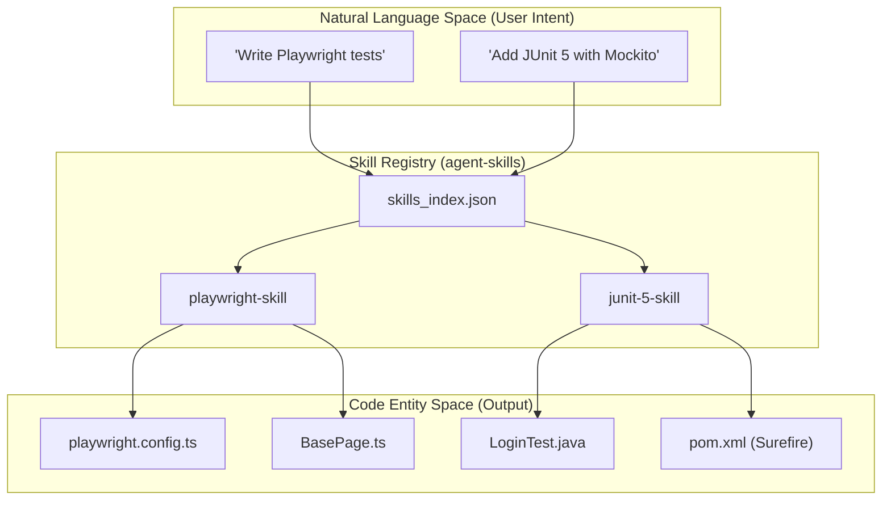
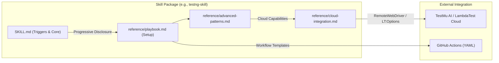

<!-- source: DeepWiki mcp.deepwiki.com · repo LambdaTest/agent-skills · page 1 Overview — TestMu AI Agent Skills · fetched 2026-10-26 -->

# Overview — TestMu AI Agent Skills

Relevant source files

The following files were used as context for generating this wiki page:

- [CONTRIBUTING.md](CONTRIBUTING.md)
- [README.md](README.md)
- [skills_index.json](skills_index.json)
- [testng-skill/SKILL.md](testng-skill/SKILL.md)
- [testng-skill/reference/advanced-patterns.md](testng-skill/reference/advanced-patterns.md)

TestMu AI Agent Skills is a curated repository of production-grade instructions and code patterns designed for AI coding assistants (such as Claude Code, Cursor, and GitHub Copilot). It transforms generic AI responses into expert-level test automation architectures across 46 frameworks and over 15 programming languages [README.md:1-15]().

By providing structured context through the **Agent Skills Standard**, this repository ensures that AI agents follow industry best practices, implement robust Page Object Models (POM), integrate with cloud execution environments like LambdaTest, and configure reliable CI/CD pipelines [README.md:17-23]().

## System Architecture: From Natural Language to Test Code

The repository acts as a bridge between a user's high-level intent (Natural Language Space) and specific, runnable test entities (Code Entity Space). When a user asks an AI assistant to "Write Playwright tests for login," the agent consumes the relevant skill to produce structured code [README.md:54-65]().

### Intent Mapping Diagram
The following diagram illustrates how user requests are mapped to specific skill entities and their corresponding output files.

**Diagram: Intent to Code Entity Mapping**

**Sources:** [skills_index.json:1-160](), [README.md:54-65]()

## The Agent Skills Standard (`SKILL.md`)

Each skill in the repository follows a strict structural format defined by the **Agent Skills Standard**. This ensures consistency across different frameworks and allows AI tools to easily parse the capabilities and triggers for each skill [README.md:69-82]().

### Skill File Structure
A skill is composed of a primary entry point and supplementary reference files to manage context window limits through progressive disclosure:
*   **`SKILL.md`**: The primary entry point containing YAML frontmatter (name, description, triggers) and core patterns [CONTRIBUTING.md:16-32]().
*   **`reference/playbook.md`**: Detailed implementation guides, project structures, and debugging tables [CONTRIBUTING.md:46-46]().
*   **`reference/advanced-patterns.md`**: Complex use cases, such as parallel execution or custom listeners [testng-skill/reference/advanced-patterns.md:1-118]().

### Component Interaction Diagram
This diagram shows how the internal components of a skill (e.g., `testng-skill`) interact to provide a complete automation solution.

**Diagram: Skill Component Architecture**

**Sources:** [CONTRIBUTING.md:43-57](), [testng-skill/SKILL.md:141-158](), [testng-skill/reference/advanced-patterns.md:92-109]()

## Skill Categories and Registry

The repository contains 46 skills organized into 7 primary categories to cover the entire software testing lifecycle [skills_index.json:6-15]().

| Category | Description | Key Frameworks |
| :--- | :--- | :--- |
| **E2E / Browser** | Web automation across all major browsers. | Selenium, Playwright, Cypress [README.md:89-89]() |
| **Unit Testing** | Component and logic testing across 15+ languages. | Jest, JUnit 5, pytest, xUnit [README.md:90-90]() |
| **Mobile Testing** | Native and cross-platform mobile automation. | Appium, Espresso, XCUITest [README.md:91-91]() |
| **BDD Testing** | Behavior-driven development using Gherkin. | Cucumber, SpecFlow, Behave [README.md:92-92]() |
| **Visual / Cloud** | Visual regression and high-speed orchestration. | SmartUI, HyperExecute [README.md:93-94]() |
| **Migration** | Tooling to switch between frameworks. | Selenium ↔ Playwright [README.md:95-95]() |
| **DevOps** | Pipeline configurations for continuous testing. | GitHub Actions, Jenkins [README.md:96-96]() |

For a full list of all 46 skills and their supported languages, see the [Skill Registry — All 46 Skills by Category](#1.3).

## Core Functionality

### 1. Progressive Disclosure Model
To avoid overwhelming the AI's context window, skills are designed to be consumed in stages. The `SKILL.md` file is kept under 500 lines, focusing on "decision trees" and "quick-reference patterns," while deep technical details are offloaded to the `reference/` directory [CONTRIBUTING.md:34-49]().

### 2. Cloud and Local Execution
Every E2E and Mobile skill is "Cloud Ready." They include patterns for local execution (e.g., `chromedriver`) and cloud execution via LambdaTest using `LT:Options` and `RemoteWebDriver` [README.md:1-10](), [CONTRIBUTING.md:53-53]().

### 3. Validation and Quality Assurance
The repository includes a validation suite (`scripts/validate_skills.py`) that enforces frontmatter correctness, line counts, and the presence of required reference files like the `playbook.md` [CONTRIBUTING.md:36-41]().

## Child Pages

*   [Getting Started — Installation and Usage](#1.1): How to install these skills into your AI assistant (Claude, Cursor, etc.) and start generating tests.
*   [Skill Architecture — SKILL.md Format and Structure](#1.2): Detailed breakdown of the Agent Skills Standard and how to contribute new skills.
*   [Skill Registry — All 46 Skills by Category](#1.3): A complete index of every framework supported by the repository.

**Sources:** [README.md:1-140](), [skills_index.json:1-40](), [CONTRIBUTING.md:1-61]()

---

