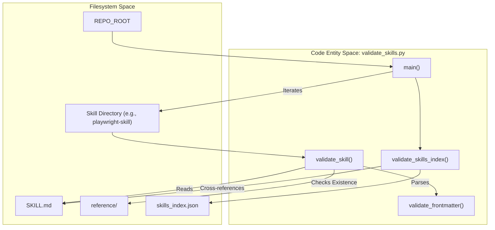
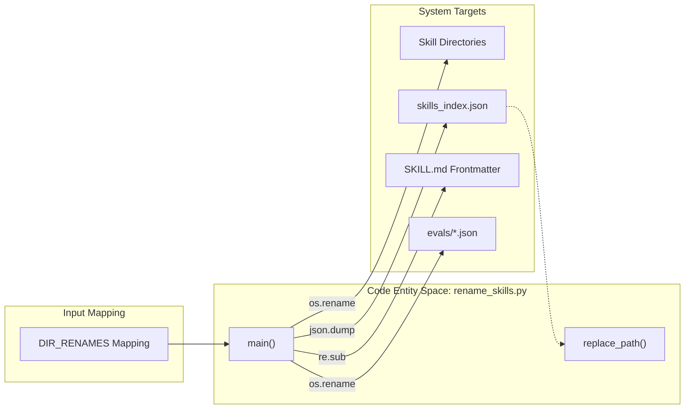

<!-- source: DeepWiki mcp.deepwiki.com · repo LambdaTest/agent-skills · page 10.2 Validation Scripts — validate_skills.py and rename_skills.py · fetched 2026-10-26 -->

# Validation Scripts — validate_skills.py and rename_skills.py

<details>
<summary>Relevant source files</summary>

The following files were used as context for generating this wiki page:

- [scripts/rename_skills.py](scripts/rename_skills.py)
- [scripts/validate_skills.py](scripts/validate_skills.py)

</details>


The `agent-skills` repository includes a suite of maintenance scripts located in the `scripts/` directory. These tools ensure that all 46+ skills adhere to the **Agent Skills Standard**, maintain structural integrity across the `skills_index.json` registry, and provide utilities for bulk refactoring of skill naming conventions.

## Skill Validation — validate_skills.py

The `scripts/validate_skills.py` script is the primary quality gate for the repository. It performs static analysis on `SKILL.md` files, directory structures, and the global index to ensure AI coding assistants can reliably consume the content.

### Validation Logic and Data Flow

The script iterates through the repository root, skipping non-skill directories like `evals`, `scripts`, and `docs` [scripts/validate_skills.py:10-10](). For every directory containing a `SKILL.md` file, it executes a multi-layered validation suite.

#### 1. Frontmatter Validation
The `validate_frontmatter` function uses regular expressions to enforce the presence and format of YAML metadata [scripts/validate_skills.py:24-62]().

| Field | Requirement | Severity |
| :--- | :--- | :--- |
| `name` | Must exist in frontmatter | Error |
| `description` | Must exist in frontmatter | Error |
| `languages` | List of supported languages | Warning |
| `category` | Must be one of the `VALID_CATEGORIES` | Warning |
| `license` | Must specify license (e.g., MIT) | Warning |
| `metadata` | Must include `author: TestMu AI` and `version` | Warning |

The `VALID_CATEGORIES` set includes: `accessibility`, `api-testing`, `bdd-testing`, `cloud-testing`, `devops`, `e2e-testing`, `mobile-testing`, `performance-testing`, `security-testing`, `unit-testing`, `visual-testing` [scripts/validate_skills.py:13-17]().

#### 2. Content and Structural Enforcement
The `validate_skill` function enforces physical constraints and cross-references [scripts/validate_skills.py:65-118]():
*   **Line Count:** `SKILL.md` files are restricted to a maximum of 500 lines to ensure they fit within LLM context windows [scripts/validate_skills.py:11-11](), [scripts/validate_skills.py:82-83]().
*   **Reference Links:** Checks if `SKILL.md` actually links to its internal `reference/playbook.md` [scripts/validate_skills.py:98-99]().
*   **Cloud Integration:** For `e2e-testing` category skills, the script warns if there is no `cloud-integration.md` or link to the `shared/testmu-cloud-reference.md` [scripts/validate_skills.py:104-108]().
*   **Debugging Section:** Inspects `playbook.md` for a "debugging" section, which is a requirement for the standard troubleshooting table [scripts/validate_skills.py:115-116]().

#### 3. Index Synchronization
The `validate_skills_index` function ensures that `skills_index.json` is perfectly synchronized with the filesystem [scripts/validate_skills.py:119-155](). It verifies that every file path listed in the index exists on disk and warns if a Markdown file exists in a `reference/` folder but is missing from the index [scripts/validate_skills.py:152-153]().

### Validation Process Diagram

The following diagram illustrates how `validate_skills.py` maps the physical file structure to the logical validation rules.

**Skill Validation Flow**

**Sources:** [scripts/validate_skills.py:156-168](), [scripts/validate_skills.py:65-75](), [scripts/validate_skills.py:119-130]()

---

## Bulk Renaming — rename_skills.py

The `scripts/rename_skills.py` utility is designed for large-scale refactoring of skill identifiers. It was primarily used to transition from the `-automation-skill` or `-testing-skill` suffix to the simplified `-skill` suffix across the entire repository [scripts/rename_skills.py:11-51]().

### Implementation Details
The script performs a four-step atomic update to ensure consistency:

1.  **Directory Renaming:** Iterates through the `DIR_RENAMES` mapping and renames the physical folders on disk using `os.rename` [scripts/rename_skills.py:64-70]().
2.  **Registry Update:** Loads `skills_index.json`, updates the `name` and `path` keys for each entry, and replaces strings in the `files` object to point to the new locations [scripts/rename_skills.py:72-84]().
3.  **Frontmatter Sync:** Opens every `SKILL.md` in the new directories and uses `re.sub` to update the `name:` field in the YAML frontmatter to match the new directory name [scripts/rename_skills.py:87-94]().
4.  **Eval File Migration:** Renames the corresponding evaluation JSON files in the `evals/` directory (e.g., `selenium-automation-skill-evals.json` becomes `selenium-skill-evals.json`) [scripts/rename_skills.py:102-109]().

### Renaming Logic Diagram

This diagram shows how `rename_skills.py` bridges the "Old Name" space to the "New Name" space across multiple file types.

**Renaming Execution Logic**

**Sources:** [scripts/rename_skills.py:11-51](), [scripts/rename_skills.py:60-110]()

---

## Usage in Development Workflow

Before submitting a Pull Request (PR) to the `agent-skills` repository, contributors are expected to run the validation script to catch structural errors.

### Running Validation
Execute the script from the repository root:
```bash
python3 scripts/validate_skills.py
```
The script will output a summary of total skills found, errors (which block PRs), and warnings (which are recommendations for better skill quality) [scripts/validate_skills.py:170-172]().

### Validation Constraints Summary

| Metric | Constraint | Source |
| :--- | :--- | :--- |
| **Max Lines** | 500 lines per `SKILL.md` | [scripts/validate_skills.py:11]() |
| **File Structure** | `SKILL.md` must exist in the root of the skill folder | [scripts/validate_skills.py:71-72]() |
| **Reference Structure** | `reference/playbook.md` is expected | [scripts/validate_skills.py:93-95]() |
| **Registry** | All skills must be registered in `skills_index.json` | [scripts/validate_skills.py:119-124]() |

**Sources:** [scripts/validate_skills.py:1-172](), [scripts/rename_skills.py:1-115]()

---

