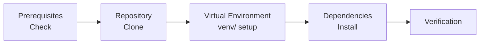
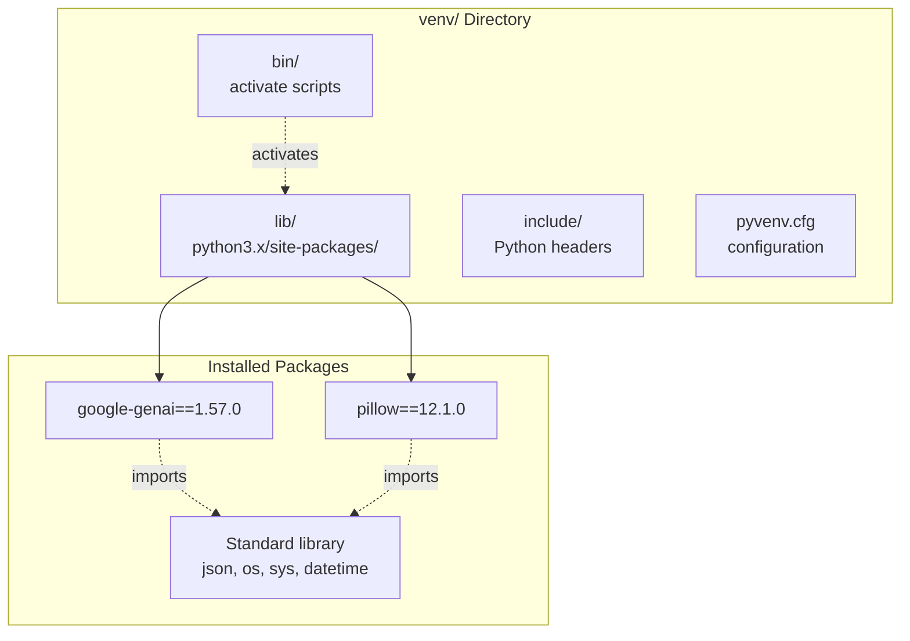
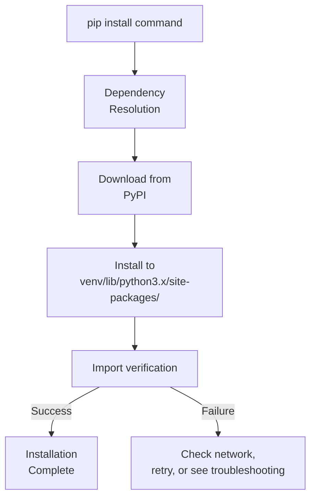
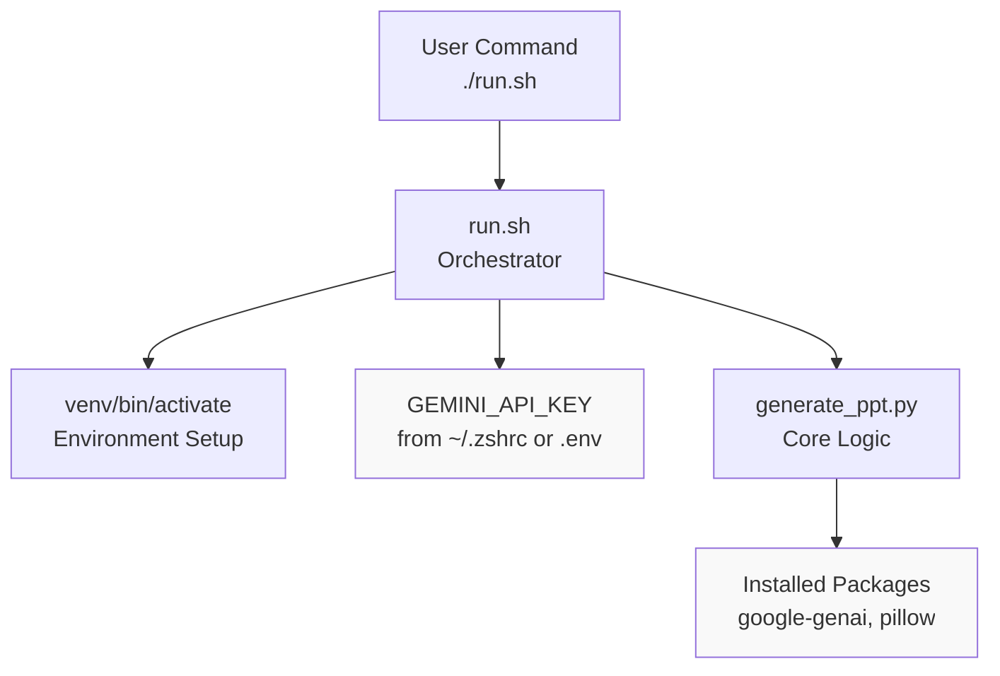
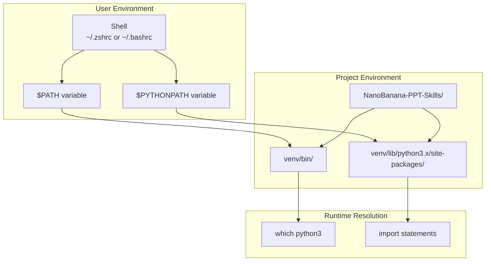
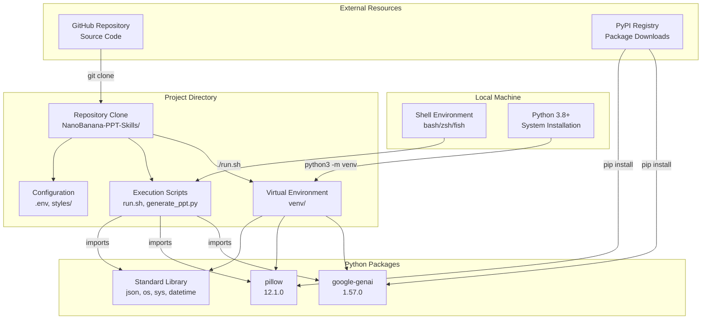

<!-- source: DeepWiki mcp.deepwiki.com · repo op7418/NanoBanana-PPT-Skills · page 2.2 Installation · fetched 2026-10-26 -->

# Installation

<details>
<summary>Relevant source files</summary>

The following files were used as context for generating this wiki page:

- [QUICKSTART.md](QUICKSTART.md)
- [README.md](README.md)
- [SETUP_COMPLETE.md](SETUP_COMPLETE.md)

</details>


This page provides detailed instructions for installing the NanoBanana PPT Generator system on your local machine. This includes cloning the repository, setting up a Python virtual environment, and installing required dependencies.

**Scope**: This document covers the initial setup process up to the point where the system can be executed. For API key configuration, see [API Key Setup](#3.1). For your first presentation generation, see [Your First Presentation](#2.3). For a faster path skipping detailed explanations, see [Quick Start Guide](#2.1).

---

## Overview

The installation process consists of four stages:



**Sources**: [README.md:126-196](), [QUICKSTART.md:5-18]()

---

## Prerequisites

Before beginning installation, verify the following tools are available on your system:

| Requirement | Minimum Version | Verification Command | Purpose |
|------------|----------------|---------------------|---------|
| Python | 3.8+ | `python3 --version` | Runtime environment |
| pip | Latest | `pip3 --version` | Package management |
| Git | Any recent | `git --version` | Repository cloning |
| Internet | N/A | Test browser access | Package downloads, API access |

### Python Version Check

```bash
python3 --version
# Expected output: Python 3.8.x or higher
```

If Python is not installed or the version is too old, install from [python.org](https://www.python.org/downloads) or use your system package manager.

**Sources**: [README.md:131-134]()

---

## Repository Cloning

### Clone via HTTPS

```bash
git clone https://github.com/op7418/NanoBanana-PPT-Skills.git
cd NanoBanana-PPT-Skills
```

### Clone via SSH

```bash
git clone git@github.com:op7418/NanoBanana-PPT-Skills.git
cd NanoBanana-PPT-Skills
```

### Expected Directory Structure Post-Clone

```
NanoBanana-PPT-Skills/
├── generate_ppt.py           # Core generation script
├── run.sh                    # Orchestration script
├── ppt-generator.md          # Skill definition
├── README.md
├── QUICKSTART.md
├── ENV_SETUP.md
├── SECURITY.md
├── .env.example              # API key template
├── .gitignore                # Security boundary
├── styles/                   # Visual definition library
│   ├── gradient-glass.md
│   └── vector-illustration.md
└── templates/                # HTML viewer template
    └── viewer.html
```

**Sources**: [README.md:138-143](), [README.md:339-356]()

---

## Virtual Environment Setup

The system uses Python's `venv` module to create an isolated dependency environment. This prevents conflicts with system-wide Python packages.

### Creation Commands by Operating System

**macOS and Linux:**
```bash
python3 -m venv venv
```

**Windows (Command Prompt):**
```cmd
python -m venv venv
```

**Windows (PowerShell):**
```powershell
python -m venv venv
```

### Virtual Environment Structure



### Activation

**macOS and Linux:**
```bash
source venv/bin/activate
```

**Windows (Command Prompt):**
```cmd
venv\Scripts\activate.bat
```

**Windows (PowerShell):**
```powershell
venv\Scripts\Activate.ps1
```

**Verification**: After activation, your shell prompt should display `(venv)` prefix:
```
(venv) user@machine:~/NanoBanana-PPT-Skills$
```

### Deactivation

When finished working with the project:
```bash
deactivate
```

**Sources**: [README.md:145-150](), [SETUP_COMPLETE.md:5-9](), [SETUP_COMPLETE.md:27-38]()

---

## Dependency Installation

The system has exactly two external Python dependencies, both specified with pinned versions for reproducibility.

### Dependency Table

| Package | Version | Purpose | Size | API Reference |
|---------|---------|---------|------|---------------|
| `google-genai` | 1.57.0 | Gemini API client SDK | ~15 MB | [google-genai](https://pypi.org/project/google-genai) |
| `pillow` | 12.1.0 | Image processing utilities | ~3 MB | [Pillow](https://pillow.readthedocs.io) |

### Installation Commands

**Standard installation:**
```bash
pip install google-genai pillow
```

**With version pinning (recommended):**
```bash
pip install google-genai==1.57.0 pillow==12.1.0
```

**From requirements file (if created):**
```bash
pip install -r requirements.txt
```

### Installation Flow



### Verification of Installed Packages

```bash
pip list | grep -E 'google-genai|pillow'
```

Expected output:
```
google-genai    1.57.0
pillow          12.1.0
```

### Import Verification

Test that packages are importable:

```bash
python3 -c "import google.generativeai; import PIL; print('Dependencies OK')"
```

Expected output:
```
Dependencies OK
```

**Sources**: [README.md:152-157](), [QUICKSTART.md:13-17](), [SETUP_COMPLETE.md:5-9]()

---

## Execution Path Validation

After installation, verify that the core execution scripts are accessible and properly configured.

### Script Permissions

The `run.sh` script must be executable:

```bash
chmod +x run.sh
```

### Help Command Test

```bash
./run.sh --help
```

**Expected Output (without API key configured):**
```
⚠️  API密钥未设置！
请选择以下配置方式之一：
...
```

**Expected Output (with API key configured):**
```
✅ 使用系统环境变量中的API密钥
usage: generate_ppt.py [-h] --plan PLAN --style STYLE ...
```

### File Dependency Chain



### Direct Python Execution Test

For advanced users who want to bypass `run.sh`:

```bash
# Activate environment first
source venv/bin/activate

# Test direct execution
python3 generate_ppt.py --help
```

**Sources**: [README.md:184-195](), [SETUP_COMPLETE.md:20-49]()

---

## Installation Validation

After completing all steps, perform a comprehensive validation to ensure the system is ready for use.

### Validation Checklist

| Component | Validation Method | Expected Result |
|-----------|------------------|-----------------|
| Repository | `ls -la \| grep generate_ppt.py` | File exists |
| Virtual Environment | `ls -la venv/` | Directory exists with bin/, lib/ |
| Activation | `which python3` (when venv active) | Points to `venv/bin/python3` |
| google-genai | `python3 -c "import google.generativeai"` | No error |
| pillow | `python3 -c "import PIL"` | No error |
| run.sh | `./run.sh --help` | Displays usage or API key prompt |
| File Permissions | `ls -la run.sh` | Shows `-rwxr-xr-x` or similar |

### Complete Validation Script

```bash
#!/bin/bash
echo "=== Installation Validation ==="
echo ""

# Check repository
echo "1. Repository structure..."
test -f generate_ppt.py && echo "  ✅ generate_ppt.py found" || echo "  ❌ generate_ppt.py missing"
test -f run.sh && echo "  ✅ run.sh found" || echo "  ❌ run.sh missing"
test -d styles && echo "  ✅ styles/ directory found" || echo "  ❌ styles/ directory missing"
echo ""

# Check virtual environment
echo "2. Virtual environment..."
test -d venv && echo "  ✅ venv/ directory exists" || echo "  ❌ venv/ not found - run: python3 -m venv venv"
test -f venv/bin/activate && echo "  ✅ Activation script exists" || echo "  ❌ Activation script missing"
echo ""

# Activate and check packages
echo "3. Python packages..."
source venv/bin/activate
python3 -c "import google.generativeai" 2>/dev/null && echo "  ✅ google-genai installed" || echo "  ❌ google-genai missing - run: pip install google-genai==1.57.0"
python3 -c "import PIL" 2>/dev/null && echo "  ✅ pillow installed" || echo "  ❌ pillow missing - run: pip install pillow==12.1.0"
echo ""

# Check script permissions
echo "4. Script permissions..."
test -x run.sh && echo "  ✅ run.sh is executable" || echo "  ❌ run.sh not executable - run: chmod +x run.sh"
echo ""

echo "=== Validation Complete ==="
```

**Sources**: [README.md:184-195](), [SETUP_COMPLETE.md:86-91]()

---

## System Path Integration



The virtual environment modifies `$PATH` during activation to prioritize its own Python interpreter and installed packages. This ensures that `python3` and `pip` commands resolve to the isolated environment versions rather than system-wide installations.

**Sources**: [README.md:145-150]()

---

## Post-Installation Next Steps

After successful installation, you must configure the API key before the system can generate presentations. The installation is complete but non-functional without this configuration.

### Immediate Next Actions

1. **Configure API Key** - See [API Key Setup](#3.1) for detailed instructions
2. **Verify Configuration** - See [Environment Variables](#3.2) for verification steps
3. **Generate Test Presentation** - See [Your First Presentation](#2.3) for a walkthrough

### Minimal Viable Configuration

For the absolute minimum setup to test the system:

```bash
# Export API key temporarily (valid for current shell session only)
export GEMINI_API_KEY="your-api-key-here"

# Test with a simple plan (assuming you have test_slides_plan.json)
./run.sh --plan test_slides_plan.json --style styles/gradient-glass.md --resolution 2K
```

**WARNING**: This temporary configuration will not persist across terminal sessions. For permanent configuration, follow the instructions in [API Key Setup](#3.1).

**Sources**: [README.md:158-183](), [QUICKSTART.md:5-11]()

---

## Troubleshooting Installation Issues

### Python Version Mismatch

**Symptom**: `python3: command not found` or version below 3.8

**Solution**:
- **macOS**: Install via Homebrew: `brew install python@3.11`
- **Ubuntu/Debian**: `sudo apt install python3.11 python3.11-venv`
- **Windows**: Download installer from [python.org](https://www.python.org/downloads)

### Virtual Environment Creation Fails

**Symptom**: `Error: Command '['venv/bin/python3', '-Im', 'ensurepip']' returned non-zero exit status`

**Solution**:
```bash
# Install venv module explicitly
sudo apt install python3.11-venv  # Ubuntu/Debian
```

### Permission Denied on run.sh

**Symptom**: `-bash: ./run.sh: Permission denied`

**Solution**:
```bash
chmod +x run.sh
```

### Package Installation Fails

**Symptom**: `ERROR: Could not find a version that satisfies the requirement`

**Solution**:
```bash
# Upgrade pip first
pip install --upgrade pip

# Retry installation
pip install google-genai==1.57.0 pillow==12.1.0
```

### Network/Firewall Issues

**Symptom**: `Could not fetch URL https://pypi.org/simple/...`

**Solution**:
- Verify internet connectivity
- Check corporate firewall/proxy settings
- Use alternative PyPI mirror if needed:
  ```bash
  pip install --index-url https://mirrors.aliyun.com/pypi/simple/ google-genai pillow
  ```

### Import Errors After Installation

**Symptom**: `ModuleNotFoundError: No module named 'google.generativeai'`

**Verification Steps**:
1. Confirm virtual environment is activated (check for `(venv)` prefix)
2. Verify package installation: `pip list | grep google-genai`
3. Check Python interpreter path: `which python3` (should point to `venv/bin/python3`)
4. Re-activate environment: `deactivate && source venv/bin/activate`

**Sources**: [README.md:452-458](), [SETUP_COMPLETE.md:140-165]()

---

## Advanced Installation Options

### System-Wide Installation (Not Recommended)

Installing packages system-wide instead of in a virtual environment:

```bash
# NOT RECOMMENDED - installs globally
sudo pip3 install google-genai==1.57.0 pillow==12.1.0
```

**Drawbacks**:
- Risk of version conflicts with other projects
- Requires root/admin privileges
- Difficult to maintain separate project dependencies
- May interfere with system Python packages

### Multiple Virtual Environments

For users working on multiple projects or testing different versions:

```bash
# Create project-specific environments
python3 -m venv venv-dev     # Development
python3 -m venv venv-prod    # Production-like testing
python3 -m venv venv-exp     # Experimental features

# Activate specific environment
source venv-dev/bin/activate
```

### Docker-Based Installation (Community Approach)

While not officially supported, users can create a containerized environment:

```dockerfile
FROM python:3.11-slim

WORKDIR /app
COPY . /app

RUN python3 -m venv venv && \
    . venv/bin/activate && \
    pip install google-genai==1.57.0 pillow==12.1.0

ENV GEMINI_API_KEY=""
ENTRYPOINT ["./run.sh"]
```

**Note**: This approach requires additional configuration for output file access and is not covered in this documentation.

**Sources**: [README.md:145-157]()

---

## Installation Architecture



This diagram shows the complete dependency chain from system prerequisites through to the executable scripts. All external dependencies are isolated within the `venv/` directory, preventing interference with system-wide Python installations.

**Sources**: [README.md:126-196](), [SETUP_COMPLETE.md:73-90]()

---

