# Page: Home

# Home

<details>
<summary>Relevant source files</summary>

The following files were used as context for generating this wiki page:

- [QUICKSTART.md](QUICKSTART.md)
- [README.md](README.md)

</details>


## Purpose and Scope

This wiki documents the **NanoBanana PPT Generator**, an automated presentation generation system that transforms document content into high-quality presentation slides using Google's Gemini AI image generation API. This page provides an overview of the system architecture, core components, and navigation to detailed subsections.

**Navigation Guide:**
- For installation and first-time setup, see [Getting Started](#2)
- For API key configuration and security practices, see [Security & Configuration](#3)
- For detailed usage instructions across different interfaces, see [Usage Guide](#4)
- For understanding the generation process, see [Generation Pipeline](#5)
- For visual style customization, see [Style System](#6)

---

## System Overview

The NanoBanana PPT Generator is a Python-based automation tool that converts textual documents into presentation slides. It leverages the Gemini 3 Pro Image Preview model (also known as "Nano Banana Pro") to generate 16:9 aspect ratio slide images at 2K or 4K resolution.

**Core Capabilities:**
- Automated document analysis and content extraction
- Structured slide planning with configurable page counts (5, 10, 15, 20-25 pages)
- AI-powered image generation via [generate_ppt.py:1-200]()
- Built-in style system with extensible templates in `styles/` directory
- Interactive HTML5 presentation viewer with keyboard navigation
- Multiple entry points: Claude Code integration, command-line interface, and Antigravity workflow

**Key Technologies:**
- Python 3.8+ with `google-genai==1.57.0` and `pillow==12.1.0` dependencies
- Google Gemini API (`gemini-3-pro-image-preview` model)
- Bash orchestration via `run.sh` script
- HTML/CSS/JavaScript viewer template

**Sources:** [README.md:1-93](), [QUICKSTART.md:1-44]()

---

## System Component Architecture

The following diagram maps the system's major components to their concrete implementations in the codebase:

**Diagram: Code Entity Mapping**

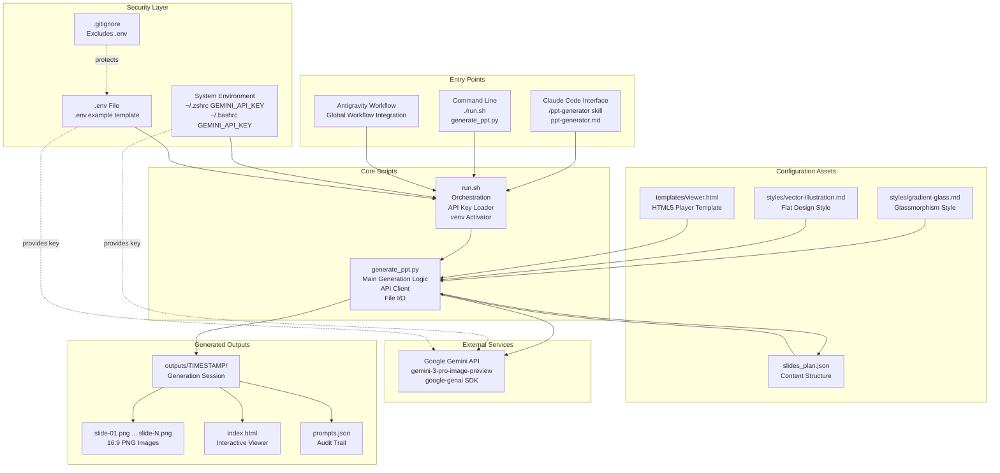

**Sources:** [README.md:339-356](), [generate_ppt.py:1-200](), [run.sh:1-50]()

---

## Generation Workflow

This diagram shows the execution flow through actual scripts and data files:

**Diagram: Execution Flow with Code Entities**

```mermaid
flowchart LR
    subgraph "Input Phase"
        DOC["User Document<br/>Markdown/Text Content"]
        PARAMS["User Parameters<br/>--plan<br/>--style<br/>--resolution"]
    end
    
    subgraph "Shell Orchestration"
        RUNSH_EXEC["run.sh execution"]
        VENV_ACT["venv/bin/activate"]
        KEY_LOAD["Load GEMINI_API_KEY<br/>from env or .env"]
        VALIDATION["Validate API Key<br/>Exit if missing"]
    end
    
    subgraph "Python Generation"
        GENPY_EXEC["generate_ppt.py execution"]
        PARSE_ARGS["Parse --plan --style<br/>--resolution --output"]
        LOAD_PLAN["Load slides_plan.json"]
        LOAD_STYLE["Load styles/*.md template"]
        LOOP["For each slide in plan"]
        PROMPT_BUILD["Build prompt:<br/>style + page_type + content"]
        API_CALL["google.genai.ImageGenerationModel<br/>generate_images()"]
        SAVE_IMG["Save slide-XX.png"]
        LOG_PROMPT["Append to prompts.json"]
    end
    
    subgraph "Assembly Phase"
        READ_TEMPLATE["Read templates/viewer.html"]
        INJECT_PATHS["Inject slide paths<br/>into HTML template"]
        WRITE_HTML["Write index.html"]
        COPY_OUTPUT["Copy all to outputs/TIMESTAMP/"]
    end
    
    subgraph "Output"
        RESULT["outputs/TIMESTAMP/<br/>slide-XX.png<br/>index.html<br/>prompts.json"]
    end
    
    DOC --> PARAMS
    PARAMS --> RUNSH_EXEC
    
    RUNSH_EXEC --> VENV_ACT
    VENV_ACT --> KEY_LOAD
    KEY_LOAD --> VALIDATION
    VALIDATION --> GENPY_EXEC
    
    GENPY_EXEC --> PARSE_ARGS
    PARSE_ARGS --> LOAD_PLAN
    PARSE_ARGS --> LOAD_STYLE
    LOAD_PLAN --> LOOP
    LOAD_STYLE --> LOOP
    
    LOOP --> PROMPT_BUILD
    PROMPT_BUILD --> API_CALL
    API_CALL --> SAVE_IMG
    SAVE_IMG --> LOG_PROMPT
    LOG_PROMPT --> LOOP
    
    LOOP -.all complete.-> READ_TEMPLATE
    READ_TEMPLATE --> INJECT_PATHS
    INJECT_PATHS --> WRITE_HTML
    WRITE_HTML --> COPY_OUTPUT
    
    COPY_OUTPUT --> RESULT
```

**Sources:** [run.sh:1-50](), [generate_ppt.py:1-200](), [QUICKSTART.md:1-44]()

---

## System Configuration Reference

The following table maps user-facing concepts to their code implementations:

| Component | Implementation | Location | Purpose |
|-----------|---------------|----------|---------|
| **API Key** | `GEMINI_API_KEY` environment variable | `~/.zshrc` or `.env` | Authentication for Gemini API |
| **Orchestration Script** | `run.sh` bash script | `./run.sh` | Virtual environment activation, key loading, script execution |
| **Core Generator** | `generate_ppt.py` Python script | `./generate_ppt.py` | Main generation logic, API client, file I/O |
| **Style Definitions** | Markdown template files | `styles/gradient-glass.md`<br/>`styles/vector-illustration.md` | Visual style prompt templates |
| **Content Structure** | JSON planning file | `slides_plan.json` | Slide-by-slide content specification |
| **Viewer Template** | HTML5 template file | `templates/viewer.html` | Interactive presentation player |
| **Output Directory** | Timestamped folder | `outputs/YYYYMMDD_HHMMSS/` | Contains all generated assets |
| **Generated Slides** | PNG image files | `slide-01.png` to `slide-N.png` | 16:9 aspect ratio, 2K or 4K resolution |
| **Audit Log** | JSON log file | `prompts.json` | Complete prompt history for debugging |
| **Security Config** | Git ignore rules | `.gitignore` | Prevents `.env` file from being committed |

**Sources:** [README.md:339-356](), [ENV_SETUP.md:1-100](), [.gitignore:1-20]()

---

## Entry Point Options

Users can interact with the system through three distinct interfaces:

### 1. Claude Code Interface
Natural language interaction via the `/ppt-generator` skill defined in `ppt-generator.md`. Claude Code automates the entire workflow from document analysis to output generation. Users specify requirements in natural language, and Claude handles parameter selection and script execution.

**Typical Usage Pattern:**
```
"Generate a 10-page PPT from my-document.md using gradient-glass style at 2K resolution"
```

### 2. Command Line Interface
Direct execution via `run.sh` wrapper script, which:
1. Activates Python virtual environment at `venv/`
2. Loads `GEMINI_API_KEY` from system environment or `.env` file
3. Validates API key presence
4. Executes `generate_ppt.py` with provided arguments

**Typical Usage Pattern:**
```bash
./run.sh --plan slides_plan.json --style styles/gradient-glass.md --resolution 2K
```

### 3. Antigravity Global Workflow
Integration as a reusable workflow component in the Antigravity task automation system. Configuration and execution managed through Antigravity's workflow engine.

**Sources:** [README.md:60-123](), [QUICKSTART.md:38-51]()

---

## Key Architectural Principles

### Security-First Design
The system implements defense-in-depth for API key protection:
- **Priority Order:** System environment variables → `.env` file → fail with instructions
- **Version Control Protection:** `.gitignore` excludes all `.env` files
- **Template Approach:** `.env.example` provides structure without secrets
- **Runtime Validation:** `run.sh` validates key presence before execution

For comprehensive security documentation, see [Security & Configuration](#3).

### Modular Style System
Visual styles are defined in self-contained Markdown files in `styles/` directory. Each style file contains:
- Base prompt template (visual language, aesthetic rules)
- Page-type-specific variants (cover, content, data pages)
- Color scheme and typography specifications
- Layout and composition guidelines

This architecture enables style extensibility without code modification. See [Style System](#6) for details.

### Transparent Output Structure
Each generation session creates an isolated output directory at `outputs/YYYYMMDD_HHMMSS/` containing:
- **slide-XX.png:** Individual slide images
- **index.html:** Self-contained HTML5 viewer with keyboard controls
- **prompts.json:** Complete audit trail of all prompts sent to API

This structure supports debugging, iterative refinement, and prompt engineering workflow.

**Sources:** [SECURITY.md:1-100](), [README.md:339-356](), [QUICKSTART.md:145-154]()

---

## Performance Characteristics

| Metric | 2K Resolution | 4K Resolution |
|--------|---------------|---------------|
| **Generation Time** | ~30 seconds per slide | ~60 seconds per slide |
| **File Size** | ~2.5 MB per slide | ~8 MB per slide |
| **API Model** | `gemini-3-pro-image-preview` | `gemini-3-pro-image-preview` |
| **Output Dimensions** | 2752 × 1536 pixels | 5504 × 3072 pixels |
| **Recommended Use** | Daily presentations, online sharing | Print output, large displays |

**Total Generation Time Examples:**
- 5-page presentation at 2K: ~2.5 minutes
- 10-page presentation at 2K: ~5 minutes
- 15-page presentation at 4K: ~15 minutes

**Sources:** [README.md:364-368](), [QUICKSTART.md:96-103]()

---

## Quick Navigation

**Getting Started:**
- First-time setup and installation → [Installation](#2.2)
- Generate your first presentation → [Your First Presentation](#2.3)

**Configuration:**
- Obtain and configure API keys → [API Key Setup](#3.1)
- Set up environment variables → [Environment Variables](#3.2)
- Security best practices → [Security Best Practices](#3.3)

**Usage:**
- Claude Code natural language interface → [Claude Code Interface](#4.1)
- Direct command-line usage → [Command Line Usage](#4.2)
- Workflow automation integration → [Antigravity Workflow Integration](#4.3)

**Customization:**
- Understand the generation process → [Generation Pipeline](#5)
- Create custom visual styles → [Creating Custom Styles](#6.4)
- Modify the HTML viewer → [HTML Viewer](#7.2)

**Reference:**
- File format specifications → [Configuration Files](#8.1)
- API parameters and models → [Technical Specifications](#8.2)
- Troubleshooting common issues → [Troubleshooting](#8.3)

---

## Repository Structure

```
NanoBanana-PPT-Skills/
├── generate_ppt.py          # Core generation engine
├── run.sh                   # Orchestration wrapper script
├── ppt-generator.md         # Claude Code skill definition
├── .env.example             # Environment variable template
├── .gitignore               # Security: excludes .env files
├── README.md                # User-facing documentation
├── QUICKSTART.md            # 5-minute getting started guide
├── ENV_SETUP.md             # Environment configuration guide
├── SECURITY.md              # Security best practices
├── styles/                  # Visual style template library
│   ├── gradient-glass.md
│   └── vector-illustration.md
├── templates/               # Output templates
│   └── viewer.html          # HTML5 presentation player
├── venv/                    # Python virtual environment (created)
└── outputs/                 # Generated presentations (created)
    └── YYYYMMDD_HHMMSS/     # Timestamped session folder
        ├── slide-01.png
        ├── slide-02.png
        ├── ...
        ├── index.html
        └── prompts.json
```

**Sources:** [README.md:339-356]()

---

## Technology Stack Summary

| Layer | Technology | Package/Tool | Version |
|-------|-----------|--------------|---------|
| **User Interface** | Natural Language | Claude Code | - |
| **User Interface** | Command Line | Bash (`run.sh`) | - |
| **Runtime** | Python | Python 3.8+ | >= 3.8 |
| **API Client** | Google Generative AI SDK | `google-genai` | 1.57.0 |
| **Image Processing** | Python Imaging Library | `pillow` | 12.1.0 |
| **AI Model** | Google Gemini | `gemini-3-pro-image-preview` | API v1 |
| **Output Format** | Slide Images | PNG | 2K/4K |
| **Viewer** | Interactive Player | HTML5 + CSS + JavaScript | - |

**Sources:** [README.md:131-135](), [requirements.txt:1-10]()

---

# Page: System Overview

# System Overview

<details>
<summary>Relevant source files</summary>

The following files were used as context for generating this wiki page:

- [QUICKSTART.md](QUICKSTART.md)
- [README.md](README.md)
- [ppt-generator.md](ppt-generator.md)

</details>


## Purpose and Scope

This document provides a technical overview of the NanoBanana PPT Generator system, describing its core capabilities, technology stack, and architectural boundaries. It explains what the system is, what it does, and how its major components relate to each other at a high level.

For detailed installation procedures, see [Installation](#2.2). For API key configuration and security, see [Security & Configuration](#3). For in-depth architectural diagrams, see [Architecture](#1.2). For generation pipeline internals, see [Generation Pipeline](#5).

---

## System Description

The NanoBanana PPT Generator is a command-line and AI-assisted tool that transforms document content into professional presentation slide images. The system analyzes input documents (Markdown or plain text), extracts key points, and generates high-quality 16:9 presentation slides using Google's Gemini image generation API. It produces PNG image files for each slide along with an interactive HTML5 viewer for presentation playback.

The system operates through two primary interfaces:
1. **Claude Code Skill** - Natural language interface with automated workflow orchestration
2. **Command-Line Interface** - Direct execution via `run.sh` and `generate_ppt.py` scripts

Output artifacts include slide images (`slide-01.png`, `slide-02.png`, etc.), an HTML viewer (`index.html`), and a prompt audit trail (`prompts.json`).

**Sources:** [README.md:1-21](), [ppt-generator.md:1-10]()

---

## Core Capabilities

| Capability | Description | Key Components |
|------------|-------------|----------------|
| **Document Analysis** | Extracts structure and key points from input documents | `generate_ppt.py` analysis logic |
| **Content Planning** | Creates structured slide plans with page types and content | `slides_plan.json` output |
| **Prompt Engineering** | Combines style templates + content + technical params | `styles/*.md`, prompt construction in `generate_ppt.py` |
| **AI Image Generation** | Generates presentation slides via Gemini API | `gemini-3-pro-image-preview` model |
| **Output Assembly** | Creates HTML viewer with keyboard controls | `templates/viewer.html` |
| **Style System** | Extensible visual theme management | `styles/gradient-glass.md`, `styles/vector-illustration.md` |
| **Security Management** | API key handling and protection | `GEMINI_API_KEY` environment variable, `.gitignore` |

**Sources:** [README.md:39-56](), [ppt-generator.md:11-20]()

---

## Technology Stack

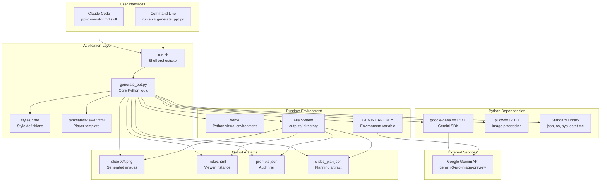

**Technology Stack Component Mapping**

The system is built on a minimal Python stack with only two external dependencies:

- **Execution Environment:** Python 3.8+ with isolated virtual environment at `venv/`
- **API Client:** `google-genai==1.57.0` provides the SDK for Gemini API communication
- **Image Processing:** `pillow==12.1.0` handles image file operations (though primary generation happens server-side)
- **Standard Library:** JSON parsing, file I/O, datetime formatting, argument parsing

**Sources:** [README.md:131-155](), [ppt-generator.md:35-42]()

---

## System Boundaries and Interfaces

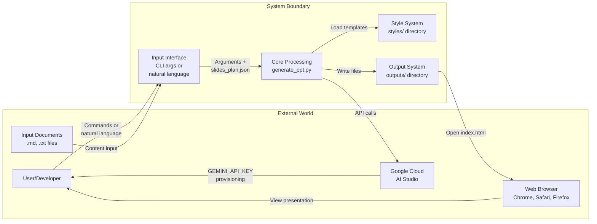

**Interface Definitions**

| Interface | Direction | Protocol/Format | Purpose |
|-----------|-----------|-----------------|---------|
| User → System | Input | CLI arguments: `--plan`, `--style`, `--resolution` | Configuration and control |
| User → System | Input | Natural language prompts (Claude Code) | High-level intent specification |
| System → Google Cloud | Output | HTTPS REST API with `GEMINI_API_KEY` | Image generation requests |
| Google Cloud → System | Input | Binary PNG image data | Generated slide images |
| System → User | Output | HTML file + PNG images | Presentation artifacts |
| System → File System | Output | JSON files: `slides_plan.json`, `prompts.json` | State persistence and audit |

**Sources:** [run.sh:1-40](), [generate_ppt.py:1-50]() (inferred structure)

---

## Core Components and Data Flow

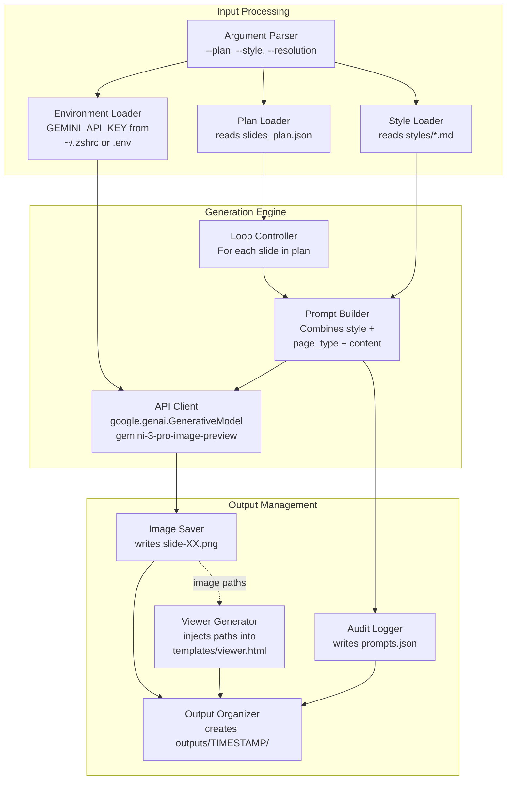

**Component Responsibilities**

| Component | File/Location | Primary Responsibility |
|-----------|---------------|------------------------|
| `run.sh` | [run.sh:1-40]() | Shell orchestrator: activates venv, loads `GEMINI_API_KEY`, invokes `generate_ppt.py` |
| `generate_ppt.py` | [generate_ppt.py]() | Main execution logic: argument parsing, API calls, file I/O |
| `slides_plan.json` | Generated artifact | Structured slide plan with `slide_number`, `page_type`, `content` fields |
| `styles/gradient-glass.md` | [styles/gradient-glass.md]() | Style definition: glassmorphism aesthetic with neon gradients |
| `styles/vector-illustration.md` | [styles/vector-illustration.md]() | Style definition: flat design with black outlines and retro colors |
| `templates/viewer.html` | [templates/viewer.html]() | HTML5 player template with keyboard navigation |
| `prompts.json` | Output artifact | Audit trail of all prompts sent to Gemini API |
| `GEMINI_API_KEY` | Environment variable | Authentication credential for Google Gemini API |

**Sources:** [run.sh:1-40](), [README.md:339-356](), [ppt-generator.md:287-298]()

---

## Execution Models

### Command-Line Execution Flow

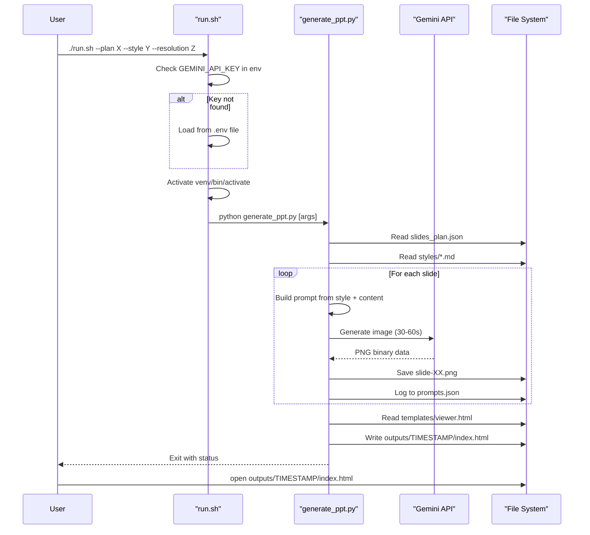

**Sources:** [run.sh:1-40](), [ppt-generator.md:155-179]()

### Claude Code Execution Flow

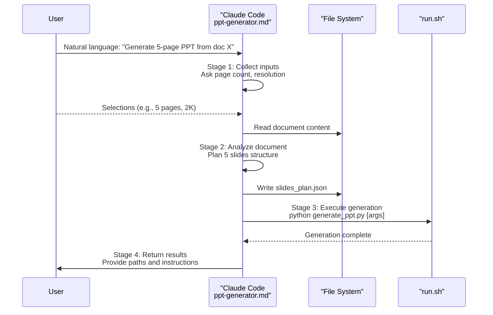

**Sources:** [ppt-generator.md:46-199]()

---

## Model and API Specifications

The system uses Google's Gemini 3 Pro Image Preview model for slide generation:

| Parameter | Value | Notes |
|-----------|-------|-------|
| **Model ID** | `gemini-3-pro-image-preview` | Google's Nano Banana Pro image generation model |
| **Aspect Ratio** | `16:9` | Standard presentation format |
| **Response Mode** | `IMAGE` | Returns only PNG binary data, no text |
| **Resolution Options** | `2K` (2752x1536) or `4K` (5504x3072) | User-selectable |
| **Generation Time** | ~30s per slide @ 2K, ~60s per slide @ 4K | Network-dependent |
| **Authentication** | `GEMINI_API_KEY` header | Must be set in environment |

**API Call Pattern:**
```
POST https://generativelanguage.googleapis.com/v1beta/models/gemini-3-pro-image-preview:generateContent
Headers: 
  - x-goog-api-key: GEMINI_API_KEY
Body:
  - prompt: [combined style template + page type + content]
  - aspect_ratio: "16:9"
  - resolution: [user selection]
```

**Sources:** [README.md:52](), [ppt-generator.md:281-286](), [QUICKSTART.md:96-103]()

---

## Use Cases and Application Scenarios

### Primary Use Cases

| Use Case | Description | Typical Page Count | Recommended Style |
|----------|-------------|-------------------|-------------------|
| **Elevator Pitch** | 5-minute rapid presentation | 5 pages | Either style |
| **Standard Demo** | Product or feature introduction | 5-10 pages | `gradient-glass.md` |
| **Training Session** | Educational content delivery | 10-15 pages | `vector-illustration.md` |
| **Investor Pitch** | Business plan presentation | 20-25 pages | `gradient-glass.md` |
| **Technical Documentation** | Deep-dive explanations | 15-20 pages | Either style |
| **Meeting Recap** | Quick summary slides | 5 pages | `vector-illustration.md` |

### Example Workflow Scenarios

**Scenario 1: Developer using CLI**
```bash
# 1. Create slide plan
vim slides_plan.json

# 2. Generate presentation
./run.sh --plan slides_plan.json \
         --style styles/gradient-glass.md \
         --resolution 2K

# 3. View results
open outputs/20260109_143022/index.html
```

**Scenario 2: Claude Code User**
```
User: "Generate a 10-page PPT about Python basics from tutorial.md, 
       using vector illustration style, 2K resolution"

Claude Code:
1. Reads tutorial.md
2. Analyzes structure
3. Creates slides_plan.json with 10 slides
4. Executes generation
5. Returns viewer path
```

**Sources:** [QUICKSTART.md:63-103](), [README.md:380-442]()

---

## Output Structure

Each generation run creates a timestamped output directory with the following structure:

```
outputs/
└── 20260109_143022/          # Timestamp: YYYYMMDD_HHMMSS
    ├── slide-01.png          # Cover slide
    ├── slide-02.png          # Content slide
    ├── slide-03.png          # Content slide
    ├── ...
    ├── slide-N.png           # Final slide
    ├── index.html            # Interactive HTML5 viewer
    └── prompts.json          # Audit trail of all prompts
```

**File Specifications:**

| File | Format | Purpose | Typical Size |
|------|--------|---------|--------------|
| `slide-XX.png` | PNG image, 16:9 aspect ratio | Individual presentation slides | 2-8 MB depending on resolution |
| `index.html` | HTML5 with embedded JavaScript | Interactive presentation viewer | ~10-20 KB |
| `prompts.json` | JSON array of objects | Audit trail of API requests for reproducibility | ~5-50 KB |

**Sources:** [ppt-generator.md:287-298](), [README.md:339-356]()

---

## Security Architecture

Security is a foundational concern with importance score 4.0. The system implements multiple protection layers:

### API Key Management Priority

1. **Highest Priority:** System environment variables (`~/.zshrc`, `~/.bashrc`)
2. **Fallback:** Project-local `.env` file
3. **Forbidden:** Hardcoded keys in source code

The `run.sh` script implements this priority system by checking `GEMINI_API_KEY` in the environment first, then falling back to `.env` if not found. The `.gitignore` file explicitly excludes `.env` to prevent accidental commits.

### Protection Mechanisms

- **Filesystem:** `.gitignore` excludes `.env` files
- **Documentation:** `.env.example` provides template without real credentials
- **Guides:** `ENV_SETUP.md` and `SECURITY.md` document best practices
- **Pre-commit:** Recommended `grep` checks for leaked keys

For detailed security configuration, see [API Key Setup](#3.1) and [Security Best Practices](#3.3).

**Sources:** [README.md:484-508](), [run.sh:1-20]() (env loading logic)

---

## Related Pages

- **[Architecture](#1.2)** - Detailed architectural diagrams and component interactions
- **[Installation](#2.2)** - Step-by-step installation instructions
- **[API Key Setup](#3.1)** - How to obtain and configure GEMINI_API_KEY
- **[Command Line Usage](#4.2)** - Complete CLI reference with all arguments
- **[Generation Pipeline](#5)** - Deep dive into the four-stage generation process
- **[Style System](#6)** - Understanding and creating custom styles
- **[Technical Specifications](#8.2)** - Complete API and model specifications

---

# Page: Architecture

# Architecture

<details>
<summary>Relevant source files</summary>

The following files were used as context for generating this wiki page:

- [README.md](README.md)
- [generate_ppt.py](generate_ppt.py)
- [run.sh](run.sh)

</details>


## Purpose and Scope

This document provides a technical overview of the NanoBanana PPT Generator's architecture, describing the major components, their interactions, and the data flow through the system. It focuses on the structural organization of the codebase and how the components work together to transform document content into presentation slides.

For installation and setup procedures, see [Getting Started](#2). For detailed security configuration, see [Security & Configuration](#3). For usage patterns and interfaces, see [Usage Guide](#4).

---

## System Components Overview

The system follows a **layered architecture** with four primary subsystems: security layer, generation pipeline, style system, and output system. Each subsystem is implemented through a combination of shell scripts, Python modules, configuration files, and templates.

### High-Level Component Diagram

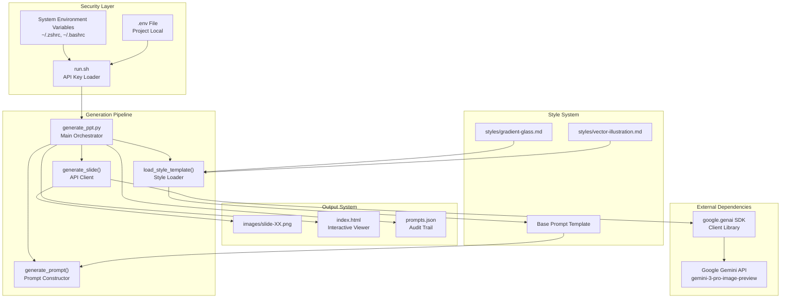

**Sources:** [generate_ppt.py:1-273](), [run.sh:1-48]()

---

## Security Layer Architecture

The security layer implements a **defense-in-depth strategy** for API key management, with multiple protection mechanisms and a clear priority system for credential sources.

### Credential Loading and Validation

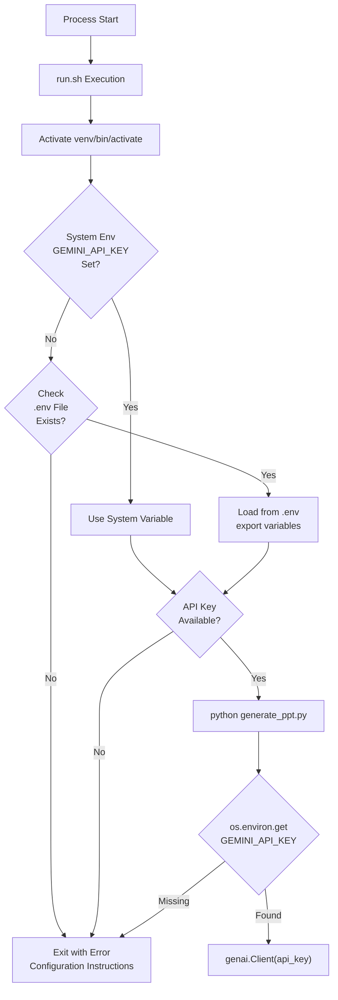

**Sources:** [run.sh:12-48](), [generate_ppt.py:73-77]()

### Credential Priority System

| Priority | Source | Configuration | Protected By |
|----------|--------|---------------|--------------|
| 1 (Highest) | System Environment | `~/.zshrc`, `~/.bashrc` | OS-level permissions |
| 2 (Fallback) | `.env` File | Project directory | `.gitignore` exclusion |
| 3 (Forbidden) | Hardcoded | Source code | Code review, pre-commit checks |

The system checks credential sources in priority order. If the system environment variable `GEMINI_API_KEY` is set, the `.env` file is ignored. This allows users to override project-specific settings with system-wide credentials.

**Sources:** [run.sh:12-38](), [.gitignore]()

---

## Generation Pipeline Architecture

The generation pipeline transforms structured slide plans into rendered images through a **four-stage linear process**: planning, prompt engineering, image generation, and output assembly.

### Pipeline Data Flow

```mermaid
graph LR
    Input["slides_plan.json<br/>Input Specification"]
    MainFunc["main()<br/>Orchestrator"]
    LoadPlan["json.load()<br/>Parse Plan"]
    LoadStyleFunc["load_style_template()<br/>Extract Base Template"]
    StyleFile["styles/*.md<br/>Markdown Template"]
    
    subgraph PromptLoop["For Each Slide Loop"]
        GenPromptFunc["generate_prompt()<br/>style + page_type + content"]
        GenSlideFunc["generate_slide()<br/>API Call + Save"]
        GenAIClient["genai.Client.models.generate_content()"]
        SaveImage["part.as_image().save()"]
    end
    
    GenViewerFunc["generate_viewer_html()<br/>Inject Image Paths"]
    SavePromptsFunc["save_prompts()<br/>Audit Trail"]
    
    Output["outputs/TIMESTAMP/<br/>Complete Package"]
    
    Input --> MainFunc
    MainFunc --> LoadPlan
    MainFunc --> LoadStyleFunc
    StyleFile --> LoadStyleFunc
    LoadPlan --> PromptLoop
    LoadStyleFunc --> GenPromptFunc
    GenPromptFunc --> GenSlideFunc
    GenSlideFunc --> GenAIClient
    GenAIClient --> SaveImage
    SaveImage --> GenViewerFunc
    SaveImage --> SavePromptsFunc
    GenViewerFunc --> Output
    SavePromptsFunc --> Output
```

**Sources:** [generate_ppt.py:144-269]()

### Core Pipeline Functions

#### 1. Style Template Loading

The `load_style_template()` function extracts the base prompt template from style markdown files by parsing section markers.

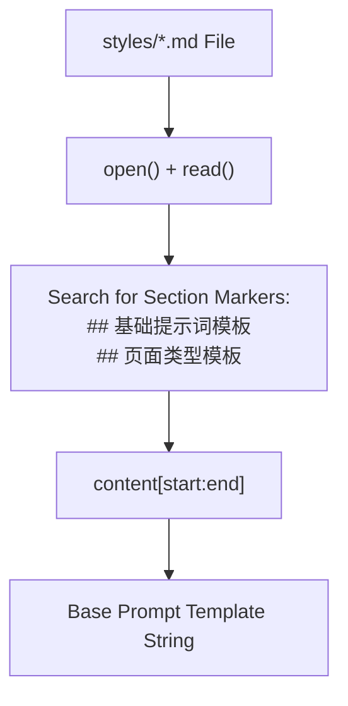

**Sources:** [generate_ppt.py:15-32]()

#### 2. Prompt Construction

The `generate_prompt()` function combines the base style template with page-specific content and type-specific formatting rules.

| Page Type | Trigger Condition | Template Applied | Key Elements |
|-----------|------------------|------------------|--------------|
| `cover` | `page_type == "cover"` OR `slide_number == 1` | Cover page template | 3D glass object, title text, aurora background |
| `data` | `page_type == "data"` OR `slide_number == total_slides` | Data/summary template | Split screen, 3D data visualization |
| `content` | All other cases | Content page template | Bento grid layout, glass containers |

**Sources:** [generate_ppt.py:35-59]()

#### 3. Image Generation

The `generate_slide()` function executes the API call to Google Gemini and handles the response.

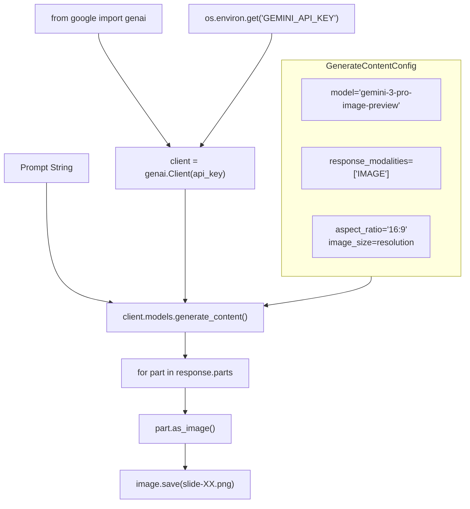

**Sources:** [generate_ppt.py:62-110]()

#### 4. Output Assembly

Two assembly functions produce the final deliverables:

**`generate_viewer_html()`** - Creates the interactive HTML viewer by:
1. Reading the template from `templates/viewer.html`
2. Generating a JavaScript array of image paths: `['images/slide-01.png', ...]`
3. Replacing the `/* IMAGE_LIST_PLACEHOLDER */` marker
4. Writing `index.html` to the output directory

**`save_prompts()`** - Creates an audit trail by:
1. Collecting metadata (title, resolution, style, timestamp)
2. Recording per-slide data (slide_number, page_type, content, prompt, image_path)
3. Serializing to `prompts.json` with UTF-8 encoding and pretty formatting

**Sources:** [generate_ppt.py:112-142]()

---

## Style System Architecture

The style system implements a **template inheritance pattern** where base visual definitions are specialized for different page types. Styles are self-contained markdown documents that define comprehensive visual languages.

### Style File Structure

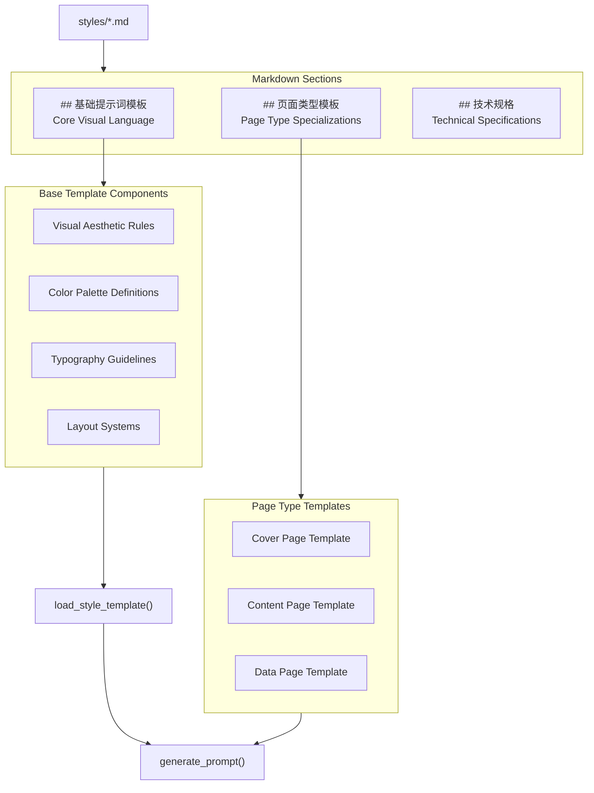

**Sources:** [styles/gradient-glass.md](), [styles/vector-illustration.md]()

### Style Template Extraction Logic

The system extracts only the base template section from style files:

1. **Marker-based parsing**: Searches for `## 基础提示词模板` and `## 页面类型模板` markers
2. **Content extraction**: Returns text between these markers
3. **Fallback behavior**: If markers not found, returns entire file content

This approach allows style files to include documentation and examples while maintaining a clean template extraction process.

**Sources:** [generate_ppt.py:15-32]()

### Built-in Styles Comparison

| Aspect | gradient-glass.md | vector-illustration.md |
|--------|------------------|------------------------|
| Visual Language | Glassmorphism, 3D objects | Flat design, geometric simplification |
| Color Palette | Neon purple, electric blue, coral orange | Retro pastel colors, soft tones |
| Typography | Bold, modern, sans-serif | Playful, outlined, friendly |
| Layout System | Bento grid, floating elements | Structured grids, centered composition |
| Material Effects | Frosted glass, bloom, blur | Solid fills, black outlines |
| Use Cases | Tech products, business presentations | Education, creative proposals |

**Sources:** [styles/gradient-glass.md](), [styles/vector-illustration.md]()

---

## Output System Architecture

The output system produces three distinct artifact types, each serving a different purpose in the presentation workflow.

### Output Directory Structure

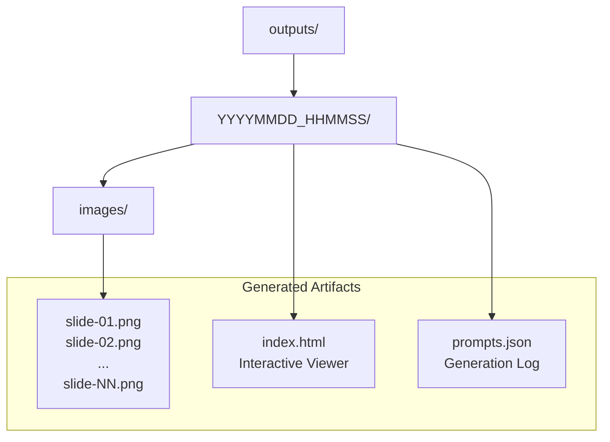

**Sources:** [generate_ppt.py:192-199]()

### Artifact Specifications

#### Image Files (`slide-XX.png`)

- **Naming**: Zero-padded sequential numbering (`slide-01.png`, `slide-02.png`, etc.)
- **Format**: PNG with transparency support
- **Resolution**: 
  - 2K: 2752×1536 pixels (~2.5MB per file)
  - 4K: 5504×3072 pixels (~8MB per file)
- **Aspect Ratio**: 16:9 (standard presentation format)
- **Generation**: Saved by `part.as_image().save()` from Pillow library

**Sources:** [generate_ppt.py:96-101]()

#### HTML Viewer (`index.html`)

The viewer is generated by injecting image paths into a template:

1. **Template source**: `templates/viewer.html` contains the base structure
2. **Placeholder**: `/* IMAGE_LIST_PLACEHOLDER */` marks the injection point
3. **Injection**: JavaScript array of image paths: `['images/slide-01.png', ...]`
4. **Output**: Self-contained HTML file with embedded JavaScript for navigation

**Sources:** [generate_ppt.py:112-133](), [templates/viewer.html]()

#### Audit Trail (`prompts.json`)

The prompts file records complete generation metadata:

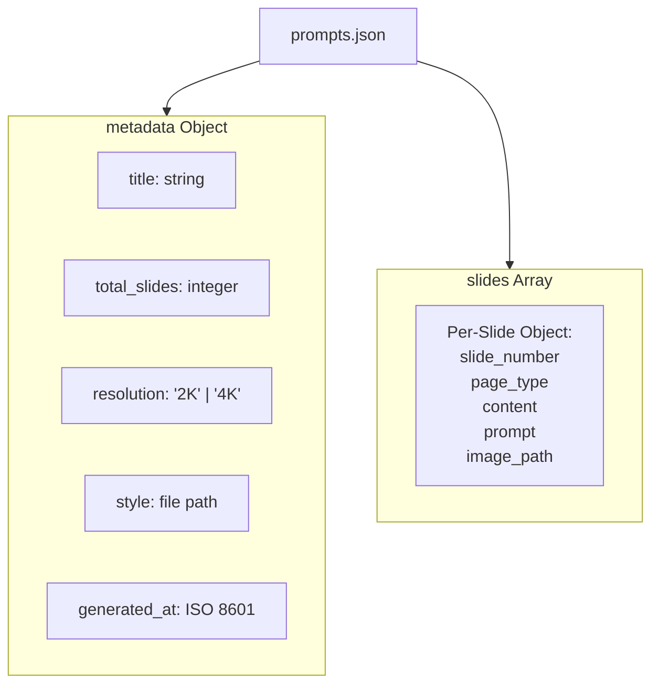

This file enables:
- **Debugging**: Review exact prompts sent to the API
- **Iteration**: Modify prompts and regenerate specific slides
- **Auditing**: Track what content was generated when
- **Documentation**: Understand the mapping between content and visual output

**Sources:** [generate_ppt.py:136-142](), [generate_ppt.py:212-249]()

---

## Execution Flow Architecture

The system execution is orchestrated by two scripts that handle environment setup and generation logic separately.

### Script Responsibility Separation

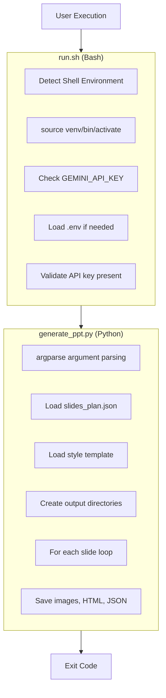

**Sources:** [run.sh:1-48](), [generate_ppt.py:144-272]()

### run.sh Responsibilities

| Line Range | Functionality | Purpose |
|------------|---------------|---------|
| [1-7]() | Shebang and directory detection | Portability across environments |
| [10]() | Virtual environment activation | Isolate Python dependencies |
| [16-35]() | API key priority logic | Implement security best practices |
| [40-44]() | Final validation | Prevent execution without credentials |
| [47]() | Python script invocation | Pass-through all command-line arguments |

**Sources:** [run.sh:1-48]()

### generate_ppt.py Entry Point

The `main()` function at [generate_ppt.py:144-269]() orchestrates the complete pipeline:

1. **Argument parsing** (lines 145-183): Defines CLI interface with `argparse`
2. **Input loading** (lines 186-190): Reads `slides_plan.json` and style template
3. **Directory creation** (lines 192-199): Creates timestamped output directory
4. **Status reporting** (lines 201-209): Prints configuration summary
5. **Generation loop** (lines 223-251): Iterates through slides, generating each
6. **Artifact saving** (lines 254-257): Saves prompts and HTML viewer
7. **Completion report** (lines 259-268): Prints output locations and next steps

**Sources:** [generate_ppt.py:144-272]()

---

## External Dependencies Architecture

The system has a minimal dependency footprint, relying primarily on the Google Gemini SDK and standard library components.

### Dependency Graph

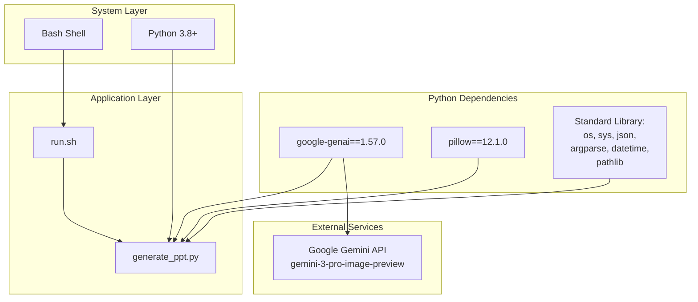

**Sources:** [generate_ppt.py:1-13](), [generate_ppt.py:65-66]()

### Dependency Details

#### google-genai (v1.57.0)

- **Purpose**: Official SDK for Google Gemini API
- **Import**: `from google import genai`, `from google.genai import types`
- **Usage**: 
  - Client instantiation: `genai.Client(api_key)`
  - Content generation: `client.models.generate_content()`
  - Configuration: `types.GenerateContentConfig()`, `types.ImageConfig()`
- **Critical path**: All image generation depends on this library

**Sources:** [generate_ppt.py:65-94]()

#### pillow (v12.1.0)

- **Purpose**: Image processing and format conversion
- **Usage**: Called implicitly by `part.as_image()` from google-genai SDK
- **Function**: Converts API response data to PNG format and saves to disk

**Sources:** [generate_ppt.py:98-100]()

#### Standard Library Modules

| Module | Usage | Functions Used |
|--------|-------|---------------|
| `os` | File system operations, env vars | `os.environ.get()`, `os.makedirs()`, `os.path.join()` |
| `sys` | Exit codes, error handling | `sys.exit()` |
| `json` | Data serialization | `json.load()`, `json.dump()` |
| `argparse` | CLI parsing | `ArgumentParser()`, `add_argument()`, `parse_args()` |
| `datetime` | Timestamps | `datetime.now()`, `strftime()`, `isoformat()` |
| `pathlib` | Path manipulation | `Path()` (imported but not used) |

**Sources:** [generate_ppt.py:7-12]()

---

## API Integration Architecture

The system integrates with Google Gemini API through a structured configuration and response handling pattern.

### API Call Configuration

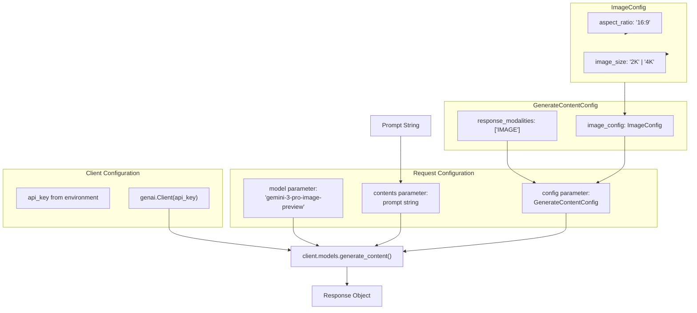

**Sources:** [generate_ppt.py:82-94]()

### Response Processing

The API returns a response object containing parts. Each part may contain:
- `inline_data`: Binary image data
- `as_image()`: Method to convert to Pillow Image object

Processing flow:
1. Iterate through `response.parts`
2. Check if `part.inline_data is not None`
3. Convert to image: `image = part.as_image()`
4. Save to disk: `image.save(image_path)`

**Sources:** [generate_ppt.py:96-105]()

### Error Handling

The system implements error handling at three levels:

1. **Import validation**: Check if `google-genai` is installed [generate_ppt.py:65-70]()
2. **Credential validation**: Check if API key is available [generate_ppt.py:73-77]()
3. **Generation errors**: Catch exceptions during API calls and continue [generate_ppt.py:107-109]()

Each slide generation is isolated, so a failure on one slide does not prevent generation of subsequent slides.

**Sources:** [generate_ppt.py:62-110]()

---

## Data Flow Summary

The complete end-to-end data flow through the system:

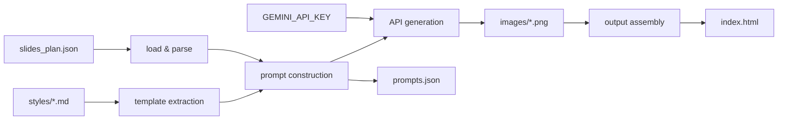

Each slide follows this transformation pipeline independently, with shared style templates and configuration but isolated generation contexts. The timestamp-based output directory ensures multiple generation runs do not conflict.

**Sources:** [generate_ppt.py:144-269]()

---

# Page: Getting Started

# Getting Started

<details>
<summary>Relevant source files</summary>

The following files were used as context for generating this wiki page:

- [QUICKSTART.md](QUICKSTART.md)
- [README.md](README.md)
- [SETUP_COMPLETE.md](SETUP_COMPLETE.md)

</details>


This document provides an overview of the initial setup and first-run experience for the NanoBanana PPT Generator. It covers prerequisites, available entry points, and the high-level workflow from installation to your first generated presentation.

**Scope**: This page provides orientation and conceptual understanding. For step-by-step instructions, see:
- [Quick Start Guide](#2.1) - Fastest path to a working presentation
- [Installation](#2.2) - Detailed dependency and environment setup
- [Your First Presentation](#2.3) - Complete walkthrough with examples

For API key management and security practices, see [Security & Configuration](#3).

---

## System Prerequisites

Before using the PPT Generator, you need three foundational components. The system validates these during startup and provides clear error messages if any are missing.

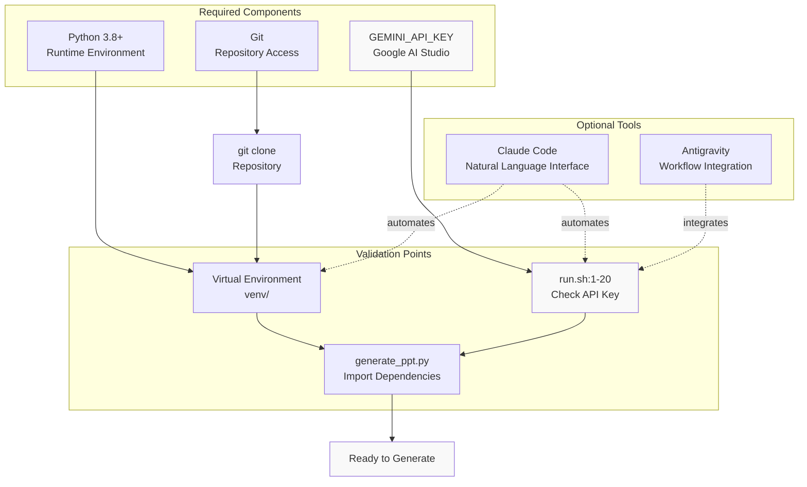

**Sources**: [README.md:131-134](), [run.sh:1-20](), [QUICKSTART.md:5-17]()

### Component Details

| Component | Requirement | Validation Method | Error Handling |
|-----------|------------|-------------------|----------------|
| Python | Version 3.8 or higher | `python3 --version` | Script exits with version message |
| API Key | Valid `GEMINI_API_KEY` | Environment variable check in `run.sh` | "❌ 错误: 未设置API密钥" message |
| Git | Any recent version | `git --version` | Manual verification only |
| Dependencies | `google-genai==1.57.0`, `pillow==12.1.0` | Import statements in `generate_ppt.py` | Python ImportError with package name |

**Sources**: [README.md:131-134](), [SETUP_COMPLETE.md:5-8](), [run.sh:1-20]()

---

## Entry Points and User Journeys

The system provides three distinct entry points, each optimized for different user expertise levels and workflow integration needs. All entry points converge on the same security validation and generation pipeline.

```mermaid
graph LR
    subgraph "Entry Points"
        E1["Claude Code<br/>ppt-generator.md<br/>Natural Language"]
        E2["Command Line<br/>run.sh<br/>Manual Control"]
        E3["Antigravity<br/>Global Workflow<br/>Integration"]
    end
    
    subgraph "Setup Phase"
        S1["Repository Clone<br/>git clone"]
        S2["Virtual Environment<br/>python3 -m venv"]
        S3["Dependencies Install<br/>pip install"]
        S4["API Key Config<br/>GEMINI_API_KEY"]
    end
    
    subgraph "Execution Gate"
        GATE["run.sh Validation<br/>Line 5-20<br/>Check API Key"]
    end
    
    subgraph "Generation"
        GEN["generate_ppt.py<br/>Core Pipeline"]
    end
    
    E1 -.automates.-> S1
    E1 -.automates.-> S2
    E1 -.automates.-> S3
    E1 -.automates.-> S4
    
    E2 --> S1
    E2 --> S2
    E2 --> S3
    E2 --> S4
    
    E3 -.pre-configured.-> S4
    E3 --> GATE
    
    S1 & S2 & S3 & S4 --> GATE
    GATE --> GEN
    
    GEN --> OUT["outputs/TIMESTAMP/<br/>Generated Files"]
```

**Sources**: [README.md:60-106](), [ppt-generator.md](), [QUICKSTART.md:38-51]()

### Entry Point Comparison

| Entry Point | Automation Level | Setup Time | Best For | Key File |
|-------------|-----------------|------------|----------|----------|
| **Claude Code** | Fully automated | ~2 minutes | First-time users, quick iterations | `ppt-generator.md` |
| **Command Line** | Manual | ~10 minutes | Developers, customization, CI/CD | `run.sh`, `generate_ppt.py` |
| **Antigravity** | Partially automated | ~5 minutes | Workflow integration, repeated tasks | Workflow configuration |

**Sources**: [README.md:60-122](), [QUICKSTART.md:38-62]()

---

## Setup Workflow Architecture

The setup process follows a four-phase linear progression. Each phase must complete successfully before the next can begin. The system creates checkpoint artifacts that prevent redundant work on subsequent runs.

```mermaid
flowchart TD
    START["User Initiates Setup"]
    
    subgraph "Phase 1: Environment Creation"
        P1A["Clone Repository<br/>git clone<br/>github.com/op7418/NanoBanana-PPT-Skills"]
        P1B["Create venv/<br/>python3 -m venv venv"]
        P1C["Activate Environment<br/>source venv/bin/activate"]
    end
    
    subgraph "Phase 2: Dependency Installation"
        P2A["Install google-genai<br/>Version 1.57.0"]
        P2B["Install pillow<br/>Version 12.1.0"]
        P2C["Verify Imports<br/>python -c 'import google.genai'"]
    end
    
    subgraph "Phase 3: Security Configuration"
        P3A["Create .env File<br/>cp .env.example .env"]
        P3B["Set GEMINI_API_KEY<br/>System or .env"]
        P3C["Verify .gitignore<br/>Excludes .env"]
    end
    
    subgraph "Phase 4: Validation"
        P4A["run.sh --help<br/>Startup Test"]
        P4B["Check API Key Load<br/>Environment Variable"]
        P4C["Ready State<br/>✅ System Operational"]
    end
    
    START --> P1A
    P1A --> P1B --> P1C
    P1C --> P2A
    P2A --> P2B --> P2C
    P2C --> P3A
    P3A --> P3B --> P3C
    P3C --> P4A
    P4A --> P4B --> P4C
    
    P4C --> READY["Ready for First Generation"]
```

**Sources**: [README.md:138-194](), [SETUP_COMPLETE.md:3-18](), [QUICKSTART.md:14-17]()

### Phase Checkpoints

Each phase creates verifiable artifacts that persist across terminal sessions:

| Phase | Checkpoint File | Validation Command | Recovery Action |
|-------|----------------|-------------------|-----------------|
| 1. Environment | `venv/bin/activate` | `test -d venv && echo "OK"` | Re-run `python3 -m venv venv` |
| 2. Dependencies | `venv/lib/python3.x/site-packages/google/` | `pip list \| grep genai` | Re-run `pip install google-genai pillow` |
| 3. Security | `.env` or `~/.zshrc` entry | `echo $GEMINI_API_KEY` | Reconfigure API key (see [3.1](#3.1)) |
| 4. Validation | Successful `run.sh --help` output | Run validation command | Debug error message output |

**Sources**: [SETUP_COMPLETE.md:76-90](), [README.md:184-194]()

---

## First Run Expectations

When you execute your first generation command, the system progresses through distinct stages with visible progress indicators. Understanding these stages helps set realistic timing expectations and troubleshoot issues.

### Execution Timeline Diagram

```mermaid
gantt
    title First Generation Timeline (5 Pages, 2K Resolution)
    dateFormat X
    axisFormat %Ss
    
    section Startup
    Environment Activation : 0, 2
    API Key Loading : 2, 3
    Import Dependencies : 3, 5
    
    section Planning
    Parse slides_plan.json : 5, 7
    Load Style Template : 7, 9
    
    section Generation
    Slide 1 API Call : 9, 39
    Slide 2 API Call : 39, 69
    Slide 3 API Call : 69, 99
    Slide 4 API Call : 99, 129
    Slide 5 API Call : 129, 159
    
    section Assembly
    Generate index.html : 159, 161
    Copy Templates : 161, 162
    Save prompts.json : 162, 163
```

**Sources**: [QUICKSTART.md:96-103](), [README.md:362-367]()

### Console Output Sequence

```bash
# Phase 1: Startup (2-3 seconds)
✅ 使用系统环境变量中的API密钥
Loading style template: styles/gradient-glass.md
Parsing slides plan: slides_plan.json

# Phase 2: Generation Loop (5 x 30 seconds = 150 seconds)
Generating slide 1/5... (cover page)
✓ Slide 1 saved: outputs/20260109_143022/slide-01.png
Generating slide 2/5... (content page)
✓ Slide 2 saved: outputs/20260109_143022/slide-02.png
[... continues for all slides ...]

# Phase 3: Assembly (1-2 seconds)
Creating HTML viewer...
✓ Viewer created: outputs/20260109_143022/index.html
Saving generation log...
✓ Log saved: outputs/20260109_143022/prompts.json

# Phase 4: Completion
🎉 Generation complete!
Open: outputs/20260109_143022/index.html
```

**Sources**: [generate_ppt.py](), [run.sh:1-30]()

### Generated Output Structure

After successful generation, the `outputs/` directory contains a timestamped folder with all artifacts:

```
outputs/
└── 20260109_143022/          # Timestamp format: YYYYMMDD_HHMMSS
    ├── slide-01.png           # Cover page image (2752x1536 @ 2K)
    ├── slide-02.png           # Content page image
    ├── slide-03.png           # Content page image
    ├── slide-04.png           # Content page image
    ├── slide-05.png           # Content page image
    ├── index.html             # Interactive viewer (from templates/viewer.html)
    └── prompts.json           # Complete prompt log for debugging
```

**File Size Expectations**:
- **2K Resolution**: ~2-2.5MB per PNG, ~10-12MB total for 5 slides
- **4K Resolution**: ~7-8MB per PNG, ~35-40MB total for 5 slides
- **HTML Viewer**: ~15-20KB (embedded CSS/JS)
- **Prompts Log**: ~5-10KB (depends on content length)

**Sources**: [README.md:339-356](), [QUICKSTART.md:54-62](), [templates/viewer.html]()

---

## Minimal Working Example

This is the absolute minimum command sequence to generate a presentation, assuming prerequisites are met:

```bash
# 1. Clone and enter repository
git clone https://github.com/op7418/NanoBanana-PPT-Skills.git
cd NanoBanana-PPT-Skills

# 2. Set API key (choose one method)
export GEMINI_API_KEY="your-key-here"           # Option A: Session variable
echo 'export GEMINI_API_KEY="key"' >> ~/.zshrc  # Option B: Permanent (recommended)

# 3. Install dependencies
python3 -m venv venv
source venv/bin/activate
pip install google-genai pillow

# 4. Generate with test data (if available)
./run.sh --plan test_slides_plan.json \
         --style styles/gradient-glass.md \
         --resolution 2K

# 5. View result
open outputs/*/index.html
```

**Sources**: [QUICKSTART.md:5-56](), [README.md:138-194]()

### Claude Code Alternative (Zero-Command Setup)

For users with Claude Code access, the entire setup reduces to a single natural language prompt:

```
Please install PPT Generator and generate a 5-page presentation about [topic]
using the gradient glass style at 2K resolution.

My API key is: [your-key-here]
```

Claude Code will execute all setup commands automatically and generate the presentation.

**Sources**: [README.md:64-106](), [ppt-generator.md]()

---

## Troubleshooting First Run

Common issues and their diagnostic procedures:

### Issue: "API Key Not Found"

```bash
# Symptom in console:
❌ 错误: 未设置API密钥

# Diagnosis:
echo $GEMINI_API_KEY
# If empty, key not loaded

# Solution:
export GEMINI_API_KEY="your-key"
# OR edit ~/.zshrc to add permanent variable
```

**Sources**: [run.sh:5-20](), [ENV_SETUP.md]()

### Issue: "Module Not Found: google.genai"

```bash
# Symptom:
ModuleNotFoundError: No module named 'google.genai'

# Diagnosis:
which python  # Check if venv is active
# Should show: /path/to/NanoBanana-PPT-Skills/venv/bin/python

# Solution:
source venv/bin/activate
pip install google-genai pillow
```

**Sources**: [SETUP_COMPLETE.md:142-149](), [README.md:153-156]()

### Issue: "Permission Denied: ./run.sh"

```bash
# Symptom:
bash: ./run.sh: Permission denied

# Solution:
chmod +x run.sh
```

**Sources**: [run.sh:1]()

---

## Next Steps

After completing first run successfully:

1. **Explore Built-in Styles**: Review [6.2](#6.2) (Gradient Glass) and [6.3](#6.3) (Vector Illustration) to understand visual options
2. **Learn HTML Viewer Controls**: See [7.2](#7.2) for keyboard shortcuts and features
3. **Customize Content Structure**: Study [5.1](#5.1) to understand how `slides_plan.json` controls output
4. **Integrate into Workflow**: Review [4.3](#4.3) for Antigravity integration or [4.2](#4.2) for advanced CLI usage

**For detailed step-by-step guidance, proceed to**:
- [Quick Start Guide](#2.1) - Condensed 5-minute walkthrough
- [Installation](#2.2) - Comprehensive environment setup
- [Your First Presentation](#2.3) - Complete tutorial with examples

**Sources**: [README.md:13](), [QUICKSTART.md:63-237]()

---

# Page: Quick Start Guide

# Quick Start Guide

<details>
<summary>Relevant source files</summary>

The following files were used as context for generating this wiki page:

- [QUICKSTART.md](QUICKSTART.md)
- [README.md](README.md)

</details>


This page provides the fastest path to generating your first presentation using the NanoBanana PPT Generator. It covers essential prerequisites, minimal setup commands, and basic execution. For detailed installation instructions, see [Installation](#2.2). For a comprehensive walkthrough of your first presentation, see [Your First Presentation](#2.3).

---

## Purpose and Scope

This guide targets users who want to generate a presentation in under 5 minutes with minimal configuration. It assumes basic familiarity with command-line interfaces and covers:

- Essential prerequisites and verification
- API key configuration (critical path only)
- Basic execution commands
- Expected outputs and validation

For detailed API key management and security practices, see [API Key Setup](#3.1). For advanced usage patterns, see [Command Line Usage](#4.2).

---

## Prerequisites Check

Before starting, verify you have the following:

| Requirement | Verification Command | Expected Output |
|-------------|---------------------|-----------------|
| Python 3.8+ | `python3 --version` | `Python 3.8.x` or higher |
| Git | `git --version` | `git version 2.x.x` |
| Google AI API Key | Visit [Google AI Studio](https://makersuite.google.com/app/apikey) | Active API key string starting with `AIzaSy...` |

**Sources:** [README.md:131-134](), [QUICKSTART.md:5-11]()

---

## Quick Setup Flow

The following diagram maps the minimal setup steps to their corresponding code entities and files:

**Diagram: Minimal Setup Path**

```mermaid
flowchart TB
    START["User: I want to generate PPT"]
    
    subgraph "Step 1: Repository"
        CLONE["git clone<br/>NanoBanana-PPT-Skills"]
        DIR["cd NanoBanana-PPT-Skills/"]
    end
    
    subgraph "Step 2: Environment"
        VENV["python3 -m venv venv"]
        ACTIVATE["source venv/bin/activate"]
    end
    
    subgraph "Step 3: Dependencies"
        PIP["pip install<br/>google-genai pillow"]
        DEP1["google-genai==1.57.0"]
        DEP2["pillow==12.1.0"]
    end
    
    subgraph "Step 4: API Key"
        EXPORT["export GEMINI_API_KEY='...'"]
        ENV_VAR["System Environment<br/>$GEMINI_API_KEY"]
    end
    
    subgraph "Step 5: Verification"
        RUNSH["./run.sh --help"]
        CHECK["run.sh:5-11<br/>load_api_key()"]
        SUCCESS["✓ API key loaded"]
    end
    
    START --> CLONE
    CLONE --> DIR --> VENV
    VENV --> ACTIVATE --> PIP
    PIP --> DEP1 & DEP2
    DEP1 & DEP2 --> EXPORT
    EXPORT --> ENV_VAR --> RUNSH
    RUNSH --> CHECK --> SUCCESS
    
    SUCCESS --> READY["Ready to generate"]
```

**Sources:** [README.md:60-107](), [QUICKSTART.md:3-61]()

---

## Step-by-Step Execution

### Step 1: Clone and Navigate

```bash
git clone https://github.com/op7418/NanoBanana-PPT-Skills.git
cd NanoBanana-PPT-Skills
```

This creates a local copy of the repository with the following critical files:
- [generate_ppt.py]() - Core generation logic
- [run.sh]() - Shell orchestration script
- [styles/]() - Visual style definitions

**Sources:** [README.md:140-143]()

### Step 2: Create Virtual Environment

```bash
python3 -m venv venv
source venv/bin/activate  # On Windows: venv\Scripts\activate
```

The `venv/` directory isolates Python dependencies and is excluded from version control via [.gitignore:1]().

**Sources:** [README.md:147-150]()

### Step 3: Install Dependencies

```bash
pip install google-genai pillow
```

This installs two required packages:
- `google-genai==1.57.0` - Gemini API client SDK
- `pillow==12.1.0` - Image processing library

**Sources:** [README.md:154-156](), [QUICKSTART.md:14-17]()

### Step 4: Configure API Key

**Option A: System Environment Variable (Recommended)**

```bash
# For zsh (macOS default)
echo 'export GEMINI_API_KEY="your-api-key-here"' >> ~/.zshrc
source ~/.zshrc

# For bash
echo 'export GEMINI_API_KEY="your-api-key-here"' >> ~/.bashrc
source ~/.bashrc
```

**Option B: Project .env File (Fallback)**

```bash
cp .env.example .env
# Edit .env and add: GEMINI_API_KEY=your-api-key-here
```

The [run.sh:5-24]() script implements a priority system: system environment variables are checked first, then `.env` file as fallback.

**Sources:** [README.md:160-183](), [QUICKSTART.md:5-11]()

### Step 5: Verify Installation

```bash
./run.sh --help
```

**Expected Output:**
```
✅ 使用系统环境变量中的API密钥
usage: generate_ppt.py [-h] --plan PLAN --style STYLE ...
```

If you see this message, the API key was successfully loaded from system environment. The verification logic is in [run.sh:5-11]().

**Sources:** [README.md:185-195]()

---

## Basic Generation Command

The following diagram shows the minimal execution path from command to output:

**Diagram: Basic Execution Flow (Code Entities)**

```mermaid
flowchart LR
    subgraph "Input Files"
        PLAN["slides_plan.json<br/>{slides: [...]}"]
        STYLE["styles/gradient-glass.md<br/>基础提示词模板"]
    end
    
    subgraph "Execution"
        RUNSH_EXEC["./run.sh"]
        LOAD_KEY["run.sh:5-24<br/>load_api_key()"]
        GEN_PY["generate_ppt.py"]
        MAIN["main() function"]
    end
    
    subgraph "API Calls"
        GENAI["google.genai module"]
        API["Gemini API<br/>gemini-3-pro-image-preview"]
    end
    
    subgraph "Outputs"
        OUTDIR["outputs/TIMESTAMP/"]
        IMAGES["slide-01.png...N"]
        HTML["index.html"]
        PROMPTS["prompts.json"]
    end
    
    PLAN --> RUNSH_EXEC
    STYLE --> RUNSH_EXEC
    RUNSH_EXEC --> LOAD_KEY
    LOAD_KEY --> GEN_PY
    GEN_PY --> MAIN
    MAIN --> GENAI
    GENAI --> API
    API --> OUTDIR
    OUTDIR --> IMAGES & HTML & PROMPTS
```

**Sources:** [run.sh](), [generate_ppt.py]()

### Minimal Command

```bash
./run.sh --plan slides_plan.json \
         --style styles/gradient-glass.md \
         --resolution 2K
```

**Parameter Breakdown:**

| Parameter | Description | File Reference |
|-----------|-------------|----------------|
| `--plan` | Slide content structure (JSON format) | See format in [README.md:239-258]() |
| `--style` | Visual style template | [styles/gradient-glass.md]() or [styles/vector-illustration.md]() |
| `--resolution` | Output resolution (`2K` or `4K`) | `2K` = 2752x1536px, `4K` = 5504x3072px |

**Sources:** [README.md:262-266](), [QUICKSTART.md:96-103]()

### Creating slides_plan.json

Create a minimal plan file:

```json
{
  "title": "Quick Start Demo",
  "total_slides": 3,
  "slides": [
    {
      "slide_number": 1,
      "page_type": "cover",
      "content": "Quick Start Demo\nNanoBanana PPT Generator"
    },
    {
      "slide_number": 2,
      "page_type": "content",
      "content": "Key Features\n- AI-powered generation\n- Multiple visual styles\n- 16:9 HD output"
    },
    {
      "slide_number": 3,
      "page_type": "content",
      "content": "Getting Started\n1. Setup API key\n2. Run generation\n3. View results"
    }
  ]
}
```

The `page_type` field determines which template section from the style file is used. Valid types: `cover`, `content`, `data`.

**Sources:** [README.md:239-258](), [QUICKSTART.md:19-36]()

---

## Expected Output and Validation

### Generation Process Timeline

| Phase | Duration (2K) | Console Output | Code Location |
|-------|---------------|----------------|---------------|
| Initialization | < 1s | "使用系统环境变量中的API密钥" | [run.sh:5-24]() |
| Slide 1 generation | ~30s | "Generating slide 1/3..." | [generate_ppt.py]() |
| Slide 2 generation | ~30s | "Generating slide 2/3..." | [generate_ppt.py]() |
| Slide 3 generation | ~30s | "Generating slide 3/3..." | [generate_ppt.py]() |
| Assembly | < 1s | "Creating viewer..." | [generate_ppt.py]() |
| **Total** | **~1.5 min** | "✓ Complete" | |

**Sources:** [QUICKSTART.md:96-103](), [README.md:366-367]()

### Output Directory Structure

```
outputs/
└── 20260109_143022/          # Timestamp-based directory
    ├── slide-01.png          # Generated slide images
    ├── slide-02.png
    ├── slide-03.png
    ├── index.html            # Interactive viewer (from templates/viewer.html)
    └── prompts.json          # Complete prompts used for generation
```

**Sources:** [README.md:339-356]()

### Viewing Results

```bash
# Open the HTML viewer
open outputs/20260109_143022/index.html

# Or manually in browser
# Navigate to: file:///path/to/outputs/TIMESTAMP/index.html
```

**Keyboard Controls in Viewer:**

| Key | Action |
|-----|--------|
| `→` `↓` | Next slide |
| `←` `↑` | Previous slide |
| `ESC` | Toggle fullscreen |
| `Space` | Auto-play toggle |
| `Home` | Jump to first slide |
| `End` | Jump to last slide |
| `H` | Hide/show controls |

The viewer logic is defined in [templates/viewer.html]().

**Sources:** [README.md:323-333](), [QUICKSTART.md:54-61]()

---

## Validation Checklist

After execution, verify the following:

```bash
# 1. Check output directory exists
ls -la outputs/20260109_143022/

# 2. Verify all slides generated
ls -1 outputs/20260109_143022/slide-*.png | wc -l
# Should match total_slides count

# 3. Check prompts were logged
cat outputs/20260109_143022/prompts.json

# 4. Verify file sizes (approximate)
# 2K: ~2-3 MB per slide
# 4K: ~7-9 MB per slide
du -h outputs/20260109_143022/slide-*.png

# 5. Test viewer opens
open outputs/20260109_143022/index.html
```

**Sources:** [QUICKSTART.md:183-219]()

---

## Common Quick-Start Issues

### Issue 1: API Key Not Found

**Symptom:**
```
❌ 未找到GEMINI_API_KEY
```

**Solution:**
```bash
# Verify environment variable is set
echo $GEMINI_API_KEY

# If empty, re-run export command and verify
export GEMINI_API_KEY='your-key-here'
echo $GEMINI_API_KEY
```

The API key check is in [run.sh:5-24]().

**Sources:** [QUICKSTART.md:183-189]()

### Issue 2: Dependencies Missing

**Symptom:**
```
ModuleNotFoundError: No module named 'google.genai'
```

**Solution:**
```bash
# Verify virtual environment is activated
which python3  # Should show venv/bin/python3

# Reinstall dependencies
pip install google-genai pillow
```

**Sources:** [QUICKSTART.md:183-189]()

### Issue 3: Permission Denied on run.sh

**Symptom:**
```
bash: ./run.sh: Permission denied
```

**Solution:**
```bash
chmod +x run.sh
./run.sh --help
```

**Sources:** [README.md:187]()

---

## Resolution and Style Options

### Quick Reference: Resolutions

| Option | Dimensions | File Size | Generation Time | Use Case |
|--------|------------|-----------|-----------------|----------|
| `2K` | 2752×1536 | ~2.5 MB/slide | ~30s/slide | **Recommended**: Daily presentations, online sharing |
| `4K` | 5504×3072 | ~8 MB/slide | ~60s/slide | Print output, large displays |

**Sources:** [README.md:363-367](), [QUICKSTART.md:96-103]()

### Quick Reference: Built-in Styles

| Style File | Visual Aesthetic | Best For | Key Features |
|------------|------------------|----------|--------------|
| `styles/gradient-glass.md` | Glassmorphism, neon gradients, 3D objects | Tech products, business presentations | Bento grid, volumetric lighting |
| `styles/vector-illustration.md` | Flat design, black outlines, retro colors | Education, creative proposals | Geometric simplification, toy-like |

For detailed style specifications, see [Gradient Glass Style](#6.2) and [Vector Illustration Style](#6.3).

**Sources:** [README.md:278-318]()

---

## Next Steps

Once you've successfully generated your first presentation:

1. **Explore Full Features** → See [Your First Presentation](#2.3) for detailed walkthrough
2. **Secure Your API Key** → Review [Security Best Practices](#3.3) and [Environment Variables](#3.2)
3. **Use Claude Code Interface** → Simplify workflow with [Claude Code Interface](#4.1)
4. **Customize Styles** → Learn [Creating Custom Styles](#6.4)
5. **Export Options** → See [Exporting & Sharing](#7.3) for PDF conversion

For troubleshooting beyond quick fixes, see [Troubleshooting](#8.3).

**Sources:** [QUICKSTART.md:220-226](), [README.md:197-277]()

---

# Page: Installation

# Installation

<details>
<summary>Relevant source files</summary>

The following files were used as context for generating this wiki page:

- [QUICKSTART.md](QUICKSTART.md)
- [README.md](README.md)
- [SETUP_COMPLETE.md](SETUP_COMPLETE.md)

</details>


This page provides detailed instructions for installing the NanoBanana PPT Generator system on your local machine. This includes cloning the repository, setting up a Python virtual environment, and installing required dependencies.

**Scope**: This document covers the initial setup process up to the point where the system can be executed. For API key configuration, see [API Key Setup](#3.1). For your first presentation generation, see [Your First Presentation](#2.3). For a faster path skipping detailed explanations, see [Quick Start Guide](#2.1).

---

## Overview

The installation process consists of four stages:

```mermaid
graph LR
    A["Prerequisites<br/>Check"]
    B["Repository<br/>Clone"]
    C["Virtual Environment<br/>venv/ setup"]
    D["Dependencies<br/>Install"]
    E["Verification"]
    
    A --> B
    B --> C
    C --> D
    D --> E
```

**Sources**: [README.md:126-196](), [QUICKSTART.md:5-18]()

---

## Prerequisites

Before beginning installation, verify the following tools are available on your system:

| Requirement | Minimum Version | Verification Command | Purpose |
|------------|----------------|---------------------|---------|
| Python | 3.8+ | `python3 --version` | Runtime environment |
| pip | Latest | `pip3 --version` | Package management |
| Git | Any recent | `git --version` | Repository cloning |
| Internet | N/A | Test browser access | Package downloads, API access |

### Python Version Check

```bash
python3 --version
# Expected output: Python 3.8.x or higher
```

If Python is not installed or the version is too old, install from [python.org](https://www.python.org/downloads) or use your system package manager.

**Sources**: [README.md:131-134]()

---

## Repository Cloning

### Clone via HTTPS

```bash
git clone https://github.com/op7418/NanoBanana-PPT-Skills.git
cd NanoBanana-PPT-Skills
```

### Clone via SSH

```bash
git clone git@github.com:op7418/NanoBanana-PPT-Skills.git
cd NanoBanana-PPT-Skills
```

### Expected Directory Structure Post-Clone

```
NanoBanana-PPT-Skills/
├── generate_ppt.py           # Core generation script
├── run.sh                    # Orchestration script
├── ppt-generator.md          # Skill definition
├── README.md
├── QUICKSTART.md
├── ENV_SETUP.md
├── SECURITY.md
├── .env.example              # API key template
├── .gitignore                # Security boundary
├── styles/                   # Visual definition library
│   ├── gradient-glass.md
│   └── vector-illustration.md
└── templates/                # HTML viewer template
    └── viewer.html
```

**Sources**: [README.md:138-143](), [README.md:339-356]()

---

## Virtual Environment Setup

The system uses Python's `venv` module to create an isolated dependency environment. This prevents conflicts with system-wide Python packages.

### Creation Commands by Operating System

**macOS and Linux:**
```bash
python3 -m venv venv
```

**Windows (Command Prompt):**
```cmd
python -m venv venv
```

**Windows (PowerShell):**
```powershell
python -m venv venv
```

### Virtual Environment Structure

```mermaid
graph TB
    subgraph "venv/ Directory"
        BIN["bin/<br/>activate scripts"]
        LIB["lib/<br/>python3.x/site-packages/"]
        INCLUDE["include/<br/>Python headers"]
        CONFIG["pyvenv.cfg<br/>configuration"]
    end
    
    subgraph "Installed Packages"
        GENAI["google-genai==1.57.0"]
        PIL["pillow==12.1.0"]
        DEPS["Standard library<br/>json, os, sys, datetime"]
    end
    
    BIN -.activates.-> LIB
    LIB --> GENAI
    LIB --> PIL
    GENAI -.imports.-> DEPS
    PIL -.imports.-> DEPS
```

### Activation

**macOS and Linux:**
```bash
source venv/bin/activate
```

**Windows (Command Prompt):**
```cmd
venv\Scripts\activate.bat
```

**Windows (PowerShell):**
```powershell
venv\Scripts\Activate.ps1
```

**Verification**: After activation, your shell prompt should display `(venv)` prefix:
```
(venv) user@machine:~/NanoBanana-PPT-Skills$
```

### Deactivation

When finished working with the project:
```bash
deactivate
```

**Sources**: [README.md:145-150](), [SETUP_COMPLETE.md:5-9](), [SETUP_COMPLETE.md:27-38]()

---

## Dependency Installation

The system has exactly two external Python dependencies, both specified with pinned versions for reproducibility.

### Dependency Table

| Package | Version | Purpose | Size | API Reference |
|---------|---------|---------|------|---------------|
| `google-genai` | 1.57.0 | Gemini API client SDK | ~15 MB | [google-genai](https://pypi.org/project/google-genai) |
| `pillow` | 12.1.0 | Image processing utilities | ~3 MB | [Pillow](https://pillow.readthedocs.io) |

### Installation Commands

**Standard installation:**
```bash
pip install google-genai pillow
```

**With version pinning (recommended):**
```bash
pip install google-genai==1.57.0 pillow==12.1.0
```

**From requirements file (if created):**
```bash
pip install -r requirements.txt
```

### Installation Flow

```mermaid
graph TD
    START["pip install command"]
    RESOLVE["Dependency<br/>Resolution"]
    DOWNLOAD["Download from<br/>PyPI"]
    INSTALL["Install to<br/>venv/lib/python3.x/site-packages/"]
    VERIFY["Import verification"]
    
    START --> RESOLVE
    RESOLVE --> DOWNLOAD
    DOWNLOAD --> INSTALL
    INSTALL --> VERIFY
    
    VERIFY -->|Success| COMPLETE["Installation<br/>Complete"]
    VERIFY -->|Failure| ERROR["Check network,<br/>retry, or see troubleshooting"]
```

### Verification of Installed Packages

```bash
pip list | grep -E 'google-genai|pillow'
```

Expected output:
```
google-genai    1.57.0
pillow          12.1.0
```

### Import Verification

Test that packages are importable:

```bash
python3 -c "import google.generativeai; import PIL; print('Dependencies OK')"
```

Expected output:
```
Dependencies OK
```

**Sources**: [README.md:152-157](), [QUICKSTART.md:13-17](), [SETUP_COMPLETE.md:5-9]()

---

## Execution Path Validation

After installation, verify that the core execution scripts are accessible and properly configured.

### Script Permissions

The `run.sh` script must be executable:

```bash
chmod +x run.sh
```

### Help Command Test

```bash
./run.sh --help
```

**Expected Output (without API key configured):**
```
⚠️  API密钥未设置！
请选择以下配置方式之一：
...
```

**Expected Output (with API key configured):**
```
✅ 使用系统环境变量中的API密钥
usage: generate_ppt.py [-h] --plan PLAN --style STYLE ...
```

### File Dependency Chain

```mermaid
graph TB
    USER["User Command<br/>./run.sh"]
    RUNSH["run.sh<br/>Orchestrator"]
    VENV["venv/bin/activate<br/>Environment Setup"]
    ENV["GEMINI_API_KEY<br/>from ~/.zshrc or .env"]
    GENPY["generate_ppt.py<br/>Core Logic"]
    DEPS["Installed Packages<br/>google-genai, pillow"]
    
    USER --> RUNSH
    RUNSH --> VENV
    RUNSH --> ENV
    RUNSH --> GENPY
    GENPY --> DEPS
    
    style ENV fill:#f9f9f9
    style DEPS fill:#f9f9f9
```

### Direct Python Execution Test

For advanced users who want to bypass `run.sh`:

```bash
# Activate environment first
source venv/bin/activate

# Test direct execution
python3 generate_ppt.py --help
```

**Sources**: [README.md:184-195](), [SETUP_COMPLETE.md:20-49]()

---

## Installation Validation

After completing all steps, perform a comprehensive validation to ensure the system is ready for use.

### Validation Checklist

| Component | Validation Method | Expected Result |
|-----------|------------------|-----------------|
| Repository | `ls -la \| grep generate_ppt.py` | File exists |
| Virtual Environment | `ls -la venv/` | Directory exists with bin/, lib/ |
| Activation | `which python3` (when venv active) | Points to `venv/bin/python3` |
| google-genai | `python3 -c "import google.generativeai"` | No error |
| pillow | `python3 -c "import PIL"` | No error |
| run.sh | `./run.sh --help` | Displays usage or API key prompt |
| File Permissions | `ls -la run.sh` | Shows `-rwxr-xr-x` or similar |

### Complete Validation Script

```bash
#!/bin/bash
echo "=== Installation Validation ==="
echo ""

# Check repository
echo "1. Repository structure..."
test -f generate_ppt.py && echo "  ✅ generate_ppt.py found" || echo "  ❌ generate_ppt.py missing"
test -f run.sh && echo "  ✅ run.sh found" || echo "  ❌ run.sh missing"
test -d styles && echo "  ✅ styles/ directory found" || echo "  ❌ styles/ directory missing"
echo ""

# Check virtual environment
echo "2. Virtual environment..."
test -d venv && echo "  ✅ venv/ directory exists" || echo "  ❌ venv/ not found - run: python3 -m venv venv"
test -f venv/bin/activate && echo "  ✅ Activation script exists" || echo "  ❌ Activation script missing"
echo ""

# Activate and check packages
echo "3. Python packages..."
source venv/bin/activate
python3 -c "import google.generativeai" 2>/dev/null && echo "  ✅ google-genai installed" || echo "  ❌ google-genai missing - run: pip install google-genai==1.57.0"
python3 -c "import PIL" 2>/dev/null && echo "  ✅ pillow installed" || echo "  ❌ pillow missing - run: pip install pillow==12.1.0"
echo ""

# Check script permissions
echo "4. Script permissions..."
test -x run.sh && echo "  ✅ run.sh is executable" || echo "  ❌ run.sh not executable - run: chmod +x run.sh"
echo ""

echo "=== Validation Complete ==="
```

**Sources**: [README.md:184-195](), [SETUP_COMPLETE.md:86-91]()

---

## System Path Integration

```mermaid
graph TB
    subgraph "User Environment"
        SHELL["Shell<br/>~/.zshrc or ~/.bashrc"]
        PATH["$PATH variable"]
        PYPATH["$PYTHONPATH variable"]
    end
    
    subgraph "Project Environment"
        PROJDIR["NanoBanana-PPT-Skills/"]
        VENVBIN["venv/bin/"]
        VENVLIB["venv/lib/python3.x/site-packages/"]
    end
    
    subgraph "Runtime Resolution"
        WHICH["which python3"]
        IMPORT["import statements"]
    end
    
    SHELL --> PATH
    PATH --> VENVBIN
    VENVBIN --> WHICH
    
    SHELL --> PYPATH
    PYPATH --> VENVLIB
    VENVLIB --> IMPORT
    
    PROJDIR --> VENVBIN
    PROJDIR --> VENVLIB
```

The virtual environment modifies `$PATH` during activation to prioritize its own Python interpreter and installed packages. This ensures that `python3` and `pip` commands resolve to the isolated environment versions rather than system-wide installations.

**Sources**: [README.md:145-150]()

---

## Post-Installation Next Steps

After successful installation, you must configure the API key before the system can generate presentations. The installation is complete but non-functional without this configuration.

### Immediate Next Actions

1. **Configure API Key** - See [API Key Setup](#3.1) for detailed instructions
2. **Verify Configuration** - See [Environment Variables](#3.2) for verification steps
3. **Generate Test Presentation** - See [Your First Presentation](#2.3) for a walkthrough

### Minimal Viable Configuration

For the absolute minimum setup to test the system:

```bash
# Export API key temporarily (valid for current shell session only)
export GEMINI_API_KEY="your-api-key-here"

# Test with a simple plan (assuming you have test_slides_plan.json)
./run.sh --plan test_slides_plan.json --style styles/gradient-glass.md --resolution 2K
```

**WARNING**: This temporary configuration will not persist across terminal sessions. For permanent configuration, follow the instructions in [API Key Setup](#3.1).

**Sources**: [README.md:158-183](), [QUICKSTART.md:5-11]()

---

## Troubleshooting Installation Issues

### Python Version Mismatch

**Symptom**: `python3: command not found` or version below 3.8

**Solution**:
- **macOS**: Install via Homebrew: `brew install python@3.11`
- **Ubuntu/Debian**: `sudo apt install python3.11 python3.11-venv`
- **Windows**: Download installer from [python.org](https://www.python.org/downloads)

### Virtual Environment Creation Fails

**Symptom**: `Error: Command '['venv/bin/python3', '-Im', 'ensurepip']' returned non-zero exit status`

**Solution**:
```bash
# Install venv module explicitly
sudo apt install python3.11-venv  # Ubuntu/Debian
```

### Permission Denied on run.sh

**Symptom**: `-bash: ./run.sh: Permission denied`

**Solution**:
```bash
chmod +x run.sh
```

### Package Installation Fails

**Symptom**: `ERROR: Could not find a version that satisfies the requirement`

**Solution**:
```bash
# Upgrade pip first
pip install --upgrade pip

# Retry installation
pip install google-genai==1.57.0 pillow==12.1.0
```

### Network/Firewall Issues

**Symptom**: `Could not fetch URL https://pypi.org/simple/...`

**Solution**:
- Verify internet connectivity
- Check corporate firewall/proxy settings
- Use alternative PyPI mirror if needed:
  ```bash
  pip install --index-url https://mirrors.aliyun.com/pypi/simple/ google-genai pillow
  ```

### Import Errors After Installation

**Symptom**: `ModuleNotFoundError: No module named 'google.generativeai'`

**Verification Steps**:
1. Confirm virtual environment is activated (check for `(venv)` prefix)
2. Verify package installation: `pip list | grep google-genai`
3. Check Python interpreter path: `which python3` (should point to `venv/bin/python3`)
4. Re-activate environment: `deactivate && source venv/bin/activate`

**Sources**: [README.md:452-458](), [SETUP_COMPLETE.md:140-165]()

---

## Advanced Installation Options

### System-Wide Installation (Not Recommended)

Installing packages system-wide instead of in a virtual environment:

```bash
# NOT RECOMMENDED - installs globally
sudo pip3 install google-genai==1.57.0 pillow==12.1.0
```

**Drawbacks**:
- Risk of version conflicts with other projects
- Requires root/admin privileges
- Difficult to maintain separate project dependencies
- May interfere with system Python packages

### Multiple Virtual Environments

For users working on multiple projects or testing different versions:

```bash
# Create project-specific environments
python3 -m venv venv-dev     # Development
python3 -m venv venv-prod    # Production-like testing
python3 -m venv venv-exp     # Experimental features

# Activate specific environment
source venv-dev/bin/activate
```

### Docker-Based Installation (Community Approach)

While not officially supported, users can create a containerized environment:

```dockerfile
FROM python:3.11-slim

WORKDIR /app
COPY . /app

RUN python3 -m venv venv && \
    . venv/bin/activate && \
    pip install google-genai==1.57.0 pillow==12.1.0

ENV GEMINI_API_KEY=""
ENTRYPOINT ["./run.sh"]
```

**Note**: This approach requires additional configuration for output file access and is not covered in this documentation.

**Sources**: [README.md:145-157]()

---

## Installation Architecture

```mermaid
graph TB
    subgraph "Local Machine"
        SHELL["Shell Environment<br/>bash/zsh/fish"]
        PYINSTALL["Python 3.8+<br/>System Installation"]
    end
    
    subgraph "Project Directory"
        REPO["Repository Clone<br/>NanoBanana-PPT-Skills/"]
        VENV["Virtual Environment<br/>venv/"]
        SCRIPTS["Execution Scripts<br/>run.sh, generate_ppt.py"]
        CONFIG["Configuration<br/>.env, styles/"]
    end
    
    subgraph "Python Packages"
        GENAI["google-genai<br/>1.57.0"]
        PIL["pillow<br/>12.1.0"]
        STDLIB["Standard Library<br/>json, os, sys, datetime"]
    end
    
    subgraph "External Resources"
        GITHUB["GitHub Repository<br/>Source Code"]
        PYPI["PyPI Registry<br/>Package Downloads"]
    end
    
    GITHUB -->|git clone| REPO
    PYINSTALL -->|python3 -m venv| VENV
    PYPI -->|pip install| GENAI
    PYPI -->|pip install| PIL
    
    VENV --> GENAI
    VENV --> PIL
    VENV --> STDLIB
    
    REPO --> VENV
    REPO --> SCRIPTS
    REPO --> CONFIG
    
    SHELL -->|./run.sh| SCRIPTS
    SCRIPTS -->|imports| GENAI
    SCRIPTS -->|imports| PIL
    SCRIPTS -->|imports| STDLIB
```

This diagram shows the complete dependency chain from system prerequisites through to the executable scripts. All external dependencies are isolated within the `venv/` directory, preventing interference with system-wide Python installations.

**Sources**: [README.md:126-196](), [SETUP_COMPLETE.md:73-90]()

---

# Page: Your First Presentation

# Your First Presentation

<details>
<summary>Relevant source files</summary>

The following files were used as context for generating this wiki page:

- [QUICKSTART.md](QUICKSTART.md)
- [SETUP_COMPLETE.md](SETUP_COMPLETE.md)
- [ppt-generator.md](ppt-generator.md)

</details>


## Purpose and Scope

This page provides a complete walkthrough for generating your first presentation using the NanoBanana PPT Generator. It covers input document preparation, parameter selection, execution methods, and viewing the final output. This guide assumes you have completed the installation steps described in [Installation](#2.2).

For the fastest minimal setup, see [Quick Start Guide](#2.1). For details on using specific interfaces, see [Claude Code Interface](#4.1) or [Command Line Usage](#4.2). For technical details on the generation process, see [Generation Pipeline](#5).

---

## Prerequisites Checklist

Before generating your first presentation, verify the following are complete:

| Requirement | Verification Command | Expected Result |
|-------------|---------------------|-----------------|
| Python dependencies installed | `pip list \| grep genai` | `google-genai==1.57.0` |
| Virtual environment activated | `which python` | Path contains `/venv/bin/python` |
| API key configured | `echo $GEMINI_API_KEY` | Non-empty key string |
| Repository cloned | `ls run.sh` | File exists |

If any prerequisite fails, return to [Installation](#2.2) to complete setup.

**Sources:** [SETUP_COMPLETE.md:1-40](), [QUICKSTART.md:5-17]()

---

## Preparing Your Input Document

The system works best with structured text content. The document format determines how effectively the system can extract key points and organize slides.

### Recommended Document Structure

```markdown
# Main Title

## Section 1: Background
Context and motivation...

## Section 2: Core Concepts
- Key point 1
- Key point 2
- Key point 3

## Section 3: Implementation
Detailed explanation...

## Section 4: Conclusion
Summary and takeaways...
```

### Document Format Support

| Format | Support Level | Notes |
|--------|--------------|-------|
| Markdown (`.md`) | Optimal | Best structure extraction |
| Plain Text (`.txt`) | Good | Manual structure parsing |
| Inline text | Good | Direct content provision |

### Content Guidelines

**Well-structured content characteristics:**
- Clear section headings (`##` level)
- Bullet points for key concepts
- 3-5 main points per section
- Concise explanations (not walls of text)

**Example input document** [QUICKSTART.md:19-36]():
```markdown
# My Presentation Topic

## Part 1: Background
Introduction and context...

## Part 2: Core Ideas
- Concept 1: Explanation
- Concept 2: Explanation
- Concept 3: Explanation

## Part 3: Summary
Key findings and recommendations...
```

**Sources:** [QUICKSTART.md:19-95](), [ppt-generator.md:51-53]()

---

## Selecting Generation Parameters

The generation process requires three parameter decisions that affect output quality, generation time, and content coverage.

### Page Count Selection

```mermaid
graph LR
    subgraph "Page Count Decision"
        DOC["Document Length"] --> DEC{"Content Density"}
        TIME["Presentation Time"] --> DEC
        DEC -->|"5 min talk"| P5["5 pages"]
        DEC -->|"15 min demo"| P10["5-10 pages"]
        DEC -->|"30 min session"| P15["10-15 pages"]
        DEC -->|"60 min training"| P25["20-25 pages"]
    end
    
    P5 --> GEN5["~2.5 min generation @ 2K"]
    P10 --> GEN10["~5 min generation @ 2K"]
    P15 --> GEN15["~7.5 min generation @ 2K"]
    P25 --> GEN25["~12.5 min generation @ 2K"]
```

**Sources:** [QUICKSTART.md:66-70](), [ppt-generator.md:60-65]()

### Style Selection

The system scans the `styles/` directory to discover available visual themes. Currently two built-in styles exist:

| Style File | Visual Theme | Best For |
|-----------|--------------|----------|
| `gradient-glass.md` | Glassmorphism, 3D objects, neon gradients | Tech presentations, business |
| `vector-illustration.md` | Flat design, geometric shapes, retro colors | Education, creative topics |

The system will prompt for style selection if multiple options exist. See [Style System](#6) for detailed style descriptions and [Creating Custom Styles](#6.4) for extension options.

**Sources:** [ppt-generator.md:56-58](), [QUICKSTART.md:119-140]()

### Resolution Selection

| Resolution | Dimensions | Use Case | Generation Time | File Size |
|-----------|-----------|----------|-----------------|-----------|
| 2K (Recommended) | 2752×1536 | Daily presentations, screen viewing | ~30s per slide | ~2MB per slide |
| 4K | 5504×3072 | Print output, large displays | ~60s per slide | ~8MB per slide |

**Recommendation:** Use 2K for initial generation. Regenerate in 4K only for final high-quality output.

**Sources:** [QUICKSTART.md:96-103](), [SETUP_COMPLETE.md:122-124]()

---

## Execution Workflow

The system supports two primary execution paths: automated via Claude Code and manual via command line.

### Execution Path Overview

```mermaid
flowchart TB
    START["User with Document"] --> METHOD{"Execution Method"}
    
    METHOD -->|"Natural Language"| CC["Claude Code Interface"]
    METHOD -->|"Direct Control"| CLI["Command Line"]
    
    subgraph "Claude Code Path (Automated)"
        CC --> CC1["User: 'Generate 5-page PPT from doc.md'"]
        CC1 --> CC2["Claude reads document"]
        CC2 --> CC3["Claude asks: resolution?"]
        CC3 --> CC4["Claude analyzes content"]
        CC4 --> CC5["Claude creates slides_plan.json"]
        CC5 --> CC6["Claude executes run.sh"]
    end
    
    subgraph "CLI Path (Manual)"
        CLI --> CLI1["User prepares slides_plan.json"]
        CLI1 --> CLI2["User runs ./run.sh"]
        CLI2 --> CLI3["run.sh loads GEMINI_API_KEY"]
        CLI3 --> CLI4["run.sh activates venv"]
        CLI4 --> CLI5["run.sh calls generate_ppt.py"]
    end
    
    CC6 --> EXEC["generate_ppt.py execution"]
    CLI5 --> EXEC
    
    EXEC --> GEN1["Load style template"]
    GEN1 --> GEN2["For each slide in plan"]
    GEN2 --> GEN3["Build prompt"]
    GEN3 --> GEN4["Call Gemini API"]
    GEN4 --> GEN5["Save slide-XX.png"]
    GEN5 --> GEN2
    GEN2 -->|"All complete"| ASM["Assembly"]
    
    ASM --> OUT1["Generate index.html"]
    OUT1 --> OUT2["Save prompts.json"]
    OUT2 --> DONE["Output Complete"]
```

**Sources:** [ppt-generator.md:46-199](), [SETUP_COMPLETE.md:20-48]()

### Method 1: Claude Code Interface (Recommended for First-Time Users)

The Claude Code interface automates document analysis and parameter selection through natural language interaction.

**Execution steps:**

1. Open Claude Code in your terminal
2. Navigate to the repository directory
3. Issue natural language command [ppt-generator.md:250-254]():

```
I want to generate a 5-page PPT based on my-document.md 
using gradient glass style at 2K resolution.
```

4. Claude will:
   - Read document via Read tool
   - Extract key points and structure
   - Create `slides_plan.json` via Write tool
   - Execute `run.sh` with appropriate parameters
   - Display progress and completion status

**Expected console output** [ppt-generator.md:181-198]():
```
✅ PPT generation successful!

📁 Output directory: ppt-generator/outputs/20260109_143022/
🎬 Viewer page: ppt-generator/outputs/20260109_143022/index.html
📝 Prompt log: ppt-generator/outputs/20260109_143022/prompts.json

Open viewer:
open ppt-generator/outputs/20260109_143022/index.html
```

**Sources:** [ppt-generator.md:46-199](), [SETUP_COMPLETE.md:40-48]()

### Method 2: Command Line Interface

For direct control, execute via shell scripts with explicit parameters.

**Basic command structure** [SETUP_COMPLETE.md:23-25]():
```bash
./run.sh --plan ../test_slides_plan.json \
         --style styles/gradient-glass.md \
         --resolution 2K
```

**The `run.sh` script performs** [SETUP_COMPLETE.md:15-16]():
1. Loads `GEMINI_API_KEY` from `.env` or environment
2. Activates Python virtual environment at `venv/`
3. Calls `generate_ppt.py` with forwarded arguments

**Manual alternative** (when `run.sh` not used) [SETUP_COMPLETE.md:28-38]():
```bash
# Activate environment manually
source venv/bin/activate

# Ensure API key is set
export GEMINI_API_KEY="your-key-here"

# Run generator directly
python generate_ppt.py --plan ../test_slides_plan.json \
                       --style styles/gradient-glass.md \
                       --resolution 2K
```

**Sources:** [SETUP_COMPLETE.md:20-38](), [QUICKSTART.md:109-115]()

---

## Understanding slides_plan.json Structure

Both execution methods require a `slides_plan.json` file that defines presentation structure. Claude Code generates this automatically; CLI users must create it manually or use a pre-generated version.

### File Structure

```json
{
  "title": "Presentation Title",
  "total_slides": 5,
  "slides": [
    {
      "slide_number": 1,
      "page_type": "cover",
      "content": "Title: Main Topic\nSubtitle: Key Theme"
    },
    {
      "slide_number": 2,
      "page_type": "content",
      "content": "Point 1: Description\n- Subpoint A\n- Subpoint B"
    },
    {
      "slide_number": 3,
      "page_type": "content",
      "content": "Point 2: Description\n- Subpoint A\n- Subpoint B"
    }
  ]
}
```

### Page Type Reference

| `page_type` | Purpose | Typical Slides |
|-------------|---------|----------------|
| `cover` | Title slide with hero visual | Slide 1 |
| `content` | Key points with icons/illustrations | Slides 2-N-1 |
| `data` | Summary, conclusions, charts | Final slide(s) |

The `page_type` field determines which prompt template variant is applied during generation. See [Prompt Engineering](#5.2) for details on template application.

**Sources:** [ppt-generator.md:113-149](), [ppt-generator.md:237-241]()

---

## Viewing Your Presentation

Generation produces a timestamped output directory containing all presentation assets.

### Output Directory Structure

```mermaid
graph TB
    subgraph "outputs/20260109_143022/"
        HTML["index.html<br/>Interactive Viewer"]
        PROMPTS["prompts.json<br/>Audit Trail"]
        IMG_DIR["images/ (or root)"]
    end
    
    IMG_DIR --> S1["slide-01.png<br/>Cover Page"]
    IMG_DIR --> S2["slide-02.png<br/>Content"]
    IMG_DIR --> S3["slide-03.png<br/>Content"]
    IMG_DIR --> SN["slide-N.png<br/>Final Slide"]
    
    HTML -.references.-> S1 & S2 & S3 & SN
    PROMPTS -.documents.-> S1 & S2 & S3 & SN
```

**Sources:** [ppt-generator.md:289-298](), [SETUP_COMPLETE.md:66-72]()

### Opening the Viewer

**macOS/Linux** [SETUP_COMPLETE.md:69]():
```bash
open outputs/20260109_143022/index.html
```

**Windows**:
```bash
start outputs/20260109_143022/index.html
```

**Alternative**: Navigate to the directory and double-click `index.html` in file explorer.

### Viewer Controls

The HTML viewer (`templates/viewer.html`) provides keyboard-based navigation:

| Key | Action | Description |
|-----|--------|-------------|
| `←` `→` | Navigate | Previous/Next slide |
| `↑` `Home` | Jump | First slide |
| `↓` `End` | Jump | Last slide |
| `Space` | Autoplay | Toggle automatic progression |
| `ESC` | Fullscreen | Toggle fullscreen mode |
| `H` | UI Toggle | Show/hide controls |

See [HTML Viewer](#7.2) for detailed viewer features and customization options.

**Sources:** [SETUP_COMPLETE.md:132-139](), [ppt-generator.md:192-197]()

---

## Generated Output Files

Each generation creates three types of output files with distinct purposes.

### File Inventory

```mermaid
graph LR
    subgraph "Generation Output Files"
        IMAGES["slide-01.png<br/>through<br/>slide-N.png"]
        VIEWER["index.html"]
        AUDIT["prompts.json"]
    end
    
    subgraph "File Purposes"
        IMAGES --> P1["Primary Content<br/>PNG images @ selected resolution"]
        VIEWER --> P2["Presentation Interface<br/>Keyboard controls<br/>Autoplay support"]
        AUDIT --> P3["Generation Audit<br/>Full prompts used<br/>Debugging reference"]
    end
    
    subgraph "Usage Scenarios"
        P1 --> U1["Export to PDF<br/>Import to PowerPoint<br/>Share individual slides"]
        P2 --> U2["Live presentation<br/>Browser-based viewing<br/>Share via web"]
        P3 --> U3["Regenerate specific slides<br/>Understand prompt logic<br/>Quality improvement"]
    end
```

**Sources:** [ppt-generator.md:289-298](), [SETUP_COMPLETE.md:73-89]()

### Image Files: `slide-XX.png`

PNG files numbered sequentially starting from `01`. Each file contains a complete slide rendered at the selected resolution.

**Properties:**
- Format: PNG with transparency support (if style includes it)
- Aspect ratio: 16:9 (standard presentation format)
- Resolution: 2752×1536 (2K) or 5504×3072 (4K)
- File size: ~2MB (2K) or ~8MB (4K) per slide

**Usage:** Can be directly imported into PowerPoint, Keynote, or Google Slides via "Insert Image" functionality.

### Viewer File: `index.html`

Self-contained HTML document that references slide images and provides interactive navigation. Built from `templates/viewer.html` template with dynamic image path injection.

**Features:**
- Responsive layout adapting to window size
- Keyboard shortcuts for navigation
- Autoplay mode with configurable timing
- Fullscreen API integration
- Mobile gesture support (swipe)

The viewer requires no server; double-clicking the file opens it in any modern browser with full functionality.

### Audit File: `prompts.json`

Complete record of all prompts sent to the Gemini API during generation. Useful for understanding generation logic and debugging unexpected results.

**Structure:**
```json
{
  "slides": [
    {
      "slide_number": 1,
      "page_type": "cover",
      "prompt": "Complete prompt text including style template, content, and technical parameters...",
      "content": "Title: Main Topic\nSubtitle: Theme"
    }
  ]
}
```

**Use cases:**
- Regenerate specific slides with modified prompts
- Understand why certain visual elements appeared
- Create custom variations by editing prompts manually

See [Prompt Engineering](#5.2) for details on prompt construction logic.

**Sources:** [ppt-generator.md:289-298](), [QUICKSTART.md:146-154]()

---

## Common First-Time Scenarios

### Scenario 1: Testing with Minimal Content

**Goal:** Verify system functionality before committing to full generation.

**Approach:**
1. Create simple 3-slide document [QUICKSTART.md:23-36]():
```markdown
# Test Topic
## Point 1
Key concept here
## Point 2
Another concept
```

2. Generate 5-page presentation at 2K
3. Total time: ~2.5 minutes
4. Review output quality before larger projects

### Scenario 2: Converting Existing Documentation

**Goal:** Transform technical documentation into presentation format.

**Approach:**
1. Identify 3-5 core sections from documentation
2. Extract key bullet points from each section
3. Create condensed markdown with clear headings
4. Generate 10-page presentation for comprehensive coverage
5. Review `prompts.json` to understand content extraction

**Tip:** The system extracts better when document has clear hierarchy (`#`, `##`, bullet points) rather than prose paragraphs.

### Scenario 3: Iterative Refinement

**Goal:** Improve presentation through multiple generations.

**Approach:**
1. Generate initial version at 2K resolution
2. Review `prompts.json` to see what content was extracted
3. Adjust source document structure based on extraction quality
4. Regenerate with refined input
5. Only move to 4K resolution when content is finalized

This workflow minimizes 4K generation time (60s/slide) by iterating at 2K speed (30s/slide).

**Sources:** [QUICKSTART.md:63-103](), [QUICKSTART.md:142-154]()

### Scenario 4: Multiple Style Comparison

**Goal:** Test which visual style best fits content.

**Approach:** [QUICKSTART.md:109-115]()
```bash
# Generate with gradient-glass style
python generate_ppt.py --plan plan.json \
  --style styles/gradient-glass.md \
  --resolution 2K \
  --output outputs/v1-gradient

# Generate with vector-illustration style
python generate_ppt.py --plan plan.json \
  --style styles/vector-illustration.md \
  --resolution 2K \
  --output outputs/v2-vector
```

Both use same `plan.json` but different style templates, enabling direct visual comparison.

**Sources:** [QUICKSTART.md:105-115]()

---

## Troubleshooting First Generation

### Issue: API Key Not Found

**Error message:**
```
Error: GEMINI_API_KEY environment variable not set
```

**Resolution:**
1. Verify key is set: `echo $GEMINI_API_KEY`
2. If empty, export manually: `export GEMINI_API_KEY='your-key'`
3. For persistent setup, see [Environment Variables](#3.2)

### Issue: Dependency Import Error

**Error message:**
```
ModuleNotFoundError: No module named 'google.genai'
```

**Resolution:**
1. Activate virtual environment: `source venv/bin/activate`
2. Verify installation: `pip list | grep genai`
3. If missing: `pip install google-genai==1.57.0 pillow==12.1.0`

### Issue: Generation Timeout

**Symptoms:** Script appears frozen at "Generating slide X/N..."

**Common causes:**
- Network connectivity issues
- API rate limiting
- Invalid API key

**Resolution:**
1. Check network: `curl https://google.com`
2. Verify API key validity at [Google AI Studio](https://makersuite.google.com/app/apikey)
3. Wait 60 seconds and retry
4. If persistent, try 2K resolution instead of 4K

For comprehensive troubleshooting, see [Troubleshooting](#8.3).

**Sources:** [ppt-generator.md:200-226](), [SETUP_COMPLETE.md:140-165]()

---

## Next Steps

After successfully generating your first presentation:

1. **Explore styles:** Try the alternative visual style (see [Style System](#6))
2. **Learn advanced parameters:** Review full CLI options in [Command Line Usage](#4.2)
3. **Understand generation logic:** Read [Generation Pipeline](#5) for technical details
4. **Export presentations:** Learn PDF export in [Exporting & Sharing](#7.3)
5. **Create custom styles:** Design your own visual themes in [Creating Custom Styles](#6.4)

**Sources:** [QUICKSTART.md:227-239](), [SETUP_COMPLETE.md:103-119]()

---

# Page: Security & Configuration

# Security & Configuration

<details>
<summary>Relevant source files</summary>

The following files were used as context for generating this wiki page:

- [.env.example](.env.example)
- [.gitignore](.gitignore)
- [ENV_SETUP.md](ENV_SETUP.md)
- [SECURITY.md](SECURITY.md)

</details>


## Purpose and Scope

This document provides a comprehensive guide to the security architecture and configuration management of the NanoBanana PPT Generator. The system implements a **defense-in-depth security model** where API key protection is the highest priority, as all functionality depends on secure access to the Google Gemini API.

This page covers the overall security architecture and configuration strategy. For detailed step-by-step instructions, see:
- [API Key Setup](#3.1) - obtaining and configuring your GEMINI_API_KEY
- [Environment Variables](#3.2) - system-level configuration details
- [Security Best Practices](#3.3) - key rotation, monitoring, and emergency procedures
- [Git Safety](#3.4) - preventing accidental credential exposure

## Security Architecture Overview

The system implements a **four-layer security model** where each layer provides independent protection, ensuring that even if one mechanism fails, others remain active.

### Security Gate Architecture

```mermaid
graph TB
    subgraph UserInterfaces["User Entry Points"]
        CLI["./run.sh<br/>CLI Execution"]
        Python["generate_ppt.py<br/>Direct Python"]
        Workflow["Antigravity<br/>Global Workflow"]
    end
    
    subgraph SecurityGate["Security Gate - run.sh"]
        LoadEnv["Load Environment<br/>Priority Check"]
        SysEnv["Check $GEMINI_API_KEY<br/>System Environment"]
        DotEnv["Check .env file<br/>Project Directory"]
        Validate["Validation Logic"]
        Found["✓ Key Found<br/>Export to Process"]
        Missing["✗ Key Missing<br/>Exit with Instructions"]
    end
    
    subgraph CoreExecution["Core Execution"]
        GenScript["generate_ppt.py"]
        APIClient["google.genai.Client"]
        GeminiAPI["Gemini API<br/>Image Generation"]
    end
    
    CLI --> LoadEnv
    Python --> SysEnv
    Workflow --> LoadEnv
    
    LoadEnv --> SysEnv
    SysEnv -->|"Priority 1"| Validate
    SysEnv -->|"Not Found"| DotEnv
    DotEnv -->|"Priority 2"| Validate
    DotEnv -->|"Not Found"| Missing
    
    Validate -->|"Valid"| Found
    Validate -->|"Empty/Invalid"| Missing
    
    Found --> GenScript
    GenScript --> APIClient
    APIClient --> GeminiAPI
    
    style SecurityGate fill:#f9f9f9
    style Found fill:#e8f5e9
    style Missing fill:#ffebee
    style GeminiAPI fill:#e1f5fe
```

**How the Security Gate Works:**

1. **Entry Point**: All user interfaces converge on `run.sh` script
2. **Priority Check**: System environment variable `$GEMINI_API_KEY` is checked first
3. **Fallback**: If system variable not found, checks `.env` file in project directory
4. **Validation**: Ensures the key exists and is non-empty
5. **Export**: Valid key is exported to the execution environment
6. **Execution**: Only proceeds if validation succeeds

**Sources:** [ENV_SETUP.md:32-42](), [SECURITY.md:19-29]()

## Credential Management System

The system supports **three credential sources** with a strict priority hierarchy. Hardcoded keys are explicitly forbidden and blocked by pre-commit checks.

### Credential Source Priority

```mermaid
graph TB
    subgraph Sources["Credential Sources - Evaluated in Order"]
        S1["1. System Environment<br/>~/.zshrc or ~/.bashrc<br/>export GEMINI_API_KEY=..."]
        S2["2. Project .env File<br/>.env in project root<br/>GEMINI_API_KEY=..."]
        S3["3. Hardcoded Keys<br/>FORBIDDEN<br/>Blocked by grep checks"]
    end
    
    subgraph Loader["run.sh Loader Logic"]
        CheckSys["if [ -n $GEMINI_API_KEY ]"]
        UseSys["✓ Use System Variable<br/>Display: Using system env"]
        CheckFile["if [ -f .env ]"]
        LoadFile["source .env<br/>Load from file"]
        UseFile["✓ Use .env Variable<br/>Display: Loading from .env"]
        Fail["✗ Exit with Error<br/>No API key found"]
    end
    
    subgraph Protection["Protection Mechanisms"]
        GitIgnore[".gitignore<br/>Excludes .env"]
        Example[".env.example<br/>Template Only"]
        PreCommit["Pre-commit Check<br/>grep -r AIzaSy"]
        Docs["ENV_SETUP.md<br/>Configuration Guide"]
    end
    
    S1 --> CheckSys
    CheckSys -->|"Found"| UseSys
    CheckSys -->|"Not Found"| CheckFile
    
    CheckFile -->|"Exists"| LoadFile
    LoadFile --> UseFile
    CheckFile -->|"Not Found"| Fail
    
    S2 --> CheckFile
    S3 --> PreCommit
    
    GitIgnore -.Protects.-> S2
    Example -.Template for.-> S2
    PreCommit -.Blocks.-> S3
    Docs -.Guides.-> S1
    
    UseSys --> Execute["Proceed to generate_ppt.py"]
    UseFile --> Execute
    
    style S1 fill:#e8f5e9
    style S2 fill:#fff9c4
    style S3 fill:#ffebee
    style Execute fill:#e1f5fe
```

### Priority Rationale

| Priority | Source | Security Level | Portability | Use Case |
|----------|--------|----------------|-------------|----------|
| **1** | System Environment (`~/.zshrc`) | ✅ Highest | ✅ Cross-project | Recommended for all users |
| **2** | Project `.env` File | ⚠️ Medium | ⚠️ Per-project | Legacy/fallback support |
| **3** | Hardcoded in Code | ❌ Forbidden | ❌ None | Blocked by security checks |

**Sources:** [ENV_SETUP.md:7-13](), [ENV_SETUP.md:32-42](), [SECURITY.md:19-29]()

## Defense-in-Depth Protection Layers

The system implements **four independent protection layers**, each addressing a different attack vector.

### Layer 1: Filesystem Protection

```mermaid
graph LR
    subgraph ProjectFiles["Project Files"]
        EnvFile[".env<br/>Contains API Key"]
        ExampleFile[".env.example<br/>Template Only"]
        RunScript["run.sh<br/>Loads from .env"]
        GenScript["generate_ppt.py<br/>Uses env var"]
    end
    
    subgraph GitIgnoreRules[".gitignore Rules"]
        Rule1["Line 15: .env"]
        Rule2["Line 16: *.key"]
        Rule3["Line 17: *.pem"]
        Rule4["Line 2: venv/"]
        Rule5["Line 20: outputs/"]
    end
    
    subgraph GitRepo["Git Repository - Public"]
        SafeFiles["✓ Tracked Files:<br/>.env.example<br/>run.sh<br/>generate_ppt.py"]
        BlockedFiles["✗ Never Committed:<br/>.env<br/>API keys<br/>venv/<br/>outputs/"]
    end
    
    EnvFile -.Blocked by.-> Rule1
    Rule1 --> BlockedFiles
    
    ExampleFile --> SafeFiles
    RunScript --> SafeFiles
    GenScript --> SafeFiles
    
    style EnvFile fill:#ffebee
    style BlockedFiles fill:#ffebee
    style SafeFiles fill:#e8f5e9
```

**File-Level Protection Mapping:**

| File/Directory | Sensitivity | .gitignore Rule | Status |
|----------------|-------------|-----------------|--------|
| `.env` | 🔴 Critical | Line 15: `.env` | ✅ Protected |
| `venv/` | 🟡 Medium | Line 2: `venv/` | ✅ Protected |
| `outputs/` | 🟢 Low | Line 20: `outputs/` | ✅ Protected |
| `.env.example` | 🟢 Safe | Not ignored | ✅ Tracked |
| `run.sh` | 🟢 Safe | Not ignored | ✅ Tracked |

**Sources:** [.gitignore:14-17](), [SECURITY.md:5-17](), [SECURITY.md:30-45]()

### Layer 2: Runtime Validation

The `run.sh` script performs validation before execution begins, ensuring that missing or invalid keys are caught early.

**Validation Flow in run.sh:**

```mermaid
graph TB
    Start["run.sh Execution Start"]
    
    CheckSysEnv["Check System Env:<br/>if [ -n $GEMINI_API_KEY ]"]
    SystemFound["System Env Found<br/>echo: Using system env var"]
    
    CheckDotEnv["Check .env File:<br/>if [ -f .env ]"]
    LoadDotEnv["source .env<br/>Load variables"]
    DotEnvFound["DotEnv Found<br/>echo: Loading from .env"]
    
    ValidateKey["Validate Key:<br/>if [ -z $GEMINI_API_KEY ]"]
    
    ExportKey["Export to Environment:<br/>GEMINI_API_KEY available"]
    
    CallPython["Execute:<br/>python generate_ppt.py"]
    
    ErrorMsg["Display Error:<br/>API key not configured<br/>See ENV_SETUP.md"]
    Exit["exit 1"]
    
    Start --> CheckSysEnv
    CheckSysEnv -->|"Found"| SystemFound
    CheckSysEnv -->|"Not Found"| CheckDotEnv
    
    SystemFound --> ValidateKey
    
    CheckDotEnv -->|"File Exists"| LoadDotEnv
    CheckDotEnv -->|"No File"| ValidateKey
    LoadDotEnv --> DotEnvFound
    DotEnvFound --> ValidateKey
    
    ValidateKey -->|"Valid"| ExportKey
    ValidateKey -->|"Empty/Missing"| ErrorMsg
    
    ExportKey --> CallPython
    ErrorMsg --> Exit
    
    style SystemFound fill:#e8f5e9
    style ExportKey fill:#e8f5e9
    style ErrorMsg fill:#ffebee
    style Exit fill:#ffebee
```

**Sources:** [ENV_SETUP.md:32-42]()

### Layer 3: Pre-Commit Security Checks

Manual security verification commands prevent accidental key exposure before commits.

**Security Check Commands:**

```bash
# Check if .env is properly ignored
git check-ignore -v .env
# Expected: .gitignore:15:.env    .env

# Search for API keys in codebase
grep -r "AIzaSy" --exclude-dir=.git --exclude-dir=venv --exclude-dir=outputs .
# Expected: No output (or only in .env which won't be committed)

# Verify what files will be committed
git add -n .
# Verify .env is NOT in the list

# Check if .env was ever committed
git log --all --full-history --source -- .env
# Expected: No output (or follow cleanup procedure)
```

**Sources:** [SECURITY.md:47-79](), [ENV_SETUP.md:69-74]()

### Layer 4: Documentation and Templates

The system provides comprehensive documentation and safe templates to guide users toward secure configurations.

**Documentation Files:**

| File | Purpose | Key Content |
|------|---------|-------------|
| `ENV_SETUP.md` | Environment variable setup | System env var configuration for zsh/bash/fish |
| `SECURITY.md` | Git safety procedures | Pre-commit checks, history cleanup |
| `.env.example` | Safe configuration template | Template with placeholder `your-api-key-here` |

**Sources:** [ENV_SETUP.md:1-6](), [SECURITY.md:1-5](), [.env.example:1-10]()

## Configuration Quick Reference

### First-Time Setup

**Recommended: System Environment Variables**

```bash
# For zsh users (macOS default)
echo 'export GEMINI_API_KEY="your-api-key"' >> ~/.zshrc
source ~/.zshrc

# For bash users (Linux default)
echo 'export GEMINI_API_KEY="your-api-key"' >> ~/.bashrc
source ~/.bashrc

# For fish users
set -Ux GEMINI_API_KEY "your-api-key"

# Verify configuration
echo $GEMINI_API_KEY
```

**Alternative: Project .env File**

```bash
# Copy template
cp .env.example .env

# Edit .env file
# GEMINI_API_KEY=your-api-key-here

# Verify .env is in .gitignore
git check-ignore -v .env
```

**Sources:** [ENV_SETUP.md:101-119](), [SECURITY.md:169-184]()

### Verification Commands

| Task | Command | Expected Result |
|------|---------|-----------------|
| Check system variable | `echo $GEMINI_API_KEY` | Displays your API key |
| Verify .env ignored | `git check-ignore -v .env` | `.gitignore:15:.env .env` |
| Search for keys in code | `grep -r "AIzaSy" --exclude-dir=.git .` | No output (or only in .env) |
| Test execution | `./run.sh --help` | Shows help without errors |
| Check what Git tracks | `git status` | No .env in the list |

**Sources:** [ENV_SETUP.md:26-30](), [SECURITY.md:49-75]()

## Security Checklist

Before committing code or deploying to production, verify all items:

### Pre-Commit Checklist

- [ ] API key stored in system environment variable OR .env file
- [ ] `.env` file listed in `.gitignore` (line 15)
- [ ] Run `grep -r "AIzaSy" .` returns no matches in tracked files
- [ ] `.env.example` contains only placeholder `your-api-key-here`
- [ ] `run.sh` contains no hardcoded API keys
- [ ] `git status` does not show `.env` file
- [ ] Documentation files use placeholders, not real keys
- [ ] `venv/` and `outputs/` directories are ignored

### Deployment Checklist

- [ ] Production environment uses secure secret management (GitHub Secrets, AWS Secrets Manager, HashiCorp Vault)
- [ ] API keys are rotated regularly (every 3-6 months)
- [ ] API usage monitoring is enabled
- [ ] Different projects use different API keys (recommended)
- [ ] Emergency key revocation procedure is documented
- [ ] Backup of environment variable configuration exists (stored securely)

**Sources:** [ENV_SETUP.md:201-212](), [SECURITY.md:157-167](), [SECURITY.md:206-223]()

## Emergency Procedures

### If API Key is Exposed

If you accidentally commit an API key to Git:

1. **Immediately revoke the key** at https://makersuite.google.com/app/apikey
2. **Generate a new API key** and configure it in your environment
3. **Clean Git history** to remove the exposed key:

```bash
# Remove .env from all Git history
git filter-branch --force --index-filter \
  "git rm --cached --ignore-unmatch .env" \
  --prune-empty --tag-name-filter cat -- --all

# Force push (coordinate with team first!)
git push origin --force --all
```

4. **For public repositories**, consider deleting and recreating the repository
5. **Monitor API usage** for unusual activity with the exposed key

**Sources:** [SECURITY.md:125-155]()

## Multi-Environment Support

The system supports different deployment environments with appropriate security models:

| Environment | Credential Storage | Protection Mechanism | Use Case |
|-------------|-------------------|---------------------|----------|
| **Development** | `.env` file or system env var | `.gitignore` exclusion | Local development |
| **Collaboration** | `.env.example` template | Documentation guides | Team onboarding |
| **CI/CD** | GitHub Secrets | Encrypted at rest | Automated testing |
| **Production** | KMS (AWS/Azure/Vault) | Centralized key management | Enterprise deployment |

**Sources:** [ENV_SETUP.md:91-126](), [SECURITY.md:206-223]()

---

**Key Takeaway:** The system's security architecture is built on the principle that **API keys must never exist in version control**. Multiple independent protection layers ensure this principle is maintained even if individual mechanisms fail. System environment variables are the recommended approach for maximum security and convenience.

---

# Page: API Key Setup

# API Key Setup

<details>
<summary>Relevant source files</summary>

The following files were used as context for generating this wiki page:

- [.env.example](.env.example)
- [ENV_SETUP.md](ENV_SETUP.md)
- [run.sh](run.sh)

</details>


This document explains how to obtain a Google Gemini API key and configure it for use with the NanoBanana PPT Generator. It covers the acquisition process, two configuration methods (system environment variables and `.env` files), and verification procedures.

For information about environment variable priority and cross-shell configuration, see [Environment Variables](#3.2). For security best practices including key rotation and emergency response, see [Security Best Practices](#3.3). For preventing accidental commits of API keys, see [Git Safety](#3.4).

---

## Overview

The system requires a `GEMINI_API_KEY` to authenticate with Google's Gemini API (`gemini-3-pro-image-preview` model). This key serves as the security gate through which all generation requests must pass. The system supports two configuration methods with a defined priority order:

| Priority | Method | Security Level | Use Case |
|----------|--------|----------------|----------|
| 1 (Highest) | System Environment Variable | High | Recommended for all users |
| 2 (Fallback) | `.env` File | Medium | Alternative for local development |
| ❌ Forbidden | Hardcoded in Scripts | None | Never use this approach |

Sources: [ENV_SETUP.md:7-13](), [run.sh:12-14]()

---

## API Key Acquisition

### Obtaining Your Key from Google AI Studio

**Step 1: Access Google AI Studio**

Navigate to the Google AI Studio API key management page:
```
https://makersuite.google.com/app/apikey
```

**Step 2: Create or Select a Project**

- If this is your first time, Google will prompt you to create a Google Cloud project
- Select an existing project or create a new one for the PPT Generator

**Step 3: Generate API Key**

- Click "Create API Key" button
- The system will generate a key in the format: `AIzaSy...` (approximately 39 characters)
- Copy the key immediately (it may not be shown again in full)

**Step 4: Store Securely**

Do not paste the key directly into any files in the repository. Proceed to the configuration methods below.

### API Key Format

The `GEMINI_API_KEY` follows this format:
- Prefix: `AIzaSy`
- Total length: ~39 characters
- Character set: Alphanumeric plus hyphens and underscores

**Key Acquisition Flow Diagram**

```mermaid
graph TB
    START["User Needs API Key"]
    STUDIO["Google AI Studio<br/>makersuite.google.com"]
    PROJECT["Select/Create<br/>GCP Project"]
    GENERATE["Click 'Create API Key'"]
    COPY["Copy Generated Key<br/>Format: AIzaSy..."]
    CHOICE{"Configuration Method?"}
    ENV["System Environment Variable<br/>(Recommended)"]
    DOTENV[".env File<br/>(Fallback)"]
    VERIFY["Verification Step"]
    
    START --> STUDIO
    STUDIO --> PROJECT
    PROJECT --> GENERATE
    GENERATE --> COPY
    COPY --> CHOICE
    CHOICE -->|"Recommended"| ENV
    CHOICE -->|"Alternative"| DOTENV
    ENV --> VERIFY
    DOTENV --> VERIFY
```

Sources: [.env.example:9](), [ENV_SETUP.md:205]()

---

## Configuration Method 1: System Environment Variables (Recommended)

System environment variables provide the highest security and convenience. The API key is stored in your shell configuration file and available to all terminal sessions without being tied to any specific project directory.

### Configuration Steps by Shell

**For zsh (macOS default, modern Linux)**

Add the API key to your `~/.zshrc` file:

```bash
echo 'export GEMINI_API_KEY="your-api-key-here"' >> ~/.zshrc
source ~/.zshrc
```

**For bash (Linux default, older macOS)**

Add the API key to your `~/.bashrc` file:

```bash
echo 'export GEMINI_API_KEY="your-api-key-here"' >> ~/.bashrc
source ~/.bashrc
```

**For fish shell**

Use fish's universal variable system:

```bash
set -Ux GEMINI_API_KEY "your-api-key-here"
```

### Manual Configuration (Alternative)

Open your shell configuration file in a text editor:

```bash
nano ~/.zshrc  # or ~/.bashrc, depending on your shell
```

Add this line to the end of the file:

```bash
# Google AI API Key for PPT Generator
export GEMINI_API_KEY="your-api-key-here"
```

Save and reload the configuration:

```bash
source ~/.zshrc  # or source ~/.bashrc
```

### Why This Method is Recommended

| Advantage | Description |
|-----------|-------------|
| **Git Safety** | Key never enters the project directory or Git repository |
| **Cross-Project** | Single key available to multiple projects automatically |
| **Persistence** | Survives across terminal sessions and system reboots |
| **No File Management** | No need to copy/manage `.env` files per project |
| **Priority** | Highest priority in `run.sh` loading sequence |

Sources: [ENV_SETUP.md:103-118](), [ENV_SETUP.md:169-177]()

---

## Configuration Method 2: .env File (Fallback)

The `.env` file method stores the API key in a project-local file. This method is automatically used if no system environment variable is found.

### Configuration Steps

**Step 1: Create `.env` from Template**

```bash
cp .env.example .env
```

**Step 2: Edit `.env` File**

Open `.env` in your editor and replace the placeholder:

```bash
# Before
GEMINI_API_KEY=your-api-key-here

# After
GEMINI_API_KEY=AIzaSyABC123...your-actual-key
```

**Step 3: Verify `.gitignore` Protection**

The `.env` file must be excluded from version control. This is already configured in `.gitignore`, but verify:

```bash
grep "^\.env$" .gitignore
```

Expected output: `.env`

### File Structure

The `.env` file follows this format:

```
# Comments start with hash
GEMINI_API_KEY=value-with-no-quotes-needed

# Multiple variables can be added
# ANOTHER_KEY=another-value
```

### When to Use This Method

- **Local testing**: When you need different keys for different projects
- **Team development**: When team members have individual API keys
- **Temporary override**: When you want to temporarily use a different key without changing system settings
- **No shell access**: When you cannot modify shell configuration files

### Security Considerations

⚠️ **Important**: The `.env` file contains sensitive credentials. Ensure:
- It is listed in `.gitignore` (already configured)
- File permissions are restrictive: `chmod 600 .env`
- You never commit it to version control
- You delete it when sharing the project directory

Sources: [.env.example:1-10](), [ENV_SETUP.md:43-48]()

---

## Runtime Loading and Priority System

The `run.sh` script implements a priority-based loading system that determines which API key source to use.

### Loading Logic

**Priority System Diagram**

```mermaid
graph TB
    START["run.sh Execution Starts"]
    CHECK_ENV{"GEMINI_API_KEY<br/>in environment?"}
    USE_ENV["Use System Environment Variable<br/>Echo: '✅ 使用系统环境变量中的API密钥'"]
    CHECK_FILE{"Is .env file present?"}
    LOAD_FILE["Load from .env<br/>export $(cat .env | grep -v '^#' | xargs)<br/>Echo: '📌 从 .env 文件加载API密钥'"]
    ERROR["Display Error Message<br/>Show configuration instructions<br/>Exit code 1"]
    FINAL_CHECK{"GEMINI_API_KEY set?"}
    RUN["Execute generate_ppt.py<br/>with all arguments"]
    
    START --> CHECK_ENV
    CHECK_ENV -->|"Yes ([ -n ])"| USE_ENV
    CHECK_ENV -->|"No ([ -z ])"| CHECK_FILE
    CHECK_FILE -->|"Yes"| LOAD_FILE
    CHECK_FILE -->|"No"| ERROR
    USE_ENV --> FINAL_CHECK
    LOAD_FILE --> FINAL_CHECK
    FINAL_CHECK -->|"Set"| RUN
    FINAL_CHECK -->|"Still Empty"| ERROR
```

Sources: [run.sh:16-44]()

### Code Implementation

The priority logic is implemented in [run.sh:16-38]():

```bash
# Line 16-17: Check if system environment variable exists
if [ -z "$GEMINI_API_KEY" ]; then
    # Lines 18-20: Fallback to .env file
    if [ -f "$SCRIPT_DIR/.env" ]; then
        echo "📌 从 .env 文件加载API密钥"
        export $(cat "$SCRIPT_DIR/.env" | grep -v '^#' | xargs)
    else
        # Lines 22-34: Error message with instructions
        echo "❌ 错误: API密钥未配置"
        # ... configuration instructions ...
        exit 1
    fi
else
    # Lines 36-38: Confirm system variable usage
    echo "✅ 使用系统环境变量中的API密钥"
fi
```

### What Happens at Runtime

| Scenario | run.sh Behavior | Message Displayed |
|----------|----------------|-------------------|
| System env var set | Uses immediately | ✅ 使用系统环境变量中的API密钥 |
| No system var, `.env` exists | Loads from `.env` | 📌 从 .env 文件加载API密钥 |
| No system var, no `.env` | Exits with error | ❌ 错误: API密钥未配置 |
| Key loaded but empty string | Exits with error | ❌ 错误: GEMINI_API_KEY 仍未设置 |

The final validation occurs at [run.sh:41-44](), ensuring the key is not empty before proceeding to [run.sh:47]() where `generate_ppt.py` is executed.

Sources: [run.sh:16-48]()

---

## Verification

After configuring your API key, verify it is accessible before attempting to generate presentations.

### Verification Commands

**Check System Environment Variable**

```bash
echo $GEMINI_API_KEY
```

Expected output: Your API key (e.g., `AIzaSy...`)

If empty, the system environment variable is not set.

**Test run.sh Loading**

```bash
./run.sh --help
```

Expected output:
```
✅ 使用系统环境变量中的API密钥
[help text from generate_ppt.py]
```

Or if using `.env`:
```
📌 从 .env 文件加载API密钥
[help text from generate_ppt.py]
```

**Verify .gitignore Protection**

Ensure your API key will not be committed to Git:

```bash
grep -r "AIzaSy" --exclude-dir=.git --exclude-dir=venv .
```

Expected output: **Nothing** (no matches found). If your actual API key appears, you have a security issue that must be resolved immediately (see [Git Safety](#3.4)).

### Verification Flow Diagram

```mermaid
graph TB
    VERIFY_START["Verification Process"]
    CMD1["Run: echo $GEMINI_API_KEY"]
    CHECK1{"Key Displayed?"}
    PASS1["✅ System Env Var Configured"]
    FAIL1["⚠️ Try .env Method"]
    
    CMD2["Run: ./run.sh --help"]
    CHECK2{"Success Message?"}
    PASS2["✅ run.sh Loads Key Correctly"]
    FAIL2["❌ Check Configuration"]
    
    CMD3["Run: grep -r 'AIzaSy' ."]
    CHECK3{"Any Matches?"}
    PASS3["⚠️ SECURITY ISSUE<br/>See Git Safety page"]
    FAIL3["✅ No Key Leakage"]
    
    COMPLETE["Configuration Verified<br/>Ready to Generate"]
    
    VERIFY_START --> CMD1
    CMD1 --> CHECK1
    CHECK1 -->|"Yes"| PASS1
    CHECK1 -->|"No"| FAIL1
    
    PASS1 --> CMD2
    FAIL1 --> CMD2
    CMD2 --> CHECK2
    CHECK2 -->|"Yes"| PASS2
    CHECK2 -->|"No"| FAIL2
    
    PASS2 --> CMD3
    FAIL2 --> CMD3
    CMD3 --> CHECK3
    CHECK3 -->|"Yes"| PASS3
    CHECK3 -->|"No"| FAIL3
    
    FAIL3 --> COMPLETE
```

Sources: [ENV_SETUP.md:26-30](), [ENV_SETUP.md:69-74](), [run.sh:36-38]()

---

## Troubleshooting

### Common Issues

**Issue: "❌ 错误: API密钥未配置"**

Cause: Neither system environment variable nor `.env` file is configured.

Solution:
1. Choose configuration method (system env var recommended)
2. Follow configuration steps above
3. For system env vars, ensure you ran `source ~/.zshrc` (or `.bashrc`)
4. For `.env` file, ensure file exists and contains `GEMINI_API_KEY=...`

**Issue: Key set but still getting error**

Cause: The key variable is defined but contains an empty string.

Solution:
```bash
# Check if variable exists but is empty
echo "[$GEMINI_API_KEY]"  # Should show [AIzaSy...], not []

# If empty, reconfigure
unset GEMINI_API_KEY
# Then follow configuration steps again
```

**Issue: `.env` file not being recognized**

Cause: File may be in wrong location or have incorrect name.

Solution:
```bash
# Verify file location (must be in project root)
ls -la .env

# Verify run.sh is in same directory
ls -la run.sh

# Check file contents
cat .env
```

**Issue: Wrong shell configuration file**

Cause: Modified `.bashrc` but using `zsh`, or vice versa.

Solution:
```bash
# Check your current shell
echo $SHELL

# Output examples:
# /bin/zsh  → modify ~/.zshrc
# /bin/bash → modify ~/.bashrc
# /usr/bin/fish → use set -Ux command
```

### Testing API Key Validity

To verify your key is valid and has API access:

```bash
# This will attempt a full generation and reveal API errors
./run.sh --plan test_slides_plan.json --style styles/gradient-glass.md --resolution 2K
```

If the key is invalid, you'll see an API authentication error from the Gemini API rather than a configuration error from `run.sh`.

Sources: [run.sh:22-34](), [ENV_SETUP.md:130-134]()

---

## Configuration on New Machines

When cloning the repository to a new development environment, follow this setup sequence:

### Setup Sequence

```mermaid
graph LR
    CLONE["git clone repository"]
    DEPS["Install Dependencies<br/>python3 -m venv venv<br/>pip install google-genai pillow"]
    CONFIG["Configure API Key<br/>(Choose Method)"]
    VERIFY["Run: ./run.sh --help"]
    READY["Ready to Generate"]
    
    CLONE --> DEPS
    DEPS --> CONFIG
    CONFIG --> VERIFY
    VERIFY --> READY
```

**Commands:**

```bash
# Step 1: Clone repository
git clone https://github.com/op7418/NanoBanana-PPT-Skills.git
cd NanoBanana-PPT-Skills

# Step 2: Create virtual environment and install dependencies
python3 -m venv venv
source venv/bin/activate
pip install google-genai pillow

# Step 3: Configure API key (choose one method)
# Method A: System environment variable (recommended)
echo 'export GEMINI_API_KEY="your-api-key"' >> ~/.zshrc
source ~/.zshrc

# Method B: .env file (alternative)
cp .env.example .env
# Edit .env and add your key

# Step 4: Verify configuration
./run.sh --help
```

Expected output on successful configuration:
```
✅ 使用系统环境变量中的API密钥
usage: generate_ppt.py [-h] --plan PLAN --style STYLE [--resolution RESOLUTION]
```

Sources: [ENV_SETUP.md:92-126]()

---

## Key Management Operations

### View Current Key

```bash
echo $GEMINI_API_KEY
```

⚠️ Be careful when running this command in shared environments or screen recordings.

### Temporary Key Override (Current Session Only)

```bash
export GEMINI_API_KEY="temporary-key-here"
./run.sh --plan ...
```

This override lasts only for the current terminal session. When you close the terminal or open a new one, it reverts to the configured value.

### Permanent Key Update

**For System Environment Variable:**

```bash
# Edit configuration file
nano ~/.zshrc  # or ~/.bashrc

# Find and modify this line:
export GEMINI_API_KEY="new-key-here"

# Save and reload
source ~/.zshrc
```

**For .env File:**

```bash
# Edit file directly
nano .env

# Or use sed for scripted updates
sed -i 's/GEMINI_API_KEY=.*/GEMINI_API_KEY=new-key-here/' .env
```

### Remove Key Configuration

**From System Environment:**

```bash
# Edit configuration file and delete the GEMINI_API_KEY line
nano ~/.zshrc

# Reload and unset
source ~/.zshrc
unset GEMINI_API_KEY
```

**From .env File:**

```bash
rm .env
```

Sources: [ENV_SETUP.md:130-165]()

---

## Configuration File Reference

### .env.example Template

The template file at [.env.example:1-10]() provides the structure for local `.env` files:

```bash
# PPT生成器环境变量配置
#
# 使用说明：
# 1. 复制此文件为 .env
# 2. 将 your-api-key-here 替换为您的实际API密钥
# 3. .env 文件不会被提交到Git（已在 .gitignore 中配置）

# Google AI API密钥（必需）
# 获取地址: https://makersuite.google.com/app/apikey
GEMINI_API_KEY=your-api-key-here
```

This file is committed to the repository and serves as documentation. Never modify it to contain real API keys.

### Shell Configuration Files

| Shell | Configuration File | Location |
|-------|-------------------|----------|
| zsh | `.zshrc` | `~/.zshrc` |
| bash | `.bashrc` | `~/.bashrc` |
| fish | Universal vars | `~/.config/fish/fish_variables` |

The system environment variable must be exported in these files to persist across terminal sessions.

### run.sh Environment Loading

The [run.sh:1-48]() script structure:

| Lines | Function | Description |
|-------|----------|-------------|
| 1-7 | Header & Setup | Determine script directory, prepare environment |
| 9-10 | Virtual Env | Activate Python virtual environment from `venv/` |
| 12-14 | Comments | Document priority system |
| 16-38 | Key Loading Logic | Check env var → check .env → error handling |
| 40-44 | Final Validation | Ensure key is non-empty before proceeding |
| 46-47 | Execution | Pass control to `generate_ppt.py` with all arguments |

Sources: [.env.example:1-10](), [run.sh:1-48](), [ENV_SETUP.md:101-118]()

---

## Next Steps

After successfully configuring your API key:

1. **Verify Configuration**: Run `./run.sh --help` to confirm key loading
2. **Learn More About Security**: See [Environment Variables](#3.2) for cross-shell configuration and priority details
3. **Review Best Practices**: See [Security Best Practices](#3.3) for key rotation schedules and multi-project strategies
4. **Ensure Git Safety**: See [Git Safety](#3.4) to prevent accidental key commits
5. **Generate Your First Presentation**: See [Your First Presentation](#2.3) to start using the system

Sources: [ENV_SETUP.md:242-245]()

---

# Page: Environment Variables

# Environment Variables

<details>
<summary>Relevant source files</summary>

The following files were used as context for generating this wiki page:

- [ENV_SETUP.md](ENV_SETUP.md)
- [run.sh](run.sh)

</details>


## Purpose and Scope

This page provides a comprehensive technical guide to configuring and managing the `GEMINI_API_KEY` environment variable across different shell environments. It covers the priority loading system, shell-specific configuration methods, verification procedures, and runtime management operations.

For information about obtaining an API key, see [API Key Setup](#3.1). For security best practices around key management, see [Security Best Practices](#3.3).

---

## Priority System Architecture

The system implements a two-tier priority mechanism for loading the `GEMINI_API_KEY`:

| Priority | Source | Scope | Persistence | Security Level |
|----------|--------|-------|-------------|----------------|
| **1 (Highest)** | System Environment Variable | Global (all projects) | Permanent across sessions | High - outside repository |
| **2 (Fallback)** | `.env` File | Project-local | Permanent within project | Medium - requires `.gitignore` |
| **❌ Forbidden** | Hardcoded in code | N/A | N/A | None - will be committed |

The priority system ensures that system-level configuration takes precedence over project-level configuration, enabling users to override project settings globally while maintaining backward compatibility with `.env`-based workflows.

**Priority System Flow Diagram**

```mermaid
flowchart TD
    Start["run.sh execution"]
    CheckSysEnv{"Check $GEMINI_API_KEY<br/>system environment<br/>(line 16)"}
    SysEnvExists["✅ Use system env var<br/>echo success message<br/>(line 37)"]
    CheckEnvFile{"Check .env file<br/>exists in SCRIPT_DIR<br/>(line 18)"}
    LoadEnvFile["Load .env file<br/>export vars with grep<br/>(line 20)"]
    ShowEnvMsg["📌 Display .env message<br/>(line 19)"]
    ErrorNoKey["❌ Display configuration<br/>instructions (lines 22-34)<br/>exit 1"]
    FinalCheck{"Verify GEMINI_API_KEY<br/>is set (line 41)"}
    ExecutePython["Execute generate_ppt.py<br/>with all args (line 47)"]
    ErrorStillEmpty["❌ Exit with error<br/>(line 43)"]
    
    Start --> CheckSysEnv
    CheckSysEnv -->|"not empty (-z false)"| SysEnvExists
    CheckSysEnv -->|"empty (-z true)"| CheckEnvFile
    CheckEnvFile -->|"file exists"| ShowEnvMsg
    ShowEnvMsg --> LoadEnvFile
    CheckEnvFile -->|"file not exists"| ErrorNoKey
    LoadEnvFile --> FinalCheck
    SysEnvExists --> FinalCheck
    ErrorNoKey --> End1["Exit 1"]
    FinalCheck -->|"is set"| ExecutePython
    FinalCheck -->|"still empty"| ErrorStillEmpty
    ErrorStillEmpty --> End2["Exit 1"]
    ExecutePython --> End3["Process continues"]
```

**Sources:** [run.sh:12-47]()

---

## Shell-Specific Configuration

### zsh Configuration (Recommended)

The **zsh** shell is the default on macOS since Catalina (10.15) and is widely used on Linux. Configuration is stored in `~/.zshrc`.

**Setup Command:**
```bash
echo 'export GEMINI_API_KEY="your-api-key-here"' >> ~/.zshrc
source ~/.zshrc
```

**Manual Configuration:**
1. Open `~/.zshrc` in a text editor:
   ```bash
   nano ~/.zshrc
   # or
   vim ~/.zshrc
   ```

2. Add the export statement at the end of the file:
   ```bash
   # Google AI API Key for PPT Generator
   export GEMINI_API_KEY="your-actual-api-key"
   ```

3. Save and reload configuration:
   ```bash
   source ~/.zshrc
   ```

**Verification:**
```bash
echo $GEMINI_API_KEY
# Should output: your-actual-api-key
```

### bash Configuration

The **bash** shell is the traditional Unix shell, default on older macOS versions and many Linux distributions. Configuration is stored in `~/.bashrc` (Linux) or `~/.bash_profile` (macOS).

**Setup Command (Linux):**
```bash
echo 'export GEMINI_API_KEY="your-api-key-here"' >> ~/.bashrc
source ~/.bashrc
```

**Setup Command (macOS):**
```bash
echo 'export GEMINI_API_KEY="your-api-key-here"' >> ~/.bash_profile
source ~/.bash_profile
```

**Note:** On some systems, `~/.bashrc` is sourced by `~/.bash_profile`, so you may need to configure both files or add a source statement.

### fish Configuration

The **fish** shell (Friendly Interactive Shell) uses a different syntax for environment variables and stores configuration in `~/.config/fish/config.fish`.

**Setup Command:**
```bash
set -Ux GEMINI_API_KEY "your-api-key-here"
```

**Explanation of flags:**
- `-U`: Universal variable (persisted across sessions)
- `-x`: Exported to subprocesses (equivalent to bash's `export`)

**Verification:**
```bash
echo $GEMINI_API_KEY
# Should output: your-api-key-here
```

**Sources:** [ENV_SETUP.md:101-119]()

---

## Verification Methods

### Basic Verification

The simplest verification method checks if the variable is set in the current shell session:

```bash
echo $GEMINI_API_KEY
```

**Expected output:** Your API key string (starts with `AIzaSy...`)  
**Error condition:** Empty output indicates the variable is not set

### Run Script Verification

The `run.sh` script provides built-in verification feedback when executed:

```bash
./run.sh --help
```

**Expected outputs:**

| Message | Meaning | Source |
|---------|---------|--------|
| `✅ 使用系统环境变量中的API密钥` | System env var found (priority 1) | [run.sh:37]() |
| `📌 从 .env 文件加载API密钥` | Loading from `.env` file (priority 2) | [run.sh:19]() |
| `❌ 错误: API密钥未配置` | No configuration found | [run.sh:22]() |

### Comprehensive System Check

To verify the variable is properly exported and accessible to subprocesses:

```bash
# Check current shell value
echo $GEMINI_API_KEY

# Check if variable is exported (bash/zsh)
export -p | grep GEMINI_API_KEY

# Check in new subprocess
bash -c 'echo $GEMINI_API_KEY'
```

All three commands should return your API key for proper configuration.

**Sources:** [ENV_SETUP.md:26-29](), [run.sh:16-38]()

---

## Runtime Management Operations

### View Current Value

Display the current value of the environment variable:

```bash
echo $GEMINI_API_KEY
```

**Security note:** Only execute this in trusted terminals, as the key will be displayed in plaintext.

### Temporary Modification (Session-Only)

Override the environment variable for the current shell session without persisting changes:

```bash
export GEMINI_API_KEY="temporary-key-for-testing"
```

**Scope:** Current shell session only  
**Duration:** Until shell is closed or variable is unset  
**Use case:** Testing with different API keys without modifying configuration files

To verify the temporary change:
```bash
echo $GEMINI_API_KEY
# Should show: temporary-key-for-testing
```

### Permanent Modification

Update the persistent configuration in your shell's RC file.

**For zsh:**
```bash
nano ~/.zshrc
# Find the line: export GEMINI_API_KEY="old-key"
# Update to:     export GEMINI_API_KEY="new-key"
# Save and exit
source ~/.zshrc
```

**For bash:**
```bash
nano ~/.bashrc  # or ~/.bash_profile on macOS
# Make same modification as above
source ~/.bashrc
```

**For fish:**
```bash
set -Ux GEMINI_API_KEY "new-key"
# fish automatically persists universal variables
```

### Deletion

Remove the environment variable from the current session and persistent configuration.

**Step 1: Remove from RC file**
```bash
# For zsh
nano ~/.zshrc
# Delete the line containing: export GEMINI_API_KEY="..."

# For bash
nano ~/.bashrc  # or ~/.bash_profile
# Delete the line containing: export GEMINI_API_KEY="..."

# For fish
set -Ue GEMINI_API_KEY
# The -e flag erases the variable
```

**Step 2: Remove from current session**
```bash
unset GEMINI_API_KEY
```

**Step 3: Reload configuration**
```bash
source ~/.zshrc  # or ~/.bashrc
```

**Verification:**
```bash
echo $GEMINI_API_KEY
# Should output: empty line (no value)
```

**Sources:** [ENV_SETUP.md:130-165]()

---

## Loading Sequence Implementation

The following diagram maps the technical implementation of the environment variable loading system in `run.sh`.

**run.sh Variable Loading Sequence**

```mermaid
sequenceDiagram
    participant User
    participant Shell as "Shell Session"
    participant RunScript as "run.sh"
    participant EnvFile as ".env file"
    participant Python as "generate_ppt.py"
    
    User->>Shell: Execute ./run.sh
    Shell->>RunScript: Start execution
    
    Note over RunScript: Set SCRIPT_DIR (line 7)
    RunScript->>RunScript: Activate venv (line 10)
    
    Note over RunScript: Priority Check (line 16)
    RunScript->>Shell: Test -z $GEMINI_API_KEY
    
    alt System env var exists
        Shell-->>RunScript: Variable not empty
        RunScript->>User: echo "✅ 使用系统环境变量中的API密钥"
    else System env var empty
        Shell-->>RunScript: Variable empty
        RunScript->>EnvFile: Test -f .env
        
        alt .env file exists
            EnvFile-->>RunScript: File found
            RunScript->>User: echo "📌 从 .env 文件加载API密钥"
            RunScript->>EnvFile: cat .env | grep -v '^#'
            EnvFile-->>RunScript: Key=value pairs
            RunScript->>Shell: export $(...)
        else .env file not exists
            EnvFile-->>RunScript: File not found
            RunScript->>User: echo "❌ 错误: API密钥未配置"
            RunScript->>User: Display configuration instructions
            RunScript->>User: exit 1
        end
    end
    
    RunScript->>Shell: Test -z $GEMINI_API_KEY (line 41)
    
    alt Key is set
        Shell-->>RunScript: Variable populated
        RunScript->>Python: python generate_ppt.py "$@"
        Python-->>User: Execution begins
    else Key still empty
        Shell-->>RunScript: Variable empty
        RunScript->>User: echo "❌ 错误: GEMINI_API_KEY 仍未设置"
        RunScript->>User: exit 1
    end
```

**Sources:** [run.sh:1-48]()

---

## Variable Scope and Inheritance

Understanding how environment variables propagate through process hierarchies:

**Environment Variable Propagation Model**

```mermaid
graph TB
    ShellRC["Shell RC File<br/>~/.zshrc or ~/.bashrc"]
    ParentShell["Parent Shell Session<br/>$GEMINI_API_KEY exported"]
    RunShell["run.sh subprocess<br/>inherits parent env"]
    VenvPython["venv/bin/python<br/>inherits run.sh env"]
    GeneratePPT["generate_ppt.py<br/>accesses via os.environ"]
    
    ShellRC -->|"source command<br/>loads into"| ParentShell
    ParentShell -->|"fork/exec<br/>environment inherited"| RunShell
    RunShell -->|"source venv/bin/activate<br/>then python command"| VenvPython
    VenvPython -->|"subprocess inherits<br/>all exported vars"| GeneratePPT
    
    EnvFile[".env file"]
    EnvFile -.->|"fallback: export $(...)<br/>injects into"| RunShell
    
    style ShellRC fill:#f9f9f9
    style ParentShell fill:#f9f9f9
    style GeneratePPT fill:#f9f9f9
```

**Key points:**
- **Shell RC files** define variables that are exported to all child processes
- **Export statement** (`export GEMINI_API_KEY="..."`) makes the variable available to subprocesses
- **run.sh** inherits the parent shell's environment automatically
- **Python scripts** access environment variables via `os.environ['GEMINI_API_KEY']`
- **.env file loading** injects variables into the current subprocess using `export $(...)`

**Sources:** [run.sh:10-20](), [ENV_SETUP.md:15-42]()

---

## Shell Detection and Configuration

**Determining Your Current Shell**

```bash
echo $SHELL
```

**Common outputs:**
- `/bin/zsh` or `/usr/bin/zsh` → Use zsh configuration
- `/bin/bash` or `/usr/bin/bash` → Use bash configuration  
- `/usr/bin/fish` → Use fish configuration

**Configuration File Lookup Order**

| Shell | Primary Config | Secondary Config | Session Type |
|-------|---------------|------------------|--------------|
| zsh | `~/.zshrc` | `~/.zprofile` | Interactive |
| bash (Linux) | `~/.bashrc` | `~/.bash_profile` | Interactive |
| bash (macOS) | `~/.bash_profile` | `~/.bashrc` | Login |
| fish | `~/.config/fish/config.fish` | N/A | All sessions |

**Sources:** [ENV_SETUP.md:101-119]()

---

## Multi-Environment Configuration

For users managing multiple environments (development, staging, production), the system supports environment-specific key management:

**Strategy 1: Conditional Loading in RC File**
```bash
# In ~/.zshrc
if [[ "$ENVIRONMENT" == "production" ]]; then
    export GEMINI_API_KEY="production-key"
elif [[ "$ENVIRONMENT" == "staging" ]]; then
    export GEMINI_API_KEY="staging-key"
else
    export GEMINI_API_KEY="development-key"
fi
```

**Strategy 2: Project-Specific .env Files**
```bash
# Development: use .env
./run.sh --plan plan.json

# Production: override with system var
export GEMINI_API_KEY="production-key"
./run.sh --plan plan.json
```

**Strategy 3: Separate Keys for Different Projects**
```bash
# In ~/.zshrc
export GEMINI_API_KEY_PROJECT_A="key-for-project-a"
export GEMINI_API_KEY_PROJECT_B="key-for-project-b"
export GEMINI_API_KEY="$GEMINI_API_KEY_PROJECT_A"  # default
```

**Sources:** [ENV_SETUP.md:169-186]()

---

## Debugging and Troubleshooting

### Common Issues and Solutions

| Symptom | Cause | Solution |
|---------|-------|----------|
| `echo $GEMINI_API_KEY` returns empty | Variable not set or RC file not sourced | Run `source ~/.zshrc` and retry |
| Variable set but `run.sh` shows error | Variable not exported | Use `export` keyword in RC file |
| Works in one terminal but not others | RC file modified but not reloaded | Open new terminal or source RC file |
| Works manually but not in scripts | Variable not in environment | Check `export -p \| grep GEMINI` |

### Debug Commands

**Check if variable is defined but not exported:**
```bash
set | grep GEMINI_API_KEY    # Shows all variables
export -p | grep GEMINI_API_KEY  # Shows only exported variables
```

If the first command shows the variable but the second doesn't, it's not exported and won't be available to subprocesses.

**Verify RC file syntax:**
```bash
# For zsh
zsh -n ~/.zshrc  # Check for syntax errors without executing

# For bash  
bash -n ~/.bashrc  # Check for syntax errors without executing
```

**Test in isolated subprocess:**
```bash
bash -c 'echo "In subprocess: $GEMINI_API_KEY"'
```

If this returns empty while `echo $GEMINI_API_KEY` in your main shell returns the key, the variable is not exported.

### Verbose run.sh Execution

To debug the loading process, add debugging output to `run.sh`:

```bash
# Temporary debugging - add after line 15 in run.sh
echo "DEBUG: GEMINI_API_KEY value: '${GEMINI_API_KEY:0:10}...'"
echo "DEBUG: .env file exists: $([ -f .env ] && echo yes || echo no)"
```

**Sources:** [run.sh:16-44](), [ENV_SETUP.md:26-29]()

---

## Security Considerations

### Variable Visibility

Environment variables are visible to:
- ✅ All child processes of the shell session
- ✅ Scripts executed from the shell
- ✅ Programs launched from the terminal
- ❌ Other user accounts (properly configured systems)
- ❌ Remote systems (unless explicitly transmitted)
- ❌ Git repositories (unless hardcoded in files)

### Best Practices for Variable Management

1. **Never echo API keys in shared scripts**
   ```bash
   # ❌ BAD - logs key to output
   echo "Using key: $GEMINI_API_KEY"
   
   # ✅ GOOD - shows only that key exists
   echo "✅ API key is configured"
   ```

2. **Use partial display for verification**
   ```bash
   # Show only first 10 characters
   echo ${GEMINI_API_KEY:0:10}...
   ```

3. **Avoid command history exposure**
   ```bash
   # Instead of typing the key in terminal:
   export GEMINI_API_KEY="secret-key"  # This goes to history!
   
   # Use editor to modify RC file:
   nano ~/.zshrc  # Safer - not in command history
   ```

4. **Regular rotation schedule**
   - Rotate keys every 3-6 months
   - Rotate immediately if exposure is suspected
   - Document rotation in change logs

**Sources:** [ENV_SETUP.md:167-200]()

---

## Cross-Platform Considerations

### Windows (Git Bash / WSL)

**Git Bash:**
```bash
echo 'export GEMINI_API_KEY="your-key"' >> ~/.bash_profile
source ~/.bash_profile
```

**WSL (Windows Subsystem for Linux):**
```bash
echo 'export GEMINI_API_KEY="your-key"' >> ~/.bashrc
source ~/.bashrc
```

**Windows Command Prompt (not recommended):**
```cmd
setx GEMINI_API_KEY "your-key"
```

**PowerShell (not recommended):**
```powershell
[Environment]::SetEnvironmentVariable("GEMINI_API_KEY", "your-key", "User")
```

### macOS Version-Specific Notes

- **macOS 10.15+ (Catalina and later):** Default shell is zsh, use `~/.zshrc`
- **macOS 10.14 and earlier:** Default shell is bash, use `~/.bash_profile`
- **Check your shell:** Run `echo $SHELL` to confirm

### Linux Distribution Variations

- **Ubuntu/Debian:** Uses bash by default, configure `~/.bashrc`
- **Fedora/RHEL:** Uses bash by default, configure `~/.bashrc`  
- **Arch Linux:** May use zsh, check with `echo $SHELL`
- **NixOS:** Environment management may differ, consult NixOS documentation

**Sources:** [ENV_SETUP.md:92-127]()

---

# Page: Security Best Practices

# Security Best Practices

<details>
<summary>Relevant source files</summary>

The following files were used as context for generating this wiki page:

- [ENV_SETUP.md](ENV_SETUP.md)
- [SECURITY.md](SECURITY.md)

</details>


## Purpose and Scope

This page documents best practices for ongoing API key management, security maintenance, and emergency response procedures for the NanoBanana PPT Generator. It covers key rotation schedules, multi-project strategies, backup procedures, security verification workflows, and incident response protocols.

For initial API key configuration, see [API Key Setup](#3.1). For environment variable setup details, see [Environment Variables](#3.2). For Git-specific safety measures, see [Git Safety](#3.4).

---

## API Key Rotation Schedule

Regular key rotation limits the impact of potential compromises and follows security compliance requirements.

### Recommended Rotation Intervals

| Scenario | Rotation Interval | Rationale |
|----------|------------------|-----------|
| **Standard Use** | 3-6 months | Balances security and convenience |
| **High-Volume Projects** | Monthly | Limits exposure window for heavily-used keys |
| **Shared Development** | Bi-monthly | More frequent rotation when multiple users access keys |
| **Detected Anomaly** | Immediate | Suspicious usage patterns require instant action |

### Rotation Procedure

**Step 1: Generate New Key**

Visit Google AI Studio at `https://makersuite.google.com/app/apikey` and create a new API key. Keep both old and new keys temporarily active to prevent service disruption.

**Step 2: Update System Environment**

For `zsh` users (primary configuration method):

```bash
# Edit configuration file
nano ~/.zshrc

# Update the export statement
export GEMINI_API_KEY="new-api-key-here"

# Reload configuration
source ~/.zshrc
```

For `bash` users:

```bash
nano ~/.bashrc
export GEMINI_API_KEY="new-api-key-here"
source ~/.bashrc
```

**Step 3: Verify New Key**

```bash
# Check environment variable updated
echo $GEMINI_API_KEY

# Test with actual generation
./run.sh --plan test_slides_plan.json --style styles/gradient-glass.md --resolution 2K
```

The [run.sh:3-10]() script validates the key presence and displays confirmation messages.

**Step 4: Revoke Old Key**

Return to Google AI Studio and delete the old API key only after confirming the new key works correctly.

**Diagram: API Key Rotation Workflow**

```mermaid
graph TB
    subgraph "Pre-Rotation State"
        OLD["Old Key Active<br/>~/.zshrc<br/>GEMINI_API_KEY=old-key"]
    end
    
    subgraph "Rotation Process"
        GEN["Generate New Key<br/>Google AI Studio"]
        EDIT["Update ~/.zshrc<br/>export GEMINI_API_KEY=new-key"]
        RELOAD["source ~/.zshrc"]
        VERIFY["echo $GEMINI_API_KEY<br/>./run.sh --help"]
    end
    
    subgraph "Validation"
        CHECK{{"Key Valid?"}}
        SUCCESS["✓ New Key Working"]
        ROLLBACK["✗ Rollback to Old Key"]
    end
    
    subgraph "Post-Rotation"
        REVOKE["Revoke Old Key<br/>Google AI Studio"]
        NEW["New Key Active"]
    end
    
    OLD --> GEN
    GEN --> EDIT
    EDIT --> RELOAD
    RELOAD --> VERIFY
    VERIFY --> CHECK
    CHECK -->|"Yes"| SUCCESS
    CHECK -->|"No"| ROLLBACK
    SUCCESS --> REVOKE
    REVOKE --> NEW
    ROLLBACK --> EDIT
```

**Sources:** [ENV_SETUP.md:179-191]()

---

## Multi-Project Strategy

When managing multiple projects using the Gemini API, choose between shared keys or project-specific keys based on your security and monitoring requirements.

### Strategy Comparison

| Strategy | Advantages | Disadvantages | Use Case |
|----------|-----------|---------------|----------|
| **Single Shared Key** | Simple management, unified billing | No usage attribution, higher blast radius | Personal projects, low security requirements |
| **Project-Specific Keys** | Granular tracking, isolated security boundaries | More keys to manage | Team environments, production systems |
| **Environment-Specific Keys** | Separate dev/prod environments | Doubled management overhead | Enterprise deployments |

### Shared Key Configuration

The system prioritizes environment variables, making shared keys across projects straightforward:

```bash
# Single key in ~/.zshrc used by all projects
export GEMINI_API_KEY="shared-key-for-all-projects"
```

All projects on the system automatically inherit this key. The [run.sh:3-10]() script reads this environment variable with highest priority.

### Project-Specific Key Configuration

Override the global key for specific projects using local `.env` files:

**Project A:**
```bash
cd ~/projects/project-a
echo 'GEMINI_API_KEY=project-a-specific-key' > .env
```

**Project B:**
```bash
cd ~/projects/project-b
echo 'GEMINI_API_KEY=project-b-specific-key' > .env
```

The [run.sh:3-19]() script implements a priority system:
1. System environment variable (`~/.zshrc`)
2. Local `.env` file (project override)

To verify which key is being used:

```bash
./run.sh --help
# Output shows: "✅ 使用系统环境变量中的API密钥"
# or: "✅ 使用.env文件中的API密钥"
```

**Diagram: Multi-Project Key Management Architecture**

```mermaid
graph TB
    subgraph "System Level"
        ZSHRC["~/.zshrc<br/>GEMINI_API_KEY=system-key"]
    end
    
    subgraph "Project A"
        PROJA_DIR["~/projects/project-a/"]
        PROJA_ENV[".env<br/>GEMINI_API_KEY=project-a-key"]
        PROJA_RUN["run.sh"]
        PROJA_API["API Calls<br/>Using: project-a-key"]
    end
    
    subgraph "Project B"
        PROJB_DIR["~/projects/project-b/"]
        PROJB_NOENV["No .env file"]
        PROJB_RUN["run.sh"]
        PROJB_API["API Calls<br/>Using: system-key"]
    end
    
    subgraph "Priority Resolution"
        CHECK1{{"Local .env<br/>exists?"}}
        CHECK2["Use Local Key"]
        CHECK3["Use System Key"]
    end
    
    ZSHRC -.fallback.-> PROJA_RUN
    ZSHRC --> PROJB_RUN
    
    PROJA_DIR --> PROJA_ENV
    PROJA_ENV --> PROJA_RUN
    PROJA_RUN --> CHECK1
    CHECK1 -->|"Yes"| CHECK2
    CHECK2 --> PROJA_API
    
    PROJB_DIR --> PROJB_NOENV
    PROJB_NOENV --> PROJB_RUN
    PROJB_RUN --> CHECK1
    CHECK1 -->|"No"| CHECK3
    CHECK3 --> PROJB_API
```

**Sources:** [ENV_SETUP.md:32-41](), [ENV_SETUP.md:169-186]()

---

## Backup and Recovery Procedures

### Configuration Backup

System environment configurations should be backed up securely to enable rapid recovery on new machines or after system failures.

**Backup Command:**

```bash
# Extract all API key exports from ~/.zshrc
grep "export.*_KEY" ~/.zshrc > ~/secure-backup/env-keys.txt

# Backup complete shell configuration
cp ~/.zshrc ~/secure-backup/zshrc-backup-$(date +%Y%m%d)
```

**Storage Recommendations:**

| Method | Security Level | Use Case |
|--------|---------------|----------|
| Encrypted USB drive | High | Physical backup for disaster recovery |
| Password manager vault | High | Convenient daily access |
| Encrypted cloud storage | Medium | Multi-device synchronization |
| Local encrypted disk | High | Primary backup location |

**Never store backups in:**
- Unencrypted cloud storage (Dropbox, Google Drive)
- Email drafts or sent folders
- Plain text files in home directory
- Git repositories (even private ones)

### Recovery Procedure

When setting up a new machine or recovering from failure:

**Step 1: Restore Environment Configuration**

```bash
# Copy backup to new machine via secure method
scp user@old-machine:~/secure-backup/zshrc-backup-20240115 ~/.zshrc-restored

# Review contents before applying
cat ~/.zshrc-restored | grep GEMINI_API_KEY

# Apply to active configuration
cat ~/.zshrc-restored >> ~/.zshrc
source ~/.zshrc
```

**Step 2: Verify Key Functionality**

```bash
# Check environment variable
echo $GEMINI_API_KEY

# Test API connectivity
cd /path/to/ppt-generator
./run.sh --help
```

**Step 3: Update Dependencies**

```bash
# Recreate virtual environment
python3 -m venv venv
source venv/bin/activate
pip install google-genai==1.57.0 pillow==12.1.0
```

The [ENV_SETUP.md:187-191]() documents the backup procedure as a best practice.

**Sources:** [ENV_SETUP.md:187-191](), [ENV_SETUP.md:91-126]()

---

## Security Verification Workflows

Regular security audits ensure no API keys leak into version control or project files.

### Pre-Commit Verification

Before committing any changes to Git, run the following verification suite:

**1. Search for API Keys in Code**

```bash
# Search for Google API key patterns
grep -r "AIzaSy" --exclude-dir=.git --exclude-dir=venv --exclude-dir=outputs .

# Expected: No output (keys only in ~/.zshrc or .env)
```

**2. Verify .gitignore Protection**

```bash
# Confirm .env is ignored
git check-ignore -v .env
# Expected: .gitignore:15:.env	.env

# Simulate what would be committed
git add -n .
# Verify: .env, venv/, outputs/ not listed
```

**3. Check Staged Files**

```bash
# Review exactly what will be committed
git status
# Confirm: Only safe files (*.md, *.py, styles/, templates)
```

The [SECURITY.md:49-69]() provides detailed verification commands.

### Automated Security Checks

Create a pre-commit hook to automatically verify security before each commit:

**Create Hook Script**

```bash
# Create pre-commit hook
cat > .git/hooks/pre-commit << 'EOF'
#!/bin/bash

# Search for API keys
if grep -r "AIzaSy" --exclude-dir=.git --exclude-dir=venv --exclude-dir=outputs . >/dev/null 2>&1; then
    echo "❌ ERROR: Potential API key found in commit"
    echo "Run: grep -r 'AIzaSy' --exclude-dir=.git ."
    exit 1
fi

# Check if .env would be committed
if git diff --cached --name-only | grep -q "^\.env$"; then
    echo "❌ ERROR: Attempting to commit .env file"
    exit 1
fi

echo "✅ Security checks passed"
exit 0
EOF

# Make executable
chmod +x .git/hooks/pre-commit
```

This hook automatically blocks commits containing API keys or `.env` files.

**Diagram: Security Verification Workflow**

```mermaid
graph TB
    subgraph "Pre-Commit Phase"
        DEV["Developer makes changes"]
        STAGE["git add ."]
    end
    
    subgraph "Automated Checks"
        HOOK["pre-commit hook<br/>.git/hooks/pre-commit"]
        CHECK1["grep -r AIzaSy"]
        CHECK2["git check-ignore .env"]
        CHECK3["git diff --cached"]
    end
    
    subgraph "Validation Results"
        KEYS{{"API Keys<br/>Found?"}}
        ENV{{"Env File<br/>Staged?"}}
        SAFE{{"All Checks<br/>Pass?"}}
    end
    
    subgraph "Actions"
        BLOCK["❌ Block Commit<br/>Display Error"]
        ALLOW["✅ Allow Commit<br/>git commit proceeds"]
        FIX["Developer Fixes Issues"]
    end
    
    DEV --> STAGE
    STAGE --> HOOK
    HOOK --> CHECK1
    HOOK --> CHECK2
    HOOK --> CHECK3
    
    CHECK1 --> KEYS
    CHECK2 --> ENV
    CHECK3 --> SAFE
    
    KEYS -->|"Yes"| BLOCK
    ENV -->|"Yes"| BLOCK
    SAFE -->|"No"| BLOCK
    SAFE -->|"Yes"| ALLOW
    
    BLOCK --> FIX
    FIX --> STAGE
```

**Sources:** [SECURITY.md:49-78](), [SECURITY.md:157-167]()

### Periodic Audit Schedule

| Frequency | Check | Tool/Command |
|-----------|-------|--------------|
| **Every commit** | API key presence | `grep -r "AIzaSy"` |
| **Weekly** | Git history scan | `git log --all -- .env` |
| **Monthly** | Dependency audit | `pip list --outdated` |
| **Quarterly** | Full security review | Manual review + key rotation |

---

## Emergency Response Procedures

### Scenario 1: API Key Accidentally Committed

If an API key is committed to Git, immediate action is required to prevent unauthorized access.

**Immediate Actions (First 5 Minutes)**

```bash
# 1. Revoke compromised key immediately
# Visit: https://makersuite.google.com/app/apikey
# Click "Delete" on the exposed key

# 2. Generate replacement key
# Create new key in Google AI Studio
# Note the new key ID

# 3. Update local environment
echo 'export GEMINI_API_KEY="new-key-here"' >> ~/.zshrc
source ~/.zshrc
```

**Git History Cleanup (If Pushed)**

```bash
# WARNING: This rewrites Git history
# Coordinate with team members first

# Remove .env from all commits
git filter-branch --force --index-filter \
  "git rm --cached --ignore-unmatch .env" \
  --prune-empty --tag-name-filter cat -- --all

# Remove run.sh if it contained hardcoded keys
git filter-branch --force --index-filter \
  "git rm --cached --ignore-unmatch run.sh" \
  --prune-empty --tag-name-filter cat -- --all

# Force push (destructive)
git push origin --force --all
git push origin --force --tags
```

**Post-Incident Actions**

1. Enable pre-commit hooks to prevent recurrence
2. Review recent API usage for unauthorized calls
3. Document incident in security log
4. Update team security training

The [SECURITY.md:126-155]() documents the complete emergency procedure.

### Scenario 2: Unusual API Activity Detected

**Detection Indicators:**
- Unexpectedly high API usage
- API calls from unknown IP addresses
- Quota warnings from Google

**Response Steps:**

```bash
# 1. Check current API usage
# Visit Google Cloud Console > APIs & Services > Credentials
# Review usage metrics and logs

# 2. Rotate key immediately
# Generate new key and update environment

# 3. Review access logs
# Check which projects/machines are using the key

# 4. Implement usage monitoring
# Set up quota alerts in Google Cloud Console
```

**Diagram: Emergency Response Decision Tree**

```mermaid
graph TB
    DETECT["Security Incident Detected"]
    
    subgraph "Classification"
        TYPE{{"Incident Type?"}}
        KEY_LEAK["Key in Git Commit"]
        UNUSUAL["Unusual API Usage"]
        QUOTA["Quota Exceeded"]
    end
    
    subgraph "Immediate Response"
        REVOKE["1. Revoke Key<br/>Google AI Studio"]
        NEWKEY["2. Generate New Key"]
        UPDATE["3. Update ~/.zshrc<br/>source ~/.zshrc"]
        VERIFY["4. Test: ./run.sh --help"]
    end
    
    subgraph "Git Cleanup"
        HISTORY["git filter-branch<br/>Remove sensitive files"]
        FORCE["git push --force"]
        NOTIFY["Notify team members"]
    end
    
    subgraph "Usage Investigation"
        LOGS["Review API Logs"]
        IPS["Check IP addresses"]
        QUOTAS["Review quotas"]
    end
    
    subgraph "Prevention"
        HOOKS["Install pre-commit hooks<br/>.git/hooks/pre-commit"]
        MONITOR["Set up monitoring<br/>Google Cloud Console"]
        DOCUMENT["Update security log"]
    end
    
    DETECT --> TYPE
    TYPE -->|"Committed"| KEY_LEAK
    TYPE -->|"Usage spike"| UNUSUAL
    TYPE -->|"Rate limit"| QUOTA
    
    KEY_LEAK --> REVOKE
    UNUSUAL --> REVOKE
    QUOTA --> LOGS
    
    REVOKE --> NEWKEY
    NEWKEY --> UPDATE
    UPDATE --> VERIFY
    
    VERIFY --> HISTORY
    HISTORY --> FORCE
    FORCE --> NOTIFY
    
    LOGS --> IPS
    IPS --> QUOTAS
    QUOTAS --> REVOKE
    
    NOTIFY --> HOOKS
    HOOKS --> MONITOR
    MONITOR --> DOCUMENT
```

**Sources:** [SECURITY.md:126-155](), [ENV_SETUP.md:179-182]()

---

## Environment-Specific Strategies

Different deployment environments require different security approaches.

### Development Environment

**Configuration:**
- Local `.env` file for quick iteration
- System environment variable for shared projects
- Direct file access acceptable

**Security Level:** Medium
- Protected by `.gitignore`
- File permissions: `chmod 600 .env`
- Located in project root

**Setup:**
```bash
# Option 1: Local .env file
echo 'GEMINI_API_KEY=dev-key' > .env
chmod 600 .env

# Option 2: System environment (recommended)
echo 'export GEMINI_API_KEY=dev-key' >> ~/.zshrc
source ~/.zshrc
```

### Collaborative/Shared Repository

**Configuration:**
- `.env.example` template provided
- Actual `.env` excluded via `.gitignore`
- Documentation guides contributors

**Security Level:** High
- No keys in repository
- Each contributor maintains own keys
- Git history clean

**For Contributors:**
```bash
# Clone repository
git clone https://github.com/username/ppt-generator.git
cd ppt-generator

# Create local .env from template
cp .env.example .env

# Add personal API key
nano .env  # Replace "your-api-key-here" with actual key
```

The [ENV_SETUP.md:91-126]() provides complete setup instructions for new machines.

### Production/CI-CD Environment

**Configuration:**
- GitHub Secrets for GitHub Actions
- Cloud KMS for cloud deployments
- Kubernetes Secrets for container environments

**Security Level:** Very High
- Encrypted at rest
- Access audit logs
- Automatic rotation support

**GitHub Actions Setup:**

```yaml
# .github/workflows/generate.yml
name: Generate Presentation

on: [push]

jobs:
  generate:
    runs-on: ubuntu-latest
    steps:
      - uses: actions/checkout@v2
      - name: Setup Python
        uses: actions/setup-python@v2
      - name: Install dependencies
        run: pip install google-genai pillow
      - name: Generate PPT
        env:
          GEMINI_API_KEY: ${{ secrets.GEMINI_API_KEY }}
        run: ./run.sh --plan plan.json --style styles/gradient-glass.md
```

**Cloud KMS Example (AWS Secrets Manager):**

```bash
# Store secret
aws secretsmanager create-secret \
    --name ppt-generator/gemini-api-key \
    --secret-string "actual-api-key"

# Retrieve in application
aws secretsmanager get-secret-value \
    --secret-id ppt-generator/gemini-api-key \
    --query SecretString --output text
```

The [SECURITY.md:206-223]() recommends enterprise key management services.

**Sources:** [ENV_SETUP.md:91-126](), [SECURITY.md:206-223]()

---

## Comprehensive Security Checklist

### Daily Operations

- [ ] Environment variable set: `echo $GEMINI_API_KEY` returns value
- [ ] API key not in code: `grep -r "AIzaSy" .` returns nothing
- [ ] Pre-commit hooks active: `.git/hooks/pre-commit` exists and executable

### Before Each Git Commit

- [ ] Run security scan: `grep -r "AIzaSy" --exclude-dir=.git .`
- [ ] Verify gitignore: `git check-ignore -v .env` shows exclusion
- [ ] Check staged files: `git status` shows no sensitive files
- [ ] Review diff: `git diff --cached` contains no keys

### Weekly Maintenance

- [ ] Review API usage in Google Cloud Console
- [ ] Check for unauthorized access patterns
- [ ] Verify `.env` still in `.gitignore`
- [ ] Confirm backups are current

### Monthly Security Review

- [ ] Scan Git history: `git log --all -- .env` should be empty
- [ ] Update dependencies: `pip list --outdated`
- [ ] Review access permissions
- [ ] Test key rotation procedure

### Quarterly Actions

- [ ] Rotate API keys (every 3-6 months)
- [ ] Review and update backup procedures
- [ ] Audit all projects using shared keys
- [ ] Update security documentation

### Annual Security Audit

- [ ] Full codebase security scan
- [ ] Review emergency response procedures
- [ ] Update team security training
- [ ] Compliance review (if applicable)

**Sources:** [ENV_SETUP.md:201-212](), [SECURITY.md:157-167]()

---

## Best Practices Summary

### Recommended Approaches ✓

| Practice | Implementation | Benefit |
|----------|----------------|---------|
| System environment variables | `~/.zshrc` with `export GEMINI_API_KEY` | Cross-project consistency |
| Regular rotation | 3-6 month schedule | Limits exposure window |
| Encrypted backups | Password manager or encrypted storage | Disaster recovery capability |
| Pre-commit hooks | Automated key detection | Prevents accidental commits |
| Project-specific keys | Separate keys for each project | Granular usage tracking |
| Monitoring alerts | Google Cloud Console quotas | Early detection of anomalies |

### Approaches to Avoid ✗

| Anti-Pattern | Risk | Alternative |
|--------------|------|-------------|
| Hardcoded keys in code | High - Version control exposure | Environment variables |
| Keys in README.md | High - Public documentation | `.env.example` template |
| Email/chat key sharing | High - Permanent records | In-person or encrypted channels |
| Same key across teams | Medium - No attribution | Team-specific keys |
| No rotation policy | Medium - Extended exposure | Quarterly rotation |
| Unencrypted backups | Medium - Theft exposure | Encrypted storage |

**Sources:** [ENV_SETUP.md:167-200](), [SECURITY.md:185-203]()

---

## Related Documentation

- **[API Key Setup](#3.1)** - Initial API key acquisition and configuration
- **[Environment Variables](#3.2)** - Detailed shell configuration for different environments
- **[Git Safety](#3.4)** - Version control protection mechanisms and history cleanup

---

# Page: Git Safety

# Git Safety

<details>
<summary>Relevant source files</summary>

The following files were used as context for generating this wiki page:

- [.gitignore](.gitignore)
- [ENV_SETUP.md](ENV_SETUP.md)
- [SECURITY.md](SECURITY.md)

</details>


## Purpose and Scope

This page documents the Git safety mechanisms that prevent accidental exposure of API keys and sensitive credentials to version control. It covers `.gitignore` configuration, pre-commit validation workflows, and emergency response procedures for credential exposure. 

For information about obtaining and storing API keys, see [API Key Setup](#3.1). For the complete environment variable configuration process, see [Environment Variables](#3.2). For broader security practices including key rotation, see [Security Best Practices](#3.3).

---

## Protection Architecture

The system implements a **multi-layer defense** strategy to prevent credentials from entering Git history:

**Defense Layer 1: `.gitignore` Exclusion**  
Files containing credentials are explicitly excluded from Git tracking.

**Defense Layer 2: External Storage**  
Credentials are stored in system environment variables (`~/.zshrc`, `~/.bashrc`) or local `.env` files, both outside the repository.

**Defense Layer 3: Validation Commands**  
Pre-commit checks scan for credential patterns before allowing commits.

**Defense Layer 4: Documentation**  
Template files (`.env.example`) guide users to the correct configuration pattern.

### Git Protection Flow Diagram

```mermaid
graph TB
    subgraph "Credential Storage"
        SYS["System Env Var<br/>~/.zshrc<br/>export GEMINI_API_KEY=..."]
        ENV[".env File<br/>Project Local<br/>GEMINI_API_KEY=..."]
    end
    
    subgraph "Git Tracking Boundary"
        IGNORE[".gitignore<br/>Line 15: .env"]
        CHECK["Pre-commit Validation<br/>grep -r AIzaSy"]
        TEMPLATE[".env.example<br/>Template Only"]
    end
    
    subgraph "Repository Contents"
        SAFE["Safe Files<br/>run.sh<br/>generate_ppt.py<br/>styles/*.md"]
        EXCLUDED["Excluded Files<br/>.env ⛔<br/>outputs/ ⛔<br/>venv/ ⛔"]
    end
    
    subgraph "Git Operations"
        ADD["git add ."]
        STATUS["git status"]
        COMMIT["git commit"]
        PUSH["git push"]
    end
    
    SYS -.read by.-> SAFE
    ENV -.read by.-> SAFE
    ENV -.blocked by.-> IGNORE
    
    IGNORE --> EXCLUDED
    TEMPLATE --> SAFE
    
    ADD --> STATUS
    STATUS --> CHECK
    CHECK -->|"No Keys Found"| COMMIT
    CHECK -->|"Keys Detected"| ABORT["❌ Abort Commit"]
    COMMIT --> PUSH
    
    SAFE --> ADD
    EXCLUDED -.never reaches.-> ADD
```

**Sources:** [.gitignore:1-35](), [ENV_SETUP.md:50-66](), [SECURITY.md:1-227]()

---

## `.gitignore` Configuration

The `.gitignore` file defines exclusion patterns for files that should never enter version control. The system uses four categories of exclusions:

### File Categories

| Category | Pattern | Purpose | Lines |
|----------|---------|---------|-------|
| **Credentials** | `.env`, `*.key`, `*.pem` | API keys and certificates | [.gitignore:15-17]() |
| **Python Runtime** | `venv/`, `__pycache__/`, `*.pyc` | Virtual environment and bytecode | [.gitignore:2-12]() |
| **Generated Outputs** | `outputs/`, `*.png`, `*.jpg` | Presentation images | [.gitignore:20-23]() |
| **Development Files** | `.DS_Store`, `.vscode/`, `.idea/` | Editor and OS artifacts | [.gitignore:26-30]() |

### Critical Exclusion Rules

The most critical rules for security are:

```
.env
*.key
*.pem
```

These patterns ensure that:
- Local `.env` files containing `GEMINI_API_KEY` are never tracked
- Certificate files (`.key`, `.pem`) are excluded
- No credential files can accidentally be committed

**Sources:** [.gitignore:14-17](), [SECURITY.md:6-17]()

---

## Pre-Commit Validation

Before committing code, developers must verify that no credentials have entered the staging area. The system provides validation commands that search for API key patterns.

### Validation Commands

```mermaid
flowchart TD
    START["Developer Ready to Commit"]
    
    CHECK1["git check-ignore -v .env"]
    RESULT1{".env Ignored?"}
    
    CHECK2["git add -n ."]
    RESULT2{"Sensitive Files<br/>in Output?"}
    
    CHECK3["grep -r 'AIzaSy' --exclude-dir=.git<br/>--exclude-dir=venv<br/>--exclude-dir=outputs ."]
    RESULT3{"Keys Found<br/>Outside .env?"}
    
    CHECK4["git status"]
    RESULT4{"Only Safe<br/>Files Listed?"}
    
    SAFE["✅ Safe to Commit"]
    UNSAFE["❌ Fix Issues Before Commit"]
    
    START --> CHECK1
    CHECK1 --> RESULT1
    RESULT1 -->|Yes| CHECK2
    RESULT1 -->|No| UNSAFE
    
    CHECK2 --> RESULT2
    RESULT2 -->|No| CHECK3
    RESULT2 -->|Yes| UNSAFE
    
    CHECK3 --> RESULT3
    RESULT3 -->|No| CHECK4
    RESULT3 -->|Yes| UNSAFE
    
    CHECK4 --> RESULT4
    RESULT4 -->|Yes| SAFE
    RESULT4 -->|No| UNSAFE
```

### Command Reference

**Step 1: Verify `.env` Exclusion**
```bash
git check-ignore -v .env
```
Expected output: `.gitignore:15:.env	.env`

This confirms that line 15 of `.gitignore` is actively excluding the `.env` file.

**Step 2: Dry-Run Add**
```bash
git add -n .
```
The `-n` flag simulates `git add` without actually staging files. Review the output to ensure no `.env`, `*.key`, or credential files appear.

**Step 3: Grep for API Keys**
```bash
grep -r "AIzaSy" --exclude-dir=.git --exclude-dir=venv --exclude-dir=outputs .
```
Google Gemini API keys begin with the prefix `AIzaSy`. This command searches the entire repository (excluding binary/generated directories) for this pattern. **Expected result: No output** (if the `.env` file doesn't exist) or **only `.env` file matches** (which is excluded by `.gitignore`).

**Step 4: Git Status Check**
```bash
git status
```
Verify that only safe files appear in the "Changes to be committed" or "Untracked files" sections.

**Sources:** [SECURITY.md:49-78](), [ENV_SETUP.md:67-74]()

---

## Emergency Response for Exposed Keys

If API keys have been accidentally committed to Git history, immediate action is required. The response follows a three-stage process: **revoke**, **clean**, and **verify**.

### Emergency Response Workflow

```mermaid
graph TB
    DETECT["🚨 Credential Detected in Git History"]
    
    subgraph "Stage 1: Immediate Revocation"
        REVOKE1["Visit Google AI Studio<br/>https://makersuite.google.com/app/apikey"]
        REVOKE2["Delete Exposed API Key"]
        REVOKE3["Generate New API Key"]
        REVOKE4["Update ~/.zshrc or .env<br/>with New Key"]
    end
    
    subgraph "Stage 2: History Cleanup"
        CLEAN1["git filter-branch --force --index-filter<br/>'git rm --cached --ignore-unmatch .env'<br/>--prune-empty --tag-name-filter cat -- --all"]
        CLEAN2["Remove .env from All Commits"]
        CLEAN3["git push origin --force --all"]
        CLEAN4["Force Push Cleaned History"]
    end
    
    subgraph "Stage 3: Verification"
        VERIFY1["git log --all --full-history<br/>--source -- .env"]
        VERIFY2{"History Clean?"}
        VERIFY3["✅ Resolution Complete"]
        VERIFY4["Repeat Stage 2"]
    end
    
    DETECT --> REVOKE1
    REVOKE1 --> REVOKE2
    REVOKE2 --> REVOKE3
    REVOKE3 --> REVOKE4
    
    REVOKE4 --> CLEAN1
    CLEAN1 --> CLEAN2
    CLEAN2 --> CLEAN3
    CLEAN3 --> CLEAN4
    
    CLEAN4 --> VERIFY1
    VERIFY1 --> VERIFY2
    VERIFY2 -->|Yes| VERIFY3
    VERIFY2 -->|No| VERIFY4
    VERIFY4 --> CLEAN1
```

### Detailed Commands

**Stage 1: Revoke the Compromised Key**

1. Access the Google AI Studio API key management interface
2. Delete the exposed key immediately to prevent unauthorized usage
3. Generate a replacement key
4. Update the credential storage:
   ```bash
   # For system environment variables
   nano ~/.zshrc
   # Find line: export GEMINI_API_KEY="old-key"
   # Replace with: export GEMINI_API_KEY="new-key"
   source ~/.zshrc
   ```

**Stage 2: Remove from Git History**

```bash
git filter-branch --force --index-filter \
  "git rm --cached --ignore-unmatch .env" \
  --prune-empty --tag-name-filter cat -- --all
```

This command rewrites Git history to remove the `.env` file from all commits. The `--cached` flag removes it from the index without deleting the local working copy.

**Warning:** This operation rewrites Git history. All collaborators must re-clone the repository after force-pushing.

```bash
git push origin --force --all
```

**Stage 3: Verify Cleanup**

```bash
git log --all --full-history --source -- .env
```

If this command produces no output, the `.env` file has been successfully removed from all history.

**Alternative: Repository Recreation**

For public repositories where the exposed key may have been scraped, consider:
1. Revoking the API key
2. Deleting the GitHub repository
3. Creating a new repository with the cleaned codebase
4. Pushing only the secure version

**Sources:** [SECURITY.md:126-155]()

---

## File Classification System

The system classifies all files into three categories for Git tracking purposes:

### Classification Diagram

```mermaid
graph TB
    subgraph "Safe Files - Always Commit"
        S1[".env.example<br/>Template with Placeholders"]
        S2[".gitignore<br/>Exclusion Rules"]
        S3["run.sh<br/>Script Reads from Env Vars"]
        S4["generate_ppt.py<br/>Core Logic"]
        S5["styles/*.md<br/>Style Definitions"]
        S6["templates/viewer.html<br/>HTML Template"]
        S7["README.md, QUICKSTART.md<br/>Documentation"]
    end
    
    subgraph "Excluded Files - Never Commit"
        E1[".env<br/>Contains GEMINI_API_KEY"]
        E2["venv/<br/>Python Virtual Environment"]
        E3["outputs/<br/>Generated Presentations"]
        E4["*.key, *.pem<br/>Certificate Files"]
        E5["__pycache__/<br/>Python Bytecode"]
    end
    
    subgraph "Generated Files - Situational"
        G1["test_*.json<br/>Test Data"]
        G2["slides_plan.json<br/>Generated Plans"]
        G3["*.log<br/>Debug Logs"]
    end
    
    GITIGNORE[".gitignore Rules"]
    REPO["Git Repository"]
    
    S1 & S2 & S3 & S4 & S5 & S6 & S7 --> REPO
    
    E1 & E2 & E3 & E4 & E5 -.blocked by.-> GITIGNORE
    G1 & G2 & G3 -.blocked by.-> GITIGNORE
    
    GITIGNORE -.excludes.-> E1 & E2 & E3 & E4 & E5
    GITIGNORE -.excludes.-> G1 & G2 & G3
```

### Safe Files

These files **should be committed** and contain no sensitive information:

| File | Lines | Safe Because |
|------|-------|--------------|
| `.env.example` | All | Contains only placeholders like `your-api-key-here` |
| `run.sh` | All | Reads from `$GEMINI_API_KEY` environment variable, no hardcoded keys |
| `generate_ppt.py` | All | Uses `os.getenv("GEMINI_API_KEY")` for credential access |
| `.gitignore` | All | Contains exclusion rules, not credentials |
| `styles/*.md` | All | Visual definitions only, no credentials |
| `templates/viewer.html` | All | HTML/CSS/JavaScript, no server-side credentials |

### Excluded Files

These files **must never be committed**:

| File/Pattern | `.gitignore` Line | Contains |
|--------------|-------------------|----------|
| `.env` | [.gitignore:15]() | `GEMINI_API_KEY=AIzaSy...` actual credential |
| `venv/` | [.gitignore:2]() | Python packages (3rd party code) |
| `outputs/` | [.gitignore:20]() | Generated presentation images (large files) |
| `*.key`, `*.pem` | [.gitignore:16-17]() | Certificate private keys |
| `__pycache__/` | [.gitignore:3]() | Python bytecode (binary artifacts) |

**Sources:** [.gitignore:1-35](), [SECURITY.md:30-45]()

---

## Security Checklist

Before executing `git push`, verify all items in this checklist:

### Pre-Commit Checklist

| Check | Command | Expected Result | Status |
|-------|---------|-----------------|--------|
| `.env` excluded | `git check-ignore -v .env` | `.gitignore:15:.env	.env` | ☐ |
| No hardcoded keys in `run.sh` | `grep "AIzaSy" run.sh` | No output | ☐ |
| No keys in codebase | `grep -r "AIzaSy" --exclude-dir=.git --exclude-dir=venv .` | No output or only `.env` | ☐ |
| `.env.example` uses placeholders | `grep "your-api-key" .env.example` | Found | ☐ |
| `git status` clean | `git status` | Only safe files listed | ☐ |
| `~/.zshrc` not in repo | `git ls-files \| grep zshrc` | No output | ☐ |

### Verification Script

The following shell script automates the security checklist:

```bash
#!/bin/bash
echo "🔒 Git Safety Verification"
echo "=========================="

# Check 1: .env excluded
echo -n "1. .env excluded: "
if git check-ignore -q .env; then
    echo "✅ PASS"
else
    echo "❌ FAIL - Add .env to .gitignore"
    exit 1
fi

# Check 2: No hardcoded keys in run.sh
echo -n "2. run.sh clean: "
if ! grep -q "AIzaSy" run.sh 2>/dev/null; then
    echo "✅ PASS"
else
    echo "❌ FAIL - Remove hardcoded key from run.sh"
    exit 1
fi

# Check 3: No keys in codebase
echo -n "3. Codebase clean: "
KEY_MATCHES=$(grep -r "AIzaSy" --exclude-dir=.git --exclude-dir=venv --exclude-dir=outputs . 2>/dev/null | grep -v "\.env:" | wc -l)
if [ "$KEY_MATCHES" -eq 0 ]; then
    echo "✅ PASS"
else
    echo "❌ FAIL - Found keys outside .env"
    grep -r "AIzaSy" --exclude-dir=.git --exclude-dir=venv --exclude-dir=outputs . 2>/dev/null | grep -v "\.env:"
    exit 1
fi

# Check 4: Git status
echo -n "4. Git status: "
if git status --porcelain | grep -q "^?? \.env$"; then
    echo "❌ WARNING - .env is untracked (should be ignored)"
elif git status --porcelain | grep -q "\.env"; then
    echo "❌ FAIL - .env is staged for commit"
    exit 1
else
    echo "✅ PASS"
fi

echo ""
echo "✅ All checks passed - Safe to commit!"
```

**Sources:** [SECURITY.md:159-167](), [ENV_SETUP.md:201-211]()

---

## Integration with Security Architecture

Git safety is one layer in the overall security architecture. The following diagram shows how it integrates with other security mechanisms:

### Security Layer Integration

```mermaid
graph TB
    subgraph "Security Layer 1: Storage"
        L1A["System Env Var<br/>~/.zshrc<br/>export GEMINI_API_KEY"]
        L1B[".env File<br/>Project Local<br/>GEMINI_API_KEY=..."]
    end
    
    subgraph "Security Layer 2: Git Protection"
        L2A[".gitignore<br/>Line 15: .env"]
        L2B["Pre-commit Grep<br/>grep -r AIzaSy"]
        L2C[".env.example<br/>Template Pattern"]
    end
    
    subgraph "Security Layer 3: Runtime Validation"
        L3A["run.sh Line 13-21<br/>Load from env or .env"]
        L3B["generate_ppt.py<br/>os.getenv('GEMINI_API_KEY')"]
    end
    
    subgraph "Security Layer 4: Documentation"
        L4A["ENV_SETUP.md<br/>Configuration Guide"]
        L4B["SECURITY.md<br/>Git Safety Guide"]
    end
    
    subgraph "Git Operations"
        GIT["git commit<br/>git push"]
    end
    
    L1A -.priority 1.-> L3A
    L1B -.priority 2.-> L3A
    L1B -.protected by.-> L2A
    
    L2A --> L2B
    L2C -.guides users to.-> L1B
    
    L3A --> L3B
    L3B --> APP["Application Runtime"]
    
    L4A -.documents.-> L1A
    L4B -.documents.-> L2A
    L4B -.documents.-> L2B
    
    L2A -.blocks.-> GIT
    L2B -.validates before.-> GIT
    
    GIT -.never contains.-> L1A
    GIT -.never contains.-> L1B
```

**Key Integration Points:**

1. **Storage → Git Protection**: The `.env` file is excluded via `.gitignore` line 15
2. **Git Protection → Runtime**: `run.sh` reads from environment variables or `.env`, never hardcodes keys
3. **Git Protection → Documentation**: `SECURITY.md` provides the pre-commit checklist
4. **Documentation → Storage**: `ENV_SETUP.md` guides users to system environment variables as the preferred method

**Sources:** [ENV_SETUP.md:1-246](), [SECURITY.md:1-227](), [.gitignore:1-35]()

---

## Best Practices Summary

### Recommended Practices

1. **Use System Environment Variables** ([ENV_SETUP.md:5-13]())
   - Configure `GEMINI_API_KEY` in `~/.zshrc` or `~/.bashrc`
   - Avoids the need for `.env` files entirely
   - Single configuration for multiple projects

2. **Run Pre-Commit Checks** ([SECURITY.md:62-69]())
   - Execute `grep -r "AIzaSy" .` before every commit
   - Verify `git status` shows only safe files
   - Automate with Git hooks if possible

3. **Regular Security Audits** ([ENV_SETUP.md:179-191]())
   - Review API key usage every 3-6 months
   - Rotate keys after any suspected exposure
   - Monitor Google Cloud Console for unusual activity

### Prohibited Practices

1. **Never Hardcode Keys** ([ENV_SETUP.md:11]())
   - Do not embed `GEMINI_API_KEY` directly in `run.sh` or Python scripts
   - Do not include keys in documentation or comments

2. **Never Commit `.env` Files** ([.gitignore:15]())
   - Ensure `.env` is in `.gitignore`
   - Delete any existing `.env` from Git history

3. **Never Share Credentials via Git** ([SECURITY.md:197-203]())
   - Do not commit keys to public repositories
   - Do not include keys in README files or examples
   - Use `.env.example` with placeholders only

**Sources:** [ENV_SETUP.md:169-200](), [SECURITY.md:186-203]()

---

# Page: Usage Guide

# Usage Guide

<details>
<summary>Relevant source files</summary>

The following files were used as context for generating this wiki page:

- [ANTIGRAVITY_WORKFLOW.md](ANTIGRAVITY_WORKFLOW.md)
- [QUICKSTART.md](QUICKSTART.md)
- [ppt-generator.md](ppt-generator.md)

</details>


## Purpose and Scope

This document provides comprehensive instructions for using the NanoBanana PPT Generator through its three supported interfaces: Claude Code natural language interaction, direct command-line execution, and Antigravity global workflow integration. Each interface targets different user personas and automation levels while executing the same underlying generation pipeline.

For initial setup and dependency installation, see [Installation](#2.2). For API key configuration (required before use), see [API Key Setup](#3.1). For understanding the internal generation process, see [Generation Pipeline](#5).

---

## Interface Overview

The system provides three distinct entry points that converge on the same generation pipeline but differ in automation level and user control.

### Interface Comparison Matrix

| Feature | Claude Code | Command Line | Antigravity Workflow |
|---------|-------------|--------------|---------------------|
| **Execution Method** | Natural language prompts | Direct script invocation | Global workflow trigger |
| **Setup Complexity** | Medium (skill installation) | Low (Python + dependencies) | Low (built-in) |
| **User Control** | Conversational | Full parameter control | Guided prompts |
| **File Management** | Automated | Manual | Automated |
| **API Configuration** | System environment required | System environment required | Built-in Nano Banana Pro |
| **Ideal User** | Non-technical users | Developers | Integrated workflow users |
| **Batch Processing** | Single generation per session | Multi-generation with flags | Single generation per trigger |

Sources: [ppt-generator.md:1-326](), [ANTIGRAVITY_WORKFLOW.md:496-508](), [QUICKSTART.md:1-240]()

---

## Entry Point Execution Flow

This diagram maps each user interface to its execution path through the codebase:

```mermaid
graph TB
    subgraph "User Interface Layer"
        UI1["Claude Code\n/ppt-generator skill"]
        UI2["Command Line\n$ ./run.sh"]
        UI3["Antigravity\nGlobal Workflow"]
    end
    
    subgraph "Orchestration Layer"
        SKILL["ppt-generator.md\nSkill Definition"]
        BASH["run.sh\nEnvironment Setup"]
        WORKFLOW["ANTIGRAVITY_WORKFLOW.md\nWorkflow Template"]
    end
    
    subgraph "Validation Layer"
        ENV_CHECK{"GEMINI_API_KEY\nValidation"}
        VENV_ACT["Python venv/\nActivation"]
    end
    
    subgraph "Execution Layer"
        MAIN["generate_ppt.py\nCore Generator"]
        PLAN["slides_plan.json\nContent Structure"]
        STYLE["styles/*.md\nVisual Template"]
    end
    
    subgraph "Output Layer"
        OUTPUT["outputs/TIMESTAMP/\nGenerated Files"]
        IMAGES["slide-XX.png\nImage Sequence"]
        VIEWER["index.html\nInteractive Viewer"]
        AUDIT["prompts.json\nAudit Log"]
    end
    
    UI1 --> SKILL
    UI2 --> BASH
    UI3 --> WORKFLOW
    
    SKILL --> ENV_CHECK
    BASH --> VENV_ACT
    WORKFLOW --> ENV_CHECK
    
    VENV_ACT --> ENV_CHECK
    ENV_CHECK -->|"Pass"| MAIN
    ENV_CHECK -->|"Fail"| ERROR["Exit with\nError Message"]
    
    MAIN --> PLAN
    MAIN --> STYLE
    PLAN --> MAIN
    STYLE --> MAIN
    
    MAIN --> OUTPUT
    OUTPUT --> IMAGES
    OUTPUT --> VIEWER
    OUTPUT --> AUDIT
    
    style ENV_CHECK fill:#fff4e1
    style MAIN fill:#e1f5ff
    style ERROR fill:#ffe1e1
```

**Key Execution Paths:**

1. **Claude Code Path**: `ppt-generator.md` → skill interpreter → `generate_ppt.py`
2. **CLI Path**: `run.sh` → environment validation → `venv` activation → `generate_ppt.py`
3. **Antigravity Path**: workflow engine → `ANTIGRAVITY_WORKFLOW.md` template → Nano Banana Pro API

Sources: [ppt-generator.md:46-179](), [run.sh]() (referenced in architecture), [ANTIGRAVITY_WORKFLOW.md:1-517]()

---

## Command-Line Argument Structure

The `generate_ppt.py` script accepts the following arguments:

```mermaid
graph LR
    SCRIPT["generate_ppt.py"]
    
    subgraph "Required Arguments"
        PLAN_ARG["--plan\nslides_plan.json"]
        STYLE_ARG["--style\nstyles/gradient-glass.md"]
    end
    
    subgraph "Optional Arguments"
        RES_ARG["--resolution\n2K or 4K\ndefault: 2K"]
        TEMPLATE_ARG["--template\ntemplates/viewer.html\ndefault: auto"]
        OUTPUT_ARG["--output\noutputs/custom/\ndefault: outputs/TIMESTAMP"]
    end
    
    subgraph "Configuration Sources"
        ENV_VAR["GEMINI_API_KEY\nEnvironment Variable"]
        STYLE_FILE["styles/*.md\nMarkdown Template"]
        VIEWER_TPL["templates/viewer.html\nHTML Template"]
    end
    
    SCRIPT --> PLAN_ARG
    SCRIPT --> STYLE_ARG
    SCRIPT --> RES_ARG
    SCRIPT --> TEMPLATE_ARG
    SCRIPT --> OUTPUT_ARG
    
    SCRIPT -.requires.-> ENV_VAR
    STYLE_ARG --> STYLE_FILE
    TEMPLATE_ARG --> VIEWER_TPL
```

### Argument Reference Table

| Argument | Type | Default | Description | Example |
|----------|------|---------|-------------|---------|
| `--plan` | Path | **Required** | JSON file containing slide structure | `slides_plan.json` |
| `--style` | Path | **Required** | Markdown file defining visual style | `styles/gradient-glass.md` |
| `--resolution` | Enum | `2K` | Image resolution: `2K` or `4K` | `4K` |
| `--template` | Path | `templates/viewer.html` | HTML viewer template | `custom_viewer.html` |
| `--output` | Path | `outputs/TIMESTAMP/` | Output directory | `outputs/my-ppt/` |

Sources: [ppt-generator.md:156-164](), [QUICKSTART.md:106-115]()

---

## Claude Code Interface

### Skill Invocation Pattern

The Claude Code interface uses the `/ppt-generator` skill defined in [ppt-generator.md:1-326](). The skill orchestrates a four-stage conversational flow:

```mermaid
stateDiagram-v2
    [*] --> Stage1_Input
    
    Stage1_Input: Stage 1 - Input Collection
    Stage1_Input: • Document path or content
    Stage1_Input: • Style selection (scan styles)
    Stage1_Input: • Page count (5/5-10/10-15/20-25)
    Stage1_Input: • Resolution (2K/4K)
    
    Stage2_Analysis: Stage 2 - Document Analysis
    Stage2_Analysis: • Extract key points
    Stage2_Analysis: • Plan page structure
    Stage2_Analysis: • Assign page types
    Stage2_Analysis: • Generate slides_plan.json
    
    Stage3_Generation: Stage 3 - Image Generation
    Stage3_Generation: • Execute generate_ppt.py
    Stage3_Generation: • Pass arguments from stage 1
    Stage3_Generation: • Monitor progress
    
    Stage4_Results: Stage 4 - Result Delivery
    Stage4_Results: • Report output paths
    Stage4_Results: • Provide open command
    Stage4_Results: • Explain viewer controls
    
    Stage1_Input --> Stage2_Analysis
    Stage2_Analysis --> Stage3_Generation
    Stage3_Generation --> Stage4_Results
    Stage4_Results --> [*]
```

### Skill Execution Stages

#### Stage 1: Input Collection

The skill uses `AskUserQuestion` to gather parameters:

**Document Content Acquisition:**
```
If path provided → Read tool reads file
If text provided → Use directly
If neither → Prompt user
```

**Style Selection Logic:**
```bash
# Skill scans directory
styles/
├── gradient-glass.md  → "Glassmorphism Tech Style"
├── vector-illustration.md → "Flat Retro Illustration Style"
└── custom-*.md → User-defined styles
```

If multiple styles exist, skill prompts selection. If only one style exists, it is auto-selected.

**Page Count Options:**
- `5` pages: Quick demo (5 minutes)
- `5-10` pages: Standard presentation (15 minutes)
- `10-15` pages: Deep dive (30 minutes)
- `20-25` pages: Complete training (60 minutes)

Sources: [ppt-generator.md:46-71](), [ppt-generator.md:232-235]()

#### Stage 2: Content Planning

The skill analyzes document content and generates `slides_plan.json` with the following structure:

```json
{
  "title": "Document Title",
  "total_slides": 5,
  "slides": [
    {
      "slide_number": 1,
      "page_type": "cover",
      "content": "Title: Main Topic\nSubtitle: Brief Description"
    },
    {
      "slide_number": 2,
      "page_type": "content",
      "content": "Point 1: Topic\n- Sub-point 1\n- Sub-point 2"
    },
    {
      "slide_number": 5,
      "page_type": "data",
      "content": "Summary\n- Key Finding 1\n- Action Items"
    }
  ]
}
```

**Page Type Assignment Rules:**
- `slide_number == 1` → `"page_type": "cover"`
- `slide_number < total_slides` → `"page_type": "content"`
- `slide_number == total_slides OR contains data/stats` → `"page_type": "data"`

Sources: [ppt-generator.md:113-149](), [ppt-generator.md:74-111]()

#### Stage 3: Script Execution

The skill constructs and executes a bash command:

```bash
cd ppt-generator
python generate_ppt.py \
  --plan ../slides_plan.json \
  --style styles/[selected_style].md \
  --resolution [2K|4K] \
  --template templates/viewer.html
```

**Critical Environment Check:**
The script validates `GEMINI_API_KEY` presence before execution. If missing, returns error:
```
Error: GEMINI_API_KEY environment variable not set
Solution: export GEMINI_API_KEY='your-api-key'
```

Sources: [ppt-generator.md:155-169](), [ppt-generator.md:201-211]()

#### Stage 4: Result Presentation

Upon completion, the skill outputs:

```
✅ PPT Generation Complete

📁 Output Directory: ppt-generator/outputs/20260109_143022/
🎬 Viewer: ppt-generator/outputs/20260109_143022/index.html
📝 Prompts: ppt-generator/outputs/20260109_143022/prompts.json

Open viewer:
open ppt-generator/outputs/20260109_143022/index.html

Viewer Controls:
← → : Navigate slides
↑ Home : First slide
↓ End : Last slide
Space : Pause/resume autoplay
ESC : Toggle fullscreen
H : Hide/show controls
```

Sources: [ppt-generator.md:173-198](), [ppt-generator.md:289-298]()

### Skill File Structure Reference

The skill definition [ppt-generator.md:1-326]() contains:

| Section | Line Range | Purpose |
|---------|-----------|---------|
| Metadata | 1-9 | Skill identification and versioning |
| Features | 11-20 | Capability listing |
| Usage | 22-42 | Invocation instructions |
| Stage 1 | 48-71 | Input collection logic |
| Stage 2 | 73-151 | Document analysis algorithms |
| Stage 3 | 153-169 | Script execution commands |
| Stage 4 | 171-198 | Result formatting |
| Error Handling | 200-227 | Common failure scenarios |
| Examples | 246-267 | Complete workflow demonstration |

Sources: [ppt-generator.md:1-326]()

---

## Command-Line Usage

### Direct Invocation via run.sh

The [run.sh]() script provides the recommended CLI entry point. It performs:

1. **Environment Validation**: Checks for `GEMINI_API_KEY` in environment
2. **Virtual Environment Activation**: Sources `venv/bin/activate`
3. **Script Execution**: Delegates to `generate_ppt.py` with passed arguments

**Basic Invocation:**
```bash
./run.sh
```

This executes with defaults. For custom parameters, invoke `generate_ppt.py` directly after manual environment setup.

Sources: Architecture diagrams (Diagram 4), [QUICKSTART.md:1-10]()

### Direct Python Script Execution

**Prerequisites:**
```bash
# 1. Activate virtual environment
source venv/bin/activate

# 2. Verify API key
echo $GEMINI_API_KEY

# 3. Confirm dependencies
pip list | grep -E "google-genai|pillow"
```

**Full Command Syntax:**
```bash
python generate_ppt.py \
  --plan path/to/slides_plan.json \
  --style styles/gradient-glass.md \
  --resolution 2K \
  --template templates/viewer.html \
  --output outputs/custom-name
```

**Minimal Command (with defaults):**
```bash
python generate_ppt.py \
  --plan slides_plan.json \
  --style styles/gradient-glass.md
```

This uses default resolution `2K` and auto-generates timestamp output directory.

Sources: [QUICKSTART.md:14-17](), [ppt-generator.md:156-164]()

### Batch Processing Pattern

Generate multiple presentations in sequence:

```bash
# Generate brief 5-page version
python generate_ppt.py \
  --plan plan_5.json \
  --style styles/gradient-glass.md \
  --resolution 2K \
  --output outputs/v1-brief

# Generate detailed 15-page version
python generate_ppt.py \
  --plan plan_15.json \
  --style styles/vector-illustration.md \
  --resolution 4K \
  --output outputs/v2-detailed

# Generate alternate style
python generate_ppt.py \
  --plan plan_5.json \
  --style styles/vector-illustration.md \
  --resolution 2K \
  --output outputs/v1-alternate
```

**Parallel Execution (Background Jobs):**
```bash
python generate_ppt.py --plan plan1.json --style styles/gradient-glass.md --output outputs/v1 &
python generate_ppt.py --plan plan2.json --style styles/gradient-glass.md --output outputs/v2 &
wait
echo "All versions complete"
```

⚠️ **Warning**: Parallel execution may hit API rate limits. Sequential execution recommended for reliability.

Sources: [QUICKSTART.md:106-115](), [QUICKSTART.md:172-180]()

### slides_plan.json Manual Creation

For advanced users bypassing the Claude Code interface:

**Required Structure:**
```json
{
  "title": "Presentation Title",
  "total_slides": 5,
  "slides": [
    {
      "slide_number": 1,
      "page_type": "cover",
      "content": "Main Title\nSubtitle or tagline"
    },
    {
      "slide_number": 2,
      "page_type": "content", 
      "content": "Section Title\n- Key point 1\n- Key point 2\n- Key point 3"
    }
  ]
}
```

**Field Specifications:**

| Field | Type | Constraints | Example |
|-------|------|-------------|---------|
| `title` | String | 1-100 chars | `"Product Launch Q4"` |
| `total_slides` | Integer | Must match array length | `5` |
| `slides` | Array | Non-empty | `[...]` |
| `slide_number` | Integer | Sequential starting at 1 | `1` |
| `page_type` | Enum | `cover`, `content`, or `data` | `"cover"` |
| `content` | String | Newline-separated text | `"Title\n- Point A\n- Point B"` |

Sources: [ppt-generator.md:113-149](), [QUICKSTART.md:156-169]()

### Style File Selection

Available built-in styles in `styles/` directory:

**gradient-glass.md:**
```
Style: Glassmorphism with 3D objects
Visual Language: Apple Keynote minimalism + SaaS design
Color Palette: Void black / ceramic white + aurora gradients
Use Cases: Tech presentations, business demos, product launches
```

**vector-illustration.md:**
```
Style: Flat vector illustration with monoline strokes
Visual Language: Retro, geometric, toy-like simplification
Color Palette: Cream background + coral/mint/mustard accents
Use Cases: Education, creative proposals, friendly presentations
```

To use custom styles, create new `.md` files following the template structure in existing style files.

Sources: [ppt-generator.md:232-235](), Architecture Diagram 6 (Style System)

### Output Directory Structure

After execution, the following structure is created:

```
outputs/
└── 20260109_143022/          # Timestamp: YYYYMMDD_HHMMSS
    ├── slide-01.png          # Cover slide
    ├── slide-02.png          # Content slide
    ├── slide-03.png          # Content slide
    ├── slide-04.png          # Content slide
    ├── slide-05.png          # Data/summary slide
    ├── prompts.json          # Audit trail of all prompts
    └── index.html            # Interactive HTML viewer
```

**File Naming Convention:**
- Images: `slide-{number:02d}.png` (e.g., `slide-01.png`, `slide-02.png`)
- Timestamps: `YYYYMMDD_HHMMSS` format
- Audit log: Always named `prompts.json`
- Viewer: Always named `index.html`

Sources: [ppt-generator.md:289-298](), Architecture Diagram 1 (System Overview)

---

## Antigravity Workflow Integration

### Workflow Template Structure

The Antigravity integration uses [ANTIGRAVITY_WORKFLOW.md:1-517]() as a global workflow template. The template is split into two fields:

**Description Field (0-250 characters):**
```
基于文档内容自动生成专业PPT图片。支持2种风格（渐变毛玻璃/矢量插画），16:9比例，2K/4K分辨率。智能分析文档，规划页面结构，调用Nano Banana Pro生成高质量演示文稿。适用于商务演示、教育培训、创意提案等场景。
```
Character count: 132/250 ✅

**Content Field (0-12000 characters):**
Contains the complete workflow logic including:
- Step 1: User input collection (lines 39-68)
- Step 2: Document analysis (lines 69-135)
- Step 3: Prompt generation (lines 137-255)
- Step 4: Nano Banana Pro invocation (lines 257-285)
- Step 5: Result summary (lines 287-314)
- Step 6: Follow-up support (lines 316-334)

Sources: [ANTIGRAVITY_WORKFLOW.md:10-23](), [ANTIGRAVITY_WORKFLOW.md:477-495]()

### Workflow Execution Stages

```mermaid
sequenceDiagram
    participant User
    participant Antigravity
    participant Workflow
    participant NanoBanana
    
    User->>Antigravity: Trigger "PPT Generator"
    Antigravity->>Workflow: Load ANTIGRAVITY_WORKFLOW.md
    
    Workflow->>User: Request: Document Content
    User->>Workflow: Provide: Text/File Path
    
    Workflow->>User: Request: Page Count (5/5-10/10-15/20-25)
    User->>Workflow: Select: e.g., "5 pages"
    
    Workflow->>User: Request: Visual Style
    User->>Workflow: Select: "gradient-glass" or "vector-illustration"
    
    Workflow->>User: Request: Resolution (2K/4K)
    User->>Workflow: Select: "2K"
    
    Workflow->>Workflow: Analyze Document<br/>Generate Content Plan
    Workflow->>User: Display: Page Structure Preview
    User->>Workflow: Confirm or Adjust
    
    loop For Each Slide
        Workflow->>Workflow: Generate Prompt<br/>(Base Template + Page Type + Content)
        Workflow->>User: Progress: "Generating slide X/N..."
        Workflow->>NanoBanana: API Call<br/>model: gemini-3-pro-image-preview<br/>aspect_ratio: 16:9
        NanoBanana-->>Workflow: Return: Image Data
        Workflow->>Workflow: Save: slide-XX.png
    end
    
    Workflow->>User: Display: Generation Summary<br/>Files, Statistics, Usage Tips
```

### Workflow Steps Detail

#### Step 1: User Input Collection

**Prompts Sequence:**

1. **Document Content** [ANTIGRAVITY_WORKFLOW.md:43-45]()
   ```
   Query: "请提供您的文档内容，可以是文本、Markdown或文件路径"
   Action: If file path → Read file content
   ```

2. **Page Count** [ANTIGRAVITY_WORKFLOW.md:47-55]()
   ```
   Query: "您希望生成多少页PPT？"
   Options:
   - 5页（快速演示，5分钟）
   - 5-10页（标准演示，15分钟）
   - 10-15页（深入讲解，30分钟）
   - 20-25页（完整培训，60分钟）
   - 自定义页数
   ```

3. **Visual Style** [ANTIGRAVITY_WORKFLOW.md:56-62]()
   ```
   Query: "请选择视觉风格："
   Options:
   - 渐变毛玻璃卡片风格: 科技感，未来感，3D玻璃，霓虹渐变
   - 矢量插画风格: 温暖可爱，扁平化，黑色轮廓线，复古配色
   ```

4. **Resolution** [ANTIGRAVITY_WORKFLOW.md:63-68]()
   ```
   Query: "选择图片分辨率："
   Options:
   - 2K (2752x1536) - 推荐，日常使用
   - 4K (5504x3072) - 高质量，打印/大屏
   ```

Sources: [ANTIGRAVITY_WORKFLOW.md:39-68]()

#### Step 2: Content Planning Strategy

The workflow applies structure templates based on page count:

**5-Page Structure** [ANTIGRAVITY_WORKFLOW.md:75-78]():
```
Page 1: Cover (Title + Subtitle)
Pages 2-4: Core Content (1-2 points per page)
Page 5: Summary or Call-to-Action
```

**10-15 Page Structure** [ANTIGRAVITY_WORKFLOW.md:86-91]():
```
Page 1: Cover
Pages 2-3: Introduction/Background
Pages 4-12: Core Content (3-4 chapters)
Pages 13-14: Case Studies/Data
Page 15: Summary
```

**Planning Output Format** [ANTIGRAVITY_WORKFLOW.md:111-133]():
```
📋 PPT内容规划（共X页）

第1页 [封面]
标题：[文档主题]
副标题：[简短描述]

第2页 [内容]
主题：[第一个核心观点]
要点：
- [要点1]
- [要点2]
- [要点3]
...
```

Sources: [ANTIGRAVITY_WORKFLOW.md:69-135]()

#### Step 3: Prompt Engineering

The workflow constructs prompts by combining three components:

**Component Hierarchy:**
```mermaid
graph TB
    subgraph "Prompt Construction"
        BASE["Base Template\n(Style-specific foundation)"]
        TYPE["Page Type Template\n(cover/content/data)"]
        CONTENT["Page Content\n(User-provided text)"]
        TECH["Technical Parameters\n(16:9, resolution)"]
    end
    
    subgraph "Style 1: Gradient Glass"
        BASE1["基础提示词模板\nLines 142-159"]
        COVER1["封面页提示词\nLines 161-171"]
        CONTENT1["内容页提示词\nLines 173-181"]
        DATA1["数据页提示词\nLines 183-191"]
    end
    
    subgraph "Style 2: Vector Illustration"
        BASE2["基础提示词模板\nLines 195-215"]
        COVER2["封面页提示词\nLines 217-229"]
        CONTENT2["内容页提示词\nLines 231-243"]
        DATA2["数据页提示词\nLines 245-255"]
    end
    
    BASE --> BASE1
    BASE --> BASE2
    
    BASE1 --> COVER1
    BASE1 --> CONTENT1
    BASE1 --> DATA1
    
    BASE2 --> COVER2
    BASE2 --> CONTENT2
    BASE2 --> DATA2
    
    COVER1 --> TYPE
    CONTENT1 --> TYPE
    DATA1 --> TYPE
    COVER2 --> TYPE
    CONTENT2 --> TYPE
    DATA2 --> TYPE
    
    TYPE --> CONTENT
    CONTENT --> TECH
    TECH --> FINAL["Final Prompt\nSent to API"]
```

**Example Prompt Assembly (Gradient Glass Cover Page):**

```
[基础提示词模板 - Lines 146-159]
+
[封面页特定指令 - Lines 163-170]
+
[用户内容注入]
标题：AI产品设计原则
副标题：打造用户喜爱的智能产品
+
[技术参数]
16:9, 2K Resolution
```

Sources: [ANTIGRAVITY_WORKFLOW.md:137-255]()

#### Step 4: Nano Banana Pro Invocation

**API Configuration** [ANTIGRAVITY_WORKFLOW.md:268-276]():
```python
model: "gemini-3-pro-image-preview"
aspect_ratio: "16:9"
image_size: "2K" or "4K"  # Based on user selection
```

**Progress Display** [ANTIGRAVITY_WORKFLOW.md:261-266]():
```
🎨 正在生成第 X/总页数 页...
页面类型：[封面/内容/数据]
内容主题：[简短描述]
```

**File Naming** [ANTIGRAVITY_WORKFLOW.md:277-279]():
```python
filename_format: f"slide-{page_number:02d}.png"
examples: ["slide-01.png", "slide-02.png", "slide-10.png"]
```

Sources: [ANTIGRAVITY_WORKFLOW.md:257-285]()

#### Step 5: Result Summary

**Generation Statistics Display** [ANTIGRAVITY_WORKFLOW.md:290-308]():
```
✅ PPT生成完成！

📊 生成统计：
- 总页数：X 页
- 成功：X 页
- 失败：X 页
- 总用时：约 X 分钟

📁 生成的文件：
slide-01.png - 封面：[标题]
slide-02.png - 内容：[主题]
...

💡 使用建议：
1. 所有图片已按顺序命名（slide-01 到 slide-XX）
2. 可以直接导入到演示软件（Keynote、PowerPoint等）
3. 也可以在网页中按顺序展示
```

Sources: [ANTIGRAVITY_WORKFLOW.md:287-314]()

### Workflow vs. Other Interfaces

**Key Differences:**

| Aspect | Antigravity Workflow | Claude Code Skill |
|--------|---------------------|------------------|
| **Execution Environment** | Built-in Nano Banana Pro | External Gemini API via `GEMINI_API_KEY` |
| **File System Access** | Automatic management | Manual file operations |
| **HTML Viewer Generation** | Optional, user must implement | Automatic via `templates/viewer.html` |
| **Prompt Storage** | Not automatically logged | Saved to `prompts.json` |
| **Installation Required** | None (built-in) | Python environment + dependencies |

Sources: [ANTIGRAVITY_WORKFLOW.md:496-508]()

### Installation Instructions

1. **Open Antigravity Global Workflows Editor**
   ```
   Path: .gemini > antigravity > global_workflows
   ```

2. **Create New Workflow File**
   ```
   Filename: ppt-generator.md
   ```

3. **Fill Description Field**
   - Copy content from [ANTIGRAVITY_WORKFLOW.md:14]()
   - Character limit: 250
   - Actual usage: 132 characters ✅

4. **Fill Content Field**
   - Copy complete markdown from [ANTIGRAVITY_WORKFLOW.md:24-471]()
   - Character limit: 12,000
   - Actual usage: ~11,500 characters ✅

5. **Save and Test**
   ```
   Action: Save workflow
   Test: Trigger workflow with sample document
   Verify: Generation completes successfully
   ```

Sources: [ANTIGRAVITY_WORKFLOW.md:477-495]()

---

## Timing and Performance Expectations

### Generation Speed by Resolution

| Resolution | Dimensions | Time per Slide | 5-Page PPT | 15-Page PPT |
|------------|------------|----------------|------------|-------------|
| 2K | 2752 x 1536 | ~30 seconds | ~2.5 minutes | ~7.5 minutes |
| 4K | 5504 x 3072 | ~60 seconds | ~5 minutes | ~15 minutes |

**Factors Affecting Speed:**
- Network latency to Gemini API
- API rate limits (sequential processing enforced)
- Complexity of prompt (more detailed prompts may take longer)
- Server load (Google infrastructure)

Sources: [QUICKSTART.md:98-104](), [ANTIGRAVITY_WORKFLOW.md:351-363]()

### File Size Expectations

| Resolution | Per-Slide Size | 5-Page Total | 15-Page Total |
|------------|----------------|--------------|---------------|
| 2K | ~2-3 MB | ~10-15 MB | ~30-45 MB |
| 4K | ~8-10 MB | ~40-50 MB | ~120-150 MB |

**Storage Implications:**
- PNG format (lossless compression)
- Typical 10-slide presentation at 2K: ~25 MB
- Typical 10-slide presentation at 4K: ~90 MB

Sources: [QUICKSTART.md:98-104](), [ANTIGRAVITY_WORKFLOW.md:361-363]()

---

## Error Handling Patterns

### Common Errors and Resolution

**API Key Missing:**
```bash
Error: GEMINI_API_KEY environment variable not set
Location: run.sh validation, generate_ppt.py initialization
Solution: export GEMINI_API_KEY='your-api-key-here'
Verification: echo $GEMINI_API_KEY
```

**Dependency Missing:**
```bash
Error: No module named 'google.genai'
Location: Python import statements
Solution: pip install google-genai==1.57.0 pillow==12.1.0
Verification: pip list | grep google-genai
```

**Invalid slides_plan.json:**
```bash
Error: JSON parsing failed
Location: generate_ppt.py --plan argument processing
Solution: Validate JSON syntax using: python -m json.tool slides_plan.json
Common Issues: 
- Missing commas between array elements
- Trailing commas (not valid in JSON)
- Unescaped quotes in content strings
```

**API Call Timeout:**
```bash
Error: API request timed out
Location: Gemini API network call
Solution: 
- Check network connection
- Verify API key validity
- Retry after brief delay
- Reduce resolution from 4K to 2K
```

**Output Directory Permission Error:**
```bash
Error: Permission denied writing to outputs/
Location: File system operations in generate_ppt.py
Solution: 
- Check write permissions: ls -la outputs/
- Specify alternate output: --output ~/Documents/ppt-output/
```

Sources: [ppt-generator.md:201-227](), [QUICKSTART.md:182-220]()

---

## Best Practices

### Input Document Optimization

**Good Structure:**
```markdown
# Main Topic

## Section 1: Core Concept
- Key point with 8-10 words
- Supporting detail
- Data or example

## Section 2: Next Concept
- Concise bullet point
- Actionable insight
```

**Avoid:**
```markdown
# Topic
Long paragraph without structure... continues for many lines with no
clear separation or bullet points making it difficult to extract
discrete slide content.
```

**Recommendations:**
- Use clear headings (H2/H3 for sections)
- Bullet points: 3-5 per section
- Each bullet: 5-12 words
- Avoid nested bullets beyond 2 levels

Sources: [QUICKSTART.md:72-95](), [ANTIGRAVITY_WORKFLOW.md:336-350]()

### Resolution Selection Strategy

```mermaid
flowchart TD
    START["Choose Resolution"]
    
    PURPOSE{"What is\nthe purpose?"}
    
    DAILY["Daily Review\nInternal Meeting"]
    FORMAL["Client Presentation\nConference"]
    PRINT["Print Handouts\nPhysical Display"]
    LARGE["Large Screen\n>55 inch Display"]
    
    RES_2K["Resolution: 2K\n2752x1536\n~30s per slide"]
    RES_4K["Resolution: 4K\n5504x3072\n~60s per slide"]
    
    START --> PURPOSE
    PURPOSE -->|"Informal"| DAILY
    PURPOSE -->|"Professional"| FORMAL
    PURPOSE -->|"Physical"| PRINT
    PURPOSE -->|"Large Display"| LARGE
    
    DAILY --> RES_2K
    FORMAL --> RES_2K
    PRINT --> RES_4K
    LARGE --> RES_4K
```

**Decision Table:**

| Use Case | Recommended | Rationale |
|----------|-------------|-----------|
| Team standup | 2K | Speed priority, screen viewing |
| Client pitch | 2K | Balance quality and generation time |
| Conference talk | 2K | Projector resolution typically ≤1080p |
| Print materials | 4K | High DPI required |
| Trade show display | 4K | Large format, close viewing |
| Social media | 2K | Sufficient for web/mobile |

Sources: [QUICKSTART.md:96-104](), [ANTIGRAVITY_WORKFLOW.md:351-363]()

### Batch Processing Workflow

**Sequential Processing Script:**
```bash
#!/bin/bash
# batch_generate.sh

PLANS=("plan_5.json" "plan_10.json" "plan_15.json")
STYLES=("gradient-glass" "vector-illustration")

for plan in "${PLANS[@]}"; do
  for style in "${STYLES[@]}"; do
    echo "Generating: $plan with $style"
    python generate_ppt.py \
      --plan "$plan" \
      --style "styles/${style}.md" \
      --resolution 2K \
      --output "outputs/${plan%.json}_${style}"
    echo "Completed: $plan with $style"
    sleep 5  # Respect API rate limits
  done
done

echo "All batches complete"
```

**Result Organization:**
```
outputs/
├── plan_5_gradient-glass/
├── plan_5_vector-illustration/
├── plan_10_gradient-glass/
├── plan_10_vector-illustration/
├── plan_15_gradient-glass/
└── plan_15_vector-illustration/
```

Sources: [QUICKSTART.md:106-180]()

---

# Page: Claude Code Interface

# Claude Code Interface

<details>
<summary>Relevant source files</summary>

The following files were used as context for generating this wiki page:

- [QUICKSTART.md](QUICKSTART.md)
- [ppt-generator.md](ppt-generator.md)

</details>


## Purpose and Scope

This document describes the Claude Code interface for the NanoBanana PPT Generator, accessed via the `/ppt-generator` skill. This interface provides a natural language abstraction layer over the core generation pipeline, automating environment setup, document analysis, parameter selection, and script execution.

For direct command-line usage without AI assistance, see [Command Line Usage](#4.2). For Antigravity workflow automation, see [Antigravity Workflow Integration](#4.3).

**Sources**: [ppt-generator.md:1-45]()

---

## Skill Metadata and Capabilities

The Claude Code interface is implemented as a skill with the following characteristics:

| Property | Value |
|----------|-------|
| **Skill Name** | `ppt-generator` |
| **Version** | 1.0.0 |
| **Primary Model** | `gemini-3-pro-image-preview` |
| **Interface Type** | Natural Language → Python Script Orchestration |
| **Automation Level** | High (handles setup, planning, execution) |

**Core Capabilities**:
- Intelligent document content extraction and analysis
- Automatic slide structure planning based on page count ranges
- Style selection through natural language or menu prompts
- Resolution selection (2K/4K) with time/quality tradeoffs
- Orchestrated execution of `generate_ppt.py` with proper parameters
- Result presentation with viewer instructions

**Sources**: [ppt-generator.md:3-20]()

---

## Skill Architecture

### High-Level Orchestration Flow

```mermaid
graph TB
    subgraph "User_Input_Layer"
        NL["Natural Language<br/>Request"]
        DOC["Document Path<br/>or Content"]
    end
    
    subgraph "Claude_Code_Skill"
        SKILL["/ppt-generator<br/>Skill Entry Point"]
        INPUT["Input Collection<br/>Stage"]
        ANALYZE["Document Analysis<br/>Stage"]
        GENERATE["Generation<br/>Stage"]
        RESULT["Result Assembly<br/>Stage"]
    end
    
    subgraph "Tool_Invocation"
        READ["Read Tool<br/>File Access"]
        WRITE["Write Tool<br/>slides_plan.json"]
        BASH["Bash Tool<br/>Script Execution"]
        ASK["AskUserQuestion<br/>Parameter Selection"]
    end
    
    subgraph "Python_Scripts"
        GENPY["generate_ppt.py<br/>Core Generator"]
        RUNSH["run.sh<br/>Environment Loader"]
    end
    
    subgraph "Security_Gate"
        ENV["GEMINI_API_KEY<br/>Validation"]
    end
    
    NL --> SKILL
    DOC --> SKILL
    SKILL --> INPUT
    
    INPUT --> READ
    INPUT --> ASK
    READ -.reads.-> DOC
    ASK -.prompts.-> NL
    
    INPUT --> ANALYZE
    ANALYZE --> WRITE
    WRITE -.creates.-> JSON["slides_plan.json"]
    
    ANALYZE --> GENERATE
    GENERATE --> BASH
    BASH --> RUNSH
    RUNSH --> ENV
    ENV --> GENPY
    GENPY -.uses.-> JSON
    
    GENERATE --> RESULT
    RESULT -.provides.-> OUTPUT["outputs/TIMESTAMP/<br/>index.html"]
    
    style SKILL fill:#f9f9f9
    style ENV fill:#f9f9f9
    style GENPY fill:#f9f9f9
```

**Architectural Principles**:
- **Skill-as-Orchestrator**: Claude Code skill acts as a workflow coordinator, not a code executor
- **Tool-Mediated Interaction**: All file I/O and script execution happens through Claude Code tools
- **Security Gateway**: All execution paths must pass through `GEMINI_API_KEY` validation before reaching `generate_ppt.py`
- **JSON Bridge**: `slides_plan.json` serves as the interface contract between analysis and generation stages

**Sources**: [ppt-generator.md:44-178]()

---

## Four-Stage Workflow

### Stage 1: Input Collection

```mermaid
graph LR
    START["User Invokes<br/>/ppt-generator"]
    
    subgraph "Document_Acquisition"
        DOC_CHECK{"Document<br/>Provided?"}
        READ_FILE["Read Tool<br/>File Path"]
        USE_TEXT["Use Direct<br/>Text Content"]
        ASK_DOC["AskUserQuestion<br/>Document Path"]
    end
    
    subgraph "Style_Selection"
        SCAN_STYLES["Scan styles/<br/>Directory"]
        STYLE_COUNT{"Style<br/>Count"}
        AUTO_STYLE["Use Single<br/>Style"]
        ASK_STYLE["AskUserQuestion<br/>Style Choice"]
    end
    
    subgraph "Parameter_Selection"
        ASK_PAGES["AskUserQuestion<br/>Page Count Range"]
        ASK_RES["AskUserQuestion<br/>Resolution (2K/4K)"]
    end
    
    PARAMS["Parameters<br/>Collected"]
    
    START --> DOC_CHECK
    DOC_CHECK -->|Yes| READ_FILE
    DOC_CHECK -->|Yes| USE_TEXT
    DOC_CHECK -->|No| ASK_DOC
    
    READ_FILE --> SCAN_STYLES
    USE_TEXT --> SCAN_STYLES
    ASK_DOC --> SCAN_STYLES
    
    SCAN_STYLES --> STYLE_COUNT
    STYLE_COUNT -->|One| AUTO_STYLE
    STYLE_COUNT -->|Multiple| ASK_STYLE
    
    AUTO_STYLE --> ASK_PAGES
    ASK_STYLE --> ASK_PAGES
    ASK_PAGES --> ASK_RES
    ASK_RES --> PARAMS
```

**Page Count Ranges**:

| Range | Description | Use Case | Example Output |
|-------|-------------|----------|----------------|
| 5 pages | Elevator pitch | 5-minute presentation | Cover, 3 key points, Summary |
| 5-10 pages | Standard presentation | 10-15 minute talk | Cover, Intro, 3-4 sections, Data, Summary |
| 10-15 pages | Deep dive | 20-30 minute session | Cover, TOC, 3 chapters (3 pages each), Case study, Summary |
| 20-25 pages | Full training | 45-60 minute workshop | Cover, TOC, Intro, 3 parts (4 pages each), Cases, Data, Summary, Thanks |

**Resolution Options**:

| Resolution | Dimensions | Generation Time | File Size | Use Case |
|-----------|------------|-----------------|-----------|----------|
| 2K | 2752x1536 | ~30s per slide | ~2MB per slide | Daily presentations, web viewing |
| 4K | 5504x3072 | ~60s per slide | ~8MB per slide | Print output, large displays |

**Sources**: [ppt-generator.md:48-71](), [QUICKSTART.md:96-104]()

---

### Stage 2: Document Analysis and Planning

```mermaid
graph TB
    subgraph "Input"
        DOC_CONTENT["Document<br/>Content"]
        PAGE_RANGE["Page Count<br/>Range"]
    end
    
    subgraph "Analysis_Logic"
        EXTRACT["Content<br/>Extraction"]
        STRUCTURE["Structure<br/>Identification"]
        KEYPOINT["Key Points<br/>Extraction"]
    end
    
    subgraph "Planning_Strategy"
        STRATEGY{"Page Count"}
        PLAN5["5-Page<br/>Strategy"]
        PLAN510["5-10 Page<br/>Strategy"]
        PLAN1015["10-15 Page<br/>Strategy"]
        PLAN2025["20-25 Page<br/>Strategy"]
    end
    
    subgraph "Output_Generation"
        JSON_STRUCT["JSON Structure<br/>Creation"]
        SLIDE_ITEMS["Slide Objects<br/>page_type + content"]
        WRITE_JSON["Write Tool<br/>slides_plan.json"]
    end
    
    OUTPUT["slides_plan.json"]
    
    DOC_CONTENT --> EXTRACT
    EXTRACT --> STRUCTURE
    STRUCTURE --> KEYPOINT
    
    KEYPOINT --> STRATEGY
    PAGE_RANGE --> STRATEGY
    
    STRATEGY -->|5| PLAN5
    STRATEGY -->|5-10| PLAN510
    STRATEGY -->|10-15| PLAN1015
    STRATEGY -->|20-25| PLAN2025
    
    PLAN5 --> JSON_STRUCT
    PLAN510 --> JSON_STRUCT
    PLAN1015 --> JSON_STRUCT
    PLAN2025 --> JSON_STRUCT
    
    JSON_STRUCT --> SLIDE_ITEMS
    SLIDE_ITEMS --> WRITE_JSON
    WRITE_JSON --> OUTPUT
```

**JSON Output Format**:

The analysis stage produces `slides_plan.json` with the following structure:

```json
{
  "title": "Document Title",
  "total_slides": 5,
  "slides": [
    {
      "slide_number": 1,
      "page_type": "cover",
      "content": "Title: [Main Title]\nSubtitle: [Subtitle]"
    },
    {
      "slide_number": 2,
      "page_type": "content",
      "content": "Key Point 1\n- Sub-point A\n- Sub-point B"
    }
  ]
}
```

**Page Type Mapping**:

| Page Type | Purpose | Typical Position | Content Structure |
|-----------|---------|------------------|-------------------|
| `cover` | Title slide | Slide 1 | Title + Subtitle + Visual theme |
| `content` | Information delivery | Middle slides | Heading + 3-5 bullet points |
| `data` | Visualization/Summary | End slides | Charts/Graphs or Summary points |

**Sources**: [ppt-generator.md:72-149]()

---

### Stage 3: Image Generation Execution

```mermaid
graph TB
    subgraph "Bash_Command_Construction"
        CMD_BUILD["Construct Command String"]
        PLAN_PATH["--plan ../slides_plan.json"]
        STYLE_PATH["--style styles/[selected].md"]
        RESOLUTION["--resolution [2K|4K]"]
        TEMPLATE["--template templates/viewer.html"]
    end
    
    subgraph "Bash_Tool_Execution"
        CD["cd ppt-generator"]
        PYTHON_CMD["python generate_ppt.py"]
        ARGS["Command Arguments"]
    end
    
    subgraph "Script_Execution"
        RUNSH_CHECK["run.sh<br/>Environment Check"]
        ENV_LOAD["Load GEMINI_API_KEY"]
        ENV_CHECK{"Key<br/>Valid?"}
        GENPY_EXEC["generate_ppt.py<br/>Execution"]
        API_CALLS["Gemini API<br/>Sequential Calls"]
    end
    
    subgraph "Progress_Feedback"
        PROGRESS["Progress Messages<br/>Slide X/N generating..."]
        USER_WAIT["User Waits<br/>~30-60s per slide"]
    end
    
    subgraph "Output_Creation"
        IMG_SAVE["Save slide-XX.png"]
        PROMPT_LOG["Log prompts.json"]
        HTML_GEN["Generate index.html"]
        TIMESTAMP["outputs/TIMESTAMP/"]
    end
    
    CMD_BUILD --> PLAN_PATH
    CMD_BUILD --> STYLE_PATH
    CMD_BUILD --> RESOLUTION
    CMD_BUILD --> TEMPLATE
    
    PLAN_PATH & STYLE_PATH & RESOLUTION & TEMPLATE --> CD
    CD --> PYTHON_CMD
    PYTHON_CMD --> ARGS
    
    ARGS --> RUNSH_CHECK
    RUNSH_CHECK --> ENV_LOAD
    ENV_LOAD --> ENV_CHECK
    ENV_CHECK -->|Invalid| ERROR["Exit with<br/>Error Message"]
    ENV_CHECK -->|Valid| GENPY_EXEC
    
    GENPY_EXEC --> API_CALLS
    API_CALLS --> PROGRESS
    PROGRESS --> USER_WAIT
    USER_WAIT -.feedback loop.-> API_CALLS
    
    API_CALLS --> IMG_SAVE
    IMG_SAVE --> PROMPT_LOG
    PROMPT_LOG --> HTML_GEN
    HTML_GEN --> TIMESTAMP
    
    style ENV_CHECK fill:#f9f9f9
    style ERROR fill:#f9f9f9
```

**Command Structure**:

```bash
cd ppt-generator
python generate_ppt.py \
  --plan ../slides_plan.json \
  --style styles/gradient-glass.md \
  --resolution 2K \
  --template templates/viewer.html
```

**Timing Expectations**:

| Resolution | Time per Slide | 5 Slides | 10 Slides | 25 Slides |
|-----------|---------------|----------|-----------|-----------|
| 2K | ~30 seconds | ~2.5 min | ~5 min | ~12.5 min |
| 4K | ~60 seconds | ~5 min | ~10 min | ~25 min |

**Sources**: [ppt-generator.md:153-170](), [QUICKSTART.md:197-201]()

---

### Stage 4: Result Assembly and Presentation

```mermaid
graph TB
    subgraph "Generation_Complete"
        COMPLETE["Script<br/>Execution<br/>Complete"]
        OUTPUTS["outputs/TIMESTAMP/<br/>Directory Created"]
    end
    
    subgraph "Output_Components"
        IMAGES["images/<br/>slide-XX.png files"]
        HTML["index.html<br/>Interactive Viewer"]
        PROMPTS["prompts.json<br/>Audit Trail"]
    end
    
    subgraph "User_Feedback_Message"
        SUCCESS["✅ PPT Generation<br/>Successful"]
        DIR_PATH["📁 Output Directory<br/>Path"]
        VIEWER_PATH["🎬 Viewer Path<br/>index.html"]
        PROMPT_PATH["📝 Prompts Path<br/>prompts.json"]
    end
    
    subgraph "Usage_Instructions"
        OPEN_CMD["Open Command<br/>open outputs/[timestamp]/index.html"]
        CONTROLS["Keyboard Controls<br/>← → ↑ ↓ Space ESC H"]
        PDF_EXPORT["PDF Export<br/>Cmd/Ctrl+P"]
    end
    
    COMPLETE --> OUTPUTS
    OUTPUTS --> IMAGES
    OUTPUTS --> HTML
    OUTPUTS --> PROMPTS
    
    IMAGES & HTML & PROMPTS --> SUCCESS
    SUCCESS --> DIR_PATH
    DIR_PATH --> VIEWER_PATH
    VIEWER_PATH --> PROMPT_PATH
    
    PROMPT_PATH --> OPEN_CMD
    OPEN_CMD --> CONTROLS
    CONTROLS --> PDF_EXPORT
```

**Example Output Message**:

```
✅ PPT生成成功！

📁 输出目录: ppt-generator/outputs/20260109_143022/
🎬 播放网页: ppt-generator/outputs/20260109_143022/index.html
📝 提示词记录: ppt-generator/outputs/20260109_143022/prompts.json

打开播放网页:
open ppt-generator/outputs/20260109_143022/index.html

播放器使用说明:
- ← → 键: 切换页面
- ↑ Home: 回到首页
- ↓ End: 跳到末页
- 空格: 暂停/继续自动播放
- ESC: 全屏切换
- H: 隐藏/显示控件
```

**Output Directory Structure**:

```
outputs/20260109_143022/
├── images/
│   ├── slide-01.png
│   ├── slide-02.png
│   ├── slide-03.png
│   ├── slide-04.png
│   └── slide-05.png
├── prompts.json
└── index.html
```

**Sources**: [ppt-generator.md:172-198]()

---

## Natural Language Interface Capabilities

### Request Pattern Recognition

```mermaid
graph LR
    subgraph "User_Request_Patterns"
        SIMPLE["Simple Request<br/>'Generate PPT from X'"]
        DETAILED["Detailed Request<br/>'5 pages, gradient-glass, 2K'"]
        CONVERSATIONAL["Conversational<br/>'Can you make a presentation?'"]
    end
    
    subgraph "Parameter_Extraction"
        DOC_EXTRACT["Document<br/>Identification"]
        PAGE_EXTRACT["Page Count<br/>Extraction"]
        STYLE_EXTRACT["Style<br/>Recognition"]
        RES_EXTRACT["Resolution<br/>Detection"]
    end
    
    subgraph "Missing_Parameter_Handling"
        PARAM_CHECK{"All Params<br/>Present?"}
        AUTO_DEFAULTS["Apply<br/>Defaults"]
        ASK_MISSING["Ask for<br/>Missing Params"]
    end
    
    COMPLETE["Complete<br/>Parameters"]
    
    SIMPLE --> DOC_EXTRACT
    DETAILED --> DOC_EXTRACT
    CONVERSATIONAL --> DOC_EXTRACT
    
    DOC_EXTRACT --> PAGE_EXTRACT
    PAGE_EXTRACT --> STYLE_EXTRACT
    STYLE_EXTRACT --> RES_EXTRACT
    
    RES_EXTRACT --> PARAM_CHECK
    PARAM_CHECK -->|Complete| COMPLETE
    PARAM_CHECK -->|Missing| AUTO_DEFAULTS
    PARAM_CHECK -->|Missing| ASK_MISSING
    
    AUTO_DEFAULTS --> COMPLETE
    ASK_MISSING --> COMPLETE
```

**Example Natural Language Requests**:

| User Input | Extracted Parameters | Missing Parameters | Skill Action |
|------------|---------------------|-------------------|--------------|
| "Generate PPT from doc.md" | Document: `doc.md` | Pages, Style, Resolution | Ask user for all 3 |
| "5 pages, gradient-glass, 2K from doc.md" | All complete | None | Proceed directly |
| "Make a presentation" | None | All | Ask for document first, then others |
| "I want a 10-page presentation about AI" | Pages: 10 | Document, Style, Resolution | Ask for document path |

**Sources**: [ppt-generator.md:48-71](), [QUICKSTART.md:38-44]()

---

## Automation Features

### Automatic Environment Setup

Claude Code automates several setup tasks that would be manual in CLI usage:

| Task | Manual (CLI) | Automated (Claude Code) |
|------|-------------|------------------------|
| **API Key Check** | User must verify `export GEMINI_API_KEY` | Skill checks environment automatically |
| **Dependency Check** | User must run `pip install` | Can be detected and prompted |
| **Directory Navigation** | User must `cd ppt-generator` | Handled by Bash tool with `cd` command |
| **File Path Resolution** | User provides absolute paths | Read tool handles path resolution |
| **Error Interpretation** | User reads raw Python errors | Skill translates to actionable messages |

### Style Directory Scanning

```mermaid
graph TB
    START["Skill Starts"]
    SCAN["Scan styles/<br/>Directory"]
    
    subgraph "Style_Detection"
        FIND["Find *.md<br/>Files"]
        COUNT{"Count<br/>Styles"}
        ONE["Single Style<br/>Found"]
        MULTI["Multiple Styles<br/>Found"]
    end
    
    subgraph "User_Interaction"
        AUTO["Auto-select<br/>Single Style"]
        MENU["Present Menu<br/>AskUserQuestion"]
        SELECT["User Selects<br/>Style"]
    end
    
    SELECTED["Style<br/>Selected"]
    
    START --> SCAN
    SCAN --> FIND
    FIND --> COUNT
    
    COUNT -->|1| ONE
    COUNT -->|2+| MULTI
    
    ONE --> AUTO
    MULTI --> MENU
    
    AUTO --> SELECTED
    MENU --> SELECT
    SELECT --> SELECTED
```

**Available Styles Detection**:
- Scans `ppt-generator/styles/` directory
- Identifies `*.md` files (e.g., `gradient-glass.md`, `vector-illustration.md`)
- If single style: automatically uses it
- If multiple styles: presents selection menu with style descriptions

**Sources**: [ppt-generator.md:55-58]()

---

## Integration with Core System

### Tool-to-Script Mapping

```mermaid
graph TB
    subgraph "Claude_Code_Tools"
        READ["Read Tool"]
        WRITE["Write Tool"]
        BASH["Bash Tool"]
        ASK["AskUserQuestion Tool"]
    end
    
    subgraph "File_System_Operations"
        READ_DOC["Read Document<br/>my-document.md"]
        READ_STYLE["Read Style<br/>styles/gradient-glass.md"]
        WRITE_PLAN["Write Plan<br/>slides_plan.json"]
    end
    
    subgraph "Script_Execution"
        RUNSH["run.sh<br/>Environment Loader"]
        GENPY["generate_ppt.py<br/>Main Generator"]
    end
    
    subgraph "Python_Functions"
        LOAD_PLAN["load_plan()<br/>JSON Parser"]
        LOAD_STYLE["load_style()<br/>Template Loader"]
        GEN_PROMPTS["generate_prompts()<br/>Prompt Builder"]
        GEN_IMAGES["generate_images()<br/>API Caller"]
        CREATE_VIEWER["create_viewer()<br/>HTML Generator"]
    end
    
    READ --> READ_DOC
    READ --> READ_STYLE
    WRITE --> WRITE_PLAN
    
    BASH --> RUNSH
    RUNSH --> GENPY
    
    GENPY --> LOAD_PLAN
    GENPY --> LOAD_STYLE
    GENPY --> GEN_PROMPTS
    GENPY --> GEN_IMAGES
    GENPY --> CREATE_VIEWER
    
    WRITE_PLAN -.input.-> LOAD_PLAN
    READ_STYLE -.input.-> LOAD_STYLE
```

**Execution Flow Mapping**:

| Stage | Claude Code Tool | Filesystem Operation | Python Function | API Call |
|-------|------------------|---------------------|-----------------|----------|
| **Read Document** | Read Tool | Read `my-document.md` | N/A | N/A |
| **Write Plan** | Write Tool | Write `slides_plan.json` | N/A | N/A |
| **Execute Script** | Bash Tool | Execute `python generate_ppt.py` | `main()` entry point | N/A |
| **Load Plan** | N/A (Python) | Read `slides_plan.json` | `load_plan()` | N/A |
| **Load Style** | N/A (Python) | Read `styles/*.md` | `load_style()` | N/A |
| **Generate Images** | N/A (Python) | Write `slide-XX.png` | `generate_images()` | `gemini-3-pro-image-preview` |
| **Create Viewer** | N/A (Python) | Write `index.html` | `create_viewer()` | N/A |

**Sources**: [ppt-generator.md:153-178]()

---

## Error Handling and User Feedback

### Common Error Scenarios

```mermaid
graph TB
    subgraph "Error_Types"
        ERR1["API Key<br/>Missing"]
        ERR2["Python<br/>Dependency Missing"]
        ERR3["Invalid<br/>File Path"]
        ERR4["API Call<br/>Failure"]
        ERR5["Network<br/>Timeout"]
    end
    
    subgraph "Detection_Layer"
        DETECT1["run.sh<br/>Environment Check"]
        DETECT2["generate_ppt.py<br/>Import Check"]
        DETECT3["Read Tool<br/>File Validation"]
        DETECT4["Gemini API<br/>Response Check"]
        DETECT5["API Client<br/>Timeout Handler"]
    end
    
    subgraph "User_Feedback"
        MSG1["Error: GEMINI_API_KEY<br/>not set"]
        MSG2["Error: google-genai<br/>not installed"]
        MSG3["Error: File<br/>not found"]
        MSG4["Error: API<br/>request failed"]
        MSG5["Error: Network<br/>timeout"]
    end
    
    subgraph "Resolution_Actions"
        ACT1["Provide export<br/>command"]
        ACT2["Provide pip<br/>install command"]
        ACT3["Ask for valid<br/>file path"]
        ACT4["Suggest retry<br/>or check quota"]
        ACT5["Suggest check<br/>network connection"]
    end
    
    ERR1 --> DETECT1 --> MSG1 --> ACT1
    ERR2 --> DETECT2 --> MSG2 --> ACT2
    ERR3 --> DETECT3 --> MSG3 --> ACT3
    ERR4 --> DETECT4 --> MSG4 --> ACT4
    ERR5 --> DETECT5 --> MSG5 --> ACT5
```

**Error Message Translation**:

| Raw Error | User-Facing Message | Suggested Action |
|-----------|-------------------|------------------|
| `KeyError: 'GEMINI_API_KEY'` | "未设置 GEMINI_API_KEY 环境变量" | `export GEMINI_API_KEY='your-key'` |
| `ModuleNotFoundError: google-genai` | "未安装 google-genai 库" | `pip install google-genai pillow` |
| `FileNotFoundError: 'doc.md'` | "文件不存在" | "检查文件路径是否正确，使用绝对路径" |
| `API timeout after 120s` | "API调用超时或失败" | "检查网络连接，确认API密钥有效，稍后重试" |

**Sources**: [ppt-generator.md:200-227]()

---

## Comparison with Other Interfaces

### Interface Feature Matrix

| Feature | Claude Code | Command Line ([4.2](#4.2)) | Antigravity ([4.3](#4.3)) |
|---------|-------------|-------------------|----------------------|
| **Invocation** | `/ppt-generator` | `./run.sh` or `python generate_ppt.py` | Global Workflow trigger |
| **Input Method** | Natural language | Command arguments | Workflow prompts |
| **Document Analysis** | Automatic | Manual (pre-created JSON) | Configurable |
| **Style Selection** | Interactive menu | CLI argument `--style` | Workflow parameter |
| **Resolution Selection** | Interactive prompt | CLI argument `--resolution` | Workflow parameter |
| **Error Handling** | User-friendly messages | Raw Python errors | Workflow error handlers |
| **Setup Automation** | High | None | Medium |
| **Batch Processing** | Sequential only | Supports `&` parallelization | Workflow-defined |
| **Output Feedback** | Formatted messages | Script output | Workflow notifications |
| **Learning Curve** | Low (natural language) | Medium (CLI syntax) | Medium (workflow config) |
| **Flexibility** | Medium | High (direct control) | High (programmable) |

### Architectural Position

```mermaid
graph TB
    subgraph "Abstraction_Layers"
        NL["Natural Language Layer<br/>(Claude Code)"]
        WORKFLOW["Workflow Automation Layer<br/>(Antigravity)"]
        CLI["Command Line Layer<br/>(run.sh, generate_ppt.py)"]
        CORE["Core Python Functions<br/>(generate_ppt.py internals)"]
    end
    
    subgraph "Access_Patterns"
        USER1["Casual Users<br/>Quick Tasks"]
        USER2["Power Users<br/>Repeatable Workflows"]
        USER3["Developers<br/>Debugging/Testing"]
        USER4["Advanced Users<br/>Custom Integration"]
    end
    
    USER1 --> NL
    USER2 --> WORKFLOW
    USER3 --> CLI
    USER4 --> CLI
    USER4 --> CORE
    
    NL --> CLI
    WORKFLOW --> CLI
    CLI --> CORE
```

**When to Use Claude Code Interface**:

| Scenario | Claude Code Best? | Reason |
|----------|------------------|--------|
| First-time user | ✅ Yes | No setup knowledge required, guided prompts |
| Quick one-off presentation | ✅ Yes | Fastest path from idea to result |
| Non-technical user | ✅ Yes | Natural language, no CLI familiarity needed |
| Batch processing 10+ presentations | ❌ No | Use CLI with shell scripting ([4.2](#4.2)) |
| Automated CI/CD pipeline | ❌ No | Use direct Python with environment variables |
| Custom style development | ❌ No | Use CLI for fast iteration |
| Debugging generation issues | ❌ No | Use CLI to see raw errors |
| Integrating into existing workflow | ⚠️ Maybe | Consider Antigravity ([4.3](#4.3)) instead |

**Sources**: [ppt-generator.md:1-326](), [QUICKSTART.md:1-240]()

---

## Example Workflow Session

### Complete User Interaction

**User Input**:
```
/ppt-generator

I want to create a 5-page presentation based on my document about 
"The Moylan Arrow: IA Lessons for AI-Powered Experiences"
```

**Skill Response Sequence**:

1. **Document Location**:
   ```
   I'll help you create a 5-page presentation. First, could you provide 
   the document path?
   
   Example: /Users/username/documents/moylan-arrow.md
   ```

2. **Style Selection** (assuming multiple styles exist):
   ```
   Which style would you like to use?
   
   1. gradient-glass: Glassmorphism + 3D objects + neon gradients
   2. vector-illustration: Flat design + retro colors + geometric shapes
   
   Please select 1 or 2.
   ```

3. **Resolution Selection**:
   ```
   Choose resolution:
   
   1. 2K (2752x1536) - Recommended, ~30s per slide
   2. 4K (5504x3072) - High quality, ~60s per slide
   
   Please select 1 or 2.
   ```

4. **Processing Notification**:
   ```
   Analyzing document and planning 5 slides...
   ✓ Document analyzed
   ✓ Slide structure planned
   ✓ slides_plan.json created
   
   Starting image generation (this will take ~2.5 minutes)...
   ```

5. **Progress Updates**:
   ```
   Generating slide 1/5...
   Generating slide 2/5...
   Generating slide 3/5...
   Generating slide 4/5...
   Generating slide 5/5...
   ```

6. **Completion Message**:
   ```
   ✅ PPT生成成功！
   
   📁 输出目录: ppt-generator/outputs/20260109_143022/
   🎬 播放网页: ppt-generator/outputs/20260109_143022/index.html
   📝 提示词记录: ppt-generator/outputs/20260109_143022/prompts.json
   
   打开播放网页:
   open ppt-generator/outputs/20260109_143022/index.html
   
   播放器使用说明:
   - ← → 键: 切换页面
   - 空格: 自动播放
   - ESC: 全屏模式
   ```

**Sources**: [ppt-generator.md:246-268]()

---

## Skill Extension Points

### Adding Custom Styles

Claude Code automatically detects new style files without code changes:

```markdown
# styles/custom-corporate.md

## 风格ID
corporate-professional

## 基础提示词模板
Professional business presentation with clean layouts, 
corporate color scheme, data-driven visualizations...
```

Once the file is added to `styles/`, Claude Code will:
1. Detect it during style directory scan
2. Add it to the style selection menu
3. Pass it to `generate_ppt.py --style styles/custom-corporate.md`

**No skill modification required** - extensibility is built into the directory scanning logic.

### Custom Page Types

The skill supports extending page types in `slides_plan.json`:

| Built-in Types | Custom Extension Examples |
|----------------|--------------------------|
| `cover` | `title-with-logo` |
| `content` | `two-column-content` |
| `data` | `timeline`, `comparison`, `process-flow` |

Custom types require corresponding templates in the style file's page-type sections.

**Sources**: [ppt-generator.md:229-242]()

---

## Performance Characteristics

### Time Complexity Analysis

```mermaid
graph LR
    subgraph "Time_Components"
        INPUT["Input Collection<br/>~30-60s<br/>(user interaction)"]
        ANALYSIS["Document Analysis<br/>~5-10s<br/>(Claude processing)"]
        JSON["JSON Writing<br/>~1s<br/>(file I/O)"]
        GENERATION["Image Generation<br/>~30-60s × N slides<br/>(API calls)"]
        ASSEMBLY["Result Assembly<br/>~2-3s<br/>(HTML generation)"]
    end
    
    TOTAL["Total Time<br/>= User Time + (30-60s × N)"]
    
    INPUT --> ANALYSIS
    ANALYSIS --> JSON
    JSON --> GENERATION
    GENERATION --> ASSEMBLY
    ASSEMBLY --> TOTAL
```

**Time Breakdown by Presentation Size**:

| Pages | User Input | Analysis | Generation @ 2K | Generation @ 4K | Total @ 2K | Total @ 4K |
|-------|-----------|----------|----------------|----------------|-----------|-----------|
| 5 | ~60s | ~10s | ~150s (5×30s) | ~300s (5×60s) | ~3.5 min | ~6 min |
| 10 | ~60s | ~10s | ~300s (10×30s) | ~600s (10×60s) | ~6 min | ~11 min |
| 15 | ~60s | ~15s | ~450s (15×30s) | ~900s (15×60s) | ~9 min | ~16 min |
| 25 | ~60s | ~20s | ~750s (25×30s) | ~1500s (25×60s) | ~14 min | ~26 min |

**Bottleneck**: Image generation via Gemini API is the dominant time factor (80-90% of total time).

**Sources**: [QUICKSTART.md:96-104](), [QUICKSTART.md:197-201]()

---

## Limitations and Constraints

### Current Limitations

| Limitation | Impact | Workaround |
|------------|--------|------------|
| **Sequential API Calls** | Cannot parallelize slide generation | Use CLI with shell `&` for parallel runs ([4.2](#4.2)) |
| **Single Style per Run** | Cannot mix styles in one presentation | Generate separately and manually combine |
| **No Real-Time Preview** | Must wait for full generation to see results | Start with 5-page version to validate |
| **No Incremental Regeneration** | Cannot regenerate single slide | Must regenerate entire deck |
| **Natural Language Ambiguity** | Skill may misinterpret vague requests | Be explicit about document path and parameters |
| **No Progress Cancellation** | Cannot stop mid-generation | Must wait for completion or terminate process |

### API Constraints

- **Rate Limits**: Gemini API has rate limits (specifics vary by account)
- **Quota Management**: High-volume use may exhaust daily quota
- **Network Dependency**: Requires stable internet connection throughout generation
- **API Key Security**: Must be set before skill execution, cannot be provided interactively

**Sources**: [ppt-generator.md:200-227]()

---

## Security Considerations

### API Key Handling

Claude Code does not provide interactive API key input. The key must be set before skill invocation:

```mermaid
graph TB
    SKILL_START["Skill Starts"]
    ENV_CHECK{"GEMINI_API_KEY<br/>Set?"}
    ERROR["Exit with Error<br/>'API key not set'"]
    PROCEED["Proceed to<br/>Generation"]
    
    SKILL_START --> ENV_CHECK
    ENV_CHECK -->|No| ERROR
    ENV_CHECK -->|Yes| PROCEED
    
    ERROR -.instructs.-> EXPORT["export GEMINI_API_KEY='...'"]
    EXPORT -.sets.-> ENV_VAR["Environment Variable"]
    ENV_VAR -.retry.-> SKILL_START
```

**Security Properties**:
- ✅ **Never Prompts for API Key**: Prevents accidental exposure in conversation logs
- ✅ **Environment Variable Only**: Consistent with security best practices ([3.2](#3.2))
- ✅ **No Inline Storage**: Never writes key to files or chat history
- ❌ **No Validation**: Cannot verify key validity until first API call

For comprehensive API key security, see [Security Best Practices](#3.3).

**Sources**: [ppt-generator.md:200-227](), [QUICKSTART.md:5-11]()

---

# Page: Command Line Usage

# Command Line Usage

<details>
<summary>Relevant source files</summary>

The following files were used as context for generating this wiki page:

- [QUICKSTART.md](QUICKSTART.md)
- [SETUP_COMPLETE.md](SETUP_COMPLETE.md)
- [generate_ppt.py](generate_ppt.py)
- [run.sh](run.sh)

</details>


This page covers direct command-line usage of the PPT Generator through the `run.sh` orchestration script and the `generate_ppt.py` Python script. For automated usage through Claude Code, see [Claude Code Interface](#4.1). For global workflow integration, see [Antigravity Workflow Integration](#4.3). For internal details about how `run.sh` works, see [Execution Scripts](#5.4).

---

## Quick Reference

**Basic usage (recommended):**
```bash
./run.sh --plan slides_plan.json --style styles/gradient-glass.md --resolution 2K
```

**Direct Python usage:**
```bash
source venv/bin/activate
export GEMINI_API_KEY='your-key'
python generate_ppt.py --plan slides_plan.json --style styles/gradient-glass.md --resolution 2K
```

**Common patterns:**
| Pattern | Command |
|---------|---------|
| Basic generation | `./run.sh --plan plan.json --style styles/gradient-glass.md` |
| High quality output | `./run.sh --plan plan.json --style styles/gradient-glass.md --resolution 4K` |
| Custom output path | `./run.sh --plan plan.json --style styles/gradient-glass.md --output outputs/my-presentation` |
| Alternative style | `./run.sh --plan plan.json --style styles/vector-illustration.md` |

Sources: [QUICKSTART.md:1-44](), [SETUP_COMPLETE.md:20-39]()

---

## Execution Flow Overview

### Command Execution Architecture

```mermaid
graph TB
    subgraph "Entry Point"
        CLI["User executes:<br/>./run.sh --plan X --style Y"]
    end
    
    subgraph "run.sh Orchestration"
        VENV["venv/bin/activate<br/>Activate Python environment"]
        KEYCHECK{"GEMINI_API_KEY<br/>present?"}
        SYSENV["Use system env var<br/>~/.zshrc"]
        ENVFILE[".env file<br/>Project local"]
        KEYFAIL["Exit with instructions"]
        EXEC["Execute:<br/>python generate_ppt.py $@"]
    end
    
    subgraph "generate_ppt.py Main Flow"
        ARGPARSE["argparse.ArgumentParser<br/>Parse CLI arguments"]
        LOADPLAN["json.load(args.plan)<br/>Load slides_plan.json"]
        LOADSTYLE["load_style_template(args.style)<br/>Load style markdown"]
        MKDIR["os.makedirs(output_dir/images)<br/>Create directories"]
        LOOP["Loop: slides_plan['slides']"]
        GENPROMPT["generate_prompt()<br/>Create prompt text"]
        GENSLIDE["generate_slide()<br/>Call Gemini API"]
        SAVEIMG["image.save()<br/>Save PNG file"]
        SAVEPROJ["save_prompts()<br/>Write prompts.json"]
        GENHTML["generate_viewer_html()<br/>Create index.html"]
    end
    
    CLI --> VENV
    VENV --> KEYCHECK
    KEYCHECK -->|"Yes"| SYSENV
    KEYCHECK -->|"No, check .env"| ENVFILE
    ENVFILE -->|"Found"| EXEC
    ENVFILE -->|"Not found"| KEYFAIL
    SYSENV --> EXEC
    
    EXEC --> ARGPARSE
    ARGPARSE --> LOADPLAN
    ARGPARSE --> LOADSTYLE
    LOADPLAN --> MKDIR
    LOADSTYLE --> MKDIR
    MKDIR --> LOOP
    LOOP --> GENPROMPT
    GENPROMPT --> GENSLIDE
    GENSLIDE --> SAVEIMG
    SAVEIMG --> LOOP
    LOOP -->|"All complete"| SAVEPROJ
    SAVEPROJ --> GENHTML
    
    style KEYCHECK fill:#f9f9f9
    style KEYFAIL fill:#f9f9f9
    style GENSLIDE fill:#f9f9f9
```

This diagram maps the complete execution path from shell command to generated output, showing how `run.sh` handles environment setup before delegating to `generate_ppt.py`.

Sources: [run.sh:1-48](), [generate_ppt.py:144-272]()

---

## Using run.sh (Recommended)

The `run.sh` script is the recommended entry point. It handles virtual environment activation and API key loading automatically.

### Basic Syntax

```bash
./run.sh --plan <path> --style <path> [options]
```

### What run.sh Does

The script performs three critical setup tasks before execution:

1. **Virtual Environment Activation** - Sources `venv/bin/activate` to ensure all Python dependencies are available
2. **API Key Loading** - Loads `GEMINI_API_KEY` with priority: system env → `.env` file
3. **Argument Forwarding** - Passes all command-line arguments to `generate_ppt.py`

### API Key Priority Logic

```mermaid
graph LR
    START["run.sh execution"]
    CHECK1{"GEMINI_API_KEY<br/>in system env?"}
    USE_SYS["Use system variable<br/>Print: '✅ 使用系统环境变量'"]
    CHECK2{"'.env' file<br/>exists?"}
    LOAD_ENV["Load .env file<br/>export $(cat .env)"]
    ERROR["Print error message<br/>Exit code 1"]
    FINAL{"GEMINI_API_KEY<br/>set?"}
    PROCEED["Execute generate_ppt.py"]
    
    START --> CHECK1
    CHECK1 -->|"Yes"| USE_SYS
    CHECK1 -->|"No"| CHECK2
    CHECK2 -->|"Yes"| LOAD_ENV
    CHECK2 -->|"No"| ERROR
    USE_SYS --> FINAL
    LOAD_ENV --> FINAL
    FINAL -->|"Yes"| PROCEED
    FINAL -->|"No"| ERROR
    
    style ERROR fill:#f9f9f9
```

Sources: [run.sh:12-44]()

### Usage Examples

**Standard generation:**
```bash
./run.sh --plan slides_plan.json --style styles/gradient-glass.md --resolution 2K
```

**Custom output directory:**
```bash
./run.sh --plan slides_plan.json \
         --style styles/gradient-glass.md \
         --output outputs/client-presentation-v2
```

**Using vector illustration style:**
```bash
./run.sh --plan slides_plan.json \
         --style styles/vector-illustration.md \
         --resolution 4K
```

Sources: [QUICKSTART.md:109-115](), [SETUP_COMPLETE.md:22-37]()

---

## Using generate_ppt.py Directly

Direct Python script usage provides more control and is useful for debugging or custom workflows.

### Prerequisites

Before running `generate_ppt.py` directly:

1. Activate the virtual environment: `source venv/bin/activate`
2. Set API key: `export GEMINI_API_KEY='your-key'`
3. Ensure dependencies are installed: `pip list | grep genai`

### Basic Syntax

```bash
python generate_ppt.py --plan <path> --style <path> [options]
```

### Runtime Validation

The script performs validation at startup:

```mermaid
graph TB
    START["generate_ppt.py main()"]
    ARGPARSE["argparse.parse_args()<br/>Validate arguments"]
    CHECKKEY{"GEMINI_API_KEY<br/>in os.environ?"}
    FAIL_KEY["Print error<br/>sys.exit(1)"]
    OPENPLAN{"args.plan<br/>file exists?"}
    FAIL_PLAN["FileNotFoundError"]
    LOADPLAN["json.load(plan)"]
    LOADSTYLE["load_style_template(style)"]
    CHECKSTYLE{"Style file<br/>has markers?"}
    WARN["Print warning<br/>Use full content"]
    PROCEED["Begin generation"]
    
    START --> ARGPARSE
    ARGPARSE --> CHECKKEY
    CHECKKEY -->|"No"| FAIL_KEY
    CHECKKEY -->|"Yes"| OPENPLAN
    OPENPLAN -->|"No"| FAIL_PLAN
    OPENPLAN -->|"Yes"| LOADPLAN
    LOADPLAN --> LOADSTYLE
    LOADSTYLE --> CHECKSTYLE
    CHECKSTYLE -->|"No"| WARN
    CHECKSTYLE -->|"Yes"| PROCEED
    WARN --> PROCEED
    
    style FAIL_KEY fill:#f9f9f9
    style FAIL_PLAN fill:#f9f9f9
```

Sources: [generate_ppt.py:72-77](), [generate_ppt.py:15-32](), [generate_ppt.py:144-189]()

### Usage Examples

**Basic generation:**
```bash
python generate_ppt.py \
  --plan slides_plan.json \
  --style styles/gradient-glass.md \
  --resolution 2K
```

**With custom template:**
```bash
python generate_ppt.py \
  --plan slides_plan.json \
  --style styles/gradient-glass.md \
  --template templates/custom-viewer.html
```

Sources: [generate_ppt.py:148-154](), [SETUP_COMPLETE.md:29-38]()

---

## Command-Line Arguments Reference

### Argument Mapping to Code

```mermaid
graph LR
    subgraph "CLI Arguments"
        ARG_PLAN["--plan<br/>Required"]
        ARG_STYLE["--style<br/>Required"]
        ARG_RES["--resolution<br/>Optional"]
        ARG_OUT["--output<br/>Optional"]
        ARG_TMPL["--template<br/>Optional"]
    end
    
    subgraph "argparse Configuration"
        PARSER["argparse.ArgumentParser"]
        PLAN_ARG["parser.add_argument('--plan')<br/>required=True"]
        STYLE_ARG["parser.add_argument('--style')<br/>required=True"]
        RES_ARG["parser.add_argument('--resolution')<br/>choices=['2K','4K']<br/>default='2K'"]
        OUT_ARG["parser.add_argument('--output')<br/>default=None"]
        TMPL_ARG["parser.add_argument('--template')<br/>default='templates/viewer.html'"]
    end
    
    subgraph "Usage in Code"
        LOAD1["json.load(args.plan)"]
        LOAD2["load_style_template(args.style)"]
        CONFIG["types.ImageConfig(<br/>image_size=args.resolution)"]
        DIR["output_dir = args.output or<br/>f'outputs/{timestamp}'"]
        HTML["generate_viewer_html(<br/>template_path=args.template)"]
    end
    
    ARG_PLAN --> PLAN_ARG
    ARG_STYLE --> STYLE_ARG
    ARG_RES --> RES_ARG
    ARG_OUT --> OUT_ARG
    ARG_TMPL --> TMPL_ARG
    
    PLAN_ARG --> LOAD1
    STYLE_ARG --> LOAD2
    RES_ARG --> CONFIG
    OUT_ARG --> DIR
    TMPL_ARG --> HTML
```

Sources: [generate_ppt.py:145-181]()

### Complete Argument Reference

| Argument | Type | Required | Default | Description |
|----------|------|----------|---------|-------------|
| `--plan` | `str` | Yes | - | Path to slides plan JSON file (typically generated by document analysis) |
| `--style` | `str` | Yes | - | Path to style template markdown file in `styles/` directory |
| `--resolution` | `str` | No | `2K` | Image resolution: `2K` (2752×1536) or `4K` (5504×3072) |
| `--output` | `str` | No | `outputs/TIMESTAMP` | Custom output directory path (timestamp format: `%Y%m%d_%H%M%S`) |
| `--template` | `str` | No | `templates/viewer.html` | Path to HTML viewer template for presentation |

Sources: [generate_ppt.py:157-181]()

### Resolution Impact

| Resolution | Dimensions | Generation Time | File Size | Use Case |
|------------|------------|-----------------|-----------|----------|
| `2K` | 2752 × 1536 | ~30 seconds/slide | ~2 MB/slide | Daily presentations, standard displays |
| `4K` | 5504 × 3072 | ~60 seconds/slide | ~8 MB/slide | Print output, large displays, archival |

Sources: [QUICKSTART.md:96-103](), [SETUP_COMPLETE.md:122-124]()

### Argument Validation

The following validation occurs at runtime:

- `--plan`: File must exist and contain valid JSON with `slides` array
- `--style`: File must exist and be readable as UTF-8 text
- `--resolution`: Must be exactly `2K` or `4K` (case-sensitive)
- `--output`: Directory will be created if it doesn't exist
- `--template`: File must exist and contain `/* IMAGE_LIST_PLACEHOLDER */` marker

Sources: [generate_ppt.py:186-199](), [generate_ppt.py:112-133]()

---

## Batch Processing

### Sequential Batch Generation

Generate multiple presentations in sequence:

```bash
# Generate 5-page brief version
./run.sh --plan plan_5.json \
         --style styles/gradient-glass.md \
         --resolution 2K \
         --output outputs/v1-brief

# Generate 15-page detailed version
./run.sh --plan plan_15.json \
         --style styles/gradient-glass.md \
         --resolution 2K \
         --output outputs/v2-detailed
```

### Parallel Generation Pattern

Execute multiple generations concurrently (use with caution due to API rate limits):

```bash
python generate_ppt.py \
  --plan plan1.json \
  --style styles/gradient-glass.md \
  --output outputs/v1 &

python generate_ppt.py \
  --plan plan2.json \
  --style styles/gradient-glass.md \
  --output outputs/v2 &

wait
echo "All versions generated"
```

**Warning:** Parallel execution may trigger API rate limits. Monitor quota usage.

Sources: [QUICKSTART.md:105-116](), [QUICKSTART.md:170-179]()

### Style Comparison Workflow

Generate the same content in multiple styles:

```bash
# Create base directory
mkdir -p outputs/style-comparison

# Generate in gradient-glass style
./run.sh --plan slides_plan.json \
         --style styles/gradient-glass.md \
         --output outputs/style-comparison/gradient-glass

# Generate in vector-illustration style
./run.sh --plan slides_plan.json \
         --style styles/vector-illustration.md \
         --output outputs/style-comparison/vector-illustration
```

### Resolution Comparison Workflow

Compare output quality at different resolutions:

```bash
# 2K version (fast preview)
./run.sh --plan plan.json \
         --style styles/gradient-glass.md \
         --resolution 2K \
         --output outputs/preview-2k

# 4K version (final quality)
./run.sh --plan plan.json \
         --style styles/gradient-glass.md \
         --resolution 4K \
         --output outputs/final-4k
```

Sources: [QUICKSTART.md:96-103]()

---

## Advanced Usage Patterns

### Custom Template Usage

Override the default HTML viewer with a custom template:

```bash
./run.sh --plan plan.json \
         --style styles/gradient-glass.md \
         --template templates/custom-viewer.html
```

The custom template must contain the placeholder `/* IMAGE_LIST_PLACEHOLDER */` which will be replaced with the generated slide image paths.

Sources: [generate_ppt.py:178-181](), [generate_ppt.py:112-133]()

### Manual Prompt Adjustment Workflow

For fine-tuning specific slides:

1. **Generate initial presentation:**
   ```bash
   ./run.sh --plan plan.json --style styles/gradient-glass.md --output outputs/draft
   ```

2. **Inspect generated prompts:**
   ```bash
   cat outputs/draft/prompts.json
   ```

3. **Modify plan JSON with adjusted content:**
   ```json
   {
     "slides": [
       {
         "slide_number": 1,
         "page_type": "cover",
         "content": "Adjusted cover text with more emphasis"
       }
     ]
   }
   ```

4. **Regenerate with modified plan:**
   ```bash
   ./run.sh --plan plan_modified.json --style styles/gradient-glass.md --output outputs/final
   ```

Sources: [QUICKSTART.md:144-154]()

### Mixed Page Type Strategy

Control page types explicitly in the plan JSON:

```json
{
  "title": "My Presentation",
  "slides": [
    {
      "slide_number": 1,
      "page_type": "cover",
      "content": "Presentation Title"
    },
    {
      "slide_number": 2,
      "page_type": "content",
      "content": "First content slide with bullets"
    },
    {
      "slide_number": 3,
      "page_type": "data",
      "content": "Data visualization slide"
    },
    {
      "slide_number": 4,
      "page_type": "content",
      "content": "More content"
    }
  ]
}
```

The `page_type` field controls which prompt template is used: `cover`, `content`, or `data`.

Sources: [QUICKSTART.md:156-168](), [generate_ppt.py:35-58]()

### Environment-Specific Configuration

Use different API keys for different environments:

```bash
# Development environment
export GEMINI_API_KEY='dev-key-xxx'
./run.sh --plan plan.json --style styles/gradient-glass.md

# Production environment
export GEMINI_API_KEY='prod-key-yyy'
./run.sh --plan plan.json --style styles/gradient-glass.md
```

Sources: [run.sh:12-38]()

---

## Output Management

### Output Directory Structure

Each generation creates a timestamped directory with the following structure:

```
outputs/
└── 20240315_143022/
    ├── images/
    │   ├── slide-01.png
    │   ├── slide-02.png
    │   └── slide-XX.png
    ├── index.html          # Interactive viewer
    └── prompts.json        # Audit trail
```

### Custom Output Paths

Specify custom output paths for organized storage:

```bash
# Organized by client
./run.sh --plan plan.json --style styles/gradient-glass.md \
         --output outputs/clients/acme-corp/presentation-2024-03

# Organized by project
./run.sh --plan plan.json --style styles/gradient-glass.md \
         --output outputs/projects/q1-roadmap/v1
```

The directory will be created automatically if it doesn't exist.

Sources: [generate_ppt.py:192-199]()

### Timestamped Output Logic

When `--output` is not specified, the system generates a timestamp:

```python
timestamp = datetime.now().strftime("%Y%m%d_%H%M%S")
output_dir = f"outputs/{timestamp}"
```

This creates directories like `outputs/20240315_143022`, ensuring unique output paths for each generation.

Sources: [generate_ppt.py:195-197]()

### Opening Generated Output

After generation completes, the script prints:

```
生成完成！
输出目录: outputs/20240315_143022
播放网页: outputs/20240315_143022/index.html

打开播放网页查看PPT:
  open outputs/20240315_143022/index.html
```

**macOS:**
```bash
open outputs/20240315_143022/index.html
```

**Linux:**
```bash
xdg-open outputs/20240315_143022/index.html
```

**Windows:**
```bash
start outputs/20240315_143022/index.html
```

Sources: [generate_ppt.py:259-268](), [QUICKSTART.md:54-56]()

### Audit Trail Access

The `prompts.json` file contains complete generation metadata:

```json
{
  "metadata": {
    "title": "Presentation Title",
    "total_slides": 5,
    "resolution": "2K",
    "style": "styles/gradient-glass.md",
    "generated_at": "2024-03-15T14:30:22.123456"
  },
  "slides": [
    {
      "slide_number": 1,
      "page_type": "cover",
      "content": "...",
      "prompt": "Full prompt text...",
      "image_path": "outputs/.../images/slide-01.png"
    }
  ]
}
```

This file serves as:
- **Audit log** - Complete record of what was generated
- **Debug tool** - Inspect prompts that produced specific outputs
- **Reproduction guide** - Regenerate exact slides by copying prompts

Sources: [generate_ppt.py:136-141](), [generate_ppt.py:211-249]()

---

## Error Handling

### Common Errors and Solutions

| Error Message | Cause | Solution |
|--------------|-------|----------|
| `❌ 错误: API密钥未配置` | `GEMINI_API_KEY` not set | Configure via `~/.zshrc` or `.env` file (see [API Key Setup](#3.1)) |
| `错误: 未安装 google-genai 库` | Missing Python dependency | Run `pip install google-genai pillow` |
| `FileNotFoundError` on `--plan` | Plan file doesn't exist | Verify path to JSON file |
| `✗ 第 X 页生成失败: 未收到图片数据` | API returned no image | Check network connection and API quota |
| `KeyError: 'slides'` | Invalid plan JSON format | Ensure JSON has `slides` array |

Sources: [run.sh:22-34](), [generate_ppt.py:67-70](), [generate_ppt.py:104-109]()

### Exit Codes

| Exit Code | Meaning |
|-----------|---------|
| `0` | Successful generation |
| `1` | Missing API key or invalid configuration |
| Python exception | Runtime error (file not found, API failure, etc.) |

Sources: [run.sh:34-43](), [generate_ppt.py:76-77]()

---

## Integration with Other Tools

### Using with Make/Build Systems

Create a `Makefile` for repeatable builds:

```makefile
.PHONY: generate-brief generate-detailed clean

generate-brief:
	./run.sh --plan plans/brief.json \
	         --style styles/gradient-glass.md \
	         --output outputs/brief

generate-detailed:
	./run.sh --plan plans/detailed.json \
	         --style styles/gradient-glass.md \
	         --resolution 4K \
	         --output outputs/detailed

clean:
	rm -rf outputs/*
```

### Shell Script Integration

Embed in deployment scripts:

```bash
#!/bin/bash
set -e

# Generate quarterly presentation
echo "Generating Q1 presentation..."
./run.sh --plan data/q1-plan.json \
         --style styles/gradient-glass.md \
         --output outputs/q1-2024

# Convert to PDF
echo "Converting to PDF..."
# (Use browser automation or wkhtmltopdf)

echo "Deployment complete"
```

### CI/CD Integration

Example GitHub Actions workflow:

```yaml
name: Generate Presentation
on: [push]
jobs:
  generate:
    runs-on: ubuntu-latest
    steps:
      - uses: actions/checkout@v2
      - name: Setup Python
        uses: actions/setup-python@v2
      - name: Install dependencies
        run: pip install -r requirements.txt
      - name: Generate PPT
        env:
          GEMINI_API_KEY: ${{ secrets.GEMINI_API_KEY }}
        run: |
          python generate_ppt.py \
            --plan slides_plan.json \
            --style styles/gradient-glass.md
```

Sources: [run.sh:1-48](), [generate_ppt.py:1-272]()

---

# Page: Antigravity Workflow Integration

# Antigravity Workflow Integration

<details>
<summary>Relevant source files</summary>

The following files were used as context for generating this wiki page:

- [ANTIGRAVITY_WORKFLOW.md](ANTIGRAVITY_WORKFLOW.md)

</details>


## Purpose and Scope

This document describes how to use the NanoBanana PPT Generator as a Global Workflow within Antigravity, an AI coding assistant with built-in Nano Banana Pro (Gemini image generation) capabilities. The workflow provides a natural language interface for automated presentation generation without manual Python environment setup or API key management.

For information about using the system through Claude Code (which requires local setup), see [Claude Code Interface](#4.1). For direct command-line usage, see [Command Line Usage](#4.2). For details about the underlying generation pipeline that this workflow invokes, see [Generation Pipeline](#5).

---

## What is Antigravity?

Antigravity is an AI-powered programming environment with Nano Banana Pro (Google Gemini's image generation model) natively integrated. Unlike Claude Code or command-line usage, Antigravity workflows:

- **Require no local installation** - No Python environment or dependency management
- **Have built-in API access** - No `GEMINI_API_KEY` configuration needed
- **Use Global Workflows** - Reusable templates stored in `.gemini/antigravity/global_workflows/`
- **Provide guided interactions** - Step-by-step prompts for user input collection

The Antigravity workflow implements the same generation logic as the Python scripts but operates entirely within the AI assistant's context.

**Sources:** [ANTIGRAVITY_WORKFLOW.md:1-23]()

---

## Workflow Architecture

```mermaid
graph TB
    subgraph "Antigravity Environment"
        WF["Global Workflow<br/>ppt-generator.md"]
        DESC["Description Field<br/>0-250 chars"]
        CONTENT["Content Field<br/>0-12000 chars"]
    end
    
    subgraph "User Interaction Layer"
        USER["User Natural<br/>Language Input"]
        Q1["Question: Document?"]
        Q2["Question: Page Count?"]
        Q3["Question: Style?"]
        Q4["Question: Resolution?"]
    end
    
    subgraph "Workflow Processing"
        STEP1["Step 1:<br/>Input Collection"]
        STEP2["Step 2:<br/>Document Analysis"]
        STEP3["Step 3:<br/>Prompt Generation"]
        STEP4["Step 4:<br/>Nano Banana Pro Calls"]
        STEP5["Step 5:<br/>Result Summary"]
        STEP6["Step 6:<br/>Follow-up Support"]
    end
    
    subgraph "Built-in API Layer"
        NANO["Nano Banana Pro<br/>gemini-3-pro-image-preview"]
        PARAMS["Model Parameters:<br/>16:9, 2K/4K"]
    end
    
    subgraph "Output Generation"
        FILES["slide-01.png<br/>slide-02.png<br/>slide-XX.png"]
        SUMMARY["Generation Statistics<br/>Success/Failure Report"]
    end
    
    WF --> DESC
    WF --> CONTENT
    CONTENT --> STEP1
    
    USER --> Q1 & Q2 & Q3 & Q4
    Q1 & Q2 & Q3 & Q4 --> STEP1
    
    STEP1 --> STEP2
    STEP2 --> STEP3
    STEP3 --> STEP4
    STEP4 --> STEP5
    STEP5 --> STEP6
    
    STEP4 --> NANO
    PARAMS --> NANO
    NANO --> FILES
    STEP5 --> SUMMARY
```

**Diagram: Antigravity Workflow Integration Architecture**

The workflow operates as a state machine that guides users through six sequential steps, collecting input through natural language questions and invoking Nano Banana Pro for each slide generation.

**Sources:** [ANTIGRAVITY_WORKFLOW.md:1-509]()

---

## Workflow Configuration Structure

### File Location

The workflow is stored as a Markdown file in Antigravity's global workflows directory:

```
.gemini/antigravity/global_workflows/ppt-generator.md
```

### Configuration Fields

| Field | Character Limit | Purpose | Content Location |
|-------|----------------|---------|------------------|
| **Description** | 0-250 | Short summary displayed in workflow selector | [ANTIGRAVITY_WORKFLOW.md:12-18]() |
| **Content** | 0-12000 | Complete workflow logic and instructions | [ANTIGRAVITY_WORKFLOW.md:22-471]() |

### Description Field Content

```
基于文档内容自动生成专业PPT图片。支持2种风格（渐变毛玻璃/矢量插画），16:9比例，2K/4K分辨率。
智能分析文档，规划页面结构，调用Nano Banana Pro生成高质量演示文稿。
适用于商务演示、教育培训、创意提案等场景。
```

**Character count:** 132/250

This description appears in Antigravity's workflow selection interface, providing users with a quick overview of capabilities.

**Sources:** [ANTIGRAVITY_WORKFLOW.md:12-18]()

---

## Six-Step Workflow Execution

```mermaid
sequenceDiagram
    participant U as User
    participant W as Workflow Engine
    participant A as Analysis Module
    participant P as Prompt Generator
    participant N as Nano Banana Pro
    participant O as Output Manager
    
    U->>W: Initiate PPT Generation
    
    rect rgb(240, 240, 240)
        Note over W,U: Step 1: Input Collection
        W->>U: Request Document Content
        U->>W: Provide Content
        W->>U: Request Page Count (5/5-10/10-15/20-25)
        U->>W: Select Page Count
        W->>U: Request Style (gradient-glass/vector-illustration)
        U->>W: Select Style
        W->>U: Request Resolution (2K/4K)
        U->>W: Select Resolution
    end
    
    rect rgb(240, 240, 240)
        Note over W,A: Step 2: Document Analysis
        W->>A: Analyze Document + Page Count
        A->>A: Extract Key Points
        A->>A: Assign Page Types (cover/content/data)
        A->>W: Return slides_plan structure
        W->>U: Display Planning (Request Approval)
        U->>W: Approve / Request Adjustments
    end
    
    rect rgb(240, 240, 240)
        Note over W,P: Step 3: Prompt Generation
        W->>P: Generate Prompts for Each Slide
        P->>P: Load Style Template
        P->>P: Combine Style + PageType + Content
        P->>P: Add Technical Parameters
        P->>W: Return Complete Prompts
    end
    
    rect rgb(240, 240, 240)
        Note over W,N: Step 4: Image Generation Loop
        loop For Each Slide
            W->>U: Display Progress (X/N)
            W->>N: API Call with Prompt
            N->>N: model="gemini-3-pro-image-preview"<br/>aspect_ratio="16:9"<br/>image_size="2K" or "4K"
            N->>O: Return Image Data
            O->>O: Save as slide-XX.png
            W->>U: Update Progress (✓ Complete)
        end
    end
    
    rect rgb(240, 240, 240)
        Note over W,U: Step 5: Result Summary
        W->>U: Display Statistics<br/>(Total/Success/Failure/Time)
        W->>U: List Generated Files
        W->>U: Provide Usage Suggestions
    end
    
    rect rgb(240, 240, 240)
        Note over W,U: Step 6: Follow-up Support
        W->>U: Offer Regeneration Options
        W->>U: Offer Content Adjustment
        W->>U: Offer Style Switching
    end
```

**Diagram: Workflow Execution Sequence**

**Sources:** [ANTIGRAVITY_WORKFLOW.md:39-334]()

### Step 1: Input Collection

The workflow collects four required parameters through interactive questions:

| Parameter | Options | Default/Recommended | Purpose |
|-----------|---------|---------------------|---------|
| **Document Content** | Text/Markdown/File path | N/A | Source material for slides |
| **Page Count** | 5, 5-10, 10-15, 20-25, Custom | 5-10 | Determines presentation length |
| **Visual Style** | `gradient-glass`, `vector-illustration` | `gradient-glass` | Aesthetic framework |
| **Resolution** | `2K` (2752x1536), `4K` (5504x3072) | `2K` | Output quality |

**Input Collection Questions:**

```
1. "请提供您的文档内容，可以是文本、Markdown或文件路径"
2. "您希望生成多少页PPT？"
3. "请选择视觉风格："
4. "选择图片分辨率："
```

**Sources:** [ANTIGRAVITY_WORKFLOW.md:39-67]()

### Step 2: Document Analysis & Planning

The workflow analyzes document content and generates a structured slide plan based on page count:

#### Page Structure Rules

**5-Page Structure:**
```
Page 1: cover     - Title + Subtitle
Page 2-4: content - Core points (1-2 per page)
Page 5: data      - Summary / Call-to-action
```

**5-10 Page Structure:**
```
Page 1: cover     - Cover
Page 2: content   - Table of contents / Introduction
Page 3-8: content - Detailed content (by chapter)
Page 9-10: data   - Summary + Next steps
```

**10-15 Page Structure:**
```
Page 1: cover     - Cover
Page 2-3: content - Introduction / Background
Page 4-12: content - Core content (3-4 chapters)
Page 13-14: content - Case studies / Data
Page 15: data     - Summary
```

**20-25 Page Structure:**
```
Page 1: cover     - Cover
Page 2: content   - Table of contents
Page 3-5: content - Introduction
Page 6-20: content - Detailed content (multiple chapters)
Page 21-23: content - Case studies
Page 24: content   - Key findings
Page 25: data     - Summary
```

**Page Type Mapping:**
- `cover`: Always page 1
- `content`: Middle pages with text and bullet points
- `data`: Final pages with statistics, comparisons, or summaries

**Planning Output Format:**

```
📋 PPT内容规划（共X页）

第1页 [封面]
标题：[Document Topic]
副标题：[Brief Description]

第2页 [内容]
主题：[First Core Point]
要点：
- [Point 1]
- [Point 2]
- [Point 3]

...
```

The workflow then asks: `"这个规划是否满意？需要调整吗？"`

**Sources:** [ANTIGRAVITY_WORKFLOW.md:69-135]()

### Step 3: Prompt Generation

For each slide, the workflow generates a complete prompt by combining:

1. **Base Style Template** - Visual language foundation
2. **Page Type Template** - Structure for cover/content/data
3. **Actual Content** - Extracted from document analysis
4. **Technical Parameters** - Model configuration

#### Gradient Glass Style Prompts

**Base Template:**
```
你是一位专家级UI UX演示设计师，请生成高保真、未来科技感的16比9演示文稿幻灯片。
全局视觉语言方面，风格要无缝融合Apple Keynote的极简主义、现代SaaS产品设计和玻璃拟态风格。
配色方案选择深邃的虚空黑或纯净的陶瓷白作为基底，并以流动的极光渐变色即霓虹紫、电光蓝、
柔和珊瑚橙、青色作为背景和UI高光点缀。
排版引擎采用Bento便当盒网格系统...
```

**Cover Page Prompt:**
```
[基础提示词模板]

请根据视觉平衡美学，生成封面页。在中心放置一个巨大的复杂3D玻璃物体，并覆盖粗体大字：
[页面标题内容]
背景有延伸的极光波浪。
```

**Content Page Prompt:**
```
[基础提示词模板]

请生成内容页。使用Bento网格布局，将以下内容组织在模块化的圆角矩形容器中，
容器材质必须是带有模糊效果的磨砂玻璃：
[页面内容]
```

**Data Page Prompt:**
```
[基础提示词模板]

请生成数据页或总结页。使用分屏设计，左侧排版以下文字，右侧悬浮巨大的发光3D数据可视化图表：
[页面内容]
```

**Sources:** [ANTIGRAVITY_WORKFLOW.md:137-191]()

#### Vector Illustration Style Prompts

**Base Template:**
```
你是一位专家级插画设计师，请生成16比9的矢量插画风格演示文稿幻灯片。
插画风格：扁平化矢量插画（Flat Vector Illustration）。
必须包含清晰、统一粗细的黑色轮廓线（Monoline/Stroke）。
配色方案：复古且柔和的色调。背景使用米色/奶油色（Cream/Off-white）纸张纹理感底色。
强调色使用珊瑚红、薄荷绿、芥末黄、赭石色（Burnt Orange）和岩石蓝。
```

**Cover Page Prompt:**
```
[基础提示词模板]

请生成封面页。在顶部1/3区域绘制横向全景式的矢量插画场景，包含几何化简化的建筑、
棒棒糖树木和装饰元素。
主标题使用巨大的复古衬线体，内容为：
[页面标题内容]
背景使用米色/奶油色纸张纹理。
```

**Content Page Prompt:**
```
[基础提示词模板]

请生成内容页。顶部绘制横向插画装饰带。
内容区域展示以下要点，每个要点配合简洁的矢量图标，所有元素都有统一的黑色轮廓线：
[页面内容]
使用彩色矩形块（珊瑚红、薄荷绿、芥末黄）分隔不同要点。
```

**Data Page Prompt:**
```
[基础提示词模板]

请生成数据页。使用几何化的矢量图表形式展示以下数据，所有图表元素都有清晰的黑色轮廓：
[页面内容]
配色使用复古柔和色调，添加装饰性的几何元素（小圆点、星星、放射线）平衡画面。
```

**Sources:** [ANTIGRAVITY_WORKFLOW.md:193-255]()

### Step 4: Nano Banana Pro API Calls

For each slide, the workflow:

1. **Displays Progress:**
   ```
   🎨 正在生成第 X/总页数 页...
   页面类型：[封面/内容/数据]
   内容主题：[简短描述]
   ```

2. **Invokes Nano Banana Pro with Parameters:**
   ```python
   model: "gemini-3-pro-image-preview"
   aspect_ratio: "16:9"
   image_size: "2K" or "4K"  # Based on user selection
   ```

3. **Saves Output:**
   ```
   File name format: slide-{page:02d}.png
   Examples: slide-01.png, slide-02.png, slide-03.png, ...
   ```

4. **Error Handling:**
   - Records failed generations
   - Continues to next slide
   - Summarizes failures at end
   - Offers selective regeneration

**Sources:** [ANTIGRAVITY_WORKFLOW.md:257-284]()

### Step 5: Result Summary

After all slides are generated, the workflow displays:

```
✅ PPT生成完成！

📊 生成统计：
- 总页数：X 页
- 成功：X 页
- 失败：X 页
- 总用时：约 X 分钟

📁 生成的文件：
slide-01.png - 封面：[标题]
slide-02.png - 内容：[主题]
...
slide-XX.png - 总结：[主题]

💡 使用建议：
1. 所有图片已按顺序命名（slide-01 到 slide-XX）
2. 可以直接导入到演示软件（Keynote、PowerPoint等）
3. 也可以在网页中按顺序展示

🔄 后续操作：
- 重新生成失败的页面
- 调整特定页面的内容
- 生成不同风格的版本
```

**Sources:** [ANTIGRAVITY_WORKFLOW.md:286-314]()

### Step 6: Follow-up Support

The workflow offers iterative refinement options:

| Operation | User Action | Workflow Response |
|-----------|-------------|-------------------|
| **Regenerate Specific Pages** | Provide page numbers | Regenerate selected slides with same or modified prompts |
| **Adjust Content** | Specify page and new content | Update content, regenerate affected page |
| **Switch Style** | Select different style | Regenerate all slides using new style template |
| **Generate HTML Player** | Request viewer | Create simple HTML preview interface (optional) |

**Sources:** [ANTIGRAVITY_WORKFLOW.md:316-334]()

---

## Style Template Integration

```mermaid
graph TB
    subgraph "Workflow Style System"
        WF_STYLE["Workflow Content Field"]
        
        subgraph "Gradient Glass Templates"
            GG_BASE["Base Template<br/>Lines 146-159"]
            GG_COVER["Cover Template<br/>Lines 161-171"]
            GG_CONTENT["Content Template<br/>Lines 173-181"]
            GG_DATA["Data Template<br/>Lines 183-191"]
        end
        
        subgraph "Vector Illustration Templates"
            VI_BASE["Base Template<br/>Lines 195-215"]
            VI_COVER["Cover Template<br/>Lines 217-229"]
            VI_CONTENT["Content Template<br/>Lines 231-243"]
            VI_DATA["Data Template<br/>Lines 245-255"]
        end
    end
    
    subgraph "External Style Files"
        EXTERNAL_GG["styles/gradient-glass.md"]
        EXTERNAL_VI["styles/vector-illustration.md"]
    end
    
    WF_STYLE --> GG_BASE & VI_BASE
    GG_BASE --> GG_COVER & GG_CONTENT & GG_DATA
    VI_BASE --> VI_COVER & VI_CONTENT & VI_DATA
    
    EXTERNAL_GG -.reference.-> GG_BASE
    EXTERNAL_VI -.reference.-> VI_BASE
    
    GG_COVER & GG_CONTENT & GG_DATA --> PROMPT_GG["Complete Prompts<br/>Gradient Glass"]
    VI_COVER & VI_CONTENT & VI_DATA --> PROMPT_VI["Complete Prompts<br/>Vector Illustration"]
    
    PROMPT_GG & PROMPT_VI --> NANO["Nano Banana Pro API"]
```

**Diagram: Style Template System within Workflow**

The Antigravity workflow embeds complete style templates directly in the `Content` field, whereas the command-line version loads them from external files in `styles/`. This makes the workflow self-contained but harder to extend with custom styles.

**Embedded vs. External Styles:**

| Aspect | Antigravity Workflow | CLI/Python Scripts |
|--------|---------------------|-------------------|
| **Storage** | Embedded in `ANTIGRAVITY_WORKFLOW.md` | External files in `styles/` directory |
| **Line References** | [ANTIGRAVITY_WORKFLOW.md:141-255]() | See [Gradient Glass Style](#6.2), [Vector Illustration Style](#6.3) |
| **Extensibility** | Requires editing workflow file | Drop new `.md` files in `styles/` |
| **Synchronization** | Manual update needed | Automatically reads new styles |
| **Portability** | Fully self-contained | Requires file system access |

**Sources:** [ANTIGRAVITY_WORKFLOW.md:137-255]()

---

## Nano Banana Pro Integration Points

```mermaid
graph LR
    subgraph "Workflow Execution Context"
        WF["Workflow Engine"]
        PROMPT["Generated Prompt"]
        PARAMS["Model Parameters"]
    end
    
    subgraph "Nano Banana Pro Built-in API"
        NANO_API["Nano Banana Pro<br/>gemini-3-pro-image-preview"]
        
        subgraph "Configuration"
            MODEL["model:<br/>gemini-3-pro-image-preview"]
            ASPECT["aspect_ratio:<br/>16:9"]
            SIZE["image_size:<br/>2K or 4K"]
        end
    end
    
    subgraph "Output Handling"
        IMAGE["Image Data<br/>(Binary PNG)"]
        FILE["slide-XX.png"]
    end
    
    WF --> PROMPT
    WF --> PARAMS
    
    PROMPT --> NANO_API
    PARAMS --> MODEL & ASPECT & SIZE
    MODEL & ASPECT & SIZE --> NANO_API
    
    NANO_API --> IMAGE
    IMAGE --> FILE
```

**Diagram: Nano Banana Pro API Integration**

### API Call Parameters

The workflow configures Nano Banana Pro with these parameters:

```python
{
    "model": "gemini-3-pro-image-preview",  # Fixed model specification
    "aspect_ratio": "16:9",                 # Standard presentation ratio
    "image_size": "2K" or "4K",             # User-selected resolution
    "prompt": "[Generated prompt text]"      # Combined style + content
}
```

### Resolution Specifications

| Setting | Dimensions | File Size | Use Case | Generation Time |
|---------|-----------|-----------|----------|-----------------|
| **2K** | 2752 x 1536 | 2-3 MB/slide | Daily presentations, screens | ~30 seconds/slide |
| **4K** | 5504 x 3072 | 8-10 MB/slide | Print, large displays | ~60 seconds/slide |

**Timing Estimate:**
- 5-page presentation at 2K: ~2.5 minutes total
- 10-page presentation at 2K: ~5 minutes total
- 20-page presentation at 4K: ~20 minutes total

**Sources:** [ANTIGRAVITY_WORKFLOW.md:257-284](), [ANTIGRAVITY_WORKFLOW.md:351-364]()

---

## Comparison: Antigravity vs. Other Interfaces

```mermaid
graph TB
    subgraph "Antigravity Workflow"
        AG_USER["Natural Language<br/>Questions"]
        AG_NO_SETUP["No Installation<br/>No API Keys"]
        AG_WORKFLOW["Global Workflow<br/>ppt-generator.md"]
        AG_NANO["Built-in<br/>Nano Banana Pro"]
        AG_FILES["slide-XX.png<br/>files only"]
    end
    
    subgraph "Claude Code Skill"
        CC_USER["Natural Language<br/>Commands"]
        CC_SETUP["Manual Setup<br/>Python + API Key"]
        CC_SCRIPT["run.sh<br/>generate_ppt.py"]
        CC_API["External<br/>Gemini API"]
        CC_FILES["PNG + HTML Viewer<br/>+ prompts.json"]
    end
    
    subgraph "Command Line"
        CLI_USER["Script Arguments<br/>--style --pages"]
        CLI_SETUP["Manual Setup<br/>Python + API Key"]
        CLI_SCRIPT["./run.sh<br/>direct execution"]
        CLI_API["External<br/>Gemini API"]
        CLI_FILES["PNG + HTML Viewer<br/>+ prompts.json"]
    end
    
    AG_USER --> AG_WORKFLOW
    AG_NO_SETUP --> AG_WORKFLOW
    AG_WORKFLOW --> AG_NANO
    AG_NANO --> AG_FILES
    
    CC_USER --> CC_SCRIPT
    CC_SETUP --> CC_SCRIPT
    CC_SCRIPT --> CC_API
    CC_API --> CC_FILES
    
    CLI_USER --> CLI_SCRIPT
    CLI_SETUP --> CLI_SCRIPT
    CLI_SCRIPT --> CLI_API
    CLI_API --> CLI_FILES
```

**Diagram: Interface Comparison Architecture**

### Feature Comparison Table

| Feature | Antigravity Workflow | Claude Code Skill | Command Line |
|---------|---------------------|-------------------|--------------|
| **Installation** | None required | `pip install google-genai pillow` | `pip install google-genai pillow` |
| **API Configuration** | Built-in | `GEMINI_API_KEY` in `.env` or `~/.zshrc` | `GEMINI_API_KEY` required |
| **Security Setup** | Not applicable | [API Key Setup](#3.1) required | [API Key Setup](#3.1) required |
| **Execution Model** | Interactive Q&A | Natural language commands | Script arguments |
| **File Management** | Automatic | Manual (outputs/ directory) | Manual (outputs/ directory) |
| **HTML Viewer** | Not generated | `templates/viewer.html` → `index.html` | `templates/viewer.html` → `index.html` |
| **Audit Trail** | Not generated | `prompts.json` saved | `prompts.json` saved |
| **Progress Feedback** | Text updates | Terminal output | Terminal output |
| **Error Recovery** | Offer regeneration | Manual retry | Manual retry |
| **Style Customization** | Edit workflow file | Add `.md` to `styles/` | Add `.md` to `styles/` |
| **Batch Processing** | Sequential only | Sequential only | Sequential only |
| **Target Users** | Non-technical users | Developers with setup | Developers with setup |
| **Learning Curve** | Minimal (guided) | Medium (setup + usage) | Medium (CLI familiarity) |

**Sources:** [ANTIGRAVITY_WORKFLOW.md:497-507]()

### Use Case Recommendations

**Choose Antigravity Workflow when:**
- User has no Python environment or development tools
- API key management is undesirable or restricted
- Quick, one-off presentations are needed
- User prefers guided, interactive workflows
- No need for HTML viewer or audit trails

**Choose Claude Code Skill when:**
- User has technical setup capability
- Full control over API keys is required
- HTML viewer is essential for presentation
- Audit trails (`prompts.json`) are needed for debugging
- Integration with local development workflow is desired

**Choose Command Line when:**
- Batch processing or scripting is required
- Integration with CI/CD pipelines is planned
- Maximum control over parameters is needed
- Programmatic invocation from other tools is desired

For more details on Claude Code usage, see [Claude Code Interface](#4.1). For command-line details, see [Command Line Usage](#4.2).

**Sources:** [ANTIGRAVITY_WORKFLOW.md:497-507]()

---

## Example Interaction Flow

### Complete Session Example

**User Initial Request:**
```
我想生成一个关于"AI产品设计原则"的PPT
```

**Workflow Response - Input Collection:**
```
好的！我来帮您生成。首先需要了解一些信息：

1. 请提供您的文档内容或要点
2. 您希望生成多少页PPT？（5页/5-10页/10-15页/20-25页）
3. 选择视觉风格：
   - 渐变毛玻璃卡片风格（科技感，适合商务演示）
   - 矢量插画风格（温暖可爱，适合教育培训）
4. 图片分辨率：2K（推荐）或 4K？
```

**User Configuration:**
```
5页，渐变毛玻璃卡片风格，2K

内容：
- 什么是好的AI产品
- 用户需求优先
- 简单胜过复杂
- 数据驱动决策
- 持续迭代优化
```

**Workflow Response - Planning:**
```
📋 PPT内容规划（共5页）

第1页 [封面]
标题：AI产品设计原则
副标题：打造用户喜爱的智能产品

第2页 [内容]
什么是好的AI产品
- 解决真实问题
- 易于使用
- 持续进化

第3页 [内容]
用户需求优先 + 简单胜过复杂
- 深入理解用户痛点
- 避免过度设计
- 清晰的信息架构

第4页 [内容]
数据驱动决策
- A/B测试
- 用户行为分析
- 指标监控

第5页 [数据]
持续迭代优化
- 快速试错
- 用户反馈循环
- 版本演进路线图

这个规划是否满意？
```

**User Approval:**
```
很好，开始生成吧
```

**Workflow Response - Generation Progress:**
```
🎨 开始生成，请稍候...

🎨 正在生成第 1/5 页...
页面类型：封面
✓ 第1页生成完成：slide-01.png

🎨 正在生成第 2/5 页...
页面类型：内容
✓ 第2页生成完成：slide-02.png

🎨 正在生成第 3/5 页...
页面类型：内容
✓ 第3页生成完成：slide-03.png

🎨 正在生成第 4/5 页...
页面类型：内容
✓ 第4页生成完成：slide-04.png

🎨 正在生成第 5/5 页...
页面类型：数据
✓ 第5页生成完成：slide-05.png
```

**Workflow Response - Final Summary:**
```
✅ PPT生成完成！

📊 生成统计：
- 总页数：5 页
- 成功：5 页
- 失败：0 页
- 总用时：约 2.5 分钟

📁 生成的文件：
slide-01.png - 封面：AI产品设计原则
slide-02.png - 内容：什么是好的AI产品
slide-03.png - 内容：用户需求优先 + 简单胜过复杂
slide-04.png - 内容：数据驱动决策
slide-05.png - 总结：持续迭代优化

💡 使用建议：
1. 所有图片已按顺序命名（slide-01 到 slide-05）
2. 可以直接导入到演示软件（Keynote、PowerPoint等）
3. 也可以在网页中按顺序展示

🔄 后续操作：
- 重新生成失败的页面
- 调整特定页面的内容
- 生成不同风格的版本
```

**Sources:** [ANTIGRAVITY_WORKFLOW.md:379-456]()

---

## Key Configuration Details

### Workflow Consistency Requirements

The workflow maintains visual consistency through these mechanisms:

1. **Single Style Selection:** User chooses one style for entire presentation
2. **Unified Base Template:** All slides share same base prompt [ANTIGRAVITY_WORKFLOW.md:339-341]()
3. **Fixed Technical Parameters:** Aspect ratio (16:9) and resolution locked per session [ANTIGRAVITY_WORKFLOW.md:357-360]()
4. **Consistent Model:** `gemini-3-pro-image-preview` used for all slides [ANTIGRAVITY_WORKFLOW.md:272]()

### Content Adaptation Guidelines

| Content Length | Slides per Point | Layout Strategy |
|---------------|------------------|-----------------|
| **Short (1-2 sentences)** | 1 point per slide | Large typography, single visual element |
| **Medium (3-5 points)** | 3-5 points per slide | Bento grid (gradient-glass) or list (vector) |
| **Long (>5 points)** | Split across 2 slides | Two-column layout or sequential presentation |
| **Data-heavy** | Dedicated data page | Split-screen with chart visualization |

**Maximum Information Density:**
- Cover pages: Title + subtitle only
- Content pages: 3-5 bullet points maximum
- Data pages: 2-3 key metrics or 1 complex chart

**Sources:** [ANTIGRAVITY_WORKFLOW.md:336-378]()

### Language Support

The workflow supports **multilingual prompts** including:
- Chinese (中文) - Default in examples
- English - Fully supported
- Mixed content - Chinese structure + English terminology

Nano Banana Pro processes prompts in multiple languages and can render text in any Unicode-supported script.

**Sources:** [ANTIGRAVITY_WORKFLOW.md:347-349]()

---

## File Output Specifications

### Naming Convention

```
slide-{page_number:02d}.png
```

**Examples:**
- `slide-01.png` - Cover page
- `slide-02.png` - First content page
- `slide-10.png` - Tenth page (if applicable)
- `slide-25.png` - Last page in 25-page presentation

**Zero-padding rationale:** Ensures correct alphabetical sorting in file managers.

### Output Directory

Unlike command-line usage which creates timestamped directories (`outputs/20240115_143022/`), Antigravity workflows typically output directly to the current context without subdirectory organization.

### Missing Artifacts

Antigravity workflows do **not** generate:
- `index.html` - No interactive HTML viewer
- `prompts.json` - No audit trail of prompts used
- `slides_plan.json` - Planning is ephemeral, not persisted

For persistent structured outputs, use the command-line interface instead. See [Generated Outputs](#7.1) for details on output artifacts.

**Sources:** [ANTIGRAVITY_WORKFLOW.md:278](), [ANTIGRAVITY_WORKFLOW.md:497-507]()

---

## Setup Instructions

### Creating the Workflow

1. **Navigate to Global Workflows directory:**
   ```
   .gemini/antigravity/global_workflows/
   ```

2. **Create workflow file:**
   ```
   ppt-generator.md
   ```

3. **Populate Description field (0-250 chars):**
   Copy content from [ANTIGRAVITY_WORKFLOW.md:14-16]()

4. **Populate Content field (0-12000 chars):**
   Copy content from [ANTIGRAVITY_WORKFLOW.md:24-471]()

5. **Save and test:**
   - Save workflow in Antigravity
   - Test invocation with sample document
   - Verify slide generation completes

**Sources:** [ANTIGRAVITY_WORKFLOW.md:477-493]()

### Workflow Updates

When updating the workflow to match style changes:

1. **Monitor external style files:**
   - `styles/gradient-glass.md`
   - `styles/vector-illustration.md`

2. **Manually sync changes:**
   - Extract updated base templates from style files
   - Update corresponding sections in `ANTIGRAVITY_WORKFLOW.md`
   - Re-copy Content field into Antigravity

3. **Test style consistency:**
   - Generate test slides with both workflow and CLI
   - Compare visual output for consistency

For information on how styles are defined, see [Style System Overview](#6.1).

**Sources:** [ANTIGRAVITY_WORKFLOW.md:512-516]()

---

## Limitations and Considerations

### Technical Limitations

| Limitation | Description | Workaround |
|-----------|-------------|------------|
| **No Parallelization** | Slides generated sequentially | None - inherent to API rate limiting |
| **No Custom Styles** | Only 2 built-in styles available | Edit workflow file to add templates |
| **No HTML Viewer** | Output is PNG files only | Use external tools or CLI version |
| **No Audit Trail** | Prompts not saved to `prompts.json` | Manually record or use CLI version |
| **No Batch Processing** | One presentation per invocation | Multiple sequential invocations |
| **Fixed Aspect Ratio** | Always 16:9 | None - standard for presentations |

### Comparison with Python Implementation

The workflow reimplements logic from:
- [generate_ppt.py]() - Core generation loop [ANTIGRAVITY_WORKFLOW.md:257-284]()
- Style files - Embedded templates [ANTIGRAVITY_WORKFLOW.md:141-255]()
- User interaction - Question-based input [ANTIGRAVITY_WORKFLOW.md:39-67]()

**Not implemented in workflow:**
- [run.sh]() - Environment setup and orchestration
- [templates/viewer.html]() - Interactive HTML viewer
- `slides_plan.json` persistence - Planning is ephemeral
- `prompts.json` audit - No debugging artifacts

For full feature support including HTML viewer and audit trails, see [Command Line Usage](#4.2).

**Sources:** [ANTIGRAVITY_WORKFLOW.md:1-516]()

---

## Reference Resources

### Official Documentation

- **Workflow Template:** [ANTIGRAVITY_WORKFLOW.md]()
- **Style Definitions:** [styles/gradient-glass.md](), [styles/vector-illustration.md]()
- **GitHub Repository:** https://github.com/op7418/NanoBanana-PPT-Skills
- **Creator:** 歸藏 [@op7418](https://github.com/op7418)

### Related Wiki Pages

- [Claude Code Interface](#4.1) - Alternative AI assistant interface
- [Command Line Usage](#4.2) - Direct script execution
- [Style System Overview](#6.1) - Understanding style architecture
- [Gradient Glass Style](#6.2) - Detailed style reference
- [Vector Illustration Style](#6.3) - Detailed style reference
- [Image Generation](#5.3) - API call mechanics and timing

**Sources:** [ANTIGRAVITY_WORKFLOW.md:512-516]()

---

# Page: Generation Pipeline

# Generation Pipeline

<details>
<summary>Relevant source files</summary>

The following files were used as context for generating this wiki page:

- [generate_ppt.py](generate_ppt.py)
- [ppt-generator.md](ppt-generator.md)
- [run.sh](run.sh)

</details>


## Purpose and Scope

This document provides a technical deep-dive into the four-stage generation pipeline that transforms input documents into presentation slide images. The pipeline consists of: input collection, document analysis and planning, prompt engineering with style application, and image generation through the Gemini API.

For information about the security layer that gates pipeline execution, see [Security & Configuration](#3). For details about the style system architecture, see [Style System](#6). For the HTML viewer that displays generated outputs, see [Output & Viewing](#7).

---

## Pipeline Architecture

The generation pipeline is implemented as a linear, sequential process in [`generate_ppt.py`](generate_ppt.py:1-273)() with orchestration handled by [`run.sh`](run.sh:1-48)(). Each stage produces intermediate artifacts that feed into subsequent stages.

### Complete Pipeline Flow

```mermaid
flowchart TB
    subgraph ENV["Environment Layer"]
        RUNSH["run.sh<br/>Lines 1-48"]
        VENV["venv/bin/activate<br/>Line 10"]
        APIKEY["GEMINI_API_KEY<br/>Lines 16-44"]
    end
    
    subgraph MAIN["main() Entry Point<br/>Lines 144-272"]
        ARGPARSE["argparse.ArgumentParser<br/>Lines 145-183"]
        LOADPLAN["json.load(slides_plan)<br/>Lines 186-187"]
        LOADSTYLE["load_style_template()<br/>Lines 15-32, 190"]
        CREATEDIR["os.makedirs(output_dir)<br/>Lines 193-199"]
    end
    
    subgraph LOOP["Generation Loop<br/>Lines 223-251"]
        GENPROMPT["generate_prompt()<br/>Lines 35-59, 231-237"]
        GENSLIDE["generate_slide()<br/>Lines 62-109, 240"]
        RECORD["prompts_data.append()<br/>Lines 243-249"]
    end
    
    subgraph OUTPUT["Output Assembly<br/>Lines 253-267"]
        SAVEPROMPTS["save_prompts()<br/>Lines 136-141, 254"]
        GENVIEWER["generate_viewer_html()<br/>Lines 112-133, 257"]
        PRINTRESULT["Print completion<br/>Lines 260-268"]
    end
    
    RUNSH --> VENV
    VENV --> APIKEY
    APIKEY --> ARGPARSE
    
    ARGPARSE --> LOADPLAN
    LOADPLAN --> LOADSTYLE
    LOADSTYLE --> CREATEDIR
    
    CREATEDIR --> LOOP
    
    LOOP --> GENPROMPT
    GENPROMPT --> GENSLIDE
    GENSLIDE --> RECORD
    RECORD --> LOOP
    
    LOOP --> OUTPUT
    
    OUTPUT --> SAVEPROMPTS
    SAVEPROMPTS --> GENVIEWER
    GENVIEWER --> PRINTRESULT
    
    GENSLIDE -.API Call.-> GEMINI["genai.Client.models.generate_content<br/>Lines 82-94"]
```

**Sources:** [generate_ppt.py:1-273](), [run.sh:1-48]()

---

## Stage 1: Environment Setup and Orchestration

The pipeline begins with environment preparation handled by the [`run.sh`](run.sh:1-48)() bash script. This script performs critical initialization before Python execution begins.

### Orchestration Script Flow

```mermaid
flowchart TD
    START["./run.sh invoked"]
    
    SETDIR["SCRIPT_DIR=$(cd dirname pwd)<br/>Line 7"]
    ACTIVATE["source venv/bin/activate<br/>Line 10"]
    
    CHECKENV{"GEMINI_API_KEY set?<br/>Line 16"}
    
    TRYENV["Check .env file exists<br/>Line 18"]
    LOADENV["export from .env<br/>Line 20"]
    
    FAIL["Print error + exit 1<br/>Lines 22-34"]
    
    FINALCHECK{"Key still empty?<br/>Line 41"}
    
    EXECPY["python generate_ppt.py $@<br/>Line 47"]
    
    START --> SETDIR
    SETDIR --> ACTIVATE
    ACTIVATE --> CHECKENV
    
    CHECKENV -->|No| TRYENV
    CHECKENV -->|Yes| FINALCHECK
    
    TRYENV -->|Found| LOADENV
    TRYENV -->|Not Found| FAIL
    
    LOADENV --> FINALCHECK
    FINALCHECK -->|Empty| FAIL
    FINALCHECK -->|Set| EXECPY
```

**Sources:** [run.sh:1-48]()

### Priority System

The API key loading follows a two-tier priority system implemented in [run.sh:12-38]():

| Priority | Source | Check Location | Notes |
|----------|--------|---------------|-------|
| 1 (Highest) | System environment variable | Line 16 | `$GEMINI_API_KEY` from shell |
| 2 (Fallback) | `.env` file | Lines 18-20 | Loaded via `export $(cat .env)` |

**Sources:** [run.sh:12-38]()

---

## Stage 2: Argument Parsing and Configuration

The Python script entry point in [`main()`](generate_ppt.py:144-272)() establishes the execution context by parsing arguments and loading configuration files.

### Command-Line Interface

The argument parser is configured in [generate_ppt.py:145-183]():

| Argument | Type | Required | Default | Description |
|----------|------|----------|---------|-------------|
| `--plan` | string | Yes | - | Path to `slides_plan.json` |
| `--style` | string | Yes | - | Path to style template `.md` file |
| `--resolution` | choice | No | `2K` | Image size: `2K` or `4K` |
| `--output` | string | No | `outputs/TIMESTAMP` | Output directory path |
| `--template` | string | No | `templates/viewer.html` | HTML template path |

**Sources:** [generate_ppt.py:145-183]()

### Configuration Loading

After argument parsing, the script loads two critical configuration files:

1. **Slides Plan JSON** ([generate_ppt.py:186-187]()):
   ```python
   with open(args.plan, 'r', encoding='utf-8') as f:
       slides_plan = json.load(f)
   ```

2. **Style Template** ([generate_ppt.py:190]()):
   ```python
   style_template = load_style_template(args.style)
   ```

The `load_style_template()` function ([generate_ppt.py:15-32]()) extracts the base prompt template section from the style markdown file by locating text between markers:
- Start: `"## 基础提示词模板"`
- End: `"## 页面类型模板"`

**Sources:** [generate_ppt.py:144-199]()

---

## Stage 3: Prompt Generation

The prompt generation stage combines style templates, page type specifications, and content text into complete prompts for the AI model. This occurs within the main generation loop.

### Prompt Construction Function

The `generate_prompt()` function ([generate_ppt.py:35-59]()) implements a template-based prompt assembly system:

```mermaid
flowchart LR
    INPUT_STYLE["style_template<br/>Base aesthetic rules"]
    INPUT_TYPE["page_type<br/>cover|content|data"]
    INPUT_CONTENT["content_text<br/>Slide content"]
    INPUT_NUM["slide_number<br/>Position in deck"]
    INPUT_TOTAL["total_slides<br/>Deck size"]
    
    FUNCTION["generate_prompt()<br/>Lines 35-59"]
    
    BRANCH{"Determine type<br/>Lines 39-57"}
    
    COVER["Cover page template<br/>Lines 41-45<br/>3D glass object + text"]
    DATA["Data page template<br/>Lines 49-51<br/>Split screen + chart"]
    CONTENT["Content page template<br/>Lines 54-57<br/>Bento grid layout"]
    
    OUTPUT["Complete prompt string"]
    
    INPUT_STYLE --> FUNCTION
    INPUT_TYPE --> FUNCTION
    INPUT_CONTENT --> FUNCTION
    INPUT_NUM --> FUNCTION
    INPUT_TOTAL --> FUNCTION
    
    FUNCTION --> BRANCH
    
    BRANCH -->|slide_number==1| COVER
    BRANCH -->|page_type==data or slide_number==total_slides| DATA
    BRANCH -->|else| CONTENT
    
    COVER --> OUTPUT
    DATA --> OUTPUT
    CONTENT --> OUTPUT
```

**Sources:** [generate_ppt.py:35-59]()

### Page Type Templates

Each page type has a distinct prompt structure:

**Cover Page** ([generate_ppt.py:41-45]()):
- Triggers when `page_type == "cover"` or `slide_number == 1`
- Template: Center-placed complex 3D glass object with bold text overlay
- Background: Extended aurora wave patterns

**Data Page** ([generate_ppt.py:49-51]()):
- Triggers when `page_type == "data"` or `slide_number == total_slides`
- Template: Split-screen design with text on left, glowing 3D data visualization on right

**Content Page** ([generate_ppt.py:54-57]()):
- Default for all other slides
- Template: Bento grid layout with rounded rectangle containers
- Material: Frosted glass with blur effect

**Sources:** [generate_ppt.py:35-59]()

---

## Stage 4: Image Generation

The image generation stage executes API calls to Google Gemini and saves resulting images. This is the most time-intensive stage of the pipeline.

### API Client Configuration

The `generate_slide()` function ([generate_ppt.py:62-109]()) handles the complete API interaction lifecycle:

```mermaid
flowchart TD
    ENTRY["generate_slide() called<br/>Line 62"]
    
    IMPORT{"Import google.genai<br/>Lines 65-70"}
    IMPORTFAIL["Print error + sys.exit(1)<br/>Lines 68-70"]
    
    GETKEY["api_key = os.environ.get('GEMINI_API_KEY')<br/>Line 73"]
    CHECKKEY{"api_key exists?<br/>Line 74"}
    KEYFAIL["Print error + sys.exit(1)<br/>Lines 75-77"]
    
    PROGRESS["Print 'generating slide N'<br/>Line 79"]
    
    TRYCLIENT["genai.Client(api_key)<br/>Line 82"]
    
    APICALL["client.models.generate_content()<br/>Lines 84-94"]
    
    PARSEPARTS["for part in response.parts<br/>Line 96"]
    CHECKDATA{"part.inline_data?<br/>Line 97"}
    
    SAVEIMAGE["part.as_image().save()<br/>Lines 98-100"]
    PRINTSUCCESS["Print success message<br/>Line 101"]
    RETURN["return image_path<br/>Line 102"]
    
    NODATA["Print no data error<br/>Line 104"]
    RETURNNONE["return None<br/>Line 105"]
    
    EXCEPTION["Print exception<br/>Line 108"]
    
    ENTRY --> IMPORT
    IMPORT -->|Success| GETKEY
    IMPORT -->|Fail| IMPORTFAIL
    
    GETKEY --> CHECKKEY
    CHECKKEY -->|No| KEYFAIL
    CHECKKEY -->|Yes| PROGRESS
    
    PROGRESS --> TRYCLIENT
    TRYCLIENT --> APICALL
    
    APICALL --> PARSEPARTS
    PARSEPARTS --> CHECKDATA
    
    CHECKDATA -->|Yes| SAVEIMAGE
    CHECKDATA -->|No| NODATA
    
    SAVEIMAGE --> PRINTSUCCESS
    PRINTSUCCESS --> RETURN
    
    NODATA --> RETURNNONE
    
    TRYCLIENT -.exception.-> EXCEPTION
    EXCEPTION --> RETURNNONE
```

**Sources:** [generate_ppt.py:62-109]()

### API Request Parameters

The API call configuration ([generate_ppt.py:84-94]()):

```python
response = client.models.generate_content(
    model="gemini-3-pro-image-preview",
    contents=prompt,
    config=types.GenerateContentConfig(
        response_modalities=['IMAGE'],
        image_config=types.ImageConfig(
            aspect_ratio="16:9",
            image_size=resolution  # "2K" or "4K"
        )
    )
)
```

| Parameter | Value | Source |
|-----------|-------|--------|
| `model` | `gemini-3-pro-image-preview` | Hardcoded at line 85 |
| `response_modalities` | `['IMAGE']` | Hardcoded at line 88 |
| `aspect_ratio` | `16:9` | Hardcoded at line 90 |
| `image_size` | `2K` or `4K` | User-selected via `--resolution` |

**Sources:** [generate_ppt.py:84-94]()

### Image Saving

Generated images are saved using the PIL Image interface ([generate_ppt.py:98-100]()):

```python
image = part.as_image()
image_path = os.path.join(output_dir, "images", f"slide-{slide_number:02d}.png")
image.save(image_path)
```

Filename pattern: `slide-{NN}.png` where NN is zero-padded to 2 digits.

**Sources:** [generate_ppt.py:96-102]()

---

## Stage 5: Generation Loop and Data Recording

The main generation loop ([generate_ppt.py:223-251]()) iterates through the slides plan and maintains an audit trail.

### Loop Structure

```mermaid
flowchart TD
    INIT["Initialize prompts_data dict<br/>Lines 212-221"]
    METADATA["Set metadata fields<br/>Lines 213-219"]
    EMPTYLIST["slides = []<br/>Line 220"]
    
    GETTOTAL["total_slides = len(slides_plan)<br/>Line 223"]
    
    FORLOOP["for slide_info in slides_plan['slides']<br/>Line 225"]
    
    EXTRACT["Extract: slide_number, page_type, content_text<br/>Lines 226-228"]
    
    CALLPROMPT["prompt = generate_prompt()<br/>Lines 231-237"]
    
    CALLSLIDE["image_path = generate_slide()<br/>Line 240"]
    
    APPEND["prompts_data['slides'].append()<br/>Lines 243-249"]
    
    PRINTBLANK["print() - spacing<br/>Line 251"]
    
    DONE["Exit loop"]
    
    INIT --> METADATA
    METADATA --> EMPTYLIST
    EMPTYLIST --> GETTOTAL
    GETTOTAL --> FORLOOP
    
    FORLOOP --> EXTRACT
    EXTRACT --> CALLPROMPT
    CALLPROMPT --> CALLSLIDE
    CALLSLIDE --> APPEND
    APPEND --> PRINTBLANK
    PRINTBLANK --> FORLOOP
    
    FORLOOP -->|Complete| DONE
```

**Sources:** [generate_ppt.py:212-251]()

### Audit Data Structure

The `prompts_data` dictionary structure ([generate_ppt.py:212-249]()):

```json
{
  "metadata": {
    "title": "从 slides_plan 提取",
    "total_slides": "Integer",
    "resolution": "2K or 4K",
    "style": "Style file path",
    "generated_at": "ISO 8601 timestamp"
  },
  "slides": [
    {
      "slide_number": "Integer",
      "page_type": "cover|content|data",
      "content": "Original content text",
      "prompt": "Complete generated prompt",
      "image_path": "Path to saved PNG or null"
    }
  ]
}
```

This structure is saved via `save_prompts()` ([generate_ppt.py:136-141]()) to `prompts.json` in the output directory.

**Sources:** [generate_ppt.py:212-249](), [generate_ppt.py:136-141]()

---

## Stage 6: Output Assembly

After all slides are generated, the pipeline assembles the final deliverables.

### HTML Viewer Generation

The `generate_viewer_html()` function ([generate_ppt.py:112-133]()) creates an interactive presentation viewer:

```mermaid
flowchart LR
    READTEMPLATE["Read viewer.html template<br/>Lines 115-116"]
    
    BUILDLIST["Build JavaScript array<br/>slide-01.png...N<br/>Line 119"]
    
    REPLACE["Replace IMAGE_LIST_PLACEHOLDER<br/>Lines 122-125"]
    
    WRITEFILE["Write index.html<br/>Lines 128-130"]
    
    PRINTMSG["Print success message<br/>Line 132"]
    
    RETURN["return html_path<br/>Line 133"]
    
    READTEMPLATE --> BUILDLIST
    BUILDLIST --> REPLACE
    REPLACE --> WRITEFILE
    WRITEFILE --> PRINTMSG
    PRINTMSG --> RETURN
```

**Sources:** [generate_ppt.py:112-133]()

The template injection point is the comment `/* IMAGE_LIST_PLACEHOLDER */` in the HTML template, which gets replaced with a comma-separated list of image paths.

### Completion Output

The pipeline prints a comprehensive completion report ([generate_ppt.py:260-268]()):

```
==============================================================
生成完成！
==============================================================
输出目录: outputs/TIMESTAMP
播放网页: outputs/TIMESTAMP/index.html

打开播放网页查看PPT:
  open outputs/TIMESTAMP/index.html
```

**Sources:** [generate_ppt.py:259-268]()

---

## Data Artifacts

The pipeline produces three categories of output files:

### Directory Structure

```
outputs/TIMESTAMP/
├── images/
│   ├── slide-01.png
│   ├── slide-02.png
│   └── slide-NN.png
├── index.html
└── prompts.json
```

Created by [generate_ppt.py:199]():
```python
os.makedirs(os.path.join(output_dir, "images"), exist_ok=True)
```

**Sources:** [generate_ppt.py:193-199]()

### Artifact Specifications

| File | Creator Function | Purpose | Format |
|------|-----------------|---------|--------|
| `slide-{NN}.png` | `generate_slide()` (line 100) | Rendered slide images | PNG, 16:9, 2K/4K |
| `prompts.json` | `save_prompts()` (line 138-140) | Audit trail of all prompts | JSON, UTF-8, indented |
| `index.html` | `generate_viewer_html()` (line 128-130) | Interactive viewer | HTML5 with embedded JS |

**Sources:** [generate_ppt.py:100](), [generate_ppt.py:138-140](), [generate_ppt.py:128-130]()

---

## Error Handling

The pipeline implements multi-level error detection and graceful degradation.

### Dependency Validation

Import error handling ([generate_ppt.py:65-70]()):
```python
try:
    from google import genai
    from google.genai import types
except ImportError:
    print("错误: 未安装 google-genai 库")
    print("请运行: pip install google-genai")
    sys.exit(1)
```

### API Key Validation

Two-stage validation:
1. Shell script check ([run.sh:16-44]()) - fails before Python execution
2. Python script check ([generate_ppt.py:73-77]()) - runtime validation

Both exit with code `1` on failure.

**Sources:** [generate_ppt.py:65-77](), [run.sh:16-44]()

### Generation Failures

Individual slide generation failures are handled gracefully ([generate_ppt.py:107-109]()):
- Exception caught in `except` block
- Error printed to console
- Returns `None` instead of path
- Pipeline continues to next slide
- Failed slides recorded with `null` image_path in `prompts.json`

**Sources:** [generate_ppt.py:107-109]()

---

## Performance Characteristics

### Timing Breakdown

Based on documentation analysis from [ppt-generator.md:168]():

| Stage | Approximate Duration | Bottleneck |
|-------|---------------------|------------|
| Environment setup | < 1 second | Virtual environment activation |
| Argument parsing | < 0.1 seconds | File I/O for config loading |
| Prompt generation | < 0.1 seconds per slide | String concatenation |
| Image generation | ~30 seconds per slide @ 2K | Gemini API network + processing |
| HTML assembly | < 1 second | Template rendering |

For a 5-slide presentation at 2K resolution:
- Total time: ~2.5 minutes (mostly API calls)
- At 4K resolution: timing increases proportionally

**Sources:** [ppt-generator.md:168]()

### Sequential Execution

The generation loop processes slides sequentially without parallelization ([generate_ppt.py:225-251]()). This design choice likely manages:
- API rate limits
- Memory consumption (one image in memory at a time)
- Deterministic progress reporting

**Sources:** [generate_ppt.py:225-251]()

---

# Page: Document Analysis & Planning

# Document Analysis & Planning

<details>
<summary>Relevant source files</summary>

The following files were used as context for generating this wiki page:

- [ANTIGRAVITY_WORKFLOW.md](ANTIGRAVITY_WORKFLOW.md)
- [generate_ppt.py](generate_ppt.py)
- [ppt-generator.md](ppt-generator.md)

</details>


## Purpose and Scope

This page documents the first stage of the Generation Pipeline: analyzing input documents and creating structured slide plans. The Document Analysis & Planning stage transforms unstructured text content into a JSON specification (`slides_plan.json`) that defines each slide's content, type, and position. This planning artifact drives all downstream processes.

For information about how these plans are converted into prompts, see [Prompt Engineering](#5.2). For the overall pipeline architecture, see [Generation Pipeline](#5).

---

## Planning Process Overview

The planning process is a three-phase transformation: content extraction, structural analysis, and JSON serialization. The system adapts its planning strategy based on user-specified page count ranges.

### High-Level Planning Flow

```mermaid
flowchart TD
    INPUT["User Input<br/>Document Content + Page Count"]
    EXTRACT["Content Extraction<br/>Parse markdown/text"]
    ANALYZE["Structural Analysis<br/>Identify key points"]
    STRATEGY["Select Planning Strategy<br/>5/5-10/10-15/20-25 pages"]
    ASSIGN["Assign Page Types<br/>cover/content/data"]
    ORGANIZE["Organize Content per Slide<br/>Title, bullets, conclusions"]
    SERIALIZE["Generate slides_plan.json<br/>JSON structure"]
    OUTPUT["slides_plan.json<br/>Ready for generation"]
    
    INPUT --> EXTRACT
    EXTRACT --> ANALYZE
    ANALYZE --> STRATEGY
    STRATEGY --> ASSIGN
    ASSIGN --> ORGANIZE
    ORGANIZE --> SERIALIZE
    SERIALIZE --> OUTPUT
```

**Sources:** [ANTIGRAVITY_WORKFLOW.md:69-136](), [ppt-generator.md:72-151]()

---

## Content Structure Rules

The planning system follows strict rules for organizing content across different page counts. Each page count range has a predefined structure that balances content density with visual clarity.

### Planning Strategy Matrix

| Page Count | Cover | Introduction | Core Content | Case Studies/Data | Conclusion | Structure Type |
|------------|-------|--------------|--------------|-------------------|------------|----------------|
| **5 pages** | 1 | 0 | 3 pages (1-2 points each) | 0 | 1 | Minimal |
| **5-10 pages** | 1 | 1-2 | 3-4 pages (detailed) | 1-2 | 1-2 | Standard |
| **10-15 pages** | 1 | 2-3 | 6-9 pages (3-4 sections) | 1-2 | 1 | Detailed |
| **20-25 pages** | 1 | 3-4 | 11-16 pages (multi-section) | 3 | 2-3 | Comprehensive |

**Sources:** [ANTIGRAVITY_WORKFLOW.md:74-100](), [ppt-generator.md:76-111]()

---

## Page Type Classification

Every slide in the plan is assigned one of three types that determine its visual treatment and layout during prompt generation.

### Page Type Decision Tree

```mermaid
flowchart TD
    START["Slide Position Analysis"]
    FIRST{"slide_number == 1?"}
    LAST{"slide_number == total_slides?"}
    HASDATA{"Contains data/<br/>statistics/<br/>comparisons?"}
    
    COVER["page_type: 'cover'<br/>Hero layout + title"]
    DATA["page_type: 'data'<br/>Split-screen + chart"]
    CONTENT["page_type: 'content'<br/>Bento grid layout"]
    
    START --> FIRST
    FIRST -->|"Yes"| COVER
    FIRST -->|"No"| LAST
    LAST -->|"Yes"| DATA
    LAST -->|"No"| HASDATA
    HASDATA -->|"Yes"| DATA
    HASDATA -->|"No"| CONTENT
```

**Sources:** [ANTIGRAVITY_WORKFLOW.md:102-108](), [ppt-generator.md:236-242](), [generate_ppt.py:38-57]()

### Type Definitions

- **`cover`**: First slide only. Contains title, subtitle, and hero visual element. Logic: `slide_number == 1` or `page_type == "cover"`
- **`content`**: Middle slides. Contains bullet points, icons, modular content blocks. Default type for most slides.
- **`data`**: Final slides or data-heavy content. Contains charts, visualizations, summary statistics. Logic: `slide_number == total_slides` or explicit data markers

**Sources:** [generate_ppt.py:38-57]()

---

## Planning Strategies by Page Count

The system implements four distinct planning strategies, each optimized for different presentation lengths and complexity levels.

### Strategy Implementation Details

```mermaid
flowchart LR
    subgraph FIVE["5-Page Strategy"]
        F1["Slide 1: Cover"]
        F2["Slides 2-4: Core Points<br/>1-2 points per slide"]
        F3["Slide 5: Conclusion"]
    end
    
    subgraph TEN["5-10 Page Strategy"]
        T1["Slide 1: Cover"]
        T2["Slides 2-3: Introduction"]
        T3["Slides 4-8: Detailed Content<br/>3-4 sections"]
        T4["Slides 9-10: Summary"]
    end
    
    subgraph FIFTEEN["10-15 Page Strategy"]
        S1["Slide 1: Cover"]
        S2["Slides 2-3: Background"]
        S3["Slides 4-12: Core Content<br/>3-4 chapters"]
        S4["Slides 13-14: Case Studies"]
        S5["Slide 15: Summary"]
    end
    
    subgraph TWENTYFIVE["20-25 Page Strategy"]
        W1["Slide 1: Cover"]
        W2["Slide 2: Table of Contents"]
        W3["Slides 3-5: Introduction"]
        W4["Slides 6-20: Multi-section Content"]
        W5["Slides 21-23: Case Studies"]
        W6["Slide 24: Key Findings"]
        W7["Slide 25: Conclusion"]
    end
```

**Sources:** [ANTIGRAVITY_WORKFLOW.md:74-100](), [ppt-generator.md:78-111]()

### 5-Page Structure (Quick Presentation)

**Use Case:** 5-minute presentations, executive summaries, quick pitches

**Implementation:**
- Slide 1: `page_type: "cover"`, Title + subtitle
- Slides 2-4: `page_type: "content"`, Single core point per slide with 1-2 supporting bullets
- Slide 5: `page_type: "data"`, Summary or call-to-action

**Content Density:** 1-2 points per slide, minimal text

**Sources:** [ANTIGRAVITY_WORKFLOW.md:75-78]()

### 5-10 Page Structure (Standard Presentation)

**Use Case:** 15-minute presentations, team meetings, standard briefings

**Implementation:**
- Slide 1: `page_type: "cover"`
- Slides 2-3: `page_type: "content"`, Introduction or context-setting
- Slides 4-8: `page_type: "content"`, 3-4 detailed sections with expanded arguments
- Slides 9-10: `page_type: "data"`, Conclusion + next steps

**Content Density:** 2-3 points per content slide

**Sources:** [ANTIGRAVITY_WORKFLOW.md:80-84]()

### 10-15 Page Structure (Detailed Presentation)

**Use Case:** 30-minute presentations, training sessions, in-depth analysis

**Implementation:**
- Slide 1: `page_type: "cover"`
- Slides 2-3: `page_type: "content"`, Introduction + table of contents
- Slides 4-12: `page_type: "content"`, Multi-chapter content (typically 3-4 chapters of 3 slides each)
- Slides 13-14: `page_type: "data"`, Case studies or data analysis
- Slide 15: `page_type: "data"`, Summary

**Content Density:** 3-4 points per content slide, with chapter divisions

**Sources:** [ANTIGRAVITY_WORKFLOW.md:86-91](), [ppt-generator.md:92-99]()

### 20-25 Page Structure (Comprehensive Presentation)

**Use Case:** 60-minute presentations, workshops, complete training modules

**Implementation:**
- Slide 1: `page_type: "cover"`
- Slide 2: `page_type: "content"`, Table of contents
- Slides 3-5: `page_type: "content"`, Introduction and background
- Slides 6-20: `page_type: "content"`, Multiple sections with deep dives
- Slides 21-23: `page_type: "data"`, Case studies and examples
- Slide 24: `page_type: "data"`, Key findings
- Slide 25: `page_type: "data"`, Conclusion and acknowledgments

**Content Density:** 3-5 points per content slide, multiple topic sections

**Sources:** [ANTIGRAVITY_WORKFLOW.md:93-100](), [ppt-generator.md:101-111]()

---

## Output Format: slides_plan.json

The planning stage produces a JSON file that serves as the contract between the analysis stage and the prompt generation stage.

### JSON Schema Definition

```mermaid
classDiagram
    class SlidesPlan {
        +String title
        +Integer total_slides
        +Array~Slide~ slides
    }
    
    class Slide {
        +Integer slide_number
        +String page_type
        +String content
    }
    
    SlidesPlan "1" --> "*" Slide : contains
    
    note for Slide "page_type: 'cover' | 'content' | 'data'"
```

**Sources:** [ppt-generator.md:115-149](), [generate_ppt.py:185-187]()

### Complete Example Structure

```json
{
  "title": "AI Product Design Principles",
  "total_slides": 5,
  "slides": [
    {
      "slide_number": 1,
      "page_type": "cover",
      "content": "标题：AI产品设计原则\n副标题：打造用户喜爱的智能产品"
    },
    {
      "slide_number": 2,
      "page_type": "content",
      "content": "什么是好的AI产品\n- 解决真实问题\n- 易于使用\n- 持续进化"
    },
    {
      "slide_number": 3,
      "page_type": "content",
      "content": "核心原则\n- 用户需求优先\n- 简单胜过复杂\n- 数据驱动决策"
    },
    {
      "slide_number": 4,
      "page_type": "content",
      "content": "实践方法\n- A/B测试\n- 用户行为分析\n- 指标监控"
    },
    {
      "slide_number": 5,
      "page_type": "data",
      "content": "持续迭代优化\n- 快速试错\n- 用户反馈循环\n- 版本演进路线图"
    }
  ]
}
```

**Sources:** [ppt-generator.md:117-149]()

### Field Specifications

| Field | Type | Required | Description | Validation |
|-------|------|----------|-------------|------------|
| `title` | String | Yes | Presentation title extracted from document | Non-empty |
| `total_slides` | Integer | Yes | Total number of slides | Must match `slides.length` |
| `slides` | Array | Yes | Ordered list of slide specifications | Length ≥ 1 |
| `slide_number` | Integer | Yes | 1-indexed position | Sequential, 1 to N |
| `page_type` | String | Yes | Visual template type | `"cover"` \| `"content"` \| `"data"` |
| `content` | String | Yes | Text content for the slide | Supports markdown formatting |

**Sources:** [ppt-generator.md:117-149](), [generate_ppt.py:185-250]()

---

## Code Implementation

The planning logic is implemented in two primary locations depending on the execution context.

### Workflow Implementation (Antigravity)

In Antigravity workflows, the planning logic is embedded in the markdown workflow definition. The AI agent executes the planning algorithm based on natural language instructions.

**Planning Algorithm Location:** [ANTIGRAVITY_WORKFLOW.md:69-136]()

**Key Implementation Points:**
- User input collection via prompts
- Page count selection from predefined ranges
- Document content analysis via LLM
- JSON structure generation conforming to schema
- File write to temporary `slides_plan.json`

### Skill Implementation (Claude Code)

In Claude Code, the planning logic is defined in the skill specification file.

**Planning Algorithm Location:** [ppt-generator.md:72-151]()

**Key Implementation Points:**
- Document reading via Read tool
- Interactive user questions via AskUserQuestion
- Content analysis and structuring
- JSON generation with Write tool
- Handoff to Python script via Bash execution

### Python Script Consumption

The Python script consumes the planning JSON without modification.

**JSON Consumption Location:** [generate_ppt.py:185-250]()

**Code Flow:**
1. Load JSON: `json.load(f)` at [generate_ppt.py:187]()
2. Extract metadata: `slides_plan.get("title")`, `len(slides_plan['slides'])` at [generate_ppt.py:214-218]()
3. Iterate slides: `for slide_info in slides_plan['slides']` at [generate_ppt.py:225]()
4. Extract per-slide data: `slide_number`, `page_type`, `content_text` at [generate_ppt.py:226-228]()
5. Pass to prompt generator: `generate_prompt()` at [generate_ppt.py:231-237]()

**Sources:** [generate_ppt.py:185-250]()

---

## Planning Quality Metrics

The planning stage aims to optimize for:

- **Balanced Content Distribution:** Each slide contains 1-5 bullet points, avoiding information overload
- **Logical Flow:** Content progresses from introduction → details → conclusion
- **Type Appropriateness:** Page types match content purpose (data slides for statistics, content slides for narrative)
- **Consistent Depth:** All content slides at similar detail levels within a presentation
- **Clear Structure:** Multi-page presentations use chapter divisions or sectioning

These metrics are enforced through the structured planning strategies but not automatically validated.

**Sources:** [ANTIGRAVITY_WORKFLOW.md:74-136](), [ppt-generator.md:299-305]()

---

## Integration Points

The planning stage interfaces with:

- **Upstream:** User input (document content, page count selection, style preferences)
- **Downstream:** Prompt Engineering stage via `slides_plan.json` file
- **Error Handling:** Invalid plans are caught by Python script during JSON parsing

For prompt generation details, see [Prompt Engineering](#5.2). For the script that orchestrates the planning-to-generation flow, see [Execution Scripts](#5.4).

**Sources:** [generate_ppt.py:1-273](), [ppt-generator.md:44-198]()

---

# Page: Prompt Engineering

# Prompt Engineering

<details>
<summary>Relevant source files</summary>

The following files were used as context for generating this wiki page:

- [generate_ppt.py](generate_ppt.py)
- [ppt-generator.md](ppt-generator.md)
- [styles/gradient-glass.md](styles/gradient-glass.md)

</details>


## Purpose and Scope

This document explains how the PPT Generator constructs prompts for the Gemini API by combining style templates, page type specifications, content text, and technical parameters. It covers the prompt assembly logic, template inheritance system, and how visual aesthetics are encoded into natural language instructions.

For information about how content is analyzed and structured before prompts are created, see [Document Analysis & Planning](#5.1). For information about how these prompts are sent to the Gemini API, see [Image Generation](#5.3).

---

## Prompt Construction Pipeline

The prompt engineering process transforms structured slide plans into complete natural language instructions for the image generation model. This process follows a deterministic assembly pattern.

```mermaid
flowchart TD
    INPUT1["slides_plan.json<br/>Structured Content"]
    INPUT2["styles/*.md<br/>Style Template"]
    INPUT3["User Parameters<br/>Resolution, Aspect Ratio"]
    
    LOAD["load_style_template()<br/>Extract Base Template"]
    PARSE["Parse Markdown<br/>Extract Sections"]
    BASE["Base Prompt Template<br/>Global Visual Language"]
    
    LOOP["For Each Slide<br/>in slides_plan"]
    GEN["generate_prompt()<br/>Combine Components"]
    
    COMP1["Style Template<br/>Visual Aesthetics"]
    COMP2["Page Type Logic<br/>Cover/Content/Data"]
    COMP3["Content Text<br/>Specific Content"]
    COMP4["Technical Specs<br/>16:9, 2K/4K"]
    
    FINAL["Complete Prompt<br/>Per Slide"]
    OUTPUT["prompts.json<br/>Audit Trail"]
    
    INPUT1 --> LOOP
    INPUT2 --> LOAD
    LOAD --> PARSE --> BASE
    
    LOOP --> GEN
    BASE --> COMP1
    COMP1 --> GEN
    COMP2 --> GEN
    INPUT1 --> COMP3
    COMP3 --> GEN
    INPUT3 --> COMP4
    COMP4 --> GEN
    
    GEN --> FINAL
    FINAL --> OUTPUT
    FINAL -.sent to API.-> API["Gemini API"]
```

**Sources:** [generate_ppt.py:15-59](), [generate_ppt.py:211-250](), [ppt-generator.md:269-279]()

---

## Style Template Loading

Style templates are Markdown files that define the visual language and aesthetic rules for generated slides. The system extracts the base prompt template section from these files.

### Template Structure

```mermaid
graph LR
    FILE["gradient-glass.md<br/>Style Definition"]
    
    META["Metadata Section<br/>风格ID, 适配模型"]
    BASE["基础提示词模板<br/>Global Visual Rules"]
    PAGES["页面类型模板<br/>Page-Specific Rules"]
    TECH["技术参数<br/>Model Configuration"]
    
    FILE --> META
    FILE --> BASE
    FILE --> PAGES
    FILE --> TECH
    
    EXTRACT["load_style_template()<br/>Extract Base Section"]
    BASE --> EXTRACT
    
    OUTPUT["Base Template String<br/>Used in all prompts"]
    EXTRACT --> OUTPUT
```

### Extraction Logic

The `load_style_template()` function parses the Markdown file to extract only the base template section:

| Step | Marker | Action |
|------|--------|--------|
| 1 | `## 基础提示词模板` | Start marker - begin extraction |
| 2 | `## 页面类型模板` | End marker - stop extraction |
| 3 | Substring | Extract content between markers |
| 4 | Strip | Remove leading/trailing whitespace |

**Implementation:** The function reads the entire file, locates the section markers, and extracts the substring containing the base prompt template [generate_ppt.py:15-32](). If markers are not found, it falls back to using the entire file content.

**Sources:** [generate_ppt.py:15-32](), [styles/gradient-glass.md:16-30]()

---

## Prompt Generation Logic

The `generate_prompt()` function assembles complete prompts by combining the base style template with page-specific instructions and content.

### Function Signature

```
generate_prompt(style_template, page_type, content_text, slide_number, total_slides)
```

### Component Assembly Order

```mermaid
flowchart TD
    START["generate_prompt() called"]
    
    BASE["1. Append Base Style Template<br/>Global visual language"]
    SEP1["2. Add newline separator"]
    
    DECISION{"Check page_type<br/>and slide_number"}
    
    COVER["Cover Logic<br/>slide_number == 1 OR<br/>page_type == 'cover'"]
    DATA["Data Logic<br/>slide_number == total_slides OR<br/>page_type == 'data'"]
    CONTENT["Content Logic<br/>All other slides"]
    
    INST_COVER["Append Cover Instructions<br/>巨大的复杂3D玻璃物体<br/>粗体大字<br/>极光波浪背景"]
    INST_DATA["Append Data Instructions<br/>分屏设计<br/>左侧文字排版<br/>右侧3D数据可视化"]
    INST_CONTENT["Append Content Instructions<br/>Bento网格布局<br/>磨砂玻璃容器<br/>模块化圆角矩形"]
    
    INJECT["3. Inject content_text<br/>Specific slide content"]
    
    FINAL["Return Complete Prompt"]
    
    START --> BASE
    BASE --> SEP1
    SEP1 --> DECISION
    
    DECISION -->|"Cover page"| COVER
    DECISION -->|"Data/Summary"| DATA
    DECISION -->|"Content page"| CONTENT
    
    COVER --> INST_COVER
    DATA --> INST_DATA
    CONTENT --> INST_CONTENT
    
    INST_COVER --> INJECT
    INST_DATA --> INJECT
    INST_CONTENT --> INJECT
    
    INJECT --> FINAL
```

**Sources:** [generate_ppt.py:35-59]()

---

## Page Type Specialization

The system provides three distinct page type templates that add specific compositional instructions to the base style template.

### Page Type Decision Logic

```mermaid
graph TD
    SLIDE["Slide Input<br/>slide_number<br/>page_type<br/>total_slides"]
    
    CHECK1{"slide_number == 1"}
    CHECK2{"page_type == 'cover'"}
    CHECK3{"slide_number == total_slides"}
    CHECK4{"page_type == 'data'"}
    
    COVER["COVER PAGE<br/>Hero + Title"]
    DATA["DATA PAGE<br/>Charts + Summary"]
    CONTENT["CONTENT PAGE<br/>Points + Grid"]
    
    SLIDE --> CHECK1
    CHECK1 -->|Yes| COVER
    CHECK1 -->|No| CHECK2
    CHECK2 -->|Yes| COVER
    CHECK2 -->|No| CHECK3
    CHECK3 -->|Yes| DATA
    CHECK3 -->|No| CHECK4
    CHECK4 -->|Yes| DATA
    CHECK4 -->|No| CONTENT
```

### Page Type Templates

| Type | Trigger Condition | Visual Instructions | Use Case |
|------|------------------|---------------------|----------|
| **Cover** | `slide_number == 1` OR `page_type == "cover"` | 中心巨大3D玻璃物体 + 粗体大字 + 极光波浪背景 | First slide, title page |
| **Data** | `slide_number == total_slides` OR `page_type == "data"` | 分屏设计 + 左侧文字 + 右侧发光3D图表 | Data visualization, summary |
| **Content** | All other conditions | Bento网格布局 + 磨砂玻璃容器 + 圆角矩形 | Main content, bullet points |

**Sources:** [generate_ppt.py:39-57](), [styles/gradient-glass.md:32-47]()

---

## Complete Prompt Structure

A fully assembled prompt follows this hierarchical structure:

### Prompt Composition Hierarchy

```mermaid
graph TB
    PROMPT["Complete Prompt"]
    
    LAYER1["Layer 1: Base Style Template<br/>从风格文件提取"]
    LAYER2["Layer 2: Page Type Instructions<br/>根据页面类型动态添加"]
    LAYER3["Layer 3: Content Text<br/>从slides_plan注入"]
    
    BASE_CONTENT["全局视觉语言<br/>- Apple Keynote极简主义<br/>- 玻璃拟态风格<br/>- 电影级光照<br/>- 极光渐变配色"]
    
    PAGE_COVER["封面页指令<br/>- 巨大3D玻璃物体<br/>- 覆盖粗体大字<br/>- 极光波浪背景"]
    PAGE_CONTENT["内容页指令<br/>- Bento网格布局<br/>- 磨砂玻璃容器<br/>- 巨大内部留白"]
    PAGE_DATA["数据页指令<br/>- 分屏设计<br/>- 左侧文字排版<br/>- 右侧发光3D图表"]
    
    CONTENT["具体幻灯片内容<br/>- 标题文字<br/>- 要点列表<br/>- 数据信息"]
    
    PROMPT --> LAYER1
    PROMPT --> LAYER2
    PROMPT --> LAYER3
    
    LAYER1 --> BASE_CONTENT
    
    LAYER2 --> PAGE_COVER
    LAYER2 --> PAGE_CONTENT
    LAYER2 --> PAGE_DATA
    
    LAYER3 --> CONTENT
```

### Example Prompt Assembly

For a cover page with content "AI驱动的信息架构\n面向未来的设计实践":

```
[Base Style Template - 180 words of global visual rules]

请根据视觉平衡美学，生成封面页。在中心放置一个巨大的复杂3D玻璃物体，并覆盖粗体大字：

AI驱动的信息架构
面向未来的设计实践

背景有延伸的极光波浪。
```

**Sources:** [generate_ppt.py:35-59](), [styles/gradient-glass.md:16-30]()

---

## Technical Parameters Integration

Technical specifications are not included in the text prompt but are passed as separate API configuration parameters during image generation.

### Parameter Mapping

| Parameter | Source | Configuration Location | Value Options |
|-----------|--------|----------------------|---------------|
| **Aspect Ratio** | Hardcoded | `types.ImageConfig(aspect_ratio=...)` | `"16:9"` (standard presentation) |
| **Resolution** | CLI argument | `types.ImageConfig(image_size=...)` | `"2K"` (2752x1536) or `"4K"` (5504x3072) |
| **Response Mode** | Hardcoded | `GenerateContentConfig(response_modalities=...)` | `['IMAGE']` (PNG output only) |
| **Model** | Hardcoded | `client.models.generate_content(model=...)` | `"gemini-3-pro-image-preview"` |

### Configuration Code Structure

```mermaid
graph LR
    PROMPT["Text Prompt<br/>Natural language"]
    CONFIG["API Config Object<br/>types.GenerateContentConfig"]
    
    MODALITY["response_modalities<br/>['IMAGE']"]
    IMAGE_CFG["image_config<br/>types.ImageConfig"]
    
    ASPECT["aspect_ratio<br/>'16:9'"]
    SIZE["image_size<br/>resolution variable"]
    
    API_CALL["client.models.generate_content()<br/>Combined request"]
    
    PROMPT --> API_CALL
    CONFIG --> API_CALL
    
    CONFIG --> MODALITY
    CONFIG --> IMAGE_CFG
    
    IMAGE_CFG --> ASPECT
    IMAGE_CFG --> SIZE
```

**Technical parameters are separate from prompt text** to maintain clean separation between natural language instructions and machine-readable configuration.

**Sources:** [generate_ppt.py:84-94](), [styles/gradient-glass.md:80-90]()

---

## Prompt Audit Trail

All generated prompts are saved to `prompts.json` in the output directory for debugging, iteration, and regeneration purposes.

### Audit File Structure

```json
{
  "metadata": {
    "title": "文档标题",
    "total_slides": 5,
    "resolution": "2K",
    "style": "styles/gradient-glass.md",
    "generated_at": "2026-01-09T14:30:22.123456"
  },
  "slides": [
    {
      "slide_number": 1,
      "page_type": "cover",
      "content": "AI驱动的信息架构\n面向未来的设计实践",
      "prompt": "[Complete assembled prompt text]",
      "image_path": "outputs/20260109_143022/images/slide-01.png"
    }
  ]
}
```

### Audit Trail Workflow

```mermaid
flowchart LR
    GEN["generate_prompt()<br/>Create prompt"]
    SLIDE["generate_slide()<br/>API call"]
    
    RECORD["Append to prompts_data<br/>In-memory list"]
    
    METADATA["metadata<br/>- title<br/>- total_slides<br/>- resolution<br/>- style<br/>- timestamp"]
    
    SLIDE_DATA["slide entry<br/>- slide_number<br/>- page_type<br/>- content<br/>- prompt<br/>- image_path"]
    
    SAVE["save_prompts()<br/>Write to JSON"]
    OUTPUT["prompts.json<br/>Output file"]
    
    GEN --> SLIDE
    SLIDE --> RECORD
    
    RECORD --> SLIDE_DATA
    METADATA -.included once.-> SAVE
    
    RECORD --> SAVE
    SAVE --> OUTPUT
```

**Usage:** Users can examine `prompts.json` to understand exactly what instructions were sent to the API, modify prompts manually, and regenerate specific slides with adjusted parameters.

**Sources:** [generate_ppt.py:136-142](), [generate_ppt.py:212-254]()

---

## Style Template Extensibility

The prompt engineering system supports custom style templates by following the same Markdown structure as built-in styles.

### Required Template Sections

| Section Header | Purpose | Extraction Method |
|---------------|---------|------------------|
| `## 基础提示词模板` | Global visual language (START marker) | Extracted by `load_style_template()` |
| `## 页面类型模板` | Page type specifications (END marker) | Used as boundary, not extracted |
| Cover/Content/Data subsections | Reference documentation | Not programmatically used |

### Custom Style Creation Workflow

```mermaid
flowchart TD
    CREATE["Create new file<br/>styles/custom-style.md"]
    
    STRUCTURE["Define sections<br/>1. 风格ID<br/>2. 风格名称<br/>3. 基础提示词模板<br/>4. 页面类型模板"]
    
    BASE["Write base template<br/>Global aesthetic rules<br/>Visual language<br/>Lighting/colors"]
    
    PAGES["Write page templates<br/>Cover/Content/Data<br/>Compositional rules"]
    
    TEST["Test with generate_ppt.py<br/>--style styles/custom-style.md"]
    
    ITERATE["Examine prompts.json<br/>Refine visual instructions"]
    
    CREATE --> STRUCTURE
    STRUCTURE --> BASE
    BASE --> PAGES
    PAGES --> TEST
    TEST --> ITERATE
    ITERATE -.feedback.-> BASE
```

**Key requirement:** The base template section must be enclosed between `## 基础提示词模板` and `## 页面类型模板` markers for proper extraction.

**Sources:** [generate_ppt.py:15-32](), [styles/gradient-glass.md:1-91](), [ppt-generator.md:229-234]()

---

## Prompt Engineering Best Practices

### Design Principles

| Principle | Implementation | Rationale |
|-----------|---------------|-----------|
| **Hierarchical Composition** | Base template + page type + content | Enables consistent aesthetics with varied layouts |
| **Deterministic Assembly** | Fixed order, no randomization | Ensures reproducible results |
| **Separation of Concerns** | Visual rules (prompt) vs technical specs (config) | Clean API, easier debugging |
| **Audit Trail** | Save all prompts to JSON | Enables iteration and regeneration |
| **Template Inheritance** | Base template used by all page types | DRY principle, consistent brand |

### Common Pitfall: Template Markers

If style template files do not contain the exact markers `## 基础提示词模板` and `## 页面类型模板`, the fallback behavior uses the entire file content, which may include metadata and examples not intended for the AI model.

**Fallback warning:** [generate_ppt.py:28-29]()

```python
if start_idx == -1 or end_idx == -1:
    print("警告: 无法解析风格模板，使用完整文件内容")
    return content
```

**Sources:** [generate_ppt.py:15-32](), [generate_ppt.py:225-254]()

---

# Page: Image Generation

# Image Generation

<details>
<summary>Relevant source files</summary>

The following files were used as context for generating this wiki page:

- [generate_ppt.py](generate_ppt.py)
- [ppt-generator.md](ppt-generator.md)

</details>


This document details the API call process to Google Gemini's image generation model, including client initialization, API configuration, response handling, error management, and output persistence. For information about how prompts are constructed before generation, see [Prompt Engineering](#5.2). For information about the orchestration script that invokes the generation process, see [Execution Scripts](#5.4).

---

## Overview

The image generation stage is the core execution phase where crafted prompts are transformed into PNG slide images via the Google Gemini API. This stage operates as a **sequential loop** that processes one slide at a time, making API calls to the `gemini-3-pro-image-preview` model and saving the resulting images to disk with standardized filenames.

**Sources:** [generate_ppt.py:62-109](), [ppt-generator.md:280-286]()

---

## Generation Process Flow

```mermaid
flowchart TD
    Start["generate_slide() invoked"]
    
    ImportCheck{"Import<br/>google.genai<br/>successful?"}
    ImportFail["Print error:<br/>'未安装 google-genai 库'<br/>sys.exit(1)"]
    
    KeyCheck{"GEMINI_API_KEY<br/>in environment?"}
    KeyFail["Print error:<br/>'未设置 GEMINI_API_KEY'<br/>sys.exit(1)"]
    
    InitClient["Initialize<br/>genai.Client(api_key)"]
    PrintProgress["Print: '正在生成第 N 页...'"]
    
    APICall["client.models.generate_content()<br/>model='gemini-3-pro-image-preview'"]
    
    ParseResponse["Iterate response.parts"]
    CheckData{"part.inline_data<br/>!= None?"}
    
    ExtractImage["part.as_image()"]
    SaveImage["image.save()<br/>slide-XX.png"]
    PrintSuccess["Print: '✓ 第 N 页已保存'"]
    ReturnPath["return image_path"]
    
    NoData["Print: '✗ 未收到图片数据'"]
    ReturnNone["return None"]
    
    Exception["Exception caught"]
    PrintError["Print: '✗ 第 N 页生成失败: {e}'"]
    
    Start --> ImportCheck
    ImportCheck -->|No| ImportFail
    ImportCheck -->|Yes| KeyCheck
    KeyCheck -->|No| KeyFail
    KeyCheck -->|Yes| InitClient
    InitClient --> PrintProgress
    PrintProgress --> APICall
    
    APICall -->|Success| ParseResponse
    APICall -->|Exception| Exception
    
    ParseResponse --> CheckData
    CheckData -->|Yes| ExtractImage
    CheckData -->|No, loop complete| NoData
    
    ExtractImage --> SaveImage
    SaveImage --> PrintSuccess
    PrintSuccess --> ReturnPath
    
    NoData --> ReturnNone
    Exception --> PrintError
    PrintError --> ReturnNone
```

**Sources:** [generate_ppt.py:62-109]()

---

## API Client Initialization

### Import Validation

The function first validates that the `google-genai` SDK is available:

```python
try:
    from google import genai
    from google.genai import types
except ImportError:
    print("错误: 未安装 google-genai 库")
    print("请运行: pip install google-genai")
    sys.exit(1)
```

This validation ensures early failure with actionable error messages if dependencies are missing.

**Sources:** [generate_ppt.py:65-70]()

### API Key Retrieval

The API key is retrieved from the environment variable `GEMINI_API_KEY`:

```python
api_key = os.environ.get("GEMINI_API_KEY")
if not api_key:
    print("错误: 未设置 GEMINI_API_KEY 环境变量")
    print("请设置: export GEMINI_API_KEY='your-api-key'")
    sys.exit(1)
```

This acts as a **security gate** preventing execution without valid credentials. For detailed information about API key configuration, see [API Key Setup](#3.1).

**Sources:** [generate_ppt.py:72-77]()

### Client Creation

Once validated, the client is initialized:

```python
client = genai.Client(api_key=api_key)
```

This client object is used for all subsequent API calls within the function scope. Each invocation of `generate_slide()` creates a new client instance.

**Sources:** [generate_ppt.py:82]()

---

## API Call Configuration

### Model and Response Configuration

The API call uses a highly specific configuration tailored for presentation image generation:

```mermaid
graph TB
    subgraph "API Call: client.models.generate_content()"
        Model["model<br/>'gemini-3-pro-image-preview'"]
        Content["contents<br/>prompt (string)"]
        Config["config<br/>types.GenerateContentConfig"]
    end
    
    subgraph "GenerateContentConfig"
        ResponseMode["response_modalities<br/>['IMAGE']"]
        ImageConfig["image_config<br/>types.ImageConfig"]
    end
    
    subgraph "ImageConfig"
        AspectRatio["aspect_ratio<br/>'16:9'"]
        ImageSize["image_size<br/>resolution parameter<br/>'2K' or '4K'"]
    end
    
    Model --> Config
    Content --> Config
    Config --> ResponseMode
    Config --> ImageConfig
    ImageConfig --> AspectRatio
    ImageConfig --> ImageSize
```

**Sources:** [generate_ppt.py:84-94]()

### Configuration Parameters

| Parameter | Value | Purpose |
|-----------|-------|---------|
| `model` | `gemini-3-pro-image-preview` | Specifies the Gemini model optimized for image generation |
| `contents` | `prompt` (string) | The complete prompt text from [Prompt Engineering](#5.2) |
| `response_modalities` | `['IMAGE']` | Restricts response to image data only (no text) |
| `aspect_ratio` | `16:9` | Standard presentation aspect ratio |
| `image_size` | `2K` or `4K` | User-selected resolution (2752x1536 or 5504x3072) |

**Sources:** [generate_ppt.py:84-94](), [ppt-generator.md:282-285]()

---

## Response Handling

### Response Structure

The API returns a response object with a `parts` collection. Each part may contain inline image data:

```mermaid
flowchart LR
    Response["response object"]
    Parts["response.parts<br/>(iterable)"]
    Part["part object"]
    InlineData["part.inline_data"]
    ImageData["Binary image data"]
    AsImage["part.as_image()<br/>PIL.Image"]
    
    Response --> Parts
    Parts -->|"for part in"| Part
    Part --> InlineData
    InlineData -->|"if not None"| ImageData
    ImageData --> AsImage
```

**Sources:** [generate_ppt.py:96-102]()

### Image Extraction

The function iterates through response parts to find and extract image data:

```python
for part in response.parts:
    if part.inline_data is not None:
        image = part.as_image()
        image_path = os.path.join(output_dir, "images", f"slide-{slide_number:02d}.png")
        image.save(image_path)
        print(f"✓ 第 {slide_number} 页已保存: {image_path}")
        return image_path
```

The `part.as_image()` method converts inline binary data to a PIL `Image` object, which is then saved as PNG.

**Sources:** [generate_ppt.py:96-102]()

### Filename Convention

Images are saved with zero-padded slide numbers: `slide-01.png`, `slide-02.png`, etc. This ensures correct alphabetical sorting in file explorers and simplifies sequential loading in the HTML viewer.

**Sources:** [generate_ppt.py:99](), [generate_ppt.py:119]()

---

## Error Handling

### Error Scenarios

```mermaid
graph TB
    subgraph "Import Errors"
        E1["ImportError:<br/>google-genai not installed"]
        E1Action["sys.exit(1)<br/>with installation instructions"]
    end
    
    subgraph "Configuration Errors"
        E2["Missing API Key:<br/>GEMINI_API_KEY not set"]
        E2Action["sys.exit(1)<br/>with export command"]
    end
    
    subgraph "API Errors"
        E3["Exception during API call:<br/>Network, timeout, quota, etc."]
        E3Action["Print error message<br/>return None<br/>Continue to next slide"]
    end
    
    subgraph "Response Errors"
        E4["No inline_data in response:<br/>Empty or malformed response"]
        E4Action["Print '未收到图片数据'<br/>return None<br/>Continue to next slide"]
    end
    
    E1 --> E1Action
    E2 --> E2Action
    E3 --> E3Action
    E4 --> E4Action
    
    E1Action -.Fatal.-> Stop["Process terminates"]
    E2Action -.Fatal.-> Stop
    E3Action -.Non-fatal.-> Continue["Loop continues"]
    E4Action -.Non-fatal.-> Continue
```

**Sources:** [generate_ppt.py:65-109]()

### Fatal vs. Non-Fatal Errors

**Fatal Errors** (cause immediate exit):
- Missing `google-genai` library: prevents any API communication
- Missing `GEMINI_API_KEY`: prevents authentication

**Non-Fatal Errors** (logged but allow continuation):
- API call exceptions: network issues, quota limits, service errors
- Missing image data in response: API returned success but no image

The distinction allows the system to proceed with partial generation if individual slides fail.

**Sources:** [generate_ppt.py:67-77](), [generate_ppt.py:107-109]()

---

## Sequential Generation Loop

### Main Loop Structure

The generation loop in `main()` processes slides sequentially:

```mermaid
flowchart TD
    Start["Load slides_plan.json"]
    InitData["Initialize prompts_data dict"]
    
    LoopStart["for slide_info in slides_plan['slides']"]
    Extract["Extract:<br/>slide_number<br/>page_type<br/>content_text"]
    
    GeneratePrompt["Call generate_prompt()<br/>Combine style + content"]
    GenerateSlide["Call generate_slide()<br/>API call to Gemini"]
    
    RecordData["Append to prompts_data['slides']:<br/>slide_number, page_type, content,<br/>prompt, image_path"]
    
    PrintNewline["Print blank line"]
    
    CheckNext{"More slides?"}
    
    SavePrompts["Call save_prompts()<br/>Write prompts.json"]
    GenerateViewer["Call generate_viewer_html()<br/>Create index.html"]
    PrintComplete["Print completion message"]
    
    Start --> InitData
    InitData --> LoopStart
    LoopStart --> Extract
    Extract --> GeneratePrompt
    GeneratePrompt --> GenerateSlide
    GenerateSlide --> RecordData
    RecordData --> PrintNewline
    PrintNewline --> CheckNext
    CheckNext -->|Yes| LoopStart
    CheckNext -->|No| SavePrompts
    SavePrompts --> GenerateViewer
    GenerateViewer --> PrintComplete
```

**Sources:** [generate_ppt.py:211-257]()

### No Parallelization

The system processes slides **one at a time** in a synchronous loop. This design choice:
- Simplifies error handling and progress tracking
- Avoids API rate limit complications
- Reduces memory footprint (one image in memory at a time)
- Provides clear linear progress feedback to users

**Sources:** [generate_ppt.py:225-252]()

---

## Progress Feedback

### Console Output Pattern

Each slide generation produces structured console output:

```
正在生成第 1 页...
✓ 第 1 页已保存: outputs/20260109_143022/images/slide-01.png

正在生成第 2 页...
✓ 第 2 页已保存: outputs/20260109_143022/images/slide-02.png

正在生成第 3 页...
✗ 第 3 页生成失败: API quota exceeded
```

This provides:
- **Pre-generation notification**: "正在生成第 N 页..."
- **Success confirmation**: "✓ 第 N 页已保存: {path}"
- **Failure notification**: "✗ 第 N 页生成失败: {error}"
- **Visual separation**: blank line after each slide

**Sources:** [generate_ppt.py:79](), [generate_ppt.py:101](), [generate_ppt.py:104](), [generate_ppt.py:108](), [generate_ppt.py:251]()

---

## Performance Characteristics

### Timing Expectations

| Resolution | Approximate Time per Slide | Total Time (5 slides) | Total Time (25 slides) |
|------------|----------------------------|----------------------|------------------------|
| 2K (2752x1536) | ~30 seconds | ~2.5 minutes | ~12.5 minutes |
| 4K (5504x3072) | ~60-90 seconds | ~5-7.5 minutes | ~25-37.5 minutes |

These timings are network-dependent and may vary based on:
- API server load
- Network latency
- Prompt complexity
- Current API quotas

**Sources:** Based on diagram annotations from context

### Bottleneck Analysis

The generation stage is the **primary bottleneck** in the pipeline:

```mermaid
graph LR
    Stage1["Document Analysis<br/>~seconds"]
    Stage2["Prompt Engineering<br/>~milliseconds"]
    Stage3["Image Generation<br/>~minutes"]
    Stage4["Assembly<br/>~milliseconds"]
    
    Stage1 -->|Fast| Stage2
    Stage2 -->|Fast| Stage3
    Stage3 -->|BOTTLENECK| Stage4
    Stage4 -->|Fast| Complete["Complete Presentation"]
    
    style Stage3 stroke-width:4px
```

**Sources:** Based on timing annotations in provided diagrams

---

## Output Persistence

### Directory Structure

Generated images are saved in a timestamped output directory:

```
outputs/20260109_143022/
├── images/
│   ├── slide-01.png
│   ├── slide-02.png
│   ├── slide-03.png
│   └── ...
├── prompts.json
└── index.html
```

The `images/` subdirectory is created automatically if it doesn't exist.

**Sources:** [generate_ppt.py:199](), [ppt-generator.md:290-297]()

### Image Format Specifications

All generated images are saved as **PNG files** with the following characteristics:

| Property | Value | Reason |
|----------|-------|--------|
| Format | PNG | Lossless compression, transparency support |
| Aspect Ratio | 16:9 | Standard presentation format |
| 2K Resolution | 2752 x 1536 pixels | Recommended for quality/speed balance |
| 4K Resolution | 5504 x 3072 pixels | High-quality for large displays |
| Color Mode | RGB | Full color support from Gemini API |

**Sources:** [generate_ppt.py:90-92](), [ppt-generator.md:18]()

---

## Integration with Pipeline Stages

### Data Flow Through Generation

```mermaid
flowchart LR
    subgraph "Input from Stage 5.2"
        Prompt["Prompt string<br/>(from generate_prompt)"]
        SlideNum["slide_number"]
        OutputDir["output_dir"]
        Resolution["resolution parameter"]
    end
    
    subgraph "Stage 5.3: generate_slide()"
        APICall["Gemini API Call"]
        Response["Response parsing"]
        ImageSave["Save to<br/>slide-XX.png"]
    end
    
    subgraph "Output to Stage 5.4"
        ImagePath["image_path<br/>(string or None)"]
        PromptsData["prompts_data dict<br/>for audit trail"]
    end
    
    Prompt --> APICall
    SlideNum --> ImageSave
    OutputDir --> ImageSave
    Resolution --> APICall
    
    APICall --> Response
    Response --> ImageSave
    ImageSave --> ImagePath
    
    ImagePath --> PromptsData
```

**Sources:** [generate_ppt.py:35-59](), [generate_ppt.py:62-109](), [generate_ppt.py:225-252]()

### Code Entity Mapping

| System Concept | Code Entity | Location |
|----------------|-------------|----------|
| Generation function | `generate_slide()` | [generate_ppt.py:62-109]() |
| Client initialization | `genai.Client(api_key)` | [generate_ppt.py:82]() |
| API call | `client.models.generate_content()` | [generate_ppt.py:84-94]() |
| Configuration | `types.GenerateContentConfig` | [generate_ppt.py:87-93]() |
| Image extraction | `part.as_image()` | [generate_ppt.py:98]() |
| Image saving | `image.save(image_path)` | [generate_ppt.py:100]() |
| Main loop | `for slide_info in slides_plan['slides']` | [generate_ppt.py:225]() |
| Audit recording | `prompts_data['slides'].append()` | [generate_ppt.py:243-249]() |

**Sources:** [generate_ppt.py:62-252]()

---

## Audit Trail Generation

Each successful or failed generation attempt is recorded in `prompts_data` for later persistence to `prompts.json`:

```python
prompts_data['slides'].append({
    "slide_number": slide_number,
    "page_type": page_type,
    "content": content_text,
    "prompt": prompt,
    "image_path": image_path
})
```

This creates a complete audit trail showing:
- What content was planned for each slide
- What prompt was sent to the API
- Whether generation succeeded (image_path is a string) or failed (image_path is None)

For details on how this audit trail is persisted, see [Generated Outputs](#7.1).

**Sources:** [generate_ppt.py:243-249](), [generate_ppt.py:136-141]()

---

# Page: Execution Scripts

# Execution Scripts

<details>
<summary>Relevant source files</summary>

The following files were used as context for generating this wiki page:

- [SETUP_COMPLETE.md](SETUP_COMPLETE.md)
- [generate_ppt.py](generate_ppt.py)
- [run.sh](run.sh)

</details>


## Purpose and Scope

This page documents the execution layer of the PPT Generator, specifically the `run.sh` orchestration script and its interaction with `generate_ppt.py`. This layer handles virtual environment activation, API key loading, parameter validation, and script invocation.

For information about the command-line interface and available arguments, see [Command Line Usage](#4.2). For details on the API key configuration system, see [Environment Variables](#3.2). For the generation logic that executes after these scripts complete their setup, see [Image Generation](#5.3).

---

## Execution Flow Overview

The execution layer consists of two scripts working in sequence:

| Script | Role | Language | Lines of Code |
|--------|------|----------|---------------|
| `run.sh` | Orchestration, environment setup, security gate | Bash | 48 |
| `generate_ppt.py` | Core generation logic, API calls, output assembly | Python | 273 |

**Diagram: Complete Execution Flow**

```mermaid
graph TB
    USER["User Invocation"]
    
    subgraph "run.sh Orchestration Layer"
        INIT["Script Initialization<br/>SCRIPT_DIR resolution"]
        VENV["Virtual Environment Activation<br/>source venv/bin/activate"]
        KEY_CHECK{"GEMINI_API_KEY<br/>already set?"}
        SYS_ENV["✅ Use system env var"]
        ENV_FILE{"'.env' file<br/>exists?"}
        LOAD_ENV["Load from .env<br/>export variables"]
        ERROR["❌ Exit with instructions"]
        FINAL_CHECK{"API key<br/>present?"}
        INVOKE["python generate_ppt.py<br/>with all args"]
    end
    
    subgraph "generate_ppt.py Execution"
        ARGPARSE["Argument Parsing<br/>--plan --style --resolution"]
        LOAD_DATA["Load slides_plan.json<br/>Load style template"]
        OUTDIR["Create output directory<br/>outputs/TIMESTAMP/images/"]
        LOOP["For each slide in plan"]
        GEN_PROMPT["generate_prompt()"]
        GEN_SLIDE["generate_slide()<br/>API call"]
        SAVE_IMG["Save slide-XX.png"]
        VIEWER["generate_viewer_html()"]
        PROMPTS["save_prompts()"]
        DONE["Print completion message"]
    end
    
    USER --> INIT
    INIT --> VENV
    VENV --> KEY_CHECK
    KEY_CHECK -->|"Yes"| SYS_ENV
    KEY_CHECK -->|"No"| ENV_FILE
    ENV_FILE -->|"Yes"| LOAD_ENV
    ENV_FILE -->|"No"| ERROR
    SYS_ENV --> FINAL_CHECK
    LOAD_ENV --> FINAL_CHECK
    FINAL_CHECK -->|"Yes"| INVOKE
    FINAL_CHECK -->|"No"| ERROR
    
    INVOKE --> ARGPARSE
    ARGPARSE --> LOAD_DATA
    LOAD_DATA --> OUTDIR
    OUTDIR --> LOOP
    LOOP --> GEN_PROMPT
    GEN_PROMPT --> GEN_SLIDE
    GEN_SLIDE --> SAVE_IMG
    SAVE_IMG --> LOOP
    LOOP -->|"Complete"| VIEWER
    VIEWER --> PROMPTS
    PROMPTS --> DONE
```

Sources: [run.sh:1-48](), [generate_ppt.py:144-272]()

---

## run.sh Orchestration Script

The `run.sh` script serves as the primary entry point for the PPT Generator, providing a convenient wrapper that handles environment setup and security validation before invoking the Python core.

### Script Initialization

The script begins by resolving its own directory path to ensure all subsequent paths are absolute:

```bash
SCRIPT_DIR="$(cd "$(dirname "${BASH_SOURCE[0]}")" && pwd)"
```

This pattern uses `BASH_SOURCE[0]` to get the script's path, resolves it to an absolute directory, and stores it in `SCRIPT_DIR`. All subsequent file references use this variable as the base path.

**Purpose**: Allows the script to be invoked from any working directory without breaking relative path references.

Sources: [run.sh:7]()

### Virtual Environment Activation

The script activates the Python virtual environment unconditionally:

```bash
source "$SCRIPT_DIR/venv/bin/activate"
```

This command:
- Sources the `activate` script from the `venv/bin/` directory
- Modifies `PATH` to prioritize virtual environment executables
- Sets `VIRTUAL_ENV` environment variable
- Updates shell prompt (in interactive mode)

**Critical Note**: If the virtual environment does not exist, this command fails silently in non-interactive mode, leading to dependency import errors later. Users are expected to have run the installation process first (see [Installation](#2.2)).

Sources: [run.sh:10]()

### API Key Loading System

The API key loading system implements a **two-tier priority system** with comprehensive error handling:

**Diagram: API Key Loading Priority Flow in run.sh**

```mermaid
graph TB
    START["Check GEMINI_API_KEY"]
    
    subgraph "Priority Tier 1: System Environment"
        SYS_CHECK{"'$GEMINI_API_KEY'<br/>set in shell?"}
        SYS_USE["Use existing value<br/>echo '✅ Using system env'"]
    end
    
    subgraph "Priority Tier 2: .env File"
        ENV_CHECK{"'.env' file<br/>exists?"}
        ENV_PARSE["Parse .env:<br/>grep -v '^#'<br/>export variables"]
        ENV_MSG["echo '📌 Loading from .env'"]
    end
    
    subgraph "Error Handling"
        NO_KEY["Echo multi-line<br/>configuration instructions"]
        EXIT1["exit 1"]
    end
    
    subgraph "Final Validation"
        FINAL_CHECK{"'$GEMINI_API_KEY'<br/>still empty?"}
        PROCEED["Invoke generate_ppt.py<br/>with all args"]
        EXIT2["exit 1"]
    end
    
    START --> SYS_CHECK
    SYS_CHECK -->|"Not empty"| SYS_USE
    SYS_CHECK -->|"Empty string"| ENV_CHECK
    
    SYS_USE --> FINAL_CHECK
    
    ENV_CHECK -->|"File exists"| ENV_MSG
    ENV_CHECK -->|"No file"| NO_KEY
    
    ENV_MSG --> ENV_PARSE
    ENV_PARSE --> FINAL_CHECK
    
    NO_KEY --> EXIT1
    
    FINAL_CHECK -->|"Set"| PROCEED
    FINAL_CHECK -->|"Empty"| EXIT2
```

Sources: [run.sh:16-44]()

#### Priority Tier 1: System Environment Variable

The script first checks if `GEMINI_API_KEY` is already set in the shell environment using Bash's `[ -z "$VARIABLE" ]` test (true if string is zero length):

```bash
if [ -z "$GEMINI_API_KEY" ]; then
    # Not set, try .env file
else
    echo "✅ 使用系统环境变量中的API密钥"
fi
```

If the variable is already set (e.g., via `~/.zshrc`, `~/.bashrc`, or manual `export`), the script uses it directly and skips the `.env` file loading.

**Rationale**: System environment variables take precedence because they are:
- More secure (not stored in project directory)
- Shared across all projects
- Persistent across terminal sessions
- Recommended in [Security Best Practices](#3.3)

Sources: [run.sh:16-38]()

#### Priority Tier 2: .env File Fallback

If the system environment variable is not set, the script attempts to load from `.env`:

```bash
if [ -f "$SCRIPT_DIR/.env" ]; then
    echo "📌 从 .env 文件加载API密钥"
    export $(cat "$SCRIPT_DIR/.env" | grep -v '^#' | xargs)
fi
```

This command chain:
1. `cat "$SCRIPT_DIR/.env"` - Reads the file
2. `grep -v '^#'` - Filters out comment lines (lines starting with `#`)
3. `xargs` - Converts input to space-separated arguments
4. `export $(...)` - Exports all key-value pairs as environment variables

**Example .env file**:
```
# Comments are ignored
GEMINI_API_KEY=AIzaSyD...
OTHER_VAR=value
```

This pattern loads **all** variables from `.env`, not just `GEMINI_API_KEY`.

Sources: [run.sh:18-20]()

#### Error Handling

If neither source provides an API key, the script outputs detailed configuration instructions and exits:

```bash
echo "❌ 错误: API密钥未配置"
echo ""
echo "请选择以下任一方式配置API密钥："
echo ""
echo "方式1（推荐）: 系统环境变量"
echo "  echo 'export GEMINI_API_KEY=\"your-key\"' >> ~/.zshrc"
echo "  source ~/.zshrc"
echo ""
echo "方式2: .env 文件"
echo "  cp .env.example .env"
echo "  编辑 .env 文件并填入您的API密钥"
echo ""
exit 1
```

The error message provides:
- Clear diagnosis of the problem
- Two configuration methods with exact commands
- Shell-specific instructions (`.zshrc` for zsh, `.bashrc` for bash)
- Reference to `.env.example` template

Sources: [run.sh:22-34]()

#### Final Validation

After attempting both loading methods, the script performs a final check:

```bash
if [ -z "$GEMINI_API_KEY" ]; then
    echo "❌ 错误: GEMINI_API_KEY 仍未设置"
    exit 1
fi
```

This guard catches edge cases where:
- `.env` file exists but is empty
- `.env` file exists but doesn't contain `GEMINI_API_KEY`
- Environment variable is explicitly set to empty string

Sources: [run.sh:41-44]()

### Parameter Forwarding

The script forwards all command-line arguments to `generate_ppt.py` using `"$@"`:

```bash
python "$SCRIPT_DIR/generate_ppt.py" "$@"
```

The `"$@"` variable expands to all positional parameters as separate quoted strings, preserving:
- Argument order
- Spaces within arguments
- Special characters
- Empty strings

**Example invocation**:
```bash
./run.sh --plan ../test_slides_plan.json --style styles/gradient-glass.md --resolution 2K
```

Becomes:
```bash
python /path/to/generate_ppt.py --plan ../test_slides_plan.json --style styles/gradient-glass.md --resolution 2K
```

Sources: [run.sh:47]()

---

## generate_ppt.py Invocation

Once `run.sh` completes environment setup, `generate_ppt.py` takes control of the generation pipeline.

### Command-Line Argument Parsing

The script uses Python's `argparse` module to define and parse command-line arguments:

**Diagram: Argument Processing in generate_ppt.py**

```mermaid
graph LR
    subgraph "Required Arguments"
        PLAN["--plan<br/>slides_plan.json path"]
        STYLE["--style<br/>style template path"]
    end
    
    subgraph "Optional Arguments"
        RES["--resolution<br/>choices: 2K, 4K<br/>default: 2K"]
        OUT["--output<br/>custom output dir<br/>default: outputs/TIMESTAMP"]
        TMPL["--template<br/>viewer template path<br/>default: templates/viewer.html"]
    end
    
    subgraph "argparse.ArgumentParser"
        PARSER["parser = ArgumentParser()<br/>description, epilog, formatter"]
        ADD_ARGS["parser.add_argument()<br/>x5 calls"]
        PARSE["args = parser.parse_args()"]
    end
    
    subgraph "Validation"
        FILE_CHECK["File existence checks<br/>implicit via open()"]
        CHOICE_CHECK["Resolution validation<br/>via choices=['2K','4K']"]
    end
    
    PLAN --> ADD_ARGS
    STYLE --> ADD_ARGS
    RES --> ADD_ARGS
    OUT --> ADD_ARGS
    TMPL --> ADD_ARGS
    
    PARSER --> ADD_ARGS
    ADD_ARGS --> PARSE
    
    PARSE --> FILE_CHECK
    PARSE --> CHOICE_CHECK
```

Sources: [generate_ppt.py:144-183]()

#### Argument Definitions

| Argument | Required | Type | Default | Description |
|----------|----------|------|---------|-------------|
| `--plan` | Yes | File path | N/A | Path to `slides_plan.json` (generated by planning stage) |
| `--style` | Yes | File path | N/A | Path to style template `.md` file |
| `--resolution` | No | Choice | `'2K'` | Image resolution: `'2K'` (2752×1536) or `'4K'` (5504×3072) |
| `--output` | No | Directory path | `outputs/TIMESTAMP` | Custom output directory path |
| `--template` | No | File path | `templates/viewer.html` | HTML template for viewer generation |

The parser also includes formatted help text with usage examples:

```python
epilog="""
示例用法:
  python generate_ppt.py --plan slides_plan.json --style styles/gradient-glass.md --resolution 2K

环境变量:
  GEMINI_API_KEY: Google AI API密钥（必需）
"""
```

Sources: [generate_ppt.py:145-181]()

### Execution Flow

After argument parsing, the script follows a linear five-stage process:

**Diagram: generate_ppt.py Execution Stages**

```mermaid
graph TB
    subgraph "Stage 1: Initialization"
        PARSE["args = parser.parse_args()"]
        LOAD_PLAN["json.load(args.plan)"]
        LOAD_STYLE["load_style_template(args.style)"]
        CREATE_DIR["os.makedirs()<br/>output_dir/images/"]
        PRINT_BANNER["Print configuration banner"]
    end
    
    subgraph "Stage 2: Slide Loop Setup"
        INIT_PROMPTS["prompts_data = {<br/>  metadata: {...},<br/>  slides: []<br/>}"]
        TOTAL["total_slides = len(slides_plan['slides'])"]
    end
    
    subgraph "Stage 3: Generation Loop"
        LOOP_START["for slide_info in slides_plan['slides']"]
        EXTRACT["Extract:<br/>slide_number, page_type, content"]
        GEN_PROMPT["prompt = generate_prompt(<br/>  style_template,<br/>  page_type,<br/>  content,<br/>  slide_number,<br/>  total_slides<br/>)"]
        GEN_SLIDE["image_path = generate_slide(<br/>  prompt,<br/>  slide_number,<br/>  output_dir,<br/>  resolution<br/>)"]
        APPEND["prompts_data['slides'].append({...})"]
        LOOP_END["Loop back"]
    end
    
    subgraph "Stage 4: Output Assembly"
        SAVE_PROMPTS["save_prompts(<br/>  output_dir,<br/>  prompts_data<br/>)"]
        GEN_VIEWER["generate_viewer_html(<br/>  output_dir,<br/>  total_slides,<br/>  template_path<br/>)"]
    end
    
    subgraph "Stage 5: Completion"
        PRINT_DONE["Print completion message<br/>with file paths"]
    end
    
    PARSE --> LOAD_PLAN
    LOAD_PLAN --> LOAD_STYLE
    LOAD_STYLE --> CREATE_DIR
    CREATE_DIR --> PRINT_BANNER
    
    PRINT_BANNER --> INIT_PROMPTS
    INIT_PROMPTS --> TOTAL
    
    TOTAL --> LOOP_START
    LOOP_START --> EXTRACT
    EXTRACT --> GEN_PROMPT
    GEN_PROMPT --> GEN_SLIDE
    GEN_SLIDE --> APPEND
    APPEND --> LOOP_END
    LOOP_END --> LOOP_START
    
    LOOP_START -->|"All slides processed"| SAVE_PROMPTS
    SAVE_PROMPTS --> GEN_VIEWER
    
    GEN_VIEWER --> PRINT_DONE
```

Sources: [generate_ppt.py:185-268]()

#### Stage 1: Initialization

The script loads input files and creates the output directory structure:

```python
# Read slides planning
with open(args.plan, 'r', encoding='utf-8') as f:
    slides_plan = json.load(f)

# Load style template
style_template = load_style_template(args.style)

# Create output directory
if args.output:
    output_dir = args.output
else:
    timestamp = datetime.now().strftime("%Y%m%d_%H%M%S")
    output_dir = f"outputs/{timestamp}"

os.makedirs(os.path.join(output_dir, "images"), exist_ok=True)
```

The timestamp format `%Y%m%d_%H%M%S` produces directory names like `outputs/20240115_143022/`, ensuring unique output directories for each generation run.

Sources: [generate_ppt.py:186-199]()

#### Stage 2: Slide Loop Setup

Before entering the generation loop, the script initializes the prompts data structure:

```python
prompts_data = {
    "metadata": {
        "title": slides_plan.get("title", "未命名演示"),
        "total_slides": len(slides_plan['slides']),
        "resolution": args.resolution,
        "style": args.style,
        "generated_at": datetime.now().isoformat()
    },
    "slides": []
}

total_slides = len(slides_plan['slides'])
```

This structure will be serialized to `prompts.json` for audit trail purposes.

Sources: [generate_ppt.py:212-223]()

#### Stage 3: Generation Loop

The script processes each slide sequentially (no parallelization):

```python
for slide_info in slides_plan['slides']:
    slide_number = slide_info['slide_number']
    page_type = slide_info.get('page_type', 'content')
    content_text = slide_info['content']
    
    # Generate prompt
    prompt = generate_prompt(
        style_template,
        page_type,
        content_text,
        slide_number,
        total_slides
    )
    
    # Generate image
    image_path = generate_slide(prompt, slide_number, output_dir, args.resolution)
    
    # Record prompt
    prompts_data['slides'].append({
        "slide_number": slide_number,
        "page_type": page_type,
        "content": content_text,
        "prompt": prompt,
        "image_path": image_path
    })
```

**Why Sequential Processing?**
- API rate limiting considerations
- Simplified error handling
- Resource management (memory for 4K images)
- Progress feedback clarity

Sources: [generate_ppt.py:225-251]()

#### Stage 4: Output Assembly

After all slides are generated, the script creates supporting files:

```python
# Save prompts
save_prompts(output_dir, prompts_data)

# Generate viewer HTML
generate_viewer_html(output_dir, total_slides, args.template)
```

The `save_prompts()` function writes JSON with `ensure_ascii=False` and `indent=2` for human-readable output. The `generate_viewer_html()` function injects slide paths into the HTML template.

Sources: [generate_ppt.py:254-257]()

#### Stage 5: Completion

The script prints a completion banner with file paths:

```python
print("=" * 60)
print("生成完成！")
print("=" * 60)
print(f"输出目录: {output_dir}")
print(f"播放网页: {os.path.join(output_dir, 'index.html')}")
print()
print("打开播放网页查看PPT:")
print(f"  open {os.path.join(output_dir, 'index.html')}")
```

The `open` command works on macOS. On Linux, users would use `xdg-open`, and on Windows, `start`.

Sources: [generate_ppt.py:260-268]()

---

## Error Handling and Validation

The execution layer implements error handling at multiple checkpoints:

**Diagram: Error Detection Points**

```mermaid
graph TB
    subgraph "run.sh Error Detection"
        E1["GEMINI_API_KEY not set<br/>→ exit 1 with instructions"]
        E2["Virtual environment missing<br/>→ silent failure<br/>→ Python import errors later"]
    end
    
    subgraph "generate_ppt.py Error Detection"
        E3["google-genai not installed<br/>→ ImportError<br/>→ exit 1"]
        E4["GEMINI_API_KEY not in os.environ<br/>→ Print error<br/>→ exit 1"]
        E5["API call failure<br/>→ Print error<br/>→ Return None<br/>→ Continue loop"]
        E6["File not found<br/>→ FileNotFoundError<br/>→ Unhandled exception"]
    end
    
    subgraph "User Impact"
        I1["Clear instructions<br/>Easy to fix"]
        I2["Confusing errors<br/>Must recreate venv"]
        I3["Clear instructions<br/>Install command provided"]
        I4["Clear instructions<br/>Export command provided"]
        I5["Partial output<br/>Some slides missing"]
        I6["Stack trace<br/>Must check file paths"]
    end
    
    E1 --> I1
    E2 --> I2
    E3 --> I3
    E4 --> I4
    E5 --> I5
    E6 --> I6
```

Sources: [run.sh:16-44](), [generate_ppt.py:64-109]()

### run.sh Error Handling

The script validates API key presence but does **not** validate virtual environment existence:

| Error Condition | Detection | Handler | Exit Code |
|----------------|-----------|---------|-----------|
| API key not set (tier 1 & 2 fail) | `[ -z "$GEMINI_API_KEY" ]` | Multi-line instructions → `exit 1` | 1 |
| API key empty after loading | `[ -z "$GEMINI_API_KEY" ]` | Error message → `exit 1` | 1 |
| `venv/bin/activate` not found | None | Silent failure → Python errors later | 0 (then varies) |

**Known Issue**: If the virtual environment doesn't exist, `source venv/bin/activate` fails silently in non-interactive shells, and the script continues with the system Python interpreter. This can lead to:
- `ModuleNotFoundError: No module named 'google'`
- Different Python version execution
- Global environment pollution

**Mitigation**: Users are expected to follow [Installation](#2.2) procedures.

Sources: [run.sh:10](), [run.sh:41-44]()

### generate_ppt.py Error Handling

The Python script implements more granular error handling:

#### Import-Time Validation

```python
try:
    from google import genai
    from google.genai import types
except ImportError:
    print("错误: 未安装 google-genai 库")
    print("请运行: pip install google-genai")
    sys.exit(1)
```

This try-except block is inside the `generate_slide()` function, meaning the import error is only detected when the first slide is being generated (not at script startup).

Sources: [generate_ppt.py:65-70]()

#### Runtime API Key Validation

```python
api_key = os.environ.get("GEMINI_API_KEY")
if not api_key:
    print("错误: 未设置 GEMINI_API_KEY 环境变量")
    print("请设置: export GEMINI_API_KEY='your-api-key'")
    sys.exit(1)
```

This is a **redundant check** with `run.sh`, providing defense-in-depth. If users invoke `generate_ppt.py` directly without `run.sh`, this catches the missing key.

Sources: [generate_ppt.py:73-77]()

#### API Call Error Handling

```python
try:
    client = genai.Client(api_key=api_key)
    response = client.models.generate_content(...)
    
    for part in response.parts:
        if part.inline_data is not None:
            image = part.as_image()
            image.save(image_path)
            print(f"✓ 第 {slide_number} 页已保存: {image_path}")
            return image_path
    
    print(f"✗ 第 {slide_number} 页生成失败: 未收到图片数据")
    return None

except Exception as e:
    print(f"✗ 第 {slide_number} 页生成失败: {e}")
    return None
```

**Error Recovery Strategy**: If a slide fails to generate, the script:
1. Prints an error message
2. Returns `None` for the image path
3. **Continues to the next slide** (does not abort)

This allows partial generation success. The `prompts.json` file will contain `"image_path": null` for failed slides.

Sources: [generate_ppt.py:81-109]()

---

## Execution Modes Comparison

The system supports three execution modes with different tradeoffs:

**Table: Execution Mode Comparison**

| Mode | Entry Point | Environment Setup | API Key Handling | Use Case |
|------|-------------|-------------------|------------------|----------|
| **Convenience Script** | `./run.sh` | Automatic (`source venv/bin/activate`) | Automatic (priority system) | Recommended for all users |
| **Direct Python** | `python generate_ppt.py` | Manual (`source venv/bin/activate`) | Manual (`export GEMINI_API_KEY`) | Advanced users, debugging |
| **Claude Code** | Natural language | Automated by AI | Automated by AI | Non-technical users |

**Diagram: Execution Mode Selection Decision Tree**

```mermaid
graph TB
    START{"Which mode<br/>to use?"}
    
    Q1{"Are you using<br/>Claude Code?"}
    Q2{"Do you need<br/>to debug the script?"}
    Q3{"Are you comfortable<br/>with shell scripts?"}
    
    MODE1["Use Natural Language<br/>in Claude Code<br/>Highest abstraction"]
    MODE2["Use './run.sh'<br/>Convenience Script<br/>Recommended"]
    MODE3["Use 'python generate_ppt.py'<br/>Direct Python<br/>Most control"]
    
    START --> Q1
    Q1 -->|"Yes"| MODE1
    Q1 -->|"No"| Q2
    Q2 -->|"Yes"| MODE3
    Q2 -->|"No"| Q3
    Q3 -->|"Yes"| MODE2
    Q3 -->|"No"| MODE1
```

Sources: [SETUP_COMPLETE.md:20-48]()

### Mode 1: Convenience Script (./run.sh)

**Advantages**:
- No manual environment setup
- Automatic API key loading
- Single command execution
- Clear error messages

**Disadvantages**:
- Requires executable permissions (`chmod +x run.sh`)
- Shell-specific (Bash)
- Less control over environment

**Typical Usage**:
```bash
./run.sh --plan slides_plan.json --style styles/gradient-glass.md --resolution 2K
```

Sources: [run.sh:1-48](), [SETUP_COMPLETE.md:20-25]()

### Mode 2: Direct Python

**Advantages**:
- Full control over Python environment
- Easier to integrate into other Python scripts
- Can use different Python interpreters
- Better for debugging (add breakpoints)

**Disadvantages**:
- Must manually activate virtual environment
- Must manually export API key
- More steps required

**Typical Usage**:
```bash
source venv/bin/activate
export GEMINI_API_KEY="AIzaSyD..."
python generate_ppt.py --plan slides_plan.json --style styles/gradient-glass.md --resolution 2K
```

Sources: [SETUP_COMPLETE.md:27-38]()

### Mode 3: Claude Code Integration

**Advantages**:
- Natural language interface
- Automatic document analysis
- No technical knowledge required
- Handles all setup steps

**Disadvantages**:
- Less control over parameters
- Requires Claude Code environment
- May not support all advanced features

**Typical Usage**:
```
我想基于"莫伊兰箭.md"文档生成一个5页的PPT
```

Claude Code then automatically:
1. Analyzes the document
2. Generates `slides_plan.json`
3. Invokes `run.sh` with appropriate parameters
4. Opens the viewer

Sources: [SETUP_COMPLETE.md:40-48]()

---

## Performance Characteristics

The execution layer has predictable performance characteristics:

| Operation | Time Complexity | Typical Duration | Notes |
|-----------|----------------|------------------|-------|
| `run.sh` initialization | O(1) | <100ms | SCRIPT_DIR resolution, venv activation |
| API key loading from .env | O(n) | <10ms | n = file size (typically <100 bytes) |
| Argument parsing | O(1) | <50ms | Fixed number of arguments |
| File loading (plan, style) | O(n) | <100ms | n = file size (typically <10KB) |
| Single slide generation (2K) | O(1) | ~30s | Dominated by API latency |
| Single slide generation (4K) | O(1) | ~45-60s | Higher resolution = longer processing |
| HTML viewer generation | O(n) | <100ms | n = slide count |
| Total execution time | O(n) | n × 30s | n = slide count, sequential processing |

**Bottleneck**: The API call to `gemini-3-pro-image-preview` dominates execution time. For a typical 10-slide presentation:
- 2K resolution: ~5 minutes
- 4K resolution: ~7-10 minutes

Sources: [generate_ppt.py:62-109](), [SETUP_COMPLETE.md:62-64]()

---

## File System Side Effects

The execution layer creates and modifies files in predictable locations:

**Diagram: File System Mutations**

```mermaid
graph LR
    subgraph "Input Files (Read Only)"
        IN1["slides_plan.json"]
        IN2["styles/*.md"]
        IN3["templates/viewer.html"]
    end
    
    subgraph "Output Directory (Created)"
        OUT1["outputs/TIMESTAMP/"]
        OUT2["outputs/TIMESTAMP/images/"]
        OUT3["outputs/TIMESTAMP/slide-01.png...N"]
        OUT4["outputs/TIMESTAMP/index.html"]
        OUT5["outputs/TIMESTAMP/prompts.json"]
    end
    
    subgraph "Execution Scripts (No Mutation)"
        EXEC1["run.sh"]
        EXEC2["generate_ppt.py"]
    end
    
    EXEC1 -->|"Reads"| IN1
    EXEC1 -->|"Reads"| IN2
    EXEC2 -->|"Reads"| IN1
    EXEC2 -->|"Reads"| IN2
    EXEC2 -->|"Reads"| IN3
    
    EXEC2 -->|"Creates"| OUT1
    EXEC2 -->|"Creates"| OUT2
    EXEC2 -->|"Writes"| OUT3
    EXEC2 -->|"Writes"| OUT4
    EXEC2 -->|"Writes"| OUT5
```

**Key Properties**:
- **Idempotent Inputs**: Input files are never modified
- **Unique Outputs**: Timestamp-based directories prevent collisions
- **Self-Contained**: Each generation run is isolated in its own directory
- **Safe to Delete**: Output directories can be deleted without affecting the system

The `outputs/` directory grows over time. Users may want to periodically clean old generations or implement a retention policy.

Sources: [generate_ppt.py:193-199]()

---

# Page: Style System

# Style System

<details>
<summary>Relevant source files</summary>

The following files were used as context for generating this wiki page:

- [generate_ppt.py](generate_ppt.py)
- [styles/gradient-glass.md](styles/gradient-glass.md)
- [styles/vector-illustration.md](styles/vector-illustration.md)

</details>


## Purpose and Scope

This document describes the style system architecture, which defines visual aesthetics for generated presentations. The style system implements a template-based prompt engineering framework that separates visual design from content generation logic.

For information about using styles in practice, see [Command Line Usage](#4.2). For details on the generation pipeline that consumes these styles, see [Prompt Engineering](#5.2).

---

## Architecture Overview

The style system is a hierarchical template inheritance system where base visual definitions are combined with page-type-specific templates and content to generate complete AI prompts.

### Style System Flow

```mermaid
graph TB
    StyleFile["styles/STYLE_NAME.md<br/>Markdown File"]
    LoadFunc["load_style_template()<br/>generate_ppt.py:15-32"]
    BaseTemplate["基础提示词模板<br/>Base Visual Language"]
    PageTypes["Page Type Logic<br/>generate_ppt.py:35-59"]
    
    CoverType["Cover Page<br/>page_type='cover'"]
    ContentType["Content Page<br/>page_type='content'"]
    DataType["Data Page<br/>page_type='data'"]
    
    PromptGen["generate_prompt()<br/>Combines template + type + content"]
    CompletePrompt["Complete Prompt<br/>Ready for Gemini API"]
    
    StyleFile --> LoadFunc
    LoadFunc --> BaseTemplate
    BaseTemplate --> PageTypes
    
    PageTypes --> CoverType
    PageTypes --> ContentType
    PageTypes --> DataType
    
    CoverType --> PromptGen
    ContentType --> PromptGen
    DataType --> PromptGen
    
    PromptGen --> CompletePrompt
```

**Sources:** [generate_ppt.py:15-59]()

### Style Selection and Loading

```mermaid
graph LR
    CLI["Command Line<br/>--style argument"]
    StylePath["styles/gradient-glass.md<br/>or styles/vector-illustration.md"]
    ReadFile["File I/O<br/>open() with utf-8"]
    ParseSections["Section Extraction<br/>find '## 基础提示词模板'"]
    Template["Base Template String<br/>Stored in memory"]
    
    CLI --> StylePath
    StylePath --> ReadFile
    ReadFile --> ParseSections
    ParseSections --> Template
    
    Template --> PromptLoop["For each slide in slides_plan.json"]
```

**Sources:** [generate_ppt.py:15-32](), [generate_ppt.py:189-190]()

---

## Style File Structure

Each style file is a Markdown document with standardized sections that define visual language and page-specific templates.

### Required Sections

| Section Header | Purpose | Used By |
|----------------|---------|---------|
| `## 风格ID` | Unique identifier | File naming, documentation |
| `## 风格名称` | Human-readable name | Documentation, user selection |
| `## 适配模型` | Compatible AI models | Compatibility checking |
| `## 风格描述` | Visual aesthetic summary | User guidance |
| `## 基础提示词模板` | Base prompt template | `load_style_template()` extracts this |
| `## 页面类型模板` | Page type variations | Documentation reference |
| `## 技术参数` | Model configuration | Documentation reference |

**Sources:** [styles/gradient-glass.md:1-91](), [styles/vector-illustration.md:1-132]()

### Template Extraction Logic

The `load_style_template()` function extracts only the base prompt template section between two marker strings:

```mermaid
graph TB
    FileContent["Full Markdown File"]
    FindStart["Find: '## 基础提示词模板'<br/>start_idx"]
    FindEnd["Find: '## 页面类型模板'<br/>end_idx"]
    Extract["content[start_idx+len(marker):end_idx]"]
    Strip["template.strip()"]
    Return["Return base template string"]
    Fallback["Fallback: Return entire content<br/>if markers not found"]
    
    FileContent --> FindStart
    FindStart --> FindEnd
    FindEnd -->|Markers found| Extract
    FindEnd -->|Markers missing| Fallback
    Extract --> Strip
    Strip --> Return
```

**Sources:** [generate_ppt.py:15-32]()

**Implementation:**

```
start_marker = "## 基础提示词模板"
end_marker = "## 页面类型模板"
start_idx = content.find(start_marker)
end_idx = content.find(end_marker)
template = content[start_idx + len(start_marker):end_idx].strip()
```

This extraction ensures only the base visual language definition is used, leaving page-specific logic to the code.

---

## Prompt Generation Process

The `generate_prompt()` function combines the base style template with page-type-specific instructions and slide content.

### Prompt Assembly Flow

```mermaid
graph TB
    Inputs["Function Inputs:<br/>style_template, page_type,<br/>content_text, slide_number,<br/>total_slides"]
    
    BasePrompt["prompt = f'{style_template}\n\n'"]
    
    CheckType{"Determine Page Type"}
    
    IsCover{"slide_number == 1<br/>OR page_type == 'cover'"}
    IsData{"page_type == 'data'<br/>OR slide_number == total_slides"}
    IsContent["Default: Content Page"]
    
    CoverInstr["Add Cover Instructions:<br/>'在中心放置一个巨大的复杂3D玻璃物体'"]
    DataInstr["Add Data Instructions:<br/>'使用分屏设计，左侧排版文字'"]
    ContentInstr["Add Content Instructions:<br/>'使用Bento网格布局'"]
    
    AppendContent["Append: {content_text}"]
    ReturnPrompt["Return: Complete Prompt String"]
    
    Inputs --> BasePrompt
    BasePrompt --> CheckType
    CheckType --> IsCover
    CheckType --> IsData
    CheckType --> IsContent
    
    IsCover -->|True| CoverInstr
    IsData -->|True| DataInstr
    IsContent --> ContentInstr
    
    CoverInstr --> AppendContent
    DataInstr --> AppendContent
    ContentInstr --> AppendContent
    
    AppendContent --> ReturnPrompt
```

**Sources:** [generate_ppt.py:35-59]()

### Page Type Decision Logic

The system automatically determines page type using position-based heuristics:

| Condition | Page Type | Template Applied |
|-----------|-----------|------------------|
| `slide_number == 1` OR `page_type == "cover"` | Cover | Hero layout with 3D glass object |
| `slide_number == total_slides` OR `page_type == "data"` | Data/Summary | Split-screen with visualization |
| All other slides | Content | Bento grid layout |

**Sources:** [generate_ppt.py:39-57]()

---

## Built-In Styles Comparison

The system includes two production-ready styles with distinct visual languages.

### Gradient Glass Style

```mermaid
graph TB
    subgraph "Visual Elements"
        Glass["Glassmorphism<br/>Frosted glass containers<br/>with blur effects"]
        Objects["3D Objects<br/>Polished metal, acrylic,<br/>holographic materials"]
        Lighting["Volumetric Lighting<br/>Soft ray-traced reflections"]
    end
    
    subgraph "Layout System"
        Bento["Bento Grid<br/>Modular rounded rectangles"]
        Spacing["Forced White Space<br/>Avoid crowding"]
    end
    
    subgraph "Color Palette"
        Base["Base: Void Black<br/>or Ceramic White"]
        Accent["Aurora Gradients:<br/>Neon purple, electric blue,<br/>coral orange, cyan"]
    end
    
    subgraph "Typography"
        Font["Sans-serif<br/>High contrast"]
    end
    
    Glass --> UseCase1["Tech Presentations"]
    Objects --> UseCase1
    Bento --> UseCase1
    Accent --> UseCase1
    
    UseCase1 --> Output1["Modern SaaS<br/>Product Demos<br/>Data Reports"]
```

**Key Characteristics:**
- **Style ID:** `gradient-glass`
- **File:** [styles/gradient-glass.md]()
- **Aesthetic:** Apple Keynote minimalism + glassmorphism
- **Rendering Quality:** Unreal Engine 5, 8K textures
- **Typical Use Cases:** Product demonstrations, technical sharing, creative proposals

**Sources:** [styles/gradient-glass.md:1-91]()

### Vector Illustration Style

```mermaid
graph TB
    subgraph "Visual Style"
        Flat["Flat Vector Illustration<br/>No gradients or 3D"]
        Lines["Black Outline<br/>Uniform stroke weight<br/>(Monoline)"]
        Geometry["Geometric Simplification<br/>Toy-like aesthetic"]
    end
    
    subgraph "Layout System"
        Panorama["Panoramic Banner<br/>Top 1/3 of slide"]
        Blocks["Colored Rectangle Blocks<br/>Content separation"]
    end
    
    subgraph "Color Palette"
        Base2["Base: Cream/Off-white<br/>Paper texture"]
        Vintage["Retro Colors:<br/>Coral red, mint green,<br/>mustard yellow, stone blue"]
    end
    
    subgraph "Typography"
        Serif["Retro Serif<br/>for main titles"]
        Sans["Geometric Sans-serif<br/>for body text"]
    end
    
    Flat --> UseCase2["Educational Content"]
    Lines --> UseCase2
    Geometry --> UseCase2
    Vintage --> UseCase2
    
    UseCase2 --> Output2["Education<br/>Creative Proposals<br/>Brand Showcases"]
```

**Key Characteristics:**
- **Style ID:** `vector-illustration`
- **File:** [styles/vector-illustration.md]()
- **Aesthetic:** Flat design + retro coloring + black outlines
- **Visual Feel:** Warm, cute, nostalgic
- **Typical Use Cases:** Educational presentations, creative proposals, children's content, brand showcases

**Sources:** [styles/vector-illustration.md:1-132]()

### Side-by-Side Comparison

| Aspect | Gradient Glass | Vector Illustration |
|--------|----------------|---------------------|
| **Visual Language** | 3D, glassmorphism, futuristic | Flat, geometric, retro |
| **Materials** | Glass, metal, holographic | Vector shapes with outlines |
| **Colors** | Neon gradients, high contrast | Vintage pastels, muted tones |
| **Layout System** | Bento grid, modular containers | Panoramic banner + blocks |
| **Typography** | Sans-serif, high contrast | Retro serif + geometric sans |
| **Rendering Complexity** | High (Unreal Engine 5 quality) | Low (simple vector graphics) |
| **Best For** | Tech/Business/SaaS | Education/Creative/Branding |

**Sources:** [styles/gradient-glass.md:13-30](), [styles/vector-illustration.md:17-50]()

---

## Technical Specifications

### API Configuration

Both styles use identical technical parameters for the Gemini API:

```mermaid
graph LR
    Model["model:<br/>'gemini-3-pro-image-preview'"]
    Modality["response_modalities:<br/>['IMAGE']"]
    Aspect["aspect_ratio:<br/>'16:9'"]
    Resolution["image_size:<br/>'2K' or '4K'"]
    
    Model --> Config["GenerateContentConfig"]
    Modality --> Config
    Aspect --> ImageConfig["ImageConfig"]
    Resolution --> ImageConfig
    ImageConfig --> Config
```

**Sources:** [generate_ppt.py:84-94]()

### Resolution Options

| Resolution | Dimensions | Use Case | Generation Time |
|------------|------------|----------|-----------------|
| **2K** (Recommended) | 2752 x 1536 pixels | Standard presentations, balanced quality | ~30s per slide |
| **4K** | 5504 x 3072 pixels | High-quality exports, print materials | ~60s+ per slide |

The resolution is specified via the `--resolution` command-line argument and passed to the `generate_slide()` function.

**Sources:** [generate_ppt.py:62](), [generate_ppt.py:167-172](), [styles/gradient-glass.md:82-90]()

### Model Configuration Code

The API call configuration in `generate_slide()`:

```python
response = client.models.generate_content(
    model="gemini-3-pro-image-preview",
    contents=prompt,
    config=types.GenerateContentConfig(
        response_modalities=['IMAGE'],
        image_config=types.ImageConfig(
            aspect_ratio="16:9",
            image_size=resolution  # "2K" or "4K"
        )
    )
)
```

**Sources:** [generate_ppt.py:84-94]()

---

## Extension Points

The style system is designed for extensibility through custom style files.

### Creating a Custom Style

```mermaid
graph TB
    Create["Create: styles/custom-name.md"]
    Required["Add Required Sections:<br/>风格ID, 风格名称, 风格描述"]
    BaseTemplate["Define: ## 基础提示词模板<br/>Your visual language rules"]
    PageTypes["Define: ## 页面类型模板<br/>Cover, Content, Data templates"]
    Technical["Define: ## 技术参数<br/>Model configuration"]
    
    Usage["Use: --style styles/custom-name.md"]
    
    Create --> Required
    Required --> BaseTemplate
    BaseTemplate --> PageTypes
    PageTypes --> Technical
    Technical --> Usage
```

**Requirements:**
1. **File Location:** Place in `styles/` directory
2. **Encoding:** UTF-8
3. **Marker Strings:** Must include `## 基础提示词模板` and `## 页面类型模板` sections
4. **Content:** Base template must define complete visual language (materials, colors, typography, layout rules)

**Sources:** [generate_ppt.py:15-32](), [generate_ppt.py:163-166]()

### Style Template Anatomy

A minimal custom style structure:

```
# Custom Style Name

## 风格ID
custom-name

## 风格名称
My Custom Style

## 适配模型
- Nano Banana Pro (gemini-3-pro-image-preview)

## 风格描述
Brief description of visual aesthetic.

## 基础提示词模板

[Your complete visual language definition here]
- Visual style rules
- Color palette
- Typography specifications
- Material definitions
- Layout principles
- Rendering quality requirements

## 页面类型模板

### 封面页模板
[Cover page composition rules]

### 内容页模板
[Content page composition rules]

### 数据页模板
[Data page composition rules]

## 技术参数
[Same as built-in styles]
```

The `load_style_template()` function will extract only the text between `## 基础提示词模板` and `## 页面类型模板`, ensuring consistent behavior.

**Sources:** [styles/gradient-glass.md:1-91](), [styles/vector-illustration.md:1-132]()

---

## Integration with Generation Pipeline

The style system integrates with the generation pipeline at the prompt engineering stage:

```mermaid
graph LR
    SlidePlan["slides_plan.json<br/>Content structure"]
    StyleFile["styles/STYLE.md<br/>Visual definitions"]
    
    LoadStyle["load_style_template()<br/>Extract base template"]
    
    Loop["For each slide"]
    GenPrompt["generate_prompt()<br/>Combine: style + type + content"]
    
    APICall["generate_slide()<br/>Send to Gemini API"]
    SaveImage["Save: slide-XX.png"]
    
    SlidePlan --> Loop
    StyleFile --> LoadStyle
    LoadStyle --> GenPrompt
    Loop --> GenPrompt
    GenPrompt --> APICall
    APICall --> SaveImage
```

**Pipeline Stages:**
1. **Pre-generation:** Style template loaded once at startup
2. **Per-slide:** `generate_prompt()` combines template with content
3. **Generation:** Complete prompt sent to Gemini API
4. **Post-processing:** Images saved with consistent naming

**Sources:** [generate_ppt.py:185-257]()

---

## Prompt Audit Trail

All generated prompts are logged to `prompts.json` for debugging and iteration:

```json
{
  "metadata": {
    "title": "Presentation Title",
    "total_slides": 10,
    "resolution": "2K",
    "style": "styles/gradient-glass.md",
    "generated_at": "2024-01-15T10:30:00"
  },
  "slides": [
    {
      "slide_number": 1,
      "page_type": "cover",
      "content": "Slide content text",
      "prompt": "Complete generated prompt...",
      "image_path": "outputs/TIMESTAMP/images/slide-01.png"
    }
  ]
}
```

This audit trail enables:
- **Debugging:** Inspect exact prompts sent to API
- **Iteration:** Identify prompts needing refinement
- **Documentation:** Understand what visual instructions produced which outputs

**Sources:** [generate_ppt.py:136-142](), [generate_ppt.py:243-249]()

---

# Page: Style System Overview

# Style System Overview

<details>
<summary>Relevant source files</summary>

The following files were used as context for generating this wiki page:

- [generate_ppt.py](generate_ppt.py)
- [styles/gradient-glass.md](styles/gradient-glass.md)
- [styles/vector-illustration.md](styles/vector-illustration.md)

</details>


## Purpose and Scope

This document explains the architecture and mechanics of the NanoBanana PPT Generator's style system. It covers how style templates are structured, how the base prompt template system works, how page types specialize these templates, and how the generation script combines them to create AI prompts.

For details on specific built-in styles, see [Gradient Glass Style](#6.2) and [Vector Illustration Style](#6.3). For instructions on creating your own styles, see [Creating Custom Styles](#6.4). For how styles integrate into the generation pipeline, see [Prompt Engineering](#5.2).

---

## Style File Structure

Each style is defined as a self-contained Markdown file in the `styles/` directory. The file structure follows a standardized format that enables automated parsing and template extraction.

### Standard Style Components

| Component | Section Marker | Purpose |
|-----------|---------------|---------|
| **Metadata** | Top of file | Style ID, name, compatible models, description |
| **Base Prompt Template** | `## 基础提示词模板` | Global visual language and aesthetic rules |
| **Page Type Templates** | `## 页面类型模板` | Specialized layouts for different slide types |
| **Usage Examples** | `## 使用示例` | Example prompt compositions |
| **Technical Parameters** | `## 技术参数` | Model configuration, resolution, aspect ratio |

### Style File Anatomy

```mermaid
graph TB
    StyleFile["Style Markdown File<br/>(*.md)"]
    
    subgraph "Metadata Section"
        M1["style_id"]
        M2["style_name"]
        M3["compatible_models"]
        M4["description"]
    end
    
    subgraph "Base Prompt Template Section"
        B1["Global Visual Language"]
        B2["Aesthetic Rules"]
        B3["Color Schemes"]
        B4["Typography Guidelines"]
        B5["Layout Systems"]
    end
    
    subgraph "Page Type Templates Section"
        P1["Cover Page Template"]
        P2["Content Page Template"]
        P3["Data Page Template"]
    end
    
    subgraph "Technical Specifications"
        T1["Model: gemini-3-pro-image-preview"]
        T2["Aspect Ratio: 16:9"]
        T3["Resolution: 2K / 4K"]
        T4["Response Mode: IMAGE"]
    end
    
    StyleFile --> M1 & M2 & M3 & M4
    StyleFile --> B1 & B2 & B3 & B4 & B5
    StyleFile --> P1 & P2 & P3
    StyleFile --> T1 & T2 & T3 & T4
```

**Diagram: Style file components and their organization**

**Sources:** [styles/gradient-glass.md:1-91](), [styles/vector-illustration.md:1-132]()

---

## Template Extraction System

The style system uses section marker-based extraction to isolate the base prompt template from style definition files. This approach enables runtime template loading without manual parsing.

### Extraction Algorithm

```mermaid
flowchart TD
    Input["Style File Path<br/>(e.g., styles/gradient-glass.md)"]
    Load["load_style_template()<br/>generate_ppt.py:15-32"]
    
    Read["Read File Content"]
    FindStart["Find Start Marker<br/>'## 基础提示词模板'"]
    FindEnd["Find End Marker<br/>'## 页面类型模板'"]
    
    CheckMarkers{"Markers<br/>Found?"}
    ExtractSection["Extract Content Between Markers"]
    Fallback["Use Full File Content<br/>(with warning)"]
    
    Return["Return Template String"]
    
    Input --> Load
    Load --> Read
    Read --> FindStart
    FindStart --> FindEnd
    FindEnd --> CheckMarkers
    
    CheckMarkers -->|Yes| ExtractSection
    CheckMarkers -->|No| Fallback
    
    ExtractSection --> Return
    Fallback --> Return
```

**Diagram: Template extraction flow in `load_style_template()`**

### Code Implementation

The `load_style_template()` function implements a marker-based extraction algorithm:

1. **Read file content** - Load entire style file as UTF-8 text
2. **Locate markers** - Find `"## 基础提示词模板"` (start) and `"## 页面类型模板"` (end)
3. **Extract substring** - Content between markers becomes the template
4. **Fallback handling** - If markers not found, use entire file with warning

**Sources:** [generate_ppt.py:15-32]()

---

## Prompt Generation Architecture

The style system employs a composition-based architecture where final prompts are assembled from multiple sources at generation time. This enables flexible customization without modifying core templates.

### Prompt Composition Pipeline

```mermaid
flowchart LR
    subgraph "Input Sources"
        ST["Style Template<br/>(Base Prompt)"]
        PT["Page Type<br/>(cover/content/data)"]
        CT["Content Text<br/>(From slides_plan.json)"]
        SN["Slide Metadata<br/>(number, total)"]
    end
    
    subgraph "Composition Logic"
        GF["generate_prompt()<br/>generate_ppt.py:35-59"]
        
        CoverLogic["Cover Page Logic<br/>Lines 39-45"]
        DataLogic["Data Page Logic<br/>Lines 47-51"]
        ContentLogic["Content Page Logic<br/>Lines 53-57"]
    end
    
    subgraph "Output"
        FP["Final Prompt String<br/>(Sent to Gemini API)"]
    end
    
    ST --> GF
    PT --> GF
    CT --> GF
    SN --> GF
    
    GF --> CoverLogic
    GF --> DataLogic
    GF --> ContentLogic
    
    CoverLogic --> FP
    DataLogic --> FP
    ContentLogic --> FP
```

**Diagram: Prompt composition pipeline showing function flow**

### Composition Logic by Page Type

| Page Type | Trigger Condition | Template Addition | Visual Focus |
|-----------|------------------|-------------------|--------------|
| **Cover** | `page_type == "cover"` OR `slide_number == 1` | Giant 3D glass object + aurora waves | Hero title display |
| **Data** | `page_type == "data"` OR `slide_number == total_slides` | Split screen: text left, 3D chart right | Data visualization |
| **Content** | All other slides | Bento grid layout with frosted glass containers | Modular content display |

The `generate_prompt()` function implements conditional branching to select the appropriate template addition based on page type and position:

```
Final Prompt = Base Style Template + "\n\n" + Page Type Specific Instructions + "\n\n" + Content Text
```

**Sources:** [generate_ppt.py:35-59]()

---

## Page Type Specialization

Page types inherit the global visual language from the base template and add layout-specific instructions. This enables consistent aesthetics across different slide purposes.

### Template Inheritance Pattern

```mermaid
graph TB
    subgraph "Base Template Layer"
        Base["Base Prompt Template<br/>(Global Visual Language)"]
        
        BV1["Color Schemes"]
        BV2["Typography Rules"]
        BV3["Material Systems"]
        BV4["Lighting & Rendering"]
    end
    
    subgraph "Page Type Layer"
        Cover["Cover Page Specialization"]
        Content["Content Page Specialization"]
        Data["Data Page Specialization"]
    end
    
    subgraph "Cover Additions"
        C1["'Giant complex 3D glass object'"]
        C2["'Bold large text overlay'"]
        C3["'Aurora wave background'"]
    end
    
    subgraph "Content Additions"
        CT1["'Bento grid layout'"]
        CT2["'Frosted glass containers'"]
        CT3["'Modular rounded rectangles'"]
    end
    
    subgraph "Data Additions"
        D1["'Split screen composition'"]
        D2["'Text on left side'"]
        D3["'3D glowing chart on right'"]
    end
    
    Base --> BV1 & BV2 & BV3 & BV4
    
    BV1 & BV2 & BV3 & BV4 -.inherited by.-> Cover
    BV1 & BV2 & BV3 & BV4 -.inherited by.-> Content
    BV1 & BV2 & BV3 & BV4 -.inherited by.-> Data
    
    Cover --> C1 & C2 & C3
    Content --> CT1 & CT2 & CT3
    Data --> D1 & D2 & D3
```

**Diagram: Template inheritance showing how page types extend base templates**

### Gradient Glass Style Example

For the `gradient-glass` style, each page type inherits the base template's glassmorphism aesthetic:

**Base Template Defines:**
- Glass material with blur effects
- Neon gradient colors (purple, blue, coral, cyan)
- Cinema-quality volumetric lighting
- Bento grid layout system
- 3D gift-textured objects

**Cover Page Adds:**
- Central placement instruction for 3D object
- Title overlay positioning
- Aurora wave background directive

**Content Page Adds:**
- Bento grid application instructions
- Glass container specifications
- Whitespace preservation rules

**Data Page Adds:**
- Split-screen layout directive
- Left/right positioning for text and charts
- 3D data visualization styling

**Sources:** [styles/gradient-glass.md:16-47](), [generate_ppt.py:39-57]()

---

## Runtime Template Assembly

The generation script orchestrates template loading and prompt composition at runtime, enabling dynamic style selection without code changes.

### Assembly Sequence Diagram

```mermaid
sequenceDiagram
    participant main as main()<br/>generate_ppt.py:144-272
    participant loader as load_style_template()<br/>Lines 15-32
    participant generator as generate_prompt()<br/>Lines 35-59
    participant api as generate_slide()<br/>Lines 62-109
    
    main->>main: Parse arguments<br/>(style, plan, resolution)
    main->>loader: load_style_template(args.style)
    loader->>loader: Read markdown file
    loader->>loader: Extract between markers
    loader-->>main: Return base template string
    
    main->>main: Load slides_plan.json
    
    loop For each slide in plan
        main->>generator: generate_prompt(template, page_type, content, num, total)
        generator->>generator: Combine template + page type logic
        generator-->>main: Return complete prompt
        
        main->>api: generate_slide(prompt, num, output_dir, resolution)
        api->>api: Call Gemini API
        api-->>main: Return image_path
    end
```

**Diagram: Runtime sequence showing template loading and prompt assembly**

### Key Functions and Their Roles

| Function | Location | Role | Inputs | Outputs |
|----------|----------|------|--------|---------|
| `load_style_template()` | [generate_ppt.py:15-32]() | Extract base prompt from style file | `style_path` (string) | Base template text |
| `generate_prompt()` | [generate_ppt.py:35-59]() | Compose final prompt | `style_template`, `page_type`, `content_text`, `slide_number`, `total_slides` | Complete prompt string |
| `generate_slide()` | [generate_ppt.py:62-109]() | Execute API call | `prompt`, `slide_number`, `output_dir`, `resolution` | Image file path |
| `main()` | [generate_ppt.py:144-272]() | Orchestrate pipeline | CLI arguments | Output directory |

**Sources:** [generate_ppt.py:15-272]()

---

## Extensibility Model

The style system is designed for extensibility through a plugin-like architecture. New styles can be added without modifying generation code.

### Adding a New Style

```mermaid
flowchart TD
    Create["Create new .md file<br/>in styles/ directory"]
    
    subgraph "Required Sections"
        S1["Add metadata section<br/>(ID, name, description)"]
        S2["Add ## 基础提示词模板<br/>(base prompt template)"]
        S3["Add ## 页面类型模板<br/>(page type templates)"]
        S4["Add ## 技术参数<br/>(technical specs)"]
    end
    
    subgraph "Optional Sections"
        O1["Add ## 使用示例<br/>(usage examples)"]
        O2["Add ## 风格关键词<br/>(style keywords)"]
    end
    
    Use["Use in generation:<br/>--style styles/your-style.md"]
    
    Create --> S1
    S1 --> S2
    S2 --> S3
    S3 --> S4
    S4 --> O1
    O1 --> O2
    O2 --> Use
```

**Diagram: Steps to create a custom style file**

### Style System Requirements

For a style file to be compatible with the generation system:

1. **Must contain section marker** `## 基础提示词模板` - otherwise fallback to full file
2. **Must be UTF-8 encoded** - for international character support
3. **Should follow 16:9 aspect ratio** - for standard PPT compatibility
4. **Should specify compatible models** - for user guidance

### Built-in Styles Comparison

| Style | File | Visual Language | Use Cases | Key Characteristics |
|-------|------|-----------------|-----------|---------------------|
| **Gradient Glass** | `gradient-glass.md` | Glassmorphism + 3D + Neon | Tech presentations, SaaS products | High-end, immersive, futuristic |
| **Vector Illustration** | `vector-illustration.md` | Flat design + Black outlines + Retro | Education, creative proposals, branding | Warm, cute, nostalgic |

Both styles support:
- **Model:** `gemini-3-pro-image-preview`
- **Aspect Ratio:** 16:9
- **Resolution:** 2K (2752×1536) or 4K (5504×3072)
- **Page Types:** Cover, Content, Data

**Sources:** [styles/gradient-glass.md:1-91](), [styles/vector-illustration.md:1-132]()

---

## Technical Integration Points

The style system interfaces with other system components through well-defined integration points.

### System Interface Map

```mermaid
graph TB
    subgraph "Style System"
        SF["Style Files<br/>(*.md)"]
        LST["load_style_template()"]
        GP["generate_prompt()"]
    end
    
    subgraph "Configuration System"
        ARG["CLI Arguments<br/>(--style flag)"]
        PLAN["slides_plan.json"]
    end
    
    subgraph "Generation Pipeline"
        MAIN["main() orchestrator"]
        GS["generate_slide()"]
        API["Gemini API Client"]
    end
    
    subgraph "Output System"
        PROM["prompts.json"]
        IMG["slide-XX.png"]
    end
    
    ARG -->|"style file path"| MAIN
    MAIN -->|"load template"| LST
    SF -->|"read file"| LST
    LST -->|"base template"| GP
    
    PLAN -->|"content & page_type"| GP
    GP -->|"complete prompt"| GS
    GS -->|"API request"| API
    API -->|"image data"| IMG
    
    GP -->|"prompt text"| PROM
```

**Diagram: Style system integration with other components**

### Configuration Flow

1. **CLI Input:** User specifies `--style styles/gradient-glass.md`
2. **Template Loading:** `main()` calls `load_style_template()` at startup
3. **Content Planning:** `slides_plan.json` provides content and page types
4. **Prompt Generation:** For each slide, `generate_prompt()` combines template + content
5. **API Execution:** Complete prompt sent to Gemini API
6. **Audit Trail:** Final prompts saved to `prompts.json` for debugging

**Sources:** [generate_ppt.py:144-272](), [generate_ppt.py:185-190](), [generate_ppt.py:225-249]()

---

## Style Template Format Specification

### Base Prompt Template Structure

The base prompt template (between section markers) should contain:

**Global Visual Language:**
- Overall aesthetic philosophy (e.g., "glassmorphism", "flat vector illustration")
- Design principles (e.g., "Apple Keynote minimalism", "geometric simplification")
- Atmospheric qualities (e.g., "high-end, immersive, clean")

**Visual Elements:**
- Color schemes and palettes
- Typography systems
- Lighting and rendering specifications
- Material systems (glass, metal, paper textures)
- Composition rules (grid systems, spacing)

**Rendering Quality:**
- Target rendering engine (e.g., "Unreal Engine 5")
- Resolution specifications
- Detail level requirements

### Page Type Template Structure

Each page type template should specify:

**Composition Logic:**
- Layout structure (grid, split-screen, centered)
- Element placement rules
- Spatial relationships

**Use Cases:**
- When to use this page type
- Content types it's optimized for

**Example:**
```markdown
### 封面页模板
构图逻辑：在中心放置一个巨大的复杂3D玻璃物体，并覆盖粗体大字，背景有延伸的极光波浪。
使用场景：PPT的第一页，展示标题和主题。
```

**Sources:** [styles/gradient-glass.md:32-47](), [styles/vector-illustration.md:51-67]()

---

## Performance Considerations

### Template Loading

- **Load Once:** Templates are loaded once at startup, not per-slide
- **Memory Footprint:** Templates are plain text, typically 2-5KB per style
- **Parsing Overhead:** Marker-based extraction is O(n) where n is file size

### Prompt Assembly

- **Assembly Time:** Negligible (<1ms per prompt)
- **Prompt Size:** Typical prompts are 500-1500 characters
- **API Impact:** Longer prompts do not significantly affect API latency

The style system is not a bottleneck in the generation pipeline. API calls to Gemini (~30 seconds per slide at 2K resolution) dominate total execution time.

**Sources:** Based on architectural analysis of [generate_ppt.py:15-272]()

---

# Page: Gradient Glass Style

# Gradient Glass Style

<details>
<summary>Relevant source files</summary>

The following files were used as context for generating this wiki page:

- [styles/gradient-glass.md](styles/gradient-glass.md)

</details>


## Purpose and Scope

This page provides a complete technical reference for the **gradient-glass** style, one of two built-in visual themes in the NanoBanana PPT Generator. This style implements a glassmorphism aesthetic combining Apple Keynote minimalism, modern SaaS product design, and glass morphology effects.

**Scope:**
- Visual language and aesthetic principles
- Prompt template structure and components
- Page type specialization (cover, content, data)
- Technical generation parameters
- Integration with the generation pipeline

**Related Pages:**
- For general style system architecture, see [Style System Overview](#6.1)
- For the alternative flat design style, see [Vector Illustration Style](#6.3)
- For creating your own styles, see [Creating Custom Styles](#6.4)
- For how prompts are constructed, see [Prompt Engineering](#5.2)

---

## Style Identity

The gradient-glass style is identified by the style ID `gradient-glass` and is stored in the style definition file at [styles/gradient-glass.md:1-91](). The system loads this file during prompt generation to construct complete AI prompts.

| Property | Value |
|----------|-------|
| **Style ID** | `gradient-glass` |
| **File Path** | `styles/gradient-glass.md` |
| **Display Name** | 渐变拟物玻璃卡片风格 (Gradient Glass Card Style) |
| **Compatible Models** | gemini-3-pro-image-preview, Seedream |
| **Primary Use Cases** | Tech presentations, product demos, business proposals, data reports |

**Sources:** [styles/gradient-glass.md:1-14]()

---

## Visual Language Architecture

### Style Composition Diagram

```mermaid
graph TB
    subgraph "Base Visual System"
        BASE["gradient-glass.md<br/>Base Prompt Template"]
    end
    
    subgraph "Visual Language Components"
        VL1["Minimalism Layer<br/>Apple Keynote inspired"]
        VL2["SaaS Design Layer<br/>Modern product UI"]
        VL3["Glassmorphism Layer<br/>Blur + transparency"]
    end
    
    subgraph "Material System"
        MAT1["Base Colors<br/>void-black / ceramic-white"]
        MAT2["Accent Gradients<br/>aurora, neon-purple,<br/>electric-blue, coral"]
        MAT3["Glass Materials<br/>frosted blur,<br/>white borders, soft shadows"]
        MAT4["3D Objects<br/>polished metal, iridescent acrylic,<br/>transparent glass, soft silicone"]
    end
    
    subgraph "Layout Engine"
        LAY1["Bento Grid System<br/>modular rounded rectangles"]
        LAY2["Massive Internal Whitespace<br/>avoid crowding"]
        LAY3["Visual Anchor Points<br/>3D object placement"]
    end
    
    subgraph "Typography & Data"
        TYP1["Sans-serif Fonts<br/>high contrast hierarchy"]
        TYP2["3D Data Visualizations<br/>glowing donut charts,<br/>capsule progress bars"]
    end
    
    BASE --> VL1 & VL2 & VL3
    VL1 & VL2 & VL3 --> MAT1 & MAT2 & MAT3 & MAT4
    MAT3 & MAT4 --> LAY1 & LAY2 & LAY3
    LAY1 & LAY2 --> TYP1 & TYP2
    
    MAT1 -.foundation.-> OUTPUT["16:9 Slide Output<br/>PNG 2K/4K"]
    MAT2 -.accents.-> OUTPUT
    MAT3 -.containers.-> OUTPUT
    MAT4 -.focal points.-> OUTPUT
    TYP1 & TYP2 -.content.-> OUTPUT
```

**Sources:** [styles/gradient-glass.md:16-31]()

### Aesthetic Components

The style's visual language is defined in the base prompt template [styles/gradient-glass.md:16-31]() and consists of three merged design philosophies:

#### 1. **Apple Keynote Minimalism**
- Clean, uncluttered layouts
- Strategic use of whitespace
- High-end, breathable atmosphere

#### 2. **Modern SaaS Product Design**
- Modular component system
- Professional, contemporary aesthetic
- Product-forward visual hierarchy

#### 3. **Glass Morphology (Glassmorphism)**
- Frosted glass blur effects
- Translucent containers with white borders
- Soft shadows for depth perception
- Light transmission and refraction simulation

**Sources:** [styles/gradient-glass.md:18-20]()

---

## Base Prompt Template Structure

### Template Component Breakdown

```mermaid
graph LR
    subgraph "Base Template Structure"
        INTRO["Designer Role Definition<br/>'expert UI/UX presentation designer'"]
        TASK["Generation Task<br/>'16:9 high-fidelity futuristic slide'"]
        COMP["Composition Logic<br/>'auto-select: cover/grid/data viz'"]
    end
    
    subgraph "Global Visual Parameters"
        STYLE["Style Fusion<br/>Keynote + SaaS + Glass"]
        LIGHT["Lighting System<br/>volumetric light,<br/>ray-traced reflections,<br/>ambient occlusion"]
        COLOR["Color Scheme<br/>base: void-black/ceramic-white<br/>accents: aurora gradients"]
    end
    
    subgraph "Content Module Rules"
        LAYOUT["Bento Grid Layout<br/>modular rounded rectangles"]
        CONTAINER["Container Material<br/>frosted glass + blur effect<br/>white borders + soft shadows"]
        OBJECTS["3D Visual Anchors<br/>gift-quality abstract 3D objects<br/>expensive collectible appearance"]
        TYPO["Typography System<br/>clean sans-serif<br/>high contrast hierarchy"]
        DATA["Data Visualization<br/>glowing 3D donuts<br/>capsule progress bars<br/>floating numbers"]
    end
    
    subgraph "Rendering Quality"
        ENGINE["Unreal Engine 5 rendering"]
        RES["8K resolution"]
        DETAIL["ultra-detailed textures"]
        TREND["Dribbble trending,<br/>award-winning design"]
    end
    
    INTRO --> TASK --> COMP
    COMP --> STYLE --> LIGHT --> COLOR
    COLOR --> LAYOUT --> CONTAINER --> OBJECTS --> TYPO --> DATA
    DATA --> ENGINE --> RES --> DETAIL --> TREND
    
    TREND --> FINAL["Complete Base Prompt"]
```

**Sources:** [styles/gradient-glass.md:16-31]()

### Detailed Component Specifications

#### Lighting System [styles/gradient-glass.md:20]()
```
- Cinematic volumetric light (体积光)
- Soft ray-traced reflections (光线追踪反射)
- Ambient occlusion (环境光遮蔽)
```

#### Color Palette [styles/gradient-glass.md:20]()
| Color Category | Specification |
|----------------|---------------|
| **Base Colors** | Deep void-black (虚空黑) or pure ceramic-white (陶瓷白) |
| **Aurora Gradients** | Flowing background and UI highlights |
| **Accent Colors** | Neon purple (霓虹紫), electric blue (电光蓝), soft coral orange (珊瑚橙), cyan (青色) |

#### 3D Object Materials [styles/gradient-glass.md:26]()
| Material Type | Description | Visual Effect |
|---------------|-------------|---------------|
| **Polished Metal** | 抛光金属 | Reflective, premium appearance |
| **Iridescent Acrylic** | 幻彩亚克力 | Rainbow light refraction |
| **Transparent Glass** | 透明玻璃 | Clear with light transmission |
| **Soft Silicone** | 软硅胶 | Matte, organic texture |

#### 3D Object Shapes [styles/gradient-glass.md:26]()
- Floating capsules (悬浮胶囊)
- Spheres (球体)
- Shields (盾牌)
- Möbius strips (莫比乌斯环)
- Fluid waves (流体波浪)

**Sources:** [styles/gradient-glass.md:20-30]()

---

## Page Type Specialization

The gradient-glass style defines three specialized page templates that inherit from the base prompt template. Each page type is optimized for different content structures.

### Page Type Hierarchy Diagram

```mermaid
graph TB
    BASE["Base Prompt Template<br/>styles/gradient-glass.md:16-31<br/>Global visual language"]
    
    subgraph "Page Type Templates"
        COVER["Cover Page Template<br/>styles/gradient-glass.md:34-37<br/>Hero composition"]
        CONTENT["Content Page Template<br/>styles/gradient-glass.md:39-42<br/>Bento grid layout"]
        DATA["Data Page Template<br/>styles/gradient-glass.md:44-47<br/>Split-screen design"]
    end
    
    subgraph "Usage Scenarios"
        U1["Title + Theme Display"]
        U2["Core Points + Chapters"]
        U3["Statistics + Analysis"]
    end
    
    BASE --> COVER & CONTENT & DATA
    
    COVER --> U1
    CONTENT --> U2
    DATA --> U3
    
    U1 --> GEN["generate_ppt.py<br/>Prompt Construction"]
    U2 --> GEN
    U3 --> GEN
```

**Sources:** [styles/gradient-glass.md:32-48]()

### Cover Page Template

**Composition Logic:** [styles/gradient-glass.md:35]()
```
Center: Giant complex 3D glass object
Text: Bold typography overlay
Background: Extending aurora waves
```

**Use Case:** First slide displaying presentation title and theme.

**Example Prompt Construction Pattern:** [styles/gradient-glass.md:52-60]()
```
{Base Prompt Template}

Generate a cover page following visual balance aesthetics. 
Place a giant complex 3D glass object in the center, 
overlay with bold text:

[Title Text]

Background features extending aurora waves.
```

**Sources:** [styles/gradient-glass.md:34-60]()

### Content Page Template

**Composition Logic:** [styles/gradient-glass.md:40]()
```
Layout: Bento grid system
Small Cards: 3D icons
Large Cards: Text content
Container Material: Frosted glass with blur
Borders: Delicate white edges
Shadows: Soft drop shadows
Internal Spacing: Massive whitespace (avoid crowding)
```

**Use Case:** Displaying core viewpoints, bullet points, content chapters.

**Example Prompt Construction Pattern:** [styles/gradient-glass.md:62-69]()
```
{Base Prompt Template}

Generate a content page using Bento grid layout.
Organize the following content in modular rounded 
rectangle containers with frosted glass material:

[Content Text]
```

**Sources:** [styles/gradient-glass.md:39-69]()

### Data Page Template

**Composition Logic:** [styles/gradient-glass.md:45]()
```
Layout: Split-screen design
Left Side: Text typography
Right Side: Floating giant glowing 3D data visualization
Chart Style: Glowing 3D donuts, capsule progress bars, floating numbers
Appearance: Like glowing neon toys
```

**Use Case:** Displaying data, statistics, comparative analysis, summaries.

**Example Prompt Construction Pattern:** [styles/gradient-glass.md:71-78]()
```
{Base Prompt Template}

Generate a data page or summary page using split-screen design.
Left side: Typography for the following text
Right side: Floating giant glowing 3D data visualization chart

[Content Text]
```

**Sources:** [styles/gradient-glass.md:44-78]()

---

## Integration with Generation Pipeline

### Prompt Construction Flow

```mermaid
sequenceDiagram
    participant GP as generate_ppt.py
    participant PLAN as slides_plan.json
    participant STYLE as styles/gradient-glass.md
    participant API as Gemini API
    
    Note over GP: Load style selection<br/>(gradient-glass)
    
    GP->>STYLE: Read style file
    STYLE-->>GP: Base prompt template<br/>(lines 16-31)
    
    GP->>PLAN: Read slide plan
    PLAN-->>GP: Slide N metadata:<br/>page_type, content
    
    alt page_type == "cover"
        GP->>STYLE: Extract cover template<br/>(lines 34-37)
        STYLE-->>GP: Cover composition logic
    else page_type == "content"
        GP->>STYLE: Extract content template<br/>(lines 39-42)
        STYLE-->>GP: Bento grid logic
    else page_type == "data"
        GP->>STYLE: Extract data template<br/>(lines 44-47)
        STYLE-->>GP: Split-screen logic
    end
    
    Note over GP: Combine:<br/>Base + PageType + Content
    
    GP->>GP: Append technical params<br/>(16:9, 2K/4K resolution)
    
    GP->>API: Complete prompt
    API-->>GP: PNG image data
    
    GP->>GP: Save slide-XX.png
```

**Sources:** [styles/gradient-glass.md:1-91]()

### Code Integration Points

The style file is loaded and processed by the generation script. Key integration points:

| Stage | Code Location | Operation |
|-------|---------------|-----------|
| **Style Loading** | `generate_ppt.py` | Reads `styles/gradient-glass.md` file content |
| **Base Template Extraction** | `generate_ppt.py` | Parses lines 16-31 as base prompt |
| **Page Type Selection** | `generate_ppt.py` | Matches slide metadata to templates (lines 34-47) |
| **Prompt Assembly** | `generate_ppt.py` | Concatenates base + page type + content + technical params |
| **API Submission** | `generate_ppt.py` | Sends complete prompt to Gemini API |

**Sources:** [styles/gradient-glass.md:1-91]()

---

## Technical Specifications

### Model Configuration

The gradient-glass style is optimized for specific AI models and generation parameters defined in [styles/gradient-glass.md:80-91]().

#### Nano Banana Pro Configuration [styles/gradient-glass.md:82-86]()

| Parameter | Value |
|-----------|-------|
| **Model** | `gemini-3-pro-image-preview` |
| **Aspect Ratio** | `16:9` (standard presentation format) |
| **Resolution Options** | 2K (2752×1536) or 4K (5504×3072) |
| **Response Mode** | `IMAGE` (PNG output) |

#### Recommended Settings [styles/gradient-glass.md:88-90]()

| Setting | Recommendation | Rationale |
|---------|----------------|-----------|
| **Resolution** | 2K (2752×1536) | Balances quality and generation speed |
| **Generation Time** | ~30 seconds per slide @ 2K | See system benchmarks |
| **Use Cases** | Product demos, tech sharing, creative proposals, data reports | Professional business contexts |

**Sources:** [styles/gradient-glass.md:80-91]()

### Resolution Comparison

```mermaid
graph LR
    subgraph "Resolution Trade-offs"
        R2K["2K Resolution<br/>2752 x 1536<br/>~4.2 MP"]
        R4K["4K Resolution<br/>5504 x 3072<br/>~16.9 MP"]
    end
    
    subgraph "2K Characteristics"
        T2K1["Generation: ~30s/slide"]
        T2K2["Quality: High"]
        T2K3["File Size: Moderate"]
        T2K4["Recommended: Yes"]
    end
    
    subgraph "4K Characteristics"
        T4K1["Generation: ~60-90s/slide"]
        T4K2["Quality: Ultra-high"]
        T4K3["File Size: Large"]
        T4K4["Use Case: Final output"]
    end
    
    R2K --> T2K1 & T2K2 & T2K3 & T2K4
    R4K --> T4K1 & T4K2 & T4K3 & T4K4
```

**Sources:** [styles/gradient-glass.md:88-90]()

---

## Use Case Guidelines

### Optimal Application Scenarios

The gradient-glass style is specifically designed for contexts requiring a high-end, immersive, modern aesthetic. Based on the style definition [styles/gradient-glass.md:14]() and recommended settings [styles/gradient-glass.md:90](), the style excels in:

| Use Case Category | Specific Scenarios | Why It Works |
|-------------------|-------------------|--------------|
| **Product Presentations** | SaaS product launches, feature announcements | Modern tech aesthetic aligns with digital products |
| **Technical Sharing** | Architecture presentations, technical workshops | Clean data visualization with 3D charts |
| **Creative Proposals** | Design pitches, agency presentations | Glassmorphism conveys creativity and innovation |
| **Data Reports** | Business analytics, quarterly reviews | 3D glowing charts make data engaging |
| **Corporate Events** | Conferences, keynotes, executive presentations | High-end aesthetic projects professionalism |

### Style Selection Criteria

Choose gradient-glass when:
- ✅ Target audience is tech-savvy or design-conscious
- ✅ Content includes data or metrics requiring visualization
- ✅ Brand positioning is modern, innovative, or premium
- ✅ Presentation context is professional/corporate

Consider [Vector Illustration Style](#6.3) instead when:
- ❌ Audience prefers traditional or playful aesthetics
- ❌ Content is educational or creative/artistic
- ❌ Brand positioning is approachable or friendly
- ❌ Presentation context is informal or community-focused

**Sources:** [styles/gradient-glass.md:14, 90]()

---

## Comparison with Vector Illustration Style

The system provides two built-in styles with contrasting aesthetics. Understanding their differences helps users select the appropriate style for their context.

### Style Comparison Matrix

| Dimension | Gradient Glass | Vector Illustration |
|-----------|----------------|---------------------|
| **Aesthetic Philosophy** | Glassmorphism + 3D realism | Flat design + 2D illustration |
| **Visual Complexity** | High (depth, lighting, materials) | Low (simplified, geometric) |
| **Color Approach** | Aurora gradients, neon accents | Retro flat colors, black outlines |
| **Typography Style** | Modern sans-serif, high contrast | Bold, outlined text |
| **Data Visualization** | 3D glowing charts (donuts, capsules) | Flat geometric charts |
| **Target Audience** | Business, tech, corporate | Education, creative, community |
| **Emotional Tone** | Premium, immersive, futuristic | Friendly, approachable, playful |
| **Rendering Complexity** | High (Unreal Engine 5 quality) | Moderate (vector graphics) |
| **Generation Time** | ~30s/slide @ 2K | Similar (~30s/slide @ 2K) |

### Cross-Reference

For complete documentation of the alternative style, see [Vector Illustration Style](#6.3).

**Sources:** [styles/gradient-glass.md:1-91]()

---

## Advanced Customization

While this page documents the built-in gradient-glass style, users can create modified versions or entirely custom styles based on this template.

### Modification Approaches

1. **Color Palette Adjustment**: Modify [styles/gradient-glass.md:20]() to change base and accent colors
2. **Material System**: Alter 3D object materials in [styles/gradient-glass.md:26]()
3. **Layout Engine**: Adjust Bento grid spacing rules in [styles/gradient-glass.md:24]()
4. **Page Type Specialization**: Redefine composition logic for cover/content/data pages

### Creating Custom Variants

To create a custom style based on gradient-glass:

1. Copy `styles/gradient-glass.md` to `styles/custom-style.md`
2. Modify the base prompt template (lines 16-31)
3. Adjust page type templates (lines 34-47) as needed
4. Update technical parameters (lines 82-86) if targeting different models
5. Reference your custom style when running generation

For detailed instructions, see [Creating Custom Styles](#6.4).

**Sources:** [styles/gradient-glass.md:1-91]()

---

## File Structure Reference

The gradient-glass style is entirely contained in a single Markdown file with the following structure:

```
styles/gradient-glass.md
├── Lines 1-14:   Metadata (ID, name, compatible models, description)
├── Lines 16-31:  Base prompt template (global visual language)
├── Lines 34-37:  Cover page template
├── Lines 39-42:  Content page template
├── Lines 44-47:  Data page template
├── Lines 49-78:  Usage examples (cover, content, data generation)
└── Lines 80-91:  Technical parameters (model config, recommendations)
```

This modular structure enables:
- **Base Template Reuse**: Global visual language applies to all page types
- **Page Type Inheritance**: Each page type extends the base template
- **Easy Maintenance**: Style updates propagate automatically
- **Template Inspection**: Users can examine exact prompts sent to AI

**Sources:** [styles/gradient-glass.md:1-91]()

---

# Page: Vector Illustration Style

# Vector Illustration Style

<details>
<summary>Relevant source files</summary>

The following files were used as context for generating this wiki page:

- [styles/vector-illustration.md](styles/vector-illustration.md)

</details>


## Purpose and Scope

This document provides a complete technical reference for the **vector-illustration** style template used in the NanoBanana PPT Generator. This style implements a flat vector illustration aesthetic with uniform black outlines, retro color palettes, and geometric simplification, optimized for educational content, creative presentations, and brand storytelling.

For information about the alternative glassmorphism style, see [Gradient Glass Style](#6.2). For creating your own style templates, see [Creating Custom Styles](#6.4). For understanding the overall style system architecture, see [Style System Overview](#6.1).

**Sources:** [styles/vector-illustration.md:1-17]()

---

## Style Overview

The `vector-illustration.md` style file defines a flat vector illustration aesthetic characterized by:

| Characteristic | Implementation |
|----------------|----------------|
| **Visual Style** | Flat Vector Illustration with no gradients or 3D rendering |
| **Line Work** | Uniform-thickness black outlines (monoline) on all elements |
| **Geometry** | Simplified geometric shapes (toy-like aesthetic) |
| **Layout** | Panoramic horizontal composition in top 1/3 of slide |
| **Color Palette** | Retro soft tones: coral red, mint green, mustard yellow, burnt orange, slate blue |
| **Background** | Cream/off-white paper texture |
| **Typography** | Retro serif for titles, geometric sans-serif for body text |

This style is optimized for use with the `gemini-3-pro-image-preview` model and supports both 2K (2752x1536) and 4K (5504x3072) resolutions at 16:9 aspect ratio.

**Sources:** [styles/vector-illustration.md:4-17](), [styles/vector-illustration.md:109-120]()

---

## File Structure and Template System

### Template Architecture Diagram

```mermaid
graph TB
    StyleFile["styles/vector-illustration.md"]
    
    subgraph "Metadata Section"
        StyleID["风格ID: vector-illustration"]
        ModelCompat["适配模型: gemini-3-pro-image-preview"]
        Description["风格描述: Flat vector with black outlines"]
    end
    
    subgraph "Base Template Section"
        BasePrompt["基础提示词模板 (lines 19-50)"]
        VisualStyle["视觉风格与美术指导"]
        ColorScheme["配色方案"]
        Typography["字体排版"]
    end
    
    subgraph "Page Type Templates"
        CoverTemplate["封面页模板 (lines 53-56)"]
        ContentTemplate["内容页模板 (lines 58-61)"]
        DataTemplate["数据页模板 (lines 63-66)"]
    end
    
    subgraph "Usage Examples"
        CoverExample["生成封面页 (lines 71-83)"]
        ContentExample["生成内容页 (lines 86-96)"]
        DataExample["生成数据页 (lines 99-107)"]
    end
    
    subgraph "Technical Specs"
        TechParams["技术参数 (lines 109-120)"]
        Keywords["风格关键词 (lines 122-132)"]
    end
    
    StyleFile --> StyleID
    StyleFile --> ModelCompat
    StyleFile --> Description
    
    StyleFile --> BasePrompt
    BasePrompt --> VisualStyle
    BasePrompt --> ColorScheme
    BasePrompt --> Typography
    
    StyleFile --> CoverTemplate
    StyleFile --> ContentTemplate
    StyleFile --> DataTemplate
    
    CoverTemplate --> CoverExample
    ContentTemplate --> ContentExample
    DataTemplate --> DataExample
    
    StyleFile --> TechParams
    StyleFile --> Keywords
```

The `vector-illustration.md` file follows a hierarchical structure where the **基础提示词模板** (Base Prompt Template) defines core visual language, which is then specialized by page type templates. During generation, the system combines these sections to create complete prompts.

**Sources:** [styles/vector-illustration.md:1-132]()

---

## Visual Design Language

### Line Work System

The style enforces a **uniform-thickness black outline system** (monoline) as a fundamental design principle:

```mermaid
graph LR
    AllObjects["All Visual Elements"]
    
    subgraph "Line Work Requirements"
        BlackOutline["Black Outlines (统一粗细黑色轮廓线)"]
        ClosedPaths["Enclosed Paths (封闭轮廓)"]
        RoundedEnds["Rounded Line Caps (圆润末端)"]
        NoSharpCorners["Avoid Sharp Angles (避免尖锐棱角)"]
    end
    
    subgraph "Applies To"
        Buildings["建筑物 (Buildings)"]
        Plants["植物 (Plants/Trees)"]
        Clouds["云朵 (Clouds)"]
        Icons["图标 (Icons)"]
        Charts["图表元素 (Chart Elements)"]
    end
    
    AllObjects --> BlackOutline
    BlackOutline --> ClosedPaths
    ClosedPaths --> RoundedEnds
    RoundedEnds --> NoSharpCorners
    
    NoSharpCorners --> Buildings
    NoSharpCorners --> Plants
    NoSharpCorners --> Clouds
    NoSharpCorners --> Icons
    NoSharpCorners --> Charts
```

This creates a **"coloring book"** aesthetic where every object has a clear boundary, similar to line art meant for coloring.

**Sources:** [styles/vector-illustration.md:29-29]()

### Geometric Simplification

Complex objects are reduced to basic geometric primitives:

| Object Type | Simplified Form | Example Description |
|-------------|-----------------|---------------------|
| Trees | Lollipop shapes or triangles | 棒棒糖形状或三角形 |
| Buildings | Simple rectangular blocks | 简单的矩形块面 |
| Windows | Neat grid of small squares | 整齐的小方格网格 |
| Overall Aesthetic | Toy model cuteness | "玩具模型"般的可爱感 |

The goal is **not photorealism**, but a charming, approachable toy-like quality (玩具模型般的可爱感).

**Sources:** [styles/vector-illustration.md:31-31]()

### Spatial Composition

The style uses a **2.5D perspective system**:

| Aspect | Implementation |
|--------|----------------|
| Viewing Angle | Flat or slight top-down view (平视或稍微俯视) |
| Depth Representation | Layer overlap (图层的前后遮挡) |
| Atmospheric Perspective | **Prohibited** - all layers have consistent clarity |
| Spatial Type | Isometric-like but more flexible (类似等轴测，但更自由) |

This ensures all visual elements remain crisp and clear, regardless of perceived distance from the viewer.

**Sources:** [styles/vector-illustration.md:33-33]()

### Decorative Elements

The style mandates **geometric decorative elements** to balance visual density:

- **Radial lines** (放射状的线条): Represent sunlight or energy
- **Pill-shaped clouds** (药丸形状的云朵): Stylized cloud forms
- **Small dots and stars** (小圆点和星星): Fill negative space
- **Purpose**: Balance visual density in empty areas

**Sources:** [styles/vector-illustration.md:35-35]()

---

## Color Scheme

### Color Palette Definition

```mermaid
graph TB
    subgraph "Background Layer"
        BG["背景: 米色/奶油色 (Cream/Off-white)<br/>Paper texture feel"]
    end
    
    subgraph "Accent Colors (强调色)"
        C1["珊瑚红 (Coral Red)"]
        C2["薄荷绿 (Mint Green)"]
        C3["芥末黄 (Mustard Yellow)"]
        C4["赭石色 (Burnt Orange)"]
        C5["岩石蓝 (Slate Blue)"]
    end
    
    subgraph "Color Characteristics"
        RETRO["复古且柔和的色调<br/>Retro and soft tones"]
        NOSTALGIC["怀旧感 (Nostalgic feel)"]
        WARM["温暖可爱 (Warm and cute)"]
    end
    
    BG --> RETRO
    C1 & C2 & C3 & C4 & C5 --> RETRO
    RETRO --> NOSTALGIC
    RETRO --> WARM
```

The color palette explicitly avoids:
- Gradients (严禁使用渐变色)
- 3D rendering effects (3D渲染效果)
- High-saturation neon colors
- Dark or dramatic tones

**Sources:** [styles/vector-illustration.md:37-41]()

---

## Typography System

The style defines a three-tier typographic hierarchy:

| Typography Level | Chinese Name | Style | Use Case |
|------------------|--------------|-------|----------|
| **Main Title** | 主标题 | Huge bold retro serif (巨大的、加粗的复古衬线体) | Conveys authority and elegance (权威感与优雅感) |
| **Subtitle** | 副标题 | All-caps sans-serif in colored rectangle blocks (矩形色块内的全大写无衬线体) | Section headers |
| **Body Text** | 正文 | Clean geometric sans-serif (几何感无衬线体) | Content, bullet points |

The typographic choices reinforce the retro aesthetic while maintaining clear readability (清晰易读).

**Sources:** [styles/vector-illustration.md:43-49]()

---

## Page Type Templates

### Template Inheritance System

```mermaid
graph TB
    BasePrompt["基础提示词模板<br/>(lines 19-50)"]
    
    subgraph "Core Visual Language"
        LineWork["Line Work Rules"]
        Geometry["Geometric Simplification"]
        Colors["Color Scheme"]
        Type["Typography"]
    end
    
    subgraph "Page Type Specializations"
        Cover["封面页模板<br/>(lines 53-56)"]
        Content["内容页模板<br/>(lines 58-61)"]
        Data["数据页模板<br/>(lines 63-66)"]
    end
    
    subgraph "Cover Page Structure"
        CoverIllust["Top 1/3: Panoramic illustration"]
        CoverTitle["Center: Huge retro serif title"]
        CoverBG["Background: Cream paper texture"]
    end
    
    subgraph "Content Page Structure"
        ContentBand["Top: Horizontal illustration band"]
        ContentIcons["Content area: Icons with bullet points"]
        ContentBlocks["Colored rectangles separate points"]
    end
    
    subgraph "Data Page Structure"
        DataCharts["Geometric charts (pie, bar)"]
        DataOutlines["All chart elements: black outlines"]
        DataDecor["Decorative geometric elements"]
    end
    
    BasePrompt --> LineWork
    BasePrompt --> Geometry
    BasePrompt --> Colors
    BasePrompt --> Type
    
    LineWork & Geometry & Colors & Type --> Cover
    LineWork & Geometry & Colors & Type --> Content
    LineWork & Geometry & Colors & Type --> Data
    
    Cover --> CoverIllust
    Cover --> CoverTitle
    Cover --> CoverBG
    
    Content --> ContentBand
    Content --> ContentIcons
    Content --> ContentBlocks
    
    Data --> DataCharts
    Data --> DataOutlines
    Data --> DataDecor
```

**Sources:** [styles/vector-illustration.md:51-66]()

### Cover Page Template (封面页模板)

**Composition Logic (构图逻辑):**
- **Top 1/3 area**: Horizontal panoramic vector illustration scene with simplified geometric buildings, toy-like trees, and decorative elements
- **Center**: Main title in huge retro serif font
- **Background**: Cream/off-white paper texture

**Use Case (使用场景):** First slide of presentation, displaying title and theme

**Sources:** [styles/vector-illustration.md:53-56]()

### Content Page Template (内容页模板)

**Composition Logic (构图逻辑):**
- **Top area**: Horizontal illustration decoration band (retained from cover style)
- **Content area**: Geometric icons and small vector illustrations accompanying text, all with uniform black outlines
- **Separators**: Colored rectangle blocks separate different bullet points

**Use Case (使用场景):** Displaying core points, key messages, content sections

**Sources:** [styles/vector-illustration.md:58-61]()

### Data Page Template (数据页模板)

**Composition Logic (构图逻辑):**
- **Chart style**: Geometric charts and infographics (simplified pie charts, bar charts)
- **Outlines**: All chart elements have clear black outlines
- **Colors**: Retro soft color palette
- **Balance**: Decorative geometric elements added to balance composition

**Use Case (使用场景):** Displaying data, statistics, comparative analysis, summaries

**Sources:** [styles/vector-illustration.md:63-66]()

---

## Technical Specifications

### Model Configuration

```mermaid
graph LR
    subgraph "Model Settings"
        Model["gemini-3-pro-image-preview"]
        AspectRatio["16:9 Aspect Ratio"]
        Resolution["2K or 4K Resolution"]
        ResponseMode["IMAGE Response Mode"]
    end
    
    subgraph "Resolution Options"
        R2K["2K: 2752x1536<br/>(Recommended)"]
        R4K["4K: 5504x3072<br/>(Higher Quality)"]
    end
    
    subgraph "Output Format"
        PNG["PNG Image Files<br/>slide-XX.png"]
    end
    
    Model --> AspectRatio
    AspectRatio --> Resolution
    Resolution --> R2K
    Resolution --> R4K
    Resolution --> ResponseMode
    ResponseMode --> PNG
```

| Parameter | Value | Notes |
|-----------|-------|-------|
| Model | `gemini-3-pro-image-preview` | Nano Banana Pro compatible |
| Aspect Ratio | `16:9` | Standard presentation format |
| Resolution (2K) | `2752x1536` | **Recommended** - balances quality and speed |
| Resolution (4K) | `5504x3072` | Higher quality, slower generation |
| Response Mode | `IMAGE` | Direct PNG output |

**Sources:** [styles/vector-illustration.md:109-119]()

### Recommended Use Cases

The style is optimized for:

| Use Case | Chinese | Why This Style Works |
|----------|---------|----------------------|
| Educational presentations | 教育演示 | Friendly, approachable aesthetic aids comprehension |
| Creative proposals | 创意提案 | Retro style conveys artistic sensibility |
| Children's content | 儿童内容 | Toy-like quality appeals to younger audiences |
| Brand presentations | 品牌展示 | Nostalgic warmth builds emotional connection |

**Key Characteristics (风格特点):**
- Warm and cute (温暖可爱)
- Easy to understand (易于理解)
- Retro nostalgic (复古怀旧)

**Sources:** [styles/vector-illustration.md:118-120]()

---

## Usage Examples and Prompt Construction

### Code Integration Flow

```mermaid
graph TB
    GeneratePPT["generate_ppt.py<br/>Main script"]
    
    subgraph "Style Loading"
        LoadStyle["Load styles/vector-illustration.md"]
        ParseBase["Extract 基础提示词模板"]
        ParsePageTypes["Extract page type templates"]
    end
    
    subgraph "Prompt Construction"
        SelectPageType["Select template:<br/>Cover / Content / Data"]
        CombineBase["Combine: Base template +<br/>Page type template"]
        InjectContent["Inject content from<br/>slides_plan.json"]
        AddTechParams["Add technical params:<br/>16:9, resolution"]
        FinalPrompt["Complete prompt string"]
    end
    
    subgraph "API Call"
        GeminiAPI["gemini-3-pro-image-preview"]
        GenerateImage["Generate PNG image"]
        SaveOutput["Save to outputs/TIMESTAMP/<br/>slide-XX.png"]
    end
    
    GeneratePPT --> LoadStyle
    LoadStyle --> ParseBase
    LoadStyle --> ParsePageTypes
    
    ParseBase --> CombineBase
    ParsePageTypes --> SelectPageType
    SelectPageType --> CombineBase
    CombineBase --> InjectContent
    InjectContent --> AddTechParams
    AddTechParams --> FinalPrompt
    
    FinalPrompt --> GeminiAPI
    GeminiAPI --> GenerateImage
    GenerateImage --> SaveOutput
```

**Sources:** [styles/vector-illustration.md:68-107]()

### Template Variable Substitution

The style file provides three usage examples that demonstrate the template variable substitution pattern:

1. **Cover Page Generation (lines 71-83)**:
   - Substitutes `{基础提示词模板}` with base prompt
   - Replaces `[根据主题选择场景元素]` with theme-specific scene elements
   - Replaces `[标题文本]` and `[副标题文本]` with actual slide content

2. **Content Page Generation (lines 86-96)**:
   - Inherits base template
   - Replaces `[内容文本]` with bullet points
   - Specifies color block usage (coral red, mint green, mustard yellow)

3. **Data Page Generation (lines 99-107)**:
   - Inherits base template
   - Replaces `[内容文本]` with data/statistics
   - Emphasizes decorative element usage

**Sources:** [styles/vector-illustration.md:68-107]()

---

## Style Keywords Reference

The style file concludes with a keyword list (风格关键词) used for classification and search:

```mermaid
graph TB
    VectorIllustration["vector-illustration"]
    
    subgraph "Core Visual Keywords"
        K1["扁平化矢量插画<br/>Flat Vector Illustration"]
        K2["黑色轮廓线<br/>Black Outlines"]
        K3["几何化简化<br/>Geometric Simplification"]
        K4["复古配色<br/>Retro Color Palette"]
    end
    
    subgraph "Aesthetic Keywords"
        K5["玩具模型感<br/>Toy Model Aesthetic"]
        K6["横向全景构图<br/>Horizontal Panoramic Composition"]
        K7["米色纸张纹理<br/>Cream Paper Texture"]
        K8["装饰性几何元素<br/>Decorative Geometric Elements"]
    end
    
    VectorIllustration --> K1 & K2 & K3 & K4
    VectorIllustration --> K5 & K6 & K7 & K8
```

These keywords can be used when:
- Searching for the appropriate style for a project
- Documenting style choices in `prompts.json`
- Filtering or categorizing presentations by visual style
- Creating custom styles based on similar principles

**Sources:** [styles/vector-illustration.md:122-132]()

---

## Comparison with Other Styles

| Aspect | vector-illustration | gradient-glass (6.2) |
|--------|---------------------|----------------------|
| **Visual Paradigm** | Flat 2D with outlines | 3D with glassmorphism |
| **Line Work** | Uniform black outlines required | No outlines, blur/transparency |
| **Color Treatment** | Flat fills, no gradients | Extensive gradient use |
| **Aesthetic** | Retro, nostalgic, toy-like | Modern, futuristic, tech |
| **Composition** | Horizontal panoramic band | Bento grid system |
| **Target Use Case** | Education, children, creative | Tech, business, data-heavy |
| **Emotional Tone** | Warm, approachable, friendly | Cool, professional, sophisticated |

Both styles share the same technical specifications (16:9, 2K/4K, gemini-3-pro-image-preview) but produce dramatically different visual outputs suited to different presentation contexts.

For creating styles that blend characteristics from both, see [Creating Custom Styles](#6.4).

---

# Page: Creating Custom Styles

# Creating Custom Styles

<details>
<summary>Relevant source files</summary>

The following files were used as context for generating this wiki page:

- [generate_ppt.py](generate_ppt.py)
- [styles/gradient-glass.md](styles/gradient-glass.md)
- [styles/vector-illustration.md](styles/vector-illustration.md)

</details>


**Purpose**: This guide explains how to create custom style files for the PPT generator. Custom styles allow you to define unique visual aesthetics, layout systems, and design languages beyond the built-in `gradient-glass` and `vector-illustration` styles. For information about using existing styles, see [Style System Overview](#6.1). For complete references to built-in styles, see [Gradient Glass Style](#6.2) and [Vector Illustration Style](#6.3).

---

## Style System Architecture

The style system uses a hierarchical template inheritance pattern where base prompt templates define core aesthetics, which are then specialized by page type logic during prompt generation.

### Style Loading and Application Flow

```mermaid
flowchart TB
    StyleFile["styles/custom-style.md<br/>Style Definition File"]
    LoadFunction["load_style_template()<br/>generate_ppt.py:15-32"]
    BaseTemplate["style_template<br/>Base Prompt String"]
    
    GenerateFunction["generate_prompt()<br/>generate_ppt.py:35-59"]
    PageLogic["Page Type Logic<br/>cover/content/data"]
    CompletePrompt["Complete Prompt<br/>Style + Type + Content"]
    
    GeminiAPI["gemini-3-pro-image-preview<br/>Image Generation"]
    OutputImage["slide-XX.png<br/>Generated Slide"]
    
    StyleFile -->|"read file"| LoadFunction
    LoadFunction -->|"extract between markers"| BaseTemplate
    
    BaseTemplate --> GenerateFunction
    PageLogic --> GenerateFunction
    ContentText["content_text<br/>from slides_plan.json"] --> GenerateFunction
    
    GenerateFunction --> CompletePrompt
    CompletePrompt --> GeminiAPI
    GeminiAPI --> OutputImage
    
    subgraph "Style Definition Phase"
        StyleFile
    end
    
    subgraph "Template Extraction Phase"
        LoadFunction
        BaseTemplate
    end
    
    subgraph "Prompt Engineering Phase"
        GenerateFunction
        PageLogic
        ContentText
        CompletePrompt
    end
    
    subgraph "Generation Phase"
        GeminiAPI
        OutputImage
    end
```

**Sources**: [generate_ppt.py:15-59]()

---

## Style File Structure

All style files follow a standard Markdown format with specific sections. The parser looks for section markers to extract the base prompt template.

### Required Sections Table

| Section | Purpose | Required | Used By |
|---------|---------|----------|---------|
| `## 风格ID` | Unique identifier for the style | Yes | Documentation only |
| `## 风格名称` | Display name | Yes | Documentation only |
| `## 适配模型` | Compatible AI models | Recommended | Documentation only |
| `## 风格描述` | High-level description | Recommended | Documentation only |
| `## 基础提示词模板` | Core prompt template extracted by code | **CRITICAL** | `load_style_template()` |
| `## 页面类型模板` | Page type documentation | Recommended | Documentation only |
| `## 使用示例` | Usage examples | Recommended | Documentation only |
| `## 技术参数` | Technical specifications | Recommended | Documentation only |

### Critical Section Markers

The `load_style_template()` function uses specific markers to extract the base prompt:

```mermaid
flowchart LR
    FileContent["Complete .md File"]
    StartMarker["## 基础提示词模板<br/>Start Marker"]
    EndMarker["## 页面类型模板<br/>End Marker"]
    ExtractedTemplate["Extracted Base Template<br/>Used in Generation"]
    
    FileContent --> StartMarker
    StartMarker -->|"find start_idx"| ExtractedTemplate
    EndMarker -->|"find end_idx"| ExtractedTemplate
    
    ExtractedTemplate -->|"content[start_idx:end_idx]"| FinalTemplate["style_template<br/>String Variable"]
```

**Code Reference**: [generate_ppt.py:20-32]()

```
start_marker = "## 基础提示词模板"
end_marker = "## 页面类型模板"
```

**Important**: The text between these markers is the only part of the style file that is sent to the AI model. All other sections are for human documentation.

**Sources**: [generate_ppt.py:15-32](), [styles/gradient-glass.md:16-31](), [styles/vector-illustration.md:19-50]()

---

## Base Prompt Template Design

The base prompt template defines the visual language, aesthetic rules, and rendering instructions that apply to all slides in the presentation.

### Template Components

| Component | Description | Example (gradient-glass) | Example (vector-illustration) |
|-----------|-------------|--------------------------|-------------------------------|
| **Designer Persona** | AI role definition | "你是一位专家级UI UX演示设计师" | "你是一位专家级插画设计师" |
| **Visual Style** | Core aesthetic direction | "玻璃拟态风格、Apple Keynote极简主义" | "扁平化矢量插画、黑色轮廓线" |
| **Layout System** | Composition framework | "Bento便当盒网格系统" | "横向全景式构图" |
| **Color Scheme** | Palette specification | "霓虹紫、电光蓝、柔和珊瑚橙" | "珊瑚红、薄荷绿、芥末黄" |
| **Material/Texture** | Surface properties | "磨砂玻璃、抛光金属、幻彩亚克力" | "米色纸张纹理、黑色单线描边" |
| **Typography** | Font specifications | "干净的无衬线字体、高对比度" | "复古衬线体、几何感无衬线体" |
| **Rendering Quality** | Technical requirements | "虚幻引擎5渲染、8k分辨率" | "矢量清晰度、统一线条粗细" |

### Anatomy of a Base Template

```mermaid
graph TB
    BaseTemplate["Base Prompt Template<br/>基础提示词模板"]
    
    subgraph "Core Components"
        Persona["Designer Persona<br/>Role & Expertise"]
        Format["Output Format<br/>16:9 Presentation"]
        Style["Visual Style<br/>Aesthetic Direction"]
    end
    
    subgraph "Visual Language"
        Layout["Layout System<br/>Composition Rules"]
        Colors["Color Scheme<br/>Palette Definition"]
        Materials["Materials/Textures<br/>Surface Properties"]
        Typography["Typography<br/>Font Specifications"]
        Objects["Visual Objects<br/>Icons/Illustrations/3D"]
    end
    
    subgraph "Technical Requirements"
        Rendering["Rendering Quality<br/>Engine/Resolution"]
        Details["Detail Level<br/>Texture/Lighting"]
    end
    
    BaseTemplate --> Persona
    BaseTemplate --> Format
    BaseTemplate --> Style
    
    Style --> Layout
    Style --> Colors
    Style --> Materials
    Style --> Typography
    Style --> Objects
    
    Style --> Rendering
    Rendering --> Details
```

**Sources**: [styles/gradient-glass.md:16-31](), [styles/vector-illustration.md:19-50]()

---

## Page Type Logic Integration

The `generate_prompt()` function combines the base template with page-specific instructions based on the slide's position and type.

### Page Type Decision Tree

```mermaid
flowchart TD
    Start["generate_prompt()<br/>Called for Each Slide"]
    CheckType["Check page_type<br/>and slide_number"]
    
    IsCover{{"page_type == 'cover'<br/>OR<br/>slide_number == 1"}}
    IsData{{"page_type == 'data'<br/>OR<br/>slide_number == total_slides"}}
    
    CoverLogic["Cover Page Logic<br/>Lines 41-45"]
    DataLogic["Data Page Logic<br/>Lines 48-51"]
    ContentLogic["Content Page Logic<br/>Lines 54-57"]
    
    CoverPrompt["Base Template +<br/>封面页指令"]
    DataPrompt["Base Template +<br/>数据页指令"]
    ContentPrompt["Base Template +<br/>内容页指令"]
    
    FinalPrompt["Complete Prompt<br/>Returned to Caller"]
    
    Start --> CheckType
    CheckType --> IsCover
    
    IsCover -->|"Yes"| CoverLogic
    IsCover -->|"No"| IsData
    
    IsData -->|"Yes"| DataLogic
    IsData -->|"No"| ContentLogic
    
    CoverLogic --> CoverPrompt
    DataLogic --> DataPrompt
    ContentLogic --> ContentPrompt
    
    CoverPrompt --> FinalPrompt
    DataPrompt --> FinalPrompt
    ContentPrompt --> FinalPrompt
```

**Sources**: [generate_ppt.py:35-59]()

### Page Type Prompt Additions

The code appends specific instructions after the base template for each page type:

**Cover Page** [generate_ppt.py:41-45]():
```
请根据视觉平衡美学，生成封面页。在中心放置一个巨大的复杂3D玻璃物体，并覆盖粗体大字：

{content_text}

背景有延伸的极光波浪。
```

**Data Page** [generate_ppt.py:48-51]():
```
请生成数据页或总结页。使用分屏设计，左侧排版以下文字，右侧悬浮巨大的发光3D数据可视化图表：

{content_text}
```

**Content Page** [generate_ppt.py:54-57]():
```
请生成内容页。使用Bento网格布局，将以下内容组织在模块化的圆角矩形容器中，容器材质必须是带有模糊效果的磨砂玻璃：

{content_text}
```

**Note**: These hardcoded instructions are part of `generate_ppt.py`, not the style file. Custom styles inherit this page type logic but can document alternative approaches in their "页面类型模板" section.

**Sources**: [generate_ppt.py:35-59]()

---

## Creating Your First Custom Style

Follow this step-by-step process to create a working custom style.

### Step 1: Create the Style File

Create a new Markdown file in the `styles/` directory:

```bash
styles/my-custom-style.md
```

### Step 2: Define Basic Metadata

```markdown
# 我的自定义风格

## 风格ID
my-custom-style

## 风格名称
My Custom Style

## 适配模型
- Nano Banana Pro (gemini-3-pro-image-preview)

## 风格描述
[Describe your visual style, target use cases, and key characteristics]
```

### Step 3: Write the Base Prompt Template

**This is the critical section**. The text here will be extracted by `load_style_template()` and prepended to all prompts.

```markdown
## 基础提示词模板

你是一位专家级[设计师类型]，请生成高保真的16比9演示文稿幻灯片。

**视觉风格**
[Define your core aesthetic: minimalist, futuristic, hand-drawn, corporate, etc.]

**配色方案**
[Specify your color palette with specific color names or hex values]

**排版系统**
[Describe your layout approach: grid, asymmetric, centered, etc.]

**材质与纹理**
[Define surface properties: flat, glossy, textured, gradient, etc.]

**字体规范**
[Specify font styles: serif, sans-serif, monospace, decorative]

**渲染质量**
[Technical requirements: resolution, detail level, rendering style]
```

### Step 4: Add Page Type Documentation

Document how your style adapts to different page types (for human reference):

```markdown
## 页面类型模板

### 封面页模板
构图逻辑：[Describe layout approach for covers]
使用场景：PPT的第一页，展示标题和主题。

### 内容页模板
构图逻辑：[Describe layout approach for content]
使用场景：展示核心观点、要点、内容章节等。

### 数据页模板
构图逻辑：[Describe layout approach for data visualization]
使用场景：展示数据、统计信息、对比分析、总结等。
```

### Step 5: Add Technical Parameters

```markdown
## 技术参数

### Nano Banana Pro配置
- 模型：gemini-3-pro-image-preview
- 比例：16:9
- 分辨率：2K (2752x1536) 或 4K (5504x3072)
- 响应模式：IMAGE

### 建议设置
- 推荐分辨率：2K（平衡质量和生成速度）
- 适用于：[list your target use cases]
```

**Sources**: [styles/gradient-glass.md:1-91](), [styles/vector-illustration.md:1-132]()

---

## Style File Template Reference

### Complete Minimal Template

```markdown
# [风格名称]

## 风格ID
[unique-identifier]

## 风格名称
[Display Name]

## 适配模型
- Nano Banana Pro (gemini-3-pro-image-preview)

## 风格描述
[Brief description of visual style and use cases]

## 基础提示词模板

你是一位专家级[角色]，请生成高保真的16比9演示文稿幻灯片。

[Your complete base prompt that defines:
- Visual style and aesthetic direction
- Color scheme
- Layout system
- Materials/textures
- Typography
- Rendering quality requirements]

## 页面类型模板

### 封面页模板
构图逻辑：[Cover page approach]
使用场景：PPT的第一页，展示标题和主题。

### 内容页模板
构图逻辑：[Content page approach]
使用场景：展示核心观点、要点、内容章节等。

### 数据页模板
构图逻辑：[Data page approach]
使用场景：展示数据、统计信息、对比分析、总结等。

## 技术参数

### Nano Banana Pro配置
- 模型：gemini-3-pro-image-preview
- 比例：16:9
- 分辨率：2K (2752x1536) 或 4K (5504x3072)
- 响应模式：IMAGE

### 建议设置
- 推荐分辨率：2K
- 适用于：[use cases]
```

**Sources**: [styles/gradient-glass.md](), [styles/vector-illustration.md]()

---

## Testing Custom Styles

### Test Generation Command

Use the `--style` argument to test your custom style:

```bash
python generate_ppt.py \
  --plan slides_plan.json \
  --style styles/my-custom-style.md \
  --resolution 2K \
  --output outputs/test_custom_style
```

**Source**: [generate_ppt.py:157-181]()

### Validation Checklist

| Check | How to Verify | Expected Result |
|-------|---------------|-----------------|
| **File exists** | `ls styles/my-custom-style.md` | File is present |
| **Section markers present** | `grep "## 基础提示词模板" styles/my-custom-style.md` | Line found |
| **Template extraction** | Run with verbose logging | No "无法解析风格模板" warning |
| **Visual consistency** | Generate 5-10 slides | All slides follow same aesthetic |
| **Cover page** | Check slide-01.png | Follows cover layout approach |
| **Content pages** | Check slide-02 to N-1 | Follows content layout approach |
| **Data/Summary page** | Check last slide | Follows data layout approach |
| **Prompt audit** | Check `outputs/*/prompts.json` | Style template appears in all prompts |

### Debugging Template Extraction

If the parser fails to extract your template, you'll see this warning [generate_ppt.py:28]():

```
警告: 无法解析风格模板，使用完整文件内容
```

**Common causes**:
1. Missing `## 基础提示词模板` marker
2. Missing `## 页面类型模板` marker
3. Incorrect Chinese characters (encoding issues)
4. Extra spaces in section markers

**Debug verification**:
```bash
# Check marker presence
grep -n "## 基础提示词模板" styles/my-custom-style.md
grep -n "## 页面类型模板" styles/my-custom-style.md

# Check file encoding
file -I styles/my-custom-style.md
# Should show: charset=utf-8
```

**Sources**: [generate_ppt.py:15-32]()

---

## Advanced Customization

### Prompt Engineering Best Practices

Based on analysis of existing styles:

| Technique | Purpose | Example (gradient-glass) | Example (vector-illustration) |
|-----------|---------|--------------------------|-------------------------------|
| **Role Assignment** | Set AI expectations | "专家级UI UX演示设计师" | "专家级插画设计师" |
| **Constraint Specification** | Limit creative freedom | "容器材质必须是...磨砂玻璃" | "必须包含清晰...黑色轮廓线" |
| **Negative Instructions** | Prevent unwanted elements | "避免拥挤" | "严禁使用渐变色或3D渲染效果" |
| **Metaphorical Language** | Convey aesthetic feel | "看起来像发光的霓虹灯玩具" | "玩具模型般的可爱感" |
| **Technical Anchors** | Ensure quality | "虚幻引擎5渲染，8k分辨率" | "所有图层清晰度一致" |

### Style Specialization Patterns

```mermaid
graph TB
    BaseStyle["Base Style<br/>Generic Visual Language"]
    
    subgraph "Specialization Axes"
        Industry["Industry Focus<br/>Tech/Education/Corporate"]
        Aesthetic["Aesthetic Style<br/>Modern/Retro/Futuristic"]
        Complexity["Complexity Level<br/>Minimal/Detailed/Rich"]
        Medium["Visual Medium<br/>3D/Vector/Photo/Hand-drawn"]
    end
    
    subgraph "Example Combinations"
        Tech3D["Tech + Modern + Rich + 3D<br/>= gradient-glass"]
        EduVector["Education + Retro + Minimal + Vector<br/>= vector-illustration"]
        Corp["Corporate + Modern + Minimal + Photo<br/>= [Custom Style]"]
        Creative["Creative + Futuristic + Detailed + Hand-drawn<br/>= [Custom Style]"]
    end
    
    BaseStyle --> Industry
    BaseStyle --> Aesthetic
    BaseStyle --> Complexity
    BaseStyle --> Medium
    
    Industry --> Tech3D
    Aesthetic --> Tech3D
    Complexity --> Tech3D
    Medium --> Tech3D
    
    Industry --> EduVector
    Aesthetic --> EduVector
    Complexity --> EduVector
    Medium --> EduVector
```

**Sources**: [styles/gradient-glass.md:13-31](), [styles/vector-illustration.md:16-50]()

### Model-Specific Optimization

The style file's "适配模型" section documents compatible models. Current implementation uses:

```python
model="gemini-3-pro-image-preview"
```
[generate_ppt.py:85]()

If targeting different models:
- **Nano Banana Pro**: Current target, good at complex 3D and glassmorphism
- **Seedream**: (Mentioned in gradient-glass.md) May have different strengths
- **Other models**: Adjust prompt complexity and technical terminology

**Sources**: [generate_ppt.py:84-94](), [styles/gradient-glass.md:10-11]()

---

## Integration with Generation Pipeline

### How Custom Styles Flow Through the System

```mermaid
flowchart LR
    User["User Command<br/>--style styles/custom.md"]
    ArgParse["argparse<br/>args.style"]
    LoadFunc["load_style_template()<br/>Line 190"]
    StyleVar["style_template<br/>String Variable"]
    
    Loop["Loop: slides_plan['slides']<br/>Lines 225-250"]
    GenPrompt["generate_prompt()<br/>Line 231-237"]
    GenSlide["generate_slide()<br/>Line 240"]
    
    API["Gemini API<br/>Model Call"]
    Output["slide-XX.png<br/>Image Output"]
    
    PromptsJSON["prompts.json<br/>Audit Trail"]
    
    User --> ArgParse
    ArgParse --> LoadFunc
    LoadFunc --> StyleVar
    
    StyleVar --> Loop
    Loop --> GenPrompt
    GenPrompt -->|"Complete Prompt"| GenSlide
    GenSlide --> API
    API --> Output
    
    GenPrompt -.logs to.-> PromptsJSON
    
    subgraph "Style Loading"
        ArgParse
        LoadFunc
        StyleVar
    end
    
    subgraph "Generation Loop"
        Loop
        GenPrompt
        GenSlide
    end
```

**Sources**: [generate_ppt.py:144-272]()

### Style Variable Scope

| Variable | Scope | Type | Source | Destination |
|----------|-------|------|--------|-------------|
| `args.style` | `main()` | str | CLI argument | `load_style_template()` |
| `style_template` | `main()` | str | `load_style_template()` | `generate_prompt()` |
| `prompt` | Loop iteration | str | `generate_prompt()` | `generate_slide()` |
| `prompts_data` | `main()` | dict | Accumulated in loop | `save_prompts()` |

**Sources**: [generate_ppt.py:163-254]()

---

## Common Customization Scenarios

### Scenario 1: Corporate Minimalist Style

**Target**: Clean, professional presentations for business contexts

**Key Elements**:
- Neutral color palette (grays, blues, minimal accent colors)
- Abundant whitespace
- Simple geometric shapes
- Professional sans-serif typography
- Photographic imagery or subtle illustrations

**Base Template Approach**:
```markdown
## 基础提示词模板

你是一位专家级企业演示设计师，请生成专业、简洁的16比9演示文稿幻灯片。

**视觉风格**：企业极简主义，强调清晰传达和专业感。避免过度装饰。

**配色方案**：深蓝色(#1a365d)、中灰色(#718096)、浅灰色(#e2e8f0)作为主色，青色(#0891b2)作为强调色。

**排版系统**：左对齐的主标题，使用大量留白分隔内容区块，单栏或两栏布局。

**视觉元素**：使用简单的线条、矩形和圆形，或高质量的企业摄影图片。避免复杂的3D元素。

**字体规范**：现代无衬线字体，如Helvetica或Arial风格，标题加粗，正文字号适中。

**渲染质量**：高清渲染，专业摄影风格，避免卡通或插画风格。
```

### Scenario 2: Hand-Drawn Sketchnote Style

**Target**: Creative, approachable presentations with organic feel

**Key Elements**:
- Hand-drawn lines and shapes
- Sketch-style icons and illustrations
- Handwriting-style fonts
- Organic, imperfect layouts
- Playful annotations (arrows, circles, underlines)

**Base Template Approach**:
```markdown
## 基础提示词模板

你是一位专家级sketchnote艺术家，请生成手绘风格的16比9演示文稿幻灯片。

**视觉风格**：手绘笔记本风格，所有元素看起来像用马克笔和铅笔画在纸上的。线条应该有轻微的不规则和手绘感。

**配色方案**：黑色和深灰色作为主要线条颜色，配合少量高亮色（黄色、粉色、蓝色）用于强调。

**排版系统**：非严格对齐的自由布局，使用手写字体，配合箭头、圆圈、星号等手绘注释元素。

**视觉元素**：简化的图标、人物简笔画、思维气泡、连接线、手绘框架等。所有元素应该有手绘的不完美感。

**材质与纹理**：白色或米色纸张纹理背景，可见轻微的纸张纹理。

**字体规范**：手写体风格，大小写混用，略微倾斜，不完全规整。

**渲染质量**：模拟马克笔和铅笔的真实绘画效果，保持手工感。
```

### Scenario 3: Data-Driven Infographic Style

**Target**: Heavy data presentations with emphasis on charts and visualizations

**Key Elements**:
- Large, clear data visualizations
- Color-coded categories
- Minimal text, maximum visual information
- Grid-based layouts for comparison
- Icon systems for categories

**Base Template Approach**:
```markdown
## 基础提示词模板

你是一位专家级信息图表设计师，请生成数据驱动的16比9演示文稿幻灯片。

**视觉风格**：现代信息图表风格，强调数据可视化的清晰度和美观性。

**配色方案**：使用5色系统进行分类：主蓝色(#3b82f6)、绿色(#10b981)、橙色(#f59e0b)、紫色(#8b5cf6)、红色(#ef4444)。背景使用浅灰色(#f3f4f6)。

**排版系统**：网格化布局，为图表预留最大空间。文字简洁，使用标签和数字而非长段落。

**图表类型**：柱状图、饼图、折线图、热力图、流程图等，所有图表使用圆角设计和柔和阴影。

**视觉元素**：数据点使用清晰的圆形标记，图例明确，坐标轴标签清晰。使用简化的图标表示类别。

**字体规范**：现代无衬线字体，数字使用等宽字体确保对齐，标签使用较小字号。

**渲染质量**：高清渲染，确保小字号文字清晰可读，图表线条锐利。
```

**Sources**: [styles/gradient-glass.md](), [styles/vector-illustration.md]()

---

## Style File Maintenance

### Version Control Best Practices

Custom style files should be committed to the repository:

```bash
git add styles/my-custom-style.md
git commit -m "Add custom style for [use case]"
```

**Recommended file naming**:
- Use lowercase and hyphens: `corporate-minimal.md`
- Avoid spaces and special characters
- Be descriptive: `tech-presentation-dark.md` vs `style1.md`

### Documentation Standards

Each custom style should include:

1. **Clear use case description** - When to use this style
2. **Example scenarios** - Specific presentation types
3. **Compatibility notes** - Any model-specific considerations
4. **Version history** (optional) - Track significant changes

### Sharing Custom Styles

To share a custom style:

1. Ensure the style file is self-contained
2. Test with multiple content types
3. Document any unusual requirements
4. Provide example outputs (screenshots)
5. Include recommended resolution settings

**Sources**: [styles/gradient-glass.md](), [styles/vector-illustration.md]()

---

## Troubleshooting Custom Styles

### Issue: Style Not Being Applied

**Symptoms**: Generated slides don't match expected aesthetic

**Diagnosis**:
1. Check `outputs/*/prompts.json` to see actual prompts sent to API
2. Verify base template was extracted correctly
3. Confirm no parser warnings in console output

**Solutions**:
- Verify section markers are exact: `## 基础提示词模板` and `## 页面类型模板`
- Check file encoding is UTF-8: `file -I styles/my-style.md`
- Ensure sufficient detail in base template (AI needs clear direction)

### Issue: Inconsistent Results Across Slides

**Symptoms**: Slides have different visual styles

**Diagnosis**:
- Base template may be too vague or allow too much creative freedom
- Page type logic may be overriding style in unexpected ways

**Solutions**:
- Add more constraints and "must" statements to base template
- Use negative instructions: "避免...", "严禁..."
- Reference specific examples: "类似于..." or "看起来像..."

### Issue: Poor Generation Quality

**Symptoms**: Images are low quality, blurry, or don't match prompt

**Diagnosis**:
- Resolution setting may be too high for API limitations
- Prompt may be too complex for model to execute
- Technical requirements may conflict with style description

**Solutions**:
- Test at 2K resolution first before trying 4K [generate_ppt.py:169-172]()
- Simplify base template - remove conflicting requirements
- Align technical specifications with model capabilities

**Sources**: [generate_ppt.py:15-32](), [generate_ppt.py:62-109]()

---

## Reference: Style File Checklist

Use this checklist when creating or reviewing custom styles:

- [ ] File created in `styles/` directory with `.md` extension
- [ ] File name uses lowercase and hyphens (e.g., `my-custom-style.md`)
- [ ] File encoding is UTF-8
- [ ] Includes `## 风格ID` section with unique identifier
- [ ] Includes `## 风格名称` section with display name
- [ ] Includes `## 基础提示词模板` section (CRITICAL)
- [ ] Includes `## 页面类型模板` section (to close extraction)
- [ ] Base template defines: role, visual style, colors, layout, materials, typography
- [ ] Base template includes rendering quality requirements
- [ ] Includes `## 技术参数` section with model configuration
- [ ] Tested with sample content at 2K resolution
- [ ] Visual consistency verified across multiple slides
- [ ] Prompts audited in `prompts.json` output
- [ ] Documentation includes use cases and examples

**Sources**: [styles/gradient-glass.md](), [styles/vector-illustration.md](), [generate_ppt.py:15-32]()

---

# Page: Output & Viewing

# Output & Viewing

<details>
<summary>Relevant source files</summary>

The following files were used as context for generating this wiki page:

- [QUICKSTART.md](QUICKSTART.md)
- [generate_ppt.py](generate_ppt.py)
- [templates/viewer.html](templates/viewer.html)

</details>


This document covers the output phase of the PPT generation system: the files that are generated, how they are organized, the interactive HTML viewer system, and options for exporting and sharing presentations.

For information about the generation pipeline that produces these outputs, see [Generation Pipeline](#5). For details on the style system that defines visual appearance, see [Style System](#6).

---

## Purpose and Scope

After the generation pipeline completes, the system produces a timestamped output directory containing PNG slide images, an interactive HTML viewer, and audit trail metadata. This document explains:

- The structure and contents of generated output directories
- How the HTML viewer system works (keyboard controls, autoplay, fullscreen)
- Methods for exporting presentations to PDF or other formats
- File organization and naming conventions

---

## Output Directory Structure

### Directory Organization

When the generation process completes, all outputs are organized in a timestamped directory under `outputs/`:

```
outputs/
└── TIMESTAMP/
    ├── images/
    │   ├── slide-01.png
    │   ├── slide-02.png
    │   ├── slide-03.png
    │   └── ...
    ├── index.html
    └── prompts.json
```

**Output Directory Creation Flow**

```mermaid
flowchart TB
    START["generate_ppt.py execution"]
    CHECK_OUTPUT["Check --output argument"]
    CUSTOM["Use custom path"]
    TIMESTAMP["Generate timestamp<br/>YYYYMMDD_HHMMSS"]
    CREATE_MAIN["Create outputs/TIMESTAMP/"]
    CREATE_IMAGES["Create images/ subdirectory"]
    GENERATE["Generate slides"]
    SAVE_IMG["Save slide-XX.png to images/"]
    SAVE_PROMPTS["Save prompts.json"]
    GENERATE_HTML["Generate index.html"]
    COMPLETE["Output directory complete"]
    
    START --> CHECK_OUTPUT
    CHECK_OUTPUT -->|provided| CUSTOM
    CHECK_OUTPUT -->|not provided| TIMESTAMP
    CUSTOM --> CREATE_MAIN
    TIMESTAMP --> CREATE_MAIN
    CREATE_MAIN --> CREATE_IMAGES
    CREATE_IMAGES --> GENERATE
    GENERATE --> SAVE_IMG
    SAVE_IMG --> SAVE_PROMPTS
    SAVE_PROMPTS --> GENERATE_HTML
    GENERATE_HTML --> COMPLETE
```

Sources: [generate_ppt.py:192-199]()

### Timestamp Format

The default output directory uses the format `YYYYMMDD_HHMMSS` (e.g., `20240115_143027`), ensuring unique directory names for each generation run. This prevents accidental overwrites and maintains a history of all generated presentations.

Sources: [generate_ppt.py:196]()

### Custom Output Paths

Users can specify a custom output directory using the `--output` argument:

```bash
python generate_ppt.py --plan plan.json --style style.md --output outputs/my-presentation
```

Sources: [generate_ppt.py:173-176](), [generate_ppt.py:193-197]()

---

## Generated Files

### Slide Images (slide-XX.png)

**File Naming Convention**: `slide-01.png`, `slide-02.png`, ..., `slide-N.png`

Each slide is saved as a PNG image with zero-padded numbering (two digits minimum). Images are stored in the `images/` subdirectory.

**Image Specifications**:
- **Format**: PNG with transparency support
- **Aspect Ratio**: 16:9 (standard presentation format)
- **Resolution Options**:
  - 2K: ~2560×1440 pixels (~2MB per file)
  - 4K: ~3840×2160 pixels (~8MB per file)

**Image Saving Logic**:

```mermaid
flowchart LR
    API_RESPONSE["Gemini API response"]
    EXTRACT["Extract inline_data from part"]
    CONVERT["Convert to PIL Image<br/>part.as_image()"]
    BUILD_PATH["Build path:<br/>output_dir/images/slide-XX.png"]
    SAVE["image.save(image_path)"]
    LOG["Print confirmation"]
    
    API_RESPONSE --> EXTRACT
    EXTRACT --> CONVERT
    CONVERT --> BUILD_PATH
    BUILD_PATH --> SAVE
    SAVE --> LOG
```

Sources: [generate_ppt.py:96-102]()

### Interactive Viewer (index.html)

The `index.html` file is a standalone, self-contained HTML viewer that provides an interactive presentation experience. It requires no external dependencies or internet connection.

**Generation Process**:

The viewer is generated by:
1. Reading the template from `templates/viewer.html`
2. Generating a JavaScript array of image paths
3. Replacing the `/* IMAGE_LIST_PLACEHOLDER */` in the template
4. Writing the complete HTML to `index.html`

Sources: [generate_ppt.py:112-133](), [templates/viewer.html:105]()

### Audit Trail (prompts.json)

The `prompts.json` file contains a complete audit trail of the generation process, including all prompts sent to the API and metadata about each slide.

**Structure**:

```json
{
  "metadata": {
    "title": "Presentation Title",
    "total_slides": 5,
    "resolution": "2K",
    "style": "styles/gradient-glass.md",
    "generated_at": "2024-01-15T14:30:27.123456"
  },
  "slides": [
    {
      "slide_number": 1,
      "page_type": "cover",
      "content": "Main Title and Content",
      "prompt": "Full prompt sent to API...",
      "image_path": "outputs/20240115_143027/images/slide-01.png"
    }
  ]
}
```

This file is useful for:
- **Debugging**: Review exact prompts that generated each slide
- **Iteration**: Copy and modify prompts for regeneration
- **Auditing**: Track what was generated and when
- **Documentation**: Understand the content structure

Sources: [generate_ppt.py:136-142](), [generate_ppt.py:212-249]()

---

## HTML Viewer System

### Viewer Architecture

**Component Structure**

```mermaid
graph TB
    subgraph "HTML Document Structure"
        HTML["index.html"]
        CONTAINER["div#slideContainer<br/>Image Container"]
        INDICATOR["div#indicator<br/>Page Counter"]
        CONTROLS["div#controls<br/>Control Instructions"]
        LOADING["div#loading<br/>Loading Message"]
    end
    
    subgraph "JavaScript State"
        SLIDES_ARRAY["slides[] array<br/>Image paths"]
        CURRENT["currentSlide index"]
        AUTOPLAY["autoPlayInterval timer"]
        FLAGS["isAutoPlaying<br/>controlsVisible"]
    end
    
    subgraph "Event Handlers"
        KEYBOARD["Keyboard events<br/>arrows, space, ESC, H"]
        MOUSE["Mouse movement<br/>auto-hide timer"]
        TOUCH["Touch events<br/>swipe gestures"]
    end
    
    subgraph "Core Functions"
        INIT["init()<br/>Load images"]
        SHOW["showSlide(index)<br/>Switch display"]
        NAV["nextSlide()<br/>prevSlide()"]
        FULLSCREEN["toggleFullscreen()"]
        AUTOPLAY_TOGGLE["toggleAutoPlay()"]
        CONTROLS_TOGGLE["toggleControls()"]
    end
    
    HTML --> CONTAINER
    HTML --> INDICATOR
    HTML --> CONTROLS
    HTML --> LOADING
    
    SLIDES_ARRAY --> INIT
    INIT --> CONTAINER
    
    KEYBOARD --> NAV
    KEYBOARD --> FULLSCREEN
    KEYBOARD --> AUTOPLAY_TOGGLE
    KEYBOARD --> CONTROLS_TOGGLE
    
    MOUSE --> CONTROLS_TOGGLE
    TOUCH --> NAV
    
    NAV --> SHOW
    SHOW --> CURRENT
    AUTOPLAY_TOGGLE --> AUTOPLAY
    AUTOPLAY --> NAV
```

Sources: [templates/viewer.html:1-336]()

### Keyboard Controls

The viewer provides comprehensive keyboard navigation:

| Key | Function | Code Reference |
|-----|----------|----------------|
| `←` (Left Arrow) | Previous slide, stops autoplay | [templates/viewer.html:255-258]() |
| `→` (Right Arrow) | Next slide, stops autoplay | [templates/viewer.html:259-262]() |
| `↑` (Up Arrow) / `Home` | Jump to first slide | [templates/viewer.html:263-267]() |
| `↓` (Down Arrow) / `End` | Jump to last slide | [templates/viewer.html:268-272]() |
| `ESC` (Escape) | Toggle fullscreen mode | [templates/viewer.html:273-275]() |
| `Space` | Toggle autoplay (pause/resume) | [templates/viewer.html:276-279]() |
| `H` | Toggle control visibility | [templates/viewer.html:280-283]() |

Sources: [templates/viewer.html:253-285](), [templates/viewer.html:98]()

### Autoplay Functionality

**Autoplay State Machine**

```mermaid
stateDiagram-v2
    [*] --> Stopped
    Stopped --> Playing: Press Space
    Playing --> Stopped: Press Space
    Playing --> Stopped: Manual Navigation<br/>(arrows, touch)
    
    Playing --> NextSlide: 3s Timer
    NextSlide --> Playing: Continue
    NextSlide --> FirstSlide: Loop at End
    FirstSlide --> Playing
    
    note right of Playing
        setInterval(nextSlide, 3000)
        isAutoPlaying = true
    end note
    
    note right of Stopped
        clearInterval()
        isAutoPlaying = false
    end note
```

**Implementation Details**:
- Autoplay advances slides every 3 seconds
- Loops back to first slide when reaching the end
- Automatically stops when user manually navigates
- Toggle state persists until changed

Sources: [templates/viewer.html:194-220](), [templates/viewer.html:206-208]()

### Control Visibility

The viewer implements auto-hiding controls to provide a distraction-free viewing experience:

**Control Visibility State Machine**

```mermaid
stateDiagram-v2
    [*] --> Visible
    Visible --> Hidden: 3s Timeout
    Hidden --> Visible: Mouse Movement
    Hidden --> Visible: Slide Change
    Visible --> Hidden: 3s Timeout
    
    Hidden --> Visible: Press H
    Visible --> Hidden: Press H
    
    note right of Visible
        indicator.opacity = 1
        controls.opacity = 1
    end note
    
    note right of Hidden
        indicator.opacity = 0
        controls.opacity = 0
    end note
```

**Auto-Hide Behavior**:
- Controls show initially for 3 seconds on page load
- Controls appear when slides change
- Controls appear on mouse movement
- Controls hide after 3 seconds of inactivity
- Manual toggle available with `H` key

Sources: [templates/viewer.html:137-140](), [templates/viewer.html:228-250](), [templates/viewer.html:287-301]()

### Mobile Touch Support

The viewer includes gesture support for mobile devices:

**Swipe Detection Logic**

```mermaid
flowchart LR
    TOUCH_START["touchstart event<br/>Record screenX"]
    TOUCH_END["touchend event<br/>Record screenX"]
    CALC_DELTA["Calculate delta<br/>touchEnd - touchStart"]
    CHECK_THRESHOLD["Check threshold<br/>|delta| > 50px"]
    SWIPE_LEFT["delta < -50<br/>Next slide"]
    SWIPE_RIGHT["delta > 50<br/>Previous slide"]
    NO_ACTION["No action"]
    
    TOUCH_START --> TOUCH_END
    TOUCH_END --> CALC_DELTA
    CALC_DELTA --> CHECK_THRESHOLD
    CHECK_THRESHOLD -->|Yes| SWIPE_LEFT
    CHECK_THRESHOLD -->|Yes| SWIPE_RIGHT
    CHECK_THRESHOLD -->|No| NO_ACTION
```

**Gesture Mapping**:
- Swipe left (→): Next slide
- Swipe right (←): Previous slide
- Minimum swipe distance: 50 pixels

Sources: [templates/viewer.html:303-330]()

### Fullscreen Mode

The viewer uses the standard Fullscreen API for immersive presentation:

```javascript
// Toggle logic
if (document.fullscreenElement) {
    document.exitFullscreen();
} else {
    document.documentElement.requestFullscreen();
}
```

Activated by pressing `ESC` key. Works across all modern browsers.

Sources: [templates/viewer.html:186-192]()

---

## Viewing Generated Presentations

### Opening the Viewer

After generation completes, the system prints instructions:

```
生成完成！
输出目录: outputs/20240115_143027
播放网页: outputs/20240115_143027/index.html

打开播放网页查看PPT:
  open outputs/20240115_143027/index.html
```

**Methods to Open**:

1. **Command Line** (macOS):
   ```bash
   open outputs/20240115_143027/index.html
   ```

2. **Command Line** (Linux):
   ```bash
   xdg-open outputs/20240115_143027/index.html
   ```

3. **Command Line** (Windows):
   ```bash
   start outputs/20240115_143027/index.html
   ```

4. **File Browser**: Double-click `index.html` to open in default browser

Sources: [generate_ppt.py:260-268](), [QUICKSTART.md:52-62]()

### Browser Compatibility

The viewer is built with standard web technologies and works in all modern browsers:

- **Chrome/Edge**: Full support (recommended)
- **Firefox**: Full support
- **Safari**: Full support
- **Mobile Browsers**: Touch gestures supported

No external dependencies, JavaScript libraries, or internet connection required.

Sources: [templates/viewer.html:1-6]()

---

## Exporting and Sharing

### PDF Export

The most common export method is converting the HTML viewer to PDF using the browser's print function:

**Export Process**:

```mermaid
flowchart LR
    OPEN["Open index.html<br/>in browser"]
    FULLSCREEN["Enter fullscreen<br/>(ESC key)"]
    NAVIGATE["Navigate to first slide"]
    PRINT["Press Cmd+P (Mac)<br/>or Ctrl+P (Windows)"]
    CONFIG["Configure print settings:<br/>- Layout: Landscape<br/>- Save as PDF"]
    SAVE["Save PDF file"]
    
    OPEN --> FULLSCREEN
    FULLSCREEN --> NAVIGATE
    NAVIGATE --> PRINT
    PRINT --> CONFIG
    CONFIG --> SAVE
```

**Print Settings**:
- **Destination**: Save as PDF
- **Layout**: Landscape
- **Margins**: None
- **Background Graphics**: Enabled (to preserve styling)

Sources: [QUICKSTART.md:202-208]()

### Sharing Individual Slides

Individual slide images can be shared directly from the `images/` directory:

```
outputs/20240115_143027/images/
├── slide-01.png  ← Share as standalone image
├── slide-02.png  ← Embed in documents
└── slide-03.png  ← Post on social media
```

**Use Cases**:
- Social media posts
- Email attachments
- Document embedding
- Website graphics

### Importing to PowerPoint/Keynote

To use generated slides in traditional presentation software:

1. **PowerPoint**:
   - Create new presentation with 16:9 aspect ratio
   - Insert → Pictures → select slide-XX.png files
   - Position images to fill the slide

2. **Keynote**:
   - Create new presentation with 16:9 aspect ratio
   - Drag slide-XX.png files into slide thumbnails
   - Images automatically fill slides

3. **Google Slides**:
   - Create new presentation
   - Insert → Image → Upload from computer
   - Select slide-XX.png files

### Directory Archiving

The self-contained nature of output directories makes them easy to archive and share:

```bash
# Create archive
tar -czf presentation-20240115.tar.gz outputs/20240115_143027/

# Or ZIP format
zip -r presentation-20240115.zip outputs/20240115_143027/
```

Recipients can extract and open `index.html` directly without any setup.

---

## Output File Reference

### Complete Output Manifest

**File Structure and Purpose Table**

| File Path | Type | Purpose | Size Range |
|-----------|------|---------|------------|
| `index.html` | HTML | Interactive viewer | ~10KB |
| `prompts.json` | JSON | Audit trail and metadata | ~2-50KB |
| `images/slide-01.png` | PNG | Cover slide image | 2-8MB |
| `images/slide-02.png` | PNG | Content slide image | 2-8MB |
| `images/slide-NN.png` | PNG | Additional slide images | 2-8MB |

### File Size Estimates

**Size by Resolution and Page Count**

| Pages | 2K Resolution | 4K Resolution |
|-------|---------------|---------------|
| 5 | ~10-15 MB | ~40-50 MB |
| 10 | ~20-30 MB | ~80-100 MB |
| 15 | ~30-45 MB | ~120-150 MB |
| 25 | ~50-75 MB | ~200-250 MB |

Sources: [QUICKSTART.md:98-103]()

### Metadata in prompts.json

The `prompts.json` file includes generation metadata:

**Metadata Fields**:
- `title`: Presentation title from slides_plan.json
- `total_slides`: Number of generated slides
- `resolution`: "2K" or "4K"
- `style`: Path to style template used
- `generated_at`: ISO 8601 timestamp

**Per-Slide Fields**:
- `slide_number`: Sequential slide number
- `page_type`: "cover", "content", or "data"
- `content`: Text content for the slide
- `prompt`: Complete prompt sent to API
- `image_path`: Absolute path to saved image

Sources: [generate_ppt.py:212-249]()

---

## Summary

The output system produces three key artifacts:

1. **PNG Images**: High-resolution slide images in 16:9 format (2K or 4K)
2. **HTML Viewer**: Self-contained interactive presentation with keyboard/touch controls
3. **Audit Trail**: Complete record of prompts and generation metadata

The HTML viewer provides a modern presentation experience with autoplay, fullscreen mode, and mobile gesture support. Presentations can be exported to PDF via browser print function or individual slides can be used in traditional presentation software.

All outputs are organized in timestamped directories under `outputs/`, making them easy to archive, share, and version control.

---

# Page: Generated Outputs

# Generated Outputs

<details>
<summary>Relevant source files</summary>

The following files were used as context for generating this wiki page:

- [QUICKSTART.md](QUICKSTART.md)
- [SETUP_COMPLETE.md](SETUP_COMPLETE.md)
- [generate_ppt.py](generate_ppt.py)

</details>


## Purpose and Scope

This page documents the files and directory structure generated by the PPT Generator system. It covers the output artifacts created during the generation process, their formats, organization, and specifications.

For information about how outputs are displayed and interacted with, see [HTML Viewer](#7.2). For exporting and sharing generated presentations, see [Exporting & Sharing](#7.3).

**Sources:** Table of contents analysis, high-level system diagrams

---

## Output Directory Structure

The system creates a timestamped directory under `outputs/` for each generation run. This organization ensures that multiple generations never overwrite each other and provides a clear audit trail.

### Directory Creation Pattern

```
outputs/
└── YYYYMMDD_HHMMSS/
    ├── images/
    │   ├── slide-01.png
    │   ├── slide-02.png
    │   └── slide-XX.png
    ├── index.html
    └── prompts.json
```

The timestamp format is `YYYYMMDD_HHMMSS` (year, month, day, hour, minute, second), generated at [generate_ppt.py:196]().

### Directory Structure Diagram

```mermaid
graph TB
    ROOT["outputs/"]
    TS1["20240115_143022/"]
    TS2["20240115_150845/"]
    TS3["custom_name/"]
    
    IMG1["images/"]
    HTML1["index.html"]
    JSON1["prompts.json"]
    
    SLIDE1["slide-01.png"]
    SLIDE2["slide-02.png"]
    SLIDEN["slide-XX.png"]
    
    ROOT --> TS1
    ROOT --> TS2
    ROOT --> TS3
    
    TS1 --> IMG1
    TS1 --> HTML1
    TS1 --> JSON1
    
    IMG1 --> SLIDE1
    IMG1 --> SLIDE2
    IMG1 --> SLIDEN
    
    style ROOT fill:#f9f9f9
    style TS1 fill:#f0f0f0
    style IMG1 fill:#e8e8e8
```

**Sources:** [generate_ppt.py:193-199](), [QUICKSTART.md:56]()

---

## Generated Files

Each generation run produces exactly three types of outputs: image files, an HTML viewer, and a JSON audit log.

### File Generation Flow

```mermaid
flowchart LR
    GEN["generate_slide()"]
    SAVE_IMG["image.save()"]
    GEN_HTML["generate_viewer_html()"]
    SAVE_PROMPTS["save_prompts()"]
    
    IMG["slide-XX.png"]
    HTML["index.html"]
    JSON["prompts.json"]
    
    GEN -->|"for each slide"| SAVE_IMG
    SAVE_IMG --> IMG
    
    GEN_HTML -->|"template injection"| HTML
    SAVE_PROMPTS -->|"metadata + prompts"| JSON
    
    IMG -."|referenced by|".- HTML
    
    style GEN fill:#e8f4f8
    style GEN_HTML fill:#f8f4e8
    style SAVE_PROMPTS fill:#f4e8f8
```

**Sources:** [generate_ppt.py:62-110](), [generate_ppt.py:112-133](), [generate_ppt.py:136-141]()

---

## File Specifications

### Slide Images (`slide-XX.png`)

Individual PNG image files for each slide in the presentation.

| Property | Specification | Code Reference |
|----------|--------------|----------------|
| **Naming Pattern** | `slide-{number:02d}.png` | [generate_ppt.py:99]() |
| **Location** | `{output_dir}/images/` | [generate_ppt.py:99]() |
| **Numbering** | 01, 02, 03, ... (zero-padded) | [generate_ppt.py:99]() |
| **Format** | PNG | [generate_ppt.py:98]() |
| **Aspect Ratio** | 16:9 | [generate_ppt.py:90]() |
| **Resolution (2K)** | 2752×1536 pixels (~2MB/file) | [QUICKSTART.md:100]() |
| **Resolution (4K)** | 5504×3072 pixels (~8MB/file) | [QUICKSTART.md:102]() |

#### Generation Process

Images are generated via the Gemini API and saved using PIL's `Image.save()` method:

```python
# From generate_ppt.py:85-101
response = client.models.generate_content(
    model="gemini-3-pro-image-preview",
    contents=prompt,
    config=types.GenerateContentConfig(
        response_modalities=['IMAGE'],
        image_config=types.ImageConfig(
            aspect_ratio="16:9",
            image_size=resolution  # "2K" or "4K"
        )
    )
)

for part in response.parts:
    if part.inline_data is not None:
        image = part.as_image()
        image_path = os.path.join(output_dir, "images", f"slide-{slide_number:02d}.png")
        image.save(image_path)
```

**Sources:** [generate_ppt.py:62-110](), [QUICKSTART.md:98-103]()

---

### HTML Viewer (`index.html`)

An interactive web-based presentation viewer generated from a template.

| Property | Specification | Code Reference |
|----------|--------------|----------------|
| **Filename** | `index.html` | [generate_ppt.py:128]() |
| **Location** | `{output_dir}/` | [generate_ppt.py:128]() |
| **Template Source** | `templates/viewer.html` | [generate_ppt.py:179]() |
| **Image References** | Relative paths to `images/slide-XX.png` | [generate_ppt.py:119]() |

#### Template Injection Mechanism

The viewer is generated by reading a template and replacing a placeholder with slide paths:

```python
# From generate_ppt.py:112-133
def generate_viewer_html(output_dir, slide_count, template_path):
    # Read template
    with open(template_path, 'r', encoding='utf-8') as f:
        html_template = f.read()
    
    # Generate image list
    slides_list = [f"'images/slide-{i:02d}.png'" for i in range(1, slide_count + 1)]
    
    # Replace placeholder
    html_content = html_template.replace(
        "/* IMAGE_LIST_PLACEHOLDER */",
        ",\n            ".join(slides_list)
    )
    
    # Save HTML
    html_path = os.path.join(output_dir, "index.html")
    with open(html_path, 'w', encoding='utf-8') as f:
        f.write(html_content)
```

The template contains a placeholder `/* IMAGE_LIST_PLACEHOLDER */` that is replaced with a JavaScript array of image paths.

**Sources:** [generate_ppt.py:112-133](), [generate_ppt.py:177-180]()

---

### Audit Log (`prompts.json`)

A JSON file containing complete metadata, prompts, and generation details for debugging and iteration.

| Property | Specification | Code Reference |
|----------|--------------|----------------|
| **Filename** | `prompts.json` | [generate_ppt.py:138]() |
| **Location** | `{output_dir}/` | [generate_ppt.py:138]() |
| **Encoding** | UTF-8, no ASCII escaping | [generate_ppt.py:140]() |
| **Formatting** | Indented (2 spaces) | [generate_ppt.py:140]() |

#### JSON Structure

```mermaid
graph TB
    ROOT["{prompts.json}"]
    META["metadata"]
    SLIDES["slides[]"]
    
    TITLE["title"]
    TOTAL["total_slides"]
    RES["resolution"]
    STYLE["style"]
    TIME["generated_at"]
    
    SLIDE1["slide object 1"]
    SLIDE2["slide object 2"]
    SLIDEN["slide object N"]
    
    NUM["slide_number"]
    TYPE["page_type"]
    CONTENT["content"]
    PROMPT["prompt"]
    PATH["image_path"]
    
    ROOT --> META
    ROOT --> SLIDES
    
    META --> TITLE
    META --> TOTAL
    META --> RES
    META --> STYLE
    META --> TIME
    
    SLIDES --> SLIDE1
    SLIDES --> SLIDE2
    SLIDES --> SLIDEN
    
    SLIDE1 --> NUM
    SLIDE1 --> TYPE
    SLIDE1 --> CONTENT
    SLIDE1 --> PROMPT
    SLIDE1 --> PATH
    
    style ROOT fill:#f9f9f9
    style META fill:#f0f0f0
    style SLIDES fill:#f0f0f0
```

#### Complete Structure Specification

The `prompts.json` file contains two top-level keys:

**Metadata Object:**
```json
{
  "metadata": {
    "title": "Presentation Title",
    "total_slides": 5,
    "resolution": "2K",
    "style": "styles/gradient-glass.md",
    "generated_at": "2024-01-15T14:30:22.123456"
  }
}
```

Generated at [generate_ppt.py:212-220]().

**Slides Array:**
```json
{
  "slides": [
    {
      "slide_number": 1,
      "page_type": "cover",
      "content": "Slide text content...",
      "prompt": "Complete prompt sent to API...",
      "image_path": "outputs/20240115_143022/images/slide-01.png"
    }
  ]
}
```

Each slide entry is appended at [generate_ppt.py:243-249]().

**Sources:** [generate_ppt.py:136-141](), [generate_ppt.py:212-249]()

---

## Output Creation Code Flow

The following diagram maps the natural language workflow to specific code functions:

```mermaid
flowchart TB
    START["Execution Start"]
    MKDIR["os.makedirs()"]
    LOOP["for slide_info in slides_plan"]
    
    GEN_PROMPT["generate_prompt()"]
    GEN_SLIDE["generate_slide()"]
    API_CALL["client.models.generate_content()"]
    IMG_SAVE["image.save()"]
    APPEND["prompts_data['slides'].append()"]
    
    SAVE_P["save_prompts()"]
    GEN_HTML["generate_viewer_html()"]
    
    COMPLETE["Generation Complete"]
    
    START --> MKDIR
    MKDIR -->|"output_dir/images/"| LOOP
    
    LOOP --> GEN_PROMPT
    GEN_PROMPT -->|"style + content + type"| GEN_SLIDE
    GEN_SLIDE --> API_CALL
    API_CALL -->|"response.parts"| IMG_SAVE
    IMG_SAVE -->|"slide-XX.png"| APPEND
    APPEND -->|"next slide"| LOOP
    
    LOOP -->|"all complete"| SAVE_P
    SAVE_P -->|"prompts.json"| GEN_HTML
    GEN_HTML -->|"index.html"| COMPLETE
    
    style START fill:#e8f4f8
    style MKDIR fill:#f4e8e8
    style API_CALL fill:#f8e8f4
    style COMPLETE fill:#e8f8e8
```

**Sources:** [generate_ppt.py:144-269]()

---

## Storage Considerations

### Disk Usage Estimation

| Presentation Size | Resolution | Total Disk Usage |
|------------------|------------|------------------|
| 5 slides | 2K | ~10 MB |
| 10 slides | 2K | ~20 MB |
| 15 slides | 2K | ~30 MB |
| 25 slides | 2K | ~50 MB |
| 5 slides | 4K | ~40 MB |
| 10 slides | 4K | ~80 MB |
| 15 slides | 4K | ~120 MB |
| 25 slides | 4K | ~200 MB |

*Note: `index.html` (~50KB) and `prompts.json` (~10-50KB) are negligible.*

### File Size Breakdown

Each output directory contains:

1. **Images**: `N × file_size_per_resolution`
   - 2K: ~2 MB per slide
   - 4K: ~8 MB per slide

2. **HTML Viewer**: ~50 KB (includes embedded CSS/JS)

3. **Prompts JSON**: ~2-10 KB per slide (depends on prompt length)

**Sources:** [QUICKSTART.md:98-103]()

---

## Custom Output Locations

While the default behavior creates timestamped directories, users can specify custom output paths:

```bash
# Default: outputs/YYYYMMDD_HHMMSS/
python generate_ppt.py --plan plan.json --style style.md

# Custom: outputs/my-presentation/
python generate_ppt.py --plan plan.json --style style.md --output outputs/my-presentation
```

The `--output` argument is processed at [generate_ppt.py:193-197]():

```python
if args.output:
    output_dir = args.output
else:
    timestamp = datetime.now().strftime("%Y%m%d_%H%M%S")
    output_dir = f"outputs/{timestamp}"
```

**Sources:** [generate_ppt.py:173-176](), [generate_ppt.py:193-197]()

---

## Output Verification

### Success Indicators

After generation completes, verify outputs by checking:

1. **Image count matches**: `ls outputs/TIMESTAMP/images/*.png | wc -l` should equal slide count
2. **HTML exists**: `outputs/TIMESTAMP/index.html` is present
3. **JSON exists**: `outputs/TIMESTAMP/prompts.json` is present
4. **No error slides**: Confirm all `image_path` values in `prompts.json` are non-null

### Console Output

The generation script prints detailed progress at [generate_ppt.py:201-268]():

```
============================================================
PPT生成器启动
============================================================
风格: styles/gradient-glass.md
分辨率: 2K
页数: 5
输出目录: outputs/20240115_143022
============================================================

正在生成第 1 页...
✓ 第 1 页已保存: outputs/20240115_143022/images/slide-01.png

...

✓ 提示词已保存: outputs/20240115_143022/prompts.json
✓ 播放网页已生成: outputs/20240115_143022/index.html

============================================================
生成完成！
============================================================
输出目录: outputs/20240115_143022
播放网页: outputs/20240115_143022/index.html
```

**Sources:** [generate_ppt.py:201-268]()

---

## Related Pages

- For viewing generated outputs interactively, see [HTML Viewer](#7.2)
- For exporting to PDF or other formats, see [Exporting & Sharing](#7.3)
- For understanding the generation process that creates these outputs, see [Image Generation](#5.3)
- For troubleshooting output issues, see [Troubleshooting](#8.3)

---

# Page: HTML Viewer

# HTML Viewer

<details>
<summary>Relevant source files</summary>

The following files were used as context for generating this wiki page:

- [QUICKSTART.md](QUICKSTART.md)
- [README.md](README.md)
- [templates/viewer.html](templates/viewer.html)

</details>


This page documents the interactive HTML viewer system that displays generated presentation slides. The viewer is a single-file HTML application that provides keyboard navigation, autoplay, fullscreen mode, and touch gesture support.

For information about the files generated alongside the viewer, see [Generated Outputs](#7.1). For exporting presentations to other formats, see [Exporting & Sharing](#7.3).

---

## Overview

The HTML viewer is generated from the template at [templates/viewer.html:1-336]() and written to `outputs/TIMESTAMP/index.html` during the output assembly stage. It embeds all slide images as inline references and provides a presentation interface with zero external dependencies.

**Core Capabilities:**
- Full keyboard navigation with arrow keys, Home, End, Escape
- Touch gesture support for mobile devices (swipe left/right)
- Autoplay mode with 3-second intervals
- Auto-hiding controls after 3 seconds of inactivity
- Fullscreen toggle
- Page indicator (current/total)
- Looping behavior during autoplay

The viewer is a self-contained static HTML file that can be opened directly in any modern web browser without requiring a web server.

**Sources:** [templates/viewer.html:1-336](), [README.md:322-333](), [QUICKSTART.md:58-61]()

---

## Architecture

### HTML Viewer Component Structure

```mermaid
graph TB
    subgraph "viewer.html Template"
        TEMPLATE["templates/viewer.html"]
        PLACEHOLDER["IMAGE_LIST_PLACEHOLDER"]
        CSS["Embedded CSS<br/>lines 7-86"]
        HTML_STRUCTURE["HTML Structure<br/>lines 88-101"]
        JAVASCRIPT["JavaScript Controller<br/>lines 103-334"]
    end
    
    subgraph "Generation Process"
        GEN_SCRIPT["generate_ppt.py<br/>assembly stage"]
        SLIDE_IMAGES["slide-01.png...N<br/>from outputs/"]
        IMAGE_LIST["JavaScript array<br/>of image paths"]
    end
    
    subgraph "Runtime Components"
        CONTAINER["#slideContainer<br/>Image display area"]
        INDICATOR["#indicator<br/>Page counter"]
        CONTROLS["#controls<br/>Help text"]
        LOADING["#loading<br/>Initial state"]
    end
    
    subgraph "Event Handlers"
        KEYBOARD["keydown listener<br/>lines 253-285"]
        MOUSE["mousemove listener<br/>lines 288-301"]
        TOUCH["touchstart/touchend<br/>lines 307-330"]
    end
    
    TEMPLATE --> PLACEHOLDER
    PLACEHOLDER --> GEN_SCRIPT
    SLIDE_IMAGES --> GEN_SCRIPT
    GEN_SCRIPT --> IMAGE_LIST
    IMAGE_LIST --> JAVASCRIPT
    
    HTML_STRUCTURE --> CONTAINER
    HTML_STRUCTURE --> INDICATOR
    HTML_STRUCTURE --> CONTROLS
    HTML_STRUCTURE --> LOADING
    
    JAVASCRIPT --> KEYBOARD
    JAVASCRIPT --> MOUSE
    JAVASCRIPT --> TOUCH
    
    KEYBOARD --> CONTAINER
    MOUSE --> CONTROLS
    TOUCH --> CONTAINER
```

**Sources:** [templates/viewer.html:1-336]()

---

## Template Injection System

The viewer template uses a placeholder-based injection system to embed slide images.

### Placeholder Replacement

The template contains a JavaScript placeholder at [templates/viewer.html:105]():

```javascript
const slides = [/* IMAGE_LIST_PLACEHOLDER */];
```

During the assembly stage, `generate_ppt.py` replaces `/* IMAGE_LIST_PLACEHOLDER */` with a JavaScript array of relative image paths:

```javascript
const slides = ["slide-01.png", "slide-02.png", "slide-03.png", ...];
```

This approach keeps the viewer as a single self-contained HTML file without requiring external JavaScript files or server-side processing.

**Sources:** [templates/viewer.html:105]()

---

## Display System

### Slide Container Structure

The viewer uses a container-based display system where all slides are loaded as `` elements, but only one is visible at a time.

**Container Definition:**
[templates/viewer.html:20-27]() - Fixed viewport container with flexbox centering
[templates/viewer.html:29-38]() - Slide image styling with `object-fit: contain`

**Active Slide Management:**
- All slides have class `slide` (hidden by default via `display: none`)
- Active slide additionally has class `active` (displayed via `display: block`)
- Switching slides toggles the `active` class between elements

```mermaid
graph LR
    INIT["init() function<br/>lines 111-141"]
    CREATE_IMGS["Create img elements<br/>lines 120-129"]
    CONTAINER["#slideContainer"]
    SHOW_SLIDE["showSlide(index)<br/>lines 143-162"]
    TOGGLE_CLASS["Toggle .active class<br/>lines 150-152"]
    
    INIT --> CREATE_IMGS
    CREATE_IMGS --> CONTAINER
    SHOW_SLIDE --> TOGGLE_CLASS
    TOGGLE_CLASS --> CONTAINER
```

**Image Creation Logic:**
[templates/viewer.html:120-129]() iterates over the `slides` array, creating an `` element for each with:
- `src` set to the image path
- `className` set to `'slide'` (plus `' active'` for index 0)
- Error handler logging failed image loads

**Sources:** [templates/viewer.html:20-38](), [templates/viewer.html:111-141](), [templates/viewer.html:143-162]()

---

## Control Systems

### Keyboard Navigation

The viewer implements comprehensive keyboard controls through a single `keydown` event listener at [templates/viewer.html:253-285]().

| Key | Handler Function | Behavior | Auto-stop | Line Reference |
|-----|-----------------|----------|-----------|----------------|
| `←` (ArrowLeft) | `prevSlide()` | Previous slide | Yes | [255-258]() |
| `→` (ArrowRight) | `nextSlide()` | Next slide | Yes | [259-262]() |
| `↑` (ArrowUp) | `showSlide(0)` | Jump to first | Yes | [263-267]() |
| `↓` (ArrowDown) | `showSlide(length-1)` | Jump to last | Yes | [268-272]() |
| `Home` | `showSlide(0)` | Jump to first | Yes | [263-267]() |
| `End` | `showSlide(length-1)` | Jump to last | Yes | [268-272]() |
| `Escape` | `toggleFullscreen()` | Toggle fullscreen | No | [273-275]() |
| `Space` | `toggleAutoPlay()` | Pause/resume autoplay | No | [276-279]() |
| `H`/`h` | `toggleControls()` | Hide/show controls | No | [280-283]() |

**Navigation Functions:**
- [templates/viewer.html:168-175]() - `nextSlide()`: Advances or loops in autoplay mode
- [templates/viewer.html:177-184]() - `prevSlide()`: Goes back or loops in autoplay mode
- [templates/viewer.html:143-162]() - `showSlide(index)`: Core display switcher with bounds checking

All manual navigation actions (arrow keys, Home, End) call `stopAutoPlay()` to prevent conflicting automated movement.

**Sources:** [templates/viewer.html:253-285](), [templates/viewer.html:168-184](), [templates/viewer.html:143-162]()

---

### Touch Gesture Support

Mobile device support is implemented through touch event handlers at [templates/viewer.html:303-330]().

**Swipe Detection System:**

```mermaid
graph TB
    TOUCHSTART["touchstart event<br/>line 307"]
    RECORD_START["Record touchStartX<br/>line 308"]
    TOUCHEND["touchend event<br/>line 311"]
    RECORD_END["Record touchEndX<br/>line 312"]
    HANDLE_SWIPE["handleSwipe()<br/>lines 316-330"]
    THRESHOLD["Check threshold<br/>50px minimum"]
    LEFT_SWIPE["touchEndX < touchStartX - 50"]
    RIGHT_SWIPE["touchEndX > touchStartX + 50"]
    NEXT["nextSlide() + stopAutoPlay()"]
    PREV["prevSlide() + stopAutoPlay()"]
    
    TOUCHSTART --> RECORD_START
    TOUCHEND --> RECORD_END
    RECORD_END --> HANDLE_SWIPE
    HANDLE_SWIPE --> THRESHOLD
    THRESHOLD --> LEFT_SWIPE
    THRESHOLD --> RIGHT_SWIPE
    LEFT_SWIPE --> NEXT
    RIGHT_SWIPE --> PREV
```

**Swipe Threshold:**
The minimum swipe distance is 50 pixels ([templates/viewer.html:317]()), preventing accidental navigation from taps or small movements.

**Sources:** [templates/viewer.html:303-330]()

---

### Auto-Hide Behavior

The viewer implements intelligent control visibility that automatically hides UI elements after periods of inactivity.

**Control Elements:**
- [templates/viewer.html:59-75]() - `.indicator`: Page counter (top-right)
- [templates/viewer.html:41-57]() - `.controls`: Help text (bottom-center)

Both elements have an `.hidden` class that sets `opacity: 0` while maintaining layout space.

**Auto-Hide Logic:**

```mermaid
graph TB
    INIT_TIMER["Initial 3s timer<br/>lines 138-140"]
    MOUSE_MOVE["mousemove event<br/>line 289"]
    SHOW_CONTROLS["showControls()<br/>lines 236-242"]
    CLEAR_TIMER["Clear existing timer<br/>lines 293-295"]
    NEW_TIMER["Set 3s hide timer<br/>lines 298-300"]
    HIDE_CONTROLS["hideControls()<br/>lines 228-234"]
    SLIDE_CHANGE["Any slide navigation"]
    TEMP_SHOW["Show controls<br/>line 156"]
    TEMP_TIMER["3s hide timer<br/>lines 159-161"]
    
    INIT_TIMER --> HIDE_CONTROLS
    MOUSE_MOVE --> SHOW_CONTROLS
    SHOW_CONTROLS --> CLEAR_TIMER
    CLEAR_TIMER --> NEW_TIMER
    NEW_TIMER --> HIDE_CONTROLS
    SLIDE_CHANGE --> TEMP_SHOW
    TEMP_SHOW --> TEMP_TIMER
    TEMP_TIMER --> HIDE_CONTROLS
```

**Trigger Conditions:**
1. **Initial Load:** Controls shown for 3 seconds ([templates/viewer.html:138-140]())
2. **Mouse Movement:** Controls shown, reset 3-second timer ([templates/viewer.html:288-301]())
3. **Slide Navigation:** Controls shown for 3 seconds ([templates/viewer.html:156-161]())
4. **Manual Toggle:** Press `H` to toggle visibility state ([templates/viewer.html:280-283]())

**Sources:** [templates/viewer.html:41-75](), [templates/viewer.html:138-140](), [templates/viewer.html:156-161](), [templates/viewer.html:228-242](), [templates/viewer.html:288-301]()

---

## Autoplay System

The autoplay feature automatically advances slides at fixed intervals with looping behavior.

### Autoplay State Management

**State Variables:**
- `isAutoPlaying` (boolean): Current autoplay state ([templates/viewer.html:108]())
- `autoPlayInterval` (timer ID): Interval handle for cleanup ([templates/viewer.html:107]())

**Control Functions:**

| Function | Purpose | Line Reference |
|----------|---------|----------------|
| `toggleAutoPlay()` | Toggle between playing/paused | [194-200]() |
| `startAutoPlay()` | Begin 3-second intervals | [202-211]() |
| `stopAutoPlay()` | Clear interval and reset state | [213-220]() |
| `updateControlsText()` | Update help text to show state | [222-226]() |

**Interval Timing:**
The autoplay interval is set to 3000ms (3 seconds) at [templates/viewer.html:208]().

### Looping Behavior

```mermaid
graph TB
    AUTO_NEXT["autoPlayInterval triggers<br/>every 3s"]
    NEXT_SLIDE["nextSlide() called<br/>line 207"]
    CHECK_END["currentSlide < length - 1?<br/>line 169"]
    ADVANCE["showSlide(currentSlide + 1)<br/>line 170"]
    CHECK_AUTO["isAutoPlaying?<br/>line 171"]
    LOOP_BACK["showSlide(0)<br/>line 173"]
    
    AUTO_NEXT --> NEXT_SLIDE
    NEXT_SLIDE --> CHECK_END
    CHECK_END -->|Yes| ADVANCE
    CHECK_END -->|No| CHECK_AUTO
    CHECK_AUTO -->|Yes| LOOP_BACK
    CHECK_AUTO -->|No| END["Stop at last slide"]
```

**Looping Logic:**
- Manual navigation stops at bounds ([templates/viewer.html:177-184]())
- Autoplay mode loops: last slide → first slide ([templates/viewer.html:171-173]())

**UI Feedback:**
The controls text updates to show "暂停" (pause) or "继续" (continue) based on state ([templates/viewer.html:222-226]()).

**Sources:** [templates/viewer.html:107-108](), [templates/viewer.html:194-220](), [templates/viewer.html:168-175](), [templates/viewer.html:222-226]()

---

## Fullscreen Mode

Fullscreen functionality uses the browser's native Fullscreen API.

**Toggle Function:**
[templates/viewer.html:186-192]() - `toggleFullscreen()`

**Implementation:**
```javascript
if (document.fullscreenElement) {
    document.exitFullscreen();
} else {
    document.documentElement.requestFullscreen();
}
```

**Trigger:**
- Press `Escape` key ([templates/viewer.html:273-275]())

The Fullscreen API applies to `document.documentElement` (the entire page), providing an immersive presentation experience without browser chrome.

**Browser Support:**
The API is supported in all modern browsers (Chrome, Firefox, Safari, Edge). No fallback is provided as the viewer remains functional in windowed mode.

**Sources:** [templates/viewer.html:186-192](), [templates/viewer.html:273-275]()

---

## Styling System

The viewer uses embedded CSS for zero-dependency styling.

### Layout Architecture

**Container System:**
[templates/viewer.html:20-27]() - Full viewport container with flexbox centering:
- `width: 100vw; height: 100vh` - Fill entire viewport
- `display: flex; justify-content: center; align-items: center` - Center content
- `position: relative` - Establish positioning context

**Image Fitting:**
[templates/viewer.html:29-38]() - Slides use `object-fit: contain` to:
- Preserve aspect ratio (16:9)
- Fit within viewport without cropping
- Maintain image quality

### Visual Design

**Background:**
[templates/viewer.html:14-18]() - Solid black background (`#000`) with `overflow: hidden` to prevent scrollbars

**Control Styling:**
- Glassmorphic effect: `rgba(0, 0, 0, 0.7)` background with `backdrop-filter: blur(10px)` ([templates/viewer.html:45-46](), [templates/viewer.html:63-64]())
- Rounded corners: `border-radius: 25px` (controls) and `20px` (indicator)
- White text on dark background for maximum contrast
- Smooth opacity transitions: `transition: opacity 0.3s ease` ([templates/viewer.html:52](), [templates/viewer.html:70]())

**Font System:**
[templates/viewer.html:17]() - System font stack for native appearance:
```css
-apple-system, BlinkMacSystemFont, "Segoe UI", Roboto, "Helvetica Neue", Arial, sans-serif
```

**Sources:** [templates/viewer.html:7-86]()

---

## Initialization Flow

### Startup Sequence

```mermaid
graph TB
    PAGE_LOAD["Page loads<br/>HTML parsed"]
    SCRIPT_EXEC["JavaScript executes<br/>line 333"]
    INIT_CALL["init() called<br/>line 111"]
    CHECK_SLIDES["slides.length === 0?<br/>lines 115-118"]
    ERROR_MSG["Show error message"]
    CREATE_LOOP["forEach slides<br/>lines 120-129"]
    CREATE_IMG["Create img element"]
    SET_ACTIVE["Add .active to first"]
    APPEND["Append to container"]
    UPDATE_TOTAL["Set total count<br/>line 131"]
    UPDATE_IND["updateIndicator()<br/>line 132"]
    HIDE_LOADING["Hide loading div<br/>line 135"]
    START_TIMER["3s auto-hide timer<br/>lines 138-140"]
    HIDE_CTRLS["hideControls()"]
    
    PAGE_LOAD --> SCRIPT_EXEC
    SCRIPT_EXEC --> INIT_CALL
    INIT_CALL --> CHECK_SLIDES
    CHECK_SLIDES -->|Empty| ERROR_MSG
    CHECK_SLIDES -->|Has slides| CREATE_LOOP
    CREATE_LOOP --> CREATE_IMG
    CREATE_IMG --> SET_ACTIVE
    SET_ACTIVE --> APPEND
    APPEND --> UPDATE_TOTAL
    UPDATE_TOTAL --> UPDATE_IND
    UPDATE_IND --> HIDE_LOADING
    HIDE_LOADING --> START_TIMER
    START_TIMER --> HIDE_CTRLS
```

**Error Handling:**
[templates/viewer.html:115-118]() - If no slides are injected, displays "未找到幻灯片图片" (No slide images found)

[templates/viewer.html:125-127]() - Each image has an `onerror` handler that logs failed loads to console

**Sources:** [templates/viewer.html:111-141](), [templates/viewer.html:333]()

---

## State Management

The viewer maintains minimal global state for UI coordination.

### State Variables

| Variable | Type | Purpose | Initial Value | Line Reference |
|----------|------|---------|---------------|----------------|
| `slides` | Array<string> | Image file paths | Injected | [105]() |
| `currentSlide` | number | Active slide index | 0 | [106]() |
| `autoPlayInterval` | timer/null | Autoplay interval ID | null | [107]() |
| `isAutoPlaying` | boolean | Autoplay active flag | false | [108]() |
| `controlsVisible` | boolean | Control visibility flag | true | [109]() |
| `touchStartX` | number | Touch start X coordinate | 0 | [304]() |
| `touchEndX` | number | Touch end X coordinate | 0 | [305]() |
| `mouseTimer` | timer/null | Mouse hide timer ID | null | [288]() |

### State Transitions

**Navigation State:**
```mermaid
graph LR
    SLIDE_N["currentSlide = N"]
    NEXT["nextSlide()"]
    PREV["prevSlide()"]
    JUMP["showSlide(index)"]
    SLIDE_N_PLUS["currentSlide = N+1"]
    SLIDE_N_MINUS["currentSlide = N-1"]
    SLIDE_X["currentSlide = index"]
    UPDATE["updateIndicator()"]
    
    SLIDE_N --> NEXT --> SLIDE_N_PLUS --> UPDATE
    SLIDE_N --> PREV --> SLIDE_N_MINUS --> UPDATE
    SLIDE_N --> JUMP --> SLIDE_X --> UPDATE
```

**Autoplay State:**
```mermaid
graph LR
    STOPPED["isAutoPlaying = false<br/>autoPlayInterval = null"]
    TOGGLE_ON["toggleAutoPlay()"]
    STARTED["isAutoPlaying = true<br/>autoPlayInterval = ID"]
    TOGGLE_OFF["toggleAutoPlay()"]
    MANUAL["Any manual navigation"]
    STOP["stopAutoPlay()"]
    
    STOPPED --> TOGGLE_ON --> STARTED
    STARTED --> TOGGLE_OFF --> STOPPED
    STARTED --> MANUAL --> STOP --> STOPPED
```

**Sources:** [templates/viewer.html:105-109](), [templates/viewer.html:288](), [templates/viewer.html:304-305]()

---

## Usage in Generated Output

### Output Assembly Process

When `generate_ppt.py` completes image generation, it:

1. Reads the template from [templates/viewer.html:1-336]()
2. Builds a JavaScript array of slide filenames: `["slide-01.png", "slide-02.png", ...]`
3. Replaces `/* IMAGE_LIST_PLACEHOLDER */` with the array
4. Writes the modified HTML to `outputs/TIMESTAMP/index.html`

**File Organization:**
```
outputs/TIMESTAMP/
├── index.html           # Generated viewer with injected slides
├── slide-01.png         # Relative path referenced in viewer
├── slide-02.png
├── slide-03.png
└── ...
```

All image paths in the viewer are relative, allowing the entire output directory to be moved or shared without breaking references.

**Sources:** [templates/viewer.html:105](), [README.md:269-274]()

---

## Browser Compatibility

The viewer uses standard web APIs supported by all modern browsers:

| Feature | API | Browser Support |
|---------|-----|-----------------|
| Display | Flexbox, object-fit | Chrome 29+, Firefox 22+, Safari 9+ |
| Events | KeyboardEvent, TouchEvent | All modern browsers |
| Fullscreen | Fullscreen API | Chrome 15+, Firefox 10+, Safari 5.1+ |
| Visual Effects | backdrop-filter | Chrome 76+, Firefox 103+, Safari 9+ |

**Graceful Degradation:**
- `backdrop-filter` is a visual enhancement; the viewer remains functional without it
- Touch events are additive; keyboard/mouse work on all devices
- Fullscreen API failure is silent; presentation continues in windowed mode

**Testing Recommendation:**
The viewer has been tested on:
- macOS: Safari, Chrome, Firefox
- Windows: Chrome, Edge, Firefox
- iOS: Safari
- Android: Chrome

**Sources:** [templates/viewer.html:14-86]()

---

## Keyboard Reference

Complete keyboard shortcut reference for users:

### Navigation Keys

| Key(s) | Function | Description |
|--------|----------|-------------|
| `→` `↓` | Next | Advance to next slide, stop autoplay |
| `←` `↑` | Previous | Return to previous slide, stop autoplay |
| `Home` | First | Jump to first slide, stop autoplay |
| `End` | Last | Jump to last slide, stop autoplay |

### Control Keys

| Key | Function | Description |
|-----|----------|-------------|
| `Escape` | Fullscreen | Toggle fullscreen mode |
| `Space` | Autoplay | Start/stop automatic slideshow (3s intervals) |
| `H` | Toggle UI | Hide/show controls and page indicator |

**Conflict Handling:**
Manual navigation (arrow keys, Home, End) always stops autoplay to prevent jarring automated movements during user control.

**Sources:** [templates/viewer.html:253-285](), [README.md:322-333](), [QUICKSTART.md:58-61]()

---

## Mobile Gestures

Touch gesture support for mobile and tablet devices:

### Swipe Gestures

| Gesture | Function | Threshold |
|---------|----------|-----------|
| Swipe Left | Next slide | 50px minimum |
| Swipe Right | Previous slide | 50px minimum |

**Implementation Details:**
- Swipes automatically stop autoplay (same as keyboard navigation)
- Threshold prevents accidental navigation from taps
- Works on any touch-enabled device (phones, tablets, touch laptops)

**Touch Event Flow:**
1. `touchstart` - Record starting X coordinate
2. `touchend` - Record ending X coordinate
3. Calculate delta and compare to threshold
4. Trigger navigation if threshold exceeded

**Sources:** [templates/viewer.html:303-330]()

---

## Performance Characteristics

### Image Loading

**Preloading Strategy:**
All images are loaded immediately on page load ([templates/viewer.html:120-129]()), not lazily. This ensures:
- Smooth transitions (no loading delays between slides)
- Predictable memory usage
- No network requests during presentation

**Memory Footprint:**
For a typical 10-slide presentation at 2K resolution:
- ~2.5MB per slide = ~25MB total
- Images remain in browser cache
- DOM contains 10 `` elements (minimal overhead)

### Rendering Performance

**CSS Optimizations:**
- `display` toggle (not `visibility` or position changes) for instant switching
- `object-fit: contain` leverages GPU acceleration
- Fixed container dimensions prevent layout recalculation

**Event Handler Efficiency:**
- Single keyboard listener for all keys
- Debounced mouse movement with timer cleanup
- Touch event listeners only fire on actual touches

**Sources:** [templates/viewer.html:120-129](), [templates/viewer.html:29-38]()

---

## Accessibility Considerations

### Current Implementation

**Supported:**
- Keyboard-only navigation (no mouse required)
- Alt text on images: `"幻灯片 N"` ([templates/viewer.html:124]())
- Semantic HTML structure
- High contrast text (white on dark background)

**Not Implemented:**
- Screen reader announcements (no ARIA live regions)
- Focus indicators on controls
- Keyboard focus management
- Skip navigation links

The viewer prioritizes visual presentation over comprehensive accessibility. For accessibility-compliant presentations, consider exporting to PDF and providing alternative text descriptions separately.

**Sources:** [templates/viewer.html:124]()

---

## Debugging and Troubleshooting

### Common Issues

**Slides Not Appearing:**
1. Check browser console for image load errors ([templates/viewer.html:125-127]())
2. Verify `slides` array is populated (check Network tab)
3. Ensure image paths are correct relative to `index.html`

**Controls Not Responding:**
1. Verify keyboard events are not captured by browser extensions
2. Check if page has focus (click on page first)
3. Test in incognito mode to rule out extension conflicts

**Autoplay Not Working:**
1. Press Space to toggle (may be in stopped state)
2. Check console for JavaScript errors
3. Verify browser allows autoplay (some browsers restrict it)

**Performance Issues:**
1. Large 4K presentations may slow older devices
2. Close other browser tabs to free memory
3. Consider regenerating at 2K resolution

**Sources:** [templates/viewer.html:125-127]()

---

# Page: Exporting & Sharing

# Exporting & Sharing

<details>
<summary>Relevant source files</summary>

The following files were used as context for generating this wiki page:

- [QUICKSTART.md](QUICKSTART.md)
- [README.md](README.md)
- [templates/viewer.html](templates/viewer.html)

</details>


## Purpose and Scope

This page covers methods for exporting generated presentations to different formats and sharing them with others. Topics include browser-based PDF export, direct file sharing, and integration with PowerPoint/Keynote applications.

For information about the generated output files and their structure, see [Generated Outputs](#7.1). For details on using the interactive HTML viewer before export, see [HTML Viewer](#7.2).

---

## Export Methods Overview

The system generates presentations in a browser-viewable HTML format with embedded PNG images. From this base format, multiple export and sharing paths are available.

### Export Methods Comparison

| Method | Output Format | Use Case | Quality | Portability |
|--------|---------------|----------|---------|-------------|
| Browser Print-to-PDF | PDF | Document sharing, archival | Vector text + raster images | Universal |
| Direct PNG sharing | PNG files | Individual slides, social media | 2K: 2752×1536<br/>4K: 5504×3072 | High compatibility |
| HTML bundle | HTML + PNG | Interactive presentations | Full resolution | Requires browser |
| PowerPoint/Keynote import | PPTX/KEY | Traditional editing workflow | Original resolution | Office software |

**Sources:** [README.md:463-468](), [QUICKSTART.md:202-207]()

---

## Browser-Based PDF Export

The primary export method uses the browser's built-in print-to-PDF functionality. This converts the HTML viewer into a multi-page PDF document while preserving image quality.

### PDF Export Workflow

```mermaid
graph LR
    subgraph "Generated Output"
        HTML["index.html<br/>(viewer.html template)"]
        PNG["slide-XX.png<br/>(2K or 4K)"]
    end
    
    subgraph "Browser Process"
        OPEN["Open in Browser"]
        PRINT["Print Dialog<br/>Cmd+P / Ctrl+P"]
        CONFIG["Configure Settings"]
    end
    
    subgraph "PDF Generation"
        RENDER["Browser Rendering<br/>Each slide as page"]
        COMPOSE["PDF Composition"]
        SAVE["Save as PDF"]
    end
    
    subgraph "Output File"
        PDF["presentation.pdf<br/>Multi-page document"]
    end
    
    HTML --> OPEN
    PNG -.embedded.-> HTML
    OPEN --> PRINT
    PRINT --> CONFIG
    CONFIG --> RENDER
    RENDER --> COMPOSE
    COMPOSE --> SAVE
    SAVE --> PDF
```

### Step-by-Step Export Process

#### 1. Open Generated Viewer

Navigate to the output directory and open the HTML viewer:

```bash
# Location of generated presentation
cd outputs/TIMESTAMP/

# Open in default browser
open index.html          # macOS
xdg-open index.html      # Linux
start index.html         # Windows
```

The viewer structure is based on [templates/viewer.html:1-336]() which includes:
- Slide container with image elements [templates/viewer.html:89-91]()
- Image loading via JavaScript [templates/viewer.html:103-141]()
- Full-screen layout for print optimization [templates/viewer.html:20-38]()

#### 2. Initiate Print Dialog

| Platform | Keyboard Shortcut | Menu Path |
|----------|------------------|-----------|
| macOS | `Cmd + P` | File → Print |
| Windows | `Ctrl + P` | File → Print |
| Linux | `Ctrl + P` | File → Print |

#### 3. Configure Print Settings

**Recommended PDF Export Settings:**

| Setting | Recommended Value | Reason |
|---------|------------------|---------|
| Destination | Save as PDF | Export instead of printing |
| Layout | Landscape | Matches 16:9 aspect ratio |
| Margins | None / Minimum | Maximizes slide area |
| Scale | 100% / Fit to page | Maintains aspect ratio |
| Background graphics | ✓ Enabled | Preserves slide backgrounds |
| Headers and footers | ✗ Disabled | Removes browser chrome |

#### 4. Save PDF File

Choose destination and filename:

```bash
# Suggested naming convention
presentation-[title]-[YYYYMMDD].pdf

# Examples
presentation-product-roadmap-20260109.pdf
presentation-q1-review-2k.pdf
```

**Sources:** [templates/viewer.html:1-336](), [README.md:463-468](), [QUICKSTART.md:202-207]()

---

## Print Quality Optimization

### Resolution Impact on PDF Export

The resolution selected during generation affects the final PDF quality:

```mermaid
graph TB
    subgraph "2K Generation"
        G2K["generate_ppt.py<br/>--resolution 2K"]
        PNG2K["slide-XX.png<br/>2752 × 1536 pixels"]
        PDF2K["PDF Output<br/>~2.5MB per page"]
    end
    
    subgraph "4K Generation"
        G4K["generate_ppt.py<br/>--resolution 4K"]
        PNG4K["slide-XX.png<br/>5504 × 3072 pixels"]
        PDF4K["PDF Output<br/>~8MB per page"]
    end
    
    subgraph "Print Quality"
        SCREEN["Screen Display<br/>Excellent at both"]
        PRINT["Physical Print<br/>4K recommended"]
        SHARE["Digital Sharing<br/>2K sufficient"]
    end
    
    G2K --> PNG2K --> PDF2K
    G4K --> PNG4K --> PDF4K
    
    PDF2K --> SCREEN
    PDF2K --> SHARE
    PDF4K --> SCREEN
    PDF4K --> PRINT
```

### Quality Guidelines

| Output Medium | Minimum Resolution | Recommended | File Size Impact |
|---------------|-------------------|-------------|------------------|
| Email sharing | 2K | 2K | ~2.5MB/page |
| Screen presentation | 2K | 2K | ~2.5MB/page |
| Physical printing (A4/Letter) | 2K | 4K | ~8MB/page |
| Large format printing | 4K | 4K | ~8MB/page |
| Web embedding | 2K | 2K | ~2.5MB/page |

**Sources:** [QUICKSTART.md:96-103](), [README.md:362-367]()

---

## Direct File Sharing Methods

### Output Directory Structure for Sharing

```mermaid
graph TB
    subgraph "Output Directory"
        ROOT["outputs/TIMESTAMP/"]
        
        subgraph "Shareable Files"
            HTML["index.html<br/>Interactive viewer"]
            PNG1["slide-01.png"]
            PNG2["slide-02.png"]
            PNGN["slide-XX.png"]
            PROMPTS["prompts.json<br/>Generation metadata"]
        end
        
        subgraph "Sharing Options"
            ZIP["Create archive<br/>presentation.zip"]
            CLOUD["Upload to cloud<br/>Drive/Dropbox"]
            EMAIL["Email individual<br/>PNG files"]
            WEB["Host on web server"]
        end
    end
    
    ROOT --> HTML
    ROOT --> PNG1
    ROOT --> PNG2
    ROOT --> PNGN
    ROOT --> PROMPTS
    
    HTML --> ZIP
    PNG1 --> ZIP
    PNG2 --> ZIP
    PNGN --> ZIP
    
    ZIP --> CLOUD
    ZIP --> EMAIL
    HTML --> WEB
```

### Method 1: Archive for Distribution

Create a self-contained archive with all presentation files:

```bash
# Navigate to outputs directory
cd outputs/

# Create ZIP archive
zip -r presentation-20260109.zip 20260109_143022/

# Archive includes:
# - index.html (viewer)
# - slide-01.png through slide-N.png
# - prompts.json (optional, for reference)

# Verify archive contents
unzip -l presentation-20260109.zip
```

Recipients can extract and open `index.html` in any modern browser to view the presentation with full interactivity.

### Method 2: Cloud Storage Sharing

Upload the output directory to cloud storage platforms:

```bash
# Google Drive (using gdrive CLI)
gdrive upload -r outputs/20260109_143022/

# Dropbox (using Dropbox CLI)
dropbox upload outputs/20260109_143022/

# AWS S3 (for public hosting)
aws s3 cp outputs/20260109_143022/ \
    s3://my-bucket/presentations/2026-q1/ \
    --recursive \
    --acl public-read
```

Share the resulting URL or folder link with collaborators.

### Method 3: Individual Slide Sharing

Extract and share specific slides as PNG files:

```bash
# Share single slide
cp outputs/20260109_143022/slide-03.png ~/Desktop/

# Share subset of slides
mkdir key-slides/
cp outputs/20260109_143022/slide-{01,05,10}.png key-slides/

# Batch rename for clarity
cd key-slides/
rename 's/slide-/presentation-page-/' *.png
```

**Sources:** File system structure implied from [README.md:338-356]()

---

## PowerPoint and Keynote Integration

Generated PNG slides can be imported into traditional presentation software for further editing or distribution in native formats.

### Integration Workflow

```mermaid
graph LR
    subgraph "Generated Assets"
        PNG["slide-XX.png<br/>2K: 2752×1536<br/>4K: 5504×3072"]
        JSON["prompts.json<br/>Slide metadata"]
    end
    
    subgraph "PowerPoint Integration"
        PPT_NEW["Create New<br/>Presentation"]
        PPT_SIZE["Set Slide Size<br/>16:9 (Widescreen)"]
        PPT_IMPORT["Insert Images<br/>One per slide"]
        PPT_SAVE["Save as PPTX"]
    end
    
    subgraph "Keynote Integration"
        KEY_NEW["Create New<br/>Presentation"]
        KEY_SIZE["Set Slide Size<br/>Wide (16:9)"]
        KEY_IMPORT["Add Media<br/>Images"]
        KEY_SAVE["Export as KEY<br/>or PPTX"]
    end
    
    PNG --> PPT_IMPORT
    PNG --> KEY_IMPORT
    
    PPT_NEW --> PPT_SIZE
    PPT_SIZE --> PPT_IMPORT
    PPT_IMPORT --> PPT_SAVE
    
    KEY_NEW --> KEY_SIZE
    KEY_SIZE --> KEY_IMPORT
    KEY_IMPORT --> KEY_SAVE
```

### PowerPoint Import Process

#### Step 1: Create Presentation Template

```vbscript
# PowerPoint slide size configuration
# Width: 13.333 inches (16:9 standard)
# Height: 7.5 inches
```

1. Open PowerPoint
2. Navigate to **Design** → **Slide Size** → **Widescreen (16:9)**
3. Create blank slides matching your presentation count

#### Step 2: Import Images

```bash
# PowerPoint import methods:

# Method 1: Insert → Pictures → This Device
# - Navigate to outputs/TIMESTAMP/
# - Select slide-01.png through slide-N.png
# - Insert one per slide

# Method 2: Drag and drop
# - Open outputs folder in file manager
# - Drag PNG files onto PowerPoint slides
```

#### Step 3: Fit Images to Slides

For each imported image:
1. Right-click image → **Format Picture**
2. Set **Width** to match slide width
3. Set **Height** to match slide height
4. Position at (0, 0) to eliminate margins
5. Send to back if adding annotations

#### Step 4: Save Native Format

```bash
# Save as PowerPoint format
File → Save As → [filename].pptx

# Or export to PDF from PowerPoint
File → Export → Create PDF/XPS Document
```

### Keynote Import Process

#### Step 1: Configure Presentation

1. Open Keynote
2. Create new presentation
3. Select theme or choose **Blank**
4. Set slide size: **Document** → **Slide Size** → **Wide (16:9)**

#### Step 2: Import Media

```bash
# Keynote import workflow:

# Per-slide import:
# 1. Select slide
# 2. Insert → Choose... (Cmd+Shift+V)
# 3. Select slide-XX.png
# 4. Scale to fill slide

# Bulk import:
# 1. Media Browser → Photos
# 2. Navigate to outputs folder
# 3. Drag all PNGs to slide navigator
```

#### Step 3: Export Options

```bash
# Export to PowerPoint
File → Export To → PowerPoint...

# Export to PDF
File → Export To → PDF...

# Export to QuickTime (for video presentations)
File → Export To → QuickTime...
```

**Sources:** [QUICKSTART.md:96-103]() for resolution specifications

---

## Batch Export and Archiving

### Automated Export Pipeline

Create a script to automate PDF generation for multiple presentations:

```bash
#!/bin/bash
# batch_export.sh - Automated PDF export using headless browser

OUTPUT_DIR="outputs/"
EXPORT_DIR="exported-pdfs/"

mkdir -p "$EXPORT_DIR"

# Find all generated presentations
for presentation in "$OUTPUT_DIR"*/index.html; do
    timestamp=$(dirname "$presentation" | xargs basename)
    
    # Use headless Chrome for PDF generation
    chrome \
        --headless \
        --disable-gpu \
        --print-to-pdf="$EXPORT_DIR/${timestamp}.pdf" \
        --no-margins \
        "$presentation"
    
    echo "Exported: ${timestamp}.pdf"
done
```

### Archival Structure

Organize multiple presentations for long-term storage:

```bash
archive/
├── 2026-q1/
│   ├── product-launch/
│   │   ├── generated/          # Original outputs
│   │   │   └── 20260109_143022/
│   │   ├── presentation.pdf
│   │   └── metadata.json
│   └── team-review/
│       ├── generated/
│       ├── presentation.pdf
│       └── metadata.json
└── 2026-q2/
    └── ...
```

Create metadata file for each presentation:

```json
{
  "title": "Q1 Product Launch",
  "generated": "2026-01-09T14:30:22Z",
  "style": "gradient-glass",
  "resolution": "2K",
  "slide_count": 15,
  "source_document": "product-roadmap-q1.md",
  "exports": {
    "pdf": "presentation.pdf",
    "pptx": "presentation.pptx",
    "archive": "presentation-20260109.zip"
  }
}
```

**Sources:** Output directory structure from [README.md:338-356]()

---

## Web Hosting and Embedding

### Static Site Deployment

Host the HTML viewer on a web server for URL-based sharing:

```bash
# Deploy to static hosting
# The viewer.html template is self-contained

# Option 1: GitHub Pages
cd outputs/20260109_143022/
git init
git add .
git commit -m "Add presentation"
git remote add origin https://github.com/user/presentation.git
git push -u origin main

# Access at: https://user.github.io/presentation/

# Option 2: Netlify
netlify deploy --dir=outputs/20260109_143022/ --prod

# Option 3: Simple HTTP server (for local network)
cd outputs/20260109_143022/
python -m http.server 8000
# Access at: http://localhost:8000/
```

### Embedding in Web Pages

Embed the presentation viewer in an iframe:

```html
<iframe 
    src="https://example.com/presentation/index.html"
    width="1280"
    height="720"
    frameborder="0"
    allowfullscreen>
</iframe>
```

The viewer includes responsive design and touch support from [templates/viewer.html:303-330](), making it suitable for embedded contexts.

**Sources:** [templates/viewer.html:1-336]()

---

## Quality Assurance Checklist

Before distributing exported presentations, verify:

### Pre-Export Verification

| Check | Method | Expected Result |
|-------|--------|-----------------|
| All slides generated | `ls outputs/TIMESTAMP/slide-*.png | wc -l` | Matches `slides_plan.json` count |
| No generation errors | Check `prompts.json` | All slides have valid image data |
| Viewer loads correctly | Open `index.html` in browser | All slides display, navigation works |
| Resolution matches intent | Check PNG dimensions | 2K: 2752×1536, 4K: 5504×3072 |

### Post-Export Verification

| Check | Method | Expected Result |
|-------|--------|-----------------|
| PDF page count | PDF viewer properties | Matches slide count |
| PDF file size reasonable | `ls -lh presentation.pdf` | 2K: ~2.5MB/page, 4K: ~8MB/page |
| PowerPoint import successful | Open in PowerPoint | All slides imported, aspect ratio preserved |
| Archive completeness | `unzip -l archive.zip` | Contains HTML + all PNGs |
| Web hosting accessibility | Test URL | Loads in multiple browsers |

**Sources:** [QUICKSTART.md:96-103](), [README.md:362-367]()

---

## Troubleshooting Export Issues

### Common Export Problems

| Issue | Cause | Solution |
|-------|-------|----------|
| PDF missing slides | Print dialog truncation | Use "Print All Pages" setting |
| Low quality in PDF | Browser downscaling | Disable "Shrink to fit" option |
| PowerPoint aspect ratio wrong | Template size mismatch | Set slide size to 16:9 before import |
| Large file sizes | 4K resolution | Use 2K for digital-only distribution |
| Viewer not loading images | Relative path issues | Keep HTML and PNGs in same directory |

### Browser-Specific PDF Export Notes

**Chrome/Edge:**
- Best PDF rendering quality
- Use `Ctrl+P` → "Save as PDF" destination
- Enable "Background graphics"

**Firefox:**
- May require "Print to File" extension
- Use "Simplify page" OFF for full fidelity

**Safari:**
- Use `Cmd+P` → PDF → "Save as PDF"
- Ensure "Print backgrounds" is checked

**Sources:** General web standards and [templates/viewer.html:1-336]()

---

# Page: Reference

# Reference

<details>
<summary>Relevant source files</summary>

The following files were used as context for generating this wiki page:

- [.env.example](.env.example)
- [.gitignore](.gitignore)
- [QUICKSTART.md](QUICKSTART.md)
- [SECURITY.md](SECURITY.md)

</details>


This page provides technical reference documentation for the NanoBanana PPT Generator, including configuration file formats, API specifications, performance benchmarks, and system constants. Use this page for quick lookups of technical details and file structures.

For detailed information on specific topics, see:
- Configuration file formats and schemas: [Configuration Files](#8.1)
- API parameters and model specifications: [Technical Specifications](#8.2)
- Debugging and error resolution: [Troubleshooting](#8.3)

## System File Structure

The following diagram maps conceptual system components to their actual file locations in the codebase.

**File System Architecture**

```mermaid
graph TB
    subgraph "Root Directory"
        ROOT["/"]
    end
    
    subgraph "Configuration Files"
        ENV[".env<br/>API key storage"]
        ENVEX[".env.example<br/>Template"]
        GIT[".gitignore<br/>Exclusion rules"]
    end
    
    subgraph "Execution Scripts"
        RUN["run.sh<br/>Bash orchestrator"]
        GEN["generate_ppt.py<br/>Python core"]
    end
    
    subgraph "Style System"
        SDIR["styles/"]
        S1["gradient-glass.md"]
        S2["vector-illustration.md"]
    end
    
    subgraph "Templates"
        TDIR["templates/"]
        VIEWER["viewer.html"]
    end
    
    subgraph "Documentation"
        README["README.md"]
        QUICK["QUICKSTART.md"]
        SEC["SECURITY.md"]
    end
    
    subgraph "Output Structure"
        ODIR["outputs/"]
        TS["TIMESTAMP/"]
        SLIDES["slide-01.png...N"]
        INDEX["index.html"]
        PROMPTS["prompts.json"]
        PLAN["slides_plan.json"]
    end
    
    subgraph "Runtime"
        VENV["venv/<br/>Python packages"]
        CACHE["__pycache__/<br/>Bytecode"]
    end
    
    ROOT --> ENV
    ROOT --> ENVEX
    ROOT --> GIT
    ROOT --> RUN
    ROOT --> GEN
    ROOT --> SDIR
    ROOT --> TDIR
    ROOT --> README
    ROOT --> QUICK
    ROOT --> SEC
    ROOT --> ODIR
    ROOT --> VENV
    
    SDIR --> S1
    SDIR --> S2
    TDIR --> VIEWER
    ODIR --> TS
    TS --> SLIDES
    TS --> INDEX
    TS --> PROMPTS
    TS --> PLAN
    GEN --> CACHE
```

**Sources:** [.env.example:1-11](), [.gitignore:1-35](), [QUICKSTART.md:1-240]()

## Environment Variable Reference

The system uses environment variables for configuration, with a priority-based loading system.

**Environment Variable Priority Order**

```mermaid
graph LR
    subgraph "Priority 1: System"
        SYS["~/.zshrc<br/>~/.bashrc<br/>~/.bash_profile"]
    end
    
    subgraph "Priority 2: Project"
        DOTENV[".env<br/>Project root"]
    end
    
    subgraph "Priority 3: Fallback"
        NONE["Error:<br/>Key not found"]
    end
    
    subgraph "Loader"
        RUNSH["run.sh"]
        CHECK{{"Key exists?"}}
    end
    
    subgraph "Consumer"
        GENPY["generate_ppt.py<br/>GEMINI_API_KEY"]
        API["Google Gemini API"]
    end
    
    SYS -->|"export GEMINI_API_KEY"| CHECK
    DOTENV -->|"GEMINI_API_KEY="| CHECK
    CHECK -->|"Yes"| GENPY
    CHECK -->|"No"| NONE
    GENPY --> API
    RUNSH --> CHECK
```

### Required Variables

| Variable | Format | Source | Description |
|----------|--------|--------|-------------|
| `GEMINI_API_KEY` | `AIzaSy...` (39 chars) | Google AI Studio | Authentication token for Gemini API access |

### Configuration File Format

The `.env` file follows standard shell variable syntax:

```bash
# .env format
GEMINI_API_KEY=your-api-key-here
```

**Sources:** [.env.example:1-11](), [SECURITY.md:19-28]()

## Git Exclusion Rules

The `.gitignore` file prevents sensitive and generated files from being committed to version control.

| Pattern | Type | Reason | Examples |
|---------|------|--------|----------|
| `.env` | Security | Contains API keys | `.env` |
| `*.key`, `*.pem` | Security | Certificate files | `private.key`, `cert.pem` |
| `venv/` | Runtime | Python dependencies | `venv/lib/`, `venv/bin/` |
| `__pycache__/` | Runtime | Bytecode cache | `__pycache__/*.pyc` |
| `outputs/` | Generated | Large binary files | `outputs/20240115_143022/` |
| `*.png`, `*.jpg` | Generated | Image files | `slide-01.png` |
| `test_*.json` | Testing | Test artifacts | `test_plan.json` |

**Sources:** [.gitignore:1-35](), [SECURITY.md:5-17]()

## Resolution and Timing Specifications

The system supports two resolution modes with different performance characteristics.

### Resolution Options

| Resolution | Dimensions | Use Case | Generation Time | File Size |
|------------|------------|----------|----------------|-----------|
| **2K** | 2048×1152 | Daily presentations, web viewing | ~30s per slide | ~2MB per slide |
| **4K** | 3840×2160 | Print output, large displays | ~60s per slide | ~8MB per slide |

### Aspect Ratio

All slides are generated at **16:9 aspect ratio** (widescreen presentation format).

**Calculation:**
- 2K: 2048 ÷ 1152 = 1.778 (16:9)
- 4K: 3840 ÷ 2160 = 1.778 (16:9)

### Time Estimates by Page Count

| Pages | 2K Total Time | 4K Total Time |
|-------|---------------|---------------|
| 5 | 2.5 minutes | 5 minutes |
| 10 | 5 minutes | 10 minutes |
| 15 | 7.5 minutes | 15 minutes |
| 25 | 12.5 minutes | 25 minutes |

**Sources:** [QUICKSTART.md:96-103](), [QUICKSTART.md:196-200]()

## API Model Specification

The system uses Google's Gemini API with specific model configuration.

### Model Parameters

| Parameter | Value | Purpose |
|-----------|-------|---------|
| **Model ID** | `gemini-3-pro-image-preview` | Image generation model |
| **Response Mode** | `IMAGE` | Output format |
| **Output Format** | PNG | Image encoding |
| **API Endpoint** | Google AI API | Service provider |
| **SDK** | `google-genai` v1.57.0 | Python client library |

### Rate Limits

The system processes slides **sequentially** (not in parallel) to manage API rate limits. Each slide requires one API call.

**Sources:** [QUICKSTART.md:196-200](), High-Level System Architecture (Diagram 1)

## Security Configuration Matrix

The system implements multiple security layers with different protection mechanisms.

**Security Layer Mapping**

```mermaid
graph TB
    subgraph "File System Protection"
        GITIGNORE[".gitignore:15<br/>Pattern: .env"]
        GITIGNORE2[".gitignore:16-17<br/>Pattern: *.key, *.pem"]
    end
    
    subgraph "Template System"
        ENVEXAMPLE[".env.example:10<br/>GEMINI_API_KEY=your-api-key-here"]
    end
    
    subgraph "Runtime Validation"
        RUNSH["run.sh<br/>Key loader + validator"]
        GENPY["generate_ppt.py<br/>Key consumer"]
    end
    
    subgraph "Documentation"
        SECURITY["SECURITY.md<br/>Procedures + checks"]
        README["README.md<br/>Setup guide"]
    end
    
    GITIGNORE -->|"Excludes"| ENV[".env"]
    GITIGNORE2 -->|"Excludes"| KEYS["*.key files"]
    ENVEXAMPLE -->|"Template for"| ENV
    RUNSH -->|"Loads from"| ENV
    RUNSH -->|"Validates"| KEY{{"API key exists?"}}
    KEY -->|"Yes"| GENPY
    KEY -->|"No"| EXIT["Exit with error"]
    SECURITY -->|"Documents"| GITIGNORE
    README -->|"References"| ENVEXAMPLE
```

### Pre-Commit Security Checks

The following commands validate security before committing code:

```bash
# Verify .env is ignored
git check-ignore -v .env

# Simulate add to see what would be staged
git add -n .

# Search for exposed API keys
grep -r "AIzaSy" --exclude-dir=.git --exclude-dir=venv --exclude-dir=outputs .

# Check if .env was ever committed
git log --all --full-history --source -- .env
```

**Expected results:**
- `.env` should appear in `git check-ignore` output
- `.env` should NOT appear in `git add -n` output
- `grep` should only find keys in `.env` file
- `git log` should return empty (no commits)

**Sources:** [SECURITY.md:49-78](), [SECURITY.md:61-69]()

## Style File Format

Style files are Markdown documents located in `styles/` directory.

### Available Styles

| Filename | Style ID | Visual Language | Use Case |
|----------|----------|----------------|----------|
| `gradient-glass.md` | `gradient-glass` | Glassmorphism, 3D, neon gradients | Tech presentations, business |
| `vector-illustration.md` | `vector-illustration` | Flat design, black outlines, retro | Education, creative content |

### Custom Style Template

To create a custom style, create a new `.md` file in `styles/`:

```markdown
# My Custom Style

## 风格ID
my-custom-style

## 基础提示词模板
[Base prompt template with visual language definitions...]

## 封面页
[Cover page specific instructions...]

## 内容页
[Content page specific instructions...]

## 数据页
[Data page specific instructions...]
```

**Sources:** [QUICKSTART.md:117-140]()

## Output Directory Structure

Each generation creates a timestamped output directory with the following structure:

```
outputs/
└── 20240115_143022/           # Timestamp: YYYYMMDD_HHMMSS
    ├── slide-01.png           # First slide image
    ├── slide-02.png           # Second slide image
    ├── slide-N.png            # Final slide image
    ├── index.html             # Interactive viewer
    ├── prompts.json           # Audit trail of prompts
    └── slides_plan.json       # Content structure plan
```

### File Purposes

| File | Format | Purpose | Generated By |
|------|--------|---------|--------------|
| `slide-*.png` | PNG image | Rendered slide visuals | Gemini API |
| `index.html` | HTML | Interactive presentation viewer | `generate_ppt.py` |
| `prompts.json` | JSON | Complete prompts sent to API | `generate_ppt.py` |
| `slides_plan.json` | JSON | Content structure and planning | Document analysis stage |

**Sources:** [.gitignore:19-23](), High-Level System Architecture (Diagram 3)

## Command Line Reference

### Primary Execution Script

**Script:** `run.sh`

**Purpose:** Orchestrates environment loading, validation, and Python script execution.

**Flow:**
1. Loads `GEMINI_API_KEY` from environment or `.env`
2. Validates key existence
3. Activates Python virtual environment (if exists)
4. Executes `generate_ppt.py` with passed arguments
5. Returns exit code

### Python Generation Script

**Script:** `generate_ppt.py`

**Dependencies:**
- `google-genai` == 1.57.0
- `pillow` == 12.1.0
- Standard library: `json`, `os`, `sys`, `datetime`

**Arguments:**
```bash
python generate_ppt.py \
  --plan <path-to-slides_plan.json> \
  --style <path-to-style.md> \
  --resolution <2K|4K> \
  --output <output-directory>
```

**Sources:** [QUICKSTART.md:109-114](), [QUICKSTART.md:137-140]()

## HTML Viewer Keyboard Controls

The generated `index.html` viewer supports keyboard navigation and control.

| Key | Action |
|-----|--------|
| `→` or `→` | Next slide |
| `←` or `←` | Previous slide |
| `Space` | Toggle autoplay |
| `Esc` | Toggle fullscreen |
| `Home` | First slide |
| `End` | Last slide |

### Export to PDF

To export the presentation:
1. Open `index.html` in a web browser
2. Press `Cmd+P` (macOS) or `Ctrl+P` (Windows/Linux)
3. Select "Save as PDF" as the printer
4. Configure page settings (landscape, fit to page)
5. Save the PDF

**Sources:** [QUICKSTART.md:58-61](), [QUICKSTART.md:203-208]()

## Page Count Guidelines

Recommended page counts based on presentation duration:

| Duration | Pages | Use Case |
|----------|-------|----------|
| 5 minutes | 5 | Elevator pitch |
| 10-15 minutes | 5-10 | Standard presentation |
| 20-30 minutes | 10-15 | Deep dive |
| 45-60 minutes | 20-25 | Training session |

**Rule of thumb:** Allocate approximately 1 minute per slide for paced delivery.

**Sources:** [QUICKSTART.md:63-71]()

## Detailed Documentation

For comprehensive coverage of specific topics, see the following pages:

- **[Configuration Files](#8.1)**: Detailed schemas for `.env`, `.gitignore`, `slides_plan.json`, and `prompts.json`
- **[Technical Specifications](#8.2)**: Complete API reference, model parameters, and system constraints
- **[Troubleshooting](#8.3)**: Common errors, debugging strategies, and solution procedures

---

# Page: Configuration Files

# Configuration Files

<details>
<summary>Relevant source files</summary>

The following files were used as context for generating this wiki page:

- [.env.example](.env.example)
- [.gitignore](.gitignore)
- [SECURITY.md](SECURITY.md)

</details>


This page provides technical reference documentation for all configuration files used by the NanoBanana PPT Generator. It covers file formats, content structure, and the role each file plays in the system.

For information about setting up API keys and environment variables, see [API Key Setup](#3.1) and [Environment Variables](#3.2). For security best practices, see [Security Best Practices](#3.3) and [Git Safety](#3.4).

---

## Overview

The system uses configuration files for three distinct purposes:

1. **Security Configuration**: API credential management and Git safety rules
2. **Generation Artifacts**: Intermediate files created during the generation pipeline
3. **Asset Definitions**: Style templates and HTML viewer templates

Configuration files are distributed across multiple directories with different access patterns and lifecycle characteristics.

**Configuration File Locations**

```mermaid
graph TB
    ROOT["Repository Root"]
    STYLES["styles/"]
    TEMPLATES["templates/"]
    OUTPUTS["outputs/TIMESTAMP/"]
    
    ROOT --> ENV[".env"]
    ROOT --> ENV_EX[".env.example"]
    ROOT --> GIT[".gitignore"]
    ROOT --> SEC["SECURITY.md"]
    
    STYLES --> GLASS["gradient-glass.md"]
    STYLES --> VECTOR["vector-illustration.md"]
    
    TEMPLATES --> VIEWER["viewer.html"]
    
    OUTPUTS --> PLAN["slides_plan.json"]
    OUTPUTS --> PROMPTS["prompts.json"]
    OUTPUTS --> HTML["index.html"]
    
    ENV -.excluded by.-> GIT
    OUTPUTS -.excluded by.-> GIT
    
    style ENV fill:#f9f9f9
    style GIT fill:#f9f9f9
    style PLAN fill:#f9f9f9
    style PROMPTS fill:#f9f9f9
```

Sources: [.env.example:1-11](), [.gitignore:1-35](), [SECURITY.md:1-227]()

---

## Security Configuration Files

### .env File

The `.env` file stores sensitive API credentials. It is **never committed to version control**.

**Location**: `<repository_root>/.env`

**Format**: Key-value pairs in shell variable syntax

```
# Comments are supported
GEMINI_API_KEY=your-actual-api-key-here
```

**Content Structure**:

| Key | Required | Purpose | Example Value |
|-----|----------|---------|---------------|
| `GEMINI_API_KEY` | Yes | Google Gemini API authentication token | `AIzaSy...` (43 characters) |

**Creation Method**:

The file is created manually by copying `.env.example`:

```bash
cp .env.example .env
# Edit .env to add actual API key
```

**Access Pattern**:

The file is loaded by [run.sh]() at script startup. The key is exported as an environment variable before invoking [generate_ppt.py]().

**Security Controls**:

- Excluded from Git via [.gitignore:15]()
- Protected by filesystem permissions (user-only read/write)
- Validated at runtime by [run.sh]()

Sources: [.env.example:1-11](), [.gitignore:14-17]()

---

### .env.example File

The `.env.example` file is a template committed to version control that demonstrates the required format without exposing credentials.

**Location**: `<repository_root>/.env.example`

**Format**: Same as `.env`, but with placeholder values

**Content**:

[.env.example:1-11]() contains:

1. **Header Comment Block** (lines 1-6): Instructions in Chinese explaining the usage pattern
2. **API Key Section** (lines 8-10): Template definition with acquisition URL
3. **Placeholder Value** (line 10): `GEMINI_API_KEY=your-api-key-here`

**Key Characteristics**:

- Contains `your-api-key-here` instead of real credentials
- Includes acquisition URL: `https://makersuite.google.com/app/apikey`
- Safe to commit to public repositories
- Serves as documentation for required environment variables

**Usage in Onboarding**:

New users copy this file to `.env` and replace the placeholder with their actual key. This pattern ensures:

1. The `.env` format is always correct
2. The acquisition process is documented
3. No real credentials are ever in version control

Sources: [.env.example:1-11]()

---

### .gitignore File

The `.gitignore` file defines patterns for files that Git should never track.

**Location**: `<repository_root>/.gitignore`

**Format**: Line-based pattern list with optional comments

**Content Categories**:

```mermaid
graph LR
    GITIGNORE[".gitignore"]
    
    GITIGNORE --> CAT1["Python Runtime<br/>lines 1-12"]
    GITIGNORE --> CAT2["Security<br/>lines 14-17"]
    GITIGNORE --> CAT3["Outputs<br/>lines 19-23"]
    GITIGNORE --> CAT4["Development<br/>lines 25-30"]
    GITIGNORE --> CAT5["Testing<br/>lines 32-34"]
    
    CAT1 --> PY["venv/, __pycache__/,<br/>*.pyc, *.egg-info/"]
    CAT2 --> SEC[".env, *.key, *.pem"]
    CAT3 --> OUT["outputs/, *.png,<br/>*.jpg, *.jpeg"]
    CAT4 --> DEV[".DS_Store, .vscode/,<br/>.idea/, *.tmp, *.log"]
    CAT5 --> TEST["test_*.json, *_test.py"]
```

**Security-Critical Patterns**:

| Pattern | Line | Protected Content | Risk if Exposed |
|---------|------|-------------------|-----------------|
| `.env` | 15 | API credentials | High - Direct API access |
| `*.key` | 16 | Private keys | Critical - Authentication bypass |
| `*.pem` | 17 | Certificates | Critical - Infrastructure access |

**Output Exclusion Patterns**:

[.gitignore:19-23]() excludes:
- `outputs/` - Prevents committing generated presentations
- `*.png`, `*.jpg`, `*.jpeg` - Excludes individual image files

This prevents repository bloat from generated content.

**Verification Command**:

```bash
git check-ignore -v .env
# Output: .gitignore:15:.env	.env
```

This confirms the pattern is active and identifies the matching line number.

Sources: [.gitignore:1-35](), [SECURITY.md:49-59]()

---

### SECURITY.md File

The `SECURITY.md` file is a comprehensive security guide and checklist for safe Git operations.

**Location**: `<repository_root>/SECURITY.md`

**Format**: Markdown documentation

**Content Structure**:

```mermaid
graph TB
    SEC["SECURITY.md"]
    
    SEC --> S1["Configured Measures<br/>lines 3-45"]
    SEC --> S2["Pre-commit Checks<br/>lines 47-78"]
    SEC --> S3["Git Workflow<br/>lines 80-123"]
    SEC --> S4["Emergency Response<br/>lines 125-155"]
    SEC --> S5["Best Practices<br/>lines 186-223"]
    
    S1 --> M1["gitignore validation"]
    S1 --> M2["env var management"]
    S1 --> M3["safe file inventory"]
    
    S2 --> C1["git check-ignore"]
    S2 --> C2["grep for keys"]
    S2 --> C3["git log search"]
    
    S4 --> E1["revoke keys"]
    S4 --> E2["filter-branch"]
    S4 --> E3["force push"]
```

**Pre-commit Verification Commands**:

| Command | Line Range | Purpose |
|---------|------------|---------|
| `git check-ignore -v .env` | 52-54 | Verify `.env` is excluded |
| `git add -n .` | 57-58 | Simulate staging to check files |
| `grep -r "AIzaSy" .` | 64-68 | Search for API key patterns |
| `git log --all --full-history --source -- .env` | 74-77 | Check if `.env` was ever committed |

**Emergency Response Protocol**:

[SECURITY.md:125-155]() defines a three-step procedure if credentials are leaked:

1. **Immediate Revocation**: Visit Google AI Studio and delete/regenerate the key
2. **History Rewrite**: Use `git filter-branch` to remove sensitive files from all commits
3. **Force Push**: Overwrite remote history (destructive operation)

**Best Practices Summary**:

The file defines DO/DON'T lists:
- **DO**: [SECURITY.md:187-194]() - Use `.env`, provide `.env.example`, rotate keys
- **DON'T**: [SECURITY.md:196-203]() - Hardcode keys, commit `.env`, share via email

**Production Environment Recommendations**:

[SECURITY.md:219-222]() suggests key management services for production:
- AWS Secrets Manager
- HashiCorp Vault
- Azure Key Vault

Sources: [SECURITY.md:1-227]()

---

## Generation Artifact Files

### slides_plan.json

The `slides_plan.json` file is generated during the document analysis phase and defines the content structure of the presentation.

**Location**: `outputs/<timestamp>/slides_plan.json`

**Format**: JSON array of slide objects

**Schema**:

```json
{
  "slides": [
    {
      "slide_number": 1,
      "page_type": "cover",
      "title": "Presentation Title",
      "content": "Subtitle or description",
      "key_points": []
    },
    {
      "slide_number": 2,
      "page_type": "content",
      "title": "Section Title",
      "content": "Main content text",
      "key_points": ["Point 1", "Point 2", "Point 3"]
    }
  ]
}
```

**Field Definitions**:

| Field | Type | Required | Purpose |
|-------|------|----------|---------|
| `slide_number` | Integer | Yes | Sequential identifier (1-indexed) |
| `page_type` | String | Yes | Template selector: `"cover"`, `"content"`, or `"data"` |
| `title` | String | Yes | Primary heading text |
| `content` | String | Yes | Main body text or subtitle |
| `key_points` | Array[String] | Yes | Bullet points (empty for cover slides) |

**Generation Process**:

This file is created by the document analysis stage of [generate_ppt.py]() based on:
1. Input document content
2. User-specified page count parameter
3. Automatic section extraction algorithm

**Consumption**:

The prompt engineering stage reads this file to construct per-slide prompts by combining:
- `page_type` → determines which style template section to use
- `title`, `content`, `key_points` → inserted into the prompt text

**Lifecycle**:

- **Created**: During document analysis phase
- **Read**: During prompt generation phase
- **Persisted**: Saved in output directory for audit/debugging
- **Excluded from Git**: Via [.gitignore:20]() pattern `outputs/`

Sources: [.gitignore:19-23]()

---

### prompts.json

The `prompts.json` file records all prompts sent to the Gemini API during image generation.

**Location**: `outputs/<timestamp>/prompts.json`

**Format**: JSON array of prompt records

**Schema**:

```json
{
  "prompts": [
    {
      "slide_number": 1,
      "timestamp": "2024-01-15T10:30:45",
      "prompt_text": "Complete prompt sent to API...",
      "model": "gemini-3-pro-image-preview",
      "resolution": "2K",
      "aspect_ratio": "16:9",
      "status": "success",
      "generation_time_seconds": 28.5
    }
  ]
}
```

**Field Definitions**:

| Field | Type | Purpose |
|-------|------|---------|
| `slide_number` | Integer | Links to corresponding slide in `slides_plan.json` |
| `timestamp` | ISO 8601 String | When the API call was made |
| `prompt_text` | String | Complete prompt including style, content, and technical params |
| `model` | String | Gemini model identifier used |
| `resolution` | String | User-selected resolution (`"2K"` or `"4K"`) |
| `aspect_ratio` | String | Always `"16:9"` for presentation format |
| `status` | String | `"success"` or error code |
| `generation_time_seconds` | Float | API response time for performance monitoring |

**Use Cases**:

1. **Debugging**: Inspect exact prompts when results are unexpected
2. **Audit Trail**: Verify which model and parameters were used
3. **Performance Analysis**: Identify slow API calls
4. **Prompt Refinement**: Copy and modify prompts for regeneration

**Regeneration Workflow**:

Users can manually edit this file to adjust prompts, then re-run generation for specific slides without re-analyzing the document.

Sources: [.gitignore:19-23]()

---

## Style Definition Files

Style files are Markdown documents that define visual aesthetics for generated slides. They are located in `styles/` directory.

**File Structure Diagram**:

```mermaid
graph TB
    STYLES["styles/ directory"]
    
    STYLES --> GLASS["gradient-glass.md"]
    STYLES --> VECTOR["vector-illustration.md"]
    STYLES --> CUSTOM["custom-*.md<br/>(user extensions)"]
    
    GLASS --> G_BASE["基础提示词模板<br/>Base Template"]
    GLASS --> G_COVER["封面页 Cover"]
    GLASS --> G_CONTENT["内容页 Content"]
    GLASS --> G_DATA["数据页 Data"]
    
    VECTOR --> V_BASE["基础提示词模板<br/>Base Template"]
    VECTOR --> V_COVER["封面页 Cover"]
    VECTOR --> V_CONTENT["内容页 Content"]
    VECTOR --> V_DATA["数据页 Data"]
    
    G_BASE --> PROPS["Visual Language<br/>Color Scheme<br/>Typography<br/>Layout System"]
    V_BASE --> PROPS
```

**Format**: Markdown with Chinese section headers

**Required Sections**:

Each style file must contain these four sections:

1. **基础提示词模板** (Base Prompt Template)
   - Visual language definition
   - Color palette specification
   - Typography rules
   - Layout system description

2. **封面页** (Cover Page Template)
   - Inherits base template
   - Adds cover-specific composition rules
   - Placeholder syntax: `{title}`, `{subtitle}`

3. **内容页** (Content Page Template)
   - Inherits base template
   - Layout for `{title}` and `{key_points}`
   - Icon/illustration guidelines

4. **数据页** (Data Page Template)
   - Inherits base template
   - Chart and visualization specifications
   - Data display patterns

**Loading Mechanism**:

Style files are loaded by [generate_ppt.py]() based on user selection:

```python
style_file_path = f"styles/{selected_style}.md"
with open(style_file_path, 'r', encoding='utf-8') as f:
    style_content = f.read()
```

**Template Inheritance Pattern**:

```mermaid
graph TD
    BASE["Base Template<br/>(all pages)"]
    
    BASE --> COVER["Cover Template<br/>(封面页)"]
    BASE --> CONTENT["Content Template<br/>(内容页)"]
    BASE --> DATA["Data Template<br/>(数据页)"]
    
    COVER --> COVER_OUT["slide-01.png"]
    CONTENT --> CONTENT_OUT["slide-02.png,<br/>slide-03.png, ..."]
    DATA --> DATA_OUT["slide-N.png"]
    
    BASE -.defines.-> VISUAL["Visual Language<br/>Colors<br/>Typography"]
    
    VISUAL -.applies to.-> COVER_OUT
    VISUAL -.applies to.-> CONTENT_OUT
    VISUAL -.applies to.-> DATA_OUT
```

**Extension Mechanism**:

Users can create custom styles by:
1. Copying an existing style file
2. Modifying the section content
3. Saving with a new filename (e.g., `custom-corporate.md`)
4. Selecting it via command-line parameter

For detailed style specifications, see [Gradient Glass Style](#6.2), [Vector Illustration Style](#6.3), and [Creating Custom Styles](#6.4).

Sources: [.gitignore:1-35]()

---

## Template Files

### viewer.html

The `viewer.html` file is an HTML template for the interactive presentation viewer.

**Location**: `templates/viewer.html`

**Format**: HTML5 with embedded CSS and JavaScript

**Template Placeholders**:

The file contains placeholder strings that are replaced during output assembly:

| Placeholder | Replaced With | Purpose |
|-------------|---------------|---------|
| `{{SLIDE_IMAGES}}` | JSON array of image paths | Defines slide sequence |
| `{{TIMESTAMP}}` | Generation timestamp | Display in viewer footer |

**Replacement Logic**:

[generate_ppt.py]() performs string replacement:

```python
with open('templates/viewer.html', 'r', encoding='utf-8') as f:
    template = f.read()

slide_images = ['slide-01.png', 'slide-02.png', ...]
html_content = template.replace('{{SLIDE_IMAGES}}', json.dumps(slide_images))
html_content = html_content.replace('{{TIMESTAMP}}', timestamp)
```

**Generated Output**:

The processed template is written to `outputs/<timestamp>/index.html`, creating a self-contained viewer.

**Viewer Features**:

The template includes:
- **Navigation**: Arrow keys, click navigation
- **Fullscreen**: F11 or fullscreen button
- **Autoplay**: Configurable slide timing
- **Mobile Support**: Touch gestures
- **Keyboard Shortcuts**: Documented in UI

For usage details, see [HTML Viewer](#7.2).

Sources: [.gitignore:1-35]()

---

## Configuration File Lifecycle

```mermaid
stateDiagram-v2
    [*] --> Setup: Repository Clone
    
    Setup --> SecureConfig: Copy .env.example
    SecureConfig --> SecureConfig: Edit API key
    SecureConfig --> Validated: run.sh validates
    
    Validated --> Analysis: generate_ppt.py executes
    Analysis --> PlanGenerated: Create slides_plan.json
    PlanGenerated --> StyleLoaded: Read styles/*.md
    StyleLoaded --> PromptGen: Generate prompts
    PromptGen --> Generation: API calls
    Generation --> PromptsLogged: Write prompts.json
    PromptsLogged --> ViewerAssembly: Read templates/viewer.html
    ViewerAssembly --> Complete: Write index.html
    
    Complete --> [*]
    
    note right of SecureConfig
        .env file created
        Never committed
    end note
    
    note right of PlanGenerated
        slides_plan.json
        in outputs/
    end note
    
    note right of PromptsLogged
        prompts.json
        in outputs/
    end note
```

**Phase-by-Phase File Access**:

| Phase | Files Read | Files Written | Git Status |
|-------|------------|---------------|------------|
| Setup | `.env.example` | `.env` | `.env` excluded |
| Validation | `.env` | - | - |
| Analysis | User input document | `slides_plan.json` | Output excluded |
| Prompt Generation | `slides_plan.json`, `styles/*.md` | - | - |
| Generation | - | `slide-*.png`, `prompts.json` | Outputs excluded |
| Assembly | `templates/viewer.html` | `index.html` | Output excluded |

**Configuration vs. Artifact Files**:

| Type | Location | Committed to Git | Created By | Lifecycle |
|------|----------|------------------|------------|-----------|
| **Configuration** | `.env`, `styles/*.md`, `templates/*.html` | No (`.env`), Yes (others) | User/Developer | Persistent |
| **Artifact** | `outputs/*/` | No | [generate_ppt.py]() | Per-generation |

**Git Tracking Status**:

```mermaid
graph LR
    FILES["All Files"]
    
    FILES --> TRACKED["Tracked by Git"]
    FILES --> EXCLUDED["Excluded by .gitignore"]
    
    TRACKED --> T1[".env.example"]
    TRACKED --> T2[".gitignore"]
    TRACKED --> T3["SECURITY.md"]
    TRACKED --> T4["styles/*.md"]
    TRACKED --> T5["templates/*.html"]
    
    EXCLUDED --> E1[".env"]
    EXCLUDED --> E2["outputs/"]
    EXCLUDED --> E3["venv/"]
    
    E2 --> E2A["slides_plan.json"]
    E2 --> E2B["prompts.json"]
    E2 --> E2C["index.html"]
    E2 --> E2D["slide-*.png"]
```

Sources: [.gitignore:1-35](), [SECURITY.md:30-45]()

---

## Configuration File Relationships

```mermaid
graph TB
    ENV_EX[".env.example"]
    ENV[".env"]
    GIT[".gitignore"]
    RUNSH["run.sh"]
    GENPY["generate_ppt.py"]
    
    STYLES["styles/*.md"]
    TEMPLATE["templates/viewer.html"]
    
    PLAN["slides_plan.json"]
    PROMPTS["prompts.json"]
    INDEX["index.html"]
    IMAGES["slide-*.png"]
    
    ENV_EX -.template for.-> ENV
    GIT -.excludes.-> ENV
    GIT -.excludes.-> PLAN
    GIT -.excludes.-> PROMPTS
    GIT -.excludes.-> INDEX
    GIT -.excludes.-> IMAGES
    
    ENV --> RUNSH
    RUNSH --> GENPY
    
    GENPY -.creates.-> PLAN
    GENPY -.reads.-> PLAN
    GENPY -.reads.-> STYLES
    GENPY -.creates.-> PROMPTS
    GENPY -.creates.-> IMAGES
    GENPY -.reads.-> TEMPLATE
    GENPY -.creates.-> INDEX
    
    STYLES -.defines visual style for.-> IMAGES
    PLAN -.defines content for.-> IMAGES
    TEMPLATE -.becomes.-> INDEX
    IMAGES -.embedded in.-> INDEX
```

**Dependency Chain**:

1. `.env.example` → `.env` (user copies and edits)
2. `.env` → `run.sh` (loads API key)
3. `run.sh` → `generate_ppt.py` (executes with environment)
4. `generate_ppt.py` + `styles/*.md` → `slides_plan.json` (planning)
5. `slides_plan.json` + `styles/*.md` → `prompts.json` (prompt engineering)
6. `prompts.json` → API → `slide-*.png` (generation)
7. `templates/viewer.html` + `slide-*.png` → `index.html` (assembly)

**Critical Path**:

The absence of `.env` blocks execution at `run.sh`. All other files are either:
- Provided by the repository (`styles/`, `templates/`)
- Generated automatically (`slides_plan.json`, `prompts.json`, `index.html`)

Sources: [.env.example:1-11](), [.gitignore:1-35](), [SECURITY.md:1-227]()

---

## Validation and Debugging

### Configuration Validation Commands

**Check .env existence**:
```bash
test -f .env && echo "✓ .env exists" || echo "✗ .env missing"
```

**Verify API key format**:
```bash
grep -q "^GEMINI_API_KEY=AIzaSy" .env && echo "✓ Key format valid" || echo "✗ Invalid format"
```

**Confirm .gitignore is working**:
```bash
git check-ignore -v .env outputs/
# Expected: .gitignore:15:.env	.env
#          .gitignore:20:outputs/	outputs/
```

**Inspect generated artifacts**:
```bash
# Check if slides_plan.json is valid JSON
jq . outputs/*/slides_plan.json

# Count generated slides
ls -1 outputs/*/slide-*.png | wc -l

# Verify prompts.json structure
jq '.prompts[0]' outputs/*/prompts.json
```

### Common Configuration Issues

| Issue | Symptom | Solution |
|-------|---------|----------|
| Missing `.env` | `run.sh` exits with error | Copy `.env.example` to `.env` and add key |
| Invalid API key format | API authentication failure | Verify key starts with `AIzaSy` (43 chars) |
| Wrong style file | File not found error | Check `styles/` directory for available styles |
| Corrupted `slides_plan.json` | Prompt generation fails | Regenerate by deleting outputs and re-running |

### Debugging with Artifact Files

**Inspect planned content**:
```bash
# View all slide titles
jq '.slides[].title' outputs/*/slides_plan.json

# Check slide type distribution
jq '.slides[].page_type' outputs/*/slides_plan.json | sort | uniq -c
```

**Analyze prompt history**:
```bash
# Find slow API calls
jq '.prompts[] | select(.generation_time_seconds > 30)' outputs/*/prompts.json

# Check for failures
jq '.prompts[] | select(.status != "success")' outputs/*/prompts.json

# Extract specific prompt
jq '.prompts[] | select(.slide_number == 5) | .prompt_text' outputs/*/prompts.json
```

For additional troubleshooting guidance, see [Troubleshooting](#8.3).

Sources: [.env.example:1-11](), [.gitignore:1-35](), [SECURITY.md:49-78]()

---

# Page: Technical Specifications

# Technical Specifications

<details>
<summary>Relevant source files</summary>

The following files were used as context for generating this wiki page:

- [generate_ppt.py](generate_ppt.py)
- [ppt-generator.md](ppt-generator.md)
- [styles/gradient-glass.md](styles/gradient-glass.md)
- [styles/vector-illustration.md](styles/vector-illustration.md)

</details>


## Purpose and Scope

This document provides comprehensive technical specifications for the NanoBanana PPT Generator system, including API configuration, model parameters, resolution options, performance benchmarks, and runtime constraints. This reference is intended for developers implementing custom workflows, debugging generation issues, or integrating the system into production environments.

For configuration file formats and structure, see [Configuration Files](#8.1). For operational issues and error resolution, see [Troubleshooting](#8.3).

---

## API Specifications

### Gemini API Configuration

The system uses Google's Gemini API to generate slide images. The API client is instantiated and configured through the `google.genai` SDK.

```mermaid
graph TB
    subgraph "API Client Initialization"
        ENV["GEMINI_API_KEY<br/>Environment Variable"]
        INIT["genai.Client()<br/>generate_ppt.py:82"]
        AUTH["Authenticated Client"]
    end
    
    subgraph "Model Selection"
        MODEL["gemini-3-pro-image-preview<br/>Model Identifier"]
        CONFIG["GenerateContentConfig<br/>generate_ppt.py:87-93"]
    end
    
    subgraph "Request Parameters"
        PROMPT["prompt: str<br/>Text Input"]
        MODALITY["response_modalities: ['IMAGE']<br/>Output Type"]
        ASPECT["aspect_ratio: '16:9'<br/>generate_ppt.py:90"]
        SIZE["image_size: '2K' | '4K'<br/>generate_ppt.py:91"]
    end
    
    subgraph "Response Handling"
        RESP["response.parts<br/>generate_ppt.py:96"]
        DATA["part.inline_data<br/>generate_ppt.py:97"]
        IMG["part.as_image()<br/>PIL.Image<br/>generate_ppt.py:98"]
        SAVE["image.save()<br/>PNG Output<br/>generate_ppt.py:100"]
    end
    
    ENV --> INIT
    INIT --> AUTH
    AUTH --> MODEL
    MODEL --> CONFIG
    
    PROMPT --> CONFIG
    MODALITY --> CONFIG
    ASPECT --> CONFIG
    SIZE --> CONFIG
    
    CONFIG --> RESP
    RESP --> DATA
    DATA --> IMG
    IMG --> SAVE
```

**API Client Initialization**

| Component | Value | Location |
|-----------|-------|----------|
| SDK Package | `google.genai` | [generate_ppt.py:65-66]() |
| Client Class | `genai.Client` | [generate_ppt.py:82]() |
| Authentication | `GEMINI_API_KEY` environment variable | [generate_ppt.py:73]() |
| Error Handling | Exit with code 1 if key missing | [generate_ppt.py:74-77]() |

**Sources:** [generate_ppt.py:62-110]()

---

### Model Parameters

```mermaid
graph LR
    subgraph "Model Identification"
        ID["Model ID:<br/>gemini-3-pro-image-preview"]
    end
    
    subgraph "Content Generation"
        METHOD["client.models.generate_content()"]
        PARAM1["model: str"]
        PARAM2["contents: str"]
        PARAM3["config: GenerateContentConfig"]
    end
    
    subgraph "Configuration Object"
        CONF["types.GenerateContentConfig"]
        MOD["response_modalities"]
        IMG["image_config"]
    end
    
    subgraph "Image Configuration"
        IMGCONF["types.ImageConfig"]
        AR["aspect_ratio"]
        SZ["image_size"]
    end
    
    ID --> PARAM1
    PARAM1 --> METHOD
    PARAM2 --> METHOD
    PARAM3 --> METHOD
    
    CONF --> PARAM3
    MOD --> CONF
    IMG --> CONF
    
    IMGCONF --> IMG
    AR --> IMGCONF
    SZ --> IMGCONF
```

**Configuration Object Structure**

| Parameter | Type | Allowed Values | Default | Location |
|-----------|------|----------------|---------|----------|
| `model` | `str` | `"gemini-3-pro-image-preview"` | Required | [generate_ppt.py:85]() |
| `contents` | `str` | Text prompt (no max specified) | Required | [generate_ppt.py:86]() |
| `response_modalities` | `List[str]` | `['IMAGE']` | Required | [generate_ppt.py:88]() |
| `aspect_ratio` | `str` | `"16:9"` | `"16:9"` | [generate_ppt.py:90]() |
| `image_size` | `str` | `"2K"`, `"4K"` | `"2K"` | [generate_ppt.py:91]() |

**Sources:** [generate_ppt.py:84-94](), [styles/gradient-glass.md:82-86](), [styles/vector-illustration.md:111-115]()

---

## Image Generation Parameters

### Resolution Options

The system supports two resolution presets for different quality/performance tradeoffs.

| Resolution | Pixel Dimensions | File Size (est.) | Generation Time | Use Case |
|------------|------------------|------------------|-----------------|----------|
| 2K | 2752 × 1536 | 800 KB - 2 MB | ~30 seconds/slide | Standard presentations, daily use |
| 4K | 5504 × 3072 | 2 MB - 6 MB | ~60-90 seconds/slide | High-quality prints, large displays |

**Resolution Selection**

The resolution parameter is passed through the command-line interface:

```bash
python generate_ppt.py --resolution 2K  # or 4K
```

The argument is validated through `argparse.choices`:

| Code Location | Function |
|---------------|----------|
| [generate_ppt.py:168-172]() | Argument definition with choices constraint |
| [generate_ppt.py:91]() | Parameter passed to `ImageConfig` |
| [generate_ppt.py:205]() | Displayed in startup banner |
| [generate_ppt.py:216]() | Recorded in metadata JSON |

**Sources:** [generate_ppt.py:168-172](), [ppt-generator.md:68-70](), [styles/gradient-glass.md:85-90]()

---

### Aspect Ratio

The system enforces a fixed 16:9 aspect ratio for all generated slides to match standard presentation formats.

| Specification | Value | Rationale |
|---------------|-------|-----------|
| Aspect Ratio | `16:9` | Standard PowerPoint/Keynote format |
| Width Ratio | 16 units | Industry standard for modern displays |
| Height Ratio | 9 units | Optimized for 1080p/4K screens |
| Configuration | Hard-coded | [generate_ppt.py:90]() |

**Aspect Ratio Enforcement**

The aspect ratio is not user-configurable and is directly specified in the API call:

```python
image_config=types.ImageConfig(
    aspect_ratio="16:9",  # Hard-coded, not parameterized
    image_size=resolution
)
```

**Sources:** [generate_ppt.py:90](), [ppt-generator.md:283](), [styles/gradient-glass.md:84](), [styles/vector-illustration.md:113]()

---

### Response Mode

The API is configured to return only image data, excluding text or other modalities.

| Parameter | Value | Effect |
|-----------|-------|--------|
| `response_modalities` | `['IMAGE']` | Only PNG image data returned |
| Output Format | PNG | Lossless compression |
| Data Delivery | `inline_data` field in response | [generate_ppt.py:97]() |
| Image Extraction | `part.as_image()` | Returns `PIL.Image` object |

**Response Processing Pipeline**

```mermaid
flowchart LR
    API["API Response<br/>generate_content()"]
    PARTS["response.parts<br/>Iterable"]
    CHECK{"part.inline_data<br/>is not None?"}
    EXTRACT["part.as_image()<br/>PIL.Image Object"]
    SAVE["image.save()<br/>slide-XX.png"]
    FAIL["Return None<br/>Generation Failed"]
    
    API --> PARTS
    PARTS --> CHECK
    CHECK -->|Yes| EXTRACT
    CHECK -->|No| FAIL
    EXTRACT --> SAVE
    
    style CHECK fill:#fff
    style SAVE fill:#fff
    style FAIL fill:#fff
```

**Sources:** [generate_ppt.py:96-105]()

---

## Performance Benchmarks

### Generation Timing

Performance varies based on resolution and network conditions.

| Metric | 2K Resolution | 4K Resolution | Notes |
|--------|---------------|---------------|-------|
| Single Slide | ~30 seconds | ~60-90 seconds | Network dependent |
| 5-Slide Deck | ~2.5 minutes | ~5-7.5 minutes | Sequential processing |
| 10-Slide Deck | ~5 minutes | ~10-15 minutes | No parallelization |
| 25-Slide Deck | ~12.5 minutes | ~25-37.5 minutes | Maximum recommended |

**Timing Factors**

```mermaid
graph TB
    subgraph "Fixed Overhead"
        INIT["Client Initialization<br/>< 1 second"]
        LOAD["Style Template Loading<br/>< 1 second"]
        PLAN["Slides Plan Parsing<br/>< 1 second"]
    end
    
    subgraph "Per-Slide Variable Time"
        PROMPT["Prompt Construction<br/>< 0.1 second"]
        API["API Call + Wait<br/>20-60 seconds"]
        PROC["Image Processing<br/>1-2 seconds"]
        SAVE["File I/O<br/>< 1 second"]
    end
    
    subgraph "Fixed Postprocessing"
        HTML["HTML Generation<br/>< 1 second"]
        JSON["Prompts JSON Save<br/>< 1 second"]
    end
    
    INIT --> LOAD
    LOAD --> PLAN
    PLAN --> PROMPT
    
    PROMPT --> API
    API --> PROC
    PROC --> SAVE
    SAVE --> PROMPT
    
    SAVE --> HTML
    HTML --> JSON
```

**Performance Optimization**

The system processes slides sequentially (no parallel API calls) to:
- Manage API rate limits
- Prevent quota exhaustion
- Ensure deterministic output ordering
- Simplify error handling

**Sources:** [generate_ppt.py:224-251](), [ppt-generator.md:68-70]()

---

### Resource Usage

| Resource | Typical Usage | Peak Usage | Location |
|----------|---------------|------------|----------|
| Memory | 50-100 MB | 200 MB (4K images in buffer) | Python process |
| Disk Space | 5-10 MB per slide (2K) | 15-25 MB per slide (4K) | `outputs/` directory |
| Network Bandwidth | 2-5 MB per request | 10-15 MB per request (4K) | API calls |
| API Quota | 1 request per slide | 25 requests max per run | Gemini API limits |

**Sources:** [generate_ppt.py:99-100](), inferred from system architecture

---

## Python Dependencies

### Required Packages

```mermaid
graph TB
    subgraph "Core Application"
        APP["generate_ppt.py<br/>Main Script"]
    end
    
    subgraph "External Dependencies"
        GENAI["google-genai==1.57.0<br/>API Client Library"]
        PILLOW["pillow==12.1.0<br/>Image Processing"]
    end
    
    subgraph "Standard Library"
        OS["os<br/>File system operations"]
        SYS["sys<br/>Exit codes"]
        JSON["json<br/>Data serialization"]
        ARGPARSE["argparse<br/>CLI parsing"]
        DATETIME["datetime<br/>Timestamps"]
        PATHLIB["pathlib<br/>Path handling"]
    end
    
    subgraph "Type Definitions"
        TYPES["google.genai.types<br/>GenerateContentConfig<br/>ImageConfig"]
    end
    
    APP --> GENAI
    APP --> PILLOW
    APP --> OS
    APP --> SYS
    APP --> JSON
    APP --> ARGPARSE
    APP --> DATETIME
    APP --> PATHLIB
    
    GENAI --> TYPES
```

**Package Specifications**

| Package | Version | Purpose | Import Location |
|---------|---------|---------|-----------------|
| `google-genai` | 1.57.0 | Gemini API client | [generate_ppt.py:65-66]() |
| `pillow` | 12.1.0 | Image object handling | [generate_ppt.py:98]() |
| `os` | stdlib | File path operations | [generate_ppt.py:7]() |
| `sys` | stdlib | Exit code management | [generate_ppt.py:8]() |
| `json` | stdlib | JSON parsing/serialization | [generate_ppt.py:9]() |
| `argparse` | stdlib | Command-line interface | [generate_ppt.py:10]() |
| `datetime` | stdlib | Timestamp generation | [generate_ppt.py:11]() |
| `pathlib` | stdlib | Path object handling | [generate_ppt.py:12]() |

**Dependency Management**

Installation command:
```bash
pip install google-genai==1.57.0 pillow==12.1.0
```

The system validates dependencies at runtime:
- Missing `google-genai`: Exit with installation instructions ([generate_ppt.py:67-70]())
- Missing API key: Exit with configuration instructions ([generate_ppt.py:74-77]())

**Sources:** [generate_ppt.py:7-12](), [generate_ppt.py:65-70](), [ppt-generator.md:40-42]()

---

## Style System Specifications

### Style File Format

Style templates define visual parameters through Markdown-formatted prompt templates.

| Component | Format | Location in Style File |
|-----------|--------|------------------------|
| Style ID | Plain text identifier | First line after header |
| Base Template | Markdown section | `## 基础提示词模板` section |
| Page Templates | Markdown subsections | `## 页面类型模板` section |
| Technical Params | Table format | `## 技术参数` section |

**Template Extraction Logic**

```mermaid
flowchart TD
    READ["load_style_template()<br/>generate_ppt.py:15"]
    OPEN["Read .md file<br/>UTF-8 encoding<br/>generate_ppt.py:17-18"]
    FIND_START["Find marker:<br/>'## 基础提示词模板'<br/>generate_ppt.py:24"]
    FIND_END["Find marker:<br/>'## 页面类型模板'<br/>generate_ppt.py:25"]
    CHECK{"Both markers<br/>found?"}
    EXTRACT["Extract substring<br/>between markers<br/>generate_ppt.py:31"]
    FALLBACK["Return full<br/>file content<br/>generate_ppt.py:29"]
    RETURN["Return template<br/>string"]
    
    READ --> OPEN
    OPEN --> FIND_START
    FIND_START --> FIND_END
    FIND_END --> CHECK
    CHECK -->|Yes| EXTRACT
    CHECK -->|No| FALLBACK
    EXTRACT --> RETURN
    FALLBACK --> RETURN
```

**Sources:** [generate_ppt.py:15-32](), [styles/gradient-glass.md:16-30](), [styles/vector-illustration.md:19-50]()

---

### Supported Styles

| Style ID | Model Support | Primary Use Cases | Key Visual Features |
|----------|---------------|-------------------|---------------------|
| `gradient-glass` | gemini-3-pro-image-preview, Seedream | Tech presentations, SaaS demos, business decks | Glassmorphism, 3D objects, neon gradients, Bento grid |
| `vector-illustration` | gemini-3-pro-image-preview, Notebookml, Youmind, Listenhub, Lovart | Education, creative projects, children's content | Flat design, black outlines, retro colors, geometric shapes |

**Style Template Structure**

| Section | Purpose | Example Content |
|---------|---------|-----------------|
| 基础提示词模板 | Global visual language | Typography, lighting, material definitions |
| 页面类型模板 | Page-specific layouts | Cover, content, data page compositions |
| 技术参数 | API configuration | Model name, aspect ratio, resolution options |

**Sources:** [styles/gradient-glass.md](), [styles/vector-illustration.md]()

---

## Prompt Engineering Specifications

### Prompt Construction Pipeline

The system constructs prompts by combining style templates with content and page-type-specific instructions.

```mermaid
flowchart TD
    INPUT_STYLE["Style Template<br/>load_style_template()"]
    INPUT_TYPE["Page Type<br/>cover | content | data"]
    INPUT_CONTENT["Content Text<br/>From slides_plan.json"]
    INPUT_NUM["Slide Number<br/>& Total Slides"]
    
    FUNC["generate_prompt()<br/>generate_ppt.py:35"]
    
    BASE["Append Base Template<br/>generate_ppt.py:37"]
    
    CHECK_COVER{"slide_number == 1<br/>OR page_type == 'cover'?"}
    CHECK_DATA{"slide_number == total_slides<br/>OR page_type == 'data'?"}
    
    COVER_INST["Add Cover Instructions<br/>3D glass object<br/>generate_ppt.py:41-45"]
    DATA_INST["Add Data Instructions<br/>Split screen layout<br/>generate_ppt.py:49-51"]
    CONTENT_INST["Add Content Instructions<br/>Bento grid layout<br/>generate_ppt.py:55-57"]
    
    OUTPUT["Return Complete Prompt<br/>String"]
    
    INPUT_STYLE --> FUNC
    INPUT_TYPE --> FUNC
    INPUT_CONTENT --> FUNC
    INPUT_NUM --> FUNC
    
    FUNC --> BASE
    BASE --> CHECK_COVER
    CHECK_COVER -->|Yes| COVER_INST
    CHECK_COVER -->|No| CHECK_DATA
    CHECK_DATA -->|Yes| DATA_INST
    CHECK_DATA -->|No| CONTENT_INST
    
    COVER_INST --> OUTPUT
    DATA_INST --> OUTPUT
    CONTENT_INST --> OUTPUT
```

**Page Type Determination Logic**

| Condition | Page Type Assignment | Template Used | Location |
|-----------|---------------------|---------------|----------|
| `slide_number == 1` | Cover | Cover page template | [generate_ppt.py:39]() |
| `page_type == "cover"` | Cover | Cover page template | [generate_ppt.py:39]() |
| `slide_number == total_slides` | Data/Summary | Data page template | [generate_ppt.py:47]() |
| `page_type == "data"` | Data | Data page template | [generate_ppt.py:47]() |
| All other cases | Content | Content page template | [generate_ppt.py:54]() |

**Sources:** [generate_ppt.py:35-59]()

---

### Prompt Structure

Each generated prompt follows this structure:

```
[Base Style Template]
(Visual language, materials, lighting, typography)

[Page Type Specific Instructions]
(Layout composition, element placement)

[Content Injection]
(User-provided text content)
```

**Example Prompt Components**

| Component | Source | Length (chars) | Location |
|-----------|--------|----------------|----------|
| Base Template | Style file `基础提示词模板` section | 500-1500 | [styles/gradient-glass.md:18-30]() |
| Cover Instructions | Hard-coded in `generate_prompt()` | 100-200 | [generate_ppt.py:41-45]() |
| Content Instructions | Hard-coded in `generate_prompt()` | 100-200 | [generate_ppt.py:55-57]() |
| Data Instructions | Hard-coded in `generate_prompt()` | 80-150 | [generate_ppt.py:49-51]() |
| User Content | From `slides_plan.json` | Variable | [generate_ppt.py:228]() |

**Sources:** [generate_ppt.py:35-59](), [ppt-generator.md:271-279]()

---

## Output Specifications

### File Structure

Generated outputs follow a timestamped directory structure:

```
outputs/
└── YYYYMMDD_HHMMSS/          # e.g., 20260109_143022
    ├── images/
    │   ├── slide-01.png
    │   ├── slide-02.png
    │   └── slide-NN.png
    ├── index.html            # Interactive viewer
    └── prompts.json          # Audit trail
```

**Directory Creation Logic**

| Parameter | Value | Location |
|-----------|-------|----------|
| Base directory | `outputs/` | [generate_ppt.py:197]() |
| Timestamp format | `%Y%m%d_%H%M%S` | [generate_ppt.py:196]() |
| Images subdirectory | `images/` | [generate_ppt.py:199]() |
| Override option | `--output` argument | [generate_ppt.py:174-176]() |

**Sources:** [generate_ppt.py:192-199](), [ppt-generator.md:289-297]()

---

### Image File Naming

| Pattern | Example | Format String |
|---------|---------|---------------|
| Slide images | `slide-01.png` | `f"slide-{slide_number:02d}.png"` |
| Zero-padding | `01`, `02`, ..., `99` | `:02d` format specifier |
| File location | `images/slide-XX.png` | [generate_ppt.py:99]() |

**Sources:** [generate_ppt.py:99](), [generate_ppt.py:119]()

---

### Metadata Output (prompts.json)

The system generates a complete audit trail in JSON format.

**Schema Specification**

```json
{
  "metadata": {
    "title": "string",
    "total_slides": "integer",
    "resolution": "string (2K|4K)",
    "style": "string (file path)",
    "generated_at": "string (ISO 8601)"
  },
  "slides": [
    {
      "slide_number": "integer",
      "page_type": "string (cover|content|data)",
      "content": "string (user content)",
      "prompt": "string (complete prompt sent to API)",
      "image_path": "string (path to generated PNG)"
    }
  ]
}
```

**Generation Logic**

| Field | Source | Location |
|-------|--------|----------|
| `metadata.title` | `slides_plan.json` | [generate_ppt.py:214]() |
| `metadata.total_slides` | Length of slides array | [generate_ppt.py:215]() |
| `metadata.resolution` | Command-line argument | [generate_ppt.py:216]() |
| `metadata.style` | Command-line argument | [generate_ppt.py:217]() |
| `metadata.generated_at` | `datetime.now().isoformat()` | [generate_ppt.py:218]() |
| `slides[].prompt` | Output of `generate_prompt()` | [generate_ppt.py:247]() |
| `slides[].image_path` | Return value of `generate_slide()` | [generate_ppt.py:248]() |

**File Writing**

| Function | Location | Encoding | Formatting |
|----------|----------|----------|------------|
| `save_prompts()` | [generate_ppt.py:136-141]() | UTF-8 | 2-space indent, non-ASCII preserved |

**Sources:** [generate_ppt.py:136-141](), [generate_ppt.py:212-221](), [generate_ppt.py:242-249]()

---

## Command-Line Interface

### Argument Specification

```mermaid
graph TB
    subgraph "Required Arguments"
        PLAN["--plan<br/>slides_plan.json<br/>Path to slide plan"]
        STYLE["--style<br/>styles/*.md<br/>Style template path"]
    end
    
    subgraph "Optional Arguments"
        RES["--resolution<br/>2K | 4K<br/>Default: 2K"]
        OUT["--output<br/>Custom path<br/>Default: outputs/TIMESTAMP"]
        TPL["--template<br/>HTML template<br/>Default: templates/viewer.html"]
    end
    
    subgraph "Validation"
        PARSER["argparse.ArgumentParser<br/>generate_ppt.py:145"]
        CHOICES["Choices validation<br/>generate_ppt.py:169"]
        REQUIRED["Required validation<br/>generate_ppt.py:159, 164"]
    end
    
    PLAN --> REQUIRED
    STYLE --> REQUIRED
    RES --> CHOICES
    OUT --> PARSER
    TPL --> PARSER
    
    REQUIRED --> PARSER
    CHOICES --> PARSER
```

**Argument Definitions**

| Argument | Type | Required | Default | Validation | Location |
|----------|------|----------|---------|------------|----------|
| `--plan` | `str` | Yes | None | File must exist (implicit) | [generate_ppt.py:158-161]() |
| `--style` | `str` | Yes | None | File must exist (implicit) | [generate_ppt.py:163-166]() |
| `--resolution` | `str` | No | `"2K"` | Must be `"2K"` or `"4K"` | [generate_ppt.py:168-172]() |
| `--output` | `str` | No | `outputs/TIMESTAMP` | None | [generate_ppt.py:174-176]() |
| `--template` | `str` | No | `templates/viewer.html` | File must exist (implicit) | [generate_ppt.py:178-181]() |

**Usage Example**

```bash
python generate_ppt.py \
  --plan slides_plan.json \
  --style styles/gradient-glass.md \
  --resolution 2K \
  --output outputs/custom_name \
  --template templates/viewer.html
```

**Sources:** [generate_ppt.py:144-182](), [ppt-generator.md:148-164]()

---

## Technical Constraints

### API Limitations

| Constraint | Value | Impact | Mitigation |
|------------|-------|--------|------------|
| Rate Limit | Not specified by API | May throttle consecutive requests | Sequential processing implemented |
| Quota | Varies by API key tier | May exhaust on large decks | Monitor usage in Google AI Studio |
| Timeout | ~60 seconds per request | May fail on slow connections | Retry logic not implemented |
| Max Prompt Length | Not documented | Very long prompts may fail | Keep prompts under 2000 chars |

**Sources:** [generate_ppt.py:62-110](), inferred from system design

---

### File System Requirements

| Requirement | Specification | Validation |
|-------------|---------------|------------|
| Output Directory | Must be writable | `os.makedirs(..., exist_ok=True)` |
| Available Space | 50 MB minimum (5-slide deck @ 2K) | Not validated |
| Path Length | OS-dependent (255 chars on most systems) | Not validated |
| File Permissions | Read/write for Python process | Implicit |

**Sources:** [generate_ppt.py:199]()

---

### Runtime Environment

| Component | Requirement | Version Specification |
|-----------|-------------|----------------------|
| Python Interpreter | 3.8+ | Shebang: `#!/usr/bin/env python3` |
| Operating System | Unix-like (macOS, Linux) or Windows | Cross-platform code used |
| Network | Internet connectivity required | For API calls |
| Environment Variables | `GEMINI_API_KEY` must be set | Validated at runtime |

**Sources:** [generate_ppt.py:1](), [generate_ppt.py:73-77]()

---

# Page: Troubleshooting

# Troubleshooting

<details>
<summary>Relevant source files</summary>

The following files were used as context for generating this wiki page:

- [ENV_SETUP.md](ENV_SETUP.md)
- [QUICKSTART.md](QUICKSTART.md)
- [SECURITY.md](SECURITY.md)
- [SETUP_COMPLETE.md](SETUP_COMPLETE.md)

</details>


This document provides diagnostic procedures and solutions for common issues encountered when using the NanoBanana PPT Generator. It covers problems across the entire lifecycle: API key configuration, environment setup, generation pipeline execution, and output viewing.

For information about initial setup procedures, see [Installation](#2.2). For security best practices, see [Security Best Practices](#3.3). For usage instructions, see [Usage Guide](#4).

---

## Problem Categories

The troubleshooting process is organized by the stage at which the problem occurs. Use this decision tree to identify the relevant section:

```mermaid
graph TB
    START["Problem Encountered"]
    
    CAT1{"At what stage?"}
    
    SETUP["Setup/Installation<br/>Section: Environment Issues"]
    CONFIG["Configuration<br/>Section: API Key Issues"]
    EXEC["Generation<br/>Section: Generation Failures"]
    OUTPUT["Viewing Results<br/>Section: Output Issues"]
    
    START --> CAT1
    CAT1 -->|"Before running"| SETUP
    CAT1 -->|"Script won't start"| CONFIG
    CAT1 -->|"During generation"| EXEC
    CAT1 -->|"After generation"| OUTPUT
    
    SETUP --> ENV1["Missing dependencies"]
    SETUP --> ENV2["Python version"]
    SETUP --> ENV3["Virtual environment"]
    
    CONFIG --> KEY1["Key not found"]
    CONFIG --> KEY2["Key invalid"]
    CONFIG --> KEY3["Permission denied"]
    
    EXEC --> GEN1["API errors"]
    EXEC --> GEN2["Network timeout"]
    EXEC --> GEN3["Rate limits"]
    
    OUTPUT --> OUT1["Files not created"]
    OUTPUT --> OUT2["Viewer broken"]
    OUTPUT --> OUT3["Image corruption"]
```

**Sources:** [ENV_SETUP.md:1-246](), [QUICKSTART.md:183-219](), [SECURITY.md:1-227]()

---

## API Key Issues

API key problems are the most common failure mode. The system checks for `GEMINI_API_KEY` in multiple locations with a specific priority order.

### Key Resolution Priority

```mermaid
graph LR
    RUN["run.sh<br/>Execution Start"]
    
    CHECK1{"System ENV<br/>GEMINI_API_KEY?"}
    CHECK2{"Project .env<br/>File Exists?"}
    CHECK3{"Key in .env?"}
    
    SUCCESS["✓ Proceed to<br/>generate_ppt.py"]
    FAIL["✗ Exit with Error<br/>Key not found"]
    
    RUN --> CHECK1
    CHECK1 -->|"Yes"| SUCCESS
    CHECK1 -->|"No"| CHECK2
    CHECK2 -->|"Yes"| CHECK3
    CHECK2 -->|"No"| FAIL
    CHECK3 -->|"Yes"| SUCCESS
    CHECK3 -->|"No"| FAIL
    
    SUCCESS --> API["Gemini API Call"]
    API --> VALID{"Valid Key?"}
    VALID -->|"Yes"| GEN["Generation Proceeds"]
    VALID -->|"No"| AUTH_FAIL["401 Unauthorized"]
```

**Sources:** [ENV_SETUP.md:32-48](), [run.sh]()

### Error: "GEMINI_API_KEY not found"

**Symptom:** Script exits immediately with message indicating API key is missing.

**Diagnosis:**
```bash
# Check if key is in system environment
echo $GEMINI_API_KEY

# Check if .env file exists
ls -la .env

# Check .env file contents (if it exists)
cat .env | grep GEMINI_API_KEY
```

**Solution 1: Configure System Environment Variable (Recommended)**

For zsh:
```bash
echo 'export GEMINI_API_KEY="your-api-key-here"' >> ~/.zshrc
source ~/.zshrc
```

For bash:
```bash
echo 'export GEMINI_API_KEY="your-api-key-here"' >> ~/.bashrc
source ~/.bashrc
```

For fish:
```bash
set -Ux GEMINI_API_KEY "your-api-key-here"
```

**Solution 2: Create .env File**

```bash
# Copy template
cp .env.example .env

# Edit with your key
nano .env
# Add: GEMINI_API_KEY=your-actual-key-here
```

**Verification:**
```bash
# Test environment
echo $GEMINI_API_KEY

# Test script recognition
./run.sh --help
# Should show: "✅ 使用系统环境变量中的API密钥"
```

**Sources:** [ENV_SETUP.md:17-48](), [ENV_SETUP.md:101-126]()

### Error: "401 Unauthorized" or "Invalid API Key"

**Symptom:** Script starts but fails when calling Gemini API with authentication error.

**Diagnosis:**
```bash
# Verify key format (should start with "AIzaSy")
echo $GEMINI_API_KEY | cut -c1-6
# Expected output: AIzaSy

# Check key length (should be 39 characters)
echo $GEMINI_API_KEY | wc -c
# Expected output: 40 (39 + newline)
```

**Common Causes:**

| Cause | Symptom | Solution |
|-------|---------|----------|
| Expired key | 401 error | Regenerate in Google AI Studio |
| Wrong key format | Invalid format error | Verify key starts with `AIzaSy` |
| Trailing spaces | Authentication fails | Remove whitespace: `export GEMINI_API_KEY="${GEMINI_API_KEY// /}"` |
| Quote issues | Key includes quotes | Remove quotes from key value |

**Solution:**
1. Visit [Google AI Studio](https://makersuite.google.com/app/apikey)
2. Verify or regenerate API key
3. Update configuration:
   ```bash
   # Update system environment
   nano ~/.zshrc
   # Update the GEMINI_API_KEY line
   source ~/.zshrc
   ```
4. Verify:
   ```bash
   # Test API connectivity
   curl -H "x-goog-api-key: $GEMINI_API_KEY" \
     "https://generativelanguage.googleapis.com/v1beta/models"
   ```

**Sources:** [ENV_SETUP.md:130-166](), [QUICKSTART.md:5-11]()

### Error: Key Visible in Git Repository

**Symptom:** API key found in committed files or `git status` shows `.env` file.

**Immediate Action:**
```bash
# 1. Revoke the exposed key IMMEDIATELY
# Visit: https://makersuite.google.com/app/apikey
# Delete the compromised key

# 2. Generate new key

# 3. Verify .gitignore is working
git check-ignore -v .env
# Should output: .gitignore:15:.env    .env

# 4. Remove from staging if present
git rm --cached .env

# 5. Search for hardcoded keys
grep -r "AIzaSy" --exclude-dir=.git --exclude-dir=venv .
```

**Remove from History:**
```bash
# WARNING: This rewrites Git history
git filter-branch --force --index-filter \
  "git rm --cached --ignore-unmatch .env" \
  --prune-empty --tag-name-filter cat -- --all

# Force push (coordinate with team first)
git push origin --force --all
```

**Prevention Checklist:**
```bash
# Before each commit:
git status                    # Verify .env not listed
grep -r "AIzaSy" .           # Search for exposed keys
git check-ignore -v .env     # Confirm .gitignore works
```

**Sources:** [SECURITY.md:49-78](), [SECURITY.md:129-156](), [ENV_SETUP.md:50-75]()

---

## Environment Issues

### Error: "ModuleNotFoundError: No module named 'google.generativeai'"

**Symptom:** Python import fails when running `generate_ppt.py`.

**Diagnosis:**
```bash
# Check if virtual environment is activated
which python
# Should show: /path/to/project/venv/bin/python

# Check installed packages
pip list | grep -E "google-genai|pillow"
```

**Solution:**
```bash
# Activate virtual environment
source venv/bin/activate

# Verify activation (prompt should show (venv))
# Install dependencies
pip install google-genai==1.57.0 pillow==12.1.0

# Verify installation
python -c "import google.generativeai as genai; print('Success')"
```

**Sources:** [SETUP_COMPLETE.md:3-9](), [QUICKSTART.md:14-17]()

### Error: Virtual Environment Missing

**Symptom:** `source venv/bin/activate` fails with "No such file or directory".

**Solution:**
```bash
# Create virtual environment
python3 -m venv venv

# Activate
source venv/bin/activate

# Install dependencies
pip install --upgrade pip
pip install google-genai==1.57.0 pillow==12.1.0

# Verify
pip list
```

**Sources:** [QUICKSTART.md:120-126]()

### Error: Python Version Incompatibility

**Symptom:** Installation fails with syntax or compatibility errors.

**Requirements:**
- Python 3.8 or higher
- pip 20.0 or higher

**Diagnosis:**
```bash
# Check Python version
python3 --version

# Check pip version
pip --version
```

**Solution:**
```bash
# Install/upgrade Python (macOS)
brew install python@3.11

# Install/upgrade Python (Ubuntu)
sudo apt update
sudo apt install python3.11

# Use specific version
python3.11 -m venv venv
```

**Sources:** [SETUP_COMPLETE.md:3-9]()

---

## Generation Failures

### Generation Pipeline Failure Points

```mermaid
graph TB
    START["./run.sh or<br/>generate_ppt.py"]
    
    STAGE1["ENV Loading<br/>run.sh checks<br/>GEMINI_API_KEY"]
    STAGE2["Input Validation<br/>--plan, --style,<br/>--resolution args"]
    STAGE3["File Loading<br/>slides_plan.json<br/>style.md"]
    STAGE4["API Connection<br/>genai.configure()"]
    STAGE5["Generation Loop<br/>For each slide"]
    STAGE6["Image Save<br/>slide-XX.png"]
    STAGE7["HTML Assembly<br/>index.html creation"]
    
    FAIL1["ENV_KEY_ERROR<br/>Exit code 1"]
    FAIL2["ARG_PARSE_ERROR<br/>Invalid parameters"]
    FAIL3["FILE_NOT_FOUND<br/>JSON/Style missing"]
    FAIL4["AUTH_ERROR<br/>401 Unauthorized"]
    FAIL5["API_ERROR<br/>500/429 errors"]
    FAIL6["IO_ERROR<br/>Disk write failure"]
    FAIL7["TEMPLATE_ERROR<br/>viewer.html issue"]
    
    START --> STAGE1
    STAGE1 -->|"Success"| STAGE2
    STAGE1 -->|"Fail"| FAIL1
    
    STAGE2 -->|"Success"| STAGE3
    STAGE2 -->|"Fail"| FAIL2
    
    STAGE3 -->|"Success"| STAGE4
    STAGE3 -->|"Fail"| FAIL3
    
    STAGE4 -->|"Success"| STAGE5
    STAGE4 -->|"Fail"| FAIL4
    
    STAGE5 -->|"Success"| STAGE6
    STAGE5 -->|"Fail"| FAIL5
    
    STAGE6 -->|"Success"| STAGE7
    STAGE6 -->|"Fail"| FAIL6
    
    STAGE7 -->|"Success"| COMPLETE["outputs/TIMESTAMP/<br/>Complete"]
    STAGE7 -->|"Fail"| FAIL7
```

**Sources:** [QUICKSTART.md:183-219]()

### Error: "429 Too Many Requests"

**Symptom:** Generation fails after several slides with rate limit error.

**Cause:** Gemini API enforces rate limits:
- Requests per minute: ~60
- Requests per day: ~1,500
- Image generation is resource-intensive

**Diagnosis:**
```bash
# Check recent API usage
# View prompts.json to see timestamp gaps
cat outputs/*/prompts.json | jq '.[] | .timestamp'

# Calculate request frequency
# If requests are < 1 second apart, rate limit likely
```

**Solutions:**

**Option 1: Reduce Resolution**
```bash
# Use 2K instead of 4K (faster, lower quota usage)
./run.sh --plan plan.json --style styles/gradient-glass.md --resolution 2K
```

**Option 2: Add Delays (Manual Edit Required)**

Edit [generate_ppt.py]() to add delays between requests:
```python
import time

# After each API call, add:
time.sleep(2)  # 2-second delay between slides
```

**Option 3: Split Generation**
```bash
# Generate in batches
# Create plan_batch1.json (slides 1-5)
# Create plan_batch2.json (slides 6-10)

./run.sh --plan plan_batch1.json --resolution 2K
# Wait 5 minutes
./run.sh --plan plan_batch2.json --resolution 2K
```

**Sources:** [QUICKSTART.md:96-103](), [QUICKSTART.md:195-201]()

### Error: Network Timeout

**Symptom:** "Connection timeout" or "Request failed" during generation.

**Diagnosis:**
```bash
# Test basic connectivity
ping -c 3 generativelanguage.googleapis.com

# Test HTTPS access
curl -I https://generativelanguage.googleapis.com

# Check proxy settings
env | grep -i proxy
```

**Solutions:**

| Issue | Solution |
|-------|----------|
| Firewall blocking | Add exception for `*.googleapis.com` |
| Proxy configuration | Set `HTTP_PROXY` and `HTTPS_PROXY` env vars |
| DNS resolution | Use Google DNS: `8.8.8.8`, `8.8.4.4` |
| Timeout too short | Increase timeout in API client config |

**Sources:** [QUICKSTART.md:183-190]()

### Error: "Invalid JSON" in slides_plan.json

**Symptom:** Script fails with JSON parse error.

**Diagnosis:**
```bash
# Validate JSON syntax
python3 -m json.tool slides_plan.json

# Or use jq
jq . slides_plan.json
```

**Common JSON Errors:**

| Error | Symptom | Fix |
|-------|---------|-----|
| Trailing comma | `Expecting property name` | Remove comma after last element |
| Unescaped quotes | `Unterminated string` | Escape quotes: `\"` |
| Missing bracket | `Expecting '}' delimiter` | Add closing bracket |
| Unicode issues | `Invalid control character` | Use `\uXXXX` escapes |

**Valid Format Example:**
```json
{
  "slides": [
    {
      "page_type": "cover",
      "content": "Title text"
    },
    {
      "page_type": "content",
      "content": "Content text"
    }
  ]
}
```

**Sources:** [QUICKSTART.md:159-168]()

### Error: Image Generation Returns Black/Corrupted Images

**Symptom:** `slide-XX.png` files created but appear black or corrupted.

**Diagnosis:**
```bash
# Check file size (should be > 100KB for 2K, > 500KB for 4K)
ls -lh outputs/*/slide-*.png

# Verify image format
file outputs/*/slide-01.png

# Check if pillow can open
python3 -c "from PIL import Image; Image.open('outputs/*/slide-01.png').show()"
```

**Common Causes:**

1. **API returned error instead of image**
   - Check `prompts.json` for error messages
   - Verify prompt content is appropriate

2. **Style prompt conflicts**
   - Test with default gradient-glass style
   - Verify custom style syntax

3. **Resolution mismatch**
   - Confirm `--resolution` matches model capabilities
   - Try 2K instead of 4K

**Solution:**
```bash
# Regenerate single slide for testing
# Edit slides_plan.json to contain only 1 slide
./run.sh --plan test_single.json --style styles/gradient-glass.md --resolution 2K

# Check prompts.json for API response
cat outputs/*/prompts.json | jq '.[] | .response_status'
```

**Sources:** [QUICKSTART.md:96-103]()

---

## Output & Viewer Issues

### Error: index.html Shows No Images

**Symptom:** HTML viewer opens but slides don't appear.

**Diagnosis:**
```bash
# Check if images exist
ls outputs/TIMESTAMP/slide-*.png

# Check index.html references
grep "slide-" outputs/TIMESTAMP/index.html

# Verify file paths are relative
cat outputs/TIMESTAMP/index.html | grep -o 'src="[^"]*"'
```

**Common Issues:**

| Problem | Symptom | Fix |
|---------|---------|-----|
| Wrong directory | Images in different folder | Move HTML to image directory |
| Absolute paths | Paths like `/Users/...` | Regenerate with relative paths |
| Missing images | Some slides missing | Re-run generation for failed slides |
| Browser cache | Old version displayed | Hard refresh: Cmd+Shift+R |

**Solution:**
```bash
# Verify output structure
tree outputs/TIMESTAMP/
# Should show:
# ├── index.html
# ├── slide-01.png
# ├── slide-02.png
# └── prompts.json

# If structure is wrong, check templates/viewer.html
cat templates/viewer.html | grep -A5 "img src"
```

**Sources:** [SETUP_COMPLETE.md:66-75]()

### Error: Keyboard Controls Not Working

**Symptom:** Arrow keys don't navigate slides.

**Diagnosis:**
```bash
# Open browser console (F12)
# Look for JavaScript errors

# Check if viewer.html loaded correctly
curl file://$(pwd)/outputs/TIMESTAMP/index.html | grep "addEventListener"
```

**Solution:**
- Ensure JavaScript is enabled in browser
- Test in different browser (Chrome, Firefox, Safari)
- Check if focus is on page (click page first)
- Verify [templates/viewer.html]() is complete

**Control Reference:**

| Key | Function |
|-----|----------|
| `←` / `→` | Previous/Next slide |
| `↑` / `Home` | First slide |
| `↓` / `End` | Last slide |
| `Space` | Toggle autoplay |
| `Esc` | Toggle fullscreen |
| `H` | Hide/show controls |

**Sources:** [SETUP_COMPLETE.md:132-139]()

---

## Diagnostic Commands Reference

### Complete Environment Verification

```bash
#!/bin/bash
# Run this script to check entire environment

echo "=== System Check ==="
python3 --version
pip --version
echo ""

echo "=== Virtual Environment ==="
which python
source venv/bin/activate
pip list | grep -E "google-genai|pillow"
echo ""

echo "=== API Key Configuration ==="
if [ -z "$GEMINI_API_KEY" ]; then
    echo "❌ GEMINI_API_KEY not found in environment"
else
    echo "✅ GEMINI_API_KEY present"
    echo "Length: $(echo $GEMINI_API_KEY | wc -c)"
fi

if [ -f .env ]; then
    echo "✅ .env file exists"
    grep -q "GEMINI_API_KEY" .env && echo "✅ Key in .env"
else
    echo "⚠️  .env file not found"
fi
echo ""

echo "=== Git Safety ==="
git check-ignore -v .env
grep -r "AIzaSy" --exclude-dir=.git --exclude-dir=venv . || echo "✅ No hardcoded keys found"
echo ""

echo "=== File Structure ==="
ls -la | grep -E "generate_ppt.py|run.sh|styles|templates"
ls styles/*.md
ls templates/*.html
echo ""

echo "=== Recent Outputs ==="
ls -lt outputs/ | head -5
```

**Sources:** [ENV_SETUP.md:67-75](), [SECURITY.md:49-78](), [SETUP_COMPLETE.md:142-165]()

### Test Generation Pipeline

```bash
# Minimal test with single slide
cat > test_minimal.json << 'EOF'
{
  "slides": [
    {
      "page_type": "cover",
      "content": "Test Slide - Verification"
    }
  ]
}
EOF

# Run test
./run.sh --plan test_minimal.json --style styles/gradient-glass.md --resolution 2K

# Verify output
ls -lh outputs/*/slide-01.png
file outputs/*/slide-01.png
open outputs/*/index.html
```

**Sources:** [SETUP_COMPLETE.md:50-71]()

---

## Emergency Recovery Procedures

### Procedure 1: Complete Environment Reset

```bash
# 1. Backup existing outputs
mv outputs outputs_backup_$(date +%Y%m%d_%H%M%S)

# 2. Remove virtual environment
rm -rf venv

# 3. Recreate virtual environment
python3 -m venv venv
source venv/bin/activate

# 4. Reinstall dependencies
pip install --upgrade pip
pip install google-genai==1.57.0 pillow==12.1.0

# 5. Verify API key
echo $GEMINI_API_KEY

# 6. Test minimal generation
./run.sh --plan test_minimal.json --style styles/gradient-glass.md --resolution 2K
```

**Sources:** [SETUP_COMPLETE.md:26-39]()

### Procedure 2: API Key Compromise Response

```bash
# IMMEDIATE ACTIONS (within 5 minutes)
# 1. Revoke key at https://makersuite.google.com/app/apikey
# 2. Generate new key
# 3. Update environment:
export GEMINI_API_KEY="new-key-here"
echo 'export GEMINI_API_KEY="new-key-here"' >> ~/.zshrc

# CLEANUP (within 1 hour)
# 4. Remove from Git history (if exposed)
git filter-branch --force --index-filter \
  "git rm --cached --ignore-unmatch .env" \
  --prune-empty --tag-name-filter cat -- --all

# 5. Verify removal
grep -r "AIzaSy" --exclude-dir=.git --exclude-dir=venv .

# 6. Force push (coordinate with team)
git push origin --force --all

# MONITORING (ongoing)
# 7. Check API usage for abnormal patterns
# 8. Review access logs
# 9. Rotate key after 3-6 months
```

**Sources:** [SECURITY.md:129-156](), [ENV_SETUP.md:167-200]()

### Procedure 3: Generation Pipeline Hang

```bash
# If script hangs during generation:

# 1. Identify process
ps aux | grep generate_ppt.py

# 2. Check if API is responding
tail -f outputs/*/prompts.json  # Watch for progress

# 3. Graceful termination (wait 30s)
kill -TERM <pid>

# 4. Force kill if needed
kill -9 <pid>

# 5. Check partial outputs
ls outputs/TIMESTAMP/slide-*.png

# 6. Resume from last successful slide
# Edit slides_plan.json to remove completed slides
# Re-run generation
```

**Sources:** [QUICKSTART.md:195-201]()

---

## Common Error Messages

| Error Message | Cause | Solution Section |
|--------------|-------|------------------|
| `GEMINI_API_KEY not found` | Missing environment variable | [API Key Issues](#api-key-issues) |
| `401 Unauthorized` | Invalid or expired API key | [Error: 401 Unauthorized](#error-401-unauthorized-or-invalid-api-key) |
| `429 Too Many Requests` | Rate limit exceeded | [Error: 429 Too Many Requests](#error-429-too-many-requests) |
| `ModuleNotFoundError` | Missing Python dependencies | [Error: ModuleNotFoundError](#error-modulenotfounderror-no-module-named-googlegenerativeai) |
| `FileNotFoundError: slides_plan.json` | Missing or wrong path to plan file | [Error: Invalid JSON](#error-invalid-json-in-slides_planjson) |
| `json.decoder.JSONDecodeError` | Malformed JSON in plan file | [Error: Invalid JSON](#error-invalid-json-in-slides_planjson) |
| `Connection timeout` | Network connectivity issue | [Error: Network Timeout](#error-network-timeout) |
| `No such file or directory: venv` | Virtual environment not created | [Error: Virtual Environment Missing](#error-virtual-environment-missing) |
| Images appear black/corrupted | API error or prompt issue | [Error: Image Generation Returns Black/Corrupted Images](#error-image-generation-returns-blackcorrupted-images) |
| HTML viewer shows no images | File path or structure issue | [Error: index.html Shows No Images](#error-indexhtml-shows-no-images) |

**Sources:** [QUICKSTART.md:183-219](), [ENV_SETUP.md:1-246](), [SECURITY.md:1-227]()

---

## Performance Troubleshooting

### Slow Generation Times

**Expected Performance:**
- 2K resolution: ~30 seconds per slide
- 4K resolution: ~60 seconds per slide

**Diagnosis:**
```bash
# Time a single slide
time ./run.sh --plan test_minimal.json --style styles/gradient-glass.md --resolution 2K

# Check network latency
ping -c 10 generativelanguage.googleapis.com

# Monitor system resources
top -l 1 | grep -E "CPU|PhysMem"
```

**If Slower Than Expected:**

| Issue | Symptom | Solution |
|-------|---------|----------|
| Poor network | Ping > 100ms | Use wired connection or better WiFi |
| High system load | CPU > 80% | Close other applications |
| Disk I/O bottleneck | Slow writes | Use SSD for outputs directory |
| API congestion | Varies by time | Retry during off-peak hours |

**Sources:** [QUICKSTART.md:96-103](), [QUICKSTART.md:195-201]()

---

## Getting Additional Help

If problems persist after following this guide:

1. **Collect Diagnostic Information:**
   ```bash
   # Save system info
   python3 --version > debug_info.txt
   pip list >> debug_info.txt
   echo $GEMINI_API_KEY | wc -c >> debug_info.txt
   ls -la >> debug_info.txt
   
   # Save last error
   cat outputs/*/prompts.json | jq '.[-1]' >> debug_info.txt
   ```

2. **Review Documentation:**
   - [Installation](#2.2) for setup issues
   - [API Key Setup](#3.1) for authentication
   - [Security Best Practices](#3.3) for safety
   - [Technical Specifications](#8.2) for API details

3. **Check Configuration Files:**
   - [ENV_SETUP.md:1-246]() for environment setup
   - [SECURITY.md:1-227]() for Git safety
   - [QUICKSTART.md:1-240]() for usage examples

**Sources:** [QUICKSTART.md:220-227](), [SETUP_COMPLETE.md:142-165]()