<!-- source: DeepWiki mcp.deepwiki.com · repo Orchestra-Research/AI-research-SKILLs · page 3.7 Advanced Skills (Categories 19-20) · fetched 2026-10-26 -->

# Advanced Skills (Categories 19-20)

<details>
<summary>Relevant source files</summary>

The following files were used as context for generating this wiki page:

- [.claude-plugin/marketplace.json](.claude-plugin/marketplace.json)
- [01-model-architecture/torchtitan/SKILL.md](01-model-architecture/torchtitan/SKILL.md)
- [06-post-training/miles/SKILL.md](06-post-training/miles/SKILL.md)
- [06-post-training/slime/SKILL.md](06-post-training/slime/SKILL.md)
- [06-post-training/torchforge/SKILL.md](06-post-training/torchforge/SKILL.md)
- [06-post-training/verl/SKILL.md](06-post-training/verl/SKILL.md)
- [20-ml-paper-writing/SKILL.md](20-ml-paper-writing/SKILL.md)
- [CONTRIBUTING.md](CONTRIBUTING.md)
- [README.md](README.md)
- [demos/README.md](demos/README.md)
- [docs/ROADMAP.md](docs/ROADMAP.md)
- [docs/SKILL_CREATION_GUIDE.md](docs/SKILL_CREATION_GUIDE.md)
- [docs/SKILL_TEMPLATE.md](docs/SKILL_TEMPLATE.md)
- [docs/assets/promo.gif](docs/assets/promo.gif)
- [docs/christmas-tree.svg](docs/christmas-tree.svg)
- [docs/tech-tree.svg](docs/tech-tree.svg)
- [docs/writing-assets/ML_paper_guide.md](docs/writing-assets/ML_paper_guide.md)
- [docs/writing-assets/ml_paper_writing_sources.md](docs/writing-assets/ml_paper_writing_sources.md)

</details>


## Purpose and Scope

This document covers the final two skill categories in the AI Research Skills library: **Category 19: Emerging Techniques** (6 skills) and **Category 20: ML Paper Writing** (1 skill). These categories represent the advanced edge of AI research—cutting-edge optimization methods that push model efficiency boundaries and the publication workflow that communicates research findings to the scientific community.

For fine-tuning and post-training techniques using established methods, see [Training & Data Skills (Categories 03-08)](#3.3). For production deployment of models, see [Production & Serving Skills (Categories 12-13)](#3.5). For building research applications, see [Application Skills (Categories 14-18)](#3.6).

---

## Category Overview

| Category | Skills | Focus Area | Primary Use Cases |
|----------|--------|------------|-------------------|
| **19: Emerging Techniques** | 6 | Model optimization, architecture innovations | MoE training, model compression, context extension, inference acceleration |
| **20: ML Paper Writing** | 1 | Academic publication workflow | Writing papers for NeurIPS, ICML, ICLR, ACL, AAAI, COLM with citation verification |

**Category 19** addresses how to optimize and extend model capabilities using techniques that have emerged from recent research: Mixture of Experts (MoE) for sparse computation, model merging for capability combination, context window extension, speculative decoding for faster inference, knowledge distillation for compression, and structured pruning for efficiency. These skills bridge theoretical advances and production deployment.

**Category 20** provides the publication workflow for communicating research findings, including proactive draft generation, citation verification to prevent hallucination, LaTeX template management, and conference-specific formatting. Unlike other categories that focus on model development, this category treats paper writing as a collaborative coding task with AI assistance.

Sources: [README.md:1-643](), [.claude-plugin/marketplace.json:231-253]()

---

## Category 19: Emerging Techniques

### Skill Inventory

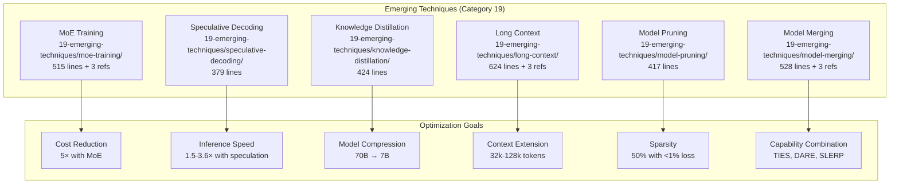

**Skill Relationships and Use Cases**

Sources: [README.md:261-270](), [.claude-plugin/marketplace.json:231-243]()

### Skill Categories and Decision Matrix

| Technique | Primary Goal | Model Size | Key Methods | Typical Speedup/Reduction |
|-----------|--------------|------------|-------------|---------------------------|
| **MoE Training** | Sparse computation | 8B-671B | DeepSpeed expert parallelism, Mixtral | 5× cost reduction |
| **Model Merging** | Capability combination | Any | TIES, DARE, SLERP (mergekit) | N/A (qualitative) |
| **Long Context** | Context extension | Any | RoPE, YaRN, ALiBi | 32k-128k tokens |
| **Speculative Decoding** | Inference acceleration | Any | Medusa, Lookahead, draft models | 1.5-3.6× faster |
| **Knowledge Distillation** | Model compression | 70B → 7B | MiniLLM, temperature scaling | ~10× size reduction |
| **Model Pruning** | Structured sparsity | Any | Wanda, SparseGPT | 50% sparsity, <1% loss |

**When to Combine Techniques:**
- **MoE + Pruning**: Sparse experts with structured pruning (e.g., DeepSeek-V3)
- **Long Context + Speculative Decoding**: Fast generation on extended sequences
- **Distillation + Pruning**: Maximum compression with minimal quality loss
- **Merging + Fine-tuning**: Combine specialized models then adapt

Sources: [README.md:261-270]()

### Emerging Techniques Architecture

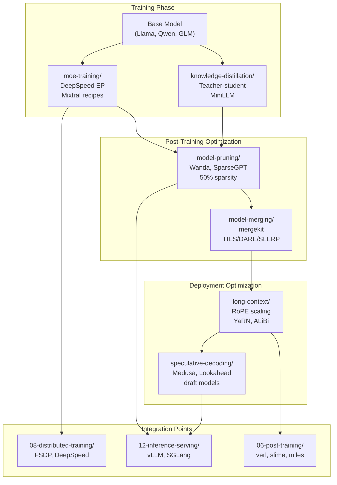

**Architecture Components**

Each skill in Category 19 operates at a different stage of the model lifecycle:

**Training Phase** skills (MoE, Distillation) modify the training process itself. MoE training implements expert parallelism using DeepSpeed's capabilities, while distillation creates smaller student models from larger teachers.

**Post-Training Optimization** skills (Pruning, Merging) operate on trained checkpoints without additional training data. Pruning removes weights based on importance metrics; merging combines multiple models' capabilities.

**Deployment Optimization** skills (Long Context, Speculative Decoding) enhance inference behavior. Context extension modifies positional encodings; speculative decoding uses draft models to accelerate generation.

Sources: [README.md:261-270](), [.claude-plugin/marketplace.json:231-243]()

### Common Integration Patterns

**Pattern 1: MoE Training with Distributed Backend**

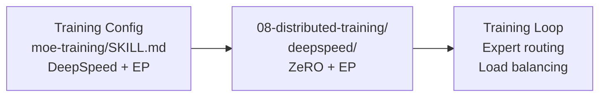

MoE training skills integrate with `08-distributed-training/deepspeed/` for expert parallelism. The MoE skill provides recipes for Mixtral-style models, while DeepSpeed handles the distributed infrastructure.

**Pattern 2: Compression Pipeline (Distillation + Pruning)**

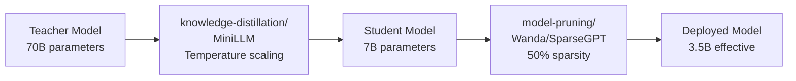

**Pattern 3: Inference Acceleration Stack**

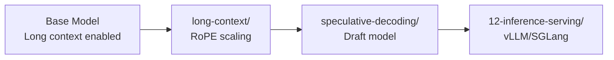

Sources: [README.md:261-270](), [06-post-training/verl/SKILL.md:1-389](), [06-post-training/slime/SKILL.md:1-464]()

### Skill-Specific Technical Details

**MoE Training (19-emerging-techniques/moe-training)**
- **Key Tools**: DeepSpeed expert parallelism, Mixtral 8x7B recipes
- **Parallelism Strategy**: Expert parallelism (EP) partitions experts across GPUs, combined with tensor/pipeline/data parallelism
- **Load Balancing**: Auxiliary loss terms ensure balanced expert usage
- **Typical Configuration**: 8-64 experts, top-k routing (k=2)

**Model Merging (19-emerging-techniques/model-merging)**
- **Key Tool**: mergekit library
- **Methods**: 
  - TIES: Trim redundant parameters, Elect sign, Merge with importance
  - DARE: Drop And REscale parameters randomly
  - SLERP: Spherical Linear intERPolation for smooth transitions
- **Use Case**: Combine domain-specific fine-tunes without retraining

**Long Context (19-emerging-techniques/long-context)**
- **Positional Encodings**: RoPE scaling, YaRN (Yet another RoPE extensioN), ALiBi (Attention with Linear Biases)
- **Extension Range**: 32k-128k tokens from base 4k-8k
- **Validation**: Perplexity on long documents, needle-in-haystack tests

**Speculative Decoding (19-emerging-techniques/speculative-decoding)**
- **Methods**: Medusa (multi-head speculation), Lookahead (n-gram cache), draft models
- **Speedup**: 1.5-3.6× depending on draft quality and acceptance rate
- **Integration**: Works with vLLM, SGLang inference servers

**Knowledge Distillation (19-emerging-techniques/knowledge-distillation)**
- **Framework**: MiniLLM with reverse KLD loss
- **Temperature Scaling**: Soften teacher logits for richer supervision
- **Compression Ratio**: Typically 10× (70B → 7B)

**Model Pruning (19-emerging-techniques/model-pruning)**
- **Methods**: Wanda (Pruning by Weights And activations), SparseGPT
- **Sparsity Levels**: 50% unstructured sparsity common, 2:4 structured for hardware support
- **Accuracy Preservation**: <1% degradation on MMLU, GSM8K benchmarks

Sources: [README.md:261-270]()

---

## Category 20: ML Paper Writing

### Skill Purpose and Philosophy

The ML Paper Writing skill treats academic publication as a collaborative coding task where AI agents proactively deliver complete drafts rather than waiting for section-by-section approval. This differs fundamentally from traditional writing assistance tools.

**Core Philosophy**: "Paper writing is collaborative, but Claude should be proactive in delivering drafts" [20-ml-paper-writing/SKILL.md:17-18](). The typical workflow starts with a research repository containing code and results, where Claude explores the project, identifies the contribution, searches literature, and delivers a complete first draft for feedback iteration.

Sources: [20-ml-paper-writing/SKILL.md:1-532]()

### ML Paper Writing Workflow Architecture

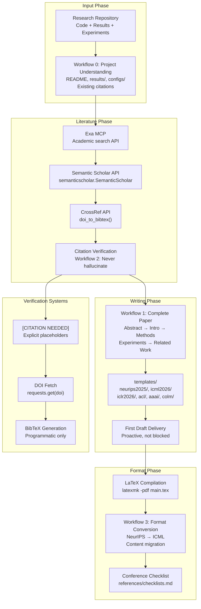

**Workflow Components**

Sources: [20-ml-paper-writing/SKILL.md:86-174](), [20-ml-paper-writing/SKILL.md:460-611](), [20-ml-paper-writing/SKILL.md:706-805]()

### Citation Verification System (Critical)

The most important technical component is the citation verification pipeline that prevents AI hallucination of references.

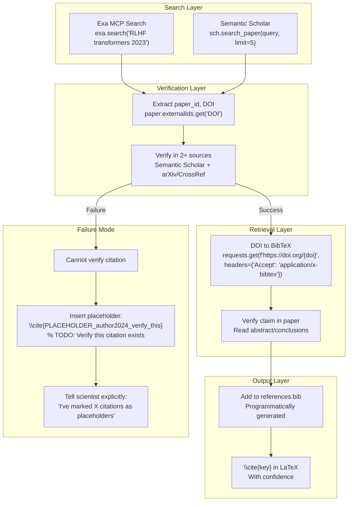

**Citation Verification Code References**

The skill defines the verification workflow in [20-ml-paper-writing/SKILL.md:706-805]():

```markdown
Step 1: Search Semantic Scholar
from semanticscholar import SemanticScholar
sch = SemanticScholar()
results = sch.search_paper("attention mechanism transformers", limit=5)

Step 2: Verify Existence (confirm in 2+ sources)

Step 3: Retrieve BibTeX via DOI
import requests
def doi_to_bibtex(doi: str) -> str:
    response = requests.get(
        f"https://doi.org/{doi}",
        headers={"Accept": "application/x-bibtex"}
    )
    return response.text
```

**Golden Rule**: "NEVER generate BibTeX entries from memory. ALWAYS fetch programmatically." [20-ml-paper-writing/SKILL.md:39]()

**Failure Mode Handling**: When verification fails, the skill mandates explicit placeholders: `\cite{PLACEHOLDER_author2024_verify_this} % TODO: Verify this citation exists` and requires notifying the user: "I've marked [X] citations as placeholders that need verification." [20-ml-paper-writing/SKILL.md:47-56]()

Sources: [20-ml-paper-writing/SKILL.md:32-87](), [20-ml-paper-writing/SKILL.md:706-805]()

### LaTeX Template System

The skill provides conference-specific LaTeX templates with strict workflow guidelines.

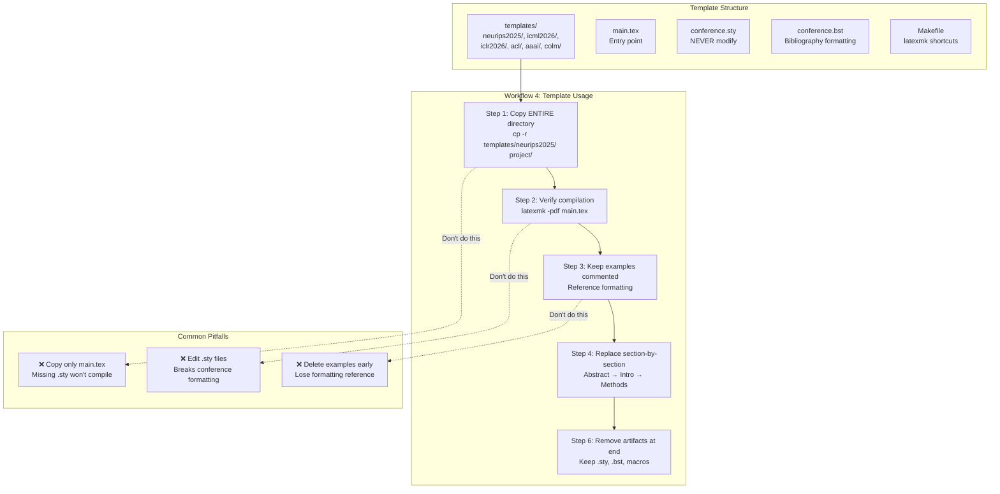

**Template Workflow Steps** [20-ml-paper-writing/SKILL.md:462-611]():

1. **Copy entire directory** (not just `main.tex`): `cp -r templates/neurips2025/ ~/papers/my-new-paper/`
2. **Verify template compiles as-is** before any modifications: `latexmk -pdf main.tex`
3. **Keep template content as reference** by commenting out examples rather than deleting
4. **Replace content section by section**: Title → Abstract → Intro → Methods → Experiments → Related Work → Conclusion → References → Appendix
5. **Use template macros**: Check preamble for `\newcommand{\method}{YourMethodName}`, `\eg`, `\ie`, `\etal`
6. **Clean up only at end**: Remove commented examples, unused packages, placeholders; keep style files, bibliography styles, required packages

**Conference-Specific Files**:

| Conference | Main File | Style File | Notes |
|------------|-----------|------------|-------|
| NeurIPS 2025 | `main.tex` | `neurips.sty` | Has Makefile, 9 pages + 0 camera-ready |
| ICML 2026 | `example_paper.tex` | `icml2026.sty` | Algorithm packages, 8 pages + 1 camera-ready |
| ICLR 2026 | `iclr2026_conference.tex` | `iclr2026_conference.sty` | math_commands.tex, 9 pages + 1 camera-ready |
| ACL 2025 | `acl_latex.tex` | `acl.sty` | Strict formatting, 8 pages |
| AAAI 2026 | `aaai2026-unified-template.tex` | `aaai2026.sty` | Very strict compliance, 7 pages + 1 camera-ready |
| COLM 2025 | `colm2025_conference.tex` | `colm2025_conference.sty` | Similar to ICLR, 9 pages + 1 camera-ready |

Sources: [20-ml-paper-writing/SKILL.md:460-611]()

### Conference Requirements Matrix

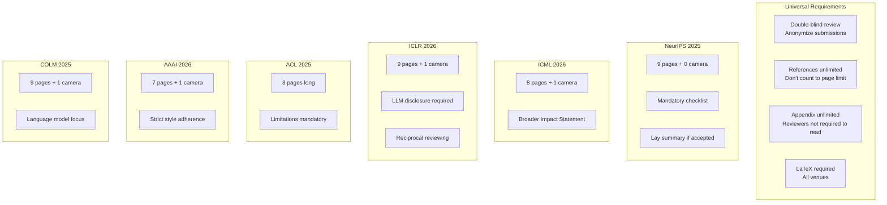

**Conference Comparison Table**

| Conference | Page Limit | Camera-Ready Extra | Key Requirement | Acceptance Rate |
|------------|------------|-------------------|-----------------|-----------------|
| NeurIPS 2025 | 9 pages | +0 | Mandatory checklist, lay summary | ~26% |
| ICML 2026 | 8 pages | +1 | Broader Impact Statement | ~28% |
| ICLR 2026 | 9 pages | +1 | LLM disclosure, reciprocal reviewing | ~32% |
| ACL 2025 | 8 pages (long) | varies | Limitations section mandatory | ~23% |
| AAAI 2026 | 7 pages | +1 | Strict style file adherence | ~21% |
| COLM 2025 | 9 pages | +1 | Focus on language models | ~35% (est.) |

Sources: [20-ml-paper-writing/SKILL.md:440-458]()

### Writing Philosophy Sources

The skill synthesizes writing advice from multiple researchers:

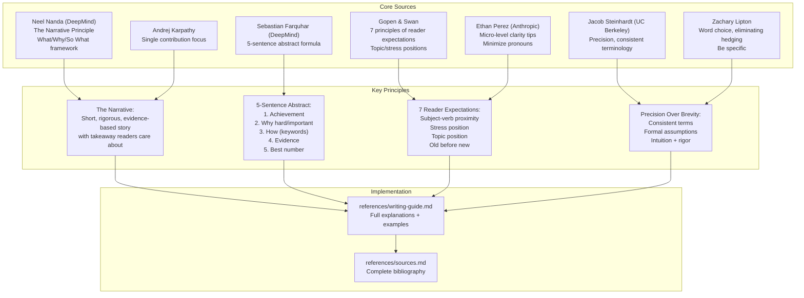

**Writing Sources Table** [20-ml-paper-writing/SKILL.md:356-367]():

| Source | Author | Key Contribution |
|--------|--------|------------------|
| How to Write ML Papers | Neel Nanda | The Narrative Principle, What/Why/So What |
| How to Write ML Papers | Sebastian Farquhar | 5-sentence abstract formula |
| Science of Scientific Writing | Gopen & Swan | 7 principles of reader expectations |
| Heuristics for Scientific Writing | Zachary Lipton | Word choice, eliminating hedging |
| Writing Tips | Jacob Steinhardt | Precision, consistent terminology |
| Easy Paper Writing Tips | Ethan Perez | Micro-level clarity tips |

**7 Principles of Reader Expectations** [20-ml-paper-writing/SKILL.md:384-398]():

1. **Subject-verb proximity**: Keep subject and verb close
2. **Stress position**: Place emphasis at sentence ends
3. **Topic position**: Put context first, new info after
4. **Old before new**: Familiar info → unfamiliar info
5. **One unit, one function**: Each paragraph makes one point
6. **Action in verb**: Use verbs, not nominalizations
7. **Context before new**: Set stage before presenting

Sources: [20-ml-paper-writing/SKILL.md:347-437]()

### Format Conversion Workflow

When resubmitting to different conferences, the skill provides a content migration workflow.

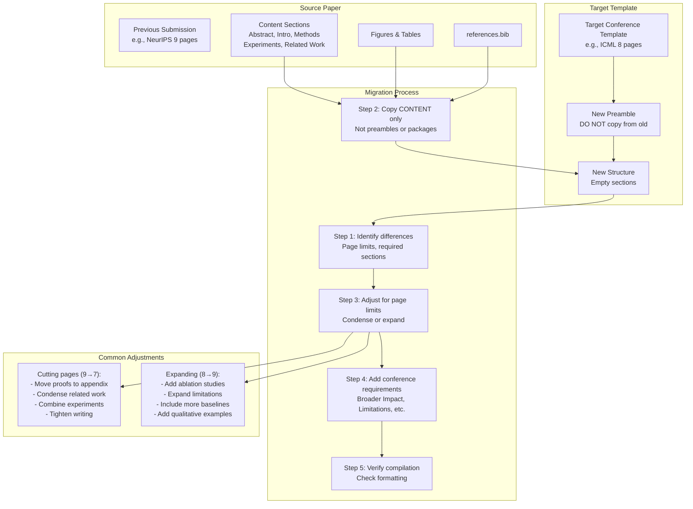

**Format Conversion Reference** [20-ml-paper-writing/SKILL.md:613-705]():

**Step 1: Key Template Differences**

| From → To | Page Change | Key Adjustments |
|-----------|-------------|-----------------|
| NeurIPS → ICML | 9 → 8 | Cut 1 page, add Broader Impact |
| ICML → ICLR | 8 → 9 | Expand experiments, add LLM disclosure |
| NeurIPS → ACL | 9 → 8 | Restructure for NLP, add Limitations |
| ICLR → AAAI | 9 → 7 | Significant cuts, strict style |
| Any → COLM | varies → 9 | Reframe for language models |

**Step 2: Content Migration** [20-ml-paper-writing/SKILL.md:638-655]():

**Never copy preambles**. Instead:
1. Start fresh with target template: `cp -r templates/icml2026/ new_submission/`
2. Copy ONLY content sections from old paper (text between `\section{}` commands)
3. Copy figures, tables, bibliography entries
4. Paste into target template structure

**Step 3: Adjusting for Page Limits** [20-ml-paper-writing/SKILL.md:656-669]():

When cutting pages:
- Move detailed proofs to appendix
- Condense related work (cite surveys instead of individual papers)
- Combine similar experiments into unified tables
- Use smaller figures with subfigures
- Tighten writing: eliminate redundancy, use active voice

When expanding:
- Add ablation studies reviewers requested
- Expand limitations discussion
- Include additional baselines
- Add qualitative examples

Sources: [20-ml-paper-writing/SKILL.md:613-705]()

---

## Cross-Category Integration Patterns

### Research-to-Publication Pipeline

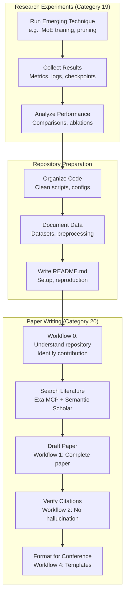

**Example: MoE Training → Paper**

1. **Experiment**: Train MoE model using `19-emerging-techniques/moe-training/` with expert parallelism
2. **Results**: Collect training curves, expert utilization, throughput metrics
3. **Analysis**: Compare against dense baseline, ablate number of experts
4. **Repository**: Organize training scripts, config files, evaluation code
5. **Paper Writing**: 
   - Use `20-ml-paper-writing/` Workflow 0 to explore repo
   - Search for MoE papers via Exa MCP
   - Draft Methods section describing architecture
   - Verify citations for Switch Transformers, Mixtral, etc.
   - Format for NeurIPS/ICML using templates

Sources: [20-ml-paper-writing/SKILL.md:86-174](), [README.md:261-270]()

### Optimization Stack Integration

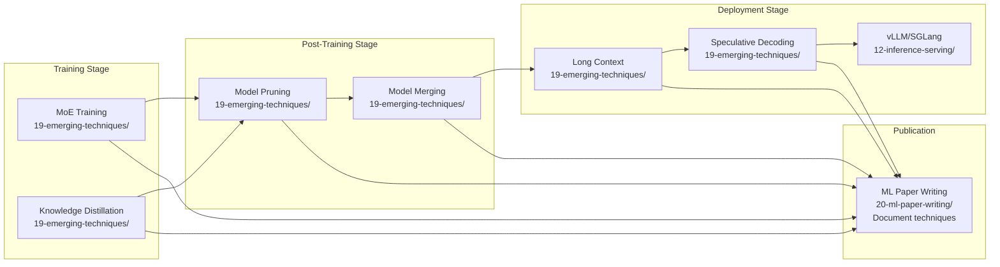

**Multi-Technique Workflow**:

1. Train base model with **MoE** for 5× cost reduction
2. Apply **pruning** to sparse experts for additional compression
3. **Merge** multiple task-specific checkpoints
4. Enable **long context** with RoPE scaling
5. Deploy with **speculative decoding** in vLLM
6. Write paper documenting the full pipeline using **ML Paper Writing** skill

Each technique can be documented separately in Methods section with ablations in Experiments.

Sources: [README.md:261-270](), [20-ml-paper-writing/SKILL.md:293-345]()

---

## Skill Usage Patterns

### Emerging Techniques Usage Pattern

**Discovery**: AI agents search skills via YAML frontmatter tags when user requests optimization:

```markdown
User: "How can I reduce inference latency for my 70B model?"

Agent searches tags: [Inference, Optimization, Speed]
Matches: speculative-decoding, model-pruning, knowledge-distillation

Agent loads: 19-emerging-techniques/speculative-decoding/SKILL.md
```

**Execution**: Agent follows workflows with checklists [CONTRIBUTING.md:64-96](). Each skill provides copy-paste checklists for tracking progress.

**Iteration**: Agent uses feedback loops for quality-critical operations [docs/SKILL_CREATION_GUIDE.md:81-96]():

```markdown
Speculative Decoding Workflow:
- [ ] Step 1: Train draft model
- [ ] Step 2: Configure speculation in vLLM
- [ ] Step 3: Measure acceptance rate
- [ ] Step 4: If acceptance <50%: retrain draft → repeat
```

Sources: [CONTRIBUTING.md:83-112](), [docs/SKILL_CREATION_GUIDE.md:64-96]()

### ML Paper Writing Usage Pattern

**Proactive Draft Delivery**: Unlike typical writing tools, this skill encourages Claude to deliver complete drafts rather than waiting for permission [20-ml-paper-writing/SKILL.md:17-28]():

```markdown
Workflow:
1. User points to research repo
2. Claude explores: README, results/, configs/
3. Claude identifies contribution
4. Claude searches literature via Exa MCP
5. Claude delivers COMPLETE DRAFT
6. User provides feedback
7. Claude iterates
```

**Confidence-Based Behavior** [20-ml-paper-writing/SKILL.md:191-221]():

| Confidence | Action |
|------------|--------|
| **High** (clear repo, obvious contribution) | Write full draft, deliver, iterate |
| **Medium** (some ambiguity) | Write draft with flagged uncertainties |
| **Low** (major unknowns) | Ask 1-2 targeted questions, then draft |

**Citation Safety**: Always programmatic retrieval, never memory [20-ml-paper-writing/SKILL.md:32-87]():

```python
# ✅ CORRECT
from semanticscholar import SemanticScholar
sch = SemanticScholar()
results = sch.search_paper("attention mechanism transformers")
bibtex = doi_to_bibtex(results[0].externalIds['DOI'])

# ❌ WRONG
bibtex = """
@inproceedings{vaswani2017attention,
  title={Attention is all you need},
  # ... generated from memory - MAY BE HALLUCINATED
}
"""
```

Sources: [20-ml-paper-writing/SKILL.md:17-87]()

### Repository Integration Points

Both categories integrate with the broader skill ecosystem:

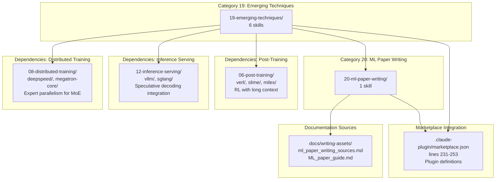

**Marketplace Definitions** [.claude-plugin/marketplace.json:231-253]():

```json
{
  "name": "emerging-techniques",
  "description": "Advanced ML techniques including MoE Training, Model Merging, 
                  Long Context, Speculative Decoding, Knowledge Distillation, 
                  and Model Pruning. Use when implementing cutting-edge 
                  optimization or architecture techniques.",
  "source": "./",
  "skills": [
    "./19-emerging-techniques/knowledge-distillation",
    "./19-emerging-techniques/long-context",
    "./19-emerging-techniques/model-merging",
    "./19-emerging-techniques/model-pruning",
    "./19-emerging-techniques/moe-training",
    "./19-emerging-techniques/speculative-decoding"
  ]
},
{
  "name": "ml-paper-writing",
  "description": "Write publication-ready ML/AI papers for NeurIPS, ICML, ICLR, 
                  ACL, AAAI, COLM. Includes LaTeX templates, citation verification, 
                  reviewer guidelines, and writing best practices from top researchers.",
  "source": "./",
  "skills": ["./20-ml-paper-writing"]
}
```

Sources: [.claude-plugin/marketplace.json:231-253](), [README.md:261-270]()

---

## Installation and Setup

### NPM Package Installation

Both categories are included in the NPM package installer [README.md:76-124]():

```bash
# Interactive installer
npx @orchestra-research/ai-research-skills

# The CLI will:
# 1. Auto-detect installed coding agents (~/.claude, ~/.cursor, etc.)
# 2. Present category selection including:
#    - Emerging Techniques (6 skills)
#    - ML Paper Writing (1 skill)
# 3. Install to ~/.orchestra/skills/
# 4. Create symlinks to agent directories
```

### Claude Marketplace Installation

Alternatively, install via Claude Code plugin marketplace [README.md:106-123]():

```bash
# Add marketplace
/plugin marketplace add orchestra-research/AI-research-SKILLs

# Install by category
/plugin install emerging-techniques@ai-research-skills
/plugin install ml-paper-writing@ai-research-skills
```

### Directory Structure After Installation

```
~/.orchestra/skills/
├── 19-emerging-techniques/
│   ├── moe-training/
│   │   ├── SKILL.md
│   │   └── references/
│   ├── model-merging/
│   ├── long-context/
│   ├── speculative-decoding/
│   ├── knowledge-distillation/
│   └── model-pruning/
└── 20-ml-paper-writing/
    ├── SKILL.md
    ├── references/
    │   ├── writing-guide.md
    │   ├── sources.md
    │   ├── checklists.md
    │   └── ...
    └── templates/
        ├── neurips2025/
        ├── icml2026/
        ├── iclr2026/
        ├── acl/
        ├── aaai/
        └── colm/
```

Sources: [README.md:76-124](), [CONTRIBUTING.md:256-282]()

---

## Quality Standards and Contribution Guidelines

### Category 19 Skill Standards

Each emerging technique skill follows the progressive disclosure pattern [CONTRIBUTING.md:83-112]():

- **SKILL.md**: 200-500 lines overview with workflows
- **references/**: Advanced topics split into separate files
- **Checklists**: Copy-paste task lists for multi-step processes
- **When to use**: Clear guidance vs alternatives
- **Common issues**: Troubleshooting with solutions

**Example from knowledge-distillation/**: 
- SKILL.md: 424 lines with teacher-student workflows
- references/: MiniLLM algorithm details, temperature scaling theory
- Workflows: 3-step distillation process with validation

### Category 20 Skill Standards

ML Paper Writing skill has unique quality requirements [20-ml-paper-writing/SKILL.md:32-56]():

1. **Citation Verification**: Mandatory programmatic retrieval, no memory-based BibTeX
2. **Template Preservation**: Complete directory copies, never modify .sty files
3. **Proactive Drafting**: Deliver complete drafts, don't block for section approval
4. **Conference Accuracy**: Up-to-date requirements for each venue
5. **Source Attribution**: All writing advice cited to researcher sources

### Contribution Workflow

To contribute improvements [CONTRIBUTING.md:30-255]():

1. **Fork and clone**: `git clone https://github.com/YOUR_USERNAME/AI-research-SKILLs.git`
2. **Create branch**: `git checkout -b improve-speculative-decoding`
3. **Edit skill**: Maintain YAML frontmatter, update workflows, add examples
4. **Update marketplace.json**: Ensure description reflects changes
5. **Submit PR**: Include what changed and why

**Validation Requirements** [CONTRIBUTING.md:83-112]():
- ✅ YAML frontmatter with proper tags
- ✅ 200-500 line SKILL.md (under 500 max)
- ✅ Progressive disclosure with references/
- ✅ Workflows with checklists
- ✅ When to use vs alternatives
- ✅ Common issues section

Sources: [CONTRIBUTING.md:30-255](), [20-ml-paper-writing/SKILL.md:1-532]()

---

