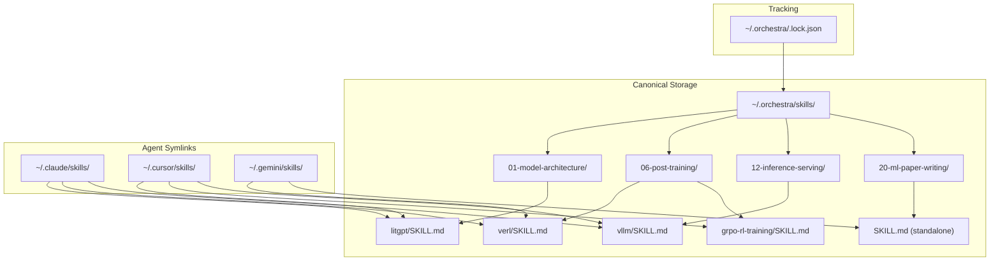
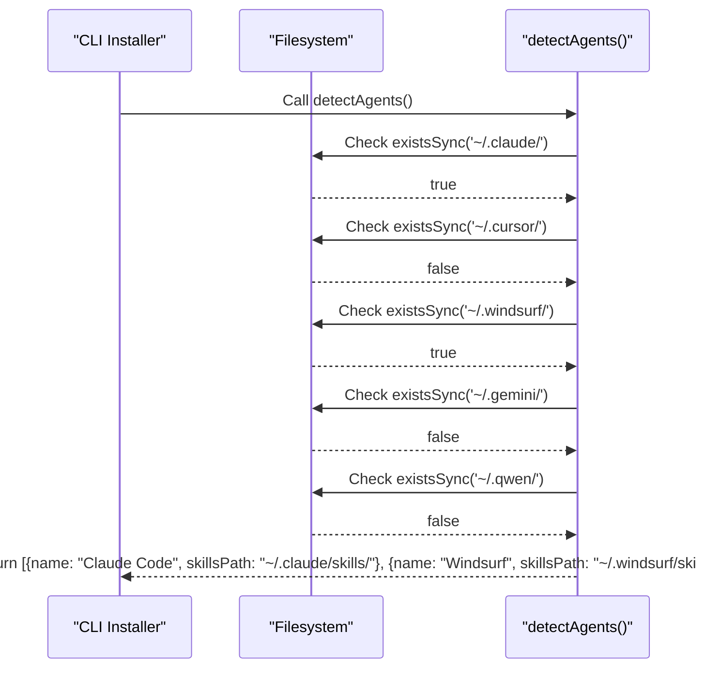
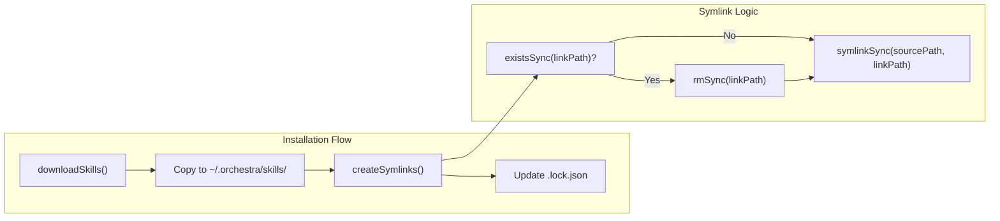
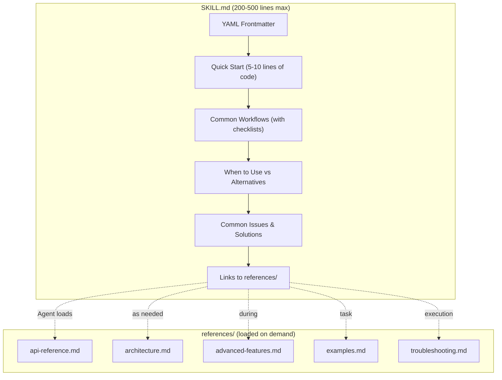
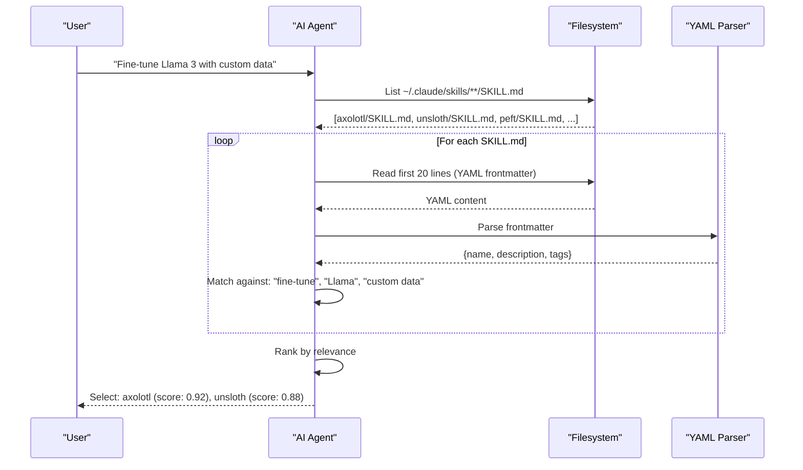
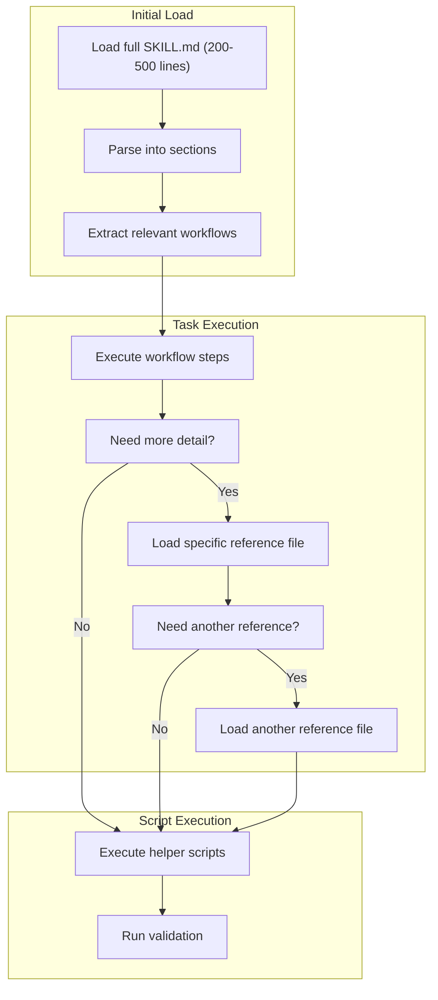
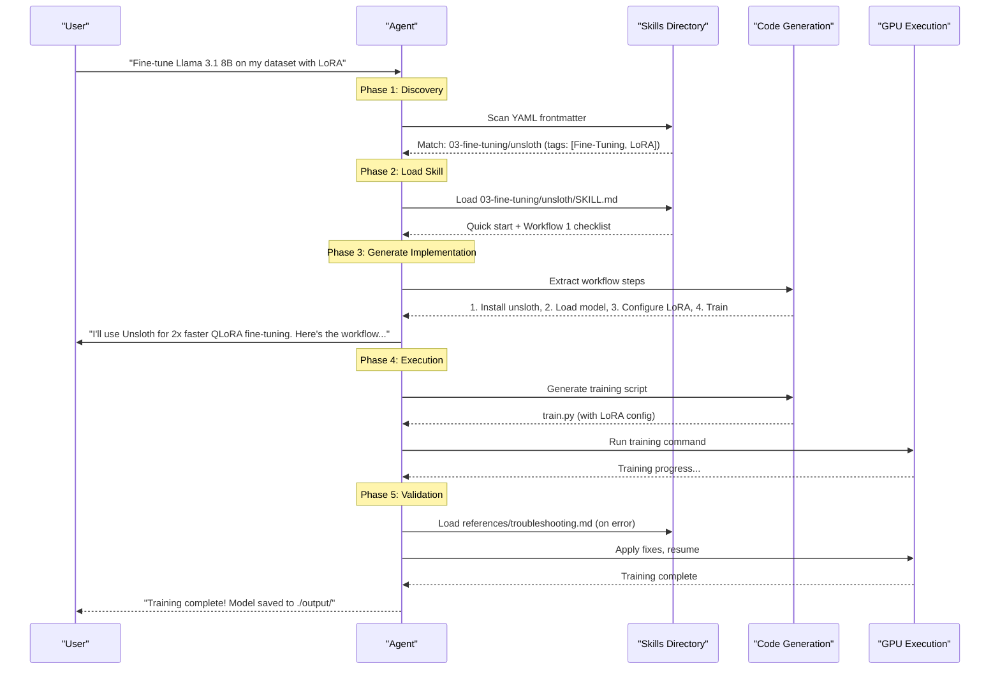
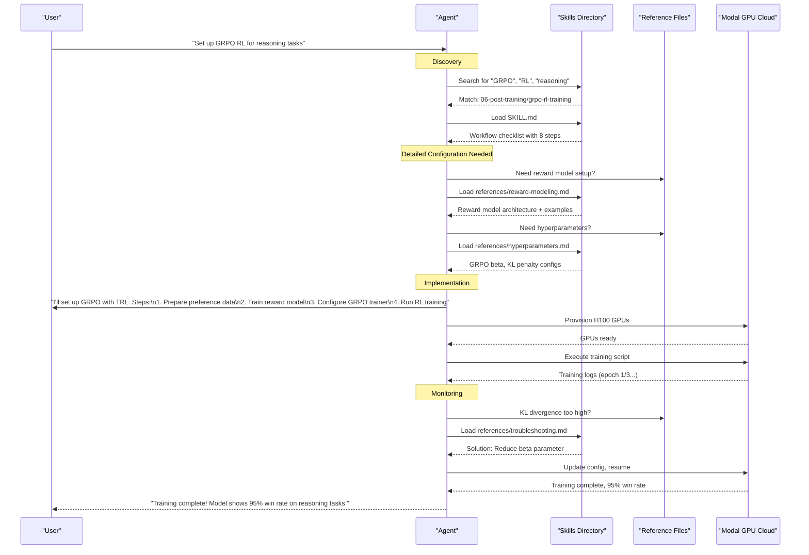
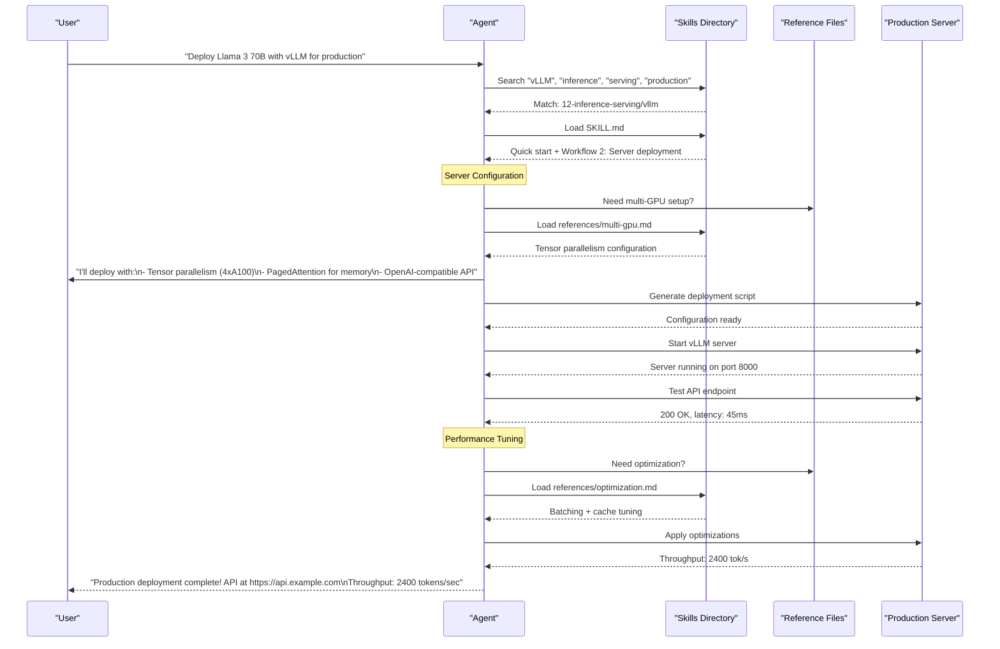
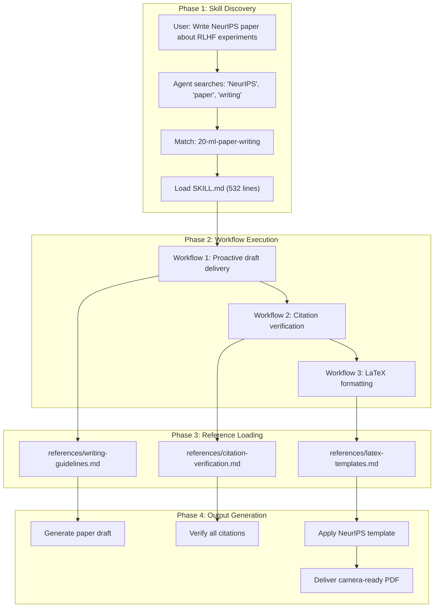

<!-- source: DeepWiki mcp.deepwiki.com · repo Orchestra-Research/AI-research-SKILLs · page 4 Using Skills with AI Agents · fetched 2026-10-26 -->

# Using Skills with AI Agents

<details>
<summary>Relevant source files</summary>

The following files were used as context for generating this wiki page:

- [.claude-plugin/marketplace.json](.claude-plugin/marketplace.json)
- [CONTRIBUTING.md](CONTRIBUTING.md)
- [README.md](README.md)
- [demos/README.md](demos/README.md)
- [docs/ROADMAP.md](docs/ROADMAP.md)
- [docs/SKILL_CREATION_GUIDE.md](docs/SKILL_CREATION_GUIDE.md)
- [docs/SKILL_TEMPLATE.md](docs/SKILL_TEMPLATE.md)
- [docs/assets/promo.gif](docs/assets/promo.gif)
- [docs/christmas-tree.svg](docs/christmas-tree.svg)
- [docs/tech-tree.svg](docs/tech-tree.svg)
- [packages/ai-research-skills/package.json](packages/ai-research-skills/package.json)
- [packages/ai-research-skills/src/index.js](packages/ai-research-skills/src/index.js)
- [packages/ai-research-skills/src/installer.js](packages/ai-research-skills/src/installer.js)
- [packages/ai-research-skills/src/prompts.js](packages/ai-research-skills/src/prompts.js)

</details>


This document explains how AI coding agents discover, load, and utilize skills during autonomous research workflows. It covers the technical mechanisms by which agents integrate with the skills library, the skill file format that enables semantic discovery, and concrete examples of agent-skill interaction patterns.

For information about installing skills to agents, see [Installation Guide](#2). For details on creating new skills, see [Contributing New Skills](#5). For the internal architecture of the installation system, see [CLI Architecture & Implementation](#6.3).

---

## Agent Integration Patterns

AI agents integrate with skills through a canonical directory structure with per-agent symlinks. The system supports five primary agents: Claude Code, Cursor, Windsurf, Gemini CLI, and Qwen Code.

### Supported Agent Configuration Directories

| Agent | Config Directory | Skills Path | Detection Method |
|-------|-----------------|-------------|------------------|
| Claude Code | `~/.claude/` | `~/.claude/skills/` | Check for `.claude` directory |
| Cursor | `~/.cursor/` | `~/.cursor/skills/` | Check for `.cursor` directory |
| Windsurf | `~/.windsurf/` | `~/.windsurf/skills/` | Check for `.windsurf` directory |
| Gemini CLI | `~/.gemini/` | `~/.gemini/skills/` | Check for `.gemini` directory |
| Qwen Code | `~/.qwen/` | `~/.qwen/skills/` | Check for `.qwen` directory |

### Canonical Storage Architecture

Skills are stored in a canonical directory at `~/.orchestra/skills/` with symlinks created in each agent's skills directory. This architecture ensures:

1. **Single source of truth** - Skills exist in one location
2. **Consistent updates** - Updating the canonical directory updates all agents
3. **Space efficiency** - No duplication across multiple agents
4. **Easy management** - Central location for skill tracking



**Sources:** [README.md:80-91](), [packages/ai-research-skills/src/installer.js:9-10](), [packages/ai-research-skills/src/installer.js:119-151]()

### Agent Detection Implementation

The system uses filesystem checks to detect installed agents:



The detection logic iterates through known agent configurations and returns only those with existing configuration directories on the system.

**Sources:** [README.md:86-87](), [packages/ai-research-skills/src/index.js:38-48]()

### Symlink Creation Process

When skills are installed, the system:

1. Downloads skills to `~/.orchestra/skills/` (canonical directory)
2. Creates symlinks in each detected agent's `skills/` directory
3. Handles both nested skills (`category/skill-name/`) and standalone skills (`category/`)



**Sources:** [packages/ai-research-skills/src/installer.js:49-114](), [packages/ai-research-skills/src/installer.js:119-151]()

---

## Skill Structure & Format

Skills follow a standardized format that enables agents to discover, load, and utilize them effectively. The structure balances comprehensive documentation with progressive disclosure to optimize context window usage.

### Directory Structure

Skills are organized in numbered categories with either nested or standalone layouts:

**Nested skill layout** (most common):
```
06-post-training/
├── verl/
│   ├── SKILL.md                 # Main skill file (200-500 lines)
│   ├── references/              # Supporting documentation
│   │   ├── README.md
│   │   ├── architecture.md
│   │   └── examples.md
│   └── scripts/                 # Optional helper scripts
│       └── validate.py
```

**Standalone skill layout** (single skill per category):
```
20-ml-paper-writing/
├── SKILL.md                     # Main skill file
├── references/                  # Supporting documentation
│   ├── citation-verification.md
│   ├── latex-templates.md
│   └── writing-guidelines.md
└── scripts/
    └── check_citations.py
```

**Sources:** [CONTRIBUTING.md:260-282](), [docs/SKILL_CREATION_GUIDE.md:240-263]()

### YAML Frontmatter: The Discovery Index

Every `SKILL.md` begins with YAML frontmatter that serves as the semantic index for agent discovery. This metadata enables agents to search and filter skills based on task requirements.

**Required fields:**

| Field | Format | Purpose | Example |
|-------|--------|---------|---------|
| `name` | kebab-case | Unique identifier | `grpo-rl-training` |
| `description` | Plain text (max 1024 chars) | What it does AND when to use it | `Expert guidance for GRPO/RL fine-tuning with TRL...` |
| `version` | Semantic version | Skill version | `1.0.0` |
| `author` | Plain text | Author attribution | `Orchestra Research` |
| `license` | License ID | License type | `MIT` |
| `tags` | Array (Title Case) | Searchable terms | `[Reinforcement Learning, GRPO, TRL, Post-Training]` |
| `dependencies` | Array with versions | Required packages | `[transformers>=4.47.0, trl>=0.14.0]` |

**Example from actual skill:**

```yaml
---
name: grpo-rl-training
description: Expert guidance for GRPO/RL fine-tuning with TRL for reasoning and task-specific model training
version: 1.0.0
author: Orchestra Research
license: MIT
tags: [Reinforcement Learning, GRPO, TRL, Post-Training, RLHF, Reward Modeling, Reasoning, DPO, PPO, Structured Output]
dependencies: [transformers>=4.47.0, trl>=0.14.0, datasets>=3.2.0, peft>=0.14.0, torch]
---
```

**Naming conventions:**
- **name**: Use gerund form (e.g., `serving-llms`, `processing-data`, `training-models`)
- **description**: Third person, no "I can help you..." constructions
- **tags**: Capitalize acronyms (GRPO, TRL, RLHF, DPO, MLOps, RAG)

**Sources:** [CONTRIBUTING.md:126-208](), [docs/SKILL_CREATION_GUIDE.md:122-227](), [.claude-plugin/marketplace.json:69-83]()

### SKILL.md Content Structure

The main skill file follows a progressive disclosure pattern with three priority levels:



**Priority Level 1: Always Loaded (in SKILL.md)**
- Quick start with minimal working example
- Common workflows with copy-paste checklists
- When to use this skill vs alternatives
- Common issues with immediate fixes

**Priority Level 2: Loaded on Demand (in references)**
- API reference documentation
- Architecture details
- Advanced features and optimizations
- Extended troubleshooting guides
- Detailed examples and tutorials

**Priority Level 3: Executed, Not Loaded**
- Helper scripts in `scripts/` directory
- Validation tools
- Setup automation

**Sources:** [docs/SKILL_CREATION_GUIDE.md:45-64](), [README.md:325-358]()

### Progressive Disclosure Pattern

Skills follow Anthropic's best practices by keeping SKILL.md concise and pointing to detailed materials:

**Implementation rules:**
1. SKILL.md body must be **under 500 lines** for optimal performance
2. Aim for **200-300 lines** in practice
3. Reference files must be **ONE LEVEL DEEP** (no nested references)
4. Assume agent knowledge - don't explain basics

**Example reference structure:**

```markdown
## Advanced topics

**Server deployment**: See [server-deployment.md](server-deployment.md)
**Offline inference**: See [offline-inference.md](offline-inference.md)  
**API reference**: See [api-reference.md](api-reference.md)
**Optimization**: See [optimization.md](optimization.md)
```

**Why this works:**
- Agent loads SKILL.md first (200-300 lines)
- Agent reads overview and workflows
- Agent loads specific reference file only when needed for current task
- Total context usage scales with task complexity, not skill comprehensiveness

**Sources:** [docs/SKILL_CREATION_GUIDE.md:45-103](), [CONTRIBUTING.md:83-93]()

### Workflow Checklists

Skills provide copy-paste checklists for multi-step tasks, enabling agents to track progress:

```markdown
## Deployment workflow

Copy this checklist and track progress:

\```
Task Progress:
- [ ] Step 1: Configure server settings
- [ ] Step 2: Validate configuration  
- [ ] Step 3: Deploy to production
- [ ] Step 4: Verify deployment
\```

**Step 1: Configure server settings**

Edit `config.yaml` with production values.

**Step 2: Validate configuration**

Run validator and fix errors:
\```bash
python validate.py config.yaml
# If errors: fix → validate again → continue
\```

**Step 3: Deploy to production**

[Specific deployment commands]

**Step 4: Verify deployment**

[Verification steps]
```

This pattern enables agents to maintain state across multi-turn interactions and resume complex workflows.

**Sources:** [docs/SKILL_CREATION_GUIDE.md:66-102](), [docs/SKILL_TEMPLATE.md:29-69]()

---

## Skill Discovery and Loading

Agents discover and load skills through a two-phase process: semantic search via YAML frontmatter, followed by progressive content loading.

### Phase 1: Semantic Search via YAML Frontmatter

When a user makes a request, agents scan the YAML frontmatter of all installed skills to find relevant matches.



**Matching criteria (in order of importance):**

1. **Exact keyword match in description** - e.g., "Fine-Tuning" in description
2. **Tag matches** - e.g., `[Fine-Tuning, LoRA, PEFT]`
3. **Skill name similarity** - e.g., `axolotl` for training tasks
4. **Dependency indicators** - e.g., `[torch, transformers]` suggests ML training

**Example search scenarios:**

| User Query | Matched Skills | Matching Elements |
|-----------|---------------|-------------------|
| "Deploy vLLM server" | `12-inference-serving/vllm/` | name:`vllm`, tags:`[Inference, Serving]`, description:"serving LLMs" |
| "GRPO training" | `06-post-training/grpo-rl-training/` | name:`grpo-rl-training`, tags:`[GRPO, RLHF]` |
| "Write NeurIPS paper" | `20-ml-paper-writing/` | description:"NeurIPS, ICML, ICLR", tags:`[ML Paper Writing]` |
| "Quantize model to 4-bit" | `10-optimization/gptq/`, `10-optimization/awq/` | tags:`[Quantization]`, description:"4-bit" |

**Sources:** [.claude-plugin/marketplace.json:1-255](), [CONTRIBUTING.md:126-208]()

### Phase 2: Progressive Content Loading

After identifying relevant skills, agents load content progressively based on task needs:



**Loading sequence example (vLLM deployment):**

1. **Initial:** Load `12-inference-serving/vllm/SKILL.md` (356 lines)
   - Read quick start
   - Identify "Server deployment" workflow
   
2. **On-demand:** User needs deployment details
   - Load `references/server-deployment.md`
   - Read configuration options
   
3. **On-demand:** User encounters error
   - Load `references/troubleshooting.md`
   - Find error pattern and solution

4. **Execution:** User ready to deploy
   - Execute `scripts/validate_config.py`
   - Run deployment commands from workflow

**Context window optimization:**
- Baseline: 200-500 lines (SKILL.md only)
- +500-1000 lines per reference file loaded
- Scripts executed, not loaded (zero context cost)

**Sources:** [README.md:325-358](), [docs/SKILL_CREATION_GUIDE.md:45-64]()

### Lock File Tracking

The installation system maintains a lock file to track which skills are installed:

```json
{
  "version": "1.0.0",
  "installedAt": "2025-01-15T10:30:00.000Z",
  "skills": [
    {"category": "06-post-training", "skill": "verl", "standalone": false},
    {"category": "12-inference-serving", "skill": "vllm", "standalone": false},
    {"category": "20-ml-paper-writing", "skill": "20-ml-paper-writing", "standalone": true}
  ],
  "agents": ["claude", "cursor"]
}
```

This enables the system to:
- List installed skills without scanning directories
- Update only installed skills
- Track installation timestamps
- Know which agents have access

**Sources:** [packages/ai-research-skills/src/installer.js:27-44](), [packages/ai-research-skills/src/installer.js:280-293]()

---

## Example Workflows

This section demonstrates concrete examples of how agents use skills during autonomous research tasks.

### Workflow 1: Fine-Tuning with Unsloth

**User request:** "Fine-tune Llama 3.1 8B on my dataset with LoRA"



**Actual skill sections used:**
1. YAML frontmatter → Discovery via tags `[Fine-Tuning, LoRA, Unsloth]`
2. Quick start → 5-line minimal example
3. Workflow 1: Basic fine-tuning → Checklist with 4 steps
4. Common issues → Error handling patterns

**Sources:** [README.md:161-165](), [.claude-plugin/marketplace.json:36-45]()

### Workflow 2: RLHF Training with GRPO

**User request:** "Set up GRPO reinforcement learning for reasoning tasks"



**Progressive loading in action:**
- **Initial:** Load `SKILL.md` (569 lines) → Overview + workflow checklist
- **Step 2:** Load `references/reward-modeling.md` → Reward model details
- **Step 3:** Load `references/hyperparameters.md` → Tuning guidance
- **On error:** Load `references/troubleshooting.md` → KL divergence fix

**Total context used:** ~1,500 lines (27% of total available documentation)

**Sources:** [README.md:177-179](), [.claude-plugin/marketplace.json:69-83]()

### Workflow 3: Production Inference with vLLM

**User request:** "Deploy Llama 3 70B with vLLM for production API"



**Workflow checklist from SKILL.md:**

```
Task Progress:
- [x] Step 1: Install vLLM
- [x] Step 2: Configure multi-GPU setup
- [x] Step 3: Start server
- [x] Step 4: Verify API
- [x] Step 5: Load test and optimize
```

**Sources:** [README.md:218-222](), [.claude-plugin/marketplace.json:146-156]()

### Workflow 4: Writing Research Papers

**User request:** "Write a NeurIPS paper about my RLHF experiments"



**Key skill features used:**

1. **Proactive draft delivery** - Agent writes complete draft without user asking for each section
2. **Citation verification** - Never hallucinates references, validates all citations
3. **Conference-specific formatting** - Applies NeurIPS LaTeX template
4. **Writing guidelines** - Follows Neel Nanda, Farquhar, Gopen & Swan principles

**Progressive disclosure in action:**
- **SKILL.md:** Overview of 4 workflows (532 lines)
- **references/writing-guidelines.md:** Detailed writing advice
- **references/citation-verification.md:** Citation checking pipeline
- **references/latex-templates.md:** NeurIPS style files
- **references/reviewer-guidelines.md:** What reviewers look for

**Sources:** [README.md:269-270](), [.claude-plugin/marketplace.json:245-253]()

### Common Patterns Across Workflows

All agent-skill interactions follow this sequence:

1. **Discovery** - YAML frontmatter semantic search
2. **Initial Load** - Load SKILL.md (200-500 lines)
3. **Workflow Selection** - Identify relevant checklist
4. **Progressive Loading** - Load reference files as needed
5. **Execution** - Run scripts, generate code, execute commands
6. **Validation** - Check results, load troubleshooting if needed
7. **Iteration** - Repeat steps 4-6 until task complete

**Context window efficiency:**
- Minimum: 200-500 lines (SKILL.md only)
- Typical: 1,000-2,000 lines (SKILL.md + 2-3 references)
- Maximum: 3,000-5,000 lines (SKILL.md + all references)

This scales with task complexity while keeping most tasks in the lower range.

**Sources:** [docs/SKILL_CREATION_GUIDE.md:45-103](), [README.md:325-358]()

---

