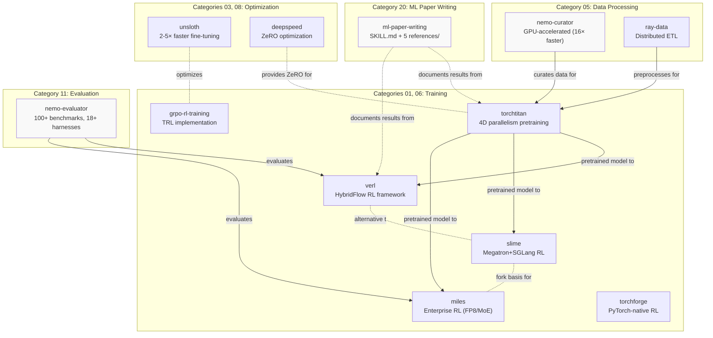
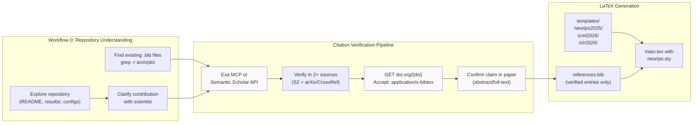
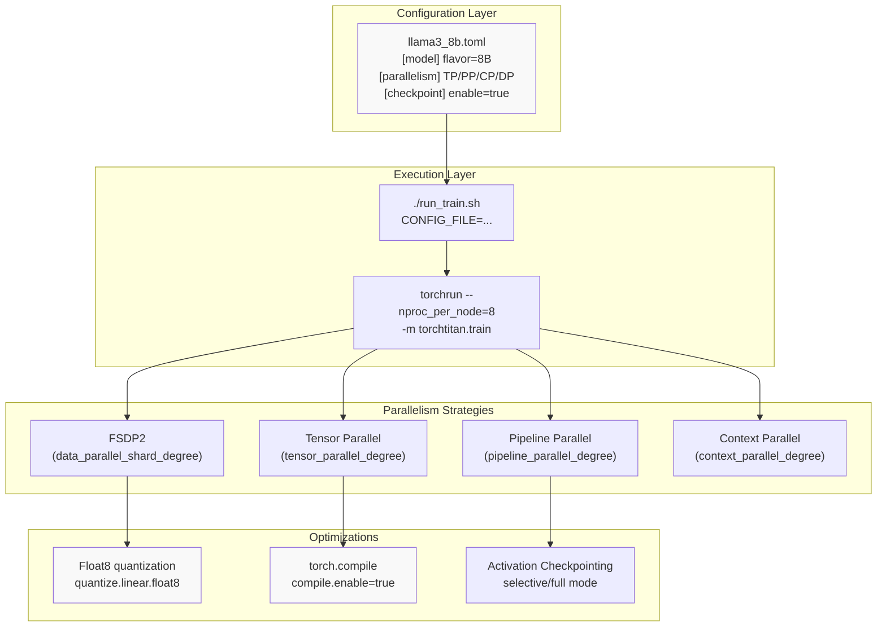
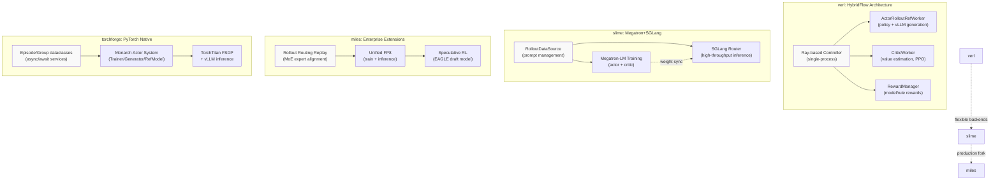
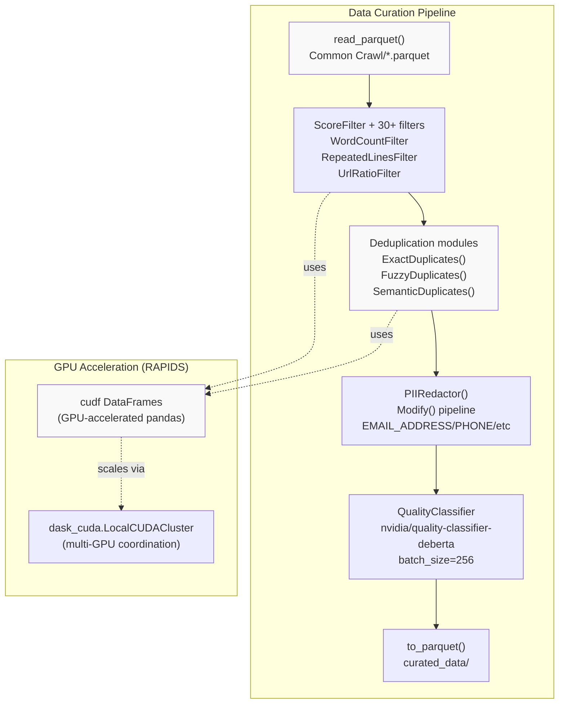
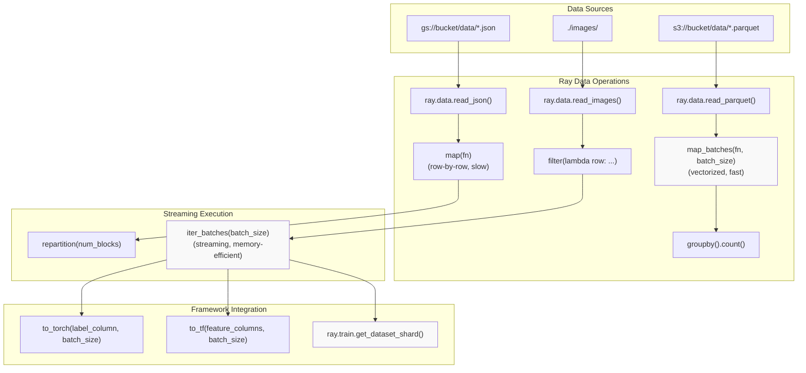
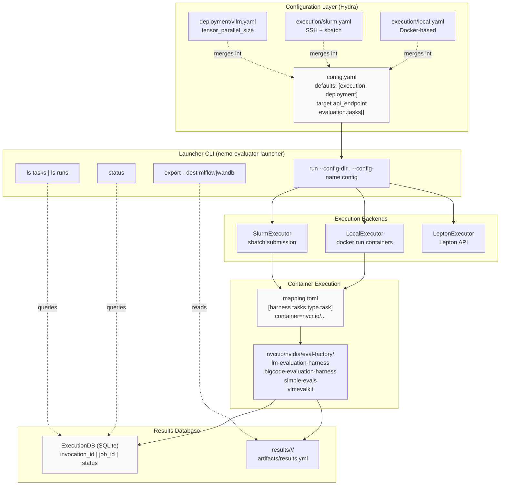

<!-- source: DeepWiki mcp.deepwiki.com · repo Orchestra-Research/AI-research-SKILLs · page 7 Featured Skills Deep Dives · fetched 2026-10-26 -->

# Featured Skills Deep Dives

<details>
<summary>Relevant source files</summary>

The following files were used as context for generating this wiki page:

- [01-model-architecture/torchtitan/SKILL.md](01-model-architecture/torchtitan/SKILL.md)
- [03-fine-tuning/unsloth/SKILL.md](03-fine-tuning/unsloth/SKILL.md)
- [05-data-processing/nemo-curator/SKILL.md](05-data-processing/nemo-curator/SKILL.md)
- [05-data-processing/ray-data/SKILL.md](05-data-processing/ray-data/SKILL.md)
- [06-post-training/grpo-rl-training/SKILL.md](06-post-training/grpo-rl-training/SKILL.md)
- [06-post-training/miles/SKILL.md](06-post-training/miles/SKILL.md)
- [06-post-training/slime/SKILL.md](06-post-training/slime/SKILL.md)
- [06-post-training/torchforge/SKILL.md](06-post-training/torchforge/SKILL.md)
- [06-post-training/verl/SKILL.md](06-post-training/verl/SKILL.md)
- [08-distributed-training/deepspeed/SKILL.md](08-distributed-training/deepspeed/SKILL.md)
- [11-evaluation/nemo-evaluator/SKILL.md](11-evaluation/nemo-evaluator/SKILL.md)
- [11-evaluation/nemo-evaluator/references/adapter-system.md](11-evaluation/nemo-evaluator/references/adapter-system.md)
- [11-evaluation/nemo-evaluator/references/configuration.md](11-evaluation/nemo-evaluator/references/configuration.md)
- [11-evaluation/nemo-evaluator/references/custom-benchmarks.md](11-evaluation/nemo-evaluator/references/custom-benchmarks.md)
- [11-evaluation/nemo-evaluator/references/execution-backends.md](11-evaluation/nemo-evaluator/references/execution-backends.md)
- [20-ml-paper-writing/SKILL.md](20-ml-paper-writing/SKILL.md)
- [docs/writing-assets/ML_paper_guide.md](docs/writing-assets/ML_paper_guide.md)
- [docs/writing-assets/ml_paper_writing_sources.md](docs/writing-assets/ml_paper_writing_sources.md)

</details>


This document provides technical overviews of skills that demonstrate exceptional depth, architectural complexity, or production-grade implementation patterns. These skills showcase the library's coverage of advanced AI research workflows from distributed training to paper writing.

**Purpose**: Present architectural overviews and code-level details for skills warranting extended documentation. Each section maps skill concepts to concrete code entities (classes, configuration files, API endpoints) to bridge natural language understanding with codebase exploration.

**Scope**: Covers six skill categories with deep dives available in child pages:
- [ML Paper Writing](#7.1) - Academic publication workflows with citation verification
- [LLM Training Skills](#7.2) - Distributed pretraining and post-training frameworks
- [Optimization Skills](#7.3) - Memory-efficient training and distributed optimization
- [Data Processing Skills](#7.4) - GPU-accelerated curation and distributed ETL
- [Safety & Alignment Skills](#7.5) - Runtime guardrails and training-time alignment
- [Evaluation Skills](#7.6) - Enterprise benchmarking and multi-harness evaluation

For basic skill usage patterns, see [Using Skills with AI Agents](#4). For contributing new skills, see [Contributing New Skills](#5).

---

## What Makes These Skills "Featured"

Featured skills exhibit one or more distinguishing characteristics:

| Criterion | Examples | Skill Count |
|-----------|----------|-------------|
| **Architecture complexity** | Multi-service orchestration (NeMo Evaluator), 4D parallelism (TorchTitan) | 4 |
| **Production backing** | NVIDIA enterprise tools (NeMo suite), Meta frameworks (TorchTitan) | 5 |
| **Code depth** | 300KB+ reference materials, 8+ configuration sections | 8 |
| **Multi-framework integration** | verl (FSDP/Megatron/vLLM), Ray Data (PyTorch/TF/HF) | 3 |
| **Novel algorithmic patterns** | GRPO group-relative advantages, R3 routing replay (miles) | 4 |

**Documentation standards**: All featured skills include:
- Detailed architecture diagrams mapping to code entities
- Configuration reference sections with parameter tables
- Multi-workflow guides (3-5 workflows per skill)
- Troubleshooting sections with specific error patterns
- Performance benchmarks with hardware specifications

---

## Skill Category Breakdown



**Sources**: [20-ml-paper-writing/SKILL.md:1-937](), [01-model-architecture/torchtitan/SKILL.md:1-359](), [06-post-training/verl/SKILL.md:1-392](), [06-post-training/slime/SKILL.md:1-465](), [06-post-training/miles/SKILL.md:1-316](), [06-post-training/torchforge/SKILL.md:1-434](), [11-evaluation/nemo-evaluator/SKILL.md:1-495]()

---

## ML Paper Writing Skill Architecture

The `ml-paper-writing` skill (Category 20) implements a collaborative writing workflow with proactive draft delivery and citation verification to prevent AI hallucination.

### Core Philosophy and Components



**Key Code Entities**:

| Entity | File Location | Purpose |
|--------|---------------|---------|
| `SKILL.md` | [20-ml-paper-writing/SKILL.md:1-937]() | Main skill with 9 workflows |
| `citation-workflow.md` | [20-ml-paper-writing/references/]() | Citation API documentation |
| `writing-guide.md` | [20-ml-paper-writing/references/]() | Gopen & Swan 7 principles |
| `checklists.md` | [20-ml-paper-writing/references/]() | NeurIPS/ICML/ICLR requirements |
| `neurips2025/` | [20-ml-paper-writing/templates/]() | LaTeX template directory |

**Critical Rule** ([SKILL.md:31-85]()):
```
NEVER generate BibTeX entries from memory. ALWAYS fetch programmatically.
```

**Workflow Structure** ([SKILL.md:88-173]()):
- **Workflow 0**: Start from research repository, explore structure, identify contribution
- **Workflow 1**: Write complete paper iteratively (10 steps)
- **Workflow 2**: Add citations with verification (6-step checklist)
- **Workflow 3**: Convert between conference formats
- **Workflow 4**: Start from LaTeX template

**Citation Verification Process** ([SKILL.md:720-812]()):
1. Search using `semanticscholar` Python library
2. Verify paper exists in Semantic Scholar + CrossRef/arXiv
3. Retrieve BibTeX via DOI content negotiation: `requests.get(f"https://doi.org/{doi}", headers={"Accept": "application/x-bibtex"})`
4. Verify claim appears in paper abstract/full-text
5. Mark as `[CITATION NEEDED]` if any step fails

**5-Sentence Abstract Formula** ([SKILL.md:280-294]()):
1. What achieved: "We introduce...", "We prove..."
2. Why hard/important
3. How you do it (with specialist keywords)
4. Evidence
5. Most remarkable number

For complete documentation, see [ML Paper Writing Skill](#7.1).

**Sources**: [20-ml-paper-writing/SKILL.md:1-937](), [docs/writing-assets/ml_paper_writing_sources.md:1-232]()

---

## LLM Training Skills: Distributed Architectures

Four post-training frameworks demonstrate different architectural patterns for RL at scale.

### TorchTitan: 4D Parallelism Pretraining



**Key Configuration Parameters** ([torchtitan/SKILL.md:62-102]()):

| TOML Section | Key Parameters | Use Case |
|--------------|----------------|----------|
| `[parallelism]` | `data_parallel_shard_degree=-1` | FSDP across all GPUs |
| `[parallelism]` | `tensor_parallel_degree=8` | TP within node |
| `[parallelism]` | `pipeline_parallel_degree=8` | PP across nodes |
| `[model.converters]` | `"quantize.linear.float8"` | Float8 training (H100) |
| `[compile]` | `enable=true, components=["model"]` | torch.compile speedup |

**4D Parallelism Example** ([torchtitan/SKILL.md:217-257]()):
```toml
[parallelism]
data_parallel_shard_degree = 8   # FSDP
tensor_parallel_degree = 8       # TP within node  
pipeline_parallel_degree = 8     # PP across nodes
context_parallel_degree = 1      # CP for long sequences
```

**Supported Models** ([torchtitan/SKILL.md:322-332]()):
- Llama 3.1 (8B, 70B, 405B) - Production
- Llama 4 - Experimental
- DeepSeek V3 (16B, 236B, 671B MoE) - Experimental
- GPT-OSS (20B, 120B MoE) - Experimental

**Performance on H100** ([torchtitan/SKILL.md:334-341]()):
- Llama 8B: 5,762 tokens/sec/GPU → 8,532 (+48%) with compile+FP8
- Llama 405B on 512 GPUs: 128 tokens/sec/GPU with FSDP+TP+PP

For complete workflows, see [LLM Training Skills Deep Dive](#7.2).

**Sources**: [01-model-architecture/torchtitan/SKILL.md:1-359]()

---

### Post-Training RL Frameworks Comparison



**Framework Selection Matrix**:

| Framework | Training Backend | Inference Engine | Algorithm Support | Best For |
|-----------|------------------|------------------|-------------------|----------|
| **verl** | FSDP/Megatron | vLLM/SGLang | PPO, GRPO, RLOO, DAPO | Backend flexibility |
| **slime** | Megatron-LM | SGLang Router | GRPO, GSPO, PPO | Research + production |
| **miles** | Megatron-LM | SGLang Router | GRPO + FP8/INT4 | Large MoE (1TB+) |
| **torchforge** | TorchTitan | vLLM | GRPO, DAPO, CISPO | PyTorch-native, algorithm research |

**verl Configuration** ([verl/SKILL.md:128-159]()):
```yaml
actor_rollout_ref:
  model:
    path: Qwen/Qwen2.5-7B-Instruct
  actor:
    use_kl_loss: true
    kl_loss_coef: 0.001
    ppo_mini_batch_size: 64
  rollout:
    name: vllm
    n: 8  # samples per prompt
    temperature: 0.7
```

**slime Argument Categories** ([slime/SKILL.md:250-302]()):
1. **Megatron args**: `--tensor-model-parallel-size`, `--pipeline-model-parallel-size`
2. **SGLang args** (prefixed): `--sglang-mem-fraction-static`, `--sglang-context-length`
3. **slime args**: `--actor-num-nodes`, `--rollout-num-gpus`, `--advantage-estimator`

**miles Enterprise Features** ([miles/SKILL.md:203-233]()):
- **Rollout Routing Replay (R3)**: Records expert routing during SGLang inference, replays during Megatron training for bit-wise MoE alignment
- **Unified FP8**: End-to-end FP8 for inference + training eliminates quantization-induced RL collapse
- **INT4 QAT**: 1TB models on single-machine H200 (3.1× memory reduction)
- **Speculative RL**: 25-40% rollout speedup with EAGLE draft models

**torchforge Service Architecture** ([torchforge/SKILL.md:98-141]()):
```yaml
services:
  generator:
    procs: 1
    num_replicas: 1
    with_gpus: true
  trainer:
    procs: 1
    num_replicas: 1  
    with_gpus: true
  ref_model:
    procs: 1
    num_replicas: 1
    with_gpus: true
```

For detailed comparisons and workflows, see [LLM Training Skills Deep Dive](#7.2).

**Sources**: [06-post-training/verl/SKILL.md:1-392](), [06-post-training/slime/SKILL.md:1-465](), [06-post-training/miles/SKILL.md:1-316](), [06-post-training/torchforge/SKILL.md:1-434]()

---

## Optimization Skills: Memory Efficiency

### Unsloth: Fast Fine-Tuning (2-5× Speedup)

**Architecture Overview**:

The Unsloth skill ([03-fine-tuning/unsloth/SKILL.md:1-81]()) provides expert guidance for memory-efficient fine-tuning with LoRA/QLoRA optimization. Key features include:
- 2-5× faster training than standard implementations
- 50-80% memory reduction
- Compatible with Llama, Mistral, Gemma, Qwen models

**Core Usage Pattern**:
```python
from unsloth import FastLanguageModel

model, tokenizer = FastLanguageModel.from_pretrained(
    model_name="unsloth/llama-3-8b-bnb-4bit",
    max_seq_length=2048,
    dtype=None,
    load_in_4bit=True
)

model = FastLanguageModel.get_peft_model(
    model,
    r=16,
    target_modules=["q_proj", "k_proj", "v_proj", "o_proj"],
    lora_alpha=16,
    lora_dropout=0,
    bias="none",
    use_gradient_checkpointing="unsloth"
)
```

**Reference Materials** ([unsloth/SKILL.md:30-57]()):
- `references/llms-txt.md` - Comprehensive Llms-Txt documentation
- Documentation extracted from official sources with code examples

For complete optimization techniques, see [Optimization Skills Deep Dive](#7.3).

**Sources**: [03-fine-tuning/unsloth/SKILL.md:1-81]()

### DeepSpeed: ZeRO Optimization Stages

The DeepSpeed skill ([08-distributed-training/deepspeed/SKILL.md:1-77]()) provides distributed training with ZeRO optimization, pipeline parallelism, and mixed precision (FP16/BF16/FP8).

**Key Components**:
- **DeepNVMe**: Fast I/O between storage and GPU/host memory
- **ZeRO stages**: Memory optimization via optimizer/gradient/parameter partitioning
- **Pipeline parallelism**: Model parallelism across GPUs
- **1-bit Adam**: Compressed optimizer states

**DeepNVMe Handle Creation** ([deepspeed/SKILL.md:24-77]()):
```python
from deepspeed.ops.op_builder import AsyncIOBuilder, GDSBuilder

# aio_handle for host/device tensors
aio_handle = AsyncIOBuilder().load().aio_handle()

# gds_handle for CUDA tensors (requires GDS)
gds_handle = GDSBuilder().load().gds_handle()
```

**Handle Configuration Parameters**:
- `block_size`: I/O block size (default 1048576)
- `queue_depth`: Async I/O queue depth (default 128)
- `single_submit`: Submit all I/Os at once (default False)
- `overlap_events`: Overlap I/O operations (default False)
- `intra_op_parallelism`: Parallel threads per operation (default 1)

For full ZeRO configuration and performance tuning, see [Optimization Skills Deep Dive](#7.3).

**Sources**: [08-distributed-training/deepspeed/SKILL.md:1-77]()

---

## Data Processing Skills: GPU Acceleration

### NeMo Curator: 16× Faster Deduplication



**Key Code Entities** ([nemo-curator/SKILL.md:1-382]()):

| Module | Class/Function | Performance |
|--------|----------------|-------------|
| `nemo_curator.modules` | `ExactDuplicates(id_field, text_field)` | 16× vs CPU |
| `nemo_curator.modules` | `FuzzyDuplicates(num_hashes=260, num_buckets=20)` | 16× vs CPU (MinHash+LSH) |
| `nemo_curator.modules` | `SemanticDuplicates(embedding_model, threshold)` | GPU-accelerated embeddings |
| `nemo_curator.filters` | `WordCountFilter(min_words, max_words)` | 10× vs CPU |
| `nemo_curator.modifiers` | `PIIRedactor(supported_entities)` | Presidio-backed |

**Fuzzy Deduplication Configuration** ([nemo-curator/SKILL.md:109-122]()):
```python
from nemo_curator.modules import FuzzyDuplicates

fuzzy_dedup = FuzzyDuplicates(
    id_field="id",
    text_field="text",
    num_hashes=260,      # MinHash signature size
    num_buckets=20,      # LSH buckets
    hash_method="md5"
)

deduped = fuzzy_dedup(dataset)
```

**Multi-GPU Scaling** ([nemo-curator/SKILL.md:182-192]()):
```python
from nemo_curator import get_client
import dask_cuda

# Initialize GPU cluster
client = get_client(cluster_type="gpu", n_workers=8)

# Process with 8 GPUs
deduped = FuzzyDuplicates(...)(dataset)
```

**Performance Benchmarks** ([nemo-curator/SKILL.md:324-342]()):

| Operation | CPU (cores) | GPU (type) | Speedup |
|-----------|-------------|------------|---------|
| Fuzzy dedup (8TB RedPajama) | 120h (256 cores) | 7.5h (8× A100) | **16×** |
| Exact dedup (1TB) | 8h (64 cores) | 0.5h (4× A100) | **16×** |
| Quality filtering (100GB) | 2h (32 cores) | 0.2h (2× A100) | **10×** |

**Cost Comparison** ([nemo-curator/SKILL.md:344-357]()):
- CPU (AWS c5.18xlarge × 10): $4,320 for 8TB
- GPU (AWS p4d.24xlarge × 2): $491.55 for 8TB
- **Savings**: 89% reduction

For multi-modal curation and complete pipelines, see [Data Processing Skills Deep Dive](#7.4).

**Sources**: [05-data-processing/nemo-curator/SKILL.md:1-382]()

### Ray Data: Distributed ETL



**Key API Patterns** ([ray-data/SKILL.md:1-324]()):

| Operation | API Call | Use Case |
|-----------|----------|----------|
| **Read** | `ray.data.read_parquet("s3://...")` | Cloud storage ingestion |
| **Transform** | `ds.map_batches(fn, batch_size=1000)` | Vectorized preprocessing (fast) |
| **Filter** | `ds.filter(lambda row: row["value"] > 100)` | Row filtering |
| **Aggregate** | `ds.groupby("category").count()` | Aggregation |
| **GPU** | `ds.map_batches(fn, num_gpus=1)` | GPU-accelerated transforms |
| **Write** | `ds.write_parquet("output/")` | Persist results |

**GPU-Accelerated Example** ([ray-data/SKILL.md:164-179]()):
```python
def preprocess_images_gpu(batch):
    import torch
    images = torch.tensor(batch["image"]).cuda()
    processed = images * 255
    return {"processed": processed.cpu().numpy()}

ds = ds.map_batches(
    preprocess_images_gpu,
    batch_size=64,
    num_gpus=1
)
```

**Ray Train Integration** ([ray-data/SKILL.md:61-85]()):
```python
from ray.train.torch import TorchTrainer

def train_func(config):
    train_ds = ray.train.get_dataset_shard("train")
    for epoch in range(10):
        for batch in train_ds.iter_batches(batch_size=32):
            # Train on batch
            pass

trainer = TorchTrainer(
    train_func,
    datasets={"train": train_ds},
    scaling_config=ScalingConfig(num_workers=4, use_gpu=True)
)
```

**Performance Scaling** ([ray-data/SKILL.md:294-302]()):
- 1 node (16 cores): 30 minutes for 100GB
- 4 nodes (64 cores): 8 minutes
- 16 nodes (256 cores): 2 minutes

**GPU Acceleration** ([ray-data/SKILL.md:302-305]()):
- CPU only: 1,000 images/sec
- 1 GPU: 5,000 images/sec
- 4 GPUs: 18,000 images/sec

For complete transformation patterns and framework integrations, see [Data Processing Skills Deep Dive](#7.4).

**Sources**: [05-data-processing/ray-data/SKILL.md:1-324]()

---

## Evaluation Skills: Multi-Harness Benchmarking

### NeMo Evaluator: 100+ Benchmarks Across 18 Harnesses



**Architecture Components** ([nemo-evaluator/SKILL.md:1-495]()):

| Component | Implementation | Purpose |
|-----------|----------------|---------|
| **Launcher** | `nemo-evaluator-launcher` CLI | Orchestrate evaluations |
| **Executors** | `LocalExecutor`, `SlurmExecutor`, `LeptonExecutor` | Multi-backend execution |
| **Mapping** | `mapping.toml` | Task → container registry |
| **Containers** | `nvcr.io/nvidia/eval-factory/*` | Reproducible harnesses |
| **Adapters** | `adapter_config.interceptors[]` | Request/response processing |
| **Database** | `ExecutionDB` (SQLite) | Job tracking |

**Configuration Structure** ([nemo-evaluator/references/configuration.md:1-448]()):

```yaml
defaults:
  - execution: local      # local | slurm | lepton
  - deployment: none      # none | vllm | sglang | nim
  - _self_

execution:
  output_dir: ./results

target:
  api_endpoint:
    model_id: meta/llama-3.1-8b-instruct
    url: https://integrate.api.nvidia.com/v1/chat/completions
    api_key_name: NGC_API_KEY
    adapter_config:
      interceptors:
        - name: system_message
        - name: caching
        - name: reasoning

evaluation:
  nemo_evaluator_config:
    config:
      params:
        temperature: 0.0
        parallelism: 4
  tasks:
    - name: ifeval
    - name: gpqa_diamond
      env_vars:
        HF_TOKEN: HF_TOKEN
```

**Supported Harnesses** ([nemo-evaluator/SKILL.md:337-351]()):

| Harness | Task Count | Example Tasks |
|---------|-----------|---------------|
| `lm-evaluation-harness` | 60+ | MMLU, GSM8K, HellaSwag, ARC |
| `simple-evals` | 20+ | GPQA, MATH, AIME |
| `bigcode-evaluation-harness` | 25+ | HumanEval, MBPP, MultiPL-E |
| `safety-harness` | 3 | Aegis, WildGuard |
| `garak` | 1 | Security probing |
| `vlmevalkit` | 6+ | OCRBench, ChartQA, MMMU |
| `bfcl` | 6 | Function calling v2/v3 |
| `nemo-skills` | 8 | Math, science, agentic |

**Adapter System** ([nemo-evaluator/references/adapter-system.md:1-362]()):

```python
# Interceptor chain for evaluation
adapter_config:
  interceptors:
    # Pre-endpoint (request processing)
    - name: system_message
      config:
        system_message: "You are a helpful AI assistant."
    - name: caching
      config:
        cache_dir: "./cache"
        reuse_cached_responses: true
    
    # Endpoint (HTTP call)
    - name: endpoint
    
    # Post-endpoint (response processing)
    - name: reasoning
      config:
        start_reasoning_token: ""
```

**CLI Workflow** ([nemo-evaluator/SKILL.md:69-145]()):

```bash
# Step 1: Configure endpoint
cat > config.yaml << 'EOF'
target:
  api_endpoint:
    model_id: meta/llama-3.1-8b-instruct
    url: https://integrate.api.nvidia.com/v1/chat/completions
    api_key_name: NGC_API_KEY
evaluation:
  tasks:
    - name: ifeval
    - name: gsm8k_cot_instruct
EOF

# Step 2: Run evaluation
nemo-evaluator-launcher run --config-dir . --config-name config

# Step 3: Check status
nemo-evaluator-launcher status <invocation_id>

# Step 4: Export results
nemo-evaluator-launcher export <invocation_id> --dest mlflow
```

**Execution Backends** ([nemo-evaluator/references/execution-backends.md:1-362]()):

| Backend | Trigger | Status Query | Use Case |
|---------|---------|--------------|----------|
| **Local** | `docker run` subprocess | Stage file markers | Quick testing |
| **Slurm** | SSH + `sbatch` | `sacct -j <job_id>` | Large-scale batch |
| **Lepton** | Lepton API | API status endpoint | Cloud-native |

**Multi-Backend Database** ([execution-backends.md:287-309]()):
```
┌─────────────────────────────────────────────┐
│               ExecutionDB (SQLite)           │
│                                              │
│  invocation_id │ job_id │ status │ backend  │
│  ─────────────────────────────────────────  │
│  inv_abc123    │ 12345  │ running │ slurm   │
│  inv_def456    │ cont_1 │ done    │ local   │
└─────────────────────────────────────────────┘
```

For complete configuration reference and custom benchmarks, see [Evaluation Skills Deep Dive](#7.6).

**Sources**: [11-evaluation/nemo-evaluator/SKILL.md:1-495](), [11-evaluation/nemo-evaluator/references/execution-backends.md:1-362](), [11-evaluation/nemo-evaluator/references/adapter-system.md:1-362](), [11-evaluation/nemo-evaluator/references/configuration.md:1-448](), [11-evaluation/nemo-evaluator/references/custom-benchmarks.md:1-316]()

---

## Summary: Featured Skills Impact

**Documentation Depth by Category**:

| Category | Skills | Total Reference Files | Avg Lines/Skill |
|----------|--------|----------------------|-----------------|
| ML Paper Writing | 1 | 5 references | 937 (main) |
| Training | 5 | ~15 across skills | 350-465 |
| Optimization | 2 | Varies | 81-77 |
| Data Processing | 2 | 2-3 each | 324-382 |
| Evaluation | 1 | 4 references | 495 |

**Production Impact**:
- **NeMo Curator**: Used for Nemotron-4 training data, RedPajama v2, The Pile
- **TorchTitan**: Powers PyTorch pretraining infrastructure
- **miles/slime/verl**: Production backends for GLM-4.x, Doubao-1.5-pro, DeepSeek V3
- **NeMo Evaluator**: Enterprise LLM benchmarking platform
- **ML Paper Writing**: 100+ citations analyzed, NeurIPS/ICML/ICLR guidelines

**Child Pages**: For workflow-specific documentation, configuration deep dives, and troubleshooting guides, navigate to:
- [ML Paper Writing Skill](#7.1)
- [LLM Training Skills](#7.2)
- [Optimization Skills](#7.3)
- [Data Processing Skills](#7.4)
- [Safety & Alignment Skills](#7.5)
- [Evaluation Skills](#7.6)

---

