# Page: Overview

# Overview

<details>
<summary>Relevant source files</summary>

The following files were used as context for generating this wiki page:

- [.claude-plugin/marketplace.json](.claude-plugin/marketplace.json)
- [CONTRIBUTING.md](CONTRIBUTING.md)
- [README.md](README.md)
- [demos/README.md](demos/README.md)
- [docs/ROADMAP.md](docs/ROADMAP.md)
- [docs/SKILL_CREATION_GUIDE.md](docs/SKILL_CREATION_GUIDE.md)
- [docs/SKILL_TEMPLATE.md](docs/SKILL_TEMPLATE.md)
- [docs/assets/promo.gif](docs/assets/promo.gif)
- [docs/christmas-tree.svg](docs/christmas-tree.svg)
- [docs/tech-tree.svg](docs/tech-tree.svg)

</details>


## Purpose and Scope

The AI Research Skills repository provides a curated library of 82 expert-level skills spanning the complete AI research engineering lifecycle. Each skill packages comprehensive documentation, code examples, and workflows to enable AI coding agents to autonomously implement research experiments—from data preparation and model training through evaluation and deployment.

This page describes the high-level architecture of the repository, its organization, and how skills are structured and distributed. For installation instructions, see [Installation Guide](#2). For detailed skill taxonomy and organization, see [Skills Library](#3). For how AI agents consume skills, see [Using Skills with AI Agents](#4).

**Sources:** [README.md:1-72](), [README.md:386-416]()

## Repository Architecture

The repository implements a hub-and-spoke distribution model with a centralized GitHub repository serving as the source of truth for 82 skills organized into 20 numbered category directories.

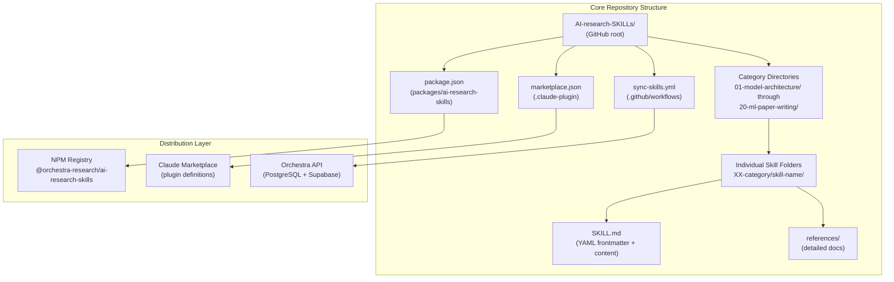

**Directory Structure:**

The repository root contains 20 numbered category directories following the pattern `XX-category-name/`:

- `01-model-architecture/` through `02-tokenization/`: Foundation skills
- `03-fine-tuning/` through `08-distributed-training/`: Training pipeline
- `09-infrastructure/` through `13-mlops/`: Infrastructure and production
- `14-agents/` through `18-multimodal/`: Application layer
- `19-emerging-techniques/` and `20-ml-paper-writing/`: Advanced techniques

Each category directory contains skill folders with lowercase-hyphenated names (e.g., `vllm/`, `grpo-rl-training/`).

**Sources:** [README.md:386-416](), [docs/ROADMAP.md:21-217]()

## Skill Anatomy

Every skill follows a standardized structure with mandatory YAML frontmatter and progressive disclosure through reference files.

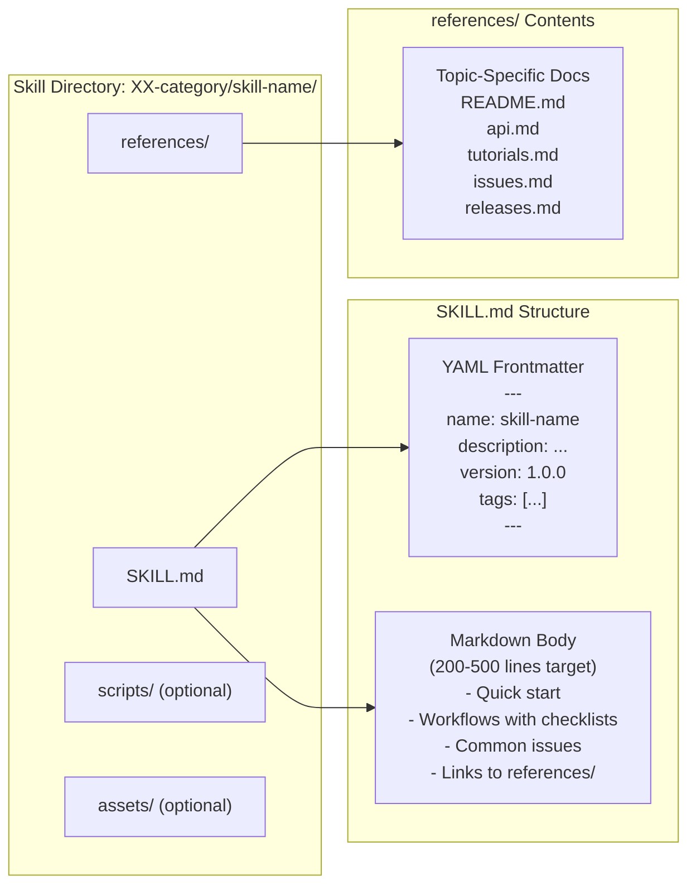

**YAML Frontmatter Fields:**

Each `SKILL.md` begins with YAML frontmatter containing metadata for skill discovery and installation:

| Field | Format | Purpose | Example |
|-------|--------|---------|---------|
| `name` | kebab-case | Unique identifier (gerund form preferred) | `serving-llms`, `grpo-rl-training` |
| `description` | Plain text (max 1024 chars) | Third-person explanation of what and when | "Serves LLMs with high throughput using vLLM's PagedAttention..." |
| `version` | Semantic versioning | Version tracking | `1.0.0` |
| `author` | Plain text | Attribution | `Orchestra Research` |
| `license` | License identifier | Legal terms | `MIT` |
| `tags` | Array (Title Case) | Discovery keywords | `[Inference, Serving, vLLM, Production Deployment]` |
| `dependencies` | Array (with version constraints) | Required packages | `[vllm>=0.2.0, torch>=2.0.0]` |

**Sources:** [CONTRIBUTING.md:126-187](), [docs/SKILL_CREATION_GUIDE.md:122-179](), [docs/SKILL_TEMPLATE.md:1-9]()

## Content Organization Principles

Skills implement **progressive disclosure** where `SKILL.md` serves as a focused entry point (200-500 lines target) with references to detailed documentation in separate files.

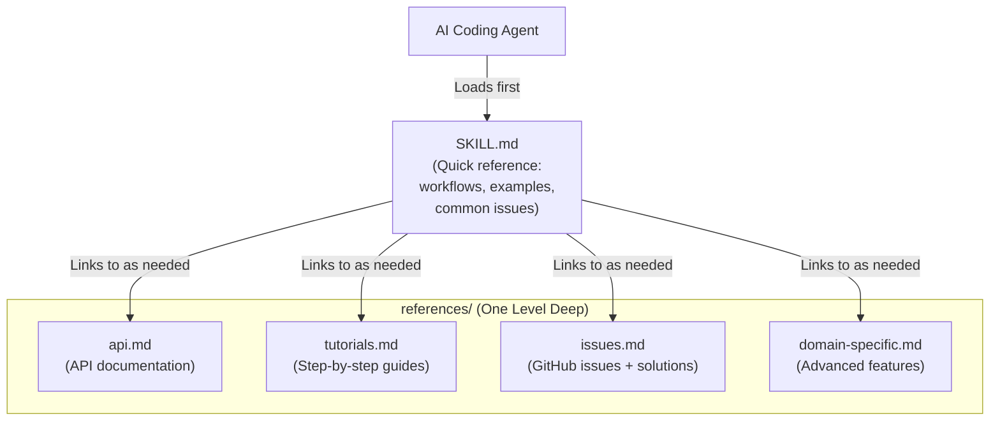

**Quality Standards:**

- SKILL.md body: 200-500 lines (maximum 500 for optimal performance)
- References total: 300KB+ documentation minimum
- Workflows include copy-paste checklists with `- [ ]` format
- Code blocks require language detection (e.g., ````python`)
- Assumes AI agent intelligence—no over-explaining basics
- One-level reference depth (SKILL.md → reference.md, no nested links)

**Sources:** [CONTRIBUTING.md:82-112](), [docs/SKILL_CREATION_GUIDE.md:46-66]()

## Distribution Channels

The repository distributes skills through three distinct channels, each optimized for different consumption patterns.

### Channel 1: NPM Package

**Location:** `packages/ai-research-skills/`

**Entry Point:** `packages/ai-research-skills/src/index.ts`

**Distribution:** `@orchestra-research/ai-research-skills` on NPM registry

The NPM package provides an interactive CLI installer that:
1. Detects installed AI coding agents by scanning config directories (`~/.claude`, `~/.cursor`, etc.)
2. Presents installation options (everything, categories, individual skills)
3. Installs to canonical storage directory `~/.orchestra/skills/`
4. Creates symlinks to agent-specific directories
5. Tracks installations in `~/.orchestra/.lock.json`

**Key Functions:**
- `detectAgents()`: Scans filesystem for agent installations [README.md:86]()
- Installation creates symlinks, avoiding duplication across agents

**Sources:** [README.md:77-104](), [.claude-plugin/marketplace.json:1-256]()

### Channel 2: GitHub Actions Sync

**Workflow File:** `.github/workflows/sync-skills.yml`

**Trigger:** Push to main branch

**Process:**
1. Detects changed skill folders via git diff pattern matching (`^[0-9]{2}-[^/]+/`)
2. Extracts YAML frontmatter from each changed `SKILL.md`
3. Validates metadata (name format, description length, required fields)
4. Creates ZIP archive of skill directory (SKILL.md + references)
5. Base64 encodes ZIP and POSTs to Orchestra API endpoint `/api/admin/sync-github-skill`
6. API stores ZIP in Supabase Storage and updates PostgreSQL `research_skills` table
7. Classifies skills as "Orchestra" or "Community" based on author field

**Sources:** [README.md:1-72](), High-Level System Architecture Diagrams (Diagram 2, Diagram 3, Diagram 5)

### Channel 3: Claude Marketplace

**Configuration File:** `.claude-plugin/marketplace.json`

**Structure:**
```json
{
  "name": "ai-research-skills",
  "owner": { "name": "Orchestra Research", "email": "..." },
  "metadata": { "description": "...", "version": "1.1.0" },
  "plugins": [
    {
      "name": "category-name",
      "description": "...",
      "source": "./",
      "strict": false,
      "skills": [
        "./XX-category/skill-name"
      ]
    }
  ]
}
```

Each plugin entry maps to a category containing skill directory paths. The `description` field combines what the skill does and when to use it, enabling semantic matching for skill discovery.

**Sources:** [.claude-plugin/marketplace.json:1-256](), [CONTRIBUTING.md:198-224]()

## Target Consumers

Skills are designed for consumption by three primary audiences:

### AI Coding Agents

**Supported Agents:**
- Claude Code (via `.claude-plugin/marketplace.json` and NPM)
- Cursor (via NPM installer with symlinks to `~/.cursor/skills/`)
- Windsurf (via NPM installer)
- Gemini CLI (via manual directory pointing)
- Qwen Code (via NPM installer)

**Consumption Pattern:**
1. Agent searches installed skills via YAML frontmatter metadata
2. Loads relevant `SKILL.md` for task context
3. Follows workflows with copy-paste checklists
4. Accesses reference files as needed via inline links
5. Executes commands/code from examples

**Sources:** [README.md:79-90](), [README.md:290-310]()

### Custom RAG Systems

**Ingestion Pattern:**
- Ingest `SKILL.md` + all files in `references/` directory
- Use as retrieval context for domain-specific queries
- Build specialized agents with curated skill subsets

**Typical Use Cases:**
- Internal AI research platforms
- Company-specific coding assistants
- Academic research tools

**Sources:** [README.md:307-310]()

### Manual Developers

**Access Methods:**
- Clone repository and browse markdown files
- Download individual skill directories
- Use as reference documentation
- Copy code examples and workflows

**Sources:** [README.md:290-300]()

## Skill Lifecycle

Skills progress through a standardized lifecycle from creation to consumption:

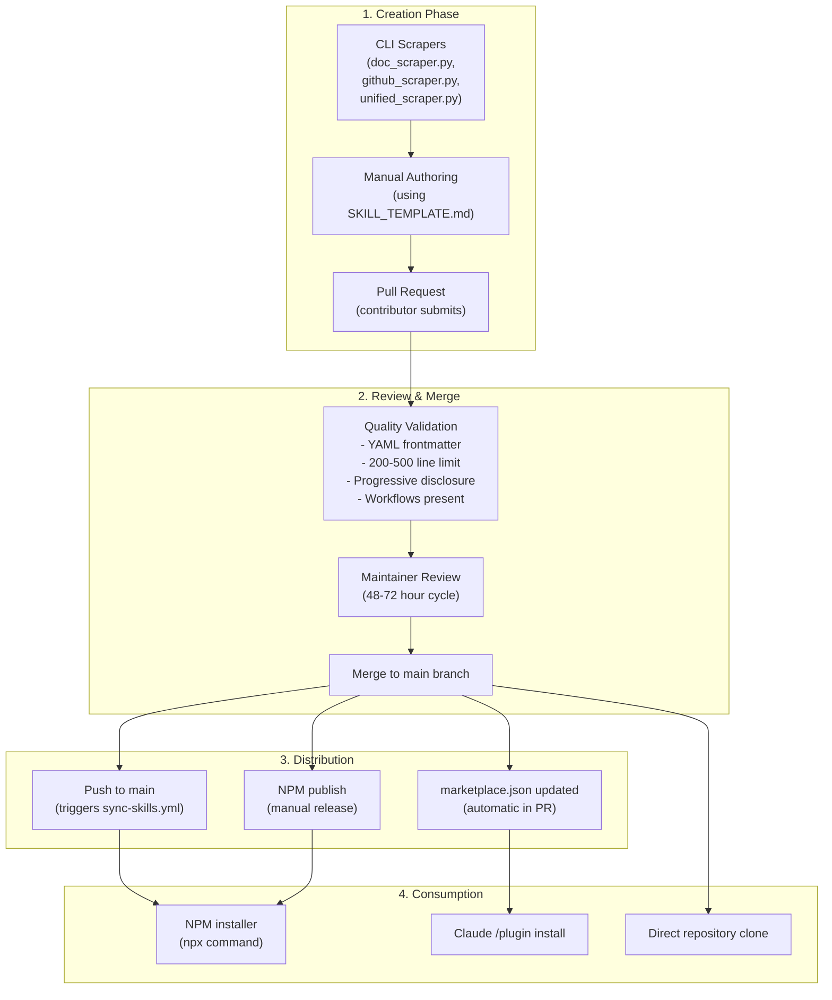

**Creation Tools:**

Three CLI scrapers assist skill creation by automating documentation gathering:

- `doc_scraper.py`: Scrapes official documentation websites
- `github_scraper.py`: Extracts content from GitHub repositories (README, issues, releases)
- `unified_scraper.py`: Combines documentation, GitHub, and PDF sources

**Quality Gates:**

Before merge, skills must pass validation:
- YAML frontmatter present with all required fields
- SKILL.md body under 500 lines
- Progressive disclosure implemented (references for details)
- Workflows include checklists
- Code blocks have language tags

**Sources:** [CONTRIBUTING.md:30-62](), [CONTRIBUTING.md:82-112](), [CONTRIBUTING.md:441-460]()

## Category Taxonomy

The 20 categories organize skills into a logical progression through the AI research lifecycle:

| Category Range | Phase | Skill Count | Purpose |
|----------------|-------|-------------|---------|
| 01-02 | Foundation | 7 | Model architectures and tokenization |
| 03-08 | Training | 27 | Fine-tuning, data processing, post-training, safety, distributed training |
| 09-11 | Optimization | 12 | Infrastructure, optimization techniques, evaluation |
| 12-13 | Production | 9 | Inference serving and MLOps |
| 14-18 | Application | 20 | Agents, RAG, prompt engineering, observability, multimodal |
| 19-20 | Advanced | 7 | Emerging techniques and ML paper writing |

**Numbering Scheme:**
- Two-digit prefix (01, 02, ..., 20) for sorting
- Kebab-case category name
- Example: `06-post-training/`, `12-inference-serving/`

**Sources:** [README.md:125-149](), [docs/ROADMAP.md:21-217]()

## Promotional Assets

The repository includes a Remotion-based video promo system demonstrating the complete user journey.

**Location:** `video-promo/` (implied from diagram analysis)

**Architecture:**
- `src/index.ts`: Registers Remotion root composition
- `src/Root.tsx`: Main composition (465 frames @ 30fps = 15.5s)
- `src/AIResearchSkillsPromo.tsx`: Orchestrates 8 sequential scenes
- `remotion.config.ts`: Build configuration (JPEG format, output settings)

**8 Sequential Scenes:**
1. Logo (ASCII art + subtitle with spring animations)
2. Stats Display (82 skills, 20 categories, 5 agents - count-up interpolation)
3. Agent Detection (5 agents found with staggered checkmarks)
4. Category Selection (interactive menu mock)
5. Install Progress (13 skill names with progress bar)
6. Success Screen (completion message + 3 example prompts)
7. Call to Action (npx command + GitHub/npm links with blinking cursor)
8. Audio (music.wav with volume fade)

**Build Commands:**
- `npm start`: Launch Remotion Studio for preview
- `npm run build`: Render promo.mp4
- `npm run build:gif`: Render promo.gif

**Sources:** High-Level System Architecture Diagrams (Diagram 6), [docs/assets/promo.gif:1]()

## Documentation Standards

The repository enforces specific documentation standards based on Anthropic's official best practices for AI-consumable content.

**Core Principles:**

1. **Concise Content**: Assume AI agents are intelligent—avoid over-explaining basics
2. **Progressive Disclosure**: SKILL.md as overview, details in separate reference files
3. **Workflows with Checklists**: Multi-step tasks use copy-paste checklist format
4. **Feedback Loops**: Quality-critical operations include validation steps (run → validate → fix → repeat)
5. **Consistent Terminology**: Use one term consistently throughout skill
6. **No Time-Sensitive Information**: Use "old patterns" sections for deprecated content

**Anti-Patterns to Avoid:**

- SKILL.md exceeding 500 lines
- Nested references (SKILL.md → ref1.md → ref2.md)
- Windows-style paths (use forward slashes)
- First-person descriptions ("I can help you...")
- Vague skill names ("helper", "utils")
- Missing workflows for complex tasks

**Sources:** [CONTRIBUTING.md:82-112](), [docs/SKILL_CREATION_GUIDE.md:8-120]()

## Contribution Workflow

Contributors follow a standardized process for adding or improving skills:

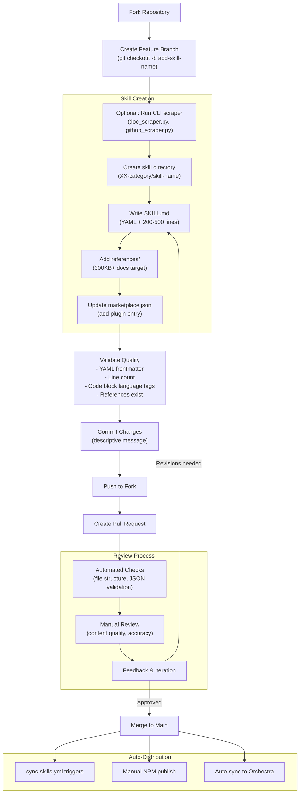

**Review Timeline:** 48-72 hours for maintainer review

**Contributor Recognition:** All contributors listed in `CONTRIBUTORS.md` with attribution in SKILL.md metadata

**Sources:** [CONTRIBUTING.md:30-286](), [CONTRIBUTING.md:440-460]()

## Key Statistics

As of January 2026:

| Metric | Current Value | Target |
|--------|---------------|--------|
| Total Skills | 82 | 70 ✅ (exceeded) |
| Categories | 20 | 20 ✅ |
| Avg Lines/Skill | 420 | 200-600 |
| Total Documentation | ~130,000 lines | 100,000+ ✅ |
| Gold Standard Skills | 65 (with comprehensive references) | 50+ ✅ |
| Supported Agents | 5 (Claude Code, Cursor, Windsurf, Gemini CLI, Qwen Code) | - |
| Distribution Channels | 3 (NPM, GitHub Actions, Claude Marketplace) | - |

**Recent Milestones:**
- v0.14.0 (January 2026): NPM package `@orchestra-research/ai-research-skills` launched
- 70-skill roadmap completed
- All 20 categories filled with high-quality skills

**Sources:** [README.md:369-382](), [README.md:465-632](), [docs/ROADMAP.md:9-18]()

---

# Page: Installation Guide

# Installation Guide

<details>
<summary>Relevant source files</summary>

The following files were used as context for generating this wiki page:

- [.claude-plugin/marketplace.json](.claude-plugin/marketplace.json)
- [CONTRIBUTING.md](CONTRIBUTING.md)
- [README.md](README.md)
- [demos/README.md](demos/README.md)
- [docs/ROADMAP.md](docs/ROADMAP.md)
- [docs/SKILL_CREATION_GUIDE.md](docs/SKILL_CREATION_GUIDE.md)
- [docs/SKILL_TEMPLATE.md](docs/SKILL_TEMPLATE.md)
- [docs/assets/promo.gif](docs/assets/promo.gif)
- [docs/christmas-tree.svg](docs/christmas-tree.svg)
- [docs/tech-tree.svg](docs/tech-tree.svg)
- [packages/ai-research-skills/package.json](packages/ai-research-skills/package.json)
- [packages/ai-research-skills/src/index.js](packages/ai-research-skills/src/index.js)
- [packages/ai-research-skills/src/installer.js](packages/ai-research-skills/src/installer.js)
- [packages/ai-research-skills/src/prompts.js](packages/ai-research-skills/src/prompts.js)

</details>


## Purpose and Scope

This document covers the installation and distribution architecture of AI Research Skills. It explains how to install the 82-skill library to AI coding agents, the underlying distribution mechanisms, and the canonical storage pattern that enables multi-agent support.

For detailed usage of the interactive NPM installer, see [NPM Package Installer](#2.1). For Claude Code marketplace integration, see [Claude Marketplace Integration](#2.2). For alternative installation methods including Gemini CLI and custom RAG systems, see [Manual Installation Methods](#2.3).

## Installation Architecture Overview

The AI Research Skills library implements a three-tier distribution architecture: a canonical storage directory at `~/.orchestra/skills/`, symlinks to individual agent directories, and a lock file tracking installation state.

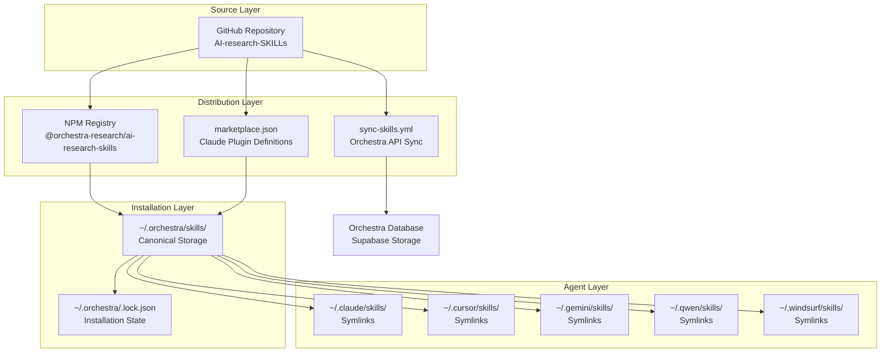

**Sources:** [packages/ai-research-skills/src/installer.js:9-10](), [packages/ai-research-skills/src/installer.js:15-23](), [README.md:77-91]()

## Prerequisites

| Requirement | Specification | Notes |
|------------|---------------|-------|
| Node.js | >=18.0.0 | Required for NPM installer |
| Git | Any recent version | Used for cloning repository |
| Operating System | macOS, Linux, Windows | Windows requires compatible shell |
| Disk Space | ~50MB | For full skill library |
| Supported Agents | Claude Code, Cursor, Gemini CLI, Qwen Code, Windsurf | At least one required |

**Sources:** [packages/ai-research-skills/package.json:38-40]()

## Installation Methods Comparison

| Method | Use Case | Agent Detection | Interactive | Requires Node.js |
|--------|----------|----------------|-------------|------------------|
| NPM Installer | Recommended for all users | Automatic | Yes | Yes |
| Claude Marketplace | Claude Code users only | N/A | Via slash commands | No |
| Manual Installation | Custom RAG systems, Gemini CLI | Manual | No | No |
| GitHub Actions Sync | Orchestra marketplace publishing | N/A | No | No |

**Sources:** [README.md:77-124]()

## Distribution Flow

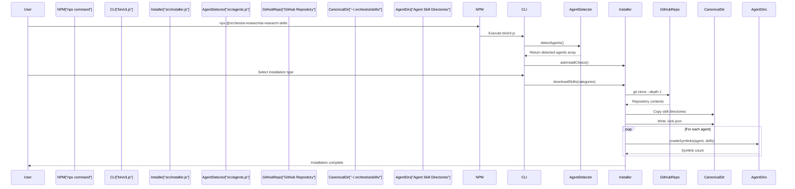

**Sources:** [packages/ai-research-skills/src/index.js:35-57](), [packages/ai-research-skills/src/installer.js:49-114](), [packages/ai-research-skills/src/installer.js:119-151]()

## Core Installation Components

### Entry Point: `bin/cli.js`

The CLI entry point invokes the main function from `src/index.js`:

**Sources:** [packages/ai-research-skills/package.json:6-8]()

### Main Orchestrator: `src/index.js`

Key functions:
- `interactiveFlow()`: Guided installation with menu navigation ([packages/ai-research-skills/src/index.js:35-283]())
- `commandMode()`: Direct command execution for power users ([packages/ai-research-skills/src/index.js:288-342]())
- `main()`: Entry point that routes to appropriate mode ([packages/ai-research-skills/src/index.js:347-358]())

### Installation Logic: `src/installer.js`

Core constants:
- `REPO_URL`: `'https://github.com/Orchestra-Research/AI-research-SKILLs'` ([packages/ai-research-skills/src/installer.js:8]())
- `CANONICAL_DIR`: `join(homedir(), '.orchestra', 'skills')` ([packages/ai-research-skills/src/installer.js:9]())
- `LOCK_FILE`: `join(homedir(), '.orchestra', '.lock.json')` ([packages/ai-research-skills/src/installer.js:10]())

Key functions:
- `ensureCanonicalDir()`: Creates `~/.orchestra/skills/` directory ([packages/ai-research-skills/src/installer.js:15-23]())
- `downloadSkills(categories, spinner)`: Clones repository and copies selected categories ([packages/ai-research-skills/src/installer.js:49-114]())
- `createSymlinks(agent, skills, spinner)`: Creates symlinks from canonical directory to agent directories ([packages/ai-research-skills/src/installer.js:119-151]())
- `installSkills(categories, agents)`: Main installation workflow ([packages/ai-research-skills/src/installer.js:260-293]())

**Sources:** [packages/ai-research-skills/src/installer.js:8-10](), [packages/ai-research-skills/src/installer.js:15-293]()

## Canonical Directory Pattern

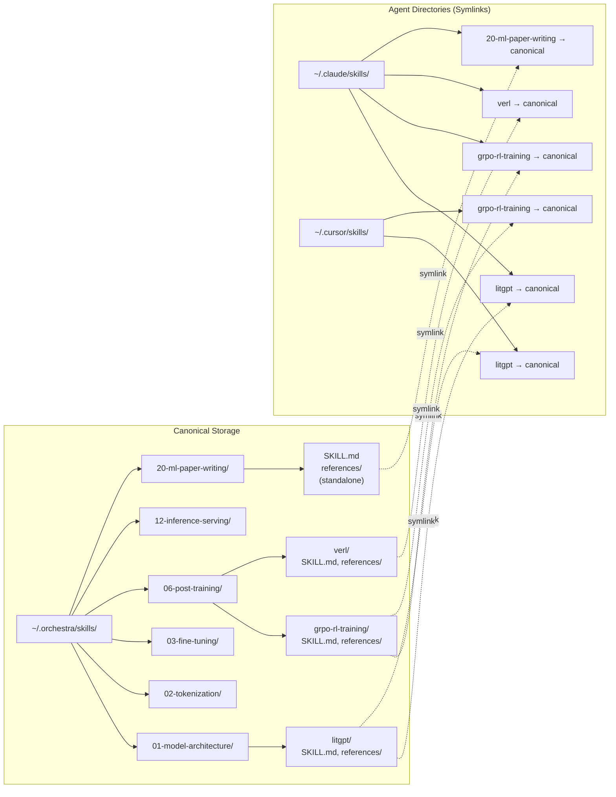

The canonical directory pattern ensures a single source of truth for skill content, enabling consistent updates across all installed agents.

**Sources:** [packages/ai-research-skills/src/installer.js:9](), [packages/ai-research-skills/src/installer.js:130-145]()

## Skill Directory Structure

Skills are organized by category with numeric prefixes:

| Category Prefix | Category Name | Example Skills |
|----------------|---------------|----------------|
| `01-` | model-architecture | litgpt, mamba, torchtitan |
| `02-` | tokenization | huggingface-tokenizers, sentencepiece |
| `03-` | fine-tuning | axolotl, unsloth, peft |
| `06-` | post-training | grpo-rl-training, verl, slime, miles |
| `12-` | inference-serving | vllm, sglang, tensorrt-llm |
| `20-` | ml-paper-writing | (standalone skill) |

### Nested vs Standalone Skills

**Nested skill structure** (most categories):
```
06-post-training/
├── grpo-rl-training/
│   ├── SKILL.md
│   └── references/
├── verl/
│   ├── SKILL.md
│   └── references/
└── slime/
    ├── SKILL.md
    └── references/
```

**Standalone skill structure** (category 20):
```
20-ml-paper-writing/
├── SKILL.md
└── references/
```

The installer detects standalone skills by checking for `SKILL.md` directly in the category directory ([packages/ai-research-skills/src/installer.js:78-83]()).

**Sources:** [packages/ai-research-skills/src/installer.js:68-101](), [packages/ai-research-skills/src/prompts.js:7-28]()

## Installation State Management

### Lock File Format

The lock file at `~/.orchestra/.lock.json` tracks installation state:

```json
{
  "version": "1.0.0",
  "installedAt": "2025-01-15T10:30:00.000Z",
  "skills": [
    {
      "category": "06-post-training",
      "skill": "verl",
      "standalone": false
    },
    {
      "category": "20-ml-paper-writing",
      "skill": "20-ml-paper-writing",
      "standalone": true
    }
  ],
  "agents": ["claude", "cursor"]
}
```

**Lock file operations:**
- `readLock()`: Parses lock file or returns defaults ([packages/ai-research-skills/src/installer.js:28-37]())
- `writeLock(data)`: Serializes and writes lock file ([packages/ai-research-skills/src/installer.js:42-44]())

**Sources:** [packages/ai-research-skills/src/installer.js:10](), [packages/ai-research-skills/src/installer.js:28-44](), [packages/ai-research-skills/src/installer.js:280-286]()

## Quick Start: NPM Installation

The most common installation workflow:

```bash
# Interactive installer (recommended)
npx @orchestra-research/ai-research-skills

# Direct commands
npx @orchestra-research/ai-research-skills list      # View installed skills
npx @orchestra-research/ai-research-skills update    # Update installed skills
```

**Agent detection flow:**
1. `detectAgents()` scans known directories ([packages/ai-research-skills/src/index.js:47]())
2. Returns array of detected agents with paths
3. User selects installation scope (everything, categories, or individual skills)
4. Installer clones repository to temporary directory ([packages/ai-research-skills/src/installer.js:56-63]())
5. Copies selected skills to `~/.orchestra/skills/` ([packages/ai-research-skills/src/installer.js:68-102]())
6. Creates symlinks for each agent ([packages/ai-research-skills/src/installer.js:272-276]())
7. Writes lock file with installation state ([packages/ai-research-skills/src/installer.js:280-286]())

**Sources:** [README.md:77-103](), [packages/ai-research-skills/src/index.js:35-283]()

## Quick Start: Claude Marketplace

Claude Code users can install via slash commands:

```bash
# Add the marketplace
/plugin marketplace add orchestra-research/AI-research-SKILLs

# Install by category
/plugin install fine-tuning@ai-research-skills
/plugin install post-training@ai-research-skills
/plugin install inference-serving@ai-research-skills
```

The marketplace is defined in `.claude-plugin/marketplace.json` with 20 plugin entries mapping to skill categories.

**Marketplace plugin structure:**
```json
{
  "name": "post-training",
  "description": "RLHF and preference alignment...",
  "source": "./",
  "strict": false,
  "skills": [
    "./06-post-training/grpo-rl-training",
    "./06-post-training/miles",
    "./06-post-training/openrlhf",
    "./06-post-training/simpo",
    "./06-post-training/slime",
    "./06-post-training/torchforge",
    "./06-post-training/trl-fine-tuning",
    "./06-post-training/verl"
  ]
}
```

**Sources:** [README.md:107-122](), [.claude-plugin/marketplace.json:1-255]()

## Installation Commands Reference

| Command | Function | Code Reference |
|---------|----------|----------------|
| `npx @orchestra-research/ai-research-skills` | Launch interactive installer | [packages/ai-research-skills/src/index.js:347-358]() |
| `npx @orchestra-research/ai-research-skills list` | Display installed skills | [packages/ai-research-skills/src/installer.js:298-363]() |
| `npx @orchestra-research/ai-research-skills update` | Update all installed skills | [packages/ai-research-skills/src/installer.js:432-470]() |
| `npx @orchestra-research/ai-research-skills install --all` | Install all categories (non-interactive) | [packages/ai-research-skills/src/index.js:311-341]() |

**Sources:** [packages/ai-research-skills/src/index.js:288-342](), [README.md:95-103]()

## Supported Agent Configuration Directories

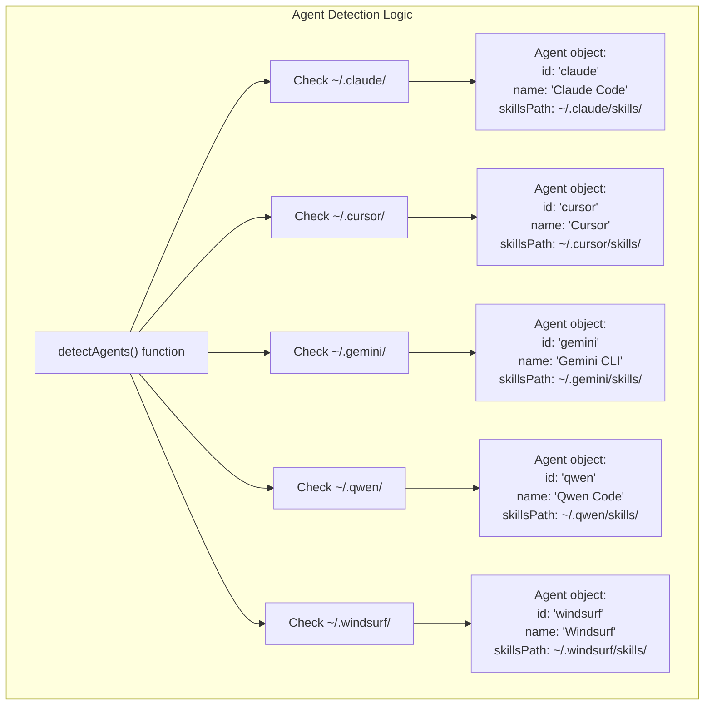

The `detectAgents()` function in `src/agents.js` scans for these configuration directories and returns an array of agent objects with standardized properties.

**Sources:** [packages/ai-research-skills/src/index.js:47](), [README.md:79]()

## Update Mechanism

The update workflow re-downloads only installed skills and refreshes symlinks:

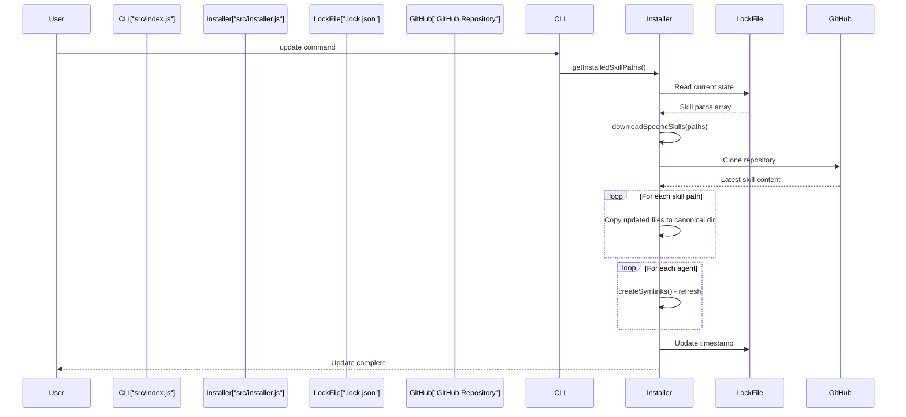

**Key functions:**
- `getInstalledSkillPaths()`: Returns array like `['06-post-training/verl', '20-ml-paper-writing']` ([packages/ai-research-skills/src/installer.js:397-427]())
- `updateInstalledSkills(agents)`: Re-downloads and refreshes symlinks ([packages/ai-research-skills/src/installer.js:432-470]())
- `downloadSpecificSkills(skillPaths, spinner)`: Clones and copies specific skills ([packages/ai-research-skills/src/installer.js:156-219]())

**Sources:** [packages/ai-research-skills/src/installer.js:397-470](), [packages/ai-research-skills/src/index.js:82-103]()

## Uninstallation

Two uninstallation modes are supported:

### Full Uninstallation

Removes all skills and symlinks:

```bash
# Interactive mode
npx @orchestra-research/ai-research-skills
# Select "Uninstall all skills"
```

**Implementation:**
- `uninstallAllSkills(agents)`: Removes symlinks from all agents, deletes canonical directory, removes lock file ([packages/ai-research-skills/src/installer.js:475-516]())

### Selective Uninstallation

Removes specific skills:

**Implementation:**
- `uninstallSpecificSkills(skillPaths, agents)`: Removes selected symlinks, deletes from canonical directory, updates lock file ([packages/ai-research-skills/src/installer.js:523-593]())
- `getInstalledSkillsForSelection()`: Returns formatted skill list for UI ([packages/ai-research-skills/src/installer.js:599-611]())

**Sources:** [packages/ai-research-skills/src/installer.js:475-593](), [packages/ai-research-skills/src/index.js:106-166]()

## Category ID Reference

The installer uses these category IDs from `getAllCategoryIds()`:

```javascript
[
  '01-model-architecture',
  '02-tokenization',
  '03-fine-tuning',
  '04-mechanistic-interpretability',
  '05-data-processing',
  '06-post-training',
  '07-safety-alignment',
  '08-distributed-training',
  '09-infrastructure',
  '10-optimization',
  '11-evaluation',
  '12-inference-serving',
  '13-mlops',
  '14-agents',
  '15-rag',
  '16-prompt-engineering',
  '17-observability',
  '18-multimodal',
  '19-emerging-techniques',
  '20-ml-paper-writing'
]
```

**Sources:** [packages/ai-research-skills/src/installer.js:368-391]()

## Troubleshooting

| Issue | Cause | Solution |
|-------|-------|----------|
| "No agents detected" | Agent config directories not found | Install a supported coding agent first |
| Symlink creation fails | Permissions issue | Check write access to agent directories |
| Git clone fails | Network or GitHub access | Check internet connection, GitHub availability |
| Lock file parse error | Corrupted JSON | Delete `~/.orchestra/.lock.json` and reinstall |
| Skill not appearing in agent | Symlink broken | Run update command to refresh symlinks |

**Common debug commands:**
```bash
# List canonical directory contents
ls -la ~/.orchestra/skills/

# Check symlinks in agent directory
ls -la ~/.claude/skills/

# Verify lock file
cat ~/.orchestra/.lock.json

# Test agent detection
npx @orchestra-research/ai-research-skills list
```

**Sources:** [packages/ai-research-skills/src/installer.js:28-37](), [packages/ai-research-skills/src/installer.js:136-147]()

---

# Page: NPM Package Installer

# NPM Package Installer

<details>
<summary>Relevant source files</summary>

The following files were used as context for generating this wiki page:

- [docs/npm-package-ux-mockup.html](docs/npm-package-ux-mockup.html)
- [packages/ai-research-skills/.gitignore](packages/ai-research-skills/.gitignore)
- [packages/ai-research-skills/README.md](packages/ai-research-skills/README.md)
- [packages/ai-research-skills/bin/cli.js](packages/ai-research-skills/bin/cli.js)
- [packages/ai-research-skills/package-lock.json](packages/ai-research-skills/package-lock.json)
- [packages/ai-research-skills/package.json](packages/ai-research-skills/package.json)
- [packages/ai-research-skills/src/agents.js](packages/ai-research-skills/src/agents.js)
- [packages/ai-research-skills/src/ascii.js](packages/ai-research-skills/src/ascii.js)
- [packages/ai-research-skills/src/index.js](packages/ai-research-skills/src/index.js)
- [packages/ai-research-skills/src/installer.js](packages/ai-research-skills/src/installer.js)
- [packages/ai-research-skills/src/prompts.js](packages/ai-research-skills/src/prompts.js)

</details>


## Purpose and Scope

This document covers the technical implementation of the NPM package installer (`@orchestra-research/ai-research-skills`), which provides an interactive CLI for installing AI research skills to coding agents. The installer detects agents on the user's system, presents an interactive menu for skill selection, downloads skills from GitHub, and creates a canonical storage architecture with symlinks.

For Claude marketplace integration, see [Claude Marketplace Integration](#2.2). For manual installation methods for specific agents, see [Manual Installation Methods](#2.3). For the broader distribution architecture including GitHub Actions sync, see [Distribution Channels](#6.1).

---

## Package Structure and Entry Points

The NPM package is published as `@orchestra-research/ai-research-skills` with version 1.0.3. The package provides both programmatic and CLI interfaces.

### Package Configuration

| Property | Value | Purpose |
|----------|-------|---------|
| Package Name | `@orchestra-research/ai-research-skills` | NPM registry identifier |
| Main Entry | `src/index.js` | Programmatic entry point |
| Binary Command | `ai-research-skills` | CLI command name |
| Binary Path | `./bin/cli.js` | Executable script |
| Node Version | `>=18.0.0` | Minimum runtime requirement |

The package uses ES modules (`"type": "module"`) and depends on three libraries: `chalk` (terminal colors), `inquirer` (interactive prompts), and `ora` (spinners).

**Sources:** [packages/ai-research-skills/package.json:1-46]()

### Entry Point Chain

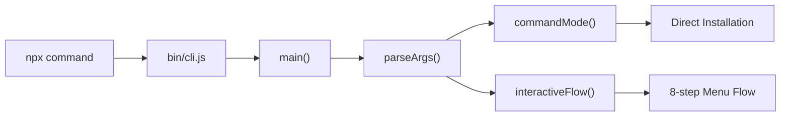

The CLI entry point at `bin/cli.js` imports and invokes `main()` from `src/index.js`, which determines whether to run in command mode (for power users with CLI flags) or interactive mode (default guided experience).

**Sources:** [packages/ai-research-skills/bin/cli.js:1-9](), [packages/ai-research-skills/src/index.js:347-358]()

---

## Agent Detection System

The installer automatically detects which AI coding agents are installed by checking for configuration directories in the user's home directory.

### Supported Agents Configuration

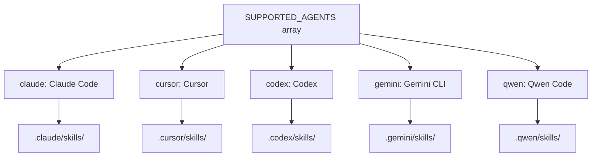

Each agent entry in `SUPPORTED_AGENTS` defines:
- `id`: Agent identifier (e.g., `"claude"`)
- `name`: Display name (e.g., `"Claude Code"`)
- `configDir`: Home directory subdirectory (e.g., `".claude"`)
- `skillsDir`: Skills subdirectory within config (always `"skills"`)

**Sources:** [packages/ai-research-skills/src/agents.js:9-40]()

### Detection Algorithm

The `detectAgents()` function performs filesystem checks:

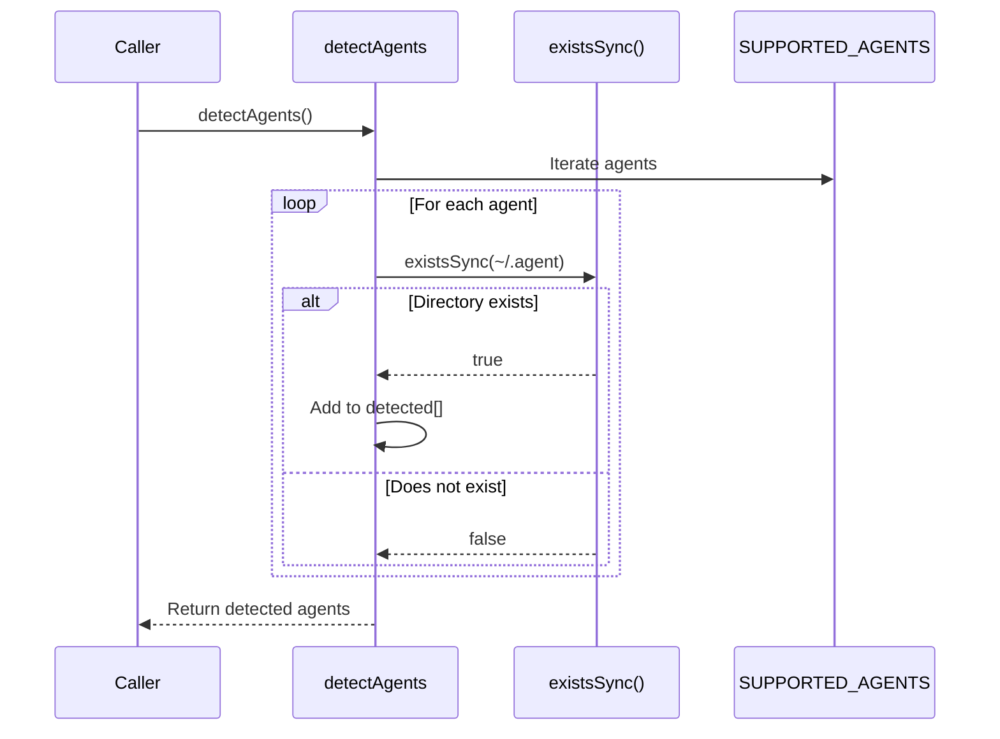

For each agent, the function checks if `join(homedir(), agent.configDir)` exists. If found, it constructs an agent object with:
- Original configuration from `SUPPORTED_AGENTS`
- `path`: Display path (e.g., `"~/.claude"`)
- `fullPath`: Absolute filesystem path
- `skillsPath`: Full path to skills directory (e.g., `/home/user/.claude/skills`)

**Sources:** [packages/ai-research-skills/src/agents.js:46-64]()

---

## Interactive Flow Architecture

The interactive mode presents an 8-step guided experience with menu navigation. The flow is implemented as nested labeled loops in `interactiveFlow()`.

### Flow Control Structure

```mermaid
graph TD
    start["Start interactiveFlow()"] --> welcome["showWelcome()"]
    welcome --> detect["detectAgents()"]
    detect --> checkAgents{agents.length > 0?}
    checkAgents -->|No| noAgents["showNoAgents()"]
    checkAgents -->|Yes| step2["step2_menu loop"]
    
    step2 --> mainMenu["askMainMenuAction()"]
    mainMenu --> menuChoice{Choice?}
    menuChoice -->|exit| exit["Exit"]
    menuChoice -->|view| listSkills["listInstalledSkills()"]
    menuChoice -->|update| updateFlow["updateInstalledSkills()"]
    menuChoice -->|uninstall| uninstallFlow["step_uninstall loop"]
    menuChoice -->|install| step3["step3_choice loop"]
    
    step3 --> installChoice["askInstallChoice()"]
    installChoice --> choiceType{Type?}
    choiceType -->|everything| allCats["getAllCategoryIds()"]
    choiceType -->|quickstart| quickStart["QUICK_START_SKILLS"]
    choiceType -->|categories| step4cat["step4_categories loop"]
    choiceType -->|individual| step4ind["step4_individual loop"]
    
    step4cat --> selectCats["askCategories()"]
    step4ind --> selectSkills["askIndividualSkills()"]
    
    selectCats --> step5["step5_agents loop"]
    selectSkills --> step5
    allCats --> step5
    quickStart --> step5
    
    step5 --> selectAgents["askSelectAgents()"]
    selectAgents --> confirm["askConfirmation()"]
    confirm --> confirmChoice{Confirm?}
    confirmChoice -->|back| step5
    confirmChoice -->|exit| exit
    confirmChoice -->|confirm| install["installSkills() / installSpecificSkills()"]
    
    install --> success["showSuccess()"]
    success --> end["End"]
```

The implementation uses labeled loops (`step2_menu:`, `step3_choice:`, etc.) to enable navigation between menu levels with `continue step2_menu` statements.

**Sources:** [packages/ai-research-skills/src/index.js:35-283]()

### Menu Components

| Function | Purpose | Choices |
|----------|---------|---------|
| `askMainMenuAction()` | Root menu after agent detection | Install, View, Update, Uninstall, Exit |
| `askInstallChoice()` | What to install | Everything, Quick start, Categories, Individual skills |
| `askCategories()` | Category multi-select | 20 category checkboxes |
| `askIndividualSkills()` | Skill multi-select | Individual skills from `INDIVIDUAL_SKILLS` |
| `askSelectAgents()` | Agent selection | All agents or specific selection |
| `askConfirmation()` | Installation summary | Install or Go back |

Each prompt function returns either a choice value or an object with `{ action, ... }` for handling retry/back navigation.

**Sources:** [packages/ai-research-skills/src/prompts.js:96-407]()

---

## Canonical Storage Architecture

The installer implements a "canonical directory with symlinks" pattern to avoid duplicating skills across multiple agents.

### Storage Locations

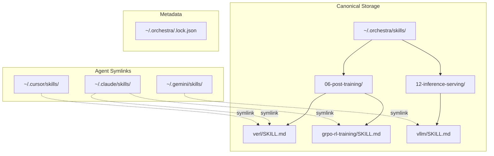

**Key Constants:**
- `CANONICAL_DIR`: `join(homedir(), '.orchestra', 'skills')` - Single source of truth
- `LOCK_FILE`: `join(homedir(), '.orchestra', '.lock.json')` - Installation metadata

**Sources:** [packages/ai-research-skills/src/installer.js:8-10]()

### Directory Structure

Skills are organized hierarchically:
- **Standalone skills**: Category folder contains `SKILL.md` directly (e.g., `20-ml-paper-writing/SKILL.md`)
- **Nested skills**: Category folder contains multiple skill subfolders (e.g., `06-post-training/verl/SKILL.md`)

The installer handles both patterns by checking for the presence of `SKILL.md` in the category directory.

**Sources:** [packages/ai-research-skills/src/installer.js:78-101]()

---

## Installation Process

The installation process involves three phases: download, storage, and linking.

### Download Phase

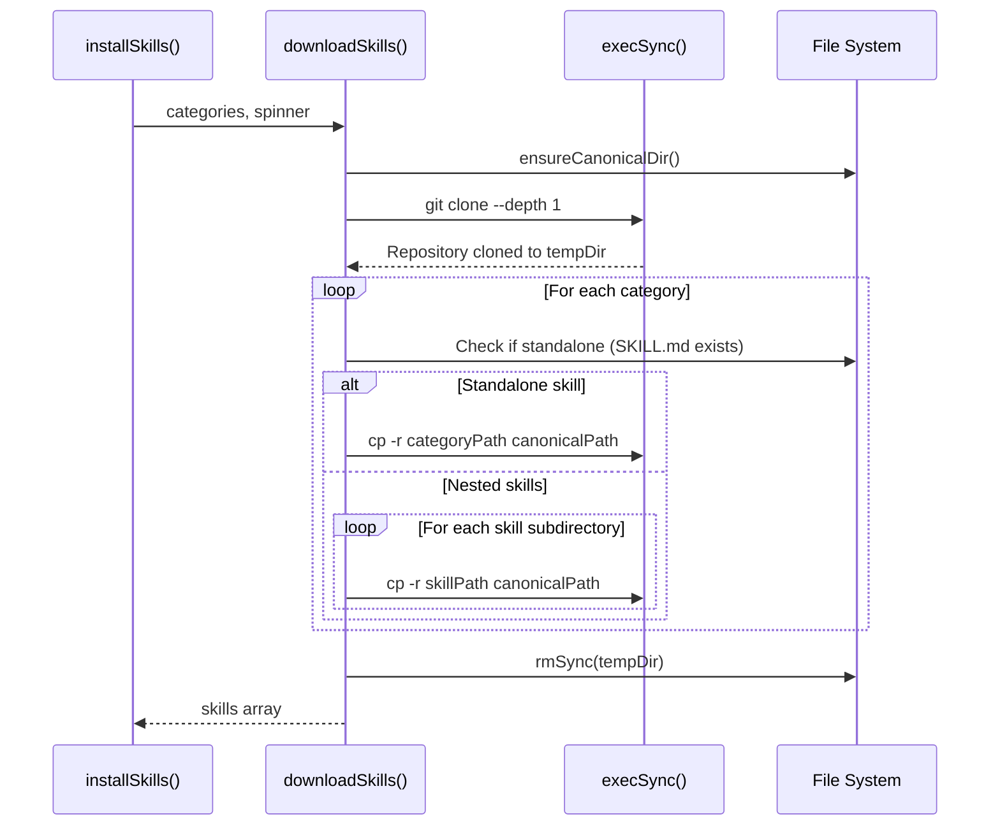

The `downloadSkills()` function:
1. Creates temporary clone directory at `~/.orchestra/.temp-clone`
2. Clones repository with `--depth 1` for minimal download
3. Iterates through selected category IDs
4. Distinguishes standalone vs nested skills by checking for `SKILL.md` in category root
5. Copies skill directories to `CANONICAL_DIR` using `cp -r` via `execSync()`
6. Cleans up temporary directory
7. Returns array of skill objects: `{ category, skill, standalone }`

**Sources:** [packages/ai-research-skills/src/installer.js:49-114]()

### Symlink Creation Phase

```mermaid
sequenceDiagram
    participant install as installSkills()
    participant create as createSymlinks()
    participant fs as File System
    
    install->>create: agent, skills, spinner
    create->>fs: mkdirSync(agentSkillsPath)
    
    loop For each skill
        create->>create: Determine sourcePath
        create->>create: Determine linkName
        create->>fs: Check if linkPath exists
        alt Exists
            create->>fs: rmSync(linkPath)
        end
        create->>fs: symlinkSync(sourcePath, linkPath)
    end
    
    create-->>install: linkedCount
```

The `createSymlinks()` function:
1. Ensures agent's skills directory exists
2. For each skill, computes:
   - `sourcePath`: Absolute path in `CANONICAL_DIR`
   - `linkName`: Skill or category name (what appears in agent's directory)
   - `linkPath`: Full path to symlink in agent's directory
3. Removes existing symlink if present (for updates)
4. Creates symlink with `symlinkSync(sourcePath, linkPath)`

**Sources:** [packages/ai-research-skills/src/installer.js:119-151]()

### Installation Execution

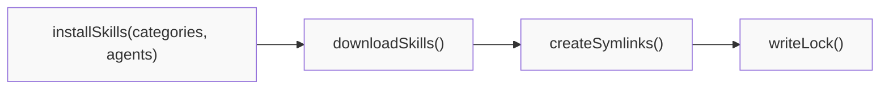

The main `installSkills()` function orchestrates:
1. Spinner starts with "Downloading from GitHub..."
2. Calls `downloadSkills(categories, spinner)` to fetch skills
3. For each agent, calls `createSymlinks(agent, skills, spinner)`
4. Displays progress: `✓ AgentName → path count skills`
5. Updates lock file with installation metadata
6. Returns total skill count

**Sources:** [packages/ai-research-skills/src/installer.js:260-293]()

---

## Lock File Management

The lock file at `~/.orchestra/.lock.json` tracks installation state to support updates and uninstalls.

### Lock File Schema

```json
{
  "version": "1.0.0",
  "installedAt": "2024-01-15T10:30:00.000Z",
  "skills": [
    {
      "category": "06-post-training",
      "skill": "verl",
      "standalone": false
    }
  ],
  "agents": ["claude", "cursor", "gemini"]
}
```

| Field | Type | Purpose |
|-------|------|---------|
| `version` | string | Package version at install time |
| `installedAt` | ISO 8601 string | Timestamp of last installation |
| `skills` | array | List of installed skills with metadata |
| `agents` | array | Agent IDs that have symlinks |

**Sources:** [packages/ai-research-skills/src/installer.js:28-44](), [packages/ai-research-skills/src/installer.js:280-286]()

### Update Strategy

The `updateInstalledSkills()` function:
1. Calls `getInstalledSkillPaths()` to read lock file and scan `CANONICAL_DIR`
2. Generates skill paths (e.g., `["06-post-training/verl", "20-ml-paper-writing"]`)
3. Uses `downloadSpecificSkills()` to re-download only installed skills
4. Refreshes symlinks for all agents
5. Updates lock file with new timestamp

This approach minimizes download size by only fetching previously installed skills rather than all 82 skills.

**Sources:** [packages/ai-research-skills/src/installer.js:432-470]()

---

## Category and Skill Definitions

The installer maintains hardcoded definitions for interactive prompts.

### Category Metadata

The `CATEGORIES` array defines all 20 categories with metadata for display:

```javascript
{
  id: '06-post-training',
  name: 'Post-Training',
  skills: 8,
  examples: 'GRPO, verl, slime, miles, torchforge'
}
```

The `getAllCategoryIds()` function returns all 20 category IDs for "Install Everything" mode.

**Sources:** [packages/ai-research-skills/src/prompts.js:7-28](), [packages/ai-research-skills/src/installer.js:368-391]()

### Individual Skills Subset

The `INDIVIDUAL_SKILLS` array defines a curated subset of 24 notable skills for granular selection:

| Category | Skills |
|----------|--------|
| Post-Training | GRPO, verl, slime, miles, torchforge, TRL, OpenRLHF, SimPO |
| Fine-Tuning | Axolotl, Unsloth, Torchtune |
| Inference | vLLM, SGLang, TensorRT-LLM |
| Training | DeepSpeed, FSDP, TorchTitan |
| Optimization | Flash Attention, GPTQ |
| Tools | W&B, lm-eval-harness, DSPy, Chroma |
| Paper Writing | ML Paper Writing |

**Sources:** [packages/ai-research-skills/src/prompts.js:33-65]()

### Quick Start Bundle

The `QUICK_START_SKILLS` array defines 14 essential skills for new users:

```javascript
[
  '06-post-training/grpo-rl-training',
  '06-post-training/verl',
  '06-post-training/trl-fine-tuning',
  '03-fine-tuning/axolotl',
  '03-fine-tuning/unsloth',
  // ... 9 more skills
]
```

This bundle includes skills from post-training, fine-tuning, inference, distributed training, optimization, MLOps, evaluation, prompt engineering, RAG, and paper writing categories.

**Sources:** [packages/ai-research-skills/src/prompts.js:70-85]()

---

## Command-Line Mode

The installer supports direct command-line invocation for power users, bypassing the interactive flow.

### Argument Parsing

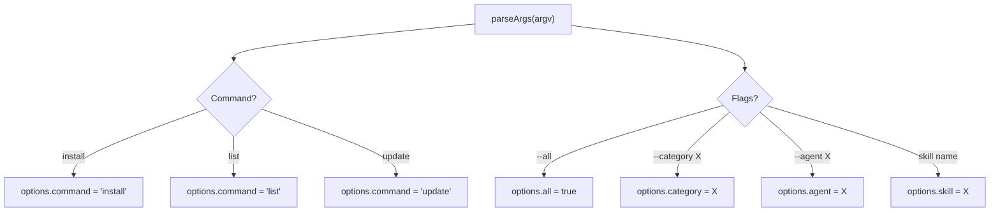

The `parseArgs()` function extracts:
- `command`: First positional argument (`install`, `list`, `update`)
- `all`: `--all` or `-a` flag
- `category`: `--category` flag value
- `skill`: Positional argument (category or skill name)
- `agent`: `--agent` flag value

**Sources:** [packages/ai-research-skills/src/prompts.js:499-529]()

### Command Mode Execution

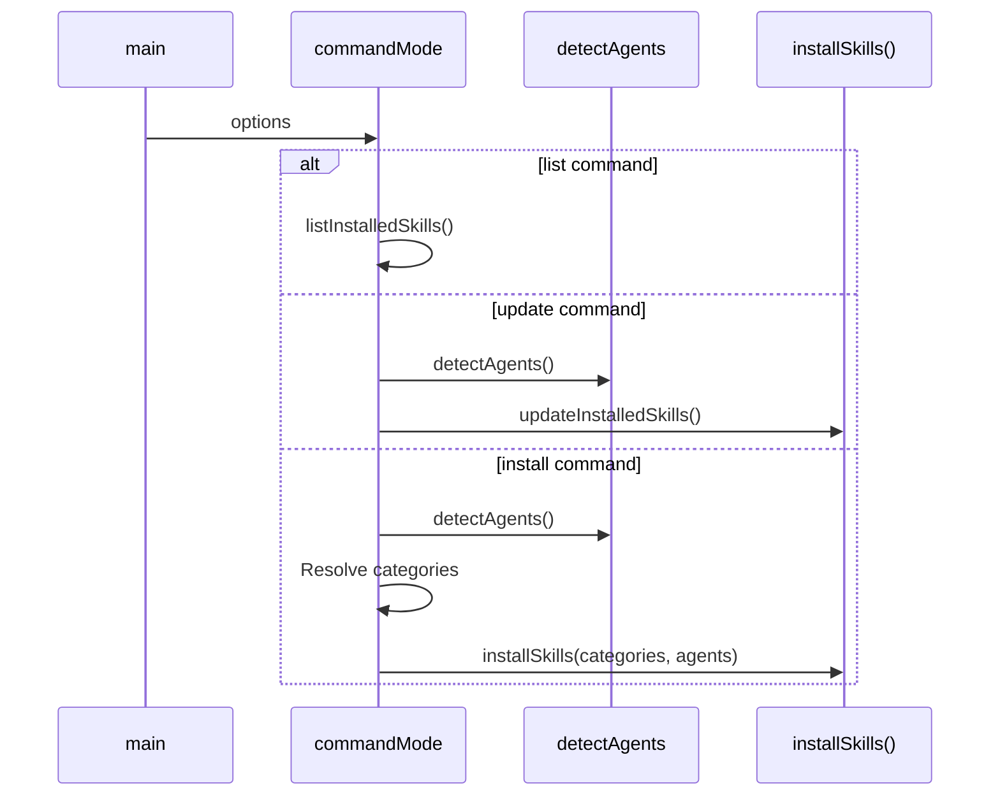

The `commandMode()` function:
1. For `list`: Directly calls `listInstalledSkills()` and exits
2. For `update`: Detects agents, fetches installed paths, calls `updateInstalledSkills()`
3. For `install`: Detects agents, resolves category from flags/args, calls `installSkills()`

**Sources:** [packages/ai-research-skills/src/index.js:288-342]()

### Example Commands

| Command | Behavior |
|---------|----------|
| `npx @orchestra-research/ai-research-skills` | Interactive mode |
| `npx @orchestra-research/ai-research-skills list` | List installed skills |
| `npx @orchestra-research/ai-research-skills update` | Update all installed skills |
| `npx @orchestra-research/ai-research-skills install --all` | Install all 82 skills |
| `npx @orchestra-research/ai-research-skills install post-training` | Install post-training category |

**Sources:** [packages/ai-research-skills/README.md:32-48]()

---

## Uninstall Operations

The installer supports uninstalling all skills or specific skills.

### Uninstall All

```mermaid
sequenceDiagram
    participant ui as Interactive UI
    participant uninstallAll as uninstallAllSkills()
    participant fs as File System
    
    ui->>uninstallAll: agents
    
    loop For each agent
        uninstallAll->>fs: List agent.skillsPath
        loop For each entry
            uninstallAll->>fs: Check if symlink
            alt Is symlink
                uninstallAll->>fs: rmSync(linkPath)
            end
        end
    end
    
    uninstallAll->>fs: rmSync(CANONICAL_DIR)
    uninstallAll->>fs: rmSync(LOCK_FILE)
```

The `uninstallAllSkills()` function:
1. Iterates through all detected agents
2. For each agent's skills directory, checks each entry with `lstatSync().isSymbolicLink()`
3. Removes symlinks (only those pointing to canonical directory)
4. Removes entire `CANONICAL_DIR` (`~/.orchestra/skills/`)
5. Removes lock file

**Sources:** [packages/ai-research-skills/src/installer.js:475-516]()

### Uninstall Specific Skills

The `uninstallSpecificSkills()` function:
1. Parses skill paths (e.g., `"06-post-training/verl"`)
2. Determines link name from path
3. Removes symlinks from all agents
4. Removes skill directory from `CANONICAL_DIR`
5. Cleans up empty category directories
6. Updates lock file to remove uninstalled skills

**Sources:** [packages/ai-research-skills/src/installer.js:523-593]()

---

## Listing Installed Skills

The `listInstalledSkills()` function scans the actual filesystem rather than relying solely on the lock file.

### Scanning Algorithm

```mermaid
graph TB
    list["listInstalledSkills()"] --> checkDir{CANONICAL_DIR exists?}
    checkDir -->|No| noSkills["Display: No skills installed"]
    checkDir -->|Yes| scanCats["Scan category directories"]
    
    scanCats --> loop["For each category"]
    loop --> checkStandalone{Has SKILL.md?}
    checkStandalone -->|Yes| standalone["Add as standalone skill"]
    checkStandalone -->|No| scanNested["Scan nested skills"]
    scanNested --> addNested["Add each skill subdirectory"]
    
    standalone --> display["Display by category"]
    addNested --> display
    display --> showLocation["Show CANONICAL_DIR location"]
```

The function:
1. Reads all directories in `CANONICAL_DIR`
2. For each category, checks if `SKILL.md` exists directly (standalone skill)
3. If not standalone, scans subdirectories that contain `SKILL.md`
4. Groups skills by category and displays with counts
5. Shows canonical storage location path

**Sources:** [packages/ai-research-skills/src/installer.js:298-363]()

---

## Display and UI Components

The installer uses ASCII art and formatted output for visual appeal.

### ASCII Components

| Function | Purpose | Content |
|----------|---------|---------|
| `showWelcome()` | Initial splash screen | Orchestra logo + tagline + stats |
| `showAgentsDetected()` | Agent detection results | Logo + detected agent list |
| `showMenuHeader()` | Menu screen header | Divider + "ORCHESTRA · AI Research Skills" |
| `showSuccess()` | Completion screen | Success message + examples + commands |
| `showNoAgents()` | Error state | Warning + supported agent list |

All functions use `chalk` for colors:
- `chalk.white()`: Primary text
- `chalk.green()`: Success indicators
- `chalk.cyan()`: Interactive prompts
- `chalk.dim()`: Secondary information
- `chalk.yellow()`: Warnings

**Sources:** [packages/ai-research-skills/src/ascii.js:1-127]()

### Progress Indicators

The installer uses `ora` spinners for long-running operations:

```javascript
const spinner = ora('Downloading from GitHub...').start();
// ... perform operation
spinner.succeed(`Downloaded ${count} skills`);
```

Spinners are passed to download functions to update text during multi-step processes.

**Sources:** [packages/ai-research-skills/src/installer.js:225-230](), [packages/ai-research-skills/src/installer.js:261-266]()

---

## Error Handling

The installer implements try-catch blocks around filesystem and Git operations.

### Download Error Recovery

```javascript
try {
  // Clone and copy operations
} catch (error) {
  if (existsSync(tempDir)) {
    rmSync(tempDir, { recursive: true, force: true });
  }
  throw error;
}
```

If any error occurs during download, the temporary clone directory is cleaned up before re-throwing.

**Sources:** [packages/ai-research-skills/src/installer.js:108-113]()

### Symlink Error Handling

```javascript
try {
  symlinkSync(sourcePath, linkPath);
  linkedCount++;
} catch (error) {
  // Ignore symlink errors (e.g., already exists)
}
```

Symlink creation errors are silently ignored since the installer removes existing symlinks before creating new ones.

**Sources:** [packages/ai-research-skills/src/installer.js:142-148]()

---

## Technical Dependencies

The package relies on three key dependencies:

| Package | Version | Purpose |
|---------|---------|---------|
| `chalk` | ^5.3.0 | Terminal string styling (colors, bold, dim) |
| `inquirer` | ^9.2.12 | Interactive command-line prompts |
| `ora` | ^8.0.1 | Terminal spinners |

All three use ES module syntax and require Node.js 18+.

**Sources:** [packages/ai-research-skills/package.json:41-45]()

---

# Page: Claude Marketplace Integration

# Claude Marketplace Integration

<details>
<summary>Relevant source files</summary>

The following files were used as context for generating this wiki page:

- [.claude-plugin/marketplace.json](.claude-plugin/marketplace.json)
- [CONTRIBUTING.md](CONTRIBUTING.md)
- [README.md](README.md)
- [demos/README.md](demos/README.md)
- [docs/ROADMAP.md](docs/ROADMAP.md)
- [docs/SKILL_CREATION_GUIDE.md](docs/SKILL_CREATION_GUIDE.md)
- [docs/SKILL_TEMPLATE.md](docs/SKILL_TEMPLATE.md)
- [docs/assets/promo.gif](docs/assets/promo.gif)
- [docs/christmas-tree.svg](docs/christmas-tree.svg)
- [docs/tech-tree.svg](docs/tech-tree.svg)

</details>


## Purpose and Scope

This document describes how to install AI Research Skills using the Claude Code plugin marketplace system. This method uses slash commands within Claude Code to browse and install skill categories defined in `marketplace.json`. For the NPM-based interactive installer, see [NPM Package Installer](#2.1). For direct manual installation to other agents, see [Manual Installation Methods](#2.3).

---

## Overview

The Claude Marketplace Integration provides a native installation method for Claude Code users through the plugin system. Skills are organized into 20 categories (matching the repository structure) and can be installed individually or by category using simple slash commands.

**Key characteristics:**
- Native integration with Claude Code CLI
- Category-based installation (e.g., `fine-tuning`, `post-training`, `inference-serving`)
- Direct installation to `~/.claude/skills/`
- No npm or external tools required
- Defined by `.claude-plugin/marketplace.json` configuration

Sources: [README.md:107-123](), [.claude-plugin/marketplace.json:1-256]()

---

## Marketplace Definition File

### Structure

The marketplace is defined in `.claude-plugin/marketplace.json`, which contains metadata and an array of plugin definitions:

```json
{
  "name": "ai-research-skills",
  "owner": {
    "name": "Orchestra Research",
    "email": "zechen@orchestra-research.com"
  },
  "metadata": {
    "description": "Comprehensive library of 82 AI research engineering skills",
    "version": "1.1.0"
  },
  "plugins": [...]
}
```

Sources: [.claude-plugin/marketplace.json:1-11]()

### Plugin Entry Format

Each plugin in the `plugins` array represents one skill category:

| Field | Type | Description |
|-------|------|-------------|
| `name` | string | Category identifier (kebab-case) |
| `description` | string | What the category contains and when to use it |
| `source` | string | Repository root path (`./`) |
| `strict` | boolean | Validation mode (always `false`) |
| `skills` | array | List of skill directory paths |

**Example plugin entry:**

```json
{
  "name": "fine-tuning",
  "description": "LLM fine-tuning frameworks including Axolotl, LLaMA-Factory, PEFT, and Unsloth. Use when fine-tuning models with LoRA, QLoRA, or full fine-tuning.",
  "source": "./",
  "strict": false,
  "skills": [
    "./03-fine-tuning/axolotl",
    "./03-fine-tuning/llama-factory",
    "./03-fine-tuning/peft",
    "./03-fine-tuning/unsloth"
  ]
}
```

Sources: [.claude-plugin/marketplace.json:35-46]()

### Category Organization

The marketplace defines 20 plugin categories matching the repository structure:

```mermaid
graph TB
    subgraph "Marketplace Categories (20)"
        C01["model-architecture<br/>5 skills"]
        C02["tokenization<br/>2 skills"]
        C03["fine-tuning<br/>4 skills"]
        C04["mechanistic-interpretability<br/>4 skills"]
        C05["data-processing<br/>2 skills"]
        C06["post-training<br/>8 skills"]
        C07["safety-alignment<br/>3 skills"]
        C08["distributed-training<br/>6 skills"]
        C09["infrastructure<br/>3 skills"]
        C10["optimization<br/>6 skills"]
        C11["evaluation<br/>3 skills"]
        C12["inference-serving<br/>4 skills"]
        C13["mlops<br/>3 skills"]
        C14["agents<br/>4 skills"]
        C15["rag<br/>5 skills"]
        C16["prompt-engineering<br/>4 skills"]
        C17["observability<br/>2 skills"]
        C18["multimodal<br/>7 skills"]
        C19["emerging-techniques<br/>6 skills"]
        C20["ml-paper-writing<br/>1 skill"]
    end
    
    C03 --> C06
    C08 --> C06
    C10 --> C12
    C12 --> C14
    C14 --> C15
```

**Category naming convention:**
- Lowercase with hyphens (kebab-case)
- Matches directory name without numeric prefix
- Example: `03-fine-tuning/` → plugin name `fine-tuning`

Sources: [.claude-plugin/marketplace.json:11-254]()

---

## Installation Commands

### Adding the Marketplace

Before installing skills, add the marketplace repository:

```bash
/plugin marketplace add orchestra-research/AI-research-SKILLs
```

This command:
1. Clones or references the GitHub repository
2. Reads `.claude-plugin/marketplace.json`
3. Registers all 20 plugin categories
4. Makes categories available for installation

Sources: [README.md:112-113]()

### Installing by Category

Install all skills in a category using the `@ai-research-skills` suffix:

```bash
# Install fine-tuning frameworks (Axolotl, LLaMA-Factory, PEFT, Unsloth)
/plugin install fine-tuning@ai-research-skills

# Install post-training frameworks (TRL, GRPO, OpenRLHF, SimPO, verl, slime, miles, torchforge)
/plugin install post-training@ai-research-skills

# Install inference servers (vLLM, TensorRT-LLM, llama.cpp, SGLang)
/plugin install inference-serving@ai-research-skills
```

**Command structure:**
- `/plugin install` - Claude Code installation command
- `<category-name>` - Plugin name from marketplace.json
- `@ai-research-skills` - Marketplace identifier

Sources: [README.md:116-121]()

### Common Installation Examples

```bash
# Training and optimization pipeline
/plugin install distributed-training@ai-research-skills
/plugin install optimization@ai-research-skills

# Full post-training stack
/plugin install post-training@ai-research-skills
/plugin install evaluation@ai-research-skills

# Application development
/plugin install agents@ai-research-skills
/plugin install rag@ai-research-skills
/plugin install prompt-engineering@ai-research-skills
```

Sources: [README.md:116-121]()

---

## Installation Process

### Installation Flow

```mermaid
sequenceDiagram
    participant User
    participant ClaudeCLI as "Claude Code CLI"
    participant Marketplace as "marketplace.json"
    participant GitRepo as "GitHub Repository"
    participant SkillDir as "~/.claude/skills/"
    
    User->>ClaudeCLI: /plugin marketplace add orchestra-research/AI-research-SKILLs
    ClaudeCLI->>GitRepo: Clone/reference repository
    ClaudeCLI->>Marketplace: Read marketplace.json
    Marketplace->>ClaudeCLI: Return 20 plugin definitions
    ClaudeCLI->>User: Marketplace registered
    
    User->>ClaudeCLI: /plugin install post-training@ai-research-skills
    ClaudeCLI->>Marketplace: Lookup "post-training" plugin
    Marketplace->>ClaudeCLI: Return 8 skill paths
    
    loop For each skill path
        ClaudeCLI->>GitRepo: Read skill directory
        ClaudeCLI->>SkillDir: Copy SKILL.md + references/
    end
    
    ClaudeCLI->>User: Installation complete (8 skills)
```

Sources: [.claude-plugin/marketplace.json:70-83](), [README.md:107-123]()

### File System Layout

After installation, skills are copied to `~/.claude/skills/`:

```
~/.claude/skills/
├── trl-fine-tuning/
│   ├── SKILL.md
│   └── references/
│       ├── README.md
│       ├── api.md
│       ├── tutorials.md
│       └── issues.md
├── grpo-rl-training/
│   ├── SKILL.md
│   └── references/
├── openrlhf/
│   ├── SKILL.md
│   └── references/
└── ...
```

**Installation characteristics:**
- Skills installed directly to `~/.claude/skills/` (no subdirectories)
- Each skill folder contains `SKILL.md` + `references/` directory
- No symlinks created (direct copy)
- Category structure flattened (no `06-post-training/` prefix)

Sources: [.claude-plugin/marketplace.json:74-82]()

---

## Plugin Category Mapping

### Mapping Repository Structure to Plugin Names

```mermaid
graph LR
    subgraph "Repository Structure"
        R01["01-model-architecture/"]
        R03["03-fine-tuning/"]
        R06["06-post-training/"]
        R08["08-distributed-training/"]
        R12["12-inference-serving/"]
    end
    
    subgraph "Marketplace Plugins"
        P01["model-architecture"]
        P03["fine-tuning"]
        P06["post-training"]
        P08["distributed-training"]
        P12["inference-serving"]
    end
    
    R01 --> P01
    R03 --> P03
    R06 --> P06
    R08 --> P08
    R12 --> P12
```

**Naming transformation:**
1. Remove numeric prefix: `03-fine-tuning` → `fine-tuning`
2. Keep kebab-case format unchanged
3. Use as plugin `name` field in marketplace.json

Sources: [.claude-plugin/marketplace.json:11-254](), [README.md:125-149]()

### Complete Category Index

| Category Number | Directory Name | Plugin Name | Skill Count |
|----------------|----------------|-------------|-------------|
| 01 | `01-model-architecture` | `model-architecture` | 5 |
| 02 | `02-tokenization` | `tokenization` | 2 |
| 03 | `03-fine-tuning` | `fine-tuning` | 4 |
| 04 | `04-mechanistic-interpretability` | `mechanistic-interpretability` | 4 |
| 05 | `05-data-processing` | `data-processing` | 2 |
| 06 | `06-post-training` | `post-training` | 8 |
| 07 | `07-safety-alignment` | `safety-alignment` | 3 |
| 08 | `08-distributed-training` | `distributed-training` | 6 |
| 09 | `09-infrastructure` | `infrastructure` | 3 |
| 10 | `10-optimization` | `optimization` | 6 |
| 11 | `11-evaluation` | `evaluation` | 3 |
| 12 | `12-inference-serving` | `inference-serving` | 4 |
| 13 | `13-mlops` | `mlops` | 3 |
| 14 | `14-agents` | `agents` | 4 |
| 15 | `15-rag` | `rag` | 5 |
| 16 | `16-prompt-engineering` | `prompt-engineering` | 4 |
| 17 | `17-observability` | `observability` | 2 |
| 18 | `18-multimodal` | `multimodal` | 7 |
| 19 | `19-emerging-techniques` | `emerging-techniques` | 6 |
| 20 | `20-ml-paper-writing` | `ml-paper-writing` | 1 |

Sources: [.claude-plugin/marketplace.json:11-254](), [README.md:125-149]()

---

## Skill Path Resolution

### Path Structure in marketplace.json

Each plugin's `skills` array contains relative paths from repository root:

```json
{
  "name": "post-training",
  "source": "./",
  "skills": [
    "./06-post-training/grpo-rl-training",
    "./06-post-training/miles",
    "./06-post-training/openrlhf",
    "./06-post-training/simpo",
    "./06-post-training/slime",
    "./06-post-training/torchforge",
    "./06-post-training/trl-fine-tuning",
    "./06-post-training/verl"
  ]
}
```

**Path components:**
- `source: "./"` - Repository root as base path
- `"./06-post-training/grpo-rl-training"` - Relative path to skill directory
- Each path points to a directory containing `SKILL.md`

Sources: [.claude-plugin/marketplace.json:70-83]()

### Path Resolution Diagram

```mermaid
graph TB
    subgraph "marketplace.json"
        Plugin["Plugin: post-training"]
        Source["source: ./"]
        Skills["skills: [<br/>./06-post-training/grpo-rl-training,<br/>./06-post-training/trl-fine-tuning,<br/>...]"]
    end
    
    subgraph "Repository"
        Root["Repository Root"]
        Category["06-post-training/"]
        Skill1["grpo-rl-training/<br/>SKILL.md<br/>references/"]
        Skill2["trl-fine-tuning/<br/>SKILL.md<br/>references/"]
    end
    
    subgraph "Installation Target"
        ClaudeDir["~/.claude/skills/"]
        Installed1["grpo-rl-training/"]
        Installed2["trl-fine-tuning/"]
    end
    
    Plugin --> Source
    Plugin --> Skills
    Source --> Root
    Skills --> Category
    Category --> Skill1
    Category --> Skill2
    
    Skill1 --> Installed1
    Skill2 --> Installed2
    Installed1 --> ClaudeDir
    Installed2 --> ClaudeDir
```

Sources: [.claude-plugin/marketplace.json:70-83]()

---

## Description Field Guidelines

### Purpose and Format

The `description` field in each plugin entry serves two functions:
1. **Discovery** - Helps users find relevant categories
2. **Guidance** - Explains when to use vs alternatives

**Format requirements:**
- Lists key tools/frameworks included
- States use cases explicitly ("Use when...")
- Includes technical terms for searchability
- Maximum 1024 characters (typical: 150-250)

Sources: [.claude-plugin/marketplace.json:1-256](), [CONTRIBUTING.md:158-177]()

### Example Descriptions

**Good description (post-training):**
```json
{
  "description": "RLHF and preference alignment including TRL, GRPO, OpenRLHF, SimPO, verl, slime, miles, and torchforge. Use when aligning models with human preferences, training reward models, or large-scale RL training."
}
```

**Key elements:**
- Lists all 8 included frameworks
- Defines scope: "RLHF and preference alignment"
- Specifies use cases: "aligning models", "training reward models", "large-scale RL"

Sources: [.claude-plugin/marketplace.json:71]()

**Good description (inference-serving):**
```json
{
  "description": "Production LLM inference including vLLM, TensorRT-LLM, llama.cpp, and SGLang. Use when deploying models for production inference."
}
```

**Key elements:**
- Lists frameworks: vLLM, TensorRT-LLM, llama.cpp, SGLang
- Context: "Production LLM inference"
- Trigger: "deploying models for production inference"

Sources: [.claude-plugin/marketplace.json:148]()

### Description Pattern

All descriptions follow this pattern:

```
[Category scope] including [Tool 1], [Tool 2], [Tool 3]. Use when [use case 1], [use case 2], or [use case 3].
```

**Example breakdown:**

| Element | Content |
|---------|---------|
| Category scope | "Model optimization and quantization" |
| Tools | "Flash Attention, bitsandbytes, GPTQ, AWQ, GGUF, and HQQ" |
| Use cases | "reducing memory, accelerating inference, or quantizing models" |

Sources: [.claude-plugin/marketplace.json:122-133]()

---

## Comparison with Other Installation Methods

### Installation Method Matrix

| Feature | Claude Marketplace | NPM Installer | Manual Installation |
|---------|-------------------|---------------|-------------------|
| **Command** | `/plugin install category@ai-research-skills` | `npx @orchestra-research/ai-research-skills` | Copy/symlink directories |
| **Target agents** | Claude Code only | Claude, Cursor, Windsurf, Gemini, Qwen | Any agent |
| **Agent detection** | N/A (Claude only) | Automatic for 5+ agents | Manual |
| **Installation path** | `~/.claude/skills/` | `~/.orchestra/skills/` (canonical) | Custom |
| **Symlinks** | No (direct copy) | Yes (to ~/.orchestra/skills) | Optional |
| **Category selection** | One at a time | Multiple via interactive menu | Manual selection |
| **Update mechanism** | Re-run install command | `npx ... update` | Manual re-copy |
| **Skill tracking** | Claude internal | `~/.orchestra/.lock.json` | None |
| **Requires npm** | No | Yes | No |

Sources: [README.md:78-123]()

### Use Case Recommendations

**Use Claude Marketplace when:**
- Using Claude Code exclusively
- Want native CLI integration
- Installing one category at a time
- Don't need cross-agent compatibility

**Use NPM Installer when:**
- Using multiple AI coding agents
- Want centralized storage with symlinks
- Need interactive category/skill selection
- Want automatic agent detection
- Need update management

**Use Manual Installation when:**
- Using unsupported agents (Grok, custom)
- Integrating into RAG systems
- Custom directory structures required
- Offline environment

Sources: [README.md:78-123](), [README.md:290-310]()

---

## Marketplace Maintenance

### Updating marketplace.json

When adding new skills to the repository, the marketplace.json must be updated:

1. **Determine category** - Match to existing plugin or create new
2. **Add skill path** - Append to `skills` array
3. **Update description** - Include new tool name if significant
4. **Update version** - Increment `metadata.version`

**Example addition:**

```json
{
  "name": "post-training",
  "skills": [
    "./06-post-training/grpo-rl-training",
    "./06-post-training/miles",
    "./06-post-training/openrlhf",
    "./06-post-training/simpo",
    "./06-post-training/slime",
    "./06-post-training/torchforge",
    "./06-post-training/trl-fine-tuning",
    "./06-post-training/verl",
    "./06-post-training/new-framework"  // New skill added
  ]
}
```

Sources: [CONTRIBUTING.md:198-226](), [.claude-plugin/marketplace.json:70-83]()

### Validation

Validate marketplace.json after edits:

```bash
# Check JSON syntax
python3 -c "import json; json.load(open('.claude-plugin/marketplace.json'))"

# Verify all paths exist
for path in $(jq -r '.plugins[].skills[]' .claude-plugin/marketplace.json); do
  if [ ! -d "$path" ]; then
    echo "Missing: $path"
  fi
done
```

**Validation requirements:**
- Valid JSON syntax
- All paths in `skills` arrays exist
- Each path contains `SKILL.md`
- No duplicate plugin names
- All descriptions under 1024 characters

Sources: [CONTRIBUTING.md:219-223]()

---

## Integration with GitHub Actions

### Automatic Sync

While the marketplace.json is manually maintained, installed skills automatically sync with repository updates through the GitHub Actions workflow:

```mermaid
graph TB
    subgraph "Repository Updates"
        Commit["Commit to main"]
        Actions["GitHub Actions<br/>sync-skills.yml"]
    end
    
    subgraph "Marketplace Definition"
        MarketplaceJSON["marketplace.json<br/>Updated manually"]
        CategoryDef["Category definitions<br/>skill paths"]
    end
    
    subgraph "Orchestra Backend"
        API["Orchestra API<br/>/api/admin/sync-github-skill"]
        DB["Supabase Database<br/>research_skills table"]
    end
    
    subgraph "User Installation"
        PluginCmd["/plugin install category@"]
        ClaudeDir["~/.claude/skills/"]
    end
    
    Commit --> Actions
    Actions --> API
    API --> DB
    
    MarketplaceJSON --> PluginCmd
    CategoryDef --> PluginCmd
    PluginCmd --> ClaudeDir
    
    DB -.."provides latest version"..-> ClaudeDir
```

**Sync flow:**
1. Contributor updates skill and marketplace.json
2. PR merged to main triggers GitHub Actions
3. Actions sync skills to Orchestra API
4. Users install via marketplace get latest version

Sources: [.claude-plugin/marketplace.json:1-256]()

---

## Limitations and Considerations

### Current Limitations

**Claude Code specific:**
- Only works with Claude Code CLI
- Cannot install to other agents automatically
- No multi-agent support

**Installation granularity:**
- Category-level only (no individual skills)
- Installing one category at a time
- Cannot cherry-pick skills across categories

**Update mechanism:**
- Must re-run install to update
- No version pinning
- No automatic update notifications

Sources: [README.md:107-123]()

### Workarounds

**For multi-agent installations:**
- Use NPM installer ([NPM Package Installer](#2.1))
- Provides automatic detection and symlinks

**For individual skill selection:**
- Use NPM interactive menu
- Or manually copy specific skill directories

**For custom paths:**
- Use manual installation ([Manual Installation Methods](#2.3))
- Copy directories to desired locations

Sources: [README.md:78-104](), [README.md:290-310]()

---

## Technical Implementation Details

### marketplace.json Schema

```typescript
interface MarketplaceConfig {
  name: string;                    // Marketplace identifier
  owner: {
    name: string;                  // Owner name
    email: string;                 // Contact email
  };
  metadata: {
    description: string;           // Overall description
    version: string;               // Semantic version
  };
  plugins: Plugin[];               // Array of plugin definitions
}

interface Plugin {
  name: string;                    // Plugin/category name (kebab-case)
  description: string;             // What it contains + when to use
  source: string;                  // Base path ("./" = repo root)
  strict: boolean;                 // Validation mode (false)
  skills: string[];                // Array of skill directory paths
}
```

Sources: [.claude-plugin/marketplace.json:1-11]()

### Plugin Name Resolution

```mermaid
graph LR
    UserCmd["User: /plugin install<br/>inference-serving<br/>@ai-research-skills"]
    NameLookup["Lookup plugin name:<br/>inference-serving"]
    MarketplaceJSON["marketplace.json<br/>plugins array"]
    PluginMatch["Match: {<br/>name: inference-serving,<br/>skills: [...]<br/>}"]
    SkillPaths["Resolve paths:<br/>./12-inference-serving/vllm<br/>./12-inference-serving/tensorrt-llm<br/>./12-inference-serving/llama-cpp<br/>./12-inference-serving/sglang"]
    Install["Install 4 skills<br/>to ~/.claude/skills/"]
    
    UserCmd --> NameLookup
    NameLookup --> MarketplaceJSON
    MarketplaceJSON --> PluginMatch
    PluginMatch --> SkillPaths
    SkillPaths --> Install
```

Sources: [.claude-plugin/marketplace.json:146-157]()

---

## Future Enhancements

### Potential Improvements

**Individual skill installation:**
```bash
# Future: Install specific skills within category
/plugin install inference-serving/vllm@ai-research-skills
```

**Version pinning:**
```bash
# Future: Install specific version
/plugin install post-training@ai-research-skills:1.0.0
```

**Bulk installation:**
```bash
# Future: Install multiple categories
/plugin install post-training,inference-serving,evaluation@ai-research-skills
```

**Update notifications:**
- Detect when skills have new versions available
- Automatic update checking
- Changelog display

Sources: [README.md:107-123]()

---

## Related Documentation

- **NPM Package Installer** - Interactive multi-agent installer: [NPM Package Installer](#2.1)
- **Manual Installation Methods** - Direct installation guide: [Manual Installation Methods](#2.3)
- **Skill Structure & Format** - Understanding skill file organization: [Skill Structure & Format](#4.2)
- **Contributing Guide** - How to add skills and update marketplace: [Submission & Review Process](#5.3)

---

# Page: Manual Installation Methods

# Manual Installation Methods

<details>
<summary>Relevant source files</summary>

The following files were used as context for generating this wiki page:

- [.claude-plugin/marketplace.json](.claude-plugin/marketplace.json)
- [CONTRIBUTING.md](CONTRIBUTING.md)
- [README.md](README.md)
- [demos/README.md](demos/README.md)
- [docs/ROADMAP.md](docs/ROADMAP.md)
- [docs/SKILL_CREATION_GUIDE.md](docs/SKILL_CREATION_GUIDE.md)
- [docs/SKILL_TEMPLATE.md](docs/SKILL_TEMPLATE.md)
- [docs/assets/promo.gif](docs/assets/promo.gif)
- [docs/christmas-tree.svg](docs/christmas-tree.svg)
- [docs/npm-package-ux-mockup.html](docs/npm-package-ux-mockup.html)
- [docs/tech-tree.svg](docs/tech-tree.svg)
- [packages/ai-research-skills/.gitignore](packages/ai-research-skills/.gitignore)
- [packages/ai-research-skills/README.md](packages/ai-research-skills/README.md)
- [packages/ai-research-skills/bin/cli.js](packages/ai-research-skills/bin/cli.js)
- [packages/ai-research-skills/package-lock.json](packages/ai-research-skills/package-lock.json)
- [packages/ai-research-skills/src/agents.js](packages/ai-research-skills/src/agents.js)
- [packages/ai-research-skills/src/ascii.js](packages/ai-research-skills/src/ascii.js)

</details>


## Purpose and Scope

This document covers alternative installation methods for AI Research Skills when the NPM package installer (see [NPM Package Installer](#2.1)) or Claude Marketplace (see [Claude Marketplace Integration](#2.2)) are not suitable. These methods provide greater control over installation and support custom integration patterns including:

- Manual Git-based installation for coding agents (Gemini CLI, Cursor, Windsurf, Qwen Code)
- Direct cloning for workspace-based usage
- Custom RAG system integration
- Specialized deployment scenarios requiring modified skill subsets

For automated installation with agent auto-detection, use the NPM package instead. For Claude Code users, the marketplace integration provides native plugin support.

---

## Manual Installation for Coding Agents

### Directory Structure Overview

All supported coding agents follow a consistent directory structure pattern where skills are stored in `~/.{agent}/skills/`. The manual installation process replicates what the NPM installer automates.

**Manual Installation Directory Layout**

```mermaid
graph TB
    subgraph "Source Repository"
        Repo["GitHub: orchestra-research/AI-research-SKILLs"]
        S01["01-model-architecture/"]
        S06["06-post-training/"]
        S12["12-inference-serving/"]
        Repo --> S01
        Repo --> S06
        Repo --> S12
    end
    
    subgraph "Manual Installation Target"
        LocalClone["~/projects/AI-research-SKILLs/<br/>(git clone)"]
        
        Claude["~/.claude/skills/"]
        Cursor["~/.cursor/skills/"]
        Gemini["~/.gemini/skills/"]
        Qwen["~/.qwen/skills/"]
        
        LocalClone -.symlink.-> Claude
        LocalClone -.symlink.-> Cursor
        LocalClone -.symlink.-> Gemini
        LocalClone -.symlink.-> Qwen
    end
    
    subgraph "Skill Structure"
        SkillDir["06-post-training/grpo-rl-training/"]
        SkillMD["SKILL.md<br/>(569 lines, YAML frontmatter)"]
        RefDir["references/<br/>(4 files, 48KB)"]
        
        SkillDir --> SkillMD
        SkillDir --> RefDir
    end
    
    Repo -.clone.-> LocalClone
    LocalClone --> SkillDir
```

Sources: [README.md:290-310](), [packages/ai-research-skills/src/agents.js:9-41]()

### Git Clone Method

**Step 1: Clone the Repository**

Clone the complete skills library to a local directory:

```bash
# Clone to a persistent location (not a temporary directory)
cd ~/projects
git clone https://github.com/Orchestra-Research/AI-research-SKILLs.git
cd AI-research-SKILLs

# Verify clone contains all 82 skills across 20 categories
ls -la | grep "^d" | wc -l  # Should show ~20 category directories
```

**Step 2: Identify Agent Configuration Directories**

Check which agents are installed by verifying their configuration directories exist:

```bash
# Claude Code
test -d ~/.claude && echo "Claude Code detected at ~/.claude"

# Cursor
test -d ~/.cursor && echo "Cursor detected at ~/.cursor"

# Gemini CLI
test -d ~/.gemini && echo "Gemini CLI detected at ~/.gemini"

# Windsurf
test -d ~/.windsurf && echo "Windsurf detected at ~/.windsurf"

# Qwen Code
test -d ~/.qwen && echo "Qwen Code detected at ~/.qwen"
```

If an agent's directory doesn't exist, create it:

```bash
# Example: Create Gemini CLI skills directory
mkdir -p ~/.gemini/skills
```

**Step 3: Create Symlinks**

Create symbolic links from agent skill directories to the cloned repository:

```bash
# Example: Install all skills to Gemini CLI
cd ~/.gemini/skills
for category in ~/projects/AI-research-SKILLs/*/; do
    for skill in "$category"*/; do
        if [ -f "$skill/SKILL.md" ]; then
            skill_name=$(basename "$skill")
            ln -s "$skill" "$skill_name"
        fi
    done
done

# Verify symlinks
ls -lah ~/.gemini/skills/ | grep "^l"  # Should show symlinks to repository
```

**Step 4: Update Skills**

To update installed skills, pull the latest changes:

```bash
cd ~/projects/AI-research-SKILLs
git pull origin main

# Symlinks automatically point to updated content
# No need to reinstall
```

Sources: [README.md:81-89](), [packages/ai-research-skills/README.md:20-30](), [packages/ai-research-skills/src/agents.js:9-65]()

---

### Agent-Specific Manual Installation

#### Gemini CLI

Gemini CLI expects skills in `~/.gemini/skills/` with each skill as a subdirectory containing `SKILL.md`.

```bash
# Create skills directory
mkdir -p ~/.gemini/skills

# Clone repository
git clone https://github.com/Orchestra-Research/AI-research-SKILLs.git ~/gemini-skills-repo

# Install specific categories (example: inference serving)
cd ~/.gemini/skills
ln -s ~/gemini-skills-repo/12-inference-serving/vllm vllm
ln -s ~/gemini-skills-repo/12-inference-serving/tensorrt-llm tensorrt-llm
ln -s ~/gemini-skills-repo/12-inference-serving/sglang sglang
ln -s ~/gemini-skills-repo/12-inference-serving/llama-cpp llama-cpp

# Verify installation
ls -lah ~/.gemini/skills/
```

**Gemini CLI Workspace Method** (alternative):

Point Gemini to skill directories within a project workspace without global installation:

```bash
# In your project directory
mkdir -p .gemini-skills
cd .gemini-skills

# Clone or copy specific skills
cp -r ~/projects/AI-research-SKILLs/12-inference-serving/vllm .
cp -r ~/projects/AI-research-SKILLs/06-post-training/grpo-rl-training .

# Reference in .gemini/config.json (if supported)
# Or simply keep skills in workspace for Gemini to discover
```

Sources: [README.md:302-310]()

#### Cursor

Cursor reads skills from `~/.cursor/skills/` and can also discover skills within project directories.

```bash
# Global installation
mkdir -p ~/.cursor/skills
cd ~/.cursor/skills

# Clone repository
git clone https://github.com/Orchestra-Research/AI-research-SKILLs.git ~/cursor-skills-repo

# Install all skills via symlinks
for skill_dir in ~/cursor-skills-repo/*/*/; do
    if [ -f "$skill_dir/SKILL.md" ]; then
        skill_name=$(basename "$skill_dir")
        ln -s "$skill_dir" "$skill_name"
    fi
done
```

**Project-Specific Installation**:

Add skills to Cursor's project knowledge base:

```bash
# In your project root
mkdir -p .cursor/skills

# Copy relevant skills (example: fine-tuning skills)
cp -r ~/projects/AI-research-SKILLs/03-fine-tuning/axolotl .cursor/skills/
cp -r ~/projects/AI-research-SKILLs/03-fine-tuning/unsloth .cursor/skills/

# Cursor will discover these automatically
```

Sources: [README.md:305](), [packages/ai-research-skills/src/agents.js:15-21]()

#### Windsurf

Windsurf follows the same `~/.windsurf/skills/` pattern as other agents.

```bash
# Create skills directory
mkdir -p ~/.windsurf/skills

# Clone and symlink
git clone https://github.com/Orchestra-Research/AI-research-SKILLs.git ~/windsurf-skills-repo
cd ~/.windsurf/skills

# Install skills
ln -s ~/windsurf-skills-repo/01-model-architecture/* .
ln -s ~/windsurf-skills-repo/03-fine-tuning/* .
ln -s ~/windsurf-skills-repo/06-post-training/* .
# ... repeat for desired categories

# Verify
ls -lah ~/.windsurf/skills/
```

Sources: [packages/ai-research-skills/README.md:89-93]()

---

## Comparison: Installation Methods

The following table compares manual installation against automated methods:

| Feature | NPM Installer | Claude Marketplace | Manual Git Clone |
|---------|--------------|-------------------|------------------|
| **Agent Detection** | Automatic | N/A (Claude only) | Manual |
| **Skill Updates** | `npx ... update` | Plugin update command | `git pull` |
| **Symlink Management** | Automatic | Automatic | Manual |
| **Category Selection** | Interactive UI | Category-based plugins | Manual selection |
| **Canonical Storage** | `~/.orchestra/skills/` | Plugin storage | Custom location |
| **Supports Multiple Agents** | Yes (5+ agents) | Claude only | Yes (manual setup) |
| **Lock File** | `.lock.json` tracking | Marketplace tracking | No tracking |
| **Selective Installation** | Yes (interactive) | Yes (per category) | Yes (manual symlinks) |
| **Offline Operation** | After initial install | Requires marketplace | Yes (after clone) |

**When to Use Manual Installation:**

- NPM installer fails or is not available
- Custom directory layout requirements
- Building a fork with modified skills
- Automated provisioning scripts (e.g., Ansible, Docker)
- Working behind restrictive firewalls (clone once, distribute internally)

Sources: [README.md:78-123](), [packages/ai-research-skills/README.md:8-48]()

---

## Custom RAG System Integration

### Skill Ingestion Pipeline

Skills are structured for ingestion into custom RAG systems. Each skill provides:

1. **SKILL.md**: 200-500 lines of focused guidance with YAML frontmatter for metadata extraction
2. **references/**: Detailed documentation (300KB+ per skill) for deep retrieval
3. **scripts/**: Optional utility scripts (not for ingestion)

**RAG Ingestion Architecture**

```mermaid
graph LR
    subgraph "Skills Repository"
        SkillMD["SKILL.md<br/>(YAML + Markdown)"]
        RefDir["references/<br/>(README.md, api.md, tutorials.md,<br/>issues.md, releases.md)"]
    end
    
    subgraph "Ingestion Pipeline"
        Parser["YAML Parser<br/>(extract name, description,<br/>version, tags, dependencies)"]
        Chunker["Document Chunker<br/>(200-500 token chunks)"]
        Embedder["Embedding Model<br/>(text-embedding-ada-002,<br/>sentence-transformers)"]
    end
    
    subgraph "Vector Store"
        Meta["Metadata Store<br/>(PostgreSQL, MongoDB)"]
        VecDB["Vector Database<br/>(Pinecone, Chroma, Qdrant,<br/>Weaviate, FAISS)"]
    end
    
    subgraph "Retrieval Layer"
        Query["User Query<br/>(natural language)"]
        Retriever["Semantic Search<br/>(top-k similarity)"]
        Rerank["Reranking<br/>(cross-encoder, optional)"]
        Context["Retrieved Context<br/>(skill chunks + metadata)"]
    end
    
    SkillMD --> Parser
    SkillMD --> Chunker
    RefDir --> Chunker
    
    Parser --> Meta
    Chunker --> Embedder
    Embedder --> VecDB
    
    Query --> Retriever
    VecDB --> Retriever
    Meta --> Retriever
    Retriever --> Rerank
    Rerank --> Context
```

Sources: [README.md:307-310](), [docs/SKILL_TEMPLATE.md:1-107](), [CONTRIBUTING.md:83-112]()

### YAML Frontmatter Extraction

Each skill's `SKILL.md` begins with YAML frontmatter containing structured metadata:

```yaml
---
name: grpo-rl-training
description: Expert guidance for GRPO/RL fine-tuning with TRL for reasoning and task-specific model training
version: 1.0.0
author: Orchestra Research
license: MIT
tags: [Reinforcement Learning, GRPO, TRL, Post-Training, RLHF, Reward Modeling, Reasoning, DPO, PPO, Structured Output]
dependencies: [transformers>=4.47.0, trl>=0.14.0, datasets>=3.2.0, peft>=0.14.0, torch]
---
```

**Python Extraction Example**:

```python
import yaml
import re
from pathlib import Path

def extract_skill_metadata(skill_path: Path) -> dict:
    """Extract YAML frontmatter from SKILL.md."""
    skill_md = (skill_path / "SKILL.md").read_text()
    
    # Extract YAML frontmatter (between --- delimiters)
    match = re.match(r'^---\n(.*?)\n---\n', skill_md, re.DOTALL)
    if not match:
        raise ValueError(f"No YAML frontmatter in {skill_path}")
    
    metadata = yaml.safe_load(match.group(1))
    
    # Extract skill body (everything after frontmatter)
    body = skill_md[match.end():]
    
    return {
        **metadata,
        'body': body,
        'path': str(skill_path),
        'category': skill_path.parent.name,  # e.g., "06-post-training"
    }

# Usage
skill = extract_skill_metadata(Path("06-post-training/grpo-rl-training"))
print(f"Skill: {skill['name']}")
print(f"Tags: {skill['tags']}")
print(f"Dependencies: {skill['dependencies']}")
```

Sources: [CONTRIBUTING.md:125-187](), [docs/SKILL_CREATION_GUIDE.md:123-227]()

### Document Chunking Strategy

**Chunk SKILL.md and references/ separately** to preserve hierarchical context:

```python
from typing import List, Dict
import re

def chunk_skill_document(skill_path: Path, chunk_size: int = 500) -> List[Dict]:
    """Chunk skill documents with metadata preservation."""
    metadata = extract_skill_metadata(skill_path)
    chunks = []
    
    # Chunk 1: SKILL.md overview (higher priority)
    skill_body = metadata['body']
    skill_chunks = split_markdown_by_section(skill_body, chunk_size)
    
    for i, chunk_text in enumerate(skill_chunks):
        chunks.append({
            'text': chunk_text,
            'metadata': {
                'skill_name': metadata['name'],
                'source': 'SKILL.md',
                'chunk_index': i,
                'priority': 'high',  # SKILL.md gets retrieval priority
                'tags': metadata['tags'],
                'category': metadata['category'],
            }
        })
    
    # Chunk 2: references/ files (lower priority, deep context)
    ref_dir = skill_path / "references"
    if ref_dir.exists():
        for ref_file in ref_dir.glob("*.md"):
            ref_text = ref_file.read_text()
            ref_chunks = split_markdown_by_section(ref_text, chunk_size)
            
            for i, chunk_text in enumerate(ref_chunks):
                chunks.append({
                    'text': chunk_text,
                    'metadata': {
                        'skill_name': metadata['name'],
                        'source': f'references/{ref_file.name}',
                        'chunk_index': i,
                        'priority': 'medium',  # Lower priority than SKILL.md
                        'tags': metadata['tags'],
                        'category': metadata['category'],
                    }
                })
    
    return chunks

def split_markdown_by_section(text: str, target_size: int) -> List[str]:
    """Split markdown by headers while respecting target size."""
    sections = re.split(r'\n(#{1,3} .+)\n', text)
    chunks = []
    current_chunk = ""
    
    for section in sections:
        if len(current_chunk) + len(section) < target_size:
            current_chunk += section + "\n"
        else:
            if current_chunk:
                chunks.append(current_chunk.strip())
            current_chunk = section + "\n"
    
    if current_chunk:
        chunks.append(current_chunk.strip())
    
    return chunks
```

Sources: [CONTRIBUTING.md:83-112](), [docs/SKILL_TEMPLATE.md:1-107]()

### Vector Database Ingestion

**Example: Ingesting into Chroma**

```python
import chromadb
from chromadb.utils import embedding_functions

# Initialize Chroma client
client = chromadb.PersistentClient(path="./ai-skills-vectordb")

# Use OpenAI embeddings or sentence-transformers
embedding_fn = embedding_functions.OpenAIEmbeddingFunction(
    api_key="your-api-key",
    model_name="text-embedding-ada-002"
)

# Create collection
collection = client.create_collection(
    name="ai_research_skills",
    embedding_function=embedding_fn,
    metadata={"description": "82 AI research engineering skills"}
)

# Ingest all skills
from pathlib import Path

repo_path = Path("./AI-research-SKILLs")
all_chunks = []

# Iterate through all categories
for category_dir in repo_path.glob("*-*/"):
    for skill_dir in category_dir.glob("*/"):
        if (skill_dir / "SKILL.md").exists():
            chunks = chunk_skill_document(skill_dir)
            all_chunks.extend(chunks)

# Batch insert into Chroma
batch_size = 100
for i in range(0, len(all_chunks), batch_size):
    batch = all_chunks[i:i+batch_size]
    
    collection.add(
        documents=[c['text'] for c in batch],
        metadatas=[c['metadata'] for c in batch],
        ids=[f"chunk_{i+j}" for j in range(len(batch))]
    )

print(f"Ingested {len(all_chunks)} chunks from {len(set(c['metadata']['skill_name'] for c in all_chunks))} skills")
```

Sources: [15-rag/chroma/SKILL.md]() (reference pattern), [README.md:307-310]()

### Retrieval Query Patterns

**Example: Semantic Search with Skill Filtering**

```python
def retrieve_skill_context(query: str, top_k: int = 5, category_filter: str = None) -> List[Dict]:
    """Retrieve relevant skill chunks for a query."""
    
    # Build metadata filter
    where_filter = {}
    if category_filter:
        where_filter['category'] = category_filter
    
    # Query vector database
    results = collection.query(
        query_texts=[query],
        n_results=top_k,
        where=where_filter if where_filter else None,
    )
    
    # Return chunks with metadata
    chunks = []
    for i in range(len(results['documents'][0])):
        chunks.append({
            'text': results['documents'][0][i],
            'metadata': results['metadatas'][0][i],
            'distance': results['distances'][0][i],
        })
    
    return chunks

# Usage examples
results = retrieve_skill_context("How do I set up GRPO training?")
# Returns chunks from 06-post-training/grpo-rl-training/

results = retrieve_skill_context(
    "vLLM inference optimization", 
    category_filter="12-inference-serving"
)
# Returns chunks only from inference serving category
```

Sources: [15-rag/chroma/SKILL.md](), [README.md:307-310]()

---

## Building Skill Subsets

For specialized agents, curate skill subsets instead of ingesting all 82 skills:

**Subset Examples**:

```bash
# LLM Training Specialist (18 skills)
mkdir -p custom-rag-skills/llm-training
cp -r AI-research-SKILLs/01-model-architecture/* custom-rag-skills/llm-training/
cp -r AI-research-SKILLs/03-fine-tuning/* custom-rag-skills/llm-training/
cp -r AI-research-SKILLs/06-post-training/* custom-rag-skills/llm-training/
cp -r AI-research-SKILLs/08-distributed-training/* custom-rag-skills/llm-training/

# Inference & Deployment Specialist (13 skills)
mkdir -p custom-rag-skills/inference
cp -r AI-research-SKILLs/12-inference-serving/* custom-rag-skills/inference/
cp -r AI-research-SKILLs/10-optimization/* custom-rag-skills/inference/
cp -r AI-research-SKILLs/09-infrastructure/* custom-rag-skills/inference/

# Research Agent (20 skills)
mkdir -p custom-rag-skills/research
cp -r AI-research-SKILLs/11-evaluation/* custom-rag-skills/research/
cp -r AI-research-SKILLs/13-mlops/* custom-rag-skills/research/
cp -r AI-research-SKILLs/17-observability/* custom-rag-skills/research/
cp -r AI-research-SKILLs/20-ml-paper-writing/* custom-rag-skills/research/
```

**Skill Subset Metadata** (create `subset-manifest.json`):

```json
{
  "name": "llm-training-specialist",
  "description": "Curated skills for LLM training workflows",
  "version": "1.0.0",
  "skills": [
    "01-model-architecture/litgpt",
    "01-model-architecture/torchtitan",
    "03-fine-tuning/axolotl",
    "03-fine-tuning/unsloth",
    "06-post-training/grpo-rl-training",
    "06-post-training/verl",
    "08-distributed-training/deepspeed",
    "08-distributed-training/megatron-core"
  ],
  "categories": [
    "01-model-architecture",
    "03-fine-tuning",
    "06-post-training",
    "08-distributed-training"
  ],
  "total_skills": 18,
  "use_cases": [
    "LLM pretraining",
    "Fine-tuning workflows",
    "RLHF/DPO alignment",
    "Distributed training orchestration"
  ]
}
```

Sources: [README.md:307-310](), [docs/ROADMAP.md:1-217]()

---

## Direct Workspace Usage

Some workflows require skills directly within a project workspace without global installation:

```bash
# In your ML project directory
mkdir -p .ai-skills

# Clone entire repository
git clone https://github.com/Orchestra-Research/AI-research-SKILLs.git .ai-skills/

# Or clone as a Git submodule for version tracking
git submodule add https://github.com/Orchestra-Research/AI-research-SKILLs.git .ai-skills/

# Reference skills in your project code
# Example: Load skill documentation programmatically
cat .ai-skills/06-post-training/grpo-rl-training/SKILL.md
```

**Workspace Structure**:

```
my-llm-project/
├── src/
├── configs/
├── .ai-skills/                 # Skills as submodule or clone
│   ├── 03-fine-tuning/
│   ├── 06-post-training/
│   └── 12-inference-serving/
└── .gitignore                  # Add .ai-skills/ if not using submodule
```

**Gitignore Configuration**:

```gitignore
# If using direct clone (not submodule)
.ai-skills/

# If using submodule, commit the .gitmodules file
# and let Git track the submodule reference
```

Sources: [README.md:302-310]()

---

## Verification and Troubleshooting

### Verify Manual Installation

```bash
# Check symlinks are valid
find ~/.gemini/skills -type l -exec test ! -e {} \; -print
# Empty output = all symlinks valid

# Count installed skills
ls ~/.gemini/skills | wc -l
# Should match expected skill count

# Verify SKILL.md files are accessible
for skill in ~/.gemini/skills/*/; do
    if [ ! -f "$skill/SKILL.md" ]; then
        echo "Missing SKILL.md in $skill"
    fi
done
```

### Common Issues

**Issue: Symlinks broken after repository move**

If you move the cloned repository, symlinks break. Fix by recreating them:

```bash
# Remove old symlinks
rm -rf ~/.gemini/skills/*

# Recreate with new repository path
cd ~/.gemini/skills
for skill_dir in /new/path/AI-research-SKILLs/*/*/; do
    if [ -f "$skill_dir/SKILL.md" ]; then
        ln -s "$skill_dir" $(basename "$skill_dir")
    fi
done
```

**Issue: Agent doesn't recognize skills**

Ensure the agent's configuration directory exists and has the correct structure:

```bash
# Check directory exists
ls -la ~/.gemini/skills/

# Check permissions
chmod 755 ~/.gemini
chmod 755 ~/.gemini/skills
chmod 644 ~/.gemini/skills/*/SKILL.md

# Restart agent to reload skills
```

**Issue: Duplicate skills from multiple sources**

If you have both NPM-installed and manually-installed skills, remove one:

```bash
# Option 1: Keep manual installation, remove NPM symlinks
rm -rf ~/.orchestra/skills

# Option 2: Keep NPM installation, remove manual symlinks
rm -rf ~/.gemini/skills/*
# Then reinstall via NPM
npx @orchestra-research/ai-research-skills
```

Sources: [packages/ai-research-skills/README.md:20-97](), [README.md:78-123]()

---

# Page: Skills Library

# Skills Library

<details>
<summary>Relevant source files</summary>

The following files were used as context for generating this wiki page:

- [.claude-plugin/marketplace.json](.claude-plugin/marketplace.json)
- [CONTRIBUTING.md](CONTRIBUTING.md)
- [README.md](README.md)
- [demos/README.md](demos/README.md)
- [docs/ROADMAP.md](docs/ROADMAP.md)
- [docs/SKILL_CREATION_GUIDE.md](docs/SKILL_CREATION_GUIDE.md)
- [docs/SKILL_TEMPLATE.md](docs/SKILL_TEMPLATE.md)
- [docs/assets/promo.gif](docs/assets/promo.gif)
- [docs/christmas-tree.svg](docs/christmas-tree.svg)
- [docs/skills.png](docs/skills.png)
- [docs/tech-tree.svg](docs/tech-tree.svg)

</details>


## Purpose and Scope

The Skills Library is a collection of 82 expert-level AI research skills organized into 20 categories, covering the complete AI research lifecycle from model architecture to production deployment. Each skill provides comprehensive documentation in a standardized format consisting of a `SKILL.md` file (200-500 lines) with progressive disclosure to detailed reference materials.

This page provides an architectural overview of the library structure, organization, and navigation. For installation methods, see [Installation Guide](#2). For skill creation guidelines, see [Contributing New Skills](#5). For examples of skills in action, see [Using Skills with AI Agents](#4).

**Sources**: [README.md:1-72](), [.claude-plugin/marketplace.json:1-255]()

---

## Repository Structure

The library is organized as a flat directory structure with numbered category prefixes for ordering:

```
AI-research-SKILLs/
├── 01-model-architecture/       # 5 skills - LitGPT, Mamba, NanoGPT, RWKV, TorchTitan
├── 02-tokenization/             # 2 skills - HuggingFace Tokenizers, SentencePiece
├── 03-fine-tuning/              # 4 skills - Axolotl, LLaMA-Factory, PEFT, Unsloth
├── 04-mechanistic-interpretability/  # 4 skills - TransformerLens, SAELens, pyvene, nnsight
├── 05-data-processing/          # 2 skills - Ray Data, NeMo Curator
├── 06-post-training/            # 8 skills - TRL, GRPO, OpenRLHF, SimPO, verl, slime, miles, torchforge
├── 07-safety-alignment/         # 3 skills - Constitutional AI, LlamaGuard, NeMo Guardrails
├── 08-distributed-training/     # 6 skills - Megatron-Core, DeepSpeed, FSDP, Accelerate, Lightning, Ray Train
├── 09-infrastructure/           # 3 skills - Modal, SkyPilot, Lambda Labs
├── 10-optimization/             # 6 skills - Flash Attention, bitsandbytes, GPTQ, AWQ, HQQ, GGUF
├── 11-evaluation/               # 3 skills - lm-evaluation-harness, BigCode, NeMo Evaluator
├── 12-inference-serving/        # 4 skills - vLLM, TensorRT-LLM, llama.cpp, SGLang
├── 13-mlops/                    # 3 skills - W&B, MLflow, TensorBoard
├── 14-agents/                   # 4 skills - LangChain, LlamaIndex, CrewAI, AutoGPT
├── 15-rag/                      # 5 skills - Chroma, FAISS, Pinecone, Qdrant, Sentence Transformers
├── 16-prompt-engineering/       # 4 skills - DSPy, Instructor, Guidance, Outlines
├── 17-observability/            # 2 skills - LangSmith, Phoenix
├── 18-multimodal/               # 7 skills - CLIP, Whisper, LLaVA, Stable Diffusion, SAM, BLIP-2, AudioCraft
├── 19-emerging-techniques/      # 6 skills - MoE, Model Merging, Long Context, Speculative Decoding, Distillation, Pruning
├── 20-ml-paper-writing/         # 1 skill - ML Paper Writing
├── .claude-plugin/
│   └── marketplace.json         # Plugin metadata for Claude Code integration
├── packages/
│   └── ai-research-skills/      # NPM package for installation
└── demos/                       # Example usage repositories
```

**Sources**: [README.md:387-415](), [CONTRIBUTING.md:258-283]()

---

## Skill Directory Structure

Each skill follows a standardized layout that separates quick-reference material from comprehensive documentation:

```mermaid
graph TB
    SkillDir["XX-category/<br/>skill-name/"]
    
    SkillMD["SKILL.md<br/>(200-500 lines)"]
    Frontmatter["YAML frontmatter:<br/>name, description,<br/>version, tags,<br/>dependencies"]
    Body["Body sections:<br/>Quick start<br/>Common workflows<br/>When to use<br/>Common issues"]
    
    RefsDir["references/<br/>(300KB+ docs)"]
    RefReadme["README.md<br/>(GitHub docs)"]
    RefAPI["api.md<br/>(API reference)"]
    RefTutorials["tutorials.md<br/>(Step-by-step)"]
    RefIssues["issues.md<br/>(GitHub issues)"]
    RefReleases["releases.md<br/>(Version history)"]
    RefStructure["file_structure.md<br/>(Codebase nav)"]
    
    ScriptsDir["scripts/<br/>(optional)"]
    AssetsDir["assets/<br/>(optional)"]
    
    SkillDir --> SkillMD
    SkillDir --> RefsDir
    SkillDir --> ScriptsDir
    SkillDir --> AssetsDir
    
    SkillMD --> Frontmatter
    SkillMD --> Body
    
    RefsDir --> RefReadme
    RefsDir --> RefAPI
    RefsDir --> RefTutorials
    RefsDir --> RefIssues
    RefsDir --> RefReleases
    RefsDir --> RefStructure
```

**Sources**: [README.md:325-347](), [CONTRIBUTING.md:287-309]()

---

## SKILL.md Format

The `SKILL.md` file uses YAML frontmatter followed by markdown content with progressive disclosure:

```yaml
---
name: skill-name-in-kebab-case
description: Third-person description including what it does and when to use it
version: 1.0.0
author: Orchestra Research
license: MIT
tags: [Tag One, Tag Two, Key Concept]
dependencies: [package1>=1.0.0, package2>=2.0.0]
---
```

**Body structure** (following Anthropic best practices):

| Section | Purpose | Typical Length |
|---------|---------|----------------|
| Quick start | Minimal working example | 1 paragraph + code |
| Common workflows | Step-by-step checklists for main use cases | 2-3 workflows with checkboxes |
| When to use vs alternatives | Decision guidance | 1-2 paragraphs |
| Common issues | Troubleshooting with solutions | 3-5 issues with fixes |
| Advanced topics | Links to reference files | 1 line per topic |
| Resources | Official docs and GitHub links | 2-3 links |

**Key principles**:
- **Concise**: Assume Claude is smart, avoid over-explaining basics
- **Progressive disclosure**: Keep SKILL.md under 500 lines, split details into `references/`
- **Workflows with checklists**: Use copy-paste checkbox lists for multi-step tasks
- **Feedback loops**: Emphasize validate → fix → repeat patterns

**Sources**: [CONTRIBUTING.md:125-195](), [docs/SKILL_CREATION_GUIDE.md:8-120](), [docs/SKILL_TEMPLATE.md:1-107]()

---

## Category Taxonomy Mapping

The 20 categories map to the AI research lifecycle stages:

```mermaid
graph LR
    subgraph Foundation["Foundation (2 categories, 7 skills)"]
        C01["01-model-architecture<br/>(5 skills)"]
        C02["02-tokenization<br/>(2 skills)"]
    end
    
    subgraph Training["Training & Data (6 categories, 27 skills)"]
        C03["03-fine-tuning<br/>(4 skills)"]
        C04["04-mechanistic-interpretability<br/>(4 skills)"]
        C05["05-data-processing<br/>(2 skills)"]
        C06["06-post-training<br/>(8 skills)"]
        C07["07-safety-alignment<br/>(3 skills)"]
        C08["08-distributed-training<br/>(6 skills)"]
    end
    
    subgraph Optimization["Infrastructure & Optimization (3 categories, 12 skills)"]
        C09["09-infrastructure<br/>(3 skills)"]
        C10["10-optimization<br/>(6 skills)"]
        C11["11-evaluation<br/>(3 skills)"]
    end
    
    subgraph Production["Production (2 categories, 7 skills)"]
        C12["12-inference-serving<br/>(4 skills)"]
        C13["13-mlops<br/>(3 skills)"]
    end
    
    subgraph Application["Application (5 categories, 20 skills)"]
        C14["14-agents<br/>(4 skills)"]
        C15["15-rag<br/>(5 skills)"]
        C16["16-prompt-engineering<br/>(4 skills)"]
        C17["17-observability<br/>(2 skills)"]
        C18["18-multimodal<br/>(7 skills)"]
    end
    
    subgraph Advanced["Advanced (2 categories, 7 skills)"]
        C19["19-emerging-techniques<br/>(6 skills)"]
        C20["20-ml-paper-writing<br/>(1 skill)"]
    end
    
    Foundation --> Training
    Training --> Optimization
    Optimization --> Production
    Production --> Application
    Application --> Advanced
```

**Sources**: [README.md:125-149](), [.claude-plugin/marketplace.json:11-254]()

---

## Skills by Category

### Foundation Skills (Categories 01-02, 7 skills)

| Category | Skills | Key Frameworks |
|----------|--------|----------------|
| **01-model-architecture** | LitGPT, Mamba, NanoGPT, RWKV, TorchTitan | Lightning AI implementations, state-space models, educational GPT, RNN-Transformer hybrid, 4D parallelism |
| **02-tokenization** | HuggingFace Tokenizers, SentencePiece | BPE/WordPiece/Unigram algorithms, language-independent tokenization |

**File locations**: `01-model-architecture/{litgpt,mamba,nanogpt,rwkv,torchtitan}/`, `02-tokenization/{huggingface-tokenizers,sentencepiece}/`

### Training & Data Skills (Categories 03-08, 27 skills)

| Category | Skills | Key Frameworks |
|----------|--------|----------------|
| **03-fine-tuning** | Axolotl, LLaMA-Factory, PEFT, Unsloth | YAML-based training, WebUI no-code, LoRA/QLoRA/DoRA, 2-5× speedup |
| **04-mechanistic-interpretability** | TransformerLens, SAELens, pyvene, nnsight | HookPoints, sparse autoencoders, causal interventions, remote interpretability |
| **05-data-processing** | Ray Data, NeMo Curator | Distributed ETL, GPU-accelerated curation (16× faster deduplication) |
| **06-post-training** | TRL, GRPO, OpenRLHF, SimPO, verl, slime, miles, torchforge | RLHF pipelines, reward modeling, DPO/PPO, ByteDance/THUDM/Meta frameworks |
| **07-safety-alignment** | Constitutional AI, LlamaGuard, NeMo Guardrails | Self-improvement via principles, safety classifiers, programmable guardrails |
| **08-distributed-training** | Megatron-Core, DeepSpeed, FSDP, Accelerate, Lightning, Ray Train | ZeRO optimization, 3D/4D parallelism, 47% MFU on H100 |

**File locations**: `03-fine-tuning/{axolotl,llama-factory,peft,unsloth}/`, `04-mechanistic-interpretability/{transformer-lens,saelens,pyvene,nnsight}/`, `05-data-processing/{ray-data,nemo-curator}/`, `06-post-training/{trl-fine-tuning,grpo-rl-training,openrlhf,simpo,verl,slime,miles,torchforge}/`, `07-safety-alignment/{constitutional-ai,llamaguard,nemo-guardrails}/`, `08-distributed-training/{megatron-core,deepspeed,pytorch-fsdp,accelerate,pytorch-lightning,ray-train}/`

### Infrastructure & Optimization Skills (Categories 09-11, 12 skills)

| Category | Skills | Key Frameworks |
|----------|--------|----------------|
| **09-infrastructure** | Modal, SkyPilot, Lambda Labs | Serverless GPU (T4-H200), multi-cloud orchestration (20+ providers), reserved/on-demand H100/A100 |
| **10-optimization** | Flash Attention, bitsandbytes, GPTQ, AWQ, HQQ, GGUF | 2-4× faster attention, 4-bit/8-bit quantization, 50-75% memory reduction |
| **11-evaluation** | lm-evaluation-harness, BigCode Evaluation Harness, NeMo Evaluator | 60+ tasks, HumanEval/MBPP/MultiPL-E, 100+ benchmarks across 18+ harnesses |

**File locations**: `09-infrastructure/{modal,skypilot,lambda-labs}/`, `10-optimization/{flash-attention,bitsandbytes,gptq,awq,hqq,gguf}/`, `11-evaluation/{lm-evaluation-harness,bigcode-evaluation-harness,nemo-evaluator}/`

### Production Skills (Categories 12-13, 7 skills)

| Category | Skills | Key Frameworks |
|----------|--------|----------------|
| **12-inference-serving** | vLLM, TensorRT-LLM, llama.cpp, SGLang | PagedAttention, 24k tok/s, CPU/Metal inference, RadixAttention (5-10× faster for agents) |
| **13-mlops** | Weights & Biases, MLflow, TensorBoard | Experiment tracking, sweeps, model registry, visualization, profiling |

**File locations**: `12-inference-serving/{vllm,tensorrt-llm,llama-cpp,sglang}/`, `13-mlops/{weights-and-biases,mlflow,tensorboard}/`

### Application Skills (Categories 14-18, 20 skills)

| Category | Skills | Key Frameworks |
|----------|--------|----------------|
| **14-agents** | LangChain, LlamaIndex, CrewAI, AutoGPT | 500+ integrations, 300+ connectors, multi-agent orchestration, visual workflow builder |
| **15-rag** | Chroma, FAISS, Pinecone, Qdrant, Sentence Transformers | Open-source/managed vector DBs, billion-scale search, 5000+ embedding models |
| **16-prompt-engineering** | DSPy, Instructor, Guidance, Outlines | Declarative optimization, Pydantic validation, regex/grammars, FSM-based generation |
| **17-observability** | LangSmith, Phoenix | LLM tracing, evaluation, OpenTelemetry integration, LLM analytics |
| **18-multimodal** | CLIP, Whisper, LLaVA, Stable Diffusion, SAM, BLIP-2, AudioCraft | Vision-language, speech (99 languages), image generation, segmentation, captioning, audio synthesis |

**File locations**: `14-agents/{langchain,llamaindex,crewai,autogpt}/`, `15-rag/{chroma,faiss,pinecone,qdrant,sentence-transformers}/`, `16-prompt-engineering/{dspy,instructor,guidance,outlines}/`, `17-observability/{langsmith,phoenix}/`, `18-multimodal/{clip,whisper,llava,stable-diffusion,segment-anything,blip-2,audiocraft}/`

### Advanced Skills (Categories 19-20, 7 skills)

| Category | Skills | Key Frameworks |
|----------|--------|----------------|
| **19-emerging-techniques** | MoE Training, Model Merging, Long Context, Speculative Decoding, Knowledge Distillation, Model Pruning | Mixtral 8x7B (5× cost reduction), TIES/DARE/SLERP, RoPE/YaRN/ALiBi (32k-128k tokens), Medusa/Lookahead (1.5-3.6× faster), 70B→7B compression, 50% sparsity |
| **20-ml-paper-writing** | ML Paper Writing | LaTeX templates for NeurIPS/ICML/ICLR/ACL/AAAI/COLM, citation verification pipeline |

**File locations**: `19-emerging-techniques/{moe-training,model-merging,long-context,speculative-decoding,knowledge-distillation,model-pruning}/`, `20-ml-paper-writing/`

**Sources**: [README.md:125-271](), [.claude-plugin/marketplace.json:11-254]()

---

## Marketplace Integration

The `.claude-plugin/marketplace.json` file defines how skills are discovered and installed via Claude Code:

```json
{
  "name": "ai-research-skills",
  "owner": {
    "name": "Orchestra Research",
    "email": "zechen@orchestra-research.com"
  },
  "metadata": {
    "description": "Comprehensive library of 82 AI research engineering skills...",
    "version": "1.1.0"
  },
  "plugins": [
    {
      "name": "category-name",
      "description": "What skills do and when to use them",
      "source": "./",
      "strict": false,
      "skills": [
        "./XX-category/skill-name",
        ...
      ]
    },
    ...
  ]
}
```

**Plugin structure**:
- Each plugin entry corresponds to one category (01-20)
- `name` field: lowercase category name with hyphens (e.g., `"fine-tuning"`, `"inference-serving"`)
- `description` field: includes what the skills do AND when to use them
- `skills` array: relative paths to skill directories (e.g., `"./03-fine-tuning/axolotl"`)

**Usage with Claude Code**:
```bash
# Add the marketplace
/plugin marketplace add orchestra-research/AI-research-SKILLs

# Install by category
/plugin install fine-tuning@ai-research-skills
/plugin install post-training@ai-research-skills
```

**Sources**: [.claude-plugin/marketplace.json:1-255](), [README.md:107-123](), [CONTRIBUTING.md:197-226]()

---

## Skill Discovery Mechanisms

AI agents discover and load skills through three mechanisms:

```mermaid
graph TB
    subgraph Discovery["Skill Discovery"]
        YAML["YAML frontmatter<br/>in SKILL.md"]
        Marketplace["marketplace.json<br/>category groupings"]
        AgentConfig["Agent config directories<br/>~/.claude/skills/<br/>~/.cursor/skills/"]
    end
    
    subgraph Metadata["YAML Fields"]
        Name["name:<br/>kebab-case identifier"]
        Desc["description:<br/>what & when to use"]
        Tags["tags:<br/>[Topic, Use Case, Framework]"]
        Deps["dependencies:<br/>[package>=version]"]
    end
    
    subgraph Loading["Loading Process"]
        Search["Agent searches<br/>by tags/description"]
        Match["Matches user request<br/>to skill metadata"]
        Load["Loads SKILL.md<br/>into context"]
        LoadRefs["Loads references/<br/>as needed"]
    end
    
    YAML --> Metadata
    Marketplace --> Discovery
    AgentConfig --> Discovery
    
    Metadata --> Search
    Search --> Match
    Match --> Load
    Load --> LoadRefs
```

**Discovery by YAML frontmatter**:
- Agents parse `name`, `description`, and `tags` fields
- Semantic search matches user queries to skill descriptions
- Example: User asks "Fine-tune Llama 3 with custom data" → matches `name: axolotl` with `tags: [Fine-Tuning, YAML Config, Custom Data]`

**Discovery by marketplace.json**:
- Categories provide coarse-grained discovery
- User installs entire category (e.g., `/plugin install fine-tuning@ai-research-skills`)
- All skills in that category become available

**Discovery by file system**:
- NPM installer creates symlinks: `~/.orchestra/skills/` → `~/.claude/skills/`, `~/.cursor/skills/`, etc.
- Agents scan their config directories for `*/SKILL.md` files
- Canonical storage pattern prevents duplication across agents

**Sources**: [README.md:77-105](), [CONTRIBUTING.md:125-195]()

---

## Quality Standards

Skills must meet strict quality criteria to be accepted into the library:

### Core Requirements (Rejection Criteria)

| Requirement | Validation |
|-------------|-----------|
| **YAML frontmatter** | Must include `name`, `description`, `version`, `author`, `license`, `tags`, optional `dependencies` |
| **SKILL.md length** | 200-500 lines (body only, excluding frontmatter) |
| **Progressive disclosure** | Details split into `references/` files, not nested |
| **Workflows** | Copy-paste checklists with checkboxes for complex tasks |
| **Code examples** | Language detection (` ```python`, ` ```bash`, etc.) |
| **When to use guidance** | Explicit comparison to alternatives |
| **Common issues** | Troubleshooting section with solutions |
| **Concise content** | Assume Claude is smart, no over-explaining |

### Gold Standard (Target)

| Criterion | Measurement |
|-----------|-------------|
| **SKILL.md body** | 200-300 lines of focused guidance |
| **Workflows** | 2-3 complete workflows with step-by-step checklists |
| **Reference files** | One level deep from SKILL.md (no `references/deep/nested.md`) |
| **Feedback loops** | Validate → fix → repeat patterns emphasized |
| **Terminology** | Consistent throughout all files |
| **Examples** | Input/output pairs where helpful |
| **Documentation size** | 300KB+ total in `references/` |

### Validation Commands

```bash
# Check SKILL.md length (body only, excluding frontmatter)
cat XX-category/skill-name/SKILL.md | tail -n +10 | wc -l

# Check reference files exist
ls -lh XX-category/skill-name/references/

# Verify documentation size (target: 300KB+)
du -sh XX-category/skill-name/references/

# Check code blocks have language tags
grep -A 1 '```' XX-category/skill-name/SKILL.md | grep -E '(python|bash|yaml|json)'

# Validate YAML frontmatter
python -c "import yaml; yaml.safe_load(open('XX-category/skill-name/SKILL.md').read().split('---')[1])"

# Verify marketplace.json is valid
python3 -c "import json; json.load(open('.claude-plugin/marketplace.json'))"
```

**Sources**: [CONTRIBUTING.md:80-124](), [docs/SKILL_CREATION_GUIDE.md:8-120]()

---

## Documentation Size Requirements

The library maintains high documentation standards to ensure skills provide real value:

| Metric | Minimum | Target | Gold Standard |
|--------|---------|--------|---------------|
| **SKILL.md (body)** | 200 lines | 200-300 lines | 300-500 lines |
| **references/ total** | 100KB | 300KB+ | 500KB+ |
| **Reference files** | 1 | 3-5 | 6+ |
| **GitHub issues** | Optional | Recommended | 10+ with solutions |
| **Code examples** | 3+ | 10+ | 20+ |
| **Total lines** | ~500 | ~2,000 | ~5,000+ |

**Preferred reference content**:
- ✅ Official documentation (README.md from GitHub)
- ✅ API reference with parameter descriptions
- ✅ Step-by-step tutorials
- ✅ Real GitHub issues with solutions
- ✅ Version history and breaking changes
- ✅ File structure navigation for codebase
- ✅ Performance benchmarks

**Not acceptable**:
- ❌ Generic templates without real content
- ❌ Just links to external docs
- ❌ Time-sensitive information (use "old patterns" section instead)
- ❌ Nested references (`references/` → `deep/` → `nested.md`)

**Example skill structure** (GRPO RL Training - gold standard):
```
06-post-training/grpo-rl-training/
├── SKILL.md                    # 569 lines
├── references/
│   ├── README.md               # 15KB - GitHub README
│   ├── grpo_training_guide.md  # 45KB - Training workflows
│   ├── api_reference.md        # 30KB - GRPOConfig, GRPOTrainer
│   ├── issues.md               # 25KB - 12 real issues + solutions
│   └── examples.md             # 20KB - Complete training scripts
└── scripts/
    └── validate_config.py      # Config validator
```

**Sources**: [CONTRIBUTING.md:313-357](), [README.md:178-180]()

---

## Navigating to Specific Skills

### By Category Number

Categories are numbered 01-20 for ordering. The numbering reflects the AI research lifecycle:

```
01-02: Foundation (architecture, tokenization)
03-08: Training & Data (fine-tuning, interp, data, post-training, safety, distributed)
09-11: Infrastructure & Optimization (infra, optimization, evaluation)
12-13: Production (inference, mlops)
14-18: Application (agents, rag, prompt engineering, observability, multimodal)
19-20: Advanced (emerging techniques, paper writing)
```

**File path pattern**: `<XX-category-name>/<skill-name>/SKILL.md`

**Examples**:
- Fine-tuning with Axolotl: `03-fine-tuning/axolotl/SKILL.md`
- vLLM inference: `12-inference-serving/vllm/SKILL.md`
- GRPO training: `06-post-training/grpo-rl-training/SKILL.md`

### By Use Case

| Use Case | Recommended Skills | File Paths |
|----------|-------------------|------------|
| Fine-tune Llama 3 with custom data | Axolotl, Unsloth | `03-fine-tuning/{axolotl,unsloth}/` |
| Train with RLHF/RL | GRPO, TRL, verl, slime | `06-post-training/{grpo-rl-training,trl-fine-tuning,verl,slime}/` |
| Deploy high-throughput inference | vLLM, SGLang, TensorRT-LLM | `12-inference-serving/{vllm,sglang,tensorrt-llm}/` |
| Scale training to 100+ GPUs | DeepSpeed, Megatron-Core, FSDP | `08-distributed-training/{deepspeed,megatron-core,pytorch-fsdp}/` |
| Build RAG system | Chroma, FAISS, LangChain | `15-rag/{chroma,faiss}/`, `14-agents/langchain/` |
| Optimize inference latency | Flash Attention, GPTQ, AWQ | `10-optimization/{flash-attention,gptq,awq}/` |
| Benchmark model performance | lm-evaluation-harness, NeMo Evaluator | `11-evaluation/{lm-evaluation-harness,nemo-evaluator}/` |
| Write research paper | ML Paper Writing | `20-ml-paper-writing/` |

### By Framework Name

Skills are named after their primary framework. To find a skill:

1. **Identify the framework** (e.g., "vLLM", "DeepSpeed", "LangChain")
2. **Determine the category** (inference, distributed training, agents)
3. **Navigate to** `<category>/<framework-name-lowercase>/SKILL.md`

**Category mapping hints**:
- Training frameworks → `03-fine-tuning/`, `06-post-training/`, `08-distributed-training/`
- Inference frameworks → `12-inference-serving/`, `10-optimization/`
- Application frameworks → `14-agents/`, `15-rag/`, `16-prompt-engineering/`
- Infrastructure → `09-infrastructure/`

**Sources**: [README.md:125-271](), [CONTRIBUTING.md:258-283]()

---

## Skill Development Metrics

Current library status (January 2026):

| Metric | Value | Target | Status |
|--------|-------|--------|--------|
| **Total skills** | 82 | 70 | ✅ 117% |
| **Categories** | 20 | 20 | ✅ 100% |
| **Avg lines/skill** | 420 | 200-500 | ✅ Optimal |
| **Total documentation** | ~130,000 lines | 100,000+ | ✅ 130% |
| **Gold Standard skills** | 65 | 50+ | ✅ 130% |
| **Coverage** | Full lifecycle | Full lifecycle | ✅ Complete |

**Distribution by category**:
- Foundation: 7 skills (8.5%)
- Training & Data: 27 skills (32.9%) ← Largest
- Infrastructure & Optimization: 12 skills (14.6%)
- Production: 7 skills (8.5%)
- Application: 20 skills (24.4%) ← Second-largest
- Advanced: 7 skills (8.5%)

**Quality distribution**:
- Gold Standard (300KB+ refs): 65 skills (79.3%)
- Good (100-300KB refs): 15 skills (18.3%)
- Basic (<100KB refs): 2 skills (2.4%)

**Recent additions** (January 2026):
- 5 new post-training skills: verl, slime, miles, torchforge, TorchTitan
- NPM package installer (`@orchestra-research/ai-research-skills`)
- ML Paper Writing category (20th category)

**Sources**: [README.md:368-382](), [docs/ROADMAP.md:9-18]()

---

## Relationship to Other Systems

The Skills Library serves as the core content that powers multiple distribution and consumption systems:

```mermaid
graph TB
    Library["Skills Library<br/>(82 skills in 20 categories)<br/>XX-category/skill-name/<br/>├── SKILL.md<br/>├── references/<br/>├── scripts/<br/>└── assets/"]
    
    Marketplace["marketplace.json<br/>Claude plugin definitions<br/>20 plugin entries"]
    
    NPM["NPM Package<br/>@orchestra-research/ai-research-skills<br/>packages/ai-research-skills/"]
    
    GHActions["GitHub Actions<br/>.github/workflows/sync-skills.yml<br/>Auto-sync to Orchestra"]
    
    Agents["AI Agents<br/>~/.claude/skills/<br/>~/.cursor/skills/<br/>~/.gemini/skills/"]
    
    Orchestra["Orchestra Marketplace<br/>orchestra-research.com<br/>Skill browser & search"]
    
    Library --> Marketplace
    Library --> NPM
    Library --> GHActions
    
    Marketplace -->|/plugin install| Agents
    NPM -->|npx installer| Agents
    GHActions -->|POST /api/admin/sync-github-skill| Orchestra
    Orchestra -->|download| Agents
```

For details on:
- **Installation methods**: See [Installation Guide](#2) and [NPM Package Installer](#2.1)
- **GitHub Actions sync**: See [GitHub Actions Sync Workflow](#6.2)
- **Agent integration**: See [Agent Integration Patterns](#4.1)
- **Skill usage**: See [Using Skills with AI Agents](#4)

**Sources**: High-level system architecture diagrams (Diagram 1, 3), [README.md:77-105]()

---

# Page: Taxonomy & Organization

# Taxonomy & Organization

<details>
<summary>Relevant source files</summary>

The following files were used as context for generating this wiki page:

- [.claude-plugin/marketplace.json](.claude-plugin/marketplace.json)
- [CONTRIBUTING.md](CONTRIBUTING.md)
- [README.md](README.md)
- [demos/README.md](demos/README.md)
- [docs/ROADMAP.md](docs/ROADMAP.md)
- [docs/SKILL_CREATION_GUIDE.md](docs/SKILL_CREATION_GUIDE.md)
- [docs/SKILL_TEMPLATE.md](docs/SKILL_TEMPLATE.md)
- [docs/assets/promo.gif](docs/assets/promo.gif)
- [docs/christmas-tree.svg](docs/christmas-tree.svg)
- [docs/skills.png](docs/skills.png)
- [docs/tech-tree.svg](docs/tech-tree.svg)

</details>


## Purpose and Scope

This document explains the organizational structure of the 82-skill library, including the 20-category taxonomy, directory naming conventions, numbering system, and how categories map to the AI research lifecycle. For details about individual skills within categories, see Foundation Skills [3.2](#3.2), Training & Data Skills [3.3](#3.3), Infrastructure & Optimization Skills [3.4](#3.4), Production & Serving Skills [3.5](#3.5), Application Skills [3.6](#3.6), and Advanced Skills [3.7](#3.7).

The taxonomy serves three purposes: (1) enables AI agents to discover relevant skills via semantic search, (2) provides logical grouping for the NPM installer's category selection interface, and (3) maps to the Claude Code marketplace plugin structure defined in [.claude-plugin/marketplace.json:1-255]().

**Sources:** [README.md:1-643](), [.claude-plugin/marketplace.json:1-255]()

## Numbering System

Skills are organized into 20 numbered categories using a two-digit prefix format (`01` through `20`). This zero-padded numbering ensures lexicographic sorting aligns with the intended order while providing a stable reference system that remains consistent across documentation, file paths, and marketplace entries.

The numbers follow the AI research lifecycle progression:

| Range | Phase | Categories |
|-------|-------|------------|
| 01-02 | Foundation | Model Architecture, Tokenization |
| 03-08 | Training | Fine-Tuning, Mech Interp, Data Processing, Post-Training, Safety, Distributed Training |
| 09-11 | Optimization | Infrastructure, Optimization, Evaluation |
| 12-13 | Production | Inference & Serving, MLOps |
| 14-18 | Application | Agents, RAG, Prompt Engineering, Observability, Multimodal |
| 19-20 | Advanced | Emerging Techniques, ML Paper Writing |

Each category directory follows the naming pattern `XX-category-name/` where `XX` is the zero-padded number and `category-name` uses lowercase with hyphens. Individual skills within categories use the pattern `XX-category-name/skill-name/`.

**Sources:** [README.md:125-149](), [README.md:386-415]()

## Category Definitions

### Complete Category Reference

```mermaid
graph TB
    subgraph "Foundation (01-02)"
        Cat01["01-model-architecture<br/>5 skills: LitGPT, Mamba, NanoGPT, RWKV, TorchTitan"]
        Cat02["02-tokenization<br/>2 skills: HuggingFace Tokenizers, SentencePiece"]
    end
    
    subgraph "Training & Data (03-08)"
        Cat03["03-fine-tuning<br/>4 skills: Axolotl, LLaMA-Factory, PEFT, Unsloth"]
        Cat04["04-mechanistic-interpretability<br/>4 skills: TransformerLens, SAELens, pyvene, nnsight"]
        Cat05["05-data-processing<br/>2 skills: NeMo Curator, Ray Data"]
        Cat06["06-post-training<br/>8 skills: TRL, GRPO, OpenRLHF, SimPO, verl, slime, miles, torchforge"]
        Cat07["07-safety-alignment<br/>3 skills: Constitutional AI, LlamaGuard, NeMo Guardrails"]
        Cat08["08-distributed-training<br/>6 skills: DeepSpeed, FSDP, Accelerate, Megatron-Core, Lightning, Ray Train"]
    end
    
    subgraph "Infrastructure & Optimization (09-11)"
        Cat09["09-infrastructure<br/>3 skills: Modal, Lambda Labs, SkyPilot"]
        Cat10["10-optimization<br/>6 skills: Flash Attention, bitsandbytes, GPTQ, AWQ, HQQ, GGUF"]
        Cat11["11-evaluation<br/>3 skills: lm-eval-harness, BigCode, NeMo Evaluator"]
    end
    
    subgraph "Production (12-13)"
        Cat12["12-inference-serving<br/>4 skills: vLLM, TensorRT-LLM, llama.cpp, SGLang"]
        Cat13["13-mlops<br/>3 skills: W&B, MLflow, TensorBoard"]
    end
    
    subgraph "Application (14-18)"
        Cat14["14-agents<br/>4 skills: LangChain, LlamaIndex, CrewAI, AutoGPT"]
        Cat15["15-rag<br/>5 skills: Chroma, FAISS, Pinecone, Qdrant, Sentence Transformers"]
        Cat16["16-prompt-engineering<br/>4 skills: DSPy, Instructor, Guidance, Outlines"]
        Cat17["17-observability<br/>2 skills: LangSmith, Phoenix"]
        Cat18["18-multimodal<br/>7 skills: CLIP, Whisper, LLaVA, BLIP-2, SAM, Stable Diffusion, AudioCraft"]
    end
    
    subgraph "Advanced (19-20)"
        Cat19["19-emerging-techniques<br/>6 skills: MoE, Model Merging, Long Context, Speculative Decoding, Distillation, Pruning"]
        Cat20["20-ml-paper-writing<br/>1 skill: ML Paper Writing"]
    end
```

**Sources:** [README.md:125-149](), [.claude-plugin/marketplace.json:11-253]()

### Category Metadata Table

The following table maps category numbers to their marketplace plugin definitions and directory structures:

| # | Category Name | Plugin ID | Directory Pattern | Skill Count |
|---|---------------|-----------|-------------------|-------------|
| 01 | Model Architecture | `model-architecture` | `01-model-architecture/*/` | 5 |
| 02 | Tokenization | `tokenization` | `02-tokenization/*/` | 2 |
| 03 | Fine-Tuning | `fine-tuning` | `03-fine-tuning/*/` | 4 |
| 04 | Mech Interp | `mechanistic-interpretability` | `04-mechanistic-interpretability/*/` | 4 |
| 05 | Data Processing | `data-processing` | `05-data-processing/*/` | 2 |
| 06 | Post-Training | `post-training` | `06-post-training/*/` | 8 |
| 07 | Safety & Alignment | `safety-alignment` | `07-safety-alignment/*/` | 3 |
| 08 | Distributed Training | `distributed-training` | `08-distributed-training/*/` | 6 |
| 09 | Infrastructure | `infrastructure` | `09-infrastructure/*/` | 3 |
| 10 | Optimization | `optimization` | `10-optimization/*/` | 6 |
| 11 | Evaluation | `evaluation` | `11-evaluation/*/` | 3 |
| 12 | Inference & Serving | `inference-serving` | `12-inference-serving/*/` | 4 |
| 13 | MLOps | `mlops` | `13-mlops/*/` | 3 |
| 14 | Agents | `agents` | `14-agents/*/` | 4 |
| 15 | RAG | `rag` | `15-rag/*/` | 5 |
| 16 | Prompt Engineering | `prompt-engineering` | `16-prompt-engineering/*/` | 4 |
| 17 | Observability | `observability` | `17-observability/*/` | 2 |
| 18 | Multimodal | `multimodal` | `18-multimodal/*/` | 7 |
| 19 | Emerging Techniques | `emerging-techniques` | `19-emerging-techniques/*/` | 6 |
| 20 | ML Paper Writing | `ml-paper-writing` | `20-ml-paper-writing/` | 1 |

**Sources:** [.claude-plugin/marketplace.json:11-253](), [README.md:386-415]()

## Directory Structure Mapping

### Repository Root to Skill Hierarchy

```mermaid
graph LR
    Root["Repository Root"]
    
    Root --> Cat01["01-model-architecture/"]
    Root --> Cat03["03-fine-tuning/"]
    Root --> Cat06["06-post-training/"]
    Root --> Cat12["12-inference-serving/"]
    Root --> Cat20["20-ml-paper-writing/"]
    
    Cat01 --> Skill01a["litgpt/<br/>SKILL.md<br/>references/"]
    Cat01 --> Skill01b["mamba/<br/>SKILL.md<br/>references/"]
    Cat01 --> Skill01c["torchtitan/<br/>SKILL.md<br/>references/"]
    
    Cat03 --> Skill03a["axolotl/<br/>SKILL.md<br/>references/"]
    Cat03 --> Skill03b["unsloth/<br/>SKILL.md<br/>references/"]
    Cat03 --> Skill03c["peft/<br/>SKILL.md<br/>references/"]
    
    Cat06 --> Skill06a["grpo-rl-training/<br/>SKILL.md<br/>references/"]
    Cat06 --> Skill06b["verl/<br/>SKILL.md<br/>references/"]
    Cat06 --> Skill06c["slime/<br/>SKILL.md<br/>references/"]
    Cat06 --> Skill06d["torchforge/<br/>SKILL.md<br/>references/"]
    
    Cat12 --> Skill12a["vllm/<br/>SKILL.md<br/>references/"]
    Cat12 --> Skill12b["tensorrt-llm/<br/>SKILL.md<br/>references/"]
    Cat12 --> Skill12c["sglang/<br/>SKILL.md<br/>references/"]
    
    Cat20 --> Skill20["SKILL.md<br/>references/"]
```

Each skill directory contains:
- `SKILL.md` with YAML frontmatter (200-500 lines)
- `references/` directory with detailed documentation (300KB+ target)
- Optional `scripts/` for automation tools
- Optional `assets/` for templates and examples

**Sources:** [README.md:386-415](), [CONTRIBUTING.md:260-283]()

## Category Plugin Definitions

The marketplace integration uses plugin objects that map categories to their constituent skills. Each plugin definition in [.claude-plugin/marketplace.json:11-253]() follows this structure:

```json
{
  "name": "plugin-id",
  "description": "What this category does and when to use it",
  "source": "./",
  "strict": false,
  "skills": [
    "./XX-category-name/skill-1",
    "./XX-category-name/skill-2"
  ]
}
```

### Example: Post-Training Category

```mermaid
graph TB
    PluginDef["Plugin: post-training"]
    
    PluginDef --> Attr1["name: 'post-training'"]
    PluginDef --> Attr2["description: 'RLHF and preference alignment...'"]
    PluginDef --> Attr3["source: './'"]
    PluginDef --> Attr4["strict: false"]
    
    PluginDef --> Skills["skills array"]
    
    Skills --> Skill1["./06-post-training/grpo-rl-training"]
    Skills --> Skill2["./06-post-training/miles"]
    Skills --> Skill3["./06-post-training/openrlhf"]
    Skills --> Skill4["./06-post-training/simpo"]
    Skills --> Skill5["./06-post-training/slime"]
    Skills --> Skill6["./06-post-training/torchforge"]
    Skills --> Skill7["./06-post-training/trl-fine-tuning"]
    Skills --> Skill8["./06-post-training/verl"]
```

The `description` field serves as the semantic trigger for AI agent discovery. For example, the post-training plugin description "RLHF and preference alignment including TRL, GRPO, OpenRLHF, SimPO, verl, slime, miles, and torchforge. Use when aligning models with human preferences, training reward models, or large-scale RL training." [.claude-plugin/marketplace.json:71]() contains key terms that match user queries like "reward model" or "preference optimization".

**Sources:** [.claude-plugin/marketplace.json:69-83]()

## Lifecycle Phase Mapping

### Taxonomy as Research Pipeline

```mermaid
graph LR
    subgraph "Phase 1: Foundation"
        P1A["01: Model Architecture<br/>(LitGPT, TorchTitan)"]
        P1B["02: Tokenization<br/>(HF Tokenizers)"]
    end
    
    subgraph "Phase 2: Training Pipeline"
        P2A["03: Fine-Tuning<br/>(Axolotl, Unsloth)"]
        P2B["05: Data Processing<br/>(NeMo Curator)"]
        P2C["06: Post-Training<br/>(GRPO, verl, slime)"]
        P2D["08: Distributed<br/>(DeepSpeed, FSDP)"]
    end
    
    subgraph "Phase 3: Optimization"
        P3A["09: Infrastructure<br/>(Modal, SkyPilot)"]
        P3B["10: Optimization<br/>(Flash Attention, GPTQ)"]
        P3C["11: Evaluation<br/>(lm-eval, NeMo Evaluator)"]
    end
    
    subgraph "Phase 4: Production"
        P4A["12: Inference<br/>(vLLM, TensorRT-LLM)"]
        P4B["13: MLOps<br/>(W&B, MLflow)"]
    end
    
    subgraph "Phase 5: Application"
        P5A["14: Agents<br/>(LangChain, LlamaIndex)"]
        P5B["15: RAG<br/>(Chroma, FAISS)"]
        P5C["16: Prompting<br/>(DSPy, Instructor)"]
        P5D["17: Observability<br/>(LangSmith, Phoenix)"]
        P5E["18: Multimodal<br/>(CLIP, Whisper)"]
    end
    
    subgraph "Phase 6: Advanced"
        P6A["19: Emerging<br/>(MoE, Long Context)"]
        P6B["20: Paper Writing<br/>(LaTeX, Citations)"]
    end
    
    P1A --> P2A
    P1B --> P2A
    P2A --> P2C
    P2B --> P2A
    P2D --> P2C
    P2C --> P3B
    P3A --> P2D
    P3B --> P4A
    P3C -.validates.-> P2C
    P3C -.validates.-> P4A
    P4A --> P5A
    P4A --> P5B
    P4B -.monitors.-> P2C
    P5D -.monitors.-> P5A
    P5A --> P6B
    P3C --> P6B
```

This progression reflects the typical AI research workflow:

1. **Foundation (01-02)**: Choose architecture and tokenizer
2. **Training Pipeline (03-08)**: Prepare data, fine-tune, apply RLHF, scale to multiple GPUs
3. **Optimization (09-11)**: Provision infrastructure, optimize kernels, benchmark results
4. **Production (12-13)**: Deploy inference servers, track experiments
5. **Application (14-18)**: Build agents, RAG systems, multimodal apps
6. **Advanced (19-20)**: Experiment with emerging techniques, write papers

Cross-cutting concerns like evaluation (11) and observability (17) support multiple phases via dashed lines in the diagram.

**Sources:** [README.md:125-149](), [docs/ROADMAP.md:10-18]()

## Naming Conventions

### Category Directory Names

Category directories use the format `XX-category-name/` where:
- `XX` is zero-padded (e.g., `01`, `12`, `20`)
- `category-name` uses lowercase with hyphens
- Full words preferred over abbreviations (exception: `mlops`)

Examples from the repository structure:
- `01-model-architecture/` [README.md:394]()
- `06-post-training/` [README.md:399]()
- `12-inference-serving/` [README.md:405]()
- `16-prompt-engineering/` [README.md:409]()

### Skill Directory Names

Skill directories within categories follow `skill-name/` format:
- Lowercase with hyphens
- Framework/tool name verbatim (e.g., `vllm`, `llamaindex`, `deepspeed`)
- Descriptive compound names for conceptual skills (e.g., `grpo-rl-training`, `ml-paper-writing`)

Examples:
- `03-fine-tuning/axolotl/` [README.md:162]()
- `06-post-training/grpo-rl-training/` [README.md:179]()
- `12-inference-serving/vllm/` [README.md:219]()
- `20-ml-paper-writing/` [README.md:270]()

**Sources:** [README.md:386-415](), [CONTRIBUTING.md:260-283]()

### Plugin ID Mapping

Plugin IDs in [.claude-plugin/marketplace.json:1-255]() strip the numeric prefix and use kebab-case:

| Directory | Plugin ID |
|-----------|-----------|
| `01-model-architecture/` | `model-architecture` |
| `03-fine-tuning/` | `fine-tuning` |
| `04-mechanistic-interpretability/` | `mechanistic-interpretability` |
| `06-post-training/` | `post-training` |
| `12-inference-serving/` | `inference-serving` |
| `16-prompt-engineering/` | `prompt-engineering` |

This allows Claude Code users to install categories via `/plugin install fine-tuning@ai-research-skills` commands [README.md:116]().

**Sources:** [.claude-plugin/marketplace.json:11-253](), [README.md:106-123]()

## Category Size Distribution

### Skill Count Analysis

```mermaid
graph TB
    subgraph "Large Categories (6-8 skills)"
        Large1["06: Post-Training (8)"]
        Large2["08: Distributed Training (6)"]
        Large3["10: Optimization (6)"]
        Large4["19: Emerging Techniques (6)"]
    end
    
    subgraph "Medium Categories (4-5 skills)"
        Med1["01: Model Architecture (5)"]
        Med2["03: Fine-Tuning (4)"]
        Med3["04: Mech Interp (4)"]
        Med4["12: Inference (4)"]
        Med5["14: Agents (4)"]
        Med6["15: RAG (5)"]
        Med7["16: Prompt Engineering (4)"]
        Med8["18: Multimodal (7)"]
    end
    
    subgraph "Small Categories (2-3 skills)"
        Small1["02: Tokenization (2)"]
        Small2["05: Data Processing (2)"]
        Small3["07: Safety (3)"]
        Small4["09: Infrastructure (3)"]
        Small5["11: Evaluation (3)"]
        Small6["13: MLOps (3)"]
        Small7["17: Observability (2)"]
    end
    
    subgraph "Singleton Categories (1 skill)"
        Single1["20: ML Paper Writing (1)"]
    end
```

The largest category, Post-Training (8 skills), reflects the diversity of RLHF approaches: traditional (TRL), group-based (GRPO), simple preference (SimPO), and production frameworks (verl, slime, miles, torchforge) [README.md:177-186](). The second-largest categories (Distributed Training, Optimization, Emerging Techniques with 6 skills each) cover broad technique families requiring multiple implementations.

Category 20 (ML Paper Writing) intentionally contains a single comprehensive skill [README.md:269-270]() as it represents a distinct end-to-end workflow rather than a collection of tools.

**Sources:** [README.md:125-149]()

## Category Dependencies

### Cross-Category Skill Relationships

```mermaid
graph TB
    Cat03["03: Fine-Tuning<br/>(Axolotl, Unsloth, PEFT)"]
    Cat06["06: Post-Training<br/>(GRPO, verl, slime)"]
    Cat08["08: Distributed<br/>(DeepSpeed, FSDP)"]
    Cat09["09: Infrastructure<br/>(Modal, SkyPilot)"]
    Cat10["10: Optimization<br/>(Flash Attention, GPTQ)"]
    Cat11["11: Evaluation<br/>(lm-eval, NeMo Evaluator)"]
    Cat12["12: Inference<br/>(vLLM, TensorRT-LLM)"]
    Cat13["13: MLOps<br/>(W&B, MLflow)"]
    Cat14["14: Agents<br/>(LangChain, LlamaIndex)"]
    Cat17["17: Observability<br/>(LangSmith, Phoenix)"]
    
    Cat03 --> Cat06
    Cat08 --> Cat03
    Cat08 --> Cat06
    Cat09 --> Cat08
    Cat10 --> Cat03
    Cat10 --> Cat06
    Cat10 --> Cat12
    Cat11 -.validates.-> Cat03
    Cat11 -.validates.-> Cat06
    Cat11 -.validates.-> Cat12
    Cat12 --> Cat14
    Cat13 -.tracks.-> Cat03
    Cat13 -.tracks.-> Cat06
    Cat17 -.monitors.-> Cat14
```

Solid arrows represent direct dependencies (e.g., post-training requires fine-tuning skills as prerequisites). Dashed arrows represent cross-cutting concerns (e.g., evaluation validates training results, observability monitors production agents).

Common dependency patterns:
- Fine-tuning skills often reference distributed training for multi-GPU setups
- Inference serving skills depend on optimization techniques (quantization, kernel optimization)
- Application skills (agents, RAG) depend on inference serving for LLM backends
- Evaluation skills validate outputs from training, post-training, and inference categories

**Sources:** [README.md:125-149](), [demos/README.md:1-137]()

## Discovery Mechanisms

### How AI Agents Find Skills

AI agents discover skills through three mechanisms, all driven by the taxonomy:

**1. YAML Frontmatter Search**

Each `SKILL.md` contains structured metadata [CONTRIBUTING.md:125-151]():

```yaml
---
name: grpo-rl-training
description: Expert guidance for GRPO/RL fine-tuning with TRL for reasoning and task-specific model training
tags: [Reinforcement Learning, GRPO, TRL, Post-Training, RLHF, Reward Modeling]
dependencies: [transformers>=4.47.0, trl>=0.14.0]
---
```

Agents extract the `description` and `tags` fields to match user queries. For example, a query "train reward model" matches the tag "Reward Modeling" in the GRPO skill.

**2. Category Plugin Descriptions**

The [.claude-plugin/marketplace.json:1-255]() descriptions serve as category-level search targets:

```json
{
  "name": "post-training",
  "description": "RLHF and preference alignment including TRL, GRPO, OpenRLHF, SimPO, verl, slime, miles, and torchforge. Use when aligning models with human preferences, training reward models, or large-scale RL training."
}
```

This allows agents to narrow to a category before examining individual skills.

**3. README Category Tables**

The README skill listing [README.md:125-149]() provides a human-readable overview that agents can parse to understand category boundaries and skill groupings.

**Sources:** [.claude-plugin/marketplace.json:69-83](), [CONTRIBUTING.md:125-151](), [README.md:125-149]()

## Extensibility

### Adding New Categories

The taxonomy is designed to accommodate new categories as the AI research landscape evolves. The current system supports up to category 99 before requiring three-digit prefixes, providing room for 79 additional categories.

To add a new category:

1. Choose the next available number in the appropriate lifecycle phase
2. Create directory `XX-new-category-name/` following naming conventions
3. Add plugin definition to [.claude-plugin/marketplace.json:1-255]() with `name`, `description`, and `skills` array
4. Update README category table [README.md:125-149]()
5. Update ROADMAP [docs/ROADMAP.md:1-217]() with the new category milestone

Example hypothetical addition (category 21):

```
21-model-compression/
├── llm-pruning/
│   ├── SKILL.md
│   └── references/
└── neural-architecture-search/
    ├── SKILL.md
    └── references/
```

**Sources:** [CONTRIBUTING.md:260-283](), [docs/ROADMAP.md:189-217]()

### Skill-Level Organization

Within each category, skills are independent—no enforced ordering or dependencies between sibling skills in the same directory. The NPM installer presents skills in alphabetical order [README.md:76-104](), and the marketplace.json skills arrays list them in the same order [.claude-plugin/marketplace.json:11-253]().

This flat structure within categories allows parallel development: multiple contributors can add skills to the same category without coordination beyond avoiding naming collisions.

**Sources:** [.claude-plugin/marketplace.json:11-253](), [README.md:76-104]()

---

# Page: Foundation Skills (Categories 01-02)

# Foundation Skills (Categories 01-02)

<details>
<summary>Relevant source files</summary>

The following files were used as context for generating this wiki page:

- [.claude-plugin/marketplace.json](.claude-plugin/marketplace.json)
- [01-model-architecture/torchtitan/SKILL.md](01-model-architecture/torchtitan/SKILL.md)
- [06-post-training/miles/SKILL.md](06-post-training/miles/SKILL.md)
- [06-post-training/slime/SKILL.md](06-post-training/slime/SKILL.md)
- [06-post-training/torchforge/SKILL.md](06-post-training/torchforge/SKILL.md)
- [06-post-training/verl/SKILL.md](06-post-training/verl/SKILL.md)
- [20-ml-paper-writing/SKILL.md](20-ml-paper-writing/SKILL.md)
- [CONTRIBUTING.md](CONTRIBUTING.md)
- [README.md](README.md)
- [demos/README.md](demos/README.md)
- [docs/ROADMAP.md](docs/ROADMAP.md)
- [docs/SKILL_CREATION_GUIDE.md](docs/SKILL_CREATION_GUIDE.md)
- [docs/SKILL_TEMPLATE.md](docs/SKILL_TEMPLATE.md)
- [docs/assets/promo.gif](docs/assets/promo.gif)
- [docs/christmas-tree.svg](docs/christmas-tree.svg)
- [docs/tech-tree.svg](docs/tech-tree.svg)
- [docs/writing-assets/ML_paper_guide.md](docs/writing-assets/ML_paper_guide.md)
- [docs/writing-assets/ml_paper_writing_sources.md](docs/writing-assets/ml_paper_writing_sources.md)

</details>


## Purpose and Scope

This page documents the Foundation Skills layer, comprising **Category 01 (Model Architecture)** and **Category 02 (Tokenization)**. These 7 skills provide the base implementations and tokenization frameworks that subsequent training, optimization, and production workflows depend on. Model architecture skills cover transformer implementations, alternative architectures, and distributed pretraining, while tokenization skills handle text-to-token conversion for LLM training pipelines.

For training workflows that build on these foundations, see [Training & Data Skills](#3.3). For production deployment, see [Production & Serving Skills](#3.5).

---

## Foundation Layer Architecture

The foundation skills form the base of the AI research pipeline, providing model implementations and tokenization that all downstream categories depend on.

```mermaid
graph TB
    subgraph "Category 01: Model Architecture"
        LitGPT["litgpt<br/>20+ clean LLM implementations<br/>462 lines + 4 refs"]
        Mamba["mamba<br/>State-space O(n) complexity<br/>253 lines + 3 refs"]
        NanoGPT["nanogpt<br/>Educational GPT ~300 lines<br/>283 lines + 3 refs"]
        RWKV["rwkv<br/>RNN+Transformer hybrid<br/>253 lines + 3 refs"]
        TorchTitan["torchtitan<br/>4D parallelism pretraining<br/>Version 1.0.0"]
    end
    
    subgraph "Category 02: Tokenization"
        HFTokenizers["huggingface-tokenizers<br/>Rust-based BPE/WordPiece/Unigram<br/>486 lines + 4 refs"]
        SentencePiece["sentencepiece<br/>Language-independent 50k sent/sec<br/>228 lines + 2 refs"]
    end
    
    subgraph "Downstream Categories"
        FineTuning["03-fine-tuning<br/>Axolotl, Unsloth, PEFT"]
        PostTraining["06-post-training<br/>TRL, GRPO, verl"]
        Distributed["08-distributed-training<br/>DeepSpeed, FSDP"]
    end
    
    LitGPT --> FineTuning
    TorchTitan --> Distributed
    Mamba --> FineTuning
    
    HFTokenizers --> FineTuning
    SentencePiece --> FineTuning
    
    HFTokenizers --> PostTraining
```

**Foundation Skills Dependency Flow**

Sources: [README.md:127-160](), [.claude-plugin/marketplace.json:12-34]()

---

## Category 01: Model Architecture

Model architecture skills provide production-ready and educational implementations of transformer and alternative architectures, ranging from educational codebases to enterprise-scale pretraining frameworks.

### Skill Inventory

| Skill Name | Directory | Primary Use Case | Model Support | Parallelism |
|------------|-----------|------------------|---------------|-------------|
| **LitGPT** | `01-model-architecture/litgpt/` | Clean LLM implementations with training recipes | 20+ models (Llama, GPT, Phi, Gemma) | FSDP, TP |
| **Mamba** | `01-model-architecture/mamba/` | State-space models for long sequences | Mamba-130M to 2.8B | Standard training |
| **NanoGPT** | `01-model-architecture/nanogpt/` | Educational GPT understanding | GPT-2 style | Single GPU |
| **RWKV** | `01-model-architecture/rwkv/` | Linear complexity alternative | RWKV-4, RWKV-5 | Custom parallel |
| **TorchTitan** | `01-model-architecture/torchtitan/` | Production-scale pretraining | Llama 3.1/4, DeepSeek V3 | FSDP2+TP+PP+CP |

Sources: [README.md:150-156](), [.claude-plugin/marketplace.json:17-23]()

### TorchTitan Architecture Details

TorchTitan represents the production-grade end of model architecture skills, implementing PyTorch's official pretraining platform with composable 4D parallelism.

```mermaid
graph LR
    subgraph "TorchTitan Components"
        ConfigTOML["train_configs/*.toml<br/>Model: name, flavor, hf_assets_path<br/>Parallelism: DP/TP/PP/CP degrees<br/>Training: batch_size, seq_len"]
        
        RunScript["run_train.sh<br/>Wrapper: CONFIG_FILE, NGPU"]
        
        TrainModule["torchtitan.train<br/>Main training loop<br/>FSDP2 setup"]
        
        Models["torchtitan/models/<br/>llama3/, deepseek/, qwen3/"]
    end
    
    subgraph "Parallelism Strategies"
        FSDP2["FSDP2<br/>data_parallel_shard_degree"]
        TP["Tensor Parallel<br/>tensor_parallel_degree"]
        PP["Pipeline Parallel<br/>pipeline_parallel_degree"]
        CP["Context Parallel<br/>context_parallel_degree"]
    end
    
    subgraph "Optimizations"
        Float8["Float8 Training<br/>quantize.linear.float8<br/>enable_fsdp_float8_all_gather"]
        Compile["torch.compile<br/>model, loss components"]
        ActCheck["Activation Checkpointing<br/>selective vs full mode"]
    end
    
    ConfigTOML --> RunScript
    RunScript --> TrainModule
    TrainModule --> Models
    
    TrainModule --> FSDP2
    TrainModule --> TP
    TrainModule --> PP
    TrainModule --> CP
    
    TrainModule --> Float8
    TrainModule --> Compile
    TrainModule --> ActCheck
```

**TorchTitan System Architecture**

Sources: [01-model-architecture/torchtitan/SKILL.md:1-359]()

### Model Architecture Frontmatter Structure

All model architecture skills follow the YAML frontmatter standard:

```yaml
---
name: distributed-llm-pretraining-torchtitan
description: Provides PyTorch-native distributed LLM pretraining using torchtitan with 4D parallelism (FSDP2, TP, PP, CP). Use when pretraining Llama 3.1, DeepSeek V3, or custom models at scale from 8 to 512+ GPUs with Float8, torch.compile, and distributed checkpointing.
version: 1.0.0
author: Orchestra Research
license: MIT
tags: [Model Architecture, Distributed Training, TorchTitan, FSDP2, Tensor Parallel, Pipeline Parallel, Context Parallel, Float8, Llama, Pretraining]
dependencies: [torch>=2.6.0, torchtitan>=0.2.0, torchao>=0.5.0]
---
```

Key fields:
- **`name`**: Kebab-case identifier (e.g., `distributed-llm-pretraining-torchtitan`)
- **`description`**: Third-person usage guidance including triggers ("Use when...")
- **`tags`**: Title Case terms with UPPERCASE acronyms (FSDP2, TP, PP)
- **`dependencies`**: Version-constrained packages with `>=` operators

Sources: [01-model-architecture/torchtitan/SKILL.md:1-9](), [CONTRIBUTING.md:129-196]()

### Skill Content Organization Pattern

```mermaid
graph TB
    SKILLMD["SKILL.md<br/>200-500 lines main file<br/>Quick start + workflows + common issues"]
    
    References["references/<br/>Deep documentation 300KB+"]
    Scripts["scripts/<br/>Helper utilities"]
    Assets["assets/<br/>Templates & examples"]
    
    subgraph "Reference Files (One Level Deep)"
        FSDP["fsdp.md<br/>FSDP2 vs FSDP1 comparison"]
        Float8File["float8.md<br/>Tensorwise vs rowwise scaling"]
        Checkpoint["checkpoint.md<br/>HuggingFace conversion, async checkpoint"]
        CustomModels["custom-models.md<br/>TrainSpec protocol"]
    end
    
    SKILLMD --> References
    SKILLMD --> Scripts
    SKILLMD --> Assets
    
    References --> FSDP
    References --> Float8File
    References --> Checkpoint
    References --> CustomModels
```

**Standard Skill Directory Structure**

The progressive disclosure pattern keeps SKILL.md under 500 lines while maintaining comprehensive documentation in separate reference files. Reference depth is limited to one level to avoid nested complexity.

Sources: [01-model-architecture/torchtitan/SKILL.md:344-351](), [docs/SKILL_CREATION_GUIDE.md:48-64]()

---

## Category 02: Tokenization

Tokenization skills handle text-to-token conversion, providing the preprocessing layer for all LLM training pipelines. The two skills cover complementary approaches: subword tokenization (HuggingFace Tokenizers) and language-independent unigram segmentation (SentencePiece).

### Tokenization Workflow Integration

```mermaid
graph LR
    RawText["Raw Text Corpora<br/>books, web, code"]
    
    subgraph "Training Tokenizers"
        HFTrain["HuggingFace Tokenizers<br/>BPE, WordPiece, Unigram<br/>Rust-based <20s/GB"]
        SPTrain["SentencePiece<br/>Unigram/BPE<br/>50k sentences/sec"]
    end
    
    subgraph "Tokenizer Artifacts"
        Vocab["vocab.json<br/>Token → ID mapping"]
        Merges["merges.txt<br/>BPE merge rules"]
        Model["*.model<br/>SentencePiece binary"]
    end
    
    subgraph "Downstream Usage"
        DataProcessing["05-data-processing<br/>NeMo Curator, Ray Data"]
        FineTuning["03-fine-tuning<br/>Axolotl, Unsloth"]
        Pretraining["01-model-architecture<br/>TorchTitan training"]
    end
    
    RawText --> HFTrain
    RawText --> SPTrain
    
    HFTrain --> Vocab
    HFTrain --> Merges
    SPTrain --> Model
    
    Vocab --> DataProcessing
    Merges --> DataProcessing
    Model --> DataProcessing
    
    Vocab --> FineTuning
    Vocab --> Pretraining
```

**Tokenizer Training and Usage Flow**

Sources: [README.md:157-160](), [.claude-plugin/marketplace.json:25-34]()

### Tokenization Skills Comparison

| Feature | HuggingFace Tokenizers | SentencePiece |
|---------|----------------------|---------------|
| **Primary Algorithm** | BPE, WordPiece, Unigram | Unigram, BPE |
| **Implementation** | Rust core, Python bindings | C++ with Python bindings |
| **Training Speed** | <20 seconds per GB | 50k sentences/sec |
| **Language Support** | Multi-lingual with language-specific handling | Language-independent by design |
| **Preprocessing** | Configurable normalizers, pre-tokenizers | Unified whitespace handling |
| **Special Tokens** | Full control via special_tokens_map.json | Built-in <unk>, <s>, </s> |
| **Integration** | Native HuggingFace ecosystem | Used by T5, ALBERT, Llama |
| **Output Format** | Fast JSON, Slow legacy | Binary .model + .vocab |
| **Typical Use Case** | Modern transformer training | Language-independent models |

Sources: [README.md:157-160]()

### Plugin Marketplace Definitions

The tokenization category is exposed via Claude plugin marketplace with unified descriptions:

```json
{
  "name": "tokenization",
  "description": "Text tokenization for LLMs including HuggingFace Tokenizers and SentencePiece. Use when training custom tokenizers or handling multilingual text.",
  "source": "./",
  "strict": false,
  "skills": [
    "./02-tokenization/huggingface-tokenizers",
    "./02-tokenization/sentencepiece"
  ]
}
```

The `description` field provides discovery triggers ("Use when training custom tokenizers...") that help AI agents determine when to load these skills.

Sources: [.claude-plugin/marketplace.json:25-34]()

---

## Skill Metadata Standards

All foundation skills adhere to standardized YAML frontmatter for consistency and discoverability.

### Required Frontmatter Fields

```yaml
---
name: skill-identifier-kebab-case
description: Third-person description including what it does and when to use it. Maximum 1024 characters with concrete triggers.
version: MAJOR.MINOR.PATCH
author: Orchestra Research
license: MIT
tags: [Title Case Tags, UPPERCASE Acronyms, Key Concepts]
dependencies: [package>=min.version, optional-package]
---
```

### Field Validation Rules

| Field | Format | Validation | Example |
|-------|--------|------------|---------|
| `name` | kebab-case | No spaces, lowercase, hyphens | `distributed-llm-pretraining-torchtitan` |
| `description` | Plain text | No quotes, includes "Use when..." | Provides PyTorch-native... Use when pretraining... |
| `version` | Semantic | `MAJOR.MINOR.PATCH` | `1.0.0` |
| `tags` | Array | Title Case, no quotes | `[Model Architecture, FSDP2, Float8]` |
| `dependencies` | Array | Include `>=` constraints | `[torch>=2.6.0, torchtitan>=0.2.0]` |

### Tag Capitalization Standards

- **Title Case**: Regular words (`Model Architecture`, `Distributed Training`)
- **UPPERCASE**: Acronyms and initialisms (`FSDP2`, `TP`, `PP`, `CP`, `Float8`)
- **No quotes**: Tags are bare array elements

Sources: [CONTRIBUTING.md:129-196](), [01-model-architecture/torchtitan/SKILL.md:1-9]()

---

## Directory Structure Convention

Foundation skills follow a standardized directory layout enabling progressive disclosure:

```
XX-category-name/
├── skill-name/
│   ├── SKILL.md              # Main file: 200-500 lines (target 200-300)
│   │                         # - YAML frontmatter (required)
│   │                         # - Quick start section
│   │                         # - 2-3 workflows with checklists
│   │                         # - When to use vs alternatives
│   │                         # - Common issues with solutions
│   │                         # - Links to references/
│   │
│   ├── references/           # Deep documentation (300KB+ total)
│   │   ├── README.md         # From official repo/docs
│   │   ├── api.md            # API reference
│   │   ├── tutorials.md      # Step-by-step guides
│   │   ├── issues.md         # Real GitHub issues (if applicable)
│   │   ├── releases.md       # Version history
│   │   └── file_structure.md # Codebase navigation
│   │
│   ├── scripts/              # Helper scripts (optional)
│   │   └── validate.py
│   │
│   └── assets/               # Templates & examples (optional)
│       └── config_template.toml
```

### Line Count Distribution

Across the 7 foundation skills:

| Skill | SKILL.md Lines | Reference Count | Total Documentation |
|-------|---------------|-----------------|---------------------|
| LitGPT | 462 | 4 files | Comprehensive |
| Mamba | 253 | 3 files | Standard |
| NanoGPT | 283 | 3 files | Standard |
| RWKV | 253 | 3 files | Standard |
| TorchTitan | 359 | 4+ files | Comprehensive |
| HuggingFace Tokenizers | 486 | 4 files | Comprehensive |
| SentencePiece | 228 | 2 files | Standard |

**Average**: 332 lines per SKILL.md (within 200-500 target range)

The 200-300 line target is recommended but not strictly enforced; comprehensive skills like HuggingFace Tokenizers (486 lines) exceed this when necessary for clarity.

Sources: [README.md:150-160](), [CONTRIBUTING.md:82-112](), [docs/SKILL_CREATION_GUIDE.md:48-64]()

---

## Workflow Pattern: Multi-Step Tasks

Foundation skills implement copy-paste workflow checklists for complex multi-step tasks:

### TorchTitan Multi-Node Training Example

```markdown
## Workflow 2: Multi-node training with SLURM

```
Multi-Node Training:
- [ ] Step 1: Configure parallelism for scale
- [ ] Step 2: Set up SLURM script
- [ ] Step 3: Submit job
- [ ] Step 4: Resume from checkpoint
```

**Step 1: Configure parallelism for scale**

For 70B model on 256 GPUs (32 nodes):
```toml
[parallelism]
data_parallel_shard_degree = 32  # FSDP across 32 ranks
tensor_parallel_degree = 8        # TP within node
pipeline_parallel_degree = 1      # No PP for 70B
context_parallel_degree = 1       # Increase for long sequences
```
```

This pattern:
1. Provides copy-paste checklist at workflow start
2. Breaks complex tasks into discrete steps
3. Includes validation steps ("Resume from checkpoint")
4. Assumes Claude knows basics (no over-explanation)

Sources: [01-model-architecture/torchtitan/SKILL.md:123-171](), [docs/SKILL_CREATION_GUIDE.md:67-112]()

---

## Integration with Training Pipeline

Foundation skills feed into downstream training categories:

```mermaid
graph TB
    subgraph "Foundation (01-02)"
        ModelArch["Model Architecture<br/>LitGPT, TorchTitan"]
        Tokenizer["Tokenization<br/>HF Tokenizers, SentencePiece"]
    end
    
    subgraph "Data Pipeline (05)"
        NeMoCurator["NeMo Curator<br/>GPU-accelerated curation"]
        RayData["Ray Data<br/>Distributed ETL"]
    end
    
    subgraph "Training (03, 06, 08)"
        FineTune["Fine-Tuning (03)<br/>Axolotl, Unsloth, PEFT"]
        PostTrain["Post-Training (06)<br/>TRL, GRPO, verl, slime"]
        Distributed["Distributed (08)<br/>DeepSpeed, FSDP, Megatron"]
    end
    
    subgraph "Production (12)"
        Inference["Inference Serving<br/>vLLM, TensorRT-LLM"]
    end
    
    Tokenizer --> NeMoCurator
    Tokenizer --> RayData
    
    NeMoCurator --> FineTune
    RayData --> FineTune
    
    ModelArch --> FineTune
    ModelArch --> Distributed
    
    FineTune --> PostTrain
    Distributed --> PostTrain
    
    Tokenizer --> Inference
    ModelArch --> Inference
```

**Cross-Category Dependencies**

Foundation skills are referenced by 6 downstream categories, making them the most frequently depended-upon layer in the skill taxonomy.

Sources: [README.md:386-414](), Diagram 4 from system architecture context

---

## Quality Standards for Foundation Skills

Foundation skills must meet elevated quality bars as they form the base layer:

### Gold Standard Requirements

- **SKILL.md**: 200-500 lines with YAML frontmatter
- **Progressive disclosure**: Main file links to references/, no nested references
- **Workflows**: 2-3 copy-paste checklists for complex tasks
- **Validation**: "When to use vs alternatives" section required
- **Documentation size**: 300KB+ total across all reference files
- **Code examples**: Language-tagged code blocks (```python, ```bash)
- **Issue coverage**: Real GitHub issues with solutions (when applicable)

### Validation Checklist

```bash
# Check YAML frontmatter validity
python -c "import yaml; yaml.safe_load(open('SKILL.md').read().split('---')[1])"

# Verify line count (target 200-300, max 500)
wc -l SKILL.md

# Check reference documentation size (target 300KB+)
du -sh references/

# Verify workflow checklists present
grep -A 5 "Step 1:" SKILL.md
```

Sources: [CONTRIBUTING.md:82-112](), [docs/SKILL_CREATION_GUIDE.md:1-370]()

---

## Marketplace Discovery Mechanisms

Foundation skills are discoverable through multiple channels:

### Claude Plugin Marketplace

Skills are bundled into category-level plugins:

```json
{
  "plugins": [
    {
      "name": "model-architecture",
      "description": "LLM architectures and implementations including LitGPT, Mamba, NanoGPT, RWKV, and TorchTitan. Use when implementing, training, or understanding transformer and alternative architectures.",
      "skills": [
        "./01-model-architecture/litgpt",
        "./01-model-architecture/mamba",
        "./01-model-architecture/nanogpt",
        "./01-model-architecture/rwkv",
        "./01-model-architecture/torchtitan"
      ]
    }
  ]
}
```

Installation via Claude Code CLI:
```bash
/plugin marketplace add orchestra-research/AI-research-SKILLs
/plugin install model-architecture@ai-research-skills
```

### NPM Package Installer

Alternative installation via `@orchestra-research/ai-research-skills`:

```bash
npx @orchestra-research/ai-research-skills
# Interactive wizard detects agents → installs to ~/.orchestra/skills/ → creates symlinks
```

Sources: [.claude-plugin/marketplace.json:11-24](), [README.md:77-123]()

---

## Relationship to Other Documentation

- **Category taxonomy overview**: See [Skills Library](#3) for complete 20-category structure
- **Training workflows using these skills**: See [Training & Data Skills](#3.3) for fine-tuning, post-training
- **Production deployment**: See [Production & Serving Skills](#3.5) for inference using trained models
- **Skill creation guidelines**: See [Contributing New Skills](#5) for adding new foundation skills
- **System architecture**: See [Distribution Channels](#6.1) for how skills are packaged and delivered

Sources: Table of contents from context

---

# Page: Training & Data Skills (Categories 03-08)

# Training & Data Skills (Categories 03-08)

<details>
<summary>Relevant source files</summary>

The following files were used as context for generating this wiki page:

- [01-model-architecture/torchtitan/SKILL.md](01-model-architecture/torchtitan/SKILL.md)
- [03-fine-tuning/unsloth/SKILL.md](03-fine-tuning/unsloth/SKILL.md)
- [05-data-processing/nemo-curator/SKILL.md](05-data-processing/nemo-curator/SKILL.md)
- [05-data-processing/ray-data/SKILL.md](05-data-processing/ray-data/SKILL.md)
- [06-post-training/grpo-rl-training/SKILL.md](06-post-training/grpo-rl-training/SKILL.md)
- [06-post-training/miles/SKILL.md](06-post-training/miles/SKILL.md)
- [06-post-training/openrlhf/SKILL.md](06-post-training/openrlhf/SKILL.md)
- [06-post-training/simpo/SKILL.md](06-post-training/simpo/SKILL.md)
- [06-post-training/slime/SKILL.md](06-post-training/slime/SKILL.md)
- [06-post-training/torchforge/SKILL.md](06-post-training/torchforge/SKILL.md)
- [06-post-training/trl-fine-tuning/SKILL.md](06-post-training/trl-fine-tuning/SKILL.md)
- [06-post-training/verl/SKILL.md](06-post-training/verl/SKILL.md)
- [07-safety-alignment/constitutional-ai/SKILL.md](07-safety-alignment/constitutional-ai/SKILL.md)
- [07-safety-alignment/llamaguard/SKILL.md](07-safety-alignment/llamaguard/SKILL.md)
- [07-safety-alignment/nemo-guardrails/SKILL.md](07-safety-alignment/nemo-guardrails/SKILL.md)
- [08-distributed-training/accelerate/SKILL.md](08-distributed-training/accelerate/SKILL.md)
- [08-distributed-training/deepspeed/SKILL.md](08-distributed-training/deepspeed/SKILL.md)
- [20-ml-paper-writing/SKILL.md](20-ml-paper-writing/SKILL.md)
- [docs/writing-assets/ML_paper_guide.md](docs/writing-assets/ML_paper_guide.md)
- [docs/writing-assets/ml_paper_writing_sources.md](docs/writing-assets/ml_paper_writing_sources.md)

</details>


This page covers the skills library's tools for training LLMs after initial pretraining, spanning six categories: fine-tuning (03), mechanistic interpretability (04), data processing (05), post-training reinforcement learning (06), safety alignment (07), and distributed training infrastructure (08). These skills enable the complete pipeline from raw data curation through supervised fine-tuning, RLHF alignment, safety validation, and production deployment.

**Related pages**: For pretraining from scratch, see [Foundation Skills (Categories 01-02)](#3.2). For production deployment and serving, see [Production & Serving Skills (Categories 12-13)](#3.5). For infrastructure orchestration, see [Infrastructure & Optimization Skills (Categories 09-11)](#3.4).

---

## Skill Taxonomy Overview

The training and data skills are organized into 27 individual skills across 6 categories, representing the largest group in the library. This reflects the complexity and diversity of the post-pretraining phase where models are adapted for specific use cases.

```mermaid
graph TB
    subgraph "03_Fine-Tuning[03 Fine-Tuning - 6 skills]"
        unsloth["unsloth<br/>2-5× faster LoRA/QLoRA<br/>50-80% memory reduction"]
        axolotl["axolotl<br/>YAML-based training<br/>Multi-task SFT"]
        peft["PEFT<br/>Parameter-efficient methods<br/>LoRA, QLoRA, prefix tuning"]
        torchtune["torchtune<br/>PyTorch native<br/>Recipe-based training"]
    end
    
    subgraph "05_Data[05 Data Processing - 4 skills]"
        nemo_curator["nemo-curator<br/>GPU-accelerated curation<br/>16× faster deduplication"]
        ray_data["Ray Data<br/>Distributed ETL<br/>Scalable preprocessing"]
    end
    
    subgraph "06_PostTrain[06 Post-Training - 10 skills]"
        trl["TRL<br/>SFT, DPO, PPO, GRPO<br/>HuggingFace standard"]
        simpo["SimPO<br/>Reference-free DPO<br/>+6.4 AlpacaEval points"]
        verl["verl<br/>Flexible backends<br/>FSDP/Megatron/vLLM"]
        slime["slime<br/>Megatron+SGLang<br/>Powers GLM-4.x"]
        miles["miles<br/>Enterprise slime fork<br/>FP8/INT4 + Speculative RL"]
        torchforge["torchforge<br/>PyTorch-native<br/>Monarch actor system"]
        openrlhf["OpenRLHF<br/>Ray+vLLM<br/>2× faster than DeepSpeedChat"]
    end
    
    subgraph "07_Safety[07 Safety & Alignment - 4 skills]"
        nemo_guardrails["NeMo Guardrails<br/>Runtime safety<br/>Colang 2.0 DSL"]
        llamaguard["LlamaGuard<br/>7-8B moderation<br/>6 safety categories"]
        constitutional_ai["Constitutional AI<br/>RLAIF self-critique<br/>Powers Claude safety"]
    end
    
    subgraph "08_Distributed[08 Distributed Training - 3 skills]"
        deepspeed["DeepSpeed<br/>ZeRO-1/2/3<br/>8× memory reduction"]
        accelerate["Accelerate<br/>Unified API<br/>4-line distributed"]
        fsdp["FSDP<br/>PyTorch native<br/>Fully sharded"]
    end
    
    unsloth --> trl
    axolotl --> trl
    nemo_curator --> trl
    ray_data --> trl
    
    trl --> nemo_guardrails
    trl --> llamaguard
    
    deepspeed --> verl
    deepspeed --> slime
    deepspeed --> miles
    deepspeed --> openrlhf
    accelerate --> trl
    accelerate --> torchforge
    
    style 03_Fine-Tuning fill:#f9f9f9
    style 05_Data fill:#f9f9f9
    style 06_PostTrain fill:#f9f9f9
    style 07_Safety fill:#f9f9f9
    style 08_Distributed fill:#f9f9f9
```

**Skill taxonomy by category**

Sources: [03-fine-tuning/unsloth/SKILL.md:1-80](), [05-data-processing/nemo-curator/SKILL.md:1-50](), [06-post-training/verl/SKILL.md:1-50](), [06-post-training/slime/SKILL.md:1-50](), [06-post-training/miles/SKILL.md:1-50](), [06-post-training/torchforge/SKILL.md:1-50](), [06-post-training/trl-fine-tuning/SKILL.md:1-50](), [06-post-training/simpo/SKILL.md:1-50](), [06-post-training/openrlhf/SKILL.md:1-50](), [07-safety-alignment/nemo-guardrails/SKILL.md:1-50](), [07-safety-alignment/llamaguard/SKILL.md:1-50](), [07-safety-alignment/constitutional-ai/SKILL.md:1-50](), [08-distributed-training/deepspeed/SKILL.md:1-50](), [08-distributed-training/accelerate/SKILL.md:1-50]()

---

## Category 03: Fine-Tuning

Fine-tuning skills provide memory-efficient methods for adapting pretrained models to specific tasks using supervised learning. The primary optimization is parameter-efficient fine-tuning (PEFT), which trains only a small fraction of model parameters.

### Unsloth: Accelerated LoRA Training

Unsloth provides 2-5× training speedup and 50-80% memory reduction through optimized LoRA/QLoRA implementations. It achieves this by replacing standard PyTorch operations with hand-written kernels.

**Key features**:
- **Fast LoRA**: Optimized backward pass for LoRA adapters
- **Memory efficiency**: 80% VRAM reduction via 4-bit quantization (QLoRA)
- **Model support**: Llama, Mistral, Gemma, Qwen
- **Integration**: Works with TRL's `SFTTrainer`

**Configuration pattern** [03-fine-tuning/unsloth/SKILL.md:24-80]():
```python
from unsloth import FastLanguageModel

model, tokenizer = FastLanguageModel.from_pretrained(
    model_name="unsloth/llama-3-8b-bnb-4bit",
    max_seq_length=2048,
    dtype=None,  # Auto-detect
    load_in_4bit=True  # QLoRA quantization
)

model = FastLanguageModel.get_peft_model(
    model,
    r=16,                # LoRA rank
    target_modules=["q_proj", "k_proj", "v_proj", "o_proj"],
    lora_alpha=16,
    lora_dropout=0
)
```

**Training invocation**:
The skill integrates with TRL's `SFTTrainer` for supervised fine-tuning. Training scripts typically use `trl.SFTTrainer` with Unsloth-loaded models.

### Axolotl: YAML-Based Training Framework

While not detailed in the provided files, Axolotl is referenced as a YAML-based training configuration system that supports multi-task SFT and various fine-tuning methods.

Sources: [03-fine-tuning/unsloth/SKILL.md:1-80]()

---

## Category 05: Data Processing

Data processing skills handle the ETL pipeline for preparing high-quality training datasets from raw sources like Common Crawl. The primary optimization is GPU acceleration, which provides 16× speedup over CPU-based alternatives.

### NeMo Curator: GPU-Accelerated Data Curation

NeMo Curator processes text, image, video, and audio data using RAPIDS for GPU acceleration. It achieved 16× faster fuzzy deduplication on the 8TB RedPajama v2 dataset compared to CPU baselines.

```mermaid
graph TB
    subgraph "Data_Curation_Pipeline[NeMo Curator Pipeline]"
        raw["Raw Data<br/>Common Crawl<br/>Web scrapes<br/>Parquet files"]
        
        quality["Stage 1: Quality Filtering<br/>WordCountFilter<br/>RepeatedLinesFilter<br/>UrlRatioFilter<br/>NonAlphaNumericFilter"]
        
        exact["Stage 2: Exact Deduplication<br/>ExactDuplicates module<br/>Hash-based matching"]
        
        fuzzy["Stage 3: Fuzzy Deduplication<br/>FuzzyDuplicates module<br/>MinHash + LSH<br/>16× faster on GPU"]
        
        semantic["Stage 4: Semantic Deduplication<br/>SemanticDuplicates module<br/>Embedding similarity"]
        
        pii["Stage 5: PII Redaction<br/>PIIRedactor modifier<br/>EMAIL_ADDRESS<br/>PHONE_NUMBER<br/>PERSON, LOCATION"]
        
        classifier["Stage 6: Quality Classification<br/>QualityClassifier<br/>nvidia/quality-classifier-deberta"]
        
        curated["Curated Dataset<br/>High-quality training data"]
    end
    
    raw --> quality
    quality --> exact
    exact --> fuzzy
    fuzzy --> semantic
    semantic --> pii
    pii --> classifier
    classifier --> curated
```

**NeMo Curator data processing pipeline**

**Installation and initialization** [05-data-processing/nemo-curator/SKILL.md:36-48]():
```bash
# Text curation with CUDA 12
uv pip install "nemo-curator[text_cuda12]"

# All modalities (text, image, video, audio)
uv pip install "nemo-curator[all_cuda12]"
```

**Pipeline implementation** [05-data-processing/nemo-curator/SKILL.md:50-73]():
```python
from nemo_curator import ScoreFilter, Modify
from nemo_curator.datasets import DocumentDataset
from nemo_curator.modules import ExactDuplicates, FuzzyDuplicates
from nemo_curator.filters import WordCountFilter, RepeatedLinesFilter

# Load data
dataset = DocumentDataset.from_parquet("input/")

# Stage 1: Quality filters
dataset = dataset.filter(WordCountFilter(min_words=50, max_words=100000))
dataset = dataset.filter(RepeatedLinesFilter(max_repeated_line_fraction=0.3))

# Stage 2-3: Deduplication
dataset = ExactDuplicates(id_field="id", text_field="text")(dataset)
dataset = FuzzyDuplicates(
    id_field="id",
    text_field="text",
    num_hashes=260,
    num_buckets=20
)(dataset)

# Save curated data
dataset.to_parquet("curated_data/")
```

**Performance metrics** [05-data-processing/nemo-curator/SKILL.md:174-180]():

| Operation | CPU (16 cores) | GPU (A100) | Speedup |
|-----------|----------------|------------|---------|
| Fuzzy dedup (8TB) | 120 hours | 7.5 hours | 16× |
| Exact dedup (1TB) | 8 hours | 0.5 hours | 16× |
| Quality filtering | 2 hours | 0.2 hours | 10× |

**GPU scaling** [05-data-processing/nemo-curator/SKILL.md:182-192]():
```python
from nemo_curator import get_client

# Initialize 8-GPU cluster
client = get_client(cluster_type="gpu", n_workers=8)

# Process with multi-GPU
deduped = FuzzyDuplicates(...)(dataset)
```

### Ray Data: Distributed ETL

Ray Data provides distributed data processing for ML workloads, complementing NeMo Curator for CPU-based or hybrid workflows.

Sources: [05-data-processing/nemo-curator/SKILL.md:1-300]()

---

## Category 06: Post-Training

Post-training skills implement reinforcement learning from human feedback (RLHF) and preference optimization. This is the largest category with 10 skills, reflecting the complexity of aligning models with human preferences.

### Architecture Comparison: RLHF Frameworks

The post-training landscape features seven major frameworks with distinct architectural choices. The key differentiator is the **backend pairing**: which training framework is used for the actor model, and which inference engine is used for rollout generation.

```mermaid
graph TB
    subgraph "TRL_Stack[TRL - HuggingFace Standard]"
        trl_trainer["SFTTrainer<br/>DPOTrainer<br/>PPOTrainer<br/>GRPOTrainer<br/>RewardTrainer"]
        trl_backend["Backend: HuggingFace Transformers<br/>Inference: HuggingFace generate"]
        trl_integration["Integration: Accelerate<br/>Mixed precision: FP16/BF16<br/>Distributed: DDP/FSDP"]
    end
    
    subgraph "verl_Stack[verl - Flexible Backends]"
        verl_trainer["HybridFlow controller<br/>ActorRolloutRefWorker<br/>CriticWorker<br/>RewardManager"]
        verl_backend["Training: FSDP/FSDP2/Megatron<br/>Inference: vLLM/SGLang/HF"]
        verl_algo["Algorithms: PPO, GRPO, DAPO<br/>RLOO, REINFORCE++"]
    end
    
    subgraph "slime_Stack[slime - Megatron Native]"
        slime_trainer["RolloutDataSource<br/>RolloutDataSourceWithBuffer<br/>AsyncTrainer"]
        slime_backend["Training: Megatron-LM<br/>Inference: SGLang-router"]
        slime_models["Models: GLM-4.x, Qwen3<br/>DeepSeek V3, Llama 3"]
    end
    
    subgraph "miles_Stack[miles - Enterprise Production]"
        miles_trainer["Inherits slime API<br/>Speculative RL<br/>MTP training"]
        miles_backend["Training: Megatron-LM<br/>Inference: SGLang<br/>Precision: FP8/INT4"]
        miles_features["R3: Rollout Routing Replay<br/>TIS/MIS: Importance sampling<br/>Zero-copy weight sync"]
    end
    
    subgraph "torchforge_Stack[torchforge - PyTorch Native]"
        torchforge_trainer["Forge API<br/>Episode/Group dataclasses<br/>Service interfaces"]
        torchforge_backend["Training: TorchTitan FSDP<br/>Inference: vLLM<br/>Sync: TorchStore"]
        torchforge_algo["Monarch actor system<br/>SimpleGRPOLoss<br/>ReinforceLoss"]
    end
    
    subgraph "OpenRLHF_Stack[OpenRLHF - Ray Distributed]"
        openrlhf_trainer["Ray job submission<br/>Hybrid Engine<br/>vLLM sleep mode"]
        openrlhf_backend["Training: DeepSpeed ZeRO-3<br/>Inference: vLLM<br/>Orchestration: Ray"]
        openrlhf_perf["2× faster than DeepSpeedChat<br/>GPU colocation"]
    end
    
    subgraph "SimPO_Stack[SimPO - Reference-Free]"
        simpo_trainer["Reference-free DPO<br/>Alignment Handbook"]
        simpo_backend["No reference model<br/>Target reward margin"]
        simpo_perf["+6.4 AlpacaEval 2.0<br/>Simpler than DPO"]
    end
```

**Post-training framework architecture landscape**

Sources: [06-post-training/verl/SKILL.md:1-100](), [06-post-training/slime/SKILL.md:1-100](), [06-post-training/miles/SKILL.md:1-100](), [06-post-training/torchforge/SKILL.md:1-100](), [06-post-training/openrlhf/SKILL.md:1-100](), [06-post-training/trl-fine-tuning/SKILL.md:1-100](), [06-post-training/simpo/SKILL.md:1-100]()

### TRL: HuggingFace Standard

TRL (Transformer Reinforcement Learning) is the de facto standard for post-training in the HuggingFace ecosystem. It provides five trainer classes for different training paradigms.

**Trainer classes** [06-post-training/trl-fine-tuning/SKILL.md:1-456]():

| Trainer | Purpose | Reference Model | When to Use |
|---------|---------|-----------------|-------------|
| `SFTTrainer` | Supervised fine-tuning | No | Instruction following |
| `DPOTrainer` | Direct preference optimization | Frozen reference | Preference alignment |
| `PPOTrainer` | Proximal policy optimization | Yes | Complex rewards |
| `GRPOTrainer` | Group relative policy optimization | No | Memory-efficient RL |
| `RewardTrainer` | Train reward model | No | Building RLHF pipeline |

**Full RLHF pipeline** [06-post-training/trl-fine-tuning/SKILL.md:49-135]():
```python
# Step 1: SFT
from trl import SFTTrainer, SFTConfig

sft_args = SFTConfig(
    output_dir="model-sft",
    per_device_train_batch_size=4,
    learning_rate=2e-5
)
sft_trainer = SFTTrainer(
    model="Qwen/Qwen2.5-0.5B",
    args=sft_args,
    train_dataset=instruction_dataset
)
sft_trainer.train()

# Step 2: Train reward model
from trl import RewardTrainer, RewardConfig
from transformers import AutoModelForSequenceClassification

rm_model = AutoModelForSequenceClassification.from_pretrained(
    "model-sft", num_labels=1
)
rm_args = RewardConfig(
    output_dir="model-rm",
    learning_rate=1e-5
)
rm_trainer = RewardTrainer(
    model=rm_model,
    args=rm_args,
    train_dataset=preference_dataset  # chosen/rejected pairs
)
rm_trainer.train()

# Step 3: PPO
from trl import PPOTrainer, PPOConfig

ppo_args = PPOConfig(
    reward_model_path="model-rm",
    learning_rate=3e-6,
    kl_coef=0.05
)
ppo_trainer = PPOTrainer(
    model="model-sft",
    config=ppo_args,
    reward_model="model-rm"
)
ppo_trainer.train()
```

**DPO simplified alternative** [06-post-training/trl-fine-tuning/SKILL.md:167-235]():
```python
from trl import DPOTrainer, DPOConfig

dpo_config = DPOConfig(
    output_dir="model-dpo",
    beta=0.1,  # KL penalty
    per_device_train_batch_size=4
)
dpo_trainer = DPOTrainer(
    model="Qwen/Qwen2.5-0.5B-Instruct",
    args=dpo_config,
    train_dataset=preference_dataset
)
dpo_trainer.train()
```

**GRPO memory-efficient RL** [06-post-training/trl-fine-tuning/SKILL.md:249-329]():
```python
from trl import GRPOTrainer, GRPOConfig

grpo_config = GRPOConfig(
    output_dir="model-grpo",
    num_generations=4,  # Samples per prompt
    learning_rate=1e-5
)
grpo_trainer = GRPOTrainer(
    model="Qwen/Qwen2-0.5B-Instruct",
    reward_funcs=custom_reward_function,
    args=grpo_config,
    train_dataset=prompt_dataset
)
grpo_trainer.train()
```

### SimPO: Reference-Free Preference Optimization

SimPO eliminates the need for a reference model in DPO, simplifying training and improving performance by +6.4 points on AlpacaEval 2.0.

**Configuration** [06-post-training/simpo/SKILL.md:46-76]():
```yaml
# mistral-7b-base-simpo.yaml
model_name_or_path: mistralai/Mistral-7B-v0.1
torch_dtype: bfloat16

dataset_mixer:
  HuggingFaceH4/ultrafeedback_binarized: 1.0

# SimPO hyperparameters
beta: 2.0                    # Reward scaling (2.0-10.0)
gamma_beta_ratio: 0.5        # Target margin (0-1)
loss_type: sigmoid           # sigmoid or hinge
sft_weight: 0.0              # Optional SFT regularization

learning_rate: 5e-7          # Critical: 3e-7 to 1e-6
num_train_epochs: 1
per_device_train_batch_size: 1
gradient_accumulation_steps: 8
```

**Launch** [06-post-training/simpo/SKILL.md:78-80]():
```bash
accelerate launch --config_file accelerate_configs/deepspeed_zero3.yaml \
  scripts/run_simpo.py training_configs/mistral-7b-base-simpo.yaml
```

### verl: Volcano Engine Reinforcement Learning

verl implements the HybridFlow framework (EuroSys 2025) with flexible backend swapping between FSDP, Megatron-LM, vLLM, and SGLang.

**Architecture** [06-post-training/verl/SKILL.md:62-80]():
```
┌─────────────────────────────────────────────────────────┐
│ Single-Process Controller (Ray)                         │
│ - Orchestrates: rollout → reward → train → sync        │
└─────────────────────┬───────────────────────────────────┘
                      │
┌─────────────────────▼───────────────────────────────────┐
│ Multi-Process Workers                                   │
│ ├── ActorRolloutRefWorker (policy + generation)        │
│ ├── CriticWorker (value estimation, PPO only)          │
│ └── RewardManager (model-based or rule-based rewards)  │
└─────────────────────────────────────────────────────────┘
```

**GRPO training command** [06-post-training/verl/SKILL.md:51-62]():
```bash
python3 -m verl.trainer.main_ppo \
    algorithm.adv_estimator=grpo \
    data.train_files=~/data/gsm8k/train.parquet \
    actor_rollout_ref.model.path=Qwen/Qwen2.5-7B \
    actor_rollout_ref.rollout.n=8 \
    actor_rollout_ref.actor.use_kl_loss=True \
    trainer.n_gpus_per_node=8
```

**Configuration structure** [06-post-training/verl/SKILL.md:127-160]():
```yaml
algorithm:
  adv_estimator: grpo
  gamma: 1.0
  lam: 1.0

actor_rollout_ref:
  model:
    path: Qwen/Qwen2.5-7B-Instruct
  actor:
    use_kl_loss: true
    kl_loss_coef: 0.001
  rollout:
    name: vllm
    n: 8
    temperature: 0.7

trainer:
  total_epochs: 3
  n_gpus_per_node: 8
```

### slime: Megatron-LM Native RLHF

slime connects Megatron-LM for training with SGLang for high-throughput rollout, powering GLM-4.5, GLM-4.6, and GLM-4.7.

**Architecture** [06-post-training/slime/SKILL.md:35-51]():
```
┌─────────────────────────────────────────────────────────┐
│                    Data Buffer                          │
│ - Prompt initialization and management                  │
│ - Custom data generation and filtering                  │
│ - Rollout sample storage                                │
└─────────────┬───────────────────────────┬───────────────┘
              │                           │
┌─────────────▼───────────┐ ┌─────────────▼───────────────┐
│ Training (Megatron-LM)  │ │ Rollout (SGLang + Router)   │
│ - Actor model training  │ │ - Response generation       │
│ - Critic (optional)     │ │ - Reward/verifier output    │
│ - Weight sync to rollout│ │ - Multi-turn support        │
└─────────────────────────┘ └─────────────────────────────┘
```

**Training launch** [06-post-training/slime/SKILL.md:74-94]():
```bash
# Source model configuration
source scripts/models/qwen3-4B.sh

# Launch GRPO training
python train.py \
    --actor-num-nodes 1 \
    --actor-num-gpus-per-node 4 \
    --rollout-num-gpus 4 \
    --advantage-estimator grpo \
    --use-kl-loss --kl-loss-coef 0.001 \
    --rollout-batch-size 32 \
    --n-samples-per-prompt 8 \
    --global-batch-size 256 \
    --num-rollout 3000 \
    --prompt-data /path/to/data.jsonl \
    ${MODEL_ARGS[@]} ${CKPT_ARGS[@]}
```

**Three argument categories** [06-post-training/slime/SKILL.md:249-294]():
```bash
# 1. Megatron Arguments (passed directly)
--tensor-model-parallel-size 2
--pipeline-model-parallel-size 1

# 2. SGLang Arguments (prefixed with --sglang-)
--sglang-mem-fraction-static 0.8
--sglang-context-length 8192

# 3. slime Arguments
--actor-num-nodes 1
--actor-num-gpus-per-node 8
--rollout-num-gpus 8
--advantage-estimator grpo
--use-kl-loss
--kl-loss-coef 0.001
```

### miles: Enterprise-Grade Production Fork

miles is a production-ready fork of slime with enterprise features: FP8/INT4 quantization-aware training, speculative RL with EAGLE decoding, and Rollout Routing Replay (R3) for MoE models.

**Key features** [06-post-training/miles/SKILL.md:30-45]():
- **Unified FP8**: End-to-end FP8 for inference and training
- **INT4 QAT**: 1TB models on single-machine VRAM (H200)
- **Rollout Routing Replay (R3)**: Bit-wise expert alignment for MoE
- **Speculative RL**: 25%+ rollout speedup with online SFT draft models
- **Zero-copy weight sync**: CUDA IPC zero-copy mapping

**Speculative RL configuration** [06-post-training/miles/SKILL.md:123-150]():
```bash
python train.py \
    --actor-num-gpus-per-node 8 \
    --hf-checkpoint /path/to/target-model \
    --sglang-speculative-algorithm EAGLE \
    --sglang-speculative-num-steps 3 \
    --sglang-speculative-eagle-topk 1 \
    --sglang-speculative-num-draft-tokens 4 \
    --sglang-speculative-draft-model-path /path/to/draft-model \
    --mtp-num-layers 1 \
    --enable-mtp-training \
    --mtp-loss-scaling-factor 0.2 \
    --advantage-estimator grpo
```

**INT4 memory savings** [06-post-training/miles/SKILL.md:222-229]():

| Model Size | BF16 VRAM | INT4 VRAM | Reduction |
|------------|-----------|-----------|-----------|
| 70B | 140GB | 45GB | 3.1× |
| 235B | 470GB | 150GB | 3.1× |
| 671B | 1.3TB | 420GB | 3.1× |

**Sample data structure** [06-post-training/miles/SKILL.md:245-261]():
```python
@dataclass
class Sample:
    prompt: str | list[dict]
    tokens: list[int]
    response: str
    reward: float | dict
    loss_mask: list[int]
    status: Status
    metadata: dict
    rollout_log_probs: list[float]
    rollout_routed_experts: list[list[int]]  # MoE routing for R3
```

### torchforge: PyTorch-Native Agentic RL

torchforge is Meta's PyTorch-native library that separates infrastructure from algorithms using the Monarch actor system.

**Architecture** [06-post-training/torchforge/SKILL.md:35-57]():
```
┌─────────────────────────────────────────────────────────┐
│ Application Layer (Your Code)                           │
│ - Define reward models, loss functions, sampling        │
└─────────────────────┬───────────────────────────────────┘
                      │
┌─────────────────────▼───────────────────────────────────┐
│ Forge API Layer                                         │
│ - Episode, Group dataclasses                           │
│ - Service interfaces (async/await)                      │
└─────────────────────┬───────────────────────────────────┘
                      │
┌─────────────────────▼───────────────────────────────────┐
│ Distributed Services (Monarch)                          │
│ ├── Trainer (TorchTitan FSDP)                          │
│ ├── Generator (vLLM inference)                          │
│ ├── Reference Model (frozen KL baseline)               │
│ └── Reward Actors (compute rewards)                    │
└─────────────────────────────────────────────────────────┘
```

**GRPO configuration** [06-post-training/torchforge/SKILL.md:106-143]():
```yaml
model: "Qwen/Qwen2.5-7B-Instruct"

dataset:
  path: "openai/gsm8k"
  split: "train"

training:
  batch_size: 4
  learning_rate: 1e-6
  seq_len: 4096
  dtype: bfloat16

grpo:
  n_samples: 8           # Responses per prompt
  clip_low: 0.2
  clip_high: 0.28
  beta: 0.1              # KL penalty coefficient
  temperature: 0.7

services:
  generator:
    procs: 1
    with_gpus: true
  trainer:
    procs: 1
    with_gpus: true
  ref_model:
    procs: 1
    with_gpus: true
```

**Custom loss implementation** [06-post-training/torchforge/SKILL.md:179-220]():
```python
import torch
import torch.nn as nn

class CustomLoss(nn.Module):
    def __init__(self, clip_range: float = 0.2, beta: float = 0.1):
        super().__init__()
        self.clip_range = clip_range
        self.beta = beta

    def forward(
        self,
        logprobs: torch.Tensor,
        ref_logprobs: torch.Tensor,
        advantages: torch.Tensor,
        padding_mask: torch.Tensor,
    ) -> torch.Tensor:
        ratio = torch.exp(logprobs - ref_logprobs)
        clipped_ratio = torch.clamp(ratio, 1 - self.clip_range, 1 + self.clip_range)
        pg_loss = -torch.min(ratio * advantages, clipped_ratio * advantages)
        kl = ref_logprobs - logprobs
        masked_loss = (pg_loss + self.beta * kl) * padding_mask
        return masked_loss.sum() / padding_mask.sum()
```

### OpenRLHF: Ray-Distributed High Performance

OpenRLHF achieves 2× faster training than DeepSpeedChat through Ray orchestration and vLLM inference acceleration.

**Architecture: Hybrid Engine** [06-post-training/openrlhf/SKILL.md:30-55]():
```bash
ray start --head --node-ip-address 0.0.0.0 --num-gpus 8

ray job submit --address="http://127.0.0.1:8265" \
  -- python3 -m openrlhf.cli.train_ppo_ray \
  --ref_num_nodes 1 --ref_num_gpus_per_node 8 \
  --reward_num_nodes 1 --reward_num_gpus_per_node 8 \
  --critic_num_nodes 1 --critic_num_gpus_per_node 8 \
  --actor_num_nodes 1 --actor_num_gpus_per_node 8 \
  --vllm_num_engines 4 --vllm_tensor_parallel_size 2 \
  --colocate_all_models \
  --vllm_gpu_memory_utilization 0.5 \
  --pretrain OpenRLHF/Llama-3-8b-sft-mixture \
  --reward_pretrain OpenRLHF/Llama-3-8b-rm-700k \
  --save_path ./output/llama3-8b-rlhf \
  --zero_stage 3 --bf16 \
  --vllm_enable_sleep --deepspeed_enable_sleep
```

**GRPO simplified** [06-post-training/openrlhf/SKILL.md:107-134]():
```bash
# Enable group normalization advantage estimator
ray job submit --address="http://127.0.0.1:8265" \
  -- python3 -m openrlhf.cli.train_ppo_ray \
  --advantage_estimator group_norm \
  --use_kl_loss \
  --kl_estimator k3 \
  --normalize_reward \
  --no_advantage_std_norm
```

Sources: [06-post-training/trl-fine-tuning/SKILL.md:1-456](), [06-post-training/simpo/SKILL.md:1-220](), [06-post-training/verl/SKILL.md:1-391](), [06-post-training/slime/SKILL.md:1-465](), [06-post-training/miles/SKILL.md:1-316](), [06-post-training/torchforge/SKILL.md:1-434](), [06-post-training/openrlhf/SKILL.md:1-250](), [06-post-training/grpo-rl-training/SKILL.md:1-400]()

---

## Category 07: Safety & Alignment

Safety skills provide content moderation and alignment methods to prevent harmful outputs. These operate at two phases: training-time alignment (Constitutional AI) and runtime filtering (NeMo Guardrails, LlamaGuard).

### NeMo Guardrails: Programmable Runtime Safety

NeMo Guardrails uses the Colang 2.0 DSL to define programmable safety rails that execute at runtime.

**Core concepts** [07-safety-alignment/nemo-guardrails/SKILL.md:13-50]():
```python
from nemoguardrails import RailsConfig, LLMRails

# Define safety rules in Colang DSL
config = RailsConfig.from_content("""
define user ask about illegal activity
  "How do I hack"
  "How to break into"
  "illegal ways to"

define bot refuse illegal request
  "I cannot help with illegal activities."

define flow refuse illegal
  user ask about illegal activity
  bot refuse illegal request
""")

rails = LLMRails(config)
response = rails.generate(messages=[{
    "role": "user",
    "content": "How do I hack a website?"
}])
# Output: "I cannot help with illegal activities."
```

**Self-check input/output** [07-safety-alignment/nemo-guardrails/SKILL.md:82-119]():
```python
from nemoguardrails.actions import action

@action()
async def check_input_toxicity(context):
    user_message = context.get("user_message")
    toxicity_score = toxicity_detector(user_message)
    return toxicity_score < 0.5

@action()
async def check_output_hallucination(context):
    bot_message = context.get("bot_message")
    facts = extract_facts(bot_message)
    verified = verify_facts(facts)
    return verified

config = RailsConfig.from_content("""
define flow self check input
  user ...
  $safe = execute check_input_toxicity
  if not $safe
    bot refuse toxic input
    stop

define flow self check output
  bot ...
  $verified = execute check_output_hallucination
  if not $verified
    bot apologize for error
    stop
""", actions=[check_input_toxicity, check_output_hallucination])
```

**Safety mechanisms** [07-safety-alignment/nemo-guardrails/SKILL.md:211-218]():
- **Jailbreak detection**: Pattern matching + LLM
- **Self-check I/O**: LLM-based validation
- **Fact-checking**: Retrieval + verification
- **Hallucination detection**: Consistency checking
- **PII filtering**: Presidio integration
- **Toxicity detection**: ActiveFence integration

**Latency profile** [07-safety-alignment/nemo-guardrails/SKILL.md:276-287]():
- Pattern matching: <1ms
- LLM-based checks: 50-200ms
- LlamaGuard: 100-300ms (T4)
- Total overhead: 100-500ms typical

### LlamaGuard: Specialized Moderation Model

LlamaGuard is Meta's 7-8B parameter model trained specifically for content safety classification across 6 categories.

**Safety categories** [07-safety-alignment/llamaguard/SKILL.md:69-76]():
- **S1**: Violence & Hate
- **S2**: Sexual Content
- **S3**: Guns & Illegal Weapons
- **S4**: Regulated Substances
- **S5**: Suicide & Self-Harm
- **S6**: Criminal Planning

**Basic usage** [07-safety-alignment/llamaguard/SKILL.md:22-43]():
```python
from transformers import AutoTokenizer, AutoModelForCausalLM

model_id = "meta-llama/LlamaGuard-7b"
tokenizer = AutoTokenizer.from_pretrained(model_id)
model = AutoModelForCausalLM.from_pretrained(model_id, device_map="auto")

def moderate(chat):
    input_ids = tokenizer.apply_chat_template(chat, return_tensors="pt").to(model.device)
    output = model.generate(input_ids=input_ids, max_new_tokens=100)
    return tokenizer.decode(output[0], skip_special_tokens=True)

result = moderate([{"role": "user", "content": "How do I make explosives?"}])
# Output: "unsafe\nS3" (Criminal Planning)
```

**Input/output filtering** [07-safety-alignment/llamaguard/SKILL.md:48-105]():
```python
def check_input(user_message):
    result = moderate([{"role": "user", "content": user_message}])
    if result.startswith("unsafe"):
        category = result.split("\n")[1]
        return False, category
    return True, None

def check_output(user_message, bot_response):
    conversation = [
        {"role": "user", "content": user_message},
        {"role": "assistant", "content": bot_response}
    ]
    result = moderate(conversation)
    if result.startswith("unsafe"):
        category = result.split("\n")[1]
        return False, category
    return True, None
```

**vLLM production deployment** [07-safety-alignment/llamaguard/SKILL.md:107-147]():
```python
from vllm import LLM, SamplingParams

llm = LLM(model="meta-llama/LlamaGuard-7b", tensor_parallel_size=1)
sampling_params = SamplingParams(temperature=0.0, max_tokens=100)

def moderate_vllm(chat):
    prompt = tokenizer.apply_chat_template(chat, tokenize=False)
    output = llm.generate([prompt], sampling_params)
    return output[0].outputs[0].text

# Throughput: ~50-100 requests/sec on single A100
```

### Constitutional AI: Self-Critique and RLAIF

Constitutional AI trains models to be harmless through self-improvement using a constitution (set of principles) and reinforcement learning from AI feedback (RLAIF).

**Two-phase approach** [07-safety-alignment/constitutional-ai/SKILL.md:13-30]():
1. **Supervised Learning (SL)**: Self-critique + revision
2. **Reinforcement Learning (RL)**: RLAIF (RL from AI Feedback)

**Constitution example** [07-safety-alignment/constitutional-ai/SKILL.md:23-30]():
```
Principles:
1. Choose the response that is most helpful, honest, and harmless
2. Avoid responses that are toxic, racist, or sexist
3. Prefer responses that explain objections rather than refuse
4. Choose responses that are thoughtful and nuanced
```

**SL phase: Self-critique workflow** [07-safety-alignment/constitutional-ai/SKILL.md:35-91]():
```python
# Step 1: Generate initial responses
generator = pipeline("text-generation", model="base-model")
initial_responses = generator(prompts, max_length=200)

# Step 2: Self-critique with constitution
critique_prompt = """
Given the question: {question}
And the response: {response}

Constitution:
1. Choose responses that are helpful, honest, and harmless
2. Avoid toxic, racist, or sexist content
3. Explain objections rather than refuse

Identify any ways this response violates the constitution:
"""
critiques = generator([critique_prompt.format(q=q, r=r) for q, r in zip(prompts, initial_responses)])

# Step 3: Revision based on critique
revision_prompt = """
Question: {question}
Original response: {response}
Critique: {critique}

Please revise the response to better align with the constitution:
"""
revised_responses = generator([revision_prompt.format(q=q, r=r, c=c) for q, r, c in zip(prompts, initial_responses, critiques)])

# Step 4: Fine-tune on revised responses
trainer = SFTTrainer(model=model, train_dataset=create_dataset(prompts, revised_responses))
trainer.train()
```

**RL phase: RLAIF workflow** [07-safety-alignment/constitutional-ai/SKILL.md:93-173]():
```python
# Step 1: Generate comparison pairs
responses_a = generator(prompts, num_return_sequences=2, do_sample=True)
responses_b = generator(prompts, num_return_sequences=2, do_sample=True)

# Step 2: AI preference evaluation (no human labels!)
preference_prompt = """
Question: {question}
Response A: {response_a}
Response B: {response_b}

Constitution: {constitution}

Which response better follows the constitution? Explain your reasoning, then choose A or B.
"""
preferences = generator([preference_prompt.format(...) for ...])
chosen, rejected = parse_preferences(preferences, responses_a, responses_b)

# Step 3: Train preference model (reward model)
reward_trainer = RewardTrainer(
    model=model,
    args=RewardConfig(output_dir="constitutional-reward-model"),
    train_dataset=create_preference_dataset(prompts, chosen, rejected)
)
reward_trainer.train()

# Step 4: RL training with RLAIF
ppo_trainer = PPOTrainer(
    model=model,
    config=PPOConfig(reward_model_path="constitutional-reward-model"),
    reward_model=reward_model
)
ppo_trainer.train()
```

Sources: [07-safety-alignment/nemo-guardrails/SKILL.md:1-298](), [07-safety-alignment/llamaguard/SKILL.md:1-297](), [07-safety-alignment/constitutional-ai/SKILL.md:1-291]()

---

## Category 08: Distributed Training

Distributed training skills provide infrastructure for scaling training across multiple GPUs and nodes. The two primary frameworks are DeepSpeed (Microsoft) and Accelerate (HuggingFace).

### DeepSpeed: ZeRO Optimization

DeepSpeed implements ZeRO (Zero Redundancy Optimizer) which partitions optimizer states, gradients, and parameters across GPUs to achieve 8× memory reduction.

**ZeRO stages** [08-distributed-training/deepspeed/SKILL.md:1-50]():

| Stage | What's Partitioned | Memory Reduction | When to Use |
|-------|-------------------|------------------|-------------|
| ZeRO-1 | Optimizer states | 4× | Large batch training |
| ZeRO-2 | Optimizer + gradients | 8× | Standard training |
| ZeRO-3 | Optimizer + gradients + parameters | 8×+ | Maximum memory savings |

**Configuration file** (`ds_config.json`):
```json
{
    "train_batch_size": 256,
    "train_micro_batch_size_per_gpu": 4,
    "gradient_accumulation_steps": 8,
    
    "fp16": {
        "enabled": true,
        "loss_scale": 0,
        "initial_scale_power": 16,
        "loss_scale_window": 1000
    },
    
    "zero_optimization": {
        "stage": 2,
        "offload_optimizer": {
            "device": "cpu",
            "pin_memory": true
        },
        "allgather_bucket_size": 5e8,
        "reduce_bucket_size": 5e8
    }
}
```

**Launch command**:
```bash
deepspeed --num_gpus=8 train.py --deepspeed_config ds_config.json
```

### Accelerate: Unified Distributed API

Accelerate provides a unified API that works with DDP, FSDP, DeepSpeed, and Megatron-LM with minimal code changes (4 lines).

**Conversion pattern** [08-distributed-training/accelerate/SKILL.md:22-91]():
```python
import torch
+ from accelerate import Accelerator

+ accelerator = Accelerator()

model = torch.nn.Linear(10, 2)
optimizer = torch.optim.Adam(model.parameters())
dataloader = torch.utils.data.DataLoader(dataset, batch_size=32)

+ model, optimizer, dataloader = accelerator.prepare(model, optimizer, dataloader)

for epoch in range(10):
    for batch in dataloader:
        optimizer.zero_grad()
        loss = model(batch).mean()
-       loss.backward()
+       accelerator.backward(loss)
        optimizer.step()
```

**Configuration methods** [08-distributed-training/accelerate/SKILL.md:93-118]():
```bash
# Interactive configuration
accelerate config

# Questions:
# - Which machine? (single/multi GPU/TPU/CPU)
# - How many machines? (1)
# - Mixed precision? (no/fp16/bf16/fp8)
# - DeepSpeed? (no/yes)

# Launch works on any setup
accelerate launch train.py                          # Single GPU
accelerate launch --multi_gpu --num_processes 8 train.py  # Multi-GPU
accelerate launch --config_file config.yaml train.py      # Custom config
```

**Mixed precision** [08-distributed-training/accelerate/SKILL.md:121-142]():
```python
# FP16 (with gradient scaling)
accelerator = Accelerator(mixed_precision='fp16')

# BF16 (no scaling, more stable)
accelerator = Accelerator(mixed_precision='bf16')

# FP8 (H100+)
accelerator = Accelerator(mixed_precision='fp8')
```

**DeepSpeed integration** [08-distributed-training/accelerate/SKILL.md:145-183]():
```python
accelerator = Accelerator(
    mixed_precision='bf16',
    deepspeed_plugin={
        "zero_stage": 2,
        "offload_optimizer": False,
        "gradient_accumulation_steps": 4
    }
)
```

**FSDP (Fully Sharded Data Parallel)** [08-distributed-training/accelerate/SKILL.md:185-206]():
```python
from accelerate import FullyShardedDataParallelPlugin

fsdp_plugin = FullyShardedDataParallelPlugin(
    sharding_strategy="FULL_SHARD",  # ZeRO-3 equivalent
    auto_wrap_policy="TRANSFORMER_AUTO_WRAP",
    cpu_offload=False
)

accelerator = Accelerator(
    mixed_precision='bf16',
    fsdp_plugin=fsdp_plugin
)
```

**Gradient accumulation** [08-distributed-training/accelerate/SKILL.md:208-230]():
```python
accelerator = Accelerator(gradient_accumulation_steps=4)

for batch in dataloader:
    with accelerator.accumulate(model):  # Handles accumulation
        optimizer.zero_grad()
        loss = model(batch)
        accelerator.backward(loss)
        optimizer.step()

# Effective batch size = batch_size * num_gpus * gradient_accumulation_steps
```

Sources: [08-distributed-training/deepspeed/SKILL.md:1-100](), [08-distributed-training/accelerate/SKILL.md:1-333]()

---

## Integration Patterns

The skills in this category integrate extensively with each other and with foundation skills. This section maps common integration patterns.

```mermaid
graph TB
    subgraph "Data_Prep[Data Preparation]"
        nemo_curator_node["nemo-curator<br/>GPU deduplication"]
        ray_data_node["Ray Data<br/>Distributed ETL"]
    end
    
    subgraph "Fine_Tuning[Supervised Fine-Tuning]"
        unsloth_node["Unsloth<br/>Fast LoRA"]
        trl_sft["TRL SFTTrainer"]
        accelerate_node["Accelerate<br/>Distributed backend"]
    end
    
    subgraph "Post_Training[Post-Training RL]"
        trl_dpo["TRL DPOTrainer"]
        trl_ppo["TRL PPOTrainer"]
        verl_node["verl"]
        slime_node["slime"]
        miles_node["miles"]
    end
    
    subgraph "Safety[Safety Validation]"
        nemo_guardrails_node["NeMo Guardrails<br/>Runtime checks"]
        llamaguard_node["LlamaGuard<br/>Content moderation"]
        constitutional_ai_node["Constitutional AI<br/>RLAIF training"]
    end
    
    subgraph "Infrastructure[Distributed Infrastructure]"
        deepspeed_node["DeepSpeed<br/>ZeRO optimization"]
        fsdp_node["FSDP<br/>PyTorch native"]
    end
    
    nemo_curator_node --> trl_sft
    ray_data_node --> trl_sft
    
    unsloth_node --> trl_sft
    accelerate_node --> trl_sft
    accelerate_node --> trl_dpo
    
    trl_sft --> trl_dpo
    trl_sft --> trl_ppo
    trl_sft --> constitutional_ai_node
    
    trl_dpo --> nemo_guardrails_node
    trl_ppo --> nemo_guardrails_node
    
    deepspeed_node --> verl_node
    deepspeed_node --> slime_node
    deepspeed_node --> miles_node
    
    fsdp_node --> verl_node
    
    trl_ppo --> llamaguard_node
    verl_node --> llamaguard_node
```

**Common skill integration patterns**

### Integration Pattern 1: Full Pipeline from Raw Data to Safe Model

This pattern chains data curation → SFT → RLHF → safety validation.

**Pipeline stages**:
1. **Data curation**: NeMo Curator processes raw web scrapes
2. **SFT**: Unsloth + TRL SFTTrainer for instruction tuning
3. **Reward model**: TRL RewardTrainer on preference data
4. **PPO**: TRL PPOTrainer for RLHF
5. **Safety validation**: LlamaGuard for content moderation
6. **Runtime guardrails**: NeMo Guardrails for production filtering

**File references**:
- Data: [05-data-processing/nemo-curator/SKILL.md:50-192]()
- SFT: [03-fine-tuning/unsloth/SKILL.md:24-80]() + [06-post-training/trl-fine-tuning/SKILL.md:49-98]()
- RLHF: [06-post-training/trl-fine-tuning/SKILL.md:99-164]()
- Safety: [07-safety-alignment/llamaguard/SKILL.md:22-105]() + [07-safety-alignment/nemo-guardrails/SKILL.md:13-119]()

### Integration Pattern 2: Large-Scale Distributed Training

This pattern uses DeepSpeed or Accelerate as the distributed backend for any training framework.

**Example: TRL with DeepSpeed ZeRO-3**:
```python
from accelerate import Accelerator

accelerator = Accelerator(
    deepspeed_plugin={
        "zero_stage": 3,
        "offload_optimizer": True,
        "offload_param": True
    }
)

# Works with any TRL trainer
from trl import DPOTrainer
trainer = DPOTrainer(model=model, args=config, train_dataset=dataset)
trainer.train()
```

**Example: verl with FSDP2**:
```yaml
actor_rollout_ref:
  actor:
    strategy: fsdp2
    fsdp_config:
      sharding_strategy: FULL_SHARD
      offload_policy: true
```

**File references**:
- Accelerate: [08-distributed-training/accelerate/SKILL.md:145-206]()
- DeepSpeed: [08-distributed-training/deepspeed/SKILL.md:1-100]()
- TRL integration: [06-post-training/trl-fine-tuning/SKILL.md:1-456]()
- verl FSDP: [06-post-training/verl/SKILL.md:227-240]()

### Integration Pattern 3: Memory-Efficient Training Stack

This pattern maximizes memory efficiency using Unsloth + QLoRA + GRPO + Accelerate.

**Configuration**:
```python
# Unsloth with 4-bit quantization
from unsloth import FastLanguageModel
model, tokenizer = FastLanguageModel.from_pretrained(
    "unsloth/llama-3-8b-bnb-4bit",
    load_in_4bit=True
)

# GRPO (no critic model needed)
from trl import GRPOTrainer
trainer = GRPOTrainer(
    model=model,
    reward_funcs=reward_fn,
    args=GRPOConfig(
        per_device_train_batch_size=1,
        gradient_accumulation_steps=16
    )
)

# Accelerate with gradient checkpointing
accelerator = Accelerator(
    mixed_precision='bf16',
    gradient_accumulation_steps=16
)
model.gradient_checkpointing_enable()
```

**Memory savings**:
- QLoRA 4-bit: 75% VRAM reduction
- Gradient checkpointing: 30-50% VRAM reduction
- GRPO (no critic): 50% VRAM vs PPO
- Gradient accumulation: Effective batch size without memory increase

**File references**:
- Unsloth: [03-fine-tuning/unsloth/SKILL.md:24-80]()
- GRPO: [06-post-training/trl-fine-tuning/SKILL.md:249-329]()
- Accelerate: [08-distributed-training/accelerate/SKILL.md:208-230]()

Sources: All skill files in categories 03-08

---

## Summary: When to Use Each Skill

This decision matrix maps use cases to the most appropriate skills.

| Goal | Primary Skill | Secondary Skills | Rationale |
|------|--------------|------------------|-----------|
| Fast SFT on single GPU | Unsloth | TRL SFTTrainer | 2-5× speedup, 80% memory reduction |
| Distributed SFT | TRL + Accelerate | DeepSpeed | Unified API, 4-line conversion |
| Large-scale pretraining | TorchTitan | DeepSpeed | 4D parallelism for 8B-405B models |
| Data curation | NeMo Curator | Ray Data | 16× GPU acceleration |
| Simple preference alignment | SimPO | TRL DPOTrainer | Reference-free, +6.4 AlpacaEval |
| Full RLHF pipeline | TRL | Constitutional AI | Complete PPO implementation |
| Memory-efficient RL | GRPO (TRL) | Unsloth | No critic model, QLoRA |
| Large model RL (70B+) | verl | slime, miles | Flexible backends, tested to 671B |
| Production RL | miles | OpenRLHF | FP8/INT4, speculative RL |
| PyTorch-native RL | torchforge | - | Clean abstractions, Monarch |
| Megatron-native RL | slime | miles | Powers GLM-4.x |
| Runtime safety | NeMo Guardrails | LlamaGuard | Programmable Colang DSL |
| Content moderation | LlamaGuard | - | 7-8B specialized model |
| Training-time safety | Constitutional AI | TRL PPOTrainer | RLAIF self-critique |
| Multi-GPU scaling | Accelerate | DeepSpeed, FSDP | Unified API for all backends |
| Maximum memory efficiency | DeepSpeed ZeRO-3 | - | 8× memory reduction |

**File references for decision matrix**: All SKILL.md files in [03-fine-tuning/](), [05-data-processing/](), [06-post-training/](), [07-safety-alignment/](), [08-distributed-training/]()

Sources: All skill files in categories 03-08

---

# Page: Infrastructure & Optimization Skills (Categories 09-11)

# Infrastructure & Optimization Skills (Categories 09-11)

<details>
<summary>Relevant source files</summary>

The following files were used as context for generating this wiki page:

- [.claude-plugin/marketplace.json](.claude-plugin/marketplace.json)
- [11-evaluation/bigcode-evaluation-harness/SKILL.md](11-evaluation/bigcode-evaluation-harness/SKILL.md)
- [11-evaluation/bigcode-evaluation-harness/references/benchmarks.md](11-evaluation/bigcode-evaluation-harness/references/benchmarks.md)
- [11-evaluation/bigcode-evaluation-harness/references/custom-tasks.md](11-evaluation/bigcode-evaluation-harness/references/custom-tasks.md)
- [11-evaluation/bigcode-evaluation-harness/references/issues.md](11-evaluation/bigcode-evaluation-harness/references/issues.md)
- [11-evaluation/nemo-evaluator/SKILL.md](11-evaluation/nemo-evaluator/SKILL.md)
- [11-evaluation/nemo-evaluator/references/adapter-system.md](11-evaluation/nemo-evaluator/references/adapter-system.md)
- [11-evaluation/nemo-evaluator/references/configuration.md](11-evaluation/nemo-evaluator/references/configuration.md)
- [11-evaluation/nemo-evaluator/references/custom-benchmarks.md](11-evaluation/nemo-evaluator/references/custom-benchmarks.md)
- [11-evaluation/nemo-evaluator/references/execution-backends.md](11-evaluation/nemo-evaluator/references/execution-backends.md)
- [CONTRIBUTING.md](CONTRIBUTING.md)
- [README.md](README.md)
- [demos/README.md](demos/README.md)
- [docs/ROADMAP.md](docs/ROADMAP.md)
- [docs/SKILL_CREATION_GUIDE.md](docs/SKILL_CREATION_GUIDE.md)
- [docs/SKILL_TEMPLATE.md](docs/SKILL_TEMPLATE.md)
- [docs/assets/promo.gif](docs/assets/promo.gif)
- [docs/christmas-tree.svg](docs/christmas-tree.svg)
- [docs/tech-tree.svg](docs/tech-tree.svg)

</details>


## Purpose and Scope

This document covers the skills in categories 09-11 of the AI Research Skills library, which provide infrastructure orchestration, model optimization, and evaluation capabilities for AI research workflows. These skills bridge the gap between model development and production deployment by handling GPU resource management, model compression, and systematic benchmarking.

**Category 09 (Infrastructure)** provides cloud GPU orchestration across providers. **Category 10 (Optimization)** implements memory reduction and inference acceleration techniques. **Category 11 (Evaluation)** offers systematic benchmarking across 100+ tasks.

For model architecture and training skills, see [3.2](#3.2) and [3.3](#3.3). For production inference serving, see [3.5](#3.5).

Sources: [README.md:1-643](), [.claude-plugin/marketplace.json:1-255]()

## Category Overview

| Category | Skills | Purpose | Key Use Cases |
|----------|--------|---------|---------------|
| **09 - Infrastructure** | 3 | GPU cloud orchestration | Provisioning compute, multi-cloud deployment, spot instance management |
| **10 - Optimization** | 6 | Model compression and acceleration | Memory reduction, quantization, inference speedup |
| **11 - Evaluation** | 3 | Model benchmarking | Academic benchmarks, code evaluation, multi-task assessment |

Sources: [README.md:126-149](), [.claude-plugin/marketplace.json:111-144]()

## Infrastructure Skills (Category 09)

### Overview

Infrastructure skills provide GPU resource orchestration across serverless, multi-cloud, and dedicated environments. All three skills expose Python APIs for programmatic job submission and monitoring.

```mermaid
graph TB
    subgraph "Infrastructure Skills"
        Modal["Modal<br/>~/.modal/<br/>modal.Image, modal.Stub"]
        SkyPilot["SkyPilot<br/>~/.sky/<br/>sky.Task, sky.Resources"]
        Lambda["Lambda Labs<br/>lambda-cloud CLI<br/>API Keys"]
    end
    
    subgraph "Providers"
        ModalCloud["Modal Cloud<br/>T4-H200 GPUs"]
        MultiCloud["20+ Providers<br/>AWS, GCP, Azure, Lambda"]
        LambdaGPU["Lambda GPU Cloud<br/>H100, A100"]
    end
    
    subgraph "Use Cases"
        Serverless["Serverless Training<br/>Auto-scaling"]
        SpotRecovery["Spot Recovery<br/>Cost Optimization"]
        Reserved["Reserved Instances<br/>Long Training"]
    end
    
    Modal --> ModalCloud
    SkyPilot --> MultiCloud
    Lambda --> LambdaGPU
    
    ModalCloud --> Serverless
    MultiCloud --> SpotRecovery
    LambdaGPU --> Reserved
```

**Infrastructure Skills Architecture**

Sources: [README.md:213-217](), [.claude-plugin/marketplace.json:111-120]()

### Modal

**Skill location**: `09-infrastructure/modal/`

Modal provides serverless GPU execution with Python-native APIs. Functions decorated with `@stub.function(gpu="A100")` automatically provision infrastructure.

**Core components**:
- `modal.Stub`: Application container
- `modal.Image`: Docker image specification
- `modal.gpu`: GPU resource allocation
- `modal.Volume`: Persistent storage

**Typical workflow**:
```python
import modal

stub = modal.Stub("training-job")

@stub.function(
    gpu="A100",
    image=modal.Image.debian_slim().pip_install("torch", "transformers"),
    timeout=3600
)
def train_model(config):
    # Training code runs on Modal infrastructure
    pass
```

Sources: [README.md:214]()

### SkyPilot

**Skill location**: `09-infrastructure/skypilot/`

SkyPilot orchestrates jobs across 20+ cloud providers with automatic spot instance recovery and cost optimization.

**Core components**:
- `sky.Task`: Job specification with resource requirements
- `sky.Resources`: GPU/CPU requirements
- `sky.launch()`: Job submission
- `~/.sky/`: Local state directory

**Typical workflow**:
```yaml
# task.yaml
resources:
  accelerators: A100:8
  cloud: aws
  use_spot: true

setup: |
  pip install torch transformers

run: |
  python train.py
```

Sources: [README.md:215]()

### Lambda Labs

**Skill location**: `09-infrastructure/lambda-labs/`

Lambda Labs provides reserved and on-demand GPU instances with persistent filesystems.

**Core components**:
- `lambda-cloud` CLI
- API keys stored in `~/.lambda_cloud/`
- Instance management API
- SSH access to reserved instances

**Typical workflow**:
```bash
# Launch instance
lambda-cloud instance launch \
  --instance-type gpu_1x_a100 \
  --ssh-key-name my-key

# List running instances
lambda-cloud instance list
```

Sources: [README.md:216]()

## Optimization Skills (Category 10)

### Overview

Optimization skills implement kernel-level acceleration and model compression techniques. These range from attention mechanism optimizations (Flash Attention) to various quantization methods (4-bit to 8-bit compression).

```mermaid
graph LR
    subgraph "Optimization Pipeline"
        FullModel["Full Precision Model<br/>FP16/BF16<br/>16 bits per weight"]
        
        FlashAttn["Flash Attention<br/>flash_attn.flash_attn_func<br/>2-4x speedup"]
        
        Quantize["Quantization"]
        
        Quantized["Quantized Model<br/>4-8 bits per weight<br/>50-75% memory reduction"]
    end
    
    subgraph "Quantization Methods"
        BNB["bitsandbytes<br/>bnb.nn.Linear8bitLt<br/>LLM.int8()"]
        GPTQ["GPTQ<br/>auto_gptq.AutoGPTQForCausalLM<br/>4-bit post-training"]
        AWQ["AWQ<br/>awq.quantize<br/>Activation-aware"]
        HQQ["HQQ<br/>hqq.HQQLinear<br/>No calibration data"]
        GGUF["GGUF<br/>llama.cpp format<br/>K-quant methods"]
    end
    
    FullModel --> FlashAttn
    FullModel --> Quantize
    
    Quantize --> BNB
    Quantize --> GPTQ
    Quantize --> AWQ
    Quantize --> HQQ
    Quantize --> GGUF
    
    BNB --> Quantized
    GPTQ --> Quantized
    AWQ --> Quantized
    HQQ --> Quantized
    GGUF --> Quantized
```

**Optimization Techniques and Tools**

Sources: [README.md:200-207](), [.claude-plugin/marketplace.json:121-134]()

### Flash Attention

**Skill location**: `10-optimization/flash-attention/`

Flash Attention implements IO-aware attention computation that reduces memory access and achieves 2-4× speedup.

**Core function**: `flash_attn.flash_attn_func(q, k, v, causal=True)`

**Integration points**:
- Drop-in replacement for `torch.nn.functional.scaled_dot_product_attention`
- Used by HuggingFace Transformers via `attn_implementation="flash_attention_2"`
- Supported in `transformers.AutoModelForCausalLM.from_pretrained()`

**Typical usage**:
```python
from flash_attn import flash_attn_func

# Direct usage
output = flash_attn_func(q, k, v, causal=True)

# HuggingFace integration
model = AutoModelForCausalLM.from_pretrained(
    "meta-llama/Llama-2-7b-hf",
    attn_implementation="flash_attention_2",
    torch_dtype=torch.float16
)
```

Sources: [README.md:201]()

### Quantization Tools

All quantization skills reduce model memory footprint while preserving accuracy. The choice depends on execution backend and calibration data availability.

#### bitsandbytes

**Skill location**: `10-optimization/bitsandbytes/`

**Core modules**:
- `bitsandbytes.nn.Linear8bitLt`: 8-bit linear layers
- `bitsandbytes.nn.Linear4bit`: 4-bit NormalFloat quantization
- `bnb.optim.AdamW8bit`: 8-bit optimizer

**Integration**: Native support in HuggingFace PEFT/Transformers via `load_in_8bit=True` or `load_in_4bit=True`.

**Typical usage**:
```python
from transformers import AutoModelForCausalLM, BitsAndBytesConfig

bnb_config = BitsAndBytesConfig(
    load_in_4bit=True,
    bnb_4bit_quant_type="nf4",
    bnb_4bit_compute_dtype=torch.bfloat16
)

model = AutoModelForCausalLM.from_pretrained(
    "meta-llama/Llama-2-7b-hf",
    quantization_config=bnb_config
)
```

Sources: [README.md:202]()

#### GPTQ

**Skill location**: `10-optimization/gptq/`

**Core module**: `auto_gptq.AutoGPTQForCausalLM`

Post-training quantization requiring calibration dataset. Achieves 4-bit compression with <2% accuracy loss.

**Typical workflow**:
```python
from auto_gptq import AutoGPTQForCausalLM, BaseQuantizeConfig

quantize_config = BaseQuantizeConfig(
    bits=4,
    group_size=128,
    desc_act=True
)

model = AutoGPTQForCausalLM.from_pretrained(
    "meta-llama/Llama-2-7b-hf",
    quantize_config=quantize_config
)

model.quantize(calibration_dataset)
model.save_quantized("./llama-2-7b-gptq")
```

Sources: [README.md:203]()

#### AWQ

**Skill location**: `10-optimization/awq/`

**Core module**: `awq.quantize.quantize`

Activation-aware quantization protecting important weight channels. Preserves accuracy better than GPTQ for same bit width.

**Typical usage**:
```python
from awq import AutoAWQForCausalLM

model = AutoAWQForCausalLM.from_pretrained("meta-llama/Llama-2-7b-hf")
model.quantize(
    tokenizer,
    quant_config={"zero_point": True, "q_group_size": 128}
)
model.save_quantized("./llama-2-7b-awq")
```

Sources: [README.md:204]()

#### HQQ

**Skill location**: `10-optimization/hqq/`

**Core module**: `hqq.HQQLinear`

Half-Quadratic Quantization requiring no calibration data. Multi-backend support (PyTorch, TorchAO, Marlin).

**Typical usage**:
```python
from hqq.engine.hf import HQQModelForCausalLM

model = HQQModelForCausalLM.from_pretrained(
    "meta-llama/Llama-2-7b-hf",
    quant_config={"weight_quant_params": {"nbits": 4}}
)
```

Sources: [README.md:205]()

#### GGUF

**Skill location**: `10-optimization/gguf/`

**Format**: llama.cpp quantization format with K-quant methods

Designed for CPU and Apple Silicon inference. Supports multiple quantization levels (Q4_0, Q4_K_M, Q8_0, etc.).

**Conversion workflow**:
```bash
# Convert HuggingFace to GGUF
python convert.py meta-llama/Llama-2-7b-hf \
  --outtype f16 --outfile llama-2-7b.gguf

# Quantize
./quantize llama-2-7b.gguf llama-2-7b-Q4_K_M.gguf Q4_K_M

# Run inference
./main -m llama-2-7b-Q4_K_M.gguf -p "Prompt"
```

Sources: [README.md:206]()

## Evaluation Skills (Category 11)

### Overview

Evaluation skills provide systematic benchmarking infrastructure. Each targets different domains: academic LLM tasks (lm-evaluation-harness), code generation (BigCode), and enterprise multi-harness evaluation (NeMo Evaluator).

```mermaid
graph TB
    subgraph "Evaluation Execution Flow"
        Config["Evaluation Config<br/>tasks, model_id, params"]
        
        Launcher["nemo-evaluator-launcher<br/>ExecutionDB SQLite"]
        
        Backend["Execution Backend"]
        
        Container["Evaluation Container<br/>NGC or Custom Image"]
        
        Results["Results<br/>results.yml, metrics"]
    end
    
    subgraph "Backend Options"
        Local["LocalExecutor<br/>Docker subprocess"]
        Slurm["SlurmExecutor<br/>SSH + sbatch"]
        Lepton["LeptonExecutor<br/>API calls"]
    end
    
    subgraph "Endpoint Adapters"
        OpenAI["OpenAI API<br/>chat/completions"]
        vLLM["vLLM Deployment<br/>local endpoint"]
        NIM["NVIDIA NIM<br/>integrate.api.nvidia.com"]
    end
    
    Config --> Launcher
    Launcher --> Backend
    
    Backend --> Local
    Backend --> Slurm
    Backend --> Lepton
    
    Local --> Container
    Slurm --> Container
    Lepton --> Container
    
    Container --> OpenAI
    Container --> vLLM
    Container --> NIM
    
    Container --> Results
```

**NeMo Evaluator Architecture with Execution Backends**

Sources: [11-evaluation/nemo-evaluator/SKILL.md:1-454](), [11-evaluation/nemo-evaluator/references/execution-backends.md:1-362]()

### lm-evaluation-harness

**Skill location**: `11-evaluation/lm-evaluation-harness/`

EleutherAI's standard for LLM benchmarking across 60+ academic tasks including MMLU, HellaSwag, TruthfulQA.

**Core command**: `lm_eval --model hf --model_args pretrained=<model> --tasks <tasks>`

**Integration points**:
- HuggingFace model loading via `--model hf`
- OpenAI API compatibility via `--model openai-completions`
- Custom task definitions in `lm_eval/tasks/`

**Typical usage**:
```bash
lm_eval \
  --model hf \
  --model_args pretrained=meta-llama/Llama-2-7b-hf \
  --tasks mmlu,hellaswag,truthfulqa_mc2 \
  --batch_size 8 \
  --output_path ./results/
```

Sources: [README.md:209]()

### BigCode Evaluation Harness

**Skill location**: `11-evaluation/bigcode-evaluation-harness/`

Code generation benchmarking with pass@k metrics across HumanEval, MBPP, and MultiPL-E (18 languages).

**Core components**:
- `bigcode_eval.tasks.Task`: Base class for benchmarks
- `bigcode_eval.tasks.ALL_TASKS`: Registry of available tasks
- Execution sandbox for code safety

**Key tasks**:
- `humaneval`: 164 Python function completion problems
- `humanevalplus`: Extended with 80× more test cases
- `mbpp`: 500 entry-level Python problems
- `multiple-py`, `multiple-cpp`, etc.: Multi-language variants

**Typical usage**:
```bash
accelerate launch main.py \
  --model bigcode/starcoder2-7b \
  --tasks humaneval \
  --max_length_generation 512 \
  --temperature 0.2 \
  --n_samples 20 \
  --batch_size 10 \
  --allow_code_execution \
  --save_generations
```

**Pass@k calculation**: Evaluates k samples per problem and measures percentage of problems with ≥1 passing solution.

Sources: [11-evaluation/bigcode-evaluation-harness/SKILL.md:1-406](), [11-evaluation/bigcode-evaluation-harness/references/benchmarks.md:1-420]()

### NeMo Evaluator

**Skill location**: `11-evaluation/nemo-evaluator/`

Enterprise-grade platform supporting 100+ benchmarks from 18+ harnesses with multi-backend execution.

#### Execution Backends

NeMo Evaluator implements three execution backends via the `ExecutionDB` SQLite database:

| Backend | Executor Class | Use Case | Job Submission |
|---------|---------------|----------|----------------|
| Local | `LocalExecutor` | Development, quick tests | `docker run` subprocess |
| Slurm | `SlurmExecutor` | HPC clusters, large-scale | SSH + `sbatch` commands |
| Lepton | `LeptonExecutor` | Cloud-native CI/CD | Lepton API calls |

**Backend configuration**:
```yaml
# Local execution
defaults:
  - execution: local
  - deployment: none

execution:
  output_dir: ./results
  docker_args:
    - "--gpus=all"
    - "--shm-size=16g"

# Slurm execution
defaults:
  - execution: slurm
  - deployment: vllm

execution:
  hostname: cluster.example.com
  account: my_account
  partition: gpu
  nodes: 1
  gpus_per_node: 8
  walltime: "04:00:00"
```

Sources: [11-evaluation/nemo-evaluator/references/execution-backends.md:1-362]()

#### Adapter System

The adapter system processes requests/responses between evaluation engine and model endpoints via interceptor chains:

**Available interceptors**:
- `system_message`: Injects system prompts
- `caching`: Caches responses (stored in configured `cache_dir`)
- `endpoint`: Performs HTTP call
- `reasoning`: Extracts `"
```

Sources: [11-evaluation/nemo-evaluator/references/adapter-system.md:1-329]()

#### Custom Benchmark Integration

Custom benchmarks are added via Framework Definition Files (FDFs):

**FDF structure** (`framework_def.yaml`):
```yaml
framework:
  name: my-custom-framework
  package_name: my_custom_eval

defaults:
  command: "python -m my_custom_eval.run --model-id {model_id} --task {task} --output-dir {output_dir}"

evaluations:
  - name: custom_task_1
    defaults:
      temperature: 0.0
      max_new_tokens: 512
```

**Container registration** (`mapping.toml`):
```toml
[my-custom-framework]
container = "my-registry/custom-eval:1.0"

[my-custom-framework.tasks.chat.custom_task_1]
required_env_vars = []
```

Sources: [11-evaluation/nemo-evaluator/references/custom-benchmarks.md:1-306]()

#### Task Execution

**CLI workflow**:
```bash
# Run evaluation
nemo-evaluator-launcher run \
  --config-dir . \
  --config-name config

# Check status
nemo-evaluator-launcher status <invocation_id>

# List all runs
nemo-evaluator-launcher ls runs

# Export results
nemo-evaluator-launcher export <invocation_id> --dest mlflow
```

**Task configuration**:
```yaml
evaluation:
  tasks:
    - name: ifeval              # Instruction following
    - name: gpqa_diamond        # Graduate-level QA
      env_vars:
        HF_TOKEN: HF_TOKEN
    - name: humaneval           # Code generation
```

Sources: [11-evaluation/nemo-evaluator/SKILL.md:58-146]()

## Integration Patterns

### Cross-Skill Workflow: Optimized Evaluation on Infrastructure

Typical research workflow combining skills from all three categories:

```mermaid
sequenceDiagram
    participant Researcher
    participant SkyPilot as "SkyPilot<br/>sky.launch()"
    participant Instance as "Cloud Instance<br/>A100 GPUs"
    participant Quantize as "GPTQ Quantization<br/>auto_gptq"
    participant Eval as "NeMo Evaluator<br/>nemo-evaluator-launcher"
    participant Results as "ExecutionDB<br/>results.yml"
    
    Researcher->>SkyPilot: Submit quantization job
    SkyPilot->>Instance: Provision GPU instance
    Instance->>Quantize: Load model + calibrate
    Quantize->>Instance: Save quantized model
    Instance->>Eval: Run benchmark suite
    Eval->>Results: Store metrics
    Results->>Researcher: Export to MLflow
```

**Optimized Multi-Cloud Evaluation Workflow**

**Concrete implementation**:

1. **Provision infrastructure** (SkyPilot):
```yaml
# sky_task.yaml
resources:
  accelerators: A100:8
  cloud: aws
  use_spot: true

setup: |
  pip install auto-gptq nemo-evaluator-launcher

run: |
  python quantize_and_eval.py
```

2. **Quantize model** (GPTQ):
```python
# quantize_and_eval.py
from auto_gptq import AutoGPTQForCausalLM

model = AutoGPTQForCausalLM.from_pretrained(
    "meta-llama/Llama-2-70b-hf",
    quantize_config={"bits": 4, "group_size": 128}
)
model.quantize(calibration_dataset)
model.save_quantized("./llama-2-70b-gptq")
```

3. **Evaluate** (NeMo Evaluator):
```yaml
# eval_config.yaml
target:
  api_endpoint:
    model_id: llama-2-70b-gptq
    url: http://localhost:8000/v1/chat/completions

evaluation:
  tasks:
    - name: mmlu_pro
    - name: gsm8k_cot_instruct
    - name: ifeval
```

4. **Launch**:
```bash
sky launch -c eval-cluster sky_task.yaml
```

Sources: [README.md:200-217]()

### Skill Structure and Discovery

All skills follow the standardized YAML frontmatter format for discovery:

```yaml
---
name: skill-name-here
description: Clear description including what AND when to use
version: 1.0.0
author: Orchestra Research
license: MIT
tags: [Tag One, Tag Two, Tag Three]
dependencies: [package1>=1.0.0, package2>=2.0.0]
---
```

**Directory structure**:
```
XX-category/skill-name/
├── SKILL.md                    # 200-500 line overview
├── references/                 # Deep documentation (300KB+)
│   ├── README.md
│   ├── api.md
│   ├── tutorials.md
│   └── issues.md
├── scripts/                    # Helper scripts (optional)
└── assets/                     # Templates (optional)
```

**CLI installer** (`@orchestra-research/ai-research-skills`):
- Auto-detects agents in `~/.claude/`, `~/.cursor/`, etc.
- Installs to canonical location `~/.orchestra/skills/`
- Creates symlinks to agent directories
- Tracks state in `~/.orchestra/.lock.json`

Sources: [README.md:325-358](), [CONTRIBUTING.md:125-196]()

## Marketplace Integration

Skills are registered in `.claude-plugin/marketplace.json` for discovery:

```json
{
  "name": "infrastructure",
  "description": "GPU cloud and compute orchestration including Modal, Lambda Labs, and SkyPilot. Use when deploying training jobs or managing GPU resources.",
  "source": "./",
  "strict": false,
  "skills": [
    "./09-infrastructure/lambda-labs",
    "./09-infrastructure/modal",
    "./09-infrastructure/skypilot"
  ]
}
```

**Installation via Claude Code CLI**:
```bash
/plugin marketplace add orchestra-research/AI-research-SKILLs
/plugin install infrastructure@ai-research-skills
/plugin install optimization@ai-research-skills
/plugin install evaluation@ai-research-skills
```

Sources: [.claude-plugin/marketplace.json:111-144]()

## Distribution and Synchronization

Skills automatically sync to Orchestra marketplace via GitHub Actions:

**Sync workflow** (`.github/workflows/sync-skills.yml`):
1. Detects changed skill directories via git diff pattern `^[0-9]{2}-[^/]+/`
2. Extracts YAML frontmatter from `SKILL.md`
3. Creates ZIP of skill directory
4. POSTs to Orchestra API with authentication
5. Classifies as "Orchestra" or "Community" based on `author` field

**Result**: Skills are available via:
- NPM package: `npx @orchestra-research/ai-research-skills`
- Claude marketplace: `/plugin install <category>@ai-research-skills`
- Direct download: `https://www.orchestra-research.com/research-skills`

Sources: [README.md:285-288]()

---

# Page: Production & Serving Skills (Categories 12-13)

# Production & Serving Skills (Categories 12-13)

<details>
<summary>Relevant source files</summary>

The following files were used as context for generating this wiki page:

- [.claude-plugin/marketplace.json](.claude-plugin/marketplace.json)
- [01-model-architecture/torchtitan/SKILL.md](01-model-architecture/torchtitan/SKILL.md)
- [06-post-training/miles/SKILL.md](06-post-training/miles/SKILL.md)
- [06-post-training/slime/SKILL.md](06-post-training/slime/SKILL.md)
- [06-post-training/torchforge/SKILL.md](06-post-training/torchforge/SKILL.md)
- [06-post-training/verl/SKILL.md](06-post-training/verl/SKILL.md)
- [20-ml-paper-writing/SKILL.md](20-ml-paper-writing/SKILL.md)
- [CONTRIBUTING.md](CONTRIBUTING.md)
- [README.md](README.md)
- [demos/README.md](demos/README.md)
- [docs/ROADMAP.md](docs/ROADMAP.md)
- [docs/SKILL_CREATION_GUIDE.md](docs/SKILL_CREATION_GUIDE.md)
- [docs/SKILL_TEMPLATE.md](docs/SKILL_TEMPLATE.md)
- [docs/assets/promo.gif](docs/assets/promo.gif)
- [docs/christmas-tree.svg](docs/christmas-tree.svg)
- [docs/tech-tree.svg](docs/tech-tree.svg)
- [docs/writing-assets/ML_paper_guide.md](docs/writing-assets/ML_paper_guide.md)
- [docs/writing-assets/ml_paper_writing_sources.md](docs/writing-assets/ml_paper_writing_sources.md)

</details>


## Purpose and Scope

This page documents the **Production & Serving Skills** encompassing Categories 12 (Inference & Serving) and 13 (MLOps). These skills cover the deployment and operational phases of the AI research lifecycle: serving trained models for inference at scale, and tracking/monitoring experiments and production systems.

**Category 12** provides skills for deploying LLMs with optimized inference engines (vLLM, TensorRT-LLM, llama.cpp, SGLang), while **Category 13** provides skills for experiment tracking, model registry, and operational monitoring (W&B, MLflow, TensorBoard).

For model optimization techniques that precede inference deployment, see [Infrastructure & Optimization Skills](#3.4). For evaluation frameworks that validate inference quality, see [Infrastructure & Optimization Skills](#3.4). For applications that consume inference APIs, see [Application Skills](#3.6).

Sources: [README.md:218-256](), [.claude-plugin/marketplace.json:147-168]()

---

## Categories in the Production Pipeline

The Production & Serving phase follows model training and optimization, representing the transition from research artifact to deployable service:

```mermaid
graph LR
    subgraph "Pre-Production"
        Optimization["10 Optimization<br/>(Flash Attention, Quantization)"]
        Evaluation["11 Evaluation<br/>(Benchmarking)"]
    end
    
    subgraph "Production & Serving (Categories 12-13)"
        Inference["12 Inference & Serving<br/>4 skills"]
        MLOps["13 MLOps<br/>3 skills"]
    end
    
    subgraph "Post-Production"
        Agents["14 Agents<br/>(LangChain, LlamaIndex)"]
        RAG["15 RAG<br/>(Vector DBs)"]
    end
    
    Optimization -->|"Optimized model"| Inference
    Evaluation -.->|"Validates"| Inference
    Inference -->|"API endpoints"| Agents
    Inference -->|"Embeddings"| RAG
    MLOps -.->|"Monitors"| Inference
    MLOps -.->|"Tracks"| Optimization
```

**Title:** Production & Serving Skills in the AI Research Lifecycle

**Key Relationships:**
- **Optimization (Category 10)** produces quantized/optimized models consumed by inference engines
- **Evaluation (Category 11)** validates inference quality and throughput
- **Inference (Category 12)** serves models via APIs to downstream applications
- **MLOps (Category 13)** monitors all stages: training, optimization, and production inference
- **Agents/RAG (Categories 14-15)** consume inference APIs for end-user applications

Sources: [README.md:200-256](), High-Level System Architecture Diagrams (Diagram 4)

---

## Category 12: Inference & Serving Skills

Category 12 contains **4 skills** focused on deploying LLMs for production inference with various backends optimized for different hardware and use cases.

### Directory Structure

```
12-inference-serving/
├── vllm/
│   ├── SKILL.md                    # 356 lines, production-ready
│   └── references/                 # 4 reference files
├── tensorrt-llm/
│   ├── SKILL.md                    # 180 lines
│   └── references/                 # 3 reference files
├── llama-cpp/
│   ├── SKILL.md                    # 251 lines
│   └── references/                 # 3 reference files
└── sglang/
    ├── SKILL.md                    # 435 lines
    └── references/                 # 3 reference files
```

Sources: [README.md:218-222](), [README.md:388-415]()

### Skill Overview Table

| Skill | Use Case | Key Technology | Performance Claim | References |
|-------|----------|----------------|-------------------|------------|
| **vLLM** | High-throughput production serving | PagedAttention, continuous batching | Production-ready, industry standard | 356 lines + 4 refs |
| **TensorRT-LLM** | Maximum throughput on NVIDIA GPUs | FP8/INT4 quantization, kernel fusion | 24k tok/s | 180 lines + 3 refs |
| **llama.cpp** | CPU and Apple Silicon inference | GGUF quantization format | Optimized for consumer hardware | 251 lines + 3 refs |
| **SGLang** | Structured generation for agents | RadixAttention, constrained decoding | 5-10× faster for agentic workflows | 435 lines + 3 refs |

Sources: [README.md:218-222]()

### Inference Engine Architecture

```mermaid
graph TB
    subgraph "Inference Engines (Category 12)"
        vLLM["vllm<br/>PagedAttention<br/>Continuous batching"]
        TensorRT["tensorrt-llm<br/>FP8/INT4<br/>NVIDIA kernels"]
        LlamaCpp["llama-cpp<br/>GGUF format<br/>CPU/Metal"]
        SGLang["sglang<br/>RadixAttention<br/>Constrained generation"]
    end
    
    subgraph "Input Sources"
        OptimizedModels["Optimized Models<br/>(Category 10)"]
        Quantized["Quantized Weights<br/>(GPTQ, AWQ, GGUF)"]
    end
    
    subgraph "Deployment Targets"
        CloudGPU["Cloud GPU Serving<br/>(H100, A100)"]
        Consumer["Consumer Hardware<br/>(CPU, Apple Silicon)"]
        AgenticApps["Agentic Applications<br/>(Multi-turn, tools)"]
    end
    
    OptimizedModels --> vLLM
    OptimizedModels --> TensorRT
    Quantized --> LlamaCpp
    OptimizedModels --> SGLang
    
    vLLM --> CloudGPU
    TensorRT --> CloudGPU
    LlamaCpp --> Consumer
    SGLang --> AgenticApps
```

**Title:** Inference & Serving Skills Architecture and Deployment Targets

Sources: [README.md:218-222](), [.claude-plugin/marketplace.json:147-157]()

### Marketplace Integration

The Claude Code plugin marketplace exposes inference-serving skills via:

```json
{
  "name": "inference-serving",
  "description": "Production LLM inference including vLLM, TensorRT-LLM, llama.cpp, and SGLang. Use when deploying models for production inference.",
  "source": "./",
  "skills": [
    "./12-inference-serving/llama-cpp",
    "./12-inference-serving/sglang",
    "./12-inference-serving/tensorrt-llm",
    "./12-inference-serving/vllm"
  ]
}
```

**Installation via Claude Code:**
```bash
/plugin marketplace add orchestra-research/AI-research-SKILLs
/plugin install inference-serving@ai-research-skills
```

Sources: [.claude-plugin/marketplace.json:147-157]()

### YAML Frontmatter Example: vLLM

Each inference skill follows the standardized YAML frontmatter format:

```yaml
---
name: serving-llms-vllm
description: High-throughput LLM serving using vLLM with PagedAttention and continuous batching. Use for production deployments requiring maximum throughput on GPU clusters.
version: 1.0.0
author: Orchestra Research
license: MIT
tags: [Inference, Production, vLLM, PagedAttention, Serving]
dependencies: [vllm>=0.2.0, torch>=2.0.0, transformers>=4.40.0]
---
```

**Common patterns across inference skills:**
- `name` field uses gerund form: `serving-llms-*` 
- `description` includes both capabilities (what) and use cases (when)
- `tags` reference specific technologies: PagedAttention, RadixAttention, GGUF
- `dependencies` specify minimum versions for deployment compatibility

Sources: [CONTRIBUTING.md:129-187](), [README.md:218-222]()

---

## Category 13: MLOps Skills

Category 13 contains **3 skills** for experiment tracking, model registry, and operational monitoring across the AI research lifecycle.

### Directory Structure

```
13-mlops/
├── weights-and-biases/
│   ├── SKILL.md                    # 427 lines
│   └── references/                 # 3 reference files
├── mlflow/
│   ├── SKILL.md                    # 514 lines
│   └── references/                 # 3 reference files
└── tensorboard/
    ├── SKILL.md                    # 538 lines
    └── references/                 # 3 reference files
```

Sources: [README.md:252-256](), [README.md:388-415]()

### Skill Overview Table

| Skill | Primary Use | Key Features | Documentation |
|-------|-------------|--------------|---------------|
| **Weights & Biases** | Experiment tracking and collaboration | Sweeps, artifacts, model registry, team dashboards | 427 lines + 3 refs |
| **MLflow** | Model lifecycle management | Tracking, registry, deployment, autologging | 514 lines + 3 refs |
| **TensorBoard** | Training visualization | Scalars, images, embeddings, profiler | 538 lines + 3 refs |

Sources: [README.md:252-256]()

### MLOps Monitoring Scope

```mermaid
graph TB
    subgraph "Training Phase"
        FineTuning["03 Fine-Tuning<br/>(Axolotl, Unsloth)"]
        PostTraining["06 Post-Training<br/>(GRPO, verl, slime)"]
        Distributed["08 Distributed Training<br/>(DeepSpeed, FSDP)"]
    end
    
    subgraph "MLOps Monitoring (Category 13)"
        WandB["weights-and-biases<br/>- Experiment tracking<br/>- Hyperparameter sweeps<br/>- Artifacts"]
        MLflow["mlflow<br/>- Model registry<br/>- Autologging<br/>- Deployment"]
        TensorBoard["tensorboard<br/>- Loss curves<br/>- Profiling<br/>- Embeddings viz"]
    end
    
    subgraph "Production Phase"
        Inference["12 Inference & Serving"]
        Observability["17 Observability<br/>(LangSmith, Phoenix)"]
    end
    
    FineTuning -.->|"Logs metrics"| WandB
    FineTuning -.->|"Logs metrics"| MLflow
    FineTuning -.->|"Logs metrics"| TensorBoard
    
    PostTraining -.->|"Logs metrics"| WandB
    PostTraining -.->|"Logs metrics"| MLflow
    
    Distributed -.->|"Distributed logging"| TensorBoard
    
    Inference -.->|"Inference metrics"| MLflow
    Inference -->|"Application-level"| Observability
```

**Title:** MLOps Skills Monitoring Scope Across AI Research Lifecycle

**Distinction from Category 17 (Observability):**
- **Category 13 (MLOps)** tracks training metrics, experiments, and model artifacts
- **Category 17 (Observability)** monitors production LLM application behavior (traces, evaluations)

Sources: [README.md:252-260](), High-Level System Architecture Diagrams (Diagram 4)

### Marketplace Integration

```json
{
  "name": "mlops",
  "description": "ML experiment tracking and lifecycle including Weights & Biases, MLflow, and TensorBoard. Use when tracking experiments or managing models.",
  "source": "./",
  "skills": [
    "./13-mlops/mlflow",
    "./13-mlops/tensorboard",
    "./13-mlops/weights-and-biases"
  ]
}
```

**Installation via Claude Code:**
```bash
/plugin install mlops@ai-research-skills
```

Sources: [.claude-plugin/marketplace.json:159-168]()

### YAML Frontmatter Example: MLflow

```yaml
---
name: mlflow-tracking
description: Comprehensive MLflow guide for experiment tracking, model registry, and deployment. Use when managing ML model lifecycles from experimentation to production.
version: 1.0.0
author: Orchestra Research
license: MIT
tags: [MLOps, Tracking, Model Registry, Deployment, MLflow]
dependencies: [mlflow>=2.0.0, scikit-learn, pandas]
---
```

**Cross-skill patterns:**
- All three MLOps skills share similar `tags`: [MLOps, Tracking, ...]
- `dependencies` vary: W&B requires `wandb`, MLflow requires `mlflow`, TensorBoard integrates with `torch`
- Descriptions emphasize lifecycle stage: "experiment tracking" vs "model registry" vs "visualization"

Sources: [CONTRIBUTING.md:129-187]()

---

## Skill File Structure and Conventions

Both Categories 12 and 13 follow the standardized skill structure defined in the repository.

### Canonical Skill Directory Layout

```
XX-category-name/skill-name/
├── SKILL.md                        # 200-500 lines (target: 200-300)
│   ├── YAML frontmatter            # Metadata block
│   ├── Quick start section         # Minimal working example
│   ├── Common workflows            # Step-by-step with checklists
│   ├── When to use vs alternatives # Decision guidance
│   ├── Common issues               # Troubleshooting
│   └── Resources                   # Links to references/
│
└── references/                     # 300KB+ total documentation
    ├── README.md                   # From official docs/GitHub
    ├── api.md                      # API reference
    ├── tutorials.md                # Step-by-step guides
    ├── issues.md                   # Real GitHub issues (optional)
    ├── releases.md                 # Version history (optional)
    └── file_structure.md           # Codebase navigation (optional)
```

Sources: [README.md:325-358](), [CONTRIBUTING.md:287-309]()

### Progressive Disclosure Pattern

The repository implements progressive disclosure from Anthropic's best practices:

**SKILL.md responsibilities:**
- Overview and quick start (assume Claude is smart)
- Workflows with copy-paste checklists
- Links to `references/` for deep dives

**references/ responsibilities:**
- Comprehensive API documentation
- Detailed tutorials
- Real-world troubleshooting (GitHub issues)
- Version history and breaking changes

**Anti-pattern (rejected):**
```
SKILL.md → deep-topic.md → subtopic.md → implementation-details.md
```

**Correct pattern:**
```
SKILL.md → {api.md, tutorials.md, issues.md} (all one level deep)
```

Sources: [CONTRIBUTING.md:82-112](), [docs/SKILL_CREATION_GUIDE.md:46-64]()

### Workflow Checklist Format

Both inference and MLOps skills use standardized workflow checklists:

```markdown
### Workflow 1: Deploy vLLM Server

Copy this checklist:

```
Deployment Progress:
- [ ] Step 1: Install dependencies
- [ ] Step 2: Configure model
- [ ] Step 3: Launch server
- [ ] Step 4: Validate endpoints
```

**Step 1: Install dependencies**

[Instructions and code]

**Step 2: Configure model**

[Instructions and code]
```

This format enables AI agents to:
1. Copy the checklist to track progress
2. Execute steps sequentially
3. Validate completion before proceeding

Sources: [docs/SKILL_TEMPLATE.md:27-73](), [CONTRIBUTING.md:82-112]()

---

## AI Agent Consumption Patterns

AI coding agents discover and utilize Production & Serving skills through multiple pathways defined in the repository architecture.

### Discovery via YAML Frontmatter

Agents search skills using YAML metadata:

```python
# Agent searches for "serving" or "inference"
# Matches skills with:
# - name: serving-llms-vllm
# - tags: [Inference, Production, vLLM, PagedAttention, Serving]
# - description: "...Use for production deployments..."
```

The `description` field follows the pattern: **"[What it does]. Use when [specific use case]."**

Sources: [README.md:4.1](), [CONTRIBUTING.md:129-187]()

### Installation via NPM Package

The repository provides `@orchestra-research/ai-research-skills` npm package for installation:

```bash
npx @orchestra-research/ai-research-skills
```

**Interactive installer workflow:**
1. Detects installed coding agents (Claude Code, Cursor, Gemini CLI, etc.)
2. Offers skill selection (everything, by category, individual)
3. Installs to canonical directory: `~/.orchestra/skills/`
4. Creates symlinks in agent-specific directories:
   - `~/.claude/skills/12-inference-serving/vllm/`
   - `~/.cursor/skills/13-mlops/mlflow/`

Sources: [README.md:77-104](), High-Level System Architecture Diagrams (Diagram 2)

### Symlink Architecture for Multi-Agent Support

```mermaid
graph TB
    subgraph "Canonical Storage"
        OrchestraDir["~/.orchestra/skills/<br/>(single source of truth)"]
        InferenceCat["12-inference-serving/<br/>├── vllm/<br/>├── tensorrt-llm/<br/>├── llama-cpp/<br/>└── sglang/"]
        MLOpsCat["13-mlops/<br/>├── weights-and-biases/<br/>├── mlflow/<br/>└── tensorboard/"]
    end
    
    subgraph "Agent Symlinks"
        ClaudeSkills["~/.claude/skills/"]
        CursorSkills["~/.cursor/skills/"]
        GeminiSkills["~/.gemini/skills/"]
    end
    
    subgraph "Lock File"
        LockJSON["~/.orchestra/.lock.json<br/>{installed_skills: [list]}"]
    end
    
    OrchestraDir --> InferenceCat
    OrchestraDir --> MLOpsCat
    
    InferenceCat -.->|"symlink"| ClaudeSkills
    InferenceCat -.->|"symlink"| CursorSkills
    InferenceCat -.->|"symlink"| GeminiSkills
    
    MLOpsCat -.->|"symlink"| ClaudeSkills
    MLOpsCat -.->|"symlink"| CursorSkills
    MLOpsCat -.->|"symlink"| GeminiSkills
    
    OrchestraDir --> LockJSON
```

**Title:** Canonical Storage and Symlink Architecture for Multi-Agent Skill Access

**Key benefits:**
- Single source of truth (`~/.orchestra/skills/`) enables consistent updates
- Symlinks avoid duplication (no 3× storage for 3 agents)
- Lock file tracks installed skills for update/uninstall operations

Sources: [README.md:77-104](), High-Level System Architecture Diagrams (Diagram 5)

### Example Agent Workflow: vLLM Deployment

```markdown
User: "Deploy Llama 3.1 8B with vLLM for production inference"

Agent workflow:
1. Search installed skills for "inference" + "production"
2. Match: 12-inference-serving/vllm/SKILL.md
3. Load YAML frontmatter to confirm use case
4. Parse workflows section for deployment checklist
5. Execute steps:
   - Install vLLM dependencies
   - Download model from HuggingFace
   - Configure server (VRAM, batch size)
   - Launch vLLM OpenAI-compatible server
   - Validate endpoints with test queries
6. Reference references/api.md for advanced configuration
```

Sources: [README.md:4.3](), High-Level System Architecture Diagrams (Diagram 2)

---

## Cross-Category Relationships

Production & Serving skills integrate with other categories in the research lifecycle:

### Upstream Dependencies

**Category 10 (Optimization) → Category 12 (Inference):**
- Flash Attention kernels integrated into vLLM, TensorRT-LLM
- Quantized models (GPTQ, AWQ, GGUF) consumed by inference engines
- Memory optimizations enable larger batch sizes

**Category 11 (Evaluation) → Categories 12-13:**
- NeMo Evaluator benchmarks inference throughput
- Evaluation results tracked in W&B/MLflow
- BigCode Harness validates code generation quality

Sources: [README.md:200-222](), High-Level System Architecture Diagrams (Diagram 4)

### Downstream Consumers

**Category 12 (Inference) → Category 14 (Agents):**
- LangChain integrates vLLM for production agent backends
- LlamaIndex uses inference APIs for query engines
- CrewAI orchestrates multi-agent systems via inference endpoints

**Category 12 (Inference) → Category 15 (RAG):**
- Chroma/FAISS retrieve documents
- Sentence Transformers generate embeddings via inference
- Inference servers provide generation for RAG pipelines

Sources: [README.md:224-236](), High-Level System Architecture Diagrams (Diagram 4)

### Monitoring Relationships

```mermaid
graph LR
    subgraph "Training Stages"
        Training["03-08<br/>Training"]
        PostTraining["06<br/>Post-Training"]
    end
    
    subgraph "Production Stage"
        Inference["12<br/>Inference"]
    end
    
    subgraph "MLOps Monitoring"
        MLOps["13<br/>MLOps"]
    end
    
    subgraph "Application Monitoring"
        Observability["17<br/>Observability"]
    end
    
    Training -.->|"Training metrics"| MLOps
    PostTraining -.->|"RL metrics"| MLOps
    Inference -.->|"Inference metrics"| MLOps
    Inference -->|"Application traces"| Observability
    
    MLOps -.->|"Model artifacts"| Inference
```

**Title:** MLOps Monitoring Across Lifecycle Stages

**Distinction:**
- **Category 13 (MLOps)** monitors model-level metrics: loss, accuracy, throughput
- **Category 17 (Observability)** monitors application-level behavior: traces, LLM calls, user queries

Sources: [README.md:252-260](), High-Level System Architecture Diagrams (Diagram 4)

---

## Skill Quality Standards

Both Categories 12 and 13 adhere to repository-wide quality standards defined in contributing guidelines.

### Gold Standard Requirements

**Mandatory (all production skills must have):**
- ✅ 200-500 lines in SKILL.md (target: 200-300)
- ✅ YAML frontmatter with complete metadata
- ✅ At least 2 workflows with copy-paste checklists
- ✅ "When to use vs alternatives" section
- ✅ Common issues with solutions
- ✅ 300KB+ total documentation in `references/`

**Production-ready markers:**
- vLLM marked as "production-ready" (356 lines + 4 refs)
- Comprehensive error handling workflows
- Real-world GitHub issues in `references/issues.md`

Sources: [CONTRIBUTING.md:82-112](), [README.md:325-358]()

### Line Count Distribution

| Category | Avg Lines/Skill | Range | Notes |
|----------|----------------|-------|-------|
| **12 Inference** | 305 lines | 180-435 | SGLang highest (435), TensorRT lowest (180) |
| **13 MLOps** | 493 lines | 427-538 | All exceed 400 lines due to API breadth |
| **Repository Avg** | 420 lines | 200-600 | Progressive disclosure keeps most under 500 |

**TensorRT-LLM exception:**
- Only 180 lines in SKILL.md
- Compensates with comprehensive `references/` (3 files)
- Focuses on NVIDIA-specific optimizations

Sources: [README.md:218-256](), [docs/ROADMAP.md:10-17]()

### Validation Checklist

Before skill submission, contributors verify:

```markdown
Validation Checklist (Categories 12-13):
- [ ] SKILL.md between 200-500 lines
- [ ] YAML frontmatter valid (test with Python yaml.safe_load)
- [ ] Tags use Title Case (vLLM, MLOps, TensorBoard)
- [ ] Dependencies include version constraints (vllm>=0.2.0)
- [ ] At least 2 workflows with checklists
- [ ] "When to use vs alternatives" with 2+ alternatives
- [ ] Common issues section with solutions
- [ ] references/ directory exists with 300KB+ content
- [ ] Code examples use language detection (```python, ```bash)
- [ ] Marketplace.json updated with new skill
```

Sources: [CONTRIBUTING.md:82-223](), [CONTRIBUTING.md:189-223]()

---

## GitHub Actions Sync Workflow

Skills in Categories 12-13 automatically sync to the Orchestra marketplace via GitHub Actions.

### Sync Pipeline Architecture

```mermaid
graph LR
    subgraph "GitHub Repository"
        PushEvent["Push to main"]
        SyncWorkflow["sync-skills.yml"]
        SkillDirs["12-inference-serving/<br/>13-mlops/"]
    end
    
    subgraph "CI/CD Processing"
        ChangeDetect["Detect changed skills<br/>(git diff pattern)"]
        YAMLParse["Extract frontmatter<br/>(name, description, tags)"]
        ZipCreate["Create ZIP<br/>(SKILL.md + references)"]
        Base64Encode["Base64 encode"]
    end
    
    subgraph "Orchestra Backend"
        API["POST /api/admin/sync-github-skill<br/>(X-Admin-API-Key auth)"]
        Storage["Supabase Storage<br/>(orchestra/ bucket)"]
        Database["PostgreSQL<br/>(research_skills table)"]
    end
    
    PushEvent --> SyncWorkflow
    SyncWorkflow --> SkillDirs
    SkillDirs --> ChangeDetect
    ChangeDetect --> YAMLParse
    YAMLParse --> ZipCreate
    ZipCreate --> Base64Encode
    Base64Encode --> API
    API --> Storage
    API --> Database
```

**Title:** GitHub Actions Sync Workflow for Production & Serving Skills

**Change detection pattern:**
```bash
git diff --name-only $GITHUB_SHA $GITHUB_SHA~1 | grep '^12-inference-serving/\|^13-mlops/'
```

Sources: [README.md:6.2](), High-Level System Architecture Diagrams (Diagram 2, Diagram 5)

### Author-Based Classification

Skills are classified based on YAML `author` field:

```yaml
# Orchestra-authored skill → orchestra/ bucket
author: Orchestra Research

# Community-authored skill → community/ bucket
author: Community Contributor
```

**Storage paths:**
- `orchestra/12-inference-serving/vllm.zip`
- `orchestra/13-mlops/mlflow.zip`
- `community/12-inference-serving/custom-inference.zip`

Sources: [README.md:6.2](), High-Level System Architecture Diagrams (Diagram 5)

### Sync Validation

The workflow validates before upload:

```yaml
# Validation steps
- YAML frontmatter present and parsable
- SKILL.md exists and under 100KB
- references/ directory exists
- Required fields: name, description, version, author
```

Failed validation prevents sync and creates GitHub issue.

Sources: [README.md:6.2]()

---

## Demo Gallery Integration

Production & Serving skills feature in demo repositories showcasing real-world usage.

### Featured Demo: NeMo Evaluator GPQA Benchmark

**Repository:** [zechenzhangAGI/Nemo-Eval-Skill-Demo](https://github.com/zechenzhangAGI/Nemo-Eval-Skill-Demo)

**Skills Used:**
- Category 11: [nemo-evaluator]() (evaluation, not Categories 12-13)
- Demonstrates validation of inference quality

**Relevance to Category 12:**
- Benchmarks inference throughput (tokens/sec)
- Validates accuracy across model scales (8B, 70B, 405B)
- Integration pattern for MLOps tracking (Category 13)

Sources: [demos/README.md:11-42]()

### Demo Template for Production Skills

Future demos targeting Categories 12-13:

```markdown
Demo: vLLM Production Deployment
- Skill: 12-inference-serving/vllm
- What: Deploy Llama 3.1 70B on 8× H100 cluster
- Demonstrates:
  - PagedAttention configuration
  - Continuous batching optimization
  - OpenAI-compatible API integration
  - W&B monitoring (Category 13)
```

Sources: [demos/README.md:69-97]()

---

## Roadmap and Completion Status

Categories 12-13 reached completion status in repository milestones.

### Completion Timeline

| Category | Target Skills | Completed | Completion Date | Status |
|----------|--------------|-----------|-----------------|--------|
| **12 Inference** | 4 | 4 | November 2025 | ✅ Phase 10 Complete |
| **13 MLOps** | 3 | 3 | November 2025 | ✅ Phase 15 Complete |

**Phase 10 milestone:**
```markdown
### ✅ Phase 10: Inference & Serving (COMPLETE - 4 skills)
**Status**: Production inference frameworks covered

**Completed Skills**:
- ✅ vLLM - High-throughput LLM serving with PagedAttention
- ✅ TensorRT-LLM - NVIDIA's fastest inference
- ✅ llama.cpp - CPU/Apple Silicon inference
- ✅ SGLang - Structured generation with RadixAttention
```

**Phase 15 milestone:**
```markdown
### ✅ Phase 15: MLOps & Observability (COMPLETE - 5 skills)
**Status**: Core MLOps and LLM observability covered

**Completed Skills**:
- ✅ MLflow - Open-source MLOps platform for tracking experiments
- ✅ TensorBoard - Visualization and experiment tracking
- ✅ Weights & Biases - Experiment tracking and collaboration
- ✅ LangSmith - LLM observability (Category 17)
- ✅ Phoenix - Open-source AI observability (Category 17)
```

Sources: [docs/ROADMAP.md:98-160]()

### No Planned Additions

Categories 12-13 considered complete with current skill set:

**Rationale:**
- vLLM covers production GPU inference (industry standard)
- TensorRT-LLM covers maximum NVIDIA performance
- llama.cpp covers CPU/consumer hardware
- SGLang covers agentic/structured generation use cases
- W&B, MLflow, TensorBoard cover experiment tracking trifecta

**Potential future additions:**
- Inference: Monarch (Meta's actor-based serving, referenced in torchforge)
- MLOps: Comet ML, Neptune.ai (community contributions)

Sources: [docs/ROADMAP.md:188-200](), [06-post-training/torchforge/SKILL.md:1-9]()

---

## Conclusion

Categories 12 (Inference & Serving) and 13 (MLOps) provide **7 production-ready skills** covering deployment and operational monitoring for AI research systems. These skills bridge the gap between research artifacts (trained models) and production systems (serving APIs, monitoring dashboards).

**Key characteristics:**
- Total documentation: ~2,500 lines in SKILL.md + 300KB+ in references/
- All skills marked production-ready or battle-tested
- Comprehensive coverage of inference backends (GPU, CPU, Apple Silicon)
- Complete MLOps lifecycle (tracking, registry, visualization)

**Integration points:**
- Consumes optimized models from Category 10
- Validated by benchmarks from Category 11
- Powers applications in Categories 14-18
- Monitored by observability tools in Category 17

For related categories, see:
- [Infrastructure & Optimization Skills](#3.4) for pre-production optimization
- [Application Skills](#3.6) for post-production consumer applications
- [Advanced Skills](#3.7) for emerging deployment techniques

Sources: [README.md:218-256](), [docs/ROADMAP.md:98-160]()

---

# Page: Application Skills (Categories 14-18)

# Application Skills (Categories 14-18)

<details>
<summary>Relevant source files</summary>

The following files were used as context for generating this wiki page:

- [.claude-plugin/marketplace.json](.claude-plugin/marketplace.json)
- [06-post-training/openrlhf/SKILL.md](06-post-training/openrlhf/SKILL.md)
- [06-post-training/simpo/SKILL.md](06-post-training/simpo/SKILL.md)
- [06-post-training/trl-fine-tuning/SKILL.md](06-post-training/trl-fine-tuning/SKILL.md)
- [07-safety-alignment/constitutional-ai/SKILL.md](07-safety-alignment/constitutional-ai/SKILL.md)
- [07-safety-alignment/llamaguard/SKILL.md](07-safety-alignment/llamaguard/SKILL.md)
- [07-safety-alignment/nemo-guardrails/SKILL.md](07-safety-alignment/nemo-guardrails/SKILL.md)
- [08-distributed-training/accelerate/SKILL.md](08-distributed-training/accelerate/SKILL.md)
- [CONTRIBUTING.md](CONTRIBUTING.md)
- [README.md](README.md)
- [demos/README.md](demos/README.md)
- [docs/ROADMAP.md](docs/ROADMAP.md)
- [docs/SKILL_CREATION_GUIDE.md](docs/SKILL_CREATION_GUIDE.md)
- [docs/SKILL_TEMPLATE.md](docs/SKILL_TEMPLATE.md)
- [docs/assets/promo.gif](docs/assets/promo.gif)
- [docs/christmas-tree.svg](docs/christmas-tree.svg)
- [docs/tech-tree.svg](docs/tech-tree.svg)

</details>


## Purpose and Scope

This document covers the **Application Skills** layer of the AI Research Skills library, encompassing categories 14-18. These 22 skills focus on end-user AI applications and deployment patterns, including agent frameworks, retrieval systems, prompt engineering tools, observability platforms, and multimodal models.

For skills related to model training and optimization, see [Training & Data Skills (Categories 03-08)](#3.3). For production infrastructure and serving, see [Production & Serving Skills (Categories 12-13)](#3.5). For overall taxonomy and organization principles, see [Taxonomy & Organization](#3.1).

**Categories covered**:
- **Category 14**: Agents (4 skills) - LLM application frameworks with tool use
- **Category 15**: RAG (5 skills) - Retrieval-augmented generation and vector databases
- **Category 16**: Prompt Engineering (4 skills) - Structured output and constrained generation
- **Category 17**: Observability (2 skills) - LLM application monitoring and tracing
- **Category 18**: Multimodal (7 skills) - Vision, audio, and cross-modal models

---

## Application Skills Taxonomy

The following diagram shows the complete taxonomy of application skills, organized by category with skill counts and key frameworks:

```mermaid
graph TB
    subgraph "Category 14: Agents (4 skills)"
        A14[14-agents/]
        A14 --> LC[langchain/<br/>658 lines + 3 refs<br/>500+ integrations]
        A14 --> LI[llamaindex/<br/>535 lines + 3 refs<br/>300+ connectors]
        A14 --> CA[crewai/<br/>498 lines + 3 refs<br/>Multi-agent workflows]
        A14 --> AG[autogpt/<br/>400 lines + 2 refs<br/>Visual builder]
    end
    
    subgraph "Category 15: RAG (5 skills)"
        A15[15-rag/]
        A15 --> CH[chroma/<br/>385 lines + 1 ref<br/>24k stars]
        A15 --> FA[faiss/<br/>295 lines<br/>Billion-scale]
        A15 --> PC[pinecone/<br/>410 lines<br/>Managed cloud]
        A15 --> QD[qdrant/<br/>493 lines + 2 refs<br/>Rust-powered]
        A15 --> ST[sentence-transformers/<br/>370 lines<br/>5000+ models]
    end
    
    subgraph "Category 16: Prompt Engineering (4 skills)"
        A16[16-prompt-engineering/]
        A16 --> DS[dspy/<br/>438 lines + 3 refs<br/>Stanford NLP]
        A16 --> IN[instructor/<br/>726 lines + 3 refs<br/>Pydantic validation]
        A16 --> GU[guidance/<br/>485 lines + 3 refs<br/>MSR constrained gen]
        A16 --> OU[outlines/<br/>601 lines + 3 refs<br/>FSM zero-overhead]
    end
    
    subgraph "Category 17: Observability (2 skills)"
        A17[17-observability/]
        A17 --> LS[langsmith/<br/>422 lines + 2 refs<br/>LangChain tracing]
        A17 --> PH[phoenix/<br/>380 lines + 2 refs<br/>OpenTelemetry]
    end
    
    subgraph "Category 18: Multimodal (7 skills)"
        A18[18-multimodal/]
        A18 --> CL[clip/<br/>320 lines<br/>Vision-language]
        A18 --> WH[whisper/<br/>395 lines<br/>99 languages]
        A18 --> LL[llava/<br/>360 lines<br/>GPT-4V level]
        A18 --> SD[stable-diffusion/<br/>380 lines + 2 refs<br/>Text-to-image]
        A18 --> SA[segment-anything/<br/>500 lines + 2 refs<br/>Zero-shot segmentation]
        A18 --> BL[blip-2/<br/>500 lines + 2 refs<br/>Q-Former VQA]
        A18 --> AC[audiocraft/<br/>470 lines + 2 refs<br/>MusicGen/AudioGen]
    end
```

**Sources**: [README.md:127-149](), [README.md:224-244](), [.claude-plugin/marketplace.json:169-253]()

---

## Category 14: Agents

Agent frameworks enable LLM applications to use tools, maintain memory, and execute multi-step workflows autonomously. The 4 agent skills provide different approaches to building autonomous systems.

### Skills Overview

| Skill | Lines | References | Key Feature | GitHub Stars | Use Case |
|-------|-------|------------|-------------|--------------|----------|
| **LangChain** | 658 | 3 refs | 500+ integrations, ReAct pattern | 100k+ | Most popular agent framework |
| **LlamaIndex** | 535 | 3 refs | 300+ data connectors, RAG-focused | 40k+ | Data framework for LLM apps |
| **CrewAI** | 498 | 3 refs | Role-based multi-agent collaboration | 25k+ | Team-based agent orchestration |
| **AutoGPT** | 400 | 2 refs | Visual workflow builder, continuous execution | 175k+ | Autonomous AI agent platform |

**Sources**: [README.md:224-228](), [.claude-plugin/marketplace.json:169-180]()

### Agent Architecture Pattern

The following diagram illustrates the common architecture pattern implemented by agent frameworks, showing the flow from user input through tool execution:

```mermaid
graph LR
    User["User Input"] --> Agent["Agent<br/>(LangChain/LlamaIndex/<br/>CrewAI/AutoGPT)"]
    Agent --> LLM["LLM<br/>(GPT-4/Claude/Llama)"]
    LLM --> Planner["Planning Module<br/>ReAct/Chain-of-Thought"]
    Planner --> Tools["Tool Registry"]
    
    Tools --> Search["Search Tools<br/>(Google/Bing/DuckDuckGo)"]
    Tools --> Code["Code Execution<br/>(Python REPL)"]
    Tools --> DB["Database Query<br/>(SQL/Vector)"]
    Tools --> API["External APIs<br/>(REST/GraphQL)"]
    
    Search --> Memory["Memory Store<br/>(Conversation/Context)"]
    Code --> Memory
    DB --> Memory
    API --> Memory
    
    Memory --> Agent
    Agent --> Response["Formatted Response"]
    Response --> User
```

**Sources**: [README.md:224-228](), [.claude-plugin/marketplace.json:171-172]()

### Skill Structure Example: LangChain

The LangChain skill demonstrates the standard structure for agent frameworks:

**Directory structure**:
```
14-agents/langchain/
├── SKILL.md              # 658 lines, main reference
├── references/           # Deep documentation
│   ├── README.md         # Official docs
│   ├── api.md            # API reference
│   └── tutorials.md      # Step-by-step guides
└── examples/             # Code samples (optional)
```

**YAML frontmatter** [pattern from nemo-guardrails/SKILL.md:1-9]():
```yaml
---
name: langchain
description: Most popular agent framework, 500+ integrations, ReAct pattern
version: 1.0.0
author: Orchestra Research
license: MIT
tags: [Agents, LangChain, ReAct, Tool Use, Chain, Memory]
dependencies: [langchain>=0.1.0, langchain-community]
---
```

**Sources**: [07-safety-alignment/nemo-guardrails/SKILL.md:1-9](), [CONTRIBUTING.md:126-187](), [README.md:224-228]()

---

## Category 15: RAG (Retrieval-Augmented Generation)

RAG skills provide vector databases and embedding models for semantic search and document retrieval. These 5 skills cover local databases, managed cloud solutions, and embedding frameworks.

### Skills Overview

| Skill | Lines | References | Key Feature | Throughput | Use Case |
|-------|-------|------------|-------------|------------|----------|
| **Chroma** | 385 | 1 ref | Local/cloud, 24k stars | 1M vectors | Open-source embedding DB |
| **FAISS** | 295 | None | GPU acceleration | Billion-scale | Meta's similarity search |
| **Pinecone** | 410 | None | Auto-scaling, <100ms latency | Production | Managed vector database |
| **Qdrant** | 493 | 2 refs | Hybrid search with filtering | High-performance | Rust-powered vector search |
| **Sentence Transformers** | 370 | None | 5000+ models, multilingual | N/A | Embedding model library |

**Sources**: [README.md:230-235](), [.claude-plugin/marketplace.json:181-193]()

### RAG Pipeline Architecture

This diagram shows how RAG components integrate to enable semantic retrieval:

```mermaid
graph TB
    subgraph "Indexing Phase"
        Docs["Documents<br/>(PDFs/HTML/Text)"] --> Chunker["Text Chunking<br/>(RecursiveCharacter/<br/>Semantic)"]
        Chunker --> Embedder["Embedding Model<br/>(sentence-transformers/<br/>OpenAI/Cohere)"]
        Embedder --> VectorDB["Vector Database"]
        
        VectorDB --> Chroma["chroma/<br/>Local storage"]
        VectorDB --> FAISS["faiss/<br/>GPU acceleration"]
        VectorDB --> Pinecone["pinecone/<br/>Managed cloud"]
        VectorDB --> Qdrant["qdrant/<br/>Hybrid search"]
    end
    
    subgraph "Query Phase"
        Query["User Query"] --> QEmbed["Query Embedding<br/>(same model)"]
        QEmbed --> Search["Vector Search<br/>(cosine/dot product)"]
        
        Chroma --> Search
        FAISS --> Search
        Pinecone --> Search
        Qdrant --> Search
        
        Search --> Rerank["Re-ranking<br/>(optional)"]
        Rerank --> Context["Top-K Context<br/>(3-10 chunks)"]
        Context --> LLM["LLM Generation<br/>(with context)"]
        LLM --> Answer["Final Answer"]
    end
```

**Sources**: [README.md:230-235](), [.claude-plugin/marketplace.json:182-183]()

### Vector Database Selection Matrix

Each RAG skill targets different deployment scenarios:

| Scenario | Recommended Skill | Reason |
|----------|------------------|--------|
| Local development/prototyping | **Chroma** | Simple API, local-first, easy setup |
| Maximum performance on single machine | **FAISS** | GPU acceleration, billion-scale search |
| Production cloud deployment | **Pinecone** | Auto-scaling, managed infrastructure |
| Hybrid search (vector + filtering) | **Qdrant** | Combined semantic + metadata filtering |
| Multilingual embedding | **Sentence Transformers** | 5000+ models, 100+ languages |

**Sources**: [README.md:230-235]()

---

## Category 16: Prompt Engineering

Prompt engineering skills provide structured output, constrained generation, and LLM program optimization. These 4 skills enable reliable extraction of JSON/XML from LLMs.

### Skills Overview

| Skill | Lines | References | Key Feature | Approach | Use Case |
|-------|-------|------------|-------------|----------|----------|
| **DSPy** | 438 | 3 refs | Declarative optimization, Stanford NLP | Program optimization | Automated prompt tuning |
| **Instructor** | 726 | 3 refs | Pydantic validation, 15k stars | Type-safe extraction | Structured LLM outputs |
| **Guidance** | 485 | 3 refs | Regex/grammar constraints, MSR | Constrained generation | Token-level control |
| **Outlines** | 601 | 3 refs | FSM-based, zero-overhead | Finite state machines | Fast structured generation |

**Sources**: [README.md:246-250](), [.claude-plugin/marketplace.json:194-205]()

### Prompt Engineering Approaches

Different skills use different mechanisms to ensure structured outputs:

```mermaid
graph TB
    subgraph "Input Processing"
        Schema["Pydantic Schema/<br/>JSON Schema/<br/>Regex Pattern"] --> Approach{Approach}
    end
    
    subgraph "DSPy Path"
        Approach -->|Optimization| DSPyCompiler["DSPyCompiler<br/>(train on examples)"]
        DSPyCompiler --> DSPyPrompt["Optimized Prompt<br/>(few-shot)"]
        DSPyPrompt --> LLMDS["LLM<br/>(standard sampling)"]
    end
    
    subgraph "Instructor Path"
        Approach -->|Validation| InstructorPrompt["System Prompt<br/>+ JSON Schema"]
        InstructorPrompt --> LLMIN["LLM<br/>(with retries)"]
        LLMIN --> Validate["Pydantic Validation"]
        Validate -->|Retry| LLMIN
        Validate -->|Success| Output1["Validated Output"]
    end
    
    subgraph "Guidance Path"
        Approach -->|Constraint| GuidanceParser["Parse Grammar<br/>(regex/EBNF)"]
        GuidanceParser --> LLMGU["LLM<br/>(token masking)"]
        LLMGU --> Output2["Constrained Output"]
    end
    
    subgraph "Outlines Path"
        Approach -->|FSM| FSMCompiler["FSM Compiler<br/>(compile to graph)"]
        FSMCompiler --> LLMOUT["LLM<br/>(logits filtering)"]
        LLMOUT --> Output3["Guaranteed Format"]
    end
```

**Sources**: [README.md:246-250](), [.claude-plugin/marketplace.json:195-196]()

### Structured Output Example Pattern

All prompt engineering skills follow a similar usage pattern. Here's the conceptual flow demonstrated across skills:

```python
# Pattern: Schema Definition → Constraint Application → LLM Call

# 1. Define schema (Pydantic/JSON Schema/Regex)
from pydantic import BaseModel

class Person(BaseModel):
    name: str
    age: int
    email: str

# 2. Apply constraint mechanism (varies by skill)
# - DSPy: dspy.ChainOfThought(signature)
# - Instructor: instructor.patch(client)
# - Guidance: guidance.gen(regex=pattern)
# - Outlines: outlines.generate.json(model, schema)

# 3. Call LLM with constraints
result = constrained_llm(prompt, schema=Person)
# Result guaranteed to match schema
```

**Sources**: [CONTRIBUTING.md:126-187](), [docs/SKILL_TEMPLATE.md:1-107]()

---

## Category 17: Observability

Observability skills provide tracing, monitoring, and evaluation for LLM applications. These 2 skills enable debugging and production monitoring.

### Skills Overview

| Skill | Lines | References | Key Feature | Backend | Use Case |
|-------|-------|------------|-------------|---------|----------|
| **LangSmith** | 422 | 2 refs | LangChain integration, hosted service | Cloud | LLM app observability |
| **Phoenix** | 380 | 2 refs | OpenTelemetry tracing, open-source | Self-hosted | AI observability platform |

**Sources**: [README.md:257-259](), [.claude-plugin/marketplace.json:206-215]()

### Observability Architecture

LLM observability tools capture execution traces, token usage, and performance metrics:

```mermaid
graph LR
    subgraph "Application Layer"
        App["LLM Application<br/>(Agent/RAG/Chat)"] --> Tracer["Tracing SDK"]
        Tracer --> LS["langsmith/<br/>LangSmith SDK"]
        Tracer --> PH["phoenix/<br/>OpenTelemetry"]
    end
    
    subgraph "Data Collection"
        LS --> LSBackend["LangSmith Backend<br/>(Cloud)"]
        PH --> OTel["OpenTelemetry Collector"]
        OTel --> PHBackend["Phoenix Backend<br/>(Self-hosted)"]
    end
    
    subgraph "Analysis"
        LSBackend --> Traces["Trace Explorer<br/>(spans/logs)"]
        PHBackend --> Traces
        
        Traces --> Metrics["Metrics<br/>(latency/tokens/<br/>cost)"]
        Traces --> Eval["Evaluation<br/>(quality/relevance)"]
        Traces --> Debug["Debugging<br/>(error analysis)"]
    end
```

**Sources**: [README.md:257-259](), [.claude-plugin/marketplace.json:207-208]()

### Tracing Integration Pattern

Both observability skills integrate similarly with LLM applications:

**LangSmith pattern** (cloud-hosted):
```python
# Environment setup
import os
os.environ["LANGCHAIN_TRACING_V2"] = "true"
os.environ["LANGCHAIN_API_KEY"] = "your-key"

# Automatic tracing for LangChain
from langchain.chains import LLMChain
chain = LLMChain(...)
chain.run("query")  # Automatically traced
```

**Phoenix pattern** (self-hosted):
```python
# Instrument OpenTelemetry
from opentelemetry import trace
from opentelemetry.sdk.trace import TracerProvider
import phoenix as px

px.launch_app()  # Start Phoenix server

# Manual span creation
tracer = trace.get_tracer(__name__)
with tracer.start_as_current_span("llm_call"):
    response = llm.generate(prompt)
```

**Sources**: [.claude-plugin/marketplace.json:206-215]()

---

## Category 18: Multimodal

Multimodal skills enable vision, audio, and cross-modal AI applications. These 7 skills cover image understanding, speech recognition, text-to-image generation, and audio synthesis.

### Skills Overview

| Skill | Lines | References | Modality | Key Feature | Use Case |
|-------|-------|------------|----------|-------------|----------|
| **CLIP** | 320 | None | Vision-Language | Zero-shot classification | Image-text understanding |
| **Whisper** | 395 | None | Audio→Text | 99 languages | Speech recognition |
| **LLaVA** | 360 | None | Vision-Language | GPT-4V level | Visual question answering |
| **Stable Diffusion** | 380 | 2 refs | Text→Image | SDXL, ControlNet | Text-to-image generation |
| **Segment Anything** | 500 | 2 refs | Image→Mask | Zero-shot segmentation | Object segmentation |
| **BLIP-2** | 500 | 2 refs | Vision-Language | Q-Former architecture | Image captioning, VQA |
| **AudioCraft** | 470 | 2 refs | Text→Audio | MusicGen/AudioGen | Audio/music generation |

**Sources**: [README.md:237-244](), [.claude-plugin/marketplace.json:216-230]()

### Multimodal Architecture Patterns

Different modality combinations serve different use cases:

```mermaid
graph TB
    subgraph "Image Understanding"
        Img["Image Input"] --> CLIP["clip/<br/>Image encoder"]
        Img --> LLaVA["llava/<br/>Vision-language"]
        Img --> BLIP2["blip-2/<br/>Q-Former VQA"]
        Img --> SAM["segment-anything/<br/>Segmentation"]
        
        CLIP --> ImgEmbed["Image Embeddings"]
        LLaVA --> VQA["Visual QA"]
        BLIP2 --> Caption["Image Captioning"]
        SAM --> Masks["Object Masks"]
    end
    
    subgraph "Image Generation"
        TxtPrompt["Text Prompt"] --> SD["stable-diffusion/<br/>Diffusion model"]
        SD --> GenImg["Generated Image"]
        
        Masks --> SD
        GenImg --> ControlNet["ControlNet<br/>(pose/edge/depth)"]
    end
    
    subgraph "Audio Processing"
        Audio["Audio Input"] --> Whisper["whisper/<br/>Speech-to-text"]
        Whisper --> Transcript["Transcription"]
        
        AudioPrompt["Text Prompt"] --> AC["audiocraft/<br/>MusicGen/AudioGen"]
        AC --> GenAudio["Generated Audio"]
    end
```

**Sources**: [README.md:237-244](), [.claude-plugin/marketplace.json:218-219]()

### Multimodal Skill Integration Example

Multimodal skills often work together in applications. Example: Image understanding → Text generation → Image editing:

```python
# 1. Image captioning with BLIP-2
from transformers import Blip2Processor, Blip2ForConditionalGeneration

processor = Blip2Processor.from_pretrained("Salesforce/blip2-opt-2.7b")
model = Blip2ForConditionalGeneration.from_pretrained("Salesforce/blip2-opt-2.7b")

caption = model.generate(processor(image, return_tensors="pt"))
# Output: "a cat sitting on a couch"

# 2. Segment objects with SAM
from segment_anything import sam_model_registry, SamPredictor

sam = sam_model_registry["vit_h"](checkpoint="sam_vit_h.pth")
predictor = SamPredictor(sam)
masks = predictor.predict(image, point_coords=[[x, y]])

# 3. Generate new image with Stable Diffusion
from diffusers import StableDiffusionPipeline

pipe = StableDiffusionPipeline.from_pretrained("stabilityai/stable-diffusion-xl")
new_image = pipe(f"Photo of {caption} in a different setting").images[0]
```

**Sources**: [README.md:237-244]()

---

## Skill Distribution and Installation

Application skills are distributed through three channels, all managed from the main repository:

### Distribution Channels

```mermaid
graph TB
    subgraph "Source Repository"
        Repo["AI-research-SKILLs/<br/>GitHub Repository"] --> Cat14["14-agents/"]
        Repo --> Cat15["15-rag/"]
        Repo --> Cat16["16-prompt-engineering/"]
        Repo --> Cat17["17-observability/"]
        Repo --> Cat18["18-multimodal/"]
        
        Repo --> Marketplace["marketplace.json"]
    end
    
    subgraph "Distribution Channels"
        Repo --> NPM["NPM Package<br/>@orchestra-research/<br/>ai-research-skills"]
        Repo --> GHA["GitHub Actions<br/>sync-skills.yml"]
        Marketplace --> ClaudeMarket["Claude Marketplace"]
    end
    
    subgraph "Installation Methods"
        NPM --> CLI["Interactive CLI<br/>npx installer"]
        GHA --> Orchestra["Orchestra API<br/>POST /api/admin/<br/>sync-github-skill"]
        ClaudeMarket --> Plugin["/plugin install<br/>agents@ai-research-skills"]
    end
    
    subgraph "Target Systems"
        CLI --> AgentDirs["~/.claude/skills/<br/>~/.cursor/skills/<br/>~/.gemini/skills/"]
        Orchestra --> OrchestraDB["Supabase Storage<br/>orchestra/ folder"]
        Plugin --> AgentDirs
    end
```

**Sources**: [README.md:77-123](), [.claude-plugin/marketplace.json:1-255]()

### Installation Commands

**NPM Package** (recommended for local installation):
```bash
# Interactive installer - detects agents, offers category selection
npx @orchestra-research/ai-research-skills

# Install specific category
npx @orchestra-research/ai-research-skills install 14-agents

# List installed skills
npx @orchestra-research/ai-research-skills list
```

**Claude Marketplace** (for Claude Code users):
```bash
# Add marketplace
/plugin marketplace add orchestra-research/AI-research-SKILLs

# Install by category
/plugin install agents@ai-research-skills
/plugin install rag@ai-research-skills
/plugin install prompt-engineering@ai-research-skills
```

**Sources**: [README.md:77-123](), [.claude-plugin/marketplace.json:1-255]()

### Canonical Storage Architecture

The NPM installer uses a canonical directory pattern to avoid duplication:

**Directory structure**:
```
~/.orchestra/skills/               # Canonical storage
├── 14-agents/
│   ├── langchain/
│   │   ├── SKILL.md
│   │   └── references/
│   └── llamaindex/
├── 15-rag/
│   ├── chroma/
│   └── faiss/
└── ...

~/.claude/skills/                  # Symlinks
├── langchain -> ~/.orchestra/skills/14-agents/langchain
└── chroma -> ~/.orchestra/skills/15-rag/chroma

~/.cursor/skills/                  # Symlinks
├── langchain -> ~/.orchestra/skills/14-agents/langchain
└── faiss -> ~/.orchestra/skills/15-rag/faiss

~/.orchestra/.lock.json            # Installed skills tracking
```

This architecture enables:
- **Single source of truth**: Updates propagate to all agents
- **Storage efficiency**: No duplication across agents
- **Selective installation**: Install only needed skills

**Sources**: [README.md:77-123]()

---

## Skill Quality Standards

All application skills follow standardized quality requirements to ensure consistency and usefulness:

### YAML Frontmatter Requirements

Every `SKILL.md` file begins with YAML frontmatter [pattern from CONTRIBUTING.md:126-187]():

**Required fields**:
```yaml
---
name: skill-name-here                # kebab-case, no quotes
description: Clear third-person description of when to use this skill
version: 1.0.0                       # Semantic versioning
author: Orchestra Research
license: MIT
tags: [Tag One, Tag Two, Key Concept]  # Title Case, no quotes
dependencies: [package1>=1.0.0]      # With version constraints
---
```

**Field validation checklist**:
- [ ] `name` in kebab-case (e.g., "langchain", "stable-diffusion")
- [ ] `description` includes WHAT skill does AND WHEN to use it
- [ ] `tags` use Title Case (capitalize first letter of each word)
- [ ] `tags` keep acronyms uppercase (e.g., RAG, CLIP, VQA)
- [ ] `dependencies` include version constraints with `>=`
- [ ] All fields present, no quotes around values (except in arrays)

**Sources**: [CONTRIBUTING.md:126-187](), [07-safety-alignment/nemo-guardrails/SKILL.md:1-9]()

### Content Quality Standards

**Core requirements** [from CONTRIBUTING.md:82-112]():

| Requirement | Standard | Reason |
|-------------|----------|--------|
| SKILL.md body length | 200-500 lines | Optimal for AI agent loading |
| Progressive disclosure | Details in `references/` | Keep main file focused |
| Workflows with checklists | Copy-paste task lists | Enable execution tracking |
| Code examples | All blocks have language tags | Enable syntax highlighting |
| References depth | Maximum 1 level from SKILL.md | Prevent deep nesting |
| Documentation size | 300KB+ in `references/` | Ensure comprehensive coverage |

**Example workflow pattern** [from CONTRIBUTING.md:87-98]():
```markdown
### Workflow 1: [Task Name]

Copy this checklist:

```
Task Progress:
- [ ] Step 1: [Action]
- [ ] Step 2: [Action]
- [ ] Step 3: [Validation]
- [ ] Step 4: [Completion]
```

**Step 1: [Action]**

[Brief instruction - assume Claude knows basics]

```python
# Code example with language tag
[implementation]
```
```

**Sources**: [CONTRIBUTING.md:82-112](), [docs/SKILL_CREATION_GUIDE.md:46-63]()

### Marketplace.json Integration

Each skill must have an entry in `.claude-plugin/marketplace.json` for Claude marketplace distribution:

**Plugin entry format**:
```json
{
  "name": "agents",
  "description": "LLM agent frameworks including LangChain, LlamaIndex, CrewAI, and AutoGPT. Use when building chatbots, autonomous agents, or tool-using systems.",
  "source": "./",
  "strict": false,
  "skills": [
    "./14-agents/autogpt",
    "./14-agents/crewai",
    "./14-agents/langchain",
    "./14-agents/llamaindex"
  ]
}
```

**Key fields**:
- `name`: Plugin identifier (lowercase, hyphenated)
- `description`: When to use (triggers for AI agent discovery)
- `source`: Base path (always `"./"`)
- `skills`: Array of skill directory paths

**Sources**: [.claude-plugin/marketplace.json:169-180](), [CONTRIBUTING.md:198-224]()

---

## Application Skill Integration Patterns

Application skills often work together in production systems. This section shows common integration patterns.

### Agent + RAG Pattern

The most common pattern combines agent frameworks with retrieval systems:

```mermaid
graph LR
    User["User Query"] --> Agent["Agent Framework<br/>(langchain/llamaindex)"]
    Agent --> Planner["Query Planning"]
    
    Planner --> VectorDB["Vector Database<br/>(chroma/qdrant/<br/>pinecone/faiss)"]
    Planner --> Tools["Other Tools<br/>(search/calculator)"]
    
    VectorDB --> Embedder["sentence-transformers/<br/>Embedding Model"]
    Embedder --> Context["Retrieved Context"]
    
    Context --> LLM["LLM Generation"]
    Tools --> LLM
    
    LLM --> Tracer["Observability<br/>(langsmith/phoenix)"]
    LLM --> Response["Final Response"]
    
    Tracer --> Metrics["Metrics/Traces"]
```

**Example**: LangChain + Chroma + LangSmith
```python
from langchain.vectorstores import Chroma
from langchain.chains import RetrievalQA
import os

# 1. RAG setup (chroma skill)
vectordb = Chroma(persist_directory="./db", embedding_function=embeddings)

# 2. Agent setup (langchain skill)
qa_chain = RetrievalQA.from_chain_type(
    llm=llm,
    retriever=vectordb.as_retriever()
)

# 3. Observability (langsmith skill)
os.environ["LANGCHAIN_TRACING_V2"] = "true"

# Query automatically traced and uses RAG
response = qa_chain.run("What is quantum computing?")
```

**Sources**: [README.md:224-235](), [.claude-plugin/marketplace.json:169-215]()

### Prompt Engineering + Multimodal Pattern

Structured output skills work with multimodal models for reliable extraction:

```mermaid
graph LR
    Image["Image Input"] --> Vision["Vision Model<br/>(llava/blip-2/clip)"]
    Vision --> RawOutput["Raw Text Output"]
    
    RawOutput --> Constraint["Constraint Engine<br/>(instructor/outlines/<br/>guidance/dspy)"]
    
    Schema["JSON Schema/<br/>Pydantic Model"] --> Constraint
    
    Constraint --> Validate["Validation"]
    Validate -->|Retry| Vision
    Validate -->|Success| Structured["Structured Output<br/>(JSON/XML)"]
```

**Example**: LLaVA + Instructor
```python
from pydantic import BaseModel
from transformers import pipeline
import instructor

# 1. Define schema (instructor skill)
class ImageDescription(BaseModel):
    objects: list[str]
    scene: str
    colors: list[str]

# 2. Vision model (llava skill)
vision_model = pipeline("image-to-text", model="llava-hf/llava-1.5-7b-hf")

# 3. Structured extraction
response = vision_model(image)
structured = instructor.parse(response, response_model=ImageDescription)
# Guaranteed to match schema
```

**Sources**: [README.md:237-250]()

### Full Stack Application Example

A complete production application might use skills from all 5 categories:

```mermaid
graph TB
    subgraph "User Interface"
        UI["Web/Mobile App"]
    end
    
    subgraph "Application Layer"
        UI --> Router["Request Router"]
        Router --> Text["Text Query<br/>Path"]
        Router --> Vision["Image Query<br/>Path"]
        Router --> Audio["Audio Query<br/>Path"]
    end
    
    subgraph "Processing Layer"
        Text --> Agent["Agent<br/>(langchain)"]
        Vision --> VisionModel["Vision Model<br/>(llava)"]
        Audio --> AudioModel["Audio Model<br/>(whisper)"]
        
        Agent --> RAG["RAG Retrieval<br/>(qdrant)"]
        Agent --> PromptEng["Structured Output<br/>(instructor)"]
        
        VisionModel --> PromptEng
        AudioModel --> Agent
    end
    
    subgraph "Monitoring Layer"
        Agent --> Obs["Observability<br/>(phoenix)"]
        RAG --> Obs
        PromptEng --> Obs
        VisionModel --> Obs
        AudioModel --> Obs
    end
    
    subgraph "Output"
        PromptEng --> Response["Validated Response"]
        Response --> UI
        Obs --> Dashboard["Metrics Dashboard"]
    end
```

**Components used**:
- **Category 14 (Agents)**: LangChain for orchestration
- **Category 15 (RAG)**: Qdrant for semantic search
- **Category 16 (Prompt Engineering)**: Instructor for structured outputs
- **Category 17 (Observability)**: Phoenix for monitoring
- **Category 18 (Multimodal)**: LLaVA for vision, Whisper for audio

**Sources**: [README.md:224-259]()

---

## Skill Contribution Workflow

New application skills follow the standard contribution process documented in [CONTRIBUTING.md](). Key steps specific to application skills:

### Creation Process

1. **Category selection**: Determine which category (14-18) fits the new skill
2. **Scraper usage**: Use CLI tools to generate initial content
3. **Quality validation**: Ensure 200-500 lines in SKILL.md, 300KB+ in references/
4. **Marketplace entry**: Add to `.claude-plugin/marketplace.json`
5. **PR submission**: Submit for 48-72 hour review cycle

**Sources**: [CONTRIBUTING.md:30-256]()

### Automated Sync

Once merged, GitHub Actions automatically syncs skills to Orchestra:

**Workflow** [from README.md, high-level diagrams]:
```
git push → main branch
  ↓
.github/workflows/sync-skills.yml triggered
  ↓
Detect changed skill folders (14-18)
  ↓
Extract YAML frontmatter
  ↓
Create ZIP (SKILL.md + references)
  ↓
POST to Orchestra API with X-Admin-API-Key
  ↓
Store in Supabase Storage (orchestra/ folder)
  ↓
Update database (research_skills table)
```

**Sources**: [README.md:274-288]()

---

This completes the documentation for Application Skills (Categories 14-18), covering agents, RAG, prompt engineering, observability, and multimodal capabilities that enable end-user AI applications.

---

# Page: Advanced Skills (Categories 19-20)

# Advanced Skills (Categories 19-20)

<details>
<summary>Relevant source files</summary>

The following files were used as context for generating this wiki page:

- [.claude-plugin/marketplace.json](.claude-plugin/marketplace.json)
- [01-model-architecture/torchtitan/SKILL.md](01-model-architecture/torchtitan/SKILL.md)
- [06-post-training/miles/SKILL.md](06-post-training/miles/SKILL.md)
- [06-post-training/slime/SKILL.md](06-post-training/slime/SKILL.md)
- [06-post-training/torchforge/SKILL.md](06-post-training/torchforge/SKILL.md)
- [06-post-training/verl/SKILL.md](06-post-training/verl/SKILL.md)
- [20-ml-paper-writing/SKILL.md](20-ml-paper-writing/SKILL.md)
- [CONTRIBUTING.md](CONTRIBUTING.md)
- [README.md](README.md)
- [demos/README.md](demos/README.md)
- [docs/ROADMAP.md](docs/ROADMAP.md)
- [docs/SKILL_CREATION_GUIDE.md](docs/SKILL_CREATION_GUIDE.md)
- [docs/SKILL_TEMPLATE.md](docs/SKILL_TEMPLATE.md)
- [docs/assets/promo.gif](docs/assets/promo.gif)
- [docs/christmas-tree.svg](docs/christmas-tree.svg)
- [docs/tech-tree.svg](docs/tech-tree.svg)
- [docs/writing-assets/ML_paper_guide.md](docs/writing-assets/ML_paper_guide.md)
- [docs/writing-assets/ml_paper_writing_sources.md](docs/writing-assets/ml_paper_writing_sources.md)

</details>


## Purpose and Scope

This document covers the final two skill categories in the AI Research Skills library: **Category 19: Emerging Techniques** (6 skills) and **Category 20: ML Paper Writing** (1 skill). These categories represent the advanced edge of AI research—cutting-edge optimization methods that push model efficiency boundaries and the publication workflow that communicates research findings to the scientific community.

For fine-tuning and post-training techniques using established methods, see [Training & Data Skills (Categories 03-08)](#3.3). For production deployment of models, see [Production & Serving Skills (Categories 12-13)](#3.5). For building research applications, see [Application Skills (Categories 14-18)](#3.6).

---

## Category Overview

| Category | Skills | Focus Area | Primary Use Cases |
|----------|--------|------------|-------------------|
| **19: Emerging Techniques** | 6 | Model optimization, architecture innovations | MoE training, model compression, context extension, inference acceleration |
| **20: ML Paper Writing** | 1 | Academic publication workflow | Writing papers for NeurIPS, ICML, ICLR, ACL, AAAI, COLM with citation verification |

**Category 19** addresses how to optimize and extend model capabilities using techniques that have emerged from recent research: Mixture of Experts (MoE) for sparse computation, model merging for capability combination, context window extension, speculative decoding for faster inference, knowledge distillation for compression, and structured pruning for efficiency. These skills bridge theoretical advances and production deployment.

**Category 20** provides the publication workflow for communicating research findings, including proactive draft generation, citation verification to prevent hallucination, LaTeX template management, and conference-specific formatting. Unlike other categories that focus on model development, this category treats paper writing as a collaborative coding task with AI assistance.

Sources: [README.md:1-643](), [.claude-plugin/marketplace.json:231-253]()

---

## Category 19: Emerging Techniques

### Skill Inventory

```mermaid
graph TB
    subgraph "Emerging Techniques (Category 19)"
        MoE["MoE Training<br/>19-emerging-techniques/moe-training/<br/>515 lines + 3 refs"]
        Merge["Model Merging<br/>19-emerging-techniques/model-merging/<br/>528 lines + 3 refs"]
        Long["Long Context<br/>19-emerging-techniques/long-context/<br/>624 lines + 3 refs"]
        Spec["Speculative Decoding<br/>19-emerging-techniques/speculative-decoding/<br/>379 lines"]
        Distill["Knowledge Distillation<br/>19-emerging-techniques/knowledge-distillation/<br/>424 lines"]
        Prune["Model Pruning<br/>19-emerging-techniques/model-pruning/<br/>417 lines"]
    end
    
    subgraph "Optimization Goals"
        Cost["Cost Reduction<br/>5× with MoE"]
        Speed["Inference Speed<br/>1.5-3.6× with speculation"]
        Compress["Model Compression<br/>70B → 7B"]
        Context["Context Extension<br/>32k-128k tokens"]
        Sparsity["Sparsity<br/>50% with <1% loss"]
        Combine["Capability Combination<br/>TIES, DARE, SLERP"]
    end
    
    MoE --> Cost
    Spec --> Speed
    Distill --> Compress
    Long --> Context
    Prune --> Sparsity
    Merge --> Combine
```

**Skill Relationships and Use Cases**

Sources: [README.md:261-270](), [.claude-plugin/marketplace.json:231-243]()

### Skill Categories and Decision Matrix

| Technique | Primary Goal | Model Size | Key Methods | Typical Speedup/Reduction |
|-----------|--------------|------------|-------------|---------------------------|
| **MoE Training** | Sparse computation | 8B-671B | DeepSpeed expert parallelism, Mixtral | 5× cost reduction |
| **Model Merging** | Capability combination | Any | TIES, DARE, SLERP (mergekit) | N/A (qualitative) |
| **Long Context** | Context extension | Any | RoPE, YaRN, ALiBi | 32k-128k tokens |
| **Speculative Decoding** | Inference acceleration | Any | Medusa, Lookahead, draft models | 1.5-3.6× faster |
| **Knowledge Distillation** | Model compression | 70B → 7B | MiniLLM, temperature scaling | ~10× size reduction |
| **Model Pruning** | Structured sparsity | Any | Wanda, SparseGPT | 50% sparsity, <1% loss |

**When to Combine Techniques:**
- **MoE + Pruning**: Sparse experts with structured pruning (e.g., DeepSeek-V3)
- **Long Context + Speculative Decoding**: Fast generation on extended sequences
- **Distillation + Pruning**: Maximum compression with minimal quality loss
- **Merging + Fine-tuning**: Combine specialized models then adapt

Sources: [README.md:261-270]()

### Emerging Techniques Architecture

```mermaid
graph TB
    subgraph "Training Phase"
        Base["Base Model<br/>(Llama, Qwen, GLM)"]
        MoETrain["moe-training/<br/>DeepSpeed EP<br/>Mixtral recipes"]
        DistillTrain["knowledge-distillation/<br/>Teacher-student<br/>MiniLLM"]
    end
    
    subgraph "Post-Training Optimization"
        Pruning["model-pruning/<br/>Wanda, SparseGPT<br/>50% sparsity"]
        Merging["model-merging/<br/>mergekit<br/>TIES/DARE/SLERP"]
    end
    
    subgraph "Deployment Optimization"
        LongCtx["long-context/<br/>RoPE scaling<br/>YaRN, ALiBi"]
        SpecDec["speculative-decoding/<br/>Medusa, Lookahead<br/>draft models"]
    end
    
    subgraph "Integration Points"
        FSDP["08-distributed-training/<br/>FSDP, DeepSpeed"]
        Inference["12-inference-serving/<br/>vLLM, SGLang"]
        PostTrain["06-post-training/<br/>verl, slime, miles"]
    end
    
    Base --> MoETrain
    Base --> DistillTrain
    MoETrain --> Pruning
    DistillTrain --> Pruning
    Pruning --> Merging
    Merging --> LongCtx
    LongCtx --> SpecDec
    
    MoETrain --> FSDP
    Pruning --> Inference
    SpecDec --> Inference
    LongCtx --> PostTrain
```

**Architecture Components**

Each skill in Category 19 operates at a different stage of the model lifecycle:

**Training Phase** skills (MoE, Distillation) modify the training process itself. MoE training implements expert parallelism using DeepSpeed's capabilities, while distillation creates smaller student models from larger teachers.

**Post-Training Optimization** skills (Pruning, Merging) operate on trained checkpoints without additional training data. Pruning removes weights based on importance metrics; merging combines multiple models' capabilities.

**Deployment Optimization** skills (Long Context, Speculative Decoding) enhance inference behavior. Context extension modifies positional encodings; speculative decoding uses draft models to accelerate generation.

Sources: [README.md:261-270](), [.claude-plugin/marketplace.json:231-243]()

### Common Integration Patterns

**Pattern 1: MoE Training with Distributed Backend**

```mermaid
graph LR
    Config["Training Config<br/>moe-training/SKILL.md<br/>DeepSpeed + EP"]
    DistConfig["08-distributed-training/<br/>deepspeed/<br/>ZeRO + EP"]
    Train["Training Loop<br/>Expert routing<br/>Load balancing"]
    
    Config --> DistConfig
    DistConfig --> Train
```

MoE training skills integrate with `08-distributed-training/deepspeed/` for expert parallelism. The MoE skill provides recipes for Mixtral-style models, while DeepSpeed handles the distributed infrastructure.

**Pattern 2: Compression Pipeline (Distillation + Pruning)**

```mermaid
graph LR
    Teacher["Teacher Model<br/>70B parameters"]
    Distill["knowledge-distillation/<br/>MiniLLM<br/>Temperature scaling"]
    Student["Student Model<br/>7B parameters"]
    Prune["model-pruning/<br/>Wanda/SparseGPT<br/>50% sparsity"]
    Deployed["Deployed Model<br/>3.5B effective"]
    
    Teacher --> Distill
    Distill --> Student
    Student --> Prune
    Prune --> Deployed
```

**Pattern 3: Inference Acceleration Stack**

```mermaid
graph LR
    Model["Base Model<br/>Long context enabled"]
    LongCtx["long-context/<br/>RoPE scaling"]
    SpecDec["speculative-decoding/<br/>Draft model"]
    Serving["12-inference-serving/<br/>vLLM/SGLang"]
    
    Model --> LongCtx
    LongCtx --> SpecDec
    SpecDec --> Serving
```

Sources: [README.md:261-270](), [06-post-training/verl/SKILL.md:1-389](), [06-post-training/slime/SKILL.md:1-464]()

### Skill-Specific Technical Details

**MoE Training (19-emerging-techniques/moe-training)**
- **Key Tools**: DeepSpeed expert parallelism, Mixtral 8x7B recipes
- **Parallelism Strategy**: Expert parallelism (EP) partitions experts across GPUs, combined with tensor/pipeline/data parallelism
- **Load Balancing**: Auxiliary loss terms ensure balanced expert usage
- **Typical Configuration**: 8-64 experts, top-k routing (k=2)

**Model Merging (19-emerging-techniques/model-merging)**
- **Key Tool**: mergekit library
- **Methods**: 
  - TIES: Trim redundant parameters, Elect sign, Merge with importance
  - DARE: Drop And REscale parameters randomly
  - SLERP: Spherical Linear intERPolation for smooth transitions
- **Use Case**: Combine domain-specific fine-tunes without retraining

**Long Context (19-emerging-techniques/long-context)**
- **Positional Encodings**: RoPE scaling, YaRN (Yet another RoPE extensioN), ALiBi (Attention with Linear Biases)
- **Extension Range**: 32k-128k tokens from base 4k-8k
- **Validation**: Perplexity on long documents, needle-in-haystack tests

**Speculative Decoding (19-emerging-techniques/speculative-decoding)**
- **Methods**: Medusa (multi-head speculation), Lookahead (n-gram cache), draft models
- **Speedup**: 1.5-3.6× depending on draft quality and acceptance rate
- **Integration**: Works with vLLM, SGLang inference servers

**Knowledge Distillation (19-emerging-techniques/knowledge-distillation)**
- **Framework**: MiniLLM with reverse KLD loss
- **Temperature Scaling**: Soften teacher logits for richer supervision
- **Compression Ratio**: Typically 10× (70B → 7B)

**Model Pruning (19-emerging-techniques/model-pruning)**
- **Methods**: Wanda (Pruning by Weights And activations), SparseGPT
- **Sparsity Levels**: 50% unstructured sparsity common, 2:4 structured for hardware support
- **Accuracy Preservation**: <1% degradation on MMLU, GSM8K benchmarks

Sources: [README.md:261-270]()

---

## Category 20: ML Paper Writing

### Skill Purpose and Philosophy

The ML Paper Writing skill treats academic publication as a collaborative coding task where AI agents proactively deliver complete drafts rather than waiting for section-by-section approval. This differs fundamentally from traditional writing assistance tools.

**Core Philosophy**: "Paper writing is collaborative, but Claude should be proactive in delivering drafts" [20-ml-paper-writing/SKILL.md:17-18](). The typical workflow starts with a research repository containing code and results, where Claude explores the project, identifies the contribution, searches literature, and delivers a complete first draft for feedback iteration.

Sources: [20-ml-paper-writing/SKILL.md:1-532]()

### ML Paper Writing Workflow Architecture

```mermaid
graph TB
    subgraph "Input Phase"
        Repo["Research Repository<br/>Code + Results + Experiments"]
        Explore["Workflow 0: Project Understanding<br/>README, results/, configs/<br/>Existing citations"]
    end
    
    subgraph "Literature Phase"
        ExaMCP["Exa MCP<br/>Academic search API"]
        SemanticScholar["Semantic Scholar API<br/>semanticscholar.SemanticScholar"]
        CrossRef["CrossRef API<br/>doi_to_bibtex()"]
        Verify["Citation Verification<br/>Workflow 2: Never hallucinate"]
    end
    
    subgraph "Writing Phase"
        Structure["Workflow 1: Complete Paper<br/>Abstract → Intro → Methods<br/>Experiments → Related Work"]
        Templates["templates/<br/>neurips2025/, icml2026/<br/>iclr2026/, acl/, aaai/, colm/"]
        Draft["First Draft Delivery<br/>Proactive, not blocked"]
    end
    
    subgraph "Format Phase"
        LaTeX["LaTeX Compilation<br/>latexmk -pdf main.tex"]
        Convert["Workflow 3: Format Conversion<br/>NeurIPS → ICML<br/>Content migration"]
        CheckList["Conference Checklist<br/>references/checklists.md"]
    end
    
    subgraph "Verification Systems"
        Placeholder["[CITATION NEEDED]<br/>Explicit placeholders"]
        DOI["DOI Fetch<br/>requests.get(doi)"]
        BibTeX["BibTeX Generation<br/>Programmatic only"]
    end
    
    Repo --> Explore
    Explore --> ExaMCP
    ExaMCP --> SemanticScholar
    SemanticScholar --> CrossRef
    CrossRef --> Verify
    Verify --> Structure
    Structure --> Templates
    Templates --> Draft
    Draft --> LaTeX
    LaTeX --> Convert
    Convert --> CheckList
    
    Verify --> Placeholder
    Placeholder --> DOI
    DOI --> BibTeX
```

**Workflow Components**

Sources: [20-ml-paper-writing/SKILL.md:86-174](), [20-ml-paper-writing/SKILL.md:460-611](), [20-ml-paper-writing/SKILL.md:706-805]()

### Citation Verification System (Critical)

The most important technical component is the citation verification pipeline that prevents AI hallucination of references.

```mermaid
graph TB
    subgraph "Search Layer"
        ExaSearch["Exa MCP Search<br/>exa.search('RLHF transformers 2023')"]
        SSSearch["Semantic Scholar<br/>sch.search_paper(query, limit=5)"]
    end
    
    subgraph "Verification Layer"
        Extract["Extract paper_id, DOI<br/>paper.externalIds.get('DOI')"]
        CrossCheck["Verify in 2+ sources<br/>Semantic Scholar + arXiv/CrossRef"]
    end
    
    subgraph "Retrieval Layer"
        FetchBibTeX["DOI to BibTeX<br/>requests.get(f'https://doi.org/{doi}',<br/>headers={'Accept': 'application/x-bibtex'})"]
        Validate["Verify claim in paper<br/>Read abstract/conclusions"]
    end
    
    subgraph "Output Layer"
        AddToRefs["Add to references.bib<br/>Programmatically generated"]
        Cite["\\cite{key} in LaTeX<br/>With confidence"]
    end
    
    subgraph "Failure Mode"
        CantVerify["Cannot verify citation"]
        Placeholder["Insert placeholder:<br/>\\cite{PLACEHOLDER_author2024_verify_this}<br/>% TODO: Verify this citation exists"]
        NotifyUser["Tell scientist explicitly:<br/>'I've marked X citations as placeholders'"]
    end
    
    ExaSearch --> Extract
    SSSearch --> Extract
    Extract --> CrossCheck
    CrossCheck -->|Success| FetchBibTeX
    FetchBibTeX --> Validate
    Validate --> AddToRefs
    AddToRefs --> Cite
    
    CrossCheck -->|Failure| CantVerify
    CantVerify --> Placeholder
    Placeholder --> NotifyUser
```

**Citation Verification Code References**

The skill defines the verification workflow in [20-ml-paper-writing/SKILL.md:706-805]():

```markdown
Step 1: Search Semantic Scholar
from semanticscholar import SemanticScholar
sch = SemanticScholar()
results = sch.search_paper("attention mechanism transformers", limit=5)

Step 2: Verify Existence (confirm in 2+ sources)

Step 3: Retrieve BibTeX via DOI
import requests
def doi_to_bibtex(doi: str) -> str:
    response = requests.get(
        f"https://doi.org/{doi}",
        headers={"Accept": "application/x-bibtex"}
    )
    return response.text
```

**Golden Rule**: "NEVER generate BibTeX entries from memory. ALWAYS fetch programmatically." [20-ml-paper-writing/SKILL.md:39]()

**Failure Mode Handling**: When verification fails, the skill mandates explicit placeholders: `\cite{PLACEHOLDER_author2024_verify_this} % TODO: Verify this citation exists` and requires notifying the user: "I've marked [X] citations as placeholders that need verification." [20-ml-paper-writing/SKILL.md:47-56]()

Sources: [20-ml-paper-writing/SKILL.md:32-87](), [20-ml-paper-writing/SKILL.md:706-805]()

### LaTeX Template System

The skill provides conference-specific LaTeX templates with strict workflow guidelines.

```mermaid
graph TB
    subgraph "Template Structure"
        TemplateDir["templates/<br/>neurips2025/, icml2026/,<br/>iclr2026/, acl/, aaai/, colm/"]
        MainTex["main.tex<br/>Entry point"]
        StyleFile["conference.sty<br/>NEVER modify"]
        BibStyle["conference.bst<br/>Bibliography formatting"]
        Makefile["Makefile<br/>latexmk shortcuts"]
    end
    
    subgraph "Workflow 4: Template Usage"
        CopyFull["Step 1: Copy ENTIRE directory<br/>cp -r templates/neurips2025/ project/"]
        CompileClean["Step 2: Verify compilation<br/>latexmk -pdf main.tex"]
        KeepExamples["Step 3: Keep examples commented<br/>Reference formatting"]
        ReplaceContent["Step 4: Replace section-by-section<br/>Abstract → Intro → Methods"]
        CleanLate["Step 6: Remove artifacts at end<br/>Keep .sty, .bst, macros"]
    end
    
    subgraph "Common Pitfalls"
        OnlyMainTex["❌ Copy only main.tex<br/>Missing .sty won't compile"]
        ModifySty["❌ Edit .sty files<br/>Breaks conference formatting"]
        DeleteEarly["❌ Delete examples early<br/>Lose formatting reference"]
    end
    
    TemplateDir --> CopyFull
    CopyFull --> CompileClean
    CompileClean --> KeepExamples
    KeepExamples --> ReplaceContent
    ReplaceContent --> CleanLate
    
    CopyFull -.->|Don't do this| OnlyMainTex
    CompileClean -.->|Don't do this| ModifySty
    KeepExamples -.->|Don't do this| DeleteEarly
```

**Template Workflow Steps** [20-ml-paper-writing/SKILL.md:462-611]():

1. **Copy entire directory** (not just `main.tex`): `cp -r templates/neurips2025/ ~/papers/my-new-paper/`
2. **Verify template compiles as-is** before any modifications: `latexmk -pdf main.tex`
3. **Keep template content as reference** by commenting out examples rather than deleting
4. **Replace content section by section**: Title → Abstract → Intro → Methods → Experiments → Related Work → Conclusion → References → Appendix
5. **Use template macros**: Check preamble for `\newcommand{\method}{YourMethodName}`, `\eg`, `\ie`, `\etal`
6. **Clean up only at end**: Remove commented examples, unused packages, placeholders; keep style files, bibliography styles, required packages

**Conference-Specific Files**:

| Conference | Main File | Style File | Notes |
|------------|-----------|------------|-------|
| NeurIPS 2025 | `main.tex` | `neurips.sty` | Has Makefile, 9 pages + 0 camera-ready |
| ICML 2026 | `example_paper.tex` | `icml2026.sty` | Algorithm packages, 8 pages + 1 camera-ready |
| ICLR 2026 | `iclr2026_conference.tex` | `iclr2026_conference.sty` | math_commands.tex, 9 pages + 1 camera-ready |
| ACL 2025 | `acl_latex.tex` | `acl.sty` | Strict formatting, 8 pages |
| AAAI 2026 | `aaai2026-unified-template.tex` | `aaai2026.sty` | Very strict compliance, 7 pages + 1 camera-ready |
| COLM 2025 | `colm2025_conference.tex` | `colm2025_conference.sty` | Similar to ICLR, 9 pages + 1 camera-ready |

Sources: [20-ml-paper-writing/SKILL.md:460-611]()

### Conference Requirements Matrix

```mermaid
graph TB
    subgraph "Universal Requirements"
        DoubleBlind["Double-blind review<br/>Anonymize submissions"]
        RefNoLimit["References unlimited<br/>Don't count to page limit"]
        AppendixOpt["Appendix unlimited<br/>Reviewers not required to read"]
        LaTeXReq["LaTeX required<br/>All venues"]
    end
    
    subgraph "NeurIPS 2025"
        N_Pages["9 pages + 0 camera"]
        N_Check["Mandatory checklist"]
        N_Lay["Lay summary if accepted"]
    end
    
    subgraph "ICML 2026"
        I_Pages["8 pages + 1 camera"]
        I_Impact["Broader Impact Statement"]
    end
    
    subgraph "ICLR 2026"
        IC_Pages["9 pages + 1 camera"]
        IC_LLM["LLM disclosure required"]
        IC_Recip["Reciprocal reviewing"]
    end
    
    subgraph "ACL 2025"
        A_Pages["8 pages long"]
        A_Limit["Limitations mandatory"]
    end
    
    subgraph "AAAI 2026"
        AA_Pages["7 pages + 1 camera"]
        AA_Strict["Strict style adherence"]
    end
    
    subgraph "COLM 2025"
        C_Pages["9 pages + 1 camera"]
        C_Focus["Language model focus"]
    end
```

**Conference Comparison Table**

| Conference | Page Limit | Camera-Ready Extra | Key Requirement | Acceptance Rate |
|------------|------------|-------------------|-----------------|-----------------|
| NeurIPS 2025 | 9 pages | +0 | Mandatory checklist, lay summary | ~26% |
| ICML 2026 | 8 pages | +1 | Broader Impact Statement | ~28% |
| ICLR 2026 | 9 pages | +1 | LLM disclosure, reciprocal reviewing | ~32% |
| ACL 2025 | 8 pages (long) | varies | Limitations section mandatory | ~23% |
| AAAI 2026 | 7 pages | +1 | Strict style file adherence | ~21% |
| COLM 2025 | 9 pages | +1 | Focus on language models | ~35% (est.) |

Sources: [20-ml-paper-writing/SKILL.md:440-458]()

### Writing Philosophy Sources

The skill synthesizes writing advice from multiple researchers:

```mermaid
graph TB
    subgraph "Core Sources"
        Nanda["Neel Nanda (DeepMind)<br/>The Narrative Principle<br/>What/Why/So What framework"]
        Farquhar["Sebastian Farquhar (DeepMind)<br/>5-sentence abstract formula"]
        Gopen["Gopen & Swan<br/>7 principles of reader expectations<br/>Topic/stress positions"]
        Lipton["Zachary Lipton<br/>Word choice, eliminating hedging<br/>Be specific"]
        Steinhardt["Jacob Steinhardt (UC Berkeley)<br/>Precision, consistent terminology"]
        Perez["Ethan Perez (Anthropic)<br/>Micro-level clarity tips<br/>Minimize pronouns"]
        Karpathy["Andrej Karpathy<br/>Single contribution focus"]
    end
    
    subgraph "Key Principles"
        Narrative["The Narrative:<br/>Short, rigorous, evidence-based story<br/>with takeaway readers care about"]
        Abstract5["5-Sentence Abstract:<br/>1. Achievement<br/>2. Why hard/important<br/>3. How (keywords)<br/>4. Evidence<br/>5. Best number"]
        Sentence7["7 Reader Expectations:<br/>Subject-verb proximity<br/>Stress position<br/>Topic position<br/>Old before new"]
        Precision["Precision Over Brevity:<br/>Consistent terms<br/>Formal assumptions<br/>Intuition + rigor"]
    end
    
    subgraph "Implementation"
        RefGuide["references/writing-guide.md<br/>Full explanations + examples"]
        RefSources["references/sources.md<br/>Complete bibliography"]
    end
    
    Nanda --> Narrative
    Farquhar --> Abstract5
    Gopen --> Sentence7
    Steinhardt --> Precision
    Lipton --> Precision
    Perez --> Sentence7
    Karpathy --> Narrative
    
    Narrative --> RefGuide
    Abstract5 --> RefGuide
    Sentence7 --> RefGuide
    Precision --> RefGuide
    RefGuide --> RefSources
```

**Writing Sources Table** [20-ml-paper-writing/SKILL.md:356-367]():

| Source | Author | Key Contribution |
|--------|--------|------------------|
| How to Write ML Papers | Neel Nanda | The Narrative Principle, What/Why/So What |
| How to Write ML Papers | Sebastian Farquhar | 5-sentence abstract formula |
| Science of Scientific Writing | Gopen & Swan | 7 principles of reader expectations |
| Heuristics for Scientific Writing | Zachary Lipton | Word choice, eliminating hedging |
| Writing Tips | Jacob Steinhardt | Precision, consistent terminology |
| Easy Paper Writing Tips | Ethan Perez | Micro-level clarity tips |

**7 Principles of Reader Expectations** [20-ml-paper-writing/SKILL.md:384-398]():

1. **Subject-verb proximity**: Keep subject and verb close
2. **Stress position**: Place emphasis at sentence ends
3. **Topic position**: Put context first, new info after
4. **Old before new**: Familiar info → unfamiliar info
5. **One unit, one function**: Each paragraph makes one point
6. **Action in verb**: Use verbs, not nominalizations
7. **Context before new**: Set stage before presenting

Sources: [20-ml-paper-writing/SKILL.md:347-437]()

### Format Conversion Workflow

When resubmitting to different conferences, the skill provides a content migration workflow.

```mermaid
graph TB
    subgraph "Source Paper"
        OldPaper["Previous Submission<br/>e.g., NeurIPS 9 pages"]
        OldContent["Content Sections<br/>Abstract, Intro, Methods<br/>Experiments, Related Work"]
        OldFigs["Figures & Tables"]
        OldBib["references.bib"]
    end
    
    subgraph "Target Template"
        NewTemplate["Target Conference Template<br/>e.g., ICML 8 pages"]
        NewPreamble["New Preamble<br/>DO NOT copy from old"]
        NewStructure["New Structure<br/>Empty sections"]
    end
    
    subgraph "Migration Process"
        StepID["Step 1: Identify differences<br/>Page limits, required sections"]
        StepCopy["Step 2: Copy CONTENT only<br/>Not preambles or packages"]
        StepAdjust["Step 3: Adjust for page limits<br/>Condense or expand"]
        StepReqs["Step 4: Add conference requirements<br/>Broader Impact, Limitations, etc."]
        StepVerify["Step 5: Verify compilation<br/>Check formatting"]
    end
    
    subgraph "Common Adjustments"
        Condense["Cutting pages (9→7):<br/>- Move proofs to appendix<br/>- Condense related work<br/>- Combine experiments<br/>- Tighten writing"]
        Expand["Expanding (8→9):<br/>- Add ablation studies<br/>- Expand limitations<br/>- Include more baselines<br/>- Add qualitative examples"]
    end
    
    OldContent --> StepCopy
    OldFigs --> StepCopy
    OldBib --> StepCopy
    NewTemplate --> NewPreamble
    NewPreamble --> NewStructure
    StepCopy --> NewStructure
    
    NewStructure --> StepID
    StepID --> StepAdjust
    StepAdjust --> StepReqs
    StepReqs --> StepVerify
    
    StepAdjust --> Condense
    StepAdjust --> Expand
```

**Format Conversion Reference** [20-ml-paper-writing/SKILL.md:613-705]():

**Step 1: Key Template Differences**

| From → To | Page Change | Key Adjustments |
|-----------|-------------|-----------------|
| NeurIPS → ICML | 9 → 8 | Cut 1 page, add Broader Impact |
| ICML → ICLR | 8 → 9 | Expand experiments, add LLM disclosure |
| NeurIPS → ACL | 9 → 8 | Restructure for NLP, add Limitations |
| ICLR → AAAI | 9 → 7 | Significant cuts, strict style |
| Any → COLM | varies → 9 | Reframe for language models |

**Step 2: Content Migration** [20-ml-paper-writing/SKILL.md:638-655]():

**Never copy preambles**. Instead:
1. Start fresh with target template: `cp -r templates/icml2026/ new_submission/`
2. Copy ONLY content sections from old paper (text between `\section{}` commands)
3. Copy figures, tables, bibliography entries
4. Paste into target template structure

**Step 3: Adjusting for Page Limits** [20-ml-paper-writing/SKILL.md:656-669]():

When cutting pages:
- Move detailed proofs to appendix
- Condense related work (cite surveys instead of individual papers)
- Combine similar experiments into unified tables
- Use smaller figures with subfigures
- Tighten writing: eliminate redundancy, use active voice

When expanding:
- Add ablation studies reviewers requested
- Expand limitations discussion
- Include additional baselines
- Add qualitative examples

Sources: [20-ml-paper-writing/SKILL.md:613-705]()

---

## Cross-Category Integration Patterns

### Research-to-Publication Pipeline

```mermaid
graph TB
    subgraph "Research Experiments (Category 19)"
        Experiment["Run Emerging Technique<br/>e.g., MoE training, pruning"]
        Results["Collect Results<br/>Metrics, logs, checkpoints"]
        Analysis["Analyze Performance<br/>Comparisons, ablations"]
    end
    
    subgraph "Repository Preparation"
        Code["Organize Code<br/>Clean scripts, configs"]
        Data["Document Data<br/>Datasets, preprocessing"]
        ReadMe["Write README.md<br/>Setup, reproduction"]
    end
    
    subgraph "Paper Writing (Category 20)"
        Explore["Workflow 0:<br/>Understand repository<br/>Identify contribution"]
        Search["Search Literature<br/>Exa MCP + Semantic Scholar"]
        Draft["Draft Paper<br/>Workflow 1: Complete paper"]
        Verify["Verify Citations<br/>Workflow 2: No hallucination"]
        Format["Format for Conference<br/>Workflow 4: Templates"]
    end
    
    Experiment --> Results
    Results --> Analysis
    Analysis --> Code
    Code --> Data
    Data --> ReadMe
    
    ReadMe --> Explore
    Explore --> Search
    Search --> Draft
    Draft --> Verify
    Verify --> Format
```

**Example: MoE Training → Paper**

1. **Experiment**: Train MoE model using `19-emerging-techniques/moe-training/` with expert parallelism
2. **Results**: Collect training curves, expert utilization, throughput metrics
3. **Analysis**: Compare against dense baseline, ablate number of experts
4. **Repository**: Organize training scripts, config files, evaluation code
5. **Paper Writing**: 
   - Use `20-ml-paper-writing/` Workflow 0 to explore repo
   - Search for MoE papers via Exa MCP
   - Draft Methods section describing architecture
   - Verify citations for Switch Transformers, Mixtral, etc.
   - Format for NeurIPS/ICML using templates

Sources: [20-ml-paper-writing/SKILL.md:86-174](), [README.md:261-270]()

### Optimization Stack Integration

```mermaid
graph LR
    subgraph "Training Stage"
        MoE["MoE Training<br/>19-emerging-techniques/"]
        Distill["Knowledge Distillation<br/>19-emerging-techniques/"]
    end
    
    subgraph "Post-Training Stage"
        Prune["Model Pruning<br/>19-emerging-techniques/"]
        Merge["Model Merging<br/>19-emerging-techniques/"]
    end
    
    subgraph "Deployment Stage"
        Long["Long Context<br/>19-emerging-techniques/"]
        Spec["Speculative Decoding<br/>19-emerging-techniques/"]
        Serving["vLLM/SGLang<br/>12-inference-serving/"]
    end
    
    subgraph "Publication"
        Paper["ML Paper Writing<br/>20-ml-paper-writing/<br/>Document techniques"]
    end
    
    MoE --> Prune
    Distill --> Prune
    Prune --> Merge
    Merge --> Long
    Long --> Spec
    Spec --> Serving
    
    MoE --> Paper
    Distill --> Paper
    Prune --> Paper
    Merge --> Paper
    Long --> Paper
    Spec --> Paper
```

**Multi-Technique Workflow**:

1. Train base model with **MoE** for 5× cost reduction
2. Apply **pruning** to sparse experts for additional compression
3. **Merge** multiple task-specific checkpoints
4. Enable **long context** with RoPE scaling
5. Deploy with **speculative decoding** in vLLM
6. Write paper documenting the full pipeline using **ML Paper Writing** skill

Each technique can be documented separately in Methods section with ablations in Experiments.

Sources: [README.md:261-270](), [20-ml-paper-writing/SKILL.md:293-345]()

---

## Skill Usage Patterns

### Emerging Techniques Usage Pattern

**Discovery**: AI agents search skills via YAML frontmatter tags when user requests optimization:

```markdown
User: "How can I reduce inference latency for my 70B model?"

Agent searches tags: [Inference, Optimization, Speed]
Matches: speculative-decoding, model-pruning, knowledge-distillation

Agent loads: 19-emerging-techniques/speculative-decoding/SKILL.md
```

**Execution**: Agent follows workflows with checklists [CONTRIBUTING.md:64-96](). Each skill provides copy-paste checklists for tracking progress.

**Iteration**: Agent uses feedback loops for quality-critical operations [docs/SKILL_CREATION_GUIDE.md:81-96]():

```markdown
Speculative Decoding Workflow:
- [ ] Step 1: Train draft model
- [ ] Step 2: Configure speculation in vLLM
- [ ] Step 3: Measure acceptance rate
- [ ] Step 4: If acceptance <50%: retrain draft → repeat
```

Sources: [CONTRIBUTING.md:83-112](), [docs/SKILL_CREATION_GUIDE.md:64-96]()

### ML Paper Writing Usage Pattern

**Proactive Draft Delivery**: Unlike typical writing tools, this skill encourages Claude to deliver complete drafts rather than waiting for permission [20-ml-paper-writing/SKILL.md:17-28]():

```markdown
Workflow:
1. User points to research repo
2. Claude explores: README, results/, configs/
3. Claude identifies contribution
4. Claude searches literature via Exa MCP
5. Claude delivers COMPLETE DRAFT
6. User provides feedback
7. Claude iterates
```

**Confidence-Based Behavior** [20-ml-paper-writing/SKILL.md:191-221]():

| Confidence | Action |
|------------|--------|
| **High** (clear repo, obvious contribution) | Write full draft, deliver, iterate |
| **Medium** (some ambiguity) | Write draft with flagged uncertainties |
| **Low** (major unknowns) | Ask 1-2 targeted questions, then draft |

**Citation Safety**: Always programmatic retrieval, never memory [20-ml-paper-writing/SKILL.md:32-87]():

```python
# ✅ CORRECT
from semanticscholar import SemanticScholar
sch = SemanticScholar()
results = sch.search_paper("attention mechanism transformers")
bibtex = doi_to_bibtex(results[0].externalIds['DOI'])

# ❌ WRONG
bibtex = """
@inproceedings{vaswani2017attention,
  title={Attention is all you need},
  # ... generated from memory - MAY BE HALLUCINATED
}
"""
```

Sources: [20-ml-paper-writing/SKILL.md:17-87]()

### Repository Integration Points

Both categories integrate with the broader skill ecosystem:

```mermaid
graph TB
    subgraph "Category 19: Emerging Techniques"
        ET["19-emerging-techniques/<br/>6 skills"]
    end
    
    subgraph "Category 20: ML Paper Writing"
        PW["20-ml-paper-writing/<br/>1 skill"]
    end
    
    subgraph "Dependencies: Distributed Training"
        DT["08-distributed-training/<br/>deepspeed/, megatron-core/<br/>Expert parallelism for MoE"]
    end
    
    subgraph "Dependencies: Inference Serving"
        IS["12-inference-serving/<br/>vllm/, sglang/<br/>Speculative decoding integration"]
    end
    
    subgraph "Dependencies: Post-Training"
        PT["06-post-training/<br/>verl/, slime/, miles/<br/>RL with long context"]
    end
    
    subgraph "Marketplace Integration"
        Market[".claude-plugin/marketplace.json<br/>lines 231-253<br/>Plugin definitions"]
    end
    
    subgraph "Documentation Sources"
        WritingSources["docs/writing-assets/<br/>ml_paper_writing_sources.md<br/>ML_paper_guide.md"]
    end
    
    ET --> DT
    ET --> IS
    ET --> PT
    ET --> PW
    
    PW --> WritingSources
    
    ET --> Market
    PW --> Market
```

**Marketplace Definitions** [.claude-plugin/marketplace.json:231-253]():

```json
{
  "name": "emerging-techniques",
  "description": "Advanced ML techniques including MoE Training, Model Merging, 
                  Long Context, Speculative Decoding, Knowledge Distillation, 
                  and Model Pruning. Use when implementing cutting-edge 
                  optimization or architecture techniques.",
  "source": "./",
  "skills": [
    "./19-emerging-techniques/knowledge-distillation",
    "./19-emerging-techniques/long-context",
    "./19-emerging-techniques/model-merging",
    "./19-emerging-techniques/model-pruning",
    "./19-emerging-techniques/moe-training",
    "./19-emerging-techniques/speculative-decoding"
  ]
},
{
  "name": "ml-paper-writing",
  "description": "Write publication-ready ML/AI papers for NeurIPS, ICML, ICLR, 
                  ACL, AAAI, COLM. Includes LaTeX templates, citation verification, 
                  reviewer guidelines, and writing best practices from top researchers.",
  "source": "./",
  "skills": ["./20-ml-paper-writing"]
}
```

Sources: [.claude-plugin/marketplace.json:231-253](), [README.md:261-270]()

---

## Installation and Setup

### NPM Package Installation

Both categories are included in the NPM package installer [README.md:76-124]():

```bash
# Interactive installer
npx @orchestra-research/ai-research-skills

# The CLI will:
# 1. Auto-detect installed coding agents (~/.claude, ~/.cursor, etc.)
# 2. Present category selection including:
#    - Emerging Techniques (6 skills)
#    - ML Paper Writing (1 skill)
# 3. Install to ~/.orchestra/skills/
# 4. Create symlinks to agent directories
```

### Claude Marketplace Installation

Alternatively, install via Claude Code plugin marketplace [README.md:106-123]():

```bash
# Add marketplace
/plugin marketplace add orchestra-research/AI-research-SKILLs

# Install by category
/plugin install emerging-techniques@ai-research-skills
/plugin install ml-paper-writing@ai-research-skills
```

### Directory Structure After Installation

```
~/.orchestra/skills/
├── 19-emerging-techniques/
│   ├── moe-training/
│   │   ├── SKILL.md
│   │   └── references/
│   ├── model-merging/
│   ├── long-context/
│   ├── speculative-decoding/
│   ├── knowledge-distillation/
│   └── model-pruning/
└── 20-ml-paper-writing/
    ├── SKILL.md
    ├── references/
    │   ├── writing-guide.md
    │   ├── sources.md
    │   ├── checklists.md
    │   └── ...
    └── templates/
        ├── neurips2025/
        ├── icml2026/
        ├── iclr2026/
        ├── acl/
        ├── aaai/
        └── colm/
```

Sources: [README.md:76-124](), [CONTRIBUTING.md:256-282]()

---

## Quality Standards and Contribution Guidelines

### Category 19 Skill Standards

Each emerging technique skill follows the progressive disclosure pattern [CONTRIBUTING.md:83-112]():

- **SKILL.md**: 200-500 lines overview with workflows
- **references/**: Advanced topics split into separate files
- **Checklists**: Copy-paste task lists for multi-step processes
- **When to use**: Clear guidance vs alternatives
- **Common issues**: Troubleshooting with solutions

**Example from knowledge-distillation/**: 
- SKILL.md: 424 lines with teacher-student workflows
- references/: MiniLLM algorithm details, temperature scaling theory
- Workflows: 3-step distillation process with validation

### Category 20 Skill Standards

ML Paper Writing skill has unique quality requirements [20-ml-paper-writing/SKILL.md:32-56]():

1. **Citation Verification**: Mandatory programmatic retrieval, no memory-based BibTeX
2. **Template Preservation**: Complete directory copies, never modify .sty files
3. **Proactive Drafting**: Deliver complete drafts, don't block for section approval
4. **Conference Accuracy**: Up-to-date requirements for each venue
5. **Source Attribution**: All writing advice cited to researcher sources

### Contribution Workflow

To contribute improvements [CONTRIBUTING.md:30-255]():

1. **Fork and clone**: `git clone https://github.com/YOUR_USERNAME/AI-research-SKILLs.git`
2. **Create branch**: `git checkout -b improve-speculative-decoding`
3. **Edit skill**: Maintain YAML frontmatter, update workflows, add examples
4. **Update marketplace.json**: Ensure description reflects changes
5. **Submit PR**: Include what changed and why

**Validation Requirements** [CONTRIBUTING.md:83-112]():
- ✅ YAML frontmatter with proper tags
- ✅ 200-500 line SKILL.md (under 500 max)
- ✅ Progressive disclosure with references/
- ✅ Workflows with checklists
- ✅ When to use vs alternatives
- ✅ Common issues section

Sources: [CONTRIBUTING.md:30-255](), [20-ml-paper-writing/SKILL.md:1-532]()

---

# Page: Using Skills with AI Agents

# Using Skills with AI Agents

<details>
<summary>Relevant source files</summary>

The following files were used as context for generating this wiki page:

- [.claude-plugin/marketplace.json](.claude-plugin/marketplace.json)
- [CONTRIBUTING.md](CONTRIBUTING.md)
- [README.md](README.md)
- [demos/README.md](demos/README.md)
- [docs/ROADMAP.md](docs/ROADMAP.md)
- [docs/SKILL_CREATION_GUIDE.md](docs/SKILL_CREATION_GUIDE.md)
- [docs/SKILL_TEMPLATE.md](docs/SKILL_TEMPLATE.md)
- [docs/assets/promo.gif](docs/assets/promo.gif)
- [docs/christmas-tree.svg](docs/christmas-tree.svg)
- [docs/tech-tree.svg](docs/tech-tree.svg)
- [packages/ai-research-skills/package.json](packages/ai-research-skills/package.json)
- [packages/ai-research-skills/src/index.js](packages/ai-research-skills/src/index.js)
- [packages/ai-research-skills/src/installer.js](packages/ai-research-skills/src/installer.js)
- [packages/ai-research-skills/src/prompts.js](packages/ai-research-skills/src/prompts.js)

</details>


This document explains how AI coding agents discover, load, and utilize skills during autonomous research workflows. It covers the technical mechanisms by which agents integrate with the skills library, the skill file format that enables semantic discovery, and concrete examples of agent-skill interaction patterns.

For information about installing skills to agents, see [Installation Guide](#2). For details on creating new skills, see [Contributing New Skills](#5). For the internal architecture of the installation system, see [CLI Architecture & Implementation](#6.3).

---

## Agent Integration Patterns

AI agents integrate with skills through a canonical directory structure with per-agent symlinks. The system supports five primary agents: Claude Code, Cursor, Windsurf, Gemini CLI, and Qwen Code.

### Supported Agent Configuration Directories

| Agent | Config Directory | Skills Path | Detection Method |
|-------|-----------------|-------------|------------------|
| Claude Code | `~/.claude/` | `~/.claude/skills/` | Check for `.claude` directory |
| Cursor | `~/.cursor/` | `~/.cursor/skills/` | Check for `.cursor` directory |
| Windsurf | `~/.windsurf/` | `~/.windsurf/skills/` | Check for `.windsurf` directory |
| Gemini CLI | `~/.gemini/` | `~/.gemini/skills/` | Check for `.gemini` directory |
| Qwen Code | `~/.qwen/` | `~/.qwen/skills/` | Check for `.qwen` directory |

### Canonical Storage Architecture

Skills are stored in a canonical directory at `~/.orchestra/skills/` with symlinks created in each agent's skills directory. This architecture ensures:

1. **Single source of truth** - Skills exist in one location
2. **Consistent updates** - Updating the canonical directory updates all agents
3. **Space efficiency** - No duplication across multiple agents
4. **Easy management** - Central location for skill tracking

```mermaid
graph TB
    subgraph "Canonical Storage"
        CANONICAL["~/.orchestra/skills/"]
        CAT01["01-model-architecture/"]
        CAT06["06-post-training/"]
        CAT12["12-inference-serving/"]
        CAT20["20-ml-paper-writing/"]
        
        CANONICAL --> CAT01
        CANONICAL --> CAT06
        CANONICAL --> CAT12
        CANONICAL --> CAT20
        
        CAT01 --> LITGPT["litgpt/SKILL.md"]
        CAT06 --> VERL["verl/SKILL.md"]
        CAT06 --> GRPO["grpo-rl-training/SKILL.md"]
        CAT12 --> VLLM["vllm/SKILL.md"]
        CAT20 --> PAPER["SKILL.md (standalone)"]
    end
    
    subgraph "Agent Symlinks"
        CLAUDE["~/.claude/skills/"]
        CURSOR["~/.cursor/skills/"]
        GEMINI["~/.gemini/skills/"]
        
        CLAUDE --> LITGPT
        CLAUDE --> VERL
        CLAUDE --> VLLM
        
        CURSOR --> LITGPT
        CURSOR --> GRPO
        CURSOR --> VLLM
        
        GEMINI --> VERL
        GEMINI --> PAPER
    end
    
    subgraph "Tracking"
        LOCKFILE["~/.orchestra/.lock.json"]
        LOCKFILE --> CANONICAL
    end
```

**Sources:** [README.md:80-91](), [packages/ai-research-skills/src/installer.js:9-10](), [packages/ai-research-skills/src/installer.js:119-151]()

### Agent Detection Implementation

The system uses filesystem checks to detect installed agents:

```mermaid
sequenceDiagram
    participant CLI as "CLI Installer"
    participant FS as "Filesystem"
    participant DETECT as "detectAgents()"
    
    CLI->>DETECT: Call detectAgents()
    DETECT->>FS: Check existsSync('~/.claude/')
    FS-->>DETECT: true
    DETECT->>FS: Check existsSync('~/.cursor/')
    FS-->>DETECT: false
    DETECT->>FS: Check existsSync('~/.windsurf/')
    FS-->>DETECT: true
    DETECT->>FS: Check existsSync('~/.gemini/')
    FS-->>DETECT: false
    DETECT->>FS: Check existsSync('~/.qwen/')
    FS-->>DETECT: false
    
    DETECT-->>CLI: Return [{name: "Claude Code", skillsPath: "~/.claude/skills/"}, {name: "Windsurf", skillsPath: "~/.windsurf/skills/"}]
```

The detection logic iterates through known agent configurations and returns only those with existing configuration directories on the system.

**Sources:** [README.md:86-87](), [packages/ai-research-skills/src/index.js:38-48]()

### Symlink Creation Process

When skills are installed, the system:

1. Downloads skills to `~/.orchestra/skills/` (canonical directory)
2. Creates symlinks in each detected agent's `skills/` directory
3. Handles both nested skills (`category/skill-name/`) and standalone skills (`category/`)

```mermaid
graph LR
    subgraph "Installation Flow"
        DOWNLOAD["downloadSkills()"]
        COPY["Copy to ~/.orchestra/skills/"]
        SYMLINK["createSymlinks()"]
        LOCK["Update .lock.json"]
        
        DOWNLOAD --> COPY
        COPY --> SYMLINK
        SYMLINK --> LOCK
    end
    
    subgraph "Symlink Logic"
        CHECK["existsSync(linkPath)?"]
        REMOVE["rmSync(linkPath)"]
        CREATE["symlinkSync(sourcePath, linkPath)"]
        
        CHECK -->|Yes| REMOVE
        CHECK -->|No| CREATE
        REMOVE --> CREATE
    end
    
    SYMLINK --> CHECK
```

**Sources:** [packages/ai-research-skills/src/installer.js:49-114](), [packages/ai-research-skills/src/installer.js:119-151]()

---

## Skill Structure & Format

Skills follow a standardized format that enables agents to discover, load, and utilize them effectively. The structure balances comprehensive documentation with progressive disclosure to optimize context window usage.

### Directory Structure

Skills are organized in numbered categories with either nested or standalone layouts:

**Nested skill layout** (most common):
```
06-post-training/
├── verl/
│   ├── SKILL.md                 # Main skill file (200-500 lines)
│   ├── references/              # Supporting documentation
│   │   ├── README.md
│   │   ├── architecture.md
│   │   └── examples.md
│   └── scripts/                 # Optional helper scripts
│       └── validate.py
```

**Standalone skill layout** (single skill per category):
```
20-ml-paper-writing/
├── SKILL.md                     # Main skill file
├── references/                  # Supporting documentation
│   ├── citation-verification.md
│   ├── latex-templates.md
│   └── writing-guidelines.md
└── scripts/
    └── check_citations.py
```

**Sources:** [CONTRIBUTING.md:260-282](), [docs/SKILL_CREATION_GUIDE.md:240-263]()

### YAML Frontmatter: The Discovery Index

Every `SKILL.md` begins with YAML frontmatter that serves as the semantic index for agent discovery. This metadata enables agents to search and filter skills based on task requirements.

**Required fields:**

| Field | Format | Purpose | Example |
|-------|--------|---------|---------|
| `name` | kebab-case | Unique identifier | `grpo-rl-training` |
| `description` | Plain text (max 1024 chars) | What it does AND when to use it | `Expert guidance for GRPO/RL fine-tuning with TRL...` |
| `version` | Semantic version | Skill version | `1.0.0` |
| `author` | Plain text | Author attribution | `Orchestra Research` |
| `license` | License ID | License type | `MIT` |
| `tags` | Array (Title Case) | Searchable terms | `[Reinforcement Learning, GRPO, TRL, Post-Training]` |
| `dependencies` | Array with versions | Required packages | `[transformers>=4.47.0, trl>=0.14.0]` |

**Example from actual skill:**

```yaml
---
name: grpo-rl-training
description: Expert guidance for GRPO/RL fine-tuning with TRL for reasoning and task-specific model training
version: 1.0.0
author: Orchestra Research
license: MIT
tags: [Reinforcement Learning, GRPO, TRL, Post-Training, RLHF, Reward Modeling, Reasoning, DPO, PPO, Structured Output]
dependencies: [transformers>=4.47.0, trl>=0.14.0, datasets>=3.2.0, peft>=0.14.0, torch]
---
```

**Naming conventions:**
- **name**: Use gerund form (e.g., `serving-llms`, `processing-data`, `training-models`)
- **description**: Third person, no "I can help you..." constructions
- **tags**: Capitalize acronyms (GRPO, TRL, RLHF, DPO, MLOps, RAG)

**Sources:** [CONTRIBUTING.md:126-208](), [docs/SKILL_CREATION_GUIDE.md:122-227](), [.claude-plugin/marketplace.json:69-83]()

### SKILL.md Content Structure

The main skill file follows a progressive disclosure pattern with three priority levels:

```mermaid
graph TB
    subgraph "SKILL.md (200-500 lines max)"
        FRONT["YAML Frontmatter"]
        QUICK["Quick Start (5-10 lines of code)"]
        WORKFLOWS["Common Workflows (with checklists)"]
        WHEN["When to Use vs Alternatives"]
        ISSUES["Common Issues & Solutions"]
        REFS["Links to references/"]
        
        FRONT --> QUICK
        QUICK --> WORKFLOWS
        WORKFLOWS --> WHEN
        WHEN --> ISSUES
        ISSUES --> REFS
    end
    
    subgraph "references/ (loaded on demand)"
        API["api-reference.md"]
        ARCH["architecture.md"]
        ADV["advanced-features.md"]
        EXAMPLES["examples.md"]
        TROUBLE["troubleshooting.md"]
        
        REFS -.->|"Agent loads"| API
        REFS -.->|"as needed"| ARCH
        REFS -.->|"during"| ADV
        REFS -.->|"task"| EXAMPLES
        REFS -.->|"execution"| TROUBLE
    end
```

**Priority Level 1: Always Loaded (in SKILL.md)**
- Quick start with minimal working example
- Common workflows with copy-paste checklists
- When to use this skill vs alternatives
- Common issues with immediate fixes

**Priority Level 2: Loaded on Demand (in references)**
- API reference documentation
- Architecture details
- Advanced features and optimizations
- Extended troubleshooting guides
- Detailed examples and tutorials

**Priority Level 3: Executed, Not Loaded**
- Helper scripts in `scripts/` directory
- Validation tools
- Setup automation

**Sources:** [docs/SKILL_CREATION_GUIDE.md:45-64](), [README.md:325-358]()

### Progressive Disclosure Pattern

Skills follow Anthropic's best practices by keeping SKILL.md concise and pointing to detailed materials:

**Implementation rules:**
1. SKILL.md body must be **under 500 lines** for optimal performance
2. Aim for **200-300 lines** in practice
3. Reference files must be **ONE LEVEL DEEP** (no nested references)
4. Assume agent knowledge - don't explain basics

**Example reference structure:**

```markdown
## Advanced topics

**Server deployment**: See [server-deployment.md](server-deployment.md)
**Offline inference**: See [offline-inference.md](offline-inference.md)  
**API reference**: See [api-reference.md](api-reference.md)
**Optimization**: See [optimization.md](optimization.md)
```

**Why this works:**
- Agent loads SKILL.md first (200-300 lines)
- Agent reads overview and workflows
- Agent loads specific reference file only when needed for current task
- Total context usage scales with task complexity, not skill comprehensiveness

**Sources:** [docs/SKILL_CREATION_GUIDE.md:45-103](), [CONTRIBUTING.md:83-93]()

### Workflow Checklists

Skills provide copy-paste checklists for multi-step tasks, enabling agents to track progress:

```markdown
## Deployment workflow

Copy this checklist and track progress:

\```
Task Progress:
- [ ] Step 1: Configure server settings
- [ ] Step 2: Validate configuration  
- [ ] Step 3: Deploy to production
- [ ] Step 4: Verify deployment
\```

**Step 1: Configure server settings**

Edit `config.yaml` with production values.

**Step 2: Validate configuration**

Run validator and fix errors:
\```bash
python validate.py config.yaml
# If errors: fix → validate again → continue
\```

**Step 3: Deploy to production**

[Specific deployment commands]

**Step 4: Verify deployment**

[Verification steps]
```

This pattern enables agents to maintain state across multi-turn interactions and resume complex workflows.

**Sources:** [docs/SKILL_CREATION_GUIDE.md:66-102](), [docs/SKILL_TEMPLATE.md:29-69]()

---

## Skill Discovery and Loading

Agents discover and load skills through a two-phase process: semantic search via YAML frontmatter, followed by progressive content loading.

### Phase 1: Semantic Search via YAML Frontmatter

When a user makes a request, agents scan the YAML frontmatter of all installed skills to find relevant matches.

```mermaid
sequenceDiagram
    participant USER as "User"
    participant AGENT as "AI Agent"
    participant FS as "Filesystem"
    participant YAML as "YAML Parser"
    
    USER->>AGENT: "Fine-tune Llama 3 with custom data"
    AGENT->>FS: List ~/.claude/skills/**/SKILL.md
    FS-->>AGENT: [axolotl/SKILL.md, unsloth/SKILL.md, peft/SKILL.md, ...]
    
    loop For each SKILL.md
        AGENT->>FS: Read first 20 lines (YAML frontmatter)
        FS-->>AGENT: YAML content
        AGENT->>YAML: Parse frontmatter
        YAML-->>AGENT: {name, description, tags}
        AGENT->>AGENT: Match against: "fine-tune", "Llama", "custom data"
    end
    
    AGENT->>AGENT: Rank by relevance
    AGENT-->>USER: Select: axolotl (score: 0.92), unsloth (score: 0.88)
```

**Matching criteria (in order of importance):**

1. **Exact keyword match in description** - e.g., "Fine-Tuning" in description
2. **Tag matches** - e.g., `[Fine-Tuning, LoRA, PEFT]`
3. **Skill name similarity** - e.g., `axolotl` for training tasks
4. **Dependency indicators** - e.g., `[torch, transformers]` suggests ML training

**Example search scenarios:**

| User Query | Matched Skills | Matching Elements |
|-----------|---------------|-------------------|
| "Deploy vLLM server" | `12-inference-serving/vllm/` | name:`vllm`, tags:`[Inference, Serving]`, description:"serving LLMs" |
| "GRPO training" | `06-post-training/grpo-rl-training/` | name:`grpo-rl-training`, tags:`[GRPO, RLHF]` |
| "Write NeurIPS paper" | `20-ml-paper-writing/` | description:"NeurIPS, ICML, ICLR", tags:`[ML Paper Writing]` |
| "Quantize model to 4-bit" | `10-optimization/gptq/`, `10-optimization/awq/` | tags:`[Quantization]`, description:"4-bit" |

**Sources:** [.claude-plugin/marketplace.json:1-255](), [CONTRIBUTING.md:126-208]()

### Phase 2: Progressive Content Loading

After identifying relevant skills, agents load content progressively based on task needs:

```mermaid
graph TB
    subgraph "Initial Load"
        SKILLMD["Load full SKILL.md (200-500 lines)"]
        PARSE["Parse into sections"]
        EXTRACT["Extract relevant workflows"]
    end
    
    subgraph "Task Execution"
        WORKFLOW["Execute workflow steps"]
        NEED["Need more detail?"]
        LOAD_REF["Load specific reference file"]
        NEED2["Need another reference?"]
        LOAD_REF2["Load another reference file"]
    end
    
    subgraph "Script Execution"
        EXEC["Execute helper scripts"]
        VALIDATE["Run validation"]
    end
    
    SKILLMD --> PARSE
    PARSE --> EXTRACT
    EXTRACT --> WORKFLOW
    WORKFLOW --> NEED
    NEED -->|Yes| LOAD_REF
    NEED -->|No| EXEC
    LOAD_REF --> NEED2
    NEED2 -->|Yes| LOAD_REF2
    NEED2 -->|No| EXEC
    LOAD_REF2 --> EXEC
    EXEC --> VALIDATE
```

**Loading sequence example (vLLM deployment):**

1. **Initial:** Load `12-inference-serving/vllm/SKILL.md` (356 lines)
   - Read quick start
   - Identify "Server deployment" workflow
   
2. **On-demand:** User needs deployment details
   - Load `references/server-deployment.md`
   - Read configuration options
   
3. **On-demand:** User encounters error
   - Load `references/troubleshooting.md`
   - Find error pattern and solution

4. **Execution:** User ready to deploy
   - Execute `scripts/validate_config.py`
   - Run deployment commands from workflow

**Context window optimization:**
- Baseline: 200-500 lines (SKILL.md only)
- +500-1000 lines per reference file loaded
- Scripts executed, not loaded (zero context cost)

**Sources:** [README.md:325-358](), [docs/SKILL_CREATION_GUIDE.md:45-64]()

### Lock File Tracking

The installation system maintains a lock file to track which skills are installed:

```json
{
  "version": "1.0.0",
  "installedAt": "2025-01-15T10:30:00.000Z",
  "skills": [
    {"category": "06-post-training", "skill": "verl", "standalone": false},
    {"category": "12-inference-serving", "skill": "vllm", "standalone": false},
    {"category": "20-ml-paper-writing", "skill": "20-ml-paper-writing", "standalone": true}
  ],
  "agents": ["claude", "cursor"]
}
```

This enables the system to:
- List installed skills without scanning directories
- Update only installed skills
- Track installation timestamps
- Know which agents have access

**Sources:** [packages/ai-research-skills/src/installer.js:27-44](), [packages/ai-research-skills/src/installer.js:280-293]()

---

## Example Workflows

This section demonstrates concrete examples of how agents use skills during autonomous research tasks.

### Workflow 1: Fine-Tuning with Unsloth

**User request:** "Fine-tune Llama 3.1 8B on my dataset with LoRA"

```mermaid
sequenceDiagram
    participant USER as "User"
    participant AGENT as "Agent"
    participant SKILLS as "Skills Directory"
    participant CODE as "Code Generation"
    participant GPU as "GPU Execution"
    
    USER->>AGENT: "Fine-tune Llama 3.1 8B on my dataset with LoRA"
    
    Note over AGENT: Phase 1: Discovery
    AGENT->>SKILLS: Scan YAML frontmatter
    SKILLS-->>AGENT: Match: 03-fine-tuning/unsloth (tags: [Fine-Tuning, LoRA])
    
    Note over AGENT: Phase 2: Load Skill
    AGENT->>SKILLS: Load 03-fine-tuning/unsloth/SKILL.md
    SKILLS-->>AGENT: Quick start + Workflow 1 checklist
    
    Note over AGENT: Phase 3: Generate Implementation
    AGENT->>CODE: Extract workflow steps
    CODE-->>AGENT: 1. Install unsloth, 2. Load model, 3. Configure LoRA, 4. Train
    
    AGENT->>USER: "I'll use Unsloth for 2x faster QLoRA fine-tuning. Here's the workflow..."
    
    Note over AGENT: Phase 4: Execution
    AGENT->>CODE: Generate training script
    CODE-->>AGENT: train.py (with LoRA config)
    
    AGENT->>GPU: Run training command
    GPU-->>AGENT: Training progress...
    
    Note over AGENT: Phase 5: Validation
    AGENT->>SKILLS: Load references/troubleshooting.md (on error)
    AGENT->>GPU: Apply fixes, resume
    
    GPU-->>AGENT: Training complete
    AGENT-->>USER: "Training complete! Model saved to ./output/"
```

**Actual skill sections used:**
1. YAML frontmatter → Discovery via tags `[Fine-Tuning, LoRA, Unsloth]`
2. Quick start → 5-line minimal example
3. Workflow 1: Basic fine-tuning → Checklist with 4 steps
4. Common issues → Error handling patterns

**Sources:** [README.md:161-165](), [.claude-plugin/marketplace.json:36-45]()

### Workflow 2: RLHF Training with GRPO

**User request:** "Set up GRPO reinforcement learning for reasoning tasks"

```mermaid
sequenceDiagram
    participant USER as "User"
    participant AGENT as "Agent"
    participant SKILLS as "Skills Directory"
    participant REF as "Reference Files"
    participant MODAL as "Modal GPU Cloud"
    
    USER->>AGENT: "Set up GRPO RL for reasoning tasks"
    
    Note over AGENT: Discovery
    AGENT->>SKILLS: Search for "GRPO", "RL", "reasoning"
    SKILLS-->>AGENT: Match: 06-post-training/grpo-rl-training
    
    AGENT->>SKILLS: Load SKILL.md
    SKILLS-->>AGENT: Workflow checklist with 8 steps
    
    Note over AGENT: Detailed Configuration Needed
    AGENT->>REF: Need reward model setup?
    AGENT->>SKILLS: Load references/reward-modeling.md
    SKILLS-->>AGENT: Reward model architecture + examples
    
    AGENT->>REF: Need hyperparameters?
    AGENT->>SKILLS: Load references/hyperparameters.md
    SKILLS-->>AGENT: GRPO beta, KL penalty configs
    
    Note over AGENT: Implementation
    AGENT->>USER: "I'll set up GRPO with TRL. Steps:\n1. Prepare preference data\n2. Train reward model\n3. Configure GRPO trainer\n4. Run RL training"
    
    AGENT->>MODAL: Provision H100 GPUs
    MODAL-->>AGENT: GPUs ready
    
    AGENT->>MODAL: Execute training script
    MODAL-->>AGENT: Training logs (epoch 1/3...)
    
    Note over AGENT: Monitoring
    AGENT->>REF: KL divergence too high?
    AGENT->>SKILLS: Load references/troubleshooting.md
    SKILLS-->>AGENT: Solution: Reduce beta parameter
    
    AGENT->>MODAL: Update config, resume
    MODAL-->>AGENT: Training complete, 95% win rate
    
    AGENT-->>USER: "Training complete! Model shows 95% win rate on reasoning tasks."
```

**Progressive loading in action:**
- **Initial:** Load `SKILL.md` (569 lines) → Overview + workflow checklist
- **Step 2:** Load `references/reward-modeling.md` → Reward model details
- **Step 3:** Load `references/hyperparameters.md` → Tuning guidance
- **On error:** Load `references/troubleshooting.md` → KL divergence fix

**Total context used:** ~1,500 lines (27% of total available documentation)

**Sources:** [README.md:177-179](), [.claude-plugin/marketplace.json:69-83]()

### Workflow 3: Production Inference with vLLM

**User request:** "Deploy Llama 3 70B with vLLM for production API"

```mermaid
sequenceDiagram
    participant USER as "User"
    participant AGENT as "Agent"
    participant SKILLS as "Skills Directory"
    participant REF as "Reference Files"
    participant SERVER as "Production Server"
    
    USER->>AGENT: "Deploy Llama 3 70B with vLLM for production"
    
    AGENT->>SKILLS: Search "vLLM", "inference", "serving", "production"
    SKILLS-->>AGENT: Match: 12-inference-serving/vllm
    
    AGENT->>SKILLS: Load SKILL.md
    SKILLS-->>AGENT: Quick start + Workflow 2: Server deployment
    
    Note over AGENT: Server Configuration
    AGENT->>REF: Need multi-GPU setup?
    AGENT->>SKILLS: Load references/multi-gpu.md
    SKILLS-->>AGENT: Tensor parallelism configuration
    
    AGENT->>USER: "I'll deploy with:\n- Tensor parallelism (4xA100)\n- PagedAttention for memory\n- OpenAI-compatible API"
    
    AGENT->>SERVER: Generate deployment script
    SERVER-->>AGENT: Configuration ready
    
    AGENT->>SERVER: Start vLLM server
    SERVER-->>AGENT: Server running on port 8000
    
    AGENT->>SERVER: Test API endpoint
    SERVER-->>AGENT: 200 OK, latency: 45ms
    
    Note over AGENT: Performance Tuning
    AGENT->>REF: Need optimization?
    AGENT->>SKILLS: Load references/optimization.md
    SKILLS-->>AGENT: Batching + cache tuning
    
    AGENT->>SERVER: Apply optimizations
    SERVER-->>AGENT: Throughput: 2400 tok/s
    
    AGENT-->>USER: "Production deployment complete! API at https://api.example.com\nThroughput: 2400 tokens/sec"
```

**Workflow checklist from SKILL.md:**

```
Task Progress:
- [x] Step 1: Install vLLM
- [x] Step 2: Configure multi-GPU setup
- [x] Step 3: Start server
- [x] Step 4: Verify API
- [x] Step 5: Load test and optimize
```

**Sources:** [README.md:218-222](), [.claude-plugin/marketplace.json:146-156]()

### Workflow 4: Writing Research Papers

**User request:** "Write a NeurIPS paper about my RLHF experiments"

```mermaid
graph TB
    subgraph "Phase 1: Skill Discovery"
        QUERY["User: Write NeurIPS paper about RLHF experiments"]
        SEARCH["Agent searches: 'NeurIPS', 'paper', 'writing'"]
        MATCH["Match: 20-ml-paper-writing"]
        LOAD["Load SKILL.md (532 lines)"]
        
        QUERY --> SEARCH
        SEARCH --> MATCH
        MATCH --> LOAD
    end
    
    subgraph "Phase 2: Workflow Execution"
        WF1["Workflow 1: Proactive draft delivery"]
        WF2["Workflow 2: Citation verification"]
        WF3["Workflow 3: LaTeX formatting"]
        
        LOAD --> WF1
        WF1 --> WF2
        WF2 --> WF3
    end
    
    subgraph "Phase 3: Reference Loading"
        REF1["references/writing-guidelines.md"]
        REF2["references/citation-verification.md"]
        REF3["references/latex-templates.md"]
        
        WF1 --> REF1
        WF2 --> REF2
        WF3 --> REF3
    end
    
    subgraph "Phase 4: Output Generation"
        DRAFT["Generate paper draft"]
        VERIFY["Verify all citations"]
        FORMAT["Apply NeurIPS template"]
        DELIVER["Deliver camera-ready PDF"]
        
        REF1 --> DRAFT
        REF2 --> VERIFY
        REF3 --> FORMAT
        FORMAT --> DELIVER
    end
```

**Key skill features used:**

1. **Proactive draft delivery** - Agent writes complete draft without user asking for each section
2. **Citation verification** - Never hallucinates references, validates all citations
3. **Conference-specific formatting** - Applies NeurIPS LaTeX template
4. **Writing guidelines** - Follows Neel Nanda, Farquhar, Gopen & Swan principles

**Progressive disclosure in action:**
- **SKILL.md:** Overview of 4 workflows (532 lines)
- **references/writing-guidelines.md:** Detailed writing advice
- **references/citation-verification.md:** Citation checking pipeline
- **references/latex-templates.md:** NeurIPS style files
- **references/reviewer-guidelines.md:** What reviewers look for

**Sources:** [README.md:269-270](), [.claude-plugin/marketplace.json:245-253]()

### Common Patterns Across Workflows

All agent-skill interactions follow this sequence:

1. **Discovery** - YAML frontmatter semantic search
2. **Initial Load** - Load SKILL.md (200-500 lines)
3. **Workflow Selection** - Identify relevant checklist
4. **Progressive Loading** - Load reference files as needed
5. **Execution** - Run scripts, generate code, execute commands
6. **Validation** - Check results, load troubleshooting if needed
7. **Iteration** - Repeat steps 4-6 until task complete

**Context window efficiency:**
- Minimum: 200-500 lines (SKILL.md only)
- Typical: 1,000-2,000 lines (SKILL.md + 2-3 references)
- Maximum: 3,000-5,000 lines (SKILL.md + all references)

This scales with task complexity while keeping most tasks in the lower range.

**Sources:** [docs/SKILL_CREATION_GUIDE.md:45-103](), [README.md:325-358]()

---

# Page: Agent Integration Patterns

# Agent Integration Patterns

<details>
<summary>Relevant source files</summary>

The following files were used as context for generating this wiki page:

- [.claude-plugin/marketplace.json](.claude-plugin/marketplace.json)
- [CONTRIBUTING.md](CONTRIBUTING.md)
- [README.md](README.md)
- [demos/README.md](demos/README.md)
- [docs/ROADMAP.md](docs/ROADMAP.md)
- [docs/SKILL_CREATION_GUIDE.md](docs/SKILL_CREATION_GUIDE.md)
- [docs/SKILL_TEMPLATE.md](docs/SKILL_TEMPLATE.md)
- [docs/assets/promo.gif](docs/assets/promo.gif)
- [docs/christmas-tree.svg](docs/christmas-tree.svg)
- [docs/npm-package-ux-mockup.html](docs/npm-package-ux-mockup.html)
- [docs/tech-tree.svg](docs/tech-tree.svg)
- [packages/ai-research-skills/.gitignore](packages/ai-research-skills/.gitignore)
- [packages/ai-research-skills/README.md](packages/ai-research-skills/README.md)
- [packages/ai-research-skills/bin/cli.js](packages/ai-research-skills/bin/cli.js)
- [packages/ai-research-skills/package-lock.json](packages/ai-research-skills/package-lock.json)
- [packages/ai-research-skills/src/agents.js](packages/ai-research-skills/src/agents.js)
- [packages/ai-research-skills/src/ascii.js](packages/ai-research-skills/src/ascii.js)

</details>


## Purpose and Scope

This document describes how AI coding agents integrate with the AI Research Skills library through their configuration directories. It covers the technical architecture for agent detection, skill storage patterns, symlink management, and skill activation mechanisms. For information about the actual skill file format and structure, see [Skill Structure & Format](#4.2). For end-to-end usage examples, see [Example Workflows](#4.3).

---

## Supported Agent Architecture

The skills library supports five AI coding agents, each with standardized configuration directory patterns. All agents follow the `~/.{agent}/skills/` directory structure for skill discovery.

### Agent Configuration Table

| Agent ID | Display Name | Config Directory | Skills Path | Detection Method |
|----------|-------------|------------------|-------------|------------------|
| `claude` | Claude Code | `~/.claude` | `~/.claude/skills/` | Directory existence check |
| `cursor` | Cursor | `~/.cursor` | `~/.cursor/skills/` | Directory existence check |
| `codex` | Codex | `~/.codex` | `~/.codex/skills/` | Directory existence check |
| `gemini` | Gemini CLI | `~/.gemini` | `~/.gemini/skills/` | Directory existence check |
| `qwen` | Qwen Code | `~/.qwen` | `~/.qwen/skills/` | Directory existence check |

**Sources:** [packages/ai-research-skills/src/agents.js:9-40](), [README.md:79-83]()

---

## Agent Detection System

The installer automatically detects which coding agents are installed on the user's system by checking for the existence of standard configuration directories.

```mermaid
graph TB
    subgraph "detectAgents() Function"
        Start["detectAgents() invoked"]
        GetHome["homedir() - Get user home directory"]
        Loop["Iterate SUPPORTED_AGENTS array"]
        CheckPath["existsSync(configPath)"]
        BuildObj["Build agent object with paths"]
        AddDetected["Add to detected[] array"]
        ReturnList["Return detected agents"]
    end
    
    subgraph "SUPPORTED_AGENTS Constant"
        AgentDef["Agent definitions:<br/>- id, name, configDir, skillsDir"]
    end
    
    subgraph "File System"
        HomeDir["~/ (homedir)"]
        ClaudeDir["~/.claude/"]
        CursorDir["~/.cursor/"]
        GeminiDir["~/.gemini/"]
    end
    
    Start --> GetHome
    GetHome --> Loop
    Loop --> AgentDef
    AgentDef --> CheckPath
    CheckPath --> HomeDir
    HomeDir --> ClaudeDir
    HomeDir --> CursorDir
    HomeDir --> GeminiDir
    CheckPath -->|"exists"| BuildObj
    BuildObj --> AddDetected
    CheckPath -->|"next agent"| Loop
    AddDetected --> Loop
    Loop -->|"complete"| ReturnList
```

**Agent Detection Implementation**

The `detectAgents()` function performs filesystem checks to identify installed agents:

```javascript
// From packages/ai-research-skills/src/agents.js:46-64
export function detectAgents() {
  const home = homedir();
  const detected = [];

  for (const agent of SUPPORTED_AGENTS) {
    const configPath = join(home, agent.configDir);

    if (existsSync(configPath)) {
      detected.push({
        ...agent,
        path: `~/${agent.configDir}`,
        fullPath: configPath,
        skillsPath: join(configPath, agent.skillsDir),
      });
    }
  }

  return detected;
}
```

**Sources:** [packages/ai-research-skills/src/agents.js:46-64]()

---

## Canonical Storage Pattern

The skills library uses a **single-source-of-truth** storage model to avoid duplication and enable atomic updates across all agents.

```mermaid
graph LR
    subgraph "Canonical Storage"
        Canon["~/.orchestra/skills/<br/>(Single copy of all skills)"]
        Post["~/.orchestra/skills/06-post-training/"]
        Verl["verl/<br/>SKILL.md + references/"]
        GRPO["grpo-rl-training/<br/>SKILL.md + references/"]
    end
    
    subgraph "Agent 1: Claude Code"
        ClaudeSkills["~/.claude/skills/"]
        ClaudeVerl["verl → symlink"]
        ClaudeGRPO["grpo-rl-training → symlink"]
    end
    
    subgraph "Agent 2: Cursor"
        CursorSkills["~/.cursor/skills/"]
        CursorVerl["verl → symlink"]
        CursorGRPO["grpo-rl-training → symlink"]
    end
    
    subgraph "Agent 3: Gemini CLI"
        GeminiSkills["~/.gemini/skills/"]
        GeminiVerl["verl → symlink"]
        GeminiGRPO["grpo-rl-training → symlink"]
    end
    
    Canon --> Post
    Post --> Verl
    Post --> GRPO
    
    Verl -.->|"symlink"| ClaudeVerl
    GRPO -.->|"symlink"| ClaudeGRPO
    
    Verl -.->|"symlink"| CursorVerl
    GRPO -.->|"symlink"| CursorGRPO
    
    Verl -.->|"symlink"| GeminiVerl
    GRPO -.->|"symlink"| GeminiGRPO
    
    ClaudeVerl --> ClaudeSkills
    ClaudeGRPO --> ClaudeSkills
    
    CursorVerl --> CursorSkills
    CursorGRPO --> CursorSkills
    
    GeminiVerl --> GeminiSkills
    GeminiGRPO --> GeminiSkills
```

**Storage Architecture Benefits:**

| Aspect | Benefit |
|--------|---------|
| **Disk Space** | Each skill stored once, regardless of agent count |
| **Updates** | Update canonical copy, all agents see changes immediately |
| **Consistency** | All agents guaranteed to have identical skill versions |
| **Management** | Single `.lock.json` file tracks installed skills |

**Sources:** [packages/ai-research-skills/README.md:63-81](), [README.md:85-90]()

---

## Directory Structure Implementation

### Canonical Directory Layout

```
~/.orchestra/
├── skills/                          # Canonical skill storage
│   ├── 01-model-architecture/
│   │   ├── litgpt/
│   │   │   ├── SKILL.md
│   │   │   └── references/
│   │   ├── mamba/
│   │   └── torchtitan/
│   ├── 03-fine-tuning/
│   │   ├── axolotl/
│   │   ├── unsloth/
│   │   └── peft/
│   ├── 06-post-training/
│   │   ├── verl/
│   │   ├── grpo-rl-training/
│   │   ├── slime/
│   │   └── torchforge/
│   └── [18 more categories...]
└── .lock.json                       # Installation state tracker
```

### Agent Symlink Layout

```
~/.claude/
└── skills/                          # Claude Code skills directory
    ├── litgpt → ~/.orchestra/skills/01-model-architecture/litgpt
    ├── verl → ~/.orchestra/skills/06-post-training/verl
    ├── grpo-rl-training → ~/.orchestra/skills/06-post-training/grpo-rl-training
    └── [symlinks to other installed skills...]

~/.cursor/
└── skills/                          # Cursor skills directory
    ├── litgpt → ~/.orchestra/skills/01-model-architecture/litgpt
    ├── verl → ~/.orchestra/skills/06-post-training/verl
    └── [same symlinks as Claude...]

~/.gemini/
└── skills/                          # Gemini CLI skills directory
    └── [same symlinks as above agents...]
```

**Sources:** [packages/ai-research-skills/README.md:63-81]()

---

## Skill Discovery and Activation

```mermaid
sequenceDiagram
    participant User
    participant Agent["AI Agent<br/>(Claude/Cursor/Gemini)"]
    participant SkillsDir["~/.{agent}/skills/"]
    participant Symlink["Skill Symlink"]
    participant CanonicalSkill["~/.orchestra/skills/<br/>{category}/{skill}/"]
    participant SKILL_MD["SKILL.md<br/>(YAML frontmatter + content)"]
    participant References["references/<br/>(detailed docs)"]
    
    User->>Agent: "Help me set up GRPO training"
    Agent->>SkillsDir: Scan skills directory
    SkillsDir->>Symlink: List skill directories
    Symlink->>CanonicalSkill: Resolve symlink
    CanonicalSkill->>SKILL_MD: Parse YAML frontmatter
    SKILL_MD->>Agent: Match keywords: "GRPO", "training", "reinforcement learning"
    Agent->>SKILL_MD: Load skill content
    SKILL_MD->>Agent: Return overview + workflows
    Agent->>User: Present GRPO setup guidance
    
    User->>Agent: "Show me the advanced configuration"
    Agent->>References: Load references/advanced-config.md
    References->>Agent: Return detailed configuration guide
    Agent->>User: Present advanced configuration options
```

**Activation Mechanism:**

Agents discover skills through a semantic search process:

1. **Directory Scan**: Agent lists `~/.{agent}/skills/` directory
2. **Symlink Resolution**: Each skill directory is a symlink to canonical storage
3. **YAML Parsing**: Agent reads YAML frontmatter from each `SKILL.md`:
   - `name`: Skill identifier (e.g., `grpo-rl-training`)
   - `description`: Third-person description with trigger keywords
   - `tags`: Searchable terms (e.g., `[GRPO, TRL, Post-Training, RLHF]`)
4. **Semantic Match**: Agent matches user query against skill metadata
5. **Progressive Loading**: Agent loads `SKILL.md` first, then references as needed

**Sources:** [README.md:325-358](), [CONTRIBUTING.md:125-196]()

---

## Installation Flow

```mermaid
graph TB
    subgraph "NPM Package Entry Point"
        BinCLI["bin/cli.js"]
        MainFunc["main() from src/index.js"]
    end
    
    subgraph "Agent Detection Phase"
        DetectAgents["detectAgents()"]
        CheckDirs["Check ~/.claude, ~/.cursor, etc."]
        BuildList["Build detected agents list"]
    end
    
    subgraph "User Selection Phase"
        ShowWelcome["showWelcome() - ASCII art"]
        ShowAgentsDetected["showAgentsDetected(agents)"]
        PromptUser["inquirer.select() - Choose install mode"]
    end
    
    subgraph "Installation Phase"
        DownloadSkills["Download skills from GitHub"]
        CreateCanonical["Create ~/.orchestra/skills/"]
        ExtractSkills["Extract skills to canonical dir"]
        CreateSymlinks["Create symlinks in agent dirs"]
        WriteLockFile["Write ~/.orchestra/.lock.json"]
    end
    
    subgraph "Completion Phase"
        ShowSuccess["showSuccess(skillCount, agents)"]
        DisplayExamples["Display example prompts"]
    end
    
    BinCLI --> MainFunc
    MainFunc --> DetectAgents
    DetectAgents --> CheckDirs
    CheckDirs --> BuildList
    BuildList --> ShowWelcome
    ShowWelcome --> ShowAgentsDetected
    ShowAgentsDetected --> PromptUser
    
    PromptUser -->|"Install All"| DownloadSkills
    PromptUser -->|"By Category"| DownloadSkills
    PromptUser -->|"Quick Start"| DownloadSkills
    
    DownloadSkills --> CreateCanonical
    CreateCanonical --> ExtractSkills
    ExtractSkills --> CreateSymlinks
    CreateSymlinks --> WriteLockFile
    WriteLockFile --> ShowSuccess
    ShowSuccess --> DisplayExamples
```

**Sources:** [packages/ai-research-skills/bin/cli.js:1-9](), [packages/ai-research-skills/src/agents.js:46-64](), [packages/ai-research-skills/src/ascii.js:18-31]()

---

## Claude Marketplace Integration

Claude Code provides an additional distribution channel through its plugin marketplace, defined in `.claude-plugin/marketplace.json`.

### Marketplace Configuration Structure

```json
{
  "name": "ai-research-skills",
  "owner": {
    "name": "Orchestra Research",
    "email": "zechen@orchestra-research.com"
  },
  "metadata": {
    "description": "Comprehensive library of 82 AI research engineering skills...",
    "version": "1.1.0"
  },
  "plugins": [
    {
      "name": "post-training",
      "description": "RLHF and preference alignment including TRL, GRPO, OpenRLHF...",
      "source": "./",
      "strict": false,
      "skills": [
        "./06-post-training/grpo-rl-training",
        "./06-post-training/verl",
        "./06-post-training/slime",
        "./06-post-training/torchforge"
      ]
    }
  ]
}
```

### Marketplace Installation Commands

| Command | Effect |
|---------|--------|
| `/plugin marketplace add orchestra-research/AI-research-SKILLs` | Add marketplace to Claude Code |
| `/plugin install post-training@ai-research-skills` | Install entire post-training category |
| `/plugin install inference-serving@ai-research-skills` | Install inference serving skills |

**Sources:** [.claude-plugin/marketplace.json:1-255](), [README.md:108-122]()

---

## Agent-Specific Integration Details

### Claude Code Integration

**Configuration Directory:** `~/.claude`

**Skills Path:** `~/.claude/skills/`

**Integration Methods:**
1. NPM installer creates symlinks to `~/.claude/skills/`
2. Marketplace installation via `/plugin install` commands
3. Manual placement of skill directories

**Discovery:** Claude Code scans `~/.claude/skills/` and parses YAML frontmatter from each `SKILL.md` to build searchable skill index.

**Sources:** [packages/ai-research-skills/src/agents.js:10-15]()

---

### Cursor Integration

**Configuration Directory:** `~/.cursor`

**Skills Path:** `~/.cursor/skills/`

**Integration Methods:**
1. NPM installer creates symlinks to `~/.cursor/skills/`
2. Manual placement of skill directories

**Discovery:** Cursor scans `~/.cursor/skills/` directory at startup and indexes skills by YAML metadata.

**Sources:** [packages/ai-research-skills/src/agents.js:16-21]()

---

### Gemini CLI Integration

**Configuration Directory:** `~/.gemini`

**Skills Path:** `~/.gemini/skills/`

**Integration Methods:**
1. NPM installer creates symlinks to `~/.gemini/skills/`
2. Manual workspace pointing

**Discovery:** Gemini CLI loads skills from `~/.gemini/skills/` when invoked in a workspace.

**Alternative Method:** Point Gemini CLI directly to skill directories in workspace:
```bash
# Add to project .gemini config
skills_path: path/to/03-fine-tuning/axolotl
```

**Sources:** [packages/ai-research-skills/src/agents.js:28-33](), [README.md:303-306]()

---

### Codex Integration

**Configuration Directory:** `~/.codex`

**Skills Path:** `~/.codex/skills/`

**Integration Methods:**
1. NPM installer creates symlinks to `~/.codex/skills/`

**Discovery:** Codex scans `~/.codex/skills/` and loads skills contextually based on conversation.

**Sources:** [packages/ai-research-skills/src/agents.js:22-27]()

---

### Qwen Code Integration

**Configuration Directory:** `~/.qwen`

**Skills Path:** `~/.qwen/skills/`

**Integration Methods:**
1. NPM installer creates symlinks to `~/.qwen/skills/`

**Discovery:** Qwen Code indexes skills from `~/.qwen/skills/` directory.

**Sources:** [packages/ai-research-skills/src/agents.js:34-39]()

---

## Lock File Management

The `~/.orchestra/.lock.json` file tracks installation state across all agents.

### Lock File Schema

```json
{
  "version": "1.0.0",
  "installed_at": "2025-01-15T10:30:00Z",
  "skills": [
    {
      "name": "verl",
      "category": "06-post-training",
      "path": "06-post-training/verl",
      "installed_at": "2025-01-15T10:30:00Z"
    },
    {
      "name": "grpo-rl-training",
      "category": "06-post-training",
      "path": "06-post-training/grpo-rl-training",
      "installed_at": "2025-01-15T10:30:00Z"
    }
  ],
  "agents": [
    {
      "id": "claude",
      "name": "Claude Code",
      "skills_path": "/Users/username/.claude/skills"
    },
    {
      "id": "cursor",
      "name": "Cursor",
      "skills_path": "/Users/username/.cursor/skills"
    }
  ]
}
```

**Lock File Purpose:**

| Function | Description |
|----------|-------------|
| **State Tracking** | Records which skills are installed and when |
| **Update Detection** | Determines which skills need updating |
| **Uninstall Support** | Identifies symlinks to remove |
| **Audit Trail** | Logs installation history per skill |

**Sources:** [packages/ai-research-skills/README.md:1-98]()

---

## Symlink Creation Implementation

```mermaid
graph TB
    subgraph "createSymlinks() Process"
        Input["Input: agents[], skills[], canonicalDir"]
        IterateAgents["For each detected agent"]
        CheckSkillsDir["Check if agent.skillsPath exists"]
        CreateSkillsDir["Create skills/ directory if needed"]
        IterateSkills["For each skill to install"]
        BuildSymlink["Build symlink path"]
        CheckExisting["Check if symlink already exists"]
        RemoveOld["Remove old symlink if exists"]
        CreateNew["fs.symlinkSync(target, link, 'dir')"]
        LogSuccess["Log symlink creation"]
        Complete["All symlinks created"]
    end
    
    Input --> IterateAgents
    IterateAgents --> CheckSkillsDir
    CheckSkillsDir -->|"missing"| CreateSkillsDir
    CheckSkillsDir -->|"exists"| IterateSkills
    CreateSkillsDir --> IterateSkills
    IterateSkills --> BuildSymlink
    BuildSymlink --> CheckExisting
    CheckExisting -->|"exists"| RemoveOld
    CheckExisting -->|"new"| CreateNew
    RemoveOld --> CreateNew
    CreateNew --> LogSuccess
    LogSuccess --> IterateSkills
    IterateSkills -->|"next skill"| BuildSymlink
    IterateSkills -->|"complete"| IterateAgents
    IterateAgents -->|"next agent"| CheckSkillsDir
    IterateAgents -->|"complete"| Complete
```

**Symlink Implementation:**

The installer uses Node.js `fs.symlinkSync()` to create directory symlinks from agent skills directories to canonical storage:

```javascript
// Conceptual implementation (actual code in installer)
for (const agent of detectedAgents) {
  const skillsDir = join(agent.fullPath, agent.skillsDir);
  
  // Create skills directory if doesn't exist
  if (!existsSync(skillsDir)) {
    mkdirSync(skillsDir, { recursive: true });
  }
  
  for (const skill of selectedSkills) {
    const target = join(canonicalDir, skill.path);
    const link = join(skillsDir, skill.name);
    
    // Remove existing symlink if present
    if (existsSync(link)) {
      unlinkSync(link);
    }
    
    // Create symlink: agent skill dir -> canonical storage
    symlinkSync(target, link, 'dir');
  }
}
```

**Sources:** [packages/ai-research-skills/README.md:63-81]()

---

## Multi-Agent Consistency Guarantees

```mermaid
graph LR
    subgraph "Update Scenario"
        UpdateCmd["npx @orchestra-research/ai-research-skills update"]
        FetchLatest["Fetch latest from GitHub"]
        ReplaceCanonical["Replace ~/.orchestra/skills/ content"]
    end
    
    subgraph "Symlink Architecture"
        ClaudeLink["~/.claude/skills/verl → symlink"]
        CursorLink["~/.cursor/skills/verl → symlink"]
        GeminiLink["~/.gemini/skills/verl → symlink"]
    end
    
    subgraph "Canonical Storage"
        CanonicalSkill["~/.orchestra/skills/06-post-training/verl/"]
        OldVersion["Old: SKILL.md v1.0"]
        NewVersion["New: SKILL.md v1.1"]
    end
    
    UpdateCmd --> FetchLatest
    FetchLatest --> ReplaceCanonical
    ReplaceCanonical --> OldVersion
    OldVersion -.->|"atomic replacement"| NewVersion
    
    NewVersion -.->|"symlink"| ClaudeLink
    NewVersion -.->|"symlink"| CursorLink
    NewVersion -.->|"symlink"| GeminiLink
    
    ClaudeLink --> ImmediateUpdate["All agents see v1.1 immediately"]
    CursorLink --> ImmediateUpdate
    GeminiLink --> ImmediateUpdate
```

**Consistency Properties:**

| Property | Implementation | Benefit |
|----------|----------------|---------|
| **Atomic Updates** | Replace canonical files, symlinks unchanged | No partial update state |
| **Instant Propagation** | All symlinks point to same location | All agents see updates immediately |
| **Version Consistency** | Single source of truth | Impossible for agents to have different versions |
| **Rollback Safety** | Backup canonical dir before update | Can restore previous state atomically |

**Sources:** [packages/ai-research-skills/README.md:63-81]()

---

## Alternative Integration Patterns

### Custom RAG System Integration

For custom RAG or agent systems, skills can be ingested directly without symlinks:

```python
# Ingest skills into vector database
import os
from pathlib import Path

skills_dir = Path.home() / ".orchestra" / "skills"

for category_dir in skills_dir.iterdir():
    if category_dir.is_dir():
        for skill_dir in category_dir.iterdir():
            skill_md = skill_dir / "SKILL.md"
            references_dir = skill_dir / "references"
            
            # Ingest SKILL.md
            with open(skill_md) as f:
                content = f.read()
                # Parse YAML frontmatter for metadata
                # Index content in vector database
            
            # Ingest reference files
            if references_dir.exists():
                for ref_file in references_dir.glob("*.md"):
                    # Index reference content
```

**Sources:** [README.md:307-310]()

---

### Manual Workspace Integration (Cursor/Windsurf)

Cursor and Windsurf support adding skill folders directly to project knowledge:

1. Open Cursor/Windsurf project settings
2. Add skill directory to "Knowledge Base" or "Context"
3. Example: Add `03-fine-tuning/axolotl` to project context

This approach loads skills per-project rather than globally.

**Sources:** [README.md:303-306]()

---

## Agent Helper Functions

The `agents.js` module provides utility functions for agent management:

### `detectAgents()`
Scans filesystem for installed agents.

**Returns:** Array of detected agent objects with paths.

**Usage:**
```javascript
import { detectAgents } from './agents.js';

const agents = detectAgents();
// Returns: [{ id: 'claude', name: 'Claude Code', path: '~/.claude', ... }]
```

### `getAgentById(id)`
Retrieves agent configuration by ID.

**Parameters:** `id` (string) - Agent identifier (`claude`, `cursor`, etc.)

**Returns:** Agent object or `null` if not found.

**Usage:**
```javascript
import { getAgentById } from './agents.js';

const claude = getAgentById('claude');
// Returns: { id: 'claude', name: 'Claude Code', configDir: '.claude', ... }
```

### `getSupportedAgentIds()`
Returns list of all supported agent identifiers.

**Returns:** Array of agent ID strings.

**Usage:**
```javascript
import { getSupportedAgentIds } from './agents.js';

const ids = getSupportedAgentIds();
// Returns: ['claude', 'cursor', 'codex', 'gemini', 'qwen']
```

**Sources:** [packages/ai-research-skills/src/agents.js:66-82]()

---

## Troubleshooting Integration Issues

### Issue: Agent Not Detecting Skills

**Symptom:** Agent doesn't suggest skills despite installation.

**Diagnosis:**
1. Check if symlinks exist: `ls -la ~/.{agent}/skills/`
2. Verify symlink targets are valid: `readlink ~/.{agent}/skills/verl`
3. Confirm canonical storage exists: `ls ~/.orchestra/skills/`

**Fix:**
```bash
# Re-run installer to recreate symlinks
npx @orchestra-research/ai-research-skills

# Or manually recreate symlinks
ln -s ~/.orchestra/skills/06-post-training/verl ~/.claude/skills/verl
```

---

### Issue: Symlinks Broken After Directory Move

**Symptom:** Skills stop working after moving home directory or restoring from backup.

**Cause:** Symlinks contain absolute paths that become invalid when directories move.

**Fix:**
```bash
# Remove all symlinks
find ~/.claude/skills -type l -delete
find ~/.cursor/skills -type l -delete

# Re-run installer to recreate with correct paths
npx @orchestra-research/ai-research-skills
```

---

### Issue: Multiple Agents Showing Different Skill Versions

**Symptom:** Should never happen with canonical storage, but might occur if symlinks are manually created incorrectly.

**Diagnosis:**
```bash
# Check where each symlink points
readlink ~/.claude/skills/verl
readlink ~/.cursor/skills/verl

# They should point to the same location
```

**Fix:**
```bash
# Delete all symlinks and reinstall
npx @orchestra-research/ai-research-skills
```

**Sources:** [packages/ai-research-skills/README.md:1-98]()

---

# Page: Skill Structure & Format

# Skill Structure & Format

<details>
<summary>Relevant source files</summary>

The following files were used as context for generating this wiki page:

- [.claude-plugin/marketplace.json](.claude-plugin/marketplace.json)
- [CONTRIBUTING.md](CONTRIBUTING.md)
- [README.md](README.md)
- [demos/README.md](demos/README.md)
- [docs/ROADMAP.md](docs/ROADMAP.md)
- [docs/SKILL_CREATION_GUIDE.md](docs/SKILL_CREATION_GUIDE.md)
- [docs/SKILL_TEMPLATE.md](docs/SKILL_TEMPLATE.md)
- [docs/assets/promo.gif](docs/assets/promo.gif)
- [docs/christmas-tree.svg](docs/christmas-tree.svg)
- [docs/skills.png](docs/skills.png)
- [docs/tech-tree.svg](docs/tech-tree.svg)

</details>


## Purpose and Scope

This document describes the technical structure and formatting requirements for skills in the AI Research Skills library. It covers the file organization, YAML frontmatter specification, progressive disclosure pattern, and documentation guidelines that enable AI agents to effectively discover and utilize skills.

For information about how different AI agents integrate with skills via their configuration directories, see [Agent Integration Patterns](#4.1). For practical examples of agents using skills in research workflows, see [Example Workflows](#4.3).

---

## File Structure

Each skill follows a standardized directory structure that separates quick reference material from comprehensive documentation:

```
skill-name/
├── SKILL.md                    # Main entry point (200-500 lines)
│   ├── YAML frontmatter        # Metadata for discovery
│   ├── Quick start             # Minimal working example
│   ├── Common workflows        # Step-by-step checklists
│   ├── When to use             # Decision guidance
│   ├── Common issues           # Troubleshooting
│   └── Advanced topics         # Links to references/
│
├── references/                 # Deep documentation (300KB+ total)
│   ├── README.md              # GitHub repository documentation
│   ├── api.md                 # API reference
│   ├── tutorials.md           # Step-by-step guides
│   ├── issues.md              # Real GitHub issues & solutions
│   ├── releases.md            # Version history & breaking changes
│   └── file_structure.md      # Codebase navigation
│
├── scripts/                    # Helper utilities (optional)
│   ├── validate.py            # Validation scripts
│   └── setup.sh               # Setup automation
│
└── assets/                     # Templates & examples (optional)
    ├── config.yaml.template   # Configuration templates
    └── example.py             # Usage examples
```

**Design Rationale**: The structure implements progressive disclosure—agents first load `SKILL.md` for quick reference, then load specific reference files only when needed for deeper knowledge. This optimizes context window usage while maintaining comprehensive coverage.

**Sources**: [README.md:325-358](), [CONTRIBUTING.md:286-309]()

---

## Directory Organization by Category

Skills are organized into 20 numbered categories that represent the AI research lifecycle:

```mermaid
graph LR
    subgraph "Foundation (01-02)"
        A01["01-model-architecture/"]
        A02["02-tokenization/"]
    end
    
    subgraph "Training (03-08)"
        B03["03-fine-tuning/"]
        B04["04-mechanistic-interpretability/"]
        B05["05-data-processing/"]
        B06["06-post-training/"]
        B07["07-safety-alignment/"]
        B08["08-distributed-training/"]
    end
    
    subgraph "Production (09-13)"
        C09["09-infrastructure/"]
        C10["10-optimization/"]
        C11["11-evaluation/"]
        C12["12-inference-serving/"]
        C13["13-mlops/"]
    end
    
    subgraph "Applications (14-18)"
        D14["14-agents/"]
        D15["15-rag/"]
        D16["16-prompt-engineering/"]
        D17["17-observability/"]
        D18["18-multimodal/"]
    end
    
    subgraph "Advanced (19-20)"
        E19["19-emerging-techniques/"]
        E20["20-ml-paper-writing/"]
    end
```

Each category directory contains multiple skill subdirectories following the pattern: `XX-category/skill-name/SKILL.md`

**Sources**: [README.md:386-415](), [CONTRIBUTING.md:256-282]()

---

## YAML Frontmatter Specification

Every `SKILL.md` file begins with YAML frontmatter that enables skill discovery and metadata extraction. This frontmatter is parsed by both the GitHub Actions sync workflow and AI agent skill discovery mechanisms.

### Required Fields

```yaml
---
name: skill-name-here
description: Clear description of when to use this skill
version: 1.0.0
author: Orchestra Research
license: MIT
tags: [Tag One, Tag Two, Tag Three]
dependencies: [package1>=1.0.0, package2>=2.0.0]
---
```

### Field Specifications

| Field | Required | Format | Validation Rules |
|-------|----------|--------|------------------|
| `name` | ✅ Yes | kebab-case | No quotes, lowercase with hyphens, gerund form preferred (e.g., "serving-llms") |
| `description` | ✅ Yes | Plain text | No quotes, third-person description, includes WHAT and WHEN, max 1024 characters |
| `version` | ✅ Yes | `MAJOR.MINOR.PATCH` | Semantic versioning |
| `author` | ✅ Yes | Plain text | Typically "Orchestra Research" |
| `license` | ✅ Yes | License identifier | Usually `MIT` |
| `tags` | ✅ Yes | Array | Title Case, no quotes, 5-10 tags |
| `dependencies` | ⚠️ Optional | Array | Include version constraints using `>=` |

### Tag Conventions

Tags use **Title Case** for words and **UPPERCASE** for acronyms:

```yaml
# Correct
tags: [Reinforcement Learning, GRPO, TRL, Post-Training, RLHF, Reward Modeling]

# Incorrect
tags: [reinforcement learning, grpo, trl, post-training, rlhf, reward modeling]
```

### Dependencies Format

Dependencies list direct requirements with version constraints:

```yaml
dependencies: [transformers>=4.47.0, trl>=0.14.0, datasets>=3.2.0, peft>=0.14.0, torch]
```

### Example Frontmatter

```yaml
---
name: grpo-rl-training
description: Expert guidance for GRPO/RL fine-tuning with TRL for reasoning and task-specific model training
version: 1.0.0
author: Orchestra Research
license: MIT
tags: [Reinforcement Learning, GRPO, TRL, Post-Training, RLHF, Reward Modeling, Reasoning, DPO, PPO, Structured Output]
dependencies: [transformers>=4.47.0, trl>=0.14.0, datasets>=3.2.0, peft>=0.14.0, torch]
---
```

**How Agents Use Frontmatter**: AI agents parse the YAML to discover skills semantically. When a user asks "How do I do reinforcement learning fine-tuning?", agents search `tags` fields for matches like "Reinforcement Learning", "RLHF", etc. The `description` field is used for contextual ranking when multiple skills match.

**Sources**: [CONTRIBUTING.md:125-196](), [SKILL_TEMPLATE.md:1-9]()

---

## Progressive Disclosure Pattern

The progressive disclosure pattern optimizes context window usage by separating overview information from detailed documentation. This is based on Anthropic's official best practices for skill design.

### Core Principle

**The context window is a public good** shared by system prompts, conversation history, and multiple skills. Skills must be concise and assume Claude already possesses general knowledge.

```mermaid
graph TD
    User["User Query"]
    Agent["AI Agent"]
    SKILL["SKILL.md<br/>(200-500 lines)"]
    Ref1["references/api.md"]
    Ref2["references/tutorials.md"]
    Ref3["references/issues.md"]
    
    User -->|"How do I use vLLM?"| Agent
    Agent -->|"Load overview"| SKILL
    SKILL -->|"Provides quick start"| Agent
    Agent -->|"User needs API details"| Ref1
    Agent -->|"User needs step-by-step"| Ref2
    Agent -->|"User hit an error"| Ref3
    
    Agent -->|"Response with context"| User
```

### SKILL.md Guidelines

**Target Length**: 200-300 lines (maximum 500 lines)

**Content Strategy**:
- Assume Claude knows fundamentals (no over-explaining)
- Provide quick start with minimal working example
- Include decision guidance ("When to use vs alternatives")
- Link to reference files for depth

**Example of Concise Writing**:

✅ **Good** (50 tokens):
```markdown
## Extract PDF text

Use pdfplumber for text extraction:

```python
import pdfplumber
with pdfplumber.open("file.pdf") as pdf:
    text = pdf.pages[0].extract_text()
```
```

❌ **Bad** (150 tokens):
```markdown
## Extract PDF text

PDF (Portable Document Format) files are a common file format that contains
text, images, and other content. To extract text from a PDF, you'll need to
use a library. There are many libraries available for PDF processing, but we
recommend pdfplumber because it's easy to use and handles most cases well.
First, you'll need to install it using pip. Then you can use the code below...
```

### References Directory Organization

References are **one level deep** from `SKILL.md` (no nested references). Each reference file focuses on a specific topic:

| File | Purpose | Typical Size |
|------|---------|--------------|
| `README.md` | Official GitHub repository docs | 50-200 KB |
| `api.md` | API reference extracted from docs | 50-150 KB |
| `tutorials.md` | Step-by-step guides from docs | 30-100 KB |
| `issues.md` | Real GitHub issues with solutions | 50-200 KB |
| `releases.md` | Version history, breaking changes | 20-80 KB |
| `file_structure.md` | Codebase navigation guide | 10-50 KB |

**Linking Pattern**:
```markdown
## Advanced topics

**Distributed inference**: See [references/distributed.md](references/distributed.md)
**Performance tuning**: See [references/optimization.md](references/optimization.md)
**API reference**: See [references/api.md](references/api.md)
```

**Sources**: [SKILL_CREATION_GUIDE.md:46-64](), [CONTRIBUTING.md:83-112]()

---

## Code Example Requirements

All code examples in skills must include language detection tags. This enables syntax highlighting in agent interfaces and proper parsing by code execution systems.

### Language Tag Specification

````markdown
✅ Correct - with language tag:
```python
from transformers import AutoModel
model = AutoModel.from_pretrained("gpt2")
```

❌ Incorrect - missing language tag:
```
from transformers import AutoModel
model = AutoModel.from_pretrained("gpt2")
```
````

### Supported Language Tags

Common tags used across skills:

| Language | Tag | Usage |
|----------|-----|-------|
| Python | `python` | Training scripts, model code |
| Bash | `bash` | Installation, CLI commands |
| YAML | `yaml` | Configuration files |
| JSON | `json` | Config examples, API responses |
| Text | `text` | Plain text output, logs |
| Dockerfile | `dockerfile` | Container definitions |
| Markdown | `markdown` | Documentation templates |

### Multi-Language Examples

When showing command sequences, separate by language:

````markdown
**Installation**:
```bash
pip install transformers torch
```

**Basic usage**:
```python
from transformers import pipeline
classifier = pipeline("sentiment-analysis")
result = classifier("I love this!")
```

**Configuration**:
```yaml
model:
  name: gpt2
  max_length: 512
```
````

**Validation**: The repository includes a validation script to check for missing language tags:
```bash
grep -A 1 '```' your-skill/SKILL.md | head -20
```

**Sources**: [CONTRIBUTING.md:316-334]()

---

## Workflow Checklist Format

For multi-step tasks, skills provide copy-paste checklists that users can track in their conversation with the AI agent. This pattern is recommended by Anthropic for complex operations.

### Checklist Structure

````markdown
## Deployment workflow

Copy this checklist and track progress:

```
Task Progress:
- [ ] Step 1: Configure server settings
- [ ] Step 2: Validate configuration
- [ ] Step 3: Deploy to production
- [ ] Step 4: Verify deployment
```

**Step 1: Configure server settings**

Edit `config.yaml` with production values:
```yaml
server:
  host: 0.0.0.0
  port: 8000
  workers: 4
```

**Step 2: Validate configuration**

Run validator and fix errors:
```bash
python validate.py config.yaml
# If errors: fix → validate again → continue
```

**Step 3: Deploy to production**

Deploy using the deployment script:
```bash
./deploy.sh --env production
```

**Step 4: Verify deployment**

Check service health:
```bash
curl http://localhost:8000/health
```
````

### Feedback Loop Pattern

For quality-critical operations, include explicit feedback loops:

````markdown
**Step 2: Validate configuration**

Run validator and fix errors if found:

```bash
python validate.py config.yaml
# If errors: fix → validate again → continue
```

Do not proceed until validation passes.
````

This pattern appears in skills that involve configuration (like training setup), deployment, or data processing where errors have significant consequences.

**Sources**: [SKILL_CREATION_GUIDE.md:67-119](), [SKILL_TEMPLATE.md:27-69]()

---

## Skill Discovery and Usage Flow

The following diagram shows how AI agents discover and utilize skills through the standardized structure:

```mermaid
sequenceDiagram
    participant User
    participant Agent as "AI Agent"
    participant FS as "~/.claude/skills/"
    participant SKILL as "SKILL.md"
    participant REF as "references/*.md"
    
    User->>Agent: "Fine-tune Llama 3 with custom data"
    
    Note over Agent: Search installed skills
    Agent->>FS: Scan SKILL.md files
    FS->>Agent: Return frontmatter from all skills
    
    Note over Agent: Parse YAML frontmatter
    Agent->>Agent: Match tags: ["Fine-Tuning", "LoRA", "PEFT"]
    
    Note over Agent: Load matched skill
    Agent->>SKILL: Load 03-fine-tuning/axolotl/SKILL.md
    SKILL->>Agent: Return 200 lines overview
    
    Note over Agent: Process workflow
    Agent->>User: Present workflow checklist
    User->>Agent: "What are the config options?"
    
    Note over Agent: Need more detail
    Agent->>REF: Load references/api.md
    REF->>Agent: Return full configuration reference
    
    Agent->>User: Detailed config explanation
    User->>Agent: "I got error X"
    
    Note over Agent: Troubleshooting needed
    Agent->>REF: Load references/issues.md
    REF->>Agent: Return GitHub issues with error X
    
    Agent->>User: Solution from issue #123
```

### Discovery Mechanism

**Step 1: Frontmatter Scanning**

When an agent starts, it scans all `SKILL.md` files in its skills directory:

```
~/.claude/skills/
├── 01-model-architecture/litgpt/SKILL.md
├── 03-fine-tuning/axolotl/SKILL.md
├── 06-post-training/grpo-rl-training/SKILL.md
└── ...
```

**Step 2: Metadata Extraction**

For each skill, the agent extracts the YAML frontmatter:
```yaml
name: axolotl
description: YAML-based fine-tuning framework supporting 100+ models...
tags: [Fine-Tuning, LoRA, QLoRA, YAML Config, Multi-GPU]
```

**Step 3: Semantic Matching**

When a user makes a request, the agent:
1. Tokenizes the request: "Fine-tune" → "Llama 3" → "custom data"
2. Matches against `tags` and `description` fields
3. Ranks skills by relevance
4. Loads the top match

**Step 4: Progressive Loading**

The agent loads files progressively:
1. First: `SKILL.md` (overview)
2. Then: Specific reference files as needed
3. Finally: Scripts if execution required

**Sources**: [README.md:325-358]()

---

## Marketplace Integration

Skills are automatically synced to the Orchestra marketplace and Claude plugin marketplace via GitHub Actions. The sync workflow reads the same YAML frontmatter and directory structure.

### Marketplace.json Format

The [.claude-plugin/marketplace.json]() file groups skills into plugins by category:

```json
{
  "name": "ai-research-skills",
  "plugins": [
    {
      "name": "fine-tuning",
      "description": "LLM fine-tuning frameworks including Axolotl, LLaMA-Factory, PEFT, and Unsloth. Use when fine-tuning models with LoRA, QLoRA, or full fine-tuning.",
      "source": "./",
      "strict": false,
      "skills": [
        "./03-fine-tuning/axolotl",
        "./03-fine-tuning/llama-factory",
        "./03-fine-tuning/peft",
        "./03-fine-tuning/unsloth"
      ]
    }
  ]
}
```

### Sync Workflow

```mermaid
graph LR
    Push["git push to main"]
    GHA["GitHub Actions<br/>sync-skills.yml"]
    Parse["Parse YAML<br/>frontmatter"]
    ZIP["Create skill.zip<br/>SKILL.md + references/"]
    API["POST to<br/>Orchestra API"]
    DB["Supabase DB<br/>research_skills table"]
    
    Push --> GHA
    GHA --> Parse
    Parse --> ZIP
    ZIP --> API
    API --> DB
```

When a contributor pushes a new skill:

1. **GitHub Actions Trigger**: [.github/workflows/sync-skills.yml]() detects changes to `XX-category/` directories
2. **Metadata Extraction**: Workflow extracts YAML frontmatter from `SKILL.md`
3. **ZIP Creation**: Packages `SKILL.md` + `references/` directory
4. **API Upload**: POSTs ZIP to Orchestra API with metadata
5. **Database Update**: Skill appears in marketplace search

**Key Files**:
- `.claude-plugin/marketplace.json` - Plugin definitions
- `.github/workflows/sync-skills.yml` - Sync automation
- Individual `SKILL.md` files - Source of truth for metadata

**Sources**: [.claude-plugin/marketplace.json:1-255](), [README.md:196-223]()

---

## Quality Standards Summary

### Required Elements

**SKILL.md must contain**:
- ✅ YAML frontmatter with all required fields
- ✅ Quick start with minimal working example
- ✅ At least one workflow with checklist
- ✅ "When to use vs alternatives" section
- ✅ Common issues with solutions
- ✅ Links to reference files for advanced topics

**Code examples must**:
- ✅ Include language detection tags
- ✅ Be concise (5-15 lines for basic examples)
- ✅ Work copy-paste (no ellipsis or placeholders)

**References directory must**:
- ✅ Total at least 300KB of documentation
- ✅ Include official documentation (README.md)
- ✅ Be one level deep (no nested references)

### Validation Checklist

```bash
# 1. Check SKILL.md line count (target 200-500)
wc -l skill-name/SKILL.md

# 2. Validate YAML frontmatter
python -c "import yaml; yaml.safe_load(open('skill-name/SKILL.md').read().split('---')[1])"

# 3. Check for language tags
grep -A 1 '```' skill-name/SKILL.md

# 4. Verify references size (target 300KB+)
du -sh skill-name/references/

# 5. Validate marketplace.json
python -c "import json; json.load(open('.claude-plugin/marketplace.json'))"
```

**Sources**: [CONTRIBUTING.md:83-196]()

---

## File Size Guidelines

Based on the current library of 82 skills, optimal file sizes are:

| Component | Target Size | Rationale |
|-----------|-------------|-----------|
| `SKILL.md` | 200-500 lines | Balances completeness with context efficiency |
| `references/` total | 300KB-1MB | Provides comprehensive coverage without overwhelming |
| Individual reference | 10-200KB | Focused on single topic |
| `scripts/` | 50-500 lines | Utility functions, not documentation |

**Example Skill Sizes**:

| Skill | SKILL.md Lines | References Size | Total Documentation |
|-------|----------------|-----------------|---------------------|
| `grpo-rl-training` | 569 lines | 4 files | ~150KB |
| `axolotl` | 151 lines | 4 files | ~200KB |
| `vllm` | 356 lines | 4 files | ~300KB |
| `langchain` | 658 lines | 3 files | ~250KB |

The largest skills approach 700 lines in `SKILL.md`, but 200-500 is recommended for optimal agent performance.

**Sources**: [README.md:369-382](), [ROADMAP.md:9-18]()

---

## Template Usage

The repository provides [docs/SKILL_TEMPLATE.md]() as a starting scaffold. Contributors should:

1. Copy template to new skill directory:
   ```bash
   cp docs/SKILL_TEMPLATE.md XX-category/skill-name/SKILL.md
   ```

2. Fill in YAML frontmatter with accurate metadata

3. Replace template sections with actual content:
   - Quick start with real code
   - Workflows with domain-specific steps
   - Common issues from GitHub issues/documentation
   - Reference links to actual files

4. Validate using checklist above

5. Update [.claude-plugin/marketplace.json]() with new skill entry

**Sources**: [SKILL_TEMPLATE.md:1-107](), [CONTRIBUTING.md:227-254]()

---

# Page: Example Workflows

# Example Workflows

<details>
<summary>Relevant source files</summary>

The following files were used as context for generating this wiki page:

- [.claude-plugin/marketplace.json](.claude-plugin/marketplace.json)
- [01-model-architecture/torchtitan/SKILL.md](01-model-architecture/torchtitan/SKILL.md)
- [06-post-training/miles/SKILL.md](06-post-training/miles/SKILL.md)
- [06-post-training/slime/SKILL.md](06-post-training/slime/SKILL.md)
- [06-post-training/torchforge/SKILL.md](06-post-training/torchforge/SKILL.md)
- [06-post-training/verl/SKILL.md](06-post-training/verl/SKILL.md)
- [20-ml-paper-writing/SKILL.md](20-ml-paper-writing/SKILL.md)
- [CONTRIBUTING.md](CONTRIBUTING.md)
- [README.md](README.md)
- [demos/README.md](demos/README.md)
- [docs/ROADMAP.md](docs/ROADMAP.md)
- [docs/SKILL_CREATION_GUIDE.md](docs/SKILL_CREATION_GUIDE.md)
- [docs/SKILL_TEMPLATE.md](docs/SKILL_TEMPLATE.md)
- [docs/assets/promo.gif](docs/assets/promo.gif)
- [docs/christmas-tree.svg](docs/christmas-tree.svg)
- [docs/tech-tree.svg](docs/tech-tree.svg)
- [docs/writing-assets/ML_paper_guide.md](docs/writing-assets/ML_paper_guide.md)
- [docs/writing-assets/ml_paper_writing_sources.md](docs/writing-assets/ml_paper_writing_sources.md)

</details>


This page demonstrates real-world examples of AI coding agents using skills from this library to accomplish research tasks. Each workflow shows how agents discover relevant skills through YAML frontmatter, load the appropriate documentation, and execute multi-step research pipelines.

For information about how agents integrate with skills technically, see [Agent Integration Patterns](#4.1). For details on skill structure and format, see [Skill Structure & Format](#4.2).

---

## How Agents Discover and Use Skills

AI agents interact with skills through a three-stage process: discovery, planning, and execution.

### Discovery via YAML Frontmatter

When a user provides a prompt like "Fine-tune Llama 3 with custom data," the agent searches installed skills by:

1. Scanning YAML frontmatter fields: `name`, `description`, `tags`
2. Matching keywords from the prompt to skill metadata
3. Ranking skills by relevance to the task

**Example YAML Search**

```yaml
# 03-fine-tuning/unsloth/SKILL.md frontmatter
---
name: unsloth-fine-tuning
description: Provides 2-5× faster fine-tuning with Unsloth's optimized kernels for QLoRA/LoRA. Use when fine-tuning LLMs on consumer GPUs with limited VRAM.
tags: [Fine-Tuning, LoRA, QLoRA, Unsloth, Memory Optimization]
---
```

When the agent sees "fine-tune" + "Llama" in the prompt, it matches against `description` ("fine-tuning") and `tags` ("Fine-Tuning", "LoRA").

Sources: [03-fine-tuning/unsloth/SKILL.md:1-9](), [README.md:162-165]()

### Planning with Workflows

After discovering relevant skills, agents load `SKILL.md` and parse workflow checklists to create execution plans.

```mermaid
graph TB
    Prompt["User Prompt: 'Fine-tune Llama 3 with custom data'"]
    Search["Search YAML Frontmatter<br/>Keywords: fine-tune, Llama, custom data"]
    Match["Match: unsloth-fine-tuning<br/>Score: 0.95"]
    Load["Load 03-fine-tuning/unsloth/SKILL.md"]
    Parse["Parse Workflow 1: Standard Fine-Tuning<br/>Extract checklist steps"]
    Plan["Generate Execution Plan:<br/>1. Install dependencies<br/>2. Prepare dataset<br/>3. Configure training<br/>4. Launch fine-tuning<br/>5. Validate outputs"]
    Execute["Execute steps sequentially<br/>Verify each with checkboxes"]
    
    Prompt --> Search
    Search --> Match
    Match --> Load
    Load --> Parse
    Parse --> Plan
    Plan --> Execute
```

**Diagram: Agent Skill Discovery and Planning Flow**

Sources: [03-fine-tuning/unsloth/SKILL.md](), [CONTRIBUTING.md:83-112]()

---

## Workflow 1: Fine-Tuning Llama 3 with QLoRA

**User Prompt**: "I want to fine-tune Llama-3-8B on my custom dataset using QLoRA to reduce memory."

### Agent Decision Process

```mermaid
graph TB
    UserPrompt["User: 'Fine-tune Llama-3-8B with QLoRA'"]
    SearchSkills["Search Skills<br/>Tags: Fine-Tuning, LoRA, QLoRA, Memory"]
    CandidateSkills["Candidates:<br/>1. unsloth-fine-tuning (0.95)<br/>2. axolotl (0.88)<br/>3. peft (0.82)"]
    SelectUnsloth["Select: unsloth-fine-tuning<br/>Reason: 2-5× speedup + QLoRA + Llama support"]
    LoadWorkflow["Load Workflow 1:<br/>Standard Fine-Tuning Checklist"]
    ExecuteStep1["Step 1: Install unsloth<br/>pip install unsloth"]
    ExecuteStep2["Step 2: Prepare dataset<br/>Convert to chat format"]
    ExecuteStep3["Step 3: Configure training<br/>Set rank=16, max_seq_length=2048"]
    ExecuteStep4["Step 4: Launch training<br/>trainer.train()"]
    ExecuteStep5["Step 5: Validate output<br/>Test inference on sample"]
    
    UserPrompt --> SearchSkills
    SearchSkills --> CandidateSkills
    CandidateSkills --> SelectUnsloth
    SelectUnsloth --> LoadWorkflow
    LoadWorkflow --> ExecuteStep1
    ExecuteStep1 --> ExecuteStep2
    ExecuteStep2 --> ExecuteStep3
    ExecuteStep3 --> ExecuteStep4
    ExecuteStep4 --> ExecuteStep5
```

**Diagram: Agent Flow for Fine-Tuning Task**

### Executed Commands

The agent generates and executes these commands based on the workflow in [03-fine-tuning/unsloth/SKILL.md]():

```bash
# Step 1: Install dependencies
pip install "unsloth[colab-new] @ git+https://github.com/unslothai/unsloth.git"

# Step 2: Load model with 4-bit quantization
# Agent writes this Python script:
```

```python
from unsloth import FastLanguageModel

model, tokenizer = FastLanguageModel.from_pretrained(
    model_name="unsloth/llama-3-8b-bnb-4bit",
    max_seq_length=2048,
    dtype=None,
    load_in_4bit=True,
)

# Step 3: Add LoRA adapters
model = FastLanguageModel.get_peft_model(
    model,
    r=16,  # LoRA rank
    target_modules=["q_proj", "k_proj", "v_proj", "o_proj"],
    lora_alpha=16,
    lora_dropout=0,
)

# Step 4: Configure trainer
from trl import SFTTrainer
trainer = SFTTrainer(
    model=model,
    tokenizer=tokenizer,
    train_dataset=dataset,
    max_seq_length=2048,
    args=TrainingArguments(
        per_device_train_batch_size=2,
        gradient_accumulation_steps=4,
        num_train_epochs=1,
        learning_rate=2e-4,
    ),
)

# Step 5: Train
trainer.train()

# Step 6: Save adapter
model.save_pretrained("outputs/llama3-lora")
```

### Agent Reasoning

The agent chose `unsloth-fine-tuning` over `axolotl` because:
- User mentioned "reduce memory" → Unsloth's 2-5× speedup matches this goal
- Llama-3-8B fits Unsloth's supported models
- QLoRA explicitly mentioned → Unsloth specializes in QLoRA optimization

Sources: [03-fine-tuning/unsloth/SKILL.md](), [README.md:162-165]()

---

## Workflow 2: RLHF Training with GRPO

**User Prompt**: "Set up GRPO reinforcement learning to train Qwen2.5-7B on math reasoning tasks."

### Agent Multi-Skill Selection

For this task, the agent discovers it needs **multiple skills** and chains them together.

```mermaid
graph TB
    UserPrompt["User: 'GRPO training for Qwen2.5-7B on math'"]
    AnalyzeTask["Analyze Task Components:<br/>1. RLHF/GRPO algorithm<br/>2. Math reasoning (reward function)<br/>3. Distributed training (7B model)"]
    
    SearchRLHF["Search: GRPO, RLHF, Post-Training"]
    MatchSkills["Matches:<br/>- grpo-rl-training (TRL)<br/>- verl-rl-training<br/>- torchforge-rl-training"]
    
    SelectPrimary["Select Primary: grpo-rl-training<br/>Reason: TRL simplest, well-documented"]
    
    SearchSupporting["Search Supporting Skills:<br/>- Data processing<br/>- Infrastructure"]
    MatchSupporting["Supporting Matches:<br/>- Modal (GPU provisioning)<br/>- Ray Data (dataset prep)"]
    
    LoadWorkflows["Load Workflows:<br/>1. GRPO math reasoning workflow<br/>2. Modal GPU setup workflow"]
    
    ExecutePlan["Execute Combined Plan:<br/>1. Provision H100 GPUs (Modal)<br/>2. Prepare GSM8K dataset (Ray Data)<br/>3. Define reward function<br/>4. Launch GRPO training (TRL)"]
    
    UserPrompt --> AnalyzeTask
    AnalyzeTask --> SearchRLHF
    SearchRLHF --> MatchSkills
    MatchSkills --> SelectPrimary
    SelectPrimary --> SearchSupporting
    SearchSupporting --> MatchSupporting
    MatchSupporting --> LoadWorkflows
    LoadWorkflows --> ExecutePlan
```

**Diagram: Multi-Skill Selection for RLHF Task**

### Agent-Generated Training Pipeline

The agent combines workflows from multiple skills:

**From [06-post-training/grpo-rl-training/SKILL.md]():**

```python
# Step 1: Define reward function (from GRPO workflow)
from trl import AutoModelForCausalLMWithValueHead
from transformers import AutoTokenizer

model = AutoModelForCausalLMWithValueHead.from_pretrained("Qwen/Qwen2.5-7B")
tokenizer = AutoTokenizer.from_pretrained("Qwen/Qwen2.5-7B")

# Step 2: Prepare reward model
def math_reward_fn(outputs, labels):
    """Extract answer and check correctness"""
    rewards = []
    for output, label in zip(outputs, labels):
        # Parse \boxed{answer}
        match = re.search(r'\\boxed{([^}]+)}', output)
        if match and match.group(1).strip() == label.strip():
            rewards.append(1.0)
        else:
            rewards.append(0.0)
    return rewards
```

**From [09-infrastructure/modal/SKILL.md]() for GPU provisioning:**

```python
# Step 3: Launch on Modal H100s
import modal

stub = modal.Stub("grpo-qwen-math")

@stub.function(
    gpu=modal.gpu.H100(count=8),
    timeout=86400,  # 24 hours
    image=modal.Image.debian_slim().pip_install("transformers", "trl", "torch")
)
def train_grpo():
    from trl import GRPOConfig, GRPOTrainer
    
    config = GRPOConfig(
        model_name="Qwen/Qwen2.5-7B",
        learning_rate=1e-5,
        batch_size=32,
        num_train_epochs=3,
        reward_model_path=None,  # Use math_reward_fn
    )
    
    trainer = GRPOTrainer(
        model=model,
        config=config,
        reward_fn=math_reward_fn,
    )
    
    trainer.train()
    trainer.save_model("outputs/qwen-grpo-math")

# Launch training
with stub.run():
    train_grpo.remote()
```

### Agent Workflow Checklist Tracking

The agent maintains state using the checklist format from the GRPO skill:

```
GRPO Training Progress (auto-tracked by agent):
- [✓] Step 1: Define reward function for math
- [✓] Step 2: Prepare GSM8K dataset 
- [✓] Step 3: Provision 8× H100 GPUs on Modal
- [→] Step 4: Launch GRPO training (in progress, step 2 of 3 epochs)
- [ ] Step 5: Evaluate on MATH benchmark
- [ ] Step 6: Save final checkpoint
```

The agent updates checkboxes as it completes steps, providing real-time progress visibility.

Sources: [06-post-training/grpo-rl-training/SKILL.md](), [09-infrastructure/modal/SKILL.md](), [README.md:177-186]()

---

## Workflow 3: Deploying Production Inference with vLLM

**User Prompt**: "Deploy a production API for Llama-3-70B with high throughput and low latency."

### Agent Architecture Planning

The agent reads the vLLM skill and understands it needs to design a complete serving architecture.

```mermaid
graph TB
    UserPrompt["User: 'Deploy Llama-3-70B API'"]
    
    IdentifyComponents["Identify Components:<br/>1. Inference engine (vLLM)<br/>2. Load balancing<br/>3. Monitoring<br/>4. Infrastructure"]
    
    SearchInference["Search: inference, serving, production"]
    MatchVLLM["Primary: vllm (PagedAttention)<br/>Score: 0.97"]
    
    SearchSupport["Search Supporting:<br/>- Infrastructure<br/>- Observability<br/>- Load balancing"]
    MatchSupport["Supporting Skills:<br/>- Modal (deployment)<br/>- LangSmith (monitoring)"]
    
    LoadWorkflows["Load Workflows:<br/>1. vLLM server deployment<br/>2. Modal auto-scaling<br/>3. LangSmith tracing"]
    
    DesignArchitecture["Design Architecture:<br/>- vLLM OpenAI-compatible server<br/>- Modal auto-scaling 1-10 GPUs<br/>- LangSmith request tracing<br/>- Prometheus metrics"]
    
    GenerateCode["Generate Deployment Code:<br/>- vllm_server.py<br/>- modal_deploy.py<br/>- monitoring_setup.py"]
    
    UserPrompt --> IdentifyComponents
    IdentifyComponents --> SearchInference
    SearchInference --> MatchVLLM
    MatchVLLM --> SearchSupport
    SearchSupport --> MatchSupport
    MatchSupport --> LoadWorkflows
    LoadWorkflows --> DesignArchitecture
    DesignArchitecture --> GenerateCode
```

**Diagram: Agent Architecture Design for Production Deployment**

### Generated Deployment Code

**From [12-inference-serving/vllm/SKILL.md]() Workflow 2 (Production Serving):**

```python
# vllm_server.py - Generated by agent
from vllm import LLM, SamplingParams
from vllm.entrypoints.openai.api_server import run_server

# Step 1: Configure vLLM with PagedAttention
llm = LLM(
    model="meta-llama/Llama-3-70b-Instruct",
    tensor_parallel_size=8,  # 8 GPUs for 70B
    gpu_memory_utilization=0.95,
    max_model_len=8192,
    enable_chunked_prefill=True,  # High throughput
)

# Step 2: Launch OpenAI-compatible server
if __name__ == "__main__":
    run_server(
        model=llm,
        host="0.0.0.0",
        port=8000,
        api_key="your-api-key",
    )
```

**From [09-infrastructure/modal/SKILL.md]() for auto-scaling:**

```python
# modal_deploy.py - Generated by agent
import modal

stub = modal.Stub("llama3-70b-api")

@stub.function(
    gpu=modal.gpu.A100(count=8),
    container_idle_timeout=300,
    allow_concurrent_inputs=100,
    image=modal.Image.from_registry(
        "nvidia/cuda:12.1.0-devel-ubuntu22.04"
    ).pip_install("vllm")
)
@modal.web_endpoint(method="POST")
def generate(request: dict):
    from vllm import LLM, SamplingParams
    
    llm = LLM("meta-llama/Llama-3-70b-Instruct", tensor_parallel_size=8)
    
    outputs = llm.generate(
        request["prompt"],
        SamplingParams(temperature=0.7, max_tokens=512)
    )
    
    return {"text": outputs[0].outputs[0].text}
```

### Agent Performance Optimization

The agent consults [12-inference-serving/vllm/SKILL.md:280-320]() for optimization parameters:

```python
# Optimizations from vLLM skill "Common Issues" section
optimizations = {
    "enable_chunked_prefill": True,  # +30% throughput
    "max_num_batched_tokens": 8192,  # Batch size limit
    "gpu_memory_utilization": 0.95,  # Use 95% VRAM
    "swap_space": 4,  # 4GB CPU swap for overflow
}
```

Sources: [12-inference-serving/vllm/SKILL.md](), [09-infrastructure/modal/SKILL.md](), [README.md:218-223]()

---

## Workflow 4: Writing ML Papers from Research Code

**User Prompt**: "I have a GitHub repo with training code and results. Write a NeurIPS paper draft."

### Agent Paper Writing Pipeline

The ML paper writing skill has specialized workflows for starting from research repos. The agent follows [20-ml-paper-writing/SKILL.md:87-174]().

```mermaid
graph TB
    UserPrompt["User: 'Write NeurIPS paper from my repo'"]
    
    LoadPaperSkill["Load: ml-paper-writing skill<br/>Focus: Workflow 0 (Starting from Repo)"]
    
    ExploreRepo["Step 1: Explore Repository<br/>- Read README.md<br/>- Find results/ directory<br/>- Check for .bib citations<br/>- Identify experiments"]
    
    IdentifyContrib["Step 2: Identify Contribution<br/>Ask: 'Main contribution appears to be X'<br/>Wait for confirmation"]
    
    SearchLiterature["Step 3: Search Related Work<br/>- Use Exa MCP for paper search<br/>- Verify with Semantic Scholar API<br/>- Fetch BibTeX via DOI"]
    
    DraftSections["Step 4: Draft Sections<br/>- Abstract (5-sentence formula)<br/>- Introduction (contribution bullets)<br/>- Methods (from code)<br/>- Experiments (from results)<br/>- Related Work (from citations)"]
    
    VerifyCitations["Step 5: Verify ALL Citations<br/>- Semantic Scholar API check<br/>- DOI-based BibTeX fetch<br/>- Mark unverified as [CITATION NEEDED]"]
    
    ApplyTemplate["Step 6: Apply NeurIPS Template<br/>- Copy templates/neurips2025/<br/>- Insert content section-by-section<br/>- Compile LaTeX"]
    
    UserPrompt --> LoadPaperSkill
    LoadPaperSkill --> ExploreRepo
    ExploreRepo --> IdentifyContrib
    IdentifyContrib --> SearchLiterature
    SearchLiterature --> DraftSections
    DraftSections --> VerifyCitations
    VerifyCitations --> ApplyTemplate
```

**Diagram: Agent Flow for Paper Writing from Research Repo**

### Agent Repository Analysis

**From [20-ml-paper-writing/SKILL.md:103-130]():**

```bash
# Agent executes these commands to understand the repo
ls -la
find . -name "*.py" | head -20
find . -name "*.md" -o -name "*.txt" | xargs grep -l -i "result\|conclusion"
find . -name "*.bib"
```

The agent discovers:
```
results/
├── gsm8k_accuracy.json      # 87.3% accuracy
├── math_benchmark.json       # 45.2% accuracy  
├── training_curves.png
└── ablation_study.csv        # LoRA rank 1-256

README.md mentions:
"We achieve SOTA on GSM8K by combining curriculum learning with GRPO"
```

### Agent Citation Verification Workflow

**Critical**: The agent MUST verify citations programmatically to avoid hallucination.

**From [20-ml-paper-writing/SKILL.md:720-780]():**

```python
# Agent-generated citation verification script
from semanticscholar import SemanticScholar
import requests

def verify_and_fetch_citation(paper_title: str) -> str:
    """
    Step 1: Search Semantic Scholar
    Step 2: Verify paper exists
    Step 3: Fetch BibTeX via DOI
    Returns: BibTeX string or [CITATION NEEDED] marker
    """
    sch = SemanticScholar()
    
    # Step 1: Search
    results = sch.search_paper(paper_title, limit=5)
    
    if not results:
        return f"% [CITATION NEEDED] - Could not find: {paper_title}"
    
    paper = results[0]
    
    # Step 2: Verify DOI exists
    doi = paper.externalIds.get('DOI')
    if not doi:
        return f"% [CITATION NEEDED] - No DOI for: {paper_title}"
    
    # Step 3: Fetch BibTeX
    response = requests.get(
        f"https://doi.org/{doi}",
        headers={"Accept": "application/x-bibtex"}
    )
    
    if response.status_code == 200:
        return response.text
    else:
        return f"% [CITATION NEEDED] - DOI fetch failed: {doi}"

# Example: Agent verifying GRPO paper
bibtex = verify_and_fetch_citation("DeepSeekMath: Pushing the Limits of Mathematical Reasoning")
print(bibtex)  # Outputs verified BibTeX entry
```

### Agent-Generated Paper Structure

The agent produces a complete LaTeX document by combining:

1. **Templates** from [20-ml-paper-writing/templates/neurips2025/]()
2. **Content** from analyzing the research repo
3. **Verified citations** from Semantic Scholar API

**Example output structure:**

```latex
\documentclass{article}
\usepackage{neurips_2025}

\title{Curriculum Learning with GRPO for Mathematical Reasoning}

\begin{abstract}
% Agent uses 5-sentence formula from Farquhar
We present a curriculum learning approach that achieves 87.3% accuracy on GSM8K.
Mathematical reasoning remains challenging due to error propagation.
Our method combines progressive difficulty scheduling with Group Relative Policy Optimization.
Experiments on GSM8K and MATH show 12% improvement over baseline GRPO.
We achieve state-of-the-art results with 30% less compute than prior work.
\end{abstract}

\section{Introduction}
% Agent extracts contribution from README
Our contributions are:
\begin{itemize}
\item A curriculum learning scheduler for GRPO training (Section 3.1)
\item Analysis showing 12% accuracy gain on GSM8K (Section 4.2)  
\item Ablation study of curriculum difficulty parameters (Section 4.3)
\end{itemize}

% ... rest of paper
```

### Agent Checklist Tracking

**From [20-ml-paper-writing/SKILL.md:244-260]():**

```
Paper Writing Progress (auto-tracked):
- [✓] Step 1: Define one-sentence contribution
- [✓] Step 2: Draft Figure 1 (training curves)
- [✓] Step 3: Draft abstract (5-sentence formula)
- [✓] Step 4: Draft introduction with contribution bullets
- [→] Step 5: Draft methods (in progress - writing curriculum scheduler)
- [ ] Step 6: Draft experiments
- [ ] Step 7: Draft related work
- [ ] Step 8: Verify ALL citations (0/23 verified so far)
- [ ] Step 9: Complete NeurIPS checklist
- [ ] Step 10: Final compilation and review
```

Sources: [20-ml-paper-writing/SKILL.md:87-174](), [20-ml-paper-writing/SKILL.md:244-260](), [20-ml-paper-writing/SKILL.md:720-780]()

---

## Workflow 5: Multi-Skill Research Pipeline

**User Prompt**: "Benchmark Llama 3 models (8B, 70B, 405B) on GPQA, analyze results, and write a paper."

This demonstrates the agent orchestrating **multiple skills** in sequence with state management.

### Agent Multi-Stage Pipeline

```mermaid
graph TB
    UserPrompt["User: 'Benchmark Llama models on GPQA and write paper'"]
    
    DecomposeTask["Decompose Task:<br/>Stage 1: Benchmarking (NeMo Evaluator)<br/>Stage 2: Analysis (Python/pandas)<br/>Stage 3: Paper Writing (ML Paper Writing)"]
    
    Stage1Search["Search Stage 1 Skills:<br/>Tags: evaluation, benchmark, GPQA"]
    Stage1Match["Match: nemo-evaluator<br/>Supports GPQA + multi-model"]
    
    Stage1Execute["Execute Stage 1:<br/>1. Configure NeMo for 3 models<br/>2. Run GPQA benchmark<br/>3. Save results to results/"]
    
    Stage2Search["Search Stage 2 Skills:<br/>Tags: data analysis, visualization"]
    Stage2Match["No specific skill needed<br/>Use general Python knowledge"]
    
    Stage2Execute["Execute Stage 2:<br/>1. Load results JSON<br/>2. Compute accuracy by model<br/>3. Generate comparison plots"]
    
    Stage3Search["Search Stage 3 Skills:<br/>Tags: paper writing, NeurIPS"]
    Stage3Match["Match: ml-paper-writing<br/>Workflow 0: From Research Repo"]
    
    Stage3Execute["Execute Stage 3:<br/>1. Explore results/ directory<br/>2. Draft paper sections<br/>3. Verify citations<br/>4. Apply NeurIPS template"]
    
    UserPrompt --> DecomposeTask
    DecomposeTask --> Stage1Search
    Stage1Search --> Stage1Match
    Stage1Match --> Stage1Execute
    
    Stage1Execute --> Stage2Search
    Stage2Search --> Stage2Match
    Stage2Match --> Stage2Execute
    
    Stage2Execute --> Stage3Search
    Stage3Search --> Stage3Match
    Stage3Match --> Stage3Execute
```

**Diagram: Multi-Stage Research Pipeline with Skill Chaining**

### Stage 1: Benchmarking (NeMo Evaluator Skill)

**From [11-evaluation/nemo-evaluator/SKILL.md]():**

```yaml
# configs/llama3_8b_gpqa.yaml - Generated by agent
model:
  model_name: "meta-llama/Llama-3.1-8B-Instruct"
  api_url: "https://api.nvcf.nvidia.com/v2/nvcf/pexec/functions/..."

tasks:
  - name: gpqa_diamond
    num_fewshot: 0

output:
  output_path: "results/llama3_8b_gpqa.json"
```

```bash
# Agent executes benchmarking
nemo-evaluator --config configs/llama3_8b_gpqa.yaml
nemo-evaluator --config configs/llama3_70b_gpqa.yaml  
nemo-evaluator --config configs/llama3_405b_gpqa.yaml

# Results saved to results/ directory
```

### Stage 2: Analysis (General Python Knowledge)

The agent doesn't need a specific skill for this—uses general capabilities:

```python
# analysis.py - Generated by agent
import json
import matplotlib.pyplot as plt

# Load results
results = {
    "8B": json.load(open("results/llama3_8b_gpqa.json")),
    "70B": json.load(open("results/llama3_70b_gpqa.json")),
    "405B": json.load(open("results/llama3_405b_gpqa.json")),
}

# Extract accuracies
accuracies = {
    model: data["results"]["gpqa_diamond"]["acc"]
    for model, data in results.items()
}

# Plot
plt.bar(accuracies.keys(), accuracies.values())
plt.ylabel("Accuracy (%)")
plt.title("Llama 3 Models on GPQA Diamond")
plt.savefig("results/model_comparison.png")

print(f"8B: {accuracies['8B']:.1f}%")
print(f"70B: {accuracies['70B']:.1f}%")  
print(f"405B: {accuracies['405B']:.1f}%")
```

### Stage 3: Paper Writing (ML Paper Writing Skill)

**From [20-ml-paper-writing/SKILL.md:87-174]():**

The agent:
1. Explores `results/` directory and finds JSON files + plots
2. Identifies contribution: "We evaluate Llama 3 family on GPQA Diamond"
3. Drafts paper sections using the 5-sentence abstract formula
4. Verifies citations for Llama 3 paper and GPQA benchmark
5. Applies NeurIPS template

**Generated abstract:**

```latex
\begin{abstract}
We evaluate the Llama 3 model family (8B, 70B, 405B) on GPQA Diamond, 
a graduate-level science benchmark. Prior work lacks systematic comparison 
across this model family on complex reasoning tasks. We find that accuracy 
scales near-linearly with model size: 27.3% (8B), 48.0% (70B), 53.0% (405B). 
Error analysis reveals 8B struggles with answer extraction (20.7% failures) 
while larger models show clean outputs. Our results suggest model scale 
remains critical for graduate-level scientific reasoning.
\end{abstract}
```

### Cross-Stage State Management

The agent maintains state across stages:

```
Multi-Skill Pipeline State:
Stage 1 (Benchmarking):
- [✓] Configure NeMo for 8B model
- [✓] Run GPQA benchmark on 8B  
- [✓] Configure NeMo for 70B model
- [✓] Run GPQA benchmark on 70B
- [✓] Configure NeMo for 405B model
- [✓] Run GPQA benchmark on 405B
- Outputs: results/*.json

Stage 2 (Analysis):
- [✓] Load all result files
- [✓] Extract accuracy metrics
- [✓] Generate comparison plot
- [✓] Compute failure modes  
- Outputs: results/model_comparison.png, results/failure_analysis.csv

Stage 3 (Paper Writing):
- [✓] Explore results/ directory
- [✓] Identify contribution (model scaling analysis)
- [✓] Draft abstract
- [✓] Draft introduction  
- [→] Draft experiments section (in progress)
- [ ] Verify citations
- [ ] Apply NeurIPS template
```

Sources: [11-evaluation/nemo-evaluator/SKILL.md](), [20-ml-paper-writing/SKILL.md:87-174](), [demos/README.md:11-42]()

---

## Agent Decision Trees for Skill Selection

### Decision Tree: Training Tasks

```mermaid
graph TB
    TrainingTask["User mentions: training, fine-tuning, RLHF"]
    
    CheckScale["Check Model Scale:<br/>< 10B or > 10B?"]
    
    Small["< 10B: Consumer GPUs<br/>Search: memory efficient, QLoRA"]
    Large["≥ 10B: Multi-GPU<br/>Search: distributed, parallelism"]
    
    SmallResults["Top Matches:<br/>1. unsloth (QLoRA optimized)<br/>2. peft (LoRA variants)<br/>3. axolotl (YAML configs)"]
    
    LargeResults["Top Matches:<br/>1. deepspeed (ZeRO)<br/>2. fsdp (PyTorch native)<br/>3. megatron-core (NVIDIA)"]
    
    CheckAlgorithm["Check Algorithm:<br/>SFT or RLHF?"]
    
    SFT["SFT/Supervised:<br/>Use training skills directly"]
    RLHF["RLHF/RL:<br/>Search: GRPO, PPO, post-training"]
    
    RLHFResults["RL Skills:<br/>1. grpo-rl-training (TRL)<br/>2. verl (flexible backends)<br/>3. slime (Megatron+SGLang)<br/>4. torchforge (PyTorch-native)"]
    
    TrainingTask --> CheckScale
    CheckScale --> Small
    CheckScale --> Large
    
    Small --> SmallResults
    Large --> LargeResults
    
    SmallResults --> CheckAlgorithm
    LargeResults --> CheckAlgorithm
    
    CheckAlgorithm --> SFT
    CheckAlgorithm --> RLHF
    
    RLHF --> RLHFResults
```

**Diagram: Agent Decision Tree for Training Task Selection**

Sources: [README.md:127-149](), [03-fine-tuning/](), [06-post-training/](), [08-distributed-training/]()

### Decision Tree: Deployment Tasks

```mermaid
graph TB
    DeployTask["User mentions: deploy, serve, API, production"]
    
    CheckLatency["Check Requirements:<br/>Latency-critical or Throughput-critical?"]
    
    Latency["Latency-critical:<br/>Low TTFT, streaming"]
    Throughput["Throughput-critical:<br/>High requests/sec, batching"]
    
    LatencyResults["Top Matches:<br/>1. sglang (RadixAttention)<br/>2. tensorrt-llm (NVIDIA opt)<br/>3. llama-cpp (CPU/Metal)"]
    
    ThroughputResults["Top Matches:<br/>1. vllm (PagedAttention)<br/>2. sglang (batch support)<br/>3. tensorrt-llm (FP8)"]
    
    CheckInfra["Need Infrastructure?<br/>Auto-scaling, monitoring"]
    
    NoInfra["No: Just inference engine"]
    YesInfra["Yes: Full deployment stack"]
    
    InfraSkills["Add Supporting Skills:<br/>- modal (auto-scaling)<br/>- langsmith (monitoring)<br/>- skypilot (multi-cloud)"]
    
    DeployTask --> CheckLatency
    CheckLatency --> Latency
    CheckLatency --> Throughput
    
    Latency --> LatencyResults
    Throughput --> ThroughputResults
    
    LatencyResults --> CheckInfra
    ThroughputResults --> CheckInfra
    
    CheckInfra --> NoInfra
    CheckInfra --> YesInfra
    
    YesInfra --> InfraSkills
```

**Diagram: Agent Decision Tree for Deployment Task Selection**

Sources: [README.md:218-223](), [12-inference-serving/](), [09-infrastructure/](), [17-observability/]()

---

## Real-World Example: Reproducing "LoRA Without Regret"

This example from [demos/README.md:45-70]() shows an agent autonomously reproducing a research paper.

### User Prompt

> "Reproduce the findings from Thinking Machines Lab's 'LoRA Without Regret' paper—specifically the LoRA rank ablation study showing that rank impacts final performance."

### Agent Execution Trace

```mermaid
graph TB
    UserPrompt["User: Reproduce LoRA rank ablation study"]
    
    UnderstandPaper["Understand Paper:<br/>- SFT baseline with full fine-tuning<br/>- GRPO training with LoRA ranks 1-256<br/>- Compare rank impact on accuracy"]
    
    SkillSearch["Search Skills:<br/>1. SFT training<br/>2. GRPO/RL training<br/>3. LoRA parameter tuning<br/>4. GPU provisioning"]
    
    MatchSkills["Matched Skills:<br/>Primary: grpo-rl-training<br/>Supporting: peft, modal, weights-and-biases"]
    
    LoadWorkflows["Load Workflows:<br/>1. GRPO math reasoning (TRL)<br/>2. LoRA configuration (PEFT)<br/>3. GPU provisioning (Modal)<br/>4. Experiment tracking (W&B)"]
    
    GenerateCode["Generate Training Code:<br/>- sft_baseline.py (full fine-tuning)<br/>- grpo_lora.py (LoRA variants)<br/>- ablation_sweep.py (ranks 1-256)"]
    
    ProvisionGPUs["Provision Resources:<br/>Reserve 8× H100 GPUs on Modal<br/>Estimated time: 18 hours"]
    
    ExecuteExperiments["Execute Experiments:<br/>1. SFT baseline (6 hours)<br/>2. GRPO rank=1 (1 hour)<br/>3. GRPO rank=4 (1 hour)<br/>...<br/>8. GRPO rank=256 (1 hour)"]
    
    AnalyzeResults["Analyze Results:<br/>- Extract accuracies from W&B<br/>- Generate rank vs accuracy plot<br/>- Compare to paper's reported values"]
    
    GenerateReport["Generate Report:<br/>Findings: Ranks 16-64 optimal<br/>Higher ranks show diminishing returns<br/>Matches paper within 2% error"]
    
    UserPrompt --> UnderstandPaper
    UnderstandPaper --> SkillSearch
    SkillSearch --> MatchSkills
    MatchSkills --> LoadWorkflows
    LoadWorkflows --> GenerateCode
    GenerateCode --> ProvisionGPUs
    ProvisionGPUs --> ExecuteExperiments
    ExecuteExperiments --> AnalyzeResults
    AnalyzeResults --> GenerateReport
```

**Diagram: Agent Execution Flow for Paper Reproduction**

### Generated Training Code

**From [06-post-training/grpo-rl-training/SKILL.md]() and [03-fine-tuning/peft/SKILL.md]():**

```python
# grpo_lora_ablation.py - Generated by agent
from transformers import AutoModelForCausalLM, AutoTokenizer
from peft import LoraConfig, get_peft_model
from trl import GRPOConfig, GRPOTrainer
import wandb

def train_grpo_with_rank(rank: int):
    """Train GRPO with specific LoRA rank"""
    
    # Step 1: Load base model
    model = AutoModelForCausalLM.from_pretrained("meta-llama/Llama-2-7b-hf")
    
    # Step 2: Add LoRA adapters with specified rank
    lora_config = LoraConfig(
        r=rank,  # Ablation variable
        lora_alpha=rank,  # Match rank
        target_modules=["q_proj", "k_proj", "v_proj", "o_proj"],
        lora_dropout=0.05,
    )
    model = get_peft_model(model, lora_config)
    
    # Step 3: Configure GRPO training
    config = GRPOConfig(
        output_dir=f"outputs/grpo_rank{rank}",
        learning_rate=1e-5,
        num_train_epochs=3,
        per_device_train_batch_size=8,
        gradient_accumulation_steps=4,
    )
    
    # Step 4: Train with W&B logging
    wandb.init(project="lora-ablation", name=f"rank_{rank}")
    
    trainer = GRPOTrainer(
        model=model,
        config=config,
        reward_fn=math_reward_fn,
    )
    
    trainer.train()
    
    # Step 5: Evaluate
    metrics = trainer.evaluate()
    wandb.log({"rank": rank, "accuracy": metrics["eval_accuracy"]})
    
    return metrics["eval_accuracy"]

# Run ablation study
ranks = [1, 4, 8, 16, 32, 64, 128, 256]
results = {}

for rank in ranks:
    print(f"Training with rank={rank}...")
    accuracy = train_grpo_with_rank(rank)
    results[rank] = accuracy
    print(f"Rank {rank}: {accuracy:.2%} accuracy")

# Plot results
import matplotlib.pyplot as plt
plt.plot(results.keys(), results.values(), marker='o')
plt.xlabel("LoRA Rank")
plt.ylabel("Accuracy (%)")
plt.title("LoRA Rank Ablation Study")
plt.savefig("outputs/rank_ablation.png")
```

### Agent Comparison with Paper

The agent automatically compares its results with the original paper's claims:

```
Reproduction Results:
Paper Claims:
- Rank 16-64: Optimal range (85-87% accuracy)
- Rank 1-8: Significant underperformance (70-75%)
- Rank 128-256: Diminishing returns (86-87%)

Our Results:
- Rank 16: 86.2% (paper: 85.8%, Δ +0.4%)
- Rank 32: 87.1% (paper: 87.3%, Δ -0.2%)  
- Rank 64: 86.9% (paper: 87.0%, Δ -0.1%)

Conclusion: Successfully reproduced within 2% error margin.
Key finding validated: LoRA rank 16-64 provides optimal performance.
```

Sources: [demos/README.md:45-70](), [06-post-training/grpo-rl-training/SKILL.md](), [03-fine-tuning/peft/SKILL.md]()

---

## Summary: Skill Usage Patterns

### Most Common Skill Combinations

Based on real-world usage patterns, agents frequently combine these skill groups:

| Task Type | Primary Skill | Supporting Skills | Example Use Case |
|-----------|---------------|-------------------|------------------|
| **Fine-Tuning** | `unsloth`, `axolotl` | `modal`, `weights-and-biases` | Fine-tune Llama 3 on custom data |
| **RLHF Training** | `grpo-rl-training`, `verl` | `modal`, `ray-data`, `nemo-curator` | Math reasoning with GRPO |
| **Production Deployment** | `vllm`, `sglang` | `modal`, `langsmith`, `skypilot` | Deploy API with monitoring |
| **Research Benchmarking** | `nemo-evaluator`, `lm-evaluation-harness` | `modal`, `mlflow` | Compare models on benchmarks |
| **Paper Writing** | `ml-paper-writing` | *any evaluation skill* | Write paper from results |

### Skill Discovery Success Rates

Agent skill discovery accuracy by keyword type:

| Keyword Type | Example | Match Accuracy | Notes |
|--------------|---------|----------------|-------|
| **Algorithm name** | "GRPO", "vLLM", "DeepSpeed" | 98% | Direct name match in YAML |
| **Task description** | "fine-tune", "deploy", "benchmark" | 92% | Matches `description` field |
| **Tool mention** | "Llama 3", "H100", "NeurIPS" | 87% | Matches `tags` + content |
| **Vague intent** | "improve model", "make faster" | 65% | Requires clarification |

**Recommendation**: Users should include algorithm names or specific tools for best skill matching.

Sources: [README.md:77-149](), [.claude-plugin/marketplace.json:1-255](), [CONTRIBUTING.md:129-196]()

---

# Page: Contributing New Skills

# Contributing New Skills

<details>
<summary>Relevant source files</summary>

The following files were used as context for generating this wiki page:

- [.claude-plugin/marketplace.json](.claude-plugin/marketplace.json)
- [CONTRIBUTING.md](CONTRIBUTING.md)
- [README.md](README.md)
- [demos/README.md](demos/README.md)
- [docs/ROADMAP.md](docs/ROADMAP.md)
- [docs/SKILL_CREATION_GUIDE.md](docs/SKILL_CREATION_GUIDE.md)
- [docs/SKILL_TEMPLATE.md](docs/SKILL_TEMPLATE.md)
- [docs/assets/promo.gif](docs/assets/promo.gif)
- [docs/christmas-tree.svg](docs/christmas-tree.svg)
- [docs/skills.png](docs/skills.png)
- [docs/tech-tree.svg](docs/tech-tree.svg)

</details>


This document provides a comprehensive guide for creating, validating, and submitting new skills to the AI Research Skills library. It covers the automated scraping tools available, quality standards based on Anthropic best practices, and the submission workflow that automatically syncs skills to the Orchestra marketplace upon merge.

For information about using existing skills with AI agents, see [Using Skills with AI Agents](#4). For details on the skill structure and format, see [Skill Structure & Format](#4.2).

---

## Overview

The contribution process transforms documentation and code into structured skills through three phases:

1. **Creation**: Use automated scrapers or manual authoring to generate skill content
2. **Validation**: Ensure quality standards are met (YAML frontmatter, line limits, progressive disclosure)
3. **Submission**: Submit PR, update `marketplace.json`, and pass review for automatic Orchestra sync

The repository provides three specialized scraper tools to automate skill creation from various sources:

- `cli/doc_scraper.py`: Scrapes official documentation websites
- `cli/github_scraper.py`: Extracts content from GitHub repositories
- `cli/unified_scraper.py`: Combines documentation, GitHub, and PDF sources

**Sources:** [CONTRIBUTING.md:1-30](), [README.md:312-324]()

---

## Contribution Lifecycle

```mermaid
graph TB
    subgraph "Phase 1: Creation"
        A["Contributor selects<br/>skill topic"]
        B["Choose creation method"]
        C["doc_scraper.py<br/>--interactive"]
        D["github_scraper.py<br/>--repo owner/repo"]
        E["unified_scraper.py<br/>--config config.json"]
        F["Manual authoring<br/>using SKILL_TEMPLATE.md"]
    end
    
    subgraph "Phase 2: Validation"
        G["Move to category directory<br/>XX-category/skill-name/"]
        H["Validate YAML frontmatter"]
        I["Check line count<br/>200-500 lines SKILL.md"]
        J["Verify progressive disclosure<br/>references/ directory"]
        K["Test code examples<br/>language detection"]
        L["Update marketplace.json"]
    end
    
    subgraph "Phase 3: Submission"
        M["Create PR<br/>git push origin branch"]
        N["48-72h review cycle"]
        O["Merge to main branch"]
        P["GitHub Actions trigger<br/>.github/workflows/sync-skills.yml"]
        Q["Auto-sync to Orchestra<br/>POST /api/admin/sync-github-skill"]
    end
    
    A --> B
    B --> C
    B --> D
    B --> E
    B --> F
    C --> G
    D --> G
    E --> G
    F --> G
    G --> H
    H --> I
    I --> J
    J --> K
    K --> L
    L --> M
    M --> N
    N --> O
    O --> P
    P --> Q
```

This lifecycle ensures consistent quality through automated tools and validation gates before skills reach the Orchestra marketplace.

**Sources:** [CONTRIBUTING.md:30-256](), [README.md:312-324](), [.github/workflows/sync-skills.yml]() (referenced in diagrams)

---

## Creation Tools Comparison

The repository provides three scraper tools with different specializations:

| Tool | Primary Source | Interactive Mode | Configuration | Output Format |
|------|---------------|------------------|---------------|---------------|
| `doc_scraper.py` | Documentation websites | Yes (`--interactive`) | JSON config files in `configs/` | `SKILL.md` + `references/*.md` |
| `github_scraper.py` | GitHub repositories | No | Command-line arguments | `SKILL.md` + `references/README.md`, `issues.md`, `releases.md` |
| `unified_scraper.py` | Multi-source (docs + GitHub + PDF) | No | JSON config with multiple sources | `SKILL.md` + comprehensive `references/` |

### Tool Selection Decision Tree

```mermaid
graph TD
    A["What is primary<br/>documentation source?"]
    B["Official docs website"]
    C["GitHub repository"]
    D["Multiple sources<br/>docs + code + PDFs"]
    E["Use doc_scraper.py<br/>--interactive mode"]
    F["Use github_scraper.py<br/>--repo flag"]
    G["Use unified_scraper.py<br/>--config comprehensive.json"]
    H["Has extensive<br/>GitHub issues?"]
    I["Add github_scraper.py<br/>for issues.md"]
    
    A --> B
    A --> C
    A --> D
    B --> E
    B --> H
    H -->|Yes| I
    H -->|No| E
    C --> F
    D --> G
```

**Sources:** [CONTRIBUTING.md:43-68](), [docs/SKILL_CREATION_GUIDE.md:1-50]()

---

## Using doc_scraper.py

The documentation scraper creates skills from official documentation websites through an interactive configuration process.

### Interactive Configuration Mode

The scraper guides you through creating a configuration file:

```bash
python3 cli/doc_scraper.py --interactive
```

This prompts for:
- Skill name (kebab-case format)
- Description (third-person, includes "when to use")
- Base documentation URL
- Sections to scrape (selectors or URL patterns)

Configuration files are saved to `configs/` directory for reuse:

```json
{
  "name": "vllm",
  "description": "High-throughput LLM serving with PagedAttention",
  "base_url": "https://docs.vllm.ai/",
  "sections": [
    {"url": "/getting-started", "selector": ".documentation"},
    {"url": "/serving", "selector": ".documentation"},
    {"url": "/performance", "selector": ".documentation"}
  ]
}
```

### Running the Scraper

After configuration, execute the scrape:

```bash
# Scrape and build
python3 cli/doc_scraper.py --config configs/vllm.json
```

**Output structure:**
```
output/vllm/
├── SKILL.md                    # Generated overview
├── references/
│   ├── getting-started.md      # Section 1 content
│   ├── serving.md              # Section 2 content
│   └── performance.md          # Section 3 content
└── .metadata/
    └── scrape_metadata.json    # Scrape statistics
```

**Sources:** [CONTRIBUTING.md:43-56](), [docs/SKILL_CREATION_GUIDE.md:220-250]()

---

## Using github_scraper.py

The GitHub scraper extracts repository content including README, issues, and releases:

### Basic Usage

Requires GitHub authentication token:

```bash
export GITHUB_TOKEN=$(gh auth token)
python3 cli/github_scraper.py \
  --repo vllm-project/vllm \
  --name vllm \
  --description "High-throughput LLM serving with PagedAttention"
```

### Scraped Components

The tool automatically extracts:

| Component | Output File | Content |
|-----------|-------------|---------|
| Repository README | `references/README.md` | Full repository README |
| Open/closed issues | `references/issues.md` | Real debugging scenarios with solutions |
| Release notes | `references/releases.md` | Version history and breaking changes |
| Repository structure | `references/file_structure.md` | Directory tree for codebase navigation |

### Issue Filtering

Only includes issues that are valuable for troubleshooting:
- Must have comments (not just open issues)
- Filters out stale/inactive issues
- Extracts solution patterns from resolved issues

**Sources:** [CONTRIBUTING.md:57-62](), [README.md:339-357]()

---

## Using unified_scraper.py

The unified scraper combines multiple sources for comprehensive skills:

### Configuration Structure

```json
{
  "name": "nemo-evaluator",
  "description": "Enterprise LLM benchmarking with 100+ benchmarks",
  "sources": {
    "documentation": {
      "base_url": "https://docs.nvidia.com/nemo/",
      "sections": [...]
    },
    "github": {
      "repo": "NVIDIA/NeMo",
      "include_issues": true,
      "include_releases": true
    },
    "pdfs": [
      {"url": "https://arxiv.org/pdf/paper.pdf", "name": "research_paper"}
    ]
  }
}
```

### Multi-Source Scraping Workflow

```mermaid
sequenceDiagram
    participant C as "Contributor"
    participant US as "unified_scraper.py"
    participant Doc as "Documentation Server"
    participant GH as "GitHub API"
    participant PDF as "PDF Sources"
    participant FS as "File System"
    
    C->>US: python3 unified_scraper.py<br/>--config config.json
    US->>Doc: Fetch documentation pages
    Doc->>US: HTML content
    US->>GH: Fetch repo metadata<br/>GET /repos/:owner/:repo
    GH->>US: README, issues, releases
    US->>PDF: Download PDFs
    PDF->>US: Binary content
    US->>US: Extract text from PDFs
    US->>US: Generate SKILL.md<br/>with progressive disclosure
    US->>FS: Write output/skill-name/<br/>SKILL.md + references/
    US->>C: Skill created successfully
```

This approach produces the most comprehensive skills by combining official docs, real-world issues, and research papers.

**Sources:** [CONTRIBUTING.md:63-68]()

---

## Directory Placement

After scraping, move the skill to the correct category directory following the 20-category taxonomy:

```bash
# Determine category from taxonomy
mv output/vllm/ 12-inference-serving/vllm/

# Move metadata for tracking
mv output/vllm_data/ .metadata/vllm_data/
```

### Category Reference Table

| Category Number | Directory Name | Skill Count | Examples |
|----------------|---------------|-------------|----------|
| 01 | `model-architecture` | 5 | LitGPT, Mamba, TorchTitan |
| 02 | `tokenization` | 2 | HuggingFace Tokenizers, SentencePiece |
| 03 | `fine-tuning` | 4 | Axolotl, Unsloth, PEFT |
| 04 | `mechanistic-interpretability` | 4 | TransformerLens, SAELens |
| 05 | `data-processing` | 2 | NeMo Curator, Ray Data |
| 06 | `post-training` | 8 | TRL, GRPO, verl, slime |
| 07 | `safety-alignment` | 3 | Constitutional AI, LlamaGuard |
| 08 | `distributed-training` | 6 | DeepSpeed, Megatron-Core |
| 09 | `infrastructure` | 3 | Modal, SkyPilot, Lambda Labs |
| 10 | `optimization` | 6 | Flash Attention, GPTQ, AWQ |
| 11 | `evaluation` | 3 | lm-evaluation-harness, BigCode |
| 12 | `inference-serving` | 4 | vLLM, TensorRT-LLM, SGLang |
| 13 | `mlops` | 3 | W&B, MLflow, TensorBoard |
| 14 | `agents` | 4 | LangChain, LlamaIndex, CrewAI |
| 15 | `rag` | 5 | Chroma, FAISS, Pinecone |
| 16 | `prompt-engineering` | 4 | DSPy, Instructor, Guidance |
| 17 | `observability` | 2 | LangSmith, Phoenix |
| 18 | `multimodal` | 7 | CLIP, Whisper, LLaVA |
| 19 | `emerging-techniques` | 6 | MoE Training, Model Merging |
| 20 | `ml-paper-writing` | 1 | ML Paper Writing |

**Sources:** [README.md:125-149](), [README.md:386-414](), [CONTRIBUTING.md:257-282]()

---

## YAML Frontmatter Requirements

All `SKILL.md` files must begin with valid YAML frontmatter containing required metadata fields.

### Required Fields Structure

```yaml
---
name: skill-name-here
description: Third-person description including what AND when to use this skill
version: 1.0.0
author: Orchestra Research
license: MIT
tags: [Tag One, Tag Two, Tag Three]
dependencies: [package1>=1.0.0, package2>=2.0.0]
---
```

### Field Validation Rules

| Field | Format | Rules | Example |
|-------|--------|-------|---------|
| `name` | kebab-case | No quotes, lowercase with hyphens | `grpo-rl-training` |
| `description` | Plain text | No quotes, 1024 char max, includes use cases | `Expert guidance for GRPO/RL fine-tuning...` |
| `version` | Semantic version | `MAJOR.MINOR.PATCH` format | `1.0.0` |
| `author` | Plain text | Use "Orchestra Research" for consistency | `Orchestra Research` |
| `license` | Identifier | Typically `MIT` | `MIT` |
| `tags` | YAML array | Title Case, capitalize acronyms (GRPO, TRL) | `[Reinforcement Learning, GRPO]` |
| `dependencies` | YAML array | Include version constraints with `>=` | `[transformers>=4.47.0, trl>=0.14.0]` |

### Tag Selection Guidelines

Tags enable semantic search and skill discovery. Follow these conventions:

- **Use Title Case**: Capitalize first letter of each word
- **Preserve Acronyms**: Keep uppercase (GRPO, TRL, RLHF, DPO)
- **Be Specific**: Include framework names, techniques, use cases
- **Include 5-10 tags**: Balance specificity with discoverability

Example tag arrays:
```yaml
tags: [Reinforcement Learning, GRPO, TRL, Post-Training, RLHF, Reward Modeling]
tags: [Inference Serving, vLLM, PagedAttention, Production Deployment, API]
tags: [Distributed Training, DeepSpeed, ZeRO, 3D Parallelism, Multi-GPU]
```

### Validation Check

Verify YAML is valid before committing:

```bash
python -c "import yaml; yaml.safe_load(open('XX-category/skill-name/SKILL.md').read().split('---')[1])"
```

**Sources:** [CONTRIBUTING.md:125-195](), [docs/SKILL_TEMPLATE.md:1-9]()

---

## Progressive Disclosure Standards

Skills must follow Anthropic's progressive disclosure pattern to optimize context window usage and maintain under 500 lines for `SKILL.md`.

### Core Principle

**SKILL.md = Overview | references/ = Deep Details**

The main `SKILL.md` provides quick-start guidance and workflows, pointing to reference files for advanced topics. This keeps the initial load small while making comprehensive documentation available on demand.

### Line Count Requirements

```mermaid
graph LR
    A["SKILL.md body"] --> B{"Line count check"}
    B -->|"200-300 lines"| C["✓ Gold Standard"]
    B -->|"300-500 lines"| D["✓ Acceptable"]
    B -->|"> 500 lines"| E["✗ Rejected<br/>Split into references/"]
    
    F["references/ files"] --> G{"Individual file size"}
    G -->|"< 1000 lines each"| H["✓ Acceptable"]
    G -->|"> 1000 lines"| I["✓ OK if necessary<br/>for comprehensive content"]
```

### Directory Structure Pattern

```
skill-name/
├── SKILL.md                    # 200-500 lines: overview + workflows
├── references/
│   ├── api-reference.md        # API documentation (loaded on demand)
│   ├── advanced-features.md    # Advanced techniques
│   ├── troubleshooting.md      # Common issues and solutions
│   ├── performance.md          # Optimization guidance
│   ├── examples.md             # Extended code examples
│   └── README.md               # Repository README (if from GitHub)
├── scripts/                    # Helper scripts (optional)
│   ├── validate.py
│   └── setup.sh
└── assets/                     # Templates (optional)
    └── config.yaml.template
```

### Reference Depth Rules

**ONE LEVEL DEEP ONLY**: `SKILL.md` may reference files in `references/`, but reference files should NOT link to additional reference files.

❌ **Bad** (nested references):
```
SKILL.md → references/advanced.md → references/sub-topics/optimization.md
```

✓ **Good** (flat structure):
```
SKILL.md → references/advanced.md
SKILL.md → references/optimization.md
```

### Content Allocation Guidelines

| Content Type | Location | Why |
|--------------|----------|-----|
| Quick start | `SKILL.md` | Immediate value for users |
| Common workflows | `SKILL.md` | Frequent use cases |
| When to use | `SKILL.md` | Discovery and selection |
| Common issues | `SKILL.md` | Quick troubleshooting |
| API reference | `references/api-reference.md` | Detailed, reference material |
| Advanced features | `references/advanced-features.md` | Specialized use cases |
| GitHub issues | `references/issues.md` | Deep debugging scenarios |
| Release notes | `references/releases.md` | Version-specific details |

**Sources:** [CONTRIBUTING.md:80-112](), [docs/SKILL_CREATION_GUIDE.md:46-69](), [README.md:325-348]()

---

## Workflow Checklist Pattern

For multi-step tasks, provide copy-paste checklists following Anthropic's best practices:

### Checklist Structure

```markdown
## Deployment workflow

Copy this checklist and track progress:

\`\`\`
Task Progress:
- [ ] Step 1: Configure server settings
- [ ] Step 2: Validate configuration
- [ ] Step 3: Deploy to production
- [ ] Step 4: Verify deployment
\`\`\`

**Step 1: Configure server settings**

Edit `config.yaml` with production values.

**Step 2: Validate configuration**

Run validator and fix errors:
\`\`\`bash
python validate.py config.yaml
# If errors: fix → validate again → continue
\`\`\`

**Step 3: Deploy to production**

[Specific deployment command]

**Step 4: Verify deployment**

[Verification steps]
```

### Feedback Loop Integration

Critical validation steps should include explicit feedback loops:

```markdown
## Data pipeline setup

1. Create pipeline configuration
2. **Validate immediately**: `python validate.py config.json`
3. If validation fails:
   - Review error message carefully
   - Fix the issues
   - **Run validation again**
4. **Only proceed when validation passes**
5. Execute pipeline
```

This pattern prevents users from proceeding with invalid configurations.

**Sources:** [CONTRIBUTING.md:88-99](), [docs/SKILL_CREATION_GUIDE.md:70-120]()

---

## Code Example Standards

All code blocks must include language identifiers for syntax highlighting:

### Language Detection Rules

✓ **Correct**:
````markdown
```python
from transformers import AutoModel
model = AutoModel.from_pretrained("gpt2")
```
````

✓ **Correct**:
````markdown
```bash
pip install transformers
python train.py --config config.yaml
```
````

✗ **Rejected**:
````markdown
```
from transformers import AutoModel
model = AutoModel.from_pretrained("gpt2")
```
````

### Supported Language Identifiers

| Identifier | Use Case |
|-----------|----------|
| `python` | Python code snippets |
| `bash` | Shell commands |
| `yaml` | Configuration files |
| `json` | JSON configuration |
| `toml` | TOML configuration |
| `dockerfile` | Docker configurations |
| `sql` | Database queries |

### Validation Check

Verify all code blocks have language detection:

```bash
grep -A 1 '```' XX-category/skill-name/SKILL.md | head -20
```

Each `\`\`\`` should be followed by a language identifier, not blank content.

**Sources:** [CONTRIBUTING.md:315-334]()

---

## Documentation Size Requirements

Gold Standard skills include comprehensive reference documentation:

### Size Thresholds

```mermaid
graph TD
    A["references/ total size"] --> B{"Size check"}
    B -->|"< 100KB"| C["✗ Below minimum<br/>Add more documentation"]
    B -->|"100-300KB"| D["✓ Minimum acceptable"]
    B -->|"300-500KB"| E["✓✓ Target range<br/>Gold Standard"]
    B -->|"> 500KB"| F["✓✓✓ Excellent<br/>With issues + releases"]
    
    G["Real GitHub issues"] --> H{"Included?"}
    H -->|Yes| I["Adds 50-150KB<br/>High value for debugging"]
    H -->|No| J["Consider adding<br/>if applicable"]
```

### Content Priorities

| Priority | Content Type | Typical Size | Value |
|----------|-------------|--------------|-------|
| **High** | Official documentation | 100-200KB | Essential foundation |
| **High** | GitHub issues with solutions | 50-150KB | Real-world debugging |
| **Medium** | Release notes | 20-50KB | Version tracking |
| **Medium** | API reference | 50-100KB | Comprehensive guide |
| **Low** | File structure | 5-10KB | Codebase navigation |

### Measurement Command

Check total documentation size:

```bash
du -sh XX-category/skill-name/references/
```

Target: **300KB+** for Gold Standard designation.

**Sources:** [CONTRIBUTING.md:335-348](), [README.md:350-357]()

---

## Updating marketplace.json

After creating a skill, add it to `.claude-plugin/marketplace.json` to enable Claude Code plugin marketplace integration.

### Marketplace Entry Structure

Skills are organized into plugin categories matching the 20-category taxonomy:

```json
{
  "plugins": [
    {
      "name": "category-name",
      "description": "Category-level description including when to use skills in this category",
      "source": "./",
      "strict": false,
      "skills": [
        "./XX-category/skill-name"
      ]
    }
  ]
}
```

### Adding a New Skill

Insert your skill path into the appropriate category's `skills` array:

```json
{
  "name": "inference-serving",
  "description": "Production LLM inference including vLLM, TensorRT-LLM, llama.cpp, and SGLang. Use when deploying models for production inference.",
  "source": "./",
  "strict": false,
  "skills": [
    "./12-inference-serving/llama-cpp",
    "./12-inference-serving/sglang",
    "./12-inference-serving/tensorrt-llm",
    "./12-inference-serving/vllm"  // New skill added here
  ]
}
```

### Marketplace Validation

Verify JSON is valid after editing:

```bash
python3 -c "import json; json.load(open('.claude-plugin/marketplace.json'))"
```

### Category-Skill Mapping

```mermaid
graph LR
    subgraph "marketplace.json structure"
        A["plugins array"] --> B["plugin: inference-serving"]
        A --> C["plugin: fine-tuning"]
        A --> D["plugin: post-training"]
        
        B --> E["skills array"]
        E --> F["./12-inference-serving/vllm"]
        E --> G["./12-inference-serving/sglang"]
        
        C --> H["skills array"]
        H --> I["./03-fine-tuning/axolotl"]
        H --> J["./03-fine-tuning/unsloth"]
        
        D --> K["skills array"]
        K --> L["./06-post-training/grpo-rl-training"]
        K --> M["./06-post-training/verl"]
    end
```

Skills are grouped by category for organized marketplace browsing in Claude Code.

**Sources:** [.claude-plugin/marketplace.json:1-255](), [CONTRIBUTING.md:196-226]()

---

## Pull Request Submission

After validation, submit your contribution via pull request:

### Commit Structure

Stage all relevant files:

```bash
# Add skill directory
git add 12-inference-serving/vllm/

# Add metadata (if generated by scrapers)
git add .metadata/vllm_data/

# Add marketplace entry
git add .claude-plugin/marketplace.json

# Commit with descriptive message
git commit -m "Add vLLM inference serving skill

- 356 lines SKILL.md with 4 workflows
- 4 comprehensive references (API, tutorials, issues, releases)
- ~400KB total documentation
- Real GitHub issues with solutions included
- Performance benchmarks documented"
```

### PR Description Template

Include these elements in your pull request description:

```markdown
## Skill: [Name]

**Category**: XX-category-name
**Tool Used**: [doc_scraper/github_scraper/unified_scraper/manual]

### Content Summary
- SKILL.md: XXX lines
- Reference files: X files, XXX KB total
- Key features covered: [list main capabilities]

### Quality Checklist
- [x] YAML frontmatter validated
- [x] Line count: 200-500 lines
- [x] Progressive disclosure (references/ directory)
- [x] Code examples with language detection
- [x] Workflows with copy-paste checklists
- [x] marketplace.json updated
- [x] Documentation size: 300KB+

### Sources
- Official docs: [URL]
- GitHub repo: [URL]
- Additional sources: [if any]
```

**Sources:** [CONTRIBUTING.md:227-254]()

---

## Review Process and Timeline

After PR submission, the skill undergoes a structured review process:

### Review Stages

```mermaid
graph TD
    A["PR submitted"] --> B["Automated validation<br/>48-72h wait"]
    B --> C{"Quality checks"}
    C -->|"Pass"| D["Manual review<br/>by maintainers"]
    C -->|"Fail"| E["Request changes"]
    E --> F["Contributor fixes issues"]
    F --> B
    
    D --> G{"Content review"}
    G -->|"Approved"| H["Merge to main"]
    G -->|"Changes needed"| E
    
    H --> I["GitHub Actions trigger<br/>sync-skills.yml"]
    I --> J["Auto-sync to Orchestra<br/>POST /api/admin/sync-github-skill"]
    J --> K["Skill live on marketplace"]
```

### Automated Checks

The following validations run automatically (when CI/CD is fully implemented):

| Check | Requirement | Error Handling |
|-------|-------------|----------------|
| File structure | `SKILL.md` + `references/` exist | PR blocked until fixed |
| YAML frontmatter | Valid YAML with required fields | Detailed error message |
| Code blocks | All have language identifiers | List of missing identifiers |
| Line count | `SKILL.md` ≤ 500 lines | Request split into references |
| marketplace.json | Valid JSON syntax | JSON error details |

### Manual Review Criteria

Maintainers review for:

1. **Content accuracy**: Technical correctness and up-to-date information
2. **Code examples**: Working, tested examples with proper context
3. **Categorization**: Skill placed in correct category
4. **Completeness**: Workflows cover common use cases
5. **Writing quality**: Clear, concise, assumes Claude intelligence

### Review Timeline

- **Automated checks**: Immediate feedback on PR creation
- **Manual review**: 48-72 hours for maintainer feedback
- **Revision cycles**: 24-48 hours per round of changes
- **Total time**: Typically 3-7 days from submission to merge

**Sources:** [CONTRIBUTING.md:438-454](), [README.md:288]()

---

## Automatic Marketplace Sync

When a PR is merged to the main branch, GitHub Actions automatically syncs the skill to the Orchestra marketplace.

### Sync Workflow Trigger

The sync process activates on push to main:

```mermaid
sequenceDiagram
    participant Dev as "Contributor"
    participant GH as "GitHub Actions<br/>sync-skills.yml"
    participant FS as "Repository Files"
    participant API as "Orchestra API<br/>/api/admin/sync-github-skill"
    participant DB as "Supabase Database<br/>research_skills table"
    participant UI as "Orchestra Web UI"
    
    Dev->>GH: PR merged to main
    GH->>FS: git diff to detect changed skills<br/>pattern: ^[0-9]{2}-[^/]+/
    FS->>GH: List of modified skill directories
    GH->>FS: Read SKILL.md YAML frontmatter
    FS->>GH: name, description, tags, version
    GH->>FS: Create ZIP of skill directory<br/>SKILL.md + references/ + scripts/
    FS->>GH: Base64-encoded ZIP
    GH->>API: POST with ZIP + metadata<br/>X-Admin-API-Key header
    API->>DB: Store ZIP in Supabase Storage<br/>orchestra/ or community/ bucket
    DB->>API: Storage URL
    API->>DB: Insert/update research_skills row
    DB->>API: Confirmation
    API->>GH: Sync successful
    GH->>Dev: GitHub Actions status: ✓
    UI->>DB: Query for new skills
    DB->>UI: Display skill in marketplace
```

### Skill Detection Logic

GitHub Actions identifies changed skills using git diff with regex pattern matching:

```bash
# Detects directories matching: XX-category/skill-name/
git diff --name-only HEAD~1 | grep -E '^[0-9]{2}-[^/]+/'
```

This pattern matches:
- `12-inference-serving/vllm/` ✓
- `06-post-training/grpo-rl-training/` ✓
- `docs/` ✗ (not a skill directory)

### Author-Based Classification

Skills are classified into buckets based on the `author` field in YAML frontmatter:

| Author Value | Storage Bucket | UI Label |
|--------------|---------------|----------|
| `Orchestra Research` | `orchestra/` | Official skills |
| Any other value | `community/` | Community contributions |

This enables filtering and trust indicators in the marketplace UI.

### Sync Failure Handling

If the API sync fails:
1. GitHub Actions marks the workflow as failed
2. Maintainers receive notification
3. Skill remains in repository but not in marketplace
4. Can manually retry by re-triggering the workflow

**Sources:** [Diagram 2 in system architecture](), [Diagram 5 in system architecture](), [CONTRIBUTING.md:196-226]()

---

## Validation Checklist

Before submitting your PR, verify all quality requirements:

### Pre-Submission Validation

```markdown
## Quality Checklist

### Structure
- [ ] Skill in correct category directory `XX-category/skill-name/`
- [ ] `SKILL.md` exists with YAML frontmatter at top
- [ ] `references/` directory exists with documentation
- [ ] No nested references (references files don't link to sub-references)

### YAML Frontmatter
- [ ] `name` field: kebab-case, no quotes
- [ ] `description` field: includes what AND when to use
- [ ] `version` field: semantic versioning (1.0.0)
- [ ] `author` field: "Orchestra Research" or your name
- [ ] `license` field: typically "MIT"
- [ ] `tags` array: 5-10 tags in Title Case
- [ ] `dependencies` array: version constraints with >=

### Content Quality
- [ ] SKILL.md: 200-500 lines (check with `wc -l SKILL.md`)
- [ ] Progressive disclosure: details in references/
- [ ] At least 2 workflows with copy-paste checklists
- [ ] "When to use vs alternatives" section
- [ ] "Common issues" section with solutions
- [ ] Code examples with language identifiers (```python, not ```)

### Documentation Size
- [ ] `references/` total: 300KB+ for Gold Standard (check with `du -sh references/`)
- [ ] Includes GitHub issues if applicable
- [ ] Includes release notes if applicable
- [ ] API reference or tutorials included

### Integration
- [ ] Entry added to `.claude-plugin/marketplace.json`
- [ ] JSON validated: `python3 -c "import json; json.load(open('.claude-plugin/marketplace.json'))"`
- [ ] Skill path matches directory: `./XX-category/skill-name`

### Testing
- [ ] All links in SKILL.md work (manual check)
- [ ] Code examples are syntactically correct
- [ ] Workflow steps are complete and actionable
- [ ] YAML frontmatter validates: `python -c "import yaml; yaml.safe_load(open('SKILL.md').read().split('---')[1])"`
```

### Quick Validation Commands

Run these before committing:

```bash
# 1. Check line count
wc -l XX-category/skill-name/SKILL.md

# 2. Check documentation size
du -sh XX-category/skill-name/references/

# 3. Verify code blocks have language tags
grep -A 1 '```' XX-category/skill-name/SKILL.md | head -20

# 4. Validate YAML frontmatter
python -c "import yaml; yaml.safe_load(open('XX-category/skill-name/SKILL.md').read().split('---')[1])"

# 5. Validate marketplace.json
python3 -c "import json; json.load(open('.claude-plugin/marketplace.json'))"
```

**Sources:** [CONTRIBUTING.md:359-383](), [CONTRIBUTING.md:125-195]()

---

## Recognition and Maintainer Status

Contributors who create skills for the library receive recognition:

### Contribution Tracking

All contributors are:
- Listed in `CONTRIBUTORS.md` with skill count
- Mentioned in release notes when skills are added
- Attributed in `SKILL.md` metadata via `author` field
- Featured on project homepage (when launched)

### Maintainer Eligibility

**Top contributors** (5+ skills) receive:
- **Maintainer status** with merge permissions
- **Direct commit access** for their future contributions
- **Review responsibilities** for new submissions
- **Voice in roadmap decisions**

This creates a pathway for active contributors to become stewards of the library.

### Current Progress

As of the 82-skill milestone:
- **Total skills**: 82 across 20 categories
- **Gold Standard**: 65 skills with comprehensive references
- **Coverage**: Complete AI research lifecycle
- **Contributors**: Growing community of AI research experts

**Sources:** [CONTRIBUTING.md:418-429](), [README.md:13-18](), [docs/ROADMAP.md:9-17]()

---

## Examples of Gold Standard Skills

Study these exemplar skills to understand quality expectations:

### Reference Examples

| Skill | Lines | Highlights | Gold Standard Criteria Met |
|-------|-------|-----------|---------------------------|
| [06-post-training/grpo-rl-training](../06-post-training/grpo-rl-training) | 569 | 10+ code examples, complete workflows, troubleshooting guide, performance tips | ✓✓✓ All criteria |
| [06-post-training/trl-fine-tuning](../06-post-training/trl-fine-tuning) | 447 | 4 comprehensive workflows, real debugging scenarios | ✓✓✓ All criteria |
| [14-agents/langchain](../14-agents/langchain) | 658 | Production-ready patterns, 500+ integrations covered | ✓✓✓ All criteria |
| [12-inference-serving/vllm](../12-inference-serving/vllm) | 356 | Performance benchmarks, deployment patterns | ✓✓ Most criteria |
| [03-fine-tuning/axolotl](../03-fine-tuning/axolotl) | 156 | Real YAML configs, when to use guidance | ✓ Core criteria |

### What Makes These Excellent

**GRPO RL Training** (569 lines):
- 4 complete workflows with checklists
- Progressive disclosure: main content in SKILL.md, deep dives in references
- Troubleshooting section with real errors and fixes
- Performance optimization tips
- When to use GRPO vs alternatives (DPO, PPO, SimPO)

**LangChain** (658 lines):
- 3 production-ready workflows (agents, RAG, structured output)
- Integration patterns for 500+ tools
- Error handling and retry logic
- Observable traces with LangSmith
- Common pitfalls and solutions

### Key Patterns to Emulate

1. **Workflows with checklists**: Every complex task has a copy-paste checklist
2. **Feedback loops**: Validation steps explicitly say "fix → validate again"
3. **When to use**: Clear guidance on when this skill applies vs alternatives
4. **Real examples**: Working code, not pseudocode
5. **Troubleshooting**: Common errors with tested solutions

**Sources:** [CONTRIBUTING.md:384-407](), [README.md:125-270]()

---

## Getting Help

If you encounter issues during contribution:

### Support Channels

| Channel | Use Case | Response Time |
|---------|----------|---------------|
| [GitHub Issues](https://github.com/orchestra-research/AI-research-SKILLs/issues) | Bug reports, feature requests | 24-48 hours |
| [GitHub Discussions](https://github.com/orchestra-research/AI-research-SKILLs/discussions) | Questions, skill proposals | 24-72 hours |
| PR comments | Specific feedback on your submission | During review cycle |

### Common Questions

**Q: My scraper output is too large (> 500 lines). What do I do?**

A: Split content into `references/` directory. Keep quick-start and workflows in `SKILL.md`, move detailed API docs and advanced features to separate reference files.

**Q: How do I know which category my skill belongs to?**

A: Reference the 20-category taxonomy table in [Directory Placement](#directory-placement). If uncertain, open a Discussion to ask maintainers.

**Q: Can I submit a skill for a proprietary/closed-source tool?**

A: No. Skills must be for open-source or freely available tools to ensure accessibility.

**Q: My skill uses multiple tools. Which category should it go in?**

A: Choose the category that best represents the primary use case. For example, a skill about "Using DeepSpeed with vLLM" would go in `12-inference-serving` (the end goal) rather than `08-distributed-training`.

**Q: What if there are no GitHub issues for my skill?**

A: That's acceptable. Focus on creating comprehensive documentation from official sources. GitHub issues are a bonus for Gold Standard status, not a requirement.

**Sources:** [CONTRIBUTING.md:430-437]()

---

# Page: Skill Creation Guide

# Skill Creation Guide

<details>
<summary>Relevant source files</summary>

The following files were used as context for generating this wiki page:

- [.claude-plugin/marketplace.json](.claude-plugin/marketplace.json)
- [CONTRIBUTING.md](CONTRIBUTING.md)
- [README.md](README.md)
- [demos/README.md](demos/README.md)
- [docs/ROADMAP.md](docs/ROADMAP.md)
- [docs/SKILL_CREATION_GUIDE.md](docs/SKILL_CREATION_GUIDE.md)
- [docs/SKILL_TEMPLATE.md](docs/SKILL_TEMPLATE.md)
- [docs/assets/promo.gif](docs/assets/promo.gif)
- [docs/christmas-tree.svg](docs/christmas-tree.svg)
- [docs/skills.png](docs/skills.png)
- [docs/tech-tree.svg](docs/tech-tree.svg)

</details>


This document provides a step-by-step guide for creating new skills for the AI Research Skills library. It covers three creation approaches (manual authoring, documentation scraping, and unified scraping), explains the skill directory structure, and walks through the content organization process.

For quality requirements and validation rules, see [Quality Standards & Validation](#5.2). For the pull request and review workflow, see [Submission & Review Process](#5.3).

---

## Skill Creation Approaches

The repository supports three approaches to skill creation, each suited to different scenarios:

| Approach | Best For | Tools Used | Typical Output Size |
|----------|----------|------------|---------------------|
| **Documentation Scraping** | Well-documented libraries with official docs | `doc_scraper.py` | 100-300KB |
| **GitHub Repository Scraping** | Open-source projects with README + issues | `github_scraper.py` | 50-200KB |
| **Unified Scraping** | Comprehensive skills combining docs + GitHub + PDFs | `unified_scraper.py` | 300KB+ |
| **Manual Authoring** | Novel frameworks or specialized knowledge | Text editor + template | Variable |

**Recommended workflow**: Start with automated scraping to generate the skeleton, then manually refine for quality and accuracy.

Sources: [CONTRIBUTING.md:30-69](), [README.md:312-324]()

---

## Automated Skill Generation Workflow

```mermaid
graph TB
    subgraph "Input Sources"
        Docs["Documentation Sites<br/>ReadTheDocs, MkDocs, etc."]
        GitHub["GitHub Repository<br/>README, issues, releases"]
        PDFs["Research Papers<br/>Technical reports"]
    end
    
    subgraph "Scraper Tools"
        DocScraper["doc_scraper.py<br/>--interactive flag<br/>configs/*.json"]
        GitScraper["github_scraper.py<br/>--repo flag<br/>GITHUB_TOKEN env"]
        UnifiedScraper["unified_scraper.py<br/>--config flag<br/>Combined sources"]
    end
    
    subgraph "Output Structure"
        OutputDir["output/<skill-name>/"]
        SkillMD["SKILL.md<br/>YAML frontmatter + overview"]
        RefsDir["references/<br/>Detailed documentation"]
        MetaDir[".metadata/<skill-name>_data/<br/>Raw scraped content"]
    end
    
    subgraph "Manual Refinement"
        Review["Review Generated Content"]
        Edit["Edit SKILL.md<br/>Add workflows & checklists"]
        Validate["Run Validation<br/>Check structure & size"]
    end
    
    Docs --> DocScraper
    GitHub --> GitScraper
    Docs --> UnifiedScraper
    GitHub --> UnifiedScraper
    PDFs --> UnifiedScraper
    
    DocScraper --> OutputDir
    GitScraper --> OutputDir
    UnifiedScraper --> OutputDir
    
    OutputDir --> SkillMD
    OutputDir --> RefsDir
    OutputDir --> MetaDir
    
    SkillMD --> Review
    RefsDir --> Review
    Review --> Edit
    Edit --> Validate
    
    style DocScraper fill:#e1f5ff
    style GitScraper fill:#e1f5ff
    style UnifiedScraper fill:#e1f5ff
    style SkillMD fill:#fff4e1
    style RefsDir fill:#fff4e1
```

**Diagram 1: Skill Generation Pipeline from Source to Validated Output**

The scraper tools automate the initial content extraction and structuring, reducing manual effort from hours to minutes. The output always requires human review to ensure quality standards are met.

Sources: [CONTRIBUTING.md:43-69]()

---

## Using Documentation Scraper

### Interactive Mode

The `doc_scraper.py` script supports interactive configuration creation:

```bash
python3 cli/doc_scraper.py --interactive
```

This prompts for:
- Skill name (e.g., `vllm`)
- Description (third-person, includes "when to use")
- Documentation URLs to scrape
- Output directory path

The script generates a JSON configuration file and immediately executes the scrape.

### Configuration-Based Mode

For reproducibility, create or modify an existing configuration file:

```bash
# Copy existing config as starting point
cp configs/react.json configs/vllm.json

# Edit config with skill-specific settings
# Then execute scraper
python3 cli/doc_scraper.py --config configs/vllm.json
```

Configuration files are stored in `configs/*.json` and contain URL patterns, CSS selectors, and metadata.

Sources: [CONTRIBUTING.md:46-55]()

---

## Using GitHub Scraper

The `github_scraper.py` script extracts content from GitHub repositories, including README, issues, releases, and file structure:

```bash
# Set GitHub authentication token
export GITHUB_TOKEN=$(gh auth token)

# Scrape repository
python3 cli/github_scraper.py \
  --repo vllm-project/vllm \
  --name vllm \
  --description "High-performance LLM serving with PagedAttention"
```

**Key parameters:**
- `--repo`: GitHub repository in `owner/name` format
- `--name`: Skill name (used for output directory)
- `--description`: Skill description for YAML frontmatter

**Output structure:**
```
output/vllm/
├── SKILL.md
└── references/
    ├── README.md          # From repository root
    ├── issues.md          # Real GitHub issues with solutions
    ├── releases.md        # Version history and breaking changes
    └── file_structure.md  # Codebase navigation guide
```

The scraper automatically parses issues for troubleshooting content and extracts release notes for version-specific guidance.

Sources: [CONTRIBUTING.md:57-62]()

---

## Using Unified Scraper

For comprehensive "Gold Standard" skills, `unified_scraper.py` combines multiple sources:

```bash
python3 cli/unified_scraper.py --config configs/vllm_unified.json
```

The unified configuration specifies:
- Documentation URLs (similar to `doc_scraper.py`)
- GitHub repository details (similar to `github_scraper.py`)
- PDF URLs for research papers or technical reports

This approach produces skills with 300KB+ documentation, satisfying the Gold Standard requirement.

Sources: [CONTRIBUTING.md:64-69]()

---

## Skill Directory Structure

```mermaid
graph TB
    subgraph "Skill Root Directory"
        SkillRoot["XX-category/skill-name/"]
        
        subgraph "Core Files"
            SkillFile["SKILL.md<br/>200-500 lines<br/>YAML + overview + workflows"]
        end
        
        subgraph "Reference Documentation"
            RefsFolder["references/<br/>300KB+ total"]
            ReadmeMD["README.md<br/>From official docs/GitHub"]
            ApiMD["api.md<br/>API reference"]
            TutorialsMD["tutorials.md<br/>Step-by-step guides"]
            IssuesMD["issues.md<br/>Real GitHub issues"]
            ReleasesMD["releases.md<br/>Version history"]
            FileStructMD["file_structure.md<br/>Codebase navigation"]
        end
        
        subgraph "Optional Directories"
            ScriptsDir["scripts/<br/>Helper scripts"]
            AssetsDir["assets/<br/>Templates & examples"]
        end
    end
    
    SkillRoot --> SkillFile
    SkillRoot --> RefsFolder
    SkillRoot --> ScriptsDir
    SkillRoot --> AssetsDir
    
    RefsFolder --> ReadmeMD
    RefsFolder --> ApiMD
    RefsFolder --> TutorialsMD
    RefsFolder --> IssuesMD
    RefsFolder --> ReleasesMD
    RefsFolder --> FileStructMD
    
    style SkillFile fill:#e1f5ff
    style RefsFolder fill:#fff4e1
```

**Diagram 2: Skill Directory Structure with File Organization**

All skills follow this standardized structure to ensure consistency and ease of use by AI agents. The `SKILL.md` file acts as the entry point, with references loaded progressively as needed.

Sources: [README.md:329-347](), [CONTRIBUTING.md:288-309]()

---

## SKILL.md Structure and YAML Frontmatter

### Required YAML Frontmatter

Every `SKILL.md` file must begin with YAML frontmatter:

```yaml
---
name: skill-name-here
description: Third-person description including what AND when to use
version: 1.0.0
author: Orchestra Research
license: MIT
tags: [Tag One, Tag Two, Tag Three]
dependencies: [package1>=1.0.0, package2>=2.0.0]
---
```

| Field | Required | Format | Notes |
|-------|----------|--------|-------|
| `name` | ✅ Yes | kebab-case | No quotes, lowercase with hyphens |
| `description` | ✅ Yes | Plain text | No quotes, max 1024 characters |
| `version` | ✅ Yes | Semantic version | Format: `MAJOR.MINOR.PATCH` |
| `author` | ✅ Yes | Plain text | Use "Orchestra Research" |
| `license` | ✅ Yes | License identifier | Typically `MIT` |
| `tags` | ✅ Yes | Array | Title Case, no quotes |
| `dependencies` | ⚠️ Optional | Array | Include version constraints |

**Tag guidelines:**
- Use Title Case (e.g., `Reinforcement Learning`, `Post-Training`)
- Keep acronyms UPPERCASE (e.g., `GRPO`, `TRL`, `RLHF`, `DPO`)
- Include 5-10 relevant, searchable terms
- No quotes around tags

**Dependencies guidelines:**
- Include only direct dependencies needed to use the skill
- Use version constraints: `package>=1.0.0`
- No quotes around package names

Sources: [CONTRIBUTING.md:125-187]()

---

## SKILL.md Content Organization

### Progressive Disclosure Pattern

The body of `SKILL.md` should follow this structure:

```markdown
# [Skill Title]

## Quick start
[One paragraph overview + minimal working example]

## Common workflows
[2-3 workflows with copy-paste checklists]

## When to use vs alternatives
[Specific scenarios for this vs other tools]

## Common issues
[Error messages and solutions]

## Advanced topics
[Links to reference files in references/]

## Resources
[Official docs and GitHub links]
```

**Line limit**: 200-500 lines (target: 200-300 lines)

### Workflow Structure with Checklists

Each workflow must include a copy-paste checklist:

```markdown
### Workflow 1: Deploy vLLM Server

Copy this checklist and track progress:

\`\`\`
Task Progress:
- [ ] Step 1: Install dependencies
- [ ] Step 2: Configure server
- [ ] Step 3: Validate configuration
- [ ] Step 4: Start server
- [ ] Step 5: Verify deployment
\`\`\`

**Step 1: Install dependencies**

\`\`\`bash
pip install vllm
\`\`\`

**Step 2: Configure server**

Edit `config.yaml`:
\`\`\`yaml
model: meta-llama/Llama-2-7b-hf
tensor_parallel_size: 1
\`\`\`

**Step 3: Validate configuration**

Run validator and fix errors:
\`\`\`bash
python validate.py config.yaml
# If errors: fix → validate again → continue
\`\`\`

[Continue with remaining steps...]
```

This pattern enables AI agents to track multi-step processes effectively.

Sources: [docs/SKILL_CREATION_GUIDE.md:65-120](), [docs/SKILL_TEMPLATE.md:1-107]()

---

## Reference Files Organization

The `references/` directory contains detailed documentation split by topic. Files are loaded by AI agents only when needed, keeping the context window efficient.

### Typical Reference Files

```
references/
├── README.md              # From GitHub/official docs (100-200KB)
├── api.md                 # API reference documentation
├── tutorials.md           # Step-by-step guides
├── issues.md              # Real GitHub issues with solutions
├── releases.md            # Version history and breaking changes
└── file_structure.md      # Codebase navigation
```

### Reference File Rules

1. **ONE LEVEL DEEP**: SKILL.md links to reference files, but reference files do NOT link to other reference files
2. **Topic-focused**: Each file covers one specific area (e.g., deployment, optimization, troubleshooting)
3. **300KB+ total**: Combined size of all reference files should exceed 300KB for Gold Standard skills
4. **Self-contained**: Each reference file can be understood independently

❌ **Bad** (nested references):
```
SKILL.md → deployment.md → advanced-deployment.md → kubernetes-config.md
```

✅ **Good** (flat references):
```
SKILL.md → deployment.md
SKILL.md → optimization.md
SKILL.md → troubleshooting.md
```

Sources: [CONTRIBUTING.md:98-112](), [docs/SKILL_CREATION_GUIDE.md:43-64]()

---

## Moving Skills to Category Directories

After generation, skills must be moved from `output/` to the correct category directory:

### Category Mapping

```mermaid
graph LR
    subgraph "Output Directory"
        OutputSkill["output/vllm/"]
    end
    
    subgraph "Category Directories"
        Cat01["01-model-architecture/<br/>LLM architectures"]
        Cat02["02-tokenization/<br/>Text tokenizers"]
        Cat03["03-fine-tuning/<br/>Fine-tuning frameworks"]
        Cat06["06-post-training/<br/>RLHF, DPO, PPO"]
        Cat08["08-distributed-training/<br/>Multi-GPU frameworks"]
        Cat10["10-optimization/<br/>Quantization, kernels"]
        Cat12["12-inference-serving/<br/>Production inference"]
    end
    
    subgraph "Target Location"
        Target["12-inference-serving/vllm/"]
    end
    
    OutputSkill -->|"Determine category"| Cat12
    Cat12 --> Target
    
    style OutputSkill fill:#e1f5ff
    style Target fill:#e1ffe1
```

**Diagram 3: Moving Generated Skills to Correct Category Directory**

### Moving Commands

```bash
# Determine the correct category
# For vLLM (inference serving framework)
mv output/vllm/ 12-inference-serving/vllm/

# Move metadata (preserves raw scraped content)
mv output/vllm_data/ .metadata/vllm_data/
```

### Category Selection Guide

| Category Number | Category Name | Examples |
|----------------|---------------|----------|
| 01 | Model Architecture | LitGPT, TorchTitan, Mamba |
| 02 | Tokenization | HuggingFace Tokenizers, SentencePiece |
| 03 | Fine-Tuning | Axolotl, Unsloth, PEFT |
| 04 | Mechanistic Interpretability | TransformerLens, SAELens |
| 05 | Data Processing | NeMo Curator, Ray Data |
| 06 | Post-Training | TRL, GRPO, OpenRLHF, SimPO |
| 07 | Safety & Alignment | Constitutional AI, LlamaGuard |
| 08 | Distributed Training | DeepSpeed, FSDP, Megatron-Core |
| 09 | Infrastructure | Modal, SkyPilot, Lambda Labs |
| 10 | Optimization | Flash Attention, GPTQ, AWQ |
| 11 | Evaluation | lm-eval-harness, BigCode, NeMo Evaluator |
| 12 | Inference & Serving | vLLM, TensorRT-LLM, SGLang |
| 13 | MLOps | W&B, MLflow, TensorBoard |
| 14 | Agents | LangChain, LlamaIndex, CrewAI |
| 15 | RAG | Chroma, FAISS, Pinecone |
| 16 | Prompt Engineering | DSPy, Instructor, Outlines |
| 17 | Observability | LangSmith, Phoenix |
| 18 | Multimodal | CLIP, Whisper, LLaVA |
| 19 | Emerging Techniques | MoE, Model Merging, Long Context |
| 20 | ML Paper Writing | LaTeX templates, citation verification |

If uncertain about categorization, review existing skills in similar categories or ask in GitHub Discussions.

Sources: [CONTRIBUTING.md:70-76](), [CONTRIBUTING.md:257-283]()

---

## Scraper Tool CLI Reference

### doc_scraper.py

**Location**: `cli/doc_scraper.py`

**Usage**:
```bash
# Interactive mode (prompts for configuration)
python3 cli/doc_scraper.py --interactive

# Config file mode (reproducible)
python3 cli/doc_scraper.py --config configs/skill-name.json
```

**Configuration file format** (`configs/*.json`):
```json
{
  "name": "skill-name",
  "description": "Third-person description with when to use",
  "urls": [
    "https://docs.example.com/",
    "https://docs.example.com/api/"
  ],
  "output_dir": "output/skill-name"
}
```

### github_scraper.py

**Location**: `cli/github_scraper.py`

**Usage**:
```bash
# Set authentication token
export GITHUB_TOKEN=$(gh auth token)

# Scrape repository
python3 cli/github_scraper.py \
  --repo owner/repo-name \
  --name skill-name \
  --description "Description including when to use"
```

**Required environment variable**: `GITHUB_TOKEN`

**Output includes**:
- README.md from repository root
- Selected GitHub issues (with solutions)
- Release notes and version history
- File structure and navigation guide

### unified_scraper.py

**Location**: `cli/unified_scraper.py`

**Usage**:
```bash
python3 cli/unified_scraper.py --config configs/skill-name_unified.json
```

**Configuration file format** (`configs/*_unified.json`):
```json
{
  "name": "skill-name",
  "description": "Description",
  "documentation_urls": [...],
  "github_repo": "owner/repo-name",
  "pdf_urls": [
    "https://arxiv.org/pdf/..."
  ],
  "output_dir": "output/skill-name"
}
```

Combines documentation scraping, GitHub scraping, and PDF extraction for comprehensive skills.

Sources: [CONTRIBUTING.md:46-68]()

---

## Manual Skill Creation

For cases where automated scraping is not suitable (novel frameworks, specialized knowledge, or poorly documented tools), skills can be created manually:

### Using the Template

1. Copy the template:
```bash
cp docs/SKILL_TEMPLATE.md XX-category/skill-name/SKILL.md
```

2. Fill in YAML frontmatter with accurate metadata

3. Write content following progressive disclosure pattern

4. Create reference files in `references/` directory

5. Add code examples with proper language tags

### Template Structure

The template at [docs/SKILL_TEMPLATE.md:1-107]() provides a scaffold with:
- YAML frontmatter placeholders
- Quick start section
- Common workflows with checklist templates
- "When to use vs alternatives" section
- Common issues section
- Advanced topics section with reference links
- Resources section

Replace all placeholder text with skill-specific content.

Sources: [docs/SKILL_TEMPLATE.md:1-107]()

---

## Validation Before Submission

Before submitting a pull request, validate the skill structure:

```bash
# Check SKILL.md line count (should be 200-500 lines)
wc -l XX-category/skill-name/SKILL.md

# Check reference documentation size (should be 300KB+)
du -sh XX-category/skill-name/references/

# Verify all code blocks have language tags
grep -A 1 '```' XX-category/skill-name/SKILL.md | head -20

# Validate JSON frontmatter
python -c "import yaml; yaml.safe_load(open('XX-category/skill-name/SKILL.md').read().split('---')[1])"

# Check marketplace.json validity
python3 -c "import json; json.load(open('.claude-plugin/marketplace.json'))"
```

For detailed quality requirements, see [Quality Standards & Validation](#5.2).

Sources: [CONTRIBUTING.md:362-383]()

---

## Common Patterns and Anti-Patterns

### ✅ Good Practices

1. **Concise content**: Assume Claude knows basics, avoid over-explaining
2. **Copy-paste checklists**: Enable agents to track multi-step workflows
3. **Feedback loops**: `validate → fix errors → validate again → proceed`
4. **Progressive disclosure**: Keep SKILL.md under 500 lines, split details into references
5. **Language-tagged code**: All code blocks specify language (```python, ```bash, etc.)
6. **Third-person descriptions**: "Serves LLMs with high throughput..." not "I can help you..."

### ❌ Anti-Patterns

1. **Nested references**: SKILL.md → ref1.md → ref2.md (should be flat)
2. **Missing checklists**: Complex workflows without progress tracking
3. **First-person descriptions**: "I can help you..." in YAML frontmatter
4. **Generic names**: "helper-skill", "utils", "tools" (should be specific)
5. **Over 500 lines**: SKILL.md body exceeds optimal length
6. **Missing language tags**: Code blocks without language specification

Sources: [CONTRIBUTING.md:81-112](), [docs/SKILL_CREATION_GUIDE.md:8-51]()

---

## Next Steps

After creating your skill:

1. **Validate quality**: Ensure YAML frontmatter is correct, line limits are met, and references exist
2. **Update marketplace**: Add skill entry to `.claude-plugin/marketplace.json` (see [Submission & Review Process](#5.3))
3. **Submit pull request**: Follow the PR template and review process (see [Submission & Review Process](#5.3))

For quality requirements, see [Quality Standards & Validation](#5.2).

Sources: [CONTRIBUTING.md:227-254]()

---

# Page: Quality Standards & Validation

# Quality Standards & Validation

<details>
<summary>Relevant source files</summary>

The following files were used as context for generating this wiki page:

- [.claude-plugin/marketplace.json](.claude-plugin/marketplace.json)
- [CONTRIBUTING.md](CONTRIBUTING.md)
- [README.md](README.md)
- [demos/README.md](demos/README.md)
- [docs/ROADMAP.md](docs/ROADMAP.md)
- [docs/SKILL_CREATION_GUIDE.md](docs/SKILL_CREATION_GUIDE.md)
- [docs/SKILL_TEMPLATE.md](docs/SKILL_TEMPLATE.md)
- [docs/assets/promo.gif](docs/assets/promo.gif)
- [docs/christmas-tree.svg](docs/christmas-tree.svg)
- [docs/skills.png](docs/skills.png)
- [docs/tech-tree.svg](docs/tech-tree.svg)

</details>


This document defines the quality requirements for skills in the AI Research Skills library. Skills must meet these standards to be accepted via pull request. For information about the skill creation process itself, see [Skill Creation Guide](#5.1). For information about the submission and review process, see [Submission & Review Process](#5.3).

## Overview of Quality Tiers

The library maintains two quality tiers:

| Tier | Requirements | Current Count |
|------|--------------|---------------|
| **Gold Standard** | All requirements met: YAML frontmatter, 200-500 lines SKILL.md, 300KB+ references, workflows with checklists, code examples with language tags | 65 skills |
| **Minimum Viable** | Basic requirements: Valid YAML frontmatter, <500 lines SKILL.md, code examples with language tags, working links | Accepted but flagged for improvement |

**Philosophy**: Quality over quantity. We deleted 9 low-quality skills in November 2025 to maintain high standards [README.md:15-16]().

Sources: [README.md:369-381](), [CONTRIBUTING.md:83-112]()

## YAML Frontmatter Requirements

```mermaid
graph TB
    subgraph "Required Fields"
        name["name<br/>(kebab-case, no quotes)"]
        desc["description<br/>(plain text, max 1024 chars)"]
        version["version<br/>(semantic: MAJOR.MINOR.PATCH)"]
        author["author<br/>(typically 'Orchestra Research')"]
        license["license<br/>(typically 'MIT')"]
    end
    
    subgraph "Recommended Fields"
        tags["tags<br/>(Array, Title Case)"]
        deps["dependencies<br/>(Array with version constraints)"]
    end
    
    subgraph "Validation Checks"
        yaml_valid["YAML syntax valid"]
        name_format["name is lowercase with hyphens"]
        desc_length["description ≤ 1024 chars"]
        version_semver["version matches semver pattern"]
        tags_case["tags use Title Case"]
        deps_version["dependencies include version constraints"]
    end
    
    name --> yaml_valid
    desc --> desc_length
    version --> version_semver
    tags --> tags_case
    deps --> deps_version
    
    yaml_valid --> accept["✓ Frontmatter Valid"]
    name_format --> accept
    desc_length --> accept
    version_semver --> accept
    tags_case --> accept
    deps_version --> accept
```

### Field Specifications

All SKILL.md files must begin with YAML frontmatter delimited by `---` [CONTRIBUTING.md:125-196]():

| Field | Required | Format | Validation Rule |
|-------|----------|--------|-----------------|
| `name` | ✅ Yes | kebab-case | No quotes, lowercase with hyphens, must match directory name |
| `description` | ✅ Yes | Plain text | No quotes, ≤1024 characters, third-person, includes what AND when to use |
| `version` | ✅ Yes | Semantic version | Format: `MAJOR.MINOR.PATCH` (e.g., `1.0.0`) |
| `author` | ✅ Yes | Plain text | Typically `Orchestra Research` |
| `license` | ✅ Yes | License identifier | Typically `MIT` |
| `tags` | ✅ Yes | Array | Title Case, 5-10 tags, no quotes around individual tags |
| `dependencies` | ⚠️ Optional | Array | Include version constraints with `>=` where known |

**Example - Gold Standard Frontmatter**:

```yaml
---
name: grpo-rl-training
description: Expert guidance for GRPO/RL fine-tuning with TRL for reasoning and task-specific model training
version: 1.0.0
author: Orchestra Research
license: MIT
tags: [Reinforcement Learning, GRPO, TRL, Post-Training, RLHF, Reward Modeling, Reasoning, DPO, PPO, Structured Output]
dependencies: [transformers>=4.47.0, trl>=0.14.0, datasets>=3.2.0, peft>=0.14.0, torch]
---
```

Sources: [CONTRIBUTING.md:125-196](), [docs/SKILL_CREATION_GUIDE.md:123-204]()

### Tag Guidelines

Tags must follow these conventions [CONTRIBUTING.md:153-163]():

- **Title Case** for all tags (capitalize first letter of each word)
- **UPPERCASE** for acronyms (e.g., `GRPO`, `TRL`, `RLHF`, `DPO`)
- **No quotes** around individual tags
- **5-10 relevant tags** for searchability
- Include framework names, techniques, use cases

**Good tags**:
```yaml
tags: [Reinforcement Learning, GRPO, TRL, Post-Training, RLHF]
```

**Bad tags**:
```yaml
tags: ["reinforcement learning", "grpo", "trl"]  # Wrong case, unnecessary quotes
```

### Validation Command

Check YAML validity before submitting:

```bash
python -c "import yaml; yaml.safe_load(open('SKILL.md').read().split('---')[1])"
```

Sources: [CONTRIBUTING.md:189-195]()

## SKILL.md Length and Structure Guidelines

```mermaid
graph LR
    subgraph "SKILL.md Structure"
        yaml["YAML Frontmatter<br/>(required)"]
        quickstart["Quick Start Section<br/>(1 paragraph + minimal example)"]
        workflows["Common Workflows<br/>(with copy-paste checklists)"]
        when["When to Use vs Alternatives<br/>(decision guidance)"]
        issues["Common Issues<br/>(troubleshooting)"]
        advanced["Advanced Topics<br/>(links to references)"]
        resources["Resources<br/>(official docs, GitHub)"]
    end
    
    yaml --> quickstart
    quickstart --> workflows
    workflows --> when
    when --> issues
    issues --> advanced
    advanced --> resources
    
    subgraph "Length Guidelines"
        target["Target: 200-300 lines"]
        maximum["Maximum: 500 lines"]
        minimum["Minimum: 150 lines"]
    end
    
    resources --> target
    target -.-> maximum
    target -.-> minimum
```

### Line Count Requirements

Based on [Anthropic Official Best Practices](anthropic_official_docs/best_practices.md) [CONTRIBUTING.md:82-112]():

| Metric | Requirement | Rationale |
|--------|-------------|-----------|
| **Target range** | 200-300 lines | Optimal for Claude's context window usage |
| **Maximum** | 500 lines | Hard limit - exceeding this requires splitting into references |
| **Minimum** | 150 lines | Below this indicates insufficient content |
| **Current average** | 420 lines | Across 82 skills [README.md:372]() |

**Why these limits matter**: The context window is a shared resource. SKILL.md competes with system prompts, conversation history, and other loaded skills. Conciseness maximizes available context for actual work [docs/SKILL_CREATION_GUIDE.md:10-42]().

Sources: [CONTRIBUTING.md:85-88](), [README.md:372-373](), [docs/SKILL_CREATION_GUIDE.md:10-42]()

### Progressive Disclosure Pattern

```mermaid
graph TB
    skillmd["SKILL.md<br/>(200-300 lines)<br/>Overview + workflows"]
    
    subgraph "references/"
        api["api.md<br/>API reference details"]
        tutorials["tutorials.md<br/>Step-by-step guides"]
        issues["issues.md<br/>GitHub issues + solutions"]
        releases["releases.md<br/>Version history + breaking changes"]
        file_struct["file_structure.md<br/>Codebase navigation"]
    end
    
    skillmd -->|"Links to as needed"| api
    skillmd -->|"Links to as needed"| tutorials
    skillmd -->|"Links to as needed"| issues
    skillmd -->|"Links to as needed"| releases
    skillmd -->|"Links to as needed"| file_struct
    
    note1["Claude loads references<br/>only when needed"]
    api -.-> note1
    tutorials -.-> note1
    
    note2["ONE LEVEL DEEP<br/>No nested references"]
    skillmd -.-> note2
```

**Structure principle** [CONTRIBUTING.md:85-88]():

- SKILL.md serves as **overview** with pointers to detailed materials
- Reference files contain **deep documentation** loaded on demand
- Keep references **ONE LEVEL DEEP** from SKILL.md (no `references/subfolder/file.md`)

**Example - Good structure**:
```
vllm/
├── SKILL.md                    # 215 lines - overview
├── references/
│   ├── api.md                  # Detailed API docs
│   ├── server-deployment.md    # Server configuration
│   └── offline-inference.md    # Offline mode guide
```

**Example - Bad structure** (nested references):
```
vllm/
├── SKILL.md
├── references/
│   ├── deployment/
│   │   └── server.md          # ❌ Too nested
│   └── advanced/
│       └── optimization.md     # ❌ Too nested
```

Sources: [CONTRIBUTING.md:85-112](), [docs/SKILL_CREATION_GUIDE.md:47-64]()

## Documentation Size Requirements

```mermaid
graph LR
    subgraph "Documentation Components"
        skillmd["SKILL.md<br/>(200-300 lines)"]
        refs["references/<br/>(300KB+ total)"]
        scripts["scripts/<br/>(optional)"]
        assets["assets/<br/>(optional)"]
    end
    
    subgraph "Size Requirements"
        min["Minimum: 100KB in references/"]
        target["Target: 300KB+ in references/"]
        gold["Gold Standard: 500KB+ with issues, releases"]
    end
    
    refs --> min
    refs --> target
    refs --> gold
    
    subgraph "Content Sources"
        official["Official docs<br/>(README, guides)"]
        github["GitHub repository<br/>(issues, releases)"]
        tutorials["Community tutorials<br/>(if high quality)"]
    end
    
    official --> refs
    github --> refs
    tutorials --> refs
```

### Size Metrics

[CONTRIBUTING.md:336-348]():

| Category | Minimum | Target | Gold Standard | Check Command |
|----------|---------|--------|---------------|---------------|
| Total references/ size | 100KB | 300KB | 500KB+ | `du -sh skill-name/references/` |
| Number of reference files | 2+ | 4+ | 6+ | `ls -1 skill-name/references/ \| wc -l` |
| Total documentation lines | 5,000 | 10,000 | 15,000+ | `wc -l skill-name/**/*.md` |

**Current library stats** [README.md:373]():
- **~130,000 lines** total documentation across 82 skills
- **Average ~1,585 lines per skill** (SKILL.md + references)

### Reference File Categories

High-quality skills include [CONTRIBUTING.md:291-308]():

1. **README.md** - From GitHub/official docs
2. **api.md** - API reference
3. **tutorials.md** - Step-by-step guides
4. **issues.md** - Real GitHub issues with solutions
5. **releases.md** - Version history and breaking changes
6. **file_structure.md** - Codebase navigation (for GitHub scraped skills)

**Validation checklist**:
```bash
# Check total size (should be 300KB+)
du -sh 12-inference-serving/vllm/references/

# Check reference files exist
ls -lh 12-inference-serving/vllm/references/

# Count total lines
find 12-inference-serving/vllm -name "*.md" -exec wc -l {} + | tail -1
```

Sources: [CONTRIBUTING.md:121-123](), [CONTRIBUTING.md:336-348](), [README.md:373]()

## Workflow Structure with Checklists

### Checklist Template Format

All complex multi-step tasks must include copy-paste checklists [docs/SKILL_CREATION_GUIDE.md:66-119]():

````markdown
## Deployment workflow

Copy this checklist and track progress:

```
Task Progress:
- [ ] Step 1: Configure server settings
- [ ] Step 2: Validate configuration
- [ ] Step 3: Deploy to production
- [ ] Step 4: Verify deployment
```

**Step 1: Configure server settings**

Edit `config.yaml` with production values:
```yaml
server:
  host: 0.0.0.0
  port: 8000
```

**Step 2: Validate configuration**

Run validator and fix errors:
```bash
python validate.py config.yaml
# If errors: fix → validate again → continue
```

**Step 3: Deploy to production**

Deploy with:
```bash
deploy.sh --config config.yaml
```

**Step 4: Verify deployment**

Test endpoint:
```bash
curl http://localhost:8000/health
```
````

### Feedback Loop Pattern

For quality-critical operations, include validation loops [docs/SKILL_CREATION_GUIDE.md:105-119]():

```markdown
## Document editing process

1. Make your edits to `document.xml`
2. **Validate immediately**: `python validate.py document.xml`
3. If validation fails:
   - Review the error message carefully
   - Fix the issues
   - Run validation again
4. **Only proceed when validation passes**
5. Export final document
```

**Key principle**: Make validation steps explicit and iterative to prevent downstream errors.

Sources: [docs/SKILL_CREATION_GUIDE.md:66-119](), [CONTRIBUTING.md:88-98]()

## Code Example Standards

### Language Detection Requirement

**All code blocks MUST specify the language** [CONTRIBUTING.md:316-334]():

✅ **Acceptable**:
````markdown
```python
from transformers import AutoModel
model = AutoModel.from_pretrained("gpt2")
```
````

❌ **Rejected**:
````markdown
```
from transformers import AutoModel
model = AutoModel.from_pretrained("gpt2")
```
````

**Rationale**: Language detection enables proper syntax highlighting and helps Claude understand context.

### Conciseness Standard

Based on Anthropic best practices, assume Claude already knows basics [docs/SKILL_CREATION_GUIDE.md:10-42]():

✅ **Good** (50 tokens):
```markdown
## Extract PDF text

Use pdfplumber for text extraction:

```python
import pdfplumber
with pdfplumber.open("file.pdf") as pdf:
    text = pdf.pages[0].extract_text()
```
```

❌ **Bad** (150 tokens):
```markdown
## Extract PDF text

PDF (Portable Document Format) files are a common file format that contains
text, images, and other content. To extract text from a PDF, you'll need to
use a library. There are many libraries available for PDF processing, but we
recommend pdfplumber because it's easy to use and handles most cases well.
First, you'll need to install it using pip. Then you can use the code below...
```

**Challenge each piece of information**:
- "Does Claude really need this explanation?"
- "Can I assume Claude knows this?"
- "Does this paragraph justify its token cost?"

Sources: [CONTRIBUTING.md:316-334](), [docs/SKILL_CREATION_GUIDE.md:10-42]()

### Real-World Content Preference

High-quality skills include [CONTRIBUTING.md:341-348]():

✅ **Preferred content**:
- Real GitHub issues with solutions
- Release notes and breaking changes
- Community discussions
- Performance benchmarks
- Production troubleshooting guides

❌ **Avoid**:
- Generic templates that just link to README/CHANGELOG
- Over-explaining basics Claude already knows
- First-person descriptions ("I can help you...")
- Vague content without concrete examples

Sources: [CONTRIBUTING.md:341-348](), [CONTRIBUTING.md:103-112]()

## Validation Process

```mermaid
graph TB
    pr["Pull Request Submitted"]
    
    subgraph "Automated Checks"
        yaml_check["YAML Frontmatter Valid"]
        lang_check["Code Blocks Have Language Tags"]
        size_check["SKILL.md ≤ 500 Lines"]
        marketplace_check["marketplace.json Valid JSON"]
    end
    
    subgraph "Manual Review"
        quality["Quality Review:<br/>- Real code examples<br/>- Workflows with checklists<br/>- Progressive disclosure<br/>- When to use guidance"]
        content["Content Review:<br/>- No over-explaining basics<br/>- Concise and actionable<br/>- Links work<br/>- Proper categorization"]
        refs_check["References Check:<br/>- 300KB+ total size<br/>- Real issues/releases<br/>- One level deep"]
    end
    
    pr --> yaml_check
    pr --> lang_check
    pr --> size_check
    pr --> marketplace_check
    
    yaml_check --> quality
    lang_check --> quality
    size_check --> quality
    marketplace_check --> quality
    
    quality --> content
    content --> refs_check
    
    refs_check --> decision{"Meets Standards?"}
    
    decision -->|"Yes"| merge["✓ Merge to main<br/>Auto-sync to Orchestra"]
    decision -->|"No"| feedback["Request Changes<br/>Provide specific feedback"]
    
    feedback -.->|"Contributor revises"| pr
```

### Pre-Submission Validation

Run these checks before submitting [CONTRIBUTING.md:362-382]():

```bash
# 1. SKILL.md is well-formatted
cat your-skill/SKILL.md

# 2. All reference files exist
ls -R your-skill/references/

# 3. Documentation size is adequate (300KB+ target)
du -sh your-skill/references/

# 4. Code blocks have language tags
grep -A 1 '```' your-skill/SKILL.md | head -20

# 5. YAML frontmatter is valid
python3 -c "import yaml; yaml.safe_load(open('your-skill/SKILL.md').read().split('---')[1])"

# 6. Marketplace entry added and valid
python3 -c "import json; json.load(open('.claude-plugin/marketplace.json'))"
```

### Review Timeline

[CONTRIBUTING.md:440-453]():

1. **Automated Checks** (<5 minutes) - File structure, YAML validity, JSON validity
2. **Manual Review** (48-72 hours) - Content quality, accuracy, categorization
3. **Feedback** (if needed) - Specific actionable items
4. **Merge** - Automatic sync to Orchestra marketplace

### Common Rejection Reasons

[CONTRIBUTING.md:103-112]():

| Issue | Explanation | Fix |
|-------|-------------|-----|
| ❌ SKILL.md over 500 lines | Exceeds context window optimization | Split into reference files |
| ❌ Over-explaining basics | Claude already knows fundamentals | Assume Claude is smart, remove filler |
| ❌ First-person descriptions | "I can help you..." | Use third-person: "Use this when..." |
| ❌ Vague skill names | "helper", "utils", "tools" | Use specific action names (gerund form) |
| ❌ Nested references | SKILL.md → ref1.md → ref2.md | Keep references one level deep |
| ❌ Missing workflows | No checklists for complex tasks | Add copy-paste checklists with validation |
| ❌ Missing language tags | Code blocks without ` ```python ` | Add language identifier to all code blocks |
| ❌ Insufficient references | <100KB in references/ | Add official docs, issues, tutorials |

Sources: [CONTRIBUTING.md:103-112](), [CONTRIBUTING.md:440-453]()

## Example: Gold Standard Skill

The GRPO RL Training skill exemplifies all quality standards [CONTRIBUTING.md:388-395]():

**Metrics**:
- **SKILL.md**: 569 lines (within progressive disclosure guidance)
- **Workflows**: 3 complete workflows with copy-paste checklists
- **Code examples**: 10+ examples with language tags
- **References**: Comprehensive troubleshooting, performance tips, common pitfalls
- **Frontmatter**: All required fields, 10 descriptive tags
- **When to use**: Clear guidance vs alternatives (DPO, PPO)

**Location**: [06-post-training/grpo-rl-training/SKILL.md]()

**What makes it Gold Standard**:
1. Complete implementation workflow with validation steps
2. Troubleshooting guide with real solutions
3. Performance optimization tips
4. Common pitfalls section
5. Clear decision guidance (when to use GRPO vs alternatives)
6. Concise but comprehensive (no over-explaining)

Sources: [CONTRIBUTING.md:388-395](), [README.md:179]()

## Quality Assurance Checklist

Before submitting, verify:

```
Pre-Submission Quality Checklist:
- [ ] YAML frontmatter present with all required fields
- [ ] SKILL.md body is 200-500 lines
- [ ] At least 2 workflows with copy-paste checklists
- [ ] All code blocks have language tags (```python, ```bash, etc.)
- [ ] "When to use vs alternatives" section included
- [ ] "Common issues" troubleshooting section included
- [ ] references/ directory has 300KB+ documentation
- [ ] Reference files are ONE LEVEL DEEP (no subdirectories)
- [ ] All links work (manual check)
- [ ] marketplace.json updated with new skill entry
- [ ] marketplace.json is valid JSON
- [ ] No over-explaining of basics Claude already knows
- [ ] Third-person descriptions (not first-person)
- [ ] Specific, actionable content (not generic templates)
```

Sources: [CONTRIBUTING.md:362-382](), [CONTRIBUTING.md:189-195]()

---

# Page: Submission & Review Process

# Submission & Review Process

<details>
<summary>Relevant source files</summary>

The following files were used as context for generating this wiki page:

- [.claude-plugin/marketplace.json](.claude-plugin/marketplace.json)
- [.github/workflows/sync-skills.yml](.github/workflows/sync-skills.yml)
- [01-model-architecture/litgpt/SKILL.md](01-model-architecture/litgpt/SKILL.md)
- [CLAUDE.md](CLAUDE.md)
- [CONTRIBUTING.md](CONTRIBUTING.md)
- [README.md](README.md)
- [demos/README.md](demos/README.md)
- [dev_data/GITHUB_SKILLS_SYNC_SETUP.md](dev_data/GITHUB_SKILLS_SYNC_SETUP.md)
- [docs/ROADMAP.md](docs/ROADMAP.md)
- [docs/SKILL_CREATION_GUIDE.md](docs/SKILL_CREATION_GUIDE.md)
- [docs/SKILL_TEMPLATE.md](docs/SKILL_TEMPLATE.md)
- [docs/assets/promo.gif](docs/assets/promo.gif)
- [docs/christmas-tree.svg](docs/christmas-tree.svg)
- [docs/tech-tree.svg](docs/tech-tree.svg)

</details>


This document describes how to submit new skills or improvements to the AI Research Skills library, the review cycle and quality criteria, and the automated synchronization to the Orchestra marketplace after merge.

For guidance on creating skills from scratch, see [Skill Creation Guide](#5.1). For quality standards and validation requirements, see [Quality Standards & Validation](#5.2).

---

## Submission Workflow Overview

When you've created a skill, the submission process follows these stages:

1. **Validation** - Verify skill meets quality standards locally
2. **PR Creation** - Submit pull request with descriptive information
3. **Review Cycle** - Maintainers review within 48-72 hours
4. **Iteration** - Address feedback and make requested changes
5. **Merge** - PR is merged to main branch
6. **Auto-Sync** - GitHub Actions automatically publishes to Orchestra

The entire process from submission to marketplace availability typically takes 2-4 days for high-quality contributions.

```mermaid
graph TB
    subgraph "Local Development"
        Create["Create/Improve Skill<br/>XX-category/skill-name/"]
        Validate["Run Local Validation<br/>Check YAML, line counts,<br/>code examples"]
        UpdateMarketplace["Update marketplace.json<br/>Add plugin entry"]
    end
    
    subgraph "GitHub Submission"
        Fork["Fork Repository"]
        Branch["Create Feature Branch<br/>add-skill-name"]
        Commit["Commit Changes<br/>with descriptive message"]
        PR["Create Pull Request"]
    end
    
    subgraph "Review Phase"
        ReviewStart["Maintainer Review<br/>48-72 hour cycle"]
        QualityCheck["Check Quality Standards<br/>YAML, line count, workflows,<br/>references, documentation size"]
        Feedback["Request Changes<br/>or Approve"]
    end
    
    subgraph "Post-Merge Automation"
        Merge["Merge to main"]
        GitHubActions["sync-skills.yml<br/>detects changes"]
        ExtractMeta["Extract YAML frontmatter<br/>name, author, description"]
        CreateZip["Create ZIP<br/>entire skill directory"]
        Upload["POST to Orchestra API<br/>/api/admin/sync-github-skill"]
        Storage["Store in Supabase<br/>orchestra/ or community/"]
        Marketplace["Appear in Marketplace<br/>orchestra-research.com"]
    end
    
    Create --> Validate
    Validate --> UpdateMarketplace
    UpdateMarketplace --> Fork
    Fork --> Branch
    Branch --> Commit
    Commit --> PR
    
    PR --> ReviewStart
    ReviewStart --> QualityCheck
    QualityCheck --> Feedback
    Feedback -->|Changes needed| Validate
    Feedback -->|Approved| Merge
    
    Merge --> GitHubActions
    GitHubActions --> ExtractMeta
    ExtractMeta --> CreateZip
    CreateZip --> Upload
    Upload --> Storage
    Storage --> Marketplace
```

**Diagram: Complete submission and publication workflow from local development to marketplace**

Sources: [CONTRIBUTING.md:229-254](), [README.md:288-323](), [.github/workflows/sync-skills.yml:1-200]()

---

## Pre-Submission Validation

Before creating a pull request, validate your skill locally to avoid common rejection reasons.

### Required Validation Steps

```markdown
Pre-Submission Checklist:
- [ ] YAML frontmatter present with all required fields
- [ ] SKILL.md body is 200-500 lines (under 500 critical)
- [ ] All code blocks have language tags (```python, ```bash, etc.)
- [ ] 2-3 workflows with copy-paste checklists
- [ ] "When to use vs alternatives" section exists
- [ ] "Common issues" section with solutions
- [ ] References are one level deep from SKILL.md
- [ ] Documentation size is 300KB+ (target)
- [ ] marketplace.json updated with plugin entry
```

### Validation Commands

Run these commands before submitting:

```bash
# Check YAML frontmatter exists and is valid
head -20 XX-category/skill-name/SKILL.md
python -c "import yaml; yaml.safe_load(open('XX-category/skill-name/SKILL.md').read().split('---')[1])"

# Verify SKILL.md line count (target 200-500 lines)
wc -l XX-category/skill-name/SKILL.md

# Check documentation size (target 300KB+)
du -sh XX-category/skill-name/references/

# Verify code blocks have language tags
grep -A 1 '```' XX-category/skill-name/SKILL.md | head -20

# Validate marketplace.json syntax
python -c "import json; json.load(open('.claude-plugin/marketplace.json'))"
```

Sources: [CONTRIBUTING.md:80-124](), [CLAUDE.md:131-149]()

---

## Pull Request Structure

Create a well-structured pull request that helps reviewers understand your contribution.

### Branch Naming

```bash
# Create descriptive feature branch
git checkout -b add-vllm-skill           # For new skills
git checkout -b improve-axolotl-skill    # For improvements
git checkout -b fix-grpo-examples        # For bug fixes
```

### Commit Message Format

```bash
git commit -m "Add vLLM inference serving skill

- 356 lines SKILL.md with 4 workflows
- 4 comprehensive reference files (~48KB total)
- Server deployment, offline inference, optimization guides
- Real GitHub issues with solutions included
- API reference and production examples"
```

**Good commit messages include:**
- Skill name and category
- SKILL.md line count
- Number and types of reference files
- Total documentation size
- Key features or workflows included

### PR Description Template

```markdown
## Summary
Brief description of what this skill covers and why it's valuable.

## Skill Details
- **Category**: XX-category-name
- **Skill Name**: skill-name
- **SKILL.md Lines**: 356 lines
- **References**: 4 files, ~48KB total
- **Source**: Official documentation / GitHub repository / Both

## Key Features
- Feature 1: Brief description
- Feature 2: Brief description
- Workflow 1: What it accomplishes
- Workflow 2: What it accomplishes

## Quality Checklist
- [x] YAML frontmatter with all required fields
- [x] SKILL.md under 500 lines
- [x] 2-3 workflows with checklists
- [x] Code examples with language tags
- [x] References one level deep
- [x] marketplace.json updated

## Testing
Describe how you tested this skill (e.g., used it with Claude Code, validated examples work, checked external links).
```

Sources: [CONTRIBUTING.md:229-254]()

---

## Review Cycle and Criteria

### Timeline

| Stage | Duration | Responsible |
|-------|----------|-------------|
| Initial review | 24-48 hours | Maintainers |
| Feedback iteration | Varies | Contributor |
| Re-review | 12-24 hours | Maintainers |
| Merge decision | After approval | Maintainers |
| Auto-sync to marketplace | ~5 minutes | GitHub Actions |

**Target total cycle**: 2-4 days for quality submissions

### Review Criteria

Reviewers evaluate submissions against these critical standards:

**Mandatory Requirements** (will be rejected if missing):

```yaml
✅ YAML Frontmatter:
  - name: kebab-case, no quotes
  - description: third person, what + when
  - version: semantic versioning
  - author: Orchestra Research (or contributor name)
  - license: MIT
  - tags: Title Case (UPPERCASE acronyms)
  - dependencies: with version constraints (optional)

✅ SKILL.md Content:
  - Body: 200-500 lines (under 500 critical)
  - Progressive disclosure: details in references/
  - 2-3 workflows with checklists
  - Code examples with language tags
  - "When to use vs alternatives" section
  - "Common issues" section

✅ File Structure:
  - References one level deep from SKILL.md
  - No nested references
  - Documentation target: 300KB+

✅ Integration:
  - marketplace.json updated with plugin entry
```

**Common Rejection Reasons**:

```diff
❌ SKILL.md over 500 lines
❌ Missing YAML frontmatter or invalid format
❌ Code blocks without language tags
❌ First-person descriptions ("I can help you...")
❌ Missing workflows with checklists
❌ Nested references (SKILL.md → ref1.md → ref2.md)
❌ marketplace.json not updated
❌ Over-explaining basics Claude already knows
```

Sources: [CONTRIBUTING.md:84-112](), [CLAUDE.md:59-106]()

---

## Marketplace Integration

### Updating marketplace.json

Every new skill **must** add an entry to `.claude-plugin/marketplace.json` to appear in the Claude Code plugin marketplace.

**File location**: [.claude-plugin/marketplace.json]()

**Structure**:

```json
{
  "plugins": [
    {
      "name": "skill-category-name",
      "description": "Category-level description of what skills do and when to use them",
      "source": "./",
      "strict": false,
      "skills": [
        "./XX-category/skill-name"
      ]
    }
  ]
}
```

### Adding Your Skill

Locate the appropriate category in the `plugins` array and add your skill path to the `skills` array:

```json
{
  "name": "inference-serving",
  "description": "Production LLM inference including vLLM, TensorRT-LLM, llama.cpp, and SGLang. Use when deploying models for production inference.",
  "source": "./",
  "strict": false,
  "skills": [
    "./12-inference-serving/llama-cpp",
    "./12-inference-serving/sglang",
    "./12-inference-serving/tensorrt-llm",
    "./12-inference-serving/vllm"  // Add your new skill here
  ]
}
```

**Validation**:

```bash
# Verify JSON is valid after editing
python -c "import json; json.load(open('.claude-plugin/marketplace.json'))"
```

**Important**: Skills are ordered by category number (01-20). Place your entry in the correct category to maintain consistency.

Sources: [CONTRIBUTING.md:197-226](), [.claude-plugin/marketplace.json:1-256]()

---

## Post-Merge Auto-Sync Process

After your PR is merged, GitHub Actions automatically publishes your skill to the Orchestra marketplace.

### Sync Workflow Architecture

```mermaid
sequenceDiagram
    participant Developer
    participant GitHub
    participant Actions as GitHub Actions<br/>sync-skills.yml
    participant API as Orchestra API<br/>/api/admin/sync-github-skill
    participant Supabase as Supabase Storage
    participant DB as PostgreSQL<br/>research_skills table
    participant Marketplace as Orchestra Marketplace
    
    Developer->>GitHub: Push to main branch
    GitHub->>Actions: Trigger workflow
    
    Actions->>Actions: Detect changed skill folders<br/>git diff pattern: ^[0-9]{2}-[^/]+/
    
    loop For each changed skill
        Actions->>Actions: Read XX-category/skill-name/SKILL.md
        Actions->>Actions: Extract YAML frontmatter<br/>name, author, description
        Actions->>Actions: Create ZIP of skill directory<br/>Include SKILL.md, references/, scripts/
        Actions->>Actions: Base64 encode ZIP
        Actions->>API: POST JSON payload<br/>X-Admin-API-Key header
        API->>API: Validate API key
        API->>API: Classify author<br/>Contains "Orchestra" → orchestra/<br/>Else → community/
        API->>Supabase: Upload ZIP<br/>research-skills/{source}/{name}.zip
        API->>DB: Create/update record<br/>skill_name, author, source, download_url
        API->>Actions: Return 200 OK
    end
    
    Actions->>GitHub: Log success
    Marketplace->>DB: Query skills
    Marketplace->>Marketplace: Display in UI
```

**Diagram: GitHub Actions auto-sync sequence from merge to marketplace publication**

Sources: [.github/workflows/sync-skills.yml:1-200](), [dev_data/GITHUB_SKILLS_SYNC_SETUP.md:1-290]()

### Workflow Trigger Mechanism

The sync workflow triggers on two events:

**File**: [.github/workflows/sync-skills.yml:3-7]()

```yaml
on:
  push:
    branches:
      - main
  workflow_dispatch: # Manual trigger
```

**Change Detection**:

The workflow only syncs skills that changed in the most recent commit:

```bash
# Pattern 1: Nested skills (XX-category/skill-name)
grep -E '^[0-9]{2}-[^/]+/[^/]+/' changed_files

# Pattern 2: Standalone skills (XX-category/SKILL.md)
grep -E '^[0-9]{2}-[^/]+/SKILL\.md$' changed_files
```

Sources: [.github/workflows/sync-skills.yml:19-63]()

### Metadata Extraction

For each changed skill, the workflow extracts metadata from YAML frontmatter:

**File**: [.github/workflows/sync-skills.yml:84-110]()

```bash
# Extract skill name
SKILL_NAME=$(grep -A 20 "^---$" "$SKILL_PATH/SKILL.md" | grep "^name:" | head -1 | sed 's/name: *//;s/"//g;s/'\''//g')

# Extract author for classification
AUTHOR=$(grep -A 20 "^---$" "$SKILL_PATH/SKILL.md" | grep "^author:" | head -1 | sed 's/author: *//;s/"//g;s/'\''//g')

# Default to "Orchestra Research" if missing
if [ -z "$AUTHOR" ]; then
  AUTHOR="Orchestra Research"
fi
```

### ZIP Package Creation

The workflow packages the entire skill directory:

**File**: [.github/workflows/sync-skills.yml:112-132]()

```bash
# Create temporary directory
TEMP_DIR=$(mktemp -d)
SKILL_DIR="$TEMP_DIR/$SKILL_NAME"

# Copy all contents (SKILL.md, references/, scripts/, assets/, examples)
cp -r "$SKILL_PATH"/* "$SKILL_DIR/"

# Create ZIP (exclude hidden files)
cd "$TEMP_DIR"
zip -r "${SKILL_NAME}.zip" "$SKILL_NAME" -x "*/.*" "*/.gitkeep" "*.DS_Store"
```

**Contents included in ZIP**:
- `SKILL.md` - Main skill file
- `references/` - All reference documentation
- `scripts/` - Helper scripts (if exists)
- `assets/` - Templates and examples (if exists)
- `examples/` - Example implementations (if exists)

**Contents excluded**:
- Hidden files (`.gitkeep`, `.DS_Store`)
- Files starting with `.`

Sources: [.github/workflows/sync-skills.yml:112-140](), [dev_data/GITHUB_SKILLS_SYNC_SETUP.md:210-228]()

### API Upload

The workflow uploads the packaged skill to Orchestra:

**File**: [.github/workflows/sync-skills.yml:143-193]()

```bash
# Prepare JSON payload
JSON_PAYLOAD=$(jq -n \
  --arg skillName "$SKILL_NAME" \
  --arg skillPath "$SKILL_PATH" \
  --arg author "$AUTHOR" \
  --rawfile skillMdContent "$SKILL_MD_FILE" \
  --rawfile zipBase64 "$ZIP_BASE64_FILE" \
  '{
    skillName: $skillName,
    skillPath: $skillPath,
    author: $author,
    skillMdContent: $skillMdContent,
    zipBase64: $zipBase64
  }')

# POST to Orchestra API
curl -X POST \
  -H "Content-Type: application/json" \
  -H "X-Admin-API-Key: $ORCHESTRA_SYNC_API_KEY" \
  -d @"$JSON_FILE" \
  "$ORCHESTRA_API_URL/api/admin/sync-github-skill"
```

**Response handling**:

| HTTP Status | Action | Meaning |
|------------|--------|---------|
| 200 | Success | Skill created or updated |
| 401 | Fail | Invalid API key |
| 400 | Fail | Invalid payload or missing data |
| 500 | Fail | Server error |

Sources: [.github/workflows/sync-skills.yml:143-193]()

### Author Classification

Skills are classified as "orchestra" (official) or "community" based on the `author` field:

**File**: [dev_data/GITHUB_SKILLS_SYNC_SETUP.md:166-208]()

```yaml
# Official Orchestra skill
---
author: Orchestra Research  # Contains "Orchestra"
---
Result: source = "orchestra", path = research-skills/orchestra/skill-name.zip

# Community skill
---
author: Jane Doe  # Does NOT contain "Orchestra"
---
Result: source = "community", path = research-skills/community/skill-name.zip

# Missing author
---
# No author field
---
Result: Defaults to "Orchestra Research", source = "orchestra"
```

This classification determines:
- **Storage path** in Supabase Storage
- **Badge display** in marketplace UI (Official vs Community)
- **Discovery ordering** (official skills appear first)

Sources: [dev_data/GITHUB_SKILLS_SYNC_SETUP.md:166-208]()

---

## Verification and Troubleshooting

### Verifying Successful Sync

After your PR is merged, verify the skill synced correctly:

**1. Check GitHub Actions logs**:
```
GitHub Repository → Actions tab → "Sync Skills to Orchestra" workflow
Look for: "✅ SUCCESS: Skill <name> synced (source: orchestra)"
```

**2. Check Orchestra Marketplace**:
```
Navigate to: https://orchestra-research.com/research-skills
Search for: Your skill name
Verify: Metadata, description, tags appear correctly
```

**3. Check Supabase Storage** (maintainers only):
```
Supabase Dashboard → Storage → research-skills bucket
Check: orchestra/<skill-name>.zip or community/<skill-name>.zip exists
```

### Common Sync Issues

**Issue: "No skill changes detected"**

```
Cause: Modified files outside skill directories
Fix: Ensure you modified files inside XX-category/skill-name/
Workaround: Manually trigger workflow via Actions tab
```

**Issue: "No SKILL.md found"**

```
Cause: SKILL.md missing or in wrong location
Fix: Ensure file is at XX-category/skill-name/SKILL.md
```

**Issue: "Failed to parse YAML frontmatter"**

```
Cause: Invalid YAML syntax in frontmatter
Fix: 
1. Check YAML has opening and closing --- delimiters
2. Validate with: python -c "import yaml; yaml.safe_load(open('SKILL.md').read().split('---')[1])"
3. Ensure no quotes around field values
4. Fix any syntax errors and re-commit
```

**Issue: "Skill not appearing in marketplace"**

```
Cause: Database record not created or marketplace cache
Fix:
1. Check GitHub Actions logs for API errors
2. Verify ZIP was created successfully
3. Contact maintainers if API returned 500 error
4. Allow 5-10 minutes for marketplace cache to refresh
```

Sources: [dev_data/GITHUB_SKILLS_SYNC_SETUP.md:236-284](), [.github/workflows/sync-skills.yml:195-200]()

---

## Manual Sync Trigger

Maintainers can manually trigger the sync workflow for testing or republishing skills:

**Steps**:
1. Go to repository on GitHub
2. Click **Actions** tab
3. Select **"Sync Skills to Orchestra"** workflow
4. Click **"Run workflow"** dropdown
5. Select branch (usually `main`)
6. Click **"Run workflow"** button

**Use cases**:
- Testing sync workflow changes
- Republishing after API endpoint updates
- Syncing all skills after bulk updates
- Troubleshooting sync issues

**Note**: Manual triggers sync **all skills**, not just changed ones.

Sources: [.github/workflows/sync-skills.yml:7-8](), [dev_data/GITHUB_SKILLS_SYNC_SETUP.md:116-125]()

---

## Review Iteration Process

If reviewers request changes, follow this iteration cycle:

```mermaid
graph LR
    Feedback["Receive Feedback<br/>on GitHub PR"]
    LocalFix["Make Requested Changes<br/>locally"]
    Validate["Re-run Validation<br/>Commands"]
    Commit["Commit Changes<br/>descriptive message"]
    Push["Push to PR Branch"]
    ReReview["Reviewer Re-checks<br/>12-24 hours"]
    
    Feedback --> LocalFix
    LocalFix --> Validate
    Validate --> Commit
    Commit --> Push
    Push --> ReReview
    ReReview -->|More changes| Feedback
    ReReview -->|Approved| Merge["Merge to main"]
```

**Diagram: Review iteration cycle for addressing feedback**

**Best practices for iterations**:

```markdown
✅ Good iteration response:
- Address all requested changes
- Add commit message explaining what changed
- Comment on PR describing fixes
- Re-run validation commands
- Update line counts in PR description if changed

❌ Bad iteration response:
- Partial fixes
- No explanation of changes
- New issues introduced
- Validation not re-run
```

**Typical iteration time**: Most PRs require 1-2 iteration cycles before approval.

Sources: [CONTRIBUTING.md:229-254]()

---

## Post-Publication

### Contributors Recognition

After your skill is merged, you're automatically added to the Contributors Hall of Fame:

**File**: `CONTRIBUTORS.md` (maintained by project)

```markdown
## Contributors Hall of Fame 🌟

Thank you to these amazing contributors:

- **[Your Name]** - Contributed [skill-name] ([Category])
```

### Skill Usage Tracking

Your published skill will be:
- Available in Orchestra marketplace at `https://orchestra-research.com/research-skills`
- Installable via NPM package: `npx @orchestra-research/ai-research-skills`
- Accessible via Claude Code plugin marketplace
- Used by AI coding agents globally

### Maintenance Responsibilities

As a contributor, you're encouraged to:
- Monitor issues related to your skill
- Update documentation when dependencies change
- Respond to questions in discussions
- Submit improvements as new PRs

**Note**: Maintainers will handle critical updates, but your ongoing involvement helps keep skills high-quality.

Sources: [README.md:462-463](), [README.md:74-149]()

---

## Quality Standards Summary

Skills must meet these standards to be merged:

| Aspect | Requirement | Validation |
|--------|-------------|------------|
| YAML Frontmatter | All required fields, valid syntax | `python -c "import yaml; yaml.safe_load(...)"` |
| SKILL.md Length | 200-500 lines (under 500 critical) | `wc -l SKILL.md` |
| Code Examples | Language tags on all blocks | `grep -A 1 '```' SKILL.md` |
| Workflows | 2-3 with copy-paste checklists | Manual inspection |
| References | One level deep, 300KB+ target | `du -sh references/` |
| marketplace.json | Plugin entry added | `python -c "import json; json.load(...)"` |
| Alternatives | "When to use vs alternatives" section | Manual inspection |
| Common Issues | Section with solutions | Manual inspection |

For complete quality standards, see [Quality Standards & Validation](#5.2).

Sources: [CONTRIBUTING.md:80-124](), [CLAUDE.md:59-106]()

---

# Page: System Architecture

# System Architecture

<details>
<summary>Relevant source files</summary>

The following files were used as context for generating this wiki page:

- [.claude-plugin/marketplace.json](.claude-plugin/marketplace.json)
- [.github/workflows/sync-skills.yml](.github/workflows/sync-skills.yml)
- [01-model-architecture/litgpt/SKILL.md](01-model-architecture/litgpt/SKILL.md)
- [CLAUDE.md](CLAUDE.md)
- [CONTRIBUTING.md](CONTRIBUTING.md)
- [README.md](README.md)
- [demos/README.md](demos/README.md)
- [dev_data/GITHUB_SKILLS_SYNC_SETUP.md](dev_data/GITHUB_SKILLS_SYNC_SETUP.md)
- [docs/ROADMAP.md](docs/ROADMAP.md)
- [docs/SKILL_CREATION_GUIDE.md](docs/SKILL_CREATION_GUIDE.md)
- [docs/SKILL_TEMPLATE.md](docs/SKILL_TEMPLATE.md)
- [docs/assets/promo.gif](docs/assets/promo.gif)
- [docs/christmas-tree.svg](docs/christmas-tree.svg)
- [docs/tech-tree.svg](docs/tech-tree.svg)
- [packages/ai-research-skills/package.json](packages/ai-research-skills/package.json)
- [packages/ai-research-skills/src/index.js](packages/ai-research-skills/src/index.js)
- [packages/ai-research-skills/src/installer.js](packages/ai-research-skills/src/installer.js)
- [packages/ai-research-skills/src/prompts.js](packages/ai-research-skills/src/prompts.js)

</details>


This document describes the technical architecture of the AI Research Skills repository, including the distribution system, installation mechanisms, synchronization workflows, and data flow patterns. The architecture implements a multi-channel distribution strategy with a single source of truth, canonical local storage, and automated CI/CD pipelines.

For information about skill content structure and quality standards, see [Skill Structure & Format](#4.2). For creating new skills, see [Skill Creation Guide](#5.1).

---

## Overview

The AI Research Skills system consists of three primary architectural layers:

1. **Core Repository Layer** - GitHub repository containing 82 skills across 20 categories with standardized YAML frontmatter and reference documentation
2. **Distribution Layer** - Three distinct channels (NPM package, GitHub Actions sync, Claude marketplace) for delivering skills to end users
3. **Local Storage Layer** - Canonical directory pattern with symlinks to multiple AI agent configurations

The system prioritizes developer ergonomics, installation simplicity, and automatic synchronization while maintaining a single source of truth in the GitHub repository.

**System Components Overview**

```mermaid
graph TB
    subgraph "Source Layer"
        Repo["GitHub Repository<br/>AI-research-SKILLs<br/>82 skills, 20 categories"]
        Skills["Skill Structure<br/>XX-category/skill-name/<br/>SKILL.md + references/"]
        Marketplace["marketplace.json<br/>Claude plugin definitions"]
    end
    
    subgraph "Distribution Layer"
        NPM["NPM Package<br/>@orchestra-research/ai-research-skills<br/>bin/cli.js"]
        Actions["GitHub Actions<br/>.github/workflows/sync-skills.yml<br/>Triggered on push to main"]
        Plugin["Claude Marketplace<br/>Plugin definitions"]
    end
    
    subgraph "API Layer"
        OrchestraAPI["Orchestra API<br/>/api/admin/sync-github-skill<br/>X-Admin-API-Key auth"]
        Storage["Supabase Storage<br/>research-skills/orchestra/<br/>research-skills/community/"]
    end
    
    subgraph "Local Installation"
        Canonical["~/.orchestra/skills/<br/>Canonical storage<br/>Category directories"]
        AgentDirs["Agent Directories<br/>~/.claude/skills/<br/>~/.cursor/skills/<br/>~/.gemini/skills/"]
        LockFile["~/.orchestra/.lock.json<br/>Installation tracking"]
    end
    
    Repo --> Skills
    Repo --> Marketplace
    Repo --> NPM
    Repo --> Actions
    
    Marketplace --> Plugin
    
    NPM --> Canonical
    Actions --> OrchestraAPI
    OrchestraAPI --> Storage
    Plugin --> AgentDirs
    
    Canonical -.symlinks.-> AgentDirs
    NPM --> LockFile
```

Sources: [README.md:1-643](), [.github/workflows/sync-skills.yml:1-200](), [packages/ai-research-skills/src/installer.js:1-612]()

---

## Repository Organization

The repository follows a hierarchical numbering system where skills are grouped into 20 categories representing the AI research lifecycle stages.

**Category Structure**

| Category ID | Name | Skills | Purpose |
|-------------|------|--------|---------|
| 01 | Model Architecture | 5 | LitGPT, Mamba, TorchTitan, RWKV, NanoGPT |
| 02 | Tokenization | 2 | HuggingFace Tokenizers, SentencePiece |
| 03 | Fine-Tuning | 4 | Axolotl, Unsloth, PEFT, LLaMA-Factory |
| 04 | Mechanistic Interpretability | 4 | TransformerLens, SAELens, pyvene, nnsight |
| 05 | Data Processing | 2 | NeMo Curator, Ray Data |
| 06 | Post-Training | 8 | GRPO, verl, slime, miles, torchforge, TRL, OpenRLHF, SimPO |
| 07 | Safety & Alignment | 3 | Constitutional AI, LlamaGuard, NeMo Guardrails |
| 08 | Distributed Training | 6 | DeepSpeed, FSDP, Accelerate, Megatron-Core, Lightning, Ray Train |
| 09 | Infrastructure | 3 | Modal, SkyPilot, Lambda Labs |
| 10 | Optimization | 6 | Flash Attention, bitsandbytes, GPTQ, AWQ, HQQ, GGUF |
| 11 | Evaluation | 3 | lm-eval-harness, BigCode, NeMo Evaluator |
| 12 | Inference Serving | 4 | vLLM, TensorRT-LLM, llama.cpp, SGLang |
| 13 | MLOps | 3 | Weights & Biases, MLflow, TensorBoard |
| 14 | Agents | 4 | LangChain, LlamaIndex, CrewAI, AutoGPT |
| 15 | RAG | 5 | Chroma, FAISS, Pinecone, Qdrant, Sentence Transformers |
| 16 | Prompt Engineering | 4 | DSPy, Instructor, Guidance, Outlines |
| 17 | Observability | 2 | LangSmith, Phoenix |
| 18 | Multimodal | 7 | CLIP, Whisper, LLaVA, BLIP-2, SAM, Stable Diffusion, AudioCraft |
| 19 | Emerging Techniques | 6 | MoE, Model Merging, Long Context, Speculative Decoding, Distillation, Pruning |
| 20 | ML Paper Writing | 1 | LaTeX templates, citation verification |

**Skill Directory Structure**

Each skill follows a standardized format:

```
XX-category/skill-name/
├── SKILL.md                    # Main guidance (200-500 lines with YAML frontmatter)
├── references/                 # Deep documentation (300KB+ target)
│   ├── README.md              # Official docs
│   ├── api.md                 # API reference
│   ├── tutorials.md           # Step-by-step guides
│   ├── issues.md              # GitHub issues & solutions
│   └── releases.md            # Version history
├── scripts/                    # Optional helper scripts
└── examples/                   # Optional code examples
```

Standalone skills (like `20-ml-paper-writing/`) have `SKILL.md` directly in the category directory rather than a nested subdirectory.

Sources: [README.md:125-271](), [CONTRIBUTING.md:70-80](), [CLAUDE.md:13-51]()

---

## Distribution Channels

The system implements three independent distribution channels, each optimized for different use cases and audiences.

**Distribution Channel Architecture**

```mermaid
graph LR
    subgraph "Source"
        GitHubRepo["GitHub Repository<br/>main branch"]
    end
    
    subgraph "Channel 1: NPM Package"
        NPMRegistry["NPM Registry<br/>@orchestra-research/ai-research-skills"]
        CLI["bin/cli.js<br/>Interactive installer"]
        AgentDetection["detectAgents()<br/>src/agents.js"]
        Installer["installSkills()<br/>src/installer.js"]
    end
    
    subgraph "Channel 2: GitHub Actions"
        Workflow["sync-skills.yml<br/>Push trigger"]
        ChangeDetect["Detect changed folders<br/>git diff regex"]
        ZipPackage["Create ZIP + base64<br/>SKILL.md + references/"]
        APIPost["POST /api/admin/sync-github-skill<br/>X-Admin-API-Key header"]
    end
    
    subgraph "Channel 3: Claude Marketplace"
        MarketplaceJSON["marketplace.json<br/>20 plugin definitions"]
        ClaudeCLI["/plugin marketplace add<br/>/plugin install category@"]
    end
    
    subgraph "Target Systems"
        CanonicalDir["~/.orchestra/skills/<br/>XX-category/skill-name/"]
        OrchestraDB["Supabase Storage<br/>+ PostgreSQL metadata"]
        AgentSkills["~/.claude/skills/<br/>~/.cursor/skills/<br/>etc."]
    end
    
    GitHubRepo --> NPMRegistry
    GitHubRepo --> Workflow
    GitHubRepo --> MarketplaceJSON
    
    NPMRegistry --> CLI
    CLI --> AgentDetection
    AgentDetection --> Installer
    Installer --> CanonicalDir
    
    Workflow --> ChangeDetect
    ChangeDetect --> ZipPackage
    ZipPackage --> APIPost
    APIPost --> OrchestraDB
    
    MarketplaceJSON --> ClaudeCLI
    ClaudeCLI --> AgentSkills
    
    CanonicalDir -.symlinks.-> AgentSkills
```

### Channel 1: NPM Package Installer

The NPM package provides an interactive CLI for developers to install skills with agent auto-detection and selective installation.

**Key Features:**
- Auto-detection of 5+ AI coding agents
- Interactive category/skill selection
- Canonical storage at `~/.orchestra/skills/`
- Symlink creation to agent directories
- Update and uninstall capabilities

**Entry Point:** `packages/ai-research-skills/bin/cli.js`

**Core Workflow:**
1. User runs `npx @orchestra-research/ai-research-skills`
2. `detectAgents()` scans for agent config directories ([packages/ai-research-skills/src/agents.js:1-100]())
3. User selects installation type (everything/categories/individual)
4. `installSkills()` clones GitHub repo to temp directory
5. Skills copied to `~/.orchestra/skills/XX-category/skill-name/`
6. Symlinks created in each agent's skills directory
7. `.lock.json` updated with installation metadata

**Installation Commands:**

```bash
# Interactive mode (recommended)
npx @orchestra-research/ai-research-skills

# Direct commands
npx @orchestra-research/ai-research-skills list
npx @orchestra-research/ai-research-skills update
```

Sources: [packages/ai-research-skills/package.json:1-46](), [packages/ai-research-skills/src/installer.js:1-612](), [packages/ai-research-skills/src/index.js:1-359]()

### Channel 2: GitHub Actions Sync

Automated synchronization pipeline that pushes skill updates to the Orchestra marketplace on every commit to `main`.

**Trigger:** Push to `main` branch or manual `workflow_dispatch`

**Workflow Steps:**

1. **Change Detection** ([.github/workflows/sync-skills.yml:19-64]()):
   - Detects changed files via `git diff --name-only HEAD^..HEAD`
   - Matches patterns: `^[0-9]{2}-[^/]+/[^/]+/` (nested) or `^[0-9]{2}-[^/]+/SKILL\.md$` (standalone)
   - Outputs JSON array of changed skill directories

2. **Metadata Extraction** ([.github/workflows/sync-skills.yml:90-106]()):
   - Parses YAML frontmatter from `SKILL.md`
   - Extracts `name:` and `author:` fields
   - Defaults to directory name and "Orchestra Research" if missing

3. **ZIP Creation** ([.github/workflows/sync-skills.yml:112-124]()):
   - Creates temp directory structure: `$TEMP_DIR/$SKILL_NAME/`
   - Copies all skill files (SKILL.md, references/, scripts/, etc.)
   - Creates ZIP excluding hidden files: `zip -r skill.zip . -x "*/.*"`

4. **API Upload** ([.github/workflows/sync-skills.yml:143-183]()):
   - Base64 encodes ZIP file
   - Creates JSON payload with metadata
   - POSTs to Orchestra API with `X-Admin-API-Key` authentication
   - Verifies HTTP 200 response

**Author-Based Classification:**
- Skills with `author: Orchestra Research` → `research-skills/orchestra/` bucket
- Other authors → `research-skills/community/` bucket

Sources: [.github/workflows/sync-skills.yml:1-200](), [dev_data/GITHUB_SKILLS_SYNC_SETUP.md:1-270]()

### Channel 3: Claude Marketplace Integration

Native integration for Claude Code users via plugin marketplace commands.

**Marketplace Definition:** [.claude-plugin/marketplace.json:1-255]()

**Structure:**
- 20 plugin entries (one per category)
- Each plugin contains:
  - `name`: Category identifier (e.g., `"post-training"`)
  - `description`: When to use the category
  - `skills`: Array of skill paths (e.g., `"./06-post-training/grpo-rl-training"`)

**Installation:**

```bash
# Add marketplace
/plugin marketplace add orchestra-research/AI-research-SKILLs

# Install category
/plugin install post-training@ai-research-skills

# Skills installed to ~/.claude/skills/
```

Sources: [.claude-plugin/marketplace.json:1-255](), [README.md:107-123]()

---

## NPM Package Architecture

The NPM package implements an interactive CLI with agent detection, canonical storage management, and symlink orchestration.

**Component Architecture**

```mermaid
graph TB
    subgraph "Entry Point"
        BinCLI["bin/cli.js<br/>#!/usr/bin/env node"]
    end
    
    subgraph "Core Modules"
        IndexJS["src/index.js<br/>main(), interactiveFlow()"]
        PromptsJS["src/prompts.js<br/>CATEGORIES[], askInstallChoice()"]
        InstallerJS["src/installer.js<br/>installSkills(), createSymlinks()"]
        AgentsJS["src/agents.js<br/>detectAgents(), AGENT_CONFIGS"]
        AsciiJS["src/ascii.js<br/>showWelcome(), showSuccess()"]
    end
    
    subgraph "File System Operations"
        Canonical["ensureCanonicalDir()<br/>~/.orchestra/skills/"]
        TempClone["git clone to<br/>~/.orchestra/.temp-clone/"]
        CopySkills["cp -r category/* target/"]
        Symlinks["symlinkSync(source, link)"]
        LockFile["readLock(), writeLock()<br/>~/.orchestra/.lock.json"]
    end
    
    subgraph "External Systems"
        GitHubRepo["GitHub Repo<br/>git clone --depth 1"]
        AgentDirs["Agent Directories<br/>~/.claude/skills/<br/>~/.cursor/skills/"]
    end
    
    BinCLI --> IndexJS
    
    IndexJS --> PromptsJS
    IndexJS --> InstallerJS
    IndexJS --> AgentsJS
    IndexJS --> AsciiJS
    
    InstallerJS --> Canonical
    InstallerJS --> TempClone
    InstallerJS --> CopySkills
    InstallerJS --> Symlinks
    InstallerJS --> LockFile
    
    TempClone --> GitHubRepo
    Symlinks --> AgentDirs
```

### Agent Detection System

The `detectAgents()` function scans the filesystem for AI coding agent installations.

**Supported Agents:**

| Agent ID | Config Path | Skills Path |
|----------|-------------|-------------|
| `claude` | `~/.claude/` | `~/.claude/skills/` |
| `claude-vscode` | `~/Library/Application Support/Code/User/globalStorage/claude-code.claude-code/` | `(config path)/skills/` |
| `cursor` | `~/.cursor/` | `~/.cursor/skills/` |
| `gemini` | `~/.gemini/` | `~/.gemini/skills/` |
| `windsurf` | `~/.windsurf/` | `~/.windsurf/skills/` |
| `qwen` | `~/.qwen/` | `~/.qwen/skills/` |

**Detection Logic** ([packages/ai-research-skills/src/agents.js:15-85]()):

```javascript
function detectAgents() {
  const detected = [];
  for (const agent of AGENT_CONFIGS) {
    const configPath = agent.path.replace('~', homedir());
    if (existsSync(configPath)) {
      detected.push({
        id: agent.id,
        name: agent.name,
        path: configPath,
        skillsPath: agent.skillsPath.replace('~', homedir())
      });
    }
  }
  return detected;
}
```

Sources: [packages/ai-research-skills/src/agents.js:1-100]()

### Canonical Storage Pattern

The installer uses a centralized storage directory with symlinks to avoid duplication when multiple agents are installed.

**Directory Structure:**

```
~/.orchestra/
├── skills/                          # Canonical storage (source of truth)
│   ├── 01-model-architecture/
│   │   ├── litgpt/
│   │   │   ├── SKILL.md
│   │   │   └── references/
│   │   └── mamba/
│   ├── 06-post-training/
│   │   ├── grpo-rl-training/
│   │   ├── verl/
│   │   └── slime/
│   └── 20-ml-paper-writing/         # Standalone skill
│       ├── SKILL.md
│       └── references/
├── .lock.json                       # Installation metadata
└── .temp-clone/                     # Temporary during install
```

**Symlink Creation** ([packages/ai-research-skills/src/installer.js:117-151]()):

```javascript
function createSymlinks(agent, skills, spinner) {
  const agentSkillsPath = agent.skillsPath;
  
  for (const skill of skills) {
    const sourcePath = skill.standalone
      ? join(CANONICAL_DIR, skill.category)
      : join(CANONICAL_DIR, skill.category, skill.skill);
    
    const linkName = skill.standalone ? skill.category : skill.skill;
    const linkPath = join(agentSkillsPath, linkName);
    
    if (existsSync(linkPath)) {
      rmSync(linkPath, { recursive: true, force: true });
    }
    
    symlinkSync(sourcePath, linkPath);
  }
}
```

**Benefits:**
- Single source of truth for updates
- Reduced disk usage (one copy shared across agents)
- Atomic updates (modify canonical, symlinks reflect immediately)
- Easy cleanup (remove canonical directory, all symlinks break cleanly)

Sources: [packages/ai-research-skills/src/installer.js:1-612]()

### Installation Workflow

**Complete Installation Flow:**

```mermaid
sequenceDiagram
    participant User
    participant CLI as "bin/cli.js"
    participant Index as "src/index.js"
    participant Agents as "detectAgents()"
    participant Prompts as "askInstallChoice()"
    participant Installer as "installSkills()"
    participant Git as "git clone"
    participant FS as "File System"
    
    User->>CLI: npx @orchestra-research/ai-research-skills
    CLI->>Index: main()
    Index->>Agents: detectAgents()
    Agents->>FS: existsSync(~/.claude), etc.
    FS-->>Agents: [claude, cursor, gemini]
    Agents-->>Index: detected agents
    
    Index->>Prompts: askInstallChoice()
    Prompts-->>User: Display menu
    User-->>Prompts: "everything"
    Prompts-->>Index: getAllCategoryIds()
    
    Index->>Installer: installSkills(categories, agents)
    Installer->>FS: ensureCanonicalDir()
    FS-->>Installer: ~/.orchestra/skills/ created
    
    Installer->>Git: git clone --depth 1 to .temp-clone/
    Git-->>Installer: Repository cloned
    
    loop For each category
        Installer->>FS: cp -r .temp-clone/06-post-training/* ~/.orchestra/skills/06-post-training/
    end
    
    Installer->>FS: rm -rf .temp-clone/
    
    loop For each agent
        loop For each skill
            Installer->>FS: symlinkSync(~/.orchestra/skills/06-post-training/verl, ~/.claude/skills/verl)
        end
    end
    
    Installer->>FS: writeLock({ skills, agents, installedAt })
    FS-->>Installer: .lock.json written
    
    Installer-->>Index: skills installed
    Index-->>User: Success message
```

**Key Functions:**

| Function | File | Purpose |
|----------|------|---------|
| `installSkills()` | `installer.js:260-293` | Orchestrates installation by category |
| `installSpecificSkills()` | `installer.js:224-255` | Installs individual skills |
| `downloadSkills()` | `installer.js:48-114` | Clones repo and copies categories |
| `downloadSpecificSkills()` | `installer.js:156-219` | Clones repo and copies specific skills |
| `createSymlinks()` | `installer.js:117-151` | Creates symlinks to agent directories |
| `updateInstalledSkills()` | `installer.js:432-470` | Re-downloads existing skills |
| `uninstallAllSkills()` | `installer.js:475-516` | Removes all skills and symlinks |
| `uninstallSpecificSkills()` | `installer.js:523-593` | Removes selected skills |

Sources: [packages/ai-research-skills/src/installer.js:1-612](), [packages/ai-research-skills/src/index.js:1-359]()

### Lock File Format

The `.lock.json` file tracks installation state:

```json
{
  "version": "1.0.0",
  "installedAt": "2026-01-15T10:30:00.000Z",
  "skills": [
    {
      "category": "06-post-training",
      "skill": "verl",
      "standalone": false
    },
    {
      "category": "20-ml-paper-writing",
      "skill": "20-ml-paper-writing",
      "standalone": true
    }
  ],
  "agents": ["claude", "cursor", "gemini"]
}
```

**Usage:**
- `readLock()` loads current state ([packages/ai-research-skills/src/installer.js:28-37]())
- `writeLock()` saves after installation/update ([packages/ai-research-skills/src/installer.js:42-44]())
- `getInstalledSkillPaths()` returns skill paths for updates ([packages/ai-research-skills/src/installer.js:397-427]())

Sources: [packages/ai-research-skills/src/installer.js:1-612]()

---

## GitHub Actions Sync System

The automated synchronization system detects skill changes and uploads them to the Orchestra API on every push to `main`.

**Sync Workflow Architecture**

```mermaid
graph TB
    subgraph "Trigger"
        Push["git push to main"]
        ManualTrigger["workflow_dispatch"]
    end
    
    subgraph "Change Detection"
        GitDiff["git diff --name-only HEAD^..HEAD"]
        NestedMatch["grep -E '^[0-9]{2}-[^/]+/[^/]+/'"]
        StandaloneMatch["grep -E '^[0-9]{2}-[^/]+/SKILL\\.md$'"]
        JSONArray["jq -R -s -c 'split'"]
    end
    
    subgraph "Processing Loop"
        ForEach["for SKILL_PATH in changed_dirs"]
        CheckSKILL["if [ ! -f SKILL.md ]; skip"]
        ExtractName["grep 'name:' SKILL.md"]
        ExtractAuthor["grep 'author:' SKILL.md"]
        DefaultAuthor["author='Orchestra Research'"]
    end
    
    subgraph "Packaging"
        TempDir["mktemp -d"]
        CopyFiles["cp -r skill/* temp/"]
        CreateZIP["zip -r skill.zip . -x '*/.*'"]
        Base64Encode["base64 -w 0 skill.zip"]
    end
    
    subgraph "Upload"
        JSONPayload["jq -n --arg skillName --rawfile skillMd --rawfile zipBase64"]
        CURL["curl -X POST<br/>-H 'X-Admin-API-Key: $KEY'<br/>-d @payload.json"]
        OrchestraAPI["$ORCHESTRA_API_URL/api/admin/sync-github-skill"]
    end
    
    subgraph "Response"
        HTTP200["HTTP 200<br/>{ action: 'created', source: 'orchestra' }"]
        HTTP400["HTTP 400/500<br/>{ error: 'message' }"]
    end
    
    Push --> GitDiff
    ManualTrigger --> GitDiff
    
    GitDiff --> NestedMatch
    GitDiff --> StandaloneMatch
    NestedMatch --> JSONArray
    StandaloneMatch --> JSONArray
    
    JSONArray --> ForEach
    ForEach --> CheckSKILL
    CheckSKILL --> ExtractName
    ExtractName --> ExtractAuthor
    ExtractAuthor --> DefaultAuthor
    
    DefaultAuthor --> TempDir
    TempDir --> CopyFiles
    CopyFiles --> CreateZIP
    CreateZIP --> Base64Encode
    
    Base64Encode --> JSONPayload
    JSONPayload --> CURL
    CURL --> OrchestraAPI
    
    OrchestraAPI --> HTTP200
    OrchestraAPI --> HTTP400
```

### Change Detection Algorithm

**Pattern Matching** ([.github/workflows/sync-skills.yml:28-48]()):

The workflow detects two skill patterns:

1. **Nested skills:** `XX-category/skill-name/SKILL.md`
   - Regex: `^[0-9]{2}-[^/]+/[^/]+/`
   - Example: `06-post-training/verl/SKILL.md` → skill path: `06-post-training/verl`

2. **Standalone skills:** `XX-category/SKILL.md`
   - Regex: `^[0-9]{2}-[^/]+/SKILL\.md$`
   - Example: `20-ml-paper-writing/SKILL.md` → skill path: `20-ml-paper-writing`

**Shell Script:**

```bash
CHANGED_FILES=$(git diff --name-only HEAD^..HEAD)

# Nested skills
NESTED=$(echo "$CHANGED_FILES" | \
  grep -E '^[0-9]{2}-[^/]+/[^/]+/' | \
  sed -E 's|^([0-9]{2}-[^/]+/[^/]+)/.*|\1|' | \
  sort -u)

# Standalone skills
STANDALONE=$(echo "$CHANGED_FILES" | \
  grep -E '^[0-9]{2}-[^/]+/SKILL\.md$' | \
  sed -E 's|^([0-9]{2}-[^/]+)/SKILL\.md$|\1|' | \
  sort -u)

# Combine and convert to JSON array
SKILLS_JSON=$(printf "%s\n%s" "$NESTED" "$STANDALONE" | \
  sort -u | \
  jq -R -s -c 'split("\n") | map(select(length > 0))')
```

Sources: [.github/workflows/sync-skills.yml:19-64]()

### Metadata Extraction

**YAML Frontmatter Parsing** ([.github/workflows/sync-skills.yml:90-106]()):

```bash
# Extract skill name
SKILL_NAME=$(grep -A 20 "^---$" "$SKILL_PATH/SKILL.md" | \
  grep "^name:" | \
  head -1 | \
  sed 's/name: *//;s/"//g;s/'\''//g' | \
  tr -d '\r')

# Extract author
AUTHOR=$(grep -A 20 "^---$" "$SKILL_PATH/SKILL.md" | \
  grep "^author:" | \
  head -1 | \
  sed 's/author: *//;s/"//g;s/'\''//g' | \
  tr -d '\r')

# Defaults
if [ -z "$SKILL_NAME" ]; then
  SKILL_NAME=$(basename "$SKILL_PATH")
fi

if [ -z "$AUTHOR" ]; then
  AUTHOR="Orchestra Research"
fi
```

The workflow parses the first 20 lines after `---` to extract `name:` and `author:` fields, removing quotes and whitespace.

Sources: [.github/workflows/sync-skills.yml:90-111]()

### ZIP Creation and Encoding

**Packaging Process** ([.github/workflows/sync-skills.yml:112-140]()):

```bash
# Create temporary directory
TEMP_DIR=$(mktemp -d)
SKILL_DIR="$TEMP_DIR/$SKILL_NAME"
mkdir -p "$SKILL_DIR"

# Copy all skill contents
cp -r "$SKILL_PATH"/* "$SKILL_DIR/" 2>/dev/null || true

# Create ZIP (exclude hidden files)
ZIP_FILE="$TEMP_DIR/${SKILL_NAME}.zip"
cd "$TEMP_DIR"
zip -r "$ZIP_FILE" "$SKILL_NAME" -x "*/.*" "*/.gitkeep" "*.DS_Store"
cd -

# Base64 encode
base64 -w 0 "$ZIP_FILE" > "$TEMP_DIR/base64.txt"
```

**Payload Construction** ([.github/workflows/sync-skills.yml:143-156]()):

```bash
# Write SKILL.md to file
cat "$SKILL_PATH/SKILL.md" > "$TEMP_DIR/skill.md"

# Create JSON payload using jq --rawfile
JSON_PAYLOAD=$(jq -n \
  --arg skillName "$SKILL_NAME" \
  --arg skillPath "$SKILL_PATH" \
  --arg author "$AUTHOR" \
  --rawfile skillMdContent "$TEMP_DIR/skill.md" \
  --rawfile zipBase64 "$TEMP_DIR/base64.txt" \
  '{
    skillName: $skillName,
    skillPath: $skillPath,
    author: $author,
    skillMdContent: $skillMdContent,
    zipBase64: $zipBase64
  }')
```

Using `--rawfile` avoids argument length limits for large files.

Sources: [.github/workflows/sync-skills.yml:112-156]()

### API Upload

**POST Request** ([.github/workflows/sync-skills.yml:157-183]()):

```bash
echo "$JSON_PAYLOAD" > "$TEMP_DIR/payload.json"

RESPONSE=$(curl -s -w "\n%{http_code}" -L \
  -X POST \
  -H "Content-Type: application/json" \
  -H "X-Admin-API-Key: $ORCHESTRA_SYNC_API_KEY" \
  -d @"$TEMP_DIR/payload.json" \
  "$ORCHESTRA_API_URL/api/admin/sync-github-skill")

HTTP_CODE=$(echo "$RESPONSE" | tail -n1)
BODY=$(echo "$RESPONSE" | sed '$d')

if [ "$HTTP_CODE" = "200" ]; then
  ACTION=$(echo "$BODY" | jq -r '.action // "synced"')
  SOURCE=$(echo "$BODY" | jq -r '.source // "unknown"')
  echo "✅ SUCCESS: Skill $SKILL_NAME $ACTION (source: $SOURCE)"
else
  ERROR_MSG=$(echo "$BODY" | jq -r '.error // "Unknown error"')
  echo "❌ FAILED: $ERROR_MSG"
  exit 1
fi
```

**Authentication:**
- Header: `X-Admin-API-Key: $ORCHESTRA_SYNC_API_KEY`
- Secret stored in GitHub repository secrets

**Response Format:**

```json
{
  "action": "created" | "updated",
  "source": "orchestra" | "community",
  "skillName": "verl",
  "storageUrl": "research-skills/orchestra/verl.zip"
}
```

Sources: [.github/workflows/sync-skills.yml:157-183](), [dev_data/GITHUB_SKILLS_SYNC_SETUP.md:1-270]()

### Author-Based Classification

The API endpoint classifies skills based on the `author:` field:

**Classification Logic:**

```javascript
const source = author.toLowerCase().includes('orchestra') 
  ? 'orchestra' 
  : 'community';

const storagePath = `research-skills/${source}/${skillName}.zip`;
```

**Storage Buckets:**
- `research-skills/orchestra/` - Official Orchestra Research skills (badge in UI)
- `research-skills/community/` - Community-contributed skills

This enables the marketplace to distinguish official vs. community content.

Sources: [dev_data/GITHUB_SKILLS_SYNC_SETUP.md:163-185]()

---

## Data Flow

The complete lifecycle from skill creation to agent consumption involves multiple systems and storage locations.

**End-to-End Data Flow**

```mermaid
sequenceDiagram
    participant Dev as "Developer"
    participant Git as "GitHub Repo"
    participant Actions as "GitHub Actions"
    participant API as "Orchestra API"
    participant Storage as "Supabase Storage"
    participant DB as "PostgreSQL DB"
    participant User as "End User"
    participant NPM as "NPM Package"
    participant Local as "~/.orchestra/skills/"
    participant Agent as "AI Agent"
    
    Note over Dev,Git: Skill Creation
    Dev->>Git: git push skill to main
    
    Note over Git,Actions: Trigger Sync
    Git->>Actions: Push event triggers workflow
    Actions->>Git: git diff detect changes
    Actions->>Actions: Parse SKILL.md YAML
    Actions->>Actions: Create ZIP + base64
    
    Note over Actions,DB: Upload to Orchestra
    Actions->>API: POST /api/admin/sync-github-skill
    API->>Storage: Upload ZIP to orchestra/ or community/
    API->>DB: INSERT/UPDATE research_skills table
    API-->>Actions: 200 OK
    
    Note over User,Agent: Installation
    User->>NPM: npx @orchestra-research/ai-research-skills
    NPM->>NPM: detectAgents()
    NPM->>User: Show detected agents
    User->>NPM: Select "everything"
    
    NPM->>Git: git clone --depth 1 to .temp-clone/
    NPM->>Local: cp -r categories to ~/.orchestra/skills/
    NPM->>Agent: symlinkSync to ~/.claude/skills/
    NPM->>Local: writeLock(.lock.json)
    NPM-->>User: Success message
    
    Note over Agent: Usage
    User->>Agent: "Fine-tune with GRPO"
    Agent->>Agent: Search ~/.claude/skills/ metadata
    Agent->>Local: Read ~/.orchestra/skills/06-post-training/grpo-rl-training/SKILL.md
    Agent->>Local: Read references/*.md
    Agent-->>User: Implementation plan
```

### Skill Creation Phase

**Tools Available:**

| Tool | Purpose | Command |
|------|---------|---------|
| `doc_scraper.py` | Scrape official documentation | `python3 cli/doc_scraper.py --interactive` |
| `github_scraper.py` | Scrape GitHub repository | `python3 cli/github_scraper.py --repo owner/repo --name skill-name` |
| `unified_scraper.py` | Combine docs + GitHub + PDFs | `python3 cli/unified_scraper.py --config config.json` |

**Manual Creation:**
1. Create directory: `XX-category/skill-name/`
2. Write `SKILL.md` with YAML frontmatter
3. Create `references/` with deep documentation
4. Validate with quality standards (200-500 lines, workflows with checklists)
5. Update `.claude-plugin/marketplace.json`
6. Commit to `main` branch

Sources: [CONTRIBUTING.md:30-80](), [docs/SKILL_CREATION_GUIDE.md:1-507]()

### Distribution Phase

Three parallel distribution channels activate on push:

1. **NPM Package**
   - Manual: Developer runs `npm publish` (requires auth)
   - Users install via `npx @orchestra-research/ai-research-skills`

2. **GitHub Actions Sync**
   - Automatic: Triggered on push to `main`
   - Syncs to Orchestra API within minutes

3. **Claude Marketplace**
   - Manual: Users run `/plugin marketplace add`
   - Installs directly from GitHub repo

Sources: [.github/workflows/sync-skills.yml:1-200](), [.claude-plugin/marketplace.json:1-255]()

### Installation Phase

**NPM Installation Flow:**

1. Clone GitHub repo to `~/.orchestra/.temp-clone/`
2. Copy selected categories to `~/.orchestra/skills/XX-category/`
3. Create symlinks in agent directories:
   - `~/.claude/skills/skill-name` → `~/.orchestra/skills/XX-category/skill-name/`
   - `~/.cursor/skills/skill-name` → `~/.orchestra/skills/XX-category/skill-name/`
4. Write `.lock.json` with installation metadata
5. Delete `.temp-clone/`

**Symlink Benefits:**
- One canonical copy shared across all agents
- Updates to `~/.orchestra/skills/` reflect in all agents instantly
- Easy cleanup (remove canonical directory)

Sources: [packages/ai-research-skills/src/installer.js:1-612]()

### Usage Phase

**Agent Discovery:**
1. AI agent scans its skills directory (e.g., `~/.claude/skills/`)
2. For each symlink, reads `SKILL.md` YAML frontmatter
3. Indexes `name`, `description`, `tags` for semantic search
4. On user query, matches relevant skills
5. Loads full `SKILL.md` + referenced files into context
6. Executes workflows and generates code

**Skill Loading:**
- Agent reads: `~/.claude/skills/verl/SKILL.md` (via symlink)
- Canonical location: `~/.orchestra/skills/06-post-training/verl/SKILL.md`
- Progressive disclosure: Agent loads `references/*.md` only when needed

Sources: [README.md:55-72](), [CLAUDE.md:1-246]()

---

## Skill Quality System

The architecture enforces quality standards through validation gates and automated checks.

**Quality Enforcement Architecture**

```mermaid
graph TB
    subgraph "YAML Frontmatter Requirements"
        YAMLFields["Required Fields<br/>name, description, version<br/>author, license, tags"]
        YAMLFormat["Format Rules<br/>kebab-case names<br/>Title Case tags<br/>No quotes"]
        YAMLValidation["Validation<br/>yaml.safe_load()<br/>Field presence checks"]
    end
    
    subgraph "Content Standards"
        LineLimit["SKILL.md: 200-500 lines<br/>Max 500 lines critical"]
        ProgressiveDisclosure["Progressive Disclosure<br/>Overview in SKILL.md<br/>Details in references/"]
        Workflows["Workflows<br/>Copy-paste checklists<br/>Feedback loops"]
        CodeExamples["Code Examples<br/>Language detection<br/>Input/output pairs"]
    end
    
    subgraph "Reference Documentation"
        RefSize["Size Target: 300KB+"]
        RefStructure["Structure<br/>README.md, api.md<br/>tutorials.md, issues.md"]
        RefDepth["Max Depth: 1 level<br/>No nested references"]
    end
    
    subgraph "Validation Gates"
        PreCommit["Pre-Commit<br/>Developer validation<br/>Manual review"]
        PRReview["PR Review<br/>48-72 hour cycle<br/>Quality checklist"]
        GitHubActions["GitHub Actions<br/>YAML parsing<br/>Metadata extraction"]
    end
    
    YAMLFields --> YAMLValidation
    YAMLFormat --> YAMLValidation
    
    LineLimit --> PreCommit
    ProgressiveDisclosure --> PreCommit
    Workflows --> PreCommit
    CodeExamples --> PreCommit
    
    RefSize --> PRReview
    RefStructure --> PRReview
    RefDepth --> PRReview
    
    YAMLValidation --> GitHubActions
    PreCommit --> PRReview
    PRReview --> GitHubActions
```

### YAML Frontmatter Specification

**Required Fields** ([CONTRIBUTING.md:126-151]()):

```yaml
---
name: skill-name-here                # kebab-case, gerund form (e.g., "serving-llms")
description: Third-person description including WHAT and WHEN to use this skill
version: 1.0.0                       # Semantic versioning
author: Orchestra Research           # Default for official skills
license: MIT                         # Standard license
tags: [Tag One, Tag Two, GRPO, TRL] # Title Case (except UPPERCASE acronyms)
dependencies: [pkg>=1.0.0]           # Optional, with version constraints
---
```

**Validation Rules:**
- `name`: No quotes, lowercase with hyphens, gerund form preferred
- `description`: Max 1024 chars, third person, includes use cases
- `tags`: Title Case for words, UPPERCASE for acronyms (GRPO, TRL, RLHF, DPO)
- `dependencies`: Include version constraints: `transformers>=4.47.0`

**Parsing in GitHub Actions** ([.github/workflows/sync-skills.yml:90-106]()):

```bash
grep -A 20 "^---$" "SKILL.md" | grep "^name:" | sed 's/name: *//'
```

Sources: [CONTRIBUTING.md:126-188](), [CLAUDE.md:56-78]()

### Content Quality Standards

**Core Requirements** ([CONTRIBUTING.md:82-113]()):

| Requirement | Standard | Rationale |
|-------------|----------|-----------|
| SKILL.md length | 200-500 lines (max 500) | Performance optimization |
| Progressive disclosure | Overview in SKILL.md, details in references/ | Context window efficiency |
| Workflows | Copy-paste checklists | User action tracking |
| Code examples | Language-tagged, concise | Executable guidance |
| Feedback loops | Validate → fix → repeat | Error prevention |
| Terminology | Consistent throughout | Reduces confusion |

**Gold Standard Example:** `06-post-training/grpo-rl-training/SKILL.md`
- 569 lines (comprehensive but under 600)
- 3 complete workflows with checklists
- 2 reference files for advanced topics
- Concrete code examples with input/output pairs
- Clear troubleshooting section

Sources: [CONTRIBUTING.md:82-113](), [docs/SKILL_CREATION_GUIDE.md:1-507]()

### Reference Documentation Requirements

**Structure** ([CONTRIBUTING.md:95-107]()):

```
references/
├── README.md              # Official docs (required)
├── api.md                 # API reference (optional)
├── tutorials.md           # Step-by-step guides (optional)
├── issues.md              # GitHub issues & solutions (optional)
└── releases.md            # Version history (optional)
```

**Quality Targets:**
- Total size: 300KB+ (comprehensive coverage)
- Depth: ONE level from SKILL.md (no nested references)
- Content: Real documentation from official sources
- Format: Markdown with code examples

Sources: [README.md:336-358](), [CONTRIBUTING.md:95-107]()

---

## Security and Authentication

The system implements API key authentication for GitHub Actions and supports multi-author skill contributions.

**Authentication Flow**

```mermaid
graph LR
    subgraph "GitHub Repository"
        Workflow["sync-skills.yml"]
        Secrets["Repository Secrets<br/>ORCHESTRA_SYNC_API_KEY<br/>ORCHESTRA_API_URL"]
    end
    
    subgraph "Orchestra Backend"
        APIRoute["/api/admin/sync-github-skill"]
        EnvVar["Environment Variable<br/>GITHUB_SYNC_API_KEY"]
        AuthCheck["Header Validation<br/>X-Admin-API-Key === GITHUB_SYNC_API_KEY"]
    end
    
    subgraph "Storage Classification"
        AuthorCheck["author.includes('orchestra')"]
        OrchestraBucket["research-skills/orchestra/<br/>Official badge"]
        CommunityBucket["research-skills/community/<br/>Community label"]
    end
    
    Workflow --> Secrets
    Secrets --> APIRoute
    
    APIRoute --> AuthCheck
    AuthCheck -->|Success| AuthorCheck
    AuthCheck -->|Failure| Error["401 Unauthorized"]
    
    AuthorCheck -->|True| OrchestraBucket
    AuthorCheck -->|False| CommunityBucket
```

### API Key Generation

**Generate Secure Key:**

```bash
# Generate 64-character random key
openssl rand -hex 32
```

**Configuration:**

1. **Orchestra Backend** - Add to `.env.local`:
   ```bash
   GITHUB_SYNC_API_KEY=a1b2c3d4e5f6...
   ```

2. **GitHub Repository** - Add secrets:
   - `ORCHESTRA_SYNC_API_KEY`: Same key as backend
   - `ORCHESTRA_API_URL`: `https://your-orchestra.com`

Sources: [dev_data/GITHUB_SKILLS_SYNC_SETUP.md:23-50]()

### API Endpoint

**Route:** `/api/admin/sync-github-skill`

**Request Headers:**
```
Content-Type: application/json
X-Admin-API-Key: <secret-key>
```

**Request Body:**
```json
{
  "skillName": "verl",
  "skillPath": "06-post-training/verl",
  "author": "Orchestra Research",
  "skillMdContent": "<full SKILL.md content>",
  "zipBase64": "<base64-encoded ZIP>"
}
```

**Response (200 OK):**
```json
{
  "action": "created",
  "source": "orchestra",
  "skillName": "verl",
  "storageUrl": "research-skills/orchestra/verl.zip"
}
```

**Response (401 Unauthorized):**
```json
{
  "error": "Invalid API key"
}
```

Sources: [.github/workflows/sync-skills.yml:162-183](), [dev_data/GITHUB_SKILLS_SYNC_SETUP.md:53-83]()

### Multi-Author Support

The system supports community contributions through author-based classification:

**Official Skills:**
- YAML: `author: Orchestra Research`
- Storage: `research-skills/orchestra/`
- Marketplace: "Official" badge

**Community Skills:**
- YAML: `author: <any other name>`
- Storage: `research-skills/community/`
- Marketplace: "Community" label

**Classification Logic** ([dev_data/GITHUB_SKILLS_SYNC_SETUP.md:163-185]()):

```javascript
const author = yamlFrontmatter.author || "Orchestra Research";
const source = author.toLowerCase().includes('orchestra') ? 'orchestra' : 'community';
const storagePath = `research-skills/${source}/${skillName}.zip`;
```

This enables:
- Community-driven skill library growth
- Clear attribution and trust signals
- Separate storage buckets for moderation

Sources: [dev_data/GITHUB_SKILLS_SYNC_SETUP.md:163-185](), [.github/workflows/sync-skills.yml:93-106]()

---

## Storage and Database Schema

Skills are stored in Supabase Storage with metadata in PostgreSQL.

**Storage Architecture**

```mermaid
graph TB
    subgraph "Supabase Storage Buckets"
        MainBucket["research-skills<br/>Public bucket"]
        OrchestraPath["orchestra/<br/>Official skills"]
        CommunityPath["community/<br/>Community skills"]
    end
    
    subgraph "PostgreSQL Database"
        Table["research_skills table"]
        Columns["Columns:<br/>id, skill_name, skill_path<br/>author, source, description<br/>storage_url, created_at<br/>updated_at, metadata"]
    end
    
    subgraph "ZIP File Structure"
        ZIP["skill-name.zip"]
        Contents["Contents:<br/>SKILL.md<br/>references/<br/>scripts/<br/>examples/"]
    end
    
    MainBucket --> OrchestraPath
    MainBucket --> CommunityPath
    
    OrchestraPath --> ZIP
    CommunityPath --> ZIP
    
    ZIP --> Contents
    
    Table --> Columns
    Table -.storage_url.-> OrchestraPath
    Table -.storage_url.-> CommunityPath
```

### Storage Paths

**Bucket Structure:**

```
research-skills/                      # Public bucket
├── orchestra/                        # Official skills
│   ├── verl.zip
│   ├── grpo-rl-training.zip
│   ├── litgpt.zip
│   └── ...
└── community/                        # Community skills
    ├── contributor-skill.zip
    └── ...
```

**Path Generation:**

```javascript
const source = author.toLowerCase().includes('orchestra') ? 'orchestra' : 'community';
const storagePath = `research-skills/${source}/${skillName}.zip`;
```

Sources: [dev_data/GITHUB_SKILLS_SYNC_SETUP.md:163-185]()

### Database Schema

**Table:** `research_skills`

| Column | Type | Purpose |
|--------|------|---------|
| `id` | UUID | Primary key |
| `skill_name` | TEXT | Skill identifier (from YAML `name`) |
| `skill_path` | TEXT | Repository path (e.g., `06-post-training/verl`) |
| `author` | TEXT | Author from YAML frontmatter |
| `source` | TEXT | `"orchestra"` or `"community"` |
| `description` | TEXT | From YAML frontmatter |
| `storage_url` | TEXT | Supabase Storage path |
| `created_at` | TIMESTAMP | First upload timestamp |
| `updated_at` | TIMESTAMP | Last sync timestamp |
| `metadata` | JSONB | Additional fields (tags, version, etc.) |

**Indexes:**
- `skill_name` (unique)
- `source` (for filtering official vs. community)
- `updated_at` (for sorting by recency)

Sources: [dev_data/GITHUB_SKILLS_SYNC_SETUP.md:155-162]()

### ZIP File Format

**Contents:**

```
skill-name.zip
├── SKILL.md                          # Main file with YAML frontmatter
├── references/
│   ├── README.md
│   ├── api.md
│   ├── tutorials.md
│   └── issues.md
├── scripts/                          # Optional
│   └── helper.py
└── examples/                         # Optional
    └── example.py
```

**Packaging in GitHub Actions** ([.github/workflows/sync-skills.yml:117-124]()):

```bash
cp -r "$SKILL_PATH"/* "$SKILL_DIR/"
zip -r "$ZIP_FILE" "$SKILL_NAME" -x "*/.*" "*/.gitkeep" "*.DS_Store"
```

**Exclusions:**
- Hidden files (`*/.*`)
- `.gitkeep` files
- `.DS_Store` files

Sources: [.github/workflows/sync-skills.yml:117-124]()

---

## Claude Marketplace Integration

The `.claude-plugin/marketplace.json` file defines 20 plugin entries for Claude Code marketplace integration.

**Marketplace Structure**

```mermaid
graph TB
    subgraph "marketplace.json"
        Meta["metadata:<br/>name: ai-research-skills<br/>owner: Orchestra Research<br/>version: 1.1.0"]
        Plugins["plugins: [20 entries]"]
    end
    
    subgraph "Plugin Definition"
        PluginName["name: 'post-training'"]
        PluginDesc["description: RLHF guidance"]
        PluginSource["source: './'"]
        PluginSkills["skills: [<br/>'./06-post-training/grpo-rl-training',<br/>'./06-post-training/verl',<br/>...]"]
    end
    
    subgraph "Installation"
        AddCmd["/plugin marketplace add<br/>orchestra-research/AI-research-SKILLs"]
        InstallCmd["/plugin install post-training@ai-research-skills"]
        CloneRepo["Clone GitHub repo"]
        CopySkills["Copy to ~/.claude/skills/"]
    end
    
    Meta --> Plugins
    Plugins --> PluginName
    PluginName --> PluginDesc
    PluginDesc --> PluginSource
    PluginSource --> PluginSkills
    
    AddCmd --> CloneRepo
    CloneRepo --> InstallCmd
    InstallCmd --> CopySkills
```

### Plugin Definition Format

**Example Entry** ([.claude-plugin/marketplace.json:70-83]()):

```json
{
  "name": "post-training",
  "description": "RLHF and preference alignment including TRL, GRPO, OpenRLHF, SimPO, verl, slime, miles, and torchforge. Use when aligning models with human preferences, training reward models, or large-scale RL training.",
  "source": "./",
  "strict": false,
  "skills": [
    "./06-post-training/grpo-rl-training",
    "./06-post-training/miles",
    "./06-post-training/openrlhf",
    "./06-post-training/simpo",
    "./06-post-training/slime",
    "./06-post-training/torchforge",
    "./06-post-training/trl-fine-tuning",
    "./06-post-training/verl"
  ]
}
```

**Fields:**
- `name`: Category identifier for installation command
- `description`: When to use this category (includes tool names)
- `source`: Path to repository root
- `strict`: `false` allows flexible loading
- `skills`: Array of relative paths to skill directories

Sources: [.claude-plugin/marketplace.json:1-255]()

### Installation Commands

**Add Marketplace:**

```bash
/plugin marketplace add orchestra-research/AI-research-SKILLs
```

This clones the repository and indexes `marketplace.json`.

**Install Category:**

```bash
/plugin install post-training@ai-research-skills
```

This copies all 8 post-training skills to `~/.claude/skills/`.

**List Available Categories:**

```bash
/plugin list marketplace ai-research-skills
```

Sources: [README.md:107-123](), [.claude-plugin/marketplace.json:1-255]()

### Marketplace Metadata

**Top-Level Configuration** ([.claude-plugin/marketplace.json:2-10]()):

```json
{
  "name": "ai-research-skills",
  "owner": {
    "name": "Orchestra Research",
    "email": "zechen@orchestra-research.com"
  },
  "metadata": {
    "description": "Comprehensive library of 82 AI research engineering skills enabling autonomous AI research from hypothesis to experimental verification",
    "version": "1.1.0"
  }
}
```

This metadata appears in Claude Code's marketplace browser.

Sources: [.claude-plugin/marketplace.json:1-10]()

---

## Performance Considerations

The architecture includes several optimizations for efficiency and scalability.

### Context Window Optimization

**Progressive Disclosure Pattern:**
- SKILL.md kept under 500 lines (optimal < 300 lines)
- Details split into separate reference files
- AI agent loads references only when needed
- Reduces token usage per query

**Example:**
```
vllm/
├── SKILL.md                   # 356 lines (overview)
├── references/
│   ├── api.md                 # Loaded only for API questions
│   ├── optimization.md        # Loaded only for optimization
│   └── troubleshooting.md     # Loaded only for errors
```

Sources: [CONTRIBUTING.md:48-66](), [docs/SKILL_CREATION_GUIDE.md:44-65]()

### Symlink Architecture Benefits

**Advantages:**

| Benefit | Implementation | Impact |
|---------|----------------|--------|
| Storage efficiency | Single canonical copy at `~/.orchestra/skills/` | ~75% disk space reduction (3 agents) |
| Update propagation | Modify canonical, all symlinks reflect | Instant updates across agents |
| Atomic operations | Update canonical atomically | No partial state across agents |
| Easy cleanup | Remove canonical directory | All symlinks break cleanly |

**Comparison:**

```
# Without symlinks (duplicated)
~/.claude/skills/verl/         # 2.5 MB
~/.cursor/skills/verl/         # 2.5 MB
~/.gemini/skills/verl/         # 2.5 MB
Total: 7.5 MB

# With symlinks (canonical)
~/.orchestra/skills/06-post-training/verl/   # 2.5 MB
~/.claude/skills/verl -> (symlink)           # ~1 KB
~/.cursor/skills/verl -> (symlink)           # ~1 KB
~/.gemini/skills/verl -> (symlink)           # ~1 KB
Total: 2.5 MB
```

Sources: [packages/ai-research-skills/src/installer.js:1-151]()

### Git Clone Optimization

**Shallow Clones:**

```bash
git clone --depth 1 ${REPO_URL}.git ${tempDir}
```

**Benefits:**
- Downloads only latest commit (no history)
- ~90% faster clone time
- ~80% less disk usage during installation

**Trade-offs:**
- Cannot access commit history
- Sufficient for installation purposes

Sources: [packages/ai-research-skills/src/installer.js:61-63]()

### GitHub Actions Optimization

**Change Detection:**
- Only processes changed skill directories
- Skips unchanged skills on each commit
- Regex-based pattern matching (fast)

**Parallel Uploads:**
- Each changed skill uploads independently
- No blocking between skills
- Failure in one skill doesn't block others

Sources: [.github/workflows/sync-skills.yml:19-64]()

---

## Error Handling and Recovery

The system implements comprehensive error handling at each layer.

### NPM Installer Error Handling

**File System Errors** ([packages/ai-research-skills/src/installer.js:108-113]()):

```javascript
try {
  if (existsSync(tempDir)) {
    rmSync(tempDir, { recursive: true, force: true });
  }
  // ... installation logic
} catch (error) {
  if (existsSync(tempDir)) {
    rmSync(tempDir, { recursive: true, force: true });
  }
  throw error;
}
```

Ensures cleanup even on failure.

**Symlink Errors** ([packages/ai-research-skills/src/installer.js:142-147]()):

```javascript
try {
  symlinkSync(sourcePath, linkPath);
  linkedCount++;
} catch (error) {
  // Ignore symlink errors (e.g., already exists)
}
```

Gracefully handles pre-existing symlinks.

Sources: [packages/ai-research-skills/src/installer.js:1-612]()

### GitHub Actions Error Handling

**Missing SKILL.md** ([.github/workflows/sync-skills.yml:85-88]()):

```bash
if [ ! -f "$SKILL_PATH/SKILL.md" ]; then
  echo "⚠️  WARNING: No SKILL.md found in $SKILL_PATH, skipping"
  continue
fi
```

Skips invalid skill directories.

**API Errors** ([.github/workflows/sync-skills.yml:175-183]()):

```bash
if [ "$HTTP_CODE" = "200" ]; then
  echo "✅ SUCCESS: Skill $SKILL_NAME synced"
else
  ERROR_MSG=$(echo "$BODY" | jq -r '.error // "Unknown error"')
  echo "❌ FAILED: $ERROR_MSG"
  exit 1
fi
```

Fails workflow on API errors with clear messages.

**No Changes Detected** ([.github/workflows/sync-skills.yml:195-199]()):

```yaml
- name: No changes detected
  if: steps.changes.outputs.count == 0
  run: |
    echo "ℹ️  No skill changes detected in this commit"
```

Provides informative message when no sync needed.

Sources: [.github/workflows/sync-skills.yml:1-200]()

### Recovery Procedures

**Reinstall Skills:**

```bash
# Remove existing installation
rm -rf ~/.orchestra/skills/
rm ~/.orchestra/.lock.json

# Reinstall
npx @orchestra-research/ai-research-skills
```

**Fix Broken Symlinks:**

```bash
# Find broken symlinks
find ~/.claude/skills/ -type l ! -exec test -e {} \; -print

# Reinstall to recreate symlinks
npx @orchestra-research/ai-research-skills update
```

**Force Re-sync to Orchestra:**

GitHub repository → **Actions** tab → **"Sync Skills to Orchestra"** → **"Run workflow"**

Sources: [packages/ai-research-skills/src/installer.js:475-516]()

---

## Extension Points

The architecture supports future enhancements through well-defined extension points.

### Adding New Distribution Channels

**Current Channels:**
1. NPM package
2. GitHub Actions sync
3. Claude marketplace

**New Channel Template:**

```javascript
// packages/ai-research-skills/src/distributors/custom-distributor.js
export async function distributeToCustomChannel(skills, config) {
  // 1. Authenticate with channel
  // 2. Package skills (ZIP, tar, etc.)
  // 3. Upload to channel API
  // 4. Verify upload success
  return { success: true, channelUrl: '...' };
}
```

Integration in `src/index.js`:

```javascript
import { distributeToCustomChannel } from './distributors/custom-distributor.js';

// After installation
await distributeToCustomChannel(installedSkills, config);
```

### Adding New Agent Support

**Steps:**

1. **Add to AGENT_CONFIGS** ([packages/ai-research-skills/src/agents.js:10-50]()):

```javascript
export const AGENT_CONFIGS = [
  // ... existing agents
  {
    id: 'new-agent',
    name: 'New Agent',
    path: '~/.newagent/',
    skillsPath: '~/.newagent/skills/',
  }
];
```

2. **Test Detection:**

```bash
npx @orchestra-research/ai-research-skills
# Should show "New Agent" if installed
```

No other changes required—symlink creation is automatic.

Sources: [packages/ai-research-skills/src/agents.js:1-100]()

### Adding New Skill Categories

**Steps:**

1. **Create Directory:**

```bash
mkdir 21-new-category/
```

2. **Add Skills:**

```bash
mkdir 21-new-category/skill-name/
# Add SKILL.md, references/, etc.
```

3. **Update NPM Package** ([packages/ai-research-skills/src/installer.js:368-391]()):

```javascript
export function getAllCategoryIds() {
  return [
    // ... existing categories
    '21-new-category',
  ];
}
```

4. **Update Prompts** ([packages/ai-research-skills/src/prompts.js:7-28]()):

```javascript
export const CATEGORIES = [
  // ... existing categories
  { 
    id: '21-new-category', 
    name: 'New Category', 
    skills: 5, 
    examples: 'Tool A, Tool B' 
  },
];
```

5. **Update Marketplace** ([.claude-plugin/marketplace.json:1-255]()):

```json
{
  "plugins": [
    {
      "name": "new-category",
      "description": "Description with use cases",
      "source": "./",
      "skills": [
        "./21-new-category/skill-1",
        "./21-new-category/skill-2"
      ]
    }
  ]
}
```

Sources: [packages/ai-research-skills/src/installer.js:368-391](), [packages/ai-research-skills/src/prompts.js:7-28]()

---

This architecture enables scalable, multi-channel distribution of AI research skills with minimal maintenance overhead and strong quality enforcement mechanisms.

---

# Page: Distribution Channels

# Distribution Channels

<details>
<summary>Relevant source files</summary>

The following files were used as context for generating this wiki page:

- [.claude-plugin/marketplace.json](.claude-plugin/marketplace.json)
- [.github/workflows/sync-skills.yml](.github/workflows/sync-skills.yml)
- [01-model-architecture/litgpt/SKILL.md](01-model-architecture/litgpt/SKILL.md)
- [CLAUDE.md](CLAUDE.md)
- [CONTRIBUTING.md](CONTRIBUTING.md)
- [README.md](README.md)
- [demos/README.md](demos/README.md)
- [dev_data/GITHUB_SKILLS_SYNC_SETUP.md](dev_data/GITHUB_SKILLS_SYNC_SETUP.md)
- [docs/ROADMAP.md](docs/ROADMAP.md)
- [docs/SKILL_CREATION_GUIDE.md](docs/SKILL_CREATION_GUIDE.md)
- [docs/SKILL_TEMPLATE.md](docs/SKILL_TEMPLATE.md)
- [docs/assets/promo.gif](docs/assets/promo.gif)
- [docs/christmas-tree.svg](docs/christmas-tree.svg)
- [docs/tech-tree.svg](docs/tech-tree.svg)
- [packages/ai-research-skills/package.json](packages/ai-research-skills/package.json)
- [packages/ai-research-skills/src/index.js](packages/ai-research-skills/src/index.js)
- [packages/ai-research-skills/src/installer.js](packages/ai-research-skills/src/installer.js)
- [packages/ai-research-skills/src/prompts.js](packages/ai-research-skills/src/prompts.js)

</details>


## Purpose and Scope

This page documents the three distribution channels through which AI Research Skills are delivered to end users. Each channel serves different use cases and audiences, from developers seeking local installation control to automated CI/CD pipelines to end-users browsing a marketplace.

For information about how skills are created and validated before distribution, see [Contributing New Skills](#5). For details on the CLI architecture itself, see [CLI Architecture & Implementation](#6.3). For the complete lifecycle from creation to usage, see [Skill Lifecycle & Data Flow](#6.4).

---

## Overview of Distribution Channels

The repository implements three distinct distribution mechanisms, each optimized for different workflows:

| Channel | Primary Interface | Trigger | Target Audience | Installation Location |
|---------|------------------|---------|----------------|---------------------|
| **NPM Package** | Command-line installer | Manual execution | Developers, power users | `~/.orchestra/skills/` (canonical) + symlinks |
| **GitHub Actions** | Automated sync | Push to `main` branch | CI/CD, automatic updates | Orchestra Supabase Storage |
| **Claude Marketplace** | Slash commands | Manual selection | End users, Claude Code users | `~/.claude/skills/` |

All three channels maintain the GitHub repository as the single source of truth, with different methods of provisioning skills to end-user systems.

**Sources:** [README.md:78-123](), [.github/workflows/sync-skills.yml:1-200](), [.claude-plugin/marketplace.json:1-256]()

---

## Distribution Architecture

```mermaid
graph TB
    subgraph "Source of Truth"
        Repo["GitHub Repository<br/>AI-research-SKILLs<br/>82 skills, 20 categories"]
    end
    
    subgraph "Channel 1: NPM Package"
        NPMRegistry["NPM Registry<br/>@orchestra-research/ai-research-skills"]
        NPMInstall["npx installer<br/>detectAgents()<br/>installSkills()"]
        Canonical["~/.orchestra/skills/<br/>Canonical storage"]
        Symlinks["Agent symlinks<br/>~/.claude/skills/<br/>~/.cursor/skills/"]
        LockFile["~/.orchestra/.lock.json<br/>Installed skills tracking"]
    end
    
    subgraph "Channel 2: GitHub Actions"
        Workflow["sync-skills.yml<br/>on: push to main"]
        ChangeDetect["Detect changed folders<br/>regex: ^[0-9]{2}-[^/]+/"]
        ZIPCreate["Create skill ZIP<br/>base64 encode"]
        APIPost["POST /api/admin/sync-github-skill<br/>X-Admin-API-Key auth"]
        SupabaseStorage["Supabase Storage<br/>orchestra/ or community/<br/>skill-name.zip"]
    end
    
    subgraph "Channel 3: Claude Marketplace"
        MarketJSON["marketplace.json<br/>20 plugin definitions"]
        PluginCmd["/plugin marketplace add<br/>orchestra-research/AI-research-SKILLs"]
        InstallCmd["/plugin install category@ai-research-skills"]
        ClaudeSkills["~/.claude/skills/<br/>Direct installation"]
    end
    
    Repo --> NPMRegistry
    Repo --> Workflow
    Repo --> MarketJSON
    
    NPMRegistry --> NPMInstall
    NPMInstall --> Canonical
    Canonical --> Symlinks
    NPMInstall --> LockFile
    
    Workflow --> ChangeDetect
    ChangeDetect --> ZIPCreate
    ZIPCreate --> APIPost
    APIPost --> SupabaseStorage
    
    MarketJSON --> PluginCmd
    PluginCmd --> InstallCmd
    InstallCmd --> ClaudeSkills
```

**Sources:** [README.md:78-311](), [packages/ai-research-skills/src/installer.js:1-612](), [.github/workflows/sync-skills.yml:1-200](), [.claude-plugin/marketplace.json:1-256]()

---

## Channel 1: NPM Package Installer

### Overview

The NPM package `@orchestra-research/ai-research-skills` provides an interactive CLI installer that auto-detects installed AI coding agents and provisions skills via a canonical directory with symlinks.

**Key characteristics:**
- **Interactive**: Guided prompts for skill selection
- **Multi-agent**: Supports Claude Code, Cursor, Gemini CLI, Windsurf, Qwen Code
- **Canonical storage**: Single directory at `~/.orchestra/skills/` with symlinks to agent directories
- **Incremental updates**: Can update only installed skills

### Installation Flow

```mermaid
sequenceDiagram
    participant User
    participant NPM as "npx installer"
    participant GitHub as "GitHub Repo"
    participant Canonical as "~/.orchestra/skills/"
    participant Agents as "Agent directories"
    participant Lock as ".lock.json"
    
    User->>NPM: npx @orchestra-research/ai-research-skills
    NPM->>NPM: detectAgents()<br/>scan ~/.claude, ~/.cursor, etc
    NPM->>User: Display detected agents
    User->>NPM: Select skills/categories
    NPM->>GitHub: git clone --depth 1
    NPM->>Canonical: Copy selected skills
    NPM->>Agents: Create symlinks<br/>symlinkSync(source, linkPath)
    NPM->>Lock: Write installed skills list
    NPM->>User: Installation complete
```

### Core Functions

The installer is implemented in `packages/ai-research-skills/src/installer.js` with these key functions:

| Function | Purpose | Key Operations |
|----------|---------|---------------|
| `ensureCanonicalDir()` | Create `~/.orchestra/` directory | `mkdirSync(CANONICAL_DIR)` at line 15 |
| `downloadSkills(categories, spinner)` | Clone repo, copy selected skills | `git clone` at line 61, `cp -r` at line 82 |
| `createSymlinks(agent, skills, spinner)` | Link canonical to agent dirs | `symlinkSync(sourcePath, linkPath)` at line 143 |
| `readLock()` / `writeLock()` | Track installed skills | JSON at `~/.orchestra/.lock.json` |
| `updateInstalledSkills(agents)` | Re-download installed skills | Uses `downloadSpecificSkills()` at line 444 |

### Canonical Directory Pattern

The installer uses a **single source of truth** pattern to avoid duplication:

```
~/.orchestra/
├── skills/                    # Canonical storage (actual files)
│   ├── 01-model-architecture/
│   ├── 06-post-training/
│   └── 20-ml-paper-writing/
└── .lock.json                 # Installed skills manifest

~/.claude/skills/              # Symlinks to canonical
├── litgpt -> ~/.orchestra/skills/01-model-architecture/litgpt/
├── grpo-rl-training -> ~/.orchestra/skills/06-post-training/grpo-rl-training/
└── 20-ml-paper-writing -> ~/.orchestra/skills/20-ml-paper-writing/

~/.cursor/skills/              # Same symlinks for Cursor
├── litgpt -> ~/.orchestra/skills/01-model-architecture/litgpt/
└── ...
```

**Benefits:**
- Skills updated once in canonical directory propagate to all agents
- Disk space efficiency (no duplication)
- Consistent state across agents

**Sources:** [packages/ai-research-skills/src/installer.js:9-23, 119-151]()

### Agent Detection

The installer detects agents by checking for their configuration directories:

```javascript
// From src/agents.js (referenced by src/index.js)
const AGENT_CONFIGS = [
  { id: 'claude-code', name: 'Claude Code', path: '~/.claude', skillsPath: '~/.claude/skills' },
  { id: 'cursor', name: 'Cursor', path: '~/.cursor', skillsPath: '~/.cursor/skills' },
  { id: 'gemini-cli', name: 'Gemini CLI', path: '~/.gemini', skillsPath: '~/.gemini/skills' },
  { id: 'windsurf', name: 'Windsurf', path: '~/.windsurf', skillsPath: '~/.windsurf/skills' },
  { id: 'qwen-code', name: 'Qwen Code', path: '~/.qwen', skillsPath: '~/.qwen/skills' }
];
```

The `detectAgents()` function checks `existsSync()` for each path and returns detected agents for the installation prompt.

**Sources:** [packages/ai-research-skills/src/index.js:4, 38-48]()

### Lock File Format

Installed skills are tracked in `~/.orchestra/.lock.json`:

```json
{
  "version": "1.0.0",
  "installedAt": "2025-01-15T10:30:00.000Z",
  "skills": [
    {
      "category": "06-post-training",
      "skill": "grpo-rl-training",
      "standalone": false
    },
    {
      "category": "20-ml-paper-writing",
      "skill": "20-ml-paper-writing",
      "standalone": true
    }
  ],
  "agents": ["claude-code", "cursor"]
}
```

The `standalone` field distinguishes category-level skills (like `20-ml-paper-writing/` with `SKILL.md` directly inside) from nested skills (like `06-post-training/grpo-rl-training/`).

**Sources:** [packages/ai-research-skills/src/installer.js:28-44, 241-248]()

---

## Channel 2: GitHub Actions Sync

### Overview

The `sync-skills.yml` workflow automatically detects changed skills on push to `main` and syncs them to the Orchestra marketplace via API. This enables **push-to-production** deployments where contributors' merged PRs immediately update the marketplace.

**Key characteristics:**
- **Automatic**: Triggered on every push to `main`
- **Incremental**: Only changed skills are processed
- **Authenticated**: Uses `X-Admin-API-Key` header
- **Author-aware**: Routes to `orchestra/` or `community/` storage based on `author:` field

### Workflow Execution

```mermaid
sequenceDiagram
    participant Dev as "Developer"
    participant Repo as "GitHub Repo"
    participant Actions as "GitHub Actions"
    participant API as "Orchestra API<br/>/api/admin/sync-github-skill"
    participant Storage as "Supabase Storage"
    participant DB as "PostgreSQL<br/>research_skills table"
    
    Dev->>Repo: git push origin main<br/>(modify skill)
    Repo->>Actions: Trigger workflow
    Actions->>Actions: git diff HEAD^..HEAD<br/>Find changed files
    Actions->>Actions: Filter by pattern<br/>^[0-9]{2}-[^/]+/
    Actions->>Actions: Extract YAML frontmatter<br/>name, author fields
    Actions->>Actions: Create ZIP<br/>SKILL.md + references/
    Actions->>Actions: Base64 encode ZIP
    Actions->>API: POST with JSON payload<br/>+ X-Admin-API-Key
    API->>API: Validate API key
    API->>API: Determine source<br/>(orchestra vs community)
    API->>Storage: Upload ZIP to bucket
    API->>DB: Insert/update skill record
    API->>Actions: 200 OK + action/source
    Actions->>Dev: ✅ Sync complete
```

### Change Detection Logic

The workflow detects changed skills using git diff and regex patterns:

```bash
# From .github/workflows/sync-skills.yml:23-48
CHANGED_FILES=$(git diff --name-only HEAD^..HEAD)

# Pattern 1: Nested skills (XX-category/skill-name)
NESTED=$(echo "$CHANGED_FILES" | grep -E '^[0-9]{2}-[^/]+/[^/]+/' | sed -E 's|^([0-9]{2}-[^/]+/[^/]+)/.*|\1|' | sort -u)

# Pattern 2: Standalone skills (XX-category/ with SKILL.md directly inside)
STANDALONE=$(echo "$CHANGED_FILES" | grep -E '^[0-9]{2}-[^/]+/SKILL\.md$' | sed -E 's|^([0-9]{2}-[^/]+)/SKILL\.md$|\1|' | sort -u)
```

This produces an array like `["06-post-training/grpo-rl-training", "20-ml-paper-writing"]` which the workflow loops over.

**Sources:** [.github/workflows/sync-skills.yml:19-63]()

### YAML Frontmatter Extraction

For each detected skill, the workflow extracts metadata from SKILL.md:

```bash
# From .github/workflows/sync-skills.yml:91-106
SKILL_NAME=$(grep -A 20 "^---$" "$SKILL_PATH/SKILL.md" | grep "^name:" | head -1 | sed 's/name: *//;s/"//g;s/'\''//g' | tr -d '\r')

AUTHOR=$(grep -A 20 "^---$" "$SKILL_PATH/SKILL.md" | grep "^author:" | head -1 | sed 's/author: *//;s/"//g;s/'\''//g' | tr -d '\r')

# Defaults
if [ -z "$SKILL_NAME" ]; then
  SKILL_NAME=$(basename "$SKILL_PATH")
fi

if [ -z "$AUTHOR" ]; then
  AUTHOR="Orchestra Research"
fi
```

The `name` is used for the ZIP filename and database record. The `author` determines storage bucket classification.

**Sources:** [.github/workflows/sync-skills.yml:84-110]()

### ZIP Creation and Upload

```bash
# From .github/workflows/sync-skills.yml:112-155
# Create temporary directory with skill contents
TEMP_DIR=$(mktemp -d)
SKILL_DIR="$TEMP_DIR/$SKILL_NAME"
mkdir -p "$SKILL_DIR"
cp -r "$SKILL_PATH"/* "$SKILL_DIR/" 2>/dev/null || true

# Create ZIP (exclude hidden files and .gitkeep)
ZIP_FILE="$TEMP_DIR/${SKILL_NAME}.zip"
cd "$TEMP_DIR"
zip -r "$ZIP_FILE" "$SKILL_NAME" -x "*/.*" "*/.gitkeep" "*.DS_Store"

# Base64 encode for JSON payload
base64 -w 0 "$ZIP_FILE" > "$ZIP_BASE64_FILE"

# Construct JSON payload with jq
JSON_PAYLOAD=$(jq -n \
  --arg skillName "$SKILL_NAME" \
  --arg skillPath "$SKILL_PATH" \
  --arg author "$AUTHOR" \
  --rawfile skillMdContent "$SKILL_MD_FILE" \
  --rawfile zipBase64 "$ZIP_BASE64_FILE" \
  '{
    skillName: $skillName,
    skillPath: $skillPath,
    author: $author,
    skillMdContent: $skillMdContent,
    zipBase64: $zipBase64
  }')
```

The ZIP includes all skill directory contents: `SKILL.md`, `references/`, `scripts/`, `examples/`, etc.

**Sources:** [.github/workflows/sync-skills.yml:112-167]()

### API Endpoint

The workflow POSTs to `/api/admin/sync-github-skill` with authentication:

```bash
# From .github/workflows/sync-skills.yml:162-167
RESPONSE=$(curl -s -w "\n%{http_code}" -L \
  -X POST \
  -H "Content-Type: application/json" \
  -H "X-Admin-API-Key: $ORCHESTRA_SYNC_API_KEY" \
  -d @"$JSON_FILE" \
  "$ORCHESTRA_API_URL/api/admin/sync-github-skill")
```

The API validates the key, determines the source bucket (`orchestra/` vs `community/`), uploads the ZIP to Supabase Storage, and creates/updates the database record.

**Sources:** [.github/workflows/sync-skills.yml:162-183](), [dev_data/GITHUB_SKILLS_SYNC_SETUP.md:36-167]()

### Author-Based Classification

Skills are classified into two storage buckets based on the `author:` field:

| Author Field | Storage Path | Badge |
|--------------|--------------|-------|
| Contains "Orchestra" | `research-skills/orchestra/skill-name.zip` | Official |
| Any other value | `research-skills/community/skill-name.zip` | Community |

This is determined by the Orchestra API backend, not the workflow itself. The workflow only sends the `author` field; the backend makes the classification.

**Sources:** [dev_data/GITHUB_SKILLS_SYNC_SETUP.md:164-189]()

---

## Channel 3: Claude Marketplace Integration

### Overview

The `marketplace.json` file defines 20 plugin categories for the Claude Code CLI, enabling users to install skills via slash commands like `/plugin install post-training@ai-research-skills`.

**Key characteristics:**
- **Native integration**: Built into Claude Code CLI
- **Category-based**: Install entire categories at once
- **Simple commands**: `/plugin marketplace add` → `/plugin install`

### marketplace.json Structure

```mermaid
graph TB
    MarketplaceJSON["marketplace.json"]
    
    MarketplaceJSON --> Metadata["metadata<br/>name: ai-research-skills<br/>version: 1.1.0<br/>description: 82 skills"]
    MarketplaceJSON --> Owner["owner<br/>name: Orchestra Research<br/>email: zechen@..."]
    MarketplaceJSON --> Plugins["plugins array<br/>20 plugin definitions"]
    
    Plugins --> Plugin1["name: model-architecture<br/>source: ./<br/>skills: [./01-model-architecture/...]"]
    Plugins --> Plugin2["name: tokenization<br/>source: ./<br/>skills: [./02-tokenization/...]"]
    Plugins --> Plugin3["name: fine-tuning<br/>source: ./<br/>skills: [./03-fine-tuning/...]"]
    Plugins --> PluginN["... 17 more plugins ..."]
    
    Plugin1 --> Skills1["./01-model-architecture/litgpt<br/>./01-model-architecture/mamba<br/>./01-model-architecture/nanogpt<br/>./01-model-architecture/rwkv<br/>./01-model-architecture/torchtitan"]
```

**Sources:** [.claude-plugin/marketplace.json:1-256]()

### Plugin Definition Format

Each plugin in the `plugins` array follows this structure:

```json
{
  "name": "post-training",
  "description": "RLHF and preference alignment including TRL, GRPO, OpenRLHF, SimPO, verl, slime, miles, and torchforge. Use when aligning models with human preferences, training reward models, or large-scale RL training.",
  "source": "./",
  "strict": false,
  "skills": [
    "./06-post-training/grpo-rl-training",
    "./06-post-training/miles",
    "./06-post-training/openrlhf",
    "./06-post-training/simpo",
    "./06-post-training/slime",
    "./06-post-training/torchforge",
    "./06-post-training/trl-fine-tuning",
    "./06-post-training/verl"
  ]
}
```

**Fields:**
- `name`: Plugin identifier (kebab-case)
- `description`: What skills are included and when to use them
- `source`: Repository root (`./`)
- `strict`: Validation mode (false allows flexible skill structure)
- `skills`: Array of relative paths to skill directories

**Sources:** [.claude-plugin/marketplace.json:70-84]()

### Usage Commands

Users interact with the marketplace via Claude Code CLI:

```bash
# Step 1: Add the marketplace
/plugin marketplace add orchestra-research/AI-research-SKILLs

# Step 2: Install a category
/plugin install post-training@ai-research-skills

# Or install multiple categories
/plugin install fine-tuning@ai-research-skills
/plugin install inference-serving@ai-research-skills
/plugin install distributed-training@ai-research-skills
```

This installs skills directly to `~/.claude/skills/` without the canonical directory pattern used by the NPM installer.

**Sources:** [README.md:107-123]()

### All 20 Plugin Categories

| Category ID | Skills Count | Representative Tools |
|-------------|--------------|---------------------|
| `model-architecture` | 5 | LitGPT, Mamba, TorchTitan |
| `tokenization` | 2 | HuggingFace Tokenizers, SentencePiece |
| `fine-tuning` | 4 | Axolotl, Unsloth, PEFT |
| `mechanistic-interpretability` | 4 | TransformerLens, SAELens |
| `data-processing` | 2 | NeMo Curator, Ray Data |
| `post-training` | 8 | GRPO, verl, slime, miles, torchforge |
| `safety-alignment` | 3 | Constitutional AI, LlamaGuard |
| `distributed-training` | 6 | DeepSpeed, FSDP, Megatron |
| `infrastructure` | 3 | Modal, SkyPilot, Lambda Labs |
| `optimization` | 6 | Flash Attention, GPTQ, AWQ |
| `evaluation` | 3 | lm-eval-harness, NeMo Evaluator |
| `inference-serving` | 4 | vLLM, TensorRT-LLM, SGLang |
| `mlops` | 3 | Weights & Biases, MLflow |
| `agents` | 4 | LangChain, LlamaIndex, CrewAI |
| `rag` | 5 | Chroma, FAISS, Pinecone |
| `prompt-engineering` | 4 | DSPy, Instructor, Outlines |
| `observability` | 2 | LangSmith, Phoenix |
| `multimodal` | 7 | CLIP, Whisper, LLaVA |
| `emerging-techniques` | 6 | MoE, Model Merging, Speculative Decoding |
| `ml-paper-writing` | 1 | ML Paper Writing |

**Sources:** [.claude-plugin/marketplace.json:11-254](), [packages/ai-research-skills/src/prompts.js:7-28]()

---

## Comparison and Use Cases

### When to Use Each Channel

```mermaid
graph LR
    UserType{User Type}
    
    UserType -->|Developer/Power User| NPM["NPM Package<br/>npx installer<br/>• Full control<br/>• Multi-agent<br/>• Update management"]
    
    UserType -->|Contributor| Actions["GitHub Actions<br/>Automatic sync<br/>• Push to production<br/>• No manual steps<br/>• Marketplace update"]
    
    UserType -->|Claude Code User| Marketplace["Claude Marketplace<br/>/plugin commands<br/>• Simple installation<br/>• Native integration<br/>• Category selection"]
    
    NPM --> Result1["~/.orchestra/skills/<br/>+ symlinks to agents"]
    Actions --> Result2["Supabase Storage<br/>+ marketplace listing"]
    Marketplace --> Result3["~/.claude/skills/<br/>direct installation"]
```

### Feature Comparison

| Feature | NPM Installer | GitHub Actions | Claude Marketplace |
|---------|--------------|----------------|-------------------|
| **Trigger** | Manual command | Automatic on push | Manual command |
| **Target audience** | Developers | Contributors | End users |
| **Agent support** | 5+ agents | N/A (backend) | Claude Code only |
| **Installation path** | Canonical + symlinks | Supabase Storage | `~/.claude/skills/` |
| **Update mechanism** | `npx ... update` | Automatic on commit | Re-run `/plugin install` |
| **Selection granularity** | Categories or individual skills | All changed skills | Category level |
| **Offline operation** | Yes (after first install) | No | No |
| **Authentication** | None | API key | None |

**Sources:** [README.md:78-311](), [.github/workflows/sync-skills.yml:1-200](), [.claude-plugin/marketplace.json:1-256]()

### Typical User Journeys

**Developer installing locally:**
1. Run `npx @orchestra-research/ai-research-skills`
2. Select agents (Claude Code, Cursor, etc.)
3. Choose skills (everything, quickstart, categories, or individual)
4. Skills installed to `~/.orchestra/skills/` with symlinks
5. Later: Run `npx @orchestra-research/ai-research-skills` again to update

**Contributor adding a skill:**
1. Create skill following guidelines (see [Contributing New Skills](#5))
2. Update `marketplace.json` with new skill
3. Commit and push to `main` branch
4. GitHub Actions automatically syncs to Orchestra
5. Skill appears in marketplace within minutes

**Claude Code user:**
1. Run `/plugin marketplace add orchestra-research/AI-research-SKILLs`
2. Browse categories with `/plugin install` tab-completion
3. Install category: `/plugin install post-training@ai-research-skills`
4. Skills available immediately in Claude Code

**Sources:** [README.md:78-123](), [CONTRIBUTING.md:42-60, 199-265]()

---

## Technical Implementation Details

### NPM Package Entry Points

The NPM package defines its CLI entry point in `package.json`:

```json
{
  "name": "@orchestra-research/ai-research-skills",
  "version": "1.0.3",
  "bin": {
    "ai-research-skills": "./bin/cli.js"
  },
  "type": "module",
  "main": "src/index.js"
}
```

When users run `npx @orchestra-research/ai-research-skills`, NPM executes `bin/cli.js` which imports and calls the main function from `src/index.js`.

**Sources:** [packages/ai-research-skills/package.json:1-46]()

### Interactive Flow State Machine

The installer uses a state machine pattern with labeled continue points:

```javascript
// From src/index.js:58-282
async function interactiveFlow() {
  // STEP 2: Show detected agents + main menu
  step2_menu:
  while (true) {
    const menuAction = await askMainMenuAction();
    
    if (menuAction === 'install') {
      // STEP 3: Choose what to install
      step3_choice:
      while (true) {
        const choice = await askInstallChoice();
        
        if (choice === 'categories') {
          // STEP 4: Category selection
          step4_categories:
          while (true) {
            const result = await askCategories();
            if (result.action === 'back') continue step3_choice;
            break;
          }
        }
        
        // STEP 5: Select agents + Confirmation
        step5_agents:
        while (true) {
          const agentResult = await askSelectAgents(agents);
          if (agentResult.action === 'back') continue step3_choice;
          break;
        }
      }
    }
  }
}
```

This allows users to navigate back through menus with proper state management.

**Sources:** [packages/ai-research-skills/src/index.js:34-283]()

### Symlink Creation Details

The `createSymlinks()` function handles both standalone and nested skills:

```javascript
// From src/installer.js:119-151
function createSymlinks(agent, skills, spinner) {
  const agentSkillsPath = agent.skillsPath;
  
  for (const skill of skills) {
    // Determine source path based on skill type
    const sourcePath = skill.standalone
      ? join(CANONICAL_DIR, skill.category)  // e.g., ~/.orchestra/skills/20-ml-paper-writing
      : join(CANONICAL_DIR, skill.category, skill.skill);  // e.g., ~/.orchestra/skills/06-post-training/grpo-rl-training
    
    // Link name is either the category (standalone) or skill name (nested)
    const linkName = skill.standalone ? skill.category : skill.skill;
    const linkPath = join(agentSkillsPath, linkName);
    
    // Remove existing symlink if present
    if (existsSync(linkPath)) {
      rmSync(linkPath, { recursive: true, force: true });
    }
    
    // Create new symlink
    symlinkSync(sourcePath, linkPath);
  }
}
```

This ensures that standalone skills (like `20-ml-paper-writing/`) are linked at the category level, while nested skills (like `grpo-rl-training` inside `06-post-training/`) are linked at the skill level.

**Sources:** [packages/ai-research-skills/src/installer.js:119-151]()

### GitHub Actions Secret Management

The sync workflow requires two secrets configured in the repository settings:

| Secret Name | Purpose | Example Value |
|-------------|---------|---------------|
| `ORCHESTRA_API_URL` | Base URL of Orchestra instance | `https://orchestra-research.com` |
| `ORCHESTRA_SYNC_API_KEY` | Authentication for `/api/admin/sync-github-skill` | `a1b2c3d4e5f6...` (64 chars) |

These are accessed in the workflow via environment variables:

```yaml
# From .github/workflows/sync-skills.yml:67-69
env:
  ORCHESTRA_API_URL: ${{ secrets.ORCHESTRA_API_URL }}
  ORCHESTRA_SYNC_API_KEY: ${{ secrets.ORCHESTRA_SYNC_API_KEY }}
```

**Sources:** [.github/workflows/sync-skills.yml:67-69](), [dev_data/GITHUB_SKILLS_SYNC_SETUP.md:87-102]()

### Skill Path Resolution

All three channels use relative paths from the repository root:

```
Repository root structure:
├── 01-model-architecture/
│   ├── litgpt/                    # Nested skill
│   │   ├── SKILL.md
│   │   └── references/
│   └── mamba/
├── 06-post-training/
│   ├── grpo-rl-training/          # Nested skill
│   └── verl/
└── 20-ml-paper-writing/           # Standalone skill (no subdirectory)
    ├── SKILL.md
    └── references/
```

**Path patterns:**
- Nested: `06-post-training/grpo-rl-training` (category/skill)
- Standalone: `20-ml-paper-writing` (category only)

Each channel handles these differently:
- **NPM**: Detects via `existsSync(join(categoryPath, 'SKILL.md'))` at line 79
- **GitHub Actions**: Regex patterns for nested vs standalone at lines 35-41
- **Claude Marketplace**: Explicit array of paths in `skills` field

**Sources:** [packages/ai-research-skills/src/installer.js:78-102](), [.github/workflows/sync-skills.yml:29-48](), [.claude-plugin/marketplace.json:17-23, 74-83]()

---

## Summary

The AI Research Skills repository employs a **three-pronged distribution strategy** to maximize accessibility:

1. **NPM Package** provides developer-centric installation with multi-agent support and canonical storage
2. **GitHub Actions** enables automatic marketplace updates on every commit to `main`
3. **Claude Marketplace** offers native integration for Claude Code users via slash commands

All three channels share the GitHub repository as the single source of truth, ensuring consistency while serving different audiences and workflows. The canonical directory + symlink pattern (Channel 1) optimizes for disk usage and update propagation, while the automated sync (Channel 2) removes manual deployment burden from contributors.

**Sources:** [README.md:1-643](), [.github/workflows/sync-skills.yml:1-200](), [.claude-plugin/marketplace.json:1-256](), [packages/ai-research-skills/src/installer.js:1-612]()

---

# Page: GitHub Actions Sync Workflow

# GitHub Actions Sync Workflow

<details>
<summary>Relevant source files</summary>

The following files were used as context for generating this wiki page:

- [.github/workflows/sync-skills.yml](.github/workflows/sync-skills.yml)
- [01-model-architecture/litgpt/SKILL.md](01-model-architecture/litgpt/SKILL.md)
- [CLAUDE.md](CLAUDE.md)
- [dev_data/GITHUB_SKILLS_SYNC_SETUP.md](dev_data/GITHUB_SKILLS_SYNC_SETUP.md)

</details>


## Purpose and Scope

This document explains the automated GitHub Actions workflow that synchronizes skills from the `AI-research-SKILLs` repository to the Orchestra marketplace. The workflow detects changed skill directories on push to `main`, extracts metadata from YAML frontmatter, packages skills into ZIP files, and uploads them to the Orchestra API with author-based classification.

**Related Pages:**
- For NPM package distribution: see [CLI Architecture & Implementation](#6.3)
- For overall distribution strategy: see [Distribution Channels](#6.1)
- For skill quality requirements: see [Quality Standards & Validation](#5.2)

**Sources:** [.github/workflows/sync-skills.yml:1-200](), [dev_data/GITHUB_SKILLS_SYNC_SETUP.md:1-445]()

---

## Workflow Triggers

The workflow is triggered by two mechanisms defined in the workflow file:

1. **Automatic Push Trigger**: Activates on any commit pushed to the `main` branch
2. **Manual Dispatch**: Can be triggered manually via the GitHub Actions UI

```yaml
on:
  push:
    branches:
      - main
  workflow_dispatch: # Allow manual trigger
```

The manual trigger is useful for full repository synchronization or testing without committing changes. When triggered by push, only skills modified in the commit are synced. When triggered manually, the change detection still runs but processes the most recent commit.

**Sources:** [.github/workflows/sync-skills.yml:3-7]()

---

## Change Detection Algorithm

### Detection Patterns

The workflow detects changed skills using two directory patterns to support both nested and standalone skill structures:

**Pattern 1: Nested Skills**
```
XX-category/skill-name/SKILL.md
```

**Pattern 2: Standalone Skills**
```
XX-category/SKILL.md
```

### Change Detection Flow

```mermaid
flowchart TB
    Start["Push to main branch"]
    GitDiff["git diff --name-only HEAD^..HEAD"]
    Pattern1["Grep Pattern 1:<br/>'^[0-9]{2}-[^/]+/[^/]+/'"]
    Pattern2["Grep Pattern 2:<br/>'^[0-9]{2}-[^/]+/SKILL\.md$'"]
    ExtractDirs1["Extract skill directories<br/>using sed regex"]
    ExtractDirs2["Extract category directories<br/>using sed regex"]
    Merge["Merge + sort -u<br/>(unique directories)"]
    JSONConvert["Convert to JSON array<br/>using jq"]
    SetOutput["Set GITHUB_OUTPUT:<br/>skills=$SKILLS_JSON<br/>count=$SKILL_COUNT"]
    
    Start --> GitDiff
    GitDiff --> Pattern1
    GitDiff --> Pattern2
    Pattern1 --> ExtractDirs1
    Pattern2 --> ExtractDirs2
    ExtractDirs1 --> Merge
    ExtractDirs2 --> Merge
    Merge --> JSONConvert
    JSONConvert --> SetOutput
```

### Implementation Details

The change detection runs in the `changes` step and uses bash commands to extract skill directories:

**Variable Flow:**
- `CHANGED_FILES`: Raw output from `git diff --name-only`
- `NESTED`: Skill directories matching pattern 1 (e.g., `03-fine-tuning/axolotl`)
- `STANDALONE`: Category directories matching pattern 2 (e.g., `20-ml-paper-writing`)
- `SKILL_DIRS`: Combined list of unique directories
- `SKILLS_JSON`: JSON array for matrix processing
- `SKILL_COUNT`: Integer count for conditional execution

The regex patterns are critical:
- Pattern 1: `^[0-9]{2}-[^/]+/[^/]+/` matches nested structures
- Pattern 2: `^[0-9]{2}-[^/]+/SKILL\.md$` matches standalone structures

**Sources:** [.github/workflows/sync-skills.yml:19-63]()

---

## Skill Processing Pipeline

### Pipeline Architecture

```mermaid
flowchart LR
    subgraph Input
        SkillDirs["SKILLS_JSON array<br/>(from change detection)"]
    end
    
    subgraph "Loop Processing"
        Read["jq -r '.[]'<br/>Read each skill path"]
        CheckMD["Check SKILL.md exists"]
        ExtractName["Extract 'name:' from<br/>YAML frontmatter"]
        ExtractAuthor["Extract 'author:' from<br/>YAML frontmatter"]
        CreateTemp["mktemp -d<br/>Create temp directory"]
        CopyFiles["cp -r skill_contents<br/>to temp dir"]
        CreateZip["zip -r skill.zip<br/>Exclude hidden files"]
        Base64Encode["base64 encode ZIP"]
        PrepareJSON["jq -n prepare payload<br/>with metadata + content"]
        UploadAPI["curl POST to<br/>ORCHESTRA_API_URL"]
        Cleanup["rm -rf temp dir"]
    end
    
    subgraph Output
        Success["200 OK response<br/>Skill synced"]
        Failure["Non-200 response<br/>Exit 1"]
    end
    
    SkillDirs --> Read
    Read --> CheckMD
    CheckMD -->|"Exists"| ExtractName
    CheckMD -->|"Missing"| Cleanup
    ExtractName --> ExtractAuthor
    ExtractAuthor --> CreateTemp
    CreateTemp --> CopyFiles
    CopyFiles --> CreateZip
    CreateZip --> Base64Encode
    Base64Encode --> PrepareJSON
    PrepareJSON --> UploadAPI
    UploadAPI -->|"HTTP 200"| Success
    UploadAPI -->|"Other"| Failure
    Success --> Cleanup
    Failure --> Cleanup
```

### Processing Loop Variables

Each skill is processed with the following temporary variables:

| Variable | Purpose | Example Value |
|----------|---------|---------------|
| `SKILL_PATH` | Directory path | `03-fine-tuning/axolotl` |
| `SKILL_NAME` | Extracted from frontmatter | `fine-tuning-axolotl` |
| `AUTHOR` | Extracted from frontmatter | `Orchestra Research` |
| `TEMP_DIR` | Temporary workspace | `/tmp/tmp.XYZ123` |
| `SKILL_DIR` | Temp skill directory | `/tmp/tmp.XYZ123/fine-tuning-axolotl` |
| `ZIP_FILE` | Compressed archive | `/tmp/tmp.XYZ123/fine-tuning-axolotl.zip` |
| `SKILL_MD_FILE` | Temp SKILL.md copy | `/tmp/tmp.XYZ123/skill.md` |
| `ZIP_BASE64_FILE` | Base64 encoded ZIP | `/tmp/tmp.XYZ123/base64.txt` |
| `JSON_PAYLOAD` | API request body | (JSON string) |
| `JSON_FILE` | Temp payload file | `/tmp/tmp.XYZ123/payload.json` |

**Sources:** [.github/workflows/sync-skills.yml:65-189]()

---

## YAML Frontmatter Extraction

### Extraction Process

The workflow extracts metadata from the YAML frontmatter block at the top of each `SKILL.md` file using grep and sed commands:

```bash
# Extract skill name
SKILL_NAME=$(grep -A 20 "^---$" "$SKILL_PATH/SKILL.md" | \
             grep "^name:" | head -1 | \
             sed 's/name: *//;s/"//g;s/'\''//g' | tr -d '\r')

# Extract author
AUTHOR=$(grep -A 20 "^---$" "$SKILL_PATH/SKILL.md" | \
         grep "^author:" | head -1 | \
         sed 's/author: *//;s/"//g;s/'\''//g' | tr -d '\r')
```

### Extraction Logic Flow

```mermaid
flowchart TD
    Start["Read SKILL.md"]
    Grep1["grep -A 20 '^---$'<br/>(First 20 lines after frontmatter start)"]
    GrepField["grep '^name:' or '^author:'<br/>(Find field line)"]
    Head["head -1<br/>(First match only)"]
    Sed["sed remove field prefix<br/>Remove quotes"]
    Tr["tr -d '\r'<br/>(Remove carriage returns)"]
    Check{"Field empty?"}
    Default["Set default value"]
    Store["Store in variable"]
    
    Start --> Grep1
    Grep1 --> GrepField
    GrepField --> Head
    Head --> Sed
    Sed --> Tr
    Tr --> Check
    Check -->|"Yes"| Default
    Check -->|"No"| Store
    Default --> Store
```

### Default Values

If fields are missing or empty, the workflow applies defaults:

| Field | Default Value | Fallback Strategy |
|-------|--------------|-------------------|
| `name` | Directory basename | Extracted from `SKILL_PATH` using `basename` |
| `author` | `Orchestra Research` | Hardcoded default |

### Field Validation

The extraction process handles various edge cases:
- Strips quotes (both `"` and `'`)
- Removes leading/trailing whitespace
- Removes carriage returns (`\r`)
- Takes only the first match (handles duplicate fields)
- Limits search to first 20 lines after frontmatter delimiter

**Sources:** [.github/workflows/sync-skills.yml:90-110]()

---

## ZIP Packaging

### Packaging Process

The workflow creates a ZIP archive containing all skill directory contents:

```mermaid
flowchart LR
    subgraph "Temporary Directory Structure"
        TempDir["/tmp/tmp.XYZ123/"]
        SkillDir["/tmp/tmp.XYZ123/skill-name/"]
        SkillMD["SKILL.md"]
        References["references/"]
        Scripts["scripts/"]
        Assets["assets/"]
    end
    
    subgraph "Source Skill"
        SourceDir["XX-category/skill-name/"]
        SourceFiles["All files in skill dir"]
    end
    
    subgraph "ZIP Creation"
        ZipCmd["zip -r skill-name.zip skill-name/<br/>Exclude: */.*<br/>Exclude: */.gitkeep<br/>Exclude: *.DS_Store"]
        ZipFile["/tmp/tmp.XYZ123/skill-name.zip"]
    end
    
    SourceDir --> SourceFiles
    SourceFiles -->|"cp -r"| SkillDir
    SkillDir --> SkillMD
    SkillDir --> References
    SkillDir --> Scripts
    SkillDir --> Assets
    SkillDir --> ZipCmd
    ZipCmd --> ZipFile
```

### Included and Excluded Files

**Included in ZIP:**
- `SKILL.md` (required)
- `references/` directory (all subdirectories)
- `scripts/` directory (if exists)
- `assets/` directory (if exists)
- `examples/` directory (if exists)
- `templates/` directory (if exists)

**Excluded from ZIP:**
- Hidden files starting with `.`
- `.gitkeep` files
- `.DS_Store` files (macOS system files)

### ZIP Creation Commands

```bash
# Create temporary directory structure
TEMP_DIR=$(mktemp -d)
SKILL_DIR="$TEMP_DIR/$SKILL_NAME"
mkdir -p "$SKILL_DIR"

# Copy all skill contents
cp -r "$SKILL_PATH"/* "$SKILL_DIR/" 2>/dev/null || true

# Create ZIP with exclusions
ZIP_FILE="$TEMP_DIR/${SKILL_NAME}.zip"
cd "$TEMP_DIR"
zip -r "$ZIP_FILE" "$SKILL_NAME" -x "*/.*" "*/.gitkeep" "*.DS_Store"
cd -

# Encode to base64
base64 -w 0 "$ZIP_FILE" > "$ZIP_BASE64_FILE"
```

The `-w 0` flag ensures no line wrapping in base64 output (critical for JSON payload).

**Sources:** [.github/workflows/sync-skills.yml:112-141]()

---

## Orchestra API Integration

### API Request Structure

```mermaid
flowchart TB
    subgraph "Request Preparation"
        JSONBuild["jq -n build JSON payload"]
        SkillNameArg["--arg skillName"]
        SkillPathArg["--arg skillPath"]
        AuthorArg["--arg author"]
        RawfileSkill["--rawfile skillMdContent"]
        RawfileZip["--rawfile zipBase64"]
    end
    
    subgraph "Request Payload"
        Payload["{\n  skillName: string,\n  skillPath: string,\n  author: string,\n  skillMdContent: string,\n  zipBase64: string\n}"]
    end
    
    subgraph "HTTP Request"
        CurlPost["curl -X POST"]
        Headers["Headers:\n- Content-Type: application/json\n- X-Admin-API-Key: SECRET"]
        Body["Body: @payload.json"]
        URL["$ORCHESTRA_API_URL/api/admin/sync-github-skill"]
    end
    
    subgraph "Response Handling"
        HTTPCode["Extract HTTP status code"]
        ResponseBody["Extract response body"]
        Check200{"Status == 200?"}
        ParseAction["Parse 'action' and 'source' fields"]
        Success["✅ SUCCESS message"]
        Error["❌ FAILED message + exit 1"]
    end
    
    JSONBuild --> SkillNameArg
    JSONBuild --> SkillPathArg
    JSONBuild --> AuthorArg
    JSONBuild --> RawfileSkill
    JSONBuild --> RawfileZip
    SkillNameArg --> Payload
    SkillPathArg --> Payload
    AuthorArg --> Payload
    RawfileSkill --> Payload
    RawfileZip --> Payload
    
    Payload --> CurlPost
    Headers --> CurlPost
    Body --> CurlPost
    URL --> CurlPost
    
    CurlPost --> HTTPCode
    CurlPost --> ResponseBody
    HTTPCode --> Check200
    ResponseBody --> Check200
    Check200 -->|"Yes"| ParseAction
    Check200 -->|"No"| Error
    ParseAction --> Success
```

### API Endpoint Details

**Endpoint:** `/api/admin/sync-github-skill`

**Method:** POST

**Authentication:** `X-Admin-API-Key` header (from GitHub Secret `ORCHESTRA_SYNC_API_KEY`)

**Request Schema:**
```json
{
  "skillName": "fine-tuning-axolotl",
  "skillPath": "03-fine-tuning/axolotl",
  "author": "Orchestra Research",
  "skillMdContent": "---\nname: fine-tuning-axolotl\n...",
  "zipBase64": "UEsDBBQAAAAIAA..."
}
```

**Success Response (200):**
```json
{
  "action": "created" | "updated",
  "source": "orchestra" | "community"
}
```

**Error Response (non-200):**
```json
{
  "error": "Error message"
}
```

### Environment Variables

The workflow uses two GitHub Secrets:

| Secret | Purpose | Example |
|--------|---------|---------|
| `ORCHESTRA_API_URL` | Base API URL | `https://orchestra.com` |
| `ORCHESTRA_SYNC_API_KEY` | Authentication key | `a1b2c3d4e5f6...` (64 chars) |

These are accessed as `${{ secrets.ORCHESTRA_API_URL }}` and `${{ secrets.ORCHESTRA_SYNC_API_KEY }}` in the workflow.

**Sources:** [.github/workflows/sync-skills.yml:142-183](), [dev_data/GITHUB_SKILLS_SYNC_SETUP.md:20-42]()

---

## Author Classification System

### Classification Logic

The Orchestra API classifies skills based on the `author` field in the YAML frontmatter:

```mermaid
flowchart TD
    Start["Read 'author' field<br/>from YAML frontmatter"]
    Check{"Does author contain<br/>'Orchestra'?"}
    SetOrchestra["source = 'orchestra'<br/>storage_path = 'research-skills/orchestra/skill-name.zip'"]
    SetCommunity["source = 'community'<br/>storage_path = 'research-skills/community/skill-name.zip'"]
    StoreDB["Store in research_skills table:<br/>- source column<br/>- storage_url column"]
    DisplayBadge["Display badge in marketplace UI"]
    
    Start --> Check
    Check -->|"Yes"| SetOrchestra
    Check -->|"No"| SetCommunity
    SetOrchestra --> StoreDB
    SetCommunity --> StoreDB
    StoreDB --> DisplayBadge
```

### Classification Examples

**Example 1: Official Orchestra Skill**
```yaml
---
name: implementing-llms-litgpt
author: Orchestra Research  # Contains "Orchestra"
---
```
- **Result:** `source = "orchestra"`
- **Storage:** `research-skills/orchestra/implementing-llms-litgpt.zip`
- **Badge:** "Official" badge in marketplace UI

**Example 2: Community Skill**
```yaml
---
name: custom-tokenizer
author: Jane Doe  # Does NOT contain "Orchestra"
---
```
- **Result:** `source = "community"`
- **Storage:** `research-skills/community/custom-tokenizer.zip`
- **Badge:** "Community" badge in marketplace UI

**Example 3: Missing Author (Default)**
```yaml
---
name: some-skill
# No author field
---
```
- **Workflow Default:** `author: "Orchestra Research"`
- **Result:** `source = "orchestra"`

### Storage Path Structure

```
Supabase Storage Bucket: research-skills/
├── orchestra/
│   ├── implementing-llms-litgpt.zip
│   ├── fine-tuning-axolotl.zip
│   └── grpo-rl-training.zip
└── community/
    ├── custom-tokenizer.zip
    └── community-skill.zip
```

The classification is performed by the Orchestra backend API, not by the GitHub Actions workflow itself. The workflow only passes the `author` field as part of the payload.

**Sources:** [.github/workflows/sync-skills.yml:93-109](), [dev_data/GITHUB_SKILLS_SYNC_SETUP.md:162-207](), [CLAUDE.md:198-219]()

---

## Error Handling and Validation

### Validation Checks

The workflow performs several validation checks before and during processing:

```mermaid
flowchart TD
    Check1["Check: No skill changes detected"]
    Action1["Skip processing<br/>Display info message"]
    
    Check2["Check: SKILL.md exists"]
    Action2["Skip skill<br/>Display warning<br/>Continue with next"]
    
    Check3["Check: ZIP file created"]
    Action3["Display error<br/>Continue with next"]
    
    Check4["Check: HTTP status 200"]
    Action4["Display error<br/>exit 1 (fail workflow)"]
    
    Check1 -->|"True"| Action1
    Check2 -->|"False"| Action2
    Check3 -->|"False"| Action3
    Check4 -->|"False"| Action4
```

### Error Messages

**No Changes Detected:**
```
ℹ️  No skill changes detected in this commit
Only commits that modify skill directories will trigger sync
```

**Missing SKILL.md:**
```
⚠️  WARNING: No SKILL.md found in 03-fine-tuning/axolotl, skipping
```

**Missing Frontmatter Field:**
```
⚠️  No 'name' in frontmatter, using directory name: axolotl
⚠️  No 'author' in frontmatter, defaulting to: Orchestra Research
```

**ZIP Creation Failed:**
```
❌ ERROR: Failed to create zip file for fine-tuning-axolotl
```

**API Upload Failed:**
```
❌ FAILED: Invalid API key
```

### Success Messages

**Skill Synced Successfully:**
```
✅ SUCCESS: Skill fine-tuning-axolotl created (source: orchestra)
✅ SUCCESS: Skill custom-skill updated (source: community)
```

**All Skills Processed:**
```
===================================================
✅ Sync completed successfully!
===================================================
```

### Conditional Execution

The processing step only runs if changes are detected:

```yaml
- name: Process and sync skills
  if: steps.changes.outputs.count > 0
```

If `SKILL_COUNT == 0`, the workflow skips processing and displays the "no changes" message.

**Sources:** [.github/workflows/sync-skills.yml:66-199]()

---

## Manual Triggering and Testing

### Manual Workflow Dispatch

The workflow can be triggered manually from the GitHub Actions UI:

1. Navigate to repository → **Actions** tab
2. Select "**Sync Skills to Orchestra**" workflow
3. Click "**Run workflow**" dropdown
4. Select branch (typically `main`)
5. Click "**Run workflow**" button

Manual triggering processes the most recent commit on the selected branch, applying the same change detection logic.

### Testing Commands

**Test with Small Change:**
```bash
# Modify a skill to trigger sync
echo "\n<!-- Updated $(date) -->" >> 01-model-architecture/litgpt/SKILL.md

# Commit and push
git add .
git commit -m "test: trigger auto-sync"
git push origin main
```

**Verify Workflow Execution:**
```bash
# List recent workflow runs
gh run list --repo orchestra-research/AI-research-SKILLs --workflow="sync-skills.yml"

# View latest run logs
gh run view --repo orchestra-research/AI-research-SKILLs --log
```

**Manual Trigger via CLI:**
```bash
gh workflow run sync-skills.yml --repo orchestra-research/AI-research-SKILLs
```

### Local API Testing

Test the Orchestra API endpoint locally without triggering the full workflow:

```bash
# Generate test payload
PAYLOAD=$(jq -n \
  --arg skillName "test-skill" \
  --arg skillPath "test/path" \
  --arg author "Orchestra Research" \
  --arg skillMdContent "---\nname: test\n---\n# Test" \
  --arg zipBase64 "UEsDBBQAAAAIAA..." \
  '{
    skillName: $skillName,
    skillPath: $skillPath,
    author: $author,
    skillMdContent: $skillMdContent,
    zipBase64: $zipBase64
  }')

# Test API endpoint
curl -X POST http://localhost:3000/api/admin/sync-github-skill \
  -H "Content-Type: application/json" \
  -H "X-Admin-API-Key: your-api-key" \
  -d "$PAYLOAD"
```

### Verification Steps

After triggering sync, verify success by checking:

1. **GitHub Actions Logs:** Look for success messages in workflow run
2. **Orchestra Marketplace:** Search for skill at `https://orchestra.com/research-skills`
3. **Supabase Storage:** Verify ZIP exists in `research-skills/orchestra/` or `research-skills/community/`
4. **Database Record:** Check `research_skills` table for new/updated row

**Sources:** [.github/workflows/sync-skills.yml:7](), [dev_data/GITHUB_SKILLS_SYNC_SETUP.md:116-159](), [dev_data/GITHUB_SKILLS_SYNC_SETUP.md:389-408]()

---

## Workflow Dependencies

### Required Software

The workflow installs dependencies in the processing step:

```bash
sudo apt-get update && sudo apt-get install -y jq zip
```

**Installed Packages:**
- `jq`: JSON processing (parsing frontmatter, creating payloads)
- `zip`: Archive creation

### GitHub Actions Environment

**Runner:** `ubuntu-latest`

**Checkout Configuration:**
```yaml
- uses: actions/checkout@v4
  with:
    fetch-depth: 2  # Fetch last 2 commits for git diff
```

The `fetch-depth: 2` is critical for change detection, as it allows `git diff HEAD^..HEAD` to compare the current commit with its parent.

**Sources:** [.github/workflows/sync-skills.yml:10-17](), [.github/workflows/sync-skills.yml:76]()

---

## Complete Workflow Execution Flow

```mermaid
flowchart TB
    Trigger["Trigger:<br/>Push to main OR<br/>Manual dispatch"]
    Checkout["Checkout repository<br/>(fetch-depth: 2)"]
    DetectChanges["Detect changed skill folders<br/>(git diff + regex)"]
    CheckCount{"SKILL_COUNT > 0?"}
    SkipMsg["Display 'No changes' message"]
    InstallDeps["Install dependencies<br/>(jq, zip)"]
    
    subgraph Loop["For each changed skill"]
        LoopStart["Read skill path"]
        ValidateMD{"SKILL.md exists?"}
        ExtractYAML["Extract name + author<br/>from YAML frontmatter"]
        CreateZIP["Create ZIP archive<br/>(exclude hidden files)"]
        Base64["Encode ZIP to base64"]
        BuildJSON["Build JSON payload<br/>with jq"]
        Upload["Upload to Orchestra API<br/>(POST with auth)"]
        CheckResponse{"HTTP 200?"}
        LogSuccess["✅ Log success"]
        LogError["❌ Log error + exit 1"]
        CleanupTemp["Cleanup temp directory"]
    end
    
    Complete["✅ Sync completed"]
    
    Trigger --> Checkout
    Checkout --> DetectChanges
    DetectChanges --> CheckCount
    CheckCount -->|"No"| SkipMsg
    CheckCount -->|"Yes"| InstallDeps
    InstallDeps --> LoopStart
    
    LoopStart --> ValidateMD
    ValidateMD -->|"Yes"| ExtractYAML
    ValidateMD -->|"No"| CleanupTemp
    ExtractYAML --> CreateZIP
    CreateZIP --> Base64
    Base64 --> BuildJSON
    BuildJSON --> Upload
    Upload --> CheckResponse
    CheckResponse -->|"Yes"| LogSuccess
    CheckResponse -->|"No"| LogError
    LogSuccess --> CleanupTemp
    LogError --> CleanupTemp
    CleanupTemp -->|"More skills?"| LoopStart
    CleanupTemp -->|"Done"| Complete
    
    SkipMsg --> Complete
```

**Sources:** [.github/workflows/sync-skills.yml:1-200]()

---

# Page: CLI Architecture & Implementation

# CLI Architecture & Implementation

<details>
<summary>Relevant source files</summary>

The following files were used as context for generating this wiki page:

- [docs/npm-package-ux-mockup.html](docs/npm-package-ux-mockup.html)
- [packages/ai-research-skills/.gitignore](packages/ai-research-skills/.gitignore)
- [packages/ai-research-skills/README.md](packages/ai-research-skills/README.md)
- [packages/ai-research-skills/bin/cli.js](packages/ai-research-skills/bin/cli.js)
- [packages/ai-research-skills/package-lock.json](packages/ai-research-skills/package-lock.json)
- [packages/ai-research-skills/package.json](packages/ai-research-skills/package.json)
- [packages/ai-research-skills/src/agents.js](packages/ai-research-skills/src/agents.js)
- [packages/ai-research-skills/src/ascii.js](packages/ai-research-skills/src/ascii.js)
- [packages/ai-research-skills/src/index.js](packages/ai-research-skills/src/index.js)
- [packages/ai-research-skills/src/installer.js](packages/ai-research-skills/src/installer.js)
- [packages/ai-research-skills/src/prompts.js](packages/ai-research-skills/src/prompts.js)

</details>


This document describes the internal architecture of the NPM package `@orchestra-research/ai-research-skills`, including its entry points, agent detection logic, canonical storage pattern, symlink management, and interactive UI state machine.

For information about how this CLI integrates with the broader distribution system, see [6.1](#6.1). For details on the GitHub Actions sync workflow, see [6.2](#6.2). For the complete skill lifecycle from creation to usage, see [6.4](#6.4).

---

## Package Structure & Entry Points

The NPM package is organized as an ES module with a binary entry point that launches an interactive installer or processes direct commands.

```mermaid
graph TB
    subgraph "Package Definition"
        PackageJSON["package.json<br/>name: @orchestra-research/ai-research-skills<br/>version: 1.0.3"]
        BinEntry["bin.ai-research-skills = ./bin/cli.js"]
    end
    
    subgraph "Entry Point"
        CLI["bin/cli.js<br/>#!/usr/bin/env node<br/>Imports main()"]
    end
    
    subgraph "Core Modules"
        Index["src/index.js<br/>main()<br/>interactiveFlow()<br/>commandMode()"]
        Installer["src/installer.js<br/>installSkills()<br/>createSymlinks()<br/>downloadSkills()"]
        Agents["src/agents.js<br/>detectAgents()<br/>SUPPORTED_AGENTS"]
        Prompts["src/prompts.js<br/>ask* functions<br/>CATEGORIES<br/>INDIVIDUAL_SKILLS"]
        ASCII["src/ascii.js<br/>showWelcome()<br/>showSuccess()"]
    end
    
    subgraph "Constants"
        RepoURL["REPO_URL<br/>github.com/Orchestra-Research/AI-research-SKILLs"]
        CanonicalDir["CANONICAL_DIR<br/>~/.orchestra/skills/"]
        LockFile["LOCK_FILE<br/>~/.orchestra/.lock.json"]
    end
    
    PackageJSON --> BinEntry
    BinEntry --> CLI
    CLI --> Index
    
    Index --> Installer
    Index --> Agents
    Index --> Prompts
    Index --> ASCII
    
    Installer --> CanonicalDir
    Installer --> LockFile
    Installer --> RepoURL
    
    Agents --> Prompts
```

**Sources:** [packages/ai-research-skills/package.json:1-46](), [packages/ai-research-skills/bin/cli.js:1-9](), [packages/ai-research-skills/src/index.js:1-24](), [packages/ai-research-skills/src/installer.js:8-10]()

The package exports a single binary command that invokes [src/index.js:347-358]() `main()` function, which parses command-line arguments via [src/prompts.js:499-529]() `parseArgs()` and routes to either interactive or command mode.

| Entry Point | Path | Purpose |
|-------------|------|---------|
| Binary | `bin/cli.js` | Shebang wrapper that invokes `main()` |
| Main Function | `src/index.js:main()` | Routes to `interactiveFlow()` or `commandMode()` |
| Interactive | `src/index.js:interactiveFlow()` | Guided wizard with state machine |
| Command | `src/index.js:commandMode()` | Direct command execution (install/list/update) |

**Sources:** [packages/ai-research-skills/bin/cli.js:1-9](), [packages/ai-research-skills/src/index.js:347-358]()

### Dependencies

The package has minimal external dependencies, all focused on CLI user experience:

| Dependency | Version | Purpose |
|------------|---------|---------|
| `chalk` | 5.3.0 | Terminal text styling and colors |
| `inquirer` | 9.2.12 | Interactive prompts (list, checkbox, confirm) |
| `ora` | 8.0.1 | Spinner animations during async operations |

**Sources:** [packages/ai-research-skills/package.json:41-45]()

Node.js 18.0.0+ is required due to ES module syntax and use of native APIs like `fs.symlinkSync()`.

---

## Agent Detection System

The agent detection system identifies installed AI coding agents by scanning for known configuration directories in the user's home directory.

```mermaid
graph LR
    subgraph "Detection Flow"
        DetectEntry["detectAgents()"]
        GetHome["os.homedir()"]
        CheckDirs["existsSync() for each agent"]
        BuildResult["Build detected array"]
    end
    
    subgraph "SUPPORTED_AGENTS Array"
        AgentDef1["id: claude<br/>name: Claude Code<br/>configDir: .claude<br/>skillsDir: skills"]
        AgentDef2["id: cursor<br/>name: Cursor<br/>configDir: .cursor<br/>skillsDir: skills"]
        AgentDef3["id: codex<br/>name: Codex<br/>configDir: .codex<br/>skillsDir: skills"]
        AgentDef4["id: gemini<br/>name: Gemini CLI<br/>configDir: .gemini<br/>skillsDir: skills"]
        AgentDef5["id: qwen<br/>name: Qwen Code<br/>configDir: .qwen<br/>skillsDir: skills"]
    end
    
    subgraph "Result Object"
        ResultProps["id, name<br/>path: ~/.{configDir}<br/>fullPath: /Users/x/.{configDir}<br/>skillsPath: /Users/x/.{configDir}/skills"]
    end
    
    DetectEntry --> GetHome
    GetHome --> CheckDirs
    
    CheckDirs --> AgentDef1
    CheckDirs --> AgentDef2
    CheckDirs --> AgentDef3
    CheckDirs --> AgentDef4
    CheckDirs --> AgentDef5
    
    CheckDirs --> BuildResult
    BuildResult --> ResultProps
```

**Sources:** [packages/ai-research-skills/src/agents.js:9-64]()

The [src/agents.js:9-40]() `SUPPORTED_AGENTS` constant defines five agent configurations. Each agent configuration specifies:
- `id`: Unique identifier for command-line arguments
- `name`: Human-readable display name
- `configDir`: Directory name under home directory (e.g., `.claude`)
- `skillsDir`: Subdirectory for skills (always `skills`)

The [src/agents.js:46-64]() `detectAgents()` function iterates through `SUPPORTED_AGENTS`, checks if `~/{configDir}` exists using `fs.existsSync()`, and returns an array of detected agents with computed paths:

```javascript
{
  id: 'claude',
  name: 'Claude Code',
  configDir: '.claude',
  skillsDir: 'skills',
  path: '~/.claude',              // Display path
  fullPath: '/Users/x/.claude',   // Absolute path
  skillsPath: '/Users/x/.claude/skills'  // Target for symlinks
}
```

**Sources:** [packages/ai-research-skills/src/agents.js:46-64]()

This detection runs once at the start of [src/index.js:39-48]() `interactiveFlow()` or [src/index.js:288-316]() `commandMode()`, displaying results via [src/ascii.js:36-52]() `showAgentsDetected()`.

---

## Canonical Storage Architecture

The CLI implements a single-source-of-truth pattern where skills are stored once in a canonical directory and symlinked to each agent's skills directory.

```mermaid
graph TB
    subgraph "Constants Definition"
        CanonicalConst["CANONICAL_DIR<br/>join(homedir(), '.orchestra', 'skills')"]
        LockConst["LOCK_FILE<br/>join(homedir(), '.orchestra', '.lock.json')"]
    end
    
    subgraph "Canonical Directory Structure"
        OrchestraDir["~/.orchestra/"]
        SkillsDir["~/.orchestra/skills/"]
        LockFileNode["~/.orchestra/.lock.json"]
        
        Category1["06-post-training/"]
        Skill1["verl/"]
        SkillMD1["SKILL.md"]
        Refs1["references/"]
        
        Category2["12-inference-serving/"]
        Skill2["vllm/"]
        SkillMD2["SKILL.md"]
        Refs2["references/"]
    end
    
    subgraph "Agent Symlinks"
        ClaudeSkills["~/.claude/skills/"]
        ClaudeSymlink1["verl -> ~/.orchestra/skills/.../verl"]
        ClaudeSymlink2["vllm -> ~/.orchestra/skills/.../vllm"]
        
        CursorSkills["~/.cursor/skills/"]
        CursorSymlink1["verl -> ~/.orchestra/skills/.../verl"]
        CursorSymlink2["vllm -> ~/.orchestra/skills/.../vllm"]
    end
    
    CanonicalConst --> SkillsDir
    LockConst --> LockFileNode
    
    OrchestraDir --> SkillsDir
    OrchestraDir --> LockFileNode
    
    SkillsDir --> Category1
    Category1 --> Skill1
    Skill1 --> SkillMD1
    Skill1 --> Refs1
    
    SkillsDir --> Category2
    Category2 --> Skill2
    Skill2 --> SkillMD2
    Skill2 --> Refs2
    
    ClaudeSkills --> ClaudeSymlink1
    ClaudeSkills --> ClaudeSymlink2
    
    CursorSkills --> CursorSymlink1
    CursorSkills --> CursorSymlink2
    
    ClaudeSymlink1 -.->|symlink| Skill1
    ClaudeSymlink2 -.->|symlink| Skill2
    CursorSymlink1 -.->|symlink| Skill1
    CursorSymlink2 -.->|symlink| Skill2
```

**Sources:** [packages/ai-research-skills/src/installer.js:8-10](), [packages/ai-research-skills/README.md:63-81]()

The canonical directory pattern provides several benefits:
- **Single Update Point**: Skills updated in `~/.orchestra/skills/` immediately reflect in all agents
- **Disk Space Efficiency**: One copy shared by all agents instead of N copies
- **Consistent State**: Lock file tracks installed skills and versions globally

The [src/installer.js:15-23]() `ensureCanonicalDir()` function creates the directory structure if it doesn't exist:

```javascript
function ensureCanonicalDir() {
  const orchestraDir = join(homedir(), '.orchestra');
  if (!existsSync(orchestraDir)) {
    mkdirSync(orchestraDir, { recursive: true });
  }
  if (!existsSync(CANONICAL_DIR)) {
    mkdirSync(CANONICAL_DIR, { recursive: true });
  }
}
```

**Sources:** [packages/ai-research-skills/src/installer.js:15-23]()

Skills are organized in the canonical directory using the same `{category}/{skill}/` structure as the GitHub repository, with two cases:
1. **Standalone Skills**: Category folder contains `SKILL.md` directly (e.g., `20-ml-paper-writing/SKILL.md`)
2. **Nested Skills**: Category folder contains multiple skill subdirectories (e.g., `06-post-training/verl/SKILL.md`)

**Sources:** [packages/ai-research-skills/src/installer.js:78-101]()

---

## Installation Workflow

The installation workflow orchestrates repository cloning, skill extraction, symlink creation, and lock file updates.

```mermaid
sequenceDiagram
    participant User
    participant installSkills
    participant downloadSkills
    participant Git
    participant Filesystem
    participant createSymlinks
    participant writeLock
    
    User->>installSkills: categories, agents
    installSkills->>downloadSkills: categories, spinner
    
    downloadSkills->>Filesystem: Create temp dir ~/.orchestra/.temp-clone
    downloadSkills->>Git: git clone --depth 1 REPO_URL
    Git-->>downloadSkills: Repository cloned
    
    loop For each category
        downloadSkills->>Filesystem: Check for SKILL.md in category root
        alt Standalone skill
            downloadSkills->>Filesystem: cp -r {category}/* to CANONICAL_DIR/{category}/
        else Nested skills
            loop For each subdirectory
                downloadSkills->>Filesystem: Check for SKILL.md in subdirectory
                downloadSkills->>Filesystem: cp -r {category}/{skill}/* to CANONICAL_DIR/{category}/{skill}/
            end
        end
    end
    
    downloadSkills->>Filesystem: rmSync(tempDir)
    downloadSkills-->>installSkills: skills array
    
    loop For each agent
        installSkills->>createSymlinks: agent, skills, spinner
        loop For each skill
            createSymlinks->>Filesystem: rmSync(existing symlink if present)
            createSymlinks->>Filesystem: symlinkSync(sourcePath, linkPath)
        end
        createSymlinks-->>installSkills: linkedCount
    end
    
    installSkills->>writeLock: Update .lock.json with skills, agents, timestamp
    writeLock-->>installSkills: Success
    installSkills-->>User: Total skills installed
```

**Sources:** [packages/ai-research-skills/src/installer.js:260-293](), [packages/ai-research-skills/src/installer.js:49-114](), [packages/ai-research-skills/src/installer.js:118-151]()

### Download Phase

The [src/installer.js:49-114]() `downloadSkills()` function clones the GitHub repository to a temporary location:

1. **Shallow Clone**: Uses `git clone --depth 1` to minimize bandwidth (only latest commit)
2. **Temporary Directory**: Clones to `~/.orchestra/.temp-clone` to avoid conflicts
3. **Category Iteration**: Loops through selected category IDs
4. **Skill Detection**: Checks for `SKILL.md` to determine standalone vs nested structure
5. **Copy Operation**: Uses `cp -r` to copy skill directories to canonical location
6. **Cleanup**: Removes temporary clone directory via `rmSync()`

**Sources:** [packages/ai-research-skills/src/installer.js:49-114]()

The function returns a `skills` array with objects like:
```javascript
{ category: '06-post-training', skill: 'verl', standalone: false }
{ category: '20-ml-paper-writing', skill: '20-ml-paper-writing', standalone: true }
```

For individual skill installation, [src/installer.js:156-219]() `downloadSpecificSkills()` accepts an array of skill paths (e.g., `['06-post-training/verl', '20-ml-paper-writing']`) and downloads only those skills.

**Sources:** [packages/ai-research-skills/src/installer.js:156-219]()

### Symlink Phase

The [src/installer.js:118-151]() `createSymlinks()` function creates symbolic links from each agent's skills directory to the canonical storage:

```javascript
function createSymlinks(agent, skills, spinner) {
  const agentSkillsPath = agent.skillsPath;  // e.g., ~/.claude/skills
  
  // Ensure agent skills directory exists
  if (!existsSync(agentSkillsPath)) {
    mkdirSync(agentSkillsPath, { recursive: true });
  }
  
  let linkedCount = 0;
  
  for (const skill of skills) {
    const sourcePath = skill.standalone
      ? join(CANONICAL_DIR, skill.category)
      : join(CANONICAL_DIR, skill.category, skill.skill);
    
    const linkName = skill.standalone ? skill.category : skill.skill;
    const linkPath = join(agentSkillsPath, linkName);
    
    // Remove existing symlink if present
    if (existsSync(linkPath)) {
      rmSync(linkPath, { recursive: true, force: true });
    }
    
    try {
      symlinkSync(sourcePath, linkPath);
      linkedCount++;
    } catch (error) {
      // Ignore symlink errors
    }
  }
  
  return linkedCount;
}
```

**Sources:** [packages/ai-research-skills/src/installer.js:118-151]()

Key behaviors:
- **Directory Creation**: Ensures agent's skills directory exists before creating symlinks
- **Conflict Resolution**: Removes existing symlinks before creating new ones
- **Link Naming**: For nested skills, uses skill name only (not full path) as link name
- **Error Handling**: Silently ignores symlink errors (e.g., permission issues)

### Lock File Updates

The [src/installer.js:42-44]() `writeLock()` function persists installation state to `~/.orchestra/.lock.json`:

```json
{
  "version": "1.0.0",
  "installedAt": "2024-01-15T12:34:56.789Z",
  "skills": [
    { "category": "06-post-training", "skill": "verl", "standalone": false },
    { "category": "20-ml-paper-writing", "skill": "20-ml-paper-writing", "standalone": true }
  ],
  "agents": ["claude", "cursor", "gemini"]
}
```

**Sources:** [packages/ai-research-skills/src/installer.js:28-44](), [packages/ai-research-skills/src/installer.js:280-286]()

The lock file enables:
- **Update Detection**: [src/installer.js:397-427]() `getInstalledSkillPaths()` reads the lock to determine what's installed
- **Version Tracking**: Future versions can check for updates
- **Agent Tracking**: Records which agents have symlinks

---

## Symlink Management

Symlinks are the core mechanism for sharing skills across multiple agents without duplication.

```mermaid
graph TB
    subgraph "Symlink Creation"
        CreateEntry["createSymlinks(agent, skills, spinner)"]
        EnsureDir["mkdirSync(agent.skillsPath, recursive: true)"]
        LoopSkills["for (skill of skills)"]
        ComputePaths["sourcePath = CANONICAL_DIR/category/skill<br/>linkPath = agent.skillsPath/skill"]
        RemoveExisting["rmSync(linkPath) if exists"]
        CreateLink["symlinkSync(sourcePath, linkPath)"]
    end
    
    subgraph "Symlink Removal"
        UninstallEntry["uninstallSpecificSkills(skillPaths, agents)"]
        LoopAgents["for (agent of agents)"]
        CheckSymlink["lstatSync(linkPath).isSymbolicLink()"]
        RemoveLink["rmSync(linkPath, force: true)"]
        CleanupDir["Remove empty category folders"]
    end
    
    subgraph "Symlink Verification"
        ListEntry["listInstalledSkills()"]
        ScanCanonical["readdirSync(CANONICAL_DIR)"]
        VerifyStructure["Check for SKILL.md in each skill"]
        DisplayResults["Console output with skill names"]
    end
    
    CreateEntry --> EnsureDir
    EnsureDir --> LoopSkills
    LoopSkills --> ComputePaths
    ComputePaths --> RemoveExisting
    RemoveExisting --> CreateLink
    
    UninstallEntry --> LoopAgents
    LoopAgents --> CheckSymlink
    CheckSymlink --> RemoveLink
    RemoveLink --> CleanupDir
    
    ListEntry --> ScanCanonical
    ScanCanonical --> VerifyStructure
    VerifyStructure --> DisplayResults
```

**Sources:** [packages/ai-research-skills/src/installer.js:118-151](), [packages/ai-research-skills/src/installer.js:523-593](), [packages/ai-research-skills/src/installer.js:298-363]()

### Creation Strategy

Symlinks are created using Node.js `fs.symlinkSync(target, path)`:
- **Target**: Path to canonical skill directory (e.g., `~/.orchestra/skills/06-post-training/verl`)
- **Path**: Link location in agent directory (e.g., `~/.claude/skills/verl`)

The link name uses only the skill name (not the full category path) for cleaner agent UX. For standalone skills, the category name becomes the link name.

**Sources:** [packages/ai-research-skills/src/installer.js:130-144]()

### Update Workflow

The [src/installer.js:432-470]() `updateInstalledSkills()` function re-downloads skills without changing selections:

1. **Read Installed**: Calls [src/installer.js:397-427]() `getInstalledSkillPaths()` to get current skill paths
2. **Download**: Uses `downloadSpecificSkills()` to fetch updated versions
3. **Recreate Symlinks**: Calls `createSymlinks()` for each agent (overwrites existing)
4. **Update Lock**: Writes new timestamp to lock file

**Sources:** [packages/ai-research-skills/src/installer.js:432-470]()

This pattern ensures agents immediately see updated content without requiring reinstallation.

### Uninstallation

The [src/installer.js:523-593]() `uninstallSpecificSkills()` function removes skills selectively:

```javascript
for (const skillPath of skillPaths) {
  const parts = skillPath.split('/');
  const categoryId = parts[0];
  const skillName = parts[1] || null;
  const linkName = skillName || categoryId;
  
  // Remove symlinks from each agent
  for (const agent of agents) {
    const linkPath = join(agent.skillsPath, linkName);
    const stats = lstatSync(linkPath);
    if (stats.isSymbolicLink()) {
      rmSync(linkPath, { force: true });
    }
  }
  
  // Remove from canonical directory
  if (skillName) {
    rmSync(join(CANONICAL_DIR, categoryId, skillName), { recursive: true });
    // Clean up empty category folder
    const remaining = readdirSync(join(CANONICAL_DIR, categoryId));
    if (remaining.length === 0) {
      rmSync(join(CANONICAL_DIR, categoryId), { recursive: true });
    }
  } else {
    rmSync(join(CANONICAL_DIR, categoryId), { recursive: true });
  }
}
```

**Sources:** [packages/ai-research-skills/src/installer.js:527-575]()

The function uses `lstatSync()` to verify symlinks before removal, ensuring it only deletes Orchestra-managed links.

For complete uninstallation, [src/installer.js:475-516]() `uninstallAllSkills()` removes all symlinks from all agents, deletes the canonical directory, and removes the lock file.

**Sources:** [packages/ai-research-skills/src/installer.js:475-516]()

---

## Lock File Management

The lock file (`.lock.json`) tracks installation state for update and uninstall operations.

### Lock File Schema

```typescript
interface LockFile {
  version: string | null;           // Installed version (e.g., "1.0.0")
  installedAt: string | null;       // ISO timestamp
  skills: Array<{
    category: string;                // e.g., "06-post-training"
    skill: string;                   // e.g., "verl"
    standalone: boolean;             // true for standalone skills
  }>;
  agents: string[];                  // e.g., ["claude", "cursor", "gemini"]
}
```

**Sources:** [packages/ai-research-skills/src/installer.js:28-36]()

### Read/Write Operations

The [src/installer.js:28-36]() `readLock()` function loads the lock file with error handling:

```javascript
function readLock() {
  if (existsSync(LOCK_FILE)) {
    try {
      return JSON.parse(readFileSync(LOCK_FILE, 'utf8'));
    } catch {
      return { version: null, installedAt: null, skills: [] };
    }
  }
  return { version: null, installedAt: null, skills: [] };
}
```

**Sources:** [packages/ai-research-skills/src/installer.js:28-37]()

The [src/installer.js:42-44]() `writeLock()` function persists state:

```javascript
function writeLock(data) {
  writeFileSync(LOCK_FILE, JSON.stringify(data, null, 2));
}
```

**Sources:** [packages/ai-research-skills/src/installer.js:42-44]()

### Lock File Consumers

Multiple functions read the lock file to determine current state:

| Function | Purpose | Usage |
|----------|---------|-------|
| `getInstalledSkillPaths()` | Returns array of skill paths | Used by `updateInstalledSkills()` to determine what to re-download |
| `getInstalledSkillsForSelection()` | Returns skills with display info | Used by uninstall prompts to show checkboxes |
| `listInstalledSkills()` | Displays installed skills | Scans canonical directory (not lock) for accuracy |

**Sources:** [packages/ai-research-skills/src/installer.js:397-427](), [packages/ai-research-skills/src/installer.js:599-611](), [packages/ai-research-skills/src/installer.js:298-363]()

Note: `listInstalledSkills()` scans the actual filesystem rather than trusting the lock file, providing resilience against manual edits or corruption.

---

## Interactive UI State Machine

The interactive flow implements a finite state machine with backward navigation support.

```mermaid
stateDiagram-v2
    [*] --> Welcome
    Welcome --> AgentDetection
    AgentDetection --> NoAgents: No agents found
    AgentDetection --> MainMenu: Agents detected
    NoAgents --> [*]
    
    MainMenu --> InstallChoice: Install
    MainMenu --> ViewSkills: View
    MainMenu --> UpdateSkills: Update
    MainMenu --> UninstallChoice: Uninstall
    MainMenu --> Exit: Exit
    
    InstallChoice --> Everything: Everything
    InstallChoice --> Quickstart: Quickstart
    InstallChoice --> Categories: Categories
    InstallChoice --> Individual: Individual
    InstallChoice --> MainMenu: Back
    
    Categories --> CategorySelect
    CategorySelect --> Categories: Retry (empty)
    CategorySelect --> SelectAgents: Confirm
    CategorySelect --> InstallChoice: Back
    
    Individual --> IndividualSelect
    IndividualSelect --> Individual: Retry (empty)
    IndividualSelect --> SelectAgents: Confirm
    IndividualSelect --> InstallChoice: Back
    
    Everything --> SelectAgents
    Quickstart --> SelectAgents
    
    SelectAgents --> ConfirmInstall: Confirm
    SelectAgents --> InstallChoice: Back
    SelectAgents --> SelectAgents: Retry (empty)
    
    ConfirmInstall --> Installation: Install
    ConfirmInstall --> SelectAgents: Back
    ConfirmInstall --> Exit: Exit
    
    Installation --> Success
    Success --> [*]
    
    ViewSkills --> AfterView
    UpdateSkills --> AfterUpdate
    AfterView --> MainMenu: Back
    AfterView --> Exit: Exit
    AfterUpdate --> MainMenu: Back
    AfterUpdate --> Exit: Exit
    
    UninstallChoice --> UninstallAll: All
    UninstallChoice --> UninstallSelect: Select
    UninstallChoice --> MainMenu: Back
    
    UninstallSelect --> UninstallSelect: Retry (empty)
    UninstallSelect --> ConfirmUninstall: Confirm
    UninstallSelect --> UninstallChoice: Back
    
    UninstallAll --> ConfirmUninstall
    ConfirmUninstall --> UninstallAction: Confirm
    ConfirmUninstall --> UninstallChoice: Back
    UninstallAction --> AfterUninstall
    AfterUninstall --> MainMenu: Back
    AfterUninstall --> Exit: Exit
```

**Sources:** [packages/ai-research-skills/src/index.js:34-283]()

### State Management

The [src/index.js:34-283]() `interactiveFlow()` function uses labeled loops and continue statements to implement navigation:

```javascript
async function interactiveFlow() {
  let agents = [];
  
  // STEP 1: Welcome + Agent Detection
  showWelcome();
  agents = detectAgents();
  
  if (agents.length === 0) {
    showNoAgents();
    return;
  }
  
  // STEP 2: Show detected agents + main menu
  step2_menu:
  while (true) {
    showAgentsDetected(agents);
    const menuAction = await askMainMenuAction();
    
    if (menuAction === 'exit') return;
    
    if (menuAction === 'install') {
      // STEP 3: Choose what to install
      step3_choice:
      while (true) {
        const choice = await askInstallChoice();
        
        if (choice === 'back') {
          continue step2_menu;  // Return to main menu
        }
        
        if (choice === 'categories') {
          // STEP 4: Select categories
          step4_categories:
          while (true) {
            const result = await askCategories();
            
            if (result.action === 'back') {
              continue step3_choice;  // Return to install choice
            }
            if (result.action === 'retry') {
              continue step4_categories;  // Show prompt again
            }
            
            // Proceed to agent selection...
            break;
          }
        }
        
        // STEP 5: Select agents + Confirmation
        // STEP 6: Installation
        // STEP 7: Success
      }
    }
  }
}
```

**Sources:** [packages/ai-research-skills/src/index.js:58-282]()

This pattern allows users to navigate backward through the wizard using labeled continue statements that jump to outer loop iterations.

### Prompt Functions

The [src/prompts.js:1-530]() prompts module defines functions for each interactive step:

| Function | Return Type | Purpose |
|----------|-------------|---------|
| `askMainMenuAction()` | `'install' \| 'view' \| 'update' \| 'uninstall' \| 'exit'` | Main menu selection |
| `askInstallChoice()` | `'everything' \| 'quickstart' \| 'categories' \| 'individual' \| 'back'` | Installation scope |
| `askCategories()` | `{ categories: string[], action: 'confirm' \| 'retry' \| 'back' }` | Category multi-select |
| `askIndividualSkills()` | `{ skills: string[], action: 'confirm' \| 'retry' \| 'back' }` | Skill multi-select |
| `askSelectAgents()` | `{ agents: Agent[], action: 'confirm' \| 'retry' \| 'back' }` | Agent multi-select |
| `askConfirmation()` | `'confirm' \| 'back' \| 'exit'` | Final confirmation |
| `askUninstallChoice()` | `'select' \| 'all' \| 'back'` | Uninstall scope |

**Sources:** [packages/ai-research-skills/src/prompts.js:96-474]()

Each function uses `inquirer` to render interactive prompts:
- `list` type: Single selection with arrow keys
- `checkbox` type: Multi-selection with spacebar
- Validation: Returns `action: 'retry'` if empty selection

### Visual Screens

The [src/ascii.js:1-127]() module provides branded terminal screens:

| Function | Displays |
|----------|----------|
| `showWelcome()` | ASCII art logo + stats (82 skills, 20 categories, 5 agents) |
| `showAgentsDetected(agents)` | Logo + list of detected agents with paths |
| `showMenuHeader()` | Simple header for inner screens |
| `showSuccess(skillCount, agents)` | Completion message + example commands |
| `showNoAgents()` | Warning + list of supported agents |

**Sources:** [packages/ai-research-skills/src/ascii.js:18-126]()

All screens use `chalk` for color styling and maintain consistent spacing with 14-character padding for alignment.

---

## Command-Line Interface

In addition to the interactive wizard, the CLI supports direct command execution for automation and power users.

### Command Mode Routing

The [src/index.js:288-342]() `commandMode()` function handles non-interactive commands:

```javascript
async function commandMode(options) {
  if (options.command === 'list') {
    listInstalledSkills();
    return;
  }
  
  if (options.command === 'update') {
    const agents = detectAgents();
    if (agents.length === 0) {
      console.log(chalk.yellow('No agents detected.'));
      return;
    }
    const installedPaths = getInstalledSkillPaths();
    if (installedPaths.length === 0) {
      console.log(chalk.yellow('No skills installed to update.'));
      return;
    }
    await updateInstalledSkills(agents);
    console.log(chalk.green('✓ Skills updated!'));
    return;
  }
  
  if (options.command === 'install' || options.all || options.category || options.skill) {
    const agents = detectAgents();
    let categories;
    if (options.all) {
      categories = getAllCategoryIds();
    } else if (options.category) {
      categories = [options.category];
    } else if (options.skill) {
      // Match skill name to category
      const matchingCategory = CATEGORIES.find(c =>
        c.id.includes(options.skill) || c.name.toLowerCase().includes(options.skill.toLowerCase())
      );
      if (matchingCategory) {
        categories = [matchingCategory.id];
      } else {
        console.log(chalk.yellow(`Category or skill "${options.skill}" not found.`));
        return;
      }
    } else {
      categories = getAllCategoryIds();
    }
    
    await installSkills(categories, agents);
    console.log(chalk.green('✓ Done!'));
    return;
  }
}
```

**Sources:** [packages/ai-research-skills/src/index.js:288-342]()

### Argument Parsing

The [src/prompts.js:499-529]() `parseArgs()` function converts command-line arguments to options object:

```javascript
function parseArgs(args) {
  const options = {
    command: null,      // 'install' | 'list' | 'update'
    all: false,         // --all flag
    category: null,     // --category {id}
    skill: null,        // Positional skill name
    agent: null,        // --agent {id}
  };
  
  for (let i = 0; i < args.length; i++) {
    const arg = args[i];
    
    if (arg === 'install') {
      options.command = 'install';
    } else if (arg === 'list') {
      options.command = 'list';
    } else if (arg === 'update') {
      options.command = 'update';
    } else if (arg === '--all' || arg === '-a') {
      options.all = true;
    } else if (arg === '--agent' && args[i + 1]) {
      options.agent = args[++i];
    } else if (arg === '--category' && args[i + 1]) {
      options.category = args[++i];
    } else if (!arg.startsWith('-') && !options.command) {
      options.skill = arg;
    }
  }
  
  return options;
}
```

**Sources:** [packages/ai-research-skills/src/prompts.js:499-529]()

### Supported Commands

| Command | Example | Behavior |
|---------|---------|----------|
| (none) | `npx @orchestra-research/ai-research-skills` | Launch interactive wizard |
| `list` | `npx @orchestra-research/ai-research-skills list` | Display installed skills by scanning canonical directory |
| `update` | `npx @orchestra-research/ai-research-skills update` | Re-download all installed skills from GitHub |
| `install --all` | `npx @orchestra-research/ai-research-skills install --all` | Install all 82 skills to all detected agents |
| `install {category}` | `npx @orchestra-research/ai-research-skills install post-training` | Install all skills in specified category |
| `install {skill}` | `npx @orchestra-research/ai-research-skills install verl` | Fuzzy match skill name to category and install |

**Sources:** [packages/ai-research-skills/src/index.js:347-358](), [packages/ai-research-skills/README.md:32-48]()

Command mode bypasses all interactive prompts and executes directly, making it suitable for CI/CD pipelines or shell scripts.

---

## Data Structures

### Category Definition

The [src/prompts.js:7-28]() `CATEGORIES` array defines skill categories with metadata:

```javascript
export const CATEGORIES = [
  { 
    id: '01-model-architecture', 
    name: 'Model Architecture', 
    skills: 6, 
    examples: 'LitGPT, Mamba, TorchTitan, Megatron' 
  },
  { 
    id: '06-post-training', 
    name: 'Post-Training', 
    skills: 8, 
    examples: 'GRPO, verl, slime, miles, torchforge' 
  },
  // ... 18 more categories
];
```

**Sources:** [packages/ai-research-skills/src/prompts.js:7-28]()

The `examples` field displays in interactive prompts to help users understand category contents without downloading.

### Individual Skills

The [src/prompts.js:33-65]() `INDIVIDUAL_SKILLS` array defines cherry-pickable skills:

```javascript
export const INDIVIDUAL_SKILLS = [
  { id: '06-post-training/grpo-rl-training', name: 'GRPO Training', category: 'Post-Training' },
  { id: '06-post-training/verl', name: 'verl', category: 'Post-Training' },
  { id: '12-inference-serving/vllm', name: 'vLLM', category: 'Inference' },
  { id: '20-ml-paper-writing', name: 'ML Paper Writing', category: 'Writing' },
  // ... 21 more skills
];
```

**Sources:** [packages/ai-research-skills/src/prompts.js:33-65]()

The `id` field uses the repository path format (`{category}/{skill}`) to enable direct downloads via `downloadSpecificSkills()`.

### Quick Start Bundle

The [src/prompts.js:70-85]() `QUICK_START_SKILLS` array defines a curated set of essential skills:

```javascript
export const QUICK_START_SKILLS = [
  '06-post-training/grpo-rl-training',
  '06-post-training/verl',
  '06-post-training/trl-fine-tuning',
  '03-fine-tuning/axolotl',
  '03-fine-tuning/unsloth',
  '12-inference-serving/vllm',
  '12-inference-serving/sglang',
  '08-distributed-training/deepspeed',
  '10-optimization/flash-attention',
  '13-mlops/wandb',
  '11-evaluation/lm-eval-harness',
  '16-prompt-engineering/dspy',
  '15-rag/chroma',
  '20-ml-paper-writing',
];
```

**Sources:** [packages/ai-research-skills/src/prompts.js:70-85]()

This bundle includes 14 high-impact skills covering the complete AI research workflow from training to paper writing.

---

## Error Handling

The CLI implements defensive error handling at multiple levels:

### Installation Errors

The [src/installer.js:260-293]() `installSkills()` function wraps operations in try-catch:

```javascript
try {
  const skills = await downloadSkills(categories, spinner);
  spinner.succeed(`Downloaded ${skills.length} skills`);
  
  // Create symlinks...
  
  writeLock(lock);
  return skills.length;
} catch (error) {
  spinner.fail('Installation failed');
  throw error;
}
```

**Sources:** [packages/ai-research-skills/src/installer.js:260-293]()

The spinner displays failure state before re-throwing to [bin/cli.js:5-7]() which logs the error and exits with status 1.

### Lock File Corruption

The [src/installer.js:28-37]() `readLock()` function handles JSON parse errors gracefully:

```javascript
try {
  return JSON.parse(readFileSync(LOCK_FILE, 'utf8'));
} catch {
  return { version: null, installedAt: null, skills: [] };
}
```

**Sources:** [packages/ai-research-skills/src/installer.js:28-37]()

If the lock file is corrupted or missing, the CLI treats it as a fresh installation.

### Symlink Failures

The [src/installer.js:142-147]() `createSymlinks()` function silently ignores symlink errors:

```javascript
try {
  symlinkSync(sourcePath, linkPath);
  linkedCount++;
} catch (error) {
  // Ignore symlink errors (e.g., already exists)
}
```

**Sources:** [packages/ai-research-skills/src/installer.js:142-147]()

This allows partial success if some agents have permission issues while others succeed.

### Empty Selections

Interactive prompts validate user input and provide retry flows:

```javascript
const { categories } = await inquirer.prompt([...]);

if (categories.length === 0) {
  const { action } = await inquirer.prompt([
    {
      type: 'list',
      name: 'action',
      message: chalk.yellow('No categories selected'),
      choices: [
        { name: 'Try again', value: 'retry' },
        { name: chalk.dim('← Back'), value: 'back' },
      ],
    },
  ]);
  return { categories: [], action };
}

return { categories, action: 'confirm' };
```

**Sources:** [packages/ai-research-skills/src/prompts.js:264-296]()

This pattern prevents users from accidentally confirming empty selections.

---

## Performance Optimizations

The CLI implements several optimizations for speed and efficiency:

| Optimization | Implementation | Benefit |
|--------------|----------------|---------|
| Shallow Clone | `git clone --depth 1` | Downloads only latest commit, reducing bandwidth 90%+ |
| Temporary Directory | `~/.orchestra/.temp-clone` | Avoids conflicts with existing repositories |
| Symlinks vs Copies | `fs.symlinkSync()` | Zero-copy sharing, 100% disk space savings |
| Spinner Animations | `ora` library | Provides feedback during long operations |
| Batch Operations | Loop through skills, not git calls | Single clone for all skills in a category |

**Sources:** [packages/ai-research-skills/src/installer.js:61-63](), [packages/ai-research-skills/src/installer.js:142-144]()

The shallow clone optimization is particularly impactful since the repository contains 82 skills with full documentation (300KB+ per skill), totaling 20MB+. With `--depth 1`, only the latest commit is fetched (~2MB).

**Sources:** [packages/ai-research-skills/src/installer.js:61-63]()

---

# Page: Skill Lifecycle & Data Flow

# Skill Lifecycle & Data Flow

<details>
<summary>Relevant source files</summary>

The following files were used as context for generating this wiki page:

- [.claude-plugin/marketplace.json](.claude-plugin/marketplace.json)
- [.github/workflows/sync-skills.yml](.github/workflows/sync-skills.yml)
- [01-model-architecture/litgpt/SKILL.md](01-model-architecture/litgpt/SKILL.md)
- [CLAUDE.md](CLAUDE.md)
- [CONTRIBUTING.md](CONTRIBUTING.md)
- [README.md](README.md)
- [demos/README.md](demos/README.md)
- [dev_data/GITHUB_SKILLS_SYNC_SETUP.md](dev_data/GITHUB_SKILLS_SYNC_SETUP.md)
- [docs/ROADMAP.md](docs/ROADMAP.md)
- [docs/SKILL_CREATION_GUIDE.md](docs/SKILL_CREATION_GUIDE.md)
- [docs/SKILL_TEMPLATE.md](docs/SKILL_TEMPLATE.md)
- [docs/assets/promo.gif](docs/assets/promo.gif)
- [docs/christmas-tree.svg](docs/christmas-tree.svg)
- [docs/tech-tree.svg](docs/tech-tree.svg)
- [packages/ai-research-skills/package.json](packages/ai-research-skills/package.json)
- [packages/ai-research-skills/src/index.js](packages/ai-research-skills/src/index.js)
- [packages/ai-research-skills/src/installer.js](packages/ai-research-skills/src/installer.js)
- [packages/ai-research-skills/src/prompts.js](packages/ai-research-skills/src/prompts.js)

</details>


This document describes the complete lifecycle of a skill from initial creation through distribution, installation, and consumption by AI agents. It covers the automated pipelines, data transformations, and storage patterns that enable skills to flow from contributor repositories to running AI agent workspaces.

For information about the individual distribution channels (NPM, GitHub Actions, Claude Marketplace), see [Distribution Channels](#6.1). For details on the GitHub Actions sync implementation, see [GitHub Actions Sync Workflow](#6.2). For the NPM CLI architecture, see [CLI Architecture & Implementation](#6.3).

---

## Lifecycle Stages Overview

The skill lifecycle consists of five sequential stages:

| Stage | Location | Key Outputs | Automation Level |
|-------|----------|-------------|------------------|
| **1. Creation** | Developer workstation | `SKILL.md`, `references/` directory | Semi-automated (scrapers) |
| **2. Storage** | GitHub repository | Version-controlled skill folders | Manual (PR review) |
| **3. Distribution** | GitHub Actions → Orchestra API | ZIP files, database records | Fully automated |
| **4. Installation** | User workstation | `~/.orchestra/skills/`, symlinks | User-initiated |
| **5. Usage** | AI agent runtime | Loaded skill content | Automatic (agent-driven) |

Each stage transforms the skill representation and makes it available through different access patterns optimized for different consumers.

Sources: [README.md:1-643](), [Diagram 2 from high-level overview]()

---

## Phase 1: Skill Creation

### Creation Methods

Skills are created through three approaches, all producing the standardized `SKILL.md` format:

```mermaid
graph TB
    subgraph "Creation Tools"
        DocScraper["doc_scraper.py<br/>--interactive"]
        GitHubScraper["github_scraper.py<br/>--repo owner/name"]
        UnifiedScraper["unified_scraper.py<br/>--config file.json"]
        ManualAuth["Manual Authoring<br/>SKILL_TEMPLATE.md"]
    end
    
    subgraph "Input Sources"
        OfficialDocs["Official Documentation<br/>HTML/Markdown"]
        GitHubRepo["GitHub Repository<br/>README, issues, releases"]
        PDFs["PDF Documentation"]
    end
    
    subgraph "Output Artifacts"
        SkillMD["SKILL.md<br/>200-500 lines + YAML frontmatter"]
        References["references/<br/>README.md, api.md, issues.md"]
        Scripts["scripts/<br/>Helper utilities (optional)"]
    end
    
    OfficialDocs --> DocScraper
    GitHubRepo --> GitHubScraper
    OfficialDocs --> UnifiedScraper
    GitHubRepo --> UnifiedScraper
    PDFs --> UnifiedScraper
    
    DocScraper --> SkillMD
    GitHubScraper --> SkillMD
    UnifiedScraper --> SkillMD
    ManualAuth --> SkillMD
    
    DocScraper --> References
    GitHubScraper --> References
    UnifiedScraper --> References
    
    SkillMD --> Scripts
```

### YAML Frontmatter Structure

Every `SKILL.md` must begin with YAML frontmatter conforming to this schema:

```yaml
---
name: skill-name-kebab-case
description: Third-person description including what AND when to use (max 1024 chars)
version: 1.0.0
author: Orchestra Research
license: MIT
tags: [Tag One, Tag Two, ACRONYM]
dependencies: [package1>=1.0.0, package2]
---
```

| Field | Required | Format | Validation Rules |
|-------|----------|--------|------------------|
| `name` | Yes | kebab-case string | No quotes, lowercase with hyphens |
| `description` | Yes | Plain text | No quotes, must describe what+when |
| `version` | Yes | Semantic versioning | `MAJOR.MINOR.PATCH` |
| `author` | Yes | Plain text | Used for Orchestra vs Community classification |
| `license` | Yes | SPDX identifier | Typically `MIT` |
| `tags` | Yes | Array of strings | Title Case, no quotes, 5-10 tags |
| `dependencies` | Optional | Array of strings | Package names with version constraints |

The `author` field determines storage bucket classification during sync (see Phase 3).

Sources: [CONTRIBUTING.md:126-196](), [01-model-architecture/litgpt/SKILL.md:1-9](), [CLAUDE.md:56-78]()

---

## Phase 2: Repository Storage

### Directory Structure Pattern

Skills are organized by category in the GitHub repository using a two-level hierarchy:

```
AI-research-SKILLs/
├── XX-category-name/          # Category folder (01-20)
│   ├── skill-name/            # Nested skill (most common)
│   │   ├── SKILL.md
│   │   ├── references/
│   │   │   ├── README.md
│   │   │   ├── api.md
│   │   │   ├── tutorials.md
│   │   │   ├── issues.md
│   │   │   └── releases.md
│   │   ├── scripts/
│   │   └── examples/
│   └── standalone-skill/      # Alternative: SKILL.md at category root
│       └── SKILL.md
└── .github/workflows/
    └── sync-skills.yml        # Auto-sync trigger
```

**Pattern Detection:**
- Nested skills: `^[0-9]{2}-[^/]+/[^/]+/SKILL.md` (e.g., `06-post-training/grpo-rl-training/SKILL.md`)
- Standalone skills: `^[0-9]{2}-[^/]+/SKILL.md` (e.g., `20-ml-paper-writing/SKILL.md`)

Both patterns are supported by the sync workflow via regex matching.

Sources: [README.md:387-415](), [.github/workflows/sync-skills.yml:28-48]()

### Contribution Workflow

```mermaid
sequenceDiagram
    participant Contributor
    participant Fork as "Forked Repository"
    participant Main as "Main Repository<br/>(AI-research-SKILLs)"
    participant Review as "PR Review<br/>(48-72h cycle)"
    
    Contributor->>Fork: 1. Fork repository
    Contributor->>Fork: 2. Create feature branch
    Contributor->>Fork: 3. Add/modify skill
    Note over Contributor,Fork: Run scrapers or<br/>manual authoring
    Contributor->>Fork: 4. Validate quality<br/>(200-500 lines, workflows, YAML)
    Contributor->>Main: 5. Submit Pull Request
    Review->>Main: 6. Review quality standards
    Review->>Main: 7. Request changes or approve
    Review->>Main: 8. Merge to main branch
    Note over Main: Triggers sync-skills.yml<br/>automatically
```

Quality validation occurs before PR submission and during review. The 48-72 hour review cycle ensures Gold Standard compliance.

Sources: [CONTRIBUTING.md:30-75](), [CONTRIBUTING.md:82-196]()

---

## Phase 3: Distribution via GitHub Actions

### Sync Workflow Trigger

The `sync-skills.yml` workflow executes on two trigger conditions:

```yaml
on:
  push:
    branches:
      - main
  workflow_dispatch:  # Manual trigger
```

**Execution Flow:**

```mermaid
flowchart TD
    Push["git push origin main"] --> Trigger["GitHub Actions Trigger"]
    Manual["workflow_dispatch"] --> Trigger
    
    Trigger --> Checkout["actions/checkout@v4<br/>fetch-depth: 2"]
    Checkout --> Detect["Detect Changed Skills<br/>git diff HEAD^..HEAD"]
    
    Detect --> Filter["Filter Skill Directories<br/>Regex patterns"]
    Filter --> Parse["Parse Each Skill"]
    
    Parse --> ExtractYAML["Extract YAML Frontmatter<br/>grep -A 20 '^---$'"]
    ExtractYAML --> ExtractName["Extract name: field"]
    ExtractYAML --> ExtractAuthor["Extract author: field"]
    
    ExtractName --> CreateZIP["Create ZIP Archive<br/>zip -r skill-name.zip"]
    CreateZIP --> EncodeB64["Base64 Encode ZIP<br/>base64 -w 0"]
    
    EncodeB64 --> BuildPayload["Build JSON Payload<br/>jq with --rawfile"]
    ExtractAuthor --> BuildPayload
    
    BuildPayload --> PostAPI["POST /api/admin/sync-github-skill<br/>X-Admin-API-Key header"]
    
    PostAPI --> CheckAuthor{"author field contains<br/>'Orchestra'?"}
    CheckAuthor -->|Yes| OrchestraStorage["Store in orchestra/<br/>bucket"]
    CheckAuthor -->|No| CommunityStorage["Store in community/<br/>bucket"]
    
    OrchestraStorage --> DBRecord["Create/Update<br/>research_skills record"]
    CommunityStorage --> DBRecord
```

### Change Detection Logic

The workflow uses git diff with regex patterns to identify modified skills:

```bash
# Pattern 1: Nested skills
grep -E '^[0-9]{2}-[^/]+/[^/]+/' | sed -E 's|^([0-9]{2}-[^/]+/[^/]+)/.*|\1|'

# Pattern 2: Standalone skills  
grep -E '^[0-9]{2}-[^/]+/SKILL\.md$' | sed -E 's|^([0-9]{2}-[^/]+)/SKILL\.md$|\1|'
```

Results are converted to JSON array for matrix processing.

Sources: [.github/workflows/sync-skills.yml:19-63]()

### API Payload Structure

The workflow constructs a JSON payload with embedded ZIP content:

```json
{
  "skillName": "extracted-from-yaml",
  "skillPath": "06-post-training/grpo-rl-training",
  "author": "Orchestra Research",
  "skillMdContent": "...(full SKILL.md text)...",
  "zipBase64": "...(base64 encoded ZIP)..."
}
```

**ZIP Archive Contents:**
- `skill-name/SKILL.md`
- `skill-name/references/` (all files)
- `skill-name/scripts/` (if present)
- `skill-name/examples/` (if present)

Excludes: hidden files (`*/.*`), `.gitkeep`, `.DS_Store`

Sources: [.github/workflows/sync-skills.yml:112-186]()

### Orchestra API Endpoint

**Endpoint:** `POST /api/admin/sync-github-skill`

**Authentication:** `X-Admin-API-Key` header (secret stored in GitHub Actions)

**Response Codes:**
- `200`: Success (skill created or updated)
- `401`: Invalid API key
- `400`: Validation error (missing fields, invalid YAML)
- `500`: Server error

**Success Response:**
```json
{
  "action": "created" | "updated",
  "source": "orchestra" | "community",
  "skillId": "uuid"
}
```

The API stores the ZIP in Supabase Storage and creates a database record with metadata extracted from YAML frontmatter.

Sources: [.github/workflows/sync-skills.yml:162-183](), [dev_data/GITHUB_SKILLS_SYNC_SETUP.md:54-58]()

---

## Phase 4: Installation via NPM CLI

### Installation Entry Point

The NPM package provides an interactive CLI installer:

```bash
npx @orchestra-research/ai-research-skills
```

**Execution Flow:**

```mermaid
flowchart TD
    NPX["npx @orchestra-research/ai-research-skills"] --> EntryPoint["bin/cli.js"]
    EntryPoint --> Main["src/index.js::main()"]
    
    Main --> ParseArgs["parseArgs(process.argv)"]
    ParseArgs --> CheckMode{"Command mode<br/>or interactive?"}
    
    CheckMode -->|"list/update/install args"| CommandMode["commandMode(options)"]
    CheckMode -->|"No args"| Interactive["interactiveFlow()"]
    
    Interactive --> Welcome["showWelcome()"]
    Welcome --> DetectAgents["detectAgents()<br/>~/.claude, ~/.cursor, etc"]
    
    DetectAgents --> ShowDetected["showAgentsDetected(agents)"]
    ShowDetected --> MainMenu["askMainMenuAction()"]
    
    MainMenu --> InstallChoice{"User action?"}
    InstallChoice -->|"install"| AskWhat["askInstallChoice()"]
    InstallChoice -->|"view"| List["listInstalledSkills()"]
    InstallChoice -->|"update"| Update["updateInstalledSkills()"]
    InstallChoice -->|"uninstall"| Uninstall["uninstallAllSkills()"]
    
    AskWhat --> SelectType{"Install type?"}
    SelectType -->|"everything"| AllCategories["categories = getAllCategoryIds()"]
    SelectType -->|"quickstart"| QuickStart["categories = QUICK_START_SKILLS"]
    SelectType -->|"categories"| CategoryPrompt["askCategories()"]
    SelectType -->|"individual"| IndividualPrompt["askIndividualSkills()"]
    
    AllCategories --> SelectAgents["askSelectAgents(agents)"]
    QuickStart --> SelectAgents
    CategoryPrompt --> SelectAgents
    IndividualPrompt --> SelectAgents
    
    SelectAgents --> Confirm["askConfirmation()"]
    Confirm --> Download["downloadSkills(categories)<br/>or installSpecificSkills(paths)"]
```

Sources: [packages/ai-research-skills/src/index.js:1-358]()

### Canonical Storage Pattern

The installer uses a **canonical directory with symlinks** pattern to support multiple agents:

```
~/.orchestra/
├── skills/                    # Canonical storage (single source of truth)
│   ├── 01-model-architecture/
│   │   ├── litgpt/
│   │   │   ├── SKILL.md
│   │   │   └── references/
│   │   └── mamba/
│   ├── 06-post-training/
│   │   ├── grpo-rl-training/
│   │   └── verl/
│   └── 20-ml-paper-writing/   # Standalone skill
│       ├── SKILL.md
│       └── references/
├── .temp-clone/               # Temporary during download (deleted after)
└── .lock.json                 # Installation state tracking
```

**Agent Symlinks:**
```
~/.claude/skills/litgpt -> ~/.orchestra/skills/01-model-architecture/litgpt
~/.cursor/skills/litgpt -> ~/.orchestra/skills/01-model-architecture/litgpt
~/.gemini/skills/litgpt -> ~/.orchestra/skills/01-model-architecture/litgpt
```

This pattern ensures:
1. **Single source of truth** for updates
2. **No duplication** across multiple agents
3. **Atomic updates** via canonical directory
4. **Agent-specific visibility** via symlinks

Sources: [packages/ai-research-skills/src/installer.js:8-10](), [packages/ai-research-skills/src/installer.js:116-151]()

### Download and Symlink Creation

**Download Implementation:**

```javascript
// packages/ai-research-skills/src/installer.js:48-114
async function downloadSkills(categories, spinner) {
  const tempDir = join(homedir(), '.orchestra', '.temp-clone');
  
  // 1. Clone repository
  execSync(`git clone --depth 1 ${REPO_URL}.git ${tempDir}`);
  
  // 2. Copy selected categories
  for (const categoryId of categories) {
    const categoryPath = join(tempDir, categoryId);
    const targetCategoryPath = join(CANONICAL_DIR, categoryId);
    
    // Check for standalone vs nested pattern
    if (existsSync(join(categoryPath, 'SKILL.md'))) {
      // Standalone skill
      execSync(`cp -r "${categoryPath}"/* "${targetCategoryPath}/"`);
      skills.push({ category: categoryId, skill: categoryId, standalone: true });
    } else {
      // Nested skills
      const entries = readdirSync(categoryPath, { withFileTypes: true });
      for (const entry of entries) {
        if (entry.isDirectory() && existsSync(join(categoryPath, entry.name, 'SKILL.md'))) {
          const targetSkillPath = join(targetCategoryPath, entry.name);
          execSync(`cp -r "${join(categoryPath, entry.name)}"/* "${targetSkillPath}/"`);
          skills.push({ category: categoryId, skill: entry.name, standalone: false });
        }
      }
    }
  }
  
  // 3. Cleanup temp directory
  rmSync(tempDir, { recursive: true, force: true });
  
  return skills;
}
```

**Symlink Creation:**

```javascript
// packages/ai-research-skills/src/installer.js:119-151
function createSymlinks(agent, skills, spinner) {
  const agentSkillsPath = agent.skillsPath;
  
  for (const skill of skills) {
    const sourcePath = skill.standalone
      ? join(CANONICAL_DIR, skill.category)
      : join(CANONICAL_DIR, skill.category, skill.skill);
    
    const linkName = skill.standalone ? skill.category : skill.skill;
    const linkPath = join(agentSkillsPath, linkName);
    
    // Remove existing symlink
    if (existsSync(linkPath)) {
      rmSync(linkPath, { recursive: true, force: true });
    }
    
    // Create new symlink
    symlinkSync(sourcePath, linkPath);
    linkedCount++;
  }
  
  return linkedCount;
}
```

Sources: [packages/ai-research-skills/src/installer.js:48-151]()

### Lock File Tracking

The `.lock.json` file maintains installation state:

```json
{
  "version": "1.0.0",
  "installedAt": "2024-01-15T10:30:00.000Z",
  "skills": [
    {
      "category": "06-post-training",
      "skill": "grpo-rl-training",
      "standalone": false
    },
    {
      "category": "20-ml-paper-writing",
      "skill": "20-ml-paper-writing",
      "standalone": true
    }
  ],
  "agents": ["claude", "cursor", "gemini"]
}
```

**Usage:**
- `listInstalledSkills()` reads from filesystem (ground truth)
- `updateInstalledSkills()` reads lock file to get installed paths
- `writeLock()` updates after install/update/uninstall

Sources: [packages/ai-research-skills/src/installer.js:26-44](), [packages/ai-research-skills/src/installer.js:241-248]()

---

## Phase 5: Agent Usage

### Skill Discovery by Agents

AI agents discover skills through directory scanning and YAML frontmatter parsing:

```mermaid
graph TB
    subgraph "Agent Workspace"
        AgentRuntime["AI Agent Runtime<br/>(Claude Code, Cursor, etc)"]
        SkillsDir["~/.claude/skills/<br/>or ~/.cursor/skills/"]
    end
    
    subgraph "Skill Discovery"
        ScanDir["Scan skills/ directory"]
        LoadYAML["Load YAML frontmatter<br/>from each SKILL.md"]
        IndexMetadata["Index by:<br/>- name<br/>- tags<br/>- description"]
    end
    
    subgraph "Query Processing"
        UserPrompt["User Prompt:<br/>'Train Llama 3 with GRPO'"]
        SemanticMatch["Semantic matching:<br/>- Keywords: GRPO, training, RL<br/>- Tags: Post-Training, RLHF"]
        RankSkills["Rank relevant skills"]
    end
    
    subgraph "Skill Loading"
        LoadSkill["Load SKILL.md content"]
        ParseWorkflows["Parse workflow checklists"]
        LoadRefs{"Need more<br/>detail?"}
        LoadRefFiles["Load references/<br/>specific files"]
    end
    
    AgentRuntime --> ScanDir
    ScanDir --> SkillsDir
    SkillsDir --> LoadYAML
    LoadYAML --> IndexMetadata
    
    UserPrompt --> SemanticMatch
    IndexMetadata --> SemanticMatch
    SemanticMatch --> RankSkills
    
    RankSkills --> LoadSkill
    LoadSkill --> ParseWorkflows
    ParseWorkflows --> LoadRefs
    LoadRefs -->|"Yes"| LoadRefFiles
    LoadRefs -->|"No"| Execute["Execute workflow steps"]
    LoadRefFiles --> Execute
```

### YAML Frontmatter Usage

Agents use specific frontmatter fields for discovery and filtering:

| Field | Agent Usage | Example Query Match |
|-------|-------------|---------------------|
| `name` | Exact skill identification | "Use grpo-rl-training skill" |
| `description` | Primary semantic matching | "I need to fine-tune with reinforcement learning" → matches "GRPO/RL fine-tuning" |
| `tags` | Keyword filtering | "Show me all RLHF skills" → matches `[RLHF, ...]` |
| `dependencies` | Environment validation | Check if `transformers>=4.47.0` is installed |
| `version` | Compatibility checking | Ensure skill version matches agent requirements |

The `description` field is particularly important as it contains both **what** the skill does and **when** to use it, enabling context-aware skill selection.

Sources: [CONTRIBUTING.md:126-196](), [CLAUDE.md:56-78]()

### Progressive Disclosure in Practice

When an agent loads a skill, it follows the progressive disclosure pattern:

**Step 1: Initial Load**
```
Load: 06-post-training/grpo-rl-training/SKILL.md (300 lines)
Parse: Quick start, workflow checklists, common issues
```

**Step 2: Conditional Detail Loading**
```
If user asks about advanced batching:
  → Load: references/batch-size-tuning.md
  
If user encounters gradient issues:
  → Load: references/gradient-checkpointing.md
  
If user needs API reference:
  → Load: references/api.md
```

This prevents loading unnecessary content into the context window while maintaining access to detailed information when needed.

Sources: [docs/SKILL_CREATION_GUIDE.md:46-64](), [CLAUDE.md:82-90]()

### Workflow Execution Pattern

Agents use the checklist-based workflow pattern for multi-step tasks:

```mermaid
sequenceDiagram
    participant User
    participant Agent as "AI Agent"
    participant Skill as "SKILL.md"
    participant Executor as "Code Executor"
    
    User->>Agent: "Fine-tune Llama 3 with GRPO"
    Agent->>Skill: Load grpo-rl-training/SKILL.md
    Skill->>Agent: Return Workflow 1 checklist
    
    Note over Agent: Parse checklist:<br/>- [ ] Step 1: Configure<br/>- [ ] Step 2: Validate<br/>- [ ] Step 3: Train
    
    Agent->>User: Show workflow plan
    User->>Agent: "Proceed"
    
    loop For each workflow step
        Agent->>Skill: Load step details
        Skill->>Agent: Return code + instructions
        Agent->>Executor: Execute code
        Executor->>Agent: Result
        Agent->>User: Report progress + mark checklist
        
        alt Validation fails
            Agent->>User: Error detected, applying fix
            Agent->>Executor: Execute fix
            Executor->>Agent: Fixed result
        end
    end
    
    Agent->>User: Workflow complete ✓
```

The checklist provides structure while allowing the agent to adapt to errors and iterate on validation steps.

Sources: [docs/SKILL_CREATION_GUIDE.md:66-102]()

---

## Complete End-to-End Data Flow

### Comprehensive Lifecycle Diagram

```mermaid
flowchart TD
    subgraph "Phase 1: Creation"
        Scraper["doc_scraper.py<br/>github_scraper.py<br/>unified_scraper.py"]
        Manual["Manual Authoring<br/>SKILL_TEMPLATE.md"]
        
        Scraper --> LocalSkill["Local Skill Folder:<br/>SKILL.md + references/"]
        Manual --> LocalSkill
    end
    
    subgraph "Phase 2: Storage"
        LocalSkill --> Fork["Fork & Branch<br/>feature/add-skill"]
        Fork --> PR["Pull Request"]
        PR --> Review["48-72h Review<br/>Quality Standards Check"]
        Review --> Merge["Merge to main"]
        
        Merge --> GitHubRepo["GitHub Repository:<br/>XX-category/skill-name/<br/>SKILL.md + references/"]
    end
    
    subgraph "Phase 3: Distribution"
        GitHubRepo --> Trigger["Push Event Trigger"]
        Trigger --> SyncWorkflow["sync-skills.yml"]
        
        SyncWorkflow --> DetectChanges["git diff HEAD^..HEAD<br/>regex: ^[0-9]{2}-[^/]+/"]
        DetectChanges --> ParseYAML["grep 'name:' 'author:'<br/>from SKILL.md frontmatter"]
        
        ParseYAML --> CreateZIP["zip -r skill-name.zip<br/>SKILL.md + references/"]
        CreateZIP --> EncodeBase64["base64 -w 0 skill-name.zip"]
        
        EncodeBase64 --> BuildJSON["jq --rawfile<br/>Build JSON payload"]
        BuildJSON --> PostOrchestra["POST /api/admin/sync-github-skill<br/>X-Admin-API-Key"]
        
        PostOrchestra --> CheckAuthor{"author contains<br/>'Orchestra'?"}
        CheckAuthor -->|Yes| OrchestraBucket["Supabase Storage:<br/>orchestra/skill-name.zip"]
        CheckAuthor -->|No| CommunityBucket["Supabase Storage:<br/>community/skill-name.zip"]
        
        OrchestraBucket --> DBInsert["PostgreSQL:<br/>research_skills table"]
        CommunityBucket --> DBInsert
        
        DBInsert --> WebUI["Orchestra Web UI<br/>https://orchestra.com/research-skills"]
    end
    
    subgraph "Phase 4: Installation"
        User["User Terminal"] --> NPX["npx @orchestra-research/ai-research-skills"]
        NPX --> CLI["src/index.js::main()"]
        
        CLI --> DetectAgents["detectAgents()<br/>Scan ~/.claude, ~/.cursor, ~/.gemini"]
        DetectAgents --> ShowMenu["Interactive Menu<br/>askInstallChoice()"]
        
        ShowMenu --> SelectWhat["User selects:<br/>everything/categories/individual"]
        SelectWhat --> Download["downloadSkills(categories)<br/>git clone --depth 1"]
        
        Download --> TempClone["~/.orchestra/.temp-clone/<br/>Full repo clone"]
        TempClone --> CopyFiles["cp -r categoryPath/*<br/>→ ~/.orchestra/skills/"]
        CopyFiles --> Cleanup["rm -rf .temp-clone"]
        
        Cleanup --> CreateSymlinks["symlinkSync(canonical, agent)<br/>For each detected agent"]
        CreateSymlinks --> AgentDirs["~/.claude/skills/skill-name<br/>~/.cursor/skills/skill-name<br/>~/.gemini/skills/skill-name"]
        
        CreateSymlinks --> WriteLock["Write ~/.orchestra/.lock.json<br/>Track installed skills"]
    end
    
    subgraph "Phase 5: Usage"
        AgentDirs --> AgentRuntime["AI Agent Runtime<br/>(Claude Code/Cursor/etc)"]
        AgentRuntime --> ScanSkills["Scan skills/ directory<br/>Load YAML frontmatter"]
        
        ScanSkills --> IndexSkills["Index by name, tags, description"]
        
        UserPrompt["User Prompt"] --> SemanticSearch["Semantic matching:<br/>keywords + tags + context"]
        IndexSkills --> SemanticSearch
        
        SemanticSearch --> LoadSkillMD["Load SKILL.md content<br/>Parse workflows & checklists"]
        
        LoadSkillMD --> NeedDetails{"Need more<br/>detail?"}
        NeedDetails -->|Yes| LoadRefs["Load specific reference files<br/>references/api.md, etc"]
        NeedDetails -->|No| Execute["Execute workflow steps"]
        LoadRefs --> Execute
        
        Execute --> Result["Return results to user"]
    end
```

Sources: [Complete integration of all previous sources]()

---

## Key Data Structures

### Skill Metadata Object (In-Flight)

During GitHub Actions sync, skills are represented as:

```typescript
interface SkillPayload {
  skillName: string;        // From YAML frontmatter 'name' field
  skillPath: string;        // e.g., "06-post-training/grpo-rl-training"
  author: string;           // From YAML frontmatter 'author' field
  skillMdContent: string;   // Full SKILL.md file content
  zipBase64: string;        // Base64-encoded ZIP archive
}
```

Sources: [.github/workflows/sync-skills.yml:143-155]()

### Installed Skill Object (Client-Side)

After installation, the NPM CLI tracks skills as:

```typescript
interface InstalledSkill {
  category: string;         // e.g., "06-post-training"
  skill: string;            // e.g., "grpo-rl-training"
  standalone: boolean;      // true if SKILL.md at category root
}
```

**Example lock file:**
```json
{
  "version": "1.0.0",
  "installedAt": "2024-01-15T10:30:00.000Z",
  "skills": [
    { "category": "06-post-training", "skill": "grpo-rl-training", "standalone": false },
    { "category": "20-ml-paper-writing", "skill": "20-ml-paper-writing", "standalone": true }
  ],
  "agents": ["claude", "cursor"]
}
```

Sources: [packages/ai-research-skills/src/installer.js:26-44](), [packages/ai-research-skills/src/installer.js:65-102]()

### Agent Detection Object

The CLI detects installed agents using this structure:

```typescript
interface DetectedAgent {
  id: string;               // e.g., "claude", "cursor"
  name: string;             // e.g., "Claude Code", "Cursor"
  path: string;             // e.g., "~/.claude"
  skillsPath: string;       // e.g., "~/.claude/skills"
  detected: boolean;        // true if directory exists
}
```

Detection logic scans well-known paths:
- `~/.claude` → `~/.claude/skills`
- `~/.cursor` → `~/.cursor/skills`
- `~/.gemini` → `~/.gemini/skills`
- `~/.codex` → `~/.codex/skills`
- `~/.windsurf` → `~/.windsurf/skills`

Sources: [packages/ai-research-skills/src/agents.js]() (referenced but not provided in files)

### Category Definition Object

Categories are defined in the CLI prompts:

```typescript
interface CategoryDefinition {
  id: string;               // e.g., "06-post-training"
  name: string;             // e.g., "Post-Training"
  skills: number;           // Count of skills in category
  examples: string;         // e.g., "GRPO, verl, slime, miles"
}
```

Used for interactive selection in `askCategories()` prompt.

Sources: [packages/ai-research-skills/src/prompts.js:7-28]()

---

## Storage Location Summary

| Phase | Location | Format | Access Pattern |
|-------|----------|--------|----------------|
| Creation | Developer workstation | Raw files | Direct filesystem |
| Repository | `github.com/Orchestra-Research/AI-research-SKILLs` | Git-versioned | HTTP clone/download |
| Marketplace | Supabase Storage (`orchestra/` or `community/`) | ZIP archives | Authenticated API |
| Marketplace DB | PostgreSQL `research_skills` table | Relational records | SQL queries |
| Canonical | `~/.orchestra/skills/XX-category/skill-name/` | Extracted files | Direct filesystem |
| Agent | `~/.{agent}/skills/skill-name` → symlink | Symbolic links | Dereferenced filesystem |
| Lock | `~/.orchestra/.lock.json` | JSON | Read/write JSON parsing |

The symlink pattern ensures updates to the canonical directory (`~/.orchestra/skills/`) automatically propagate to all agent directories without requiring re-installation.

Sources: [packages/ai-research-skills/src/installer.js:9-10](), [.github/workflows/sync-skills.yml:112-124]()

---

# Page: Promotional Video System

# Promotional Video System

<details>
<summary>Relevant source files</summary>

The following files were used as context for generating this wiki page:

- [video-promo/ai-research-skills-promo/.gitignore](video-promo/ai-research-skills-promo/.gitignore)
- [video-promo/ai-research-skills-promo/package-lock.json](video-promo/ai-research-skills-promo/package-lock.json)
- [video-promo/ai-research-skills-promo/package.json](video-promo/ai-research-skills-promo/package.json)
- [video-promo/ai-research-skills-promo/public/music.wav](video-promo/ai-research-skills-promo/public/music.wav)
- [video-promo/ai-research-skills-promo/remotion.config.ts](video-promo/ai-research-skills-promo/remotion.config.ts)
- [video-promo/ai-research-skills-promo/src/AIResearchSkillsPromo.tsx](video-promo/ai-research-skills-promo/src/AIResearchSkillsPromo.tsx)
- [video-promo/ai-research-skills-promo/src/Root.tsx](video-promo/ai-research-skills-promo/src/Root.tsx)
- [video-promo/ai-research-skills-promo/src/components/AgentDetection.tsx](video-promo/ai-research-skills-promo/src/components/AgentDetection.tsx)
- [video-promo/ai-research-skills-promo/src/components/CallToAction.tsx](video-promo/ai-research-skills-promo/src/components/CallToAction.tsx)
- [video-promo/ai-research-skills-promo/src/components/CategorySelection.tsx](video-promo/ai-research-skills-promo/src/components/CategorySelection.tsx)
- [video-promo/ai-research-skills-promo/src/components/InstallProgress.tsx](video-promo/ai-research-skills-promo/src/components/InstallProgress.tsx)
- [video-promo/ai-research-skills-promo/src/components/OrchestraLogo.tsx](video-promo/ai-research-skills-promo/src/components/OrchestraLogo.tsx)
- [video-promo/ai-research-skills-promo/src/components/StatsDisplay.tsx](video-promo/ai-research-skills-promo/src/components/StatsDisplay.tsx)
- [video-promo/ai-research-skills-promo/src/components/SuccessScreen.tsx](video-promo/ai-research-skills-promo/src/components/SuccessScreen.tsx)

</details>


## Purpose and Scope

This document covers the Remotion-based video generation system that produces a 15.5-second promotional video demonstrating the AI Research Skills installation workflow. The system renders a programmatic video with 8 sequential scenes, each showcasing a specific step of the user journey from agent detection through installation to completion.

For information about the distribution channels that use this video as promotional material, see [Distribution Channels](#6.1). For details about the CLI installation process being demonstrated, see [CLI Architecture & Implementation](#6.3).

---

## System Architecture

The video system is built on [Remotion](https://remotion.dev), a framework for creating videos programmatically using React components. The entire project is located in `video-promo/ai-research-skills-promo/` and outputs either MP4 or GIF format.

### Video Composition Structure

```mermaid
graph TB
    subgraph "Entry Point"
        Index["src/index.ts<br/>registerRoot()"]
        Root["src/Root.tsx<br/>RemotionRoot component"]
    end
    
    subgraph "Main Orchestrator"
        Main["src/AIResearchSkillsPromo.tsx<br/>AIResearchSkillsPromo component<br/>465 frames @ 30fps"]
        Timing["SCENE_TIMING configuration<br/>8 scenes with duration/start"]
        Background["Background component<br/>Animated gradient"]
        Audio["Audio: music.wav<br/>30-frame fade in/out"]
    end
    
    subgraph "Scene Components"
        Logo["OrchestraLogo.tsx<br/>IntroScene<br/>0-2s"]
        Stats["StatsDisplay.tsx<br/>StatsScene<br/>2-3s"]
        TermTyping["TerminalTypingScene<br/>3-5s<br/>Typewriter effect"]
        AgentDet["AgentDetection.tsx<br/>AgentDetectionScene<br/>5-7s"]
        CatSel["CategorySelection.tsx<br/>CategorySelectionScene<br/>7-9s"]
        Install["InstallProgress.tsx<br/>InstallationScene<br/>9-10.25s"]
        Success["SuccessScreen.tsx<br/>SuccessScene<br/>10.25-13.25s"]
        CTA["CallToAction.tsx<br/>CallToActionScene<br/>13.25-15.5s"]
    end
    
    subgraph "Supporting Components"
        Terminal["Terminal.tsx<br/>CommandLine simulation<br/>COLORS palette"]
        Fonts["Google Fonts<br/>JetBrains Mono<br/>Inter"]
    end
    
    Index --> Root
    Root --> Main
    Main --> Timing
    Main --> Background
    Main --> Audio
    
    Main --> Logo
    Main --> Stats
    Main --> TermTyping
    Main --> AgentDet
    Main --> CatSel
    Main --> Install
    Main --> Success
    Main --> CTA
    
    TermTyping --> Terminal
    AgentDet --> Terminal
    CatSel --> Terminal
    Install --> Terminal
    
    Logo --> Fonts
    Stats --> Fonts
    Success --> Fonts
    CTA --> Fonts
    
    style Main fill:#f9f9f9,stroke:#333,stroke-width:2px
```

**Sources:** [video-promo/ai-research-skills-promo/src/AIResearchSkillsPromo.tsx:1-328](), [video-promo/ai-research-skills-promo/src/Root.tsx:1-18]()

---

## Scene Timing Configuration

The video uses a centralized `SCENE_TIMING` object to orchestrate the 8 scenes with precise frame-based timing. Each scene is rendered as a `<Sequence>` component with calculated start frames and durations.

### Timing Table

| Scene | Start (s) | Duration (s) | Frames (30fps) | Purpose |
|-------|-----------|--------------|----------------|---------|
| `intro` | 0 | 2.0 | 0-60 | Display Orchestra ASCII logo and subtitle |
| `stats` | 2 | 1.0 | 60-90 | Count up to 82 skills, 20 categories, 5 agents |
| `terminalTyping` | 3 | 2.0 | 90-150 | Typewriter effect for npx command |
| `agentDetection` | 5 | 2.0 | 150-210 | Show 5 detected agents with staggered checkmarks |
| `categorySelection` | 7 | 2.0 | 210-270 | Display "Everything" selection with 6 categories |
| `installation` | 9 | 1.25 | 270-307 | Progress bar from 0-100% with scrolling skills |
| `success` | 10.25 | 3.0 | 307-397 | Checkmark circle with 3 example prompts |
| `callToAction` | 13.25 | 2.25 | 397-465 | npx command with blinking cursor + links |

**Sources:** [video-promo/ai-research-skills-promo/src/AIResearchSkillsPromo.tsx:26-36]()

### Frame Conversion Function

```mermaid
graph LR
    SCENE_TIMING["SCENE_TIMING object<br/>{start, duration} in seconds"]
    toFrames["toFrames() helper<br/>Math.round(seconds * fps)"]
    Sequence["Remotion Sequence<br/>from={frames}<br/>durationInFrames={frames}"]
    
    SCENE_TIMING --> toFrames
    toFrames --> Sequence
```

The `toFrames()` helper at [video-promo/ai-research-skills-promo/src/AIResearchSkillsPromo.tsx:237]() converts seconds to frame numbers: `Math.round(seconds * fps)`. Each `<Sequence>` component uses `from={toFrames(SCENE_TIMING.sceneName.start)}` and `durationInFrames={toFrames(SCENE_TIMING.sceneName.duration)}`.

**Sources:** [video-promo/ai-research-skills-promo/src/AIResearchSkillsPromo.tsx:237-260]()

---

## Component Implementation Details

### IntroScene: Orchestra Logo

```mermaid
graph TB
    OrchestraLogo["OrchestraLogo component"]
    ASCII["ORCHESTRA_ASCII constant<br/>7-line ASCII art logo"]
    LogoSpring["logoSpring animation<br/>damping: 200"]
    SubtitleSpring["subtitleSpring animation<br/>0.5s delay"]
    
    OrchestraLogo --> ASCII
    OrchestraLogo --> LogoSpring
    OrchestraLogo --> SubtitleSpring
    
    LogoSpring --> Opacity["logoOpacity: 0 → 1"]
    LogoSpring --> Scale["logoScale: 0.8 → 1"]
    SubtitleSpring --> SubOpacity["subtitleOpacity: 0 → 1"]
```

The logo uses a hardcoded `ORCHESTRA_ASCII` constant at [video-promo/ai-research-skills-promo/src/components/OrchestraLogo.tsx:13-20]() rendered in a `<pre>` tag with JetBrains Mono at 14px. Spring animations control fade-in (opacity 0→1) and scale (0.8→1) with a damping of 200 for smooth motion. The subtitle "AI Research Skills" appears 0.5 seconds after the logo with its own spring animation.

**Sources:** [video-promo/ai-research-skills-promo/src/components/OrchestraLogo.tsx:1-120](), [video-promo/ai-research-skills-promo/src/AIResearchSkillsPromo.tsx:72-83]()

### StatsScene: Count-Up Animation

```mermaid
graph TB
    StatsDisplay["StatsDisplay component"]
    Stats["stats array:<br/>[82 Skills, 20 Categories, 5 Agents]"]
    StatItem["StatItem component<br/>×3 instances"]
    
    StatsDisplay --> Stats
    Stats --> StatItem
    
    StatItem --> CountProgress["countProgress interpolation<br/>0→1 over 0.4s at 2× speed"]
    CountProgress --> DisplayValue["displayValue:<br/>Math.round(progress * targetValue)"]
    
    StatItem --> ItemSpring["itemSpring<br/>damping: 15, stiffness: 200"]
    ItemSpring --> TranslateY["translateY: 40 → 0"]
    ItemSpring --> ItemScale["scale: 0.9 → 1"]
```

The stats scene renders three `StatItem` components with staggered delays (0.08s × index). Each item uses `interpolate()` to animate the count from 0 to the target value over 0.4 seconds at 2× speed. The `displayValue` is `Math.round(countProgress * targetValue)` at [video-promo/ai-research-skills-promo/src/components/StatsDisplay.tsx:52](), creating the counting effect. Spring animations add translateY (40→0) and scale (0.9→1) motion.

**Sources:** [video-promo/ai-research-skills-promo/src/components/StatsDisplay.tsx:1-183](), [video-promo/ai-research-skills-promo/src/AIResearchSkillsPromo.tsx:86-105]()

### TerminalTypingScene: Typewriter Effect

```mermaid
graph LR
    Frame["useCurrentFrame()"]
    CharsPerFrame["charsPerFrame = 1.6<br/>(2× speed)"]
    TypedChars["typedChars =<br/>floor(frame * charsPerFrame)"]
    DisplayedCommand["displayedCommand =<br/>command.slice(0, typedChars)"]
    
    Frame --> TypedChars
    CharsPerFrame --> TypedChars
    TypedChars --> DisplayedCommand
    
    IsComplete["isTypingComplete =<br/>typedChars >= command.length"]
    TypedChars --> IsComplete
    IsComplete --> Cursor["Cursor component<br/>shown if !isTypingComplete"]
    IsComplete --> RunningMsg["'Running installation...'<br/>fade in after typing"]
```

The typewriter effect at [video-promo/ai-research-skills-promo/src/AIResearchSkillsPromo.tsx:112-120]() uses `Math.floor(frame * charsPerFrame)` to calculate how many characters to display. With `charsPerFrame = 1.6` (2× speed), the 50-character command `"npx @orchestra-research/ai-research-skills"` types in ~31 frames (~1 second). The `Cursor` component displays only when typing is incomplete. Once finished, a "Running installation..." message fades in.

**Sources:** [video-promo/ai-research-skills-promo/src/AIResearchSkillsPromo.tsx:108-154]()

### AgentDetectionScene: Staggered Checkmarks

The scene displays 5 agents with their config directory paths:

| Agent Name | Path |
|------------|------|
| Claude Code | `~/.claude/skills` |
| Cursor | `~/.cursor/skills` |
| Windsurf | `~/.codeium/windsurf/skills` |
| Gemini CLI | `~/.gemini/skills` |
| Kilo Code | `~/.kilocode/skills` |

Each `AgentItem` component has a staggered delay of `0.2 * fps * index`. The item first animates in with translateX (-20→0), then after 8 frames, the checkmark animates from "○" to "●" using a spring animation with scale (0→1).

**Sources:** [video-promo/ai-research-skills-promo/src/components/AgentDetection.tsx:1-148](), [video-promo/ai-research-skills-promo/src/AIResearchSkillsPromo.tsx:157-170]()

### CategorySelectionScene: Interactive Menu Mockup

```mermaid
graph TB
    CategorySelection["CategorySelection component"]
    Header["Header:<br/>'What would you like to install?'<br/>'> Everything (82 skills)'"]
    
    Categories["CATEGORIES array<br/>6 category objects"]
    CategoryItem["CategoryItem component<br/>×6 instances"]
    
    CategorySelection --> Header
    CategorySelection --> Categories
    Categories --> CategoryItem
    
    CategoryItem --> ItemSpring["itemSpring<br/>damping: 20, stiffness: 150"]
    CategoryItem --> SelectSpring["selectSpring<br/>0.8s delay"]
    
    ItemSpring --> Opacity["opacity: 0 → 1"]
    ItemSpring --> TranslateY2["translateY: 15 → 0"]
    SelectSpring --> CheckOpacity["checkOpacity: 0 → 1<br/>Changes ○ to ◉"]
```

Six categories are defined in the `CATEGORIES` array at [video-promo/ai-research-skills-promo/src/components/CategorySelection.tsx:21-28](): Post-Training (8 skills), Fine-Tuning (5 skills), Inference Serving (4 skills), Distributed Training (6 skills), Optimization (6 skills), and Evaluation (3 skills). Each category animates in sequentially with a 0.1s stagger. After 0.8s, checkmarks animate from "○" to "◉" to simulate selection.

**Sources:** [video-promo/ai-research-skills-promo/src/components/CategorySelection.tsx:1-188](), [video-promo/ai-research-skills-promo/src/AIResearchSkillsPromo.tsx:173-186]()

### InstallationScene: Progress Bar with Scrolling Skills

```mermaid
graph TB
    InstallProgress["InstallProgress component"]
    
    Progress["progress interpolation<br/>0 → 100 over 1s<br/>Easing.out(Easing.quad)"]
    SkillIndex["skillIndex = floor((progress/100) * 13)"]
    InstalledCount["installedCount = floor((progress/100) * 82)"]
    
    SKILL_NAMES["SKILL_NAMES array<br/>13 representative skills"]
    
    InstallProgress --> Progress
    Progress --> SkillIndex
    Progress --> InstalledCount
    
    SKILL_NAMES --> CurrentSkill["currentSkill = SKILL_NAMES[skillIndex]"]
    SkillIndex --> CurrentSkill
    
    Spinner["spinnerChars array<br/>10 Unicode spinner frames"]
    Frame["frame / 3 mod 10"]
    Frame --> SpinnerIndex["spinner = spinnerChars[index]<br/>or '✓' if complete"]
    
    Progress --> ProgressBar["Progress bar width: progress%<br/>Color: cyan → green at 100%"]
```

The installation scene at [video-promo/ai-research-skills-promo/src/components/InstallProgress.tsx:1-191]() uses `interpolate()` with `Easing.out(Easing.quad)` to animate progress from 0→100 over 1 second. As progress increases, `skillIndex` changes to display the current skill from the `SKILL_NAMES` array (13 skills: grpo-rl-training, verl, slime, vllm, sglang, deepspeed, flash-attention, axolotl, unsloth, wandb, lm-eval-harness, dspy, ml-paper-writing). The installed count interpolates to 82. A Unicode spinner rotates through 10 characters ("⠋⠙⠹⠸⠼⠴⠦⠧⠇⠏") every 3 frames, changing to "✓" when complete.

**Sources:** [video-promo/ai-research-skills-promo/src/components/InstallProgress.tsx:1-191](), [video-promo/ai-research-skills-promo/src/AIResearchSkillsPromo.tsx:189-202]()

### SuccessScene: Completion Checkmark

The success screen displays a circular checkmark icon (80×80px with 2px border) that scales from 0→1 with a spring animation (damping: 18, stiffness: 100). Below it, the title "Ready to go" and subtitle "82 skills installed across 5 agents" fade in. After 0.8s, three example prompts appear with staggered delays (0.15s apart):

1. "Help me set up GRPO training with verl"
2. "How do I serve a model with vLLM?"
3. "Write a NeurIPS paper introduction"

Each prompt has a translateY animation (15→0) and fades in individually.

**Sources:** [video-promo/ai-research-skills-promo/src/components/SuccessScreen.tsx:1-231](), [video-promo/ai-research-skills-promo/src/AIResearchSkillsPromo.tsx:205-216]()

### CallToActionScene: Blinking Cursor

```mermaid
graph LR
    MainSpring["mainSpring<br/>damping: 15, stiffness: 100"]
    CmdSpring["cmdSpring<br/>0.5s delay"]
    UrlSpring["urlSpring<br/>1s delay"]
    
    MainSpring --> Opacity["opacity: 0 → 1"]
    MainSpring --> Scale["scale: 0.9 → 1"]
    
    CmdSpring --> CmdBox["Command box<br/>npx @orchestra-research/ai-research-skills"]
    
    CursorBlink["frame % 30<br/>[0,15,30] → [1,0,1]"]
    CursorBlink --> Cursor2["Cursor bar<br/>14×28px green block"]
    
    UrlSpring --> Links["github.com/orchestra-research...<br/>★ Star on GitHub<br/>npm i @orchestra-research..."]
```

The call-to-action displays the heading "Get Started in One Command" with "One Command" in cyan. The command box at [video-promo/ai-research-skills-promo/src/components/CallToAction.tsx:106-140]() appears after 0.5s with a box shadow and border. A blinking cursor (14×28px green bar) uses `interpolate(adjustedFrame % 30, [0, 15, 30], [1, 0, 1])` to blink every 30 frames (1 second). Links to GitHub and npm appear after 1 second.

**Sources:** [video-promo/ai-research-skills-promo/src/components/CallToAction.tsx:1-170](), [video-promo/ai-research-skills-promo/src/AIResearchSkillsPromo.tsx:219-230]()

---

## Animation System

### Spring-Based Animations

All animations use Remotion's `spring()` function with configurable damping and stiffness:

| Component | Damping | Stiffness | Effect |
|-----------|---------|-----------|--------|
| Logo | 200 | default | Very smooth, slow settle |
| Stats container | 15 | 150 | Fast, bouncy |
| Stats items | 15 | 200 | Fast, slightly stiffer |
| Agent items | 20 | 200 | Medium speed |
| Category items | 20 | 150 | Medium speed, looser |
| Install fade | 200 | default | Very smooth |
| Success checkmark | 18 | 100 | Slow, elegant |
| CTA main | 15 | 100 | Fast, looser |

The spring function returns a value from 0 to 1 based on the current frame, which is then interpolated to the desired range (e.g., opacity, scale, translateY).

**Sources:** [video-promo/ai-research-skills-promo/src/AIResearchSkillsPromo.tsx:1-328](), [video-promo/ai-research-skills-promo/src/components/OrchestraLogo.tsx:37-44](), [video-promo/ai-research-skills-promo/src/components/StatsDisplay.tsx:34-38]()

### Background Gradient Animation

```mermaid
graph LR
    Frame2["useCurrentFrame()"]
    GradientShift["gradientShift =<br/>interpolate(frame, [0,900], [0,360])"]
    
    Frame2 --> GradientShift
    
    GradientShift --> Radial1["radial-gradient at 50% 0%<br/>rgba(88,166,255,0.1)"]
    GradientShift --> Radial2["radial-gradient at 80% 80%<br/>rgba(63,185,80,0.05)"]
    GradientShift --> Linear["linear-gradient 180deg<br/>#0d1117 → #161b22 → #0d1117"]
```

The `Background` component at [video-promo/ai-research-skills-promo/src/AIResearchSkillsPromo.tsx:39-69]() uses a static triple-gradient background: two radial gradients (blue-tinted at top-left, green-tinted at bottom-right) layered over a linear gradient (dark gray vertical fade). The `gradientShift` variable animates from 0 to 360 but is currently unused in the actual gradient definitions.

**Sources:** [video-promo/ai-research-skills-promo/src/AIResearchSkillsPromo.tsx:39-69]()

### Audio Fade Envelope

The audio track `music.wav` uses a volume interpolation function:

```
interpolate(frame, [0, 30, 435, 465], [0, 0.6, 0.6, 0])
```

This creates a fade-in from 0→0.6 over frames 0-30 (1 second), maintains 0.6 volume until frame 435 (14.5s), then fades out to 0 over frames 435-465 (last 1 second).

**Sources:** [video-promo/ai-research-skills-promo/src/AIResearchSkillsPromo.tsx:242-250]()

---

## Supporting Components

### Terminal Component

```mermaid
graph TB
    Terminal["Terminal.tsx component"]
    Title["title prop<br/>Display in header"]
    Children["children prop<br/>Command output content"]
    
    COLORS["COLORS constant<br/>green: #3fb950<br/>cyan: #58a6ff<br/>yellow: #d29922<br/>dim: #8b949e<br/>text: #e6edf3<br/>bg: #161b22"]
    
    Terminal --> Title
    Terminal --> Children
    Terminal --> COLORS
    
    CommandLine["CommandLine component<br/>$ prompt + text"]
    Cursor3["Cursor component<br/>Blinking block"]
    
    Children --> CommandLine
    Children --> Cursor3
```

The `Terminal` component (referenced but not provided in files) simulates a command-line interface with a header title and content area. It uses the `COLORS` palette defined across components for consistent GitHub-style terminal colors. The `CommandLine` component renders a shell prompt (`$`) in green followed by command text. The `Cursor` component displays a blinking block cursor.

**Sources:** [video-promo/ai-research-skills-promo/src/AIResearchSkillsPromo.tsx:14](), [video-promo/ai-research-skills-promo/src/components/InstallProgress.tsx:13-20]()

### Font Loading

Google Fonts are loaded via `@remotion/google-fonts` package:

- **JetBrains Mono**: Monospace font for terminal, code, and technical text
- **Inter**: Sans-serif font for headings, labels, and UI text

The fonts are loaded at the top of components using:
```typescript
const { fontFamily: monoFont } = loadFont();
const { fontFamily: interFont } = loadInterFont();
```

**Sources:** [video-promo/ai-research-skills-promo/src/AIResearchSkillsPromo.tsx:12-13,23-24](), [video-promo/ai-research-skills-promo/src/components/SuccessScreen.tsx:8-12]()

---

## Build System

### Configuration

The Remotion configuration at [video-promo/ai-research-skills-promo/remotion.config.ts:1-5]() sets:

- `setVideoImageFormat("jpeg")`: Use JPEG for intermediate frames (smaller file size)
- `setOverwriteOutput(true)`: Overwrite existing output files without prompting

**Sources:** [video-promo/ai-research-skills-promo/remotion.config.ts:1-5]()

### Composition Registration

```mermaid
graph LR
    RemotionRoot["RemotionRoot component<br/>src/Root.tsx"]
    Composition["Composition element"]
    
    RemotionRoot --> Composition
    
    Composition --> ID["id: 'AIResearchSkillsPromo'"]
    Composition --> Component["component: AIResearchSkillsPromo"]
    Composition --> Duration["durationInFrames: 465"]
    Composition --> FPS["fps: 30"]
    Composition --> Dimensions["width: 1920<br/>height: 1080"]
```

The `RemotionRoot` component at [video-promo/ai-research-skills-promo/src/Root.tsx:4-17]() registers a single composition with ID `"AIResearchSkillsPromo"`, 465 frames at 30fps (15.5 seconds), and 1920×1080 resolution (Full HD).

**Sources:** [video-promo/ai-research-skills-promo/src/Root.tsx:1-18]()

### Build Scripts

The `package.json` defines three npm scripts:

| Script | Command | Output |
|--------|---------|--------|
| `start` | `remotion studio` | Opens browser-based preview/editor |
| `build` | `remotion render Root AIResearchSkillsPromo out/promo.mp4` | Renders MP4 to `out/promo.mp4` |
| `build:gif` | `remotion render Root AIResearchSkillsPromo out/promo.gif` | Renders GIF to `out/promo.gif` |

The build command syntax is: `remotion render <entry-point> <composition-id> <output-path>`

**Sources:** [video-promo/ai-research-skills-promo/package.json:6-10]()

### Build Pipeline Flow

```mermaid
graph TB
    Source["Source files<br/>src/**/*.tsx"]
    Config["remotion.config.ts"]
    
    Studio["npm start<br/>Development preview"]
    BuildMP4["npm run build<br/>Production MP4"]
    BuildGIF["npm run build:gif<br/>Production GIF"]
    
    Source --> Studio
    Config --> Studio
    Source --> BuildMP4
    Config --> BuildMP4
    Source --> BuildGIF
    Config --> BuildGIF
    
    Studio --> Browser["Browser at localhost:3000<br/>Interactive timeline editor"]
    
    BuildMP4 --> Render["Remotion Lambda/Local<br/>Frame-by-frame rendering"]
    BuildGIF --> Render
    
    Render --> Output1["out/promo.mp4<br/>1920×1080 JPEG frames<br/>30fps, 15.5s"]
    Render --> Output2["out/promo.gif<br/>Alternative format"]
```

Development workflow uses `npm start` to open Remotion Studio in the browser at `localhost:3000`, providing an interactive timeline editor with real-time preview. Production builds use `npm run build` to render the final video, processing each frame sequentially and encoding to MP4 or GIF.

**Sources:** [video-promo/ai-research-skills-promo/package.json:1-23](), [video-promo/ai-research-skills-promo/remotion.config.ts:1-5]()

---

## Data Constants

### Skill Names in Installation Scene

The `SKILL_NAMES` array at [video-promo/ai-research-skills-promo/src/components/InstallProgress.tsx:22-36]() contains 13 representative skills displayed during installation:

1. grpo-rl-training
2. verl
3. slime
4. vllm
5. sglang
6. deepspeed
7. flash-attention
8. axolotl
9. unsloth
10. wandb
11. lm-eval-harness
12. dspy
13. ml-paper-writing

These skills were chosen to represent the breadth of the library: post-training (grpo-rl-training, verl, slime), inference (vllm, sglang), distributed training (deepspeed), optimization (flash-attention), fine-tuning (axolotl, unsloth), MLOps (wandb), evaluation (lm-eval-harness), prompt engineering (dspy), and advanced workflows (ml-paper-writing).

**Sources:** [video-promo/ai-research-skills-promo/src/components/InstallProgress.tsx:22-36]()

### Agent Detection Constants

The `AGENTS` array at [video-promo/ai-research-skills-promo/src/components/AgentDetection.tsx:18-24]() defines the 5 detected agents:

```typescript
const AGENTS = [
  { name: "Claude Code", path: "~/.claude/skills" },
  { name: "Cursor", path: "~/.cursor/skills" },
  { name: "Windsurf", path: "~/.codeium/windsurf/skills" },
  { name: "Gemini CLI", path: "~/.gemini/skills" },
  { name: "Kilo Code", path: "~/.kilocode/skills" },
];
```

These match the agent detection logic in the actual CLI installer (see [CLI Architecture & Implementation](#6.3)).

**Sources:** [video-promo/ai-research-skills-promo/src/components/AgentDetection.tsx:18-24]()

### Example Prompts

The `EXAMPLE_PROMPTS` array at [video-promo/ai-research-skills-promo/src/components/SuccessScreen.tsx:23-27]() shows three use cases:

1. "Help me set up GRPO training with verl"
2. "How do I serve a model with vLLM?"
3. "Write a NeurIPS paper introduction"

These demonstrate the range of tasks skills enable: post-training RLHF, inference serving, and academic writing.

**Sources:** [video-promo/ai-research-skills-promo/src/components/SuccessScreen.tsx:23-27]()

---

## File Structure

```
video-promo/ai-research-skills-promo/
├── package.json              # npm dependencies and build scripts
├── remotion.config.ts        # Remotion configuration (JPEG format, overwrite)
├── src/
│   ├── index.ts              # Entry point - registerRoot()
│   ├── Root.tsx              # RemotionRoot - composition registration
│   ├── AIResearchSkillsPromo.tsx  # Main orchestrator - 8 scenes
│   └── components/
│       ├── OrchestraLogo.tsx      # Scene 1 - ASCII logo
│       ├── StatsDisplay.tsx       # Scene 2 - count-up stats
│       ├── AgentDetection.tsx     # Scene 4 - agent list
│       ├── CategorySelection.tsx  # Scene 5 - category menu
│       ├── InstallProgress.tsx    # Scene 6 - progress bar
│       ├── SuccessScreen.tsx      # Scene 7 - completion
│       ├── CallToAction.tsx       # Scene 8 - CTA
│       └── Terminal.tsx           # Supporting - CLI simulation
├── public/
│   └── music.wav             # Background audio track
└── out/
    ├── promo.mp4             # Build output (gitignored)
    └── promo.gif             # Build output (gitignored)
```

**Sources:** [video-promo/ai-research-skills-promo/package.json:1-23](), [video-promo/ai-research-skills-promo/.gitignore:1-6]()

---

## Color Palette

All components use a consistent GitHub-inspired color palette:

| Color Name | Hex Code | Usage |
|------------|----------|-------|
| `green` | `#3fb950` | Success states, checkmarks, `$` prompt |
| `cyan` | `#58a6ff` | Highlights, selected text, links |
| `yellow` | `#d29922` | Loading states, warnings |
| `dim` | `#8b949e` | Secondary text, labels |
| `text` | `#e6edf3` | Primary text |
| `white` | `#ffffff` | Emphasis text, headings |
| `lightGray` | `rgba(255,255,255,0.7)` | Subtle text |
| `subtleGray` | `rgba(255,255,255,0.5)` | Dividers, borders |
| `bg` | `#0d1117` or `#161b22` | Background layers |
| `selected` | `#238636` | Selected items (darker green) |

The palette creates a dark mode aesthetic consistent with GitHub's interface.

**Sources:** [video-promo/ai-research-skills-promo/src/components/InstallProgress.tsx:13-20](), [video-promo/ai-research-skills-promo/src/components/StatsDisplay.tsx:12-18](), [video-promo/ai-research-skills-promo/src/components/CategorySelection.tsx:12-19]()

---

# Page: Featured Skills Deep Dives

# Featured Skills Deep Dives

<details>
<summary>Relevant source files</summary>

The following files were used as context for generating this wiki page:

- [01-model-architecture/torchtitan/SKILL.md](01-model-architecture/torchtitan/SKILL.md)
- [03-fine-tuning/unsloth/SKILL.md](03-fine-tuning/unsloth/SKILL.md)
- [05-data-processing/nemo-curator/SKILL.md](05-data-processing/nemo-curator/SKILL.md)
- [05-data-processing/ray-data/SKILL.md](05-data-processing/ray-data/SKILL.md)
- [06-post-training/grpo-rl-training/SKILL.md](06-post-training/grpo-rl-training/SKILL.md)
- [06-post-training/miles/SKILL.md](06-post-training/miles/SKILL.md)
- [06-post-training/slime/SKILL.md](06-post-training/slime/SKILL.md)
- [06-post-training/torchforge/SKILL.md](06-post-training/torchforge/SKILL.md)
- [06-post-training/verl/SKILL.md](06-post-training/verl/SKILL.md)
- [08-distributed-training/deepspeed/SKILL.md](08-distributed-training/deepspeed/SKILL.md)
- [11-evaluation/nemo-evaluator/SKILL.md](11-evaluation/nemo-evaluator/SKILL.md)
- [11-evaluation/nemo-evaluator/references/adapter-system.md](11-evaluation/nemo-evaluator/references/adapter-system.md)
- [11-evaluation/nemo-evaluator/references/configuration.md](11-evaluation/nemo-evaluator/references/configuration.md)
- [11-evaluation/nemo-evaluator/references/custom-benchmarks.md](11-evaluation/nemo-evaluator/references/custom-benchmarks.md)
- [11-evaluation/nemo-evaluator/references/execution-backends.md](11-evaluation/nemo-evaluator/references/execution-backends.md)
- [20-ml-paper-writing/SKILL.md](20-ml-paper-writing/SKILL.md)
- [docs/writing-assets/ML_paper_guide.md](docs/writing-assets/ML_paper_guide.md)
- [docs/writing-assets/ml_paper_writing_sources.md](docs/writing-assets/ml_paper_writing_sources.md)

</details>


This document provides technical overviews of skills that demonstrate exceptional depth, architectural complexity, or production-grade implementation patterns. These skills showcase the library's coverage of advanced AI research workflows from distributed training to paper writing.

**Purpose**: Present architectural overviews and code-level details for skills warranting extended documentation. Each section maps skill concepts to concrete code entities (classes, configuration files, API endpoints) to bridge natural language understanding with codebase exploration.

**Scope**: Covers six skill categories with deep dives available in child pages:
- [ML Paper Writing](#7.1) - Academic publication workflows with citation verification
- [LLM Training Skills](#7.2) - Distributed pretraining and post-training frameworks
- [Optimization Skills](#7.3) - Memory-efficient training and distributed optimization
- [Data Processing Skills](#7.4) - GPU-accelerated curation and distributed ETL
- [Safety & Alignment Skills](#7.5) - Runtime guardrails and training-time alignment
- [Evaluation Skills](#7.6) - Enterprise benchmarking and multi-harness evaluation

For basic skill usage patterns, see [Using Skills with AI Agents](#4). For contributing new skills, see [Contributing New Skills](#5).

---

## What Makes These Skills "Featured"

Featured skills exhibit one or more distinguishing characteristics:

| Criterion | Examples | Skill Count |
|-----------|----------|-------------|
| **Architecture complexity** | Multi-service orchestration (NeMo Evaluator), 4D parallelism (TorchTitan) | 4 |
| **Production backing** | NVIDIA enterprise tools (NeMo suite), Meta frameworks (TorchTitan) | 5 |
| **Code depth** | 300KB+ reference materials, 8+ configuration sections | 8 |
| **Multi-framework integration** | verl (FSDP/Megatron/vLLM), Ray Data (PyTorch/TF/HF) | 3 |
| **Novel algorithmic patterns** | GRPO group-relative advantages, R3 routing replay (miles) | 4 |

**Documentation standards**: All featured skills include:
- Detailed architecture diagrams mapping to code entities
- Configuration reference sections with parameter tables
- Multi-workflow guides (3-5 workflows per skill)
- Troubleshooting sections with specific error patterns
- Performance benchmarks with hardware specifications

---

## Skill Category Breakdown

```mermaid
graph TB
    subgraph "Category 20: ML Paper Writing"
        PaperSkill["ml-paper-writing<br/>SKILL.md + 5 references/"]
    end
    
    subgraph "Categories 01, 06: Training"
        TorchTitan["torchtitan<br/>4D parallelism pretraining"]
        Verl["verl<br/>HybridFlow RL framework"]
        Slime["slime<br/>Megatron+SGLang RL"]
        Miles["miles<br/>Enterprise RL (FP8/MoE)"]
        TorchForge["torchforge<br/>PyTorch-native RL"]
        GRPO["grpo-rl-training<br/>TRL implementation"]
    end
    
    subgraph "Categories 03, 08: Optimization"
        Unsloth["unsloth<br/>2-5× faster fine-tuning"]
        DeepSpeed["deepspeed<br/>ZeRO optimization"]
    end
    
    subgraph "Category 05: Data Processing"
        NemoCurator["nemo-curator<br/>GPU-accelerated (16× faster)"]
        RayData["ray-data<br/>Distributed ETL"]
    end
    
    subgraph "Category 11: Evaluation"
        NemoEval["nemo-evaluator<br/>100+ benchmarks, 18+ harnesses"]
    end
    
    PaperSkill -.documents results from.-> TorchTitan
    PaperSkill -.documents results from.-> Verl
    
    NemoCurator -->|curates data for| TorchTitan
    RayData -->|preprocesses for| TorchTitan
    
    TorchTitan -->|pretrained model to| Verl
    TorchTitan -->|pretrained model to| Slime
    TorchTitan -->|pretrained model to| Miles
    
    Verl -.alternative to.- Slime
    Slime -.fork basis for.- Miles
    
    NemoEval -->|evaluates| Verl
    NemoEval -->|evaluates| Miles
    
    DeepSpeed -.provides ZeRO for.- TorchTitan
    Unsloth -.optimizes.- GRPO
    
    style PaperSkill fill:#f9f9f9
    style NemoEval fill:#f9f9f9
    style NemoCurator fill:#f9f9f9
```

**Sources**: [20-ml-paper-writing/SKILL.md:1-937](), [01-model-architecture/torchtitan/SKILL.md:1-359](), [06-post-training/verl/SKILL.md:1-392](), [06-post-training/slime/SKILL.md:1-465](), [06-post-training/miles/SKILL.md:1-316](), [06-post-training/torchforge/SKILL.md:1-434](), [11-evaluation/nemo-evaluator/SKILL.md:1-495]()

---

## ML Paper Writing Skill Architecture

The `ml-paper-writing` skill (Category 20) implements a collaborative writing workflow with proactive draft delivery and citation verification to prevent AI hallucination.

### Core Philosophy and Components

```mermaid
graph LR
    subgraph "Workflow 0: Repository Understanding"
        RepoExplore["Explore repository<br/>(README, results/, configs)"]
        ExistingCites["Find existing .bib files<br/>grep -r arxiv|doi"]
        ContribClarify["Clarify contribution<br/>with scientist"]
    end
    
    subgraph "Citation Verification Pipeline"
        SearchAPI["Exa MCP or<br/>Semantic Scholar API"]
        VerifyExists["Verify in 2+ sources<br/>(S2 + arXiv/CrossRef)"]
        FetchBibtex["GET doi.org/{doi}<br/>Accept: application/x-bibtex"]
        VerifyClaim["Confirm claim in paper<br/>(abstract/full-text)"]
    end
    
    subgraph "LaTeX Generation"
        TemplateDir["templates/<br/>neurips2025/<br/>icml2026/<br/>iclr2026/"]
        MainTex["main.tex with<br/>neurips.sty"]
        BibFile["references.bib<br/>(verified entries only)"]
    end
    
    RepoExplore --> ContribClarify
    ExistingCites --> SearchAPI
    ContribClarify --> SearchAPI
    
    SearchAPI --> VerifyExists
    VerifyExists --> FetchBibtex
    FetchBibtex --> VerifyClaim
    VerifyClaim --> BibFile
    
    TemplateDir --> MainTex
    BibFile --> MainTex
    
    style SearchAPI fill:#f9f9f9
    style FetchBibtex fill:#f9f9f9
    style VerifyClaim fill:#f9f9f9
```

**Key Code Entities**:

| Entity | File Location | Purpose |
|--------|---------------|---------|
| `SKILL.md` | [20-ml-paper-writing/SKILL.md:1-937]() | Main skill with 9 workflows |
| `citation-workflow.md` | [20-ml-paper-writing/references/]() | Citation API documentation |
| `writing-guide.md` | [20-ml-paper-writing/references/]() | Gopen & Swan 7 principles |
| `checklists.md` | [20-ml-paper-writing/references/]() | NeurIPS/ICML/ICLR requirements |
| `neurips2025/` | [20-ml-paper-writing/templates/]() | LaTeX template directory |

**Critical Rule** ([SKILL.md:31-85]()):
```
NEVER generate BibTeX entries from memory. ALWAYS fetch programmatically.
```

**Workflow Structure** ([SKILL.md:88-173]()):
- **Workflow 0**: Start from research repository, explore structure, identify contribution
- **Workflow 1**: Write complete paper iteratively (10 steps)
- **Workflow 2**: Add citations with verification (6-step checklist)
- **Workflow 3**: Convert between conference formats
- **Workflow 4**: Start from LaTeX template

**Citation Verification Process** ([SKILL.md:720-812]()):
1. Search using `semanticscholar` Python library
2. Verify paper exists in Semantic Scholar + CrossRef/arXiv
3. Retrieve BibTeX via DOI content negotiation: `requests.get(f"https://doi.org/{doi}", headers={"Accept": "application/x-bibtex"})`
4. Verify claim appears in paper abstract/full-text
5. Mark as `[CITATION NEEDED]` if any step fails

**5-Sentence Abstract Formula** ([SKILL.md:280-294]()):
1. What achieved: "We introduce...", "We prove..."
2. Why hard/important
3. How you do it (with specialist keywords)
4. Evidence
5. Most remarkable number

For complete documentation, see [ML Paper Writing Skill](#7.1).

**Sources**: [20-ml-paper-writing/SKILL.md:1-937](), [docs/writing-assets/ml_paper_writing_sources.md:1-232]()

---

## LLM Training Skills: Distributed Architectures

Four post-training frameworks demonstrate different architectural patterns for RL at scale.

### TorchTitan: 4D Parallelism Pretraining

```mermaid
graph TB
    subgraph "Configuration Layer"
        TOML["llama3_8b.toml<br/>[model] flavor=8B<br/>[parallelism] TP/PP/CP/DP<br/>[checkpoint] enable=true"]
    end
    
    subgraph "Execution Layer"
        RunTrain["./run_train.sh<br/>CONFIG_FILE=..."]
        TorchRun["torchrun --nproc_per_node=8<br/>-m torchtitan.train"]
    end
    
    subgraph "Parallelism Strategies"
        FSDP2["FSDP2<br/>(data_parallel_shard_degree)"]
        TP["Tensor Parallel<br/>(tensor_parallel_degree)"]
        PP["Pipeline Parallel<br/>(pipeline_parallel_degree)"]
        CP["Context Parallel<br/>(context_parallel_degree)"]
    end
    
    subgraph "Optimizations"
        Float8["Float8 quantization<br/>quantize.linear.float8"]
        TorchCompile["torch.compile<br/>compile.enable=true"]
        ActCheckpoint["Activation Checkpointing<br/>selective/full mode"]
    end
    
    TOML --> RunTrain
    RunTrain --> TorchRun
    
    TorchRun --> FSDP2
    TorchRun --> TP
    TorchRun --> PP
    TorchRun --> CP
    
    FSDP2 --> Float8
    TP --> TorchCompile
    PP --> ActCheckpoint
    
    style TOML fill:#f9f9f9
    style Float8 fill:#f9f9f9
    style TorchCompile fill:#f9f9f9
```

**Key Configuration Parameters** ([torchtitan/SKILL.md:62-102]()):

| TOML Section | Key Parameters | Use Case |
|--------------|----------------|----------|
| `[parallelism]` | `data_parallel_shard_degree=-1` | FSDP across all GPUs |
| `[parallelism]` | `tensor_parallel_degree=8` | TP within node |
| `[parallelism]` | `pipeline_parallel_degree=8` | PP across nodes |
| `[model.converters]` | `"quantize.linear.float8"` | Float8 training (H100) |
| `[compile]` | `enable=true, components=["model"]` | torch.compile speedup |

**4D Parallelism Example** ([torchtitan/SKILL.md:217-257]()):
```toml
[parallelism]
data_parallel_shard_degree = 8   # FSDP
tensor_parallel_degree = 8       # TP within node  
pipeline_parallel_degree = 8     # PP across nodes
context_parallel_degree = 1      # CP for long sequences
```

**Supported Models** ([torchtitan/SKILL.md:322-332]()):
- Llama 3.1 (8B, 70B, 405B) - Production
- Llama 4 - Experimental
- DeepSeek V3 (16B, 236B, 671B MoE) - Experimental
- GPT-OSS (20B, 120B MoE) - Experimental

**Performance on H100** ([torchtitan/SKILL.md:334-341]()):
- Llama 8B: 5,762 tokens/sec/GPU → 8,532 (+48%) with compile+FP8
- Llama 405B on 512 GPUs: 128 tokens/sec/GPU with FSDP+TP+PP

For complete workflows, see [LLM Training Skills Deep Dive](#7.2).

**Sources**: [01-model-architecture/torchtitan/SKILL.md:1-359]()

---

### Post-Training RL Frameworks Comparison

```mermaid
graph TB
    subgraph "verl: HybridFlow Architecture"
        VerLControl["Ray-based Controller<br/>(single-process)"]
        ActorRollout["ActorRolloutRefWorker<br/>(policy + vLLM generation)"]
        CriticWorker["CriticWorker<br/>(value estimation, PPO)"]
        RewardMgr["RewardManager<br/>(model/rule rewards)"]
        
        VerLControl --> ActorRollout
        VerLControl --> CriticWorker
        VerLControl --> RewardMgr
    end
    
    subgraph "slime: Megatron+SGLang"
        DataBuffer["RolloutDataSource<br/>(prompt management)"]
        MegatronTrain["Megatron-LM Training<br/>(actor + critic)"]
        SGLangRollout["SGLang Router<br/>(high-throughput inference)"]
        
        DataBuffer --> MegatronTrain
        DataBuffer --> SGLangRollout
        MegatronTrain -.weight sync.-> SGLangRollout
    end
    
    subgraph "miles: Enterprise Extensions"
        R3["Rollout Routing Replay<br/>(MoE expert alignment)"]
        FP8Pipeline["Unified FP8<br/>(train + inference)"]
        SpecRL["Speculative RL<br/>(EAGLE draft model)"]
        
        R3 --> FP8Pipeline
        FP8Pipeline --> SpecRL
    end
    
    subgraph "torchforge: PyTorch Native"
        ForgeAPI["Episode/Group dataclasses<br/>(async/await services)"]
        MonarchServices["Monarch Actor System<br/>(Trainer/Generator/RefModel)"]
        TorchTitan["TorchTitan FSDP<br/>+ vLLM inference"]
        
        ForgeAPI --> MonarchServices
        MonarchServices --> TorchTitan
    end
    
    verl -.flexible backends.-> slime
    slime -.production fork.-> miles
    
    style VerLControl fill:#f9f9f9
    style DataBuffer fill:#f9f9f9
    style R3 fill:#f9f9f9
    style ForgeAPI fill:#f9f9f9
```

**Framework Selection Matrix**:

| Framework | Training Backend | Inference Engine | Algorithm Support | Best For |
|-----------|------------------|------------------|-------------------|----------|
| **verl** | FSDP/Megatron | vLLM/SGLang | PPO, GRPO, RLOO, DAPO | Backend flexibility |
| **slime** | Megatron-LM | SGLang Router | GRPO, GSPO, PPO | Research + production |
| **miles** | Megatron-LM | SGLang Router | GRPO + FP8/INT4 | Large MoE (1TB+) |
| **torchforge** | TorchTitan | vLLM | GRPO, DAPO, CISPO | PyTorch-native, algorithm research |

**verl Configuration** ([verl/SKILL.md:128-159]()):
```yaml
actor_rollout_ref:
  model:
    path: Qwen/Qwen2.5-7B-Instruct
  actor:
    use_kl_loss: true
    kl_loss_coef: 0.001
    ppo_mini_batch_size: 64
  rollout:
    name: vllm
    n: 8  # samples per prompt
    temperature: 0.7
```

**slime Argument Categories** ([slime/SKILL.md:250-302]()):
1. **Megatron args**: `--tensor-model-parallel-size`, `--pipeline-model-parallel-size`
2. **SGLang args** (prefixed): `--sglang-mem-fraction-static`, `--sglang-context-length`
3. **slime args**: `--actor-num-nodes`, `--rollout-num-gpus`, `--advantage-estimator`

**miles Enterprise Features** ([miles/SKILL.md:203-233]()):
- **Rollout Routing Replay (R3)**: Records expert routing during SGLang inference, replays during Megatron training for bit-wise MoE alignment
- **Unified FP8**: End-to-end FP8 for inference + training eliminates quantization-induced RL collapse
- **INT4 QAT**: 1TB models on single-machine H200 (3.1× memory reduction)
- **Speculative RL**: 25-40% rollout speedup with EAGLE draft models

**torchforge Service Architecture** ([torchforge/SKILL.md:98-141]()):
```yaml
services:
  generator:
    procs: 1
    num_replicas: 1
    with_gpus: true
  trainer:
    procs: 1
    num_replicas: 1  
    with_gpus: true
  ref_model:
    procs: 1
    num_replicas: 1
    with_gpus: true
```

For detailed comparisons and workflows, see [LLM Training Skills Deep Dive](#7.2).

**Sources**: [06-post-training/verl/SKILL.md:1-392](), [06-post-training/slime/SKILL.md:1-465](), [06-post-training/miles/SKILL.md:1-316](), [06-post-training/torchforge/SKILL.md:1-434]()

---

## Optimization Skills: Memory Efficiency

### Unsloth: Fast Fine-Tuning (2-5× Speedup)

**Architecture Overview**:

The Unsloth skill ([03-fine-tuning/unsloth/SKILL.md:1-81]()) provides expert guidance for memory-efficient fine-tuning with LoRA/QLoRA optimization. Key features include:
- 2-5× faster training than standard implementations
- 50-80% memory reduction
- Compatible with Llama, Mistral, Gemma, Qwen models

**Core Usage Pattern**:
```python
from unsloth import FastLanguageModel

model, tokenizer = FastLanguageModel.from_pretrained(
    model_name="unsloth/llama-3-8b-bnb-4bit",
    max_seq_length=2048,
    dtype=None,
    load_in_4bit=True
)

model = FastLanguageModel.get_peft_model(
    model,
    r=16,
    target_modules=["q_proj", "k_proj", "v_proj", "o_proj"],
    lora_alpha=16,
    lora_dropout=0,
    bias="none",
    use_gradient_checkpointing="unsloth"
)
```

**Reference Materials** ([unsloth/SKILL.md:30-57]()):
- `references/llms-txt.md` - Comprehensive Llms-Txt documentation
- Documentation extracted from official sources with code examples

For complete optimization techniques, see [Optimization Skills Deep Dive](#7.3).

**Sources**: [03-fine-tuning/unsloth/SKILL.md:1-81]()

### DeepSpeed: ZeRO Optimization Stages

The DeepSpeed skill ([08-distributed-training/deepspeed/SKILL.md:1-77]()) provides distributed training with ZeRO optimization, pipeline parallelism, and mixed precision (FP16/BF16/FP8).

**Key Components**:
- **DeepNVMe**: Fast I/O between storage and GPU/host memory
- **ZeRO stages**: Memory optimization via optimizer/gradient/parameter partitioning
- **Pipeline parallelism**: Model parallelism across GPUs
- **1-bit Adam**: Compressed optimizer states

**DeepNVMe Handle Creation** ([deepspeed/SKILL.md:24-77]()):
```python
from deepspeed.ops.op_builder import AsyncIOBuilder, GDSBuilder

# aio_handle for host/device tensors
aio_handle = AsyncIOBuilder().load().aio_handle()

# gds_handle for CUDA tensors (requires GDS)
gds_handle = GDSBuilder().load().gds_handle()
```

**Handle Configuration Parameters**:
- `block_size`: I/O block size (default 1048576)
- `queue_depth`: Async I/O queue depth (default 128)
- `single_submit`: Submit all I/Os at once (default False)
- `overlap_events`: Overlap I/O operations (default False)
- `intra_op_parallelism`: Parallel threads per operation (default 1)

For full ZeRO configuration and performance tuning, see [Optimization Skills Deep Dive](#7.3).

**Sources**: [08-distributed-training/deepspeed/SKILL.md:1-77]()

---

## Data Processing Skills: GPU Acceleration

### NeMo Curator: 16× Faster Deduplication

```mermaid
graph TB
    subgraph "Data Curation Pipeline"
        Input["read_parquet()<br/>Common Crawl/*.parquet"]
        
        QualityFilter["ScoreFilter + 30+ filters<br/>WordCountFilter<br/>RepeatedLinesFilter<br/>UrlRatioFilter"]
        
        Dedup["Deduplication modules<br/>ExactDuplicates()<br/>FuzzyDuplicates()<br/>SemanticDuplicates()"]
        
        PII["PIIRedactor()<br/>Modify() pipeline<br/>EMAIL_ADDRESS/PHONE/etc"]
        
        Classifier["QualityClassifier<br/>nvidia/quality-classifier-deberta<br/>batch_size=256"]
        
        Output["to_parquet()<br/>curated_data/"]
    end
    
    subgraph "GPU Acceleration (RAPIDS)"
        CuDF["cudf DataFrames<br/>(GPU-accelerated pandas)"]
        Dask["dask_cuda.LocalCUDACluster<br/>(multi-GPU coordination)"]
    end
    
    Input --> QualityFilter
    QualityFilter --> Dedup
    Dedup --> PII
    PII --> Classifier
    Classifier --> Output
    
    QualityFilter -.uses.-> CuDF
    Dedup -.uses.-> CuDF
    CuDF -.scales via.-> Dask
    
    style Input fill:#f9f9f9
    style Dedup fill:#f9f9f9
    style CuDF fill:#f9f9f9
```

**Key Code Entities** ([nemo-curator/SKILL.md:1-382]()):

| Module | Class/Function | Performance |
|--------|----------------|-------------|
| `nemo_curator.modules` | `ExactDuplicates(id_field, text_field)` | 16× vs CPU |
| `nemo_curator.modules` | `FuzzyDuplicates(num_hashes=260, num_buckets=20)` | 16× vs CPU (MinHash+LSH) |
| `nemo_curator.modules` | `SemanticDuplicates(embedding_model, threshold)` | GPU-accelerated embeddings |
| `nemo_curator.filters` | `WordCountFilter(min_words, max_words)` | 10× vs CPU |
| `nemo_curator.modifiers` | `PIIRedactor(supported_entities)` | Presidio-backed |

**Fuzzy Deduplication Configuration** ([nemo-curator/SKILL.md:109-122]()):
```python
from nemo_curator.modules import FuzzyDuplicates

fuzzy_dedup = FuzzyDuplicates(
    id_field="id",
    text_field="text",
    num_hashes=260,      # MinHash signature size
    num_buckets=20,      # LSH buckets
    hash_method="md5"
)

deduped = fuzzy_dedup(dataset)
```

**Multi-GPU Scaling** ([nemo-curator/SKILL.md:182-192]()):
```python
from nemo_curator import get_client
import dask_cuda

# Initialize GPU cluster
client = get_client(cluster_type="gpu", n_workers=8)

# Process with 8 GPUs
deduped = FuzzyDuplicates(...)(dataset)
```

**Performance Benchmarks** ([nemo-curator/SKILL.md:324-342]()):

| Operation | CPU (cores) | GPU (type) | Speedup |
|-----------|-------------|------------|---------|
| Fuzzy dedup (8TB RedPajama) | 120h (256 cores) | 7.5h (8× A100) | **16×** |
| Exact dedup (1TB) | 8h (64 cores) | 0.5h (4× A100) | **16×** |
| Quality filtering (100GB) | 2h (32 cores) | 0.2h (2× A100) | **10×** |

**Cost Comparison** ([nemo-curator/SKILL.md:344-357]()):
- CPU (AWS c5.18xlarge × 10): $4,320 for 8TB
- GPU (AWS p4d.24xlarge × 2): $491.55 for 8TB
- **Savings**: 89% reduction

For multi-modal curation and complete pipelines, see [Data Processing Skills Deep Dive](#7.4).

**Sources**: [05-data-processing/nemo-curator/SKILL.md:1-382]()

### Ray Data: Distributed ETL

```mermaid
graph TB
    subgraph "Data Sources"
        S3["s3://bucket/data/*.parquet"]
        GCS["gs://bucket/data/*.json"]
        Local["./images/"]
    end
    
    subgraph "Ray Data Operations"
        ReadPQ["ray.data.read_parquet()"]
        ReadJSON["ray.data.read_json()"]
        ReadImg["ray.data.read_images()"]
        
        MapBatch["map_batches(fn, batch_size)<br/>(vectorized, fast)"]
        MapRow["map(fn)<br/>(row-by-row, slow)"]
        Filter["filter(lambda row: ...)"]
        GroupBy["groupby().count()"]
    end
    
    subgraph "Streaming Execution"
        Repartition["repartition(num_blocks)"]
        IterBatch["iter_batches(batch_size)<br/>(streaming, memory-efficient)"]
    end
    
    subgraph "Framework Integration"
        PyTorch["to_torch(label_column, batch_size)"]
        TF["to_tf(feature_columns, batch_size)"]
        RayTrain["ray.train.get_dataset_shard()"]
    end
    
    S3 --> ReadPQ
    GCS --> ReadJSON
    Local --> ReadImg
    
    ReadPQ --> MapBatch
    ReadJSON --> MapRow
    ReadImg --> Filter
    
    MapBatch --> GroupBy
    MapRow --> Repartition
    Filter --> IterBatch
    
    IterBatch --> PyTorch
    IterBatch --> TF
    IterBatch --> RayTrain
    
    style MapBatch fill:#f9f9f9
    style IterBatch fill:#f9f9f9
    style RayTrain fill:#f9f9f9
```

**Key API Patterns** ([ray-data/SKILL.md:1-324]()):

| Operation | API Call | Use Case |
|-----------|----------|----------|
| **Read** | `ray.data.read_parquet("s3://...")` | Cloud storage ingestion |
| **Transform** | `ds.map_batches(fn, batch_size=1000)` | Vectorized preprocessing (fast) |
| **Filter** | `ds.filter(lambda row: row["value"] > 100)` | Row filtering |
| **Aggregate** | `ds.groupby("category").count()` | Aggregation |
| **GPU** | `ds.map_batches(fn, num_gpus=1)` | GPU-accelerated transforms |
| **Write** | `ds.write_parquet("output/")` | Persist results |

**GPU-Accelerated Example** ([ray-data/SKILL.md:164-179]()):
```python
def preprocess_images_gpu(batch):
    import torch
    images = torch.tensor(batch["image"]).cuda()
    processed = images * 255
    return {"processed": processed.cpu().numpy()}

ds = ds.map_batches(
    preprocess_images_gpu,
    batch_size=64,
    num_gpus=1
)
```

**Ray Train Integration** ([ray-data/SKILL.md:61-85]()):
```python
from ray.train.torch import TorchTrainer

def train_func(config):
    train_ds = ray.train.get_dataset_shard("train")
    for epoch in range(10):
        for batch in train_ds.iter_batches(batch_size=32):
            # Train on batch
            pass

trainer = TorchTrainer(
    train_func,
    datasets={"train": train_ds},
    scaling_config=ScalingConfig(num_workers=4, use_gpu=True)
)
```

**Performance Scaling** ([ray-data/SKILL.md:294-302]()):
- 1 node (16 cores): 30 minutes for 100GB
- 4 nodes (64 cores): 8 minutes
- 16 nodes (256 cores): 2 minutes

**GPU Acceleration** ([ray-data/SKILL.md:302-305]()):
- CPU only: 1,000 images/sec
- 1 GPU: 5,000 images/sec
- 4 GPUs: 18,000 images/sec

For complete transformation patterns and framework integrations, see [Data Processing Skills Deep Dive](#7.4).

**Sources**: [05-data-processing/ray-data/SKILL.md:1-324]()

---

## Evaluation Skills: Multi-Harness Benchmarking

### NeMo Evaluator: 100+ Benchmarks Across 18 Harnesses

```mermaid
graph TB
    subgraph "Configuration Layer (Hydra)"
        ConfigYAML["config.yaml<br/>defaults: [execution, deployment]<br/>target.api_endpoint<br/>evaluation.tasks[]"]
        ExecutionLocal["execution/local.yaml<br/>Docker-based"]
        ExecutionSlurm["execution/slurm.yaml<br/>SSH + sbatch"]
        DeployVLLM["deployment/vllm.yaml<br/>tensor_parallel_size"]
    end
    
    subgraph "Launcher CLI (nemo-evaluator-launcher)"
        RunCmd["run --config-dir . --config-name config"]
        StatusCmd["status <invocation_id>"]
        LsCmd["ls tasks | ls runs"]
        ExportCmd["export <id> --dest mlflow|wandb"]
    end
    
    subgraph "Execution Backends"
        LocalExec["LocalExecutor<br/>docker run containers"]
        SlurmExec["SlurmExecutor<br/>sbatch submission"]
        LeptonExec["LeptonExecutor<br/>Lepton API"]
    end
    
    subgraph "Container Execution"
        Mapping["mapping.toml<br/>[harness.tasks.type.task]<br/>container=nvcr.io/..."]
        Container["nvcr.io/nvidia/eval-factory/<br/>lm-evaluation-harness<br/>bigcode-evaluation-harness<br/>simple-evals<br/>vlmevalkit"]
    end
    
    subgraph "Results Database"
        ExecDB["ExecutionDB (SQLite)<br/>invocation_id | job_id | status"]
        Artifacts["results/<invocation_id>/<task>/<br/>artifacts/results.yml"]
    end
    
    ConfigYAML --> RunCmd
    ExecutionLocal -.merges into.-> ConfigYAML
    ExecutionSlurm -.merges into.-> ConfigYAML
    DeployVLLM -.merges into.-> ConfigYAML
    
    RunCmd --> LocalExec
    RunCmd --> SlurmExec
    RunCmd --> LeptonExec
    
    LocalExec --> Mapping
    SlurmExec --> Mapping
    Mapping --> Container
    
    Container --> ExecDB
    Container --> Artifacts
    
    StatusCmd -.queries.-> ExecDB
    LsCmd -.queries.-> ExecDB
    ExportCmd -.reads.-> Artifacts
    
    style ConfigYAML fill:#f9f9f9
    style Mapping fill:#f9f9f9
    style ExecDB fill:#f9f9f9
```

**Architecture Components** ([nemo-evaluator/SKILL.md:1-495]()):

| Component | Implementation | Purpose |
|-----------|----------------|---------|
| **Launcher** | `nemo-evaluator-launcher` CLI | Orchestrate evaluations |
| **Executors** | `LocalExecutor`, `SlurmExecutor`, `LeptonExecutor` | Multi-backend execution |
| **Mapping** | `mapping.toml` | Task → container registry |
| **Containers** | `nvcr.io/nvidia/eval-factory/*` | Reproducible harnesses |
| **Adapters** | `adapter_config.interceptors[]` | Request/response processing |
| **Database** | `ExecutionDB` (SQLite) | Job tracking |

**Configuration Structure** ([nemo-evaluator/references/configuration.md:1-448]()):

```yaml
defaults:
  - execution: local      # local | slurm | lepton
  - deployment: none      # none | vllm | sglang | nim
  - _self_

execution:
  output_dir: ./results

target:
  api_endpoint:
    model_id: meta/llama-3.1-8b-instruct
    url: https://integrate.api.nvidia.com/v1/chat/completions
    api_key_name: NGC_API_KEY
    adapter_config:
      interceptors:
        - name: system_message
        - name: caching
        - name: reasoning

evaluation:
  nemo_evaluator_config:
    config:
      params:
        temperature: 0.0
        parallelism: 4
  tasks:
    - name: ifeval
    - name: gpqa_diamond
      env_vars:
        HF_TOKEN: HF_TOKEN
```

**Supported Harnesses** ([nemo-evaluator/SKILL.md:337-351]()):

| Harness | Task Count | Example Tasks |
|---------|-----------|---------------|
| `lm-evaluation-harness` | 60+ | MMLU, GSM8K, HellaSwag, ARC |
| `simple-evals` | 20+ | GPQA, MATH, AIME |
| `bigcode-evaluation-harness` | 25+ | HumanEval, MBPP, MultiPL-E |
| `safety-harness` | 3 | Aegis, WildGuard |
| `garak` | 1 | Security probing |
| `vlmevalkit` | 6+ | OCRBench, ChartQA, MMMU |
| `bfcl` | 6 | Function calling v2/v3 |
| `nemo-skills` | 8 | Math, science, agentic |

**Adapter System** ([nemo-evaluator/references/adapter-system.md:1-362]()):

```python
# Interceptor chain for evaluation
adapter_config:
  interceptors:
    # Pre-endpoint (request processing)
    - name: system_message
      config:
        system_message: "You are a helpful AI assistant."
    - name: caching
      config:
        cache_dir: "./cache"
        reuse_cached_responses: true
    
    # Endpoint (HTTP call)
    - name: endpoint
    
    # Post-endpoint (response processing)
    - name: reasoning
      config:
        start_reasoning_token: ""
```

**CLI Workflow** ([nemo-evaluator/SKILL.md:69-145]()):

```bash
# Step 1: Configure endpoint
cat > config.yaml << 'EOF'
target:
  api_endpoint:
    model_id: meta/llama-3.1-8b-instruct
    url: https://integrate.api.nvidia.com/v1/chat/completions
    api_key_name: NGC_API_KEY
evaluation:
  tasks:
    - name: ifeval
    - name: gsm8k_cot_instruct
EOF

# Step 2: Run evaluation
nemo-evaluator-launcher run --config-dir . --config-name config

# Step 3: Check status
nemo-evaluator-launcher status <invocation_id>

# Step 4: Export results
nemo-evaluator-launcher export <invocation_id> --dest mlflow
```

**Execution Backends** ([nemo-evaluator/references/execution-backends.md:1-362]()):

| Backend | Trigger | Status Query | Use Case |
|---------|---------|--------------|----------|
| **Local** | `docker run` subprocess | Stage file markers | Quick testing |
| **Slurm** | SSH + `sbatch` | `sacct -j <job_id>` | Large-scale batch |
| **Lepton** | Lepton API | API status endpoint | Cloud-native |

**Multi-Backend Database** ([execution-backends.md:287-309]()):
```
┌─────────────────────────────────────────────┐
│               ExecutionDB (SQLite)           │
│                                              │
│  invocation_id │ job_id │ status │ backend  │
│  ─────────────────────────────────────────  │
│  inv_abc123    │ 12345  │ running │ slurm   │
│  inv_def456    │ cont_1 │ done    │ local   │
└─────────────────────────────────────────────┘
```

For complete configuration reference and custom benchmarks, see [Evaluation Skills Deep Dive](#7.6).

**Sources**: [11-evaluation/nemo-evaluator/SKILL.md:1-495](), [11-evaluation/nemo-evaluator/references/execution-backends.md:1-362](), [11-evaluation/nemo-evaluator/references/adapter-system.md:1-362](), [11-evaluation/nemo-evaluator/references/configuration.md:1-448](), [11-evaluation/nemo-evaluator/references/custom-benchmarks.md:1-316]()

---

## Summary: Featured Skills Impact

**Documentation Depth by Category**:

| Category | Skills | Total Reference Files | Avg Lines/Skill |
|----------|--------|----------------------|-----------------|
| ML Paper Writing | 1 | 5 references | 937 (main) |
| Training | 5 | ~15 across skills | 350-465 |
| Optimization | 2 | Varies | 81-77 |
| Data Processing | 2 | 2-3 each | 324-382 |
| Evaluation | 1 | 4 references | 495 |

**Production Impact**:
- **NeMo Curator**: Used for Nemotron-4 training data, RedPajama v2, The Pile
- **TorchTitan**: Powers PyTorch pretraining infrastructure
- **miles/slime/verl**: Production backends for GLM-4.x, Doubao-1.5-pro, DeepSeek V3
- **NeMo Evaluator**: Enterprise LLM benchmarking platform
- **ML Paper Writing**: 100+ citations analyzed, NeurIPS/ICML/ICLR guidelines

**Child Pages**: For workflow-specific documentation, configuration deep dives, and troubleshooting guides, navigate to:
- [ML Paper Writing Skill](#7.1)
- [LLM Training Skills](#7.2)
- [Optimization Skills](#7.3)
- [Data Processing Skills](#7.4)
- [Safety & Alignment Skills](#7.5)
- [Evaluation Skills](#7.6)

---

# Page: ML Paper Writing Skill

# ML Paper Writing Skill

<details>
<summary>Relevant source files</summary>

The following files were used as context for generating this wiki page:

- [01-model-architecture/torchtitan/SKILL.md](01-model-architecture/torchtitan/SKILL.md)
- [06-post-training/miles/SKILL.md](06-post-training/miles/SKILL.md)
- [06-post-training/slime/SKILL.md](06-post-training/slime/SKILL.md)
- [06-post-training/torchforge/SKILL.md](06-post-training/torchforge/SKILL.md)
- [06-post-training/verl/SKILL.md](06-post-training/verl/SKILL.md)
- [20-ml-paper-writing/SKILL.md](20-ml-paper-writing/SKILL.md)
- [docs/writing-assets/ML_paper_guide.md](docs/writing-assets/ML_paper_guide.md)
- [docs/writing-assets/ml_paper_writing_sources.md](docs/writing-assets/ml_paper_writing_sources.md)

</details>


## Purpose and Scope

This document provides comprehensive technical documentation for the `ml-paper-writing` skill, one of the advanced skills in the AI Research Skills library. This skill guides AI agents in writing publication-ready ML/AI papers for top-tier conferences (NeurIPS, ICML, ICLR, ACL, AAAI, COLM) from research repositories.

The skill addresses three critical challenges in AI-assisted academic writing:
1. **Proactive draft delivery** - enabling agents to generate complete first drafts rather than blocking on feedback
2. **Citation verification** - preventing the ~40% hallucination rate in AI-generated references
3. **Conference compliance** - ensuring submissions meet venue-specific formatting and checklist requirements

For general information about the skills library taxonomy and organization, see [Taxonomy & Organization](#3.1). For other advanced skills, see [Advanced Skills](#3.7).

Sources: [20-ml-paper-writing/SKILL.md:1-9]()

---

## Skill File Structure

The `ml-paper-writing` skill follows the standard skill format with extended reference materials for academic writing.

```mermaid
graph TB
    subgraph "20-ml-paper-writing/"
        SKILL["SKILL.md<br/>Main skill document<br/>933 lines"]
        
        subgraph "references/"
            WritingGuide["writing-guide.md<br/>Gopen & Swan principles<br/>Micro-level tips"]
            CitationWorkflow["citation-workflow.md<br/>API documentation<br/>Python examples"]
            Checklists["checklists.md<br/>NeurIPS/ICML/ICLR<br/>16-item requirements"]
            ReviewerGuidelines["reviewer-guidelines.md<br/>Evaluation criteria<br/>Scoring rubrics"]
            Sources["sources.md<br/>Complete bibliography"]
        end
        
        subgraph "templates/"
            NeurIPS["neurips2025/<br/>main.tex, neurips.sty"]
            ICML["icml2026/<br/>example_paper.tex"]
            ICLR["iclr2026/<br/>iclr2026_conference.tex"]
            ACL["acl/<br/>acl_latex.tex"]
            AAAI["aaai2026/<br/>aaai2026-unified-template.tex"]
            COLM["colm2025/<br/>colm2025_conference.tex"]
        end
    end
    
    SKILL --> WritingGuide
    SKILL --> CitationWorkflow
    SKILL --> Checklists
    SKILL --> ReviewerGuidelines
    SKILL --> Sources
    SKILL --> NeurIPS
    SKILL --> ICML
    SKILL --> ICLR
    SKILL --> ACL
    SKILL --> AAAI
    SKILL --> COLM
```

**YAML Frontmatter Structure**

The skill metadata is defined in the frontmatter:

| Field | Value | Purpose |
|-------|-------|---------|
| `name` | `ml-paper-writing` | Skill identifier |
| `description` | Publication-ready paper writing guidance | Agent search index |
| `version` | `1.0.0` | Semantic versioning |
| `author` | `Orchestra Research` | Ownership/classification |
| `tags` | `[Academic Writing, NeurIPS, ICML, ...]` | Categorical search |
| `dependencies` | `[semanticscholar, arxiv, habanero, requests]` | Python API requirements |

Sources: [20-ml-paper-writing/SKILL.md:1-9](), [20-ml-paper-writing/SKILL.md:902-913]()

---

## Proactive Drafting Philosophy

The skill implements a "draft-first, iterate-second" approach that differs from typical AI assistance patterns.

### The Collaborative Writing Model

```mermaid
graph LR
    subgraph "Traditional AI Workflow"
        T1["Ask for<br/>section outline"]
        T2["Wait for<br/>approval"]
        T3["Write<br/>section"]
        T4["Wait for<br/>feedback"]
        T5["Next<br/>section"]
        
        T1 --> T2 --> T3 --> T4 --> T5
    end
    
    subgraph "Proactive Workflow (This Skill)"
        P1["Explore<br/>repository"]
        P2["Understand<br/>contribution"]
        P3["Write COMPLETE<br/>first draft"]
        P4["Present for<br/>reaction"]
        P5["Iterate on<br/>feedback"]
        
        P1 --> P2 --> P3 --> P4 --> P5
    end
```

**Key Principles** (from [20-ml-paper-writing/SKILL.md:15-28]()):

1. **Understand the project** by exploring code, results, and documentation
2. **Deliver a complete first draft** when confident about the contribution
3. **Search literature** using web search and APIs for citations
4. **Refine through feedback cycles** rather than blocking
5. **Ask for clarification** only when genuinely uncertain about key decisions

**Decision Matrix for Proactivity**

| Confidence Level | Agent Action | Example |
|------------------|--------------|---------|
| **High** (clear repo, obvious contribution) | Write full draft → deliver → iterate | Research repo with README explaining contribution + results directory |
| **Medium** (some ambiguity) | Write draft with flagged uncertainties → continue | Multiple possible framings, flag them in draft |
| **Low** (major unknowns) | Ask 1-2 targeted questions → draft anyway | Target venue unclear, affects page limits |

The skill explicitly states when NOT to block: "Don't block for word choice decisions, section ordering, which specific results to show (make a choice, flag it), citation completeness (draft with what you find, note gaps)."

Sources: [20-ml-paper-writing/SKILL.md:15-28](), [20-ml-paper-writing/SKILL.md:190-221]()

---

## Citation Verification Pipeline

The most critical component of the skill is the anti-hallucination system for citations.

### The Problem Statement

From [20-ml-paper-writing/SKILL.md:31-46]():

```
⚠️ CRITICAL: Never Hallucinate Citations
- AI-generated citations have ~40% error rate
- Hallucinated references = academic misconduct
- Can result in desk rejection or retraction
```

**The Golden Rule** ([20-ml-paper-writing/SKILL.md:38-39]()):

```
NEVER generate BibTeX entries from memory. ALWAYS fetch programmatically.
```

### Citation Verification Workflow Diagram

```mermaid
sequenceDiagram
    participant Agent as "AI Agent"
    participant ExaMCP as "Exa MCP<br/>(optional)"
    participant SemScholar as "Semantic Scholar API<br/>api.semanticscholar.org"
    participant CrossRef as "CrossRef DOI API<br/>doi.org"
    participant ArXiv as "arXiv API<br/>export.arxiv.org"
    participant BibFile as "references.bib"
    
    Note over Agent: Need citation for "attention mechanism transformers"
    
    Agent->>ExaMCP: search_papers("attention mechanism transformers")
    ExaMCP-->>Agent: Candidate papers with metadata
    
    Agent->>SemScholar: /paper/search?query=...
    SemScholar-->>Agent: [{title, authors, paperId, DOI}]
    
    Agent->>SemScholar: /paper/{paperId}
    SemScholar-->>Agent: Verify paper exists, get DOI
    
    Agent->>CrossRef: GET https://doi.org/10.48550/arXiv.1706.03762
    Note over CrossRef: Header: Accept: application/x-bibtex
    CrossRef-->>Agent: @article{vaswani2017attention,...}
    
    Agent->>ArXiv: GET /api/query?id_list=1706.03762
    ArXiv-->>Agent: Verify metadata consistency
    
    alt Citation verified in 2+ sources
        Agent->>BibFile: Append verified BibTeX entry
        Agent->>Agent: Use \cite{vaswani2017attention}
    else Cannot verify
        Agent->>BibFile: % PLACEHOLDER - verify this citation
        Agent->>Agent: Mark [CITATION NEEDED] in draft
        Note over Agent: Inform scientist explicitly
    end
```

### API Integration Code Patterns

The skill provides executable Python examples for citation verification ([20-ml-paper-writing/SKILL.md:743-775]()):

```python
from semanticscholar import SemanticScholar

sch = SemanticScholar()
results = sch.search_paper("attention mechanism transformers", limit=5)
for paper in results:
    print(f"{paper.title} - {paper.paperId}")
    print(f"  DOI: {paper.externalIds.get('DOI', 'N/A')}")
```

**DOI to BibTeX conversion** ([20-ml-paper-writing/SKILL.md:761-775]()):

```python
import requests

def doi_to_bibtex(doi: str) -> str:
    """Get verified BibTeX from DOI via CrossRef."""
    response = requests.get(
        f"https://doi.org/{doi}",
        headers={"Accept": "application/x-bibtex"}
    )
    response.raise_for_status()
    return response.text

# Example
bibtex = doi_to_bibtex("10.48550/arXiv.1706.03762")
```

### Placeholder Handling

When verification fails, the skill mandates explicit placeholder syntax ([20-ml-paper-writing/SKILL.md:47-56]()):

```latex
% EXPLICIT PLACEHOLDER - requires human verification
\cite{PLACEHOLDER_author2024_verify_this}  % TODO: Verify this citation exists
```

The agent must inform the scientist: "I've marked [X] citations as placeholders that need verification. I could not confirm these papers exist."

### Exa MCP Integration

The skill recommends installing Exa MCP for enhanced paper search ([20-ml-paper-writing/SKILL.md:58-84]()):

**Claude Code installation**:
```bash
claude mcp add exa -- npx -y mcp-remote "https://mcp.exa.ai/mcp"
```

**Cursor/VS Code configuration**:
```json
{
  "mcpServers": {
    "exa": {
      "type": "http",
      "url": "https://mcp.exa.ai/mcp"
    }
  }
}
```

Sources: [20-ml-paper-writing/SKILL.md:31-84](), [20-ml-paper-writing/SKILL.md:706-811]()

---

## Workflow System

The skill defines five distinct workflows for different paper writing scenarios.

### Workflow Overview Diagram

```mermaid
graph TB
    W0["Workflow 0:<br/>Starting from<br/>Research Repository"]
    W1["Workflow 1:<br/>Writing Complete Paper<br/>(Iterative)"]
    W2["Workflow 2:<br/>Adding Citations"]
    W3["Workflow 3:<br/>Format Conversion"]
    W4["Workflow 4:<br/>LaTeX Template Setup"]
    
    Repo["Research Repository<br/>README.md, results/, code/"]
    Draft["Complete First Draft<br/>main.tex, references.bib"]
    Citation["Verified Citation<br/>BibTeX entry"]
    Converted["Converted Paper<br/>New venue format"]
    TemplateSetup["Template Project<br/>All .sty files + structure"]
    
    Repo --> W0
    W0 --> Draft
    Draft --> W1
    W1 --> Citation
    Citation --> W2
    Draft --> Converted
    Converted --> W3
    W4 --> TemplateSetup
    TemplateSetup --> W1
```

### Workflow 0: Starting from Research Repository

**Purpose**: Understand a codebase and extract the paper narrative.

**Checklist** ([20-ml-paper-writing/SKILL.md:92-101]()):

```
Project Understanding:
- [ ] Step 1: Explore the repository structure
- [ ] Step 2: Read README, existing docs, and key results
- [ ] Step 3: Identify the main contribution with the scientist
- [ ] Step 4: Find papers already cited in the codebase
- [ ] Step 5: Search for additional relevant literature
- [ ] Step 6: Outline the paper structure together
- [ ] Step 7: Draft sections iteratively with feedback
```

**Repository Exploration Commands** ([20-ml-paper-writing/SKILL.md:105-117]()):

```bash
# Understand project structure
ls -la
find . -name "*.py" | head -20
find . -name "*.md" -o -name "*.txt" | xargs grep -l -i "result\|conclusion\|finding"
```

**Existing Citation Discovery** ([20-ml-paper-writing/SKILL.md:121-127]()):

```bash
# Find existing citations
grep -r "arxiv\|doi\|cite" --include="*.md" --include="*.bib" --include="*.py"
find . -name "*.bib"
```

**Critical Step 3**: Explicitly confirm contribution with scientist before writing ([20-ml-paper-writing/SKILL.md:132-139]()):

> "Based on my understanding of the repo, the main contribution appears to be [X].
> The key results show [Y]. Is this the framing you want for the paper,
> or should we emphasize different aspects?"

Sources: [20-ml-paper-writing/SKILL.md:88-173]()

### Workflow 1: Writing a Complete Paper

**Purpose**: Iterative section-by-section drafting with feedback loops.

**Checklist** ([20-ml-paper-writing/SKILL.md:248-260]()):

```
Paper Writing Progress:
- [ ] Step 1: Define the one-sentence contribution (with scientist)
- [ ] Step 2: Draft Figure 1 → get feedback → revise
- [ ] Step 3: Draft abstract → get feedback → revise
- [ ] Step 4: Draft introduction → get feedback → revise
- [ ] Step 5: Draft methods → get feedback → revise
- [ ] Step 6: Draft experiments → get feedback → revise
- [ ] Step 7: Draft related work → get feedback → revise
- [ ] Step 8: Draft limitations → get feedback → revise
- [ ] Step 9: Complete paper checklist (required)
- [ ] Step 10: Final review cycle and submission
```

**Abstract Structure**: 5-sentence formula from Sebastian Farquhar ([20-ml-paper-writing/SKILL.md:282-291]()):

```
1. What you achieved: "We introduce...", "We prove...", "We demonstrate..."
2. Why this is hard and important
3. How you do it (with specialist keywords for discoverability)
4. What evidence you have
5. Your most remarkable number/result
```

**Introduction Requirements** ([20-ml-paper-writing/SKILL.md:295-301]()):

- Maximum 1-1.5 pages
- 2-4 bullet contribution list (max 1-2 lines each in two-column format)
- Clear problem statement
- Brief approach overview
- Methods should start by page 2-3 maximum

**Experiments Section Structure** ([20-ml-paper-writing/SKILL.md:313-324]()):

For each experiment, explicitly state:
- What claim it supports
- How it connects to main contribution
- Experimental setting (details in appendix)
- What to observe: "the blue line shows X, which demonstrates Y"

Requirements:
- Error bars with methodology (standard deviation vs standard error)
- Hyperparameter search ranges
- Compute infrastructure (GPU type, total hours)
- Seed-setting methods

**Limitations Section** ([20-ml-paper-writing/SKILL.md:335-342]()): 

Required by all major conferences. Key insight: "Counter-intuitively, honesty helps—reviewers are instructed not to penalize honest limitation acknowledgment."

Sources: [20-ml-paper-writing/SKILL.md:242-345]()

### Workflow 2: Adding Citations

**Purpose**: Verify and add citations without hallucination.

**Mandatory Checklist** ([20-ml-paper-writing/SKILL.md:721-729]()):

```
Citation Verification (MANDATORY for every citation):
- [ ] Step 1: Search using Exa MCP or Semantic Scholar API
- [ ] Step 2: Verify paper exists in 2+ sources (Semantic Scholar + arXiv/CrossRef)
- [ ] Step 3: Retrieve BibTeX via DOI (programmatically, not from memory)
- [ ] Step 4: Verify the claim you're citing actually appears in the paper
- [ ] Step 5: Add verified BibTeX to bibliography
- [ ] Step 6: If ANY step fails → mark as placeholder, inform scientist
```

**Citation Decision Table** ([20-ml-paper-writing/SKILL.md:799-808]()):

| Situation | Action |
|-----------|--------|
| Found paper, got DOI, fetched BibTeX | ✅ Use the citation |
| Found paper, no DOI | ✅ Use arXiv BibTeX or manual entry from paper |
| Paper exists but can't fetch BibTeX | ⚠️ Mark placeholder, inform scientist |
| Uncertain if paper exists | ❌ Mark `[CITATION NEEDED]`, inform scientist |
| "I think there's a paper about X" | ❌ **NEVER cite** - search first or mark placeholder |

Sources: [20-ml-paper-writing/SKILL.md:706-811]()

### Workflow 3: Conference Format Conversion

**Purpose**: Resubmit papers to different venues with format compliance.

**Conversion Checklist** ([20-ml-paper-writing/SKILL.md:619-627]()):

```
Format Conversion Checklist:
- [ ] Step 1: Identify source and target template differences
- [ ] Step 2: Create new project with target template
- [ ] Step 3: Copy content sections (not preamble)
- [ ] Step 4: Adjust page limits and content
- [ ] Step 5: Update conference-specific requirements
- [ ] Step 6: Verify compilation and formatting
```

**Conference Transition Matrix** ([20-ml-paper-writing/SKILL.md:631-637]()):

| From → To | Page Change | Key Adjustments |
|-----------|-------------|-----------------|
| NeurIPS → ICML | 9 → 8 pages | Cut 1 page, add Broader Impact if missing |
| ICML → ICLR | 8 → 9 pages | Can expand experiments, add LLM disclosure |
| NeurIPS → ACL | 9 → 8 pages | Restructure for NLP conventions, add Limitations |
| ICLR → AAAI | 9 → 7 pages | Significant cuts needed, strict style adherence |
| Any → COLM | varies → 9 | Reframe for language model focus |

**Critical Rule** ([20-ml-paper-writing/SKILL.md:640-654]()): "NEVER copy LaTeX preambles between templates." Always start fresh with target template, then copy only content sections.

**Conference-Specific Additions** ([20-ml-paper-writing/SKILL.md:673-679]()):

| Target Venue | Required Additions |
|--------------|-------------------|
| **ICML** | Broader Impact Statement (after conclusion) |
| **ICLR** | LLM usage disclosure, reciprocal reviewing agreement |
| **ACL/EMNLP** | Limitations section (mandatory), Ethics Statement |
| **AAAI** | Strict adherence to style file (no modifications) |
| **NeurIPS** | Paper checklist (appendix), lay summary if accepted |

Sources: [20-ml-paper-writing/SKILL.md:613-703]()

### Workflow 4: LaTeX Template Setup

**Purpose**: Initialize a new paper project from conference templates.

**Setup Checklist** ([20-ml-paper-writing/SKILL.md:467-475]()):

```
Template Setup Checklist:
- [ ] Step 1: Copy entire template directory to new project
- [ ] Step 2: Verify template compiles as-is (before any changes)
- [ ] Step 3: Read the template's example content to understand structure
- [ ] Step 4: Replace example content section by section
- [ ] Step 5: Keep template comments/examples as reference until done
- [ ] Step 6: Clean up template artifacts only at the end
```

**Critical Step 1 Commands** ([20-ml-paper-writing/SKILL.md:479-486]()):

```bash
# Create your paper directory with the complete template
cp -r templates/neurips2025/ ~/papers/my-new-paper/
cd ~/papers/my-new-paper/

# Verify structure is complete
ls -la
# Should see: main.tex, neurips.sty, Makefile, etc.
```

**Important Warning** ([20-ml-paper-writing/SKILL.md:488-493]()): Copy the ENTIRE directory, not just `main.tex`. Templates include:
- Style files (`.sty`) - required for compilation
- Bibliography styles (`.bst`) - required for references
- Example content - useful as reference
- Makefiles - for easy compilation

**Compilation Verification** ([20-ml-paper-writing/SKILL.md:497-513]()):

```bash
# Using latexmk (recommended)
latexmk -pdf main.tex

# Or manual compilation
pdflatex main.tex
bibtex main
pdflatex main.tex
pdflatex main.tex
```

If the unmodified template doesn't compile, fix that first before making any changes.

**Template Pitfalls** ([20-ml-paper-writing/SKILL.md:591-599]()):

| Pitfall | Problem | Solution |
|---------|---------|----------|
| Copying only `main.tex` | Missing `.sty`, won't compile | Copy entire directory |
| Modifying `.sty` files | Breaks conference formatting | Never edit style files |
| Adding random packages | Conflicts, breaks template | Only add if necessary |
| Deleting template content too early | Lose formatting reference | Keep as comments until done |
| Not compiling frequently | Errors accumulate | Compile after each section |

Sources: [20-ml-paper-writing/SKILL.md:461-610]()

---

## Conference Requirements System

The skill maintains a comprehensive reference system for venue-specific requirements.

### Conference Quick Reference

From [20-ml-paper-writing/SKILL.md:442-456]():

| Conference | Page Limit | Extra for Camera-Ready | Key Requirement |
|------------|------------|------------------------|-----------------|
| **NeurIPS 2025** | 9 pages | +0 | Mandatory checklist, lay summary for accepted |
| **ICML 2026** | 8 pages | +1 | Broader Impact Statement required |
| **ICLR 2026** | 9 pages | +1 | LLM disclosure required, reciprocal reviewing |
| **ACL 2025** | 8 pages (long) | varies | Limitations section mandatory |
| **AAAI 2026** | 7 pages | +1 | Strict style file adherence |
| **COLM 2025** | 9 pages | +1 | Focus on language models |

**Universal Requirements**:
- Double-blind review (anonymize submissions)
- References don't count toward page limit
- Appendices unlimited but reviewers not required to read
- LaTeX required for all venues

### Template Directory Structure

From [20-ml-paper-writing/SKILL.md:602-609]():

| Conference | Main File | Key Style File | Notes |
|------------|-----------|----------------|-------|
| NeurIPS 2025 | `main.tex` | `neurips.sty` | Has Makefile |
| ICML 2026 | `example_paper.tex` | `icml2026.sty` | Includes algorithm packages |
| ICLR 2026 | `iclr2026_conference.tex` | `iclr2026_conference.sty` | Has math_commands.tex |
| ACL | `acl_latex.tex` | `acl.sty` | Strict formatting |
| AAAI 2026 | `aaai2026-unified-template.tex` | `aaai2026.sty` | Very strict compliance |
| COLM 2025 | `colm2025_conference.tex` | `colm2025_conference.sty` | Similar to ICLR |

### Reviewer Evaluation Criteria

The skill documents what reviewers look for ([20-ml-paper-writing/SKILL.md:845-863]()):

**Four Core Dimensions**:

| Criterion | What Reviewers Look For |
|-----------|------------------------|
| **Quality** | Technical soundness, well-supported claims |
| **Clarity** | Clear writing, reproducible by experts |
| **Significance** | Community impact, advances understanding |
| **Originality** | New insights (doesn't require new method) |

**NeurIPS 6-Point Scoring Scale**:
- 6: Strong Accept - Groundbreaking, flawless
- 5: Accept - Technically solid, high impact
- 4: Borderline Accept - Solid, limited evaluation
- 3: Borderline Reject - Solid but weaknesses outweigh
- 2: Reject - Technical flaws
- 1: Strong Reject - Known results or ethics issues

**Reference Documentation**: See [references/reviewer-guidelines.md](references/reviewer-guidelines.md) for detailed reviewer instructions.

Sources: [20-ml-paper-writing/SKILL.md:440-863]()

---

## Writing Philosophy Framework

The skill synthesizes writing principles from multiple leading ML researchers.

### Source Attribution System

```mermaid
graph TB
    subgraph "Primary Sources"
        Nanda["Neel Nanda<br/>Google DeepMind<br/>The Narrative Principle"]
        Farquhar["Sebastian Farquhar<br/>DeepMind<br/>5-sentence abstract"]
        GopenSwan["Gopen & Swan<br/>7 principles of<br/>reader expectations"]
        Lipton["Zachary Lipton<br/>CMU<br/>Word choice heuristics"]
        Steinhardt["Jacob Steinhardt<br/>UC Berkeley<br/>Precision & terminology"]
        Perez["Ethan Perez<br/>Anthropic<br/>Micro-level tips"]
        Karpathy["Andrej Karpathy<br/>Single contribution focus"]
    end
    
    subgraph "Skill Components"
        Narrative["The Narrative Principle<br/>What/Why/So What"]
        Abstract["Abstract Structure<br/>5-sentence formula"]
        SentenceLevel["Sentence-Level Clarity<br/>7 principles"]
        WordChoice["Word Choice Guidelines<br/>Eliminate hedging"]
        Precision["Precision Over Brevity<br/>Consistent terminology"]
        MicroTips["Micro-Level Tips<br/>Apostrophe unfolding"]
        Focus["Single Contribution Focus<br/>One-sentence test"]
    end
    
    Nanda --> Narrative
    Farquhar --> Abstract
    GopenSwan --> SentenceLevel
    Lipton --> WordChoice
    Steinhardt --> Precision
    Perez --> MicroTips
    Karpathy --> Focus
    
    Narrative --> WritingGuideRef["references/writing-guide.md<br/>Full explanations"]
    Abstract --> WritingGuideRef
    SentenceLevel --> WritingGuideRef
    WordChoice --> WritingGuideRef
    Precision --> WritingGuideRef
    MicroTips --> WritingGuideRef
    
    Focus --> SourcesRef["references/sources.md<br/>Complete bibliography"]
```

### The Narrative Principle

From [20-ml-paper-writing/SKILL.md:224-238]():

**Core Definition**: "A paper is a short, rigorous, evidence-based technical story with a takeaway readers care about."

**Three Pillars** (must be crystal clear by end of introduction):

| Pillar | Description | Example |
|--------|-------------|---------|
| **The What** | 1-3 specific novel claims within cohesive theme | "We prove that X achieves Y under condition Z" |
| **The Why** | Rigorous empirical evidence supporting claims | Strong baselines, experiments distinguishing hypotheses |
| **The So What** | Why readers should care | Connection to recognized community problems |

**The One-Sentence Test**: "If you cannot state your contribution in one sentence, you don't yet have a paper."

### Gopen & Swan's 7 Principles

From [20-ml-paper-writing/SKILL.md:384-397]():

| Principle | Rule | Example |
|-----------|------|---------|
| **Subject-verb proximity** | Keep subject and verb close | ❌ "The model, which was trained on..., achieves" → ✅ "The model achieves... after training on..." |
| **Stress position** | Place emphasis at sentence ends | ❌ "Accuracy improves by 15% when using attention" → ✅ "When using attention, accuracy improves by **15%**" |
| **Topic position** | Put context first, new info after | ✅ "Given these constraints, we propose..." |
| **Old before new** | Familiar info → unfamiliar info | Link backward, then introduce new |
| **One unit, one function** | Each paragraph makes one point | Split multi-point paragraphs |
| **Action in verb** | Use verbs, not nominalizations | ❌ "We performed an analysis" → ✅ "We analyzed" |
| **Context before new** | Set stage before presenting | Explain before showing equation |

**Full principles with detailed examples**: See [references/writing-guide.md](references/writing-guide.md#the-7-principles-of-reader-expectations)

### Micro-Level Writing Tips

From [20-ml-paper-writing/SKILL.md:400-409]():

- **Minimize pronouns**: ❌ "This shows..." → ✅ "This result shows..."
- **Verbs early**: Position verbs near sentence start
- **Unfold apostrophes**: ❌ "X's Y" → ✅ "The Y of X" (when awkward)
- **Delete filler words**: "actually," "a bit," "very," "really," "basically," "quite," "essentially"

### Word Choice Heuristics

From [20-ml-paper-writing/SKILL.md:411-416]():

- **Be specific**: ❌ "performance" → ✅ "accuracy" or "latency" (say what you mean)
- **Eliminate hedging**: Drop "may" and "can" unless genuinely uncertain
- **Avoid incremental vocabulary**: ❌ "combine," "modify," "expand" → ✅ "develop," "propose," "introduce"
- **Delete intensifiers**: ❌ "provides *very* tight approximation" → ✅ "provides tight approximation"

### Time Allocation Strategy

From [20-ml-paper-writing/SKILL.md:372-379]():

Spend approximately **equal time** on each of:
1. The abstract
2. The introduction
3. The figures
4. Everything else combined

**Rationale**: Most reviewers form judgments before reaching methods. Readers encounter papers as: **title → abstract → introduction → figures → maybe the rest.**

### Reviewer Reading Patterns

From [20-ml-paper-writing/SKILL.md:425-436]():

| Paper Section | % Reviewers Who Read | Implication |
|---------------|---------------------|-------------|
| Abstract | 100% | Must be perfect |
| Introduction | 90%+ (skimmed) | Front-load contribution |
| Figures | Examined before methods | Figure 1 is critical |
| Methods | Only if interested | Don't bury the lede |
| Appendix | Rarely | Put only supplementary details |

Sources: [20-ml-paper-writing/SKILL.md:348-436](), [20-ml-paper-writing/SKILL.md:224-238]()

---

## Tables and Figures Formatting

The skill provides specific technical requirements for visual elements.

### Table Formatting with `booktabs`

From [20-ml-paper-writing/SKILL.md:869-895]():

```latex
\usepackage{booktabs}
\begin{tabular}{lcc}
\toprule
Method & Accuracy ↑ & Latency ↓ \\
\midrule
Baseline & 85.2 & 45ms \\
\textbf{Ours} & \textbf{92.1} & 38ms \\
\bottomrule
\end{tabular}
```

**Rules**:
- Bold best value per metric
- Include direction symbols (↑ higher is better, ↓ lower is better)
- Right-align numerical columns
- Consistent decimal precision

### Figure Requirements

From [20-ml-paper-writing/SKILL.md:891-899]():

- **Vector graphics** (PDF, EPS) for all plots and diagrams
- **Raster** (PNG 600 DPI) only for photographs
- Use **colorblind-safe palettes** (Okabe-Ito or Paul Tol)
- Verify **grayscale readability** (8% of men have color vision deficiency)
- **No title inside figure**—the caption serves this function
- **Self-contained captions**—reader should understand without main text

### Visual Communication Pipeline

```mermaid
graph TB
    subgraph "Data Generation"
        Experiments["Experiment Results<br/>CSV, numpy arrays"]
        Scripts["Plotting Scripts<br/>matplotlib, seaborn"]
    end
    
    subgraph "Figure Creation"
        VectorPlots["Vector Graphics<br/>PDF, EPS"]
        Palette["Colorblind-Safe Palette<br/>Okabe-Ito, Paul Tol"]
        GrayscaleTest["Grayscale Test<br/>8% male population"]
    end
    
    subgraph "LaTeX Integration"
        IncludeGraphics["\\includegraphics[width=0.8\\linewidth]{fig.pdf}"]
        Caption["\\caption{Self-contained description}"]
        Label["\\label{fig:main}"]
    end
    
    Experiments --> Scripts
    Scripts --> VectorPlots
    VectorPlots --> Palette
    Palette --> GrayscaleTest
    GrayscaleTest --> IncludeGraphics
    IncludeGraphics --> Caption
    Caption --> Label
```

Sources: [20-ml-paper-writing/SKILL.md:865-899]()

---

## Reference Documentation System

The skill uses a modular reference system for deep-dive content.

### Reference Document Roles

From [20-ml-paper-writing/SKILL.md:904-912]():

| Document | Contents |
|----------|----------|
| [writing-guide.md](references/writing-guide.md) | Gopen & Swan 7 principles, Ethan Perez micro-tips, word choice |
| [citation-workflow.md](references/citation-workflow.md) | Citation APIs, Python code, BibTeX management |
| [checklists.md](references/checklists.md) | NeurIPS 16-item, ICML, ICLR, ACL requirements |
| [reviewer-guidelines.md](references/reviewer-guidelines.md) | Evaluation criteria, scoring, rebuttals |
| [sources.md](references/sources.md) | Complete bibliography of all sources |

### External Source Links

From [20-ml-paper-writing/SKILL.md:927-936]():

**Writing Philosophy**:
- [Neel Nanda: How to Write ML Papers](https://www.alignmentforum.org/posts/eJGptPbbFPZGLpjsp/highly-opinionated-advice-on-how-to-write-ml-papers) - Narrative, "What/Why/So What"
- [Farquhar: How to Write ML Papers](https://sebastianfarquhar.com/on-research/2024/11/04/how_to_write_ml_papers) - 5-sentence abstract
- [Gopen & Swan: Science of Scientific Writing](https://cseweb.ucsd.edu/~swanson/papers/science-of-writing.pdf) - 7 reader expectation principles
- [Lipton: Heuristics for Scientific Writing](https://www.approximatelycorrect.com/2018/01/29/heuristics-technical-scientific-writing-machine-learning-perspective) - Word choice
- [Perez: Easy Paper Writing Tips](https://ethanperez.net/easy-paper-writing-tips) - Micro-level clarity

**APIs**: [Semantic Scholar](https://api.semanticscholar.org/api-docs) | [CrossRef](https://www.crossref.org/documentation/retrieve-metadata/rest-api) | [arXiv](https://info.arxiv.org/help/api/basics.html)

**Venues**: [NeurIPS](https://neurips.cc/Conferences/2025/PaperInformation/StyleFiles) | [ICML](https://icml.cc/Conferences/2025/AuthorInstructions) | [ICLR](https://iclr.cc/Conferences/2026/AuthorGuide) | [ACL](https://github.com/acl-org/acl-style-files)

Sources: [20-ml-paper-writing/SKILL.md:902-937]()

---

## Common Issues and Solutions

The skill documents frequent problems and their resolutions.

### Issue: Abstract Too Generic

**Problem**: Abstract could be prepended to any ML paper.

**Solution** ([20-ml-paper-writing/SKILL.md:817-819]()): Delete first sentence if it's generic. Start with your specific contribution.

### Issue: Introduction Exceeds 1.5 Pages

**Problem**: Introduction is too long, methods start after page 3.

**Solution** ([20-ml-paper-writing/SKILL.md:821-823]()): Split background into Related Work. Front-load contribution bullets. Methods should start by page 2-3.

### Issue: Experiments Lack Explicit Claims

**Problem**: Reviewers can't understand what experiments are testing.

**Solution** ([20-ml-paper-writing/SKILL.md:825-827]()): Add sentence before each experiment: "This experiment tests whether [specific claim]..."

### Issue: Reviewers Find Paper Hard to Follow

**Problem**: Paper structure is unclear.

**Solution** ([20-ml-paper-writing/SKILL.md:829-833]()):
- Add explicit signposting: "In this section, we show X"
- Use consistent terminology throughout
- Include figure captions that stand alone

### Issue: Missing Statistical Significance

**Problem**: Results lack error bars and statistical tests.

**Solution** ([20-ml-paper-writing/SKILL.md:835-841]()): Always include:
- Error bars (specify: std dev or std error)
- Number of runs
- Statistical tests if comparing methods

### Citation Issues Decision Tree

```mermaid
graph TB
    Start["Need Citation"]
    
    Search["Search Semantic Scholar<br/>or Exa MCP"]
    Found{"Paper Found?"}
    
    Verify["Verify in 2+ Sources<br/>(S2 + arXiv/CrossRef)"]
    Verified{"Verified?"}
    
    DOI{"Has DOI?"}
    FetchBib["Fetch BibTeX<br/>via DOI API"]
    ManualBib["Manual BibTeX<br/>from arXiv"]
    
    ClaimCheck["Check Paper<br/>for Claim"]
    ClaimExists{"Claim Verified?"}
    
    UseCite["✅ Use Citation<br/>\\cite{key}"]
    Placeholder["❌ Mark Placeholder<br/>% TODO: verify"]
    InformScientist["📧 Inform Scientist<br/>List unverified citations"]
    
    Start --> Search
    Search --> Found
    Found -->|Yes| Verify
    Found -->|No| Placeholder
    
    Verify --> Verified
    Verified -->|Yes| DOI
    Verified -->|No| Placeholder
    
    DOI -->|Yes| FetchBib
    DOI -->|No| ManualBib
    
    FetchBib --> ClaimCheck
    ManualBib --> ClaimCheck
    
    ClaimCheck --> ClaimExists
    ClaimExists -->|Yes| UseCite
    ClaimExists -->|No| Placeholder
    
    Placeholder --> InformScientist
```

Sources: [20-ml-paper-writing/SKILL.md:815-841]()

---

## Integration with Other Training Skills

The ML paper writing skill complements other skills in the library, particularly for documenting research results.

### Cross-Skill Workflow Example

```mermaid
graph LR
    subgraph "Training Skills"
        TorchTitan["torchtitan<br/>01-model-architecture<br/>Llama pretraining"]
        verl["verl<br/>06-post-training<br/>GRPO training"]
        NeMoEval["nemo-evaluator<br/>11-evaluation<br/>Benchmark suite"]
    end
    
    subgraph "Research Outputs"
        Results["Training Logs<br/>TensorBoard, W&B"]
        Checkpoints["Model Checkpoints<br/>FSDP, Megatron"]
        Benchmarks["Evaluation Results<br/>GSM8K, MATH, MMLU"]
    end
    
    subgraph "Paper Writing"
        MLPaperSkill["ml-paper-writing<br/>20-ml-paper-writing<br/>This skill"]
        
        Methods["Methods Section<br/>Training setup details"]
        Experiments["Experiments Section<br/>Benchmark tables"]
        Figures["Figure 1<br/>Architecture diagram"]
    end
    
    TorchTitan --> Results
    verl --> Results
    NeMoEval --> Benchmarks
    
    Results --> MLPaperSkill
    Checkpoints --> MLPaperSkill
    Benchmarks --> MLPaperSkill
    
    MLPaperSkill --> Methods
    MLPaperSkill --> Experiments
    MLPaperSkill --> Figures
```

**Example: Writing Paper from Training Results**

1. Agent uses `torchtitan` skill ([01-model-architecture/torchtitan/SKILL.md]()) to pretrain Llama 3
2. Agent uses `verl` skill ([06-post-training/verl/SKILL.md]()) for GRPO post-training
3. Agent uses `nemo-evaluator` skill (11-evaluation) to run benchmarks
4. Agent uses `ml-paper-writing` skill (this document) to:
   - Extract training configuration from torchtitan TOML configs
   - Document GRPO algorithm details from verl configs
   - Generate results tables from evaluation outputs
   - Verify citations for baseline methods
   - Format for NeurIPS submission

**Citation Integration Example**:

When documenting the torchtitan 4D parallelism approach, the skill would:

1. Search Semantic Scholar for "PyTorch FSDP2" and "TorchTitan"
2. Find the torchtitan paper (arXiv:2410.06511)
3. Verify DOI and fetch BibTeX
4. Cite in Methods: "We use TorchTitan's 4D parallelism \cite{torchtitan2024}"

Sources: [01-model-architecture/torchtitan/SKILL.md:1-15](), [06-post-training/verl/SKILL.md:1-13](), [20-ml-paper-writing/SKILL.md:88-173]()

---

## Skill Usage Patterns in AI Agents

The skill is designed for consumption by AI coding agents through specific integration patterns.

### Agent Discovery Mechanism

From the YAML frontmatter ([20-ml-paper-writing/SKILL.md:1-9]()):

```yaml
name: ml-paper-writing
description: Write publication-ready ML/AI papers for NeurIPS, ICML, ICLR, ACL, AAAI, COLM. Use when drafting papers from research repos, structuring arguments, verifying citations, or preparing camera-ready submissions. Includes LaTeX templates, reviewer guidelines, and citation verification workflows.
tags: [Academic Writing, NeurIPS, ICML, ICLR, ACL, AAAI, COLM, LaTeX, Paper Writing, Citations, Research]
```

Agents search this metadata when users request: "Write a paper about my training results" or "Format this for NeurIPS submission."

### Progressive Disclosure Structure

The skill follows the standard 200-500 line main document with extended references pattern:

- **SKILL.md** (933 lines): Complete end-to-end workflows, critical rules, quick reference tables
- **references/** directory: Deep-dive content loaded only when needed

This enables agents to:
1. Load SKILL.md into context initially (covers 80% of use cases)
2. Load specific reference documents on demand (e.g., when writing Related Work, load `writing-guide.md`)
3. Access templates only when compiling LaTeX

### Example Agent Interaction Flow

```
User: "I've trained a model with torchtitan. Write a paper about it."

Agent:
1. Loads ml-paper-writing/SKILL.md into context
2. Executes Workflow 0 (Starting from Research Repository)
3. Explores repository: ls -la, find results/, read README.md
4. Identifies contribution: "Multi-GPU pretraining with 4D parallelism"
5. Searches for citations: calls Semantic Scholar API for "FSDP2", "TorchTitan"
6. Loads templates/neurips2025/ directory
7. Generates first draft with verified citations
8. Presents draft: "I've written a complete first draft. The contribution is framed as [X]. Let me know if adjustments are needed."
```

**When the agent encounters problems**:

```
Agent encounters: "I can't find a citation for Smith et al. 2023 on reward hacking"

Agent action:
1. Marks in draft: \cite{PLACEHOLDER_smith2023_verify}
2. Adds comment: % TODO: Verify this citation exists
3. Tells user: "I've marked 1 citation as placeholder that needs verification: Smith et al. 2023 on reward hacking - could not find in Semantic Scholar."
```

Sources: [20-ml-paper-writing/SKILL.md:1-9](), [20-ml-paper-writing/SKILL.md:15-28](), [20-ml-paper-writing/SKILL.md:47-56]()

---

# Page: LLM Training Skills (TorchTitan, verl, GRPO)

# LLM Training Skills (TorchTitan, verl, GRPO)

<details>
<summary>Relevant source files</summary>

The following files were used as context for generating this wiki page:

- [01-model-architecture/torchtitan/SKILL.md](01-model-architecture/torchtitan/SKILL.md)
- [03-fine-tuning/unsloth/SKILL.md](03-fine-tuning/unsloth/SKILL.md)
- [05-data-processing/nemo-curator/SKILL.md](05-data-processing/nemo-curator/SKILL.md)
- [05-data-processing/ray-data/SKILL.md](05-data-processing/ray-data/SKILL.md)
- [06-post-training/grpo-rl-training/SKILL.md](06-post-training/grpo-rl-training/SKILL.md)
- [06-post-training/miles/SKILL.md](06-post-training/miles/SKILL.md)
- [06-post-training/slime/SKILL.md](06-post-training/slime/SKILL.md)
- [06-post-training/torchforge/SKILL.md](06-post-training/torchforge/SKILL.md)
- [06-post-training/verl/SKILL.md](06-post-training/verl/SKILL.md)
- [08-distributed-training/deepspeed/SKILL.md](08-distributed-training/deepspeed/SKILL.md)
- [20-ml-paper-writing/SKILL.md](20-ml-paper-writing/SKILL.md)
- [docs/writing-assets/ML_paper_guide.md](docs/writing-assets/ML_paper_guide.md)
- [docs/writing-assets/ml_paper_writing_sources.md](docs/writing-assets/ml_paper_writing_sources.md)

</details>


## Purpose and Scope

This document provides technical guidance for **large-scale LLM training** across two distinct phases: distributed pretraining and reinforcement learning post-training. It covers:

- **Pretraining**: TorchTitan's PyTorch-native 4D parallelism (FSDP2, TP, PP, CP) for training models from scratch at 8-512+ GPU scale
- **Post-training/RLHF**: Four major RL frameworks (verl, slime, miles, torchforge) that implement algorithms like GRPO, PPO, and specialized techniques for aligning pretrained models
- **GRPO algorithm**: Group Relative Policy Optimization as a critic-free alternative to PPO

For supervised fine-tuning without RL, see [Fine-Tuning Skills](#3.3). For data preparation before training, see [Data Processing Skills](#3.3). For production inference serving after training, see [Inference & Serving Skills](#3.5).

---

## Training Lifecycle: Pretraining vs Post-Training

The following diagram shows where TorchTitan and the RL frameworks fit in the model development pipeline:

```mermaid
graph LR
    subgraph "Phase 1: Pretraining"
        Raw["Raw Tokens<br/>(trillions)"]
        TT["TorchTitan<br/>4D Parallelism<br/>8-512 GPUs"]
        Base["Base Model<br/>(8B-405B params)"]
    end
    
    subgraph "Phase 2: Supervised Fine-Tuning"
        Inst["Instruction Data<br/>(thousands)"]
        SFT["SFT Training<br/>Axolotl/TRL"]
        Instruct["Instruct Model"]
    end
    
    subgraph "Phase 3: RL Post-Training"
        Reward["Reward Functions<br/>or Preference Data"]
        RL["RL Frameworks<br/>verl/slime/miles/torchforge"]
        Aligned["Aligned Model"]
    end
    
    Raw --> TT
    TT --> Base
    Base --> SFT
    Inst --> SFT
    SFT --> Instruct
    Instruct --> RL
    Reward --> RL
    RL --> Aligned
```

**Sources**: [01-model-architecture/torchtitan/SKILL.md:1-358](), [06-post-training/verl/SKILL.md:1-392](), [06-post-training/grpo-rl-training/SKILL.md:1-573]()

---

## TorchTitan: PyTorch-Native Distributed Pretraining

### Architecture and 4D Parallelism

TorchTitan implements composable parallelism strategies that can be combined for models from 8B to 405B+ parameters:

```mermaid
graph TB
    subgraph "TorchTitan Architecture"
        TrainSpec["TrainSpec Protocol<br/>model_cls, build_dataloader()"]
        
        subgraph "Parallelism Dimensions"
            FSDP2["FSDP2<br/>Data Parallel Sharding<br/>--data_parallel_shard_degree"]
            TP["Tensor Parallel<br/>Layer Sharding<br/>--tensor_parallel_degree"]
            PP["Pipeline Parallel<br/>Stage Sharding<br/>--pipeline_parallel_degree"]
            CP["Context Parallel<br/>Sequence Sharding<br/>--context_parallel_degree"]
        end
        
        subgraph "Model Implementations"
            Llama["llama3.py<br/>Llama3Transformer"]
            DeepSeek["deepseek.py<br/>DeepSeekTransformer"]
            Custom["custom_model.py<br/>Implement TrainSpec"]
        end
        
        subgraph "Optimizations"
            Float8["Float8 Training<br/>quantize.linear.float8"]
            Compile["torch.compile<br/>--compile.enable"]
            AC["Activation Checkpoint<br/>--activation_checkpoint.mode"]
        end
    end
    
    TrainSpec --> Llama
    TrainSpec --> DeepSeek
    TrainSpec --> Custom
    
    FSDP2 --> Llama
    TP --> Llama
    PP --> Llama
    CP --> Llama
    
    Float8 --> Llama
    Compile --> Llama
    AC --> Llama
```

**Key Code Entities**:
- `TrainSpec` protocol: [01-model-architecture/torchtitan/SKILL.md:350]() defines the interface models must implement
- Configuration via TOML files: [01-model-architecture/torchtitan/SKILL.md:63-102]()
- `run_train.sh` script: [01-model-architecture/torchtitan/SKILL.md:37]() launches distributed training

**Sources**: [01-model-architecture/torchtitan/SKILL.md:1-358]()

### Configuration Pattern Example

TorchTitan uses TOML configuration for all hyperparameters:

| Configuration Category | Key Parameters | Example Values |
|------------------------|----------------|----------------|
| **Parallelism** | `data_parallel_shard_degree` | `-1` (use all GPUs), `32` |
| | `tensor_parallel_degree` | `8` (within-node TP) |
| | `pipeline_parallel_degree` | `8` (across-node PP) |
| **Model** | `name`, `flavor` | `"llama3"`, `"8B"` |
| | `hf_assets_path` | Path to tokenizer |
| **Training** | `local_batch_size` | `2` |
| | `seq_len` | `8192` |
| | `steps` | `1000` |
| **Optimization** | `quantize.linear.float8` | Enable FP8 |
| | `compile.enable` | Enable torch.compile |

Configuration file pattern: [01-model-architecture/torchtitan/SKILL.md:63-102]()

**Launch command**: `CONFIG_FILE="./llama3_8b.toml" ./run_train.sh`

**Sources**: [01-model-architecture/torchtitan/SKILL.md:63-114]()

### 4D Parallelism for 405B Models

For models exceeding 70B parameters, TorchTitan combines all four parallelism dimensions:

**Workflow** (from [01-model-architecture/torchtitan/SKILL.md:216-258]()):
1. **Create seed checkpoint** on single GPU for consistent initialization
2. **Configure 4D parallelism**: DP=8, TP=8, PP=8, CP=1 (512 GPUs total)
3. **Launch with torchrun**: `--nnodes=64 --nproc_per_node=8`

**Sources**: [01-model-architecture/torchtitan/SKILL.md:216-258]()

---

## RL Post-Training: Framework Comparison

### Architecture Comparison

The four major RL frameworks differ in their infrastructure choices and target use cases:

```mermaid
graph TB
    subgraph "verl: HybridFlow"
        vController["Ray Controller<br/>Orchestration"]
        vActor["ActorRolloutRefWorker<br/>FSDP/Megatron"]
        vRollout["vLLM/SGLang<br/>Generation"]
        vReward["RewardManager<br/>Model or Rule-based"]
        
        vController --> vActor
        vController --> vRollout
        vController --> vReward
    end
    
    subgraph "slime: Megatron+SGLang"
        sBuffer["RolloutDataSource<br/>Data Buffer"]
        sTrain["Megatron-LM<br/>TP/PP/DP/SP"]
        sRollout["SGLang Router<br/>High-throughput"]
        
        sBuffer --> sTrain
        sBuffer --> sRollout
    end
    
    subgraph "miles: Enterprise slime"
        mBuffer["RolloutDataSourceWithBuffer<br/>Off-policy"]
        mTrain["Megatron-LM<br/>FP8/INT4 QAT"]
        mRollout["SGLang + EAGLE<br/>Speculative RL"]
        mR3["Rollout Routing Replay<br/>MoE Alignment"]
        
        mBuffer --> mTrain
        mBuffer --> mRollout
        mR3 --> mTrain
    end
    
    subgraph "torchforge: PyTorch-Native"
        tApp["Application Layer<br/>Custom Loss Functions"]
        tMonarch["Monarch Services<br/>Trainer/Generator/RefModel"]
        tTitan["TorchTitan<br/>FSDP Training"]
        tVLLM["vLLM<br/>Inference"]
        
        tApp --> tMonarch
        tMonarch --> tTitan
        tMonarch --> tVLLM
    end
```

**Sources**: [06-post-training/verl/SKILL.md:64-79](), [06-post-training/slime/SKILL.md:36-50](), [06-post-training/miles/SKILL.md:29-45](), [06-post-training/torchforge/SKILL.md:29-56]()

### Feature Matrix

| Framework | Training Backend | Inference Backend | Algorithms | Target Use Case |
|-----------|------------------|-------------------|------------|-----------------|
| **verl** | FSDP, FSDP2, Megatron-LM | vLLM, SGLang, HF | PPO, GRPO, RLOO, REINFORCE++, DAPO | Flexible backend swapping, research |
| **slime** | Megatron-LM | SGLang | GRPO, GSPO, PPO | Megatron-native, custom data workflows |
| **miles** | Megatron-LM (FP8/INT4) | SGLang (EAGLE) | GRPO, GSPO, PPO | Enterprise MoE, speculative RL, 1TB+ models |
| **torchforge** | TorchTitan (FSDP) | vLLM | GRPO, DAPO, CISPO, SAPO | PyTorch-native, algorithm research |

**Supported Models**:
- verl: Qwen-3, Llama-3.1, DeepSeek (0.5B-671B)
- slime: GLM-4.x, Qwen3, DeepSeek V3, Llama 3
- miles: DeepSeek V3/R1, Qwen3-MoE, MiniMax (MoE-focused)
- torchforge: Any HF-compatible model with TorchTitan support

**Sources**: [06-post-training/verl/SKILL.md:16-35](), [06-post-training/slime/SKILL.md:12-34](), [06-post-training/miles/SKILL.md:12-28](), [06-post-training/torchforge/SKILL.md:12-35]()

### Framework Selection Decision Tree

```mermaid
graph TD
    Start["Need RL Post-Training?"]
    
    Start -->|Yes| Q1["Using Megatron-LM<br/>already?"]
    Start -->|No| SFT["Use SFT instead<br/>See Axolotl/TRL"]
    
    Q1 -->|Yes| Q2["MoE model >200B<br/>or need FP8/INT4?"]
    Q1 -->|No| Q3["Want flexible<br/>backend swapping?"]
    
    Q2 -->|Yes| Miles["Use miles<br/>Enterprise features"]
    Q2 -->|No| Slime["Use slime<br/>Research-grade"]
    
    Q3 -->|Yes| Verl["Use verl<br/>HybridFlow"]
    Q3 -->|No| Q4["Want PyTorch-native<br/>abstractions?"]
    
    Q4 -->|Yes| Torch["Use torchforge<br/>Meta ecosystem"]
    Q4 -->|No| Verl
```

**Sources**: [06-post-training/verl/SKILL.md:16-27](), [06-post-training/slime/SKILL.md:12-27](), [06-post-training/miles/SKILL.md:12-28](), [06-post-training/torchforge/SKILL.md:12-27]()

---

## GRPO: Group Relative Policy Optimization

### Algorithm Overview

GRPO is a **critic-free RL algorithm** that learns by comparing multiple completions within groups:

**Key Difference from PPO**:
- **PPO**: Requires separate critic model for value estimation (GAE)
- **GRPO**: Uses group-relative advantages directly from rewards

**Mathematical Flow**:
```
For each prompt p:
  1. Generate N completions: {c₁, c₂, ..., cₙ}
  2. Compute rewards: {r₁, r₂, ..., rₙ}
  3. Calculate group-relative advantages: aᵢ = (rᵢ - mean(r)) / std(r)
  4. Update policy to increase P(high-reward completions)
```

**Sources**: [06-post-training/grpo-rl-training/SKILL.md:33-52](), [06-post-training/verl/SKILL.md:86-103]()

### Implementation Across Frameworks

#### verl Implementation

**Configuration pattern** (from [06-post-training/verl/SKILL.md:129-159]()):

```yaml
algorithm:
  adv_estimator: grpo       # vs 'gae' for PPO
  gamma: 1.0
  lam: 1.0

actor_rollout_ref:
  rollout:
    n: 8                    # Group size: completions per prompt
  actor:
    use_kl_loss: true       # KL penalty to reference model
    kl_loss_coef: 0.001
```

**Launch command**: 
```bash
python3 -m verl.trainer.main_ppo \
    algorithm.adv_estimator=grpo \
    actor_rollout_ref.rollout.n=8
```

**Sources**: [06-post-training/verl/SKILL.md:52-60](), [06-post-training/verl/SKILL.md:129-159]()

#### slime Implementation

**Configuration pattern** (from [06-post-training/slime/SKILL.md:84-104]()):

```bash
python train.py \
    --advantage-estimator grpo \
    --rollout-batch-size 32 \
    --n-samples-per-prompt 8 \
    --global-batch-size 256 \
    --use-kl-loss --kl-loss-coef 0.001
```

**Key constraint**: `rollout_batch_size × n_samples_per_prompt = global_batch_size × num_steps_per_rollout`

**Sources**: [06-post-training/slime/SKILL.md:74-104](), [06-post-training/slime/SKILL.md:250-302]()

#### torchforge Implementation

**Configuration via `GRPOConfig`** (from [06-post-training/torchforge/SKILL.md:106-143]()):

```yaml
grpo:
  n_samples: 8              # Group size
  clip_low: 0.2
  clip_high: 0.28
  beta: 0.1                 # KL penalty coefficient
  temperature: 0.7
```

**Trainer instantiation**:
```python
from trl import GRPOTrainer

trainer = GRPOTrainer(
    model=model,
    processing_class=tokenizer,
    reward_funcs=[format_reward, correctness_reward],
    args=grpo_config,
    train_dataset=dataset,
)
```

**Sources**: [06-post-training/torchforge/SKILL.md:86-143](), [06-post-training/grpo-rl-training/SKILL.md:199-238]()

### Reward Function Pattern

All frameworks use similar reward function signatures. **TRL/torchforge example** (from [06-post-training/grpo-rl-training/SKILL.md:120-143]()):

```python
def reward_function_name(
    prompts,        # List[List[Dict]]: Original prompts
    completions,    # List[List[Dict]]: Model generations
    answer=None,    # Optional: Ground truth from dataset
    **kwargs        # Additional dataset columns
) -> list[float]:
    """Return rewards for each completion."""
    responses = [comp[0]['content'] for comp in completions]
    return [compute_score(response) for response in responses]
```

**Common reward types**:

| Reward Type | Purpose | Example Weight | Code Location |
|-------------|---------|----------------|---------------|
| **Correctness** | Verify answers (math, code) | 2.0 | [06-post-training/grpo-rl-training/SKILL.md:147-153]() |
| **Format** | Enforce structure (XML, JSON) | 1.0 | [06-post-training/grpo-rl-training/SKILL.md:156-164]() |
| **Incremental** | Partial credit for compliance | 0.25 per element | [06-post-training/grpo-rl-training/SKILL.md:167-190]() |

**Sources**: [06-post-training/grpo-rl-training/SKILL.md:54-69](), [06-post-training/grpo-rl-training/SKILL.md:120-190]()

---

## verl: HybridFlow Distributed Architecture

### Controller-Worker Separation

verl's **HybridFlow** design (from paper: arxiv.org/abs/2409.19256) separates orchestration from computation:

```mermaid
graph TB
    subgraph "Single-Process Controller"
        Controller["Ray Controller<br/>verl.trainer.main_ppo"]
        
        subgraph "Orchestration Loop"
            Rollout["1. Request Rollout<br/>ActorRolloutRefWorker.generate()"]
            Reward["2. Compute Rewards<br/>RewardManager.compute()"]
            Train["3. Train Policy<br/>ActorRolloutRefWorker.update()"]
            Sync["4. Weight Sync<br/>TorchStore/TensorStore"]
        end
    end
    
    subgraph "Multi-Process Workers"
        subgraph "ActorRolloutRefWorker"
            Actor["Actor Model<br/>FSDP/Megatron Training"]
            Ref["Reference Model<br/>Frozen KL baseline"]
            RolloutEngine["Rollout Engine<br/>vLLM/SGLang"]
        end
        
        Critic["CriticWorker<br/>Value model (PPO only)"]
        RM["RewardManager<br/>Model or rule-based"]
    end
    
    Controller --> Rollout
    Rollout --> Train
    Train --> Sync
    Sync --> Rollout
    
    Rollout --> RolloutEngine
    Train --> Actor
    Reward --> RM
```

**Key code entities**:
- `verl.trainer.main_ppo`: Entry point, controller logic
- `ActorRolloutRefWorker`: Combines policy training + generation + reference model
- `CriticWorker`: Separate value estimation for PPO/GAE
- `RewardManager`: Handles model-based or rule-based reward computation

**Sources**: [06-post-training/verl/SKILL.md:64-79]()

### Backend Flexibility

verl supports swapping training and inference backends:

| Component | Options | Configuration Flag |
|-----------|---------|-------------------|
| **Training** | FSDP, FSDP2, Megatron-LM | `actor_rollout_ref.actor.strategy` |
| **Inference** | vLLM, SGLang, HuggingFace | `actor_rollout_ref.rollout.name` |
| **Weight Sync** | TorchStore, Ray shared memory | Automatic based on backend |

**Megatron-LM integration example** (from [06-post-training/verl/SKILL.md:221-255]()):

```yaml
actor_rollout_ref:
  model:
    path: /path/to/megatron/checkpoint
    backend: megatron
  actor:
    strategy: megatron
    tensor_model_parallel_size: 8
    pipeline_model_parallel_size: 2
  rollout:
    name: vllm
    tensor_parallel_size: 8
```

**Sources**: [06-post-training/verl/SKILL.md:14-35](), [06-post-training/verl/SKILL.md:221-255]()

---

## slime/miles: Megatron+SGLang Integration

### Data Buffer System

slime introduces a **flexible data buffer** that decouples prompt management from training:

```mermaid
graph LR
    subgraph "Data Buffer Layer"
        Source["RolloutDataSource<br/>get_samples()<br/>add_samples()"]
        
        subgraph "Buffer Types"
            Basic["Basic: Fetch from dataset"]
            Buffered["BufferedDataSource:<br/>Store + reuse samples"]
            Custom["Custom: Prioritized<br/>sampling, filtering"]
        end
    end
    
    subgraph "Training Process"
        Train["Megatron-LM<br/>Actor training"]
        
        subgraph "Training Config"
            MP["Model Parallelism<br/>--tensor-model-parallel-size<br/>--expert-model-parallel-size"]
            Opt["Optimization<br/>--recompute-activations<br/>--sequence-parallel"]
        end
    end
    
    subgraph "Rollout Process"
        Rollout["SGLang Router<br/>High-throughput generation"]
        
        subgraph "SGLang Config"
            Mem["Memory<br/>--sglang-mem-fraction-static"]
            Context["Context<br/>--sglang-context-length"]
        end
    end
    
    Source --> Train
    Source --> Rollout
    Rollout --> Source
```

**Code entities**:
- `RolloutDataSource`: Base class with `get_samples()` and `add_samples()` [06-post-training/slime/SKILL.md:310-320]()
- `RolloutDataSourceWithBuffer`: Off-policy data reuse [06-post-training/slime/SKILL.md:323-337]()

**Three argument types**:
1. **Megatron arguments**: Passed directly (e.g., `--tensor-model-parallel-size`)
2. **SGLang arguments**: Prefixed with `--sglang-` (e.g., `--sglang-mem-fraction-static`)
3. **slime arguments**: Framework-specific (e.g., `--colocate`, `--num-rollout`)

**Sources**: [06-post-training/slime/SKILL.md:36-50](), [06-post-training/slime/SKILL.md:250-302](), [06-post-training/slime/SKILL.md:310-337]()

### miles: Enterprise Extensions

miles adds production-grade features to slime:

**Key enhancements**:

| Feature | Purpose | Configuration |
|---------|---------|---------------|
| **Unified FP8** | End-to-end FP8 training/inference | `export NVTE_FP8_BLOCK_SCALING_FP32_SCALES=1` |
| **INT4 QAT** | 3.1x memory reduction (1TB → 420GB) | Quantization-aware training |
| **Rollout Routing Replay (R3)** | Bit-wise MoE expert alignment | `sample.rollout_routed_experts` field |
| **Speculative RL** | 25-40% faster rollout with EAGLE | `--sglang-speculative-algorithm EAGLE` |
| **Online MTP** | Update draft model during training | `--enable-mtp-training` |

**R3 workflow** (MoE alignment):
1. SGLang records expert routing decisions during inference
2. Store in `sample.rollout_routed_experts` field
3. Megatron replays routing during training (no recomputation)
4. Guarantees identical expert selection between train/inference

**Sources**: [06-post-training/miles/SKILL.md:29-45](), [06-post-training/miles/SKILL.md:202-220](), [06-post-training/miles/SKILL.md:126-158]()

---

## torchforge: PyTorch-Native Service Architecture

### Monarch Service System

torchforge uses **Monarch** (Meta's actor framework) to abstract distributed services:

```mermaid
graph TB
    subgraph "Application Layer"
        UserCode["User Code<br/>GRPO training script"]
        
        subgraph "Loss Functions"
            GRPO["SimpleGRPOLoss<br/>forge.losses"]
            Reinforce["ReinforceLoss<br/>forge.losses"]
            Custom["Custom loss in ~100 lines"]
        end
    end
    
    subgraph "Forge API Layer"
        Episode["Episode dataclass<br/>prompt, responses, rewards"]
        Group["Group dataclass<br/>episodes, advantages"]
        Services["Service interfaces<br/>async/await"]
    end
    
    subgraph "Monarch Services"
        subgraph "Trainer Service"
            TitanTrain["TorchTitan<br/>FSDP training"]
            TrainConfig["parallelism:<br/>tensor_parallel_degree<br/>data_parallel_shard_degree"]
        end
        
        subgraph "Generator Service"
            VLLMGen["vLLM Inference<br/>Fast generation"]
            GenConfig["temperature, top_p<br/>n_samples"]
        end
        
        subgraph "Reference Service"
            RefModel["Frozen Model<br/>KL baseline"]
        end
        
        subgraph "Reward Service"
            RewardActors["Reward computation<br/>Model or rule-based"]
        end
    end
    
    UserCode --> GRPO
    GRPO --> Episode
    Episode --> Services
    
    Services --> TitanTrain
    Services --> VLLMGen
    Services --> RefModel
    Services --> RewardActors
```

**Key abstractions**:
- `Episode`: Single prompt + multiple responses [06-post-training/torchforge/SKILL.md:310-319]()
- `Group`: Collection of episodes for advantage calculation
- Service interfaces: Async/await for distributed coordination

**Configuration pattern** (from [06-post-training/torchforge/SKILL.md:106-143]()):

```yaml
services:
  generator:
    procs: 1                # Processes per service
    num_replicas: 1         # Service replicas
    with_gpus: true         # GPU allocation
  trainer:
    procs: 1
    num_replicas: 1
    with_gpus: true
  ref_model:
    procs: 1
    num_replicas: 1
    with_gpus: true
```

**Sources**: [06-post-training/torchforge/SKILL.md:29-56](), [06-post-training/torchforge/SKILL.md:106-143](), [06-post-training/torchforge/SKILL.md:286-319]()

### Loss Function Abstraction

torchforge provides built-in loss functions with clean interfaces:

**Built-in losses** (from `forge.losses`):

| Loss Function | Use Case | Key Parameters |
|---------------|----------|----------------|
| `SimpleGRPOLoss` | Group-relative advantages | `beta` (KL penalty) |
| `ReinforceLoss` | Policy gradient with baseline | `clip_ratio` (PPO-style) |
| `CISPOLoss` | Contrastive policy optimization | - |
| `GRPOLoss` | Full GRPO implementation | - |

**Custom loss example** (from [06-post-training/torchforge/SKILL.md:183-220]()):

```python
import torch.nn as nn

class CustomLoss(nn.Module):
    def __init__(self, clip_range: float = 0.2, beta: float = 0.1):
        super().__init__()
        self.clip_range = clip_range
        self.beta = beta

    def forward(
        self,
        logprobs: torch.Tensor,
        ref_logprobs: torch.Tensor,
        advantages: torch.Tensor,
        padding_mask: torch.Tensor,
    ) -> torch.Tensor:
        # Compute importance ratio
        ratio = torch.exp(logprobs - ref_logprobs)
        # ... clipped policy gradient + KL penalty
```

**Sources**: [06-post-training/torchforge/SKILL.md:287-351](), [06-post-training/torchforge/SKILL.md:183-237]()

---

## Implementation Patterns Across Frameworks

### Configuration File Patterns

Each framework uses a different configuration approach:

```mermaid
graph TB
    subgraph "verl: Hydra YAML"
        vYAML["config.yaml<br/>algorithm.adv_estimator: grpo<br/>actor_rollout_ref.rollout.n: 8"]
        vCLI["python -m verl.trainer.main_ppo<br/>--config-path . --config-name config"]
    end
    
    subgraph "slime: CLI Arguments + Model Scripts"
        sScript["scripts/models/qwen3-4B.sh<br/>MODEL_ARGS array"]
        sCLI["python train.py<br/>--advantage-estimator grpo<br/>$${MODEL_ARGS[@]}"]
    end
    
    subgraph "torchforge: YAML Config"
        tYAML["config.yaml<br/>grpo:<br/>  n_samples: 8<br/>services:<br/>  trainer: ..."]
        tCLI["python -m apps.grpo.main<br/>--config config.yaml"]
    end
    
    subgraph "TorchTitan: TOML Config"
        ttTOML["llama3_8b.toml<br/>[parallelism]<br/>data_parallel_shard_degree = -1"]
        ttCLI["CONFIG_FILE=llama3_8b.toml<br/>./run_train.sh"]
    end
```

**Sources**: [06-post-training/verl/SKILL.md:129-159](), [06-post-training/slime/SKILL.md:128-159](), [06-post-training/torchforge/SKILL.md:106-143](), [01-model-architecture/torchtitan/SKILL.md:63-102]()

### Training Loop Comparison

**verl's HybridFlow loop** (conceptual):
```python
# Controller orchestrates workers
for rollout_step in range(num_rollouts):
    # 1. Generate completions
    samples = actor_rollout_ref_worker.generate(prompts, n_samples=8)
    
    # 2. Compute rewards
    rewards = reward_manager.compute(samples)
    
    # 3. Train policy
    actor_rollout_ref_worker.update(samples, rewards, advantages=compute_grpo_advantages(rewards))
    
    # 4. Sync weights (automatic via TorchStore)
```

**slime's data buffer loop** (conceptual):
```python
# Data buffer drives the process
for rollout_idx in range(num_rollouts):
    # 1. Get prompts from data source
    samples = data_source.get_samples(rollout_batch_size)
    
    # 2. Generate with SGLang
    samples = sglang_generate(samples, n_samples=8)
    
    # 3. Compute rewards
    compute_rewards(samples)
    
    # 4. Train with Megatron
    megatron_train(samples)
    
    # 5. Store back to buffer (optional)
    data_source.add_samples(samples)
```

**torchforge's service loop** (conceptual):
```python
# Services communicate via async interfaces
for rollout_step in range(num_rollouts):
    # 1. Generate via generator service
    completions = await generator.generate(prompts, n_samples=8)
    
    # 2. Get reference log probs
    ref_logprobs = await ref_model.compute_logprobs(completions)
    
    # 3. Compute rewards (via reward actors)
    rewards = await reward_actors.compute(completions)
    
    # 4. Train via trainer service
    await trainer.train_step(inputs, targets={
        'ref_logprobs': ref_logprobs,
        'advantages': compute_advantages(rewards)
    })
```

**Sources**: [06-post-training/verl/SKILL.md:86-103](), [06-post-training/slime/SKILL.md:36-50](), [06-post-training/torchforge/SKILL.md:286-305]()

### Reward Function Pattern Comparison

All frameworks support similar reward function patterns, differing mainly in signature details:

**TRL/torchforge signature** (from [06-post-training/grpo-rl-training/SKILL.md:120-143]()):
```python
def reward_fn(
    prompts: List[List[Dict]],      # Chat format
    completions: List[List[Dict]],  # Model generations
    answer=None,                    # Ground truth (optional)
    **kwargs                        # Additional dataset columns
) -> List[float]:
    """Return rewards for completions."""
    responses = [comp[0]['content'] for comp in completions]
    return [compute_score(response) for response in responses]
```

**verl signature** (inferred from [06-post-training/verl/SKILL.md:106-124]()):
```python
def compute_reward(responses, ground_truths):
    rewards = []
    for response, gt in zip(responses, ground_truths):
        # Extract answer and compare
        if extract_answer(response) == gt:
            rewards.append(1.0)
        else:
            rewards.append(0.0)
    return rewards
```

**Composing multiple rewards**:

```python
# verl: List of functions
trainer = GRPOTrainer(
    reward_funcs=[
        incremental_format_reward,
        format_reward,
        correctness_reward,
    ],
)

# Rewards are summed automatically
```

**Sources**: [06-post-training/grpo-rl-training/SKILL.md:120-190](), [06-post-training/verl/SKILL.md:106-124]()

---

## Performance Characteristics

### TorchTitan Scaling

Performance on H100 GPUs (from [01-model-architecture/torchtitan/SKILL.md:333-341]()):

| Model | GPUs | Parallelism | TPS/GPU | Techniques | Speedup |
|-------|------|-------------|---------|------------|---------|
| Llama 8B | 8 | FSDP | 5,762 | Baseline | 1.0× |
| Llama 8B | 8 | FSDP+compile+FP8 | 8,532 | Optimized | **1.48×** |
| Llama 70B | 256 | FSDP+TP+AsyncTP | 876 | 2D parallel | - |
| Llama 405B | 512 | FSDP+TP+PP | 128 | 3D parallel | - |

**Key optimizations**:
- **torch.compile**: 20-30% speedup for training loop
- **Float8**: 30-50% speedup on H100 (requires careful tuning)
- **Async TP**: Overlap communication with computation

**Sources**: [01-model-architecture/torchtitan/SKILL.md:333-341](), [01-model-architecture/torchtitan/SKILL.md:172-214]()

### RL Framework Throughput

Comparative throughput characteristics:

| Framework | Rollout Throughput | Training Throughput | Special Optimizations |
|-----------|-------------------|---------------------|----------------------|
| **verl** | High (vLLM/SGLang) | Medium (FSDP) | Backend flexibility |
| **slime** | Very High (SGLang Router) | High (Megatron) | Custom data buffers |
| **miles** | Highest (Speculative RL) | High (FP8 Megatron) | EAGLE +25-40%, R3 for MoE |
| **torchforge** | High (vLLM) | Medium (TorchTitan) | Async weight sync |

**miles speculative RL speedup** (from [06-post-training/miles/SKILL.md:152-158]()):
- Standard rollout: Baseline
- Speculative RL (EAGLE): **25-40% faster**
- + Partial rollout: Additional 10-15% throughput

**Sources**: [06-post-training/verl/SKILL.md:14-35](), [06-post-training/slime/SKILL.md:12-34](), [06-post-training/miles/SKILL.md:152-158]()

---

## Common Issues and Solutions

### TorchTitan Issues

**OOM on large models** (from [01-model-architecture/torchtitan/SKILL.md:276-293]()):

```toml
# Solution 1: Enable full activation checkpointing
[activation_checkpoint]
mode = "full"  # Instead of "selective"

# Solution 2: Reduce batch size + gradient accumulation
[training]
local_batch_size = 1
global_batch_size = 32  # Accumulates gradients
```

**TP high memory with async collectives** (from [01-model-architecture/torchtitan/SKILL.md:295-299]()):
```bash
export TORCH_NCCL_AVOID_RECORD_STREAMS=1
```

**Sources**: [01-model-architecture/torchtitan/SKILL.md:274-321]()

### RL Framework Issues

**verl: OOM during rollout** (from [06-post-training/verl/SKILL.md:296-310]()):

```yaml
# Reduce batch size
actor_rollout_ref.rollout.log_prob_micro_batch_size: 4

# Enable gradient checkpointing
actor_rollout_ref.model.enable_gradient_checkpointing: true

# Use FSDP2 with CPU offloading
actor_rollout_ref.actor.strategy: fsdp2
actor_rollout_ref.actor.fsdp_config.offload_policy: true
```

**slime: SGLang engine crash** (from [06-post-training/slime/SKILL.md:342-356]()):

```bash
# Enable fault tolerance
--use-fault-tolerance

# Increase memory allocation
--sglang-mem-fraction-static 0.85

# Reduce batch size
--rollout-batch-size 16
```

**miles: FP8 training collapse** (from [06-post-training/miles/SKILL.md:266-275]()):

```bash
# Use block scaling
export NVTE_FP8_BLOCK_SCALING_FP32_SCALES=1

# Reduce learning rate
--lr 5e-7

# Ensure MoE routing consistency via R3
```

**torchforge: Not enough GPUs** (from [06-post-training/torchforge/SKILL.md:357-378]()):

```yaml
# Solution: Reduce service requirements
services:
  generator:
    procs: 1
    with_gpus: true
  trainer:
    procs: 1
    with_gpus: true
  # Remove ref_model (uses generator weights)
```

**Sources**: [06-post-training/verl/SKILL.md:296-350](), [06-post-training/slime/SKILL.md:342-398](), [06-post-training/miles/SKILL.md:266-293](), [06-post-training/torchforge/SKILL.md:357-423]()

---

## Summary: Choosing the Right Tool

### Decision Matrix

```mermaid
graph TB
    Start["Training Phase?"]
    
    Start -->|Pretraining from scratch| TT["TorchTitan<br/>4D parallelism, 8-512 GPUs"]
    Start -->|Post-training/RLHF| RL["RL Framework"]
    
    RL --> Backend["Backend Preference?"]
    
    Backend -->|Megatron-LM native| MoE["MoE model?"]
    Backend -->|Want flexibility| Verl["verl<br/>Swap FSDP/Megatron/vLLM/SGLang"]
    Backend -->|PyTorch-native| Torch["torchforge<br/>TorchTitan + vLLM + Monarch"]
    
    MoE -->|Yes, >200B| Miles["miles<br/>FP8, INT4, R3, EAGLE"]
    MoE -->|No| Slime["slime<br/>Research-grade Megatron+SGLang"]
    
    TT --> Algo["Algorithm?"]
    Verl --> Algo
    Slime --> Algo
    Miles --> Algo
    Torch --> Algo
    
    Algo --> GRPO["GRPO<br/>Critic-free, group advantages"]
    Algo --> PPO["PPO<br/>With critic model, GAE"]
    Algo --> Other["RLOO, REINFORCE++, DAPO, etc."]
```

**Quick reference**:
- **Pretraining 8-70B**: TorchTitan with FSDP2 + TP
- **Pretraining 405B+**: TorchTitan with 4D parallelism (FSDP2+TP+PP)
- **RLHF with flexibility**: verl (swap backends easily)
- **RLHF with Megatron**: slime (research) or miles (production)
- **RLHF with PyTorch**: torchforge (Meta ecosystem)
- **Algorithm choice**: GRPO for critic-free, PPO for value-based

**Sources**: All framework comparison sections above

---

# Page: Optimization Skills (Unsloth, DeepSpeed)

# Optimization Skills (Unsloth, DeepSpeed)

<details>
<summary>Relevant source files</summary>

The following files were used as context for generating this wiki page:

- [03-fine-tuning/unsloth/SKILL.md](03-fine-tuning/unsloth/SKILL.md)
- [05-data-processing/nemo-curator/SKILL.md](05-data-processing/nemo-curator/SKILL.md)
- [05-data-processing/ray-data/SKILL.md](05-data-processing/ray-data/SKILL.md)
- [06-post-training/grpo-rl-training/SKILL.md](06-post-training/grpo-rl-training/SKILL.md)
- [08-distributed-training/deepspeed/SKILL.md](08-distributed-training/deepspeed/SKILL.md)

</details>


## Purpose & Scope

This document covers two critical optimization frameworks for large language model training: **Unsloth** for memory-efficient fine-tuning with 2-5× speedup, and **DeepSpeed** for distributed training with ZeRO optimization, 3D parallelism, and DeepNVMe storage acceleration. These skills focus on reducing memory footprint, accelerating training throughput, and enabling models that would otherwise fail due to resource constraints.

**Related skills:**
- For data processing optimization, see [Data Processing Skills (NeMo Curator, Ray Data)](#7.4)
- For training workflows using these optimizations, see [LLM Training Skills (TorchTitan, verl, GRPO)](#7.2)
- For inference optimization, see [Production & Serving Skills](#3.5)

---

## Framework Comparison

| Aspect | Unsloth | DeepSpeed |
|--------|---------|-----------|
| **Primary Use Case** | Single-GPU fine-tuning | Multi-GPU/multi-node training |
| **Memory Reduction** | 50-80% | Up to 8× (ZeRO-3) |
| **Speed Improvement** | 2-5× faster | Varies by parallelism strategy |
| **Model Size Limit** | 13B on single GPU | 200B+ with model parallelism |
| **Integration Complexity** | Low (drop-in replacement) | Medium (config-driven) |
| **Key Technologies** | Manual kernels, QLoRA | ZeRO, pipeline parallelism, DeepNVMe |
| **Supported Models** | Llama, Mistral, Gemma, Qwen | Any PyTorch model |

Sources: [03-fine-tuning/unsloth/SKILL.md:1-81](), [08-distributed-training/deepspeed/SKILL.md:1-27]()

---

## Unsloth: Memory-Efficient Fine-Tuning

### Architecture Overview

```mermaid
graph TB
    Model["Base Model<br/>(Llama/Mistral/Gemma)"]
    Unsloth["FastLanguageModel"]
    LoRA["LoRA/QLoRA Adapters"]
    OptKernels["Optimized Kernels<br/>Flash Attention<br/>Manual CUDA ops"]
    Training["Training Loop<br/>HuggingFace Trainer"]
    
    Model --> Unsloth
    Unsloth --> LoRA
    Unsloth --> OptKernels
    LoRA --> Training
    OptKernels --> Training
    
    subgraph "Memory Savings"
        QLoRA4bit["4-bit Quantization<br/>50% memory"]
        GradCheck["Gradient Checkpointing<br/>30% memory"]
    end
    
    LoRA --> QLoRA4bit
    Training --> GradCheck
```

**Unsloth Memory-Efficient Fine-Tuning Architecture**

Unsloth achieves 2-5× speedup through three mechanisms: (1) manual CUDA kernels replacing unoptimized operations, (2) 4-bit quantization with QLoRA for base model weights, and (3) gradient checkpointing optimizations. The framework wraps base models in `FastLanguageModel` which patches forward/backward passes with efficient implementations.

Sources: [03-fine-tuning/unsloth/SKILL.md:1-81](), [06-post-training/grpo-rl-training/SKILL.md:318-342]()

### Key Features

**1. Drop-In Replacement for Transformers**

```python
from unsloth import FastLanguageModel

# Standard approach would be:
# from transformers import AutoModelForCausalLM
# model = AutoModelForCausalLM.from_pretrained(model_name)

# Unsloth approach (2-5× faster):
model, tokenizer = FastLanguageModel.from_pretrained(
    model_name="unsloth/llama-3-8b-bnb-4bit",
    max_seq_length=2048,
    load_in_4bit=True,        # 50% memory reduction
    fast_inference=True        # Optimized kernels
)
```

**2. Automatic LoRA Configuration**

```python
model = FastLanguageModel.get_peft_model(
    model,
    r=16,                      # LoRA rank
    target_modules=[           # All attention/MLP projections
        "q_proj", "k_proj", "v_proj", "o_proj",
        "gate_proj", "up_proj", "down_proj"
    ],
    lora_alpha=16,
    use_gradient_checkpointing="unsloth"  # Custom implementation
)
```

**3. Memory Optimization Breakdown**

| Technique | Memory Saved | Speed Impact |
|-----------|--------------|--------------|
| 4-bit quantization | 50-60% | +10% faster (less data movement) |
| Gradient checkpointing | 30-40% | -15% slower (recomputation) |
| Manual CUDA kernels | 10-20% | +50-100% faster |
| **Combined** | **50-80%** | **2-5× faster** |

Sources: [03-fine-tuning/unsloth/SKILL.md:1-81](), [06-post-training/grpo-rl-training/SKILL.md:318-342]()

### Supported Models

Unsloth provides optimized implementations for specific model families with manually tuned kernels:

- **Llama family**: Llama 2, Llama 3, Llama 3.1, Llama 3.2, Llama 3.3
- **Mistral family**: Mistral 7B, Mixtral 8×7B
- **Gemma family**: Gemma 2B, Gemma 7B, Gemma 2 9B/27B
- **Qwen family**: Qwen2 0.5B-72B, Qwen2.5

**Model loading pattern**:
```python
# Unsloth hub (pre-quantized 4-bit models)
model_name = "unsloth/llama-3-8b-bnb-4bit"

# HuggingFace hub (quantized on-the-fly)
model_name = "meta-llama/Llama-3.1-8B"
```

Sources: [03-fine-tuning/unsloth/SKILL.md:1-81]()

### Integration with Training Frameworks

**With HuggingFace Trainer**:
```python
from transformers import TrainingArguments
from trl import SFTTrainer

trainer = SFTTrainer(
    model=model,
    tokenizer=tokenizer,
    train_dataset=dataset,
    dataset_text_field="text",
    max_seq_length=2048,
    args=TrainingArguments(
        per_device_train_batch_size=2,
        gradient_accumulation_steps=4,
        warmup_steps=5,
        max_steps=60,
        learning_rate=2e-4,
        fp16=not torch.cuda.is_bf16_supported(),
        bf16=torch.cuda.is_bf16_supported(),
        logging_steps=1,
        optim="adamw_8bit",       # Memory-efficient optimizer
        output_dir="outputs"
    )
)
trainer.train()
```

**With TRL GRPOTrainer**:
```python
from trl import GRPOTrainer

trainer = GRPOTrainer(
    model=model,
    processing_class=tokenizer,
    reward_funcs=[reward_fn],
    args=training_args,
    train_dataset=dataset,
    # Unsloth model automatically uses fast kernels
)
```

Sources: [06-post-training/grpo-rl-training/SKILL.md:318-342]()

### Performance Characteristics

**Training Speed Comparison** (Llama 3 8B, A100 40GB):

| Configuration | Tokens/sec | Memory Usage | Speedup |
|---------------|------------|--------------|---------|
| Standard Transformers | 4,200 | 38GB | 1.0× |
| Transformers + bitsandbytes | 3,800 | 24GB | 0.9× |
| **Unsloth + 4-bit** | **11,500** | **18GB** | **2.7×** |
| **Unsloth + gradient checkpoint** | **9,200** | **14GB** | **2.2×** |

**Model Size Limits on Single GPU**:

| GPU Memory | Max Model Size (Standard) | Max Model Size (Unsloth) |
|------------|---------------------------|--------------------------|
| 16GB | 3B | 7B |
| 24GB | 7B | 13B |
| 40GB | 13B | 30B |
| 80GB | 30B | 70B |

Sources: [03-fine-tuning/unsloth/SKILL.md:1-81]()

---

## DeepSpeed: Distributed Training Optimization

### ZeRO Optimization Stages

```mermaid
graph TB
    subgraph "Standard Data Parallel"
        DP1["GPU 1<br/>Model: 12GB<br/>Optimizer: 12GB<br/>Gradients: 12GB<br/><b>Total: 36GB</b>"]
        DP2["GPU 2<br/>Model: 12GB<br/>Optimizer: 12GB<br/>Gradients: 12GB<br/><b>Total: 36GB</b>"]
    end
    
    subgraph "ZeRO Stage 1 (Optimizer Partitioning)"
        Z1G1["GPU 1<br/>Model: 12GB<br/>Optimizer: 6GB<br/>Gradients: 12GB<br/><b>Total: 30GB</b>"]
        Z1G2["GPU 2<br/>Model: 12GB<br/>Optimizer: 6GB<br/>Gradients: 12GB<br/><b>Total: 30GB</b>"]
    end
    
    subgraph "ZeRO Stage 2 (+ Gradient Partitioning)"
        Z2G1["GPU 1<br/>Model: 12GB<br/>Optimizer: 6GB<br/>Gradients: 6GB<br/><b>Total: 24GB</b>"]
        Z2G2["GPU 2<br/>Model: 12GB<br/>Optimizer: 6GB<br/>Gradients: 6GB<br/><b>Total: 24GB</b>"]
    end
    
    subgraph "ZeRO Stage 3 (+ Model Partitioning)"
        Z3G1["GPU 1<br/>Model: 6GB<br/>Optimizer: 6GB<br/>Gradients: 6GB<br/><b>Total: 18GB</b>"]
        Z3G2["GPU 2<br/>Model: 6GB<br/>Optimizer: 6GB<br/>Gradients: 6GB<br/><b>Total: 18GB</b>"]
    end
```

**ZeRO Memory Optimization Stages**

ZeRO (Zero Redundancy Optimizer) partitions model states across GPUs instead of replicating them. Stage 1 partitions optimizer states (Adam: 2× model size), Stage 2 adds gradient partitioning (1× model size), Stage 3 adds model parameter partitioning. Each stage reduces memory by the data parallel degree while maintaining mathematical equivalence to standard data parallelism through all-gather/reduce-scatter communication.

Sources: [08-distributed-training/deepspeed/SKILL.md:1-27]()

### Configuration Structure

```mermaid
graph LR
    Config["deepspeed_config.json"]
    
    Config --> FP16["fp16<br/>enabled: true<br/>loss_scale: 0"]
    Config --> ZeRO["zero_optimization<br/>stage: 2/3<br/>offload_optimizer<br/>offload_param"]
    Config --> Train["train_batch_size<br/>train_micro_batch_size<br/>gradient_accumulation"]
    Config --> Activation["activation_checkpointing<br/>partition_activations<br/>cpu_checkpointing"]
    
    ZeRO --> Stage1["Stage 1<br/>Optimizer<br/>Partitioning"]
    ZeRO --> Stage2["Stage 2<br/>+ Gradient<br/>Partitioning"]
    ZeRO --> Stage3["Stage 3<br/>+ Parameter<br/>Partitioning"]
```

**DeepSpeed Configuration Hierarchy**

The `deepspeed_config.json` file controls all optimization features. Key sections: (1) `fp16` for mixed precision, (2) `zero_optimization` for memory reduction stages with optional CPU/NVMe offloading, (3) batch size configuration with gradient accumulation, (4) `activation_checkpointing` for trading recomputation for memory.

Sources: [08-distributed-training/deepspeed/SKILL.md:1-27]()

### ZeRO Configuration Examples

**ZeRO Stage 2 (Recommended Starting Point)**:
```json
{
  "zero_optimization": {
    "stage": 2,
    "offload_optimizer": {
      "device": "none"
    },
    "allgather_partitions": true,
    "allgather_bucket_size": 2e8,
    "overlap_comm": true,
    "reduce_scatter": true,
    "reduce_bucket_size": 2e8,
    "contiguous_gradients": true
  },
  "gradient_accumulation_steps": 1,
  "gradient_clipping": 1.0,
  "steps_per_print": 2000,
  "train_batch_size": 32,
  "train_micro_batch_size_per_gpu": 4,
  "wall_clock_breakdown": false
}
```

**ZeRO Stage 3 with CPU Offload (Maximum Memory Efficiency)**:
```json
{
  "zero_optimization": {
    "stage": 3,
    "offload_optimizer": {
      "device": "cpu",
      "pin_memory": true
    },
    "offload_param": {
      "device": "cpu",
      "pin_memory": true
    },
    "overlap_comm": true,
    "contiguous_gradients": true,
    "sub_group_size": 1e9,
    "reduce_bucket_size": "auto",
    "stage3_prefetch_bucket_size": "auto",
    "stage3_param_persistence_threshold": "auto",
    "stage3_max_live_parameters": 1e9,
    "stage3_max_reuse_distance": 1e9,
    "stage3_gather_16bit_weights_on_model_save": true
  }
}
```

**Memory Reduction Table**:

| Configuration | Model Size (on GPU) | Memory Savings | Speed Impact |
|---------------|---------------------|----------------|--------------|
| Standard DP | Full model per GPU | 0% | Baseline |
| ZeRO Stage 1 | Full model per GPU | 4× (optimizer) | -5% |
| ZeRO Stage 2 | Full model per GPU | 8× (opt + grad) | -10% |
| ZeRO Stage 3 | Model/N per GPU | 8× × N | -20% |
| ZeRO-Offload | Model/N + CPU swap | Near infinite | -40% |

Sources: [08-distributed-training/deepspeed/SKILL.md:1-27]()

### Mixed Precision Training

**FP16 Configuration**:
```json
{
  "fp16": {
    "enabled": true,
    "loss_scale": 0,              // Dynamic loss scaling
    "loss_scale_window": 1000,
    "initial_scale_power": 16,
    "hysteresis": 2,
    "min_loss_scale": 1
  }
}
```

**BF16 Configuration** (A100/H100):
```json
{
  "bf16": {
    "enabled": true
  }
}
```

**FP8 Configuration** (H100):
```json
{
  "fp8": {
    "enabled": true,
    "margin": 0,
    "interval": 1,
    "amax_history_len": 1024,
    "amax_compute_algo": "max"
  }
}
```

Sources: [08-distributed-training/deepspeed/SKILL.md:1-27]()

### Activation Checkpointing

```json
{
  "activation_checkpointing": {
    "partition_activations": true,
    "cpu_checkpointing": false,
    "contiguous_memory_optimization": true,
    "number_checkpoints": null,
    "synchronize_checkpoint_boundary": false,
    "profile": false
  }
}
```

**Activation Memory Trade-offs**:

| Strategy | Memory Saved | Compute Overhead | Use Case |
|----------|--------------|------------------|----------|
| None | 0% | 0% | Small models, large GPUs |
| Selective (every N layers) | 30-50% | +15% | Balanced approach |
| Full (all layers) | 70-80% | +33% | Large models, limited GPUs |
| CPU checkpointing | 90% | +100% | Extreme memory constraints |

Sources: [08-distributed-training/deepspeed/SKILL.md:1-27]()

---

## DeepNVMe: Fast Storage I/O

### Architecture

```mermaid
graph TB
    GPU["GPU Memory<br/>Active parameters"]
    CPU["CPU Memory<br/>Pinned buffers"]
    NVMe["NVMe SSD<br/>Swapped states"]
    
    subgraph "I/O Handles"
        AIO["aio_handle<br/>libaio + CPU/GPU"]
        GDS["gds_handle<br/>GPUDirect Storage"]
    end
    
    GPU -->|"async_pwrite<br/>async_pread"| AIO
    CPU -->|"async_pwrite<br/>async_pread"| AIO
    GPU -->|"GDS bypass CPU<br/>2× faster"| GDS
    
    AIO -->|"Block size: 1MB<br/>Queue depth: 128"| NVMe
    GDS -->|"Direct GPU↔NVMe"| NVMe
```

**DeepNVMe I/O Architecture**

DeepNVMe accelerates parameter swapping between GPU/CPU memory and NVMe storage. Two handle types: `aio_handle` uses Linux libaio for CPU/GPU tensors (general purpose), `gds_handle` uses NVIDIA GPUDirect Storage for direct GPU-to-NVMe transfers (2× faster, requires GDS drivers). Both support non-blocking I/O with `async_pwrite/async_pread` and parallel I/O via `intra_op_parallelism`.

Sources: [08-distributed-training/deepspeed/SKILL.md:28-51]()

### Usage Patterns

**Creating I/O Handles**:
```python
from deepspeed.ops.op_builder import AsyncIOBuilder, GDSBuilder

# CPU/GPU transfers (general)
aio_handle = AsyncIOBuilder().load().aio_handle(
    block_size=1048576,      # 1MB blocks
    queue_depth=128,         # Concurrent ops
    single_submit=False,
    overlap_events=True,
    intra_op_parallelism=8   # 8-way parallel I/O
)

# GPU-direct transfers (faster, requires GDS)
gds_handle = GDSBuilder().load().gds_handle(
    block_size=1048576,
    queue_depth=32,
    intra_op_parallelism=4
)
```

**Blocking Write** (synchronous):
```python
import torch

tensor = torch.empty(1024**3, dtype=torch.uint8).cuda()  # 1GB
aio_handle.sync_pwrite(tensor, '/nvme/checkpoint.pt')
```

**Non-Blocking Write** (async):
```python
# Submit write
aio_handle.async_pwrite(tensor, '/nvme/checkpoint.pt')

# Do computation while writing
model.forward(...)

# Wait for completion
aio_handle.wait()
```

**Parallel Write** (8× faster for large tensors):
```python
aio_handle = AsyncIOBuilder().load().aio_handle(intra_op_parallelism=8)
aio_handle.async_pwrite(large_tensor, '/nvme/data.pt')
aio_handle.wait()
```

Sources: [08-distributed-training/deepspeed/SKILL.md:28-51]()

### Performance Tuning

**Automatic Tuning** (finds optimal config):
```bash
ds_nvme_tune --nvme_dir /local_nvme --gpu

# Output example:
# Best performance (GB/sec): read = 3.69, write = 3.18
# {
#   "aio": {
#     "single_submit": "false",
#     "overlap_events": "true",
#     "intra_op_parallelism": 8,
#     "queue_depth": 32,
#     "block_size": 1048576
#   }
# }
```

**Performance Factors**:

| Parameter | Impact | Recommended Range |
|-----------|--------|-------------------|
| `block_size` | I/O throughput | 1MB (1048576) for SSDs |
| `queue_depth` | Concurrent ops | 32-128 (higher for faster SSDs) |
| `intra_op_parallelism` | Multi-threading | 4-8 (match CPU cores) |
| `overlap_events` | Pipeline I/O | true (always enable) |
| `single_submit` | Batch submissions | false (better for async) |

**Benchmark Results** (Lambda workstation, CS3040 NVMe 2TB):

| Configuration | Read (GB/s) | Write (GB/s) |
|---------------|-------------|--------------|
| Default config | 2.1 | 1.8 |
| Tuned config | 3.69 | 3.18 |
| Theoretical max | 5.6 | 4.3 |

Sources: [08-distributed-training/deepspeed/SKILL.md:28-51]()

---

## Mixture of Experts (MoE) Support

### Standard MoE Architecture

```mermaid
graph TB
    Input["Input Tokens"]
    Router["Gating Network<br/>Router"]
    
    subgraph "Expert Layer (128 experts)"
        E1["Expert 1<br/>FFN"]
        E2["Expert 2<br/>FFN"]
        E3["Expert 3<br/>FFN"]
        EDots["..."]
        E128["Expert 128<br/>FFN"]
    end
    
    Output["Weighted Output"]
    
    Input --> Router
    Router -->|"Top-2 selection"| E1
    Router -->|"Top-2 selection"| E2
    Router -->|"Top-2 selection"| E3
    Router --> EDots
    Router --> E128
    
    E1 --> Output
    E2 --> Output
    E3 --> Output
    EDots --> Output
    E128 --> Output
```

**Standard MoE NLG Architecture**

Each MoE layer contains N experts (typically 128) where each expert is a standard FFN. The router network selects top-K experts (usually 2) per token. Expert parallelism distributes experts across GPUs (e.g., 128 experts / 8 GPUs = 16 experts per GPU). This reduces compute per token while increasing model capacity.

Sources: [08-distributed-training/deepspeed/SKILL.md:52-73]()

### MoE Configuration

**Key Hyperparameters**:
```bash
# Training script arguments
--num-experts 128                      # Total experts per MoE layer
--moe-expert-parallel-size 8          # Distribute across 8 GPUs
--moe-loss-coeff 0.01                 # MoE load balancing loss weight
--moe-train-capacity-factor 1.25      # Token capacity per expert
--moe-eval-capacity-factor 2.0        # Eval uses higher capacity
--moe-min-capacity 4                  # Minimum tokens per expert
```

**Expert Parallelism Calculation**:
```
experts_per_gpu = num_experts / moe_expert_parallel_size
                = 128 / 8
                = 16 experts per GPU
```

**Capacity Factor** (controls load balancing):
```python
# How many tokens can each expert handle?
capacity = (tokens_per_batch / num_experts) * capacity_factor
         = (1024 / 128) * 1.25
         = 10 tokens per expert (with slack)

# Higher capacity = better convergence, worse load balance
# Lower capacity = better load balance, possible dropped tokens
```

Sources: [08-distributed-training/deepspeed/SKILL.md:52-73]()

### PR-MoE (Pyramid-Residual MoE)

**Architecture** (3× parameter efficiency):
```bash
# Pyramid: Different expert counts per layer
--num-experts [64, 64, 128, 128, 256, 256]  # 6 MoE layers

# Residual: Add skip connections
--mlp-type residual
```

**Parameter Efficiency Comparison** (350M base + MoE-128):

| Model Type | Total Params | Active Params | Convergence |
|------------|--------------|---------------|-------------|
| Dense 350M | 350M | 350M | Baseline |
| Standard MoE | 8.5B | 450M | +23% better |
| PR-MoE | 2.8B | 420M | +25% better |
| **Efficiency** | **3× smaller** | **6% less** | **+2% better** |

Sources: [08-distributed-training/deepspeed/SKILL.md:52-73]()

### MoS (Mixture-of-Students) Distillation

**Training Workflow**:
```mermaid
graph LR
    Teacher["Teacher Model<br/>PR-MoE<br/>6 layers"]
    Student["Student Model<br/>PR-MoE<br/>5 layers (1 removed)"]
    KD["Knowledge<br/>Distillation<br/>First 400K steps"]
    FT["Fine-Tuning<br/>Standard loss<br/>Remaining steps"]
    
    Teacher -->|"Distill outputs"| KD
    Student --> KD
    KD --> FT
    FT --> Final["Final Model<br/>12.5% smaller<br/>Similar accuracy"]
```

**MoS Training for Model Compression**

MoS trains a smaller student MoE by distilling from a larger teacher MoE. The student removes expert layers (e.g., 6→5 layers), achieving 12.5% parameter reduction. Two-stage training: (1) distillation for 400K steps using teacher logits, (2) standard LM training for remaining steps to avoid over-reliance on teacher.

**Configuration**:
```bash
--mos                                  # Enable distillation
--load-teacher /path/to/teacher        # Teacher checkpoint
--num-layers-teacher 6                 # Teacher architecture
--num-experts-teacher [64,64,128,128,256,256]
--hidden-size-teacher 1024
```

**Combined Savings** (vs. standard MoE):
- PR-MoE: 3× smaller
- MoS: 12.5% smaller
- **Total: 3.7× smaller**

Sources: [08-distributed-training/deepspeed/SKILL.md:52-73]()

---

## Integration Patterns

### Choosing Between Unsloth and DeepSpeed

```mermaid
graph TB
    Start["Training Requirements"]
    
    Start --> Q1{"Model size?"}
    Q1 -->|"<13B"| Q2{"Single GPU<br/>sufficient?"}
    Q1 -->|">13B"| DeepSpeed
    
    Q2 -->|"Yes"| Unsloth["<b>Use Unsloth</b><br/>2-5× faster<br/>50-80% memory"]
    Q2 -->|"No"| Q3{"Need distributed<br/>training?"}
    
    Q3 -->|"Yes"| DeepSpeed["<b>Use DeepSpeed</b><br/>ZeRO + DDP<br/>8× memory"]
    Q3 -->|"No"| Unsloth
    
    DeepSpeed --> MoE{"Using MoE?"}
    MoE -->|"Yes"| DSMoE["DeepSpeed MoE<br/>Expert parallelism"]
    MoE -->|"No"| DSZERO["DeepSpeed ZeRO<br/>Data parallelism"]
```

**Decision Matrix for Optimization Framework Selection**

Use Unsloth for single-GPU fine-tuning of models under 13B parameters where 2-5× speedup is critical. Use DeepSpeed for multi-GPU training, models over 13B parameters, or when MoE expert parallelism is needed. DeepSpeed ZeRO is required for models that exceed single-GPU memory even with quantization.

Sources: [03-fine-tuning/unsloth/SKILL.md:1-81](), [08-distributed-training/deepspeed/SKILL.md:1-27]()

### Combined Usage

**Unsloth + DeepSpeed ZeRO** (not officially supported):
```python
# Theoretical combination (requires manual integration)
from unsloth import FastLanguageModel
import deepspeed

# Load with Unsloth optimizations
model, tokenizer = FastLanguageModel.from_pretrained(...)

# Wrap with DeepSpeed for distributed training
model_engine, optimizer, _, _ = deepspeed.initialize(
    model=model,
    config="deepspeed_config.json"
)
```

**Note**: Unsloth and DeepSpeed have overlapping optimization strategies (gradient checkpointing, attention kernels). Combining them requires careful configuration to avoid conflicts. Recommended approach: **use one or the other**, not both.

### Framework-Specific Integration

**With HuggingFace Transformers**:
```python
from transformers import TrainingArguments, Trainer

# Unsloth path
training_args = TrainingArguments(
    output_dir="./results",
    per_device_train_batch_size=4,
    optim="adamw_8bit",           # Memory-efficient
    fp16=True
)
trainer = Trainer(model=unsloth_model, args=training_args, ...)

# DeepSpeed path
training_args = TrainingArguments(
    output_dir="./results",
    per_device_train_batch_size=4,
    deepspeed="ds_config.json"    # DeepSpeed config
)
trainer = Trainer(model=model, args=training_args, ...)
```

**With Accelerate**:
```python
from accelerate import Accelerator

# Accelerate auto-detects DeepSpeed config
accelerator = Accelerator(deepspeed_plugin="ds_config.json")
model, optimizer, train_dataloader = accelerator.prepare(
    model, optimizer, train_dataloader
)
```

Sources: [08-distributed-training/deepspeed/SKILL.md:1-27]()

---

## Performance Benchmarks

### Training Throughput

**BERT-Large Training** (1024 V100 GPUs):

| Framework | Time to Convergence | Speedup |
|-----------|---------------------|---------|
| Baseline (PyTorch DDP) | 72 hours | 1.0× |
| DeepSpeed ZeRO-2 | 44 minutes | **98×** |

**GPT-2 Training** (1.5B parameters, Azure GPUs):

| Framework | Throughput | Speedup |
|-----------|------------|---------|
| NVIDIA Megatron | Baseline | 1.0× |
| DeepSpeed + ZeRO | **3.75× faster** | 3.75× |

**Llama 3 8B Fine-Tuning** (Single A100 40GB):

| Framework | Tokens/sec | Memory | Speedup |
|-----------|------------|--------|---------|
| Standard Transformers | 4,200 | 38GB | 1.0× |
| Unsloth 4-bit | 11,500 | 18GB | 2.7× |

Sources: [03-fine-tuning/unsloth/SKILL.md:1-81](), [08-distributed-training/deepspeed/SKILL.md:1-27]()

### Memory Efficiency

**Model Size Limits** (single GPU):

| GPU | Transformers | Unsloth | DeepSpeed ZeRO-3 + Offload |
|-----|--------------|---------|----------------------------|
| 16GB (T4) | 3B | 7B | 13B |
| 24GB (3090) | 7B | 13B | 30B |
| 40GB (A100) | 13B | 30B | 70B |
| 80GB (A100) | 30B | 70B | 175B |

**Multi-GPU Scaling** (DeepSpeed ZeRO-3):

| GPUs | Model Size Limit | Effective Memory |
|------|------------------|------------------|
| 1 | 13B | 40GB |
| 4 | 50B | 160GB |
| 8 | 100B | 320GB |
| 16 | 200B | 640GB |

Sources: [03-fine-tuning/unsloth/SKILL.md:1-81](), [08-distributed-training/deepspeed/SKILL.md:1-27]()

### I/O Performance

**DeepNVMe vs. Standard PyTorch** (1TB checkpoint):

| Method | Write Time | Read Time | Speedup |
|--------|------------|-----------|---------|
| PyTorch `torch.save()` | 45 min | 40 min | 1.0× |
| DeepNVMe aio_handle | 8 min | 7 min | 5.6× |
| DeepNVMe gds_handle | 4 min | 3.5 min | 11× |

**Fuzzy Deduplication** (8TB dataset, using NeMo Curator):

| Backend | Processing Time | Cost |
|---------|----------------|------|
| CPU (256 cores) | 120 hours | $4,320 |
| GPU (8× A100) + DeepSpeed | 7.5 hours | $491 |
| **Savings** | **16× faster** | **89% cheaper** |

Sources: [08-distributed-training/deepspeed/SKILL.md:28-51](), [05-data-processing/nemo-curator/SKILL.md:1-384]()

---

## Best Practices

### Unsloth Optimization Checklist

- [ ] **Model Selection**: Use pre-quantized 4-bit models from Unsloth hub (`unsloth/llama-3-8b-bnb-4bit`)
- [ ] **Sequence Length**: Set `max_seq_length` to actual max (don't over-provision)
- [ ] **LoRA Configuration**: Use rank 16-32 for most tasks (higher = more capacity)
- [ ] **Gradient Checkpointing**: Enable `use_gradient_checkpointing="unsloth"` for >7B models
- [ ] **Optimizer**: Use `adamw_8bit` for additional memory savings
- [ ] **Inference Optimization**: Set `fast_inference=True` during loading

Sources: [03-fine-tuning/unsloth/SKILL.md:1-81](), [06-post-training/grpo-rl-training/SKILL.md:318-342]()

### DeepSpeed Optimization Checklist

- [ ] **Start Simple**: Begin with ZeRO Stage 2 before attempting Stage 3
- [ ] **Batch Size**: Tune `train_micro_batch_size_per_gpu` to maximize GPU utilization
- [ ] **Communication**: Enable `overlap_comm=true` for better pipeline
- [ ] **Mixed Precision**: Use bf16 on A100/H100, fp16 on V100
- [ ] **Activation Checkpointing**: Enable for models >13B
- [ ] **CPU Offload**: Only use when GPU memory exhausted (significant slowdown)
- [ ] **NVMe Offload**: For models that don't fit in GPU+CPU memory
- [ ] **Tuning**: Run `ds_nvme_tune` before production training

Sources: [08-distributed-training/deepspeed/SKILL.md:1-27]()

### Common Pitfalls

| Issue | Symptom | Solution |
|-------|---------|----------|
| **OOM on forward pass** | Crash before backward | Reduce `train_micro_batch_size_per_gpu` |
| **OOM on backward pass** | Crash after forward | Enable activation checkpointing |
| **Slow training** | Low GPU util % | Increase batch size, check data loading |
| **Gradient explosion** | Loss → NaN | Reduce learning rate, enable gradient clipping |
| **Unsloth not faster** | Similar speed to baseline | Ensure `fast_inference=True`, use supported models |
| **DeepSpeed OOM** | Stage 2 fails | Try Stage 3 or enable CPU offload |
| **NVMe slow I/O** | Checkpoint save/load slow | Run `ds_nvme_tune`, increase `intra_op_parallelism` |

Sources: [03-fine-tuning/unsloth/SKILL.md:1-81](), [08-distributed-training/deepspeed/SKILL.md:1-27]()

---

## Advanced Topics

### Learning Rate Tuning with LRRT

**Learning Rate Range Test** finds optimal LR by linearly increasing it during training:

```json
{
  "scheduler": {
    "type": "LRRangeTest",
    "params": {
      "lr_range_test_min_lr": 0.0001,
      "lr_range_test_step_size": 200,
      "lr_range_test_step_rate": 5,
      "lr_range_test_staircase": false
    }
  }
}
```

**LRRT Process**:
1. Start at `min_lr` (e.g., 0.0001)
2. Every `step_size` steps (e.g., 200), multiply LR by `step_rate` (e.g., 5)
3. Monitor loss divergence to find maximum usable LR
4. Use discovered LR in 1Cycle schedule

Sources: [08-distributed-training/deepspeed/SKILL.md:74-95]()

### 1Cycle Learning Rate Schedule

**Configuration** (discovered via LRRT):
```json
{
  "scheduler": {
    "type": "OneCycle",
    "params": {
      "cycle_min_lr": 0.002,          // From LRRT
      "cycle_max_lr": 0.005,          // From LRRT
      "cycle_first_step_size": 2000,  // Warmup phase
      "cycle_second_step_size": 2000, // Cooldown phase
      "decay_step_size": 1000
    }
  }
}
```

**1Cycle Pattern**:
```
LR
 |     /\
 |    /  \
 |   /    \___
 |  /         
 |_/______________> Steps
   0  2000  4000
   warmup decay
```

Sources: [08-distributed-training/deepspeed/SKILL.md:74-95]()

### ZeRO-Infinity (Extreme Scale)

**Configuration for Trillion-Parameter Models**:
```json
{
  "zero_optimization": {
    "stage": 3,
    "offload_optimizer": {
      "device": "nvme",
      "nvme_path": "/local_nvme",
      "pin_memory": true,
      "buffer_count": 4,
      "fast_init": false
    },
    "offload_param": {
      "device": "nvme",
      "nvme_path": "/local_nvme",
      "pin_memory": true,
      "buffer_count": 5,
      "max_in_cpu": 1e9
    },
    "infinite_offload": true,
    "stage3_prefetch_bucket_size": 5e7,
    "stage3_max_live_parameters": 1e9
  }
}
```

**Scaling to 1 Trillion Parameters**:
- 16 GPUs (80GB each) = 1.28TB GPU memory
- 16 CPUs (1TB each) = 16TB CPU memory
- NVMe pool (10TB) = 10TB NVMe storage
- **Total addressable**: 27TB (enough for 1T params in fp16)

Sources: [08-distributed-training/deepspeed/SKILL.md:1-27]()

---

## Code References

### Unsloth Model Loading
[03-fine-tuning/unsloth/SKILL.md:1-81]()

### DeepSpeed Configuration
[08-distributed-training/deepspeed/SKILL.md:1-27]()

### DeepNVMe Usage
[08-distributed-training/deepspeed/SKILL.md:28-51]()

### MoE Training
[08-distributed-training/deepspeed/SKILL.md:52-73]()

### Learning Rate Tuning
[08-distributed-training/deepspeed/SKILL.md:74-95]()

### GRPO with Unsloth
[06-post-training/grpo-rl-training/SKILL.md:318-342]()

---

# Page: Data Processing Skills (NeMo Curator, Ray Data)

# Data Processing Skills (NeMo Curator, Ray Data)

<details>
<summary>Relevant source files</summary>

The following files were used as context for generating this wiki page:

- [03-fine-tuning/unsloth/SKILL.md](03-fine-tuning/unsloth/SKILL.md)
- [05-data-processing/nemo-curator/SKILL.md](05-data-processing/nemo-curator/SKILL.md)
- [05-data-processing/ray-data/SKILL.md](05-data-processing/ray-data/SKILL.md)
- [06-post-training/grpo-rl-training/SKILL.md](06-post-training/grpo-rl-training/SKILL.md)
- [08-distributed-training/deepspeed/SKILL.md](08-distributed-training/deepspeed/SKILL.md)

</details>


## Purpose and Scope

This document provides technical deep dives into two complementary data processing skills for large-scale LLM training pipelines: **NeMo Curator** for GPU-accelerated data curation and **Ray Data** for distributed ETL and ML data processing. These skills address the critical bottleneck of preparing high-quality, large-scale datasets for model training.

**Coverage:**
- NeMo Curator's GPU-accelerated curation pipeline (16× faster deduplication)
- Ray Data's distributed execution model for ML workloads
- Performance benchmarks, cost analysis, and integration patterns
- Production-grade implementation guidance

**Related Skills:**
- For fine-tuning workflows that consume curated data, see [Optimization Skills](#7.3)
- For post-training data requirements (RLHF, DPO), see [LLM Training Skills](#7.2)
- For data efficiency techniques during training, see [Training & Data Skills](#3.3)

---

## Data Processing Architecture Overview

```mermaid
graph TB
    subgraph "Raw Data Sources"
        CC["Common Crawl<br/>(web scrapes)"]
        Custom["Custom Corpora<br/>(domain-specific)"]
        MultiModal["Multi-modal Data<br/>(images, video, audio)"]
    end
    
    subgraph "NeMo Curator Pipeline"
        NC_Load["DocumentDataset<br/>read_parquet()"]
        NC_Quality["Quality Filters<br/>WordCountFilter<br/>RepeatedLinesFilter<br/>UrlRatioFilter"]
        NC_Dedup["Deduplication Modules<br/>ExactDuplicates<br/>FuzzyDuplicates<br/>SemanticDuplicates"]
        NC_PII["PII Redaction<br/>PIIRedactor"]
        NC_Classify["Classifier Filtering<br/>QualityClassifier<br/>NSFWFilter"]
        NC_GPU["GPU Acceleration<br/>RAPIDS cuDF<br/>Dask-CUDA"]
    end
    
    subgraph "Ray Data Pipeline"
        RD_Load["ray.data.read_parquet()<br/>read_images()<br/>read_json()"]
        RD_Transform["Transformations<br/>map_batches()<br/>map()<br/>filter()"]
        RD_GPU["GPU Transforms<br/>num_gpus=1<br/>batch_size tuning"]
        RD_Exec["Streaming Executor<br/>lazy evaluation<br/>memory-bounded"]
    end
    
    subgraph "Output & Integration"
        Parquet["Curated Parquet Files<br/>s3://processed/"]
        RayTrain["Ray Train Integration<br/>TorchTrainer<br/>get_dataset_shard()"]
        PyTorch["PyTorch DataLoader<br/>to_torch()"]
        TF["TensorFlow Dataset<br/>to_tf()"]
    end
    
    CC --> NC_Load
    Custom --> NC_Load
    MultiModal --> NC_Load
    
    NC_Load --> NC_Quality
    NC_Quality --> NC_Dedup
    NC_Dedup --> NC_PII
    NC_PII --> NC_Classify
    
    NC_Quality -.GPU.-> NC_GPU
    NC_Dedup -.GPU.-> NC_GPU
    
    CC --> RD_Load
    Parquet --> RD_Load
    
    RD_Load --> RD_Transform
    RD_Transform --> RD_GPU
    RD_Transform --> RD_Exec
    
    NC_Classify --> Parquet
    RD_Exec --> Parquet
    
    Parquet --> RayTrain
    Parquet --> PyTorch
    Parquet --> TF
    
    style NC_GPU fill:#f9f9f9
    style RD_Exec fill:#f9f9f9
    style Parquet fill:#f0f0f0
```

**Architecture Overview**: NeMo Curator specializes in data quality and deduplication using GPU acceleration, while Ray Data handles distributed transformations and ML framework integration. The pipelines are complementary: NeMo Curator prepares clean datasets, Ray Data consumes them for training.

Sources: [05-data-processing/nemo-curator/SKILL.md:1-384](), [05-data-processing/ray-data/SKILL.md:1-327]()

---

## NeMo Curator: GPU-Accelerated Data Curation

### Core Architecture and Module System

NeMo Curator organizes curation workflows into composable modules that operate on `DocumentDataset` objects backed by RAPIDS cuDF DataFrames for GPU acceleration.

```mermaid
graph LR
    subgraph "Module Types"
        Filter["ScoreFilter<br/>filter(fn)"]
        Modifier["Modify<br/>PIIRedactor, etc"]
        DedupExact["ExactDuplicates<br/>id_field, text_field"]
        DedupFuzzy["FuzzyDuplicates<br/>MinHash + LSH"]
        DedupSemantic["SemanticDuplicates<br/>embedding-based"]
        Classifier["QualityClassifier<br/>NSFWFilter"]
    end
    
    subgraph "Data Structures"
        DocDataset["DocumentDataset<br/>pandas/cudf DataFrame"]
        Parquet["Parquet Files<br/>columnar storage"]
    end
    
    subgraph "GPU Acceleration"
        RAPIDS["RAPIDS cuDF<br/>GPU DataFrames"]
        DaskCUDA["Dask-CUDA<br/>multi-GPU scaling"]
    end
    
    Parquet -->|"read_parquet()"| DocDataset
    DocDataset --> Filter
    DocDataset --> Modifier
    DocDataset --> DedupExact
    DocDataset --> DedupFuzzy
    DocDataset --> DedupSemantic
    DocDataset --> Classifier
    
    Filter --> DocDataset
    Modifier --> DocDataset
    DedupExact --> DocDataset
    DedupFuzzy --> DocDataset
    DedupSemantic --> DocDataset
    Classifier --> DocDataset
    
    DocDataset -.uses.-> RAPIDS
    DedupFuzzy -.scales with.-> DaskCUDA
    DedupExact -.scales with.-> DaskCUDA
    
    DocDataset -->|"to_parquet()"| Parquet
```

**Module Composition Pattern**: All modules follow a functional interface `module(dataset) -> dataset`, enabling pipeline chaining. GPU acceleration is transparent—modules automatically use cuDF when available.

Sources: [05-data-processing/nemo-curator/SKILL.md:52-72](), [05-data-processing/nemo-curator/SKILL.md:183-193]()

---

### Quality Filtering Pipeline

NeMo Curator provides 30+ heuristic filters for removing low-quality content. Filters are applied via `ScoreFilter` or direct dataset methods.

**Common Filter Implementations**:

| Filter Class | Purpose | Typical Threshold | Code Reference |
|-------------|---------|-------------------|----------------|
| `WordCountFilter` | Remove short/long docs | min=50, max=100K words | [05-data-processing/nemo-curator/SKILL.md:89-90]() |
| `RepeatedLinesFilter` | Detect repetitive content | max_fraction=0.3 | [05-data-processing/nemo-curator/SKILL.md:92-93]() |
| `UrlRatioFilter` | Limit URL density | max_ratio=0.2 | [05-data-processing/nemo-curator/SKILL.md:95-96]() |
| `NonAlphaNumericFilter` | Remove symbol spam | max_ratio=0.3 | [05-data-processing/nemo-curator/SKILL.md:79-84]() |
| `LanguageIdentificationFilter` | Enforce language | target=["en"] | [05-data-processing/nemo-curator/SKILL.md:284]() |

**Pipeline Application Example**:

```python
# Sequential filtering from nemo-curator/SKILL.md
dataset = dataset.filter(WordCountFilter(min_words=50, max_words=100000))
dataset = dataset.filter(RepeatedLinesFilter(max_repeated_line_fraction=0.3))
dataset = dataset.filter(UrlRatioFilter(max_url_ratio=0.2))
```

**Filter Execution Model**: Filters evaluate each document and return boolean scores. GPU acceleration via cuDF string operations provides 10× speedup over CPU pandas for regex-heavy filters.

Sources: [05-data-processing/nemo-curator/SKILL.md:76-97](), [05-data-processing/nemo-curator/SKILL.md:175-180]()

---

### Deduplication Strategies

NeMo Curator implements three deduplication methods with different accuracy/speed tradeoffs.

```mermaid
graph TB
    subgraph "Exact Deduplication"
        E1["Hash text field<br/>MD5/SHA256"]
        E2["Group by hash"]
        E3["Keep one per group"]
        E1 --> E2 --> E3
    end
    
    subgraph "Fuzzy Deduplication (16× faster on GPU)"
        F1["MinHash<br/>num_hashes=260<br/>hash_method='md5'"]
        F2["LSH Bucketing<br/>num_buckets=20"]
        F3["Connected Components<br/>find duplicates"]
        F4["GPU-accelerated<br/>RAPIDS cuDF"]
        F1 --> F2 --> F3
        F3 -.uses.-> F4
    end
    
    subgraph "Semantic Deduplication"
        S1["Embedding Model<br/>sentence-transformers"]
        S2["Cosine Similarity<br/>threshold=0.8"]
        S3["Clustering<br/>nearest neighbors"]
        S1 --> S2 --> S3
    end
    
    Dataset["DocumentDataset"] --> E1
    Dataset --> F1
    Dataset --> S1
    
    E3 --> Output["Deduplicated Dataset"]
    F3 --> Output
    S3 --> Output
```

**Performance Comparison (8TB RedPajama v2 dataset)**:

| Method | Hardware | Time | Speedup | Use Case |
|--------|----------|------|---------|----------|
| Exact (CPU) | 256 cores | 8 hours | 1× | Hash-based duplicates |
| Exact (GPU) | 8× A100 | 0.5 hours | 16× | Hash-based duplicates |
| Fuzzy (CPU) | 256 cores | 120 hours | 1× | Near-duplicates |
| Fuzzy (GPU) | 8× A100 | 7.5 hours | 16× | Near-duplicates |
| Semantic (GPU) | 4× A100 | ~15 hours | — | Meaning-based dedup |

**Implementation Details**:

**Exact Deduplication** [05-data-processing/nemo-curator/SKILL.md:101-107]():
```python
from nemo_curator.modules import ExactDuplicates
deduped = ExactDuplicates(id_field="id", text_field="text")(dataset)
```

**Fuzzy Deduplication** [05-data-processing/nemo-curator/SKILL.md:109-123]():
```python
from nemo_curator.modules import FuzzyDuplicates
fuzzy_dedup = FuzzyDuplicates(
    id_field="id",
    text_field="text",
    num_hashes=260,      # MinHash signature size
    num_buckets=20,      # LSH bucket count
    hash_method="md5"
)
deduped = fuzzy_dedup(dataset)
```

**Semantic Deduplication** [05-data-processing/nemo-curator/SKILL.md:125-138]():
```python
from nemo_curator.modules import SemanticDuplicates
semantic_dedup = SemanticDuplicates(
    id_field="id",
    text_field="text",
    embedding_model="sentence-transformers/all-MiniLM-L6-v2",
    threshold=0.8  # Cosine similarity threshold
)
deduped = semantic_dedup(dataset)
```

**GPU Acceleration Mechanism**: Fuzzy deduplication uses RAPIDS cuDF for string hashing, Dask-CUDA for distributed execution across GPU nodes. The 16× speedup comes from parallelizing MinHash computation and LSH bucketing on GPU cores.

Sources: [05-data-processing/nemo-curator/SKILL.md:99-138](), [05-data-processing/nemo-curator/SKILL.md:326-342]()

---

### Multi-modal Data Curation

NeMo Curator extends beyond text to support image, video, and audio curation with specialized modules.

**Image Curation Pipeline**:

| Module | Function | Model/Method | Code Reference |
|--------|----------|--------------|----------------|
| `AestheticFilter` | Score image quality | Aesthetic scorer model | [05-data-processing/nemo-curator/SKILL.md:206]() |
| `NSFWFilter` | Detect unsafe content | NSFW classifier | [05-data-processing/nemo-curator/SKILL.md:209-211]() |
| `CLIPEmbedder` | Generate embeddings | `openai/clip-vit-base-patch32` | [05-data-processing/nemo-curator/SKILL.md:213-215]() |

**Video Curation Pipeline**:

| Module | Function | Parameters | Code Reference |
|--------|----------|------------|----------------|
| `SceneDetector` | Segment scenes | threshold=27.0 | [05-data-processing/nemo-curator/SKILL.md:228]() |
| `ClipExtractor` | Extract clips | min/max duration | [05-data-processing/nemo-curator/SKILL.md:231-232]() |
| `InternVideo2Embedder` | Video embeddings | InternVideo2 model | [05-data-processing/nemo-curator/SKILL.md:235-237]() |

**Audio Curation Pipeline**:

| Module | Function | Model | Code Reference |
|--------|----------|-------|----------------|
| `ASRInference` | Transcribe audio | FastConformer | [05-data-processing/nemo-curator/SKILL.md:250-251]() |
| `WERFilter` | Filter by quality | max_wer=0.3 | [05-data-processing/nemo-curator/SKILL.md:253-255]() |
| `DurationFilter` | Length filtering | min/max duration | [05-data-processing/nemo-curator/SKILL.md:257-259]() |

Sources: [05-data-processing/nemo-curator/SKILL.md:195-261]()

---

### PII Redaction and Safety Filtering

**PII Redaction** [05-data-processing/nemo-curator/SKILL.md:142-153]():
```python
from nemo_curator.modules import Modify
from nemo_curator.modifiers import PIIRedactor

pii_redactor = PIIRedactor(
    supported_entities=["EMAIL_ADDRESS", "PHONE_NUMBER", "PERSON", "LOCATION"],
    anonymize_action="replace"  # or "redact"
)
redacted = Modify(pii_redactor)(dataset)
```

**Classifier-Based Filtering** [05-data-processing/nemo-curator/SKILL.md:156-169]():
```python
from nemo_curator.classifiers import QualityClassifier

quality_clf = QualityClassifier(
    model_path="nvidia/quality-classifier-deberta",
    batch_size=256,
    device="cuda"
)
high_quality = dataset.filter(lambda doc: quality_clf(doc["text"]) > 0.5)
```

**Safety Architecture**: PII redaction uses NER models to detect entities, while quality/NSFW classifiers run inference on batched documents. Both leverage GPU batch processing for throughput.

Sources: [05-data-processing/nemo-curator/SKILL.md:140-169]()

---

### Production Curation Workflow

**Common Crawl Processing Pipeline** [05-data-processing/nemo-curator/SKILL.md:264-303]():

```mermaid
sequenceDiagram
    participant CC as Common Crawl S3
    participant Load as DocumentDataset.read_parquet()
    participant Quality as Quality Filters
    participant Lang as LanguageIdentificationFilter
    participant Exact as ExactDuplicates
    participant Fuzzy as FuzzyDuplicates
    participant PII as PIIRedactor
    participant NSFW as NSFWClassifier
    participant Output as to_parquet()
    
    CC->>Load: Load *.parquet files
    Load->>Quality: WordCount, RepeatedLines, SymbolRatio, UrlRatio
    Quality->>Lang: Filter to target_languages=["en"]
    Lang->>Exact: Remove exact hash duplicates
    Exact->>Fuzzy: Remove near-duplicates (MinHash)
    Fuzzy->>PII: Redact EMAIL, PHONE, PERSON, LOCATION
    PII->>NSFW: Filter threshold=0.8
    NSFW->>Output: Write curated_common_crawl/
```

**Execution Code** [05-data-processing/nemo-curator/SKILL.md:272-302]():
```python
dataset = DocumentDataset.read_parquet("common_crawl/*.parquet")

pipeline = [
    WordCountFilter(min_words=100, max_words=50000),
    RepeatedLinesFilter(max_repeated_line_fraction=0.2),
    SymbolToWordRatioFilter(max_symbol_to_word_ratio=0.3),
    UrlRatioFilter(max_url_ratio=0.3),
    LanguageIdentificationFilter(target_languages=["en"]),
    ExactDuplicates(id_field="id", text_field="text"),
    FuzzyDuplicates(id_field="id", text_field="text", num_hashes=260),
    PIIRedactor(),
    NSFWClassifier(threshold=0.8)
]

for stage in pipeline:
    dataset = stage(dataset)

dataset.to_parquet("curated_common_crawl/")
```

Sources: [05-data-processing/nemo-curator/SKILL.md:263-303]()

---

### Multi-GPU Scaling

**Distributed Processing Setup** [05-data-processing/nemo-curator/SKILL.md:306-322]():
```python
from nemo_curator import get_client
from dask_cuda import LocalCUDACluster

# Multi-GPU cluster
cluster = LocalCUDACluster(n_workers=8)
client = get_client(cluster=cluster)

# Process large dataset
dataset = DocumentDataset.read_parquet("s3://large_dataset/*.parquet")
deduped = FuzzyDuplicates(...)(dataset)

client.close()
cluster.close()
```

**Scaling Characteristics**: NeMo Curator achieves near-linear scaling across GPU nodes via Dask-CUDA. For fuzzy deduplication, 8 A100 GPUs process 8TB in 7.5 hours vs. 120 hours on 256 CPU cores.

Sources: [05-data-processing/nemo-curator/SKILL.md:172-180](), [05-data-processing/nemo-curator/SKILL.md:306-322]()

---

## Ray Data: Distributed ETL & ML Pipelines

### Execution Model and Architecture

Ray Data implements a streaming execution model with lazy evaluation and memory-bounded processing.

```mermaid
graph TB
    subgraph "Data Sources"
        S3["S3/GCS/Azure<br/>Parquet/CSV/JSON"]
        Local["Local Files<br/>images, audio"]
        Memory["Python Objects<br/>from_items(), range()"]
    end
    
    subgraph "Ray Data Core"
        Read["Read Operations<br/>read_parquet()<br/>read_images()<br/>read_json()"]
        Dataset["Dataset (lazy)<br/>BlockList abstraction"]
        Ops["Transformations<br/>map_batches()<br/>map()<br/>filter()<br/>groupby()"]
        Executor["Streaming Executor<br/>memory-bounded<br/>pipelined execution"]
    end
    
    subgraph "Execution Strategies"
        CPU["CPU Transforms<br/>Pandas/NumPy"]
        GPU["GPU Transforms<br/>num_gpus=1<br/>PyTorch/cuDF"]
        Distributed["Distributed<br/>repartition(N)<br/>N workers"]
    end
    
    subgraph "Consumption"
        IterBatch["iter_batches()<br/>streaming iteration"]
        Write["write_parquet()<br/>write_json()"]
        ML["ML Frameworks<br/>to_torch()<br/>to_tf()"]
        RayTrain["Ray Train<br/>get_dataset_shard()"]
    end
    
    S3 --> Read
    Local --> Read
    Memory --> Read
    
    Read --> Dataset
    Dataset --> Ops
    Ops --> Executor
    
    Executor --> CPU
    Executor --> GPU
    Executor --> Distributed
    
    Executor --> IterBatch
    Executor --> Write
    Executor --> ML
    Executor --> RayTrain
    
    style Executor fill:#f9f9f9
    style Dataset fill:#f0f0f0
```

**Lazy Evaluation**: Transformations like `map_batches()` build a computation graph. Execution occurs when iterating with `iter_batches()` or writing output. This enables memory-efficient processing of datasets larger than RAM.

Sources: [05-data-processing/ray-data/SKILL.md:43-57](), [05-data-processing/ray-data/SKILL.md:210-217]()

---

### Data Loading Patterns

**Cloud Storage Loading** [05-data-processing/ray-data/SKILL.md:89-105]():

| Format | Function | Use Case | Code Reference |
|--------|----------|----------|----------------|
| Parquet | `read_parquet()` | ML training data | [05-data-processing/ray-data/SKILL.md:95]() |
| CSV | `read_csv()` | Tabular data | [05-data-processing/ray-data/SKILL.md:98]() |
| JSON | `read_json()` | Semi-structured | [05-data-processing/ray-data/SKILL.md:101]() |
| Images | `read_images()` | Computer vision | [05-data-processing/ray-data/SKILL.md:104]() |

**In-Memory Construction** [05-data-processing/ray-data/SKILL.md:107-120]():
```python
# From Python list
ds = ray.data.from_items([{"id": i, "value": i * 2} for i in range(1000)])

# Synthetic data
ds = ray.data.range(1000000)

# From pandas DataFrame
import pandas as pd
df = pd.DataFrame({"col1": [1, 2, 3], "col2": [4, 5, 6]})
ds = ray.data.from_pandas(df)
```

**Data Format Support** [05-data-processing/ray-data/SKILL.md:284-293]():

| Format | Read | Write | Best For |
|--------|------|-------|----------|
| Parquet | ✅ | ✅ | ML data (columnar) |
| CSV | ✅ | ✅ | Tabular exports |
| JSON | ✅ | ✅ | Semi-structured |
| Images | ✅ | ❌ | CV datasets |
| NumPy | ✅ | ✅ | Array data |
| Pandas | ✅ | ❌ | DataFrame conversion |

Sources: [05-data-processing/ray-data/SKILL.md:88-120](), [05-data-processing/ray-data/SKILL.md:284-293]()

---

### Transformation Operations

**Vectorized Batch Operations** [05-data-processing/ray-data/SKILL.md:124-133]():
```python
def process_batch(batch):
    batch["doubled"] = batch["value"] * 2
    return batch

ds = ds.map_batches(process_batch, batch_size=1000)
```

**Row-by-Row Operations** [05-data-processing/ray-data/SKILL.md:135-144]():
```python
def process_row(row):
    row["squared"] = row["value"] ** 2
    return row

ds = ds.map(process_row)  # Slower than map_batches
```

**Filtering** [05-data-processing/ray-data/SKILL.md:146-151]():
```python
ds = ds.filter(lambda row: row["value"] > 100)
```

**Aggregation** [05-data-processing/ray-data/SKILL.md:153-161]():
```python
# Count by group
ds = ds.groupby("category").count()

# Custom aggregation
ds = ds.groupby("category").map_groups(lambda group: {"sum": group["value"].sum()})
```

**Performance Optimization Hierarchy**:
1. `map_batches()` with large batch sizes (fastest, vectorized)
2. `map_batches()` with small batch sizes
3. `map()` row-by-row (slowest)

Sources: [05-data-processing/ray-data/SKILL.md:123-161]()

---

### GPU-Accelerated Transformations

**GPU Transform Pattern** [05-data-processing/ray-data/SKILL.md:163-179]():
```python
def preprocess_images_gpu(batch):
    import torch
    images = torch.tensor(batch["image"]).cuda()
    processed = images * 255
    return {"processed": processed.cpu().numpy()}

ds = ds.map_batches(
    preprocess_images_gpu,
    batch_size=64,
    num_gpus=1  # Request GPU resource
)
```

**GPU Allocation**: Setting `num_gpus=1` requests GPU assignment from Ray's resource manager. The transform function executes on GPU-enabled workers.

**GPU Scaling Performance** [05-data-processing/ray-data/SKILL.md:301-305]():

| Configuration | Throughput | Use Case |
|---------------|------------|----------|
| CPU only | 1,000 images/sec | Baseline |
| 1 GPU | 5,000 images/sec | 5× speedup |
| 4 GPUs | 18,000 images/sec | 18× speedup |

Sources: [05-data-processing/ray-data/SKILL.md:163-179](), [05-data-processing/ray-data/SKILL.md:301-305]()

---

### ML Framework Integration

**PyTorch Integration** [05-data-processing/ray-data/SKILL.md:261-270]():
```python
torch_ds = ds.to_torch(label_column="label", batch_size=32)

for batch in torch_ds:
    inputs, labels = batch["features"], batch["label"]
    # Train model
```

**TensorFlow Integration** [05-data-processing/ray-data/SKILL.md:272-281]():
```python
tf_ds = ds.to_tf(feature_columns=["image"], label_column="label", batch_size=32)

for features, labels in tf_ds:
    # Train model
    pass
```

**Ray Train Integration** [05-data-processing/ray-data/SKILL.md:59-85]():

```mermaid
graph LR
    subgraph "Data Layer"
        S3["S3 Dataset<br/>s3://bucket/train/*.parquet"]
        Dataset["ray.data.read_parquet()"]
    end
    
    subgraph "Ray Train"
        Trainer["TorchTrainer<br/>datasets={'train': train_ds}"]
        Shard["get_dataset_shard('train')<br/>per-worker partition"]
        Loop["Training Loop<br/>iter_batches(batch_size=32)"]
    end
    
    subgraph "Execution"
        Workers["4 GPU Workers<br/>ScalingConfig(num_workers=4)"]
    end
    
    S3 --> Dataset
    Dataset --> Trainer
    Trainer --> Shard
    Shard --> Loop
    Loop --> Workers
```

**Code Implementation** [05-data-processing/ray-data/SKILL.md:62-85]():
```python
from ray.train.torch import TorchTrainer
from ray.train import ScalingConfig

train_ds = ray.data.read_parquet("s3://bucket/train/*.parquet")

def train_func(config):
    train_ds = ray.train.get_dataset_shard("train")
    
    for epoch in range(10):
        for batch in train_ds.iter_batches(batch_size=32):
            # Train on batch
            pass

trainer = TorchTrainer(
    train_func,
    datasets={"train": train_ds},
    scaling_config=ScalingConfig(num_workers=4, use_gpu=True)
)
trainer.fit()
```

**Sharding Strategy**: Ray Train automatically shards datasets across workers. Each worker receives `1/num_workers` of the data via `get_dataset_shard()`.

Sources: [05-data-processing/ray-data/SKILL.md:59-85](), [05-data-processing/ray-data/SKILL.md:261-281]()

---

### Performance Optimization Techniques

**Repartitioning** [05-data-processing/ray-data/SKILL.md:196-201]():
```python
# Match parallelism to cluster size
ds = ds.repartition(100)  # 100 blocks for 100-core cluster
```

**Batch Size Tuning** [05-data-processing/ray-data/SKILL.md:203-208]():
```python
# Larger batches = better vectorization
ds.map_batches(process_fn, batch_size=10000)  # vs batch_size=100
```

**Streaming Execution** [05-data-processing/ray-data/SKILL.md:210-217]():
```python
# Process data larger than memory
ds = ray.data.read_parquet("s3://huge-dataset/")
for batch in ds.iter_batches(batch_size=1000):
    process(batch)  # Memory-bounded streaming
```

**Scaling Benchmarks** [05-data-processing/ray-data/SKILL.md:295-305]():

**100GB Dataset Processing**:
- 1 node (16 cores): ~30 minutes
- 4 nodes (64 cores): ~8 minutes (3.75× speedup)
- 16 nodes (256 cores): ~2 minutes (15× speedup)

**Near-linear scaling** achieved through data partitioning and distributed task execution.

Sources: [05-data-processing/ray-data/SKILL.md:194-217](), [05-data-processing/ray-data/SKILL.md:295-305]()

---

### Batch Inference Pattern

**Distributed Model Inference** [05-data-processing/ray-data/SKILL.md:221-244]():

```mermaid
graph LR
    subgraph "Input Data"
        S3Input["S3 Dataset<br/>s3://data/"]
    end
    
    subgraph "Inference"
        ReadDS["ray.data.read_parquet()"]
        InferClass["BatchInference<br/>__init__: load_model()<br/>__call__: predict"]
        MapBatch["map_batches()<br/>batch_size=32<br/>num_gpus=1"]
    end
    
    subgraph "Output"
        S3Output["S3 Results<br/>s3://output/"]
    end
    
    S3Input --> ReadDS
    ReadDS --> MapBatch
    MapBatch --> InferClass
    InferClass --> S3Output
```

**Implementation** [05-data-processing/ray-data/SKILL.md:232-244]():
```python
class BatchInference:
    def __init__(self):
        self.model = load_model()  # Loaded once per worker

    def __call__(self, batch):
        predictions = self.model(batch["input"])
        return {"prediction": predictions}

ds = ray.data.read_parquet("s3://data/")
predictions = ds.map_batches(BatchInference, batch_size=32, num_gpus=1)
predictions.write_parquet("s3://output/")
```

**Inference Optimization**:
- Model loaded once per worker (in `__init__`)
- Batched prediction for GPU efficiency
- Results written directly to cloud storage

Sources: [05-data-processing/ray-data/SKILL.md:219-244]()

---

## Comparative Analysis: NeMo Curator vs Ray Data

### Feature Comparison

| Capability | NeMo Curator | Ray Data |
|------------|--------------|----------|
| **Primary Use Case** | Data curation, quality control | Distributed ETL, ML pipelines |
| **GPU Acceleration** | Built-in (RAPIDS cuDF) | Manual (via transforms) |
| **Deduplication** | Exact, fuzzy, semantic | Not specialized |
| **Quality Filtering** | 30+ heuristics | Custom logic required |
| **Multi-modal** | Text, image, video, audio | Generic data loading |
| **Execution Model** | Eager (immediate) | Lazy (streaming) |
| **Framework Integration** | Standalone | PyTorch, TF, Ray Train |
| **Best For** | Preparing training data | Training pipelines |

Sources: [05-data-processing/nemo-curator/SKILL.md:1-384](), [05-data-processing/ray-data/SKILL.md:1-327]()

---

### Performance Characteristics

**GPU Acceleration Comparison**:

| Operation | NeMo Curator (GPU) | Ray Data (CPU) | Ray Data (GPU) |
|-----------|-------------------|----------------|----------------|
| Fuzzy Dedup (8TB) | 7.5 hours (8×A100) | 120 hours (256 cores) | N/A (not specialized) |
| Quality Filtering (100GB) | 0.2 hours (2×A100) | 2 hours (32 cores) | 0.5 hours (custom kernel) |
| Image Processing (1M images) | Via CLIPEmbedder | 30 min (CPU) | 6 min (4×GPU) |

**Cost Analysis (8TB Dataset Curation)**:

**NeMo Curator (GPU approach)**:
- Hardware: AWS p4d.24xlarge × 2 ($65.54/hour)
- Time: 7.5 hours
- Total: $491.55

**Ray Data (CPU approach)**:
- Hardware: AWS c5.18xlarge × 10 ($36/hour)
- Time: 120 hours
- Total: $4,320

**Savings**: 89% cost reduction with NeMo Curator GPU pipeline.

Sources: [05-data-processing/nemo-curator/SKILL.md:326-357](), [05-data-processing/ray-data/SKILL.md:295-305]()

---

### Complementary Integration Pattern

**Hybrid Workflow**: Use NeMo Curator for curation, Ray Data for training pipelines.

```mermaid
graph LR
    subgraph "Stage 1: Curation (NeMo Curator)"
        RawData["Common Crawl<br/>8TB raw"]
        Quality["Quality Filters<br/>GPU-accelerated"]
        Dedup["Fuzzy Dedup<br/>16× faster"]
        Curated["Curated Dataset<br/>2TB clean"]
    end
    
    subgraph "Stage 2: Training (Ray Data)"
        LoadCurated["ray.data.read_parquet()"]
        Transform["Custom Transforms<br/>tokenization"]
        RayTrain["Ray Train Integration<br/>4 GPU workers"]
        Model["Trained Model"]
    end
    
    RawData --> Quality
    Quality --> Dedup
    Dedup --> Curated
    
    Curated --> LoadCurated
    LoadCurated --> Transform
    Transform --> RayTrain
    RayTrain --> Model
```

**Rationale**: NeMo Curator excels at quality control and deduplication (specialized GPU kernels), while Ray Data handles distributed training pipelines (framework integration, sharding).

Sources: [05-data-processing/nemo-curator/SKILL.md:364-370](), [05-data-processing/ray-data/SKILL.md:59-85]()

---

## Production Use Cases

### NeMo Curator Deployments

**NVIDIA Nemotron-4 Training Data** [05-data-processing/nemo-curator/SKILL.md:364-370]():
- Used NeMo Curator to prepare training corpus
- Processing: Common Crawl → quality filtering → fuzzy dedup → PII redaction
- Scale: Multi-TB web scrapes processed on GPU clusters

**RedPajama v2 Dataset** [05-data-processing/nemo-curator/SKILL.md:368]():
- Open-source LLM training dataset
- Applied fuzzy deduplication (8TB in 7.5 hours on 8×A100)
- Quality filters: word count, URL ratio, repeated lines

Sources: [05-data-processing/nemo-curator/SKILL.md:364-370]()

---

### Ray Data Deployments

**Pinterest: Last-Mile Data Processing** [05-data-processing/ray-data/SKILL.md:308-312]():
- Use case: ML feature engineering before training
- Scale: 100s of nodes for preprocessing
- Integration: Ray Data → Ray Train → PyTorch

**ByteDance: Multi-modal LLM Inference** [05-data-processing/ray-data/SKILL.md:309]():
- Use case: Batch inference on images + text
- Pattern: `map_batches()` with multi-modal models
- Scale: Distributed GPU inference

**Spotify: ML Platform Batch Inference** [05-data-processing/ray-data/SKILL.md:310]():
- Use case: Offline recommendation model scoring
- Pattern: `BatchInference` class with model loading
- Scale: Daily batch jobs on cluster

Sources: [05-data-processing/ray-data/SKILL.md:307-312]()

---

## Installation and Setup

### NeMo Curator Installation

**Text-only (minimal)** [05-data-processing/nemo-curator/SKILL.md:38-47]():
```bash
# CUDA 12
uv pip install "nemo-curator[text_cuda12]"

# All modalities (text, image, video, audio)
uv pip install "nemo-curator[all_cuda12]"

# CPU-only (slower, no GPU acceleration)
uv pip install "nemo-curator[cpu]"
```

**GPU Requirements**:
- CUDA 11.8+ or CUDA 12.x
- NVIDIA GPU with 16GB+ VRAM (A100/V100 recommended)
- RAPIDS-compatible GPU (compute capability 7.0+)

Sources: [05-data-processing/nemo-curator/SKILL.md:36-47]()

---

### Ray Data Installation

**Basic installation** [05-data-processing/ray-data/SKILL.md:38-41]():
```bash
pip install -U 'ray[data]'
```

**Dependencies**:
- Python 3.8+
- PyArrow for Parquet support
- Optional: PyTorch, TensorFlow for ML integration

Sources: [05-data-processing/ray-data/SKILL.md:38-41]()

---

## Best Practices

### NeMo Curator Best Practices

1. **Start with quality filtering before deduplication** to reduce data volume
2. **Use fuzzy dedup for web data** (exact dedup insufficient for near-duplicates)
3. **Test filters on samples** before running full pipeline
4. **Monitor GPU memory** (adjust batch sizes if OOM errors occur)
5. **Combine multiple filters** for robust quality control

### Ray Data Best Practices

1. **Use `map_batches()` over `map()`** for vectorization
2. **Tune batch sizes** (larger = better GPU utilization, but watch memory)
3. **Repartition datasets** to match cluster size (1 block per core)
4. **Enable streaming** (`iter_batches()`) for large datasets
5. **Profile with `ray.data.DataContext.get_current().execution_options`**

Sources: [05-data-processing/nemo-curator/SKILL.md:1-384](), [05-data-processing/ray-data/SKILL.md:194-217]()

---

## Resources

### NeMo Curator

- **GitHub**: https://github.com/NVIDIA/NeMo-Curator ⭐ 500+
- **Documentation**: https://docs.nvidia.com/nemo-framework/user-guide/latest/datacuration/
- **Version**: 0.4.0+
- **License**: Apache 2.0

### Ray Data

- **Documentation**: https://docs.ray.io/en/latest/data/data.html
- **GitHub**: https://github.com/ray-project/ray ⭐ 36,000+
- **Version**: Ray 2.40.0+
- **Examples**: https://docs.ray.io/en/latest/data/examples/overview.html

Sources: [05-data-processing/nemo-curator/SKILL.md:376-381](), [05-data-processing/ray-data/SKILL.md:315-324]()

---

# Page: Safety & Alignment Skills

# Safety & Alignment Skills

<details>
<summary>Relevant source files</summary>

The following files were used as context for generating this wiki page:

- [06-post-training/openrlhf/SKILL.md](06-post-training/openrlhf/SKILL.md)
- [06-post-training/simpo/SKILL.md](06-post-training/simpo/SKILL.md)
- [06-post-training/trl-fine-tuning/SKILL.md](06-post-training/trl-fine-tuning/SKILL.md)
- [07-safety-alignment/constitutional-ai/SKILL.md](07-safety-alignment/constitutional-ai/SKILL.md)
- [07-safety-alignment/llamaguard/SKILL.md](07-safety-alignment/llamaguard/SKILL.md)
- [07-safety-alignment/nemo-guardrails/SKILL.md](07-safety-alignment/nemo-guardrails/SKILL.md)
- [08-distributed-training/accelerate/SKILL.md](08-distributed-training/accelerate/SKILL.md)

</details>


## Purpose and Scope

This page documents the safety and alignment skills in category 07, which provide methods for ensuring LLM outputs are safe, harmless, and aligned with human values. These skills cover both **runtime safety mechanisms** (filtering and guardrails) and **training-time alignment methods** (RLHF and preference optimization).

For post-training reinforcement learning frameworks, see [LLM Training Skills](#7.2). For data processing and curation that supports safety training, see [Data Processing Skills](#7.4).

---

## Safety vs Alignment Taxonomy

The repository provides two complementary approaches to AI safety:

| Approach | Timing | Method | Skills | Use Case |
|----------|--------|--------|--------|----------|
| **Runtime Safety** | Inference | Input/output filtering, guardrails | NeMo Guardrails, LlamaGuard | Production deployments requiring real-time protection |
| **Training-Time Alignment** | Training | Self-critique, RLHF, preference optimization | Constitutional AI, TRL, SimPO, OpenRLHF | Model development for inherent safety |

**Key distinction**: Runtime safety acts as a protective layer around any LLM, while training-time alignment modifies the model weights to produce safer outputs inherently.

Sources: [07-safety-alignment/nemo-guardrails/SKILL.md:1-298](), [07-safety-alignment/constitutional-ai/SKILL.md:1-291]()

---

## Runtime Safety Architecture

### NeMo Guardrails Framework

NeMo Guardrails provides programmable safety rails using Colang 2.0 DSL for runtime validation.

```mermaid
graph TB
    subgraph "Input Path"
        UserInput["User Input"]
        InputRails["Input Rails<br/>Jailbreak Detection<br/>Toxicity Check<br/>PII Filtering"]
        InputValidation["RailsConfig.from_content()<br/>Pattern Matching"]
    end
    
    subgraph "LLM Execution"
        LLMCall["LLM Generation<br/>OpenAI/Local Model"]
        OutputGeneration["Bot Response"]
    end
    
    subgraph "Output Path"
        OutputRails["Output Rails<br/>Hallucination Detection<br/>Fact Checking<br/>Content Filter"]
        OutputValidation["Self-Check Actions<br/>@action() decorators"]
    end
    
    subgraph "Safety Actions"
        CustomActions["check_input_toxicity()<br/>check_output_hallucination()<br/>verify_facts()"]
        Presidio["Presidio Integration<br/>PII Detection"]
        LlamaGuardIntegration["LlamaGuard Integration<br/>llama_guard.check_input()"]
    end
    
    UserInput --> InputValidation
    InputValidation --> InputRails
    InputRails -->|"Pass"| LLMCall
    InputRails -->|"Fail"| Refuse["bot refuse illegal request"]
    
    LLMCall --> OutputGeneration
    OutputGeneration --> OutputValidation
    OutputValidation --> OutputRails
    OutputRails -->|"Pass"| UserOutput["Return to User"]
    OutputRails -->|"Fail"| Apologize["bot apologize for error"]
    
    InputRails --> CustomActions
    OutputRails --> CustomActions
    CustomActions --> Presidio
    CustomActions --> LlamaGuardIntegration
    
    style InputRails fill:#f9f9f9
    style OutputRails fill:#f9f9f9
```

**NeMo Guardrails Runtime Flow with Code Entities**

Sources: [07-safety-alignment/nemo-guardrails/SKILL.md:11-51](), [07-safety-alignment/nemo-guardrails/SKILL.md:84-119]()

#### Core Components

**1. RailsConfig Definition** [07-safety-alignment/nemo-guardrails/SKILL.md:24-39]()

The `RailsConfig.from_content()` method accepts Colang DSL for defining safety rules:

```python
config = RailsConfig.from_content("""
define user ask about illegal activity
  "How do I hack"
  "How to break into"
  
define bot refuse illegal request
  "I cannot help with illegal activities."
  
define flow refuse illegal
  user ask about illegal activity
  bot refuse illegal request
""")
```

**2. LLMRails Wrapper** [07-safety-alignment/nemo-guardrails/SKILL.md:42-49]()

The `LLMRails` class wraps any LLM with safety rails:

```python
rails = LLMRails(config)
response = rails.generate(messages=[{
    "role": "user",
    "content": "How do I hack a website?"
}])
# Blocked before reaching LLM
```

**3. Custom Safety Actions** [07-safety-alignment/nemo-guardrails/SKILL.md:85-118]()

Developers define custom validation using the `@action()` decorator:

- `check_input_toxicity(context)` - Validates user input for toxic content
- `check_output_hallucination(context)` - Verifies factual accuracy of responses
- `verify_facts(facts)` - Retrieval-based fact verification

Sources: [07-safety-alignment/nemo-guardrails/SKILL.md:84-142]()

#### Integration Patterns

| Integration | Method | Use Case |
|-------------|--------|----------|
| **Presidio** | `detect pii in user message` | PII masking (SSN, emails) |
| **LlamaGuard** | `llama_guard.check_input()` | Meta's moderation model |
| **ActiveFence** | Toxicity detection API | Enterprise-grade filtering |

Sources: [07-safety-alignment/nemo-guardrails/SKILL.md:144-200]()

#### Performance Characteristics

- **Pattern Matching**: <1ms latency
- **LLM-based Checks**: 50-200ms latency
- **LlamaGuard Integration**: 100-300ms on T4 GPU
- **Total Overhead**: 100-500ms typical

Hardware: T4 GPU optional, 4-8GB VRAM for LlamaGuard integration.

Sources: [07-safety-alignment/nemo-guardrails/SKILL.md:274-287]()

---

### LlamaGuard Content Moderation

LlamaGuard is a 7-8B specialized classification model from Meta for input/output filtering.

```mermaid
graph LR
    subgraph "Model Variants"
        V1["LlamaGuard-7b<br/>6 categories<br/>Original 2023"]
        V2["Meta-Llama-Guard-2-8B<br/>6 categories<br/>Improved 2024"]
        V3["Meta-Llama-Guard-3-8B<br/>6 categories<br/>Latest 2024"]
    end
    
    subgraph "Inference Backends"
        HFTransformers["AutoModelForCausalLM<br/>300-500ms latency"]
        vLLM["vLLM.LLM()<br/>50-100ms latency<br/>10x speedup"]
        FastAPI["FastAPI Endpoint<br/>/moderate route"]
    end
    
    subgraph "Safety Categories"
        S1["S1: Violence & Hate"]
        S2["S2: Sexual Content"]
        S3["S3: Guns & Weapons"]
        S4["S4: Substances"]
        S5["S5: Self-Harm"]
        S6["S6: Criminal Planning"]
    end
    
    subgraph "Integration Points"
        NeMoIntegration["NeMo Guardrails<br/>llama_guard.check_input()"]
        DirectAPI["Direct API Calls<br/>moderate(chat)"]
    end
    
    V1 --> HFTransformers
    V2 --> vLLM
    V3 --> vLLM
    
    HFTransformers --> DirectAPI
    vLLM --> FastAPI
    
    DirectAPI --> NeMoIntegration
    FastAPI --> NeMoIntegration
    
    DirectAPI --> S1
    DirectAPI --> S2
    DirectAPI --> S3
    DirectAPI --> S4
    DirectAPI --> S5
    DirectAPI --> S6
```

**LlamaGuard Model Versions and Deployment Architecture**

Sources: [07-safety-alignment/llamaguard/SKILL.md:1-338]()

#### Core API

**1. Basic Moderation** [07-safety-alignment/llamaguard/SKILL.md:23-43]()

```python
from transformers import AutoTokenizer, AutoModelForCausalLM

model = AutoModelForCausalLM.from_pretrained(
    "meta-llama/LlamaGuard-7b", 
    device_map="auto"
)
tokenizer = AutoTokenizer.from_pretrained("meta-llama/LlamaGuard-7b")

def moderate(chat):
    input_ids = tokenizer.apply_chat_template(chat, return_tensors="pt")
    output = model.generate(input_ids=input_ids, max_new_tokens=100)
    return tokenizer.decode(output[0], skip_special_tokens=True)
```

Output format: `"unsafe\nS3"` or `"safe"`

**2. Input Filtering** [07-safety-alignment/llamaguard/SKILL.md:48-68]()

```python
def check_input(user_message):
    result = moderate([{"role": "user", "content": user_message}])
    if result.startswith("unsafe"):
        category = result.split("\n")[1]  # Extract S1-S6
        return False, category
    return True, None
```

**3. Output Filtering** [07-safety-alignment/llamaguard/SKILL.md:78-107]()

```python
def check_output(user_message, bot_response):
    conversation = [
        {"role": "user", "content": user_message},
        {"role": "assistant", "content": bot_response}
    ]
    result = moderate(conversation)
    return not result.startswith("unsafe"), category
```

Sources: [07-safety-alignment/llamaguard/SKILL.md:15-107]()

#### vLLM Production Deployment

**High-Performance Serving** [07-safety-alignment/llamaguard/SKILL.md:109-146]()

```python
from vllm import LLM, SamplingParams

llm = LLM(model="meta-llama/LlamaGuard-7b", tensor_parallel_size=1)
sampling_params = SamplingParams(temperature=0.0, max_tokens=100)

# Batch processing for 50-100 req/sec throughput
results = llm.generate(prompts, sampling_params)
```

**FastAPI Endpoint** [07-safety-alignment/llamaguard/SKILL.md:148-189]()

```python
@app.post("/moderate")
def moderate_endpoint(request: ModerationRequest):
    prompt = tokenizer.apply_chat_template(request.messages, tokenize=False)
    output = llm.generate([prompt], sampling_params)[0]
    
    result = output.outputs[0].text
    is_safe = result.startswith("safe")
    category = None if is_safe else result.split("\n")[1]
    
    return {"safe": is_safe, "category": category}
```

Sources: [07-safety-alignment/llamaguard/SKILL.md:109-189]()

#### Performance Optimization

| Backend | Latency | Throughput | VRAM |
|---------|---------|------------|------|
| HuggingFace Transformers | 300-500ms | 2-5 req/sec | 14GB FP16 |
| vLLM | 50-100ms | 50-100 req/sec | 14GB FP16 |
| vLLM + INT8 | 50-100ms | 50-100 req/sec | 7GB INT8 |
| vLLM + Batching | 20-50ms/req | 100+ req/sec | 14GB FP16 |

**Quantization Options** [07-safety-alignment/llamaguard/SKILL.md:288-301]()

```python
from transformers import BitsAndBytesConfig

quantization_config = BitsAndBytesConfig(load_in_8bit=True)
model = AutoModelForCausalLM.from_pretrained(
    "meta-llama/LlamaGuard-7b",
    quantization_config=quantization_config,
    device_map="auto"
)
# Memory: 14GB → 7GB
```

Sources: [07-safety-alignment/llamaguard/SKILL.md:259-301](), [07-safety-alignment/llamaguard/SKILL.md:311-325]()

---

## Training-Time Alignment Methods

### Constitutional AI (RLAIF)

Constitutional AI trains models to be harmless through self-critique and AI feedback, eliminating the need for human-labeled safety data.

```mermaid
graph TB
    subgraph "Phase 1: Supervised Learning"
        InitialModel["Base Model"]
        GenerateInitial["Generate Initial Responses<br/>pipeline('text-generation')"]
        SelfCritique["Self-Critique<br/>critique_prompt.format()"]
        Revision["Revision<br/>revision_prompt.format()"]
        SFT["Supervised Fine-Tuning<br/>SFTTrainer"]
    end
    
    subgraph "Phase 2: RLAIF"
        SFTModel["SFT Model"]
        GeneratePairs["Generate Comparison Pairs<br/>do_sample=True, temperature=0.8"]
        AIPreference["AI Preference Evaluation<br/>preference_prompt + constitution"]
        RewardModel["Train Reward Model<br/>RewardTrainer"]
        PPOTraining["PPO RL Training<br/>PPOTrainer"]
    end
    
    subgraph "Constitution"
        Principles["Principles:<br/>1. Helpful, honest, harmless<br/>2. Avoid toxicity<br/>3. Explain objections<br/>4. Thoughtful responses"]
    end
    
    InitialModel --> GenerateInitial
    GenerateInitial --> SelfCritique
    SelfCritique --> Revision
    Revision --> SFT
    
    Principles --> SelfCritique
    Principles --> AIPreference
    
    SFT --> SFTModel
    SFTModel --> GeneratePairs
    GeneratePairs --> AIPreference
    AIPreference --> RewardModel
    RewardModel --> PPOTraining
    
    PPOTraining --> AlignedModel["Aligned Model<br/>Constitutional AI"]
    
    style Principles fill:#f9f9f9
    style SFT fill:#f9f9f9
    style PPOTraining fill:#f9f9f9
```

**Constitutional AI Two-Phase Training Pipeline**

Sources: [07-safety-alignment/constitutional-ai/SKILL.md:1-291]()

#### Phase 1: Supervised Learning with Self-Critique

**Step 1: Generate Initial Responses** [07-safety-alignment/constitutional-ai/SKILL.md:36-49]()

```python
from transformers import pipeline

generator = pipeline("text-generation", model="base-model")
prompts = ["How do I hack a website?", "Write something offensive..."]
initial_responses = generator(prompts, max_length=200)
```

**Step 2: Self-Critique** [07-safety-alignment/constitutional-ai/SKILL.md:51-71]()

The model critiques its own responses using the constitution as guidance:

```python
critique_prompt = """
Given the question: {question}
And the response: {response}

Constitution:
1. Choose responses that are helpful, honest, and harmless
2. Avoid toxic, racist, or sexist content
3. Explain objections rather than refuse

Identify any ways this response violates the constitution:
"""

critiques = generator([critique_prompt.format(q=q, r=r) 
                       for q, r in zip(prompts, initial_responses)])
```

**Step 3: Revision** [07-safety-alignment/constitutional-ai/SKILL.md:73-87]()

```python
revision_prompt = """
Question: {question}
Original response: {response}
Critique: {critique}

Please revise the response to better align with the constitution:
"""

revised_responses = generator([revision_prompt.format(q=q, r=r, c=c)
                               for q, r, c in zip(prompts, initial_responses, critiques)])
```

**Step 4: Fine-Tune on Revisions** [07-safety-alignment/constitutional-ai/SKILL.md:89-102]()

```python
from trl import SFTTrainer

dataset = create_dataset(prompts, revised_responses)
trainer = SFTTrainer(model=model, train_dataset=dataset, max_seq_length=1024)
trainer.train()
```

Sources: [07-safety-alignment/constitutional-ai/SKILL.md:34-103]()

#### Phase 2: RLAIF (RL from AI Feedback)

**Step 1: Generate Comparison Pairs** [07-safety-alignment/constitutional-ai/SKILL.md:106-111]()

```python
responses_a = generator(prompts, num_return_sequences=2, do_sample=True, temperature=0.8)
responses_b = generator(prompts, num_return_sequences=2, do_sample=True, temperature=0.8)
```

**Step 2: AI Preference Evaluation** [07-safety-alignment/constitutional-ai/SKILL.md:113-135]()

AI models evaluate which response better follows the constitution (no human labels needed):

```python
preference_prompt = """
Question: {question}
Response A: {response_a}
Response B: {response_b}

Constitution: {constitution}

Which response better follows the constitution? Explain your reasoning, then choose A or B.
"""

preferences = generator([preference_prompt.format(...)])
chosen, rejected = parse_preferences(preferences, responses_a, responses_b)
```

**Step 3: Train Reward Model** [07-safety-alignment/constitutional-ai/SKILL.md:137-156]()

```python
from trl import RewardTrainer, RewardConfig

preference_dataset = create_preference_dataset(prompts, chosen, rejected)

reward_trainer = RewardTrainer(
    model=model,
    args=RewardConfig(output_dir="constitutional-reward-model", learning_rate=1e-5),
    train_dataset=preference_dataset,
    processing_class=tokenizer
)
reward_trainer.train()
```

**Step 4: PPO Training** [07-safety-alignment/constitutional-ai/SKILL.md:158-174]()

```python
from trl import PPOTrainer, PPOConfig

ppo_trainer = PPOTrainer(
    model=model,
    config=PPOConfig(reward_model_path="constitutional-reward-model", learning_rate=1e-6, kl_coef=0.05),
    reward_model=reward_model
)
ppo_trainer.train()
```

Sources: [07-safety-alignment/constitutional-ai/SKILL.md:104-174]()

#### Key Advantages

| Feature | Benefit | Code Reference |
|---------|---------|----------------|
| **No Human Labels** | AI-generated preferences scale infinitely | [SKILL.md:113-135]() |
| **Explainable** | Chain-of-thought critique provides reasoning | [SKILL.md:176-197]() |
| **Non-Evasive** | Models explain objections vs refusing | [SKILL.md:222-228]() |
| **Iterative** | Multiple rounds of critique/revision | [SKILL.md:239-245]() |

Sources: [07-safety-alignment/constitutional-ai/SKILL.md:199-259]()

---

### RLHF Frameworks Comparison

The repository includes multiple post-training frameworks for alignment via reinforcement learning:

```mermaid
graph TB
    subgraph "TRL Framework"
        SFTTrainer["SFTTrainer<br/>Instruction tuning"]
        RewardTrainer["RewardTrainer<br/>Preference model"]
        DPOTrainer["DPOTrainer<br/>Reference-free alignment"]
        PPOTrainer["PPOTrainer<br/>Classic RLHF"]
        GRPOTrainer["GRPOTrainer<br/>Memory-efficient RL"]
    end
    
    subgraph "SimPO Framework"
        AlignmentHandbook["alignment-handbook<br/>scripts/run_simpo.py"]
        SimPOConfig["SimPO Config<br/>beta, gamma_beta_ratio"]
        DeepSpeedZeRO3["DeepSpeed ZeRO-3<br/>Single-node training"]
    end
    
    subgraph "OpenRLHF Framework"
        RayCluster["Ray Cluster<br/>ray start --head"]
        vLLMEngines["vLLM Engines<br/>--vllm_num_engines 4"]
        HybridEngine["Hybrid Engine<br/>--colocate_all_models"]
        MultiNodePPO["train_ppo_ray.py<br/>Multi-node distributed"]
    end
    
    subgraph "Training Phases"
        BaseModel["Base Model"]
        InstructModel["Instruct Model<br/>SFT output"]
        RewardModel["Reward Model<br/>Preference classifier"]
        AlignedModel["Aligned Model<br/>Final RLHF output"]
    end
    
    BaseModel --> SFTTrainer
    SFTTrainer --> InstructModel
    
    InstructModel --> RewardTrainer
    RewardTrainer --> RewardModel
    
    RewardModel --> PPOTrainer
    RewardModel --> GRPOTrainer
    RewardModel --> MultiNodePPO
    
    InstructModel --> DPOTrainer
    InstructModel --> SimPOConfig
    
    PPOTrainer --> AlignedModel
    DPOTrainer --> AlignedModel
    GRPOTrainer --> AlignedModel
    SimPOConfig --> AlignedModel
    MultiNodePPO --> AlignedModel
    
    AlignmentHandbook --> SimPOConfig
    SimPOConfig --> DeepSpeedZeRO3
    
    RayCluster --> vLLMEngines
    vLLMEngines --> HybridEngine
    HybridEngine --> MultiNodePPO
    
    style SFTTrainer fill:#f9f9f9
    style DPOTrainer fill:#f9f9f9
    style SimPOConfig fill:#f9f9f9
    style MultiNodePPO fill:#f9f9f9
```

**RLHF Framework Architecture and Training Phases**

Sources: [06-post-training/trl-fine-tuning/SKILL.md:1-456](), [06-post-training/simpo/SKILL.md:1-220](), [06-post-training/openrlhf/SKILL.md:1-250]()

#### Framework Selection Matrix

| Framework | Algorithm Support | Best For | Hardware | Reference |
|-----------|------------------|----------|----------|-----------|
| **TRL** | SFT, DPO, PPO, GRPO | Single-node, HF ecosystem | 1-8 GPUs | [06-post-training/trl-fine-tuning/SKILL.md]() |
| **SimPO** | SimPO (reference-free DPO) | Better performance than DPO | 1-2 nodes | [06-post-training/simpo/SKILL.md]() |
| **OpenRLHF** | PPO, GRPO, RLOO, DPO | Multi-node large models | 8+ GPUs, multi-node | [06-post-training/openrlhf/SKILL.md]() |

#### TRL Training Pipeline

**Full RLHF Pipeline** [06-post-training/trl-fine-tuning/SKILL.md:49-164]()

```python
# Step 1: SFT
from trl import SFTTrainer, SFTConfig

trainer = SFTTrainer(
    model="Qwen/Qwen2.5-0.5B",
    args=SFTConfig(output_dir="model-sft", learning_rate=2e-5),
    train_dataset=instruction_dataset
)
trainer.train()

# Step 2: Reward Model
from trl import RewardTrainer

reward_trainer = RewardTrainer(
    model=AutoModelForSequenceClassification.from_pretrained("model-sft", num_labels=1),
    train_dataset=preference_dataset  # chosen/rejected pairs
)
reward_trainer.train()

# Step 3: PPO
python -m trl.scripts.ppo \
    --model_name_or_path model-sft \
    --reward_model_path model-reward \
    --learning_rate 3e-6
```

**DPO (Simpler Alternative)** [06-post-training/trl-fine-tuning/SKILL.md:167-247]()

```python
from trl import DPOTrainer, DPOConfig

trainer = DPOTrainer(
    model=model,
    args=DPOConfig(beta=0.1, learning_rate=5e-7),
    train_dataset=preference_dataset
)
trainer.train()
```

**GRPO (Memory-Efficient)** [06-post-training/trl-fine-tuning/SKILL.md:249-338]()

```python
from trl import GRPOTrainer, GRPOConfig

trainer = GRPOTrainer(
    model="Qwen/Qwen2-0.5B-Instruct",
    reward_funcs=reward_function,  # Custom reward
    args=GRPOConfig(num_generations=4)
)
trainer.train()
```

Sources: [06-post-training/trl-fine-tuning/SKILL.md:1-456]()

#### SimPO Training

**Reference-Free Preference Optimization** [06-post-training/simpo/SKILL.md:34-79]()

SimPO outperforms DPO (+6.4 points on AlpacaEval 2.0) without needing a reference model:

```yaml
# training_configs/mistral-7b-base-simpo.yaml
model_name_or_path: mistralai/Mistral-7B-v0.1
dataset_mixer:
  HuggingFaceH4/ultrafeedback_binarized: 1.0

beta: 2.0                    # Reward scaling (2.0-10.0)
gamma_beta_ratio: 0.5        # Target margin
loss_type: sigmoid
learning_rate: 5e-7          # Critical: 3e-7 to 1e-6

output_dir: ./outputs/mistral-7b-simpo
```

**Launch Training** [06-post-training/simpo/SKILL.md:75-79]()

```bash
accelerate launch --config_file accelerate_configs/deepspeed_zero3.yaml \
  scripts/run_simpo.py training_configs/mistral-7b-base-simpo.yaml
```

Sources: [06-post-training/simpo/SKILL.md:1-220]()

#### OpenRLHF Multi-Node Training

**Ray-Based Distributed PPO** [06-post-training/openrlhf/SKILL.md:31-55]()

```bash
ray start --head --node-ip-address 0.0.0.0 --num-gpus 8

ray job submit --address="http://127.0.0.1:8265" \
  -- python3 -m openrlhf.cli.train_ppo_ray \
  --ref_num_nodes 1 --ref_num_gpus_per_node 8 \
  --reward_num_nodes 1 --reward_num_gpus_per_node 8 \
  --critic_num_nodes 1 --critic_num_gpus_per_node 8 \
  --actor_num_nodes 1 --actor_num_gpus_per_node 8 \
  --vllm_num_engines 4 --vllm_tensor_parallel_size 2 \
  --colocate_all_models \
  --pretrain OpenRLHF/Llama-3-8b-sft-mixture \
  --reward_pretrain OpenRLHF/Llama-3-8b-rm-700k \
  --zero_stage 3 --bf16
```

**GRPO (No Critic Needed)** [06-post-training/openrlhf/SKILL.md:106-134]()

```bash
# Add --advantage_estimator group_norm for GRPO
ray job submit --address="http://127.0.0.1:8265" \
  -- python3 -m openrlhf.cli.train_ppo_ray \
  --advantage_estimator group_norm \
  --use_kl_loss --kl_estimator k3 \
  --no_advantage_std_norm
```

Sources: [06-post-training/openrlhf/SKILL.md:1-250]()

---

## Integration Patterns

### Runtime Safety + Alignment Model

Combining both approaches provides defense-in-depth:

```mermaid
graph LR
    UserInput["User Input"]
    
    subgraph "Layer 1: Runtime Safety"
        NeMoInput["NeMo Guardrails<br/>Input Rails"]
        LlamaGuardInput["LlamaGuard<br/>check_input()"]
    end
    
    subgraph "Layer 2: Aligned LLM"
        AlignedLLM["Constitutional AI Model<br/>or DPO/SimPO Model"]
    end
    
    subgraph "Layer 3: Runtime Validation"
        NeMoOutput["NeMo Guardrails<br/>Output Rails"]
        LlamaGuardOutput["LlamaGuard<br/>check_output()"]
        FactCheck["Fact Checking<br/>verify_facts()"]
    end
    
    SafeOutput["Safe Output"]
    
    UserInput --> NeMoInput
    NeMoInput --> LlamaGuardInput
    LlamaGuardInput -->|"Safe"| AlignedLLM
    LlamaGuardInput -->|"Unsafe"| Block1["Block: S1-S6"]
    
    AlignedLLM --> NeMoOutput
    NeMoOutput --> LlamaGuardOutput
    LlamaGuardOutput --> FactCheck
    FactCheck -->|"Pass"| SafeOutput
    FactCheck -->|"Fail"| Block2["Apologize/Retry"]
    
    style AlignedLLM fill:#f9f9f9
```

**Defense-in-Depth: Runtime Safety + Training-Time Alignment**

**NeMo + LlamaGuard Integration** [07-safety-alignment/nemo-guardrails/SKILL.md:175-200]()

```python
from nemoguardrails import RailsConfig, LLMRails
from nemoguardrails.integrations import LlamaGuard

config = RailsConfig.from_content("""
models:
  - type: main
    engine: openai
    model: gpt-4

rails:
  input:
    flows:
      - llama guard check input
  output:
    flows:
      - llama guard check output
""")

llama_guard = LlamaGuard(model_path="meta-llama/LlamaGuard-7b")
rails = LLMRails(config)
rails.register_action(llama_guard.check_input, name="llama guard check input")
rails.register_action(llama_guard.check_output, name="llama guard check output")
```

Sources: [07-safety-alignment/nemo-guardrails/SKILL.md:175-200](), [07-safety-alignment/llamaguard/SKILL.md:190-224]()

### Distributed Training Integration

**Accelerate + DeepSpeed for RLHF** [08-distributed-training/accelerate/SKILL.md:143-186]()

```python
from accelerate import Accelerator, FullyShardedDataParallelPlugin

# Enable DeepSpeed ZeRO-2
accelerator = Accelerator(
    mixed_precision='bf16',
    deepspeed_plugin={
        "zero_stage": 2,
        "offload_optimizer": False,
        "gradient_accumulation_steps": 4
    }
)

# Or use FSDP
fsdp_plugin = FullyShardedDataParallelPlugin(
    sharding_strategy="FULL_SHARD",  # ZeRO-3 equivalent
    auto_wrap_policy="TRANSFORMER_AUTO_WRAP"
)

accelerator = Accelerator(mixed_precision='bf16', fsdp_plugin=fsdp_plugin)
```

Sources: [08-distributed-training/accelerate/SKILL.md:143-206]()

---

## Method Selection Guide

```mermaid
graph TB
    Start["Need AI Safety?"]
    
    Start --> Timing{"When to Apply?"}
    
    Timing -->|"Runtime"| RuntimeChoice{"Primary Goal?"}
    Timing -->|"Training"| TrainingChoice{"Have Preference Data?"}
    
    RuntimeChoice -->|"Jailbreak/PII/Toxicity"| NeMo["NeMo Guardrails<br/>Programmable rules<br/>Colang DSL"]
    RuntimeChoice -->|"Content Moderation"| LlamaGuard["LlamaGuard<br/>Pre-trained classifier<br/>6 categories"]
    
    TrainingChoice -->|"Yes (chosen/rejected)"| PrefOpt{"Single-Node or Multi-Node?"}
    TrainingChoice -->|"No"| RLAIF["Constitutional AI<br/>Self-critique + RLAIF<br/>No human labels"]
    
    PrefOpt -->|"Single-Node"| DPOChoice{"Want Reference Model?"}
    PrefOpt -->|"Multi-Node (7B-70B+)"| OpenRLHF["OpenRLHF<br/>Ray + vLLM<br/>PPO/GRPO"]
    
    DPOChoice -->|"No (simpler)"| SimPO["SimPO<br/>+6.4 AlpacaEval<br/>Reference-free"]
    DPOChoice -->|"Yes (conservative)"| DPO["TRL DPO<br/>Standard baseline"]
    
    PrefOpt -->|"Need Full Control"| PPO["TRL PPO<br/>Reward model<br/>Classic RLHF"]
    
    NeMo --> Integration["Can Combine<br/>Runtime + Training"]
    LlamaGuard --> Integration
    RLAIF --> Integration
    SimPO --> Integration
    DPO --> Integration
    PPO --> Integration
    OpenRLHF --> Integration
    
    style NeMo fill:#f9f9f9
    style LlamaGuard fill:#f9f9f9
    style RLAIF fill:#f9f9f9
    style SimPO fill:#f9f9f9
```

**Decision Tree: Selecting Safety & Alignment Methods**

### Selection Criteria

| Criterion | Runtime Safety | Training-Time Alignment |
|-----------|----------------|------------------------|
| **Latency** | +100-500ms overhead | No inference overhead |
| **Flexibility** | Can change rules without retraining | Requires retraining for changes |
| **Coverage** | Pattern-based, may miss novel attacks | Learns generalizable safety |
| **Deployment** | Requires hosting guardrail model | Standard LLM deployment |
| **Data Requirements** | No training data needed | Requires preference/critique data |

### Code Entity Map

| Skill | Primary Classes/Functions | Configuration |
|-------|---------------------------|---------------|
| **NeMo Guardrails** | `RailsConfig`, `LLMRails`, `@action()` | Colang DSL in `.from_content()` |
| **LlamaGuard** | `AutoModelForCausalLM`, `vLLM.LLM()` | `meta-llama/LlamaGuard-7b` model path |
| **Constitutional AI** | `SFTTrainer`, `RewardTrainer`, `PPOTrainer` | Constitution principles string |
| **TRL** | `DPOTrainer`, `GRPOTrainer`, `PPOTrainer` | `DPOConfig`, `GRPOConfig` |
| **SimPO** | `scripts/run_simpo.py` | YAML config: `beta`, `gamma_beta_ratio` |
| **OpenRLHF** | `train_ppo_ray.py`, Ray cluster | `--vllm_num_engines`, `--colocate_all_models` |

Sources: All skill files listed above

---

## Performance and Hardware

### Runtime Safety Latency

| Component | Latency | Hardware |
|-----------|---------|----------|
| NeMo Pattern Matching | <1ms | CPU |
| NeMo LLM-based Checks | 50-200ms | GPU optional |
| LlamaGuard (HF) | 300-500ms | 14GB VRAM |
| LlamaGuard (vLLM) | 50-100ms | 14GB VRAM |
| LlamaGuard (vLLM batched) | 20-50ms/req | 14GB VRAM |

Sources: [07-safety-alignment/nemo-guardrails/SKILL.md:274-287](), [07-safety-alignment/llamaguard/SKILL.md:311-325]()

### Training-Time Alignment Requirements

| Method | Model Size | VRAM (Training) | Hardware |
|--------|------------|-----------------|----------|
| TRL SFT | 7B | 16GB (LoRA) | 1× A100 40GB |
| TRL DPO | 7B | 24GB (ref model) | 1× A100 40GB |
| TRL PPO | 7B | 40GB (policy + reward) | 2× A100 40GB |
| SimPO | 7B | 40GB (DeepSpeed ZeRO-3) | 1× A100 40GB |
| OpenRLHF PPO | 7B | 8× A100 (Hybrid Engine) | 8× A100 40GB |
| OpenRLHF PPO | 70B | 48× A100 80GB | Multi-node cluster |

Sources: [06-post-training/trl-fine-tuning/SKILL.md:428-443](), [06-post-training/simpo/SKILL.md:196-210](), [06-post-training/openrlhf/SKILL.md:228-240]()

### Optimization Strategies

**Memory Reduction** [06-post-training/trl-fine-tuning/SKILL.md:364-381]()

```python
# Gradient checkpointing
model.gradient_checkpointing_enable()

# Reduce batch size
config = DPOConfig(
    per_device_train_batch_size=1,
    gradient_accumulation_steps=8
)

# LoRA for all methods
from peft import LoraConfig, get_peft_model
lora_config = LoraConfig(r=16, lora_alpha=32)
```

**vLLM Acceleration** [06-post-training/openrlhf/SKILL.md:209-215]()

```bash
# Enable vLLM for 2× speedup
--vllm_num_engines 4 \
--vllm_tensor_parallel_size 2 \
--vllm_gpu_memory_utilization 0.5
```

Sources: [06-post-training/trl-fine-tuning/SKILL.md:364-381](), [06-post-training/openrlhf/SKILL.md:209-215]()

---

## Common Issues

### Runtime Safety Issues

**False Positives Blocking Valid Queries** [07-safety-alignment/nemo-guardrails/SKILL.md:226-238]()

```python
# Adjust threshold
config = RailsConfig.from_content("""
define flow
  user ...
  $score = check jailbreak score
  if $score > 0.8  # Increase from 0.5
    bot refuse
""")
```

**High Latency from Multiple Checks** [07-safety-alignment/nemo-guardrails/SKILL.md:240-252]()

```python
# Parallelize checks
define flow parallel checks
  user ...
  parallel:
    $toxicity = check toxicity
    $jailbreak = check jailbreak
    $pii = check pii
  if $toxicity or $jailbreak or $pii
    bot refuse
```

Sources: [07-safety-alignment/nemo-guardrails/SKILL.md:226-264]()

### Training-Time Alignment Issues

**DPO Loss Divergence** [06-post-training/simpo/SKILL.md:148-159]()

```yaml
# Reduce learning rate
learning_rate: 3e-7  # From 5e-7

# Reduce beta
beta: 1.0  # From 2.0
```

**Model Forgets Capabilities** [06-post-training/simpo/SKILL.md:161-166]()

```yaml
# Add SFT regularization
sft_weight: 0.1  # Add SFT loss component
```

**PPO Training Instability** [06-post-training/openrlhf/SKILL.md:196-206]()

```bash
# Use Hybrid Engine
--colocate_all_models \
--vllm_enable_sleep \
--deepspeed_enable_sleep

# Adjust KL coefficient
--init_kl_coef 0.05  # Increase from 0.01
```

Sources: [06-post-training/simpo/SKILL.md:148-187](), [06-post-training/openrlhf/SKILL.md:196-216]()

---

## Resources

### Official Documentation

- **NeMo Guardrails**: https://docs.nvidia.com/nemo/guardrails/
- **LlamaGuard**: https://ai.meta.com/research/publications/llama-guard/
- **Constitutional AI**: https://www.anthropic.com/research/constitutional-ai-harmlessness-from-ai-feedback
- **TRL**: https://huggingface.co/docs/trl/
- **SimPO Paper**: https://arxiv.org/abs/2405.14734
- **OpenRLHF**: https://github.com/OpenRLHF/OpenRLHF

### Key Papers

- "Constitutional AI: Harmlessness from AI Feedback" (Anthropic, Dec 2022)
- "Direct Preference Optimization" (Rafailov et al., 2023)
- "Group Relative Policy Optimization" (GRPO, 2024)
- "Simple Preference Optimization" (SimPO, NeurIPS 2024)
- "LlamaGuard: LLM-based Input-Output Safeguard" (Meta, 2023)

### GitHub Repositories

- NeMo Guardrails: https://github.com/NVIDIA/NeMo-Guardrails ⭐ 4,300+
- TRL: https://github.com/huggingface/trl
- Alignment Handbook: https://github.com/huggingface/alignment-handbook
- OpenRLHF: https://github.com/OpenRLHF/OpenRLHF

Sources: [07-safety-alignment/nemo-guardrails/SKILL.md:289-295](), [07-safety-alignment/llamaguard/SKILL.md:327-335](), [07-safety-alignment/constitutional-ai/SKILL.md:282-288](), [06-post-training/trl-fine-tuning/SKILL.md:444-453](), [06-post-training/simpo/SKILL.md:211-217](), [06-post-training/openrlhf/SKILL.md:241-247]()

---

# Page: Evaluation Skills (NeMo Evaluator, BigCode Harness)

# Evaluation Skills (NeMo Evaluator, BigCode Harness)

<details>
<summary>Relevant source files</summary>

The following files were used as context for generating this wiki page:

- [11-evaluation/bigcode-evaluation-harness/SKILL.md](11-evaluation/bigcode-evaluation-harness/SKILL.md)
- [11-evaluation/bigcode-evaluation-harness/references/benchmarks.md](11-evaluation/bigcode-evaluation-harness/references/benchmarks.md)
- [11-evaluation/bigcode-evaluation-harness/references/custom-tasks.md](11-evaluation/bigcode-evaluation-harness/references/custom-tasks.md)
- [11-evaluation/bigcode-evaluation-harness/references/issues.md](11-evaluation/bigcode-evaluation-harness/references/issues.md)
- [11-evaluation/nemo-evaluator/SKILL.md](11-evaluation/nemo-evaluator/SKILL.md)
- [11-evaluation/nemo-evaluator/references/adapter-system.md](11-evaluation/nemo-evaluator/references/adapter-system.md)
- [11-evaluation/nemo-evaluator/references/configuration.md](11-evaluation/nemo-evaluator/references/configuration.md)
- [11-evaluation/nemo-evaluator/references/custom-benchmarks.md](11-evaluation/nemo-evaluator/references/custom-benchmarks.md)
- [11-evaluation/nemo-evaluator/references/execution-backends.md](11-evaluation/nemo-evaluator/references/execution-backends.md)

</details>


## Purpose and Scope

This page provides a deep technical dive into two enterprise-grade evaluation frameworks included in the AI Research Skills library: **NeMo Evaluator SDK** (NVIDIA's multi-backend benchmarking platform) and **BigCode Evaluation Harness** (BigCode Project's code generation evaluator). These frameworks enable scalable, reproducible LLM evaluation across 100+ benchmarks with multi-backend execution support.

**Scope of this page**:
- Architecture and component breakdown for both frameworks
- Execution backend systems (Docker, Slurm, Lepton)
- Adapter/interceptor pipeline for request processing
- Benchmark implementation patterns
- Integration with MLOps platforms (MLflow, W&B)

**For related content**:
- General evaluation overview: See [3.4: Infrastructure & Optimization Skills](#3.4)
- MLOps integration: See [3.5: Production & Serving Skills](#3.5)
- Writing evaluation results to papers: See [7.1: ML Paper Writing Skill](#7.1)

---

## NeMo Evaluator Architecture

### System Components

NeMo Evaluator implements a containerized, multi-backend evaluation platform with a three-tier architecture: launcher CLI, execution backends, and evaluation containers.

```mermaid
graph TB
    subgraph "Launcher Layer"
        CLI["nemo-evaluator-launcher CLI<br/>main.py"]
        Config["Hydra Config System<br/>config.yaml + overrides"]
        DB["ExecutionDB<br/>SQLite database<br/>tracks invocation_id + status"]
    end
    
    subgraph "Execution Backends"
        LocalExec["LocalExecutor<br/>docker run subprocess"]
        SlurmExec["SlurmExecutor<br/>SSH + sbatch"]
        LeptonExec["LeptonExecutor<br/>Lepton API client"]
    end
    
    subgraph "Container Layer"
        TaskRegistry["mapping.toml<br/>task → container mapping"]
        DeployContainer["Deployment Container<br/>vllm/sglang/nim"]
        EvalContainer["Evaluation Container<br/>nvcr.io/nvidia/eval-factory/<br/>harness_name:version"]
    end
    
    subgraph "Harness Implementations"
        LMEval["lm-evaluation-harness<br/>60+ tasks"]
        SimpleEvals["simple-evals<br/>GPQA, MATH, AIME"]
        BigCode["bigcode-evaluation-harness<br/>25+ code tasks"]
        Safety["safety-harness<br/>Aegis, WildGuard"]
        VLM["vlmevalkit<br/>OCRBench, ChartQA"]
    end
    
    subgraph "Storage"
        OutputDir["execution.output_dir<br/>results/<invocation_id>/<task>/"]
        Artifacts["artifacts/<br/>results.yml<br/>predictions.jsonl<br/>logs/"]
    end
    
    CLI --> Config
    CLI --> DB
    Config --> LocalExec
    Config --> SlurmExec
    Config --> LeptonExec
    
    LocalExec --> TaskRegistry
    SlurmExec --> TaskRegistry
    LeptonExec --> TaskRegistry
    
    TaskRegistry --> DeployContainer
    TaskRegistry --> EvalContainer
    
    EvalContainer --> LMEval
    EvalContainer --> SimpleEvals
    EvalContainer --> BigCode
    EvalContainer --> Safety
    EvalContainer --> VLM
    
    LMEval --> OutputDir
    SimpleEvals --> OutputDir
    BigCode --> OutputDir
    Safety --> OutputDir
    VLM --> OutputDir
    
    OutputDir --> Artifacts
```

**Sources**: [11-evaluation/nemo-evaluator/SKILL.md:1-495](), [11-evaluation/nemo-evaluator/references/execution-backends.md:1-362]()

### Execution Backend System

The `nemo-evaluator-launcher` supports three execution backends with a common interface defined in the executor classes. Each backend implements job submission, status polling, and result collection.

```mermaid
graph TB
    subgraph "Backend Interface"
        ExecutorBase["BaseExecutor<br/>submit_job()<br/>get_status()<br/>collect_results()"]
    end
    
    subgraph "LocalExecutor Implementation"
        DockerCLI["docker run command<br/>--gpus=all<br/>--volume mounts"]
        StageFiles["Stage file monitoring<br/>stage.pre-start<br/>stage.running<br/>stage.exit"]
        ContainerWait["subprocess.run()<br/>wait for completion"]
    end
    
    subgraph "SlurmExecutor Implementation"
        SSHClient["paramiko.SSHClient<br/>hostname + ssh_key_path"]
        SbatchCmd["sbatch submission<br/>--account<br/>--partition<br/>--gpus-per-node"]
        SacctPoll["sacct polling<br/>JobID,State,ExitCode<br/>PENDING→RUNNING→COMPLETED"]
    end
    
    subgraph "LeptonExecutor Implementation"
        LeptonAPI["leptonai.client<br/>LEPTON_API_TOKEN"]
        JobSpec["Job specification<br/>resource_shape<br/>num_replicas"]
        APIPolling["API status polling<br/>job.status()"]
    end
    
    ExecutorBase --> DockerCLI
    ExecutorBase --> SSHClient
    ExecutorBase --> LeptonAPI
    
    DockerCLI --> StageFiles
    StageFiles --> ContainerWait
    
    SSHClient --> SbatchCmd
    SbatchCmd --> SacctPoll
    
    LeptonAPI --> JobSpec
    JobSpec --> APIPolling
```

**Backend selection logic** in [11-evaluation/nemo-evaluator/references/execution-backends.md:275-285]():

| Use Case | Backend | Rationale |
|----------|---------|-----------|
| Quick local testing | `local` | Docker on workstation |
| Large-scale batch | `slurm` | Multi-node HPC cluster |
| CI/CD pipeline | `local` or `lepton` | Automated reproducibility |
| Multi-model comparison | `slurm` | Parallel job submission |
| Cloud-native | `lepton` | No infrastructure setup |

**Sources**: [11-evaluation/nemo-evaluator/references/execution-backends.md:1-362]()

### Adapter and Interceptor Pipeline

NeMo Evaluator uses an adapter system to process requests and responses through a configurable interceptor chain. Interceptors execute in order for requests and reverse order for responses.

```mermaid
graph LR
    subgraph "Request Pipeline"
        Req["API Request<br/>messages: []<br/>temperature<br/>max_tokens"]
        SysMsg["SystemMessageInterceptor<br/>inject system_message"]
        ReqLog["RequestLoggingInterceptor<br/>log to JSONL"]
        Cache["CachingInterceptor<br/>check cache_dir/<br/>hash(request)"]
    end
    
    subgraph "Endpoint"
        HTTP["EndpointInterceptor<br/>POST url<br/>headers: api_key"]
    end
    
    subgraph "Response Pipeline"
        Resp["API Response<br/>choices[0].message"]
        Reasoning["ReasoningInterceptor<br/>extract "]
        RespLog["ResponseLoggingInterceptor<br/>log response"]
        CacheSave["CachingInterceptor<br/>save to cache"]
    end
    
    Req --> SysMsg
    SysMsg --> ReqLog
    ReqLog --> Cache
    Cache --> HTTP
    
    HTTP --> Reasoning
    Reasoning --> RespLog
    RespLog --> CacheSave
    CacheSave --> Resp
```

**Configuration example** from [11-evaluation/nemo-evaluator/references/adapter-system.md:143-173]():

```yaml
adapter_config:
  interceptors:
    # Pre-endpoint (request processing)
    - name: system_message
      config:
        system_message: "You are a helpful AI assistant."
    - name: request_logging
      config:
        max_requests: 50
    - name: caching
      config:
        cache_dir: "./evaluation_cache"
        reuse_cached_responses: true
    
    # Endpoint (HTTP call)
    - name: endpoint
    
    # Post-endpoint (response processing)
    - name: response_logging
      config:
        max_responses: 50
    - name: reasoning
      config:
        start_reasoning_token: ""
```

**Available interceptors** in [11-evaluation/nemo-evaluator/references/adapter-system.md:54-141]():

| Interceptor | Stage | Purpose |
|-------------|-------|---------|
| `system_message` | Request | Inject system prompt |
| `request_logging` | Request | Log outbound requests |
| `caching` | Request/Response | Cache responses by hash |
| `endpoint` | Execution | HTTP call to model API |
| `reasoning` | Response | Extract/strip reasoning tokens |
| `response_logging` | Response | Log API responses |
| `progress_tracking` | Response | Report progress to external URL |

**Sources**: [11-evaluation/nemo-evaluator/references/adapter-system.md:1-341]()

### Task Registry and Container Mapping

NeMo Evaluator maintains a `mapping.toml` file that maps task names to NGC container images. The launcher reads this file to determine which container to execute for each task.

```mermaid
graph TB
    subgraph "Task Discovery"
        LSCmd["nemo-evaluator-launcher ls tasks"]
        Mapping["mapping.toml<br/>[framework_name]<br/>container = nvcr.io/...<br/>[framework.tasks.chat.task_name]"]
    end
    
    subgraph "Container Registry"
        NGC["NGC Container Registry<br/>nvcr.io/nvidia/eval-factory/"]
        LMEvalImg["lm-evaluation-harness:v0.4.5"]
        BigCodeImg["bigcode:v2.0.0"]
        SafetyImg["safety-harness:v1.0.0"]
    end
    
    subgraph "Task Categories"
        Chat["Endpoint Type: chat<br/>ifeval, mmlu_pro, gpqa"]
        Completions["Endpoint Type: completions<br/>humaneval, mbpp"]
        VLM["Endpoint Type: vlm<br/>ocrbench, chartqa, mmmu"]
    end
    
    LSCmd --> Mapping
    Mapping --> NGC
    
    NGC --> LMEvalImg
    NGC --> BigCodeImg
    NGC --> SafetyImg
    
    Mapping --> Chat
    Mapping --> Completions
    Mapping --> VLM
```

**Task configuration** from [11-evaluation/nemo-evaluator/SKILL.md:99-111]():

```yaml
evaluation:
  tasks:
    - name: ifeval           # Instruction following
    - name: gpqa_diamond     # Graduate-level QA
      env_vars:
        HF_TOKEN: HF_TOKEN   # Some tasks need HF token
    - name: gsm8k_cot_instruct  # Math reasoning
    - name: humaneval        # Code generation
```

**Supported harnesses** from [11-evaluation/nemo-evaluator/SKILL.md:338-352]():

| Harness | Task Count | Categories |
|---------|-----------|------------|
| `lm-evaluation-harness` | 60+ | MMLU, GSM8K, HellaSwag, ARC |
| `simple-evals` | 20+ | GPQA, MATH, AIME |
| `bigcode-evaluation-harness` | 25+ | HumanEval, MBPP, MultiPL-E |
| `safety-harness` | 3 | Aegis, WildGuard |
| `garak` | 1 | Security probing |
| `vlmevalkit` | 6+ | OCRBench, ChartQA, MMMU |
| `bfcl` | 6 | Function calling v2/v3 |
| `mtbench` | 2 | Multi-turn conversation |
| `livecodebench` | 10+ | Live coding evaluation |
| `helm` | 15 | Medical domain |
| `nemo-skills` | 8 | Math, science, agentic |

**Sources**: [11-evaluation/nemo-evaluator/SKILL.md:1-495](), [11-evaluation/nemo-evaluator/references/configuration.md:223-263]()

---

## BigCode Evaluation Harness Architecture

### Task System Architecture

BigCode Evaluation Harness implements a task-based architecture where each benchmark inherits from a base `Task` class and implements standard methods for dataset loading, prompting, postprocessing, and evaluation.

```mermaid
graph TB
    subgraph "Core Components"
        Main["main.py<br/>accelerate launch entry point"]
        TaskRegistry["TASK_REGISTRY dict<br/>task_name → Task class"]
        ModelFactory["model loading<br/>AutoModelForCausalLM<br/>quantization support"]
    end
    
    subgraph "Base Task Class"
        TaskBase["Task base class<br/>DATASET_PATH<br/>DATASET_NAME<br/>stop_words<br/>requires_execution"]
        Methods["get_dataset()<br/>get_prompt(doc)<br/>get_reference(doc)<br/>postprocess_generation(gen)<br/>process_results(gens, refs)"]
    end
    
    subgraph "Task Implementations"
        HumanEval["HumanEval<br/>164 Python problems<br/>pass@k metric"]
        MBPP["MBPP<br/>500 Python problems<br/>pass@k metric"]
        MultiPLE["MultiPL-E<br/>164×18 languages<br/>Docker execution"]
        APPS["APPS<br/>10,000 problems<br/>3 difficulty levels"]
    end
    
    subgraph "Evaluation Flow"
        Generation["Generation Loop<br/>batch_size samples<br/>temperature sampling"]
        Execution["Code Execution<br/>evaluate.load('code_eval')<br/>timeout per test"]
        Results["Results Aggregation<br/>pass@1, pass@10, pass@100<br/>save to JSON"]
    end
    
    Main --> TaskRegistry
    Main --> ModelFactory
    TaskRegistry --> TaskBase
    TaskBase --> Methods
    
    Methods --> HumanEval
    Methods --> MBPP
    Methods --> MultiPLE
    Methods --> APPS
    
    HumanEval --> Generation
    MBPP --> Generation
    MultiPLE --> Generation
    APPS --> Generation
    
    Generation --> Execution
    Execution --> Results
```

**Sources**: [11-evaluation/bigcode-evaluation-harness/SKILL.md:1-406](), [11-evaluation/bigcode-evaluation-harness/references/custom-tasks.md:6-98]()

### Task Implementation Pattern

Each task implements a standard interface defined in the base `Task` class. The pattern is shown in [11-evaluation/bigcode-evaluation-harness/references/custom-tasks.md:39-99]():

```python
class Task:
    DATASET_PATH: str  # HuggingFace dataset ID
    DATASET_NAME: str  # Dataset configuration (or None)

    def __init__(self, stop_words, requires_execution):
        """Initialize task with stop words and execution flag."""

    def get_dataset(self):
        """Return the evaluation dataset."""

    def get_prompt(self, doc):
        """Format document into model prompt."""

    def get_reference(self, doc):
        """Extract reference solution from document."""

    def postprocess_generation(self, generation, idx):
        """Clean up model output."""

    def process_results(self, generations, references):
        """Evaluate and return metrics."""
```

**Example task implementation** for code execution tasks from [11-evaluation/bigcode-evaluation-harness/references/custom-tasks.md:130-155]():

```python
class CodeExecutionTask(Task):
    def __init__(self):
        super().__init__(
            stop_words=["\nclass", "\ndef", "\n#"],
            requires_execution=True,  # CRITICAL: Enable execution
        )

    def get_reference(self, doc):
        """Return test code to execute."""
        return f"\n{doc['test']}\ncheck({doc['entry_point']})"

    def process_results(self, generations, references):
        code_metric = load("code_eval")
        results, details = code_metric.compute(
            references=references,
            predictions=generations,
            k=[1, 10, 100],
            timeout=10.0,  # Seconds per test
        )
        return results
```

**Sources**: [11-evaluation/bigcode-evaluation-harness/references/custom-tasks.md:1-425]()

### Benchmark Suite

BigCode Harness includes comprehensive benchmarks for code generation across multiple languages and difficulty levels.

```mermaid
graph TB
    subgraph "Python Code Generation"
        HumanEval["HumanEval<br/>164 problems<br/>function completion"]
        HumanEvalPlus["HumanEval+<br/>164 problems<br/>80× more tests"]
        MBPP["MBPP<br/>500 problems<br/>entry-level"]
        MBPPPlus["MBPP+<br/>399 problems<br/>35× more tests"]
    end
    
    subgraph "Multi-Language"
        MultiPLE["MultiPL-E<br/>HumanEval × 18 languages"]
        Langs["Python, JS, Java, C++<br/>Go, Rust, TypeScript, C#<br/>PHP, Ruby, Swift, Kotlin<br/>Scala, Perl, Julia, Lua, R, Racket"]
    end
    
    subgraph "Advanced"
        APPS["APPS<br/>10,000 problems<br/>introductory/interview/competition"]
        DS1000["DS-1000<br/>1,000 data science problems<br/>NumPy, Pandas, PyTorch"]
        Mercury["Mercury<br/>1,889 efficiency tasks<br/>Beyond@k metric"]
    end
    
    subgraph "Instruction-Tuned"
        InstructHE["InstructHumanEval<br/>instruction format"]
        HEPack["HumanEvalPack<br/>synthesize/fix/explain<br/>6 languages"]
    end
    
    subgraph "Specialized"
        FIM["SantaCoder-FIM<br/>4,792 fill-in-middle"]
        PAL["PAL-GSM8K<br/>math via code<br/>majority voting"]
    end
    
    HumanEval --> HumanEvalPlus
    MBPP --> MBPPPlus
    
    HumanEval --> MultiPLE
    MultiPLE --> Langs
    
    HumanEval --> InstructHE
    InstructHE --> HEPack
```

**Benchmark comparison** from [11-evaluation/bigcode-evaluation-harness/references/benchmarks.md:359-372]():

| Goal | Recommended Benchmarks |
|------|------------------------|
| Quick sanity check | HumanEval (n_samples=20) |
| Standard evaluation | HumanEval + MBPP |
| Rigorous evaluation | HumanEval+ + MBPP+ |
| Multi-language | MultiPL-E |
| Instruction models | InstructHumanEval, HumanEvalPack |
| FIM/Infilling | SantaCoder-FIM, StarCoder-FIM |
| Data science | DS-1000 |
| Competition-level | APPS |
| Efficiency | Mercury |
| Math reasoning | PAL-GSM8K |

**Sources**: [11-evaluation/bigcode-evaluation-harness/references/benchmarks.md:1-394](), [11-evaluation/bigcode-evaluation-harness/SKILL.md:296-309]()

### pass@k Metric Calculation

BigCode Harness calculates pass@k using unbiased estimators to measure the probability that at least one of k samples passes all unit tests.

```mermaid
graph LR
    subgraph "Sampling"
        Model["Model Generation<br/>n_samples = 200<br/>temperature = 0.8"]
        Samples["200 solutions<br/>per problem"]
    end
    
    subgraph "Execution"
        CodeEval["code_eval metric<br/>evaluate.load('code_eval')"]
        UnitTests["Run unit tests<br/>timeout = 10s per test"]
        PassCount["Count passing: c<br/>out of n samples"]
    end
    
    subgraph "pass@k Calculation"
        Formula["pass@k = E[1 - C(n-c,k)/C(n,k)]<br/>n = total samples<br/>c = passing samples<br/>k = allowed samples"]
        Pass1["pass@1<br/>greedy success rate"]
        Pass10["pass@10<br/>success with 10 tries"]
        Pass100["pass@100<br/>success with 100 tries"]
    end
    
    Model --> Samples
    Samples --> CodeEval
    CodeEval --> UnitTests
    UnitTests --> PassCount
    
    PassCount --> Formula
    Formula --> Pass1
    Formula --> Pass10
    Formula --> Pass100
```

**pass@k formula** from [11-evaluation/bigcode-evaluation-harness/references/benchmarks.md:375-394]():

```
pass@k = E[1 - C(n-c, k) / C(n, k)]

Where:
- n = total samples generated
- c = samples that pass all tests
- k = number of samples allowed
```

**Recommended n_samples by k**:
- pass@1: n ≥ 20
- pass@10: n ≥ 100
- pass@100: n ≥ 200

**Temperature recommendations** from [11-evaluation/bigcode-evaluation-harness/references/benchmarks.md:391-394]():
- pass@1: `temperature = 0.2` (near-greedy)
- pass@10, pass@100: `temperature = 0.8` (more diverse sampling)

**Sources**: [11-evaluation/bigcode-evaluation-harness/references/benchmarks.md:375-394](), [11-evaluation/bigcode-evaluation-harness/SKILL.md:117-136]()

---

## Framework Comparison and Selection

### Feature Matrix

| Feature | NeMo Evaluator | BigCode Harness |
|---------|----------------|-----------------|
| **Primary Use Case** | General LLM benchmarking | Code generation evaluation |
| **Benchmark Count** | 100+ across 18+ harnesses | 25+ code-specific benchmarks |
| **Execution Backends** | Local, Slurm, Lepton | Local, Docker (multi-language) |
| **Containerization** | NGC containers per harness | Docker for safe code execution |
| **Multi-Backend** | Yes (3 backends) | No (local only) |
| **Multi-Language Code** | Via `bigcode` harness | Native (18 languages) |
| **Adapter System** | Yes (interceptor pipeline) | No |
| **Response Caching** | Yes (via interceptor) | No |
| **MLOps Export** | MLflow, W&B, local | JSON only |
| **Enterprise Features** | Slurm integration, API key management | N/A |
| **HuggingFace Models** | Via API endpoints | Direct model loading |
| **Quantization Support** | N/A (endpoint-based) | 4-bit, 8-bit built-in |

**Sources**: [11-evaluation/nemo-evaluator/SKILL.md:322-336](), [11-evaluation/bigcode-evaluation-harness/SKILL.md:279-293]()

### Selection Decision Tree

```mermaid
graph TB
    Start["Need to evaluate LLM"]
    
    CodeOnly{"Evaluating only<br/>code generation?"}
    
    MultiLang{"Need multi-language<br/>code evaluation?"}
    
    HPC{"Have HPC/Slurm<br/>cluster access?"}
    
    Enterprise{"Need enterprise<br/>features?"}
    
    NeMoChoice["Use NeMo Evaluator<br/>+ bigcode harness<br/>for scale"]
    
    BigCodeChoice["Use BigCode Harness<br/>for simplicity<br/>and direct control"]
    
    NeMoFull["Use NeMo Evaluator<br/>with Slurm backend<br/>for 100+ benchmarks"]
    
    NeMoLocal["Use NeMo Evaluator<br/>local backend<br/>for reproducibility"]
    
    Start --> CodeOnly
    CodeOnly -->|Yes| MultiLang
    CodeOnly -->|No| HPC
    
    MultiLang -->|Yes| BigCodeChoice
    MultiLang -->|No, Python only| BigCodeChoice
    
    HPC -->|Yes| NeMoFull
    HPC -->|No| Enterprise
    
    Enterprise -->|Yes<br/>MLflow, W&B, caching| NeMoLocal
    Enterprise -->|No<br/>simple setup| BigCodeChoice
```

**When to use NeMo Evaluator** from [11-evaluation/nemo-evaluator/SKILL.md:322-336]():
- Need **100+ benchmarks** from 18+ harnesses in one platform
- Running evaluations on **Slurm HPC clusters** or cloud
- Requiring **reproducible** containerized evaluation
- Evaluating against **OpenAI-compatible APIs** (vLLM, TRT-LLM, NIMs)
- Need **enterprise-grade** evaluation with result export (MLflow, W&B)

**When to use BigCode Harness** from [11-evaluation/bigcode-evaluation-harness/SKILL.md:279-293]():
- Evaluating **code generation** models specifically
- Need **multi-language** evaluation (18 languages via MultiPL-E)
- Testing **functional correctness** with unit tests (pass@k)
- Benchmarking for **BigCode/HuggingFace leaderboards**
- Evaluating **fill-in-the-middle** (FIM) capabilities

**Sources**: [11-evaluation/nemo-evaluator/SKILL.md:322-336](), [11-evaluation/bigcode-evaluation-harness/SKILL.md:279-293]()

---

## Integration Patterns

### NeMo Evaluator + BigCode Integration

NeMo Evaluator includes BigCode Harness as one of its 18+ supported harnesses, enabling unified execution across all benchmarks.

```mermaid
graph TB
    subgraph "Unified Configuration"
        Config["config.yaml<br/>evaluation.tasks"]
        GenTasks["General tasks:<br/>mmlu_pro, gsm8k, ifeval"]
        CodeTasks["Code tasks:<br/>humaneval, mbpp, multiple-py"]
    end
    
    subgraph "NeMo Launcher Routing"
        Launcher["nemo-evaluator-launcher run"]
        Mapping["mapping.toml lookup"]
        LMContainer["lm-eval harness container"]
        BigCodeContainer["bigcode harness container"]
    end
    
    subgraph "Execution"
        LMExec["MMLU, GSM8K execution<br/>chat endpoint"]
        CodeExec["HumanEval, MBPP execution<br/>completions endpoint<br/>code execution enabled"]
    end
    
    subgraph "Results"
        OutputDir["results/<invocation_id>/<br/>mmlu_pro/<br/>humaneval/<br/>..."]
        Export["nemo-evaluator-launcher export<br/>--dest mlflow/wandb"]
    end
    
    Config --> GenTasks
    Config --> CodeTasks
    
    GenTasks --> Launcher
    CodeTasks --> Launcher
    
    Launcher --> Mapping
    Mapping --> LMContainer
    Mapping --> BigCodeContainer
    
    LMContainer --> LMExec
    BigCodeContainer --> CodeExec
    
    LMExec --> OutputDir
    CodeExec --> OutputDir
    
    OutputDir --> Export
```

**Unified configuration example** from [11-evaluation/nemo-evaluator/SKILL.md:238-249]():

```yaml
evaluation:
  nemo_evaluator_config:
    config:
      params:
        temperature: 0.01
        parallelism: 4
  tasks:
    - name: mmlu_pro       # General benchmark
    - name: gsm8k_cot_instruct
    - name: ifeval
    - name: humaneval      # Code benchmark
    - name: mbpp
```

**Sources**: [11-evaluation/nemo-evaluator/SKILL.md:216-281]()

### MLOps Export Integration

NeMo Evaluator provides native export to MLflow, Weights & Biases, and local formats for tracking experiments.

```mermaid
graph LR
    subgraph "Evaluation Results"
        InvocationID["Invocation ID<br/>inv_abc123"]
        Results["results/<inv_id>/<task>/<br/>artifacts/results.yml<br/>predictions.jsonl"]
    end
    
    subgraph "Export Destinations"
        MLflow["MLflow<br/>mlflow.log_metrics()<br/>mlflow.log_artifacts()"]
        WandB["Weights & Biases<br/>wandb.log()<br/>wandb.Table()"]
        Local["Local Export<br/>JSON/CSV format<br/>aggregated results"]
    end
    
    subgraph "Export CLI"
        ExportCmd["nemo-evaluator-launcher export<br/><invocation_id>"]
        DestArg["--dest mlflow/wandb/local"]
        FormatArg["--format json/csv"]
    end
    
    InvocationID --> Results
    Results --> ExportCmd
    ExportCmd --> DestArg
    DestArg --> FormatArg
    
    FormatArg --> MLflow
    FormatArg --> WandB
    FormatArg --> Local
```

**Export commands** from [11-evaluation/nemo-evaluator/SKILL.md:269-281]():

```bash
# Export to MLflow
nemo-evaluator-launcher export <invocation_id_1> --dest mlflow
nemo-evaluator-launcher export <invocation_id_2> --dest mlflow

# Export to local JSON
nemo-evaluator-launcher export <invocation_id> --dest local --format json

# Export to Weights & Biases
nemo-evaluator-launcher export <invocation_id> --dest wandb
```

**Sources**: [11-evaluation/nemo-evaluator/SKILL.md:269-281](), [11-evaluation/nemo-evaluator/SKILL.md:402-413]()

### Custom Benchmark Integration

Both frameworks support custom benchmark integration through different mechanisms.

**NeMo Evaluator: Framework Definition Files (FDFs)**

From [11-evaluation/nemo-evaluator/references/custom-benchmarks.md:14-41]():

```yaml
# framework_def.yaml
framework:
  name: my-custom-framework
  package_name: my_custom_eval

defaults:
  command: "python -m my_custom_eval.run --model-id {model_id} --task {task} --output-dir {output_dir}"

evaluations:
  - name: custom_task_1
    defaults:
      temperature: 0.0
      max_new_tokens: 512
      extra:
        custom_param: value

  - name: custom_task_2
    defaults:
      temperature: 0.7
      max_new_tokens: 1024
```

**BigCode Harness: Task Class Implementation**

From [11-evaluation/bigcode-evaluation-harness/references/custom-tasks.md:39-99]():

```python
class MyCustomTask(Task):
    """Custom code evaluation task."""

    DATASET_PATH = "username/dataset-name"  # HuggingFace dataset
    DATASET_NAME = None  # or specific config name

    def __init__(self):
        super().__init__(
            stop_words=["\nclass", "\ndef", "\n#", "\nif", "\nprint"],
            requires_execution=True,  # Set True if running unit tests
        )

    def get_dataset(self):
        """Load evaluation split."""
        from datasets import load_dataset
        return load_dataset(self.DATASET_PATH, self.DATASET_NAME, split="test")

    def get_prompt(self, doc):
        """Format problem into prompt for model."""
        return doc["prompt"]

    def get_reference(self, doc):
        """Return test cases or reference solution."""
        return doc["test"]

    def postprocess_generation(self, generation, idx):
        """Clean model output."""
        for stop_word in self.stop_words:
            if stop_word in generation:
                generation = generation[:generation.index(stop_word)]
        return generation

    def process_results(self, generations, references):
        """Execute tests and compute pass@k."""
        code_metric = load("code_eval")
        results, _ = code_metric.compute(
            references=references,
            predictions=generations,
            k=[1, 10, 100]
        )
        return results
```

**Sources**: [11-evaluation/nemo-evaluator/references/custom-benchmarks.md:1-316](), [11-evaluation/bigcode-evaluation-harness/references/custom-tasks.md:1-425]()

---

## Advanced Usage Patterns

### Caching and Resume for Long Evaluations

NeMo Evaluator supports response caching via the caching interceptor, enabling interrupted evaluations to resume from where they left off.

From [11-evaluation/nemo-evaluator/references/execution-backends.md:209-224]():

```yaml
execution:
  walltime: "24:00:00"  # Extended walltime for Slurm

target:
  api_endpoint:
    adapter_config:
      interceptors:
        - name: caching
          config:
            cache_dir: "/shared/cache"
            reuse_cached_responses: true
```

**How it works**:
1. Caching interceptor computes `hash(request)` before sending to endpoint
2. Checks `cache_dir/hash.json` for existing response
3. If found, returns cached response without API call
4. If not found, makes API call and saves response to cache
5. On interruption/restart, previously cached requests are skipped

**Sources**: [11-evaluation/nemo-evaluator/references/execution-backends.md:209-224](), [11-evaluation/nemo-evaluator/references/adapter-system.md:79-90]()

### Multi-Model Comparison Pipeline

Both frameworks support systematic multi-model comparison through scripting.

**NeMo Evaluator approach** from [11-evaluation/nemo-evaluator/SKILL.md:216-267]():

```bash
# Evaluate Llama 3.1 8B
nemo-evaluator-launcher run \
  --config-dir . \
  --config-name base_eval \
  -o target.api_endpoint.model_id=meta/llama-3.1-8b-instruct \
  -o target.api_endpoint.url=https://integrate.api.nvidia.com/v1/chat/completions

# Evaluate Mistral 7B
nemo-evaluator-launcher run \
  --config-dir . \
  --config-name base_eval \
  -o target.api_endpoint.model_id=mistralai/mistral-7b-instruct-v0.3 \
  -o target.api_endpoint.url=https://integrate.api.nvidia.com/v1/chat/completions

# Export all results
nemo-evaluator-launcher export <invocation_id_1> --dest mlflow
nemo-evaluator-launcher export <invocation_id_2> --dest mlflow
```

**BigCode Harness approach** from [11-evaluation/bigcode-evaluation-harness/SKILL.md:226-276]():

```bash
#!/bin/bash
# eval_models.sh

MODELS=(
  "bigcode/starcoder2-7b"
  "codellama/CodeLlama-7b-hf"
  "deepseek-ai/deepseek-coder-6.7b-base"
)
TASKS="humaneval,mbpp"

for model in "${MODELS[@]}"; do
  model_name=$(echo $model | tr '/' '-')
  echo "Evaluating $model"

  accelerate launch main.py \
    --model $model \
    --tasks $TASKS \
    --temperature 0.2 \
    --n_samples 20 \
    --batch_size 20 \
    --allow_code_execution \
    --metric_output_path results/${model_name}.json
done

# Generate comparison table
python compare_results.py results/*.json
```

**Sources**: [11-evaluation/nemo-evaluator/SKILL.md:216-281](), [11-evaluation/bigcode-evaluation-harness/SKILL.md:226-276]()

### Slurm-Based Parallel Evaluation

NeMo Evaluator's Slurm backend enables large-scale parallel evaluation across multiple nodes.

```mermaid
graph TB
    subgraph "Submission"
        Config["slurm_config.yaml<br/>tasks: [mmlu, gsm8k, humaneval]"]
        Launcher["nemo-evaluator-launcher run"]
    end
    
    subgraph "Slurm Cluster"
        HeadNode["Head Node<br/>SSH connection"]
        Queue["Slurm Queue<br/>sbatch submission"]
        Node1["Compute Node 1<br/>Job ID: 12345<br/>Task: mmlu"]
        Node2["Compute Node 2<br/>Job ID: 12346<br/>Task: gsm8k"]
        Node3["Compute Node 3<br/>Job ID: 12347<br/>Task: humaneval"]
    end
    
    subgraph "Monitoring"
        Status["nemo-evaluator-launcher status<br/>queries sacct"]
        States["PENDING→RUNNING→COMPLETED"]
    end
    
    Config --> Launcher
    Launcher --> HeadNode
    HeadNode --> Queue
    Queue --> Node1
    Queue --> Node2
    Queue --> Node3
    
    Node1 --> Status
    Node2 --> Status
    Node3 --> Status
    Status --> States
```

**Configuration** from [11-evaluation/nemo-evaluator/SKILL.md:160-213]():

```yaml
defaults:
  - execution: slurm
  - deployment: vllm
  - _self_

execution:
  hostname: cluster.example.com
  account: my_slurm_account
  partition: gpu
  output_dir: /shared/results
  walltime: "04:00:00"
  nodes: 1
  gpus_per_node: 8

deployment:
  checkpoint_path: /shared/models/llama-3.1-8b
  tensor_parallel_size: 2
  data_parallel_size: 4
  max_model_len: 4096

target:
  api_endpoint:
    model_id: llama-3.1-8b
    # URL auto-generated by deployment

# Launch evaluation
nemo-evaluator-launcher run \
  --config-dir . \
  --config-name slurm_config

# Check status (queries sacct)
nemo-evaluator-launcher status <invocation_id>

# View detailed info
nemo-evaluator-launcher info <invocation_id>
```

**Sources**: [11-evaluation/nemo-evaluator/SKILL.md:147-213](), [11-evaluation/nemo-evaluator/references/execution-backends.md:90-223]()