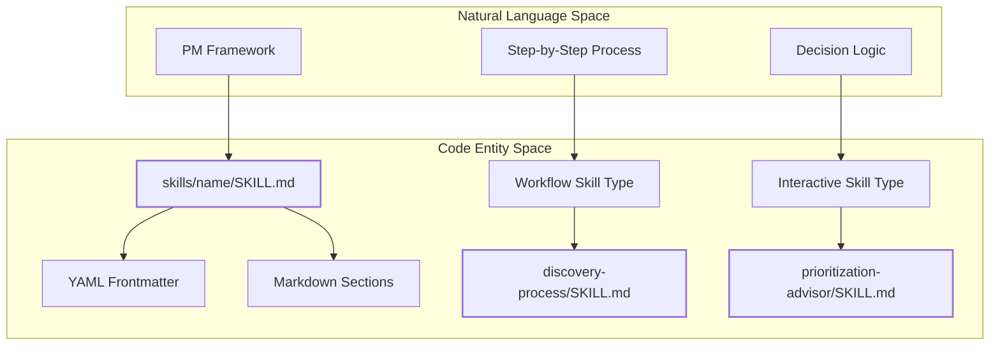
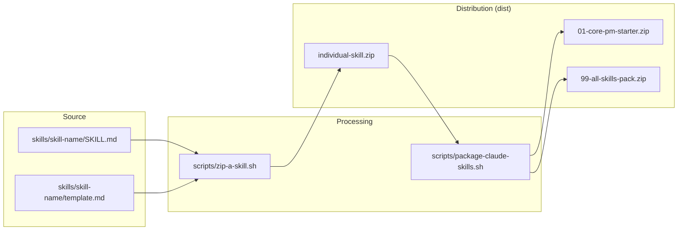

<!-- source: DeepWiki mcp.deepwiki.com · repo deanpeters/Product-Manager-Skills · page 10 Glossary · fetched 2026-10-26 -->

# Glossary

Relevant source files

The following files were used as context for generating this wiki page:

- [.claude-plugin/marketplace.json](.claude-plugin/marketplace.json)
- [09AUG26.md](09AUG26.md)
- [10AUG26.md](10AUG26.md)
- [17JUL26.md](17JUL26.md)
- [CLAUDE.md](CLAUDE.md)
- [CONTRIBUTING.md](CONTRIBUTING.md)
- [README.md](README.md)
- [catalog/skills-by-type.md](catalog/skills-by-type.md)
- [catalog/skills-index.yaml](catalog/skills-index.yaml)
- [dist/ansoff-matrix.zip](dist/ansoff-matrix.zip)
- [dist/autonomous-investigation.zip](dist/autonomous-investigation.zip)
- [dist/battle-card-builder.zip](dist/battle-card-builder.zip)
- [dist/competitive-analysis-process.zip](dist/competitive-analysis-process.zip)
- [docs/Add-a-Skill Utility Guide.md](docs/Add-a-Skill Utility Guide.md)
- [docs/Building PM Skills.md](docs/Building PM Skills.md)
- [docs/CHANGELOG.md](docs/CHANGELOG.md)
- [docs/announcements/2026-07-08-v0-82-inbound-requests-and-dist-shelf.md](docs/announcements/2026-07-08-v0-82-inbound-requests-and-dist-shelf.md)
- [docs/maintenance/2026-08-09-eol-suite-plan.md](docs/maintenance/2026-08-09-eol-suite-plan.md)
- [scripts/build-a-skill.sh](scripts/build-a-skill.sh)
- [skills/altitude-horizon-framework/template.md](skills/altitude-horizon-framework/template.md)
- [skills/company-intel/SKILL.md](skills/company-intel/SKILL.md)
- [skills/derisk-measurement-advisor/SKILL.md](skills/derisk-measurement-advisor/SKILL.md)
- [skills/incoming-request-advisor/SKILL.md](skills/incoming-request-advisor/SKILL.md)
- [skills/incoming-request-advisor/examples/conversation-flow.md](skills/incoming-request-advisor/examples/conversation-flow.md)
- [skills/incoming-request-advisor/template.md](skills/incoming-request-advisor/template.md)

This glossary defines the technical terms, architectural concepts, and domain-specific jargon used within the Product Manager Skills repository. It serves as a reference for engineers and Product Managers to ensure consistency across skill development and AI agent orchestration.

## Skill Architecture Terms

The repository organizes PM knowledge into a hierarchical structure designed for both human learning and agent execution.

*   **SKILL.md**: The canonical file format for every skill. It must contain a YAML frontmatter block and six mandatory Markdown sections: Purpose, Input, Key Concepts, Application, Examples, Common Pitfalls, and References [docs/Building PM Skills.md:101-122]().
*   **Frontmatter**: YAML metadata at the top of a `SKILL.md` file. Required fields include `name` (max 64 chars), `description` (max 200 chars for trigger optimization), `intent`, and `type` [docs/Building PM Skills.md:102-107]().
*   **Three Tiers**: The dependency hierarchy governing skill complexity:
    1.  **Component**: Self-contained artifact templates (e.g., `user-story`).
    2.  **Interactive**: Multi-turn guided flows (e.g., `prioritization-advisor`).
    3.  **Workflow**: Multi-phase processes that orchestrate other skills (e.g., `prd-development`) [README.md:42-83](), [docs/Building PM Skills.md:81-83]().
*   **Adaptive Decision Ladder**: A facilitation pattern where the agent adjusts its guidance based on the user's expertise and the complexity of the task [skills/derisk-measurement-advisor/SKILL.md:124-126]().
*   **ABC (Always Be Coaching)**: The governing design principle that skills must teach the "why" behind a framework, not just generate the "what" [CONTRIBUTING.md:13-21]().

### Skill Entity Mapping
The following diagram illustrates how natural language concepts map to specific code entities within the repository.

Sources: [README.md:42-83](), [docs/Building PM Skills.md:77-83](), [CONTRIBUTING.md:13-21]()

## Lifecycle and EOL Terms

Terms specific to the management of aging products and the execution of End-of-Life (EOL) transitions.

*   **Goldilocks Right-sizing**: A model for scaling EOL efforts into three levels: **Level 1 (Light)** for features/APIs, **Level 2 (Standard)** for commercial products, and **Level 3 (Heavy)** for revenue-critical or regulated hardware [10AUG26.md:29-30](), [09AUG26.md:58-68]().
*   **Lifecycle Gates**: The eight standardized states of a product transition [10AUG26.md:31](), [09AUG26.md:71-80]():
    *   **GA**: General Availability (active state).
    *   **NSC**: Notice of Status Change (internal decision).
    *   **EOS**: End of Sale (no new customers).
    *   **EOE**: End of Expansion (no seat/capacity additions).
    *   **EOR**: End of Renewal (contract-driven termination).
    *   **EOM**: End of Maintenance (no more bug fixes).
    *   **EOL**: End of Life (full retirement).
    *   **EOSRV**: End of Service (all obligations end).

Sources: [10AUG26.md:29-31](), [09AUG26.md:58-80]()

## Research and Discovery Terms

Terms used in market intelligence and autonomous research protocols.

*   **Fact/Inference/Assumption**: The canonical vocabulary for labeling evidence in research. **Facts** are verified data, **Inferences** are logical conclusions, and **Assumptions** are unverified leaps [CLAUDE.md:38](), [README.md:79]().
*   **DUFV**: The internal risk framework assessing **D**esirability, **U**sability, **F**easibility, and **V**iability [skills/derisk-measurement-advisor/SKILL.md:61-75]().
*   **PESTEL**: The external risk framework assessing **P**olitical, **E**conomic, **S**ocial, **T**echnological, **E**nvironmental, and **L**egal forces [skills/derisk-measurement-advisor/SKILL.md:80-95]().
*   **Seven Research Lenses**: The structured approach used in `company-intel` to analyze a target: Financial, Market Offer, Product Portfolio, Competitive Dynamics, Trends, PM Implications, and Strategic Signals [catalog/skills-index.yaml:91-94]().
*   **Delta Investigation**: A research pattern focused on material changes (e.g., `competitive-intel-watch`) rather than static snapshots [README.md:79](), [catalog/skills-index.yaml:165-167]().

Sources: [CLAUDE.md:38-41](), [skills/derisk-measurement-advisor/SKILL.md:61-95](), [catalog/skills-index.yaml:91-100]()

## PM Methodology Terms

*   **JTBD (Jobs-to-be-Done)**: A framework for uncovering customer needs based on the "job" they are hiring a product to do [catalog/skills-by-type.md:27-28]().
*   **PoL Probe (Proof of Life)**: Lightweight, low-cost experiments designed to find the "harsh truth" about a hypothesis before building [README.md:68-69](), [catalog/skills-by-type.md:31-32]().
*   **Context Engineering**: The practice of designing precise, structured prompts and data flows for AI, as opposed to **Context Stuffing** (dumping unstructured data into a prompt window) [catalog/skills-index.yaml:193-205]().
*   **Sticky-Note Rule**: A constraint for user story splitting where a story must be small enough to describe its value on a physical sticky note [skills/user-story-splitting/SKILL.md]().

Sources: [README.md:68-69](), [catalog/skills-index.yaml:193-205](), [catalog/skills-by-type.md:27-32]()

## Tooling and Distribution Terms

*   **Adapter**: An interface script (e.g., `scripts/add-a-skill.sh`) that allows the repository tools to interact with different AI models like Claude or OpenAI [CONTRIBUTING.md:141-161]().
*   **Dist Shelf**: The `dist/` directory where packaged skill ZIPs and multi-skill packs are stored for distribution [10AUG26.md:38](), [17JUL26.md]().
*   **Pack / Preset**: A collection of related skills bundled together (e.g., `02-discovery-pack.zip`). Presets are defined in `scripts/zip-a-skill.sh` [docs/Building PM Skills.md:25-27](), [10AUG26.md:33-34]().
*   **check-dist-freshness**: A CI utility (`scripts/check-dist-freshness.py`) that ensures the `dist/` shelf is synchronized with the latest `SKILL.md` changes [10AUG26.md:151-152]().

### Distribution Pipeline
This diagram shows the flow from raw skill files to distributed artifacts.

Sources: [docs/Building PM Skills.md:25-27](), [10AUG26.md:33-38](), [CONTRIBUTING.md:141-161]()

## Fictional Universes

Standardized example domains used across all skills to demonstrate frameworks without violating real-world confidentiality [CLAUDE.md:19]().

*   **Fieldlight**: A B2B SaaS platform for Field Service Management (FSM). Used for Tier 2/Standard examples [10AUG26.md:105-107]().
*   **Northfield Automation**: An industrial universe involving hardware retrofit controllers (NFA-200 series) and long sales cycles. Used for Tier 3/Heavy examples [10AUG26.md:90-94]().
*   **Brightwater Biologics**: A life sciences universe (Platform: Trialpath) used for regulated, evidence-driven, and long-cycle examples [CLAUDE.md:19]().
*   **Wrenchline**: A sub-brand or alternative SaaS FSM universe [docs/Building PM Skills.md:130]().
*   **Helix / Corvid**: Industrial/Manufacturing universes used for hardware and supply chain examples [docs/Building PM Skills.md:130]().

Sources: [CLAUDE.md:19](), [10AUG26.md:90-107](), [docs/Building PM Skills.md:130]()