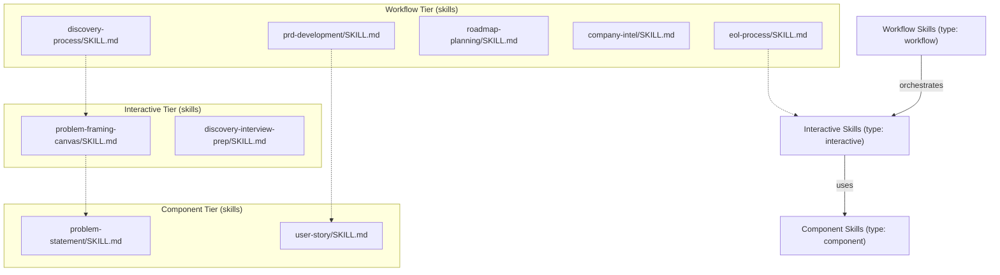
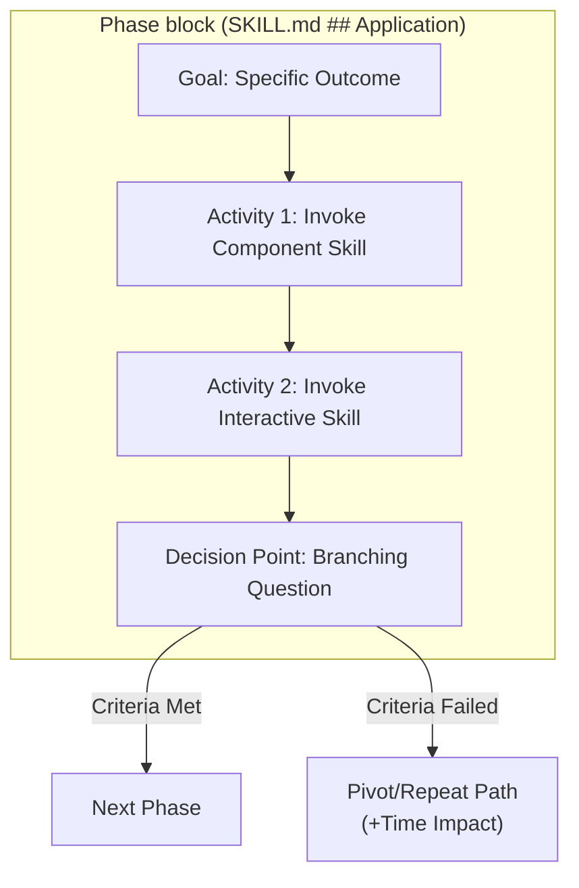

<!-- source: DeepWiki mcp.deepwiki.com · repo deanpeters/Product-Manager-Skills · page 2.3 Workflow Skills · fetched 2026-10-26 -->

# Workflow Skills

<details>
<summary>Relevant source files</summary>

The following files were used as context for generating this wiki page:

- [catalog/skills-by-type.md](catalog/skills-by-type.md)
- [catalog/skills-index.yaml](catalog/skills-index.yaml)
- [dist/discovery-process.zip](dist/discovery-process.zip)
- [dist/prd-development.zip](dist/prd-development.zip)
- [dist/product-strategy-session.zip](dist/product-strategy-session.zip)
- [docs/announcements/2026-07-08-v0-82-inbound-requests-and-dist-shelf.md](docs/announcements/2026-07-08-v0-82-inbound-requests-and-dist-shelf.md)
- [skills/company-intel/SKILL.md](skills/company-intel/SKILL.md)
- [skills/derisk-measurement-advisor/SKILL.md](skills/derisk-measurement-advisor/SKILL.md)

</details>


Workflow Skills represent the top tier of the three-tier skill architecture. Each Workflow Skill defines a complete, end-to-end PM process that spans multiple sessions over days or weeks. Rather than producing a single artifact (Component Skills) or running a single advisory conversation (Interactive Skills), Workflow Skills orchestrate these lower-tier assets into a structured lifecycle.

---

## What Workflow Skills Are

Workflow Skills are multi-phase processes that provide the "connective tissue" between individual PM tasks. They are characterized by:

- **Phased Execution:** Work is divided into numbered phases, each with explicit goals, activities, and outputs [skills/discovery-process/SKILL.md:77-78]().
- **Decision Points:** Explicit gates between phases that route the workflow based on evidence or outcomes (e.g., "If saturated, proceed; if not, more interviews") [skills/discovery-process/SKILL.md:201-209]().
- **Skill Orchestration:** They do not re-implement logic; instead, they reference specific `SKILL.md` files from the Component and Interactive tiers at each step [skills/prd-development/SKILL.md:616-644]().
- **Standardized Facilitation:** They delegate turn-taking and pacing to the canonical protocol defined in `skills/workshop-facilitation/SKILL.md` [README.md:65-83]().

The repository currently contains **10 Workflow Skills** (as of v0.84), identified in YAML frontmatter with `type: workflow` [catalog/skills-index.yaml:3-200]().

---

## The Workflow Skill Catalog

| Skill | File Path | Timeline | Domain |
|---|---|---|---|
| `ansoff-matrix` | [skills/ansoff-matrix/SKILL.md]() | 2–4 hours | Strategy |
| `autonomous-investigation` | [skills/autonomous-investigation/SKILL.md]() | Variable | Research |
| `battle-card-builder` | [skills/battle-card-builder/SKILL.md]() | 60–90 min | Market Intel |
| `company-intel` | [skills/company-intel/SKILL.md]() | 30–60 min | Market Intel |
| `competitive-analysis-process` | [skills/competitive-analysis-process/SKILL.md]() | 1–2 weeks | Market Intel |
| `discovery-process` | [skills/discovery-process/SKILL.md]() | 3–4 weeks | Discovery |
| `eol-process` | [skills/eol-process/SKILL.md]() | 4–12 weeks | Lifecycle |
| `prd-development` | [skills/prd-development/SKILL.md]() | 2–4 days | Delivery |
| `product-strategy-session` | [skills/product-strategy-session/SKILL.md]() | 2–4 weeks | Strategy |
| `roadmap-planning` | [skills/roadmap-planning/SKILL.md]() | 1–2 weeks | Planning |

Sources: [catalog/skills-index.yaml:48-125](), [catalog/skills-by-type.md:126-155]()

---

## Tier Position and Dependency Direction

Workflow Skills sit at the top of the hierarchy. While they can orchestrate lower tiers, circular dependencies are prohibited.

**Natural Language to Code Entity Space: Orchestration Map**



Sources: [README.md:224-278](), [catalog/skills-by-type.md:5-155]()

---

## Phase Architecture and Decision Logic

Every Workflow Skill defines a sequential set of phases. A phase is not just a text block; it is a functional unit containing goals, skill references, and branching logic.

**Logic Flow of a Workflow Phase**



### Example: `discovery-process` Decision Point
In `discovery-process`, Phase 3 (Interviewing) ends with a decision point regarding **Saturation**.
- **Question:** Have the same pain points emerged across 3+ interviews? [skills/discovery-process/SKILL.md:291-300]()
- **If YES:** Proceed to Phase 4 (Synthesize).
- **If NO:** Schedule 3–5 more interviews (Time impact: +1 week).

Sources: [skills/discovery-process/SKILL.md:81-210](), [skills/roadmap-planning/SKILL.md:99-315]()

---

## Skill Orchestration Pattern

Workflow Skills delegate to other skills using a standardized reference format. This allows the Workflow to maintain the high-level process while the specific sub-skills handle the detailed prompts and templates.

**Orchestration Reference Format:**
```markdown
- **Use:** `skills/<skill-name>/SKILL.md` (<type>)
- **Participants:** [Roles involved]
- **Duration:** [Time box]
- **Output:** [Artifact generated]
```

### Example: `prd-development` Orchestration
The `prd-development` workflow orchestrates a specific sequence of sub-skills:
1. **Phase 2 (Context):** Uses `problem-framing-canvas/SKILL.md` [skills/prd-development/SKILL.md:617]().
2. **Phase 3 (User):** Uses `jobs-to-be-done/SKILL.md` [skills/prd-development/SKILL.md:623]().
3. **Phase 7 (Breakdown):** Uses `epic-breakdown-advisor/SKILL.md` and `user-story/SKILL.md` [skills/prd-development/SKILL.md:639-642]().

Sources: [skills/prd-development/SKILL.md:616-644]()

---

## Facilitation Protocol

All Workflow Skills defer to `skills/workshop-facilitation/SKILL.md` for session management. This protocol ensures the AI agent:
- Uses a one-question-at-a-time pacing [README.md:75]().
- Provides progress labels (e.g., "Phase 2/6") [README.md:76]().
- Offers numbered response options for quick selection [README.md:79]().

The workflow's `SKILL.md` provides the **domain logic**, while `workshop-facilitation` provides the **interaction logic**.

Sources: [README.md:65-83](), [skills/discovery-process/SKILL.md:59-71]()

---

## Time Investment Model

Workflow Skills distinguish between the **AI Session Time** (interaction with the agent) and **Total Process Time** (real-world execution).

| Skill | AI Session Time (Frontmatter) | Total Process Time (Body) |
|---|---|---|
| `discovery-process` | 30–60 min [skills/discovery-process/SKILL.md:13]() | 3–4 weeks [skills/discovery-process/SKILL.md:78]() |
| `prd-development` | 60–120 min [skills/prd-development/SKILL.md:13]() | 2–4 days [skills/prd-development/SKILL.md:131]() |
| `eol-process` | 45–90 min | 4–12 weeks |

Sources: [skills/discovery-process/SKILL.md:13-78](), [skills/prd-development/SKILL.md:13-131]()

---

## Common Pitfalls

| Pitfall | Symptom | Fix |
|---|---|---|
| **Phase Skipping** | Moving to "Solutions" before "Problem Framing" is complete. | Treat Decision Points as mandatory gates [skills/discovery-process/SKILL.md:417-461](). |
| **Tooling Bypass** | Running a workflow without actually opening the referenced sub-skills. | Follow the `Use:` directive for every activity [skills/prd-development/SKILL.md:569-614](). |
| **False Saturation** | Ending discovery after 2 interviews because they "felt good." | Adhere to the 5–7 interview minimum threshold [skills/discovery-process/SKILL.md:291-300](). |

Sources: [skills/discovery-process/SKILL.md:417-461](), [skills/prd-development/SKILL.md:569-614](), [skills/roadmap-planning/SKILL.md:422-465]()

---

