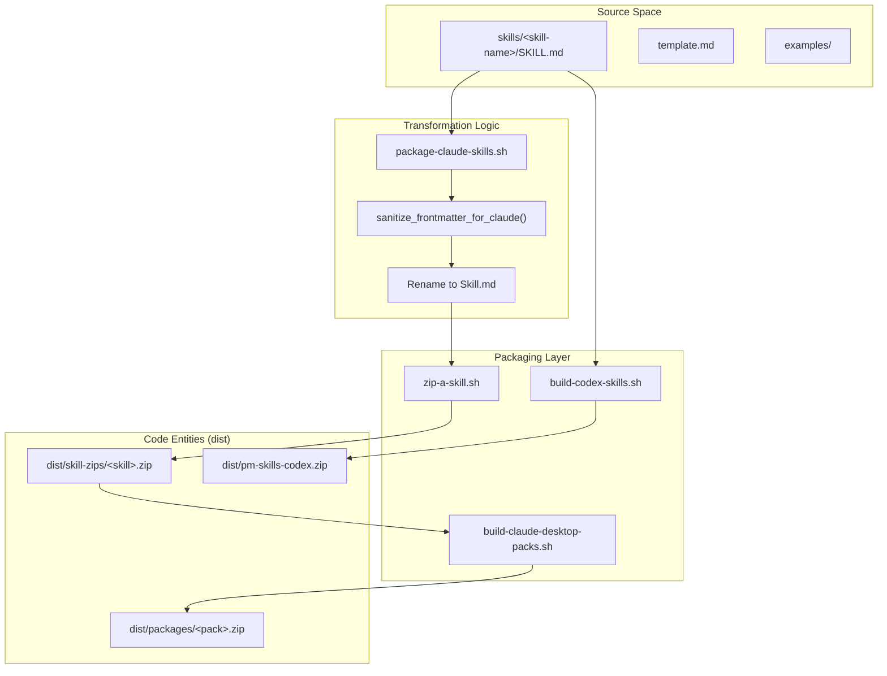

<!-- source: DeepWiki mcp.deepwiki.com · repo deanpeters/Product-Manager-Skills · page 5.4 Packaging and Distribution · fetched 2026-10-26 -->

# Packaging and Distribution

<details>
<summary>Relevant source files</summary>

The following files were used as context for generating this wiki page:

- [.claude-plugin/plugin.json](.claude-plugin/plugin.json)
- [.github/workflows/build-release.yml](.github/workflows/build-release.yml)
- [dist/packages/02-discovery-pack.zip](dist/packages/02-discovery-pack.zip)
- [dist/packages/03-strategy-pack.zip](dist/packages/03-strategy-pack.zip)
- [dist/packages/04-delivery-pack.zip](dist/packages/04-delivery-pack.zip)
- [dist/packages/05-ai-pm-pack.zip](dist/packages/05-ai-pm-pack.zip)
- [dist/packages/06-market-intel-pack.zip](dist/packages/06-market-intel-pack.zip)
- [dist/packages/99-all-skills-pack.zip](dist/packages/99-all-skills-pack.zip)
- [dist/packages/pm-skills-codex.zip](dist/packages/pm-skills-codex.zip)
- [docs/Lifecycle and EOL Suite Summary.md](docs/Lifecycle and EOL Suite Summary.md)
- [docs/PM Skills Rule-of-Thumb Guide.md](docs/PM Skills Rule-of-Thumb Guide.md)
- [docs/RELEASE-PACKAGING.md](docs/RELEASE-PACKAGING.md)
- [docs/Using PM Skills with ChatGPT.md](docs/Using PM Skills with ChatGPT.md)
- [docs/Using PM Skills with Claude.md](docs/Using PM Skills with Claude.md)
- [docs/Using PM Skills with Codex.md](docs/Using PM Skills with Codex.md)
- [docs/announcements/2026-08-10-v0-84-lifecycle-and-eol-suite.md](docs/announcements/2026-08-10-v0-84-lifecycle-and-eol-suite.md)
- [scripts/build-claude-desktop-packs.sh](scripts/build-claude-desktop-packs.sh)
- [scripts/build-dist.sh](scripts/build-dist.sh)
- [scripts/check-dist-freshness.py](scripts/check-dist-freshness.py)
- [scripts/package-claude-skills.sh](scripts/package-claude-skills.sh)
- [scripts/test-library.sh](scripts/test-library.sh)
- [scripts/zip-a-skill.sh](scripts/zip-a-skill.sh)
- [skills/skill-authoring-workflow/SKILL.md](skills/skill-authoring-workflow/SKILL.md)

</details>


This page documents the automation pipeline used to transform source skill files into distributable packages for AI agents. The primary focus is the conversion of repository-native `SKILL.md` files into Claude-compatible `Skill.md` ZIP archives and the assembly of curated "packs" for different product management domains.

---

## Why Packaging Exists

The repository maintains a strict internal standard for skills (uppercase `SKILL.md`, specific YAML frontmatter keys). However, distribution platforms have conflicting requirements:
- **Claude Web/Desktop:** Requires a mixed-case `Skill.md` (case-sensitive) and rejects certain YAML keys like `type` or `intent` [docs/Using PM Skills with Claude.md:154-158](), [scripts/package-claude-skills.sh:7-34]().
- **OpenAI Codex:** Expects skills inside a `.agents/skills/` directory structure [docs/RELEASE-PACKAGING.md:77-83]().
- **Non-Technical Users:** Benefit from a "browsable shelf" of pre-built ZIPs rather than cloning a repository [docs/RELEASE-PACKAGING.md:11-18]().

Sources: [docs/RELEASE-PACKAGING.md:11-47](), [scripts/package-claude-skills.sh:1-57]()

---

## The Packaging Pipeline

The packaging process follows a multi-stage flow, starting from the canonical `skills/` directory and ending in the `dist/` (distribution) directory.

**Packaging Data Flow Diagram:**



Sources: [scripts/zip-a-skill.sh:298-302](), [scripts/package-claude-skills.sh:36-57](), [docs/RELEASE-PACKAGING.md:60-93]()

---

## `package-claude-skills.sh`

**File:** [scripts/package-claude-skills.sh:1-57]()

This script handles the sanitization and renaming required for Claude's web interface. It creates an intermediate "packaged root" directory (defaulting to `dist/claude-skills/`) where it stages the modified files.

### Frontmatter Sanitization
The function `sanitize_frontmatter_for_claude()` [scripts/package-claude-skills.sh:7-34]() uses `awk` to filter YAML keys. It operates on an allowlist:
- **Kept:** `name`, `description`, `license`, `allowed-tools`, `compatibility`, `metadata`.
- **Stripped:** `type` (rejected by Claude's parser), `intent`, `best_for`, `scenarios`, `theme`, `estimated_time`.

### File Operations
1. **Rename:** `SKILL.md` is written as `Skill.md` [scripts/package-claude-skills.sh:44]().
2. **Copy:** If they exist, `template.md`, `examples/`, and `scripts/` are copied to the packaged folder [scripts/package-claude-skills.sh:46-52]().

Sources: [scripts/package-claude-skills.sh:7-57]()

---

## `zip-a-skill.sh`

**File:** [scripts/zip-a-skill.sh:1-357]()

This is the primary tool for creating individual skill ZIPs. It delegates sanitization to `package-claude-skills.sh` and then archives the result.

### Command Flags
- `--skill <name>`: Archive a specific skill [scripts/zip-a-skill.sh:205]().
- `--all`: Archive every skill in the library [scripts/zip-a-skill.sh:211]().
- `--type <type>`: Filter by `component`, `interactive`, or `workflow` [scripts/zip-a-skill.sh:215]().
- `--preset <name>`: Use a named collection (see table below) [scripts/zip-a-skill.sh:221]().
- `--output <dir>`: Target directory (defaults to `dist/skill-zips/`) [scripts/zip-a-skill.sh:225]().

### Presets
Presets are defined in `preset_skills()` [scripts/zip-a-skill.sh:68-137]().

| Preset | Description / Included Skills |
| :--- | :--- |
| `core-pm` | The "starter pack" including `user-story`, `prd-development`, `roadmap-planning`, etc. |
| `finance-suite` | All 7 finance-related skills (e.g., `saas-economics-efficiency-metrics`). |
| `workflow-pack` | Only skills of type `workflow`. |
| `interactive-pack` | Multi-turn adaptive advisors like `prioritization-advisor`. |
| `component-pack` | Reusable templates like `positioning-statement` and `lean-ux-canvas`. |

Sources: [scripts/zip-a-skill.sh:68-137](), [scripts/zip-a-skill.sh:201-243]()

---

## Distribution Shelf (`dist/`)

The `dist/` directory is an intentional, committed "browsable shelf" for non-technical users [docs/RELEASE-PACKAGING.md:11-18]().

### Named Packs
The script `build-claude-desktop-packs.sh` [scripts/build-claude-desktop-packs.sh:1-159]() aggregates individual skill ZIPs into eight thematic bundles:
1. `01-core-pm-starter-pack.zip` (Alias: `pm-skills-starter-pack.zip`) [scripts/build-claude-desktop-packs.sh:81-89]()
2. `02-discovery-pack.zip` [scripts/build-claude-desktop-packs.sh:91-98]()
3. `03-strategy-pack.zip` [scripts/build-claude-desktop-packs.sh:100-107]()
4. `04-delivery-pack.zip` [scripts/build-claude-desktop-packs.sh:109-115]()
5. `05-ai-pm-pack.zip` [scripts/build-claude-desktop-packs.sh:117-123]()
6. `06-market-intel-pack.zip` [scripts/build-claude-desktop-packs.sh:125-141]()
7. `07-lifecycle-eol-pack.zip` [scripts/build-claude-desktop-packs.sh:143-151]()
8. `99-all-skills-pack.zip` [scripts/build-claude-desktop-packs.sh:153]()

### CI Freshness Guard
Because `dist/` is committed, it can drift from the source `skills/`. The CI pipeline runs `check-dist-freshness.py` [scripts/check-dist-freshness.py:1-150]() to ensure the shelf is updated. It verifies:
- `catalog/skills-index.yaml` matches actual skill counts [docs/RELEASE-PACKAGING.md:138]().
- `dist/` contains one ZIP for every skill [docs/RELEASE-PACKAGING.md:139]().
- All declared packs exist in `dist/packages/` [docs/RELEASE-PACKAGING.md:140]().

Sources: [docs/RELEASE-PACKAGING.md:11-47](), [scripts/build-claude-desktop-packs.sh:81-156](), [scripts/test-library.sh:77-79]()

---

## Implementation Details

### The `packaged_root` Temp Flow
To ensure a clean build, `zip-a-skill.sh` uses a temporary directory for transformation.

**Build Sequence Diagram:**

```mermaid
sequenceDiagram
  participant CLI as "zip-a-skill.sh"
  participant PKG as "package-claude-skills.sh"
  participant FS as "Filesystem"

  CLI->>FS: "mktemp -d (tmp_dir)"
  CLI->>PKG: "bash package-claude-skills.sh tmp_dir/claude-skills"
  PKG->>FS: "Transform SKILL.md -> Skill.md in tmp_dir"
  CLI->>CLI: "zip_one_skill(packaged_root, skill_name)"
  CLI->>FS: "zip -qr dist/skill-zips/&lt;name&gt;.zip tmp_dir/claude-skills/&lt;name&gt;"
  CLI->>FS: "trap EXIT: rm -rf tmp_dir"
```

Sources: [scripts/zip-a-skill.sh:296-302](), [scripts/zip-a-skill.sh:229-243]()

### Safety Review Requirement
The `AGENTS.md` file [AGENTS.md:44-46]() and packaging documentation emphasize that any scripts in the `scripts/` subfolder of a skill are copied verbatim. Maintainers must perform a safety review for embedded scripts to ensure they are deterministic and lack network calls before they are packaged into ZIPs for distribution.

Sources: [AGENTS.md:44-46](), [scripts/package-claude-skills.sh:49-52]()

---

