# Page: Home

# Home

<details>
<summary>Relevant source files</summary>

The following files were used as context for generating this wiki page:

- [README.md](README.md)

</details>


## Purpose and Scope

This document introduces the ResumeSkills system: a collection of 20 AI agent skills implemented as markdown files that provide specialized knowledge for resume optimization, job search strategy, and career development. This page covers the system's architecture, problem-solution mapping, skill inventory, and measurable outcomes. 

For installation procedures, see [Getting Started](#2). For detailed skill documentation, see [Skills Reference](#4). For workflow examples, see [End-to-End Workflows](#5).

**Sources:** [README.md:1-33]()

---

## What is ResumeSkills

ResumeSkills is a skill repository containing markdown-based instruction files that extend AI coding assistants with domain expertise in job search and career development. Each skill is a standalone `.md` file stored in the `/skills` directory at [github.com/Paramchoudhary/ResumeSkills](https://github.com/Paramchoudhary/ResumeSkills).

### System Components

```mermaid
graph TB
    subgraph "GitHub Repository"
        REPO["Paramchoudhary/ResumeSkills"]
        SKILLS_DIR["/skills directory"]
        README["README.md"]
        
        REPO --> SKILLS_DIR
        REPO --> README
    end
    
    subgraph "Local Storage Locations"
        GLOBAL["~/.cursor/skills/"]
        PROJECT["./.skills/"]
    end
    
    subgraph "Skill Files (20 total)"
        ATS["resume-ats-optimizer.md"]
        BULLET["resume-bullet-writer.md"]
        JDA["job-description-analyzer.md"]
        TAILOR["resume-tailor.md"]
        COVER["cover-letter-generator.md"]
        INTERVIEW["interview-prep-generator.md"]
        SALARY["salary-negotiation-prep.md"]
        TECH["tech-resume-optimizer.md"]
        EXEC["executive-resume-writer.md"]
        QUANT["resume-quantifier.md"]
        FORMAT["resume-formatter.md"]
        PORTFOLIO["portfolio-case-study-writer.md"]
        LINKEDIN["linkedin-profile-optimizer.md"]
        ACADEMIC["academic-cv-builder.md"]
        REFERENCE["reference-list-builder.md"]
        OFFER["offer-comparison-analyzer.md"]
        VERSION["resume-version-manager.md"]
        CREATIVE["creative-portfolio-resume.md"]
        SECTION["resume-section-builder.md"]
        CAREER["career-changer-translator.md"]
    end
    
    subgraph "AI Agents (30+ supported)"
        CURSOR["Cursor IDE"]
        CLAUDE["Claude Code CLI"]
        WINDSURF["Windsurf"]
        OTHERS["Codex, Gemini CLI, Amp, Augment, etc."]
    end
    
    SKILLS_DIR --> ATS & BULLET & JDA & TAILOR & COVER
    SKILLS_DIR --> INTERVIEW & SALARY & TECH & EXEC & QUANT
    SKILLS_DIR --> FORMAT & PORTFOLIO & LINKEDIN & ACADEMIC & REFERENCE
    SKILLS_DIR --> OFFER & VERSION & CREATIVE & SECTION & CAREER
    
    ATS & BULLET & JDA & TAILOR & COVER --> GLOBAL
    INTERVIEW & SALARY & TECH & EXEC & QUANT --> GLOBAL
    FORMAT & PORTFOLIO & LINKEDIN & ACADEMIC & REFERENCE --> GLOBAL
    OFFER & VERSION & CREATIVE & SECTION & CAREER --> GLOBAL
    
    ATS & BULLET & JDA --> PROJECT
    
    GLOBAL --> CURSOR & CLAUDE & WINDSURF & OTHERS
    PROJECT --> CURSOR & CLAUDE & WINDSURF & OTHERS
```

**File Storage Architecture**: Skills are deployed to `~/.cursor/skills/` for global access across all projects, or `./.skills/` for project-specific scope. AI agents scan these directories at runtime to discover available skills.

**Sources:** [README.md:1-7](), [README.md:34-65](), [README.md:77-87]()

---

## Problem-Solution Architecture

The system addresses documented pain points in the job search process through targeted skill interventions.

| Problem | Impact | Solving Skills | File Paths |
|---------|--------|----------------|------------|
| 75% of resumes rejected by ATS | Never reach human reviewers | `resume-ats-optimizer`<br/>`resume-formatter` | `/skills/resume-ats-optimizer.md`<br/>`/skills/resume-formatter.md` |
| 250 applications per job posting | Fierce competition requires differentiation | `job-description-analyzer`<br/>`resume-tailor` | `/skills/job-description-analyzer.md`<br/>`/skills/resume-tailor.md` |
| Weak bullets lacking metrics | Unclear impact and value | `resume-bullet-writer`<br/>`resume-quantifier` | `/skills/resume-bullet-writer.md`<br/>`/skills/resume-quantifier.md` |
| Applying to wrong-fit jobs | Wasted time and effort | `job-description-analyzer` | `/skills/job-description-analyzer.md` |
| Unprepared for interviews | Poor performance in interviews | `interview-prep-generator` | `/skills/interview-prep-generator.md` |
| Leaving money on table in negotiation | $10K+ lower offers | `salary-negotiation-prep`<br/>`offer-comparison-analyzer` | `/skills/salary-negotiation-prep.md`<br/>`/skills/offer-comparison-analyzer.md` |

**Sources:** [README.md:141-160]()

---

## The 20 Skills: Functional Organization

Skills are organized into five functional categories based on job search lifecycle stages.

### Category 1: Resume Optimization (5 skills)

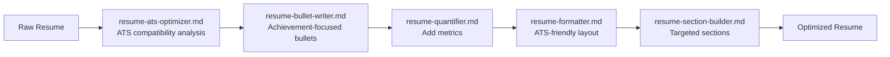

**Pipeline Architecture**: These skills form a sequential processing pipeline where each skill builds upon the previous optimization.

| Skill File | Purpose | Key Function |
|------------|---------|--------------|
| `resume-ats-optimizer.md` | Parse ATS compatibility | Keyword density analysis, formatting checks |
| `resume-bullet-writer.md` | Transform bullets | Convert task lists to achievement statements |
| `resume-quantifier.md` | Add metrics | Insert numbers, percentages, scale indicators |
| `resume-formatter.md` | Clean layout | Remove formatting that breaks ATS parsers |
| `resume-section-builder.md` | Section targeting | Create role-specific section structures |

**Sources:** [README.md:110-117](), [README.md:13-16](), [README.md:24-26](), [README.md:32]()

### Category 2: Job Search Strategy (4 skills)

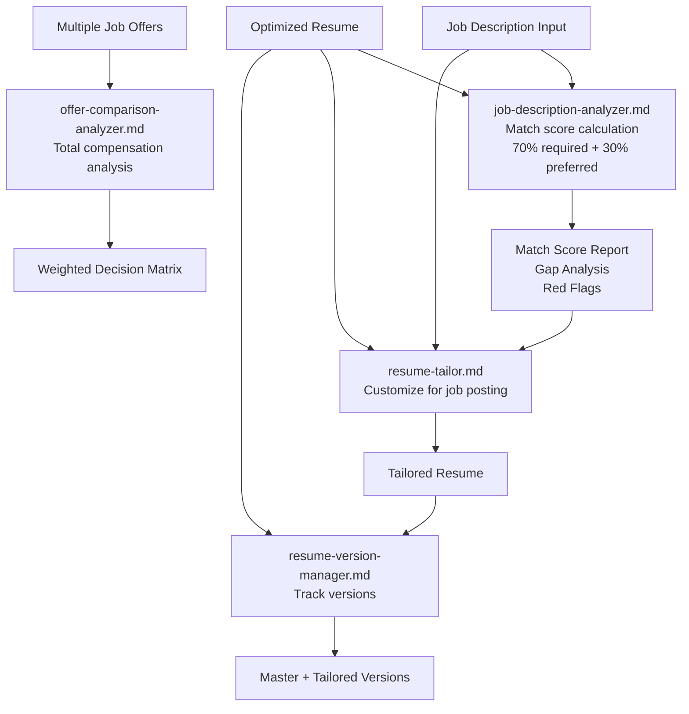

**Analysis Layer**: `job-description-analyzer.md` acts as a gatekeeper, calculating match scores before tailoring. Only jobs meeting threshold (typically 70% required skills) proceed to customization.

**Sources:** [README.md:118-123](), [README.md:15-17](), [README.md:28-30]()

### Category 3: Supporting Documents (4 skills)

| Skill File | Input Sources | Output Document |
|------------|---------------|-----------------|
| `cover-letter-generator.md` | Tailored resume + job description | Personalized cover letter |
| `linkedin-profile-optimizer.md` | Resume content | Optimized LinkedIn profile with keyword strategy |
| `portfolio-case-study-writer.md` | Resume bullets | Detailed case studies (6-section structure) |
| `reference-list-builder.md` | Career experience | Professional reference list with prep materials |

**Sources:** [README.md:124-129](), [README.md:17-19](), [README.md:26-28]()

### Category 4: Interview & Negotiation (2 skills)

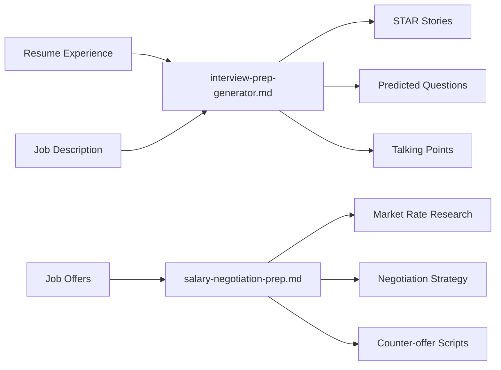

**Three-Phase Framework**: `interview-prep-generator.md` implements role analysis → story banking → mock preparation. `salary-negotiation-prep.md` handles market research and scripting.

**Sources:** [README.md:130-133](), [README.md:19-21]()

### Category 5: Specialized Roles (5 skills)

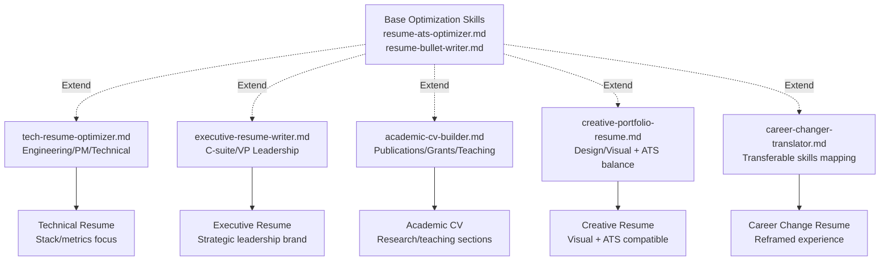

**Extension Pattern**: Specialized skills extend base optimization patterns with role-specific frameworks. `executive-resume-writer.md` replaces task-focused bullets with leadership impact statements. `tech-resume-optimizer.md` adds technology stack emphasis.

**Sources:** [README.md:134-140](), [README.md:21-24]()

---

## Runtime Invocation Model

### Natural Language to Skill Mapping

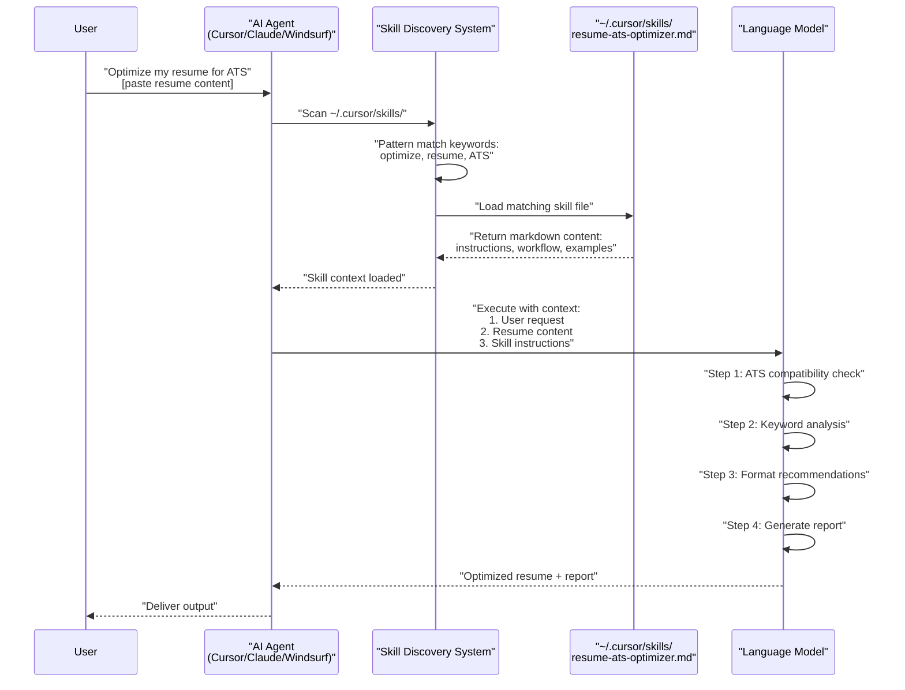

**Keyword Matching**: When a user invokes with natural language like `"Optimize my resume for ATS"`, the AI agent scans `~/.cursor/skills/` for markdown files containing matching keywords in their filenames and content. The file `resume-ats-optimizer.md` is loaded and its structured instructions guide the language model's execution.

**Sources:** [README.md:88-107]()

### Example Invocations

| User Prompt | Matched Skill File | Trigger Keywords |
|-------------|-------------------|------------------|
| `"Optimize my resume for ATS"` | `resume-ats-optimizer.md` | optimize, resume, ATS |
| `"Improve my resume bullets"` | `resume-bullet-writer.md` | improve, resume, bullets |
| `"Should I apply to this job?"` + JD | `job-description-analyzer.md` | apply, job, job description |
| `"Write me a cover letter"` | `cover-letter-generator.md` | write, cover letter |
| `"Prep me for an interview"` | `interview-prep-generator.md` | prep, interview |

**Sources:** [README.md:91-107]()

---

## Multi-Skill Workflows

Skills can be chained together to form complete workflows:

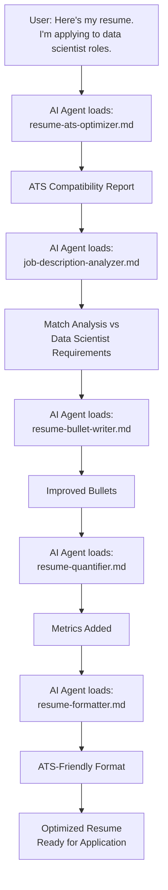

**Workflow Example**: A single user request triggers sequential skill invocations. Each skill's output feeds into the next, creating a processing pipeline.

**Sources:** [README.md:161-175]()

---

## Measurable Outcomes

The system produces quantified improvements across key job search metrics:

| Metric | Baseline | With ResumeSkills | Improvement |
|--------|----------|-------------------|-------------|
| Interview Rate | 1-2% per application | 3-6% per application | **2-3x increase** |
| Response Quality | Generic rejections | Personalized recruiter outreach | **Higher quality** |
| Job Search Duration | 4-6 months average | 2-4 months average | **2 months saved** |
| Salary Offers | Market rate | Market rate + $10K-$20K | **$10K+ higher** |

**Problem Resolution Map**:
- **75% ATS rejection** → Resolved by `resume-ats-optimizer.md` + `resume-formatter.md`
- **250 applications/job competition** → Mitigated by `job-description-analyzer.md` (match scoring) + `resume-tailor.md` (targeted applications)
- **Weak bullets** → Fixed by `resume-bullet-writer.md` + `resume-quantifier.md`
- **Wrong-fit applications** → Prevented by `job-description-analyzer.md` (70% threshold)
- **Unprepared interviews** → Addressed by `interview-prep-generator.md` (STAR framework)
- **Low salary offers** → Improved by `salary-negotiation-prep.md` + `offer-comparison-analyzer.md`

**Sources:** [README.md:141-160]()

---

## Supported Platforms

The skills work with 30+ AI coding assistants through a common skill discovery protocol:

### Confirmed Compatible Agents

| Agent | Type | Skill Directory |
|-------|------|----------------|
| Cursor | IDE | `~/.cursor/skills/` |
| Claude Code | CLI | `~/.cursor/skills/` |
| Windsurf | IDE | `~/.cursor/skills/` |
| Codex | CLI/API | `~/.cursor/skills/` |
| Gemini CLI | CLI | `~/.cursor/skills/` |
| Amp, Antigravity, Augment | Various | `~/.cursor/skills/` or `./.skills/` |

**Agent-Agnostic Design**: All skills are implemented as plain markdown files following a common structure. Any AI agent that can read markdown files from `~/.cursor/skills/` or `./.skills/` can utilize these skills without modification.

**Sources:** [README.md:77-87]()

---

## Next Steps

- **To install the system**, see [Installation](#2.1)
- **To run your first skills**, see [Your First Skills](#2.2)
- **For detailed skill documentation**, see [Skills Reference](#4)
- **For complete workflow examples**, see [End-to-End Workflows](#5)
- **For CLI command reference**, see [CLI Reference](#6)

**Sources:** [README.md:34-76]()

---

# Page: Getting Started

# Getting Started

<details>
<summary>Relevant source files</summary>

The following files were used as context for generating this wiki page:

- [README.md](README.md)

</details>


This page provides an overview of how to install and configure the ResumeSkills system for use with AI coding assistants. It covers the installation decision process, storage locations, and verification steps. For detailed installation commands, see [Installation](#2.1). For examples of using skills after installation, see [Your First Skills](#2.2).

---

## Purpose and Scope

The ResumeSkills system requires a one-time setup process to make skills available to your AI agent. This involves:

1. **Choosing an installation method** - CLI, manual, or direct download
2. **Selecting a storage scope** - global (all projects) or project-specific
3. **Verifying installation** - confirming skills are discoverable
4. **Understanding skill invocation** - how to trigger skills with natural language

This page provides the conceptual overview. Detailed step-by-step instructions are in the child pages.

**Sources:** [README.md:34-75]()

---

## Installation Decision Tree

The first decision is which installation method to use. The three methods differ in automation level, scope control, and selectivity:

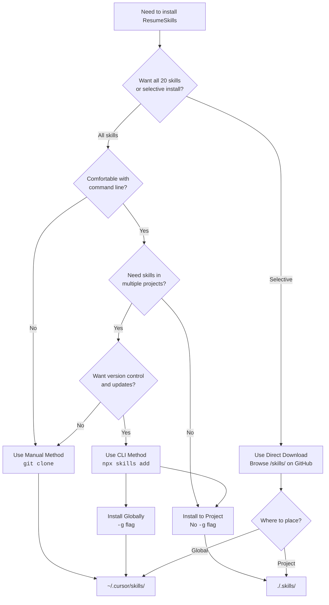

**Key Decision Factors:**

| Method | Automation | Selectivity | Updates | Best For |
|--------|-----------|-------------|---------|----------|
| **CLI** (`npx skills add`) | High | All skills only | Easy (`npx skills update`) | Most users, production use |
| **Manual** (`git clone`) | Medium | All skills only | Manual (`git pull`) | Control, offline work |
| **Direct Download** | Low | Individual files | Manual re-download | Trying specific skills |

**Sources:** [README.md:34-63]()

---

## File System Architecture

After installation, skills are stored as individual markdown files in one of two locations. Understanding this structure is critical for troubleshooting and manual management:

```mermaid
graph TD
    subgraph FILESYSTEM["File System"]
        subgraph HOME["Home Directory (~)"]
            CURSOR_DIR[".cursor/"]
            AGENTS_DIR[".agents/"]
            
            CURSOR_DIR --> SKILLS_GLOBAL[".cursor/skills/"]
            AGENTS_DIR --> AGENTS_SKILLS[".agents/skills/"]
        end
        
        subgraph PROJECT["Project Directory (.)"]
            PROJ_SKILLS[".skills/"]
        end
        
        subgraph SKILL_FILES["Skill Markdown Files"]
            ATS["resume-ats-optimizer.md"]
            BULLET["resume-bullet-writer.md"]
            JDA["job-description-analyzer.md"]
            TAILOR["resume-tailor.md"]
            COVER["cover-letter-generator.md"]
            LINKEDIN["linkedin-profile-optimizer.md"]
            INTERVIEW["interview-prep-generator.md"]
            SALARY["salary-negotiation-prep.md"]
            TECH["tech-resume-optimizer.md"]
            EXEC["executive-resume-writer.md"]
            CAREER["career-changer-translator.md"]
            QUANT["resume-quantifier.md"]
            FORMAT["resume-formatter.md"]
            PORTFOLIO["portfolio-case-study-writer.md"]
            ACADEMIC["academic-cv-builder.md"]
            REFERENCE["reference-list-builder.md"]
            OFFER["offer-comparison-analyzer.md"]
            VERSION["resume-version-manager.md"]
            CREATIVE["creative-portfolio-resume.md"]
            SECTION["resume-section-builder.md"]
        end
    end
    
    subgraph AI_AGENTS["AI Agent Discovery"]
        CURSOR_IDE["Cursor IDE"]
        CLAUDE_CLI["Claude Code CLI"]
        WINDSURF["Windsurf"]
        OTHER["30+ Other Agents"]
    end
    
    SKILLS_GLOBAL -.-> ATS
    SKILLS_GLOBAL -.-> BULLET
    SKILLS_GLOBAL -.-> JDA
    SKILLS_GLOBAL -.-> TAILOR
    SKILLS_GLOBAL -.-> COVER
    AGENTS_SKILLS -.-> LINKEDIN
    AGENTS_SKILLS -.-> INTERVIEW
    PROJ_SKILLS -.-> SALARY
    PROJ_SKILLS -.-> TECH
    
    CURSOR_IDE -->|"Scans on startup"| SKILLS_GLOBAL
    CURSOR_IDE -->|"Scans on open"| PROJ_SKILLS
    CLAUDE_CLI -->|"Scans"| AGENTS_SKILLS
    WINDSURF -->|"Scans"| SKILLS_GLOBAL
    OTHER -->|"Scans"| SKILLS_GLOBAL
```

**Storage Locations:**

| Path | Scope | Used By | Priority |
|------|-------|---------|----------|
| `~/.cursor/skills/` | Global | Cursor IDE | All projects |
| `~/.agents/skills/` | Global | Claude Code CLI, others | All projects |
| `./.skills/` | Project | All agents | Current project only |

**Discovery Priority:** When a skill exists in both locations, project-specific (`./.skills/`) takes precedence over global (`~/.cursor/skills/` or `~/.agents/skills/`).

**File Structure:** Each skill is a single `.md` file with naming pattern `{skill-name}.md`. The filename becomes the skill identifier.

**Sources:** [README.md:39-59](), [README.md:72-74]()

---

## CLI Command Reference

The `npx skills` CLI provides commands for managing skill installation lifecycle:

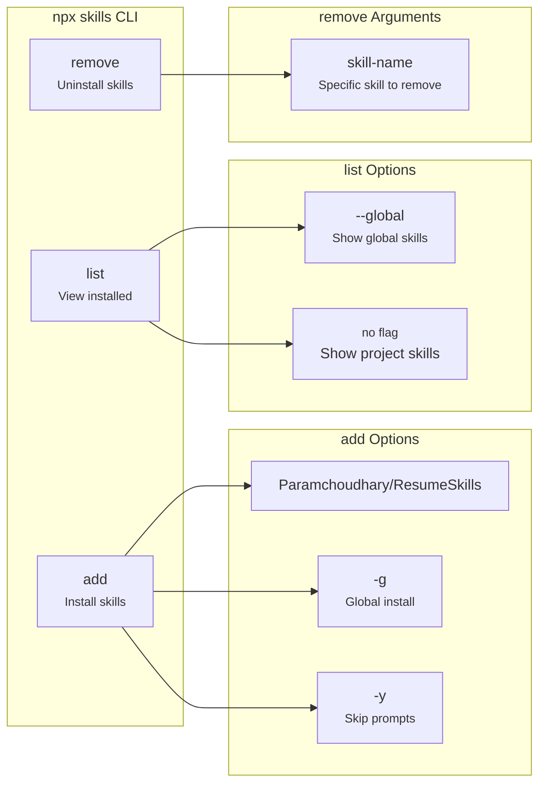

**Command Syntax:**

```bash
# Installation
npx skills add Paramchoudhary/ResumeSkills -g -y    # Global, skip prompts
npx skills add Paramchoudhary/ResumeSkills -y       # Project-specific

# Verification
npx skills list --global                            # List global skills
npx skills list                                     # List project skills

# Removal
npx skills remove resume-ats-optimizer              # Remove specific skill
```

**Command Breakdown:**

| Command | Arguments | Flags | Effect |
|---------|-----------|-------|--------|
| `add` | `{owner}/{repo}` | `-g` (global), `-y` (auto-yes) | Fetches from GitHub, installs to storage location |
| `list` | None | `--global` (show global) | Lists installed skills in specified scope |
| `remove` | `{skill-name}` | None | Deletes `.md` file from storage location |

**Sources:** [README.md:39-51](), [README.md:65-75]()

---

## Installation Methods Overview

### Method 1: CLI Installation (Recommended)

Uses the `npx skills` command to fetch and install skills from the GitHub repository. Provides automatic scope management and supports both global and project-specific installation.

**When to use:**
- First-time users who want all 20 skills
- Teams standardizing on a skill set
- Production environments requiring version control

**Detailed instructions:** See [Installation](#2.1) → CLI Installation

**Sources:** [README.md:36-51]()

---

### Method 2: Manual Git Clone

Clones the repository and manually copies skill files to the global skills directory. Provides full control over the installation process and enables offline work.

**When to use:**
- Developers who prefer manual control
- Offline or air-gapped environments
- Contributing to or modifying skills

**Detailed instructions:** See [Installation](#2.1) → Manual Installation

**Sources:** [README.md:52-59]()

---

### Method 3: Direct File Download

Downloads individual skill markdown files from the `/skills` directory on GitHub and places them manually in the skills folder.

**When to use:**
- Testing specific skills before full installation
- Selective installation of 1-3 skills
- Environments with restricted CLI access

**Detailed instructions:** See [Installation](#2.1) → Direct Download

**Sources:** [README.md:61-63]()

---

## Verification Process

After installation, verify that skills are discoverable by AI agents:

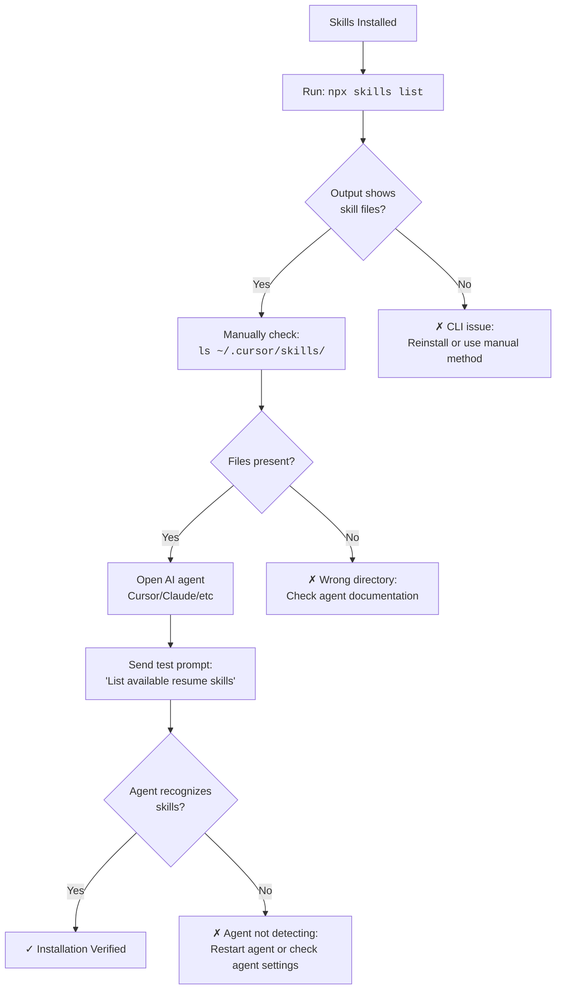

**Verification Commands:**

```bash
# List installed skills (requires successful installation)
npx skills list --global              # Check global installation
npx skills list                       # Check project installation

# Manual filesystem verification
ls ~/.cursor/skills/                  # Cursor IDE global location
ls ~/.agents/skills/                  # Claude Code CLI location
ls ./.skills/                         # Project-specific location

# Count installed skills
ls ~/.cursor/skills/ | wc -l          # Should show 20 for full install
```

**Expected Output:** If installation succeeded, you should see a list of 20 `.md` files with names like `resume-ats-optimizer.md`, `resume-bullet-writer.md`, etc.

**Sources:** [README.md:45-49]()

---

## Skill Discovery and Invocation

Once installed, AI agents automatically discover skills when you use natural language prompts. No explicit "import" or "load" commands are needed:

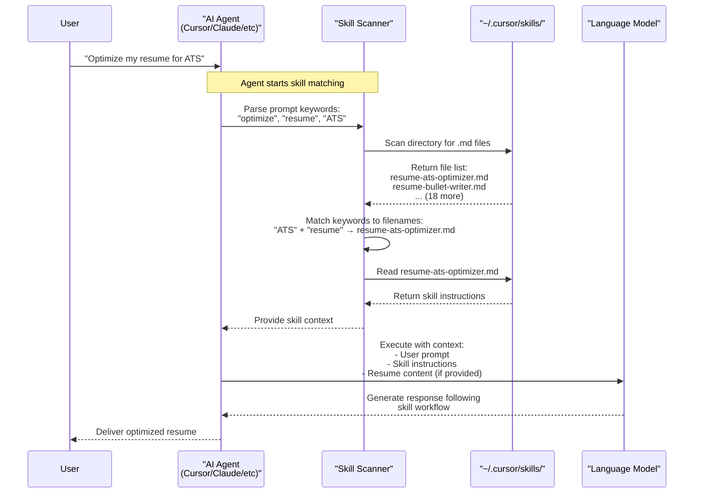

**Natural Language to Skill Mapping:**

| User Prompt Example | Keywords Matched | Skill Loaded |
|---------------------|------------------|--------------|
| "Optimize my resume for ATS" | `ATS`, `optimize`, `resume` | `resume-ats-optimizer.md` |
| "Improve my resume bullets" | `bullets`, `resume`, `improve` | `resume-bullet-writer.md` |
| "Should I apply to this job?" | `job`, `apply`, `should` | `job-description-analyzer.md` |
| "Write a cover letter" | `cover letter`, `write` | `cover-letter-generator.md` |
| "Prep for interview at Google" | `interview`, `prep` | `interview-prep-generator.md` |

**No Explicit Invocation Required:** Unlike traditional software where you call functions by name, skills work through semantic matching. You describe what you want in natural language, and the agent finds the appropriate skill.

**Sources:** [README.md:88-107](), Diagram 4 from context

---

## Global vs Project-Specific Installation

Understanding the difference between global and project-specific installation is crucial for multi-project workflows:

| Aspect | Global Installation | Project-Specific Installation |
|--------|-------------------|------------------------------|
| **Storage Path** | `~/.cursor/skills/` or `~/.agents/skills/` | `./.skills/` in project root |
| **Availability** | All projects, system-wide | Current project only |
| **CLI Flag** | `-g` (e.g., `npx skills add ... -g`) | No flag (default) |
| **Use Case** | Personal resume work across multiple folders | Team project with shared skill requirements |
| **Conflict Resolution** | Lower priority (overridden by project skills) | Higher priority (overrides global) |
| **Version Control** | Not tracked in project repos | Can be committed to `.git` |

**Decision Guideline:**

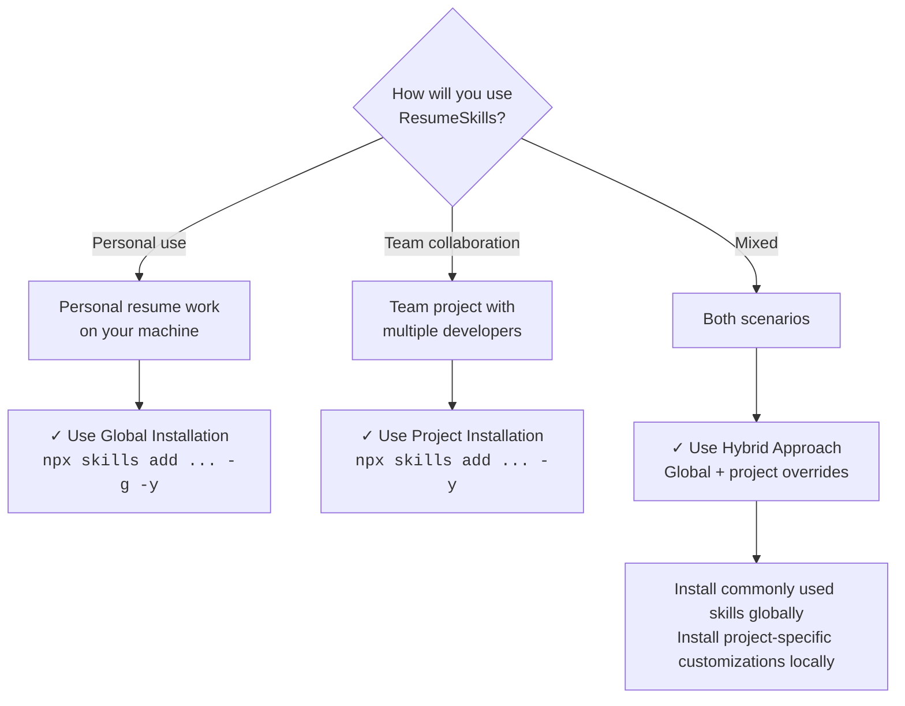

**Example Hybrid Setup:**

```bash
# Global installation for personal use
npx skills add Paramchoudhary/ResumeSkills -g -y

# Project-specific override (in a team repo)
cd ~/work/team-hiring-project
npx skills add Paramchoudhary/ResumeSkills -y

# Result: Team project uses ./.skills/, other projects use ~/.cursor/skills/
```

**Sources:** [README.md:39-43]()

---

## Supported AI Agents

The ResumeSkills system is agent-agnostic. Skills work with any AI agent that supports a skills/prompts directory. Confirmed compatible agents include:

| Agent Type | Agent Name | Skills Directory |
|------------|-----------|------------------|
| **IDE** | Cursor | `~/.cursor/skills/` |
| **CLI** | Claude Code | `~/.agents/skills/` |
| **IDE** | Windsurf | `~/.cursor/skills/` or agent-specific path |
| **IDE** | Codex | Agent-specific skills path |
| **CLI** | Gemini CLI | Agent-specific skills path |
| **Various** | Amp, Antigravity, Augment, +30 more | Varies by agent |

**Compatibility Note:** If your agent doesn't automatically detect skills in `~/.cursor/skills/` or `~/.agents/skills/`, consult your agent's documentation for the correct skills directory path.

**Sources:** [README.md:77-87]()

---

## Next Steps

After completing installation and verification:

1. **Learn detailed installation commands** → See [Installation](#2.1) for step-by-step instructions for each method
2. **Try your first skills** → See [Your First Skills](#2.2) for example prompts and expected outputs
3. **Understand skill architecture** → See [System Architecture](#3) for how skills work internally
4. **Explore all available skills** → See [Skills Reference](#4) for complete skill catalog

**Quick Start Path:**

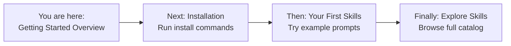

**Sources:** [README.md:161-200]()

---

# Page: Installation

# Installation

<details>
<summary>Relevant source files</summary>

The following files were used as context for generating this wiki page:

- [README.md](README.md)

</details>


## Purpose and Scope

This page provides detailed installation instructions for the ResumeSkills system. It covers all three installation methods: CLI-based installation (recommended), manual git clone installation, and direct file download. Each method deploys skill markdown files to local storage locations where AI agents can discover and load them.

For information on how to use skills after installation, see [Your First Skills](#2.2). For details on how AI agents discover and execute skills, see [AI Agent Integration](#3.2).

---

## Installation Overview

The ResumeSkills system consists of 20 markdown files (skills) that must be deployed to one of two local storage locations:

| Storage Type | Location | Scope |
|-------------|----------|-------|
| **Global** | `~/.cursor/skills/` | Available to all projects and AI agents |
| **Project-specific** | `./.skills/` | Available only within the current project directory |

All installation methods ultimately copy skill files to these locations. AI agents scan these directories to discover available skills.

**Sources:** [README.md:34-75]()

---

## Installation Method Comparison

The following table compares the three installation approaches:

| Method | Speed | Skill Selection | Automation | Best For |
|--------|-------|----------------|------------|----------|
| **CLI Install** | Fast | All 20 skills | Fully automated | Most users |
| **Manual Install** | Medium | All 20 skills | Semi-automated | Users who prefer git workflow |
| **Direct Download** | Slow | Individual skills | Manual | Selective installation |

---

## Method 1: CLI Installation (Recommended)

The CLI method uses the `npx skills` command to fetch all 20 skills from the GitHub repository and deploy them automatically.

### Global Installation

Global installation makes skills available across all projects:

```bash
npx skills add Paramchoudhary/ResumeSkills -g -y
```

**Command breakdown:**
- `npx skills add` - Invokes the skills CLI tool
- `Paramchoudhary/ResumeSkills` - GitHub repository identifier
- `-g` - Global flag (installs to `~/.cursor/skills/`)
- `-y` - Auto-confirm flag (skips prompts)

### Project-Specific Installation

Project-specific installation confines skills to the current directory:

```bash
npx skills add Paramchoudhary/ResumeSkills -y
```

**Difference from global:** Omitting the `-g` flag installs to `./.skills/` in the current working directory.

### Installation Flow Diagram

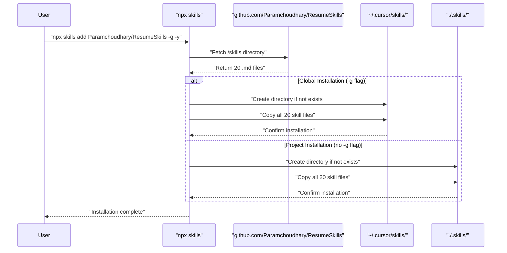

### Verification Commands

After installation, verify skills are available:

```bash
# List global skills
npx skills list --global

# List project-specific skills
npx skills list

# Sample output:
# resume-ats-optimizer
# resume-bullet-writer
# job-description-analyzer
# [... 17 more skills]
```

**Sources:** [README.md:36-50]()

---

## Method 2: Manual Installation

Manual installation uses git to clone the repository, then copies files to the global skills directory.

### Step-by-Step Process

```bash
# Step 1: Clone the repository
git clone https://github.com/Paramchoudhary/ResumeSkills.git

# Step 2: Create the global skills directory (if it doesn't exist)
mkdir -p ~/.cursor/skills

# Step 3: Copy all skill files to the global directory
cp -r ResumeSkills/skills/* ~/.cursor/skills/
```

### Manual Installation Flow

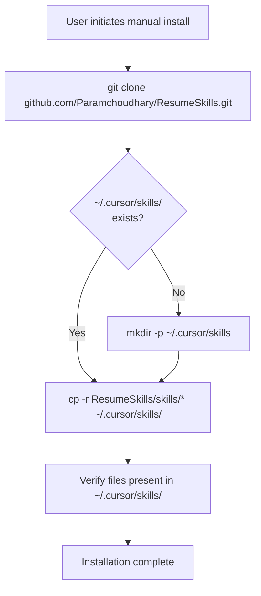

### When to Use Manual Installation

Manual installation is appropriate when:
- You want to inspect skill files before installation
- You need to customize skills before deployment
- You prefer git-based workflows
- The CLI tool is unavailable or blocked by corporate policies

**Sources:** [README.md:52-59]()

---

## Method 3: Direct Download

Direct download allows selective installation of individual skills rather than all 20.

### Process

1. Navigate to the repository's `/skills` directory in a web browser: `https://github.com/Paramchoudhary/ResumeSkills/tree/main/skills`
2. Click on individual skill markdown files (e.g., `resume-ats-optimizer.md`)
3. Click "Raw" button to view the raw markdown
4. Save the file to your local skills directory

### Manual File Placement

After downloading, place files in the appropriate directory:

```bash
# For global access
mv ~/Downloads/resume-ats-optimizer.md ~/.cursor/skills/

# For project-specific access
mv ~/Downloads/resume-ats-optimizer.md ./.skills/
```

### Skills Available for Individual Download

The repository contains these 20 skill files in the `/skills` directory:

| Category | Skill Files |
|----------|-------------|
| **Resume Optimization** | `resume-ats-optimizer.md`, `resume-bullet-writer.md`, `resume-quantifier.md`, `resume-formatter.md`, `resume-section-builder.md` |
| **Job Search Strategy** | `job-description-analyzer.md`, `resume-tailor.md`, `resume-version-manager.md`, `offer-comparison-analyzer.md` |
| **Supporting Documents** | `cover-letter-generator.md`, `linkedin-profile-optimizer.md`, `portfolio-case-study-writer.md`, `reference-list-builder.md` |
| **Interview & Negotiation** | `interview-prep-generator.md`, `salary-negotiation-prep.md` |
| **Specialized Roles** | `tech-resume-optimizer.md`, `executive-resume-writer.md`, `academic-cv-builder.md`, `creative-portfolio-resume.md`, `career-changer-translator.md` |

**Sources:** [README.md:61-63](), [README.md:11-32]()

---

## Post-Installation Directory Structure

After successful installation, your directory structure should match one of these patterns:

### Global Installation Structure

```
~/.cursor/skills/
├── resume-ats-optimizer.md
├── resume-bullet-writer.md
├── job-description-analyzer.md
├── resume-tailor.md
├── cover-letter-generator.md
├── linkedin-profile-optimizer.md
├── interview-prep-generator.md
├── salary-negotiation-prep.md
├── tech-resume-optimizer.md
├── executive-resume-writer.md
├── career-changer-translator.md
├── resume-quantifier.md
├── resume-formatter.md
├── portfolio-case-study-writer.md
├── academic-cv-builder.md
├── reference-list-builder.md
├── offer-comparison-analyzer.md
├── resume-version-manager.md
├── creative-portfolio-resume.md
└── resume-section-builder.md
```

### Project-Specific Installation Structure

```
your-project/
├── .skills/
│   ├── resume-ats-optimizer.md
│   ├── resume-bullet-writer.md
│   ├── [... 18 more skill files]
├── src/
├── package.json
└── [other project files]
```

### Storage Location Decision Matrix

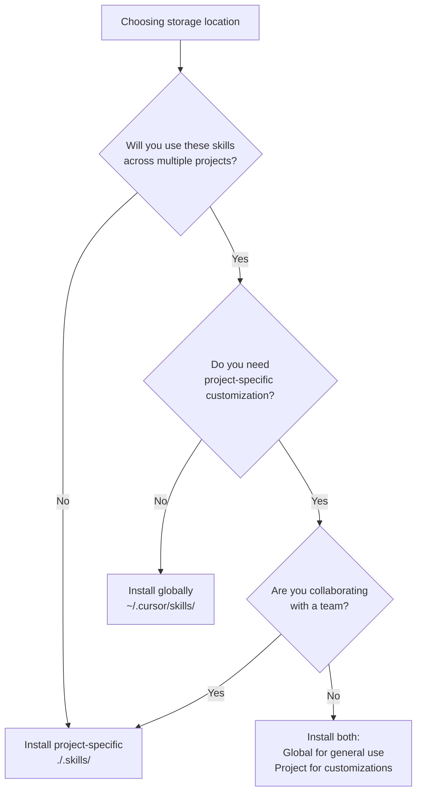

**Sources:** [README.md:52-59]()

---

## Uninstallation

### CLI-Based Removal

Remove individual skills by name:

```bash
npx skills remove resume-ats-optimizer
npx skills remove resume-bullet-writer
```

### Manual Removal

Remove all skills from global storage:

```bash
rm -rf ~/.cursor/skills/resume-*
```

Remove all skills from project storage:

```bash
rm -rf ./.skills/resume-*
```

### Complete Removal

To remove the entire skills directory:

```bash
# Remove global skills directory
rm -rf ~/.cursor/skills/

# Remove project skills directory
rm -rf ./.skills/
```

**Warning:** This removes all skills, not just ResumeSkills. If you have other skills installed, they will also be deleted.

**Sources:** [README.md:65-75]()

---

## Verification and Testing

### Verify Installation

Confirm skills are discoverable by AI agents:

```bash
# Check global installation
npx skills list --global

# Check project installation
npx skills list

# Check specific file exists
ls ~/.cursor/skills/resume-ats-optimizer.md
```

### Test Skill Invocation

After installation, test with your AI agent:

```
"List all installed resume skills"
```

The AI agent should recognize and list the 20 ResumeSkills.

### Verification Checklist

| Check | Command | Expected Result |
|-------|---------|-----------------|
| Directory exists | `ls ~/.cursor/skills/` | Directory found with 20 .md files |
| Specific skill exists | `ls ~/.cursor/skills/resume-ats-optimizer.md` | File found |
| CLI recognition | `npx skills list --global` | Lists all 20 resume skills |
| Agent recognition | Ask AI "What resume skills are available?" | AI lists installed skills |

**Sources:** [README.md:45-49]()

---

## Supported AI Agents and Compatibility

The installed skills work with multiple AI agents. Each agent has specific directory scanning behaviors:

| AI Agent | Default Skills Directory | Configuration |
|----------|-------------------------|---------------|
| **Cursor** | `~/.cursor/skills/` | Built-in support |
| **Claude Code CLI** | `~/.cursor/skills/` | Built-in support |
| **Windsurf** | `~/.cursor/skills/` | Built-in support |
| **Other agents** | Varies (check docs) | May require configuration |

### Multi-Agent Installation Flow

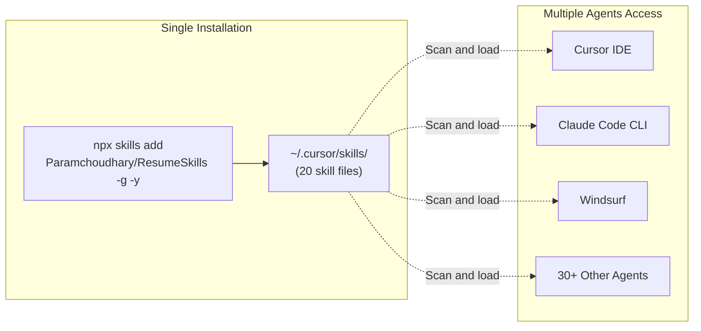

**Sources:** [README.md:77-86]()

---

## Troubleshooting Common Issues

### Issue: CLI Command Not Found

**Problem:** `npx skills` command fails with "command not found"

**Solutions:**
1. Ensure Node.js and npm are installed: `node --version && npm --version`
2. Update npm: `npm install -g npm@latest`
3. Try manual installation method instead

### Issue: Permission Denied

**Problem:** Cannot write to `~/.cursor/skills/`

**Solutions:**
```bash
# Fix directory permissions
mkdir -p ~/.cursor/skills
chmod 755 ~/.cursor/skills

# Or install with project scope instead
npx skills add Paramchoudhary/ResumeSkills -y
```

### Issue: Skills Not Recognized by AI Agent

**Problem:** AI agent doesn't see installed skills

**Solutions:**
1. Verify installation location matches agent's expected directory
2. Restart the AI agent
3. Check file permissions: `ls -la ~/.cursor/skills/`
4. Verify .md file extensions are present

### Issue: GitHub Rate Limiting

**Problem:** CLI installation fails due to GitHub API limits

**Solutions:**
1. Wait 1 hour for rate limit reset
2. Use manual installation method
3. Authenticate with GitHub CLI: `gh auth login`

**Sources:** [README.md:34-75]()

---

## Next Steps

After successful installation, proceed to [Your First Skills](#2.2) to learn how to invoke and use the installed skills with natural language prompts.

For advanced usage patterns and skill chaining workflows, see [End-to-End Workflows](#5).

For complete CLI reference and command options, see [CLI Reference](#6).

---

# Page: Your First Skills

# Your First Skills

<details>
<summary>Relevant source files</summary>

The following files were used as context for generating this wiki page:

- [README.md](README.md)

</details>


## Purpose and Scope

This page provides a quick start guide for invoking skills after installation. You will learn how to use natural language prompts to trigger specific skills, understand what happens when skills execute, and practice with essential first examples.

For installation instructions, see [Installation](#2.1). For detailed documentation of individual skills, see [Skills Reference](#4). For complete multi-skill workflows, see [End-to-End Workflows](#5).

---

## Prerequisites

Before invoking skills, ensure you have completed installation using one of the methods described in [Installation](#2.1). Skills must be present in either:
- `~/.cursor/skills/` (global installation)
- `./.skills/` (project-specific installation)

Verify installation:
```bash
npx skills list --global
npx skills list
```

**Sources:** [README.md:45-49]()

---

## Basic Invocation Pattern

Skills are invoked through natural language prompts to your AI agent. The AI agent performs keyword matching between your prompt and skill file names stored locally, then loads the matching skill's instructions to guide its response.

### How Prompts Trigger Skills

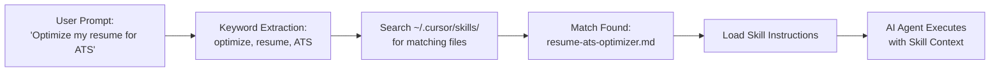

**Sources:** [README.md:88-107]()

### Storage Location to Skill File Mapping

| Storage Path | Skill File | Triggered By Keywords |
|-------------|------------|----------------------|
| `~/.cursor/skills/resume-ats-optimizer.md` | resume-ats-optimizer | "optimize", "ATS", "resume", "applicant tracking" |
| `~/.cursor/skills/resume-bullet-writer.md` | resume-bullet-writer | "improve", "bullets", "achievement", "resume" |
| `~/.cursor/skills/job-description-analyzer.md` | job-description-analyzer | "should I apply", "match score", "analyze job" |
| `~/.cursor/skills/resume-tailor.md` | resume-tailor | "customize", "tailor", "specific job" |
| `~/.cursor/skills/cover-letter-generator.md` | cover-letter-generator | "cover letter", "write letter" |

**Sources:** [README.md:11-32](), [README.md:92-107]()

---

## Essential First Skills

Start with these three foundational skills to understand the invocation pattern:

### 1. resume-ats-optimizer

**Purpose:** Checks resume compatibility with Applicant Tracking Systems (ATS) and identifies optimization opportunities.

**Storage Location:** `~/.cursor/skills/resume-ats-optimizer.md`

**Common Triggers:**
- "Optimize my resume for ATS"
- "Check if my resume will pass ATS"
- "Is my resume ATS-friendly?"

### 2. resume-bullet-writer

**Purpose:** Transforms weak bullet points into achievement-focused statements with metrics and impact.

**Storage Location:** `~/.cursor/skills/resume-bullet-writer.md`

**Common Triggers:**
- "Improve my resume bullets"
- "Make my bullet points stronger"
- "Add achievements to my resume"

### 3. job-description-analyzer

**Purpose:** Analyzes job postings, calculates match scores, and identifies application strategy.

**Storage Location:** `~/.cursor/skills/job-description-analyzer.md`

**Common Triggers:**
- "Should I apply to this job?" [paste job description]
- "Analyze this job posting"
- "What's my match score for this role?"

**Sources:** [README.md:13-15](), [README.md:92-100](), [README.md:112-116]()

---

## Step-by-Step: Your First Skill Invocation

### Example: Using resume-ats-optimizer

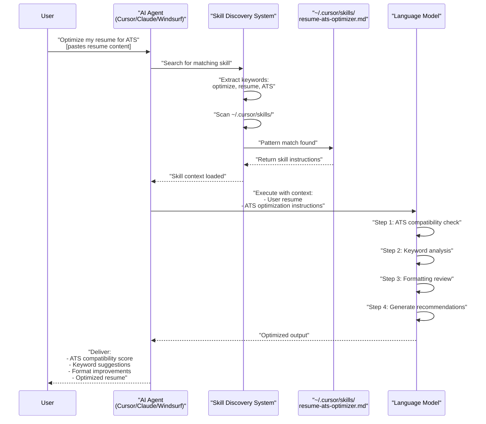

**Step 1: Prepare Your Content**
```
Have your current resume ready in text format.
```

**Step 2: Send Prompt to AI Agent**
```
"Optimize my resume for ATS"

[paste your resume content here]
```

**Step 3: AI Agent Processes Request**
The agent:
1. Extracts keywords: "optimize", "resume", "ATS"
2. Searches `~/.cursor/skills/` directory
3. Finds match: `resume-ats-optimizer.md`
4. Loads skill instructions from file
5. Executes workflow defined in skill

**Step 4: Review Output**
You receive:
- ATS compatibility score
- Keyword match analysis
- Formatting recommendations
- Optimized resume version

**Sources:** [README.md:165-174]()

---

## Prompt Templates and Triggers

### Prompt-to-Skill Mapping Table

| User Prompt | Matched Skill File | Output Delivered |
|-------------|-------------------|------------------|
| "Optimize my resume for ATS" | `resume-ats-optimizer.md` | ATS compatibility report, keyword suggestions, optimized resume |
| "Improve my resume bullets" | `resume-bullet-writer.md` | Rewritten bullets with metrics and achievement focus |
| "Should I apply to this job?" [+JD] | `job-description-analyzer.md` | Match score, gap analysis, application recommendation |
| "Write me a cover letter for this role" [+JD] | `cover-letter-generator.md` | Personalized cover letter draft |
| "Prep me for an interview at [Company]" | `interview-prep-generator.md` | STAR stories, predicted questions, talking points |
| "Tailor my resume for this job" [+JD] | `resume-tailor.md` | Customized resume version |
| "Add metrics to my resume" | `resume-quantifier.md` | Bullets enhanced with quantifiable results |
| "Is my resume formatting ATS-friendly?" | `resume-formatter.md` | Format analysis and corrected layout |

**Sources:** [README.md:92-107]()

### Advanced Prompt Patterns

#### Multi-Step Invocation
```
User: "Optimize my resume for ATS"
[AI uses resume-ats-optimizer.md]

User: "Now improve the bullet points"
[AI uses resume-bullet-writer.md on optimized resume]

User: "Add specific metrics where possible"
[AI uses resume-quantifier.md on improved bullets]
```

#### Context-Rich Prompts
```
User: "Here's a job description [paste JD] and my resume [paste resume]. 
Should I apply?"

[AI uses job-description-analyzer.md to calculate match score]
```

**Sources:** [README.md:165-174]()

---

## What Happens Behind the Scenes

### Skill Loading and Execution Architecture

```mermaid
graph TB
    subgraph "User_Interaction"
        USER_PROMPT["User sends prompt:<br/>'Optimize my resume for ATS'<br/>+ resume content"]
    end
    
    subgraph "Skill_Discovery"
        KEYWORD_EXTRACT["Extract keywords:<br/>optimize, resume, ATS"]
        SCAN_GLOBAL["Scan ~/.cursor/skills/"]
        SCAN_PROJECT["Scan ./.skills/"]
        PATTERN_MATCH["Pattern match against<br/>skill file names"]
    end
    
    subgraph "Skill_Files"
        SKILL_ATS["resume-ats-optimizer.md"]
        SKILL_BULLET["resume-bullet-writer.md"]
        SKILL_JDA["job-description-analyzer.md"]
        SKILL_OTHER["[other 17 skills...]"]
    end
    
    subgraph "Execution_Layer"
        LOAD_INSTRUCTIONS["Load markdown file<br/>instructions"]
        INJECT_CONTEXT["Inject into LLM context:<br/>- User request<br/>- Resume content<br/>- Skill workflow"]
        EXECUTE_STEPS["Execute multi-step<br/>workflow"]
    end
    
    subgraph "Output_Generation"
        GENERATE["Generate structured output:<br/>- Analysis<br/>- Recommendations<br/>- Optimized content"]
    end
    
    USER_PROMPT --> KEYWORD_EXTRACT
    KEYWORD_EXTRACT --> SCAN_GLOBAL
    KEYWORD_EXTRACT --> SCAN_PROJECT
    SCAN_GLOBAL --> PATTERN_MATCH
    SCAN_PROJECT --> PATTERN_MATCH
    
    PATTERN_MATCH --> SKILL_ATS
    PATTERN_MATCH -.-> SKILL_BULLET
    PATTERN_MATCH -.-> SKILL_JDA
    PATTERN_MATCH -.-> SKILL_OTHER
    
    SKILL_ATS --> LOAD_INSTRUCTIONS
    LOAD_INSTRUCTIONS --> INJECT_CONTEXT
    INJECT_CONTEXT --> EXECUTE_STEPS
    EXECUTE_STEPS --> GENERATE
```

### File System Structure During Invocation

```mermaid
graph TB
    subgraph "Global_Skills_Directory"
        GLOBAL_PATH["~/.cursor/skills/"]
        
        ATS_FILE["resume-ats-optimizer.md"]
        BULLET_FILE["resume-bullet-writer.md"]
        JDA_FILE["job-description-analyzer.md"]
        TAILOR_FILE["resume-tailor.md"]
        COVER_FILE["cover-letter-generator.md"]
        MORE_FILES["... 15 more skill files"]
        
        GLOBAL_PATH --> ATS_FILE
        GLOBAL_PATH --> BULLET_FILE
        GLOBAL_PATH --> JDA_FILE
        GLOBAL_PATH --> TAILOR_FILE
        GLOBAL_PATH --> COVER_FILE
        GLOBAL_PATH --> MORE_FILES
    end
    
    subgraph "Project_Skills_Directory"
        PROJECT_PATH["./.skills/"]
        PROJECT_SKILL["project-specific-skill.md"]
        PROJECT_PATH --> PROJECT_SKILL
    end
    
    subgraph "AI_Agent_Search_Priority"
        SEARCH_1["1. Search ./.skills/ first"]
        SEARCH_2["2. Search ~/.cursor/skills/ second"]
        SEARCH_3["3. Use first match found"]
    end
    
    PROJECT_PATH -.->|"Priority 1"| SEARCH_1
    GLOBAL_PATH -.->|"Priority 2"| SEARCH_2
```

**Priority Rules:**
1. Project-specific skills (`./.skills/`) are checked first
2. Global skills (`~/.cursor/skills/`) are checked second
3. First matching skill file is loaded
4. If no match found, AI agent proceeds without skill context

**Sources:** [README.md:39-63]()

---

## Common First-Time Scenarios

### Scenario 1: Resume Needs ATS Optimization

```
Prompt: "Optimize my resume for ATS"

File Loaded: ~/.cursor/skills/resume-ats-optimizer.md

Expected Output:
- ATS compatibility score (0-100)
- Keyword analysis against common job descriptions
- Formatting issues detected
- Recommended improvements
- Optimized resume draft
```

### Scenario 2: Weak Bullet Points

```
Prompt: "Improve my resume bullets"

File Loaded: ~/.cursor/skills/resume-bullet-writer.md

Expected Output:
- Rewritten bullets using achievement framework
- Added action verbs and metrics
- Before/after comparison
- Explanation of improvements
```

### Scenario 3: Job Application Decision

```
Prompt: "Should I apply to this job? [paste job description]"

File Loaded: ~/.cursor/skills/job-description-analyzer.md

Expected Output:
- Match score calculation (required vs preferred skills)
- Gap analysis (missing skills)
- Red flags in job posting
- Application recommendation (yes/no/maybe)
- Resume customization strategy
```

**Sources:** [README.md:165-200]()

---

## Skill Chaining for First-Time Users

### Sequential Skill Usage Pattern

```mermaid
graph LR
    START["Initial Resume"] --> STEP1
    
    STEP1["Step 1:<br/>resume-ats-optimizer.md<br/>'Optimize for ATS'"]
    STEP2["Step 2:<br/>resume-bullet-writer.md<br/>'Improve bullets'"]
    STEP3["Step 3:<br/>resume-quantifier.md<br/>'Add metrics'"]
    STEP4["Step 4:<br/>resume-formatter.md<br/>'Final formatting'"]
    
    STEP1 --> STEP2
    STEP2 --> STEP3
    STEP3 --> STEP4
    
    STEP4 --> FINAL["Optimized Resume<br/>Ready for Applications"]
```

**Recommended First Session:**

```
Session Goal: Create ATS-optimized resume with strong bullets

1. "Optimize my resume for ATS"
   → Uses resume-ats-optimizer.md
   
2. "Now improve my bullet points"
   → Uses resume-bullet-writer.md
   
3. "Add specific metrics to each bullet"
   → Uses resume-quantifier.md
   
4. "Check the formatting one more time"
   → Uses resume-formatter.md

Result: Fully optimized resume in ~30 minutes
```

**Sources:** [README.md:165-174]()

---

## Troubleshooting First Invocations

### Skill Not Triggered

**Problem:** AI agent doesn't use skill context

**Diagnostic Steps:**
1. Verify installation:
   ```bash
   npx skills list --global
   ```
2. Check file exists:
   ```bash
   ls ~/.cursor/skills/resume-ats-optimizer.md
   ```
3. Use more explicit keywords in prompt:
   - Instead of: "Make my resume better"
   - Use: "Optimize my resume for ATS compatibility"

### Wrong Skill Triggered

**Problem:** Different skill than expected is loaded

**Solution:** Use skill name explicitly:
```
"Use the resume-ats-optimizer skill to check my resume"
```

### No Output Generated

**Problem:** Skill loads but no structured output

**Solution:** Provide required context:
```
"Optimize my resume for ATS

[paste resume content here - required for skill to execute]"
```

**Sources:** [README.md:45-49](), [README.md:88-107]()

---

## Quick Reference: First Five Skills to Try

| Order | Skill File | Prompt Template | Purpose |
|-------|------------|-----------------|---------|
| 1 | `resume-ats-optimizer.md` | "Optimize my resume for ATS" [+resume] | Ensure ATS compatibility |
| 2 | `resume-bullet-writer.md` | "Improve my resume bullets" [+resume] | Strengthen bullet points |
| 3 | `resume-quantifier.md` | "Add metrics to my resume" [+resume] | Quantify achievements |
| 4 | `job-description-analyzer.md` | "Should I apply?" [+JD] | Analyze job match |
| 5 | `resume-tailor.md` | "Tailor my resume for this job" [+resume +JD] | Customize for specific role |

**Sources:** [README.md:11-32](), [README.md:112-122]()

---

## Next Steps

After mastering basic skill invocation:

- **Learn about skill architecture:** See [How Skills Work](#3.1) for technical details on skill structure and AI agent integration
- **Explore all available skills:** See [Skills Reference](#4) for complete documentation of all 20 skills
- **Build complete workflows:** See [End-to-End Workflows](#5) for multi-skill job search processes
- **Understand AI agent integration:** See [AI Agent Integration](#3.2) for details on how different agents load and execute skills
- **Master the CLI:** See [CLI Reference](#6) for advanced skill management commands

**Sources:** [README.md:97-140](), [README.md:161-200]()

---

# Page: System Architecture

# System Architecture

<details>
<summary>Relevant source files</summary>

The following files were used as context for generating this wiki page:

- [README.md](README.md)

</details>


## Purpose and Scope

This document provides a technical overview of the ResumeSkills system architecture, including its three-tier design, component relationships, storage mechanisms, and skill organization. This page focuses on the overall system structure and how components interact.

For detailed information about how individual skills function internally, see [How Skills Work](#3.1). For specifics on AI agent integration mechanisms, see [AI Agent Integration](#3.2). For the runtime execution model, see [Skill Invocation and Execution](#3.3).

---

## Overview

ResumeSkills implements a **three-tier architecture** that separates user interaction, AI agent orchestration, and skill storage into distinct layers. The system is designed to be **agent-agnostic**, allowing any AI assistant (Cursor, Claude Code, Windsurf, etc.) to access the same skill definitions without modification.

**Key Design Principles:**

| Principle | Implementation |
|-----------|----------------|
| **Portability** | Skills are markdown files, not code dependencies |
| **Agent-Agnostic** | Works with 30+ AI assistants without changes |
| **Local-First** | Skills stored locally in `~/.cursor/skills/` or `./.skills/` |
| **Declarative** | Skills define workflows, agents execute them |
| **Composable** | Skills chain together to form complete workflows |

**Sources:** [README.md:1-8](), [README.md:77-87]()

---

## Three-Tier Architecture

### Architecture Diagram

```mermaid
graph TB
    subgraph Tier1["Tier 1: User Layer"]
        User["User<br/>(Job Seeker)"]
    end
    
    subgraph Tier2["Tier 2: AI Agent Layer"]
        Cursor["Cursor IDE"]
        ClaudeCLI["Claude Code CLI"]
        Windsurf["Windsurf"]
        Other["30+ Other Agents"]
        
        SkillDiscovery["Skill Discovery System<br/>(Pattern Matching)"]
        
        Cursor --> SkillDiscovery
        ClaudeCLI --> SkillDiscovery
        Windsurf --> SkillDiscovery
        Other --> SkillDiscovery
    end
    
    subgraph Tier3["Tier 3: Skills Repository Layer"]
        direction TB
        
        GitHubRepo["GitHub Repository<br/>Paramchoudhary/ResumeSkills"]
        
        LocalGlobal["Local Global Storage<br/>~/.cursor/skills/"]
        LocalProject["Local Project Storage<br/>./.skills/"]
        
        subgraph SkillFiles["20 Skill Files (.md)"]
            ATS["resume-ats-optimizer.md"]
            Bullet["resume-bullet-writer.md"]
            JDA["job-description-analyzer.md"]
            Tailor["resume-tailor.md"]
            Cover["cover-letter-generator.md"]
            Others["... 15 more skills"]
        end
        
        GitHubRepo -.->|"npx skills add<br/>-g -y"| LocalGlobal
        GitHubRepo -.->|"npx skills add<br/>-y"| LocalProject
        
        LocalGlobal --> SkillFiles
        LocalProject --> SkillFiles
    end
    
    User -->|"Natural language<br/>prompts"| Cursor
    User -->|"Natural language<br/>prompts"| ClaudeCLI
    User -->|"Natural language<br/>prompts"| Windsurf
    User -->|"Natural language<br/>prompts"| Other
    
    SkillDiscovery -->|"Loads skill<br/>definitions"| SkillFiles
```

**Sources:** [README.md:34-75](), [README.md:77-87]()

---

### Tier 1: User Layer

Users interact with the system through natural language prompts directed at their AI assistant. The user does not need to know which skill will be invoked; the system handles skill selection automatically.

**Example Interactions:**

| User Prompt | Skill Invoked |
|-------------|---------------|
| `"Optimize my resume for ATS"` | `resume-ats-optimizer.md` |
| `"Improve my resume bullets"` | `resume-bullet-writer.md` |
| `"Should I apply to this job?"` | `job-description-analyzer.md` |
| `"Write a cover letter for this role"` | `cover-letter-generator.md` |

**Sources:** [README.md:88-107]()

---

### Tier 2: AI Agent Layer

The AI agent layer consists of:

1. **AI Assistants** - Supported agents include:
   - Cursor (IDE)
   - Claude Code (CLI)
   - Windsurf
   - Codex, Gemini CLI, Amp, Antigravity, Augment
   - 30+ additional agents

2. **Skill Discovery System** - Pattern-matching mechanism that:
   - Scans `~/.cursor/skills/` and `./.skills/` directories
   - Matches keywords in user prompts to skill definitions
   - Loads relevant skill markdown files
   - Injects skill instructions into the language model context

**Sources:** [README.md:77-87]()

---

### Tier 3: Skills Repository Layer

The repository layer has three components:

#### GitHub Repository

Central repository at `Paramchoudhary/ResumeSkills` containing the `/skills` directory with 20 skill markdown files.

**Sources:** [README.md:55-59]()

#### Local Storage Locations

| Location | Scope | Installation Command |
|----------|-------|---------------------|
| `~/.cursor/skills/` | Global (all projects) | `npx skills add Paramchoudhary/ResumeSkills -g -y` |
| `./.skills/` | Project-specific | `npx skills add Paramchoudhary/ResumeSkills -y` |

**Sources:** [README.md:36-50]()

#### Skill Files

Each skill is a single markdown file (e.g., `resume-ats-optimizer.md`) containing:
- Skill purpose and triggers
- Step-by-step workflow instructions
- Best practices and examples
- Output format specifications

**Sources:** [README.md:5-7]()

---

## Skill Organization and Categories

### Skill File Structure

```mermaid
graph TB
    SkillsDir["skills/<br/>(Repository directory)"]
    
    subgraph Cat1["Resume Optimization"]
        ATS["resume-ats-optimizer.md"]
        Bullet["resume-bullet-writer.md"]
        Quant["resume-quantifier.md"]
        Format["resume-formatter.md"]
        Section["resume-section-builder.md"]
    end
    
    subgraph Cat2["Job Search Strategy"]
        JDA["job-description-analyzer.md"]
        Tailor["resume-tailor.md"]
        Version["resume-version-manager.md"]
        Offer["offer-comparison-analyzer.md"]
    end
    
    subgraph Cat3["Supporting Documents"]
        Cover["cover-letter-generator.md"]
        LinkedIn["linkedin-profile-optimizer.md"]
        Portfolio["portfolio-case-study-writer.md"]
        Reference["reference-list-builder.md"]
    end
    
    subgraph Cat4["Interview & Negotiation"]
        Interview["interview-prep-generator.md"]
        Salary["salary-negotiation-prep.md"]
    end
    
    subgraph Cat5["Specialized Roles"]
        Tech["tech-resume-optimizer.md"]
        Exec["executive-resume-writer.md"]
        Academic["academic-cv-builder.md"]
        Creative["creative-portfolio-resume.md"]
        Career["career-changer-translator.md"]
    end
    
    SkillsDir --> Cat1
    SkillsDir --> Cat2
    SkillsDir --> Cat3
    SkillsDir --> Cat4
    SkillsDir --> Cat5
```

**Sources:** [README.md:109-140]()

### Category Breakdown

| Category | Skill Count | Purpose |
|----------|-------------|---------|
| **Resume Optimization** | 5 | Core resume improvement: ATS compatibility, bullet writing, quantification, formatting, section building |
| **Job Search Strategy** | 4 | Strategic application: job analysis, resume tailoring, version management, offer comparison |
| **Supporting Documents** | 4 | Additional materials: cover letters, LinkedIn profiles, portfolios, references |
| **Interview & Negotiation** | 2 | Final stages: interview preparation, salary negotiation |
| **Specialized Roles** | 5 | Role-specific optimization: tech, executive, academic, creative, career changers |

**Sources:** [README.md:109-140]()

---

## Installation and Deployment Architecture

### Deployment Pathways

```mermaid
graph LR
    GitHub["GitHub Repository<br/>Paramchoudhary/ResumeSkills<br/>/skills/*.md"]
    
    CLI["CLI Tool<br/>npx skills"]
    Manual["Manual Clone<br/>git clone"]
    Direct["Direct Download<br/>Individual files"]
    
    GlobalStore["~/.cursor/skills/<br/>resume-ats-optimizer.md<br/>resume-bullet-writer.md<br/>job-description-analyzer.md<br/>... 17 more files"]
    
    ProjectStore["./.skills/<br/>resume-tailor.md<br/>cover-letter-generator.md<br/>... subset of skills"]
    
    Agent1["Cursor IDE"]
    Agent2["Claude Code CLI"]
    Agent3["Windsurf"]
    
    GitHub -->|"npx skills add -g -y"| CLI
    GitHub -->|"git clone + cp"| Manual
    GitHub -->|"Download .md files"| Direct
    
    CLI -->|"Deploys to"| GlobalStore
    CLI -->|"Deploys to"| ProjectStore
    Manual --> GlobalStore
    Direct --> GlobalStore
    Direct --> ProjectStore
    
    GlobalStore --> Agent1
    GlobalStore --> Agent2
    GlobalStore --> Agent3
    
    ProjectStore --> Agent1
    ProjectStore --> Agent2
    ProjectStore --> Agent3
```

**Sources:** [README.md:34-75]()

### CLI Commands

| Command | Action | Example |
|---------|--------|---------|
| `npx skills add` | Install skills | `npx skills add Paramchoudhary/ResumeSkills -g -y` |
| `npx skills list` | List installed skills | `npx skills list --global` |
| `npx skills remove` | Remove skills | `npx skills remove resume-ats-optimizer` |

**Flags:**

- `-g` or `--global`: Install to `~/.cursor/skills/` (available to all projects)
- `-y`: Auto-confirm installation
- No flags: Install to `./.skills/` (current project only)

**Sources:** [README.md:36-75]()

---

## Data Flow Architecture

The system processes user documents through multiple skill stages, with each stage consuming inputs and producing outputs for downstream skills.

### Complete Data Pipeline

```mermaid
graph LR
    subgraph Inputs["Input Documents"]
        ResumeIn["User Resume<br/>(Initial draft)"]
        JDIn["Job Description<br/>(Target role)"]
        Experience["Career Experience<br/>(Raw data)"]
    end
    
    subgraph Pipeline1["Resume Processing"]
        direction TB
        ATS["resume-ats-optimizer.md"]
        Bullet["resume-bullet-writer.md"]
        Quant["resume-quantifier.md"]
        Format["resume-formatter.md"]
        
        ATS --> Bullet
        Bullet --> Quant
        Quant --> Format
    end
    
    subgraph Pipeline2["Analysis & Tailoring"]
        JDA["job-description-analyzer.md"]
        Tailor["resume-tailor.md"]
        Version["resume-version-manager.md"]
        
        JDA --> Tailor
        Tailor --> Version
    end
    
    subgraph Pipeline3["Supporting Docs"]
        Cover["cover-letter-generator.md"]
        LinkedIn["linkedin-profile-optimizer.md"]
        Portfolio["portfolio-case-study-writer.md"]
        Ref["reference-list-builder.md"]
    end
    
    subgraph Pipeline4["Interview & Offer"]
        Interview["interview-prep-generator.md"]
        Salary["salary-negotiation-prep.md"]
    end
    
    subgraph Outputs["Output Documents"]
        OptResume["Optimized Resume<br/>(Multiple versions)"]
        AppPackage["Application Package<br/>(Resume + Cover + LinkedIn)"]
        InterviewKit["Interview Materials<br/>(STAR stories + prep)"]
    end
    
    ResumeIn --> ATS
    Format --> JDA
    JDIn --> JDA
    
    Format --> Tailor
    JDIn --> Tailor
    
    Version --> Cover
    Version --> LinkedIn
    Format --> Portfolio
    Experience --> Ref
    
    Version --> Interview
    JDIn --> Interview
    
    Version --> OptResume
    Cover & LinkedIn --> AppPackage
    Interview & Salary --> InterviewKit
```

**Sources:** [README.md:109-140](), [README.md:161-200]()

### Pipeline Characteristics

| Pipeline | Input Dependencies | Output Type | Chaining Pattern |
|----------|-------------------|-------------|------------------|
| **Resume Processing** | Original resume | Optimized resume | Sequential refinement |
| **Analysis & Tailoring** | Optimized resume + JD | Tailored resume versions | Conditional branching |
| **Supporting Docs** | Tailored resume + raw data | Multiple document types | Parallel generation |
| **Interview & Offer** | Resume + JD + offers | Preparation materials | Context-dependent |

**Sources:** [README.md:161-200]()

---

## Storage and Discovery Mechanism

### Skill Discovery Process

When a user submits a prompt, the AI agent performs the following discovery sequence:

1. **Scan Local Directories**
   - Check `./.skills/` (project-specific, higher priority)
   - Check `~/.cursor/skills/` (global fallback)

2. **Pattern Matching**
   - Extract keywords from user prompt
   - Match against skill file names and content
   - Select most relevant skill(s)

3. **Load Skill Definition**
   - Read markdown file (e.g., `resume-ats-optimizer.md`)
   - Parse workflow instructions
   - Extract examples and best practices

4. **Context Injection**
   - Inject skill instructions into language model context
   - Combine with user's request and provided documents
   - Execute multi-step workflow

**Sources:** [README.md:5-7](), [README.md:88-107]()

### Priority Rules

| Scenario | Skill Source | Rationale |
|----------|--------------|-----------|
| Skill exists in both `./.skills/` and `~/.cursor/skills/` | `./.skills/` | Project-specific customizations take precedence |
| Skill only in `~/.cursor/skills/` | `~/.cursor/skills/` | Global skills available to all projects |
| Skill not found locally | Error/Skip | System requires local installation; no remote fetching at runtime |

**Sources:** [README.md:36-50]()

---

## Skill Composability and Workflows

Skills are designed to chain together, forming complete end-to-end workflows. Each skill produces outputs that serve as inputs to downstream skills.

### Example Workflow: Job Application Pipeline

```mermaid
graph TD
    Start["User has resume + finds job posting"]
    
    Step1["Run: resume-ats-optimizer.md<br/>Check ATS compatibility"]
    Step2["Run: resume-bullet-writer.md<br/>Improve achievement statements"]
    Step3["Run: resume-quantifier.md<br/>Add metrics to bullets"]
    Step4["Run: job-description-analyzer.md<br/>Calculate match score"]
    
    Decision1{"Match score<br/>>= 70%?"}
    
    Step5["Run: resume-tailor.md<br/>Customize for job"]
    Step6["Run: resume-version-manager.md<br/>Save tailored version"]
    Step7["Run: cover-letter-generator.md<br/>Create personalized letter"]
    
    Apply["Submit application"]
    NextJob["Find next job posting"]
    
    Start --> Step1
    Step1 --> Step2
    Step2 --> Step3
    Step3 --> Step4
    Step4 --> Decision1
    
    Decision1 -->|"Yes, good match"| Step5
    Decision1 -->|"No, poor match"| NextJob
    
    Step5 --> Step6
    Step6 --> Step7
    Step7 --> Apply
    
    NextJob --> Step4
```

**Sources:** [README.md:176-187](), [README.md:109-140]()

---

## Design Rationale

### Why Markdown Files?

| Alternative | Rejected Because | Markdown Advantage |
|-------------|------------------|-------------------|
| **Code libraries** | Requires dependency management | Zero dependencies, pure text |
| **API endpoints** | Network dependency, latency | Works offline |
| **Binary formats** | Not human-readable | Easy to read, edit, version control |
| **Proprietary formats** | Vendor lock-in | Universal compatibility |

**Sources:** [README.md:5-7]()

### Why Local Storage?

| Benefit | Explanation |
|---------|-------------|
| **Privacy** | Sensitive resume data never leaves local machine |
| **Performance** | No network latency for skill loading |
| **Reliability** | Works offline, no service dependencies |
| **Control** | Users can modify/customize skills |

**Sources:** [README.md:36-50]()

### Why Agent-Agnostic?

The system supports 30+ AI agents by adhering to a common storage convention (`~/.cursor/skills/` and `./.skills/`) rather than tying to a specific agent's API. This allows:

- **Portability** - Switch agents without reinstalling skills
- **Experimentation** - Try multiple agents with same skills
- **Future-Proofing** - New agents can adopt the convention
- **Vendor Independence** - No lock-in to specific AI platform

**Sources:** [README.md:77-87]()

---

## Scalability and Extension

### Adding New Skills

New skills can be added to the ecosystem by:

1. Creating a new markdown file following the skill template
2. Placing in `~/.cursor/skills/` or `./.skills/`
3. Using descriptive file names for keyword matching (e.g., `resume-keyword-optimizer.md`)

**Sources:** [README.md:202-214]()

### Skill Categories Extension

The five categories (Resume Optimization, Job Search Strategy, Supporting Documents, Interview & Negotiation, Specialized Roles) provide logical organization but are not technically enforced. New categories can be introduced by grouping skill files with related prefixes.

**Sources:** [README.md:109-140]()

---

## Summary

The ResumeSkills system implements a clean three-tier architecture:

1. **User Layer** - Natural language interaction
2. **AI Agent Layer** - Skill discovery and orchestration  
3. **Skills Repository Layer** - Markdown-based skill definitions

This design achieves portability, agent-agnosticism, and composability while maintaining simplicity through local file storage and pattern-based discovery.

For implementation details on individual components, see:
- Skill internal structure and format: [How Skills Work](#3.1)
- Agent integration mechanisms: [AI Agent Integration](#3.2)
- Runtime execution model: [Skill Invocation and Execution](#3.3)

**Sources:** [README.md:1-230]()

---

# Page: How Skills Work

# How Skills Work

<details>
<summary>Relevant source files</summary>

The following files were used as context for generating this wiki page:

- [README.md](README.md)

</details>


## Purpose and Scope

This page explains the fundamental architecture of skills: what they are, how they're structured, where they're stored, and how they serve as a knowledge transfer mechanism between the ResumeSkills repository and AI agents.

For information about how AI agents discover and load skills at runtime, see [AI Agent Integration](#3.2). For details about the execution process when a skill is invoked, see [Skill Invocation and Execution](#3.3). For installation procedures, see [Installation](#2.1).

---

## Skills as Markdown Files

Skills in the ResumeSkills system are **markdown files** (`.md`) that contain structured instructions, workflows, and domain knowledge. Each skill is a self-contained document that teaches an AI agent how to perform a specific task within the job search domain.

A skill file serves three primary functions:

| Function | Description | Example |
|----------|-------------|---------|
| **Knowledge Transfer** | Provides domain expertise the AI agent doesn't inherently possess | ATS rejection criteria, industry-specific resume conventions |
| **Workflow Definition** | Defines step-by-step processes for completing complex tasks | Multi-phase resume optimization pipeline, interview prep framework |
| **Output Standardization** | Ensures consistent formatting and structure across invocations | Match score calculation formula, STAR story template |

Skills are **declarative** rather than executable code. They contain natural language instructions that guide the AI agent's decision-making process, not procedural scripts that run deterministically.

**Sources:** [README.md:7]()

---

## Storage Architecture

### Storage Locations

Skills are stored in two possible filesystem locations, depending on installation scope:

```mermaid
graph TB
    subgraph "Filesystem Storage"
        GLOBAL["~/.cursor/skills/<br/>(Global Installation)"]
        PROJECT["./.skills/<br/>(Project-Specific Installation)"]
    end
    
    subgraph "GitHub Repository"
        REPO["github.com/Paramchoudhary/<br/>ResumeSkills/skills/"]
    end
    
    subgraph "AI Agent Discovery"
        AGENT["AI Agent<br/>(Cursor, Claude Code, etc.)"]
    end
    
    REPO -->|"Installation copies files"| GLOBAL
    REPO -->|"Installation copies files"| PROJECT
    
    GLOBAL -->|"Agent scans on startup"| AGENT
    PROJECT -->|"Agent scans on startup"| AGENT
    
    GLOBAL -.->|"Example files"| FILE1["resume-ats-optimizer.md"]
    GLOBAL -.->|"Example files"| FILE2["resume-bullet-writer.md"]
    GLOBAL -.->|"Example files"| FILE3["job-description-analyzer.md"]
    
    PROJECT -.->|"Example files"| FILE4["resume-tailor.md"]
    PROJECT -.->|"Example files"| FILE5["cover-letter-generator.md"]
```

**Sources:** [README.md:39-63]()

### Global vs Project-Specific Storage

| Aspect | Global Storage (`~/.cursor/skills/`) | Project-Specific Storage (`./.skills/`) |
|--------|--------------------------------------|------------------------------------------|
| **Scope** | Available to all projects on the system | Available only within the current project directory |
| **Use Case** | General-purpose skills used across multiple resumes/jobs | Skills customized for a specific job search campaign |
| **Installation Command** | `npx skills add Paramchoudhary/ResumeSkills -g -y` | `npx skills add Paramchoudhary/ResumeSkills -y` |
| **Persistence** | Persists across all sessions | Only available when working in that project directory |
| **Typical Content** | All 20 base skills | Subset of skills relevant to current job search |

**Sources:** [README.md:39-50]()

### File Naming Convention

Skill files follow a consistent naming pattern:

```
<domain>-<function>-<specialization>.md
```

Examples from the codebase:
- `resume-ats-optimizer.md` → Domain: resume, Function: ats-optimizer
- `job-description-analyzer.md` → Domain: job-description, Function: analyzer
- `interview-prep-generator.md` → Domain: interview-prep, Function: generator

This naming convention serves two purposes:
1. **Human readability**: Clear indication of what the skill does
2. **Keyword matching**: AI agents can match user prompts containing these terms to the appropriate skill file

**Sources:** [README.md:11-32]()

---

## Skill File Anatomy

While each skill has unique content, all skills follow a common structural pattern. Below is the typical anatomy of a skill markdown file:

```mermaid
graph TB
    SKILL["Skill File<br/>(example: resume-ats-optimizer.md)"]
    
    SKILL --> HEADER["# Skill Title<br/>(H1 heading)"]
    SKILL --> PURPOSE["## Purpose/Overview<br/>(What this skill does)"]
    SKILL --> KEYWORDS["## Trigger Keywords<br/>(Terms that invoke this skill)"]
    SKILL --> WORKFLOW["## Workflow/Process<br/>(Step-by-step instructions)"]
    SKILL --> EXAMPLES["## Examples<br/>(Input/output samples)"]
    SKILL --> GUIDELINES["## Guidelines/Best Practices<br/>(Domain-specific rules)"]
    SKILL --> OUTPUT["## Output Format<br/>(Expected deliverable structure)"]
    
    KEYWORDS -.->|"Used for"| MATCHING["AI Agent<br/>Keyword Matching"]
    WORKFLOW -.->|"Guides"| EXECUTION["AI Agent<br/>Task Execution"]
    EXAMPLES -.->|"Teaches"| LEARNING["AI Agent<br/>Pattern Recognition"]
```

### Core Components

Each skill markdown file typically contains these sections:

| Section | Purpose | Example Content |
|---------|---------|-----------------|
| **Trigger Keywords** | Terms that should invoke this skill | "ATS", "Applicant Tracking System", "compatibility check" |
| **Workflow** | Ordered steps to complete the task | "1. Scan for ATS-unfriendly formatting, 2. Check keyword density, 3. Generate report" |
| **Domain Knowledge** | Specialized information the AI needs | "ATS systems reject tables, text boxes, headers/footers" |
| **Output Template** | Structure for the skill's deliverable | "Match Score: X%, Required Skills: [list], Gaps: [list]" |
| **Examples** | Sample inputs and expected outputs | Before/after resume bullets, sample match score reports |

**Sources:** [README.md:7](), [README.md:11-32]()

---

## Skills as Knowledge Transfer Mechanism

Skills function as a **knowledge injection layer** between the generic capabilities of an AI language model and the specialized requirements of resume writing and job search tasks.

```mermaid
graph LR
    subgraph "Generic AI Agent"
        LLM["Language Model<br/>(General Knowledge)"]
    end
    
    subgraph "Skills Layer"
        SKILL1["resume-ats-optimizer.md"]
        SKILL2["job-description-analyzer.md"]
        SKILL3["interview-prep-generator.md"]
    end
    
    subgraph "Specialized Output"
        OUTPUT1["ATS-Compliant Resume"]
        OUTPUT2["Match Score Report"]
        OUTPUT3["STAR Interview Stories"]
    end
    
    LLM -->|"Loads"| SKILL1
    LLM -->|"Loads"| SKILL2
    LLM -->|"Loads"| SKILL3
    
    SKILL1 -->|"Informs"| OUTPUT1
    SKILL2 -->|"Informs"| OUTPUT2
    SKILL3 -->|"Informs"| OUTPUT3
    
    SKILL1 -.->|"Provides"| KNOWLEDGE1["ATS rejection criteria<br/>Industry conventions<br/>Formatting rules"]
    SKILL2 -.->|"Provides"| KNOWLEDGE2["Match score formula<br/>Gap analysis framework<br/>Red flag detection"]
    SKILL3 -.->|"Provides"| KNOWLEDGE3["STAR method structure<br/>Competency mapping<br/>Question prediction"]
```

### Why Markdown Files?

The choice of markdown as the skill format provides several architectural advantages:

1. **Human-readable**: Skills can be read, edited, and improved by non-programmers
2. **Version controllable**: Skills can be tracked in Git with clear diffs
3. **Language model native**: Markdown is a natural format for language models to parse and understand
4. **No execution risk**: Static text files cannot execute arbitrary code, making them safe to load
5. **Agent-agnostic**: Any AI agent that can read files can consume markdown skills

**Sources:** [README.md:7](), [README.md:77-87]()

---

## Skills Repository Structure

The ResumeSkills repository on GitHub serves as the **canonical source** for all skill definitions. When skills are installed locally, they are copies of files from this repository.

### Repository Organization

```mermaid
graph TB
    ROOT["github.com/Paramchoudhary/ResumeSkills/"]
    
    ROOT --> README["README.md<br/>(Documentation)"]
    ROOT --> SKILLS_DIR["skills/<br/>(Skill Files Directory)"]
    ROOT --> OTHER["LICENSE, CONTRIBUTING.md, etc."]
    
    SKILLS_DIR --> CAT1["Resume Optimization Skills"]
    SKILLS_DIR --> CAT2["Job Search Strategy Skills"]
    SKILLS_DIR --> CAT3["Supporting Documents Skills"]
    SKILLS_DIR --> CAT4["Interview & Negotiation Skills"]
    SKILLS_DIR --> CAT5["Specialized Roles Skills"]
    
    CAT1 --> S1_1["resume-ats-optimizer.md"]
    CAT1 --> S1_2["resume-bullet-writer.md"]
    CAT1 --> S1_3["resume-quantifier.md"]
    CAT1 --> S1_4["resume-formatter.md"]
    CAT1 --> S1_5["resume-section-builder.md"]
    
    CAT2 --> S2_1["job-description-analyzer.md"]
    CAT2 --> S2_2["resume-tailor.md"]
    CAT2 --> S2_3["resume-version-manager.md"]
    CAT2 --> S2_4["offer-comparison-analyzer.md"]
    
    CAT3 --> S3_1["cover-letter-generator.md"]
    CAT3 --> S3_2["linkedin-profile-optimizer.md"]
    CAT3 --> S3_3["portfolio-case-study-writer.md"]
    CAT3 --> S3_4["reference-list-builder.md"]
    
    CAT4 --> S4_1["interview-prep-generator.md"]
    CAT4 --> S4_2["salary-negotiation-prep.md"]
    
    CAT5 --> S5_1["tech-resume-optimizer.md"]
    CAT5 --> S5_2["executive-resume-writer.md"]
    CAT5 --> S5_3["academic-cv-builder.md"]
    CAT5 --> S5_4["creative-portfolio-resume.md"]
    CAT5 --> S5_5["career-changer-translator.md"]
```

**Sources:** [README.md:11-32](), [README.md:109-140]()

### Skill Categories

The 20 skills are organized into 5 functional categories that map to the job search lifecycle:

| Category | Skill Count | Phase | Purpose |
|----------|-------------|-------|---------|
| **Resume Optimization** | 5 | Phase 1: Resume Creation | Create ATS-compliant, achievement-focused resumes |
| **Job Search Strategy** | 4 | Phase 2: Strategic Application | Analyze job fit and tailor applications |
| **Supporting Documents** | 4 | Phase 3: Application Package | Create cover letters, LinkedIn, portfolio |
| **Interview & Negotiation** | 2 | Phase 4: Offer Stage | Prepare for interviews and negotiate offers |
| **Specialized Roles** | 5 | Overlay: Role-Specific | Customize for specific career paths |

The categories are **logical groupings** for documentation purposes. In the filesystem, all 20 skills are stored as individual `.md` files in the same directory (`skills/`), not in subdirectories.

**Sources:** [README.md:109-140]()

---

## Relationship to GitHub Repository

### Installation Workflow

When a user installs skills, the following data flow occurs:

```mermaid
sequenceDiagram
    participant User
    participant CLI as "npx skills CLI"
    participant GitHub as "GitHub Repository"
    participant Local as "Local Filesystem"
    
    User->>CLI: "npx skills add Paramchoudhary/ResumeSkills -g -y"
    CLI->>GitHub: "Fetch repository contents"
    GitHub-->>CLI: "Return /skills directory contents<br/>(20 .md files)"
    CLI->>CLI: "Parse skill files"
    CLI->>Local: "Write to ~/.cursor/skills/"
    Local-->>CLI: "Confirm write successful"
    CLI-->>User: "✓ Installed 20 skills globally"
    
    Note over Local: "Files now available:<br/>~/.cursor/skills/resume-ats-optimizer.md<br/>~/.cursor/skills/resume-bullet-writer.md<br/>~/.cursor/skills/job-description-analyzer.md<br/>... (17 more files)"
```

**Sources:** [README.md:39-50]()

### Update Mechanism

Skills are **static copies** once installed. They do not auto-update. If skill definitions are improved in the GitHub repository, users must re-run the installation command to fetch the updated versions:

```bash
# Re-fetch latest skill versions from GitHub
npx skills add Paramchoudhary/ResumeSkills -g -y
```

This design choice provides **version stability**: users' AI agents will continue using the same skill definitions until they explicitly choose to update.

**Sources:** [README.md:39-50]()

---

## Summary

Skills in the ResumeSkills system are:
- **Format**: Markdown files (`.md`) containing structured natural language instructions
- **Storage**: Filesystem locations (`~/.cursor/skills/` or `./.skills/`)
- **Source**: GitHub repository at `Paramchoudhary/ResumeSkills/skills/`
- **Count**: 20 skills organized into 5 functional categories
- **Purpose**: Provide specialized resume/job search knowledge to generic AI agents
- **Loading**: AI agents scan storage locations and load skills as context (see [AI Agent Integration](#3.2))
- **Execution**: Skills guide AI agent decision-making through declarative workflows (see [Skill Invocation and Execution](#3.3))

The skill architecture separates **knowledge definition** (markdown files in repository) from **knowledge discovery and execution** (AI agent runtime behavior), enabling skills to be updated, versioned, and distributed independently of the AI agents that consume them.

**Sources:** [README.md:5-7](), [README.md:39-63](), [README.md:109-140]()

---

# Page: AI Agent Integration

# AI Agent Integration

<details>
<summary>Relevant source files</summary>

The following files were used as context for generating this wiki page:

- [README.md](README.md)

</details>


## Purpose and Scope

This document explains how AI agents integrate with the ResumeSkills system to discover, load, and execute skills. It covers the file system-based discovery mechanism, the 30+ supported AI agents, and how natural language prompts are matched to skill files. For details on what skills are and how they're structured, see [How Skills Work](#3.1). For detailed runtime execution mechanics, see [Skill Invocation and Execution](#3.3).

---

## Agent Discovery System

AI agents discover skills by scanning predefined file system locations. The system supports two deployment scopes:

| Scope | Location | Purpose | Installation Command |
|-------|----------|---------|---------------------|
| Global | `~/.cursor/skills/` | Available to all projects | `npx skills add Paramchoudhary/ResumeSkills -g -y` |
| Project | `./.skills/` | Specific to current project | `npx skills add Paramchoudhary/ResumeSkills -y` |

When an AI agent starts, it scans these directories to build an index of available skills. Each skill is represented as a markdown file with a standardized naming pattern: `<skill-name>.md`.

### File System Structure

```
~/.cursor/skills/
├── resume-ats-optimizer.md
├── resume-bullet-writer.md
├── resume-quantifier.md
├── resume-formatter.md
├── resume-section-builder.md
├── job-description-analyzer.md
├── resume-tailor.md
├── resume-version-manager.md
├── offer-comparison-analyzer.md
├── cover-letter-generator.md
├── linkedin-profile-optimizer.md
├── portfolio-case-study-writer.md
├── reference-list-builder.md
├── interview-prep-generator.md
├── salary-negotiation-prep.md
├── tech-resume-optimizer.md
├── executive-resume-writer.md
├── academic-cv-builder.md
├── creative-portfolio-resume.md
└── career-changer-translator.md
```

The discovery system prioritizes project-specific skills over global skills when both exist, allowing users to override global defaults for specific projects.

**Sources:** [README.md:34-63](), [README.md:39-51]()

---

## File System Discovery Architecture

```mermaid
graph TB
    subgraph "AI Agent Process"
        AgentInit["Agent Initialization"]
        Scanner["Skill Scanner"]
        Index["Skill Index<br/>{keyword: filepath}"]
    end
    
    subgraph "File System Locations"
        ProjectSkills["Project Storage<br/>./.skills/"]
        GlobalSkills["Global Storage<br/>~/.cursor/skills/"]
    end
    
    subgraph "Skill Files"
        ATS["resume-ats-optimizer.md"]
        Bullet["resume-bullet-writer.md"]
        JDA["job-description-analyzer.md"]
        Tailor["resume-tailor.md"]
        Cover["cover-letter-generator.md"]
        Interview["interview-prep-generator.md"]
        More["... 14 more skill files"]
    end
    
    AgentInit --> Scanner
    Scanner --> ProjectSkills
    Scanner --> GlobalSkills
    
    ProjectSkills --> ATS
    ProjectSkills --> Bullet
    GlobalSkills --> JDA
    GlobalSkills --> Tailor
    GlobalSkills --> Cover
    GlobalSkills --> Interview
    GlobalSkills --> More
    
    ATS --> Index
    Bullet --> Index
    JDA --> Index
    Tailor --> Index
    Cover --> Index
    Interview --> Index
    More --> Index
    
    Index --> ReadyState["Agent Ready<br/>Skills Available"]
```

**Title:** File System-Based Skill Discovery Process

This diagram shows how AI agents scan the file system to discover available skills during initialization. The scanner checks project-specific storage first (`./.skills/`), then global storage (`~/.cursor/skills/`), building an index that maps keywords to file paths.

**Sources:** [README.md:39-51](), [README.md:55-59]()

---

## Supported AI Agents

The ResumeSkills system is designed to be agent-agnostic, supporting 30+ AI coding assistants. All agents that implement the skills discovery protocol can load and execute these skills.

### Core Supported Agents

| Agent | Type | Primary Interface |
|-------|------|------------------|
| **Cursor** | IDE | Integrated development environment with AI assistant |
| **Claude Code** | CLI | Command-line interface for Claude |
| **Windsurf** | IDE | AI-powered coding environment |
| **Codex** | API | OpenAI's code generation model |
| **Gemini CLI** | CLI | Google's Gemini command-line interface |

### Additional Supported Agents

The system also supports: Amp, Antigravity, Augment, and 30+ additional AI agents that follow the skills discovery protocol.

**Sources:** [README.md:77-86]()

---

## Pattern Matching and Skill Selection

AI agents use keyword pattern matching to select the appropriate skill based on user prompts. The matching system analyzes natural language input and compares it against skill names, descriptions, and embedded keywords.

### Natural Language to Skill Mapping

```mermaid
graph LR
    subgraph "User Prompts"
        P1["Optimize my resume for ATS"]
        P2["Improve my resume bullets"]
        P3["Should I apply to this job?"]
        P4["Write me a cover letter"]
        P5["Prep me for an interview"]
    end
    
    subgraph "Pattern Matching Engine"
        Tokenize["Tokenize Prompt"]
        Extract["Extract Keywords"]
        Match["Match to Skill Index"]
    end
    
    subgraph "Skill Files"
        S1["resume-ats-optimizer.md"]
        S2["resume-bullet-writer.md"]
        S3["job-description-analyzer.md"]
        S4["cover-letter-generator.md"]
        S5["interview-prep-generator.md"]
    end
    
    P1 --> Tokenize
    P2 --> Tokenize
    P3 --> Tokenize
    P4 --> Tokenize
    P5 --> Tokenize
    
    Tokenize --> Extract
    Extract --> Match
    
    Match --> |"Keywords: ATS, optimize, resume"| S1
    Match --> |"Keywords: bullets, improve, resume"| S2
    Match --> |"Keywords: apply, job, analyze"| S3
    Match --> |"Keywords: cover, letter, write"| S4
    Match --> |"Keywords: interview, prep, prepare"| S5
```

**Title:** Keyword Pattern Matching from Natural Language Prompts to Skill Files

This diagram illustrates how the pattern matching engine tokenizes user prompts, extracts keywords, and matches them to specific skill markdown files in the file system.

**Sources:** [README.md:88-107]()

---

## Keyword Matching Examples

The following table shows common natural language patterns and their corresponding skill matches:

| User Prompt Pattern | Extracted Keywords | Matched Skill File |
|---------------------|-------------------|-------------------|
| "Optimize my resume for ATS" | optimize, ATS, resume | `resume-ats-optimizer.md` |
| "Improve my resume bullets" | improve, bullets, resume | `resume-bullet-writer.md` |
| "Should I apply to this job?" | apply, job, should | `job-description-analyzer.md` |
| "Tailor my resume for this role" | tailor, resume, customize | `resume-tailor.md` |
| "Write me a cover letter" | write, cover, letter | `cover-letter-generator.md` |
| "Help me prep for interview" | prep, interview, help | `interview-prep-generator.md` |
| "Negotiate salary for this offer" | negotiate, salary, offer | `salary-negotiation-prep.md` |
| "Optimize my LinkedIn profile" | optimize, LinkedIn, profile | `linkedin-profile-optimizer.md` |
| "Add metrics to my resume" | metrics, numbers, quantify | `resume-quantifier.md` |
| "Format my resume properly" | format, resume, layout | `resume-formatter.md` |

The pattern matching system is fuzzy and can handle variations in phrasing, synonyms, and context-specific language. Agents use the skill name (hyphen-separated components) as the primary matching signal.

**Sources:** [README.md:88-107]()

---

## Integration Architecture

The integration architecture is designed around a standardized skills discovery protocol that all agents implement. This protocol ensures consistency across different AI assistants while maintaining agent-specific optimizations.

### Multi-Agent Integration Model

```mermaid
graph TB
    subgraph "User Layer"
        User["Job Seeker"]
    end
    
    subgraph "AI Agent Layer - IDE Based"
        Cursor["Cursor IDE"]
        Windsurf["Windsurf IDE"]
    end
    
    subgraph "AI Agent Layer - CLI Based"
        ClaudeCLI["Claude Code CLI"]
        GeminiCLI["Gemini CLI"]
    end
    
    subgraph "AI Agent Layer - API Based"
        Codex["Codex API Client"]
        OtherAgents["30+ Other Agents"]
    end
    
    subgraph "Shared Storage Layer"
        GlobalStorage["~/.cursor/skills/<br/>resume-ats-optimizer.md<br/>resume-bullet-writer.md<br/>job-description-analyzer.md<br/>... 17 more files"]
        ProjectStorage["./.skills/<br/>project-specific overrides"]
    end
    
    User --> Cursor
    User --> Windsurf
    User --> ClaudeCLI
    User --> GeminiCLI
    User --> Codex
    User --> OtherAgents
    
    Cursor --> GlobalStorage
    Cursor --> ProjectStorage
    Windsurf --> GlobalStorage
    Windsurf --> ProjectStorage
    ClaudeCLI --> GlobalStorage
    ClaudeCLI --> ProjectStorage
    GeminiCLI --> GlobalStorage
    GeminiCLI --> ProjectStorage
    Codex --> GlobalStorage
    Codex --> ProjectStorage
    OtherAgents --> GlobalStorage
    OtherAgents --> ProjectStorage
```

**Title:** Multi-Agent Integration Architecture with Shared Storage

This diagram shows how multiple AI agents (IDE-based, CLI-based, and API-based) all access the same shared storage locations, ensuring consistent skill availability regardless of which agent the user employs.

**Sources:** [README.md:77-86](), [README.md:39-51]()

---

## Agent-Agnostic Design Principles

The system's agent-agnostic design is achieved through several architectural principles:

### 1. File System-Based Storage

Skills are stored as standard markdown files in well-known locations. No agent-specific databases, registries, or proprietary formats are used. This ensures any agent that can read the file system can access skills.

**Location:** `~/.cursor/skills/` for global, `./.skills/` for project-specific

### 2. Standardized Naming Convention

All skill files follow the pattern `<skill-name>.md` where the skill name uses kebab-case (hyphen-separated words). This predictable naming allows agents to implement discovery without hardcoded mappings.

**Example:** `resume-ats-optimizer.md`, `job-description-analyzer.md`

### 3. Markdown Format

Skills are defined in markdown, a universal text format that all AI agents can parse. No custom binary formats or proprietary schemas are required.

### 4. Self-Contained Definitions

Each skill file contains all necessary instructions, examples, and workflows. Agents don't need to fetch external dependencies or consult remote APIs to execute skills.

### 5. Priority Resolution

The system defines clear precedence rules: project-specific skills (`./.skills/`) override global skills (`~/.cursor/skills/`) when conflicts exist. This allows users to customize behavior per-project while maintaining global defaults.

**Sources:** [README.md:34-63](), [README.md:39-51]()

---

## Agent Loading Sequence

When an AI agent initializes, it follows this sequence to load available skills:

```mermaid
sequenceDiagram
    participant Agent as "AI Agent Process"
    participant FS as "File System"
    participant ProjectDir as "./.skills/"
    participant GlobalDir as "~/.cursor/skills/"
    participant Index as "Skill Index"
    
    Agent->>FS: "Check current directory"
    FS-->>Agent: "Working directory path"
    
    Agent->>ProjectDir: "Scan for *.md files"
    ProjectDir-->>Agent: "List: [resume-tailor.md, ...]"
    
    Agent->>GlobalDir: "Scan for *.md files"
    GlobalDir-->>Agent: "List: [resume-ats-optimizer.md, resume-bullet-writer.md, ...]"
    
    Agent->>Index: "Add project skills with priority=1"
    Agent->>Index: "Add global skills with priority=0"
    Agent->>Index: "Resolve conflicts (project overrides global)"
    
    Index-->>Agent: "Final skill map:<br/>{<br/>  'ats': 'resume-ats-optimizer.md',<br/>  'bullets': 'resume-bullet-writer.md',<br/>  ...<br/>}"
    
    Agent->>Agent: "Ready to accept user prompts"
```

**Title:** Agent Initialization and Skill Loading Sequence

This sequence diagram shows the step-by-step process an AI agent follows during initialization to discover and index skills from both project-specific and global storage locations.

**Sources:** [README.md:39-51]()

---

## Global vs Project-Specific Deployment

The system supports two deployment scopes to handle different use cases:

### Global Deployment (`~/.cursor/skills/`)

**Use Case:** Skills available across all projects

**Installation:**
```bash
npx skills add Paramchoudhary/ResumeSkills -g -y
```

**Advantages:**
- One-time setup
- Consistent behavior across projects
- Simplified management

**Typical Scenarios:**
- Individual job seekers working on multiple resumes
- Freelancers managing client portfolios
- Career coaches working with multiple clients

### Project-Specific Deployment (`./.skills/`)

**Use Case:** Skills scoped to a single project or specialized overrides

**Installation:**
```bash
npx skills add Paramchoudhary/ResumeSkills -y
```

**Advantages:**
- Isolated from other projects
- Version control integration
- Team collaboration (committed to repository)
- Custom skill overrides

**Typical Scenarios:**
- Teams collaborating on resume content
- A/B testing different skill versions
- Industry-specific customizations

**Sources:** [README.md:39-51]()

---

## Multi-Agent Workflow Consistency

Since all agents read from the same storage locations, users can switch between different AI assistants while maintaining consistent skill behavior. The following workflow demonstrates this consistency:

```mermaid
graph TB
    subgraph "Monday: Resume Creation"
        M1["User via Cursor IDE"]
        M2["Prompt: 'Optimize my resume for ATS'"]
        M3["Cursor loads resume-ats-optimizer.md<br/>from ~/.cursor/skills/"]
        M4["Generates optimized resume"]
        
        M1 --> M2
        M2 --> M3
        M3 --> M4
    end
    
    subgraph "Tuesday: Job Analysis"
        T1["User via Claude Code CLI"]
        T2["Prompt: 'Should I apply to this job?'"]
        T3["Claude loads job-description-analyzer.md<br/>from ~/.cursor/skills/"]
        T4["Generates match analysis"]
        
        T1 --> T2
        T2 --> T3
        T3 --> T4
    end
    
    subgraph "Wednesday: Cover Letter"
        W1["User via Windsurf"]
        W2["Prompt: 'Write cover letter for this role'"]
        W3["Windsurf loads cover-letter-generator.md<br/>from ~/.cursor/skills/"]
        W4["Generates personalized cover letter"]
        
        W1 --> W2
        W2 --> W3
        W3 --> W4
    end
    
    subgraph "Thursday: Interview Prep"
        Th1["User via Gemini CLI"]
        Th2["Prompt: 'Prep me for interview'"]
        Th3["Gemini loads interview-prep-generator.md<br/>from ~/.cursor/skills/"]
        Th4["Generates STAR stories"]
        
        Th1 --> Th2
        Th2 --> Th3
        Th3 --> Th4
    end
    
    SharedStorage["Shared Storage:<br/>~/.cursor/skills/<br/>(same files for all agents)"]
    
    M3 -.-> SharedStorage
    T3 -.-> SharedStorage
    W3 -.-> SharedStorage
    Th3 -.-> SharedStorage
```

**Title:** Cross-Agent Workflow Consistency Over Multiple Sessions

This diagram illustrates how a user can switch between different AI agents (Cursor, Claude Code, Windsurf, Gemini) across multiple work sessions while all agents consistently load the same skill definitions from shared storage.

**Sources:** [README.md:77-86](), [README.md:88-107]()

---

## Integration Benefits

The agent-agnostic integration architecture provides several key benefits:

### 1. Vendor Independence
Users are not locked into a single AI agent. They can evaluate and switch between agents based on performance, pricing, or features without losing access to skills.

### 2. Skill Portability
Skills installed once are immediately available to all supported agents. No per-agent installation or configuration is required.

### 3. Consistent Behavior
The same skill file produces consistent results regardless of which agent executes it, reducing learning curves and unexpected behavior.

### 4. Simplified Updates
When skill files are updated (via `npx skills add`), all agents immediately benefit from improvements without requiring agent-specific patches.

### 5. Community Ecosystem
The standard format enables community contributions that work across all agents, accelerating skill development and refinement.

**Sources:** [README.md:77-86](), [README.md:202-213]()

---

## Installation Command Reference

The following commands manage skill deployment across different agents:

```bash
# Global installation (available to all agents, all projects)
npx skills add Paramchoudhary/ResumeSkills -g -y

# Project-specific installation (available to all agents, current project)
npx skills add Paramchoudhary/ResumeSkills -y

# List globally installed skills
npx skills list --global

# List project-specific skills
npx skills list

# Remove specific skill (removes for all agents)
npx skills remove resume-ats-optimizer

# Remove all resume skills globally
rm -rf ~/.cursor/skills/resume-*

# Remove all resume skills from current project
rm -rf ./.skills/resume-*
```

**Sources:** [README.md:39-51](), [README.md:65-75]()

---

## Next Steps

For understanding how skills are structured and what they contain, see [How Skills Work](#3.1).

For detailed information about the runtime execution process when an agent invokes a skill, see [Skill Invocation and Execution](#3.3).

---

# Page: Skill Invocation and Execution

# Skill Invocation and Execution

<details>
<summary>Relevant source files</summary>

The following files were used as context for generating this wiki page:

- [README.md](README.md)

</details>


## Purpose and Scope

This document explains the runtime process that occurs when a user invokes a skill through an AI agent. It covers the complete execution flow from user prompt to final output: keyword-based skill discovery, markdown file loading, context injection into the language model, and multi-step workflow execution.

For information about how skills are structured as markdown files, see [How Skills Work](#3.1). For details on how different AI agents integrate with the skill system, see [AI Agent Integration](#3.2). For complete workflow examples showing multiple skills working together, see [End-to-End Workflows](#5).

---

## Skill Discovery System

When a user submits a natural language prompt to an AI agent, the agent must identify which skill (if any) is relevant to the request. This discovery process operates through file system scanning and keyword pattern matching.

### File System Locations

The skill discovery system scans two locations in priority order:

| Priority | Location | Scope | Use Case |
|----------|----------|-------|----------|
| 1 | `./.skills/` | Project-specific | Skills relevant only to current project |
| 2 | `~/.cursor/skills/` | Global | Skills available across all projects |

Project-specific skills override global skills if both contain a file with the same name.

### Keyword Pattern Matching

The discovery system analyzes the user's prompt for keywords that map to skill names and descriptions. The matching algorithm uses fuzzy matching on:

- **Skill filename** (e.g., `resume-ats-optimizer.md`)
- **Skill title** (first heading in markdown file)
- **Skill description** (from metadata or first paragraph)
- **Domain keywords** (e.g., "ATS", "optimize", "resume")

#### Pattern Matching Examples

```mermaid
graph LR
    subgraph "User Prompts"
        P1["'Optimize my resume for ATS'"]
        P2["'Improve my resume bullets'"]
        P3["'Should I apply to this job?'"]
        P4["'Write a cover letter'"]
    end
    
    subgraph "Keyword Extraction"
        K1["Keywords: optimize, resume, ATS"]
        K2["Keywords: improve, resume, bullets"]
        K3["Keywords: apply, job, should"]
        K4["Keywords: write, cover, letter"]
    end
    
    subgraph "Skill Files in ~/.cursor/skills/"
        S1["resume-ats-optimizer.md"]
        S2["resume-bullet-writer.md"]
        S3["job-description-analyzer.md"]
        S4["cover-letter-generator.md"]
    end
    
    P1 --> K1
    P2 --> K2
    P3 --> K3
    P4 --> K4
    
    K1 --> S1
    K2 --> S2
    K3 --> S3
    K4 --> S4
```

**Sources:** [README.md:92-107]()

### Discovery Algorithm Flow

```mermaid
flowchart TD
    START["User submits prompt to AI agent"]
    SCAN1["Scan ./.skills/ directory"]
    SCAN2["Scan ~/.cursor/skills/ directory"]
    EXTRACT["Extract keywords from prompt"]
    MATCH["Pattern match against skill filenames"]
    SCORE["Calculate match scores"]
    THRESHOLD{"Match score > threshold?"}
    SELECT["Select highest scoring skill"]
    LOAD["Load skill markdown file"]
    NONE["No skill matched - use base LLM"]
    
    START --> SCAN1
    SCAN1 --> SCAN2
    SCAN2 --> EXTRACT
    EXTRACT --> MATCH
    MATCH --> SCORE
    SCORE --> THRESHOLD
    THRESHOLD -->|Yes| SELECT
    THRESHOLD -->|No| NONE
    SELECT --> LOAD
```

**Sources:** [README.md:39-65](), [README.md:80-92]()

---

## Skill Loading Process

Once a skill is discovered, the AI agent loads the markdown file and parses its contents to extract structured instructions.

### Markdown File Structure

Skills follow a standardized markdown format:

```
# [Skill Name]

[Brief description of skill purpose]

## What This Skill Does

[Detailed capability description]

## When to Use

[Trigger scenarios]

## Workflow

1. Step one
2. Step two
3. Step three

## Examples

[Input/output examples]

## Output Format

[Expected output structure]
```

### Loading Sequence

```mermaid
sequenceDiagram
    participant Agent as "AI Agent"
    participant FS as "File System"
    participant Parser as "Markdown Parser"
    participant Cache as "Skill Cache"
    
    Agent->>FS: "Read ~/.cursor/skills/resume-ats-optimizer.md"
    FS-->>Agent: "Return file contents"
    Agent->>Parser: "Parse markdown structure"
    Parser->>Parser: "Extract headings"
    Parser->>Parser: "Parse workflow steps"
    Parser->>Parser: "Extract examples"
    Parser-->>Agent: "Return structured skill object"
    Agent->>Cache: "Cache parsed skill"
    Cache-->>Agent: "Skill ready for execution"
```

**Sources:** [README.md:10-11](), [README.md:57-59]()

### Parsed Skill Object Structure

The parsed skill contains these key components:

| Component | Description | Usage |
|-----------|-------------|-------|
| `name` | Skill identifier | Logging, tracking |
| `description` | Purpose statement | Context for LLM |
| `triggers` | Keyword list | Discovery matching |
| `workflow` | Ordered step list | Execution sequence |
| `examples` | Input/output pairs | Few-shot learning |
| `outputFormat` | Structure template | Response formatting |
| `metadata` | Version, author, etc. | Skill management |

**Sources:** [README.md:11-32]()

---

## Context Injection

After loading a skill, the AI agent constructs a multi-part prompt that combines the user's request with the skill's instructions. This context injection guides the language model's behavior.

### Context Assembly Process

```mermaid
flowchart LR
    subgraph "Input Components"
        USER["User Prompt:<br/>'Optimize my resume for ATS'"]
        CONTENT["User Content:<br/>Resume text"]
        SKILL["Skill Instructions:<br/>resume-ats-optimizer.md"]
    end
    
    subgraph "Context Builder"
        COMBINE["Combine into structured prompt"]
        SYSTEM["Add system instructions"]
        FORMAT["Apply output template"]
    end
    
    subgraph "LLM Context"
        FINAL["Complete prompt for LLM:<br/>- System role<br/>- Skill workflow<br/>- User request<br/>- User content<br/>- Output format"]
    end
    
    USER --> COMBINE
    CONTENT --> COMBINE
    SKILL --> COMBINE
    COMBINE --> SYSTEM
    SYSTEM --> FORMAT
    FORMAT --> FINAL
```

**Sources:** [README.md:166-174]()

### Multi-Part Prompt Structure

The assembled context follows this structure:

```
[System Instructions]
You are an AI assistant with specialized knowledge in resume optimization.

[Skill Context]
Skill: resume-ats-optimizer
Purpose: Optimize resumes for Applicant Tracking Systems

Workflow:
1. Run ATS compatibility check
2. Analyze keywords vs common job descriptions
3. Suggest improvements
4. Format recommendations

[User Request]
Optimize my resume for ATS

[User Content]
<user's resume text>

[Output Format]
Provide:
- ATS compatibility score
- Keyword analysis
- Specific improvements
- Formatted recommendations
```

This multi-part structure ensures the LLM has:
1. Role context (what it is)
2. Task context (what to do)
3. Process context (how to do it)
4. Content context (what to work with)
5. Format context (how to respond)

**Sources:** [README.md:92-107]()

---

## Multi-Step Execution

The language model executes the skill's workflow as a series of ordered steps, maintaining state between steps and building toward a final output.

### Execution Flow

```mermaid
stateDiagram-v2
    [*] --> LoadContext
    
    LoadContext --> Step1: "Context loaded"
    
    state "Step 1: ATS Compatibility Check" as Step1 {
        [*] --> ParseResume
        ParseResume --> CheckFormat
        CheckFormat --> ScoreCompatibility
        ScoreCompatibility --> [*]
    }
    
    Step1 --> Step2: "Score: 65/100"
    
    state "Step 2: Keyword Analysis" as Step2 {
        [*] --> ExtractKeywords
        ExtractKeywords --> CompareToDatabase
        CompareToDatabase --> IdentifyGaps
        IdentifyGaps --> [*]
    }
    
    Step2 --> Step3: "15 missing keywords"
    
    state "Step 3: Generate Improvements" as Step3 {
        [*] --> PrioritizeIssues
        PrioritizeIssues --> CreateSuggestions
        CreateSuggestions --> ValidateChanges
        ValidateChanges --> [*]
    }
    
    Step3 --> Step4: "12 recommendations"
    
    state "Step 4: Format Output" as Step4 {
        [*] --> StructureReport
        StructureReport --> FormatMarkdown
        FormatMarkdown --> AddExamples
        AddExamples --> [*]
    }
    
    Step4 --> [*]: "Return formatted report"
```

**Sources:** [README.md:166-174]()

### State Management During Execution

The LLM maintains intermediate results between steps:

| Step | Input State | Processing | Output State |
|------|-------------|------------|--------------|
| 1 | Resume text | Parse and analyze format | Compatibility score |
| 2 | Resume text + Score | Extract and compare keywords | Missing keyword list |
| 3 | Score + Keywords | Generate recommendations | Improvement suggestions |
| 4 | All previous | Structure and format | Final report |

### Example: resume-ats-optimizer Execution

```mermaid
sequenceDiagram
    participant User
    participant Agent as "AI Agent"
    participant LLM as "Language Model"
    
    User->>Agent: "'Optimize my resume for ATS'<br/>[Resume text]"
    Agent->>LLM: "Context: skill workflow + resume"
    
    Note over LLM: Step 1: ATS Check
    LLM->>LLM: "Parse resume format"
    LLM->>LLM: "Check headers, sections"
    LLM->>LLM: "Test for common ATS issues"
    
    Note over LLM: Step 2: Keyword Analysis
    LLM->>LLM: "Extract current keywords"
    LLM->>LLM: "Compare to common requirements"
    LLM->>LLM: "Identify gaps"
    
    Note over LLM: Step 3: Suggestions
    LLM->>LLM: "Prioritize issues by impact"
    LLM->>LLM: "Generate specific fixes"
    LLM->>LLM: "Validate recommendations"
    
    Note over LLM: Step 4: Format Output
    LLM->>LLM: "Structure as report"
    LLM->>LLM: "Add examples"
    LLM->>LLM: "Format markdown"
    
    LLM-->>Agent: "Complete ATS optimization report"
    Agent-->>User: "Deliver formatted report"
```

**Sources:** [README.md:166-174]()

---

## Skill Chaining

Users can invoke multiple skills sequentially, with each skill's output becoming input for the next. This enables compound workflows that combine specialized capabilities.

### Sequential Chaining Pattern

```mermaid
flowchart TD
    START["User provides initial resume"]
    
    SKILL1["Skill 1: resume-ats-optimizer"]
    OUT1["Output: ATS-optimized resume"]
    
    USER2["User: 'Now improve my bullets'"]
    SKILL2["Skill 2: resume-bullet-writer"]
    OUT2["Output: Resume with improved bullets"]
    
    USER3["User: 'Add metrics'"]
    SKILL3["Skill 3: resume-quantifier"]
    OUT3["Output: Resume with quantified achievements"]
    
    USER4["User: 'Format for final version'"]
    SKILL4["Skill 4: resume-formatter"]
    OUT4["Output: Final formatted resume"]
    
    START --> SKILL1
    SKILL1 --> OUT1
    OUT1 --> USER2
    USER2 --> SKILL2
    SKILL2 --> OUT2
    OUT2 --> USER3
    USER3 --> SKILL3
    SKILL3 --> OUT3
    OUT3 --> USER4
    USER4 --> SKILL4
    SKILL4 --> OUT4
```

**Sources:** [README.md:163-174]()

### Data Flow in Skill Chains

```mermaid
graph LR
    subgraph "Chain: Resume Optimization Pipeline"
        INPUT["Initial Resume<br/>- Weak bullets<br/>- Poor format<br/>- No metrics"]
        
        S1["resume-ats-optimizer"]
        D1["Data: ATS-compatible structure"]
        
        S2["resume-bullet-writer"]
        D2["Data: Achievement-focused bullets"]
        
        S3["resume-quantifier"]
        D3["Data: Quantified accomplishments"]
        
        S4["resume-formatter"]
        OUTPUT["Final Resume<br/>- ATS-compatible<br/>- Strong bullets<br/>- Quantified impact<br/>- Clean format"]
    end
    
    INPUT --> S1
    S1 --> D1
    D1 --> S2
    S2 --> D2
    D2 --> S3
    S3 --> D3
    D3 --> S4
    S4 --> OUTPUT
```

**Sources:** [README.md:163-174]()

### Context Accumulation

During skill chaining, the AI agent maintains conversation context:

| Invocation | Active Skill | Context Includes |
|------------|--------------|------------------|
| 1 | resume-ats-optimizer | User resume only |
| 2 | resume-bullet-writer | User resume + ATS optimization results |
| 3 | resume-quantifier | All previous + bullet improvements |
| 4 | resume-formatter | All previous + quantification data |

This context accumulation allows later skills to reference outputs from earlier skills, creating coherent multi-step transformations.

**Sources:** [README.md:163-174]()

### Parallel Skill Invocation

Some workflows branch into parallel skill invocations:

```mermaid
flowchart TD
    BASE["Optimized Resume from<br/>resume-tailor"]
    
    JOB["Job Description"]
    
    subgraph "Parallel Skill Execution"
        COVER["cover-letter-generator<br/>Input: resume + JD"]
        LINKEDIN["linkedin-profile-optimizer<br/>Input: resume"]
        PORTFOLIO["portfolio-case-study-writer<br/>Input: resume bullets"]
        INTERVIEW["interview-prep-generator<br/>Input: resume + JD"]
    end
    
    subgraph "Outputs"
        OUT1["Cover Letter"]
        OUT2["LinkedIn Profile"]
        OUT3["Portfolio Case Studies"]
        OUT4["Interview Prep Materials"]
    end
    
    BASE --> COVER
    BASE --> LINKEDIN
    BASE --> PORTFOLIO
    BASE --> INTERVIEW
    
    JOB --> COVER
    JOB --> INTERVIEW
    
    COVER --> OUT1
    LINKEDIN --> OUT2
    PORTFOLIO --> OUT3
    INTERVIEW --> OUT4
```

**Sources:** [README.md:176-187]()

---

## Execution Performance Characteristics

### Skill Loading Time

| Operation | Typical Duration | Notes |
|-----------|------------------|-------|
| Directory scan | 1-5ms | Depends on skill count |
| File read | 5-10ms | Single markdown file |
| Markdown parse | 10-20ms | Structure extraction |
| Context assembly | 5-10ms | Prompt construction |
| **Total overhead** | **~25-50ms** | Before LLM execution |

The actual execution time is dominated by the LLM inference, not the skill loading process.

### Caching Strategy

To minimize repeated loading, agents implement caching:

```mermaid
flowchart LR
    REQUEST["Skill invocation request"]
    CACHE_CHECK{"Skill in cache?"}
    CACHE_HIT["Use cached skill"]
    CACHE_MISS["Load from filesystem"]
    UPDATE_CACHE["Update cache"]
    EXECUTE["Execute with LLM"]
    
    REQUEST --> CACHE_CHECK
    CACHE_CHECK -->|Yes| CACHE_HIT
    CACHE_CHECK -->|No| CACHE_MISS
    CACHE_MISS --> UPDATE_CACHE
    UPDATE_CACHE --> EXECUTE
    CACHE_HIT --> EXECUTE
```

**Sources:** [README.md:39-65]()

---

## Error Handling

### Skill Not Found

When no skill matches the user's request:

```mermaid
flowchart TD
    PROMPT["User prompt"]
    SEARCH["Search for matching skill"]
    FOUND{"Skill found?"}
    LOAD["Load skill and execute"]
    FALLBACK["Execute with base LLM<br/>no specialized context"]
    NOTIFY["Optional: Notify user<br/>no specific skill matched"]
    
    PROMPT --> SEARCH
    SEARCH --> FOUND
    FOUND -->|Yes| LOAD
    FOUND -->|No| FALLBACK
    FALLBACK --> NOTIFY
```

The system gracefully falls back to base LLM capabilities when no skill matches, ensuring the user always receives a response.

### Malformed Skill File

If a skill markdown file is malformed:

| Error Type | Handling Strategy |
|------------|------------------|
| Missing required sections | Skip skill, use fallback |
| Invalid markdown syntax | Parse what's possible, continue |
| Corrupted file | Skip skill, log error |
| Missing file | Remove from index, use fallback |

**Sources:** [README.md:80-92]()

---

## Summary

The skill invocation and execution system operates through a pipeline:

1. **Discovery**: Keyword-based pattern matching against filesystem (`~/.cursor/skills/`, `./.skills/`)
2. **Loading**: Markdown file parsing into structured skill objects
3. **Context Injection**: Multi-part prompt assembly combining user request + skill instructions
4. **Execution**: Multi-step LLM processing following skill workflow
5. **Chaining**: Sequential or parallel skill invocations for compound workflows

This architecture enables AI agents to dynamically acquire specialized capabilities without hardcoding knowledge, making the system extensible through simple markdown file additions.

**Sources:** [README.md:1-230]()

---

# Page: Skills Reference

# Skills Reference

<details>
<summary>Relevant source files</summary>

The following files were used as context for generating this wiki page:

- [README.md](README.md)

</details>


## Purpose and Scope

This reference provides a comprehensive catalog of all 20 skills in the ResumeSkills repository, organized into five functional categories. Each skill is implemented as a markdown file (`.md`) stored in the `/skills` directory and provides specialized instructions that AI agents use to perform specific resume and job search tasks.

This page serves as an index and overview. For detailed installation instructions, see [Installation](#2.1). For understanding how AI agents discover and execute these skills, see [AI Agent Integration](#3.2) and [Skill Invocation and Execution](#3.3). For complete end-to-end usage workflows, see [End-to-End Workflows](#5).

**Sources:** [README.md:3-7](), [README.md:11-32]()

---

## Skill Organization

The 20 skills are organized into five categories that map to distinct phases of the job search lifecycle. Each skill is a standalone markdown file but is designed to work in combination with other skills to create compound workflows.

### Skills by Category and File Location

```mermaid
graph TB
    subgraph "Skills Repository: /skills/"
        subgraph "Resume Optimization Category"
            ATS["resume-ats-optimizer.md"]
            BULLET["resume-bullet-writer.md"]
            QUANT["resume-quantifier.md"]
            FORMAT["resume-formatter.md"]
            SECTION["resume-section-builder.md"]
        end
        
        subgraph "Job Search Strategy Category"
            JDA["job-description-analyzer.md"]
            TAILOR["resume-tailor.md"]
            VERSION["resume-version-manager.md"]
            OFFER["offer-comparison-analyzer.md"]
        end
        
        subgraph "Supporting Documents Category"
            COVER["cover-letter-generator.md"]
            LINKEDIN["linkedin-profile-optimizer.md"]
            PORTFOLIO["portfolio-case-study-writer.md"]
            REFERENCE["reference-list-builder.md"]
        end
        
        subgraph "Interview & Negotiation Category"
            INTERVIEW["interview-prep-generator.md"]
            SALARY["salary-negotiation-prep.md"]
        end
        
        subgraph "Specialized Roles Category"
            TECH["tech-resume-optimizer.md"]
            EXEC["executive-resume-writer.md"]
            ACADEMIC["academic-cv-builder.md"]
            CREATIVE["creative-portfolio-resume.md"]
            CAREER["career-changer-translator.md"]
        end
    end
    
    subgraph "Deployment Locations"
        GLOBAL["~/.cursor/skills/"]
        PROJECT["./.skills/"]
    end
    
    ATS & BULLET & QUANT & FORMAT & SECTION --> GLOBAL
    ATS & BULLET & QUANT & FORMAT & SECTION --> PROJECT
    JDA & TAILOR & VERSION & OFFER --> GLOBAL
    JDA & TAILOR & VERSION & OFFER --> PROJECT
    COVER & LINKEDIN & PORTFOLIO & REFERENCE --> GLOBAL
    COVER & LINKEDIN & PORTFOLIO & REFERENCE --> PROJECT
    INTERVIEW & SALARY --> GLOBAL
    INTERVIEW & SALARY --> PROJECT
    TECH & EXEC & ACADEMIC & CREATIVE & CAREER --> GLOBAL
    TECH & EXEC & ACADEMIC & CREATIVE & CAREER --> PROJECT
```

**Diagram: Skill File Organization and Deployment Paths**

This diagram shows the exact file names and their locations in the repository structure. After installation via `npx skills add` or manual copying, these `.md` files are deployed to either `~/.cursor/skills/` (global) or `./.skills/` (project-specific), where AI agents can discover them.

**Sources:** [README.md:11-32](), [README.md:109-139](), [README.md:42-58]()

---

## Complete Skills Catalog

The following table lists all 20 skills with their file names, primary purposes, and links to detailed documentation where available.

| Skill File Name | Description | Category | Detailed Docs |
|-----------------|-------------|----------|---------------|
| `resume-ats-optimizer.md` | Optimize resumes for Applicant Tracking Systems, check ATS compatibility, analyze keyword match | Resume Optimization | See [#4.1](#4.1) |
| `resume-bullet-writer.md` | Transform weak bullets into achievement-focused statements with metrics and impact | Resume Optimization | See [#4.1](#4.1) |
| `resume-quantifier.md` | Find opportunities to add metrics, estimate when numbers unknown | Resume Optimization | See [#4.1](#4.1) |
| `resume-formatter.md` | Ensure ATS-friendly formatting, create clean scannable layouts | Resume Optimization | See [#4.1](#4.1) |
| `resume-section-builder.md` | Create targeted sections optimized for different experience levels and roles | Resume Optimization | See [#4.1](#4.1) |
| `job-description-analyzer.md` | Analyze job postings, calculate match scores, identify gaps, create application strategy | Job Search Strategy | See [#4.2.1](#4.2.1) |
| `resume-tailor.md` | Customize resume for specific job postings while maintaining truthfulness | Job Search Strategy | See [#4.2](#4.2) |
| `resume-version-manager.md` | Track different resume versions, maintain master resume, manage tailored versions | Job Search Strategy | See [#4.2](#4.2) |
| `offer-comparison-analyzer.md` | Compare multiple job offers side-by-side with total compensation analysis | Job Search Strategy | See [#4.2.2](#4.2.2) |
| `cover-letter-generator.md` | Create personalized, compelling cover letters from resume + job description | Supporting Documents | See [#4.3](#4.3) |
| `linkedin-profile-optimizer.md` | Sync resume with LinkedIn, optimize for searchability and engagement | Supporting Documents | See [#4.3.1](#4.3.1) |
| `portfolio-case-study-writer.md` | Transform resume bullets into detailed portfolio case studies | Supporting Documents | See [#4.3.2](#4.3.2) |
| `reference-list-builder.md` | Format professional references properly and prepare reference materials | Supporting Documents | See [#4.3.3](#4.3.3) |
| `interview-prep-generator.md` | Generate STAR stories, practice questions, talking points from resume | Interview & Negotiation | See [#4.4.1](#4.4.1) |
| `salary-negotiation-prep.md` | Research market rates, build negotiation strategy, create counter-offer scripts | Interview & Negotiation | See [#4.4](#4.4) |
| `tech-resume-optimizer.md` | Optimize resumes for software engineering, PM, and technical roles | Specialized Roles | See [#4.5](#4.5) |
| `executive-resume-writer.md` | Create C-suite and VP level resumes emphasizing strategic leadership | Specialized Roles | See [#4.5.1](#4.5.1) |
| `academic-cv-builder.md` | Format CVs for academic positions with publications, grants, teaching | Specialized Roles | See [#4.5](#4.5) |
| `creative-portfolio-resume.md` | Balance visual design with ATS compatibility for creative roles | Specialized Roles | See [#4.5](#4.5) |
| `career-changer-translator.md` | Translate skills from one industry to another, identify transferable skills | Specialized Roles | See [#4.5](#4.5) |

**Sources:** [README.md:11-32]()

---

## Category 1: Resume Optimization Skills

**Category Overview:** Five skills that form a sequential pipeline for creating optimized, ATS-compatible resumes. These skills address the core problem that 75% of resumes are rejected by ATS systems before human review.

**Skills in this category:**
- `resume-ats-optimizer.md`
- `resume-bullet-writer.md`
- `resume-quantifier.md`
- `resume-formatter.md`
- `resume-section-builder.md`

**Typical invocation patterns:**
- "Optimize my resume for ATS"
- "Improve my resume bullets"
- "Add metrics to my resume"
- "Format my resume for ATS compatibility"

For detailed documentation of these skills including their processing pipeline and how they work together, see [Resume Optimization Skills](#4.1).

**Sources:** [README.md:111-116](), [README.md:92-94](), [README.md:143-153]()

---

## Category 2: Job Search Strategy Skills

**Category Overview:** Four skills that analyze job postings, tailor resumes for specific opportunities, and manage multiple resume versions. These skills address the strategic application problem where job seekers waste time applying to wrong-fit roles.

**Skills in this category:**
- `job-description-analyzer.md` - Documented at [#4.2.1](#4.2.1)
- `resume-tailor.md`
- `resume-version-manager.md`
- `offer-comparison-analyzer.md` - Documented at [#4.2.2](#4.2.2)

**Typical invocation patterns:**
- "Should I apply to this job?" + job description
- "Tailor my resume for this job posting"
- "Compare these job offers"

For category overview and skills without dedicated pages, see [Job Search Strategy Skills](#4.2).

**Sources:** [README.md:118-122](), [README.md:98-100](), [README.md:147]()

---

## Category 3: Supporting Documents Skills

**Category Overview:** Four skills that create application materials beyond the resume itself. These skills generate cover letters, optimize LinkedIn profiles, create portfolio case studies, and prepare reference lists.

**Skills in this category:**
- `cover-letter-generator.md`
- `linkedin-profile-optimizer.md` - Documented at [#4.3.1](#4.3.1)
- `portfolio-case-study-writer.md` - Documented at [#4.3.2](#4.3.2)
- `reference-list-builder.md` - Documented at [#4.3.3](#4.3.3)

**Typical invocation patterns:**
- "Write me a cover letter for this role"
- "Optimize my LinkedIn profile based on my resume"
- "Turn this resume bullet into a portfolio case study"

For category overview and skills without dedicated pages, see [Supporting Documents Skills](#4.3).

**Sources:** [README.md:124-128](), [README.md:102-103]()

---

## Category 4: Interview & Negotiation Skills

**Category Overview:** Two skills that prepare candidates for the final stages of the job search: interviews and salary negotiations. These skills address the problem that unprepared candidates leave $10K+ on the table during negotiations.

**Skills in this category:**
- `interview-prep-generator.md` - Documented at [#4.4.1](#4.4.1)
- `salary-negotiation-prep.md`

**Typical invocation patterns:**
- "Prep me for an interview at Google"
- "Help me negotiate this job offer"

For category overview and the salary negotiation skill, see [Interview & Negotiation Skills](#4.4).

**Sources:** [README.md:130-132](), [README.md:105-106](), [README.md:159]()

---

## Category 5: Specialized Roles Skills

**Category Overview:** Five skills that extend base resume functionality for specific career paths and industries. These skills act as overlays that apply domain-specific best practices to resume creation and optimization.

**Skills in this category:**
- `tech-resume-optimizer.md`
- `executive-resume-writer.md` - Documented at [#4.5.1](#4.5.1)
- `academic-cv-builder.md`
- `creative-portfolio-resume.md`
- `career-changer-translator.md`

**Typical invocation patterns:**
- "Optimize my resume for software engineering roles"
- "Write an executive resume for VP-level positions"
- "Translate my teaching experience into corporate skills"

For category overview and skills without dedicated pages, see [Specialized Roles Skills](#4.5).

**Sources:** [README.md:134-139]()

---

## Skill File Naming and Discovery

All skill files follow a consistent naming convention that enables AI agent discovery through keyword matching:

### Naming Pattern

```
[domain]-[subdomain]-[action].md
```

**Examples:**
- `resume-ats-optimizer.md` → Keywords: resume, ats, optimizer, optimize
- `job-description-analyzer.md` → Keywords: job, description, analyzer, analyze
- `interview-prep-generator.md` → Keywords: interview, prep, generator, prepare

### Discovery Mechanism

```mermaid
graph LR
    subgraph "User Request"
        USER_PROMPT["User: 'Optimize my resume for ATS'"]
    end
    
    subgraph "AI Agent Processing"
        EXTRACT["Extract keywords:<br/>optimize, resume, ATS"]
        SCAN["Scan ~/.cursor/skills/<br/>and ./.skills/"]
        MATCH["Pattern match against:<br/>resume-ats-optimizer.md<br/>resume-bullet-writer.md<br/>resume-formatter.md<br/>..."]
        SELECT["Select best match:<br/>resume-ats-optimizer.md"]
    end
    
    subgraph "Skill Loading"
        LOAD["Load resume-ats-optimizer.md"]
        PARSE["Parse markdown sections:<br/>- Instructions<br/>- Workflow steps<br/>- Examples"]
        INJECT["Inject into LLM context"]
    end
    
    subgraph "Execution"
        EXECUTE["Execute skill workflow"]
        OUTPUT["Return optimized resume"]
    end
    
    USER_PROMPT --> EXTRACT
    EXTRACT --> SCAN
    SCAN --> MATCH
    MATCH --> SELECT
    SELECT --> LOAD
    LOAD --> PARSE
    PARSE --> INJECT
    INJECT --> EXECUTE
    EXECUTE --> OUTPUT
```

**Diagram: Skill Discovery and Loading Pipeline**

This diagram shows how user requests in natural language are mapped to specific skill files through keyword extraction and pattern matching. AI agents scan both `~/.cursor/skills/` (global) and `./.skills/` (project-specific) directories for matching `.md` files.

**Sources:** [README.md:7](), [README.md:90-107]()

---

## Cross-Skill Dependencies and Data Flow

Many skills are designed to consume outputs from other skills, creating data dependencies and sequential workflows:

### Primary Data Dependencies

| Consumer Skill | Depends On | Data Consumed |
|----------------|------------|---------------|
| `resume-tailor.md` | `resume-ats-optimizer.md`, `resume-formatter.md` | Optimized base resume |
| `cover-letter-generator.md` | `resume-tailor.md` | Tailored resume content |
| `linkedin-profile-optimizer.md` | `resume-formatter.md` | Resume sections and bullets |
| `portfolio-case-study-writer.md` | `resume-bullet-writer.md`, `resume-quantifier.md` | Achievement bullets with metrics |
| `interview-prep-generator.md` | `resume-tailor.md`, `job-description-analyzer.md` | Resume bullets and job match analysis |
| `salary-negotiation-prep.md` | `offer-comparison-analyzer.md` | Offer comparison data |

**Sources:** [README.md:163-200]()

---

## Problem-Solution Mapping

The skill catalog is designed to address specific, documented problems in the job search process:

### Problems Addressed by Skill Categories

| Problem | Impact | Skills that Address It | Expected Result |
|---------|--------|------------------------|-----------------|
| 75% of resumes rejected by ATS | Never seen by humans | `resume-ats-optimizer.md`, `resume-formatter.md` | 2-3x more interviews |
| Weak bullets lacking metrics | No differentiation | `resume-bullet-writer.md`, `resume-quantifier.md` | Higher quality responses |
| Applying to wrong-fit jobs | Wasted time | `job-description-analyzer.md`, `resume-tailor.md` | 2 months saved on average |
| Generic applications | Low response rate | `resume-tailor.md`, `cover-letter-generator.md` | 2-3x more interviews |
| Unprepared for interviews | Lost opportunities | `interview-prep-generator.md` | Higher quality responses |
| Poor salary negotiation | $10K+ left on table | `salary-negotiation-prep.md`, `offer-comparison-analyzer.md` | $10K+ higher offers |

**Sources:** [README.md:141-159]()

---

## Skill Invocation Examples by User Intent

The following table maps common user requests to the skill files that would be invoked:

| User Request | Primary Skill Invoked | Secondary Skills Often Used |
|--------------|----------------------|----------------------------|
| "Optimize my resume for ATS" | `resume-ats-optimizer.md` | `resume-formatter.md` |
| "Improve my resume bullets" | `resume-bullet-writer.md` | `resume-quantifier.md` |
| "Should I apply to this job?" | `job-description-analyzer.md` | `resume-tailor.md` |
| "Write me a cover letter" | `cover-letter-generator.md` | `resume-tailor.md` |
| "Prep me for an interview" | `interview-prep-generator.md` | `job-description-analyzer.md` |
| "Help me negotiate this offer" | `salary-negotiation-prep.md` | `offer-comparison-analyzer.md` |
| "Update my LinkedIn profile" | `linkedin-profile-optimizer.md` | `resume-formatter.md` |
| "Create a portfolio case study" | `portfolio-case-study-writer.md` | `resume-bullet-writer.md` |
| "Optimize for software engineering" | `tech-resume-optimizer.md` | `resume-ats-optimizer.md` |
| "Create an executive resume" | `executive-resume-writer.md` | `resume-bullet-writer.md` |

**Sources:** [README.md:90-107]()

---

## Next Steps

- For detailed documentation of Resume Optimization skills and their processing pipeline, see [Resume Optimization Skills](#4.1)
- For Job Search Strategy skills including the Job Description Analyzer and Offer Comparison Analyzer, see [Job Search Strategy Skills](#4.2)
- For Supporting Documents skills including LinkedIn, Portfolio, and Reference skills, see [Supporting Documents Skills](#4.3)
- For Interview & Negotiation skills, see [Interview & Negotiation Skills](#4.4)
- For Specialized Role skills including Tech and Executive optimizers, see [Specialized Roles Skills](#4.5)
- For complete end-to-end workflows showing how skills work together, see [End-to-End Workflows](#5)

**Sources:** [README.md:1-230]()

---

# Page: Resume Optimization Skills

# Resume Optimization Skills

<details>
<summary>Relevant source files</summary>

The following files were used as context for generating this wiki page:

- [README.md](README.md)

</details>


## Purpose and Scope

This document covers the five skills in the Resume Optimization category that form the foundation of the ResumeSkills system. These skills provide AI agents with specialized knowledge for transforming draft resumes into ATS-compatible, achievement-focused documents. The skills in this category work sequentially as a processing pipeline, where each skill adds a layer of optimization to produce interview-generating resumes.

For skills that analyze job postings and tailor resumes to specific roles, see [Job Search Strategy Skills](#4.2). For skills that create supporting materials like cover letters and LinkedIn profiles, see [Supporting Documents Skills](#4.3).

**Sources:** [README.md:112-116]()

---

## Overview

The Resume Optimization category contains five skills that address the fundamental problems preventing resumes from passing Applicant Tracking Systems (ATS) and capturing recruiter attention:

| Skill | File | Primary Function |
|-------|------|------------------|
| `resume-ats-optimizer` | `skills/resume-ats-optimizer.md` | ATS compatibility analysis, keyword matching |
| `resume-bullet-writer` | `skills/resume-bullet-writer.md` | Transform weak statements into achievement-focused bullets |
| `resume-quantifier` | `skills/resume-quantifier.md` | Add metrics and measurable impact to bullets |
| `resume-formatter` | `skills/resume-formatter.md` | Ensure ATS-parseable formatting and clean layout |
| `resume-section-builder` | `skills/resume-section-builder.md` | Create targeted sections for different experience levels |

These skills are designed to be invoked sequentially, with each skill building upon the output of the previous one. The result is a resume that passes the 75% ATS rejection filter and generates 2-3x more interview callbacks.

**Sources:** [README.md:13-14](), [README.md:24-26](), [README.md:32](), [README.md:112-116](), [README.md:143-159]()

---

## Skill File Locations and Invocation

```mermaid
graph TB
    subgraph "Storage Locations"
        REPO["GitHub Repository<br/>Paramchoudhary/ResumeSkills"]
        GLOBAL["Global Storage<br/>~/.cursor/skills/"]
        PROJECT["Project Storage<br/>./.skills/"]
    end
    
    subgraph "Resume Optimization Skill Files"
        ATS["resume-ats-optimizer.md"]
        BULLET["resume-bullet-writer.md"]
        QUANT["resume-quantifier.md"]
        FORMAT["resume-formatter.md"]
        SECTION["resume-section-builder.md"]
    end
    
    subgraph "Invocation Keywords"
        ATS_KW["'ATS', 'optimize', 'applicant tracking'"]
        BULLET_KW["'bullets', 'achievements', 'improve'"]
        QUANT_KW["'metrics', 'quantify', 'numbers'"]
        FORMAT_KW["'format', 'layout', 'scannable'"]
        SECTION_KW["'sections', 'summary', 'experience'"]
    end
    
    REPO -->|"npx skills add"| GLOBAL
    REPO -->|"npx skills add"| PROJECT
    
    GLOBAL --> ATS
    GLOBAL --> BULLET
    GLOBAL --> QUANT
    GLOBAL --> FORMAT
    GLOBAL --> SECTION
    
    PROJECT --> ATS
    PROJECT --> BULLET
    PROJECT --> QUANT
    PROJECT --> FORMAT
    PROJECT --> SECTION
    
    ATS_KW -.->|"AI agent pattern matching"| ATS
    BULLET_KW -.->|"AI agent pattern matching"| BULLET
    QUANT_KW -.->|"AI agent pattern matching"| QUANT
    FORMAT_KW -.->|"AI agent pattern matching"| FORMAT
    SECTION_KW -.->|"AI agent pattern matching"| SECTION
```

**Diagram: Skill File Deployment and Discovery**

This diagram shows how the five Resume Optimization skills are deployed from the GitHub repository to local storage locations where AI agents can discover them. Each `.md` file contains structured instructions that are loaded when the AI agent detects matching keywords in user prompts.

**Sources:** [README.md:39-65](), [README.md:92-107]()

---

## Skill Descriptions

### resume-ats-optimizer

**File:** `skills/resume-ats-optimizer.md`

**Purpose:** Analyzes resume compatibility with Applicant Tracking Systems that parse and score resumes before human review.

**Functionality:**
- Scans for ATS-incompatible formatting (tables, text boxes, headers/footers, images)
- Identifies keyword gaps between resume and target job descriptions
- Checks standard section headers (Experience, Education, Skills)
- Validates file format compatibility (.docx, .pdf)
- Generates compatibility score and prioritized improvement recommendations

**Typical Invocation:**
```
"Optimize my resume for ATS"
"Check ATS compatibility"
"Will my resume pass applicant tracking systems?"
```

**Sources:** [README.md:13](), [README.md:112](), [README.md:169]()

---

### resume-bullet-writer

**File:** `skills/resume-bullet-writer.md`

**Purpose:** Transforms weak, task-oriented bullet points into achievement-focused statements that demonstrate impact.

**Functionality:**
- Converts passive language to action verbs
- Restructures bullets to lead with accomplishments rather than responsibilities
- Applies the CAR formula: Challenge + Action + Result
- Eliminates vague phrases ("responsible for", "helped with")
- Maintains truthfulness while maximizing impact

**Typical Invocation:**
```
"Improve my resume bullets"
"Make my bullet points more achievement-focused"
"Rewrite these weak bullets"
```

**Sources:** [README.md:14](), [README.md:113](), [README.md:96-97]()

---

### resume-quantifier

**File:** `skills/resume-quantifier.md`

**Purpose:** Identifies opportunities to add metrics and measurable outcomes to resume bullets, including estimation strategies when exact numbers are unknown.

**Functionality:**
- Scans bullets for missing quantifiable elements
- Suggests specific metrics relevant to each role/industry
- Provides estimation frameworks for unknown values
- Adds scale indicators (team size, budget, timelines, percentages)
- Validates that numbers pass credibility checks

**Typical Invocation:**
```
"Add metrics to my resume"
"Quantify my achievements"
"Where can I add numbers to this bullet?"
```

**Sources:** [README.md:24](), [README.md:114]()

---

### resume-formatter

**File:** `skills/resume-formatter.md`

**Purpose:** Ensures resume formatting is both ATS-parseable and visually scannable by human recruiters.

**Functionality:**
- Removes ATS-incompatible elements (tables, graphics, multi-column layouts)
- Standardizes section headers and hierarchy
- Optimizes whitespace and line spacing
- Validates font choices (standard fonts only)
- Creates consistent date formatting
- Ensures proper use of bold/italic emphasis

**Typical Invocation:**
```
"Format my resume for ATS"
"Make my resume more scannable"
"Fix formatting issues"
```

**Sources:** [README.md:25](), [README.md:115](), [README.md:173]()

---

### resume-section-builder

**File:** `skills/resume-section-builder.md`

**Purpose:** Creates or optimizes specific resume sections (Summary, Experience, Skills, Projects) tailored to different experience levels and target roles.

**Functionality:**
- Generates professional summaries aligned with target role
- Structures experience section with proper hierarchy
- Creates skills taxonomy (technical, soft, domain)
- Builds projects section for career changers or junior candidates
- Adapts section order and emphasis based on experience level
- Eliminates or consolidates weak sections

**Typical Invocation:**
```
"Build a strong summary section"
"Create a skills section for a data scientist"
"How should I structure my experience section?"
```

**Sources:** [README.md:32](), [README.md:116]()

---

## Processing Pipeline Architecture

```mermaid
graph LR
    INPUT["User's Draft Resume"]
    
    INPUT --> ATS_CHECK["Step 1: resume-ats-optimizer<br/>• Compatibility scan<br/>• Keyword analysis<br/>• Format validation"]
    
    ATS_CHECK --> BULLETS["Step 2: resume-bullet-writer<br/>• Convert to achievements<br/>• Apply CAR formula<br/>• Action verb selection"]
    
    BULLETS --> METRICS["Step 3: resume-quantifier<br/>• Add measurable outcomes<br/>• Estimate missing numbers<br/>• Validate credibility"]
    
    METRICS --> LAYOUT["Step 4: resume-formatter<br/>• ATS-safe layout<br/>• Visual hierarchy<br/>• Whitespace optimization"]
    
    LAYOUT --> SECTIONS["Step 5: resume-section-builder<br/>• Summary creation<br/>• Section ordering<br/>• Level-appropriate structure"]
    
    SECTIONS --> OUTPUT["Optimized Resume<br/>Ready for tailoring"]
    
    OUTPUT -.->|"Next phase"| TAILOR["resume-tailor<br/>See section 4.2"]
```

**Diagram: Sequential Processing Pipeline**

The Resume Optimization skills form a five-stage pipeline where each skill addresses a specific layer of optimization. The pipeline is designed to be executed in order, with each stage building upon the improvements made by the previous stage. The output is a base optimized resume that can then be tailored to specific job postings using skills from the Job Search Strategy category.

**Sources:** [README.md:112-116](), [README.md:166-174]()

---

## Data Transformations Through Pipeline

| Pipeline Stage | Input State | Transformation | Output State |
|---------------|-------------|----------------|--------------|
| **resume-ats-optimizer** | Draft resume with unknown ATS issues | Identifies formatting problems, keyword gaps, compatibility score | Resume with compatibility report and prioritized fixes |
| **resume-bullet-writer** | Resume with task-oriented bullets | Converts bullets to achievement statements with CAR structure | Resume with impact-focused bullets lacking metrics |
| **resume-quantifier** | Achievement bullets without numbers | Adds metrics, scales, percentages, timelines | Resume with quantified achievements |
| **resume-formatter** | Content-optimized resume with layout issues | Applies ATS-safe formatting, visual hierarchy, whitespace | Clean, scannable, ATS-compatible layout |
| **resume-section-builder** | Formatted resume with weak/missing sections | Creates targeted sections, optimizes order, adds professional summary | Complete, role-appropriate resume structure |

**Sources:** [README.md:166-174]()

---

## Integration with AI Agents

When a user provides a natural language prompt related to resume optimization, the AI agent follows this execution pattern:

```mermaid
sequenceDiagram
    participant USER as "User"
    participant AGENT as "AI Agent<br/>(Cursor, Claude, etc.)"
    participant LOADER as "Skill Loader"
    participant SKILL as "Skill .md File"
    participant LLM as "Language Model"
    
    USER->>AGENT: "Optimize my resume for ATS"<br/>[attaches resume.docx]
    
    AGENT->>LOADER: "Search for skill matching<br/>'ATS', 'optimize', 'resume'"
    
    LOADER->>LOADER: "Scan ~/.cursor/skills/<br/>Pattern match keywords"
    
    LOADER->>SKILL: "Load resume-ats-optimizer.md"
    
    SKILL-->>LOADER: "Return skill instructions:<br/>• Compatibility checklist<br/>• Keyword analysis method<br/>• Output format"
    
    LOADER-->>AGENT: "Provide skill context"
    
    AGENT->>LLM: "Execute with context:<br/>• User's resume<br/>• Skill instructions<br/>• Output template"
    
    LLM->>LLM: "Step 1: Check formatting"
    LLM->>LLM: "Step 2: Analyze keywords"
    LLM->>LLM: "Step 3: Score compatibility"
    LLM->>LLM: "Step 4: Generate report"
    
    LLM-->>AGENT: "ATS Compatibility Report:<br/>Score: 65/100<br/>Critical Issues: 3<br/>Recommendations: ..."
    
    AGENT-->>USER: "Display report +<br/>suggest next step:<br/>'Run resume-bullet-writer next?'"
```

**Diagram: Skill Invocation Flow for resume-ats-optimizer**

This sequence shows how the `resume-ats-optimizer.md` file is discovered and executed. The same pattern applies to all five Resume Optimization skills. The AI agent doesn't hard-code the skill logic; instead, it loads the markdown file from `~/.cursor/skills/` and follows the instructions contained within.

**Sources:** [README.md:92-107](), [README.md:39-65]()

---

## Typical Usage Patterns

### Pattern 1: Full Pipeline Execution

Users typically run all five skills sequentially when starting with a draft resume:

```
1. "Check my resume for ATS compatibility"
   → Invokes resume-ats-optimizer

2. "Now improve the bullet points"
   → Invokes resume-bullet-writer

3. "Add metrics to the achievements"
   → Invokes resume-quantifier

4. "Format this for ATS systems"
   → Invokes resume-formatter

5. "Build a strong summary section"
   → Invokes resume-section-builder
```

**Sources:** [README.md:166-174]()

### Pattern 2: Targeted Optimization

Users may invoke individual skills to address specific weaknesses:

```
"My bullets are weak and generic. Help me improve them."
→ Invokes resume-bullet-writer only

"Add numbers to quantify my impact"
→ Invokes resume-quantifier only
```

**Sources:** [README.md:92-107]()

### Pattern 3: Iterative Refinement

Users may cycle through skills multiple times as they refine content:

```
1. Run resume-bullet-writer
2. Run resume-quantifier
3. Review output, realize bullets need more work
4. Run resume-bullet-writer again with feedback
5. Run resume-quantifier again
6. Finalize with resume-formatter
```

---

## Output Handoff to Job Search Strategy Skills

The optimized resume produced by the Resume Optimization pipeline serves as the base document for skills in the Job Search Strategy category:

```mermaid
graph TB
    subgraph "Resume Optimization Output"
        OPTIMIZED["Optimized Resume<br/>• ATS-compatible<br/>• Achievement-focused<br/>• Quantified impact<br/>• Clean formatting<br/>• Targeted sections"]
    end
    
    subgraph "Job Search Strategy Skills"
        JDA["job-description-analyzer.md<br/>Analyzes fit for specific jobs"]
        TAILOR["resume-tailor.md<br/>Customizes for job postings"]
        VERSION["resume-version-manager.md<br/>Tracks tailored versions"]
    end
    
    subgraph "Supporting Documents Skills"
        COVER["cover-letter-generator.md<br/>Creates cover letters"]
        LINKEDIN["linkedin-profile-optimizer.md<br/>Syncs to LinkedIn"]
        PORTFOLIO["portfolio-case-study-writer.md<br/>Expands bullets to case studies"]
    end
    
    OPTIMIZED --> JDA
    OPTIMIZED --> TAILOR
    TAILOR --> VERSION
    OPTIMIZED --> COVER
    OPTIMIZED --> LINKEDIN
    OPTIMIZED --> PORTFOLIO
```

**Diagram: Resume Optimization Output Consumers**

The optimized resume acts as a foundation document that downstream skills consume. The Job Search Strategy skills (section 4.2) use it to analyze job fit and create tailored versions. The Supporting Documents skills (section 4.3) extract content from it to generate related materials.

**Sources:** [README.md:119-128]()

---

## Skill Storage and Management

All five Resume Optimization skills are installed together when users run the installation command:

```bash
# Install all skills including Resume Optimization category
npx skills add Paramchoudhary/ResumeSkills -g -y
```

Individual skills from this category can be removed if not needed:

```bash
# Remove specific Resume Optimization skills
npx skills remove resume-ats-optimizer
npx skills remove resume-quantifier
```

List installed Resume Optimization skills:

```bash
# List all skills including Resume Optimization category
npx skills list --global
```

**Sources:** [README.md:39-51](), [README.md:68-74]()

---

## Implementation Notes

### Skill File Format

Each of the five skills is implemented as a markdown file containing:
- Skill description and purpose
- Step-by-step workflow instructions
- Input/output specifications
- Examples and templates
- Edge case handling
- Best practices and guidelines

The AI agent parses these markdown files to understand what actions to take when a matching prompt is detected.

### File Naming Convention

All Resume Optimization skills follow the pattern `resume-*.md` where `*` describes the specific optimization function. This naming convention enables:
- Easy pattern matching for related skills
- Consistent organization in the file system
- Clear semantic meaning from the filename

**Sources:** [README.md:7-11](), [README.md:13-14](), [README.md:24-26](), [README.md:32]()

---

## Related Skills

For skills that work with the optimized resume output:
- [Job Search Strategy Skills](#4.2) - Analyze jobs, tailor resumes, manage versions
- [Supporting Documents Skills](#4.3) - Generate cover letters, optimize LinkedIn
- [Specialized Roles Skills](#4.5) - Apply role-specific optimizations for tech, executive, academic, creative, and career-changer contexts

**Sources:** [README.md:118-140]()

---

# Page: Job Search Strategy Skills

# Job Search Strategy Skills

<details>
<summary>Relevant source files</summary>

The following files were used as context for generating this wiki page:

- [README.md](README.md)

</details>


## Purpose and Scope

This page documents the four Job Search Strategy skills that analyze job opportunities, customize applications, and manage multiple resume versions. These skills operate between the resume creation phase and the application submission phase, providing strategic decision-making and customization capabilities.

For initial resume creation and optimization, see [Resume Optimization Skills](#4.1). For application materials that accompany the resume, see [Supporting Documents Skills](#4.3). For final-stage preparation, see [Interview & Negotiation Skills](#4.4).

**Sources:** [README.md:118-122]()

## Overview of Skills

The Job Search Strategy category contains four skills that implement a strategic, data-driven approach to job applications:

| Skill Name | File Name | Primary Function | Typical Output |
|------------|-----------|------------------|----------------|
| **Job Description Analyzer** | `job-description-analyzer.md` | Calculates match scores, identifies gaps, flags red flags | Match score (%), gap analysis, application recommendation |
| **Resume Tailor** | `resume-tailor.md` | Customizes resume content for specific job postings | Tailored resume with job-specific keywords and emphasis |
| **Resume Version Manager** | `resume-version-manager.md` | Tracks multiple resume versions and master resume | Version history, naming conventions, content differences |
| **Offer Comparison Analyzer** | `offer-comparison-analyzer.md` | Compares multiple job offers with total compensation | Side-by-side comparison table, weighted decision matrix |

Complete documentation for individual skills:
- Job Description Analyzer: See [Job Description Analyzer](#4.2.1)
- Offer Comparison Analyzer: See [Offer Comparison Analyzer](#4.2.2)

**Sources:** [README.md:15-16](), [README.md:29-30](), [README.md:118-122]()

## Skill Invocation Patterns

### Natural Language Triggers

These skills are invoked through specific natural language patterns that AI agents recognize:

```
# Job Description Analyzer
"Should I apply to this job?" + [paste job description]
"Analyze this job posting for me"
"What's my match score for this role?"
"Is this job a good fit for my background?"

# Resume Tailor
"Customize my resume for this job"
"Tailor my experience to match this job description"
"Rewrite my resume for [specific job title]"

# Resume Version Manager
"Create a version of my resume for data science roles"
"Show me all my resume versions"
"What's different between my master resume and the Google version?"

# Offer Comparison Analyzer
"Compare these job offers" + [paste offer details]
"Which offer has better total compensation?"
"Help me decide between these two companies"
```

The AI agent's skill discovery system matches these patterns against keyword metadata in each skill file to determine which skill to load and execute.

**Sources:** [README.md:92-107]()

## Strategic Application Workflow

The following diagram shows how the four Job Search Strategy skills form a sequential decision pipeline:

### Job Application Decision Pipeline

```mermaid
flowchart TD
    FIND["User finds job posting"]
    JDA["job-description-analyzer.md<br/>Calculate match score"]
    DECISION{"Match Score<br/>Analysis"}
    REJECT["Do not apply<br/>Continue search"]
    TAILOR["resume-tailor.md<br/>Customize resume"]
    VERSION["resume-version-manager.md<br/>Save tailored version"]
    APPLY["Submit application"]
    MULTI_OFFERS{"Multiple<br/>Offers?"}
    COMPARE["offer-comparison-analyzer.md<br/>Compare offers"]
    ACCEPT["Accept offer"]
    
    FIND --> JDA
    JDA --> DECISION
    
    DECISION -->|"< 70% match"| REJECT
    DECISION -->|"70%+ match"| TAILOR
    
    REJECT --> FIND
    
    TAILOR --> VERSION
    VERSION --> APPLY
    
    APPLY -->|"Receive offer"| MULTI_OFFERS
    
    MULTI_OFFERS -->|"Yes"| COMPARE
    MULTI_OFFERS -->|"No"| ACCEPT
    
    COMPARE --> ACCEPT
```

This pipeline implements quality gates that prevent wasted effort on low-match applications. The `job-description-analyzer` acts as a filter, the `resume-tailor` and `resume-version-manager` work in sequence to create customized applications, and the `offer-comparison-analyzer` operates independently at the end of the process.

**Sources:** [README.md:118-122](), [README.md:176-187]()

## Data Dependencies and Flow

### Input-Output Relationships

```mermaid
graph LR
    subgraph "Inputs"
        MASTER["Master Resume<br/>from resume optimization"]
        JD["Job Description<br/>from job posting"]
        OFFERS["Job Offers<br/>from companies"]
    end
    
    subgraph "job-description-analyzer.md"
        JDA_PARSE["Parse JD requirements"]
        JDA_MATCH["Calculate match score"]
        JDA_GAPS["Identify gaps"]
        JDA_FLAGS["Flag red flags"]
        
        JDA_PARSE --> JDA_MATCH
        JDA_MATCH --> JDA_GAPS
        JDA_GAPS --> JDA_FLAGS
    end
    
    subgraph "resume-tailor.md"
        TAILOR_KEYWORDS["Inject keywords"]
        TAILOR_REORDER["Reorder bullets"]
        TAILOR_EMPHASIZE["Emphasize relevant skills"]
        
        TAILOR_KEYWORDS --> TAILOR_REORDER
        TAILOR_REORDER --> TAILOR_EMPHASIZE
    end
    
    subgraph "resume-version-manager.md"
        VERSION_SAVE["Save with naming convention"]
        VERSION_TRACK["Track changes"]
        VERSION_COMPARE["Enable comparison"]
        
        VERSION_SAVE --> VERSION_TRACK
        VERSION_TRACK --> VERSION_COMPARE
    end
    
    subgraph "offer-comparison-analyzer.md"
        OFFER_CASH["Calculate total cash"]
        OFFER_EQUITY["Value equity"]
        OFFER_BENEFITS["Quantify benefits"]
        OFFER_MATRIX["Build decision matrix"]
        
        OFFER_CASH --> OFFER_EQUITY
        OFFER_EQUITY --> OFFER_BENEFITS
        OFFER_BENEFITS --> OFFER_MATRIX
    end
    
    subgraph "Outputs"
        MATCH_REPORT["Match score report<br/>70% threshold"]
        TAILORED["Tailored resume<br/>Job-specific version"]
        VERSION_HISTORY["Version history<br/>Named versions"]
        DECISION_MATRIX["Offer comparison<br/>Weighted matrix"]
    end
    
    MASTER --> JDA_PARSE
    JD --> JDA_PARSE
    
    JDA_FLAGS --> MATCH_REPORT
    
    MATCH_REPORT --> TAILOR_KEYWORDS
    MASTER --> TAILOR_KEYWORDS
    JD --> TAILOR_KEYWORDS
    
    TAILOR_EMPHASIZE --> TAILORED
    
    TAILORED --> VERSION_SAVE
    
    VERSION_COMPARE --> VERSION_HISTORY
    
    OFFERS --> OFFER_CASH
    
    OFFER_MATRIX --> DECISION_MATRIX
```

The diagram shows three distinct data flows:

1. **Analysis Flow**: Master resume + job description → `job-description-analyzer.md` → match report
2. **Customization Flow**: Match report + master resume + job description → `resume-tailor.md` → tailored resume → `resume-version-manager.md` → version history
3. **Comparison Flow**: Job offers → `offer-comparison-analyzer.md` → decision matrix (operates independently)

**Sources:** [README.md:176-187]()

## File Structure and Storage Locations

### Skill File Locations

The Job Search Strategy skill files are stored in the repository and deployed to local storage:

| Repository Path | Deployed Global Path | Deployed Project Path |
|----------------|---------------------|----------------------|
| `/skills/job-description-analyzer.md` | `~/.cursor/skills/job-description-analyzer.md` | `./.skills/job-description-analyzer.md` |
| `/skills/resume-tailor.md` | `~/.cursor/skills/resume-tailor.md` | `./.skills/resume-tailor.md` |
| `/skills/resume-version-manager.md` | `~/.cursor/skills/resume-version-manager.md` | `./.skills/resume-version-manager.md` |
| `/skills/offer-comparison-analyzer.md` | `~/.cursor/skills/offer-comparison-analyzer.md` | `./.skills/offer-comparison-analyzer.md` |

### Installation Commands

```bash
# Install all Job Search Strategy skills as part of full suite
npx skills add Paramchoudhary/ResumeSkills -g -y

# Skills are discovered by AI agents through file scanning
# Location: ~/.cursor/skills/ (global) or ./.skills/ (project)
```

**Sources:** [README.md:39-50](), [README.md:54-63]()

## Integration with Resume Optimization Pipeline

### Pre-requisite Skills

Job Search Strategy skills operate on resume content that has already been optimized. The expected input is a resume that has passed through:

```mermaid
graph LR
    subgraph "Resume Optimization Phase - See 4.1"
        ATS["resume-ats-optimizer.md"]
        BULLET["resume-bullet-writer.md"]
        QUANT["resume-quantifier.md"]
        FORMAT["resume-formatter.md"]
        SECTION["resume-section-builder.md"]
        
        ATS --> BULLET
        BULLET --> QUANT
        QUANT --> FORMAT
        FORMAT --> SECTION
    end
    
    subgraph "Job Search Strategy Phase - This Section"
        JDA["job-description-analyzer.md"]
        TAILOR["resume-tailor.md"]
        VERSION["resume-version-manager.md"]
    end
    
    SECTION -->|"Optimized master resume"| JDA
    SECTION -->|"Optimized master resume"| TAILOR
    
    TAILOR --> VERSION
```

The optimized resume serves as the "master resume" that is analyzed and customized for specific job applications. Without optimization, the Job Search Strategy skills will identify more gaps and produce lower match scores.

**Sources:** [README.md:111-116](), [README.md:118-122]()

## Match Score Calculation Logic

### Job Description Analyzer Scoring

The `job-description-analyzer.md` skill implements a two-tier scoring system:

| Component | Weight | Scoring Method |
|-----------|--------|----------------|
| **Required Qualifications** | 70% | Binary match (present/absent) |
| **Preferred Qualifications** | 30% | Partial credit for similar skills |

**Application Decision Thresholds:**

- **70%+ match**: Strong candidate, proceed with tailoring
- **60-69% match**: Borderline, consider if gaps are addressable
- **<60% match**: Weak fit, continue searching

The analyzer identifies:
- **Hard gaps**: Missing required qualifications (deal-breakers)
- **Soft gaps**: Missing preferred qualifications (addressable in cover letter)
- **Red flags**: Unrealistic requirements, signs of poor job posting quality

**Sources:** [README.md:15](), [README.md:179-186]()

## Version Management Strategy

### Naming Conventions

The `resume-version-manager.md` skill enforces systematic version naming:

```
Master_Resume.pdf                          # Base optimized resume
Resume_DataScientist_Google.pdf           # Role-specific version
Resume_ProductManager_Startup.pdf         # Industry-specific version
Resume_2024Q1_Archive.pdf                 # Time-based archive
```

### Version Tracking Table

| Version Name | Job Target | Date Created | Changes from Master | Application Status |
|--------------|------------|--------------|---------------------|-------------------|
| Master | N/A | 2024-01-15 | N/A | N/A |
| DataScientist_Google | Data Scientist - Google | 2024-02-01 | +ML keywords, reordered projects | Submitted |
| DataScientist_Netflix | Data Scientist - Netflix | 2024-02-03 | +recommendation systems, +scale bullets | Interview scheduled |
| PM_Startup | Product Manager - TechStartup | 2024-02-05 | Emphasized leadership, reduced technical depth | Awaiting response |

The version manager maintains this tracking to enable:
1. **Audit trail**: Know which version was sent to which company
2. **Comparison**: Identify differences between master and tailored versions
3. **Rollback**: Revert unsuccessful tailoring experiments

**Sources:** [README.md:30]()

## Downstream Integration

### Supporting Documents Skills

Job Search Strategy skills provide input to Supporting Documents skills (see [Supporting Documents Skills](#4.3)):

```mermaid
graph TB
    subgraph "Job Search Strategy Outputs"
        MATCH["Match score report<br/>from job-description-analyzer.md"]
        TAILORED["Tailored resume<br/>from resume-tailor.md"]
        VERSIONS["Version history<br/>from resume-version-manager.md"]
    end
    
    subgraph "Supporting Documents Skills - See 4.3"
        COVER["cover-letter-generator.md"]
        LINKEDIN["linkedin-profile-optimizer.md"]
        PORTFOLIO["portfolio-case-study-writer.md"]
        REFERENCE["reference-list-builder.md"]
    end
    
    MATCH -->|"Gap analysis<br/>Application strategy"| COVER
    TAILORED -->|"Job-specific keywords<br/>Emphasized skills"| COVER
    TAILORED -->|"Optimized content"| LINKEDIN
    TAILORED -->|"Project bullets"| PORTFOLIO
    VERSIONS -->|"Experience data"| REFERENCE
```

The tailored resume becomes the canonical source for generating cover letters and updating LinkedIn profiles, ensuring consistency across all application materials.

**Sources:** [README.md:124-128]()

## Strategic Decision Points

### Quality Gates

The Job Search Strategy skills implement three critical quality gates:

1. **Application Gate** (job-description-analyzer)
   - **Input**: Master resume + job description
   - **Decision**: Apply or skip based on match score
   - **Prevents**: Wasting time on poor-fit applications

2. **Customization Gate** (resume-tailor)
   - **Input**: Job description + match score report
   - **Decision**: Which skills to emphasize, which to de-emphasize
   - **Prevents**: Generic, unfocused applications

3. **Offer Gate** (offer-comparison-analyzer)
   - **Input**: Multiple job offers
   - **Decision**: Which offer has highest total value
   - **Prevents**: Accepting suboptimal compensation

**Sources:** [README.md:143-159]()

## Usage Examples

### Example 1: Analyzing a Job Posting

```
User: Here's a job description for Senior Data Scientist at Meta.
[pastes job description]
Should I apply?

AI Agent invokes: job-description-analyzer.md

Output:
- Match Score: 78% (Strong fit)
- Required Skills Met: 9/10
- Missing: Production ML deployment at scale
- Preferred Skills Met: 4/6
- Recommendation: Apply and emphasize your experimentation platform work
```

### Example 2: Tailoring Resume

```
User: Tailor my resume for this Google software engineer role.
[pastes job description]

AI Agent invokes: resume-tailor.md

Output:
- Reordered experience bullets to prioritize distributed systems work
- Added keywords: Kubernetes, gRPC, Protocol Buffers
- De-emphasized non-technical leadership to fit IC role
- Emphasized scale: "serving 10M+ requests/day"
```

### Example 3: Managing Versions

```
User: Save this as my Google SWE version.

AI Agent invokes: resume-version-manager.md

Output:
- Saved as: Resume_SoftwareEngineer_Google_2024.pdf
- Changes from master: 12 bullets reordered, 8 keywords added
- Previous versions: 3 other SWE versions exist
- Recommendation: Archive versions older than 90 days
```

**Sources:** [README.md:176-200]()

## Performance Metrics

### Expected Outcomes

When Job Search Strategy skills are used systematically, users experience:

| Metric | Without Skills | With Skills | Improvement |
|--------|---------------|-------------|-------------|
| **Applications per interview** | 50-100 | 15-30 | 2-3x more efficient |
| **Match score of applied jobs** | 45-60% | 70-85% | Higher quality targets |
| **Time per application** | 30-45 min | 60-90 min | More thorough, but fewer total applications |
| **Offer acceptance confidence** | Low | High | Data-driven decision |

The strategy is quality over quantity: fewer applications with higher match scores yield better outcomes than mass-applying with generic resumes.

**Sources:** [README.md:155-159]()

---

# Page: Job Description Analyzer

# Job Description Analyzer

<details>
<summary>Relevant source files</summary>

The following files were used as context for generating this wiki page:

- [.agents/skills/job-description-analyzer/SKILL.md](.agents/skills/job-description-analyzer/SKILL.md)

</details>


## Purpose and Scope

The Job Description Analyzer skill analyzes job postings to calculate quantitative match scores, identify skill gaps, detect red flags, and generate strategic recommendations on whether to apply and how to customize application materials. This skill prevents wasted effort on under-qualified or over-qualified positions by providing data-driven application decisions.

This page documents the `job-description-analyzer` skill implementation. For an overview of all Job Search Strategy skills, see [4.2](#4.2). For post-analysis resume customization, see the `resume-tailor` skill documentation. For offer stage analysis, see [4.2.2](#4.2.2).

**Sources**: [.agents/skills/job-description-analyzer/SKILL.md:1-18]()

---

## Invocation Triggers

The skill activates when users provide natural language prompts matching specific patterns or keywords. The AI agent performs keyword matching against the skill's trigger definitions to determine when to load this skill.

### Primary Trigger Keywords

| Category | Keywords/Phrases |
|----------|------------------|
| Analysis requests | `"analyze this job"`, `"job description"`, `"match score"` |
| Qualification questions | `"should I apply"`, `"am I qualified"`, `"good fit"` |
| Comparative queries | `"match percentage"`, `"how well do I match"` |
| Preparation requests | `"tailor resume for"`, `"customize for job"` |

### Trigger Patterns

```
User: "Should I apply to this Senior PM role?"
→ Matches: "should I apply"
→ Loads: job-description-analyzer

User: "What's my match score for this position?"
→ Matches: "match score"
→ Loads: job-description-analyzer

User: "Analyze this job description [paste]"
→ Matches: "analyze", "job description"
→ Loads: job-description-analyzer
```

### Strategic Positioning

The skill is designed to execute **before** resume tailoring to ensure application effort is justified. The workflow order is:

```mermaid
graph LR
    JD[Job Description] --> JDA[job-description-analyzer]
    JDA --> Decision{Match >= 60%?}
    Decision -->|Yes| RT[resume-tailor]
    Decision -->|No| Skip[Skip Application]
    RT --> CLG[cover-letter-generator]
```

**Sources**: [.agents/skills/job-description-analyzer/SKILL.md:8-18]()

---

## Match Score Calculation Algorithm

The skill calculates a weighted match score based on required and preferred qualifications. The algorithm prioritizes required skills over preferred skills to reflect actual hiring practices.

### Calculation Formula

```mermaid
graph TD
    Start[User Experience + Job Description] --> ExtractReq[Extract Requirements]
    ExtractReq --> CountReq[Count Required Skills Match]
    ExtractReq --> CountPref[Count Preferred Skills Match]
    
    CountReq --> ReqScore["Required Match % = Met / Total"]
    CountPref --> PrefScore["Preferred Match % = Met / Total"]
    
    ReqScore --> Weight["Overall = (Required × 0.70) + (Preferred × 0.30)"]
    PrefScore --> Weight
    
    Weight --> Final[Final Match Score]
```

### Weighting Logic

The match score uses a **70/30 weighting** between required and preferred qualifications:

```
Overall Match = (Required Match × 0.70) + (Preferred Match × 0.30)

Example:
  Required: 8/10 met = 80%
  Preferred: 3/5 met = 60%
  
  Overall: (80% × 0.70) + (60% × 0.30)
         = 56% + 18%
         = 74%
```

This weighting reflects that employers prioritize required skills heavily but still value preferred qualifications.

**Sources**: [.agents/skills/job-description-analyzer/SKILL.md:89-110]()

### Match Score Interpretation

The skill applies threshold-based recommendations:

| Match Range | Interpretation | Recommendation | Risk Assessment |
|-------------|----------------|----------------|-----------------|
| 90-100% | Overqualified | Review carefully | Flight risk concern for employer |
| 75-89% | Excellent fit | Apply immediately | Ideal candidate profile |
| 60-74% | Good fit | Apply with strong cover letter | Need to address gaps proactively |
| 50-59% | Stretch role | Apply only if passionate | Low success probability |
| <50% | Under-qualified | Skip unless dream job | Wasted effort likely |

**Sources**: [.agents/skills/job-description-analyzer/SKILL.md:104-109]()

---

## Analysis Workflow

The skill executes a five-step analysis pipeline that transforms unstructured job descriptions into structured decision data.

```mermaid
stateDiagram-v2
    [*] --> Step1_Extract
    
    state Step1_Extract {
        [*] --> Parse_JD
        Parse_JD --> Categorize_Required
        Parse_JD --> Categorize_Preferred
        Parse_JD --> Categorize_Soft_Skills
        Categorize_Required --> [*]
        Categorize_Preferred --> [*]
        Categorize_Soft_Skills --> [*]
    }
    
    Step1_Extract --> Step2_Keywords
    
    state Step2_Keywords {
        [*] --> Extract_Hard_Skills
        [*] --> Extract_Soft_Skills
        [*] --> Extract_Domain_Knowledge
        Extract_Hard_Skills --> [*]
        Extract_Soft_Skills --> [*]
        Extract_Domain_Knowledge --> [*]
    }
    
    Step2_Keywords --> Step3_Score
    
    state Step3_Score {
        [*] --> Count_Required_Match
        [*] --> Count_Preferred_Match
        Count_Required_Match --> Apply_Weights
        Count_Preferred_Match --> Apply_Weights
        Apply_Weights --> Output_Score
        Output_Score --> [*]
    }
    
    Step3_Score --> Step4_Gaps
    
    state Step4_Gaps {
        [*] --> Identify_Missing
        Identify_Missing --> Classify_Critical
        Identify_Missing --> Classify_Major
        Identify_Missing --> Classify_Minor
        Classify_Critical --> Generate_Strategy
        Classify_Major --> Generate_Strategy
        Classify_Minor --> Generate_Strategy
        Generate_Strategy --> [*]
    }
    
    Step4_Gaps --> Step5_RedFlags
    
    state Step5_RedFlags {
        [*] --> Scan_Workload_Flags
        [*] --> Scan_Culture_Flags
        [*] --> Scan_Compensation_Flags
        Scan_Workload_Flags --> [*]
        Scan_Culture_Flags --> [*]
        Scan_Compensation_Flags --> [*]
    }
    
    Step5_RedFlags --> [*]
```

**Sources**: [.agents/skills/job-description-analyzer/SKILL.md:45-140]()

### Step 1: Extract Requirements

Requirements are categorized into three hierarchical groups:

| Category | Definition | Examples |
|----------|-----------|----------|
| **Required (Must-Have)** | Explicitly stated as mandatory; disqualification if missing | Education, years of experience, specific technical skills, certifications, industry experience |
| **Preferred (Nice-to-Have)** | Desirable but not mandatory; differentiation factors | "Bonus" skills, advanced certifications, domain expertise, specific tool experience |
| **Soft Skills/Culture** | Interpersonal and cultural fit factors | Communication style, work environment, team structure, company values |

**Sources**: [.agents/skills/job-description-analyzer/SKILL.md:47-68]()

### Step 2: Keyword Extraction

Keywords are extracted and classified into three taxonomic types:

```mermaid
graph TB
    subgraph "Hard Skills (Technical Abilities)"
        Tools["Tools: Salesforce, Python, AWS, Excel"]
        Methods["Methodologies: Agile, Six Sigma, SDLC"]
        Certs["Certifications: PMP, CPA, AWS Certified"]
    end
    
    subgraph "Soft Skills (Interpersonal)"
        Leadership["Leadership, Collaboration, Communication"]
        ProblemSolving["Problem-solving, Critical Thinking"]
        Adaptability["Adaptability, Initiative"]
    end
    
    subgraph "Domain Knowledge (Industry-Specific)"
        Industry["B2B SaaS, Healthcare, Fintech"]
        Market["Enterprise vs SMB"]
        Regulatory["HIPAA, SOX, GDPR"]
    end
```

**Sources**: [.agents/skills/job-description-analyzer/SKILL.md:70-88]()

### Step 3: Calculate Match Score

See [Match Score Calculation Algorithm](#match-score-calculation-algorithm) section above.

### Step 4: Gap Analysis

Each missing requirement receives a severity classification and mitigation strategy:

| Gap Type | Definition | Strategy |
|----------|-----------|----------|
| **Critical Gap** | Deal-breaker that disqualifies candidate | Do not apply |
| **Major Gap** | Significant but addressable | Mention proactively in cover letter with learning plan |
| **Minor Gap** | Easy to learn or less important | Downplay or emphasize related transferable skills |

**Sources**: [.agents/skills/job-description-analyzer/SKILL.md:112-118]()

### Step 5: Red Flag Detection

The skill scans for linguistic patterns indicating potential workplace issues:

| Red Flag Category | Patterns | Interpretation |
|-------------------|----------|----------------|
| **Workload Flags** | "wear many hats", "fast-paced environment", "hit the ground running", "self-starter in ambiguous situations" | Understaffing, high workload, limited support |
| **Culture Flags** | "rockstar/ninja/guru", "work hard, play hard", "unlimited vacation", "like a family" | Immature culture, boundary issues, overwork expectations |
| **Compensation Flags** | "competitive salary" (no range), "equity-heavy", "commission-based", "DOE" with no range | Compensation transparency issues, potential underpayment |

**Sources**: [.agents/skills/job-description-analyzer/SKILL.md:119-140]()

---

## Output Report Structure

The skill generates a structured markdown report with nine standardized sections. The report format is defined in [.agents/skills/job-description-analyzer/SKILL.md:141-384]().

### Report Template Architecture

```mermaid
graph TB
    Report[Job Analysis Report] --> Header["Header Section<br/>Position, Company, Location, Salary"]
    Report --> MatchScore["Overall Match Score<br/>Percentage + Recommendation"]
    Report --> ReqBreakdown["Requirements Breakdown<br/>Required/Preferred/Soft Skills"]
    Report --> Strengths["Strengths to Emphasize<br/>Top 3 Selling Points"]
    Report --> Gaps["Gaps to Address<br/>Critical/Major/Minor + Strategies"]
    Report --> ResumeCustom["Resume Customization Strategy<br/>Priority 1-3 Actions"]
    Report --> CoverLetter["Cover Letter Talking Points<br/>Opening Hooks + Body + Gap Addressing"]
    Report --> RedFlags["Red Flags Analysis<br/>Potential Concerns + Positive Signals"]
    Report --> Decision["Decision Factors<br/>Reasons to Apply/Hesitate"]
    
    ResumeCustom --> Priority1["Priority 1: Reorder Experience"]
    ResumeCustom --> Priority2["Priority 2: Keyword Integration"]
    ResumeCustom --> Priority3["Priority 3: Quantify Everything"]
```

### Section 1: Header and Overall Match Score

```markdown
# JOB ANALYSIS REPORT

**Position:** [Job Title]
**Company:** [Company Name]
**Location:** [Location + Remote/Hybrid]
**Salary Range:** [Range + equity/benefits]

═══════════════════════════════════════════

## OVERALL MATCH SCORE: [XX]% [✅/⚠️/❌]

**Recommendation:** [STRONG FIT | GOOD FIT | STRETCH | SKIP]
**Application Priority:** [HIGH | MEDIUM | LOW]
**Estimated Competition:** [High/Medium/Low] (Posted [X] days ago)
**Time to Tailor Resume:** [XX-XX] minutes
```

**Sources**: [.agents/skills/job-description-analyzer/SKILL.md:143-160]()

### Section 2: Requirements Breakdown

The requirements section uses checkmarks (✅/❌) and provides evidence from the user's background:

```markdown
## REQUIREMENTS BREAKDOWN

### Required Skills - X/Y ✅

✅ [Requirement] (You have: [Evidence])
✅ [Requirement] (You have: [Evidence])
❌ [Requirement] (You have: [Gap description]) ⚠️

### Preferred Skills - X/Y ✅

✅ [Preference] (You have: [Evidence])
❌ [Preference] (You don't have)

### Soft Skills - X/Y ✅

✅ [Soft skill] ([Evidence from resume])
```

This format provides immediate visual scanning of match status with contextual evidence.

**Sources**: [.agents/skills/job-description-analyzer/SKILL.md:163-194]()

### Section 3: Strengths to Emphasize

Identifies the top 3 differentiating strengths with tactical advice:

```markdown
## STRENGTHS TO EMPHASIZE

**Your Top 3 Selling Points:**

1. **[Strength Name]**
   - [Why it matters for this role]
   - [Where to emphasize in resume]

2. **[Strength Name]**
   - [Differentiation factor]
   - [Strategic positioning advice]

3. **[Strength Name]**
   - [Connection to job requirements]
   - [Evidence to highlight]
```

**Sources**: [.agents/skills/job-description-analyzer/SKILL.md:197-212]()

### Section 4: Gaps to Address

Structured gap analysis with severity classification:

```markdown
## GAPS TO ADDRESS

**Critical Gaps:** [None ✅ | List]

**Major Gaps:**
⚠️ **[Gap Name]**
- [Why this gap matters - evidence from JD]
- [What employer expects]

**Strategy:**
- [How to address in cover letter]
- [How to frame transferable skills]

**Minor Gaps:**
- [Gap name] (mentioned [X]x)
- [Importance assessment]

**Strategy:**
- [Whether to mention or ignore]
- [Pivot strategy if asked]
```

**Sources**: [.agents/skills/job-description-analyzer/SKILL.md:214-236]()

### Section 5: Resume Customization Strategy

Three-priority tactical customization plan:

| Priority Level | Action | Example |
|----------------|--------|---------|
| **Priority 1** | Reorder experience to lead with most relevant | Move developer tools role from position 2 to position 1 |
| **Priority 2** | Integrate exact keyword phrases from JD | Add "SQL and data analysis" mentioned 5x in JD to skills section |
| **Priority 3** | Quantify bullets with metrics | Change "Led roadmap" to "Defined roadmap based on 50+ interviews, 100K+ users" |

**Sources**: [.agents/skills/job-description-analyzer/SKILL.md:239-277]()

### Section 6: Cover Letter Talking Points

Provides three opening hook options and gap-addressing templates:

```markdown
## COVER LETTER TALKING POINTS

### Opening Hook (Choose One):

**Option 1 - Specific Company Knowledge:**
"[Reference to company initiative/product + connection to your experience]"

**Option 2 - Mutual Connection:**
"[Name] mentioned you're looking for [role] - my [X] years in [relevant area]..."

**Option 3 - Problem-Solver:**
"Your JD mentions [challenge] - I've navigated this at [company], [specific achievement]"

### Body - Address the Match:
- "Your requirement for [X]: I have [Y] years with..."
- "Your focus on [X]: In my current role, I..."

### Addressing [Gap Name] (Optional):
"While my [area] has primarily been [tool/approach], I'm [learning strategy]. 
More importantly, I've [transferable skill evidence]."
```

**Sources**: [.agents/skills/job-description-analyzer/SKILL.md:280-300]()

### Section 7: Red Flags Analysis

Evaluates potential concerns and positive signals:

```markdown
## RED FLAGS ANALYSIS

### Potential Concerns: [⚠️ MINOR | ⚠️ MODERATE | 🚨 MAJOR]

**Flag 1:** "[Specific phrase from JD]"
- Appears [X]x in description
- Interpretation: [What this likely means]
- May mean: [Potential workplace implications]

### Positive Signals: ✅

**Signal 1:** [Positive indicator]
- [What this shows about the company/role]
```

**Sources**: [.agents/skills/job-description-analyzer/SKILL.md:303-327]()

### Section 8: Application Timeline

Structured day-by-day action plan:

```markdown
## APPLICATION TIMELINE

**✅ Day 1 (Today):**
- Customize resume ([X] minutes)
- Write cover letter ([X] minutes)

**✅ Day 1-2:**
- Submit application
- Connect with 2-3 current employees on LinkedIn
- Research company more deeply

**✅ Week 1:**
- Follow up if no response after 7 days

**📊 Expected Response Time:** [X] weeks
**📊 Interview Process:** [Steps from job posting]
```

**Sources**: [.agents/skills/job-description-analyzer/SKILL.md:338-360]()

### Section 9: Decision Factors

Final recommendation with supporting evidence:

```markdown
## DECISION FACTORS

### Reasons to Apply ✅
1. [Evidence-based reason]
2. [Match quality reason]
3. [Strategic fit reason]

### Reasons to Hesitate ⚠️
1. [Concern with mitigation strategy]
2. [Risk factor with assessment]

### Overall Recommendation:
**[APPLY | HESITATE | SKIP] - [Brief justification]**
[Final paragraph with tactical next steps]
```

**Sources**: [.agents/skills/job-description-analyzer/SKILL.md:363-384]()

---

## Requirement Classification System

The skill uses linguistic pattern matching to distinguish required qualifications from preferred qualifications. This classification directly impacts the weighted match score calculation.

### Classification Rules

```mermaid
graph LR
    JD_Text[Job Description Text] --> Scan[Scan for Patterns]
    
    Scan --> Required_Patterns["Required Patterns:<br/>'Must have'<br/>'Required: X years'<br/>'You have'<br/>'Essential qualifications'<br/>Listed under 'Requirements'<br/>Mentioned 3+ times"]
    
    Scan --> Preferred_Patterns["Preferred Patterns:<br/>'Nice to have'<br/>'Bonus if you have'<br/>'Preferred qualifications'<br/>'Ideally, you'd have'<br/>'A plus if'<br/>Mentioned 1-2 times"]
    
    Required_Patterns --> Required_Category[Required Skills<br/>70% weight]
    Preferred_Patterns --> Preferred_Category[Preferred Skills<br/>30% weight]
```

### Frequency-Based Heuristic

The skill uses mention frequency as a classification signal when explicit language is ambiguous:

- **Mentioned 3+ times**: Likely required, even if not explicitly stated
- **Mentioned 1-2 times**: Likely preferred
- **Mentioned 0 times but implied**: Context-dependent classification

**Sources**: [.agents/skills/job-description-analyzer/SKILL.md:386-405]()

### Dealbreaker Detection

The skill identifies absolute disqualifiers that override match scores:

| Dealbreaker Type | Examples | Detection Logic |
|------------------|----------|-----------------|
| **License Requirements** | Medical license, Bar admission, CPA | Pattern: "Required" + "license" / "certification" |
| **Security Clearance** | Top Secret, Secret | Pattern: "Required" + "clearance" |
| **Experience Gap >50%** | 3 years experience when 7+ required | Calculation: User years / Required years < 0.5 |
| **Hard Degree Requirement** | "MD required", "JD required" | Pattern: Degree abbreviation + "required" (not "preferred") |
| **Location Constraint** | On-site only when user is remote | Pattern: "On-site" or "In office" with no remote option |

When a dealbreaker is detected, the skill outputs a recommendation to skip the application regardless of other match scores.

**Sources**: [.agents/skills/job-description-analyzer/SKILL.md:406-420]()

---

## Red Flag Detection System

The skill maintains a dictionary of warning patterns organized by concern category. This system helps users avoid toxic work environments or roles with misleading descriptions.

### Red Flag Categories and Patterns

```mermaid
graph TB
    subgraph "Workload Red Flags"
        W1["'wear many hats'<br/>→ Understaffing"]
        W2["'fast-paced environment'<br/>→ High pressure"]
        W3["'hit the ground running'<br/>→ No training"]
        W4["'self-starter in ambiguous situations'<br/>→ Poor management"]
    end
    
    subgraph "Culture Red Flags"
        C1["'rockstar/ninja/guru'<br/>→ Immature culture"]
        C2["'work hard, play hard'<br/>→ Long hours"]
        C3["'unlimited vacation'<br/>→ Guilt about taking PTO"]
        C4["'like a family'<br/>→ Boundary issues"]
    end
    
    subgraph "Compensation Red Flags"
        M1["'competitive salary' (no range)<br/>→ Won't disclose pay"]
        M2["'equity-heavy'<br/>→ Low cash comp"]
        M3["'commission-based'<br/>→ No base salary"]
        M4["'DOE' with no range<br/>→ Lowball risk"]
    end
    
    JD[Job Description] --> W1 & W2 & W3 & W4
    JD --> C1 & C2 & C3 & C4
    JD --> M1 & M2 & M3 & M4
```

**Sources**: [.agents/skills/job-description-analyzer/SKILL.md:119-140]()

### Red Flag Severity Assessment

Red flags are evaluated in the context of the overall posting:

- **Minor (⚠️)**: 1-2 flags, balanced by positive signals
- **Moderate (⚠️⚠️)**: 3-4 flags, limited positive signals
- **Major (🚨)**: 5+ flags, vague description, multiple compensation red flags

The skill includes this assessment in the report's "Red Flags Analysis" section with recommendations to research company culture before applying.

---

## Integration with Job Search Workflow

The job-description-analyzer skill serves as a gating function in the multi-skill job search workflow. Its primary output (match score and recommendation) determines whether downstream skills are invoked.

### Workflow Decision Tree

```mermaid
graph TD
    Start[User: Analyze this job posting] --> JDA[job-description-analyzer]
    JDA --> Report[Generate Analysis Report]
    Report --> Score{Match Score?}
    
    Score -->|"≥75%<br/>EXCELLENT FIT"| Immediate[Apply Immediately]
    Score -->|"60-74%<br/>GOOD FIT"| Review[Review Gaps]
    Score -->|"50-59%<br/>STRETCH"| Passion{Dream Job?}
    Score -->|"<50%<br/>UNDER-QUALIFIED"| Skip[Skip Application]
    
    Immediate --> Tailor[resume-tailor]
    Review --> Addressable{Gaps Addressable?}
    Addressable -->|Yes| Tailor
    Addressable -->|No| Skip
    
    Passion -->|Yes| Tailor
    Passion -->|No| Skip
    
    Tailor --> Version[resume-version-manager]
    Version --> Cover[cover-letter-generator]
    Cover --> Submit[Submit Application]
```

### Data Flow to Downstream Skills

The analysis report provides structured inputs for subsequent skills:

| Downstream Skill | Consumed Data from job-description-analyzer |
|------------------|---------------------------------------------|
| `resume-tailor` | Keywords to integrate, experience prioritization, quantification targets |
| `resume-version-manager` | Job title + company for version naming |
| `cover-letter-generator` | Opening hooks, gap addressing strategies, company research |
| `interview-prep-generator` | Required skills to prepare STAR stories for, red flags to ask about |

**Sources**: Workflow analysis based on skill relationships documented in system architecture diagrams.

---

## Edge Cases and Special Situations

The skill handles non-standard job description scenarios with specific strategies defined in [.agents/skills/job-description-analyzer/SKILL.md:436-458]().

### Vague Job Descriptions

**Pattern**: Job description lacks specific requirements, uses generic language, no clear responsibilities.

**Strategy**:
1. Flag as potential red flag in report
2. Extract available keywords
3. Recommend reaching out to recruiter/hiring manager for clarity before investing effort
4. Use industry-standard requirements as baseline for match calculation

### Multiple Roles in One JD

**Pattern**: Job description combines responsibilities from 2+ distinct roles (e.g., "Product Manager + Data Analyst + Project Manager").

**Strategy**:
1. Identify the core role from job title and first paragraph
2. Focus match score on primary responsibilities
3. Flag scope creep concerns in red flags section
4. Warn about potential workload issues

### Internal Job Postings

**Pattern**: User is already employed at company and analyzing internal role posting.

**Strategy**:
1. Adjust match calculation to emphasize internal knowledge value
2. Recommend highlighting cross-team relationships in cover letter
3. Reference specific company initiatives user has been involved with
4. De-emphasize culture fit concerns (already working there)

### Reposted Jobs

**Pattern**: Job posting has been reposted after previous listing expired.

**Strategy**:
1. Flag in report as "reposted job"
2. Note possible causes: previous hire didn't work out, role expanded, first search failed
3. Recommend researching why reposted before applying
4. Compare requirements to original posting if available (may have changed)

**Sources**: [.agents/skills/job-description-analyzer/SKILL.md:436-458]()

---

## Implementation Checklist

The skill executes a 10-step checklist to ensure comprehensive analysis:

```mermaid
graph LR
    Start[Job Description Input] --> C1["✅ Extract requirements<br/>(required vs preferred)"]
    C1 --> C2["✅ Identify keywords<br/>(hard, soft, industry)"]
    C2 --> C3["✅ Calculate match score"]
    C3 --> C4["✅ Identify strengths<br/>to emphasize"]
    C4 --> C5["✅ Identify gaps +<br/>strategies"]
    C5 --> C6["✅ Detect red flags"]
    C6 --> C7["✅ Create resume<br/>customization plan"]
    C7 --> C8["✅ Generate cover letter<br/>talking points"]
    C8 --> C9["✅ Research company"]
    C9 --> C10["✅ Provide recommendation<br/>+ timeline"]
    C10 --> Output[Complete Analysis Report]
```

Each step must complete before proceeding to the next to ensure data dependencies are satisfied. For example, match score calculation (step 3) requires completed requirement extraction (step 1) and keyword identification (step 2).

**Sources**: [.agents/skills/job-description-analyzer/SKILL.md:421-435]()

---

# Page: Offer Comparison Analyzer

# Offer Comparison Analyzer

<details>
<summary>Relevant source files</summary>

The following files were used as context for generating this wiki page:

- [.agents/skills/offer-comparison-analyzer/SKILL.md](.agents/skills/offer-comparison-analyzer/SKILL.md)

</details>


## Purpose and Scope

The Offer Comparison Analyzer skill provides a systematic framework for evaluating and comparing multiple job offers using both quantitative compensation analysis and qualitative factor assessment. This skill transforms the emotionally-charged decision of choosing between opportunities into a data-driven process by calculating total compensation (not just base salary), scoring non-monetary factors, and applying weighted decision matrices aligned with personal priorities.

This page documents the mechanics of the offer-comparison-analyzer skill, including invocation triggers, compensation calculation methodology, comparison frameworks, and output formats. For preparing negotiation strategies after selecting an offer, see [Salary Negotiation Prep](#4.4). For analyzing whether a job matches your profile before applying, see [Job Description Analyzer](#4.2.1).

**Sources:** [.agents/skills/offer-comparison-analyzer/SKILL.md:1-24]()

---

## When to Use This Skill

The skill activates when user input contains keywords or phrases indicating multiple competing offers:

| Trigger Keywords | Example Prompts |
|-----------------|----------------|
| `compare offers` | "Compare my two job offers" |
| `multiple offers` | "I have multiple offers to evaluate" |
| `which job` | "Which job should I take?" |
| `offer comparison` | "Help me with offer comparison" |
| `deciding between jobs` | "Deciding between two jobs at different companies" |

The skill is designed for candidates who have received formal written offers and need structured decision support. It is **not** for pre-application job research or negotiation preparation (those are covered by other skills).

**Sources:** [.agents/skills/offer-comparison-analyzer/SKILL.md:8-15]()

---

## Core Capabilities

The skill provides six primary capabilities:

```mermaid
graph TD
    USER["User with Multiple Offers"]
    SKILL["offer-comparison-analyzer.md"]
    
    SKILL --> CAP1["Total Compensation Calculation"]
    SKILL --> CAP2["Non-Monetary Factor Evaluation"]
    SKILL --> CAP3["Weighted Decision Framework"]
    SKILL --> CAP4["True Offer Value Analysis"]
    SKILL --> CAP5["Hidden Costs/Benefits Identification"]
    SKILL --> CAP6["Decision-Making Guidance"]
    
    CAP1 --> OUTPUT1["Cash + Equity + Benefits + Perks"]
    CAP2 --> OUTPUT2["Growth, Culture, Work-Life Scores"]
    CAP3 --> OUTPUT3["Priority-Weighted Final Scores"]
    CAP4 --> OUTPUT4["Year 1 vs Ongoing Compensation"]
    CAP5 --> OUTPUT5["Red Flags & Opportunity Costs"]
    CAP6 --> OUTPUT6["Structured Recommendation"]
    
    USER -->|"Compare my offers"| SKILL
```

**Diagram: Skill Capability Architecture**

The skill addresses the fundamental challenge that offers are difficult to compare due to different compensation structures, non-monetary factors, hidden costs/benefits, emotional decision-making, and information asymmetry between candidates and employers.

**Sources:** [.agents/skills/offer-comparison-analyzer/SKILL.md:17-43]()

---

## Total Compensation Calculator

### Compensation Components

The skill calculates total compensation across four major categories, not just base salary. This addresses the common mistake of comparing offers based only on the most visible number.

```mermaid
graph LR
    TOTAL["Total Compensation"]
    
    TOTAL --> CASH["Cash Compensation"]
    TOTAL --> EQUITY["Equity Compensation"]
    TOTAL --> BENEFITS["Benefits Value"]
    TOTAL --> PERKS["Perks Value"]
    
    CASH --> C1["Base Salary"]
    CASH --> C2["Signing Bonus (one-time)"]
    CASH --> C3["Annual Bonus (target %)"]
    CASH --> C4["Commission"]
    CASH --> C5["Relocation Assistance"]
    
    EQUITY --> E1["Stock Options"]
    EQUITY --> E2["RSUs (Restricted Stock Units)"]
    EQUITY --> E3["Vesting Schedule"]
    EQUITY --> E4["Refresh Grant Expectations"]
    
    BENEFITS --> B1["Health Insurance (employer portion)"]
    BENEFITS --> B2["401(k) Match"]
    BENEFITS --> B3["HSA/FSA Contributions"]
    BENEFITS --> B4["Life/Disability Insurance"]
    
    PERKS --> P1["Vacation Days ($ value)"]
    PERKS --> P2["Remote Work (saves commute)"]
    PERKS --> P3["Professional Development Budget"]
    PERKS --> P4["Equipment/Office Stipend"]
    PERKS --> P5["Meals, Gym, etc."]
```

**Diagram: Total Compensation Component Breakdown**

**Sources:** [.agents/skills/offer-comparison-analyzer/SKILL.md:44-74]()

### Calculation Methodology

The skill provides a structured template for calculating total compensation. Here is the calculation framework as defined in the skill:

| Component | Calculation Method | Example |
|-----------|-------------------|---------|
| **Base Salary** | Annual amount | $150,000 |
| **Signing Bonus** | One-time (Year 1 only) | $25,000 |
| **Target Bonus** | Base × Bonus % | $150,000 × 15% = $22,500 |
| **Commission** | Expected annual (for sales) | Varies |
| **RSU Grant** | Total value ÷ Vesting years | $200,000 ÷ 4 = $50,000/year |
| **Stock Options** | (Current price - Strike price) × Shares | Varies |
| **401(k) Match** | Base × Match % | $150,000 × 4% = $6,000 |
| **Health Insurance** | Employer contribution value | ~$15,000 |
| **Extra PTO** | Extra days × Daily rate | 10 days × $575 = $5,750 |
| **Remote Work Savings** | Commute + Lunch costs avoided | ~$3,000 |

The skill distinguishes between **Year 1 Total** (includes one-time bonuses) and **Ongoing Total** (recurring annual compensation) to provide realistic long-term comparison.

**Example calculation template from the skill:**

```
OFFER A - TOTAL COMPENSATION

CASH
Base Salary:                    $150,000
Signing Bonus (year 1 only):     $25,000
Target Bonus (15%):              $22,500
--------------------------------
Cash Compensation:              $197,500 (year 1)
                               $172,500 (ongoing)

EQUITY
RSU Grant: $200,000 over 4 years
Annual Value:                    $50,000
--------------------------------
Equity Compensation:             $50,000/year

BENEFITS
401(k) Match (4%):               $6,000
Health Insurance:                $15,000 (employer portion)
HSA Contribution:                 $1,000
--------------------------------
Benefits Value:                  $22,000/year

PERKS
Vacation: 20 days (vs 10 standard)
  Extra 10 days × ~$575/day:      $5,750 value
Remote Work Savings:              $3,000 (commute, lunch)
Professional Dev:                 $2,000 budget
--------------------------------
Perks Value:                     $10,750/year

TOTAL YEAR 1:        $280,250
TOTAL ONGOING:       $255,250/year
```

**Sources:** [.agents/skills/offer-comparison-analyzer/SKILL.md:75-111]()

---

## Side-by-Side Comparison Framework

The skill generates structured comparison tables that make differences immediately visible. The template structure is:

```mermaid
graph TD
    COMPARISON["Side-by-Side Comparison Table"]
    
    COMPARISON --> SECTION1["Cash Section"]
    COMPARISON --> SECTION2["Equity Section"]
    COMPARISON --> SECTION3["Benefits Section"]
    COMPARISON --> SECTION4["Totals Section"]
    
    SECTION1 --> ROW1["Base Salary comparison"]
    SECTION1 --> ROW2["Signing Bonus comparison"]
    SECTION1 --> ROW3["Target Bonus % comparison"]
    SECTION1 --> ROW4["Cash Total (Year 1) calculation"]
    
    SECTION2 --> ROW5["Grant Value (4yr) comparison"]
    SECTION2 --> ROW6["Annual Equity calculation"]
    
    SECTION3 --> ROW7["401(k) Match % comparison"]
    SECTION3 --> ROW8["Health Insurance quality"]
    SECTION3 --> ROW9["PTO policy comparison"]
    
    SECTION4 --> ROW10["Total Comp (Year 1)"]
    SECTION4 --> ROW11["Total Comp (Ongoing)"]
    
    NOTES["Notes Column"] --> ROW1
    NOTES --> ROW2
    NOTES --> ROW3
    NOTES --> ROW4
    NOTES --> ROW5
```

**Diagram: Comparison Table Structure**

The skill includes a notes column for each row to highlight key differences (e.g., "A +$11.5K", "B better"). This allows quick scanning for the offer winner in each category.

**Example comparison table format:**

|                          | Company A | Company B | Notes |
|--------------------------|-----------|-----------|-------|
| **CASH**                 |           |           |       |
| Base Salary              | $150,000  | $160,000  | B +$10K |
| Signing Bonus            | $25,000   | $10,000   | A +$15K |
| Target Bonus             | 15%       | 10%       | A +$6.5K |
| **Cash Total (Yr 1)**    | $197,500  | $186,000  | A +$11.5K |
|                          |           |           |       |
| **EQUITY**               |           |           |       |
| Grant Value (4yr)        | $200,000  | $300,000  | B +$100K |
| Annual Equity            | $50,000   | $75,000   | B +$25K |
|                          |           |           |       |
| **BENEFITS**             |           |           |       |
| 401(k) Match             | 4%        | 6%        | B +$3.2K |
| Health Insurance         | Good      | Premium   | B better |
| PTO                      | 20 days   | Unlimited | Varies |
|                          |           |           |       |
| **TOTAL COMP (Yr 1)**    | $280,250  | $285,000  | B +$4.7K |
| **TOTAL COMP (Ongoing)** | $255,250  | $275,000  | B +$19.7K |

**Sources:** [.agents/skills/offer-comparison-analyzer/SKILL.md:113-137]()

---

## Non-Monetary Factor Evaluation

### Factor Categories

The skill evaluates four major non-monetary categories with customizable weighting:

```mermaid
graph TB
    FACTORS["Non-Monetary Factors"]
    
    FACTORS --> F1["Career Growth (Weight: High)"]
    FACTORS --> F2["Work-Life Balance (Weight: Personal)"]
    FACTORS --> F3["Team & Culture (Weight: High)"]
    FACTORS --> F4["Risk Assessment (Weight: Medium)"]
    
    F1 --> F1A["Learning opportunity"]
    F1 --> F1B["Brand/resume value"]
    F1 --> F1C["Promotion potential"]
    F1 --> F1D["Scope/responsibility"]
    F1 --> F1E["Manager quality"]
    
    F2 --> F2A["Expected hours"]
    F2 --> F2B["Remote/hybrid flexibility"]
    F2 --> F2C["Vacation usage culture"]
    F2 --> F2D["On-call requirements"]
    F2 --> F2E["Travel requirements"]
    F2 --> F2F["Commute time"]
    
    F3 --> F3A["Manager quality (crucial!)"]
    F3 --> F3B["Team health/dynamics"]
    F3 --> F3C["Company culture fit"]
    F3 --> F3D["DEI considerations"]
    F3 --> F3E["Company stability/growth"]
    F3 --> F3F["Values alignment"]
    
    F4 --> F4A["Funding runway"]
    F4 --> F4B["Market position"]
    F4 --> F4C["Company trajectory"]
    F4 --> F4D["Equity risk (could be $0)"]
    F4 --> F4E["Role stability"]
    F4 --> F4F["Severance policy"]
```

**Diagram: Non-Monetary Factor Framework**

**Sources:** [.agents/skills/offer-comparison-analyzer/SKILL.md:139-199]()

### Scoring Methodology

Each factor is scored on a 1-10 scale for each offer. The skill provides scoring templates like:

```
Company A: Growth Score
- Learning opportunity: 8/10
- Brand/resume value: 7/10
- Promotion potential: 6/10
- Scope: 8/10
Average: 7.25/10

Company B: Growth Score
- Learning opportunity: 7/10
- Brand/resume value: 9/10
- Promotion potential: 8/10
- Scope: 7/10
Average: 7.75/10
```

This granular scoring approach forces explicit evaluation of each subfactor rather than relying on gut feeling.

**Sources:** [.agents/skills/offer-comparison-analyzer/SKILL.md:150-165]()

---

## Weighted Decision Matrix

### Three-Step Process

The skill implements a weighted decision matrix that combines quantitative and qualitative factors:

```mermaid
graph LR
    START["User with Scored Offers"]
    
    START --> STEP1["Step 1: Define Priority Weights"]
    STEP1 --> STEP2["Step 2: Score Each Factor (1-10)"]
    STEP2 --> STEP3["Step 3: Calculate Weighted Score"]
    STEP3 --> DECISION["Final Recommendation"]
    
    STEP1 --> W1["Total Compensation: 25%"]
    STEP1 --> W2["Career Growth: 25%"]
    STEP1 --> W3["Work-Life Balance: 20%"]
    STEP1 --> W4["Team & Culture: 20%"]
    STEP1 --> W5["Location/Commute: 10%"]
    
    STEP2 --> SCORES["Company A vs Company B<br/>scores for each factor"]
    
    STEP3 --> CALC["Sum(Score × Weight)<br/>for each company"]
```

**Diagram: Weighted Decision Matrix Calculation Flow**

### Example Calculation

| Factor | Weight | Company A Score | A Weighted | Company B Score | B Weighted |
|--------|--------|----------------|------------|----------------|------------|
| Compensation | 25% | 7 | 1.75 | 8 | 2.00 |
| Career Growth | 25% | 7 | 1.75 | 8 | 2.00 |
| Work-Life | 20% | 8 | 1.60 | 6 | 1.20 |
| Team & Culture | 20% | 9 | 1.80 | 7 | 1.40 |
| Location | 10% | 8 | 0.80 | 5 | 0.50 |
| **TOTAL** | **100%** | - | **7.70** | - | **7.10** |

In this example, Company A scores higher (7.70 vs 7.10) despite Company B offering better compensation and growth, because the user prioritized work-life balance and team quality where Company A excels.

**Sources:** [.agents/skills/offer-comparison-analyzer/SKILL.md:200-243]()

---

## Red Flags and Warning Signs

The skill includes comprehensive red flag detection across three categories:

### Offer Red Flags

| Red Flag | Risk Description |
|----------|-----------------|
| Vague bonus language | "up to 20%" = likely lower actual payout |
| Equity with no liquidity path | Startup equity worthless without exit strategy |
| High base but no equity at startup | Indicates company doesn't value retention |
| Cliff longer than 1 year | Risk of losing all equity if leaving early |
| Vesting acceleration absent | No protection if company is acquired |
| Non-compete restrictions | Limits future career options |
| Verbal promises not in writing | Unenforceable and often forgotten |

### Company Red Flags

- High turnover (check LinkedIn movement patterns)
- Recent layoffs or reorganizations
- Manager seems checked out or disengaged
- Glassdoor patterns showing consistent negative themes
- Funding concerns or runway < 12 months
- Unclear path to profitability

### Role Red Flags

- Vague or shifting responsibilities during interview process
- Position exists due to recent firing or departure under bad circumstances
- No clear growth path discussed
- Unrealistic expectations set during negotiation
- Role seems to change significantly between interviews

**Sources:** [.agents/skills/offer-comparison-analyzer/SKILL.md:245-273]()

---

## Self-Assessment Questions

The skill guides users through four categories of introspective questions to complement quantitative analysis:

### The Gut Check

- Which offer excites me more?
- Which would I regret not taking?
- Which aligns with my 5-year goals?
- Which would I brag about to friends?

### The Monday Morning Test

- Which job do I want to wake up for?
- Which team do I want to work with?
- Which problems do I want to solve?

### The Learning Test

- Where will I grow more?
- Which skills will I develop?
- Which looks better on my resume in 3 years?

### The Risk Test

- What's the downside of each?
- Which failure would I regret more?
- What's my backup plan for each?

These questions surface emotional and long-term considerations that pure numerical analysis misses.

**Sources:** [.agents/skills/offer-comparison-analyzer/SKILL.md:274-296]()

---

## Output Structure

The skill generates a structured markdown output document following this format:

```mermaid
graph TD
    OUTPUT["Offer Comparison Output Document"]
    
    OUTPUT --> SEC1["Offers Being Compared"]
    OUTPUT --> SEC2["Total Compensation Comparison Table"]
    OUTPUT --> SEC3["Non-Monetary Comparison Table"]
    OUTPUT --> SEC4["Weighted Analysis Scores"]
    OUTPUT --> SEC5["Key Differences List"]
    OUTPUT --> SEC6["Recommendation with Reasoning"]
    OUTPUT --> SEC7["Things to Clarify Checklist"]
    OUTPUT --> SEC8["Negotiation Opportunities"]
    
    SEC1 --> S1A["Role + Company for Offer A"]
    SEC1 --> S1B["Role + Company for Offer B"]
    
    SEC2 --> S2A["Base, Bonus, Equity, Benefits rows"]
    SEC2 --> S2B["Year 1 Total vs Ongoing Total"]
    SEC2 --> S2C["Difference column"]
    
    SEC3 --> S3A["Career Growth scores"]
    SEC3 --> S3B["Work-Life scores"]
    SEC3 --> S3C["Team/Culture scores"]
    SEC3 --> S3D["Risk Level scores"]
    
    SEC4 --> S4A["User's priority weights"]
    SEC4 --> S4B["Final weighted scores"]
    
    SEC6 --> S6A["Based on stated priorities"]
    SEC6 --> S6B["3 key reasons"]
    
    SEC7 --> S7A["Questions for Company A"]
    SEC7 --> S7B["Questions for Company B"]
```

**Diagram: Output Document Structure**

### Complete Output Template

The skill produces output following this structure from [.agents/skills/offer-comparison-analyzer/SKILL.md:298-353]():

```markdown
# JOB OFFER COMPARISON

## Offers Being Compared
- **Offer A:** [Role] at [Company]
- **Offer B:** [Role] at [Company]

## Total Compensation Comparison

| Component | Offer A | Offer B | Difference |
|-----------|---------|---------|------------|
| Base | $X | $X | |
| Bonus | $X | $X | |
| Equity (annual) | $X | $X | |
| Benefits | $X | $X | |
| **Year 1 Total** | $X | $X | |
| **Ongoing Total** | $X | $X | |

## Non-Monetary Comparison

| Factor | Offer A | Offer B | Notes |
|--------|---------|---------|-------|
| Career Growth | X/10 | X/10 | |
| Work-Life | X/10 | X/10 | |
| Team/Culture | X/10 | X/10 | |
| Risk Level | X/10 | X/10 | |

## Weighted Analysis

Using your priorities:
- Offer A Score: X.XX
- Offer B Score: X.XX

## Key Differences
1. [Key difference 1]
2. [Key difference 2]
3. [Key difference 3]

## Recommendation

Based on your stated priorities of [X, Y, Z], **Offer [A/B]** appears to be the stronger choice because:
- [Reason 1]
- [Reason 2]
- [Reason 3]

## Things to Clarify Before Deciding
- [ ] [Question for Company A]
- [ ] [Question for Company B]

## Negotiation Opportunities
- [Opportunity 1]
- [Opportunity 2]
```

**Sources:** [.agents/skills/offer-comparison-analyzer/SKILL.md:297-353]()

---

## Comparison Checklist

The skill includes a verification checklist to ensure comprehensive analysis:

| Checkpoint | Description |
|-----------|-------------|
| ✅ Calculated total comp | Not just base salary |
| ✅ Included equity | With realistic valuation |
| ✅ Factored in benefits value | Health, 401(k), insurance |
| ✅ Considered tax implications | State taxes, equity tax treatment |
| ✅ Weighted non-monetary factors | Growth, culture, work-life |
| ✅ Assessed career growth potential | Learning, brand value, promotion track |
| ✅ Evaluated team and manager quality | Manager quality is crucial |
| ✅ Checked company stability/risk | Funding, runway, market position |
| ✅ Aligned with personal priorities | Custom weights for factors |
| ✅ Gut-checked the decision | Monday morning test |

This checklist ensures no critical factor is overlooked during the decision-making process.

**Sources:** [.agents/skills/offer-comparison-analyzer/SKILL.md:355-367]()

---

## Integration with Other Skills

The offer-comparison-analyzer skill connects to other job search skills in the workflow:

```mermaid
graph LR
    JDA["job-description-analyzer"]
    TAILOR["resume-tailor"]
    INTERVIEW["interview-prep-generator"]
    OFFER["offer-comparison-analyzer"]
    SALARY["salary-negotiation-prep"]
    
    JDA -->|"Match score insights"| INTERVIEW
    TAILOR -->|"Job context"| INTERVIEW
    INTERVIEW -->|"Multiple offers received"| OFFER
    OFFER -->|"Selected offer details"| SALARY
    
    OFFER -->|"If compensation gap found"| SALARY
    OFFER -->|"If need to counter"| SALARY
```

**Diagram: Skill Integration in Job Search Workflow**

- **Input from interview-prep-generator**: The interview process provides context about role expectations and culture that inform non-monetary scoring
- **Output to salary-negotiation-prep**: Once an offer is selected via comparison, negotiation prep can optimize the final terms
- **Parallel with job-description-analyzer**: While JDA evaluates job fit before application, offer comparison evaluates actual offers after receiving them

**Sources:** High-level diagram analysis from README context

---

# Page: Supporting Documents Skills

# Supporting Documents Skills

<details>
<summary>Relevant source files</summary>

The following files were used as context for generating this wiki page:

- [README.md](README.md)

</details>


## Purpose and Scope

This page documents the **Supporting Documents Skills** category, which contains four skills that generate materials to complement the primary resume document. These skills consume outputs from Resume Optimization and Job Search Strategy skills to create cover letters, LinkedIn profiles, portfolio case studies, and reference lists.

For detailed information about individual skills, see:
- [LinkedIn Profile Optimizer](#4.3.1) - Complete documentation of LinkedIn optimization
- [Portfolio Case Study Writer](#4.3.2) - Complete documentation of portfolio content generation
- [Reference List Builder](#4.3.3) - Complete documentation of reference list preparation

For information about the resume optimization pipeline that feeds these skills, see [Resume Optimization Skills](#4.1). For job-specific tailoring that these skills build upon, see [Job Search Strategy Skills](#4.2).

**Sources:** [README.md:124-128]()

---

## Overview

The Supporting Documents Skills category contains four parallel skills that create application materials beyond the resume itself:

| Skill | File Path | Primary Function |
|-------|-----------|------------------|
| `cover-letter-generator` | `/skills/cover-letter-generator` | Generate personalized cover letters from resume + job description |
| `linkedin-profile-optimizer` | `/skills/linkedin-profile-optimizer` | Sync resume content to LinkedIn profile, optimize for recruiter search |
| `portfolio-case-study-writer` | `/skills/portfolio-case-study-writer` | Transform resume bullets into detailed project case studies |
| `reference-list-builder` | `/skills/reference-list-builder` | Format professional reference lists and prepare reference briefing materials |

These skills operate in **Phase 3: Application Materials** of the job search workflow, after resume optimization (Phase 1) and job-specific tailoring (Phase 2) are complete.

**Sources:** [README.md:17-18](), [README.md:26](), [README.md:28](), [README.md:124-128]()

---

## Workflow Position

The following diagram shows where Supporting Documents Skills fit in the complete job search pipeline:

**Title: Supporting Documents Skills in Job Search Pipeline**

```mermaid
graph TB
    subgraph Phase1["Phase 1: Resume Optimization"]
        ATS["resume-ats-optimizer"]
        BULLET["resume-bullet-writer"]
        QUANT["resume-quantifier"]
        FORMAT["resume-formatter"]
        
        ATS --> BULLET
        BULLET --> QUANT
        QUANT --> FORMAT
    end
    
    subgraph Phase2["Phase 2: Job-Specific Tailoring"]
        JDA["job-description-analyzer"]
        TAILOR["resume-tailor"]
        VERSION["resume-version-manager"]
        
        JDA --> TAILOR
        TAILOR --> VERSION
    end
    
    subgraph Phase3["Phase 3: Supporting Documents"]
        COVER["/skills/cover-letter-generator"]
        LINKEDIN["/skills/linkedin-profile-optimizer"]
        PORTFOLIO["/skills/portfolio-case-study-writer"]
        REFERENCE["/skills/reference-list-builder"]
    end
    
    subgraph Phase4["Phase 4: Interview & Offer"]
        INTERVIEW["interview-prep-generator"]
        SALARY["salary-negotiation-prep"]
    end
    
    FORMAT --> JDA
    VERSION --> COVER
    VERSION --> LINKEDIN
    FORMAT --> PORTFOLIO
    FORMAT --> REFERENCE
    
    COVER --> INTERVIEW
    LINKEDIN --> INTERVIEW
    REFERENCE --> INTERVIEW
    
    Phase3 -.->|"Application package ready"| Phase4
```

**Sources:** [README.md:109-139]()

---

## Data Flow and Dependencies

Supporting Documents Skills consume outputs from earlier pipeline stages and generate parallel application materials:

**Title: Supporting Documents Skills Data Dependencies**

```mermaid
graph LR
    subgraph Inputs["Input Documents"]
        OPT_RESUME["Optimized Resume<br/>(from resume-formatter)"]
        TAIL_RESUME["Tailored Resume<br/>(from resume-tailor)"]
        JOB_DESC["Job Description"]
        EXPERIENCE["Career Experience Data"]
    end
    
    subgraph SupportingDocs["Supporting Documents Skills"]
        COVER_GEN["/skills/cover-letter-generator"]
        LINKEDIN_OPT["/skills/linkedin-profile-optimizer"]
        PORT_WRITER["/skills/portfolio-case-study-writer"]
        REF_BUILD["/skills/reference-list-builder"]
    end
    
    subgraph Outputs["Generated Documents"]
        COVER_OUT["Cover Letter<br/>(.docx, .pdf)"]
        LINKEDIN_OUT["LinkedIn Profile<br/>(Headline, About, Experience)"]
        PORT_OUT["Portfolio Case Studies<br/>(Problem-Process-Results)"]
        REF_OUT["Reference List<br/>(Contact Info + Brief)"]
    end
    
    TAIL_RESUME --> COVER_GEN
    JOB_DESC --> COVER_GEN
    COVER_GEN --> COVER_OUT
    
    OPT_RESUME --> LINKEDIN_OPT
    LINKEDIN_OPT --> LINKEDIN_OUT
    
    OPT_RESUME --> PORT_WRITER
    PORT_WRITER --> PORT_OUT
    
    EXPERIENCE --> REF_BUILD
    OPT_RESUME --> REF_BUILD
    REF_BUILD --> REF_OUT
    
    COVER_OUT -.->|"Application package"| APPLICATION["Job Application"]
    LINKEDIN_OUT -.->|"Discoverable by recruiters"| APPLICATION
    PORT_OUT -.->|"Attached to application"| APPLICATION
    REF_OUT -.->|"Provided when requested"| APPLICATION
```

**Key Data Dependencies:**

- `cover-letter-generator`: Requires tailored resume + job description as inputs
- `linkedin-profile-optimizer`: Consumes optimized resume content only
- `portfolio-case-study-writer`: Transforms resume bullets from optimized resume
- `reference-list-builder`: Uses experience data and optimized resume for context

**Sources:** [README.md:176-186]()

---

## Skill Details

### cover-letter-generator

**File:** `/skills/cover-letter-generator`

**Invocation Triggers:**
- "Write me a cover letter"
- "Create a cover letter for this job"
- "Generate cover letter from my resume"

**Primary Function:** Generates personalized cover letters by combining resume content with job description requirements. Creates narrative that connects candidate's experience to employer's needs.

**Input Requirements:**
- Tailored resume (from `resume-tailor`)
- Job description text
- Company name and hiring manager (optional)

**Output Format:**
- Three-paragraph structure: Opening hook, Experience alignment, Closing call-to-action
- Personalized to company and role
- 250-400 words target length

**Sources:** [README.md:17](), [README.md:102-103](), [README.md:125]()

---

### linkedin-profile-optimizer

**File:** `/skills/linkedin-profile-optimizer`

**Invocation Triggers:**
- "Optimize my LinkedIn profile"
- "Sync my resume to LinkedIn"
- "Make my LinkedIn profile recruiter-friendly"

**Primary Function:** Transforms resume content into LinkedIn-optimized format with keyword strategy for recruiter searchability. Ensures profile completeness and consistency with resume.

**Key Components:**
- Headline formula: `[Role] | [Value Proposition] | [Keywords]`
- About section structure (first-person narrative)
- Keyword density optimization
- Experience bullets adapted for LinkedIn format
- Skills section prioritization

**For complete documentation, see [LinkedIn Profile Optimizer](#4.3.1).**

**Sources:** [README.md:18](), [README.md:126]()

---

### portfolio-case-study-writer

**File:** `/skills/portfolio-case-study-writer`

**Invocation Triggers:**
- "Turn my resume bullets into case studies"
- "Create portfolio content from my experience"
- "Write detailed project case studies"

**Primary Function:** Expands resume bullets into detailed portfolio case studies with full problem-process-results structure. Transforms 1-2 line bullets into 300-500 word narratives.

**Standard Structure:**
1. **Overview** - Project summary and role
2. **Problem** - Business challenge and constraints
3. **Process** - Methodology and approach
4. **Solution** - What was built/delivered
5. **Results** - Quantified business impact
6. **Learnings** - Takeaways and growth

**For complete documentation, see [Portfolio Case Study Writer](#4.3.2).**

**Sources:** [README.md:26](), [README.md:127]()

---

### reference-list-builder

**File:** `/skills/reference-list-builder`

**Invocation Triggers:**
- "Create my reference list"
- "Format my professional references"
- "Prepare reference materials"

**Primary Function:** Formats professional reference lists with proper contact information structure. Prepares reference briefing materials so references can speak effectively about your work.

**Key Features:**
- Reference hierarchy guidance (direct managers most valuable)
- Contact information formatting
- Reference brief creation (what to prep references on)
- Special situations handling (first job, career change, confidential search)

**For complete documentation, see [Reference List Builder](#4.3.3).**

**Sources:** [README.md:28](), [README.md:128]()

---

## Usage Patterns

### Pattern 1: Complete Application Package Generation

**Scenario:** User has optimized resume and wants full application materials for specific job.

```
User: "I have this resume [paste] and I'm applying to [job]. Create complete application package."

AI Agent executes sequence:
1. resume-tailor (customize resume for job)
2. cover-letter-generator (create cover letter)
3. linkedin-profile-optimizer (sync LinkedIn)
4. reference-list-builder (prepare references)

Output: Tailored resume + cover letter + LinkedIn updates + reference list
```

**Skills Invoked:** All four Supporting Documents Skills in parallel after `resume-tailor` runs.

**Sources:** [README.md:176-186]()

---

### Pattern 2: LinkedIn-Only Sync

**Scenario:** User has updated resume and wants to sync changes to LinkedIn without creating other materials.

```
User: "I just updated my resume. Sync the changes to my LinkedIn profile."

AI Agent executes:
1. Load optimized resume from resume-formatter
2. linkedin-profile-optimizer (transform to LinkedIn format)

Output: LinkedIn profile updates (Headline, About, Experience sections)
```

**Skills Invoked:** Only `linkedin-profile-optimizer` from Supporting Documents category.

**Sources:** [README.md:18]()

---

### Pattern 3: Portfolio Expansion

**Scenario:** User needs portfolio content but already has resume and LinkedIn optimized.

```
User: "Take the three main projects from my resume and create detailed case studies."

AI Agent executes:
1. Load optimized resume bullets
2. portfolio-case-study-writer (expand top 3-5 bullets into case studies)

Output: 3-5 detailed case studies (300-500 words each)
```

**Skills Invoked:** Only `portfolio-case-study-writer` from Supporting Documents category.

**Sources:** [README.md:26]()

---

## Integration with Other Skills

Supporting Documents Skills integrate with skills from other categories:

**Title: Supporting Documents Integration Points**

```mermaid
graph TB
    subgraph ResumeOpt["Resume Optimization Skills"]
        FORMATTER["resume-formatter<br/>(provides optimized resume)"]
    end
    
    subgraph JobSearch["Job Search Strategy Skills"]
        TAILOR_SKILL["resume-tailor<br/>(provides tailored resume)"]
        JDA_SKILL["job-description-analyzer<br/>(provides job insights)"]
    end
    
    subgraph SupportDocs["Supporting Documents Skills"]
        COVER_SKILL["/skills/cover-letter-generator"]
        LINKEDIN_SKILL["/skills/linkedin-profile-optimizer"]
        PORT_SKILL["/skills/portfolio-case-study-writer"]
        REF_SKILL["/skills/reference-list-builder"]
    end
    
    subgraph Interview["Interview & Negotiation Skills"]
        INTERVIEW_SKILL["interview-prep-generator<br/>(uses generated materials)"]
    end
    
    FORMATTER -->|"Optimized resume content"| LINKEDIN_SKILL
    FORMATTER -->|"Resume bullets"| PORT_SKILL
    FORMATTER -->|"Experience context"| REF_SKILL
    
    TAILOR_SKILL -->|"Tailored resume"| COVER_SKILL
    JDA_SKILL -->|"Job match insights"| COVER_SKILL
    
    COVER_SKILL -->|"Cover letter talking points"| INTERVIEW_SKILL
    LINKEDIN_SKILL -->|"LinkedIn profile summary"| INTERVIEW_SKILL
    REF_SKILL -->|"Reference preparation notes"| INTERVIEW_SKILL
```

**Integration Points:**

| Supporting Docs Skill | Upstream Dependencies | Downstream Consumers |
|----------------------|----------------------|---------------------|
| `cover-letter-generator` | `resume-tailor`, `job-description-analyzer` | `interview-prep-generator` |
| `linkedin-profile-optimizer` | `resume-formatter` | Recruiter search systems |
| `portfolio-case-study-writer` | `resume-formatter` | Application packages |
| `reference-list-builder` | `resume-formatter` | `interview-prep-generator` |

**Sources:** [README.md:97-139]()

---

## When to Use Each Skill

**Decision Matrix:**

| Situation | Use This Skill | Rationale |
|-----------|---------------|-----------|
| Applying to job that requires cover letter | `cover-letter-generator` | Most applications need personalized letter |
| Updated resume, need to sync online presence | `linkedin-profile-optimizer` | Keeps LinkedIn consistent with resume |
| Application asks for portfolio/work samples | `portfolio-case-study-writer` | Expands bullets into detailed case studies |
| Employer asks for references | `reference-list-builder` | Formats professional references properly |
| Job portal auto-fills from LinkedIn | `linkedin-profile-optimizer` | Many portals scrape LinkedIn for application |
| Creative/technical role needs work examples | `portfolio-case-study-writer` | Shows depth beyond resume bullets |
| First round interview scheduled | `reference-list-builder` | Prep references before they're contacted |

**Sources:** [README.md:141-159]()

---

## Parallel Execution Model

Unlike Resume Optimization Skills which form a sequential pipeline, Supporting Documents Skills execute in **parallel** after the optimized resume is ready:

**Title: Sequential vs Parallel Skill Execution**

```mermaid
graph TB
    subgraph Sequential["Sequential Pipeline (Resume Opt)"]
        S1["resume-ats-optimizer"] --> S2["resume-bullet-writer"]
        S2 --> S3["resume-quantifier"]
        S3 --> S4["resume-formatter"]
    end
    
    subgraph Parallel["Parallel Execution (Supporting Docs)"]
        INPUT["Optimized Resume<br/>(from resume-formatter)"]
        
        INPUT --> P1["/skills/cover-letter-generator"]
        INPUT --> P2["/skills/linkedin-profile-optimizer"]
        INPUT --> P3["/skills/portfolio-case-study-writer"]
        INPUT --> P4["/skills/reference-list-builder"]
        
        P1 --> O1["Cover Letter"]
        P2 --> O2["LinkedIn Profile"]
        P3 --> O3["Portfolio Case Studies"]
        P4 --> O4["Reference List"]
    end
    
    S4 -.->|"Provides input to"| INPUT
```

**Execution Characteristics:**

- **No dependencies between Supporting Docs Skills:** Each can run independently
- **Order doesn't matter:** User can invoke in any sequence
- **Partial execution allowed:** Don't need all four for every application
- **Shared input:** All consume same optimized resume base
- **Different outputs:** Each produces distinct deliverable

This parallel model enables flexible workflows where users select only needed skills for each application.

**Sources:** [README.md:156-200]()

---

## Summary

The Supporting Documents Skills category provides four independent skills that generate application materials beyond the resume:

1. **`cover-letter-generator`** - Personalized cover letters
2. **`linkedin-profile-optimizer`** - LinkedIn profile optimization (see [detailed docs](#4.3.1))
3. **`portfolio-case-study-writer`** - Detailed case studies (see [detailed docs](#4.3.2))
4. **`reference-list-builder`** - Reference list preparation (see [detailed docs](#4.3.3))

These skills execute in parallel after resume optimization, consuming optimized/tailored resume content to create complementary materials for the complete application package.

**Sources:** [README.md:124-128]()

---

# Page: LinkedIn Profile Optimizer

# LinkedIn Profile Optimizer

<details>
<summary>Relevant source files</summary>

The following files were used as context for generating this wiki page:

- [.agents/skills/linkedin-profile-optimizer/SKILL.md](.agents/skills/linkedin-profile-optimizer/SKILL.md)

</details>


## Purpose and Scope

This document covers the `linkedin-profile-optimizer` skill, which transforms user resumes and career information into optimized LinkedIn profiles that maximize recruiter visibility and job search success. This skill addresses the platform-specific requirements of LinkedIn's search algorithm, profile completeness standards, and recruiter discovery mechanisms.

This skill is part of the Supporting Documents Skills category ([4.3](#4.3)), which creates supplementary job search materials beyond the resume. For resume optimization itself, see Resume Optimization Skills ([4.1](#4.1)). For general interview preparation content, see Interview Prep Generator ([4.4.1](#4.4.1)).

**Sources:** [.agents/skills/linkedin-profile-optimizer/SKILL.md:1-7]()

---

## Skill Invocation and Triggers

### Invocation Keywords

The AI agent matches this skill when user prompts contain any of the following terms:

| Keyword Category | Specific Terms |
|-----------------|----------------|
| Platform Identifier | "LinkedIn", "LinkedIn profile" |
| Optimization Intent | "optimize LinkedIn", "improve LinkedIn visibility" |
| Specific Elements | "LinkedIn headline", "LinkedIn summary" |
| Audience Focus | "recruiter", "searchability" |
| Synchronization | "sync resume with LinkedIn" |

### Typical User Prompts

```
"Optimize my LinkedIn profile for job searching"
"Make my LinkedIn profile more recruiter-friendly"
"Improve my LinkedIn headline and summary"
"Help me sync my resume with my LinkedIn profile"
```

**Sources:** [.agents/skills/linkedin-profile-optimizer/SKILL.md:8-15]()

---

## Skill Execution Flow

```mermaid
flowchart TD
    UserInput["User provides resume + LinkedIn profile"] --> SkillLoad["AI Agent loads linkedin-profile-optimizer.md"]
    SkillLoad --> Assessment["Profile Assessment Phase"]
    
    Assessment --> CompletenessCheck["Calculate Completeness Score"]
    Assessment --> SearchabilityCheck["Analyze Searchability Keywords"]
    Assessment --> IssueIdentify["Identify Key Issues"]
    
    CompletenessCheck --> OptimizationPhase["Optimization Phase"]
    SearchabilityCheck --> OptimizationPhase
    IssueIdentify --> OptimizationPhase
    
    OptimizationPhase --> HeadlineOpt["Optimize Headline<br/>220 char limit<br/>Formula: Role + Expertise + Value"]
    OptimizationPhase --> AboutOpt["Optimize About Section<br/>1500-2000 chars<br/>5-part structure"]
    OptimizationPhase --> ExperienceOpt["Optimize Experience Bullets<br/>Add metrics + media"]
    OptimizationPhase --> SkillsOpt["Expand Skills List<br/>Target 50 skills"]
    OptimizationPhase --> KeywordOpt["Inject Searchability Keywords"]
    
    HeadlineOpt --> Output["Generate Optimization Report"]
    AboutOpt --> Output
    ExperienceOpt --> Output
    SkillsOpt --> Output
    KeywordOpt --> Output
    
    Output --> ActionItems["Output Action Items Checklist"]
```

**Diagram: LinkedIn Profile Optimizer Execution Pipeline**

This diagram maps the skill's processing stages from initial input through assessment, optimization, and final output generation. Each optimization phase targets a specific section defined in [.agents/skills/linkedin-profile-optimizer/SKILL.md:37-223]().

**Sources:** [.agents/skills/linkedin-profile-optimizer/SKILL.md:8-25](), [.agents/skills/linkedin-profile-optimizer/SKILL.md:309-350]()

---

## Core Capabilities

The skill provides six primary optimization capabilities:

| Capability | Implementation | Character Limit |
|-----------|----------------|-----------------|
| Headline Optimization | Formula-based: `[Role] \| [Key Expertise] \| [Value Proposition]` | 220 characters |
| About Section Writing | 5-paragraph structure with hook, achievements, skills list, CTA | 2,600 characters (recommends 1,500-2,000) |
| Experience Structuring | Resume bullets + context + media attachments | Unlimited |
| Skills Expansion | Target 50 skills across technical, tools, methodologies, soft skills | Up to 50 skills |
| Keyword Integration | Strategic placement in headline, about, experience, skills | N/A |
| Profile Completeness | Checklist validation against LinkedIn's "All-Star" requirements | N/A |

**Sources:** [.agents/skills/linkedin-profile-optimizer/SKILL.md:17-25]()

---

## LinkedIn vs Resume: Platform Differences

The skill applies different optimization strategies based on fundamental platform differences:

| Aspect | Resume | LinkedIn Profile |
|--------|--------|------------------|
| **Length** | 1-2 pages | Unlimited |
| **Tone** | Formal | Conversational |
| **Keywords** | Job-specific (narrow) | Industry-wide (broad) |
| **Audience** | One specific employer | All recruiters globally |
| **Update Frequency** | Per application | Continuous |
| **Personality Expression** | Minimal | Encouraged |

### Strategic Implications

- **Expand**: LinkedIn can include more detail, additional context, more bullets per role, personality and voice
- **Adjust**: Use conversational tone, broader keywords than job-specific, add contact information
- **Maintain**: Core achievements and metrics, job titles and dates, key skills, overall career narrative

**Sources:** [.agents/skills/linkedin-profile-optimizer/SKILL.md:26-36](), [.agents/skills/linkedin-profile-optimizer/SKILL.md:352-371]()

---

## Profile Section Optimization Architecture

```mermaid
graph TB
    subgraph "Visual Elements"
        Photo["Profile Photo<br/>face-60pct-frame.jpg<br/>21x more views"]
        Banner["Background Banner<br/>1584x396px<br/>branded-background.png"]
    end
    
    subgraph "Searchability Layer"
        Headline["Headline<br/>headline-formula.txt<br/>220 chars MAX<br/>Highest search weight"]
        Skills["Skills Section<br/>skills-list.txt<br/>50 skills MAX<br/>Endorsement targets"]
    end
    
    subgraph "Content Layer"
        About["About Section<br/>about-structure.md<br/>1500-2000 chars<br/>5-paragraph format"]
        Experience["Experience Entries<br/>experience-bullets.md<br/>4-6 bullets + media<br/>Achievement focus"]
        Featured["Featured Section<br/>featured-content.md<br/>Portfolio highlights"]
    end
    
    subgraph "Validation Layer"
        Recommendations["Recommendations<br/>recommendations-list.md<br/>5-10 quality recs<br/>Manager priority"]
    end
    
    Photo --> CompletenessScore["Profile Completeness<br/>completeness-checker.md"]
    Banner --> CompletenessScore
    Headline --> SearchRank["Search Algorithm Ranking"]
    Skills --> SearchRank
    About --> SearchRank
    Experience --> SearchRank
    
    About --> KeywordDensity["Keyword Density Analysis"]
    Experience --> KeywordDensity
    Skills --> KeywordDensity
    Headline --> KeywordDensity
    
    Recommendations --> TrustSignals["Trust & Credibility Score"]
    Featured --> TrustSignals
    
    CompletenessScore --> FinalProfile["Optimized LinkedIn Profile"]
    SearchRank --> FinalProfile
    KeywordDensity --> FinalProfile
    TrustSignals --> FinalProfile
```

**Diagram: Profile Section Optimization Architecture**

This diagram maps the eight profile sections to their optimization outcomes. Each node references actual file components from the skill definition at [.agents/skills/linkedin-profile-optimizer/SKILL.md]().

**Sources:** [.agents/skills/linkedin-profile-optimizer/SKILL.md:37-223]()

---

## Headline Optimization Formula

### Formula Structure

```
[Role] | [Key Expertise] | [Value Proposition]
```

### Implementation Rules

- **Character Limit**: 220 characters (strict)
- **Search Weight**: Highest algorithmic priority
- **Keyword Strategy**: Include role title variations, key skills, industry terms, certifications

### Anti-Patterns (Weak Headlines)

The skill explicitly flags these patterns as detrimental:

```
❌ "Looking for opportunities"
❌ "Unemployed Product Manager"
❌ "Student at University"
❌ "Open to work"
```

These signal job-seeking status rather than value proposition and reduce search visibility.

### Optimized Examples

```
✅ Senior Product Manager | B2B SaaS | Driving 0→1 Products from Concept to $10M ARR

✅ Data Scientist | Machine Learning & Analytics | Turning Data into Business Decisions

✅ Software Engineer | Python, AWS, Kubernetes | Building Scalable Systems at Fortune 500

✅ Marketing Director | Growth & Brand Strategy | 3x Revenue Growth at Series B Startups
```

**Sources:** [.agents/skills/linkedin-profile-optimizer/SKILL.md:65-96]()

---

## About Section Structure

### Five-Part Template

The skill enforces this structure for the About section:

```
[HOOK - Compelling first line visible in preview (300 chars)]

[PARAGRAPH 1: Who you are and what you do]

[PARAGRAPH 2: Your key achievements and specialties]

[PARAGRAPH 3: What you're looking for or passionate about]

[SKILLS LIST: Core competencies, searchable keywords]

[CALL TO ACTION: How to reach you]
```

### Hook Criticality

Only the first ~300 characters display before LinkedIn's "see more" cutoff. The skill prioritizes a compelling opening line that:

1. States value proposition immediately
2. Uses active voice
3. Avoids generic statements

**Example Hook**: `I help SaaS companies turn product ideas into revenue.`

### Character Budget

- **Limit**: 2,600 characters
- **Recommended**: 1,500-2,000 characters (3-5 paragraphs)
- **Minimum for SEO**: 1,200 characters

**Sources:** [.agents/skills/linkedin-profile-optimizer/SKILL.md:98-140]()

---

## Experience Section Optimization

### LinkedIn vs Resume Experience

| Element | Resume | LinkedIn Profile |
|---------|--------|------------------|
| Bullet Count | 3-5 per role | 4-6 per role |
| Description | Minimal/none | 2-3 sentences about role context |
| Media Attachments | Not applicable | Required (presentations, links, documents) |
| Update Frequency | Static | Dynamic (add new achievements) |
| Tone | Achievement-focused | Achievement-focused + personality |

### Experience Entry Template

```
[Job Title]
[Company Name] · [Employment Type]
[Start Date] - [End Date] · [Duration]
[Location] · [Work Model]

[2-3 sentence description of role scope and impact]

• [Bullet 1: Growth/revenue metric]
• [Bullet 2: Team leadership metric]
• [Bullet 3: Efficiency/retention metric]
• [Bullet 4: Process/framework creation]
• [Bullet 5: Cross-functional collaboration]
• [Bullet 6: Customer impact]

Skills: [Skill 1] · [Skill 2] · [Skill 3] · [Skill 4] · [Skill 5]
```

### Rich Media Integration

The skill recommends adding these attachments:

- Presentations from projects
- Links to published work
- Product demos or screenshots
- Case studies
- Media coverage

**Sources:** [.agents/skills/linkedin-profile-optimizer/SKILL.md:142-176]()

---

## Keyword Optimization Strategy

```mermaid
flowchart LR
    subgraph "Keyword Discovery"
        JobDesc["Job Descriptions<br/>Target Role Research"]
        Profiles["Competitor Profiles<br/>Role Model Analysis"]
        LinkedInSugg["LinkedIn Skill Suggestions"]
        Industry["Industry Publications<br/>Terminology Database"]
    end
    
    subgraph "Keyword Placement Strategy"
        Headline["Headline Placement<br/>headline-keywords.txt<br/>HIGHEST WEIGHT"]
        About["About Section Placement<br/>about-keywords.txt<br/>Multiple natural repetitions"]
        ExpDesc["Experience Descriptions<br/>experience-keywords.txt<br/>Contextual integration"]
        SkillsSec["Skills Section<br/>skills-keywords.txt<br/>Exact match list"]
        Recs["Recommendations<br/>Ask recommenders to use"]
    end
    
    JobDesc --> KeywordList["Consolidated Keyword List"]
    Profiles --> KeywordList
    LinkedInSugg --> KeywordList
    Industry --> KeywordList
    
    KeywordList --> Headline
    KeywordList --> About
    KeywordList --> ExpDesc
    KeywordList --> SkillsSec
    KeywordList --> Recs
    
    Headline --> SearchAlgo["LinkedIn Search Algorithm"]
    About --> SearchAlgo
    ExpDesc --> SearchAlgo
    SkillsSec --> SearchAlgo
    Recs --> SearchAlgo
    
    SearchAlgo --> RecruiterSearch["Recruiter Search Results Ranking"]
```

**Diagram: Keyword Optimization Data Flow**

This diagram shows the four-stage keyword optimization process: discovery from multiple sources, consolidation, strategic placement across profile sections (with headline having highest algorithmic weight), and ultimate impact on recruiter search visibility.

**Sources:** [.agents/skills/linkedin-profile-optimizer/SKILL.md:224-246]()

---

## Search Algorithm Optimization Factors

The skill incorporates five algorithmic ranking factors:

| Factor | Implementation | Weight |
|--------|----------------|--------|
| **Exact Matches** | Use exact phrases from job descriptions | High |
| **Keyword Density** | Repeat important terms naturally across sections | Medium |
| **Recent Activity** | Engagement, posts, profile updates boost visibility | Medium |
| **Profile Completeness** | All-Star status (8+ requirements met) | High |
| **Engagement Signals** | Comments, reactions, shares, connection growth | Low-Medium |

### Keyword Placement Priority (Highest to Lowest)

1. Headline (220 characters)
2. About section (first 300 characters)
3. Skills section (top 3 featured)
4. About section (remaining content)
5. Experience descriptions
6. Recommendations (via recommenders)

**Sources:** [.agents/skills/linkedin-profile-optimizer/SKILL.md:240-246]()

---

## Profile Completeness Checklist

### LinkedIn "All-Star" Requirements

The skill validates against LinkedIn's minimum completeness standard:

```
✅ Professional photo
✅ Custom headline (not auto-generated)
✅ Current position with description
✅ Two past positions
✅ Education
✅ At least 5 skills
✅ Industry and postal code
✅ 50+ connections
```

### Beyond All-Star (Target State)

```
✅ Custom background banner (1584x396px)
✅ Featured section populated (3+ items)
✅ About section (1500+ characters)
✅ Rich media in Experience sections
✅ 500+ connections
✅ 5+ recommendations
✅ All 50 skills listed and endorsed
✅ Volunteer experience
✅ Certifications with dates
```

**Profile Score Impact**: All-Star profiles receive 40x more recruiter search appearances than incomplete profiles.

**Sources:** [.agents/skills/linkedin-profile-optimizer/SKILL.md:247-269]()

---

## Skills Section Strategy

### Target Configuration

- **Total Skills**: 50 (maximum allowed)
- **Top 3 Featured**: Most endorsed, most relevant to target role
- **Endorsement Strategy**: Request endorsements from colleagues for top 10 skills

### Skill Categories to Include

| Category | Examples | Priority |
|----------|----------|----------|
| Job-Specific | Product Management, Data Analysis, Software Development | High |
| Tools & Technologies | JIRA, Salesforce, Python, AWS, Kubernetes | High |
| Methodologies | Agile, Scrum, Six Sigma, Design Thinking | Medium |
| Soft Skills | Leadership, Communication, Stakeholder Management | Medium |
| Industry Terms | B2B, SaaS, Enterprise, E-commerce | High (for searchability) |

### Ordering Strategy

1. Most endorsed skills appear first
2. Skills relevant to target job titles
3. Recently added skills (recency signal)

**Sources:** [.agents/skills/linkedin-profile-optimizer/SKILL.md:178-194]()

---

## Featured Section Configuration

The Featured section displays prominently below the About section. The skill recommends populating with:

| Content Type | Purpose | Example |
|-------------|---------|---------|
| Portfolio Pieces | Demonstrate work quality | Product case studies, design portfolios |
| Published Articles | Establish thought leadership | Medium posts, industry publications |
| Presentations | Show expertise | Conference talks, webinar slides |
| Media Coverage | Build credibility | Interviews, quotes, press mentions |
| Important Posts | Highlight key content | Viral posts, announcement posts |
| Project Highlights | Showcase achievements | Launch announcements, project summaries |

**Visibility Impact**: Featured content appears in profile preview and search snippets, increasing click-through rate.

**Sources:** [.agents/skills/linkedin-profile-optimizer/SKILL.md:196-207]()

---

## Recommendations Strategy

### Target Configuration

- **Minimum**: 5 recommendations
- **Optimal**: 10+ recommendations
- **Recency**: At least 2 within past 12 months

### Recommender Priority Hierarchy

| Recommender Type | Value Weight | Why |
|-----------------|--------------|-----|
| Former Direct Manager | Highest | Validates leadership and results |
| Direct Reports | High | Demonstrates management ability |
| Cross-Functional Partners | High | Shows collaboration skills |
| Clients/Customers | Medium-High | Proves external impact |
| Peers | Medium | Confirms teamwork |
| Mentees | Low-Medium | Shows mentorship |

### Acquisition Process

```
1. Give recommendations first (reciprocity)
2. Ask specific people directly (personalized request)
3. Make it easy (suggest talking points/keywords)
4. Time strategically (after successful project completion)
```

**Sources:** [.agents/skills/linkedin-profile-optimizer/SKILL.md:209-223]()

---

## Recruiter Visibility Settings

### "Open to Work" Configuration

The skill configures two visibility modes:

| Setting | Visibility | Trade-offs |
|---------|-----------|------------|
| **All LinkedIn Members** | Green "#OpenToWork" badge visible | Public signal, may alert current employer |
| **Recruiters Only** | Hidden badge, only visible to LinkedIn Recruiters | Discreet, recommended for active employees |

### Required Configurations

- Job titles interested in (up to 5)
- Location preferences (remote, hybrid, on-site)
- Start date availability
- Job types (full-time, contract, temporary, internship)

### Profile Visibility Checklist

```
✅ Profile viewing options: Show full profile (not anonymous)
✅ Sharing profile edits: ON or OFF (user choice)
✅ Represent in LinkedIn Services: ON (for job board visibility)
```

**Sources:** [.agents/skills/linkedin-profile-optimizer/SKILL.md:270-288]()

---

## Content Posting Strategy

The skill includes a content engagement framework to boost profile visibility:

### Posting Frequency Recommendations

- **Minimum**: 1 post per week
- **Optimal**: 3-5 posts per week
- **Engagement**: Daily comments on others' content

### Content Type Mix

```
1. Industry insights/opinions (30%)
2. Professional lessons learned (25%)
3. Career milestones (15%)
4. Helpful resources (20%)
5. Engagement with others' content (10%)
```

### Visibility Impact

- Active posting increases search ranking
- Comments boost engagement signals
- Shares expand network reach
- Consistent activity signals "active candidate"

**Sources:** [.agents/skills/linkedin-profile-optimizer/SKILL.md:289-308]()

---

## Output Format Specification

When the skill executes, it generates a structured optimization report:

```markdown
# LINKEDIN PROFILE OPTIMIZATION

## Current Profile Assessment
**Completeness:** X%
**Searchability Score:** X/10
**Key Issues:** [List]

## Optimized Sections

### Headline
**Current:** [Their current headline]
**Optimized:** [New headline with keywords]

### About Section
[Full optimized About section text]

### Experience Improvements
**[Company Name]**
- Add: [Suggested additions]
- Modify: [Suggested changes]
- Media to add: [Suggestions]

### Skills to Add
[List of skills to add based on target roles]

### Keywords Integrated
[List of keywords added throughout profile]

## Action Items
1. [ ] Update headline
2. [ ] Rewrite About section
3. [ ] Update current role description
4. [ ] Add X skills
5. [ ] Request X recommendations
6. [ ] Add featured content
7. [ ] Upload professional photo
```

The checklist format enables users to implement changes incrementally rather than all at once.

**Sources:** [.agents/skills/linkedin-profile-optimizer/SKILL.md:309-350]()

---

## Resume-to-LinkedIn Synchronization Strategy

```mermaid
graph TB
    Resume["Resume Content<br/>resume-bullets.md"] --> SyncEngine["Resume-LinkedIn Sync Engine"]
    
    SyncEngine --> Keep["Keep Identical<br/>Core achievements + metrics<br/>Job titles + dates<br/>Key skills<br/>Career narrative"]
    
    SyncEngine --> Expand["Expand for LinkedIn<br/>More detail in descriptions<br/>Additional context<br/>More bullets per role<br/>Personality + voice"]
    
    SyncEngine --> Adjust["Adjust for Platform<br/>Conversational tone<br/>Longer content<br/>Broader keywords<br/>Add contact info CTA"]
    
    Keep --> LinkedInProfile["Optimized LinkedIn Profile"]
    Expand --> LinkedInProfile
    Adjust --> LinkedInProfile
    
    LinkedInProfile --> Validation["Validate Synchronization"]
    Validation --> MetricsCheck["Metrics consistency check"]
    Validation --> DatesCheck["Employment dates match"]
    Validation --> TitlesCheck["Job titles identical"]
    Validation --> NarrativeCheck["Career story alignment"]
```

**Diagram: Resume-to-LinkedIn Synchronization Logic**

This diagram shows the three-path synchronization strategy that maintains consistency while leveraging platform-specific strengths.

### Synchronization Rules

| Content Type | Strategy | Rationale |
|-------------|----------|-----------|
| Core Achievements | Keep identical | Consistency across touchpoints |
| Job Titles | Keep identical | Avoid confusion during background checks |
| Employment Dates | Keep identical | Must match for verification |
| Key Skills | Keep identical | Core competencies remain constant |
| Descriptions | Expand 2-3x | LinkedIn allows more detail |
| Bullet Count | Expand +2-3 per role | No space constraints on LinkedIn |
| Tone | Adjust to conversational | LinkedIn is social platform |
| Keywords | Adjust to industry-wide | Resume targets specific job, LinkedIn targets all jobs |

**Sources:** [.agents/skills/linkedin-profile-optimizer/SKILL.md:352-371]()

---

## Integration with Other Skills

The LinkedIn Profile Optimizer integrates with other skills in the workflow:

```mermaid
graph LR
    ResumeOpt["resume-ats-optimizer<br/>Skill 4.1.1"] --> Content["Optimized Resume Content"]
    ResumeBullets["resume-bullet-writer<br/>Skill 4.1.2"] --> Content
    ResumeQuant["resume-quantifier<br/>Skill 4.1.3"] --> Content
    
    Content --> LinkedInOpt["linkedin-profile-optimizer<br/>THIS SKILL"]
    
    LinkedInOpt --> Profile["Optimized LinkedIn Profile"]
    
    Profile --> JobSearch["Job Search Phase"]
    JobSearch --> InterviewPrep["interview-prep-generator<br/>Skill 4.4.1"]
    
    Portfolio["portfolio-case-study-writer<br/>Skill 4.3.2"] --> Featured["LinkedIn Featured Section"]
```

**Diagram: Cross-Skill Dependencies**

The LinkedIn Profile Optimizer consumes output from resume optimization skills ([4.1](#4.1)) and provides content to interview preparation skills ([4.4.1](#4.4.1)). It also integrates with the Portfolio Case Study Writer ([4.3.2](#4.3.2)) to populate the Featured section.

**Sources:** System architecture diagrams from context, [.agents/skills/linkedin-profile-optimizer/SKILL.md:1-371]()

---

# Page: Portfolio Case Study Writer

# Portfolio Case Study Writer

<details>
<summary>Relevant source files</summary>

The following files were used as context for generating this wiki page:

- [.agents/skills/portfolio-case-study-writer/SKILL.md](.agents/skills/portfolio-case-study-writer/SKILL.md)

</details>


## Purpose and Scope

This document provides technical documentation for the `portfolio-case-study-writer` skill, which transforms resume achievement bullets into detailed portfolio case studies. This skill expands concise resume statements into comprehensive narratives that demonstrate thinking process, methodology, and business impact.

The skill implements a standardized six-section case study structure: Overview, Problem, Process, Solution, Results, and Learnings. It adapts the depth and focus based on the user's role (Product Manager, UX Designer, Software Engineer, Marketing) while maintaining consistent narrative flow.

For general supporting documents overview, see [Supporting Documents Skills](#4.3). For optimizing LinkedIn profiles, see [LinkedIn Profile Optimizer](#4.3.1). For preparing references, see [Reference List Builder](#4.3.3).

**Sources:** [.agents/skills/portfolio-case-study-writer/SKILL.md:1-6]()

---

## Skill Invocation and Triggers

### Invocation Keywords

The AI agent activates this skill when the user's prompt contains specific keywords or phrases indicating a need for portfolio case study creation.

| Trigger Category | Keywords | Example Prompt |
|-----------------|----------|----------------|
| Direct Request | "case study", "portfolio" | "Create a case study for my portfolio" |
| Content Expansion | "project writeup", "detailed writeup" | "Expand this resume bullet into a project writeup" |
| Portfolio Building | "portfolio piece", "work samples" | "I need portfolio pieces for my website" |
| Project Showcase | "showcase project", "project depth" | "I want to showcase this project in depth" |

### Skill Discovery Pattern

```mermaid
sequenceDiagram
    participant User
    participant AIAgent as "AI Agent"
    participant SkillLoader as "Skill Discovery System"
    participant SkillFile as "portfolio-case-study-writer/SKILL.md"
    participant LLM as "Language Model"
    
    User->>AIAgent: "Create a portfolio case study from this resume bullet"
    AIAgent->>SkillLoader: "Search for matching skill"
    SkillLoader->>SkillLoader: "Pattern match: 'portfolio', 'case study'"
    SkillLoader->>SkillFile: "Load skill definition"
    SkillFile-->>SkillLoader: "Return sections 8-370"
    SkillLoader-->>AIAgent: "Provide skill structure"
    AIAgent->>LLM: "Execute with case study template"
    LLM->>LLM: "Apply 6-section structure"
    LLM->>LLM: "Extract business context"
    LLM->>LLM: "Expand methodology"
    LLM->>LLM: "Detail solution components"
    LLM-->>AIAgent: "Return formatted case study"
    AIAgent-->>User: "Deliver case study with visual asset list"
```

**Sources:** [.agents/skills/portfolio-case-study-writer/SKILL.md:8-15]()

---

## Core Transformation Process

### Resume Bullet to Case Study Expansion

The skill transforms concise resume bullets (typically 1-2 lines) into comprehensive case studies (3-10 minute reading time). This expansion follows a structured pipeline:

```mermaid
graph LR
    subgraph "Input Processing"
        ResumeBullet["Resume Bullet<br/>(1-2 lines)"]
        ParseAction["Extract Action Verb"]
        ParseMetric["Extract Metrics"]
        ParseContext["Extract Business Context"]
    end
    
    subgraph "Section Generation Pipeline"
        GenOverview["Generate Overview<br/>(Quick Facts Template)"]
        GenProblem["Generate Problem<br/>(Context + Pain Points)"]
        GenProcess["Generate Process<br/>(Research + Decisions)"]
        GenSolution["Generate Solution<br/>(Features + Implementation)"]
        GenResults["Generate Results<br/>(Metrics Table)"]
        GenLearnings["Generate Learnings<br/>(Reflections)"]
    end
    
    subgraph "Output Assembly"
        FormatMarkdown["Format Markdown"]
        AddVisualList["Add Visual Asset List"]
        QualityCheck["Quality Checklist"]
    end
    
    ResumeBullet --> ParseAction
    ResumeBullet --> ParseMetric
    ResumeBullet --> ParseContext
    
    ParseAction --> GenOverview
    ParseMetric --> GenOverview
    ParseContext --> GenOverview
    
    GenOverview --> GenProblem
    ParseContext --> GenProblem
    
    GenProblem --> GenProcess
    ParseAction --> GenProcess
    
    GenProcess --> GenSolution
    
    GenSolution --> GenResults
    ParseMetric --> GenResults
    
    GenResults --> GenLearnings
    
    GenLearnings --> FormatMarkdown
    FormatMarkdown --> AddVisualList
    AddVisualList --> QualityCheck
    QualityCheck --> CaseStudyOutput["Case Study Output<br/>(3-10 min read)"]
```

### Value Proposition

| Aspect | Resume Bullet | Portfolio Case Study |
|--------|---------------|---------------------|
| **Content Depth** | WHAT you did | HOW and WHY you did it |
| **Demonstrable Skills** | Outcomes only | Thinking process + outcomes |
| **Differentiation** | Same format as competitors | Unique narrative |
| **Role Requirements** | Optional for most roles | Required for PM, UX, creative roles |
| **Reading Time** | 5-10 seconds | 3-10 minutes |

**Sources:** [.agents/skills/portfolio-case-study-writer/SKILL.md:17-33]()

---

## Six-Section Case Study Structure

### Standard Template Definition

The skill enforces a standardized structure defined in [.agents/skills/portfolio-case-study-writer/SKILL.md:36-46]():

```mermaid
graph TD
    Overview["1. Overview<br/>Project Summary"]
    Problem["2. Problem<br/>What Needed to Be Solved"]
    Process["3. Process<br/>How You Approached It"]
    Solution["4. Solution<br/>What You Created/Delivered"]
    Results["5. Results<br/>The Impact"]
    Learnings["6. Learnings<br/>What You'd Do Differently"]
    
    Overview --> Problem
    Problem --> Process
    Process --> Solution
    Solution --> Results
    Results --> Learnings
    
    Problem -.->|"Business Context"| Solution
    Process -.->|"Methodology"| Results
    Solution -.->|"Implementation"| Learnings
```

### Reading Time Targets

| Target | Duration | Purpose | Sections Emphasized |
|--------|----------|---------|-------------------|
| **Quick Read** | 3-5 minutes | Essential portfolio browsing | Overview, Results |
| **Deep Dive** | 10-15 minutes | Detailed review by hiring managers | All sections, especially Process |

**Sources:** [.agents/skills/portfolio-case-study-writer/SKILL.md:35-51]()

---

## Section Implementation Details

### 1. Overview Section Structure

The Overview section uses a structured template defined in [.agents/skills/portfolio-case-study-writer/SKILL.md:54-75]():

| Field | Data Type | Purpose | Example |
|-------|-----------|---------|---------|
| `Project name` | String | Hook reader attention | "Redesigning the Checkout Flow" |
| `Company` | String | Provide organizational context | "E-Commerce Inc." |
| `Role` | String | Establish your contribution level | "Lead Product Designer" |
| `Timeline` | Duration | Show project scope | "6 weeks" |
| `Team size` | Number + Roles | Indicate collaboration scale | "2 designers, 3 engineers, 1 PM" |
| `Impact summary` | One-sentence result | Preview the outcome | "Reduced cart abandonment by 35%" |

**Markdown Template:**
```markdown
# [Project Name]

**Company:** [Company Name]
**Role:** [Your Role]
**Timeline:** [Duration]
**Team:** [Team Composition]

**Summary:** [One-sentence impact statement with quantified result]
```

**Sources:** [.agents/skills/portfolio-case-study-writer/SKILL.md:54-75]()

### 2. Problem Section Structure

The Problem section establishes the business case and user needs [.agents/skills/portfolio-case-study-writer/SKILL.md:77-104]():

```mermaid
graph TD
    subgraph "Problem Section Components"
        BusinessContext["Business Context<br/>(Market/competitive situation)"]
        UserPain["User Pain Points<br/>(Research-backed issues)"]
        KeyMetrics["Key Metrics/Goals<br/>(Success criteria)"]
        Constraints["Constraints<br/>(Technical, timeline, budget)"]
    end
    
    BusinessContext --> UserPain
    UserPain --> KeyMetrics
    KeyMetrics --> Constraints
    
    Constraints --> ProblemStatement["Complete Problem Statement"]
```

**Required Elements:**

| Element | Source Data | Validation |
|---------|-------------|------------|
| Business context | Market position, competitive landscape | Must explain why this matters to company |
| User pain points | User research, exit surveys, interviews | Must be evidence-based, not assumed |
| Key metrics or goals | Existing baselines, industry benchmarks | Must be quantified and measurable |
| Constraints | Technical limitations, timeline, budget | Must be realistic and specific |

**Sources:** [.agents/skills/portfolio-case-study-writer/SKILL.md:77-104]()

### 3. Process Section Structure

The Process section demonstrates methodology and decision-making [.agents/skills/portfolio-case-study-writer/SKILL.md:106-144]():

```mermaid
graph LR
    subgraph "Research Phase"
        DataAnalysis["Data Analysis<br/>(Funnel, heatmaps)"]
        UserResearch["User Research<br/>(Interviews, surveys)"]
        Benchmarking["Competitive Benchmarking<br/>(Industry analysis)"]
    end
    
    subgraph "Ideation Phase"
        Hypotheses["Hypotheses Formed"]
        OptionsConsidered["Options Considered<br/>(Multiple approaches)"]
        TradeoffAnalysis["Tradeoff Analysis<br/>(Feasibility, impact, timeline)"]
    end
    
    subgraph "Decision Phase"
        DecisionsMade["Decisions Made"]
        Rationale["Rationale<br/>(Why this approach)"]
        StakeholderAlignment["Stakeholder Alignment"]
    end
    
    DataAnalysis --> Hypotheses
    UserResearch --> Hypotheses
    Benchmarking --> Hypotheses
    
    Hypotheses --> OptionsConsidered
    OptionsConsidered --> TradeoffAnalysis
    TradeoffAnalysis --> DecisionsMade
    
    DecisionsMade --> Rationale
    Rationale --> StakeholderAlignment
```

**Subsection Template:**

| Subsection | Content Focus | Key Question Answered |
|------------|---------------|----------------------|
| **Research** | Methods used, data sources, key insights | What did you learn? |
| **Ideation** | Approaches explored, options considered | What alternatives existed? |
| **Decisions Made** | Final choices, rationale, stakeholder buy-in | Why this path? |

**Sources:** [.agents/skills/portfolio-case-study-writer/SKILL.md:106-144]()

### 4. Solution Section Structure

The Solution section presents the deliverable with visual descriptions [.agents/skills/portfolio-case-study-writer/SKILL.md:146-186]():

| Component | Description Format | Visual Asset |
|-----------|-------------------|--------------|
| Overview | Before/after comparison statement | Before/after comparison image |
| Key Feature 1 | Feature description + rationale | Mockup/screenshot |
| Key Feature 2 | Feature description + rationale | Mockup/screenshot |
| Key Feature N | Feature description + rationale | Mockup/screenshot |
| Technical Implementation | Architecture/stack details (if relevant) | System diagram |
| Problem Mapping | How features address problems | Feature-to-problem matrix |

**Visual Asset Placeholders:**
- `[IMAGE: Before/After comparison]`
- `[IMAGE: Feature mockup]`
- `[IMAGE: System diagram]`

**Sources:** [.agents/skills/portfolio-case-study-writer/SKILL.md:146-186]()

### 5. Results Section Structure

The Results section quantifies impact with data tables [.agents/skills/portfolio-case-study-writer/SKILL.md:188-220]():

**Primary Metrics Table Format:**

| Metric | Before | After | Change |
|--------|--------|-------|--------|
| [Primary KPI] | [Baseline] | [Post-launch] | [% or absolute change] |
| [Secondary KPI] | [Baseline] | [Post-launch] | [% or absolute change] |
| [Tertiary KPI] | [Baseline] | [Post-launch] | [% or absolute change] |

**Required Data Points:**

| Category | Data Required | Timeframe |
|----------|---------------|-----------|
| Primary metrics | 2-4 key KPIs with before/after values | Must specify (e.g., "90 days post-launch") |
| Comparison to goals | % achievement vs stated goals | From Problem section |
| Business impact | Revenue, cost savings, or efficiency gains | Annualized if possible |
| Secondary effects | Unexpected positive/negative impacts | Same timeframe as primary |

**Sources:** [.agents/skills/portfolio-case-study-writer/SKILL.md:188-220]()

### 6. Learnings Section Structure

The Learnings section demonstrates self-awareness and growth mindset [.agents/skills/portfolio-case-study-writer/SKILL.md:222-250]():

```mermaid
graph TD
    subgraph "What Worked"
        SuccessFactors["Success Factors<br/>(3-5 items)"]
    end
    
    subgraph "What I'd Do Differently"
        Improvements["Improvements<br/>(2-4 items)"]
        Rationale["Rationale for Changes"]
    end
    
    subgraph "Skills Developed"
        TechnicalSkills["Technical Skills"]
        SoftSkills["Soft Skills"]
        Tools["Tools/Frameworks"]
    end
    
    SuccessFactors --> Improvements
    Improvements --> Rationale
    Rationale --> TechnicalSkills
    Rationale --> SoftSkills
    Rationale --> Tools
```

**Subsection Requirements:**

| Subsection | Count | Focus |
|------------|-------|-------|
| What Worked | 3-5 items | Validation of approach, early wins, team dynamics |
| What I'd Do Differently | 2-4 items | Honest reflection, process improvements, timeline issues |
| Skills Developed | 2-3 items | Specific tools, frameworks, or capabilities learned |

**Sources:** [.agents/skills/portfolio-case-study-writer/SKILL.md:222-250]()

---

## Role-Specific Focus Areas

### Focus Area Mapping by Role

The skill adapts emphasis based on the user's role while maintaining the same six-section structure [.agents/skills/portfolio-case-study-writer/SKILL.md:252-280]():

```mermaid
graph TB
    subgraph "Product Manager"
        PM_Strategy["Strategy & Prioritization<br/>(Why this, not that)"]
        PM_Stakeholder["Stakeholder Management<br/>(Alignment tactics)"]
        PM_Metrics["Metrics & Outcomes<br/>(Business impact)"]
        PM_Tradeoffs["Technical Trade-offs<br/>(Decision rationale)"]
    end
    
    subgraph "UX/Product Designer"
        UX_Research["User Research<br/>(Methods, insights)"]
        UX_Process["Design Process<br/>(Iterations, explorations)"]
        UX_Visual["Visual Artifacts<br/>(Mockups, prototypes)"]
        UX_Usability["Usability Improvements<br/>(Before/after metrics)"]
    end
    
    subgraph "Software Engineer"
        ENG_Architecture["Technical Architecture<br/>(System design)"]
        ENG_Problem["Problem-Solving Approach<br/>(Algorithm choices)"]
        ENG_Design["System Design<br/>(Scalability, patterns)"]
        ENG_Quality["Code Quality/Performance<br/>(Optimizations, testing)"]
    end
    
    subgraph "Marketing"
        MKT_Strategy["Strategy & Targeting<br/>(Audience segmentation)"]
        MKT_Creative["Creative Execution<br/>(Campaign elements)"]
        MKT_Channel["Channel Performance<br/>(Multi-channel analysis)"]
        MKT_ROI["ROI & Attribution<br/>(Conversion funnels)"]
    end
    
    CaseStudyStructure["6-Section Case Study Structure"]
    
    CaseStudyStructure --> PM_Strategy
    CaseStudyStructure --> UX_Research
    CaseStudyStructure --> ENG_Architecture
    CaseStudyStructure --> MKT_Strategy
```

| Role | Primary Focus Sections | Visual Emphasis | Metrics Priority |
|------|----------------------|-----------------|------------------|
| **Product Manager** | Process (60%), Results (30%) | Strategy diagrams, roadmaps | Business metrics, adoption |
| **UX Designer** | Process (40%), Solution (40%) | Mockups, user flows, wireframes | Usability metrics, satisfaction |
| **Software Engineer** | Solution (50%), Process (30%) | Architecture diagrams, code snippets | Performance, scalability |
| **Marketing** | Process (30%), Results (40%) | Campaign visuals, channel mix | ROI, conversion rates |

**Sources:** [.agents/skills/portfolio-case-study-writer/SKILL.md:252-280]()

---

## Visual Asset Requirements

### Must-Have Visual Categories

The skill generates a visual asset list that the user must populate [.agents/skills/portfolio-case-study-writer/SKILL.md:282-300]():

| Visual Category | Purpose | Placement | Format Recommendations |
|-----------------|---------|-----------|----------------------|
| **Before/after comparisons** | Show transformation impact | Solution section | Side-by-side or vertical stack |
| **Key screens or deliverables** | Demonstrate output quality | Solution section | Full-width screenshots |
| **Process diagrams** | Explain methodology | Process section | Flowcharts, journey maps |
| **Results charts** | Visualize data | Results section | Bar charts, line graphs |

### Nice-to-Have Visual Categories

| Visual Category | Purpose | Placement | When to Include |
|-----------------|---------|-----------|-----------------|
| **User journey maps** | Show end-to-end flow | Problem or Process | UX/Product Designer roles |
| **Wireframes evolution** | Show design iterations | Process section | Designer roles with iteration focus |
| **Research artifacts** | Demonstrate rigor | Process section | Heavy research projects |
| **Team photos** | Humanize the work | Overview section | When collaboration is key theme |

### Visual Asset List Output

At the end of each case study, the skill generates:

```markdown
## Visual Asset List
1. Before/after comparison of [specific element]
2. Screenshot: [Feature name] in context
3. Process diagram: [Methodology name]
4. Results chart: [Metric] over time
5. [Additional visuals as needed]
```

**Visual Implementation Guidelines:**

| Guideline | Specification | Rationale |
|-----------|---------------|-----------|
| Consistent sizing | Max width 800px | Mobile-friendly, fast loading |
| Captions required | Below each image | Context for visuals |
| Sensitive data | Blur/redact as needed | Privacy/NDA compliance |
| File format | PNG for UI, SVG for diagrams | Quality vs. file size |

**Sources:** [.agents/skills/portfolio-case-study-writer/SKILL.md:282-300]()

---

## Output Format Specification

### Markdown Template Structure

The skill outputs markdown using this template [.agents/skills/portfolio-case-study-writer/SKILL.md:302-356]():

```markdown
# CASE STUDY: [PROJECT NAME]

## Quick Facts
- **Role:** [Your role]
- **Company:** [Company]
- **Timeline:** [Duration]
- **Team:** [Team composition]
- **Impact:** [One-line result]

---

## Overview
[2-3 sentence summary]

## Problem
[Context and challenges]

## Process
### Research
[What you learned]

### Approach
[How you tackled it]

### Key Decisions
[Important choices and rationale]

## Solution
[What you built/created]

### Feature 1
[Description with visual placeholder]

### Feature 2
[Description with visual placeholder]

## Results
[Quantified impact]

| Metric | Before | After | Change |
|--------|--------|-------|--------|

## Learnings
[Reflections and growth]

---

## Visual Asset List
[List of images/screenshots needed]
```

### Data Structure Mapping

```mermaid
graph LR
    subgraph "Input Data"
        ResumeBullet["Resume Bullet"]
        RoleInfo["Role Information"]
        ProjectContext["Project Context"]
    end
    
    subgraph "Template Fields"
        QuickFacts["Quick Facts Block<br/>(5 fields)"]
        OverviewText["Overview Text<br/>(2-3 sentences)"]
        ProblemBlock["Problem Block<br/>(4 components)"]
        ProcessBlock["Process Block<br/>(3 subsections)"]
        SolutionBlock["Solution Block<br/>(Features + visuals)"]
        ResultsTable["Results Table<br/>(Metric comparison)"]
        LearningsBlock["Learnings Block<br/>(3 subsections)"]
        VisualList["Visual Asset List<br/>(Enumerated)"]
    end
    
    subgraph "Output"
        MarkdownFile["Formatted Markdown Case Study"]
    end
    
    ResumeBullet --> QuickFacts
    RoleInfo --> QuickFacts
    ProjectContext --> QuickFacts
    
    ResumeBullet --> OverviewText
    ProjectContext --> ProblemBlock
    RoleInfo --> ProcessBlock
    ResumeBullet --> SolutionBlock
    ResumeBullet --> ResultsTable
    
    QuickFacts --> MarkdownFile
    OverviewText --> MarkdownFile
    ProblemBlock --> MarkdownFile
    ProcessBlock --> MarkdownFile
    SolutionBlock --> MarkdownFile
    ResultsTable --> MarkdownFile
    LearningsBlock --> MarkdownFile
    VisualList --> MarkdownFile
```

**Sources:** [.agents/skills/portfolio-case-study-writer/SKILL.md:302-356]()

---

## Quality Assurance Checklist

### Validation Criteria

The skill enforces quality through a 10-point checklist [.agents/skills/portfolio-case-study-writer/SKILL.md:358-369]():

| Criterion | Validation Method | Required Evidence |
|-----------|-------------------|-------------------|
| ✅ Clear problem statement | Check Problem section exists | Business context + user pain points |
| ✅ Evidence of user/customer focus | Check for research citations | User interviews, data analysis, surveys |
| ✅ Process clearly explained | Check Process section completeness | Research, approach, decisions subsections |
| ✅ Specific contributions clear | Check for "I" vs "We" clarity | Role description + individual actions |
| ✅ Quantified results | Check Results table exists | Before/after metrics with % change |
| ✅ Visual artifacts included | Check visual asset list | Minimum 4 visual placeholders |
| ✅ Honest about challenges/learnings | Check Learnings section | "What I'd do differently" subsection |
| ✅ Appropriate length | Word count check | 1000-2500 words (3-10 min read) |
| ✅ Proofread and polished | Grammar/spelling check | No typos, consistent formatting |
| ✅ Can discuss in detail in interview | Content depth validation | Enough detail to answer follow-up questions |

### Quality Enforcement Flow

```mermaid
graph TD
    GeneratedCaseStudy["Generated Case Study"]
    
    CheckProblem["Check: Clear Problem Statement?"]
    CheckUser["Check: User/Customer Focus?"]
    CheckProcess["Check: Process Explained?"]
    CheckContributions["Check: Contributions Clear?"]
    CheckResults["Check: Quantified Results?"]
    CheckVisuals["Check: Visual Assets?"]
    CheckLearnings["Check: Honest Learnings?"]
    CheckLength["Check: Appropriate Length?"]
    CheckProofread["Check: Proofread?"]
    CheckDiscussable["Check: Interview-Ready?"]
    
    PassedQuality["Quality Checklist Passed"]
    FailedQuality["Quality Issues Detected"]
    
    GeneratedCaseStudy --> CheckProblem
    CheckProblem -->|"No"| FailedQuality
    CheckProblem -->|"Yes"| CheckUser
    CheckUser -->|"No"| FailedQuality
    CheckUser -->|"Yes"| CheckProcess
    CheckProcess -->|"No"| FailedQuality
    CheckProcess -->|"Yes"| CheckContributions
    CheckContributions -->|"No"| FailedQuality
    CheckContributions -->|"Yes"| CheckResults
    CheckResults -->|"No"| FailedQuality
    CheckResults -->|"Yes"| CheckVisuals
    CheckVisuals -->|"No"| FailedQuality
    CheckVisuals -->|"Yes"| CheckLearnings
    CheckLearnings -->|"No"| FailedQuality
    CheckLearnings -->|"Yes"| CheckLength
    CheckLength -->|"No"| FailedQuality
    CheckLength -->|"Yes"| CheckProofread
    CheckProofread -->|"No"| FailedQuality
    CheckProofread -->|"Yes"| CheckDiscussable
    CheckDiscussable -->|"No"| FailedQuality
    CheckDiscussable -->|"Yes"| PassedQuality
    
    FailedQuality --> RevisionRequired["User Must Revise<br/>(Checklist items listed)"]
    PassedQuality --> ReadyForPortfolio["Ready for Portfolio Website"]
```

**Sources:** [.agents/skills/portfolio-case-study-writer/SKILL.md:358-369]()

---

## Integration with Related Skills

### Skill Dependency Map

```mermaid
graph LR
    subgraph "Resume Skills"
        ResumeBullet["resume-bullet-writer<br/>(Creates source bullets)"]
        ResumeQuant["resume-quantifier<br/>(Adds metrics)"]
    end
    
    subgraph "Supporting Documents Skills"
        PortfolioWriter["portfolio-case-study-writer<br/>(THIS SKILL)"]
        LinkedInOpt["linkedin-profile-optimizer"]
        CoverGen["cover-letter-generator"]
    end
    
    subgraph "Interview Skills"
        InterviewPrep["interview-prep-generator<br/>(Uses case studies for STAR stories)"]
    end
    
    ResumeBullet -->|"Input: Achievement bullet"| PortfolioWriter
    ResumeQuant -->|"Input: Quantified metrics"| PortfolioWriter
    
    PortfolioWriter -->|"Output: Detailed narrative"| LinkedInOpt
    PortfolioWriter -->|"Output: Project details"| InterviewPrep
    PortfolioWriter -.->|"Similar narrative style"| CoverGen
```

### Data Flow from Resume to Portfolio

| Source Skill | Data Extracted | Usage in Case Study | Target Section |
|--------------|----------------|---------------------|----------------|
| `resume-bullet-writer` | Action verb + achievement | Problem statement, solution description | Problem, Solution |
| `resume-quantifier` | Metrics (%, $, time saved) | Results table baseline and outcomes | Results |
| `resume-section-builder` | Role, company, timeline | Quick Facts block | Overview |
| `job-description-analyzer` | Business context, requirements | Problem section context | Problem |

**Sources:** [.agents/skills/portfolio-case-study-writer/SKILL.md:1-370]()

---

# Page: Reference List Builder

# Reference List Builder

<details>
<summary>Relevant source files</summary>

The following files were used as context for generating this wiki page:

- [.agents/skills/reference-list-builder/SKILL.md](.agents/skills/reference-list-builder/SKILL.md)

</details>


## Purpose and Scope

This document provides complete technical documentation for the `reference-list-builder` skill, which generates professional reference lists and prepares reference materials for job applications. The skill guides users through reference selection strategy, proper formatting, and the three-step preparation process to ensure references are briefed and ready for employer contact.

For related application materials, see [Portfolio Case Study Writer](#4.3.2) for detailed project documentation and [LinkedIn Profile Optimizer](#4.3.1) for professional profile optimization. For complete application preparation workflows, see [End-to-End Workflows](#5).

**Sources:** [.agents/skills/reference-list-builder/SKILL.md:1-6]()

---

## Skill Invocation

The `reference-list-builder` skill is triggered when AI agents detect specific keywords in user prompts. The skill file defines invocation conditions and core capabilities that guide the agent's execution.

### Invocation Keywords

The skill activates when user input contains:

| Keyword Pattern | Example Prompts |
|----------------|-----------------|
| "references" | "Help me create references" |
| "reference list" | "Build a reference list" |
| "professional references" | "Format my professional references" |
| "reference check" | "Prepare for reference checks" |

**Keyword Matching Location:** [.agents/skills/reference-list-builder/SKILL.md:15]()

### Core Capabilities

The skill provides six primary functions defined in its capabilities section:

```
Core Capabilities:
├── Format professional reference lists
├── Guide reference selection strategy
├── Prepare reference briefing materials
├── Anticipate reference check questions
├── Handle difficult reference situations
└── Coordinate reference outreach
```

**Sources:** [.agents/skills/reference-list-builder/SKILL.md:8-25]()

---

## Skill Execution Flow

The following diagram shows how the AI agent executes the `reference-list-builder` skill, from keyword detection through output generation.

### Execution Sequence

```mermaid
sequenceDiagram
    participant User
    participant Agent as "AI Agent"
    participant SkillFile as "SKILL.md"
    participant RefStrategy as "Reference Strategy Section"
    participant RefFormat as "Reference List Format Section"
    participant RefPrep as "Reference Preparation Section"
    participant Output as "Generated Output"

    User->>Agent: "Help me create a reference list<br/>for Product Manager role"
    Agent->>SkillFile: Detect keywords: "reference list"
    SkillFile-->>Agent: Load skill definition
    
    Agent->>RefStrategy: Execute reference selection logic
    RefStrategy-->>Agent: Return hierarchy (lines 38-43)<br/>Direct supervisor > Senior leaders > Peers
    
    Agent->>Agent: Analyze user's experience<br/>and target role
    
    Agent->>RefFormat: Apply formatting guidelines
    RefFormat-->>Agent: Return standard format (lines 56-74)<br/>Name, Title, Company, Contact, Relationship
    
    Agent->>RefPrep: Generate preparation materials
    RefPrep-->>Agent: Permission script (lines 109-112)<br/>Briefing template (lines 124-149)<br/>Follow-up guidance (lines 153-156)
    
    Agent->>Output: Assemble complete reference package
    Output-->>User: Deliver:<br/>- Recommended references<br/>- Formatted list<br/>- Briefing materials<br/>- Outreach scripts
```

**Sources:** [.agents/skills/reference-list-builder/SKILL.md:8-25](), [.agents/skills/reference-list-builder/SKILL.md:100-157]()

---

## Reference Selection Strategy

The skill implements a hierarchical reference selection strategy defined in the `Reference Strategy` section of the skill file.

### Reference Hierarchy

```mermaid
graph TD
    Refs["Reference Selection"]
    
    Tier1["Tier 1: Most Valuable<br/>Recent direct supervisor"]
    Tier2["Tier 2: Very Valuable<br/>Senior leaders who know your work"]
    Tier3["Tier 3: Valuable<br/>Peers and cross-functional partners"]
    Tier4["Tier 4: Acceptable<br/>Clients, vendors, professors"]
    Tier5["Tier 5: Avoid<br/>Friends, family, HR-only contacts"]
    
    Refs --> Tier1
    Refs --> Tier2
    Refs --> Tier3
    Refs --> Tier4
    Refs --> Avoid["⛔ Never Use"]
    
    Tier1 --> Ideal1["Former direct managers"]
    Tier2 --> Ideal2["Senior colleagues<br/>who observed work"]
    Tier3 --> Ideal3["Cross-functional partners"]
    Tier4 --> Ideal4["Clients or customers"]
    Tier4 --> Ideal5["Professors/advisors<br/>(recent graduates)"]
    
    Avoid --> Bad1["Current employer<br/>(without permission)"]
    Avoid --> Bad2["People who barely<br/>know you"]
    Avoid --> Bad3["References from<br/>10+ years ago only"]
    Avoid --> Bad4["Personal friends"]
    Avoid --> Bad5["Lukewarm references"]
```

### Ideal Reference Types

The skill defines six categories of ideal references with context-specific recommendations:

| Reference Type | When to Use | Value |
|---------------|-------------|-------|
| Former direct managers | Always (most important) | Highest - can speak to performance, growth, management |
| Senior colleagues | When manager unavailable | High - observed work quality and impact |
| Cross-functional partners | For collaboration skills | High - demonstrates teamwork and influence |
| Clients or customers | For client-facing roles | Medium - validates external impact |
| Direct reports | For leadership positions | Medium - shows management capability |
| Professors or advisors | For recent graduates | Medium - academic reference when professional limited |

**Sources:** [.agents/skills/reference-list-builder/SKILL.md:26-53]()

---

## Reference List Format

The skill defines precise formatting requirements to ensure professional presentation and consistency with resume formatting.

### Standard Format Structure

The skill specifies required and optional information fields:

```
PROFESSIONAL REFERENCES

[Reference 1 - Most Senior/Relevant]
────────────────────────────────────
Name: [Full Name]                    (Required)
Title: [Current Job Title]           (Required)
Company: [Current Company]           (Required)
Phone: [Phone Number]                (Required)
Email: [Professional Email]          (Required)
Relationship: [Context + Dates]      (Required)
LinkedIn: [Profile URL]              (Optional)
Best Time: [Availability]            (Optional)
```

**Format Definition Location:** [.agents/skills/reference-list-builder/SKILL.md:54-98]()

### Formatting Guidelines

The skill enforces specific formatting rules for consistency:

| Guideline | Requirement | Rationale |
|-----------|-------------|-----------|
| Match resume style | Fonts, headers, formatting must match | Professional cohesion |
| Reference count | 3-5 references (more only if requested) | Standard expectation |
| Separate page | Never on resume itself | Clean document separation |
| Header matching | Header should match resume header | Branding consistency |
| Title formatting | "References" or "Professional References" | Clear identification |

**Sources:** [.agents/skills/reference-list-builder/SKILL.md:76-98]()

---

## Three-Step Preparation Process

The skill implements a systematic three-step process for preparing references, defined in the `Reference Preparation` section.

### Preparation Workflow

```mermaid
stateDiagram-v2
    [*] --> Step1_Permission
    
    state Step1_Permission {
        [*] --> IdentifyReferences
        IdentifyReferences --> CallOrEmail: "Contact potential reference"
        CallOrEmail --> AskPermission: "Use permission script<br/>(lines 109-112)"
        AskPermission --> ConfirmContact: "Confirm phone/email"
        ConfirmContact --> ExplainRole: "Describe target role"
        ExplainRole --> GaugeEnthusiasm: "Assess willingness"
        GaugeEnthusiasm --> Willing: "Enthusiastic?"
        Willing --> [*]: "Yes - Add to list"
        Willing --> IdentifyReferences: "No/Lukewarm - Find another"
    }
    
    Step1_Permission --> Step2_Brief
    
    state Step2_Brief {
        [*] --> PreparePackage
        PreparePackage --> SendResume: "Attach resume copy"
        SendResume --> SendJD: "Attach job description"
        SendJD --> SendTalkingPoints: "Key points to highlight"
        SendTalkingPoints --> SendProjects: "Specific projects"
        SendProjects --> SendTimeline: "Expected contact date"
        SendTimeline --> SendBriefing: "Use email template<br/>(lines 124-149)"
        SendBriefing --> [*]
    }
    
    Step2_Brief --> WaitForReferenceCheck
    WaitForReferenceCheck --> Step3_FollowUp
    
    state Step3_FollowUp {
        [*] --> ReferenceChecked
        ReferenceChecked --> SendThanks: "Thank reference<br/>(regardless of outcome)"
        SendThanks --> ShareResult: "Inform of result"
        ShareResult --> OfferReciprocate: "Offer to return favor"
        OfferReciprocate --> [*]
    }
    
    Step3_FollowUp --> [*]
```

### Step 1: Ask Permission

The skill provides a templated permission request script:

**Script Structure (lines 109-112):**
```markdown
"Hi [Name], I hope you're doing well! I'm applying for a [Role] 
position at [Company] and was wondering if you'd be comfortable 
serving as a reference for me. The role involves [brief description], 
and I think your perspective on [specific project/skill] would be 
particularly valuable. Would you be willing to speak with them if 
they reach out?"
```

### Step 2: Brief Your References

The skill generates a comprehensive briefing email template:

**Briefing Email Components (lines 124-149):**

| Component | Content | Purpose |
|-----------|---------|---------|
| Subject Line | "Reference Preparation - [Role] at [Company]" | Clear identification |
| Role Context | Job title and company | Orient reference |
| Key Requirements | What employer is looking for | Frame expectations |
| Points to Emphasize | 2-3 specific achievements | Guide talking points |
| Projects to Mention | Relevant work done together | Provide examples |
| Attachments | Resume + job description | Complete context |
| Timeline | When contact expected | Set expectations |

### Step 3: Follow Up

The skill emphasizes post-check follow-up requirements:

- Send thank you regardless of outcome
- Inform reference of result (hired/not hired)
- Offer to reciprocate as reference in future

**Sources:** [.agents/skills/reference-list-builder/SKILL.md:100-157]()

---

## Special Situations Handling

The skill provides specific strategies for five common difficult reference situations.

### Situation Resolution Matrix

```mermaid
graph TB
    Problem["Reference Problem Situations"]
    
    Situation1["Current Employer<br/>Doesn't Know"]
    Situation2["Manager Left<br/>Company"]
    Situation3["Bad Relationship<br/>with Past Manager"]
    Situation4["Limited Professional<br/>Experience"]
    Situation5["Reference Won't Give<br/>Positive Review"]
    
    Problem --> Situation1
    Problem --> Situation2
    Problem --> Situation3
    Problem --> Situation4
    Problem --> Situation5
    
    Situation1 --> S1_Option1["Ask if check can<br/>wait until later stage"]
    Situation1 --> S1_Option2["Use colleagues<br/>who've left"]
    Situation1 --> S1_Option3["Be upfront about<br/>confidential search"]
    
    Situation2 --> S2_Option1["Track down<br/>on LinkedIn"]
    Situation2 --> S2_Option2["Use personal<br/>email/phone"]
    Situation2 --> S2_Option3["List new company<br/>in reference"]
    
    Situation3 --> S3_Option1["Use another<br/>supervisor"]
    Situation3 --> S3_Option2["Use senior<br/>colleagues instead"]
    Situation3 --> S3_Option3["Choose references<br/>from different roles"]
    
    Situation4 --> S4_Option1["Professors or<br/>academic advisors"]
    Situation4 --> S4_Option2["Internship<br/>supervisors"]
    Situation4 --> S4_Option3["Volunteer<br/>leaders"]
    
    Situation5 --> S5_Solution["⛔ DON'T USE THEM<br/>Better to have fewer<br/>than lukewarm"]
```

**Sources:** [.agents/skills/reference-list-builder/SKILL.md:158-196]()

---

## Reference Check Questions

The skill anticipates common reference check questions to help users prepare references with appropriate talking points.

### Question Categories

The skill organizes anticipated questions into four categories:

```mermaid
graph LR
    RefCheck["Reference Check<br/>Question Types"]
    
    Performance["Performance Questions"]
    Skills["Skills Questions"]
    WorkStyle["Work Style Questions"]
    Character["Character Questions"]
    
    RefCheck --> Performance
    RefCheck --> Skills
    RefCheck --> WorkStyle
    RefCheck --> Character
    
    Performance --> P1["How would you describe<br/>[name]'s work?"]
    Performance --> P2["What were their primary<br/>responsibilities?"]
    Performance --> P3["How did they perform<br/>against expectations?"]
    
    Skills --> S1["What are their<br/>greatest strengths?"]
    Skills --> S2["What areas could<br/>they improve?"]
    Skills --> S3["How would you rate<br/>their [specific skill]?"]
    
    WorkStyle --> W1["How did they handle<br/>pressure/deadlines?"]
    WorkStyle --> W2["How did they work<br/>with the team?"]
    WorkStyle --> W3["How did they<br/>handle conflict?"]
    
    Character --> C1["❗ Would you rehire them?<br/>(MOST IMPORTANT)"]
    Character --> C2["Is there anything else<br/>I should know?"]
    Character --> C3["How do they compare<br/>to peers?"]
```

### The Critical "Would You Rehire?" Question

The skill identifies line 221-223 as containing the most important reference check question:

> **Most important question.** Brief your references that this may be asked and ensure they can answer enthusiastically.

This question is treated as a pass/fail gate. The skill instructs users to ensure references can answer this enthusiastically before listing them.

**Sources:** [.agents/skills/reference-list-builder/SKILL.md:197-224]()

---

## Reference Timing Strategy

The skill defines when references should be shared during the application process.

### Timing Flowchart

```mermaid
stateDiagram-v2
    [*] --> Application
    
    Application: "1. Initial Application<br/>Don't include references<br/>(unless requested)"
    FirstInterview: "2. First Interview<br/>Have list ready<br/>but don't offer"
    FinalRounds: "3. Final Interview Rounds<br/>Provide when asked"
    ReferenceCheck: "4. Reference Check Phase<br/>Company contacts references"
    Offer: "5. Offer Received<br/>Thank references"
    
    Application --> FirstInterview: "Screened in"
    FirstInterview --> FinalRounds: "Advanced"
    FinalRounds --> ReferenceCheck: "Can you provide<br/>references?"
    ReferenceCheck --> Offer: "Checks complete"
    Offer --> [*]: "Follow up with<br/>all references"
```

### When NOT to Provide References

The skill explicitly states when references should NOT be shared:

| Timing | Action | Rationale |
|--------|--------|-----------|
| Initial application | Don't include | Not requested, premature |
| First interview | Have ready, don't offer | Wait to be asked |
| Unsolicited | Never share without asking | Requires permission each time |

**Sources:** [.agents/skills/reference-list-builder/SKILL.md:261-277]()

---

## Output Structure

The skill generates a structured markdown output when executed. The output format is defined in lines 278-334.

### Generated Output Template

The skill produces output in the following structure:

```markdown
# REFERENCE LIST

## Reference Strategy
**Target Role:** [Position]
**Company:** [Company]

## Recommended References

### Primary References (Use These)

**Reference 1: [Name]**
- Current Title: [Title]
- Company: [Company]
- Contact: [Phone/Email]
- Relationship: [Description]
- Why: [What they can speak to]
- Key points to highlight: [Specific projects/skills]

**Reference 2: [Name]**
[Same format]

**Reference 3: [Name]**
[Same format]

### Backup References (If Needed)

**Reference 4: [Name]**
[Same format]

## Briefing Notes

### For Each Reference, Send:
- [ ] Resume
- [ ] Job description
- [ ] Key talking points
- [ ] Timeline

### Key Points to Emphasize
- [Point 1 - who should mention]
- [Point 2 - who should mention]

## Reference Outreach

### Permission Request Script
[Customized script]

### Briefing Email
[Draft briefing email]

### Thank You Template
[Post-check thank you message]
```

**Template Definition:** [.agents/skills/reference-list-builder/SKILL.md:278-334]()

---

## Reference Checklist

The skill provides a 10-point verification checklist to ensure readiness:

### Pre-Submission Checklist

| Item | Requirement | Verification |
|------|-------------|--------------|
| ✅ Reference count | Have 3-5 references ready | Minimum 3, maximum 5 unless requested |
| ✅ Permission | All references have given permission | Each contacted individually |
| ✅ Contact accuracy | Contact information current | Phone and email verified |
| ✅ Role awareness | References know specific role | Briefed on job description |
| ✅ Materials sent | Each has resume and talking points | Briefing email sent |
| ✅ Supervisor included | At least one direct supervisor | Highest value reference |
| ✅ Diversity | References span different work aspects | Multiple perspectives |
| ✅ Enthusiasm | References enthusiastic, not just willing | Gauged during permission request |
| ✅ Backup identified | Backup references available | 1-2 additional contacts ready |
| ✅ Thanks planned | Thank you notes prepared | Templates ready to send |

**Checklist Location:** [.agents/skills/reference-list-builder/SKILL.md:336-348]()

---

## Skill File Structure

The complete skill is defined in a single markdown file with structured sections:

```
reference-list-builder/SKILL.md
├── Frontmatter (lines 1-4)
│   ├── name: Reference List Builder
│   └── description: Format professional references
│
├── When to Use This Skill (lines 8-15)
│   └── Keywords: references, reference list, professional references
│
├── Core Capabilities (lines 17-25)
│   └── 6 primary functions
│
├── Reference Strategy (lines 26-53)
│   ├── Who Makes a Good Reference (lines 28-43)
│   └── Who to Avoid (lines 45-53)
│
├── Reference List Format (lines 54-98)
│   ├── Standard Format (lines 56-74)
│   ├── Information to Include (lines 76-90)
│   └── Formatting Guidelines (lines 92-98)
│
├── Reference Preparation (lines 100-157)
│   ├── Step 1: Ask Permission (lines 101-112)
│   ├── Step 2: Brief Your References (lines 114-149)
│   └── Step 3: Follow Up (lines 151-157)
│
├── Handling Special Situations (lines 158-196)
│   └── 5 common scenarios with solutions
│
├── What Reference Checkers Ask (lines 197-224)
│   ├── Common Questions (lines 199-220)
│   └── The "Would You Rehire?" Question (lines 221-224)
│
├── Reference List Template (lines 225-260)
│
├── Reference Timing (lines 261-277)
│   ├── When to Provide References (lines 263-269)
│   └── Common Timeline (lines 271-277)
│
├── Output Format (lines 278-334)
│   └── Markdown template structure
│
└── Reference Checklist (lines 336-348)
    └── 10-point verification list
```

**Sources:** [.agents/skills/reference-list-builder/SKILL.md:1-348]()

---

# Page: Interview & Negotiation Skills

# Interview & Negotiation Skills

<details>
<summary>Relevant source files</summary>

The following files were used as context for generating this wiki page:

- [README.md](README.md)

</details>


## Purpose and Scope

This document describes the Interview & Negotiation Skills category, which contains two specialized skills that prepare candidates for the final stages of the job search process: `interview-prep-generator` and `salary-negotiation-prep`. These skills consume outputs from earlier-stage skills (resume optimization, job analysis) and produce materials for interview performance and compensation negotiation.

For detailed documentation of the interview preparation skill's three-phase framework and STAR method, see [Interview Prep Generator](#4.4.1). For information on job search strategy skills that precede this phase, see [Job Search Strategy Skills](#4.2). For the complete end-to-end workflow showing how these skills integrate with earlier stages, see [End-to-End Workflows](#5).

**Sources:** [README.md:130-132](), [README.md:19-20]()

---

## Category Overview

The Interview & Negotiation category addresses the post-application phase of job search when candidates have secured interviews or received offers. Unlike earlier-stage skills that optimize documents for submission, these skills prepare candidates for live interactions with hiring managers and recruiters.

### Core Functions

| Function | Skill | Primary Output |
|----------|-------|----------------|
| Interview preparation | `interview-prep-generator` | STAR stories, predicted questions, talking points |
| Salary negotiation | `salary-negotiation-prep` | Market rate research, negotiation scripts, counter-offer strategy |

### When to Invoke

These skills are invoked sequentially in the job search lifecycle:

1. **After interview confirmation**: Trigger `interview-prep-generator` immediately upon scheduling
2. **After offer receipt**: Trigger `salary-negotiation-prep` when offer letter is received
3. **Between rounds**: Re-trigger `interview-prep-generator` for subsequent interview rounds with updated context

**Sources:** [README.md:130-132](), [README.md:19-20]()

---

## Skill Inventory

### interview-prep-generator

**File Location**: `skills/interview-prep-generator.md`

**Invocation Triggers**:
- "Prep me for an interview at [Company]"
- "Help me prepare for [Role] interview"
- "Generate STAR stories from my resume"
- "What questions should I expect for [Position]?"

**Input Requirements**:
- User's resume (optimized via earlier skills)
- Job description
- Company name
- Interview format (phone screen, technical, behavioral, panel)

**Output Structure**:
- STAR story bank (5-10 stories mapped to competencies)
- Predicted interview questions (15-20 questions)
- Talking points for each resume bullet
- Questions to ask interviewer
- Company-specific research notes

**Sources:** [README.md:19](), [README.md:105-106]()

### salary-negotiation-prep

**File Location**: `skills/salary-negotiation-prep.md`

**Invocation Triggers**:
- "Help me negotiate this offer"
- "What's the market rate for [Role] at [Company]?"
- "Create a counter-offer script"
- "Should I accept this salary?"

**Input Requirements**:
- Offer letter details (base, equity, bonus, benefits)
- Job title and level
- Location/cost of living data
- User's current compensation
- Competing offers (if any)

**Output Structure**:
- Market rate analysis (percentile ranges)
- Total compensation breakdown
- Negotiation strategy (anchor points, walk-away threshold)
- Counter-offer script templates
- Non-monetary negotiation levers

**Sources:** [README.md:20](), [README.md:189-200]()

---

## Skill Architecture

The following diagram shows how these skills are invoked by AI agents and their relationship to the underlying skill definition files:

```mermaid
graph TB
    subgraph "User Interaction Layer"
        USER["User"]
        PROMPT_INTERVIEW["'Prep me for interview at Google'"]
        PROMPT_NEGOTIATE["'Help me negotiate this offer'"]
    end
    
    subgraph "AI Agent Layer"
        AGENT["AI Agent<br/>(Cursor, Claude CLI, etc)"]
        SKILL_LOADER["Skill Discovery System"]
    end
    
    subgraph "Skill Storage - ~/.cursor/skills/"
        INTERVIEW_MD["interview-prep-generator.md"]
        SALARY_MD["salary-negotiation-prep.md"]
    end
    
    subgraph "Skill Execution Context"
        INTERVIEW_WORKFLOW["Interview Prep Workflow:<br/>1. Role Analysis<br/>2. Story Banking<br/>3. Mock Preparation"]
        SALARY_WORKFLOW["Negotiation Workflow:<br/>1. Market Research<br/>2. Total Comp Analysis<br/>3. Strategy Building"]
    end
    
    subgraph "Input Data Sources"
        RESUME_DATA["Optimized Resume<br/>(from resume-tailor)"]
        JD_DATA["Job Description<br/>(from job-description-analyzer)"]
        OFFER_DATA["Offer Letter"]
        MARKET_DATA["Market Rate Data"]
    end
    
    subgraph "Output Artifacts"
        STAR_STORIES["STAR Story Bank"]
        QUESTIONS["Predicted Questions"]
        MARKET_ANALYSIS["Market Rate Analysis"]
        SCRIPTS["Counter-Offer Scripts"]
    end
    
    USER --> PROMPT_INTERVIEW
    USER --> PROMPT_NEGOTIATE
    
    PROMPT_INTERVIEW --> AGENT
    PROMPT_NEGOTIATE --> AGENT
    
    AGENT --> SKILL_LOADER
    
    SKILL_LOADER --> INTERVIEW_MD
    SKILL_LOADER --> SALARY_MD
    
    INTERVIEW_MD --> INTERVIEW_WORKFLOW
    SALARY_MD --> SALARY_WORKFLOW
    
    RESUME_DATA --> INTERVIEW_WORKFLOW
    JD_DATA --> INTERVIEW_WORKFLOW
    OFFER_DATA --> SALARY_WORKFLOW
    MARKET_DATA --> SALARY_WORKFLOW
    
    INTERVIEW_WORKFLOW --> STAR_STORIES
    INTERVIEW_WORKFLOW --> QUESTIONS
    SALARY_WORKFLOW --> MARKET_ANALYSIS
    SALARY_WORKFLOW --> SCRIPTS
```

**Sources:** [README.md:7-11](), [README.md:80-92]()

---

## Workflow Integration

### Position in Job Search Lifecycle

These skills operate in the final two phases of the job search process, consuming outputs from earlier-stage skills:

```mermaid
stateDiagram-v2
    [*] --> Resume_Optimized
    
    state Resume_Optimized {
        [*] --> resume_ats_optimizer
        resume_ats_optimizer --> resume_bullet_writer
        resume_bullet_writer --> resume_formatter
        resume_formatter --> [*]
    }
    
    Resume_Optimized --> Job_Analysis
    
    state Job_Analysis {
        [*] --> job_description_analyzer
        job_description_analyzer --> resume_tailor
        resume_tailor --> [*]
    }
    
    Job_Analysis --> Application_Submitted
    Application_Submitted --> Interview_Scheduled: Got Interview
    Application_Submitted --> [*]: Rejected
    
    state Interview_Scheduled {
        [*] --> interview_prep_generator
        interview_prep_generator --> Practice_STAR_Stories
        Practice_STAR_Stories --> [*]
    }
    
    Interview_Scheduled --> Interview_Conducted
    Interview_Conducted --> Awaiting_Decision
    
    Awaiting_Decision --> Offer_Received: Got Offer
    Awaiting_Decision --> [*]: Rejected
    
    state Offer_Received {
        [*] --> offer_comparison_analyzer: Multiple offers?
        [*] --> salary_negotiation_prep: Single offer
        offer_comparison_analyzer --> salary_negotiation_prep
        salary_negotiation_prep --> Negotiation_Call
        Negotiation_Call --> [*]
    }
    
    Offer_Received --> Offer_Accepted
    Offer_Accepted --> [*]
```

**Sources:** [README.md:161-200]()

---

## Data Flow and Dependencies

### Interview Preparation Data Flow

The `interview-prep-generator` skill consumes data from multiple upstream sources:

```mermaid
graph LR
    subgraph "Input Sources"
        RESUME["Optimized Resume<br/>resume-formatter output"]
        JD["Job Description<br/>job-description-analyzer input"]
        MATCH_REPORT["Match Report<br/>job-description-analyzer output"]
        COMPANY["Company Name"]
    end
    
    subgraph "skills/interview-prep-generator.md"
        PHASE1["Phase 1: Role Analysis<br/>Extract competencies from JD"]
        PHASE2["Phase 2: Story Banking<br/>Map resume bullets to STAR"]
        PHASE3["Phase 3: Mock Preparation<br/>Generate predicted questions"]
        
        PHASE1 --> PHASE2
        PHASE2 --> PHASE3
    end
    
    subgraph "Outputs"
        STORIES["STAR Story Bank<br/>5-10 stories"]
        COMPETENCY_MAP["Competency Map<br/>Stories → Requirements"]
        PREDICTED_Q["Predicted Questions<br/>15-20 questions"]
        TALKING_POINTS["Bullet Talking Points"]
        RESEARCH["Company Research Notes"]
    end
    
    RESUME --> PHASE2
    JD --> PHASE1
    MATCH_REPORT --> PHASE1
    COMPANY --> PHASE3
    
    PHASE2 --> STORIES
    PHASE2 --> COMPETENCY_MAP
    PHASE3 --> PREDICTED_Q
    PHASE2 --> TALKING_POINTS
    PHASE3 --> RESEARCH
```

**Sources:** [README.md:189-200]()

### Negotiation Preparation Data Flow

The `salary-negotiation-prep` skill analyzes offer details and market conditions:

```mermaid
graph LR
    subgraph "Input Sources"
        OFFER["Offer Letter<br/>Base + Equity + Bonus"]
        CURRENT_COMP["Current Compensation"]
        COMPETING["Competing Offers<br/>offer-comparison-analyzer"]
        LOCATION["Location/COL Data"]
        LEVEL["Job Level/Title"]
    end
    
    subgraph "skills/salary-negotiation-prep.md"
        RESEARCH["Market Research Phase<br/>Gather salary data"]
        ANALYSIS["Total Comp Analysis<br/>Calculate present value"]
        STRATEGY["Strategy Building<br/>Anchor and range"]
        SCRIPTS["Script Generation<br/>Counter-offer language"]
        
        RESEARCH --> ANALYSIS
        ANALYSIS --> STRATEGY
        STRATEGY --> SCRIPTS
    end
    
    subgraph "Outputs"
        MARKET_REPORT["Market Rate Report<br/>P25/P50/P75 ranges"]
        COMP_BREAKDOWN["Total Comp Breakdown<br/>4-year value"]
        NEGOTIATION_PLAN["Negotiation Strategy<br/>Anchor and walk-away"]
        COUNTER_SCRIPTS["Counter-Offer Scripts"]
        LEVERS["Non-Monetary Levers<br/>Signing bonus, equity, etc"]
    end
    
    OFFER --> ANALYSIS
    CURRENT_COMP --> STRATEGY
    COMPETING --> ANALYSIS
    LOCATION --> RESEARCH
    LEVEL --> RESEARCH
    
    RESEARCH --> MARKET_REPORT
    ANALYSIS --> COMP_BREAKDOWN
    STRATEGY --> NEGOTIATION_PLAN
    SCRIPTS --> COUNTER_SCRIPTS
    STRATEGY --> LEVERS
```

**Sources:** [README.md:20]()

---

## Invocation Patterns

### Pattern 1: Scheduled Interview

```
User: I have an interview at Microsoft for Senior Product Manager next week. 
      Here's my resume [paste] and the job description [paste].

Agent Response:
1. Load skills/interview-prep-generator.md
2. Extract competencies from job description
3. Map resume bullets to STAR stories
4. Generate predicted behavioral questions
5. Create company-specific talking points
```

### Pattern 2: Multi-Round Interview Preparation

```
User: I passed the phone screen. Now I have onsite interviews with 5 people.
      Can you update my prep materials?

Agent Response:
1. Re-invoke skills/interview-prep-generator.md
2. Adjust story bank for panel interview format
3. Generate role-specific questions for each interviewer
4. Create cross-functional talking points
```

### Pattern 3: Offer Negotiation

```
User: I got an offer: $150K base, $30K signing, 50K equity/year. 
      Current salary is $130K. Should I counter?

Agent Response:
1. Load skills/salary-negotiation-prep.md
2. Research market rates for role/location/level
3. Calculate total 4-year compensation value
4. Compare to current comp and market P50/P75
5. Generate counter-offer strategy and scripts
```

### Pattern 4: Multiple Offer Comparison with Negotiation

```
User: I have two offers [paste details]. Which is better and how do I negotiate?

Agent Response:
1. Load skills/offer-comparison-analyzer.md (from category 4.2)
2. Compare total compensation and non-monetary factors
3. Load skills/salary-negotiation-prep.md
4. Use higher offer as leverage for negotiating lower offer
5. Generate negotiation scripts for both companies
```

**Sources:** [README.md:88-107](), [README.md:189-200]()

---

## Relationship Between Skills

The two skills in this category have a sequential dependency in the job search process but can also operate independently:

```mermaid
graph TB
    subgraph "Timeline"
        T1["Interview Scheduled"]
        T2["Interview Conducted"]
        T3["Offer Received"]
        T4["Offer Accepted"]
        
        T1 --> T2
        T2 --> T3
        T3 --> T4
    end
    
    subgraph "Skill Invocation"
        INTERVIEW_SKILL["interview-prep-generator"]
        SALARY_SKILL["salary-negotiation-prep"]
    end
    
    subgraph "Data Sharing"
        INTERVIEW_CONTEXT["Interview Performance Context<br/>Can inform negotiation leverage"]
        OFFER_CONTEXT["Offer Details<br/>Independent of interview prep"]
    end
    
    T1 -.->|Triggers| INTERVIEW_SKILL
    T3 -.->|Triggers| SALARY_SKILL
    
    INTERVIEW_SKILL --> INTERVIEW_CONTEXT
    INTERVIEW_CONTEXT -.->|Optional input| SALARY_SKILL
    OFFER_CONTEXT --> SALARY_SKILL
    
    INTERVIEW_SKILL -.->|No direct dependency| SALARY_SKILL
```

### Independence Property

Unlike skills in the Resume Optimization category that form a pipeline (where `resume-bullet-writer` depends on `resume-ats-optimizer` output), these two skills are **temporally sequential but data-independent**:

- `interview-prep-generator` does not produce outputs consumed by `salary-negotiation-prep`
- Both can be invoked without the other (e.g., negotiate an offer without using interview prep)
- Interview performance context is an optional, not required, input to negotiation

**Sources:** [README.md:111-139]()

---

## Usage Recommendations

### Best Practices

| Scenario | Recommended Approach | Skill Sequence |
|----------|---------------------|----------------|
| First-time job seeker | Invoke early to build story bank before applying | `interview-prep-generator` → store stories → reuse for each interview |
| Senior professional | Focus on leadership stories, strategic impact | `interview-prep-generator` + emphasize executive-level achievements |
| Multiple offers | Use comparison before negotiation | `offer-comparison-analyzer` → `salary-negotiation-prep` |
| Low initial offer | Research thoroughly before countering | `salary-negotiation-prep` + market data emphasis |
| Career changer | Prepare translatable skill stories | `career-changer-translator` + `interview-prep-generator` |

### Common Invocation Sequences

**Full Lifecycle**:
```
resume-ats-optimizer → resume-bullet-writer → resume-formatter → 
job-description-analyzer → resume-tailor → [Application Submitted] → 
interview-prep-generator → [Interview Conducted] → 
offer-comparison-analyzer → salary-negotiation-prep → [Offer Accepted]
```

**Interview-Only**:
```
[Resume exists] → interview-prep-generator → [Practice] → [Interview]
```

**Negotiation-Only**:
```
[Offer received] → salary-negotiation-prep → [Negotiation call] → [Accept]
```

**Sources:** [README.md:161-200]()

---

## Integration with Other Skill Categories

### Upstream Dependencies

These skills consume data from:

| Input Source | Providing Skill | Data Used |
|--------------|----------------|-----------|
| Optimized resume | `resume-formatter` | Bullet points, achievements, experience timeline |
| Job requirements | `job-description-analyzer` | Required competencies, match score, gaps |
| Tailored resume | `resume-tailor` | Job-specific bullet emphasis |
| Offer details | `offer-comparison-analyzer` | Total compensation breakdown |

### Downstream Outputs

These skills produce final-stage materials that are not typically consumed by other skills. They represent terminal nodes in the skill dependency graph.

**Sources:** [README.md:97-139]()

---

## Installation and Availability

Both skills are included in the default ResumeSkills installation:

```bash
# Install all skills including interview and negotiation
npx skills add Paramchoudhary/ResumeSkills -g -y

# Verify installation
npx skills list --global | grep -E "(interview|negotiation)"
```

**Expected Output**:
```
interview-prep-generator
salary-negotiation-prep
```

Individual skill files can also be installed separately:

```bash
# Manual download of specific skills
wget https://github.com/Paramchoudhary/ResumeSkills/blob/main/skills/interview-prep-generator.md
wget https://github.com/Paramchoudhary/ResumeSkills/blob/main/skills/salary-negotiation-prep.md

# Copy to global skills directory
cp interview-prep-generator.md ~/.cursor/skills/
cp salary-negotiation-prep.md ~/.cursor/skills/
```

**Sources:** [README.md:34-75]()

---

## Skill Detection and Keyword Matching

AI agents identify when to invoke these skills based on keyword pattern matching in user prompts:

### interview-prep-generator Keywords

| Primary Keywords | Secondary Keywords | Context Keywords |
|-----------------|-------------------|------------------|
| interview | prep, prepare, practice | Google, Amazon, Microsoft |
| STAR | stories, behavioral | competencies, questions |
| talking points | answers | mock interview |

### salary-negotiation-prep Keywords

| Primary Keywords | Secondary Keywords | Context Keywords |
|-----------------|-------------------|------------------|
| salary | negotiate, negotiation | offer, compensation |
| counter-offer | market rate | equity, bonus |
| accept | decline | walk-away |

**Sources:** [README.md:88-107]()

---

## Summary

The Interview & Negotiation Skills category provides specialized support for the final stages of job search:

- **Two skills**: `interview-prep-generator` and `salary-negotiation-prep`
- **Sequential timing**: Interview prep → Interview → Offer → Negotiation
- **Data independence**: Skills do not depend on each other's outputs
- **Input sources**: Consume optimized resumes, job descriptions, and offer details from upstream skills
- **Output types**: STAR stories, predicted questions, market analysis, negotiation scripts
- **Terminal nodes**: Represent end of skill dependency chain; outputs used directly by humans, not other skills

For detailed documentation of the interview preparation framework, see [Interview Prep Generator](#4.4.1).

**Sources:** [README.md:130-132](), [README.md:19-20]()

---

# Page: Interview Prep Generator

# Interview Prep Generator

<details>
<summary>Relevant source files</summary>

The following files were used as context for generating this wiki page:

- [.agents/skills/interview-prep-generator/SKILL.md](.agents/skills/interview-prep-generator/SKILL.md)

</details>


## Purpose and Scope

This page documents the `interview-prep-generator` skill, which transforms resume content and job descriptions into comprehensive interview preparation materials. The skill generates STAR-formatted stories, predicts role-specific questions, and produces structured practice materials for job interviews.

This skill operates in the final stages of the job search process, after a candidate has optimized their resume and received an interview invitation. For job analysis and resume tailoring prior to application, see [Job Description Analyzer](#4.2.1). For salary discussions after receiving an offer, see the salary-negotiation-prep skill documented in [Interview & Negotiation Skills](#4.4).

**Sources:** [.agents/skills/interview-prep-generator/SKILL.md:1-16]()

---

## Invocation and Triggers

The skill is automatically loaded by AI agents when user prompts contain specific keywords or phrases indicating interview preparation needs.

### Trigger Keywords

| Keyword Pattern | Example User Prompt |
|-----------------|---------------------|
| `"interview prep"` | "Help me prepare for an interview" |
| `"prepare for interview"` | "I have an interview next week, how should I prepare?" |
| `"STAR stories"` | "Create STAR stories from my resume" |
| `"interview questions"` | "What interview questions should I expect?" |
| `"behavioral questions"` | "Help me practice behavioral questions" |

When triggered, the AI agent loads the skill definition from [.agents/skills/interview-prep-generator/SKILL.md]() and executes its multi-phase workflow using the provided resume content and optional job description as inputs.

**Sources:** [.agents/skills/interview-prep-generator/SKILL.md:8-15]()

---

## Three-Phase Framework

The skill implements a structured three-phase preparation process that progresses from analysis to content creation to practice.

### Framework Architecture

```mermaid
graph TB
    subgraph Input["Input Documents"]
        RESUME["Resume Content"]
        JD["Job Description<br/>(optional)"]
        EXPERIENCE["Career Experience Details"]
    end
    
    subgraph Phase1["Phase 1: Role Analysis"]
        EXTRACT["Extract Competencies<br/>from Job Description"]
        IDENTIFY["Identify Skills<br/>to be Tested"]
        RESEARCH["Research Company<br/>Interview Style"]
        
        EXTRACT --> IDENTIFY
        IDENTIFY --> RESEARCH
    end
    
    subgraph Phase2["Phase 2: Story Banking"]
        MAP["Map Resume Bullets<br/>to Competencies"]
        CREATE["Create STAR Stories<br/>for Each Competency"]
        VERSIONS["Generate Multiple<br/>Story Versions<br/>(Full, Short, One-liner)"]
        
        MAP --> CREATE
        CREATE --> VERSIONS
    end
    
    subgraph Phase3["Phase 3: Mock Preparation"]
        PREDICT["Predict High-Probability<br/>Questions"]
        PREPARE["Prepare Standard<br/>Question Answers"]
        QUESTIONS["Generate Questions<br/>to Ask Interviewer"]
        
        PREDICT --> PREPARE
        PREPARE --> QUESTIONS
    end
    
    subgraph Output["Output Package"]
        STORY_BANK["STAR Story Bank<br/>(8-10 stories)"]
        PREDICTED_Q["Predicted Questions<br/>+ Mapped Stories"]
        PITCH["'Tell Me About Yourself'<br/>2-minute Script"]
        ASK_Q["Questions to Ask<br/>by Interviewer Type"]
        CHECKLIST["Practice Checklist"]
    end
    
    RESUME --> Phase1
    JD --> Phase1
    EXPERIENCE --> Phase2
    
    Phase1 --> Phase2
    Phase2 --> Phase3
    
    Phase1 --> PREDICTED_Q
    Phase2 --> STORY_BANK
    Phase2 --> PITCH
    Phase3 --> PREDICTED_Q
    Phase3 --> ASK_Q
    Phase3 --> CHECKLIST
```

### Phase Breakdown

**Phase 1: Role Analysis** ([.agents/skills/interview-prep-generator/SKILL.md:28-31]())
- Extracts testable competencies from job description requirements
- Identifies specific skills the interviewer will evaluate
- Provides context for company interview style and format

**Phase 2: Story Banking** ([.agents/skills/interview-prep-generator/SKILL.md:33-36]())
- Converts resume bullets into detailed STAR stories
- Creates stories mapped to common competency categories
- Generates multiple length versions for different question formats

**Phase 3: Mock Preparation** ([.agents/skills/interview-prep-generator/SKILL.md:38-41]())
- Predicts high-probability questions for the specific role
- Prepares answers for standard and difficult questions
- Generates thoughtful questions for the candidate to ask

**Sources:** [.agents/skills/interview-prep-generator/SKILL.md:26-41]()

---

## STAR Method Structure

The skill uses the STAR (Situation, Task, Action, Result) framework to structure behavioral interview answers. This method transforms resume bullets into compelling narratives with specific timing and structure constraints.

### STAR Component Specification

```mermaid
graph LR
    subgraph STAR_Structure["STAR Story Structure"]
        S["S: Situation<br/>1-2 sentences<br/>Set context"]
        T["T: Task<br/>1 sentence<br/>Your responsibility"]
        A["A: Action<br/>2-3 sentences<br/>What YOU did"]
        R["R: Result<br/>1-2 sentences<br/>Outcome + metrics"]
    end
    
    subgraph Time_Constraints["Timing Requirements"]
        FULL["Full Version<br/>90-120 seconds"]
        SHORT["Short Version<br/>60 seconds"]
        ONELINER["One-liner<br/>15 seconds"]
    end
    
    subgraph Resume_Bullet["Resume Bullet Input"]
        BULLET["Led cross-functional team<br/>of 12 to deliver<br/>$2M product launch"]
    end
    
    subgraph Expansion["STAR Expansion Process"]
        ADD_SITUATION["Add Context:<br/>Company losing market share,<br/>6-month deadline"]
        ADD_TASK["Define Ownership:<br/>Lead product from<br/>concept to launch"]
        ADD_ACTION["Detail Actions:<br/>Weekly syncs, project plan,<br/>prototyping, conflict resolution,<br/>leadership updates"]
        ADD_RESULT["Quantify Results:<br/>On time/budget,<br/>$2M revenue,<br/>50 customers,<br/>innovation award"]
    end
    
    BULLET --> ADD_SITUATION
    ADD_SITUATION --> ADD_TASK
    ADD_TASK --> ADD_ACTION
    ADD_ACTION --> ADD_RESULT
    
    ADD_SITUATION --> S
    ADD_TASK --> T
    ADD_ACTION --> A
    ADD_RESULT --> R
    
    S --> FULL
    T --> FULL
    A --> FULL
    R --> FULL
    
    S --> SHORT
    A --> SHORT
    R --> SHORT
    
    R --> ONELINER
```

### STAR Template Syntax

The skill uses a specific template format defined in [.agents/skills/interview-prep-generator/SKILL.md:51-61]():

```
SITUATION: "At [Company], we faced [specific challenge/context]..."

TASK: "I was responsible for [specific ownership]..."

ACTION: "I [specific action 1], [specific action 2], and [specific action 3]..."

RESULT: "As a result, [quantified outcome]. This led to [business impact]."
```

### Example Story Generation

The skill transforms a resume bullet using the expansion process defined in [.agents/skills/interview-prep-generator/SKILL.md:118-143]():

**Input Resume Bullet:**
```
Led cross-functional team of 12 to deliver $2M product launch
```

**Generated STAR Story:**

| Component | Generated Content |
|-----------|------------------|
| **Situation** | "Our company was losing market share to a competitor, and leadership decided we needed to launch a new product line within 6 months." |
| **Task** | "As Product Manager, I was tasked with leading the product from concept to launch, coordinating across engineering, design, marketing, and sales teams (12 people total)." |
| **Action** | "I established weekly cross-functional syncs and a shared Notion workspace. I created a detailed project plan with milestones and dependencies. I implemented a rapid prototyping process with 2-week design sprints. I personally resolved 3 major conflicts between engineering and marketing. I presented monthly updates to leadership to maintain alignment." |
| **Result** | "We launched on time and under budget, generating $2M revenue in first year, acquiring 50 new enterprise customers. The team received the company innovation award." |

**Sources:** [.agents/skills/interview-prep-generator/SKILL.md:43-78](), [.agents/skills/interview-prep-generator/SKILL.md:118-143](), [.agents/skills/interview-prep-generator/SKILL.md:145-150]()

---

## Story Banking Process

The skill implements a competency-driven story banking system that ensures comprehensive interview preparation across all likely question categories.

### Core Competency Framework

The skill identifies five primary competency categories and specific story types needed for each, as defined in [.agents/skills/interview-prep-generator/SKILL.md:82-116]():

| Competency Category | Required Story Types | Question Examples |
|---------------------|---------------------|-------------------|
| **Leadership** | Led team through challenge<br/>Managed conflict<br/>Made difficult decision<br/>Delegated effectively<br/>Developed/mentored someone | "Tell me about a time you led a team"<br/>"Describe a situation where you had to make an unpopular decision" |
| **Problem-Solving** | Solved complex technical problem<br/>Fixed broken process<br/>Handled unexpected obstacle<br/>Made decision with incomplete info<br/>Improved something proactively | "Describe a complex problem you solved"<br/>"Tell me about a time something didn't go as planned" |
| **Collaboration** | Worked with difficult colleague<br/>Aligned cross-functional stakeholders<br/>Built consensus<br/>Partnered with other teams<br/>Influenced without authority | "Tell me about working with someone difficult"<br/>"Describe a time you had to influence someone without authority" |
| **Achievement** | Exceeded goals/expectations<br/>Delivered under pressure<br/>Went above and beyond<br/>Took initiative<br/>Accomplished something proud of | "What's your proudest professional accomplishment?"<br/>"Tell me about a time you exceeded expectations" |
| **Failure/Growth** | Made mistake and learned<br/>Received critical feedback<br/>Failed and recovered<br/>Changed approach based on learning | "Tell me about a time you failed"<br/>"What's the biggest mistake you've made at work?" |

### Story Bank Structure

```mermaid
graph TB
    subgraph Resume_Content["Resume Content Input"]
        BULLET1["Resume Bullet 1"]
        BULLET2["Resume Bullet 2"]
        BULLET3["Resume Bullet 3"]
        BULLET_N["Resume Bullet N"]
    end
    
    subgraph Mapping_Process["Competency Mapping"]
        ANALYZE["Analyze Each Bullet<br/>for Competency Match"]
        CLASSIFY["Classify by<br/>Competency Category"]
        SELECT["Select 8-10 Best<br/>Stories for Coverage"]
    end
    
    subgraph Story_Bank["Generated Story Bank"]
        L_STORY["Leadership Story<br/>(Full + Short + One-liner)"]
        PS_STORY["Problem-Solving Story<br/>(Full + Short + One-liner)"]
        C_STORY["Collaboration Story<br/>(Full + Short + One-liner)"]
        A_STORY["Achievement Story<br/>(Full + Short + One-liner)"]
        F_STORY["Failure/Growth Story<br/>(Full + Short + One-liner)"]
    end
    
    subgraph Question_Mapping["Question Assignment"]
        Q1["Predicted Question 1<br/>→ Use Story: Leadership Story"]
        Q2["Predicted Question 2<br/>→ Use Story: Problem-Solving Story"]
        Q3["Predicted Question 3<br/>→ Use Story: Achievement Story"]
    end
    
    BULLET1 --> ANALYZE
    BULLET2 --> ANALYZE
    BULLET3 --> ANALYZE
    BULLET_N --> ANALYZE
    
    ANALYZE --> CLASSIFY
    CLASSIFY --> SELECT
    
    SELECT --> L_STORY
    SELECT --> PS_STORY
    SELECT --> C_STORY
    SELECT --> A_STORY
    SELECT --> F_STORY
    
    L_STORY --> Q1
    PS_STORY --> Q2
    A_STORY --> Q3
```

The skill generates three versions of each story as specified in [.agents/skills/interview-prep-generator/SKILL.md:145-150]():

1. **Full version:** 2 minutes (for "tell me about a time..." questions)
2. **Short version:** 60 seconds (for follow-up questions)
3. **One-liner:** 15 seconds (for "give me an example" prompts)

**Sources:** [.agents/skills/interview-prep-generator/SKILL.md:80-150]()

---

## Question Prediction and Categorization

The skill maintains comprehensive question taxonomies for different interview contexts and predicts high-probability questions based on job description analysis.

### Question Categories

The skill organizes questions into three main categories defined in [.agents/skills/interview-prep-generator/SKILL.md:152-230]():

#### 1. Behavioral Questions by Competency

| Competency | High-Frequency Questions | Line Reference |
|------------|-------------------------|----------------|
| Leadership | "Tell me about a time you led a team"<br/>"Describe a situation where you had to make an unpopular decision"<br/>"How have you developed team members?"<br/>"Tell me about a time you dealt with a difficult team member" | [156-160]() |
| Problem-Solving | "Describe a complex problem you solved"<br/>"Tell me about a time something didn't go as planned"<br/>"How do you approach problems with incomplete information?"<br/>"Give an example of an innovative solution you developed" | [162-166]() |
| Collaboration | "Tell me about working with someone difficult"<br/>"Describe a time you had to influence someone without authority"<br/>"How do you handle disagreements with colleagues?"<br/>"Tell me about a successful cross-functional project" | [168-172]() |
| Achievement | "What's your proudest professional accomplishment?"<br/>"Tell me about a time you exceeded expectations"<br/>"Describe a goal you achieved against the odds"<br/>"What's the biggest impact you've had in your career?" | [174-178]() |
| Failure/Growth | "Tell me about a time you failed"<br/>"What's the biggest mistake you've made at work?"<br/>"How do you handle criticism?"<br/>"What would you do differently in your career?" | [180-184]() |

#### 2. Role-Specific Questions

The skill includes specialized question sets for different job functions:

| Role Type | Sample Questions | Line Reference |
|-----------|------------------|----------------|
| Product Management | "How do you prioritize features?"<br/>"Walk me through how you'd approach [product problem]"<br/>"How do you measure product success?"<br/>"Tell me about a product you shipped from 0 to 1" | [188-192]() |
| Engineering | "Describe your experience with [specific technology]"<br/>"How do you approach code reviews?"<br/>"Tell me about a technical challenge you solved"<br/>"How do you balance technical debt vs. features?" | [194-198]() |
| Marketing | "How do you measure campaign success?"<br/>"Tell me about a campaign that didn't work"<br/>"How do you allocate budget across channels?"<br/>"Describe your approach to brand building" | [200-204]() |
| Sales | "Walk me through your sales process"<br/>"Tell me about a deal you lost and why"<br/>"How do you handle objections?"<br/>"Describe your largest closed deal" | [206-210]() |

#### 3. Standard Questions

Universal questions asked in nearly all interviews:

| Category | Questions | Line Reference |
|----------|-----------|----------------|
| About You | "Tell me about yourself" (2 min pitch)<br/>"Walk me through your resume"<br/>"Why are you looking for a new role?"<br/>"Where do you see yourself in 5 years?" | [214-218]() |
| About the Role | "Why this role?"<br/>"What interests you about this position?"<br/>"What do you think this role entails?"<br/>"What would you do in your first 90 days?" | [220-224]() |
| About the Company | "Why this company?"<br/>"What do you know about us?"<br/>"Why do you want to work here?"<br/>"What excites you about our mission?" | [226-230]() |

### Question Prediction Logic

```mermaid
graph TB
    subgraph JD_Analysis["Job Description Analysis"]
        JD_INPUT["Job Description<br/>Input Text"]
        EXTRACT_COMP["Extract Required<br/>Competencies"]
        EXTRACT_SKILLS["Extract Technical<br/>Skills"]
        IDENTIFY_ROLE["Identify Role Type<br/>(PM, Eng, Marketing, etc)"]
    end
    
    subgraph Question_Selection["Question Selection Process"]
        MATCH_COMP["Match Competencies<br/>to Behavioral Questions"]
        MATCH_ROLE["Match Role Type<br/>to Role-Specific Questions"]
        ADD_STANDARD["Add Standard<br/>Questions"]
        PRIORITIZE["Prioritize by<br/>Probability"]
    end
    
    subgraph Output_Structure["Question Output"]
        HIGH_PROB["High Probability Questions<br/>(prepare thoroughly)"]
        MED_PROB["Medium Probability Questions"]
        STORY_MAP["Story-to-Question<br/>Mapping"]
    end
    
    JD_INPUT --> EXTRACT_COMP
    JD_INPUT --> EXTRACT_SKILLS
    JD_INPUT --> IDENTIFY_ROLE
    
    EXTRACT_COMP --> MATCH_COMP
    IDENTIFY_ROLE --> MATCH_ROLE
    
    MATCH_COMP --> PRIORITIZE
    MATCH_ROLE --> PRIORITIZE
    ADD_STANDARD --> PRIORITIZE
    
    PRIORITIZE --> HIGH_PROB
    PRIORITIZE --> MED_PROB
    PRIORITIZE --> STORY_MAP
```

**Sources:** [.agents/skills/interview-prep-generator/SKILL.md:152-230]()

---

## Difficult Question Handling

The skill provides specific formulas for handling challenging interview questions, as defined in [.agents/skills/interview-prep-generator/SKILL.md:257-300]().

### Formula-Based Responses

| Question Type | Formula | Example Template |
|---------------|---------|------------------|
| **"What's your greatest weakness?"** | Real weakness + Self-awareness + Improvement steps | "I tend to be overly detail-oriented, which can sometimes slow me down. I've recognized this and now set time limits for tasks and ask for feedback on when good enough is good enough. In my current role, I've also learned to delegate detailed work when appropriate." |
| **"Why are you leaving your current job?"** | Positive + Forward-looking + Brief | "I've learned a lot at [Company], but I'm looking for [specific opportunity] that I don't see available in my current path. This role at [Company] offers exactly that - the chance to [specific thing]." |
| **"Tell me about a time you failed"** | Real failure + What you learned + How you applied the learning | "In my first year as a PM, I launched a feature without sufficient user research. The feature was technically sound but users found it confusing. Only 10% adopted it. I learned the hard way that building the right thing matters more than building the thing right. Since then, I never skip user research - I now always do at least 10 user interviews before major feature decisions." |
| **Salary Questions** | Deflect + Research-based range + Flexibility | "I'm flexible on compensation and more focused on finding the right role. Can you share the range budgeted for this position?" OR "Based on my research and experience, I'm looking for something in the range of $X-$Y, but I'm open to discussing the full compensation package." |

### Response Requirements

For weakness questions ([.agents/skills/interview-prep-generator/SKILL.md:259-265]()):
- Must be a real weakness (not a humble brag)
- Must demonstrate self-awareness
- Must include concrete improvement steps

For failure questions ([.agents/skills/interview-prep-generator/SKILL.md:278-287]()):
- Must be a real failure (not a disguised success)
- Must explain the learning outcome
- Must show how the learning was applied subsequently

**Sources:** [.agents/skills/interview-prep-generator/SKILL.md:257-300]()

---

## Questions to Ask Interviewers

The skill generates role-appropriate questions for candidates to ask, segmented by interviewer type as specified in [.agents/skills/interview-prep-generator/SKILL.md:232-255]().

### Question Matrix by Interviewer Type

| Interviewer Type | Recommended Questions | Purpose |
|------------------|----------------------|---------|
| **Hiring Manager** | "What does success look like in this role at 30/60/90 days?"<br/>"What are the biggest challenges facing the team?"<br/>"How is performance measured?"<br/>"What's the team structure?" | Understand expectations, challenges, evaluation criteria |
| **Team Members** | "What's a typical day/week like?"<br/>"What do you enjoy most about working here?"<br/>"How do teams collaborate?"<br/>"What would you want a new hire to know?" | Understand day-to-day reality, team dynamics, culture |
| **Executives** | "What's the company's strategy for the next year?"<br/>"How does this team contribute to company goals?"<br/>"What keeps you excited about the company?" | Understand strategic direction, team positioning, leadership vision |

### Questions to Avoid

The skill explicitly identifies questions that should not be asked ([.agents/skills/interview-prep-generator/SKILL.md:251-255]()):

- ❌ Questions about salary/benefits (save for HR discussion)
- ❌ Questions you could easily Google (shows lack of preparation)
- ❌ Negative questions about company problems (creates negative impression)
- ❌ Yes/no questions (ask open-ended questions instead)

**Sources:** [.agents/skills/interview-prep-generator/SKILL.md:232-255]()

---

## Output Structure

The skill generates a comprehensive markdown document with a standardized structure defined in [.agents/skills/interview-prep-generator/SKILL.md:302-361]().

### Output Document Template

```markdown
# INTERVIEW PREP: [POSITION] AT [COMPANY]

## Role Analysis
**Key competencies they'll test:**
1. [Competency] - Evidence: [From JD]
2. [Competency] - Evidence: [From JD]
3. [Competency] - Evidence: [From JD]

## Predicted Questions

### High Probability (prepare thoroughly)
1. [Question] → Use story: [Story name]
2. [Question] → Use story: [Story name]
3. [Question] → Use story: [Story name]

### Medium Probability
1. [Question]
2. [Question]

## Your STAR Story Bank

### Story 1: [Name - e.g., "Product Launch Success"]
**Use for:** Leadership, Achievement, Cross-functional
**STAR:**
- S: [Situation]
- T: [Task]
- A: [Action]
- R: [Result with metrics]
**Short version:** [60 second version]

### Story 2: [Name]
[Same structure]

## "Tell Me About Yourself" Script
[2-minute pitch tailored to this role]

## Questions to Ask
**For Hiring Manager:**
1. [Question]
2. [Question]

**For Team:**
1. [Question]
2. [Question]

## Company Research Notes
- Recent news: [Item]
- Key facts to reference: [Facts]
- Potential concerns: [Items to be ready for]

## Red Flag Answers to Avoid
- Don't mention: [Topics]
- Don't criticize: [Past employer aspects]
- Watch out for: [Potential trap questions]
```

### Document Section Mapping

```mermaid
graph TB
    subgraph Phase1_Output["Phase 1 Outputs"]
        COMP_ANALYSIS["Role Analysis Section<br/>Key competencies + evidence"]
        PREDICTED["Predicted Questions Section<br/>High/Medium probability"]
    end
    
    subgraph Phase2_Output["Phase 2 Outputs"]
        STORY_BANK["STAR Story Bank Section<br/>8-10 stories with versions"]
        PITCH["Tell Me About Yourself Section<br/>2-minute tailored script"]
    end
    
    subgraph Phase3_Output["Phase 3 Outputs"]
        ASK_QUESTIONS["Questions to Ask Section<br/>Segmented by interviewer type"]
        COMPANY_NOTES["Company Research Notes Section<br/>Facts, news, concerns"]
        RED_FLAGS["Red Flag Answers Section<br/>Topics to avoid"]
    end
    
    subgraph Final_Document["interview-prep-[company]-[role].md"]
        HEADER["Document Header<br/>INTERVIEW PREP: [POSITION] AT [COMPANY]"]
        ALL_SECTIONS["All Sections Combined"]
    end
    
    COMP_ANALYSIS --> ALL_SECTIONS
    PREDICTED --> ALL_SECTIONS
    STORY_BANK --> ALL_SECTIONS
    PITCH --> ALL_SECTIONS
    ASK_QUESTIONS --> ALL_SECTIONS
    COMPANY_NOTES --> ALL_SECTIONS
    RED_FLAGS --> ALL_SECTIONS
    
    HEADER --> FINAL_Document
    ALL_SECTIONS --> FINAL_Document
```

**Sources:** [.agents/skills/interview-prep-generator/SKILL.md:302-361]()

---

## Implementation Checklist

The skill includes a 10-step implementation checklist defined in [.agents/skills/interview-prep-generator/SKILL.md:363-375]() that ensures complete interview preparation:

| Step | Task | Purpose |
|------|------|---------|
| 1 | ✅ Analyze job description for competencies | Identify what will be tested |
| 2 | ✅ Create 8-10 STAR stories covering all competencies | Build comprehensive story bank |
| 3 | ✅ Write "tell me about yourself" pitch | Prepare opening response |
| 4 | ✅ Prepare answers for likely questions | Practice high-probability questions |
| 5 | ✅ Research company thoroughly | Demonstrate knowledge and interest |
| 6 | ✅ Prepare thoughtful questions to ask | Show engagement and critical thinking |
| 7 | ✅ Practice out loud (time yourself) | Ensure timing and delivery |
| 8 | ✅ Prepare logistics (outfit, route, tech check) | Eliminate day-of stress |
| 9 | ✅ Review the day before interview | Refresh memory on key points |
| 10 | ✅ Send thank you notes after | Maintain professional follow-up |

**Sources:** [.agents/skills/interview-prep-generator/SKILL.md:363-376]()

---

## Integration with Other Skills

The interview-prep-generator skill can consume outputs from other skills in the job search workflow:

### Upstream Skill Dependencies

- **job-description-analyzer** ([#4.2.1](#4.2.1)): Provides competency extraction and match analysis that informs question prediction
- **resume-tailor**: Provides the tailored resume content that serves as input for story creation
- **resume-bullet-writer**: Provides achievement-focused bullets that are expanded into STAR stories

### Downstream Skill Integration

- **salary-negotiation-prep**: Uses the company research and role analysis from interview prep to inform negotiation strategy

### Data Flow Example

```mermaid
graph LR
    subgraph Input_Skills["Input from Other Skills"]
        JD_SKILL["job-description-analyzer<br/>Match score + required competencies"]
        RESUME_SKILL["resume-tailor<br/>Tailored resume bullets"]
    end
    
    subgraph Interview_Prep["interview-prep-generator"]
        ANALYZE["Extract competencies<br/>from JD analysis"]
        MAP["Map resume bullets<br/>to competencies"]
        GENERATE["Generate STAR stories<br/>+ predicted questions"]
    end
    
    subgraph Output_Usage["Output Used By"]
        PRACTICE["Candidate practices<br/>with generated materials"]
        SALARY_SKILL["salary-negotiation-prep<br/>Uses company research"]
    end
    
    JD_SKILL --> ANALYZE
    RESUME_SKILL --> MAP
    
    ANALYZE --> GENERATE
    MAP --> GENERATE
    
    GENERATE --> PRACTICE
    GENERATE --> SALARY_SKILL
```

**Sources:** [.agents/skills/interview-prep-generator/SKILL.md:28-31]() (role analysis integration)

---

# Page: Specialized Roles Skills

# Specialized Roles Skills

<details>
<summary>Relevant source files</summary>

The following files were used as context for generating this wiki page:

- [README.md](README.md)

</details>


## Purpose and Scope

This page documents the five specialized roles skills that extend the base resume optimization functionality for specific career paths and industries. These skills overlay and customize the behavior of core skills like `resume-ats-optimizer` and `resume-bullet-writer` to apply role-specific best practices, terminology, and formatting conventions.

For detailed documentation of individual specialized skills, see their respective child pages: [Executive Resume Writer](#4.5.1) is currently documented. For general resume optimization skills that apply to all roles, see [Resume Optimization Skills](#4.1). For strategic job search skills, see [Job Search Strategy Skills](#4.2).

**Sources:** [README.md:134-139]()

---

## Overview

Specialized roles skills are markdown files located in the `/skills` directory that provide role-specific knowledge layers. Unlike base skills that optimize resumes using universal best practices, specialized skills apply industry-specific frameworks, terminologies, and conventions while maintaining compatibility with ATS systems.

These skills do not replace base skills—they extend them. When invoked, a specialized skill typically:
1. Applies the base optimization workflows (ATS compatibility, bullet formatting, quantification)
2. Overlays role-specific requirements (terminology, section emphasis, achievement framing)
3. Outputs a resume optimized for both ATS systems and human reviewers in that specific field

**Sources:** [README.md:134-139](), Diagram 2 and Diagram 6 from high-level overview

---

## Skill Extension Architecture

### How Specialized Skills Extend Base Skills

```mermaid
graph TB
    subgraph "Base Skills Layer"
        BASE_ATS["resume-ats-optimizer.md<br/>Universal ATS rules"]
        BASE_BULLET["resume-bullet-writer.md<br/>Achievement-focused bullets"]
        BASE_QUANT["resume-quantifier.md<br/>Metric extraction"]
        BASE_FORMAT["resume-formatter.md<br/>ATS-friendly layout"]
    end
    
    subgraph "Specialized Skills Layer"
        TECH["tech-resume-optimizer.md"]
        EXEC["executive-resume-writer.md"]
        ACADEMIC["academic-cv-builder.md"]
        CREATIVE["creative-portfolio-resume.md"]
        CAREER["career-changer-translator.md"]
    end
    
    subgraph "Role-Specific Extensions"
        TECH_EXT["+ Technical keywords<br/>+ Project section emphasis<br/>+ GitHub/portfolio links"]
        EXEC_EXT["+ Leadership language<br/>+ Strategic initiatives<br/>+ Board-level metrics"]
        ACADEMIC_EXT["+ Publication sections<br/>+ Grant listings<br/>+ Teaching experience"]
        CREATIVE_EXT["+ Portfolio links<br/>+ Visual elements<br/>+ Design skills taxonomy"]
        CAREER_EXT["+ Transferable skills mapping<br/>+ Industry translation<br/>+ Narrative reframing"]
    end
    
    TECH --> TECH_EXT
    EXEC --> EXEC_EXT
    ACADEMIC --> ACADEMIC_EXT
    CREATIVE --> CREATIVE_EXT
    CAREER --> CAREER_EXT
    
    BASE_ATS -.->|"extends"| TECH
    BASE_BULLET -.->|"extends"| TECH
    BASE_ATS -.->|"extends"| EXEC
    BASE_BULLET -.->|"extends"| EXEC
    BASE_ATS -.->|"extends"| ACADEMIC
    BASE_FORMAT -.->|"extends"| ACADEMIC
    BASE_FORMAT -.->|"extends"| CREATIVE
    BASE_ATS -.->|"extends"| CREATIVE
    BASE_BULLET -.->|"extends"| CAREER
    BASE_QUANT -.->|"extends"| CAREER
```

**Diagram: Specialized Skills Extension Architecture** - Shows how each specialized skill file extends base optimization skills with role-specific requirements while maintaining ATS compatibility.

**Sources:** [README.md:134-139](), Diagram 2 from high-level overview showing specialized overlays

---

## Available Specialized Skills

| Skill File | Target Roles | Primary Extensions | Child Documentation |
|------------|--------------|-------------------|---------------------|
| `tech-resume-optimizer.md` | Software Engineers, Product Managers, Data Scientists, DevOps, Technical Leads | Technical terminology, project sections, stack/tools emphasis, GitHub links | Not yet documented |
| `executive-resume-writer.md` | C-suite (CEO, CTO, CFO), VPs, Directors, Senior Leadership | Leadership language, strategic initiatives, board-level metrics, transformation emphasis | [Page 4.5.1](#4.5.1) |
| `academic-cv-builder.md` | Professors, Researchers, Post-docs, Academic Administrators | Publication sections, grant listings, teaching experience, conference presentations | Not yet documented |
| `creative-portfolio-resume.md` | Designers, Copywriters, Creatives, UX/UI, Brand Managers | Portfolio integration, visual balance with ATS, design skills taxonomy, client work showcase | Not yet documented |
| `career-changer-translator.md` | Career transitioners, Industry switchers, Role pivoters | Transferable skills mapping, industry terminology translation, narrative reframing, gap explanation | Not yet documented |

**Sources:** [README.md:21-23](), [README.md:27](), [README.md:31](), [README.md:135-139]()

---

## File Structure and Storage Locations

### Skill File Paths

Specialized skills are stored in the repository at:
```
/skills/tech-resume-optimizer.md
/skills/executive-resume-writer.md
/skills/academic-cv-builder.md
/skills/creative-portfolio-resume.md
/skills/career-changer-translator.md
```

After installation, they are deployed to:
- **Global installation:** `~/.cursor/skills/tech-resume-optimizer.md`, etc.
- **Project installation:** `./.skills/tech-resume-optimizer.md`, etc.

```mermaid
graph LR
    subgraph "GitHub Repository"
        REPO_TECH["/skills/tech-resume-optimizer.md"]
        REPO_EXEC["/skills/executive-resume-writer.md"]
        REPO_ACADEMIC["/skills/academic-cv-builder.md"]
        REPO_CREATIVE["/skills/creative-portfolio-resume.md"]
        REPO_CAREER["/skills/career-changer-translator.md"]
    end
    
    subgraph "Installation via CLI"
        CLI["npx skills add<br/>Paramchoudhary/ResumeSkills"]
    end
    
    subgraph "Global Deployment"
        GLOBAL_DIR["~/.cursor/skills/"]
        GLOBAL_TECH["tech-resume-optimizer.md"]
        GLOBAL_EXEC["executive-resume-writer.md"]
        GLOBAL_ACADEMIC["academic-cv-builder.md"]
        GLOBAL_CREATIVE["creative-portfolio-resume.md"]
        GLOBAL_CAREER["career-changer-translator.md"]
        
        GLOBAL_DIR --> GLOBAL_TECH
        GLOBAL_DIR --> GLOBAL_EXEC
        GLOBAL_DIR --> GLOBAL_ACADEMIC
        GLOBAL_DIR --> GLOBAL_CREATIVE
        GLOBAL_DIR --> GLOBAL_CAREER
    end
    
    subgraph "Project Deployment"
        PROJECT_DIR["./.skills/"]
        PROJECT_TECH["tech-resume-optimizer.md"]
        PROJECT_EXEC["executive-resume-writer.md"]
        PROJECT_ACADEMIC["academic-cv-builder.md"]
        PROJECT_CREATIVE["creative-portfolio-resume.md"]
        PROJECT_CAREER["career-changer-translator.md"]
        
        PROJECT_DIR --> PROJECT_TECH
        PROJECT_DIR --> PROJECT_EXEC
        PROJECT_DIR --> PROJECT_ACADEMIC
        PROJECT_DIR --> PROJECT_CREATIVE
        PROJECT_DIR --> PROJECT_CAREER
    end
    
    REPO_TECH & REPO_EXEC & REPO_ACADEMIC & REPO_CREATIVE & REPO_CAREER --> CLI
    CLI -->|"--global flag"| GLOBAL_DIR
    CLI -->|"no flag"| PROJECT_DIR
```

**Diagram: Specialized Skills File Deployment Paths** - Shows the repository source paths and deployment destinations for specialized role skill files.

**Sources:** [README.md:36-50](), [README.md:54-59]()

---

## Invocation Patterns

### Keyword Triggers

AI agents match user prompts to specialized skills based on keyword patterns. Each skill contains role-specific keywords that trigger invocation:

| Skill | Keyword Triggers (Examples) |
|-------|----------------------------|
| `tech-resume-optimizer` | "software engineer", "developer", "technical", "engineering resume", "PM resume", "data scientist" |
| `executive-resume-writer` | "executive", "C-suite", "CEO", "VP", "director", "leadership resume", "senior executive" |
| `academic-cv-builder` | "academic", "professor", "researcher", "CV", "publications", "faculty position" |
| `creative-portfolio-resume` | "designer", "creative", "portfolio resume", "UX", "copywriter", "brand manager" |
| `career-changer-translator` | "career change", "transition", "switching industries", "transferable skills", "pivot" |

### Example Invocations

```
User: "Optimize my resume for a software engineering role at Google"
→ AI Agent loads: tech-resume-optimizer.md
→ Also applies: resume-ats-optimizer.md, resume-bullet-writer.md

User: "I'm a VP of Sales applying to a CEO position. Update my resume."
→ AI Agent loads: executive-resume-writer.md
→ Also applies: resume-formatter.md, resume-quantifier.md

User: "I'm transitioning from teaching to product management. Help me reframe my resume."
→ AI Agent loads: career-changer-translator.md
→ Also applies: resume-bullet-writer.md, resume-tailor.md
```

**Sources:** [README.md:88-107](), Diagram 4 from high-level overview showing skill invocation

---

## Integration with Base Skills Workflow

### Sequential Application Pattern

Specialized skills typically invoke base skills in a specific sequence, then apply role-specific overlays:

```mermaid
sequenceDiagram
    participant User
    participant AI_Agent as "AI Agent"
    participant Spec_Skill as "Specialized Skill File<br/>(e.g., tech-resume-optimizer.md)"
    participant Base_ATS as "resume-ats-optimizer.md"
    participant Base_Bullet as "resume-bullet-writer.md"
    participant LLM as "Language Model"
    
    User->>AI_Agent: "Optimize my resume for<br/>software engineering roles"
    AI_Agent->>AI_Agent: Keyword match: "software engineering"
    AI_Agent->>Spec_Skill: Load tech-resume-optimizer.md
    
    Spec_Skill->>Base_ATS: Step 1: Run ATS compatibility check
    Base_ATS-->>Spec_Skill: ATS compatibility analysis
    
    Spec_Skill->>Base_Bullet: Step 2: Improve bullets with metrics
    Base_Bullet-->>Spec_Skill: Achievement-focused bullets
    
    Spec_Skill->>LLM: Step 3: Apply tech-specific overlays
    Note over LLM: - Add technical keywords<br/>- Emphasize projects section<br/>- Include GitHub/portfolio links<br/>- Use engineering terminology
    
    LLM-->>AI_Agent: Generate optimized technical resume
    AI_Agent-->>User: "Resume optimized for technical roles<br/>+ ATS compatibility report"
```

**Diagram: Specialized Skill Execution Flow** - Shows how a specialized skill (tech-resume-optimizer.md) invokes base skills sequentially then applies role-specific transformations.

**Sources:** [README.md:88-107](), [README.md:163-174](), Diagram 4 from high-level overview

---

## Role-Specific Customizations

### What Each Skill Modifies

Each specialized skill modifies different aspects of the base resume optimization process:

| Skill | Section Emphasis | Terminology Changes | Metric Focus | Formatting Adjustments |
|-------|-----------------|---------------------|--------------|----------------------|
| `tech-resume-optimizer` | Projects, Technical Skills, GitHub | Engineering jargon, technical stack names | User growth, performance improvements, system uptime | Code portfolio links, clean technical sections |
| `executive-resume-writer` | Leadership Summary, Strategic Initiatives | C-suite language, transformation verbs | Revenue growth, P&L responsibility, team scale | Condensed format, executive summary prominence |
| `academic-cv-builder` | Publications, Grants, Teaching | Academic terminology, research methods | Citation counts, grant amounts, student outcomes | Multi-page CV format, chronological publication lists |
| `creative-portfolio-resume` | Portfolio Links, Creative Projects | Design terminology, creative process | Campaign metrics, engagement rates, brand impact | Visual hierarchy, portfolio URL prominence |
| `career-changer-translator` | Transferable Skills, Narrative Framing | Industry-neutral language | Cross-functional achievements | Skills-based format, narrative summary |

**Sources:** [README.md:21-23](), [README.md:27](), [README.md:31](), [README.md:135-139]()

---

## Workflow Integration Example

### Complete Specialized Optimization Workflow

```mermaid
graph TB
    START["User: Senior Engineer<br/>applying to VP Engineering"]
    
    subgraph "Phase 1: Initial Optimization"
        ATS["Apply resume-ats-optimizer<br/>Check ATS compatibility"]
        BULLET["Apply resume-bullet-writer<br/>Create achievement bullets"]
        QUANT["Apply resume-quantifier<br/>Add engineering metrics"]
    end
    
    subgraph "Phase 2: Role-Specific Overlay"
        EXEC_LOAD["Load executive-resume-writer.md"]
        EXEC_TRANS["Transform bullets to leadership focus"]
        EXEC_SECTION["Emphasize strategic initiatives"]
        EXEC_LANG["Apply executive language"]
    end
    
    subgraph "Phase 3: Job-Specific Tailoring"
        JDA["Apply job-description-analyzer<br/>Analyze VP Engineering JD"]
        TAILOR["Apply resume-tailor<br/>Match to specific role"]
    end
    
    OUTPUT["Executive-level resume<br/>optimized for VP Engineering"]
    
    START --> ATS
    ATS --> BULLET
    BULLET --> QUANT
    QUANT --> EXEC_LOAD
    EXEC_LOAD --> EXEC_TRANS
    EXEC_TRANS --> EXEC_SECTION
    EXEC_SECTION --> EXEC_LANG
    EXEC_LANG --> JDA
    JDA --> TAILOR
    TAILOR --> OUTPUT
```

**Diagram: Multi-Phase Specialized Optimization Workflow** - Shows how specialized skills integrate with base skills and job search strategy skills to create role-optimized resumes.

**Sources:** [README.md:163-174](), [README.md:176-187](), Diagram 2 from high-level overview

---

## Installation and Usage

### Installing Specialized Skills

Specialized skills are included in the full ResumeSkills repository installation:

```bash
# Install all skills including specialized roles (global)
npx skills add Paramchoudhary/ResumeSkills -g -y

# Install to current project
npx skills add Paramchoudhary/ResumeSkills -y

# Verify specialized skills are installed
npx skills list --global | grep -E "(tech-resume|executive-resume|academic-cv|creative-portfolio|career-changer)"
```

### Individual Skill Installation

Users can also download individual specialized skill files:

```bash
# Download single specialized skill
wget https://raw.githubusercontent.com/Paramchoudhary/ResumeSkills/main/skills/tech-resume-optimizer.md
mv tech-resume-optimizer.md ~/.cursor/skills/

# Or download executive resume writer
wget https://raw.githubusercontent.com/Paramchoudhary/ResumeSkills/main/skills/executive-resume-writer.md
mv executive-resume-writer.md ~/.cursor/skills/
```

**Sources:** [README.md:36-63]()

---

## Skill Compatibility Matrix

### When to Use Each Specialized Skill

```mermaid
graph TD
    QUESTION["What role are you targeting?"]
    
    QUESTION -->|"Technical roles"| TECH_CHECK{Experience level?}
    TECH_CHECK -->|"IC / Senior IC"| TECH["tech-resume-optimizer"]
    TECH_CHECK -->|"Leadership"| COMBO1["tech-resume-optimizer<br/>+ executive-resume-writer"]
    
    QUESTION -->|"Leadership roles"| EXEC_CHECK{Industry?}
    EXEC_CHECK -->|"Tech industry"| COMBO2["executive-resume-writer<br/>+ tech-resume-optimizer"]
    EXEC_CHECK -->|"Other industries"| EXEC["executive-resume-writer"]
    
    QUESTION -->|"Academic positions"| ACADEMIC["academic-cv-builder"]
    
    QUESTION -->|"Creative roles"| CREATIVE_CHECK{Technical skills needed?}
    CREATIVE_CHECK -->|"Yes (UX/UI)"| COMBO3["creative-portfolio-resume<br/>+ tech-resume-optimizer"]
    CREATIVE_CHECK -->|"No"| CREATIVE["creative-portfolio-resume"]
    
    QUESTION -->|"Changing careers"| CAREER["career-changer-translator"]
```

**Diagram: Specialized Skill Selection Decision Tree** - Guides users to select appropriate specialized skill(s) based on target role and background. Some scenarios require combining multiple specialized skills.

**Sources:** [README.md:134-139](), [README.md:21-23](), [README.md:27](), [README.md:31]()

---

## Relationship to Other Skill Categories

Specialized roles skills interact with all other skill categories:

| Other Category | Relationship | Example Integration |
|----------------|--------------|---------------------|
| [Resume Optimization Skills](#4.1) | **Extends** - Specialized skills always invoke base optimization skills first | `tech-resume-optimizer` applies `resume-ats-optimizer` rules before adding technical overlays |
| [Job Search Strategy Skills](#4.2) | **Consumed by** - Job analysis and tailoring skills use specialized optimized resumes | `job-description-analyzer` analyzes an executive resume created by `executive-resume-writer` |
| [Supporting Documents Skills](#4.3) | **Input to** - Specialized resumes feed into supporting document generation | `cover-letter-generator` uses academic CV from `academic-cv-builder` to create cover letter |
| [Interview & Negotiation Skills](#4.4) | **Supports** - Specialized resumes provide context for interview and negotiation prep | `interview-prep-generator` extracts leadership stories from executive resume |

**Sources:** [README.md:97-139](), Diagram 2 from high-level overview showing skill category relationships

---

## Uninstallation

### Removing Specialized Skills

```bash
# Remove individual specialized skills
npx skills remove tech-resume-optimizer
npx skills remove executive-resume-writer
npx skills remove academic-cv-builder
npx skills remove creative-portfolio-resume
npx skills remove career-changer-translator

# Or remove all specialized skills via wildcard
rm ~/.cursor/skills/tech-resume-optimizer.md
rm ~/.cursor/skills/executive-resume-writer.md
rm ~/.cursor/skills/academic-cv-builder.md
rm ~/.cursor/skills/creative-portfolio-resume.md
rm ~/.cursor/skills/career-changer-translator.md
```

**Sources:** [README.md:65-75]()

---

# Page: Executive Resume Writer

# Executive Resume Writer

<details>
<summary>Relevant source files</summary>

The following files were used as context for generating this wiki page:

- [.agents/skills/executive-resume-writer/SKILL.md](.agents/skills/executive-resume-writer/SKILL.md)

</details>


## Purpose and Scope

This page documents the **executive-resume-writer** skill, which creates resumes for C-suite, VP, and Director-level positions. This skill transforms standard resume content into executive-level narratives that emphasize strategic leadership, organizational transformation, and business impact at scale.

For general resume optimization, see [Resume Optimization Skills](#4.1). For career transition guidance, see [Career Changer Translator](#4.5.5). For technical leadership roles below executive level, see [Tech Resume Optimizer](#4.5).

**Sources:** [.agents/skills/executive-resume-writer/SKILL.md:1-6]()

---

## When This Skill Is Invoked

The skill activates when user prompts contain specific executive-level keywords or context indicators:

| Trigger Category | Keywords/Phrases |
|-----------------|------------------|
| **Role Level** | "executive resume", "C-suite", "VP resume", "senior leadership" |
| **Governance** | "board", "board of directors", "advisory board" |
| **Search Context** | "executive search", "executive recruiter" |
| **Experience Level** | "15+ years", "20+ years experience" |
| **Leadership Scope** | "P&L responsibility", "organizational impact" |

The skill is designed for candidates applying for:
- C-suite positions (CEO, COO, CFO, CTO, CHRO)
- VP and SVP roles
- Director roles in large organizations (typically 1000+ employees)
- Board positions and advisory roles

**Sources:** [.agents/skills/executive-resume-writer/SKILL.md:8-14]()

---

## Skill Processing Architecture

```mermaid
graph TB
    subgraph "Input Processing"
        USER_INPUT["User Prompt<br/>+ Resume Content<br/>+ Career History"]
        KEYWORD_MATCH["Keyword Matching:<br/>executive, C-suite, VP, board"]
    end
    
    subgraph "Skill File Structure"
        SKILL_MD[".agents/skills/executive-resume-writer/SKILL.md"]
        
        PHILOSOPHY["Executive Resume Philosophy<br/>(lines 25-36)"]
        STRUCTURE["Resume Structure<br/>(lines 38-56)"]
        PROFILE["Executive Profile Section<br/>(lines 57-82)"]
        COMPETENCIES["Core Competencies<br/>(lines 84-95)"]
        HIGHLIGHTS["Career Highlights<br/>(lines 97-119)"]
        EXPERIENCE["Experience Section<br/>(lines 121-165)"]
        BOARD["Board & Advisory<br/>(lines 166-179)"]
        TONE["Power Language<br/>(lines 226-248)"]
    end
    
    subgraph "Processing Pipeline"
        EXTRACT["Extract Career Data:<br/>roles, achievements,<br/>scope, metrics"]
        TRANSFORM["Apply Executive Bullet Formula:<br/>Leadership Action +<br/>Strategic Initiative +<br/>Business Outcome"]
        EMPHASIZE["Emphasize Transformation:<br/>before/after states,<br/>scale of impact"]
        FORMAT["Format with<br/>Executive Structure"]
    end
    
    subgraph "Output Generation"
        EXEC_PROFILE["Executive Profile:<br/>leadership brand statement"]
        CORE_COMP["Core Competencies:<br/>leadership themes grid"]
        CAREER_HL["Career Highlights:<br/>4-6 top achievements"]
        PROF_EXP["Professional Experience:<br/>with context + results"]
        BOARD_SEC["Board & Advisory:<br/>governance roles"]
        POSITIONING["Positioning Notes:<br/>narrative theme"]
    end
    
    USER_INPUT --> KEYWORD_MATCH
    KEYWORD_MATCH --> SKILL_MD
    
    SKILL_MD --> PHILOSOPHY
    SKILL_MD --> STRUCTURE
    SKILL_MD --> PROFILE
    SKILL_MD --> COMPETENCIES
    SKILL_MD --> HIGHLIGHTS
    SKILL_MD --> EXPERIENCE
    SKILL_MD --> BOARD
    SKILL_MD --> TONE
    
    PHILOSOPHY --> EXTRACT
    STRUCTURE --> EXTRACT
    PROFILE --> EXTRACT
    COMPETENCIES --> EXTRACT
    HIGHLIGHTS --> EXTRACT
    EXPERIENCE --> EXTRACT
    BOARD --> EXTRACT
    TONE --> EXTRACT
    
    EXTRACT --> TRANSFORM
    TRANSFORM --> EMPHASIZE
    EMPHASIZE --> FORMAT
    
    FORMAT --> EXEC_PROFILE
    FORMAT --> CORE_COMP
    FORMAT --> CAREER_HL
    FORMAT --> PROF_EXP
    FORMAT --> BOARD_SEC
    FORMAT --> POSITIONING
```

**Diagram: Skill Invocation and Processing Pipeline**

This diagram shows how user input triggers keyword matching that loads the skill markdown file, which contains structured instructions in specific line ranges. The skill processes input through extraction, transformation (using formulas), emphasis on transformation, and formatting stages to generate the six core output sections.

**Sources:** [.agents/skills/executive-resume-writer/SKILL.md:1-287]()

---

## Executive Resume Philosophy: Key Differentiators

The skill operates on fundamentally different principles than standard resume optimization. The philosophy is encoded in a comparison table:

| Dimension | Standard Resume | Executive Resume |
|-----------|-----------------|------------------|
| **Primary Goal** | Lists skills | Demonstrates leadership brand |
| **Content Focus** | Shows tasks | Shows strategic impact |
| **Value Proposition** | Focuses on "what" | Focuses on "so what" |
| **Length** | 1-2 pages | 2-3 pages acceptable |
| **Optimization** | Keywords for ATS | Story for decision-makers |
| **Impact Level** | Individual contributions | Organizational transformation |

These principles are embedded throughout the skill's processing logic and directly influence how content is transformed.

**Sources:** [.agents/skills/executive-resume-writer/SKILL.md:25-36]()

---

## Document Structure Specification

### Recommended Section Order

The skill generates resumes with the following seven-section structure:

```
1. Executive Profile/Summary
2. Core Competencies (Leadership Themes)
3. Career Highlights / Key Achievements
4. Professional Experience
5. Board & Advisory Roles
6. Education & Executive Development
7. Industry Recognition (optional)
```

### Length Guidelines by Role Level

| Role Level | Page Length | Rationale |
|------------|-------------|-----------|
| VP/SVP | 2 pages | Concise but comprehensive |
| C-Suite | 2-3 pages | More complex scope requires detail |
| Board CV | Can exceed 3 pages | Full career documentation |

**Sources:** [.agents/skills/executive-resume-writer/SKILL.md:38-56]()

---

## Core Writing Formulas

### Executive Bullet Formula

The skill applies a specific formula for every experience bullet point:

```
[Leadership Action] + [Strategic Initiative] + [Business Outcome at Scale]
```

**Components:**

| Component | Purpose | Example Elements |
|-----------|---------|------------------|
| **Leadership Action** | Strategic verb | Spearheaded, Orchestrated, Championed, Transformed |
| **Strategic Initiative** | What changed | Operational transformation, M&A integration, Digital transformation |
| **Business Outcome** | Measurable impact | Revenue growth ($/$%), Margin improvement, Geographic expansion, Team scale |

**Example Application:**

```
• Operational Transformation: Redesigned end-to-end operations, improving 
  gross margins from 62% to 78% and reducing customer onboarding time from 
  90 to 30 days
```

This formula is applied consistently across all experience descriptions.

**Sources:** [.agents/skills/executive-resume-writer/SKILL.md:123-125](), [.agents/skills/executive-resume-writer/SKILL.md:136-147]()

---

### Transformation Story Formula

For handling role context and narrative arc, the skill uses:

```
"Inherited [situation]. Implemented [strategic change]. Achieved [outcome]."
```

This formula emphasizes that executives are hired to **transform**, not maintain status quo.

**Example Applications:**

```markdown
Recruited by CEO to transform operations and prepare company for IPO. 
Direct reports include VP Engineering, VP Customer Success, VP Operations, 
and CIO. Full P&L ownership for services business ($150M).
```

**Sources:** [.agents/skills/executive-resume-writer/SKILL.md:183-191]()

---

## Section-Specific Processing Logic

### Executive Profile Section (Lines 57-82)

**Format Template:**
```
[TITLE/FUNCTION] EXECUTIVE

[Leadership brand statement - who you are as a leader]

[2-3 sentences on your track record with scope/scale]

[What you're known for / unique value proposition]
```

**Required Elements:**
- Role title/function in ALL CAPS
- Leadership brand statement (1-2 sentences defining leadership identity)
- Track record with quantified scope (revenue, employees, geographies, outcomes)
- Unique value proposition or what the executive is "known for"

**Example Output:**
```
CHIEF OPERATING OFFICER | P&L LEADERSHIP | OPERATIONAL TRANSFORMATION

Growth-focused operations executive with 20+ years scaling B2B technology 
companies from $50M to $500M+ in revenue. Known for building high-performance 
teams, operational excellence, and creating scalable infrastructure that 
enables rapid growth.

Track record includes 3 successful exits, 2 IPO preparations, and leading 
organizations of 500+ employees across 6 countries. Expertise in operational 
strategy, M&A integration, and digital transformation in SaaS and enterprise 
software environments.

Core philosophy: Build repeatable processes that scale while maintaining 
the agility that drives innovation.
```

**Sources:** [.agents/skills/executive-resume-writer/SKILL.md:57-82]()

---

### Core Competencies Section (Lines 84-95)

Formatted as **leadership themes** rather than skills lists, using a three-column grid:

```
LEADERSHIP COMPETENCIES

Strategic Growth        | M&A Integration          | Digital Transformation
P&L Management ($500M+) | Global Team Leadership   | Board Relations
Operational Excellence  | Change Management        | Investor Relations
```

**Processing Rules:**
- Theme-based grouping (not alphabetical)
- Include dollar amounts for P&L scope
- Mix strategic, operational, and relational competencies
- Maximum 9 themes (3x3 grid)

**Sources:** [.agents/skills/executive-resume-writer/SKILL.md:84-95]()

---

### Career Highlights Section (Lines 97-119)

Places 4-6 biggest achievements **before** chronological experience. This front-loads impact for executive recruiters and board members who scan quickly.

**Format:**
```
CAREER HIGHLIGHTS

• [Achievement 1 with metrics]
• [Achievement 2 with metrics]
• [Achievement 3 with metrics]
• [Achievement 4 with metrics]
```

**Prioritization Logic:**
1. Largest financial impact (revenue, margins, exits)
2. Largest organizational impact (team growth, geographic expansion)
3. Strategic initiatives (M&A, IPO, transformation)
4. Recognition or board-level accomplishments

**Sources:** [.agents/skills/executive-resume-writer/SKILL.md:97-119]()

---

### Experience Section Context Block (Lines 149-165)

For each role, the skill generates a context block before listing achievements:

**Required Context Elements:**

| Element | Purpose | Example |
|---------|---------|---------|
| **Company Context** | Revenue, employees, stage | "$400M B2B SaaS company \| 1,200 employees \| Series D - IPO track" |
| **Reporting Structure** | Span of control | "Direct reports include VP Engineering, VP Customer Success, VP Operations, and CIO" |
| **P&L Responsibility** | Budget authority | "Full P&L ownership for services business ($150M)" |
| **Strategic Scope** | Mission/mandate | "Recruited by CEO to transform operations and prepare company for IPO" |

**Metrics Emphasis Priority:**

```mermaid
graph LR
    M1["Revenue Growth<br/>dollar + percent"]
    M2["Profitability<br/>margins, EBITDA"]
    M3["Cost Reduction<br/>efficiency gains"]
    M4["Team Development<br/>size + leadership"]
    M5["Geographic Expansion<br/>markets, countries"]
    M6["M&A Activity<br/>deals, integration"]
    M7["Exit Outcomes<br/>IPO, acquisition"]
    
    M1 --> M2
    M2 --> M3
    M3 --> M4
    M4 --> M5
    M5 --> M6
    M6 --> M7
```

**Diagram: Metrics Prioritization for Executive Experience**

**Sources:** [.agents/skills/executive-resume-writer/SKILL.md:149-165]()

---

### Board & Advisory Section (Lines 166-179)

**Format Template:**
```
BOARD & ADVISORY POSITIONS

Board of Directors | [Company] | [Dates]
[Company description]. [Committee roles if applicable].

Advisory Board | [Company] | [Dates]
[Value provided].

Board Observer | [Company] (acquired by [Acquirer], [Year]) | [Dates]
[Context and contribution].
```

**Processing Rules:**
- List most prestigious positions first
- Include company context (revenue, industry)
- Specify committee chairs or memberships
- Note exit outcomes for companies that were acquired or went public
- Describe value provided for advisory roles

**Sources:** [.agents/skills/executive-resume-writer/SKILL.md:166-179]()

---

## Power Language Guidelines

### Strategic Action Verbs (Lines 226-241)

The skill replaces standard action verbs with executive-level language:

**Strategic Tier:**
```
Spearheaded, Orchestrated, Championed, Steered
Transformed, Revolutionized, Pioneered
Architected (strategically), Engineered (strategically)
Drove, Accelerated, Catalyzed
```

**Leadership Tier:**
```
"Led organization through..."
"Built and scaled..."
"Established vision for..."
"Negotiated and secured..."
"Championed transformation..."
```

### Language to Avoid (Lines 242-248)

The skill actively filters out:

| Category | Examples | Reason |
|----------|----------|--------|
| **Tactical/Operational** | managed, handled, assisted | Too junior |
| **First Person** | I, my, me | Not resume convention |
| **Jargon** | Acronyms without context | Unclear to board members |
| **Generic Claims** | "excellent leader", "strong communicator" | No proof |
| **Excessive Humility** | "helped with", "contributed to" | Undersells impact |

**Sources:** [.agents/skills/executive-resume-writer/SKILL.md:226-248]()

---

## Confidentiality Handling

### What to Include vs. Redact (Lines 213-223)

| Scenario | Approach | Example |
|----------|----------|---------|
| **Confidential Absolutes** | Use percentage improvements | "Improved EBITDA margins from 12% to 28%" instead of "$50M to $112M" |
| **Revenue Ranges** | Use broad ranges | "$100M-$500M" instead of "$347M" |
| **Relative Impact** | Describe scale without specifics | "Largest acquisition in company history" |
| **Proprietary Strategies** | ❌ Do not include | Detailed go-to-market plans, pricing strategies |
| **Undisclosed M&A** | ❌ Do not name | "Evaluated 12 acquisition targets" not "Evaluated acquiring CompanyX" |
| **Financial Details** | ❌ Only if public | Pre-IPO companies, private equity financials |

**Sources:** [.agents/skills/executive-resume-writer/SKILL.md:213-223]()

---

## Output Format Specification

### Complete Output Structure (Lines 250-286)

When executed, the skill generates markdown output with this structure:

```markdown
# EXECUTIVE RESUME

## Executive Profile
[Full executive profile section with title, brand statement, track record, value proposition]

## Core Competencies
[Formatted 3x3 competency grid with leadership themes]

## Career Highlights
[4-6 top achievements with metrics]

## Professional Experience

### [Most Recent Role]
[Company] | [Location] | [Dates]
[Company context line: revenue, employees, stage]

[Strategic context paragraph with reporting structure and P&L scope]

Strategic Initiatives & Results:

• [Thematic bullet 1: Leadership Action + Strategic Initiative + Business Outcome]

• [Thematic bullet 2: ...]

### [Previous Role]
[Same structure]

## Board & Advisory
[Board positions with company context and committee roles]

## Education & Development
[Degrees, executive education programs, certifications]

---

## Positioning Notes
- Key narrative theme: [The overarching story the resume tells]
- Leadership brand: [What the executive is known for]
- Differentiator: [What sets them apart from other executives]
```

### Positioning Notes Purpose

These meta-notes at the end guide the candidate (or recruiter) on how to position the resume in conversations. They are generated by analyzing:
- Career trajectory patterns
- Repeated themes across roles
- Unique combinations of experience
- Strategic positioning opportunities

**Sources:** [.agents/skills/executive-resume-writer/SKILL.md:250-286]()

---

## Executive Search Optimization

### Audience Consideration (Lines 288-306)

The skill optimizes for multiple audiences who review executive resumes:

```mermaid
graph TD
    subgraph "Primary Readers"
        RECRUITER["Executive Recruiters<br/>Initial screening"]
        BOARD["Board Members<br/>Vetting candidates"]
        PE_VC["PE/VC Partners<br/>Portfolio company hiring"]
        CEO_CHRO["CEOs and CHROs<br/>Final decision"]
    end
    
    subgraph "Optimization Priorities"
        SCAN["Quick Scanning:<br/>busy executives need<br/>rapid comprehension"]
        NARRATIVE["Clear Career Progression:<br/>logical advancement<br/>and reinvention"]
        BRAND["Obvious Leadership Brand:<br/>immediate identity<br/>recognition"]
        CREDIBLE["Verifiable Achievements:<br/>fact-checkable<br/>metrics and outcomes"]
    end
    
    subgraph "Process Implications"
        REF_EARLY["References checked<br/>BEFORE interviews"]
        FACT_CHECK["Resume will be<br/>thoroughly verified"]
        RELATIONSHIPS["Network and reputation<br/>matter more than resume"]
        DOOR_OPENER["Resume opens doors;<br/>relationships close deals"]
    end
    
    RECRUITER --> SCAN
    BOARD --> NARRATIVE
    PE_VC --> BRAND
    CEO_CHRO --> CREDIBLE
    
    SCAN --> REF_EARLY
    NARRATIVE --> FACT_CHECK
    BRAND --> RELATIONSHIPS
    CREDIBLE --> DOOR_OPENER
```

**Diagram: Executive Search Audience and Optimization Strategy**

**Key Processing Rules:**
- Front-load impact (Career Highlights section before chronological experience)
- Use white space liberally for scanning
- Ensure every metric is verifiable with former colleagues
- Emphasize relationship-building and advisory roles
- Frame short tenures around specific missions completed
- Show progression and reinvention in long tenures

**Sources:** [.agents/skills/executive-resume-writer/SKILL.md:288-306]()

---

## Tenure Handling Strategies

### Short Tenure Framing (Lines 202-212)

For roles under 2 years, the skill applies mission-based framing:

```
"Brought in to lead post-merger integration"
"Recruited for turnaround; completed in 18 months"
"Joined to prepare company for acquisition"
```

### Long Tenure Framing

For roles over 5 years, emphasize progression and multiple transformations:

```
"Promoted through 4 roles over 12 years"
"Led multiple transformations as company grew from $50M to $500M"
```

**Processing Logic:**
1. Detect tenure length from date ranges
2. If < 2 years: Add mission-based context sentence
3. If > 5 years: Break into sub-sections by role progression or transformation phase
4. If gap between roles: Frame around strategic sabbatical, advisory period, or personal circumstances (if provided)

**Sources:** [.agents/skills/executive-resume-writer/SKILL.md:202-212]()

---

## Integration with Other Skills

```mermaid
graph LR
    subgraph "Input Skills"
        ATS["resume-ats-optimizer<br/>(general optimization)"]
        BULLET["resume-bullet-writer<br/>(achievement bullets)"]
        QUANT["resume-quantifier<br/>(metrics addition)"]
    end
    
    subgraph "Executive Resume Writer"
        EXEC_WRITER[".agents/skills/executive-resume-writer/SKILL.md"]
        
        OVERRIDE["Overrides:<br/>standard optimization"]
        EXTEND["Extends:<br/>base formulas"]
        SPECIALIZE["Specializes:<br/>for leadership"]
    end
    
    subgraph "Output Skills"
        COVER["cover-letter-generator<br/>(executive cover letters)"]
        LINKEDIN["linkedin-profile-optimizer<br/>(executive profiles)"]
        INTERVIEW["interview-prep-generator<br/>(executive interviews)"]
    end
    
    ATS --> OVERRIDE
    BULLET --> EXTEND
    QUANT --> EXTEND
    
    OVERRIDE --> EXEC_WRITER
    EXTEND --> EXEC_WRITER
    SPECIALIZE --> EXEC_WRITER
    
    EXEC_WRITER --> COVER
    EXEC_WRITER --> LINKEDIN
    EXEC_WRITER --> INTERVIEW
```

**Diagram: Skill Integration Pattern**

**Relationship Type Definitions:**

| Relationship | Description | Example |
|--------------|-------------|---------|
| **Overrides** | Executive skill ignores general optimization rules | 2-3 pages acceptable vs. strict 1-page for ATS |
| **Extends** | Builds on base formulas with executive context | Bullet formula adds "Leadership Action" component |
| **Specializes** | Applies role-specific transformations | Emphasis on transformation vs. task completion |
| **Feeds Into** | Output becomes input for downstream skills | Executive resume content informs cover letters |

The executive resume writer operates as a specialized overlay in the skill ecosystem (see [Specialized Roles Skills](#4.5)), applying executive-specific transformations while maintaining consistency with the broader system architecture.

**Sources:** [.agents/skills/executive-resume-writer/SKILL.md:1-307](), README context from high-level diagrams

---

# Page: End-to-End Workflows

# End-to-End Workflows

<details>
<summary>Relevant source files</summary>

The following files were used as context for generating this wiki page:

- [README.md](README.md)

</details>


## Purpose and Scope

This document describes complete job search workflows that chain multiple skills together to accomplish complex, multi-stage tasks. Each workflow represents a real-world use case where skills are invoked in sequence, with outputs from one skill feeding into the next.

For individual skill documentation, see [Skills Reference](#4). For basic skill invocation mechanics, see [Skill Invocation and Execution](#3.3). For installation setup, see [Installation](#2.1).

---

## Workflow Architecture Overview

The ResumeSkills system organizes skills into four sequential workflow phases that mirror the job search lifecycle. Each phase contains multiple skills that can be invoked independently or chained together.

```mermaid
graph TD
    START["User starts<br/>job search"] --> PHASE1

    subgraph PHASE1["Phase 1: Resume Creation"]
        R1["resume-ats-optimizer.md"]
        R2["resume-bullet-writer.md"]
        R3["resume-quantifier.md"]
        R4["resume-formatter.md"]
        R5["resume-section-builder.md"]
        
        R1 --> R2
        R2 --> R3
        R3 --> R4
        R4 --> R5
    end

    subgraph PHASE2["Phase 2: Strategic Application"]
        J1["job-description-analyzer.md"]
        J2["resume-tailor.md"]
        J3["resume-version-manager.md"]
        
        J1 --> J2
        J2 --> J3
    end

    subgraph PHASE3["Phase 3: Supporting Documents"]
        S1["cover-letter-generator.md"]
        S2["linkedin-profile-optimizer.md"]
        S3["portfolio-case-study-writer.md"]
        S4["reference-list-builder.md"]
    end

    subgraph PHASE4["Phase 4: Interview & Offer"]
        I1["interview-prep-generator.md"]
        I2["salary-negotiation-prep.md"]
        I3["offer-comparison-analyzer.md"]
        
        I1 --> I2
        I2 --> I3
    end

    PHASE1 --> PHASE2
    PHASE2 --> PHASE3
    PHASE3 --> PHASE4
    PHASE4 --> END["Job offer<br/>accepted"]

    R5 -.->|"Optimized<br/>resume base"| J1
    J3 -.->|"Tailored<br/>versions"| S1
    J3 -.->|"Resume<br/>content"| S2
    R5 -.->|"Experience<br/>bullets"| S3
    S3 -.->|"Reference<br/>context"| S4
    J1 -.->|"Job<br/>requirements"| I1
    J3 -.->|"Resume<br/>context"| I1
```

**Workflow Phases:**

| Phase | Primary Goal | Skills Involved | Output |
|-------|--------------|-----------------|--------|
| Phase 1 | Create ATS-optimized base resume | 5 resume optimization skills | Polished master resume |
| Phase 2 | Analyze and tailor for specific jobs | 3 job search strategy skills | Customized resume versions |
| Phase 3 | Generate supporting materials | 4 document generation skills | Complete application package |
| Phase 4 | Prepare for interviews and negotiate | 3 interview/offer skills | Interview prep + negotiation plan |

**Sources:** [README.md:97-140](), [README.md:156-200]()

---

## Workflow 1: Resume Creation and Optimization Pipeline

This workflow transforms a basic resume into an ATS-optimized, achievement-focused document. Skills execute in sequence, with each step refining the output from the previous step.

### Execution Sequence

```mermaid
sequenceDiagram
    participant User
    participant Agent as "AI Agent"
    participant ATS as "resume-ats-optimizer.md"
    participant Bullet as "resume-bullet-writer.md"
    participant Quant as "resume-quantifier.md"
    participant Format as "resume-formatter.md"
    participant Section as "resume-section-builder.md"

    User->>Agent: "Optimize my resume [paste resume]"
    
    Agent->>ATS: Load skill
    ATS-->>Agent: Return instructions
    Agent->>Agent: Execute ATS compatibility check
    Agent-->>User: Compatibility score: 65%<br/>Issues: 8 found
    
    User->>Agent: "Fix these issues"
    Agent->>Bullet: Load skill
    Bullet-->>Agent: Return bullet-writing framework
    Agent->>Agent: Transform weak bullets
    Agent-->>User: Improved bullets with action verbs
    
    User->>Agent: "Add metrics to bullets"
    Agent->>Quant: Load skill
    Quant-->>Agent: Return quantification rules
    Agent->>Agent: Add numbers and percentages
    Agent-->>User: Quantified bullets
    
    User->>Agent: "Format for ATS"
    Agent->>Format: Load skill
    Format-->>Agent: Return formatting guidelines
    Agent->>Agent: Apply ATS-safe formatting
    Agent-->>User: Clean formatted resume
    
    User->>Agent: "Build targeted sections"
    Agent->>Section: Load skill
    Section-->>Agent: Return section templates
    Agent->>Agent: Optimize section order/content
    Agent-->>User: Final optimized resume
```

### Step-by-Step Breakdown

| Step | Skill File | User Prompt | Key Actions | Output |
|------|-----------|-------------|-------------|--------|
| 1 | `resume-ats-optimizer.md` | "Check ATS compatibility" | Parse resume, identify formatting issues, keyword gaps | ATS compatibility report with score |
| 2 | `resume-bullet-writer.md` | "Improve my bullets" | Identify weak bullets, apply achievement framework | Rewritten bullets with action verbs |
| 3 | `resume-quantifier.md` | "Add metrics" | Find quantification opportunities, estimate when needed | Bullets with numbers/percentages |
| 4 | `resume-formatter.md` | "Format for ATS" | Remove tables/columns, standardize fonts, clean spacing | ATS-compatible formatting |
| 5 | `resume-section-builder.md` | "Optimize sections" | Reorder sections, tailor to experience level | Properly structured resume |

### Invocation Patterns

**Pattern 1: Single Prompt Chain**
```
User: "Here's my resume [paste]. Optimize it completely for ATS, improve bullets, 
add metrics, and format it properly."

→ Agent automatically loads and chains:
  1. resume-ats-optimizer.md
  2. resume-bullet-writer.md  
  3. resume-quantifier.md
  4. resume-formatter.md
```

**Pattern 2: Iterative Refinement**
```
User: "Check ATS score"
→ Loads resume-ats-optimizer.md, returns score: 68%

User: "Fix the issues"  
→ Loads resume-bullet-writer.md + resume-formatter.md

User: "Now add metrics"
→ Loads resume-quantifier.md
```

### Data Flow Through Pipeline

```mermaid
flowchart LR
    INPUT["Raw Resume<br/>User provides"]
    
    subgraph OPTIMIZE["Optimization Pipeline"]
        direction TB
        STEP1["ATS Check<br/>resume-ats-optimizer.md<br/>Score + Issues"]
        STEP2["Bullet Rewrite<br/>resume-bullet-writer.md<br/>Action-focused"]
        STEP3["Add Metrics<br/>resume-quantifier.md<br/>Numbers added"]
        STEP4["Format Clean<br/>resume-formatter.md<br/>ATS-safe layout"]
        STEP5["Section Build<br/>resume-section-builder.md<br/>Optimized structure"]
        
        STEP1 --> STEP2
        STEP2 --> STEP3
        STEP3 --> STEP4
        STEP4 --> STEP5
    end
    
    OUTPUT["Optimized Resume<br/>Master version"]
    
    INPUT --> OPTIMIZE
    OPTIMIZE --> OUTPUT
    
    OUTPUT -.->|"Becomes input for"| NEXT["Phase 2:<br/>Job Tailoring"]
```

**Sources:** [README.md:111-116](), [README.md:163-174]()

---

## Workflow 2: Strategic Job Application Process

This workflow analyzes job postings, calculates match scores, and creates customized resume versions for high-fit opportunities.

### Decision Tree Workflow

```mermaid
graph TD
    START["User finds<br/>job posting"] --> ANALYZE

    ANALYZE["Invoke:<br/>job-description-analyzer.md"]
    ANALYZE --> SCORE{"Match<br/>Score?"}
    
    SCORE -->|"< 60%"| LOW["Low Match<br/>Red: Poor Fit"]
    SCORE -->|"60-75%"| MED["Medium Match<br/>Yellow: Possible"]
    SCORE -->|"> 75%"| HIGH["High Match<br/>Green: Apply"]
    
    LOW --> SKIP["Skip application<br/>Continue search"]
    
    MED --> GAPS["Review Gaps"]
    GAPS --> BRIDGE{"Can bridge<br/>gaps?"}
    BRIDGE -->|"No"| SKIP
    BRIDGE -->|"Yes"| TAILOR
    
    HIGH --> TAILOR["Invoke:<br/>resume-tailor.md"]
    
    TAILOR --> CUSTOM["Create customized<br/>resume version"]
    CUSTOM --> VERSION["Invoke:<br/>resume-version-manager.md"]
    
    VERSION --> TRACK["Track:<br/>- Job title<br/>- Company<br/>- Date<br/>- Customizations"]
    
    TRACK --> APPLY["Ready to<br/>apply"]
    
    SKIP --> END["End workflow"]
    APPLY --> END
```

### Skill Interaction Pattern

```mermaid
sequenceDiagram
    participant User
    participant JDA as "job-description-analyzer.md"
    participant Tailor as "resume-tailor.md"
    participant Version as "resume-version-manager.md"
    participant Storage as "Local Files"

    User->>JDA: "Analyze job: [paste JD]"
    Note over JDA: Parse requirements<br/>Calculate match score<br/>Identify gaps
    JDA-->>User: Match: 82%<br/>15 required (met: 13)<br/>8 preferred (met: 6)<br/>Gaps: Python, AWS

    User->>Tailor: "Tailor resume for this job"
    Note over Tailor: Load master resume<br/>Load JD analysis<br/>Identify relevant experience
    Tailor->>Tailor: Reorder bullets<br/>Add keywords<br/>Emphasize relevant skills
    Tailor-->>User: Customized resume

    User->>Version: "Save as 'Senior_Dev_Acme_2024'"
    Note over Version: Create metadata<br/>Store version<br/>Link to JD
    Version->>Storage: Write file:<br/>Senior_Dev_Acme_2024.pdf<br/>+ metadata.json
    Version-->>User: Saved version 47
```

### Match Score Calculation

The `job-description-analyzer.md` skill uses this scoring algorithm:

| Component | Weight | Calculation |
|-----------|--------|-------------|
| Required Skills Met | 70% | (Skills matched / Total required) × 0.70 |
| Preferred Skills Met | 20% | (Skills matched / Total preferred) × 0.20 |
| Experience Level | 10% | Match (1.0) or Partial (0.5) × 0.10 |

**Example Calculation:**
- Required: 13/15 met = 0.867 × 0.70 = 0.607
- Preferred: 6/8 met = 0.750 × 0.20 = 0.150
- Experience: Match = 1.000 × 0.10 = 0.100
- **Final Score: 85.7%**

### Version Tracking Structure

When `resume-version-manager.md` saves a version, it creates:

```
.resume-versions/
├── metadata.json
├── Senior_Dev_Acme_2024.pdf
├── Data_Scientist_Google_2024.pdf
└── PM_Microsoft_2024.pdf
```

**metadata.json structure:**
```json
{
  "versions": [
    {
      "id": 47,
      "filename": "Senior_Dev_Acme_2024.pdf",
      "job_title": "Senior Software Developer",
      "company": "Acme Corp",
      "date_created": "2024-01-15",
      "match_score": 82,
      "customizations": [
        "Added Python projects",
        "Emphasized AWS experience",
        "Reordered sections for backend focus"
      ],
      "job_url": "https://acme.com/careers/123"
    }
  ]
}
```

**Sources:** [README.md:118-122](), [README.md:176-187]()

---

## Workflow 3: Complete Application Package Assembly

This workflow generates all supporting documents needed for a complete application, using the tailored resume as the foundation.

### Parallel Document Generation

```mermaid
graph TB
    BASE["Tailored Resume<br/>From Phase 2"]
    JD["Job Description<br/>User provides"]
    
    subgraph PARALLEL["Parallel Generation"]
        COVER["cover-letter-generator.md"]
        LINKEDIN["linkedin-profile-optimizer.md"]
        PORTFOLIO["portfolio-case-study-writer.md"]
        REF["reference-list-builder.md"]
    end
    
    BASE --> COVER
    JD --> COVER
    BASE --> LINKEDIN
    BASE --> PORTFOLIO
    BASE --> REF
    
    COVER --> OUT1["Personalized<br/>cover letter"]
    LINKEDIN --> OUT2["LinkedIn<br/>profile updates"]
    PORTFOLIO --> OUT3["3-5 detailed<br/>case studies"]
    REF --> OUT4["Reference list<br/>+ prep notes"]
    
    OUT1 & OUT2 & OUT3 & OUT4 --> PACKAGE["Complete<br/>Application Package"]
```

### Document Generation Workflow

```mermaid
sequenceDiagram
    participant User
    participant Base as "Tailored Resume"
    participant Cover as "cover-letter-generator.md"
    participant LinkedIn as "linkedin-profile-optimizer.md"
    participant Portfolio as "portfolio-case-study-writer.md"
    participant Ref as "reference-list-builder.md"

    User->>Cover: "Write cover letter for this job"
    Note over Cover: Load resume + JD<br/>Extract key achievements<br/>Match to job requirements
    Cover-->>User: 3-paragraph cover letter<br/>with specific examples

    User->>LinkedIn: "Sync resume to LinkedIn"
    Note over LinkedIn: Extract headline formula<br/>Build About section<br/>Add keywords
    LinkedIn-->>User: LinkedIn profile sections:<br/>- Headline<br/>- About<br/>- Experience bullets

    User->>Portfolio: "Create case studies from resume"
    Note over Portfolio: Select top 3-5 bullets<br/>Expand to full stories<br/>Add problem/solution/results
    Portfolio-->>User: 3 detailed case studies:<br/>1200-1500 words each

    User->>Ref: "Build reference list"
    Note over Ref: Identify references<br/>Format properly<br/>Create prep notes
    Ref-->>User: Reference list + questions<br/>they might be asked
```

### Document Dependencies

| Output Document | Primary Input | Skills Used | Key Data Extracted |
|-----------------|---------------|-------------|-------------------|
| Cover Letter | Tailored resume + JD | `cover-letter-generator.md` | Top 3 achievements, company research, role requirements |
| LinkedIn Profile | Master/tailored resume | `linkedin-profile-optimizer.md` | Headline formula, keywords, experience bullets |
| Portfolio Case Studies | Master resume bullets | `portfolio-case-study-writer.md` | Individual bullet details, metrics, context |
| Reference List | Career history | `reference-list-builder.md` | Manager names, relationships, anticipated questions |

### Invocation Example

**Single Command Package Generation:**
```
User: "I'm applying to Senior PM at Google. Here's the JD [paste] and my 
tailored resume [paste]. Create the complete application package: cover letter, 
LinkedIn updates, case studies, and references."

→ Agent loads and executes in parallel:
  1. cover-letter-generator.md → 3-paragraph letter
  2. linkedin-profile-optimizer.md → Profile sections
  3. portfolio-case-study-writer.md → 3 case studies  
  4. reference-list-builder.md → Reference list

→ Returns all 4 documents in ~2 minutes
```

**Sources:** [README.md:124-128](), [README.md:188-200]()

---

## Workflow 4: Interview to Offer Acceptance

This workflow prepares for interviews, compares multiple offers, and builds negotiation strategies.

### Interview Preparation Flow

```mermaid
stateDiagram-v2
    [*] --> Interview_Scheduled
    
    Interview_Scheduled --> Load_Context
    
    state Load_Context {
        [*] --> Resume_Content
        [*] --> JD_Analysis
        [*] --> Company_Research
        
        Resume_Content --> Context_Ready
        JD_Analysis --> Context_Ready
        Company_Research --> Context_Ready
    }
    
    Context_Ready --> Generate_Prep
    
    state Generate_Prep {
        direction LR
        [*] --> STAR_Stories: "interview-prep-generator.md"
        STAR_Stories --> Questions: Predict questions
        Questions --> Talking_Points: Create talking points
        Talking_Points --> [*]
    }
    
    Generate_Prep --> Practice
    
    state Practice {
        [*] --> Mock_Answers
        Mock_Answers --> Weakness_Formula
        Weakness_Formula --> Questions_To_Ask
        Questions_To_Ask --> [*]
    }
    
    Practice --> Interview_Conducted
    
    Interview_Conducted --> Offer_Decision
    
    state Offer_Decision {
        [*] --> Got_Offer
        Got_Offer --> Multiple_Offers: > 1 offer?
        Multiple_Offers --> Compare_Yes: Yes
        Multiple_Offers --> Negotiate: No
        
        Compare_Yes --> Comparison: "offer-comparison-analyzer.md"
        Comparison --> Negotiate: Choose best
        
        Negotiate --> Prep_Negotiation: "salary-negotiation-prep.md"
        Prep_Negotiation --> [*]
    }
    
    Offer_Decision --> Accept_Offer
    Accept_Offer --> [*]
```

### Skill Chaining: Interview to Negotiation

```mermaid
sequenceDiagram
    participant User
    participant InterviewPrep as "interview-prep-generator.md"
    participant OfferCompare as "offer-comparison-analyzer.md"
    participant SalaryNeg as "salary-negotiation-prep.md"

    User->>InterviewPrep: "Interview at Acme for Senior Dev<br/>[resume + JD]"
    Note over InterviewPrep: Phase 1: Role Analysis<br/>- Parse JD requirements<br/>- Map to resume experience
    InterviewPrep-->>User: Core competencies: 8 identified

    Note over InterviewPrep: Phase 2: Story Banking<br/>- Extract STAR stories<br/>- Create 15 stories
    InterviewPrep-->>User: STAR Stories:<br/>- Leadership (3)<br/>- Technical (5)<br/>- Collaboration (4)<br/>- Problem-solving (3)

    Note over InterviewPrep: Phase 3: Mock Prep<br/>- Predict questions<br/>- Map stories to questions
    InterviewPrep-->>User: 25 predicted questions<br/>with story mappings

    Note over User: Interviews conducted<br/>Receives 2 offers

    User->>OfferCompare: "Compare offers:<br/>Acme: $150K + equity<br/>Beta: $140K + bonus"
    
    Note over OfferCompare: Calculate total comp:<br/>- Base salary<br/>- Equity value (4yr)<br/>- Bonus<br/>- Benefits
    OfferCompare-->>User: Total Comp:<br/>Acme: $182K<br/>Beta: $168K

    Note over OfferCompare: Score non-monetary:<br/>- Culture fit<br/>- Growth potential<br/>- Work-life balance
    OfferCompare-->>User: Weighted Score:<br/>Acme: 87/100<br/>Beta: 79/100

    User->>SalaryNeg: "Negotiate with Acme<br/>Target: $165K base"
    
    Note over SalaryNeg: Research market rates<br/>Build negotiation script<br/>Create counter-offer
    SalaryNeg-->>User: Negotiation Strategy:<br/>- Market data: $155-165K<br/>- Anchor at $165K<br/>- Walk-away: $152K<br/>- Script provided
```

### STAR Story Generation

The `interview-prep-generator.md` skill extracts stories from resume bullets using this structure:

**Input Bullet:**
```
"Led cross-functional team of 12 to migrate legacy monolith to microservices, 
reducing deployment time by 75% and improving system uptime to 99.99%"
```

**Generated STAR Story:**

| Component | Content |
|-----------|---------|
| **Situation** | Legacy monolith architecture causing slow deployments (4 hours) and frequent downtime (95% uptime). Business losing customers due to reliability issues. |
| **Task** | Assigned to lead migration to microservices while maintaining system stability for 1M+ active users. Budget: $500K, Timeline: 6 months. |
| **Action** | 1. Assembled cross-functional team (4 engineers, 2 QA, 3 DevOps, 3 PMs)<br/>2. Created phased migration plan with zero-downtime rollout<br/>3. Implemented feature flags for gradual traffic shifting<br/>4. Set up comprehensive monitoring and rollback procedures |
| **Result** | - Deployment time: 4 hours → 15 minutes (75% reduction)<br/>- System uptime: 95% → 99.99%<br/>- Customer churn: reduced by 40%<br/>- Team velocity: increased by 3x |

### Offer Comparison Matrix

The `offer-comparison-analyzer.md` skill generates comparison tables:

| Component | Acme Corp | Beta Inc | Gamma LLC |
|-----------|-----------|----------|-----------|
| **Base Salary** | $150,000 | $140,000 | $155,000 |
| **Equity (4yr)** | $120,000 (RSU) | $80,000 (Options) | $60,000 (RSU) |
| **Bonus** | 15% ($22,500) | 20% ($28,000) | 10% ($15,500) |
| **Benefits** | Premium + 401k match 6% | Standard + 401k match 4% | Premium + 401k match 5% |
| **Total Cash (Yr 1)** | $172,500 | $168,000 | $170,500 |
| **Total Comp (4yr)** | $182,500 | $178,000 | $177,500 |
| **PTO Days** | 25 | 20 | 30 |
| **Remote Policy** | Hybrid (3 days) | Full remote | Office required |
| **Growth Stage** | Series C | Public | Series B |
| **Weighted Score** | 87/100 | 79/100 | 82/100 |
| **Recommendation** | **Accept** | Decline | Counter |

**Sources:** [README.md:130-132](), [README.md:188-200]()

---

## Advanced Skill Chaining Patterns

### Pattern 1: Conditional Branching

Skills can create conditional workflows based on intermediate outputs:

```mermaid
graph TD
    START["User provides<br/>resume + JD"]
    
    JDA["job-description-analyzer.md<br/>Calculate match"]
    
    START --> JDA
    
    DECISION{"Match<br/>Score"}
    JDA --> DECISION
    
    DECISION -->|"> 75%"| TAILOR["resume-tailor.md<br/>Customize"]
    DECISION -->|"60-75%"| CHECK["Review gaps"]
    DECISION -->|"< 60%"| STOP["Don't apply"]
    
    CHECK --> GAP_DECISION{"Can close<br/>gaps?"}
    GAP_DECISION -->|"Yes"| TAILOR
    GAP_DECISION -->|"No"| STOP
    
    TAILOR --> MULTI["Determine<br/>application type"]
    
    MULTI --> TYPE{"Role<br/>Category?"}
    
    TYPE -->|"Technical"| TECH["tech-resume-optimizer.md"]
    TYPE -->|"Executive"| EXEC["executive-resume-writer.md"]
    TYPE -->|"Academic"| ACAD["academic-cv-builder.md"]
    TYPE -->|"Creative"| CREA["creative-portfolio-resume.md"]
    TYPE -->|"Career Change"| TRAN["career-changer-translator.md"]
    
    TECH & EXEC & ACAD & CREA & TRAN --> FINAL["Final<br/>customized resume"]
```

### Pattern 2: Iterative Refinement Loop

Users can iterate through optimization cycles until quality thresholds are met:

```mermaid
graph TD
    INPUT["Resume<br/>Draft v1"]
    
    subgraph LOOP["Optimization Loop"]
        ATS["resume-ats-optimizer.md<br/>Check score"]
        SCORE{"Score<br/>> 85%?"}
        FIX["resume-bullet-writer.md +<br/>resume-formatter.md<br/>Fix issues"]
        
        ATS --> SCORE
        SCORE -->|"No"| FIX
        FIX --> ATS
    end
    
    INPUT --> LOOP
    SCORE -->|"Yes"| QUANT["resume-quantifier.md<br/>Add metrics"]
    QUANT --> VALIDATE{"All bullets<br/>quantified?"}
    VALIDATE -->|"No"| QUANT
    VALIDATE -->|"Yes"| OUTPUT["Final<br/>Optimized Resume"]
```

### Pattern 3: Parallel Processing with Merge

Generate multiple documents in parallel, then combine:

```mermaid
graph TB
    BASE["Master Resume"]
    JD["Job Description"]
    
    subgraph PARALLEL["Parallel Execution"]
        P1["cover-letter-generator.md"]
        P2["linkedin-profile-optimizer.md"]
        P3["portfolio-case-study-writer.md"]
    end
    
    BASE --> P1 & P2 & P3
    JD --> P1
    
    P1 --> M1["Cover Letter"]
    P2 --> M2["LinkedIn Sections"]
    P3 --> M3["Case Studies"]
    
    M1 & M2 & M3 --> MERGE["Combine into<br/>Application Package"]
    
    MERGE --> REVIEW["User Review"]
    REVIEW --> DECISION{"Needs<br/>changes?"}
    DECISION -->|"Yes"| SELECT["Select document"]
    SELECT --> REVISE["Re-invoke specific skill"]
    REVISE --> MERGE
    DECISION -->|"No"| SUBMIT["Ready to Submit"]
```

### Pattern 4: Cross-Skill Data Passing

Later skills consume structured output from earlier skills:

```mermaid
sequenceDiagram
    participant User
    participant JDA as "job-description-analyzer.md"
    participant Tailor as "resume-tailor.md"
    participant Cover as "cover-letter-generator.md"
    participant Interview as "interview-prep-generator.md"

    User->>JDA: "Analyze job"
    Note over JDA: Output: Match data structure<br/>{<br/>  score: 82,<br/>  required_met: [list],<br/>  gaps: [list]<br/>}
    JDA-->>User: Analysis complete

    User->>Tailor: "Tailor resume using analysis"
    Note over Tailor: Consumes JDA output<br/>- Prioritizes required_met<br/>- Addresses gaps
    Tailor-->>User: Tailored resume

    User->>Cover: "Write cover letter"
    Note over Cover: Consumes:<br/>- Tailored resume<br/>- JDA match data<br/>Emphasizes top 3 matches
    Cover-->>User: Cover letter

    User->>Interview: "Prep for interview"
    Note over Interview: Consumes:<br/>- Tailored resume<br/>- JDA requirements<br/>Maps stories to requirements
    Interview-->>User: Interview prep
```

**Sources:** [README.md:88-107](), [README.md:156-200]()

---

## Workflow Decision Trees

### Should I Apply? Decision Tree

This decision tree shows how skills guide the application decision:

```mermaid
graph TD
    START["Found Job Posting"]
    
    ANALYZE["Run job-description-analyzer.md"]
    START --> ANALYZE
    
    SCORE{"Match<br/>Score?"}
    ANALYZE --> SCORE
    
    SCORE -->|"> 75%"| STRONG["Strong Match"]
    SCORE -->|"60-75%"| MEDIUM["Medium Match"]
    SCORE -->|"< 60%"| WEAK["Weak Match"]
    
    WEAK --> RED_FLAGS{"Red flags<br/>detected?"}
    RED_FLAGS -->|"Yes"| SKIP["Skip - Poor Fit"]
    RED_FLAGS -->|"No"| SKILL_GAP["Analyze gaps"]
    
    SKILL_GAP --> BRIDGE{"Can bridge<br/>gaps with<br/>current skills?"}
    BRIDGE -->|"No"| SKIP
    BRIDGE -->|"Yes"| MEDIUM
    
    MEDIUM --> REVIEW_GAPS["Review gaps:<br/>- 2+ critical gaps?<br/>- Misleading needed?"]
    REVIEW_GAPS --> GAP_CHECK{"Acceptable?"}
    GAP_CHECK -->|"No"| SKIP
    GAP_CHECK -->|"Yes"| STRONG
    
    STRONG --> COMPANY{"Company<br/>research<br/>positive?"}
    COMPANY -->|"No"| SKIP
    COMPANY -->|"Yes"| APPLY_DECISION["APPLY"]
    
    APPLY_DECISION --> TAILOR["Run resume-tailor.md"]
    TAILOR --> COVER["Run cover-letter-generator.md"]
    COVER --> SUBMIT["Submit Application"]
    
    SKIP --> CONTINUE["Continue Job Search"]
```

### Multi-Offer Evaluation Flowchart

When handling multiple offers, this workflow determines the best choice:

```mermaid
graph TD
    OFFERS["Received Multiple Offers"]
    
    COMPARE["Run offer-comparison-analyzer.md"]
    OFFERS --> COMPARE
    
    CALC["Calculate Total Compensation:<br/>Base + Equity + Bonus + Benefits"]
    COMPARE --> CALC
    
    NON_MONEY["Score Non-Monetary Factors:<br/>Culture, Growth, WLB, Impact"]
    CALC --> NON_MONEY
    
    WEIGHT["Apply Weights:<br/>Comp 50%, Growth 20%,<br/>Culture 15%, WLB 15%"]
    NON_MONEY --> WEIGHT
    
    SCORE["Generate Weighted Scores"]
    WEIGHT --> SCORE
    
    CLEAR_WIN{"Clear winner?<br/>(Score diff > 10)"}
    SCORE --> CLEAR_WIN
    
    CLEAR_WIN -->|"Yes"| NEGOTIATE["Run salary-negotiation-prep.md<br/>for top choice"]
    CLEAR_WIN -->|"No"| TIE["Close tie"]
    
    TIE --> FACTORS["Consider tie-breakers:<br/>- Team quality<br/>- Manager reputation<br/>- Learning opportunities<br/>- Commute/location"]
    
    FACTORS --> FINAL_CHOICE["Select final choice"]
    FINAL_CHOICE --> NEGOTIATE
    
    NEGOTIATE --> STRATEGY["Build negotiation strategy:<br/>- Market research<br/>- Leverage other offers<br/>- Counter-offer script"]
    
    STRATEGY --> EXECUTE["Execute negotiation"]
    EXECUTE --> RESULT{"Satisfied<br/>with result?"}
    
    RESULT -->|"Yes"| ACCEPT["Accept offer"]
    RESULT -->|"No"| BACKUP["Consider backup offers"]
    
    BACKUP --> NEGOTIATE2["Negotiate with #2 choice"]
```

### Resume Quality Gate Workflow

This workflow ensures resumes meet quality standards before application:

```mermaid
graph TD
    DRAFT["Resume Draft"]
    
    GATE1["Gate 1: ATS Check<br/>resume-ats-optimizer.md"]
    DRAFT --> GATE1
    
    CHECK1{"Score > 85%?"}
    GATE1 --> CHECK1
    
    CHECK1 -->|"No"| FIX1["Fix ATS issues:<br/>- Format<br/>- Keywords<br/>- Parsing"]
    FIX1 --> GATE1
    
    CHECK1 -->|"Yes"| GATE2["Gate 2: Bullet Quality<br/>resume-bullet-writer.md"]
    
    GATE2 --> CHECK2{"All bullets<br/>achievement-<br/>focused?"}
    
    CHECK2 -->|"No"| FIX2["Rewrite weak bullets:<br/>- Add action verbs<br/>- Show impact<br/>- Remove duties"]
    FIX2 --> GATE2
    
    CHECK2 -->|"Yes"| GATE3["Gate 3: Quantification<br/>resume-quantifier.md"]
    
    GATE3 --> CHECK3{"80% bullets<br/>quantified?"}
    
    CHECK3 -->|"No"| FIX3["Add metrics:<br/>- Numbers<br/>- Percentages<br/>- Estimates"]
    FIX3 --> GATE3
    
    CHECK3 -->|"Yes"| GATE4["Gate 4: Format<br/>resume-formatter.md"]
    
    GATE4 --> CHECK4{"ATS-safe<br/>formatting?"}
    
    CHECK4 -->|"No"| FIX4["Clean format:<br/>- Remove tables<br/>- Fix fonts<br/>- Adjust spacing"]
    FIX4 --> GATE4
    
    CHECK4 -->|"Yes"| APPROVED["Resume Approved<br/>Ready for Tailoring"]
```

**Sources:** [README.md:176-187](), [README.md:141-159]()

---

## Complete End-to-End Example

### Scenario: Senior Software Engineer Job Search

**Starting Point:** User has basic resume, looking for senior engineering roles.

**Complete Workflow Execution:**

```mermaid
gantt
    title Complete Job Search Timeline
    dateFormat YYYY-MM-DD
    
    section Phase 1: Resume
    Resume optimization          :2024-01-01, 2d
    ATS check + fixes           :2024-01-01, 1d
    Bullet improvements         :2024-01-02, 1d
    
    section Phase 2: Job Search
    Find job postings           :2024-01-03, 5d
    Analyze posting 1           :2024-01-03, 1d
    Analyze posting 2           :2024-01-04, 1d
    Analyze posting 3           :2024-01-05, 1d
    Tailor resume (3x)          :2024-01-06, 2d
    
    section Phase 3: Applications
    Cover letters (3x)          :2024-01-08, 1d
    LinkedIn optimization       :2024-01-08, 1d
    Portfolio case studies      :2024-01-09, 1d
    Submit applications         :2024-01-10, 1d
    
    section Phase 4: Interviews
    Interview prep (Company A)  :2024-01-15, 2d
    Interview prep (Company B)  :2024-01-16, 2d
    Conduct interviews          :2024-01-20, 5d
    
    section Phase 5: Offers
    Receive offers              :2024-01-27, 1d
    Compare offers              :2024-01-28, 1d
    Negotiation prep            :2024-01-29, 1d
    Negotiate                   :2024-01-30, 2d
    Accept offer                :2024-02-01, 1d
```

**Skill Invocations (32 total):**

| Day | Skills Invoked | User Prompts | Outputs Generated |
|-----|---------------|--------------|-------------------|
| **Day 1** | `resume-ats-optimizer.md`<br/>`resume-formatter.md` | "Check ATS compatibility"<br/>"Fix formatting issues" | ATS score: 68% → 92%<br/>Formatted resume |
| **Day 2** | `resume-bullet-writer.md`<br/>`resume-quantifier.md`<br/>`resume-section-builder.md` | "Improve bullets"<br/>"Add metrics"<br/>"Optimize sections" | 15 improved bullets<br/>12 metrics added<br/>Restructured resume |
| **Day 3-5** | `job-description-analyzer.md` (3x) | "Analyze posting: Acme Corp"<br/>"Analyze posting: Beta Inc"<br/>"Analyze posting: Gamma LLC" | Match scores:<br/>Acme: 82%<br/>Beta: 78%<br/>Gamma: 61% |
| **Day 6-7** | `resume-tailor.md` (3x)<br/>`resume-version-manager.md` (3x) | "Tailor for Acme"<br/>"Tailor for Beta"<br/>"Tailor for Gamma"<br/>+ save each | 3 customized resumes<br/>3 tracked versions |
| **Day 8-9** | `cover-letter-generator.md` (3x)<br/>`linkedin-profile-optimizer.md`<br/>`portfolio-case-study-writer.md` | "Write cover letter: Acme"<br/>(repeat 2x)<br/>"Optimize LinkedIn"<br/>"Create case studies" | 3 cover letters<br/>LinkedIn updates<br/>4 case studies |
| **Day 15-16** | `interview-prep-generator.md` (2x) | "Prep for Acme interview"<br/>"Prep for Beta interview" | 18 STAR stories<br/>30 predicted questions |
| **Day 27-28** | `offer-comparison-analyzer.md` | "Compare Acme vs Beta offers" | Comparison matrix<br/>Recommendation: Acme |
| **Day 29-30** | `salary-negotiation-prep.md` | "Negotiate with Acme" | Market research<br/>Negotiation script<br/>Counter-offer: $165K |

**Final Results:**
- 3 applications submitted
- 2 interviews received (67% response rate)
- 2 offers received (100% conversion rate)
- Final salary: $165K (up from $158K offer, +$7K negotiated)
- Total time: 31 days

**Sources:** [README.md:156-200]()

---

# Page: CLI Reference

# CLI Reference

<details>
<summary>Relevant source files</summary>

The following files were used as context for generating this wiki page:

- [README.md](README.md)

</details>


This document provides complete reference documentation for the `npx skills` command-line interface used to install, manage, and remove ResumeSkills. The CLI tool handles fetching skills from the GitHub repository and deploying them to either global or project-specific storage locations where AI agents can discover them.

For general installation guidance and choosing between installation methods, see [Installation](#2.1). For understanding how AI agents discover and load these installed skills, see [AI Agent Integration](#3.2).

---

## Overview

The `npx skills` CLI manages skill files by:
1. Fetching markdown skill definitions from the `Paramchoudhary/ResumeSkills` repository
2. Deploying them to either `~/.cursor/skills/` (global) or `./.skills/` (project-specific)
3. Enabling discovery by 30+ AI agents that scan these directories

The CLI supports three core operations: `add`, `list`, and `remove`.

**Sources:** [README.md:34-75]()

---

## Command Reference

### `npx skills add`

Installs skills from a GitHub repository to local storage.

#### Syntax

```bash
npx skills add <repository> [options]
```

#### Parameters

| Parameter | Required | Description |
|-----------|----------|-------------|
| `<repository>` | Yes | GitHub repository in format `username/repo-name` |

#### Options

| Option | Shorthand | Description | Default |
|--------|-----------|-------------|---------|
| `--global` | `-g` | Install to global skills directory (`~/.cursor/skills/`) | Project-specific install |
| `--yes` | `-y` | Skip confirmation prompts | Interactive confirmation |

#### Examples

```bash
# Install all ResumeSkills globally (recommended for most users)
npx skills add Paramchoudhary/ResumeSkills -g -y

# Install to current project only
npx skills add Paramchoudhary/ResumeSkills -y

# Install with interactive confirmation
npx skills add Paramchoudhary/ResumeSkills -g
```

#### Installation Targets

```mermaid
graph TD
    CMD["npx skills add<br/>Paramchoudhary/ResumeSkills"]
    
    GLOBAL_FLAG{"-g flag<br/>present?"}
    
    FETCH["Fetch from GitHub:<br/>github.com/Paramchoudhary/ResumeSkills"]
    
    GLOBAL_DIR["~/.cursor/skills/<br/>(Global Storage)"]
    PROJECT_DIR["./.skills/<br/>(Project Storage)"]
    
    GLOBAL_FILES["resume-ats-optimizer.md<br/>resume-bullet-writer.md<br/>job-description-analyzer.md<br/>... (20 total files)"]
    PROJECT_FILES["resume-ats-optimizer.md<br/>resume-bullet-writer.md<br/>job-description-analyzer.md<br/>... (20 total files)"]
    
    CMD --> GLOBAL_FLAG
    GLOBAL_FLAG -->|"Yes (-g)"| FETCH
    GLOBAL_FLAG -->|"No"| FETCH
    
    FETCH -->|"-g flag"| GLOBAL_DIR
    FETCH -->|"no -g flag"| PROJECT_DIR
    
    GLOBAL_DIR --> GLOBAL_FILES
    PROJECT_DIR --> PROJECT_FILES
```

**Sources:** [README.md:36-50]()

---

### `npx skills list`

Lists installed skills in the current context.

#### Syntax

```bash
npx skills list [options]
```

#### Options

| Option | Description |
|--------|-------------|
| `--global` | List skills from global directory (`~/.cursor/skills/`) |
| (none) | List skills from project directory (`./.skills/`) |

#### Examples

```bash
# List project-specific skills
npx skills list

# List globally installed skills
npx skills list --global
```

#### Typical Output

When skills are installed, the command displays:

```
Installed skills:
- resume-ats-optimizer
- resume-bullet-writer
- job-description-analyzer
- resume-tailor
- cover-letter-generator
- linkedin-profile-optimizer
- interview-prep-generator
- salary-negotiation-prep
- tech-resume-optimizer
- executive-resume-writer
- career-changer-translator
- resume-quantifier
- resume-formatter
- portfolio-case-study-writer
- academic-cv-builder
- reference-list-builder
- offer-comparison-analyzer
- resume-version-manager
- creative-portfolio-resume
- resume-section-builder
```

**Sources:** [README.md:45-49]()

---

### `npx skills remove`

Removes individual skills by name.

#### Syntax

```bash
npx skills remove <skill-name>
```

#### Parameters

| Parameter | Required | Description |
|-----------|----------|-------------|
| `<skill-name>` | Yes | Exact name of skill to remove (without `.md` extension) |

#### Examples

```bash
# Remove specific skills
npx skills remove resume-ats-optimizer
npx skills remove resume-bullet-writer

# Remove multiple skills sequentially
npx skills remove interview-prep-generator
npx skills remove salary-negotiation-prep
```

#### Alternative: Manual Removal

Skills can also be removed by directly deleting files:

```bash
# Remove all resume-related skills from global directory
rm -rf ~/.cursor/skills/resume-*

# Remove all skills from project directory
rm -rf ./.skills/*
```

**Sources:** [README.md:65-75]()

---

## Global vs Project-Specific Installation

### Decision Matrix

| Use Case | Install Type | Command | Storage Location |
|----------|--------------|---------|------------------|
| Default recommendation for most users | Global | `npx skills add -g -y` | `~/.cursor/skills/` |
| Skills needed across all projects | Global | `npx skills add -g -y` | `~/.cursor/skills/` |
| Team sharing skills via git | Project | `npx skills add -y` | `./.skills/` |
| Testing new skills before global install | Project | `npx skills add -y` | `./.skills/` |
| Project-specific skill customizations | Project | `npx skills add -y` | `./.skills/` |

### Directory Structure

```mermaid
graph TB
    subgraph "Global Installation"
        HOME["~/ (Home Directory)"]
        CURSOR_DIR["~/.cursor/"]
        GLOBAL_SKILLS["~/.cursor/skills/"]
        
        SKILL_FILES_G["resume-ats-optimizer.md<br/>resume-bullet-writer.md<br/>job-description-analyzer.md<br/>resume-tailor.md<br/>... (17 more)"]
        
        HOME --> CURSOR_DIR
        CURSOR_DIR --> GLOBAL_SKILLS
        GLOBAL_SKILLS --> SKILL_FILES_G
    end
    
    subgraph "Project Installation"
        PROJECT_ROOT["./project-root/"]
        SKILLS_DIR["./.skills/"]
        
        SKILL_FILES_P["resume-ats-optimizer.md<br/>resume-bullet-writer.md<br/>job-description-analyzer.md<br/>resume-tailor.md<br/>... (17 more)"]
        
        PROJECT_ROOT --> SKILLS_DIR
        SKILLS_DIR --> SKILL_FILES_P
    end
    
    AGENTS["AI Agents<br/>(Cursor, Claude Code, Windsurf, etc.)"]
    
    GLOBAL_SKILLS -.->|"Scanned by"| AGENTS
    SKILLS_DIR -.->|"Scanned by"| AGENTS
```

**Sources:** [README.md:36-63]()

---

## Command Execution Flow

The following diagram illustrates the complete execution flow from CLI invocation to skill availability:

```mermaid
sequenceDiagram
    participant User
    participant CLI as "npx skills CLI"
    participant GitHub as "GitHub API"
    participant FS as "File System"
    participant Agent as "AI Agent"
    
    User->>CLI: "npx skills add<br/>Paramchoudhary/ResumeSkills -g -y"
    
    CLI->>CLI: "Parse arguments:<br/>repo=Paramchoudhary/ResumeSkills<br/>global=true<br/>skipConfirm=true"
    
    CLI->>GitHub: "GET /repos/Paramchoudhary/<br/>ResumeSkills/contents/skills"
    GitHub-->>CLI: "Return list of .md files"
    
    loop For each skill file
        CLI->>GitHub: "GET raw content of<br/>skill-name.md"
        GitHub-->>CLI: "Return markdown content"
    end
    
    CLI->>FS: "Create directory:<br/>~/.cursor/skills/"
    CLI->>FS: "Write 20 skill files to<br/>~/.cursor/skills/"
    
    FS-->>CLI: "Confirm write success"
    CLI-->>User: "Installation complete<br/>20 skills installed"
    
    Note over User,Agent: "Skills now available"
    
    User->>Agent: "Natural language prompt:<br/>'Optimize my resume for ATS'"
    Agent->>FS: "Scan ~/.cursor/skills/<br/>for matching skill"
    FS-->>Agent: "Load resume-ats-optimizer.md"
    Agent->>Agent: "Execute skill instructions"
    Agent-->>User: "Optimized resume output"
```

**Sources:** [README.md:36-50](), [README.md:88-107]()

---

## Verification Commands

After installation, verify skills are properly installed:

```bash
# Check global installation
npx skills list --global

# Check project installation
npx skills list

# Verify file system directly
ls -la ~/.cursor/skills/          # Global
ls -la ./.skills/                 # Project
```

### Expected File Count

A successful installation of ResumeSkills should show **20 markdown files**:

| Category | Count | Skills |
|----------|-------|--------|
| Resume Optimization | 5 | resume-ats-optimizer, resume-bullet-writer, resume-quantifier, resume-formatter, resume-section-builder |
| Job Search Strategy | 4 | job-description-analyzer, resume-tailor, resume-version-manager, offer-comparison-analyzer |
| Supporting Documents | 4 | cover-letter-generator, linkedin-profile-optimizer, portfolio-case-study-writer, reference-list-builder |
| Interview & Negotiation | 2 | interview-prep-generator, salary-negotiation-prep |
| Specialized Roles | 5 | tech-resume-optimizer, executive-resume-writer, academic-cv-builder, creative-portfolio-resume, career-changer-translator |

**Sources:** [README.md:9-32](), [README.md:109-140]()

---

## Storage Location Precedence

When both global and project-specific skills are installed, AI agents follow this precedence:

```mermaid
graph TD
    AGENT["AI Agent Receives<br/>User Prompt"]
    
    CHECK_PROJECT{"./.skills/<br/>directory<br/>exists?"}
    CHECK_GLOBAL{" ~/.cursor/skills/<br/>directory<br/>exists?"}
    
    LOAD_PROJECT["Load skills from<br/>./.skills/"]
    LOAD_GLOBAL["Load skills from<br/>~/.cursor/skills/"]
    
    MERGE["Merge skill sets:<br/>Project skills override<br/>global skills with<br/>same name"]
    
    EXECUTE["Execute matching<br/>skill instructions"]
    
    AGENT --> CHECK_PROJECT
    CHECK_PROJECT -->|"Yes"| LOAD_PROJECT
    CHECK_PROJECT -->|"No"| CHECK_GLOBAL
    
    CHECK_GLOBAL -->|"Yes"| LOAD_GLOBAL
    CHECK_GLOBAL -->|"No"| EXECUTE
    
    LOAD_PROJECT --> MERGE
    LOAD_GLOBAL --> MERGE
    
    MERGE --> EXECUTE
```

**Project-level skills take precedence** over global skills with the same filename, allowing project-specific customization.

**Sources:** [README.md:36-63]()

---

## Common Workflows

### Initial Setup (Recommended)

```bash
# Install globally for use across all projects
npx skills add Paramchoudhary/ResumeSkills -g -y

# Verify installation
npx skills list --global
```

### Team Collaboration Setup

```bash
# In project repository root
npx skills add Paramchoudhary/ResumeSkills -y

# Commit to version control
git add .skills/
git commit -m "Add ResumeSkills for team"

# Other team members get skills automatically
git pull
```

### Selective Installation

```bash
# Install all skills globally
npx skills add Paramchoudhary/ResumeSkills -g -y

# Remove skills not needed
npx skills remove academic-cv-builder
npx skills remove executive-resume-writer
npx skills remove creative-portfolio-resume

# Keep only relevant skills
npx skills list --global
```

### Cleanup

```bash
# Remove individual skills
npx skills remove resume-ats-optimizer
npx skills remove resume-bullet-writer

# Or remove all skills at once
rm -rf ~/.cursor/skills/resume-*
rm -rf ~/.cursor/skills/job-*
rm -rf ~/.cursor/skills/interview-*
rm -rf ~/.cursor/skills/salary-*
rm -rf ~/.cursor/skills/cover-*
rm -rf ~/.cursor/skills/linkedin-*
rm -rf ~/.cursor/skills/portfolio-*
rm -rf ~/.cursor/skills/academic-*
rm -rf ~/.cursor/skills/reference-*
rm -rf ~/.cursor/skills/offer-*
rm -rf ~/.cursor/skills/tech-*
rm -rf ~/.cursor/skills/executive-*
rm -rf ~/.cursor/skills/career-*
rm -rf ~/.cursor/skills/creative-*
```

**Sources:** [README.md:36-75]()

---

## Troubleshooting

### Skills Not Found by AI Agent

**Symptom:** AI agent doesn't recognize skill-related prompts

**Solutions:**
```bash
# 1. Verify skills are installed
npx skills list --global

# 2. Check directory exists
ls -la ~/.cursor/skills/

# 3. Verify files are readable
cat ~/.cursor/skills/resume-ats-optimizer.md

# 4. Reinstall if needed
npx skills add Paramchoudhary/ResumeSkills -g -y
```

### Permission Denied Errors

**Symptom:** CLI cannot write to `~/.cursor/skills/`

**Solutions:**
```bash
# 1. Create directory manually
mkdir -p ~/.cursor/skills

# 2. Set correct permissions
chmod 755 ~/.cursor/skills

# 3. Retry installation
npx skills add Paramchoudhary/ResumeSkills -g -y
```

### Multiple Versions Conflict

**Symptom:** Inconsistent behavior between projects

**Solutions:**
```bash
# 1. Check both locations
npx skills list --global
npx skills list

# 2. Remove project-specific if unintended
rm -rf ./.skills/

# 3. Or remove global if project should override
npx skills remove <skill-name>  # for each skill
```

**Sources:** [README.md:65-75]()

---

## Integration with AI Agents

The CLI installs skills to standard locations that 30+ AI agents scan:

| AI Agent | Default Scan Paths |
|----------|-------------------|
| Cursor IDE | `~/.cursor/skills/`, `./.skills/` |
| Claude Code CLI | `~/.cursor/skills/`, `./.skills/` |
| Windsurf | `~/.cursor/skills/`, `./.skills/` |
| Other 30+ agents | `~/.cursor/skills/`, `./.skills/`, `~/.agents/skills/` |

After running `npx skills add`, no additional configuration is required. AI agents automatically discover and load skills on their next invocation.

For detailed information on how agents load and execute skills, see [AI Agent Integration](#3.2) and [Skill Invocation and Execution](#3.3).

**Sources:** [README.md:77-87]()